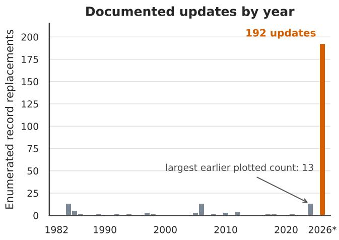
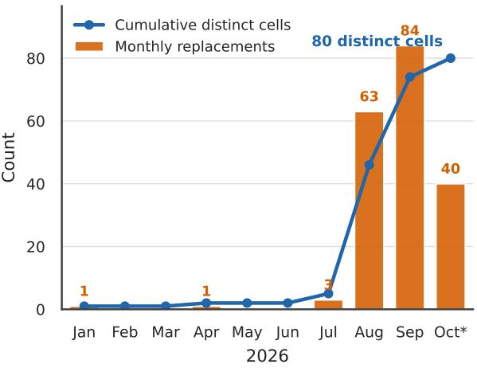

# When Scientific Cognition Is No Longer Scarce

Nathan DeBardeleben

Los Alamos National Laboratory

ndebard@lanl.gov

## Abstract

AI could change which parts of science impede progress. Consider a world in which machine systems are better, faster, and cheaper than people at most scientific work that can be done through a computer. Our question is what would limit science in that world. Literature synthesis, hypothesis generation, software development, simulation, and analysis could become abundant, while experiments, observations, well-supported conclusions, and accountable institutional authority remain scarce. Science would then be constrained by a diferent set of resources. In this paper, we call this change the scarcity inversion and consider four parts of it: selection, physical access, validation, and organizational choice. This change is arriving first in mathematics and coding/software/algorithm design, where the whole scientific loop can run inside computation. For national laboratories, the change could be striking. Their distinctive role is to turn abundant machine reasoning into trustworthy results by combining controlled experiments, protected data, expert judgment, and accountable authority. The practical question is how facilities, verification, provenance, resource allocation, and scientific governance should change when reasoning is plentiful and trustworthy evidence is scarce.

## 1 Introduction: What If Scientific Cognition Becomes Abundant?

Let’s start with a premise that AI becomes better, faster, and cheaper than people at nearly every scientific task that can be done with access to a computer. Set aside whether this happens, or when. Take the premise seriously long enough to ask one question: what limits scientific progress when scientific cognition is no longer scarce?

We examine how science changes when the supply of reasoning, coding, and analysis expands enough that these activities cease to limit scientific progress.

To make the question concrete, we will use a simple sketch of the scientific workflow:

• synthesizing literature and existing evidence

• generating hypotheses and candidate explanations

• designing experiments, observations, and simulations

• developing software, models, and experimental procedures

• executing simulations and interacting with the physical world

• analyzing results and comparing competing explanations

• validating conclusions, characterizing uncertainty, and determining which claims the evidence supports

• communicating findings so they can be scrutinized, reproduced, and incorporated into future work.

In practice, scientific work loops back on itself. A failed experiment may expose a flaw in the design. An unexpected result may instead require a new hypothesis or another look at the literature. The workflow sketch lets us ask where AI speeds up the loop and where scarcity remains.

Mathematics and parts of theoretical computer science can keep this entire workflow inside computation. They ofer an early view of what happens when the search, execution, and decisive checks can all proceed at machine speed. At Los Alamos National Laboratory (LANL), this is already a practical question. Scientific AI work at the Laboratory gives us a direct view of both the opportunities and the constraints.

Our claim is that abundant cognition changes what is scarce in science. Selection, physical evidence, validation, trust, and accountable institutional authority become the harder constraints.

The rest of this paper is organized as follows. Section 2 describes how science is organized around scarce expertise, and Section 3 considers what changes when reasoning is no longer the limiting resource. Section 4 examines fields where the whole scientific loop fits inside computation, and Section 5 introduces the concept of a scarcity inversion. Sections 6 through 9 examine the resulting bottlenecks in selection, physical access, validation, and institutional choice. Section 10 considers the changing role of national laboratories, and Section 11 discusses how scientific systems might be designed around the resources that remain scarce. Finally, we conclude in Section 12.

## 2 Science Organized Around Scarce Expertise

Today, expert time limits every part of scientific work. A day spent reading or inspecting results cannot also be spent testing another hypothesis or writing code. Institutions therefore ration cognitive work along with facilities and funding.

Much of scientific apprenticeship grows out of delegated work. A senior scientist may ask a junior colleague to run a simulation campaign and return with an interpretation. Doing that work develops the methods and judgment needed for independent research.

Apprenticeship also teaches scientists what deserves a second look. Repeated contact with instruments, failed runs, and imperfect data builds the background against which an anomalous result registers as surprising. If routine work moves to agents, institutions will need deliberate ways for junior scientists to develop that judgment.

Experimental work also contains judgment that cannot be separated cleanly from execution. Scientists decide whether an instrument is behaving normally, whether a specimen is representative, whether an anomaly deserves attention, and whether a measurement bears on the question being asked. Automation can change who or what operates the apparatus, but it does not remove the need for people who understand the experiment and its failure modes.

Matt Beane develops this concern in The Skill Code, drawing on studies of surgical suites, warehouses, and other workplaces [2]. Richard Mitchell draws a practical lesson from aviation and nuclear control: organizations can put selected “manual gates” into automated workflows so people continue to practice skills that the organization cannot aford to lose [13]. A broader labor-market analysis projects that generative AI may automate foundational work in roles such as legal associate, narrowing the entry points through which novices develop expertise [24]. Recent payroll data show a widening employment gap for workers ages 22–25 in AI-exposed occupations, driven mainly by lower hiring. The gap is largest in occupations where reported AI use primarily automates work [3]. The authors treat this as descriptive evidence and do not claim a causal estimate. What this does to the next generation of skilled scientists deserves its own essay, and we leave it aside here.

Scientific institutions (universities, national laboratories, science divisions of companies) are organized around a limited supply of expert time. Laboratories concentrate expertise, divide work among specialized teams, and plan projects around what those teams can do. If expert time stops being the main constraint, laboratories, teams, and career paths will have to adjust.

## 3 Removing the Cognitive Bottleneck

If scientific reasoning becomes abundant, several historical constraints seem to weaken at the same time. Literature synthesis and related-work analysis may become continuous activities, making hypothesis generation much more fluid as well as cheaper than humans. Every model (LLM, surrogate, emulator) call, retrieval step, simulation, and round of agent debate still costs money (time, energy, compute cycles). Scientific agents therefore face a selection problem before any candidate reaches a laboratory: where should they spend the next LLM token, tool call, or simulation? The choice should reflect plausibility, cost, and how much a result would reduce uncertainty. A simulation that resolves a large branch of later work may deserve priority even when its immediate result has little value on its own.

Selection begins within hypothesis generation itself. Pal and colleagues studied a graph-based system over as many as 2,000 iterations. After a few hundred iterations, new concepts were no longer taking the graph farther from its starting point, although the number of distinct concepts kept growing. The system continued to find new long-range connections among those concepts [21]. Further compute was now exploring connections among ideas already in view. That shift creates a stopping problem. At some point, a fresh starting point or an empirical test may be worth more than another iteration.

Scientific software could become so cheap to produce and modify that we may come to think of it as disposable, upending the systems institutions use to manage software as intellectual property: release review, licensing, controlled distribution, and technology transfer. In many ways, we are already seeing this with a proliferation of software agentically created under the direction of scientists. Design of experiments and simulation campaigns could proliferate far faster than researchers can execute them, let alone at the rate humans can digest the results.

Internal measurements from OpenAI give an early example in AI research. By mid-August 2026, its research organization was using 3.1 eight-hour agent workdays for every human workday. OpenAI also reports faster code contributions and a record number of experiments per active experimenter. The measurements are preliminary, increased compute may partly explain the experiment trend, and throughput does not necessarily translate directly into scientific progress [18].

Sakana AI’s AI Scientist automates a software-only research loop from an initial idea to a draft paper and simulated review. Along the way it writes code, runs experiments, and analyzes the results. It currently focuses on machine learning experiments, where the experimental loop can be carried out entirely through software [11].

Google’s Co-Scientist applies agent debate and ranking to biomedical hypotheses. Researchers evaluated the system on drug repurposing, novel-target discovery, and antimicrobial resistance, then tested selected proposals in wet-laboratory experiments. Experts remained in the loop to choose what received laboratory time [8].

Los Alamos National Laboratory’s agentic framework, URSA [9] (Universal Research and Scientific Agent), takes similar approaches to automation. Scientists can easily explore parameter spaces, run a suite of simulations, build surrogate models from results, analyze results, generate plots, etc. URSA has a suite of cognitive features such as a healthy debate/critique loop as well as a symposium of agents that specialize with diferent roles and tools and collaborate to solve complex problems.

Cheap generation can fill the workflow with plausible ideas and designs. The dificulty then lies in deciding which candidates deserve further analysis, simulation, or experiment.

## 4 Science That Fits Entirely Inside a Computer

Much of this paper focuses on the point where scientific work needs an experiment, an observation, or access to a facility (experimental or measurement device/instrument). Some problems have no such constraint. In pure mathematics, formal methods, and parts of theoretical computer science, the problem, candidate solutions, and decisive checks can all be represented and executed in a computer. These fields give us an early view of what happens when the whole loop can run at machine speed.

FunSearch supplied an early example that paired LLM-generated programs with an automatic evaluator and found new constructions for the cap set problem, including the largest improvement in 20 years to the asymptotic lower bound. It also found new heuristics for online bin packing [23]. AlphaEvolve later used an autonomous loop of LLM code changes and automatic evaluation across a wider set of problems. Among its results was a procedure for multiplying two 4 × 4 complex-valued matrices using 48 scalar multiplications, the first improvement over Strassen’s method in that setting in 56 years [14].

The degree–diameter problem gives a concrete view of this acceleration. A community-maintained table tracks the largest known graph for 126 combinations of degree and diameter. Its update log enumerates 192 record replacements in 2026 through October 7, touching 80 of the 126 cells. This burst coincides with the arrival of the AI-assisted systems described throughout this section. Historical reporting is incomplete, so the comparison does not measure every advance or establish that AI caused the increase. Even with that limitation, the breadth and concentration of the turnover show how fast a compute-only field can move when candidate generation and exact checking both accelerate [5]. Figure 1 shows both the abrupt rise in documented updates and the breadth of the 2026 turnover.

  
2026: 80 of 126 cells changed

  
Explicitly enumerated updates; ranged dates use one representative period. Undated and unenumerated changes excluded. \*Through Oct. 7.

Figure 1: Documented turnover across all 126 degree–diameter cells. The left panel counts explicitly enumerated record replacements by year. The right panel expands 2026 and tracks the cumulative number of distinct cells changed[5].

These systems still consume finite compute. Their advantage comes from keeping generation and evaluation in the same medium. The result of one candidate can feed directly into the next round of search. No physical experiment interrupts the loop.

Recent OpenAI work in mathematics makes the trend harder to dismiss. GPT-5 contributed to progress on several Erdős problems through literature search, proof generation, and expert correction [4]. Subsequent releases included a disproof of the Erdős unit distance conjecture, ten further results formalized in Lean1, and a claimed proof of finite-time blowup in the three-dimensional incompressible Navier–Stokes equations produced with as many as 10, 000 agents [1, 17, 19, 20].

In October 2026, OpenAI released a collection of 722 manuscripts organized into 372 result families. The collection was produced by an unreleased internal model after it was posed approximately 4,000 open problems. OpenAI reports that an average result used the equivalent of roughly three hours of ChatGPT Pro thinking. Many proofs have Lean formalizations, while unformalized results may still contain errors [16]. These releases make the scarcity inversion visible. Candidate mathematical results are being produced at scale, while formalization, independent review, correction, and assimilation into the mathematical record become the limiting work. The search and checking take place largely inside computation, without a physical facility or a standing team of specialists for each problem.

This part of the scarcity inversion should concern national laboratories first. Laboratories have long employed mathematicians, computer scientists, and algorithm developers to do this work. When a compute-only problem relies on public information, it draws no advantage from a beamline, controlled material, or unique location. Models, compute, formal tools, and expert review can be assembled elsewhere. This is less true for National Nuclear Security Administration (NNSA) laboratories. They hold classified and controlled data, models, and technical records that cannot be assembled elsewhere. AI may make those collections easier to curate, search, and use, but their value still depends on secure access, provenance, and institutional knowledge. National laboratories can also connect abstract results to consequential physical systems. Their leverage increasingly comes from these protected information resources and from their connection to the physical world.

## 5 The Scarcity Inversion

In this hypothetical future, candidate knowledge can grow much faster than validated knowledge. Machine reasoning will still consume energy, hardware, and time, and dificult problems will continue to resist solution. The inversion concerns relative scarcity: another hypothesis, analysis, or software implementation becomes cheap compared with the experiment needed to test it.

## The Scarcity Inversion

As machine reasoning becomes abundant, the scarce resources in science shift toward selecting worthwhile questions, obtaining contact with the physical world, determining which claims the evidence supports, and exercising accountable institutional authority.

A serious objection follows from the premise itself. Capable agents should also make selection and validation cheaper because both involve reasoning. The remaining limit appears when a task depends on something inference cannot supply. An unmade measurement is unavailable to a model. Authority and public legitimacy must come from an institution. Agents can improve the analysis behind these decisions, but the scarce resource lies outside computation.

The four scarcities constrain diferent parts of the same scientific loop:

• Selection determines which questions are well-developed and which proposals receive further attention.

• Physical access determines which proposals can be tested through an experiment, measurement, or observation.

• Validation determines which claims the resulting evidence supports and how confidently scientists and engineers can make them.

• Institutional choice determines whether those claims justify action, continued investment, or an accepted risk, and identifies who is accountable for the decision.

Human institutions shape conduct through norms and through accountability. Accountability makes misuse of authority consequential for the actor’s future. Alignment may shape an agent’s conduct, but present agents cannot be held accountable in that institutional sense. The practical importance of this accountability asymmetry grows as systems gain authority to change experiments, infrastructure, or resource allocations [6].

Some scientific decisions still need a person or institution that can be held responsible for the outcome. Giving an agent operational control does not transfer that responsibility.

## 6 The Selection Bottleneck: What Is Worth Knowing?

When a system can generate millions of plausible hypotheses and thousands of defensible experimental designs, science faces a selection problem. Which question deserves scarce resources, and which contact with reality would be most valuable next? Information gain, uncertainty reduction, mission relevance, risk, and cost all enter that choice.

This choice begins inside the computational workflow. Candidate hypotheses compete on plausibility, novelty, feasibility, and expected information value. Those criteria can disagree. In their experiments, O’Neill, Ghosal, and colleagues found that fine-tuned models produced hypotheses that an LLM judge scored as more feasible and less novel than one-shot variants [15]. Their recent work on hypothesis ranking also shows how dificult automated selection remains. On this benchmark, confidence-based scoring outperformed a prompted LLM judge, but performance remained far from reliable and the benchmark used previously published hypotheses [22]. A system that can generate far more than it can examine needs an explicit policy for allocating its own reasoning budget.

Selection occurs twice. The first decision allocates machine efort among searches, simulations, and analyses. The second admits a small fraction of the resulting proposals to facilities, field campaigns, or human review. Computational search can explore broadly because a mistake is comparatively cheap. Facility admission needs a stronger account of expected value because it commits resources that cannot be copied or recovered as easily.

Ranking candidates one at a time can hide a weakness at the portfolio level. Every project may look plausible while all of them rest on the same mistaken assumption. Selection should reserve room for lines of inquiry that could reveal that mistake.

A useful analogy comes from genetic algorithms. A population can converge too early when selection eliminates alternatives before they have been adequately explored. Scientific agents may face a similar problem when an initial framing shapes every proposal that follows. We hypothesize that using several models on the same problem can preserve competing lines of inquiry, especially when the models begin from diferent assumptions or methods. URSA’s agent symposia provide one way to organize such exchanges [25]. Agreement among several models still cannot establish that an idea is sound when the models share training data and failure modes.

Facilities should reserve some capacity for experiments that could overturn the assumptions guiding the rest of the program. Otherwise an eficient system may spend every available resource refining one mistaken view.

Scientific programs pursue several objectives at once. Information gain may favor a diferent experiment than urgency or mission consequence. A rare, high-consequence event may deserve attention even when its expected information gain is modest. These choices expose judgments that were easier to leave implicit when expert time limited the number of proposals under consideration.

## 7 The Physical Bottleneck: Reality Does Not Scale Like Computation

Inference may get cheaper while accelerators still have finite beam time. Laboratories can synthesize only so many materials. Telescopes have limited observing schedules. Instruments, energy, manufacturing capacity, and compute remain constrained. Hypotheses may become abundant while access to reality remains limited.

Physical access includes the work surrounding a measurement. A specimen may need preparation and a facility may require a safety review before an instrument can run. The resulting data are useful only if the instrument state and experimental context were recorded. Automation can reduce this work, but it cannot make a unique material or observation available on demand. Some missed observations cannot be repeated.

A validated simulation can rule out many candidates before they reach an experiment, which raises the value of the remaining facility time. Its predictions depend on models, parameters, numerical approximations, and validation data obtained from the world. Both new measurements and well-curated historical data become more valuable as simulation campaigns expand, because they establish where modeled results can be trusted.

Closed-loop laboratories ofer one response. Agents can propose experiments, control instruments within approved limits, analyze results, and choose a next measurement. The loop should include admission controls for safety and scarce equipment, along with records of proposals that were rejected or failed. Negative results will help later systems avoid repeating work, provided that the conditions and uncertainty of those results have been preserved.

Closed-loop laboratories are most useful where specimens, protocols, and instruments can be standardized. They do less to relax physical constraints in fields that depend on unique observations, field campaigns, or large facilities.

## 8 The Validation Bottleneck: From Producing Answers to Supporting Claims

A model can produce a detailed answer in seconds. The measurements needed to support it may take weeks, and weak provenance can make an otherwise correct result unusable. Model inadequacy, correlated errors, contaminated literature, and failures of reproducibility remain as reasoning gets cheaper. Machine reasoning may eventually extract far more from the available evidence than it does today. Verification and uncertainty characterization then determine how far the evidence can support a claim.

A fluent explanation can combine many true statements and still make a final claim that the evidence does not support. Supporting a claim requires a traceable chain from conclusion back to evidence. A reviewer should be able to find the relevant measurement and reproduce the analysis, including the points where judgment entered. Provenance is part of the result because it shows why the conclusion deserves confidence.

Agents may produce claims faster than scientists can check them. Only a small fraction can receive human attention. Scientific agents will therefore need to recognize when a result deserves escalation and ask for review. When a system asks for review, it should begin by explaining why. The scientist then needs a concise account of how the agents reached that point and which evidence remains unresolved. This matters especially in multi-agent systems, where a long internal debate can leave the supervisor unable to tell what the agents concluded. Before a result guides an experiment or mission decision, the system must turn that history into a reviewable account.

Model capability is also uneven across tasks that look similar. Dell’Acqua and colleagues call this the jagged technological frontier: AI assistance can improve performance on one task and degrade it on another nearby task [7]. Each part of a scientific workflow therefore needs its own evaluation.

Using several models can reveal disagreements and failure modes that one self-reviewing model might conceal. Shared training data and assumptions can also lead several models to agree on the same error. Claims produced through agent debate still have to be tested against evidence.

Scientific systems will need calibrated records of where their methods work. Performance on literature search says little about performance on uncertainty quantification, and success in one physical regime may not transfer to another. Evaluations should follow the actual workflow and include failures that occur when several individually capable components interact. Independent data, alternative methods, and physical tests provide stronger checks than agreement among agents built from similar foundations.

Human review is best spent on the assumptions, evidence, and consequences that matter. Outputs designed for inspection need explicit uncertainty and durable links back to source material, so reviewers do not have to reconstruct an agent run before they can evaluate its conclusion.

## 9 The Institutional Bottleneck: Who Chooses What Science Gets Done?

Institutions inherit decisions that technical ranking cannot settle. A facility operates under priorities and risk tolerances that someone must authorize. That authority also carries responsibility for the evidence required and for the outcome of an autonomous campaign.

An experiment that maximizes information gain may do little for an urgent mission, and a high-value mission result may carry risks that the institution will not accept. Choosing among those aims requires institutional priorities.

Alvin Weinberg described scientific priority setting as a problem in the axiology of science: the value system used to decide which competent, feasible science deserves support. Automated selection does not remove that problem. It encodes judgments about scientific, technological, social, and mission value in ranking rules and facility-admission policies [26, 27].

Once a priority is encoded in a ranking rule, it can shape an entire research program. Each rule therefore needs an institutional owner and a record of how it changes when priorities conflict or new evidence arrives.

An autonomous system may receive operational authority without becoming an accountable institutional actor. Alignment and engineering controls can shape its behavior, but they do not make the system’s own future depend on its present conduct [6]. Institutions must therefore decide how much authority can be exercised in the absence of accountability at the point of action. Bounded authority and independent review become part of scientific system design. An agent that drafts a proposal raises a diferent governance question than one that reserves facility time or changes an experimental control. Clear boundaries should identify which actions are advisory, which require approval, and which may be performed autonomously. Consequential actions need a named institutional owner even when no person selected each intermediate step.

Risk assessment also requires accountable authority. Quantitative analysis can characterize much of a risk without deciding whether the residual risk is acceptable. Consequential choices often involve uncertain or incomparable harms, mission urgency, and institutional values. Agents can prepare and challenge the assessment. An authorized person or body must accept responsibility for the decision to proceed, pause, or stop.

Access will also become a scientific policy. Agents may need controlled data, specialized models, hazardous materials, or expensive instruments. Broad access can accelerate discovery, while unrestricted access can expose private information or create unacceptable physical and security risks. Institutions will have to grant capabilities according to purpose and evidence of reliable behavior, then retain records that support later review.

## 10 The Changing Role of the National Laboratory

If expert reasoning becomes widely available, facilities and controlled data will account for more of what distinguishes a national laboratory. Machine systems can use those assets only through interfaces that preserve safety and provenance.

The compute-only cases in Section 4 mark the limit of this argument. A proof or algorithm that never needs a facility can be produced wherever models, compute, and expert review are available. The laboratory’s advantage grows when scientific work must pass through distinctive data, materials, instruments, or authorities.

## Candidate Knowledge Is Not Trusted Knowledge

AI may make candidate knowledge cheap without making trustworthy, actionable knowledge cheap. National laboratories help turn candidate results into trusted evidence by combining machine reasoning with controlled experiments, domain judgment, and accountable authority.

This opportunity is conditional. Laboratories need interfaces through which machine systems can request resources and return evidence. The institution still sets admission criteria, experimental standards, authority limits, and the conditions under which results enter the scientific record. Release reviews, access controls, and facility queues protect safety, security, and public trust. Their design will also determine whether agentic science can use the laboratory’s scarce assets at all.

This work reaches beyond operating facilities. Laboratories can define how agents describe experimental constraints and report results with uncertainty and provenance. Instruments and simulation codes will need machine-readable descriptions of their capabilities. The systems that expose them will need controls strong enough for an agent to use them without bypassing safety, security, or scientific review.

Laboratories can test models where it matters most: against physical measurements. A campaign that covers several operating regimes can establish where predictions fail. Preserving those failures gives later decisions about autonomy an empirical basis.

Historical data may become newly valuable in this setting. Records collected for one program can test claims generated for another, especially when they include calibration history and experimental context. Curating those records for machine use is scientific infrastructure work. Weak metadata can make a large archive less useful than a smaller collection whose provenance is clear.

The workforce must change with the technical system. Routine synthesis, coding, and analysis may require fewer person-hours. Expertise will shift toward experimental design, instrumentation, metrology, anomaly response, evidence integration, safety and security, and accountable program leadership. Scientists will still need to recognize when an agent has framed the wrong problem, chosen an invalid model, or exceeded the evidence. These roles determine whether physical activity becomes trustworthy evidence. Scientists acquire that judgment partly through work that agents may now perform. Laboratories should preserve forms of apprenticeship that give early-career scientists direct experience with instruments, models, failed analyses, and dificult decisions.

At Los Alamos National Laboratory, these roles are already taking shape. ArtIMis is a large multidisciplinary efort to develop AI capabilities across Laboratory missions, with explicit attention to data quality, uncertainty, and trust in high-consequence settings [10]. The open source URSA system connects agents for planning, research, hypothesis formation, code execution, domain tools, and advanced physics simulations [9]. Together, the projects show how a national laboratory can adapt general AI capabilities to mission science, then test and govern their use.

The quality of this connection will matter as much as the assets themselves. General models will continue to improve, and many organizations will have access to them. Far fewer institutions can join those models to distinctive facilities, trusted data, domain judgment, and authority while producing evidence that others can audit.

## 11 Designing Science for an Age of Abundant Intelligence

Consider a campaign to find a material that survives an extreme environment. Agent teams generate ten thousand candidate compositions and use simulations to reduce the set to forty. A program chooses six for synthesis, and only two fit the available instrument schedule. The measurements then have to be tied to calibration records, processing history, and model assumptions before a composition can be declared successful. A project leader may still have to choose between the candidate with greatest information value and the one most relevant to an urgent mission. Every handof spends a diferent scarce resource.

The campaign needs an architecture built around those handofs. Simulation and instrument interfaces expose capabilities, limits, and cost in forms an agent can use. Each experiment request should explain why the measurement deserves facility time. It should identify the uncertainty at stake and say how either result would change the campaign. A scheduler can then compare requests using the program’s actual objectives.

Running an experiment should not automatically place its result in the scientific record. Agents may execute low-risk work on their own, while a separate review decides what the program accepts as evidence. This boundary can move as evidence about the system accumulates.

Provenance begins with the first agent action. Reconstructing it after a long run is unreliable, particularly when the run includes changing code, retrieved sources, simulation inputs, and intermediate judgments. The record connects each consequential claim to the data and operations that support it, along with uncertainty and known limitations in forms that later machines can inspect.

Evaluation follows the complete path from proposal to measurement to conclusion. A model benchmark cannot establish that an autonomous experimental campaign is safe or scientifically sound. Tests need conditions that invite a plausible error and reveal whether the system recognizes inadequate evidence.

Review queues, publication incentives, and funding processes can be overwhelmed by material that is cheap to generate. Institutions can reward evidence, reproducibility, and useful reductions in uncertainty while training scientists to supervise automated work and examine its physical and

mathematical foundations.

Human supervision becomes dificult when agents work much faster than their reviewers. A person may check the work periodically, but an agent team can make thousands of decisions between those checks. Reviewing every step would erase much of the advantage. The system must instead identify the decisions that need human judgment.

Mitchell and colleagues argue that the fast, dense stream of agent actions can overload overseers and reduce review to routine approval [12]. Controls outside the agent must be able to pause work at machine speed. They must also preserve enough context for a reviewer to understand what happened. Supervision matters only if a person sees the decision in time to redirect the work.

The transition can begin before the premise of this paper is fully realized. Well-bounded interfaces, complete provenance, and explicit selection criteria are useful under present conditions. As the volume of machine generated work grows, they will determine whether abundant reasoning produces reliable science or simply overwhelms the next queue.

## 12 Conclusion: After the Cognitive Bottleneck

The scarcity inversion will arrive unevenly as machine reasoning is already becoming plentiful in software and mathematics while remaining limited in fields that depend on specialized observations or specialized knowledge. However, even a moderate change could create a severe mismatch when one part of the workflow generates work faster than the next part can process it.

Compute-only fields are moving first - the progression from program search to new mathematical constructions, formal proofs, and the recent Navier–Stokes claim suggests that some research areas may change before empirical science has comparable systems. The remaining challenges are compute allocation, verification, expert review, and institutional acceptance.

The practical test for an organization is which part of its workflow is already producing work faster than the next part can absorb, and which resource now sets the pace. The answer may difer across programs inside the same laboratory. We are already seeing this with swarms of AI agents that produce information at a rate beyond what humans can interpret.

If this argument is right, model throughput is a poor measure of scientific capacity. A laboratory could field millions of agent-hours and make little progress because its experiments, evidence, review, or authority cannot absorb the output. Useful measures should instead ask whether a program chooses informative experiments and converts their results into validated conclusions.

National laboratories have an unusual opportunity because they combine advanced computing with facilities, specialized data, controlled materials, and public authority. Compute-only work remains part of their mission and may draw on information or expertise that cannot be assembled elsewhere. The laboratory becomes especially valuable when machine reasoning has to be tested against measurements or used in decisions for which the institution is accountable. This requires usable interfaces to facilities and data, clear authority, and evidence that others can audit. The laboratory owns the part of the scientific loop that faces the physical world. It decides which machine-generated proposals deserve scarce resources, makes sure measurements can be interpreted, determines what claims the evidence supports, and accepts responsibility for consequential action. Abundant reasoning can expand the questions a laboratory pursues. Progress still depends on choosing which questions to test against evidence.

## References

[1] Noga Alon, Thomas F. Bloom, W. T. Gowers, Daniel Litt, Will Sawin, Arul Shankar, Jacob Tsimerman, Victor Wang, and Melanie Matchett Wood. Remarks on the disproof of the unit distance conjecture. Technical report, OpenAI, May 2026. URL https://openai.com/index/ model-disproves-discrete-geometry-conjecture/.

[2] Matt Beane. The Skill Code: How to Save Human Ability in an Age of Intelligent Machines. Harper Business, New York, 2024. ISBN 978-0-06-333779-4. URL https://www.mattbeane. com/book/.

[3] Erik Brynjolfsson, Bharat Chandar, and Ruyu Chen. Canaries in the coal mine? six facts about the recent employment efects of artificial intelligence. Technical report, Stanford Digital Economy Lab, August 2026. URL https://digitaleconomy.stanford.edu/publications/ canaries-in-the-coal-mine/. Revised August 12, 2026.

[4] Sébastien Bubeck, Christian Coester, Ronen Eldan, Timothy Gowers, Yin Tat Lee, Alexandru Lupsasca, Mehtaab Sawhney, Robert Scherrer, Mark Sellke, Brian K. Spears, Derya Unutmaz, Kevin Weil, Steven Yin, and Nikita Zhivotovskiy. Early science acceleration experiments with GPT-5. Technical report, OpenAI, November 2025. URL https://openai.com/index/ accelerating-science-gpt-5/.

[5] Francesc Comellas. Degree-diameter table for graphs, October 2026. URL https://web.mat. upc.edu/francesc.comellas/delta-d/table\_degree\_diameter.html. Accessed October 7, 2026.

[6] Nathan DeBardeleben. Accountability asymmetry and structural trust in autonomous AI systems, August 2026. URL https://arxiv.org/abs/2608.03670.

[7] Fabrizio Dell’Acqua, Edward McFowland, Ethan Mollick, Hila Lifshitz-Assaf, Katherine C. Kellogg, Saran Rajendran, Lisa Krayer, François Candelon, and Karim R. Lakhani. Navigating the jagged technological frontier: Field experimental evidence of the efects of artificial intelligence on knowledge worker productivity and quality. Organization Science, 37(2):403–423, 2026. doi: 10.1287/orsc.2025.21838. URL https://doi.org/10.1287/orsc.2025.21838.

[8] Juraj Gottweis, Wei-Hung Weng, Alexander Daryin, Tao Tu, Petar Sirkovic, Artiom Myaskovsky, Grzegorz Glowaty, Felix Weissenberger, Alessio Orlandi, Dan Popovici, Anil Palepu, Keran Rong, Ryutaro Tanno, Khaled Saab, Fan Zhang, Jacob Blum, Andrew Carroll, Kavita Kulkarni, Nenad Tomašev, Dina Zverinski, Ivor Rendulic, Elahe Vedadi, Florian Hasler, Luka Rimanic, Marina Boia, Ivan Budiselic, Ben Feinstein, Tom Shefer, Jan Freyberg, Jeremy Ratclif, Ottavia Bertolli, Katherine Chou, Avinatan Hassidim, Burak Gokturk, Amin Vahdat, Yuan Guan, Vikram Dhillon, Eeshit Dhaval Vaishnav, Byron Lee, Tiago R. D. Costa, José R. Penadés, Gary Peltz, Yossi Matias, James Manyika, Demis Hassabis, Yunhan Xu, Pushmeet Kohli, Annalisa Pawlosky, Alan Karthikesalingam, and Vivek Natarajan. Accelerating scientific discovery with Co-Scientist. Nature, 655(8122):487–496, 2026. doi: 10.1038/s41586-026-10644-y. URL https://doi.org/10.1038/s41586-026-10644-y.

[9] Michael Grosskopf, Nathan Debardeleben, Russell Bent, Rahul Somasundaram, Isaac Michaud, Arthur Lui, Alexius Wadell, Warren D. Graham, Golo A. Wimmer, Sachin Shivakumar, Joan Vendrell Gallart, Harsha Nagarajan, and Earl Lawrence. URSA: The universal research and

scientific agent. arXiv preprint arXiv:2506.22653, 2026. doi: 10.48550/arXiv.2506.22653. URL https://arxiv.org/abs/2506.22653v2.

[10] Earl Lawrence. Can a single AI model advance any field of science? 1663, Los Alamos National Laboratory, March 2025. URL https://www.lanl.gov/media/publications/1663/ 1269-earl-lawrence-ai. Published March 31, 2025.

[11] Chris Lu, Cong Lu, Robert Tjarko Lange, Jakob Foerster, Jef Clune, and David Ha. The AI scientist: Towards fully automated open-ended scientific discovery. arXiv preprint arXiv:2408.06292, 2024. doi: 10.48550/arXiv.2408.06292. URL https://arxiv.org/abs/ 2408.06292.

[12] Margaret Mitchell, Avijit Ghosh, and Samir Passi. AI agents push humans out of the loop. arXiv preprint arXiv:2608.23642, 2026. doi: 10.48550/arXiv.2608.23642. URL https://arxiv. org/abs/2608.23642.

[13] Richard Mitchell. AI eficiency could cost us the next generation of experts. IEEE Spectrum, September 2026. URL https://spectrum.ieee.org/ai-engineer-skills. Published September 2, 2026.

[14] Alexander Novikov, Ngân V˜u, Marvin Eisenberger, Emilien Dupont, Po-Sen Huang, Adam Zsolt Wagner, Sergey Shirobokov, Borislav Kozlovskii, Francisco J. R. Ruiz, Abbas Mehrabian, M. Pawan Kumar, Abigail See, Swarat Chaudhuri, George Holland, Alex Davies, Sebastian Nowozin, Pushmeet Kohli, and Matej Balog. AlphaEvolve: A coding agent for scientific and algorithmic discovery. Technical report, Google DeepMind, May 2025. URL https://deepmind.google/blog/ alphaevolve-a-gemini-powered-coding-agent-for-designing-advanced-algorithms/.

[15] Charles O’Neill, Tirthankar Ghosal, Roberta Răileanu, Mike Walmsley, Thang Bui, Kevin Schawinski, and Ioana Ciucă. Sparks of science: Hypothesis generation using structured paper data. arXiv preprint arXiv:2504.12976, 2025. doi: 10.48550/arXiv.2504.12976. URL https://arxiv.org/abs/2504.12976.

[16] OpenAI. OpenAI math repository, October 2026. URL https://github.com/openai/math. Released October 6, 2026.

[17] OpenAI. Finite time blowup for Navier–Stokes. Technical report, OpenAI, September 2026. URL https://openai.com/index/navier-stokes-solution/. Released September 8, 2026.

[18] OpenAI. Research acceleration: The view inside OpenAI. Technical report, OpenAI, September 2026. URL https://openai.com/index/research-acceleration-view-inside-openai/. Published September 6, 2026.

[19] OpenAI. Ten advances in mathematics and theoretical computer science. Technical report, OpenAI, August 2026. URL https://openai.com/index/ten-advances-in-mathematics/. Updated August 6, 2026.

[20] OpenAI. Planar point sets with many unit distances. Technical report, OpenAI, May 2026. URL https://openai.com/index/model-disproves-discrete-geometry-conjecture/.

[21] Subhadeep Pal, Shashwat Sourav, Tirthankar Ghosal, and Markus J. Buehler. Graph-native reinforcement learning enables traceable scientific hypothesis generation through conceptual

recombination. arXiv preprint arXiv:2607.00924, 2026. doi: 10.48550/arXiv.2607.00924. URL https://arxiv.org/abs/2607.00924.

[22] Swati Rajwal, Sanjay Das, and Tirthankar Ghosal. Do LLMs know a good hypothesis when they see one? logit-based energy scoring outperforms prompted LLM-as-judge for scientific hypothesis ranking. arXiv preprint arXiv:2608.17270, 2026. doi: 10.48550/arXiv.2608.17270. URL https://arxiv.org/abs/2608.17270.

[23] Bernardino Romera-Paredes, Mohammadamin Barekatain, Alexander Novikov, Matej Balog, M. Pawan Kumar, Emilien Dupont, Francisco J. R. Ruiz, Jordan S. Ellenberg, Pengming Wang, Omar Fawzi, Pushmeet Kohli, and Alhussein Fawzi. Mathematical discoveries from program search with large language models. Nature, 625:468–475, 2024. doi: 10.1038/s41586-023-06924-6. URL https://doi.org/10.1038/s41586-023-06924-6.

[24] Matt Sigelman, Joseph Fuller, Michael Fenlon, Erik Leiden, and Gwynn Guilford. The expertise upheaval: How generative AI’s impact on learning curves will reshape the workplace. Technical report, Burning Glass Institute and Harvard Business School Project on Managing the Future of Work, July 2025.

[25] URSA Contributors. Agent symposia. URSA documentation, version 0.16.4, 2026. URL https://lanl.github.io/ursa/environments/agent-symposia/. Versioned source archived from the URSA repository.

[26] Alvin M. Weinberg. Criteria for scientific choice. Minerva, 1(2):159–171, 1963. doi: 10.1007/ bf01096248. The archived file is the 2000 Minerva Classics reprint.

[27] Alvin M. Weinberg. The axiology of science. American Scientist, 58(6):612–617, 1970. URL https://www.jstor.org/stable/27829310.