# RT-J: Large-Scale Pretraining of Relational Transformers for Context-Efficient Predictions

Rishabh Ranjan<sup>▷◁</sup> Vignesh Kothapalli<sup>▷◁</sup> Harshvardhan Agarwal<sup>▷◁</sup> Charilaos Kanatsoulis<sup>▷◁</sup> Roshan Upendra<sup>π</sup> Tom Palczewski<sup>π</sup> Carlos Guestrin<sup>▷◁</sup> Jure Leskovec<sup>▷◁</sup>

<sup>▷◁</sup>Stanford University <sup>π</sup>SAP

田 https://star-project.stanford.edu/rt-j

## Abstract

Foundation models for tables and relational databases are increasingly used for predictive tasks across various scientific and industrial domains. However, adapting existing models to unseen datasets requires tens of thousands of examples. Here we introduce RT-J, an 85M-parameter relational foundation model (RFM) that makes accurate predictions even with hundreds of in-context examples or fewer. To achieve this, we first assemble THE JOIN, a large collection of 639 webcrawled databases with 6,023 LLM-generated forecasting tasks. We pretrain with long contexts of up to 8,192 database cells, using in-context examples from a novel lightweight random-walk retriever. Finally, we leverage context tuning and ensembling to scale up test-time compute. On in-context regression tasks from RelBench, RT-J requires 10× fewer examples on average to match strong feature engineering pipelines with LLM-agent or RDBLearn featurizers and TabICLv2 or LightGBM predictors. Overall, our work pushes the frontier for context-efficient predictions on relational data and highlights the importance of real-world semantics, context engineering and large-scale pretraining for RFMs.

## 1 Introduction

Foundation models have transformed how machine learning systems are adapted to new tasks [1, 2]. In language and vision, pretrained models can often solve new tasks using only a small number of examples in context [3, 4]. Yet this capability remains largely out of reach for relational data, even though relational databases and data warehouses store much of the world’s structured enterprise, scientific, and operational data [5, 6]. Today, strong relational predictors typically require task-specific training [7–9], or substantial labeled data [10–16]. This limits predictive modeling precisely in the settings where it is most valuable, including cases where labeled examples are scarce, and users need rapid ad hoc predictions for decision-making.

Tabular foundation models (TFMs) like TabPFN [17, 18] and TabICL [19, 20] provide in-context learning for single-table prediction, and systems such as RDBLearn [21] extend them to relational databases by aggregating relational neighborhoods into engineered features. Such an approach can be effective with many labeled examples, but it flattens the database and removes the explicit relational structure needed to effectively reason over entities, relationships, and cross-table dependencies. Natively relational architectures like RelGT [8] and RelGNN [7] operate directly on multi-table databases by representing rows as nodes and primary–foreign-key links as edges, but require training for each schema and task. More recent schema-agnostic relational foundation models (RFMs), such as Griffin [22], KumoRFM [10, 11], and relational transformers (RTs) [23], pretrain across many databases and adapt to unseen ones at inference time. However, these models have not yet been tailored for strong prediction with only a few labeled examples. See Appendix C for related work.

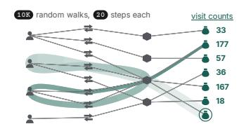

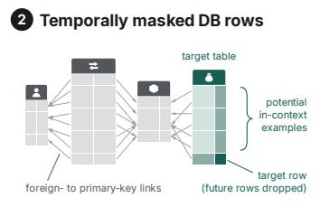

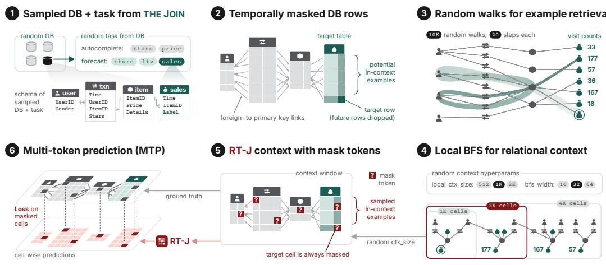  
Figure 1: RT-J pretraining recipe. (1) We sample a database and prediction task from THE JOIN. The task specifies the target table and column. (2) We sample a target row from the target table. Rows after the target row’s timestamp are dropped; kept target-table rows form the candidate in-context examples. (3) From the target row, many parallel random walks rank candidate examples by visit count, on the fly. (4) We process candidate examples in descending visit-count order, using each as the root of a local bounded-width breadth-first-search (BFS) over primary–foreign key links. The context size and BFS hyperparameters are sampled randomly. (5) The collected rows form the context window for the relational transformer (RT), which treats cells as tokens. The target table rows in the context enable in-context learning. The target cell is always masked; non-target cells may be masked optionally. (6) RT-J predicts all masked cells and is trained against their ground-truth values.

This inability is not primarily an architectural limitation, but a mismatch between existing RFM training recipes and inference with limited in-context examples. RT [23] provides a natural starting point because it operates directly over database cells, schema metadata, and relational links. However, the original RT recipe was not designed to turn the architecture into a strong in-context learner. There are three main gaps. First, publicly available real world relational pretraining data remains scarce [24, 25]. Second, existing pretraining recipes target zero-shot or fine-tuning regimes, which precludes in-context learning. Third, standard context construction either ignores relational structure or expands local neighborhoods naively, without preferentially retrieving rows relevant to the target.

In this paper, we show that a pretrained RT can become a strong context-efficient predictor when the recipe for training, data, context retrieval and test-time compute is designed for this regime. Our goal is not to introduce a new backbone architecture, but to identify the ingredients that turn an RT model into an effective in-context learner for relational databases. First, we develop a pretraining recipe (Figure 1) built on stochastic context sizes and hyperparameters, which exposes the model to long and diverse contexts. Second, to train with high-quality in-context examples, we propose a lightweight randomwalk retriever (Figure 1) that fills the context window with rows selected for both relational proximity to the target and likelihood of carrying useful predictive signal. Third, we leverage context tuning and context ensembling to scale test-time compute. With this recipe, we first obtain RT-PluRel, an 86M-parameter RT model pretrained on synthetic PluRel data [26]. With task-specific fine-tuning,

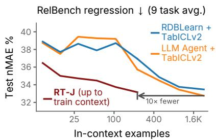  
Figure 2: In-context regression. Examples are matched. RT-J at train context size of 8192 cells fits around 225 examples on average. At all example counts, RT-J is > 2 nMAE points better than the best baseline; at all performance levels, RT-J needs $\gtrsim 1 0 \times$ fewer examples.

RT-PluRel ranked first among all system and model submissions on the RelArena-α [27] leaderboard (Appendix $\mathbf { A } )$ . Finally, to improve generalization to real data, we assemble THE JOIN, the largest open pretraining corpus of real-world relational data to date, comprising 6K LLM-generated forecasting tasks and 11K autocomplete tasks across 639 diverse web-crawled databases. We refer to the model obtained by continued pretraining (CPT) of RT-PluRel on THE JOIN with our recipe as RT-J. Compared to the original RT pretraining [23], our pretraining used 11× more total tokens with up to 8× larger contexts and a 4× larger model, amounting to roughly 70× more pretraining FLOPs.

Together, these ingredients make RT-J far more context-efficient than strong feature-engineering pipelines (Figure 2). We compare RT-J against pipelines that compose an LLM agent or RDBLearn featurizer with a TabICLv2 or LightGBM predictor, each given the same examples as in RT-J’s context. Other RFMs such as KumoRFM [10, 11], Griffin [22] and RDB-PFN [28] do not support this regime, hence could not be compared against (Appendix B). On RelBench regression, RT-J fits $2 2 { \bar { 5 } }$ examples on average at its max training context size of 8192 database cells, and achieves a normalized mean absolute error (nMAE) which the strongest baseline matches only with roughly 10× as many examples. Moreover, with only 15 examples, RT-J already beats the best error any pipeline reaches with 225 examples. At matched example counts, RT-J leads at every context size by 2.3–5.0 nMAE points. On classification, RT-J leads by 3.1 AUROC points when examples are scarcest, and the strongest pipeline catches up only at the largest context size. We attribute this efficiency to RT-J processing the raw relational context natively, which feature-engineering pipelines flatten into a feature table via aggregation techniques.

Our results demonstrate that context-efficient relational prediction can be attained with a pretraining recipe matched to this regime and scaling up along the axes of data, context and test-time compute. Overall, this is a step toward RFMs that work for databases the way LLMs work for text. In essence, pretrained once, reused across domains, and adapted to new tasks with only a few examples.

## 2 Background: Relational Transformers for Predictive Tasks on Databases

Relational databases and relational structure. Let D denote a relational database with schema graph $\mathcal { G } = ( \tau , \mathcal { E } )$ , where each node $T \in \mathcal { T }$ is a table and each directed edge $( \widetilde { T } , T ) \in \mathcal { E }$ indicates that table $T$ contains a foreign key column referencing the rows of the parent table $\widetilde { T }$ . Each table T contains rows indexed by primary key(s) and columns consisting of numerical, categorical, textual, or temporal values, and optional foreign keys. Thus, the relational structure of D is characterized by the schema graph along with row-level bipartite connectivity via primary–foreign key links [6, 26, 29].

Prediction tasks on relational data. A prediction task specifies a target table $T ^ { \star }$ , a target column $c ^ { \star }$ , and a set of prediction rows $\mathcal { T }$ in $T ^ { \star }$ . For each row $r \in \mathcal { Z }$ , the target value is $y _ { r } = x _ { r , c ^ { \star } }$ . The goal of a foundation model $f _ { \theta }$ is to predict $y _ { r }$ from the observed relational context around row r. For boolean or categorical targets, $f _ { \theta }$ outputs a class distribution. For numerical targets, it outputs a real-valued prediction. This formulation covers both (1) autocompletion and $( 2 )$ forecasting tasks. In an autocompletion task, $T ^ { \star }$ is an existing database table and $c ^ { \star }$ is one of its columns (such as imputing the price of a transaction). In a forecasting task, $T ^ { \star }$ may be a curated prediction table whose rows define future prediction queries (such as forecasting revenue for an entity in the next quarter). When either task is temporal, the context is restricted to rows available before the prediction time.

In-context learning for prediction tasks. In a classical in-context learning approach, $f _ { \theta }$ predicts the target column $c ^ { \star }$ for a query row r by conditioning on a support set $S _ { r }$ of labeled rows from the target table $T ^ { \star }$ . Each support row $i \in S _ { r }$ has an observed target value $y _ { i } = x _ { i , c ^ { \star } } .$ A local relational context $\mathcal { C } _ { i }$ is then constructed around each support row and a context $\mathcal { C } _ { r }$ around the query row r (with its target value masked). The model $f _ { \theta }$ predicts $y _ { r }$ using the support and query context as:

$$
\hat { y } _ { r } = f _ { \theta } \big ( \{ ( \mathcal { C } _ { i } , y _ { i } ) : i \in \mathcal { S } _ { r } \} , \mathcal { C } _ { r } \big ) .\tag{1}
$$

Here, in-context examples are sampled explicitly as labeled rows, and each example is represented by its own relational context. However, support rows often retrieve overlapping cells through primary– foreign key links. For example, labeled rows for people who purchased the same shoe after seeing the same advertisement may include the same cells from the shoe table in their contexts. This duplication consumes the context budget and limits the number of examples in context.

Context window of relational transformers. RT [23] instantiates the context preparation idea differently. Rather than separately sampling support rows and constructing an independent context around each one, RT samples a single query-centered context $\mathcal { C } _ { r }$ around the query row r (see stage (4) in Figure 1). This context is obtained by expanding from r along primary–foreign key links while keeping $y _ { r }$ masked. During this expansion, the context may naturally include other rows from the target table whose target values are observed. Thus, the support examples are not sampled separately. They are induced implicitly by the relational context around the query row. Therefore, the prediction of an RT model is given by $\hat { y } _ { r } = f _ { \theta } ( \mathcal { C } _ { r } )$ . The benefit is that overlapping relational neighborhoods are represented only once inside a single query-centered context, rather than being duplicated across independently sampled support examples.

Masked token prediction with relational transformers. RT treats each cell in $\mathcal { C } _ { r }$ as a token and predicts the masked target cell with a masked token prediction objective. Thus, heterogeneous prediction tasks are reduced to a common ‘cell prediction’ problem over any database in a schemaagnostic manner. RT computes the input token embedding by combining the cell value, datatypespecific information, and frozen text embeddings of the corresponding table and column names. During the forward pass, each transformer block of RT applies three attention layers [26] in sequence: (1) column attention, where tokens attend within the same column, (2)feature attention, where tokens attend within the same row, and (3) neighbor attention, where tokens attend across rows connected by primary–foreign key links. This attention structure enables information sharing across rows, columns, and tables while preserving the relational structure of the database. See Appendix F for details.

## 3 THE JOIN: A Large-Scale Pretraining Corpus of Relational Data

Existing collections of relational datasets, such as RelBench [24, 29], CTU [25], BIRD [30], and Spider [31, 32] comprise diverse databases but fail to capture the structural and distributional variety of predictive tasks needed for training RFMs. To address this issue, we introduce THE JOIN, a corpus comprising 639 relational databases across diverse domains (e-commerce, sports, media, finance, healthcare, etc.) and 6K forecasting tasks spanning various levels of difficulty, including rare events and cold-start entities. We follow a four-stage approach to curate the corpus: (1) collection of raw databases from the web, (2) standardization of data types in tables, (3) task generation using LLMs, and (4) task filtering using an XGBoost model. See Appendix D for details.

## 3.1 Collection

We collected the raw data from five disjoint source classes: (1) curated relational repositories (CTU, OGB, OpenAlex), (2) public APIs (SEC EDGAR, CFPB, World Bank, EIA), (3) domain specific portals (Lahman, ATP, StatsBomb, Cricsheet, OpenFlights), (4) community dumps (Stack Exchange), and (5) benchmarks (Kaggle, Spider/BIRD). Every contributing source is either a bulk archive published under a permissive license or a public API whose published terms permit programmatic research use. The classes carry qualitatively different relational structures: CTU schemas are small, clean, and follow third-normal-form, whereas Stack Exchange dumps are wide and denormalized. As a preliminary quality filter, we only collect databases that have at least two tables joined by a foreign key, and at least one column that can be parsed as a timestamp. Table 4 lists the domains included in the corpus. To avoid contamination, we exclude databases that overlap with ones in RelBench [29], RelBench v2 [24] and 4DBInfer [33] using source identity rather than schema similarity.

## 3.2 Standardization

The databases collected in their raw form are usually messy, with inconsistencies across column data types, timestamps, and primary-foreign key links being the major issues. For example: natively boolean columns are represented as strings "true"/"false", dates are represented as ISO strings, and foreign keys exist only as a column-naming convention with no explicit declaration. To address such issues, we apply five idempotent detector-and-transformer fixes that recover the canonical relational structure: (1) boolean coercion, rewriting string and uint8 columns whose values fall within a canonical truth-set as booleans, (2) numeric coercion, casting string-encoded numerics to integers or floats with an identifier blacklist guarding zip codes and ISBNs, (3) foreign-key inference by name match plus an $\geq 8 0 \%$ value-containment test against parent primary keys, (4) temporal normalization, electing a single time column per table from regex, name-hint, and integer-year candidates; and (5) entity-axis subsampling of oversized databases, retaining all activity rows for sampled entities to preserve their full activity histories.

## 3.3 Task generation

While cell imputation tasks are naturally defined by simply masking a cell/column in an existing database, in forecasting tasks the target cell/column (e.g., revenue next month) does not appear in the database and has to be explicitly generated. To obtain forecasting tasks we proceed as follows.

Audit and eligibility. Each database is first parsed into a typed schema graph with two named roles: an entity table (whose primary key is referenced by a foreign key (FK) from another table, identifying a long-lived object such as a customer, player, or hospital) and an activity table (with both a timestamp column and an FK to an entity table, so each row is a timestamped event attributable to an entity). A database is marked as eligible for task generation if it has at least one entity table, at least one activity table, ≥5 unique timestamps in that activity table, and ≥100 rows. The first two conditions ensure the schema can express a per-entity forecasting task. The timestamp and row count conditions allow us to perform XGBoost-based filtering of the generated tasks for quality control.

Propose and generate. Proposing forecasting tasks for a database requires subject-matter expertise and a scalable way to verify correctness. We use an LLM (Claude Opus 4.6) for the former and a lightweight deterministic checker for the latter. For every eligible database, the LLM is given the schema description in text and is asked to write a set of task proposals in JSON. Each proposal selects one of 25 registered template families, grouped into eight reasoning regimes. These include aggregation, threshold/existence, trend/change, behavior/churn, ranking, adoption/novelty, streak, and tail-event tasks. The checker then iterates through each proposal and drops it if: (1) a referenced column does not exist, (2) the entity column is not a foreign key, or (3) the requested pattern is not one of the registered templates. The LLM proposer is run multiple times per database, where each pass sees the tasks already accepted and is asked specifically for templates with low coverage.

## 3.4 Task filtering

Finally, we score each task using an XGBoost model over window-aggregation features. We retain tasks that are either learnable, where XGBoost beats the lightweight historical baselines, or where the signal is too weak for these baselines but still act as harder learning objectives for stronger models. Overall, this process gives us 6,023 forecasting tasks, where each task is defined by its description and a table with timestamped labels (e.g., future revenue for each quarter)<sup>1</sup>. See Appendix D for case studies and a manual audit of the tasks for their practicality and realism.

## 4 Pretraining Recipe

Here we describe our key improvements to the pretraining recipe of the original RT paper [23], which enable large-scale pretraining and context-efficient predictions (Figure 1).

## 4.1 Long-context training

The context size L is the number of cells presented to RT and is a key scaling axis to improve prediction quality. However, training at large L is computationally expensive. Further, the same pretrained model should be able to handle both small and large contexts at test-time, so that inference compute can be traded off against quality. Hence, we train at a mix of context sizes. For each training batch, we sample $L \stackrel { - } { \sim } \mathrm { U n i f } \bar { ( } \mathcal { L } )$ from a fixed set L of context sizes. We keep batch size B constant irrespective of L for stable optimization. As GPU memory scales as $L \times B$ , we use gradient accumulation adaptively to prevent out-of-memory (OOM) errors at large $L .$

## 4.2 Retrieval

The original RT recipe [23] samples the relational context $\mathcal { C } _ { r }$ with a bounded-width breadth-first search (BFS) over primary and foreign key links starting from the target row r. As the context length $L$ grows, BFS can exhaust the local neighborhood, retrieve less relevant rows, and miss useful support rows from the target table. Retrieval is especially important for relational data because contexts are heterogeneous. For example, when predicting whether a user will click on a shoe ad, plain BFS may spend the context budget on generic user history or similar product cells. We use a two-stage sampling approach based on random walks to first retrieve similar rows and then expand the local neighborhood of each such row to prepare the context. Our approach can hence prioritize nearby target rows repeatedly reached through shared users, shoes, and ads tables for high quality contexts.

Stage 1: Random-walks for global retrieval. The first stage uses random walks inspired by Pixie [34] and PinSAGE [35]. We run $W$ random walks of length $K$ from the target row r and record visit counts for rows in the target table $T ^ { \star }$ . We rank these rows by visit count, optionally using timestamps when the recency bias parameter $\rho$ is set to 1. The walk parameters $\bar { W }$ and $\dot { K }$ approximate the random-walk ordering efficiently and are tuned for latency. Unlike vector-similarity retrieval, this sampler requires no pre-computation and can run on the fly across large databases in a highly parallelizable manner. For example, we use $W = 1 0 , 0 0 0$ random walks, each of $K = 2 0$ steps, with zero data loading overhead as the context sampler running on the CPU is ready with the next batch before the forward and backward passes have completed on the GPU. While random walk add a small latency overhead at test-time, our sensitivity analysis in Appendix I shows that lower values of $W$ and K reduce this overhead significantly while largely retaining accuracy.

Stage 2: BFS for local retrieval. For the second stage, we use the ranked rows as seeds for local BFS with context size ℓ and width bound b until the total context size reaches L. The full procedure is given in Algorithm 1 (Appendix I). Along with L, the retrieval parameters $( \ell , b , \rho )$ can be tuned at test time. To allow for this, we need to expose the model to diverse contexts during training. Hence, we randomly sample $( \ell , b , \rho ) \sim \operatorname { U n i f } ( \mathcal { L } _ { \ell } \overset { \cdot } { \times } B \times \mathcal { R } )$ using the values listed in Section 5.

## 5 Pretraining Results

Pretraining details. We use an 86M-parameter RT model with 12 layers, 512 hidden size and 8 attention heads, incorporating the improvements of [26] (such as QK-Norm) over the original architecture of [23]. During pretraining, we sample context size L from $\mathcal { L } = \{ 5 1 2 , \ldots , 8 1 9 2 \}$ , the local context size ℓ from $\mathcal { L } _ { \ell } = \{ 1 2 8 , \dots , 8 1 9 2 \}$ , the BFS width-bound b from $\bar { B } = \{ 8 , \ldots , 2 5 \bar { 6 } \}$ (all powers of two) and the recency parameter $\rho$ from $\mathcal { R } = \{ 0 , 1 \}$ , and mask only the target cell (see Appendix H for experiments with multi-cell masking).

We pretrain in two phases, first on the synthetic PluRel corpus [26] (86,211 tasks over 1,900 databases)<sup>2</sup> and then on 13,243 tasks from a 523-database subset of THE JOIN (excluding the largest DBs due to memory bottlenecks). We optimize with Muon [36] at a constant learning rate after warmup and select the best checkpoint after stochastic weight averaging (SWA) [37] as recommended by Ranjan et al. [38]. The same checkpoint is used for all classification and regression tasks. Each phase takes about a day on a single node with 8×A100 GPUs. See Appendix G for details.

Evaluation. We evaluate on RelBench [29], which comprises 21 forecasting tasks across 7 databases (9 regression and 12 binary classification tasks). These tasks span rare-event, cold-start, heavy-tailed and long-horizon regimes (see Appendix E for task descriptions). All databases used at evaluation are held out from pretraining. Following the official RelBench leaderboard, we use Z-score normalized mean absolute error (nMAE, lower is better) for regression and AUROC (higher is better) for classification tasks and report the average metrics.

## 5.1 Baseline comparisons

Baselines. We compare RT-J against the strongest publicly available in-context learning (ICL) pipelines for relational prediction. A pipeline consists of a featurizer followed by a predictor. We consider two featurizers: (1) RDBLearn [21], which aggregates relational neighborhoods into a flat feature table and (2) an LLM Agent (Claude Code with Opus 4.6), which explores the database and writes SQL queries to perform feature engineering before applying a tabular predictor. We use two predictors: (1) TabICLv2, an in-context tabular foundation model [19, 20], and (2) LightGBM [39], gradient-boosted decision trees at the library’s default hyperparameters. Other RFMs such as KumoRFM [10, 11], Griffin [22], RDB-PFN [28] and TabPFN-Rel [15, 16] could not be used as baselines for reasons detailed in Appendix B. We compare against RT-PluRel in Section 5.2.

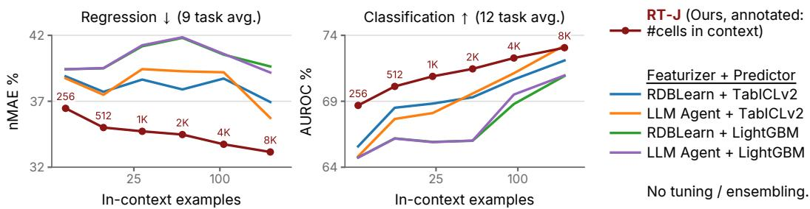  
Figure 3: RT-J vs baselines on the full RelBench test splits. On regression (left), RT-J dominates baselines at every label count, by up to 5.0 nMAE points over the strongest one. On classification (right), RT-J leads by up to 3.1 AUROC points. Per-task plots are in Appendix J.

Setup. For every task, we sweep the test-time context size L ∈ {256, 512, 1024, 2048, 4096, 8192} cells for RT-J, holding all other context hyperparameters fixed, ensuring that the 256-cell context is a subset of the 512-cell context and so on. For a fair label-matched evaluation of the baselines, we extract the task rows from the context prepared for RT-J, but do not further constrain the feature extraction or processing from the source database. Any checkpoint selection or hyperparameter tuning is done on the validation split, and all numbers are reported on the full test splits.

On regression, RT-J beats every baseline at every context size, by 2.3–5.0 nMAE points (see Figure 3). It is also far more example-efficient: with 15 in-context examples it already beats the best error any baseline reaches with 225, and the strongest pipeline needs around 2300 examples, 10× more, to surpass it. Since all methods see the same examples, we hypothesize that the gap comes from RT-J better exploiting the relational context around them, which baselines flatten into a set of features. On classification, RT-J leads by 3.1 AUROC points when examples are scarcest, but the baselines improve steeply with more examples and the strongest catches up at the rightmost end. Among the baselines, the predictor matters more than the featurizer: TabICLv2 beats LightGBM at every context size on both metrics, while LLM Agent and RDBLearn features perform similarly.

## 5.2 Impact of synthetic and real pretraining phases

Setup. We isolate the contribution of each pretraining phase by comparing three RT models with the same architecture: randomly initialized RT, RT-PluRel (PluRel phase only) and RT-J (PluRel followed by THE JOIN), on both fine-tuning and in-context learning regimes. These pipelines include test-time scaling (Section 6) and reflect our submissions to the official RelBench leaderboard. Appendix A details both pipelines and reports per-task results.

Observations. Table 1 shows the results. Synthetic pretraining on PluRel improves fine-tuning over a randomly initialized RT by 1.7 nMAE and 0.8 AUROC points, and continued pretraining on THE JOIN adds 0.5 nMAE and 0.5 AUROC points on top. The real-data phase matters most in-context, where RT-J improves over RT-PluRel by 0.6 nMAE and 1.5 AUROC points.

## 6 Test-Time Compute Scaling

Considering the fixed context window of RT-J, choosing informative input cells for a predictive task becomes crucial. As the optimal context hyperparameters can be task dependent, and sampling cells with a particular configuration is inherently random, we employ (1) context tuning and (2) context ensembling as two complementary ways to improve predictions of RT-J. The compute, time and label overheads of tuning and ensembling approaches are compared in Appendix J. Here we use a subsampled test set for computational feasibility.

Table 1: Regression nMAE and classification AUROC on RelBench for RT models with no pretraining (RT), synthetic-only pretraining (RT-PluRel) and synthetic + real pretraining (RT-J), for both finetuning and in-context learning settings.
<table><tr><td colspan="2"></td><td colspan="2">Fine-tuned</td><td colspan="2">In-context</td></tr><tr><td>Model</td><td>Pretraining data</td><td>nMAE %↓</td><td>AUROC % ↑</td><td>nMAE %↓</td><td>AUROC % ↑</td></tr><tr><td>RT</td><td>none (random init)</td><td>29.3</td><td>77.8</td><td></td><td></td></tr><tr><td>RT-PluRel</td><td>PluRel</td><td>27.6</td><td>78.5</td><td>32.9</td><td>73.0</td></tr><tr><td>RT-J</td><td>PluRel → THE JOIN</td><td>27.1</td><td>79.0</td><td>32.4</td><td>74.5</td></tr></table>

## 6.1 Context hyperparameter tuning

Intuitively, during inference with RT-J, different tasks might prioritize width vs. depth of BFS, local vs. global neighborhoods, and recent vs. long-term patterns differently. We therefore tune $( L , \ell , b , \rho )$ separately for each task on its validation split and apply the best configuration on the test split. The full protocol and the selected per-task configurations are given in Table 13 (Appendix J).

Observations. From Figure 4, we notice that context tuning is primarily useful for regression. With a single context seed, it reduces mean nMAE from 33.4 to 32.5, and improves eight of the nine regression tasks. The largest gains occur on rel-trial/site-success $\mathsf { \bar { ( 9 1 . 0 \to 8 8 . 6 ) } }$ and on rel-hm/item-sales $( 1 4 . 0  1 1 . 8 )$ , the latter by selecting a smaller 512-cell context. For classification, tuning hurts a single seed on average $( \mathrm { 7 2 . 9 }  \mathrm { 7 2 . 4 } \mathrm { A U R O C } )$ , as the validation choice transfers to test on only five of twelve tasks (Table 13 in Appendix J). Moreover, among the selected configurations, three of nine regression tasks (rel-amazon/item-ltv, rel-amazon/user-ltv, rel-hm/item-sales) and four of twelve classification tasks (rel-avito/user-visits, rel-event/user-ignore, rel-event/user-repeat, rel-stack/user-engagement) prefer a context with $L < 8 1 9 2$ cells.

## 6.2 Context ensembling

Both the random-walk retrieval and the bounded-width local BFS stages of our context sampler are stochastic, with different random seeds yielding different yet equally viable contexts. Context ensembling simply averages the predictions made from $n _ { \mathrm { e n s } }$ independently sampled contexts. Ensembling reduces prediction noise due to retrieval by averaging over contexts and can be computed in parallel across $n _ { \mathrm { e n s } }$ . We sweep over $n _ { \mathrm { e n s } } \in \{ 1 , 2 , 4 , 8 , 1 6 \}$ using different sampler seeds with a default configuration of $L = 8 1 9 2 , \ell = 2 5 6 , b = 3 2 , \rho = 1$ and showcase the benefits.

Observations. Figure 4 shows the results. With the per-task-tuned configuration, increasing $n _ { \mathrm { e n s } }$ from 1 to 16 yields a +1.3 AUROC point aggregate gain for classification tasks, while at the default context it is slightly lower at +1.1 AUROC points. Regression tasks show smaller but consistent improvements (0.2 nMAE points on average at the default context). Based on the per-task curves in Appendix J, the largest default-context gains accrue to rel-trial/study-outcome with +5.3, rel-event/user-repeat with +2.6 and rel-hm/user-churn with an improvement of +2.4 AUROC points from $n _ { \mathrm { e n s } } { = } 1$ to 16, while rel-avito/user-clicks degrades by 3.0 AUROC points. On regression tasks the gains top out at 0.7 nMAE points on rel-event/user-attendance.

## 7 Ablation Studies

Here we isolate the impact of the key components of our recipe. The schema-semantics (Section 7.1) and context-retrieval (Section 7.2) ablations swap a single component of the full RT-J pipeline at inference time, evaluated on a fixed 8192-row subsampled test set per task. Table 2 summarizes the gain from various components. More pretraining ablations are in Appendix H.

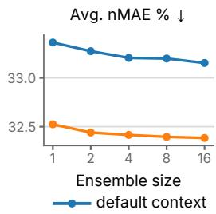

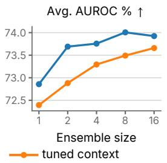

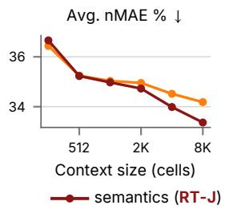

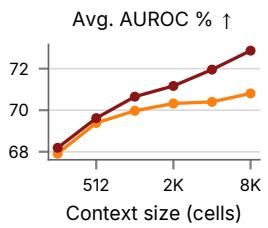

Figure 4: Context ensembling at test time, for the default (L = 8192 cell) and per-task-tuned contexts. Ensembling improves both metrics for both configurations. Per-task plots are in Appendix J.  
Figure 5: Schema-semantics ablation. Shuffling table and column names at evaluation degrades results increasingly with context. Per-task plots are in Appendix J.  
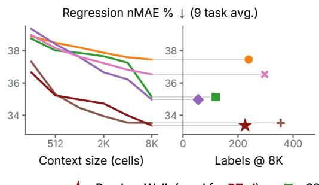

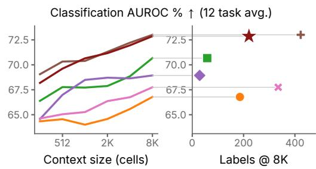  
Figure 6: Context-retrieval ablation with each retriever being swapped into the pretrained RT-J at inference time. Within each metric group, the left panel plots the metric against context size L and the right panel plots it against the mean number of in-context labeled task rows delivered at L = 8192. Our random-walk variant (red) is the strongest retriever on regression at small L and within 0.8 nMAE and 0.9 AUROC of the best at every L. Per-task plots are in Appendix J.

## 7.1 Schema semantics

RT-J consumes language model (LM) embeddings of table/column names in addition to cell values (see also the cell embedding design in Appendix F). Figure 5 shows a comparison with and without such semantics, where semantics are removed by shuffling table/column names at evaluation time.

Observations. Shuffling table/column names degrades classification at every point of the sweep, by up to 2.1 AUROC points, and regression by up to 0.8 nMAE points. Notably, the gap widens with more in-context examples, which suggests that schema text provides prior information that the examples do not replace. These observations highlight that RT-J has evidently absorbed world knowledge attached to real table and column names during pretraining on THE JOIN.

## 7.2 Alternatives to random-walk retrieva

We compare our random-walk retrieval approach (Section 4) against five alternatives at inference: uniformly random task-row selection, BFS of width {32, 256} rooted at the target (the original scheme of [23]), and two vector-similarity retrievers that score task rows by RDBLearn features or RT-J embeddings. In particular, the RT-J embedding of a task row is the final hidden state at its masked target cell, computed over a 256-cell BFS context around the row. Both similarity retrievers rank labeled task rows dated before the target by cosine similarity and use them, in that order, as seeds for the same local BFS as random-walk retrieval.

Observations. Figure 6 shows that our random walk approach and similarity search over RD-BLearn’s precomputed features are well ahead of the other retrievers and effectively tie at L = 8192 (33.4 versus 33.5 nMAE and 72.9 versus 73.0 AUROC). Random walk leads regression at the two smallest contexts $( L = 2 5 6$ , by 0.7 nMAE, and $L = 5 1 2 )$ and again at $L = \bar { 8 } 1 9 2$ , whereas the similarity retriever is ahead by 0.4–0.8 nMAE at $L = 1 0 2 4 – 4 0 9 6$ and by at most 0.9 AUROC.

Table 2: Summary of gains, in nMAE (regression) and AUROC (classification) points.
<table><tr><td>Comparison</td><td>Reg.</td><td>Clf.</td><td>Comparison</td><td>Reg.</td><td>Clf.</td></tr><tr><td>Pretraining data</td><td></td><td></td><td>Context retrieval</td><td></td><td></td></tr><tr><td>RT-J vs. RT-PluRel</td><td>+0.6</td><td>+1.5</td><td>random walk vs. width-256 BFS</td><td>+1.6</td><td>+3.9</td></tr><tr><td>THE JoIN-only vs. PluRel-only</td><td>+1.8</td><td>+2.8</td><td>random walk vs. uniform random</td><td>+4.1</td><td>+6.1</td></tr><tr><td>Test-time compute</td><td></td><td></td><td></td><td></td><td></td></tr><tr><td>tuned vs. default context</td><td>+0.8</td><td>-0.5</td><td>16 context ensemble vs. 1 context</td><td>+0.2</td><td>+1.1</td></tr></table>

The scatter panels in Figure 6 separate label count from label relevance. RDBLearn-feature similarity packs the most labels into the context (394) and reaches parity with random walk performance (that uses 223 labels at $L = 8 1 9 2 )$ . However, uniform random selection retrieves a similar count (208) and trails by 4.1 nMAE and 6.1 AUROC. RT-J-embedding similarity stays 2.3–3.2 nMAE and 3.6–5.4 AUROC behind random walk at every L, yet similarity over RDBLearn’s engineered features keeps improving with L, highlighting the importance of the embedding quality for ranking relevant task rows. The two BFS variants are restricted to their fixed local neighborhoods and come only within 1.6–1.8 nMAE of random walk with 2.7–5.6× fewer labels (84 and 40) respectively. Overall, our random walk retriever sits at the label-efficient end of this trade-off as it does not need per-task feature pipelines that RDBLearn requires, while providing higher-quality contexts for predictions.

## 8 Discussion and Conclusion

Our results show that RT-J can make accurate predictions on new datasets with as few as a hundred examples, in a single forward pass. This makes it practical to solve a wide range of predictive tasks without building dedicated feature engineering pipelines, or relying on extensive labeled data. Examples include flagging likely churn or fraud in a small-scale enterprise without a large customer base; predicting outcomes of novel clinical trials with small cohorts; and answering one-off predictive questions from an analyst. RT-J could be exposed directly in the database system, allowing users to request quick ad-hoc forecasts without an expensive labeling step. It could also be offered as a tool for LLM agents to call when a question requires predicting an unknown value, unlike transforming existing ones with SQL. THE JOIN is a first step toward capturing the immense diversity of real-world applications of relational foundation models (RFMs) like RT-J. Beyond synthetic pretraining corpora prevalent for structured data foundation models, THE JOIN offers hundreds of real databases across science, healthcare, finance, sports, etc., with semantically meaningful predictive tasks spanning rare-event, cold-start, heavy-tailed and long-horizon regimes.

Conclusion. We developed a pretraining recipe for relational transformers (RTs) [23] with longcontext training, random-walk retrieval of high-quality in-context examples, and test-time compute scaling via context tuning and ensembling. With this recipe, we obtain RT-J by first pretraining on PluRel [26] synthetic data and then on THE JOIN, our large-scale real data corpus. RT-J matches strong feature engineering pipelines with as much as 10× fewer examples. Experiments highlight the role of real data pretraining, schema semantics and context engineering. Our work moves RFMs closer to practical systems that can solve novel predictive tasks over databases on the fly.

Limitations and future work. RT-J has been trained up to 8,192 context cells; future work can explore efficient longer context training, which would allow both for more in-context examples, and larger relational contexts for them. RT-J is unable to solve link prediction and recommendation tasks, sharing this limitation with RT [23]. Our evaluation is limited to RelBench, with only 21 tasks on 7 databases—inspired by THE JOIN, future work can expand the scope of real-world relational benchmarks. We release (1) the RT-PluRel and RT-J models, (2) THE JOIN data, (3) the LLM agent task curation pipeline, and (4) our pretraining, finetuning and inference code at star-project.stanford.edu/rt-j, hoping to accelerate future research and adoption of RFMs.

## Acknowledgments and Disclosure of Funding

We thank Anvita Gupta, Joe Meyer, Johannes Hoffart, Jonas De Schouwer, Lata Nair, Mahmoud Mohammadi, Marcel Roed, Mark Znidar, Matthias Fey, Michael Bereket, Rok Sosic, Ryan Welch, Valter Hudovernik, Vijay Prakash Dwivedi, Viswa Ganapathy, Yanay Rosen, and Yangyi Shen for discussions, feedback and support. We also gratefully acknowledge the support of NSF under Nos. CCF-1918940 (Expeditions), DMS-2327709 (IHBEM), IIS-2403318 (III); NIH under No. 1U24NS146314-01, Gates Foundation, Stanford Data Applications Initiative, Wu Tsai Neurosciences Institute, Stanford Institute for Human-Centered AI, Chan Zuckerberg Initiative, Amazon, Genentech, SAP, and SCBX. The content is solely the responsibility of the authors and does not necessarily represent the official views of the funding entities.

## References

[1] Rishi Bommasani et al. On the opportunities and risks of foundation models, 2022. URL https://arxiv.org/abs/2108.07258.

[2] Ce Zhou, Qian Li, Chen Li, Jun Yu, Yixin Liu, Guangjing Wang, Kai Zhang, Cheng Ji, Qiben Yan, Lifang He, et al. A comprehensive survey on pretrained foundation models: A history from bert to chatgpt. International Journal ofMachine Learning and Cybernetics, pages 1–65, 2024.

[3] Tom Brown, Benjamin Mann, Nick Ryder, Melanie Subbiah, Jared D Kaplan, Prafulla Dhariwal, Arvind Neelakantan, Pranav Shyam, Girish Sastry, Amanda Askell, Sandhini Agarwal, Ariel Herbert-Voss, Gretchen Krueger, Tom Henighan, Rewon Child, Aditya Ramesh, Daniel Ziegler, Jeffrey Wu, Clemens Winter, Chris Hesse, Mark Chen, Eric Sigler, Mateusz Litwin, Scott Gray, Benjamin Chess, Jack Clark, Christopher Berner, Sam McCandlish, Alec Radford, Ilya Sutskever, and Dario Amodei. Language models are few-shot learners. In H. Larochelle, M. Ranzato, R. Hadsell, M.F. Balcan, and H. Lin, editors, Advances in Neural Information Processing Systems, volume 33, pages 1877–1901. Curran Associates, Inc., 2020. URL https://proceedings.neurips.cc/paper\_files/paper/2020/file/ 1457c0d6bfcb4967418bfb8ac142f64a-Paper.pdf.

[4] Jean-Baptiste Alayrac, Jeff Donahue, Pauline Luc, Antoine Miech, Iain Barr, Yana Hasson, Karel Lenc, Arthur Mensch, Katherine Millican, Malcolm Reynolds, Roman Ring, Eliza Rutherford, Serkan Cabi, Tengda Han, Zhitao Gong, Sina Samangooei, Marianne Monteiro, Jacob Menick, Sebastian Borgeaud, Andrew Brock, Aida Nematzadeh, Sahand Sharifzadeh, Mikolaj Binkowski, Ricardo Barreira, Oriol Vinyals, Andrew Zisserman, and Karen Simonyan. Flamingo: a visual language model for few-shot learning. In Advances in Neural Information Processing Systems, volume 35, pages 23716–23736, 2022.

[5] Liane Vogel, Benjamin Hilprecht, and Carsten Binnig. Towards foundation models for relational databases [vision paper]. In NeurIPS 2022 First Table Representation Workshop, 2022.

[6] Matthias Fey, Weihua Hu, Kexin Huang, Jan Eric Lenssen, Rishabh Ranjan, Joshua Robinson, Rex Ying, Jiaxuan You, and Jure Leskovec. Position: Relational deep learning - graph representation learning on relational databases. In Forty-first International Conference on Machine Learning, 2024.

[7] Tianlang Chen, Charilaos Kanatsoulis, and Jure Leskovec. RelGNN: Composite message passing for relational deep learning. In Forty-second International Conference on Machine Learning, 2025.

[8] Vijay Prakash Dwivedi, Sri Jaladi, Yangyi Shen, Federico López, Charilaos I. Kanatsoulis, Rishi Puri, Matthias Fey, and Jure Leskovec. Relational graph transformer, 2025. URL https://arxiv.org/abs/2505.10960.

[9] Jakub Peleška and Gustav Šír. Transformers meet relational databases, 2024. URL https: //arxiv.org/abs/2412.05218.

[10] Matthias Fey, Vid Kocijan, Federico Lopez, Jan Eric Lenssen, and Jure Leskovec. Kumorfm: A foundation model for in-context learning on relational data, 2025.

[11] Valter Hudovernik, Federico López, Vid Kocijan, Akihiro Nitta, Jan Eric Lenssen, Jure Leskovec, and Matthias Fey. KumoRFM-2: Scaling foundation models for relational learning, 2026. URL https://arxiv.org/abs/2604.12596.

[12] Tianqi Chen and Carlos Guestrin. Xgboost: A scalable tree boosting system. In Proceedings of the 22nd ACM SIGKDD International Conference on Knowledge Discovery and Data Mining, pages 785–794, 2016.

[13] Hoang Thanh Lam, Beat Buesser, Hong Min, Tran Ngoc Minh, Martin Wistuba, Udayan Khurana, Gregory Bramble, Theodoros Salonidis, Dakuo Wang, and Horst Samulowitz. Automated data science for relational data. In 2021 IEEE 37th International Conference on Data Engineering (ICDE), pages 2689–2692. IEEE, 2021.

[14] Ravid Shwartz-Ziv and Amitai Armon. Tabular data: Deep learning is not all you need. Information Fusion, 81:84–90, 2022.

[15] Léo Grinsztajn, Klemens Flöge, Oscar Key, Felix Birkel, Philipp Jund, Brendan Roof, Mihir Manium, Shi Bin Hoo, Magnus Bühler, Anurag Garg, Dominik Safaric, Jake Robertson, Benjamin Jäger, Simone Alessi, Adrian Hayler, Vladyslav Moroshan, Lennart Purucker, Philipp Singer, Alan Arazi, Julien Siems, Jan Hendrik Metzen, Georg Grab, Nick Erickson, Siyuan Guo, Eliott Kalfon, Simon Bing, David Salinas, Clara Cornu, Lilly Charlotte Wehrhahn, Diana Kriuchkova, Kursat Kaya, Lydia Sidhoum, Marie Salmon, Jerry Chen, Madelon Hulsebos, Yann LeCun, Samuel Müller, Bernhard Schölkopf, Sauraj Gambhir, Noah Hollmann, and Frank Hutter. Tabpfn-3: Technical report, 2026. URL https://arxiv.org/abs/2605.13986.

[16] Benjamin Jäger, Nick Erickson, Léo Grinsztajn, Felix Birkel, Klemens Flöge, Oscar Key, Kür¸sat Kaya, Jonas Kübler, Adèle Frankel, Tobias Schröder, Anurag Garg, Jan Hendrik Metzen, David Salinas, Simon Bing, Kristina Collins, Tuana Çelik, Vahid Balazadeh, Lydia Sidhoum, Tomás Pereda, Brendan Roof, Andrej Tschalzev, Siyuan Guo, Philipp Singer, Lennart Purucker, Jake Robertson, Marie Salmon, Philipp Jund, Jerry Chen, Diana Kriuchkova, Arthur Cahu, Eliott Kalfon, Adrian Hayler, Georg Grab, Vitor Monteiro, Lilly Wehrhahn, Dominik Safaric, Clara Cornu, Alan Arazi, Rylee Grace, Simone Alessi, Mihir Manium, Bernhard Schölkopf, Yann LeCun, Madelon Hulsebos, Sauraj Gambhir, Noah Hollmann, and Frank Hutter. Tabpfn-3.5: Technical report, 2026. URL https://arxiv.org/abs/2609.17895.

[17] Noah Hollmann, Samuel Müller, Katharina Eggensperger, and Frank Hutter. TabPFN: A transformer that solves small tabular classification problems in a second. In The Eleventh International Conference on Learning Representations, 2023.

[18] Noah Hollmann, Samuel Müller, Lennart Purucker, Arjun Krishnakumar, Max Körfer, Shi Bin Hoo, Robin Tibor Schirrmeister, and Frank Hutter. Accurate predictions on small data with a tabular foundation model. Nature, 637(8045):319–326, 2025.

[19] Jingang QU, David Holzmüller, Gaël Varoquaux, and Marine Le Morvan. TabICL: A tabular foundation model for in-context learning on large data. In Forty-second International Conference on Machine Learning, 2025.

[20] Jingang Qu, David Holzmüller, Gaël Varoquaux, and Marine Le Morvan. TabICLv2: A better, faster, scalable, and open tabular foundation model, 2026.

[21] Yanlin Zhang, Linjie Xu, Quan Gan, David Wipf, and Minjie Wang. RDBLearn: Simple in-context prediction over relational databases, 2026. URL https://arxiv.org/abs/2602. 18495.

[22] Yanbo Wang, Xiyuan Wang, Quan Gan, Minjie Wang, Qibin Yang, David Wipf, and Muhan Zhang. Griffin: Towards a graph-centric relational database foundation model. In Forty-second International Conference on Machine Learning, 2025.

[23] Rishabh Ranjan, Valter Hudovernik, Mark Znidar, Charilaos I. Kanatsoulis, Roshan Upendra, Mahmoud Mohammadi, Joe Meyer, Tom Palczewski, Carlos Guestrin, and Jure Leskovec. Relational transformer: Toward zero-shot foundation models for relational data. In The Fourteenth International Conference on Learning Representations, 2026.

[24] Justin Gu, Rishabh Ranjan, Charilaos Kanatsoulis, Haiming Tang, Martin Jurkovic, Valter Hudovernik, Mark Znidar, Pranshu Chaturvedi, Parth Shroff, Fengyu Li, et al. Relbench v2: A large-scale benchmark and repository for relational data. arXiv preprint arXiv:2602.12606, 2026.

[25] Jan Motl and Oliver Schulte. The ctu prague relational learning repository. arXiv preprint arXiv:1511.03086, 2015.

[26] Vignesh Kothapalli, Rishabh Ranjan, Valter Hudovernik, Vijay Prakash Dwivedi, Johannes Hoffart, Carlos Guestrin, and Jure Leskovec. Plurel: Synthetic data unlocks scaling laws for relational foundation models. In Forty-third International Conference on Machine Learning, 2026. URL https://openreview.net/forum?id=rM9r9qyRSA.

[27] Adrian Hayler, Klemens Flöge, Alan Arazi, Rishabh Ranjan, Jure Leskovec, Felix Birkel, Brendan Roof, Anurag Garg, Kristina Collins, Lydia Sidhoum, et al. Advancing open and reproducible relational learning: RelArena-α, TabPFN-Rel and RPI. arXiv preprint arXiv:2608.16319, 2026.

[28] Yanbo Wang, Jiaxuan You, Chuan Shi, and Muhan Zhang. Relational in-context learning via synthetic pre-training with structural prior. In Forty-third International Conference on Machine Learning, 2026. URL https://arxiv.org/abs/2603.03805.

[29] Joshua Robinson, Rishabh Ranjan, Weihua Hu, Kexin Huang, Jiaqi Han, Alejandro Dobles, Matthias Fey, Jan Eric Lenssen, Yiwen Yuan, Zecheng Zhang, et al. Relbench: A benchmark for deep learning on relational databases. Advances in Neural Information Processing Systems, 37:21330–21341, 2024.

[30] Jinyang Li, Binyuan Hui, Ge Qu, Jiaxi Yang, Binhua Li, Bowen Li, Bailin Wang, Bowen Qin, Ruiying Geng, Nan Huo, et al. Can llm already serve as a database interface? a big bench for large-scale database grounded text-to-sqls. Advances in Neural Information Processing Systems, 36:42330–42357, 2023.

[31] Tao Yu, Rui Zhang, Kai Yang, Michihiro Yasunaga, Dongxu Wang, Zifan Li, James Ma, Irene Li, Qingning Yao, Shanelle Roman, et al. Spider: A large-scale human-labeled dataset for complex and cross-domain semantic parsing and text-to-sql task. In Proceedings of the 2018 conference on empirical methods in natural language processing, pages 3911–3921, 2018.

[32] Fangyu Lei, Jixuan Chen, Yuxiao Ye, Ruisheng Cao, Dongchan Shin, Hongjin SU, ZHAOQING SUO, Hongcheng Gao, Wenjing Hu, Pengcheng Yin, Victor Zhong, Caiming Xiong, Ruoxi Sun, Qian Liu, Sida Wang, and Tao Yu. Spider 2.0: Evaluating language models on real-world enterprise text-to-SQL workflows. In The Thirteenth International Conference on Learning Representations, 2025.

[33] Minjie Wang, Quan Gan, David Wipf, Zhenkun Cai, Ning Li, Jianheng Tang, Yanlin Zhang, Zizhao Zhang, Zunyao Mao, Yakun Song, et al. 4dbinfer: A 4d benchmarking toolbox for graph-centric predictive modeling on rdbs. Advances in Neural Information Processing Systems, 37:27236–27273, 2024.

[34] Chantat Eksombatchai, Pranav Jindal, Jerry Zitao Liu, Yuchen Liu, Rahul Sharma, Charles Sugnet, Mark Ulrich, and Jure Leskovec. Pixie: A system for recommending 3+ billion items to 200+ million users in real-time. In Proceedings of the 2018 world wide web conference, pages 1775–1784, 2018.

[35] Rex Ying, Ruining He, Kaifeng Chen, Pong Eksombatchai, William L Hamilton, and Jure Leskovec. Graph convolutional neural networks for web-scale recommender systems. In Proceedings of the 24th ACM SIGKDD international conference on knowledge discovery & data mining, pages 974–983, 2018.

[36] Keller Jordan, Yuchen Jin, Vlado Boza, Jiacheng You, Franz Cesista, Laker Newhouse, and Jeremy Bernstein. Muon: An optimizer for hidden layers in neural networks, 2024. URL https://kellerjordan.github.io/posts/muon/.

[37] P Izmailov, AG Wilson, D Podoprikhin, D Vetrov, and T Garipov. Averaging weights leads to wider optima and better generalization. In 34th Conference on Uncertainty in Artificial Intelligence 2018, UAI 2018, pages 876–885, 2018.

[38] Rishabh Ranjan, Saurabh Garg, Mrigank Raman, Carlos Guestrin, and Zachary Lipton. Post-hoc reversal: Are we selecting models prematurely? Advances in Neural Information Processing Systems, 37:91460–91491, 2024.

[39] Guolin Ke, Qi Meng, Thomas Finley, Taifeng Wang, Wei Chen, Weidong Ma, Qiwei Ye, and Tie-Yan Liu. LightGBM: A highly efficient gradient boosting decision tree. In Advances in Neural Information Processing Systems, 2017.

[40] Charilaos I Kanatsoulis, Evelyn Choi, Stephanie Jegelka, Jure Leskovec, and Alejandro Ribeiro. Learning efficient positional encodings with graph neural networks. In The Thirteenth International Conference on Learning Representations, 2025.

[41] Vijay Prakash Dwivedi, Charilaos Kanatsoulis, Shenyang Huang, and Jure Leskovec. Relational deep learning: Challenges, foundations and next-generation architectures. In Proceedings of the 31st ACM SIGKDD Conference on Knowledge Discovery and Data Mining V. 2, pages 5999–6009, 2025.

[42] Marco Spinaci, Marek Polewczyk, Johannes Hoffart, Markus C. Kohler, Sam Thelin, and Tassilo Klein. Portal: Scalable tabular foundation models via content-specific tokenization, 2024. URL https://arxiv.org/abs/2410.13516.

[43] Myung Jun Kim, Leo Grinsztajn, and Gael Varoquaux. Carte: Pretraining and transfer for tabular learning. In International Conference on Machine Learning, pages 23843–23866. PMLR, 2024.

[44] Marek Wydmuch, Łukasz Borchmann, and Filip Gralinski. Tackling prediction tasks in relational´ databases with llms, 2024. URL https://arxiv.org/abs/2411.11829.

[45] Fang Wu, Vijay Prakash Dwivedi, and Jure Leskovec. Large language models are good relational learners, 2025. URL https://arxiv.org/abs/2506.05725.

[46] Jun Xia, Chengshuai Zhao, Bozhen Hu, Zhangyang Gao, Cheng Tan, Yue Liu, Siyuan Li, and Stan Z Li. Mole-bert: Rethinking pre-training graph neural networks for molecules. In The Eleventh International Conference on Learning Representations, 2023.

[47] Dominique Beaini, Shenyang Huang, Joao Alex Cunha, Zhiyi Li, Gabriela Moisescu-Pareja, Oleksandr Dymov, Samuel Maddrell-Mander, Callum McLean, Frederik Wenkel, Luis Müller, et al. Towards foundational models for molecular learning on large-scale multi-task datasets. In The Twelfth International Conference on Learning Representations, 2024.

[48] Qian Huang, Hongyu Ren, Peng Chen, Gregor Kržmanc, Daniel Zeng, Percy S Liang, and Jure Leskovec. Prodigy: Enabling in-context learning over graphs. Advances in Neural Information Processing Systems, 36:16302–16317, 2023.

[49] Jianan Zhao, Zhaocheng Zhu, Mikhail Galkin, Hesham Mostafa, Michael M Bronstein, and Jian Tang. Fully-inductive node classification on arbitrary graphs. In The Thirteenth International Conference on Learning Representations, 2025.

[50] Mikhail Galkin, Xinyu Yuan, Hesham Mostafa, Jian Tang, and Zhaocheng Zhu. Towards foundation models for knowledge graph reasoning. In The Twelfth International Conference on Learning Representations, 2024.

[51] Qifang Zhao, Weidong Ren, Tianyu Li, Hong Liu, Xingsheng He, and Xiaoxiao Xu. Graphgpt: Generative pre-trained graph eulerian transformer. In Forty-second International Conference on Machine Learning, 2025.

[52] Maya Bechler-Speicher, Yoel Gottlieb, Andrey Isakov, David Abensur, Ami Tavory, Daniel Haimovich, Ido Guy, and Udi Weinsberg. Billion-scale graph foundation models, 2026.

[53] Jingyuan Liu, Jianlin Su, Xingcheng Yao, Zhejun Jiang, Guokun Lai, Yulun Du, Yidao Qin, Weixin Xu, Enzhe Lu, Junjie Yan, Yanru Chen, Huabin Zheng, Yibo Liu, Shaowei Liu, Bohong Yin, Weiran He, Han Zhu, Yuzhi Wang, Jianzhou Wang, Mengnan Dong, Zheng Zhang, Yongsheng Kang, Hao Zhang, Xinran Xu, Yutao Zhang, Yuxin Wu, Xinyu Zhou, and Zhilin Yang. Muon is scalable for LLM training, 2025. URL https://arxiv.org/abs/2502. 16982.

[54] Changxin Tian, Jiapeng Wang, Qian Zhao, Kunlong Chen, Jia Liu, Ziqi Liu, Jiaxin Mao, Wayne Xin Zhao, Zhiqiang Zhang, and Jun Zhou. WSM: Decay-free learning rate schedule via checkpoint merging for LLM pre-training, 2025. URL https://arxiv.org/abs/2507. 17634.

[55] Craig Kapfer, Kurt Stine, Balasubramanian Narasimhan, Christopher Mentzel, and Emmanuel Candes. Marlowe: Stanford’s gpu-based computational instrument, January 2025. URL https://doi.org/10.5281/zenodo.14751899.

[56] Jacob Devlin, Ming-Wei Chang, Kenton Lee, and Kristina Toutanova. Bert: Pre-training of deep bidirectional transformers for language understanding. In Proceedings ofthe 2019 conference of the North American chapter of the association for computational linguistics: human language technologies, volume 1 (long and short papers), pages 4171–4186, 2019.

[57] Mingze Dong, Leda Wang, and Yuval Kluger. Understanding and enhancing mask-based pretraining towards universal representations. In Advances in Neural Information Processing Systems, 2025.

[58] Vignesh Kothapalli, Hamed Firooz, and Maziar Sanjabi. Cot-icl lab: A synthetic framework for studying chain-of-thought learning from in-context demonstrations. In Proceedings of the 63rd Annual Meeting of the Association for Computational Linguistics (Volume 1: Long Papers), pages 14620–14642, 2025.

[59] Vignesh Kothapalli, Ata Fatahibaarzi, Hamed Firooz, and Maziar Sanjabi. To think or not to think: The hidden cost of meta-training with excessive cot examples. In Proceedings ofthe 64th Annual Meeting of the Association for Computational Linguistics (Volume 1: Long Papers), pages 15619–15644, 2026.

## A Leaderboard Results

RelArena-α. RelArena-α [27] re-runs every submission on the 21 entity-level forecasting tasks of RelBench v1 under a single API, data state and evaluation protocol, and aggregates per-task results into Elo ratings. It separates models, tuned under a standardized, compute-matched tuning regime, from systems, which follow the same data states and evaluation but bring their own tuning protocol. Figure 7 reproduces the combined model + system leaderboard from Hayler et al. [27]. RT-PluRel, submitted as a system with its own sequential tuning regime, ranks first with an Elo of 1861, ahead of TabPFN-Rel (API) at 1826 and of all relational deep learning baselines (GraphSAGE, RelGT, RelGNN) and RDBLearn. RT-J was not part of this release.

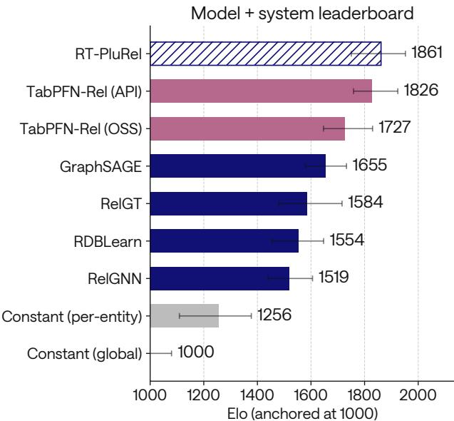  
<sup>baselines</sup> <sup>constant</sup> <sup>predictors</sup> <sup>system</sup> <sup>(hatched)</sup>Figure 7: Combined model + system leaderboard of RelArena-α, reproduced from Hayler et al. [27]: Elo over the 21 RelBench v1 forecasting tasks (anchored at 1000 for the global constant predictor). RT-PluRel (hatched) is a system submission with its own tuning protocol; TabPFN-Rel variants in pink, other baselines in blue, constant predictors in grey.

RelBench leaderboard. Table 3 lists the per-task and mean test metrics of the RT family on the RelBench leaderboard, both fine-tuned on each task and in-context. In-context, RT-J improves over RT-PluRel on both regression (32.35 vs. 32.95 nMAE) and classification (74.45 vs. 72.98 AUROC). The gains from THE JOIN carry over to fine-tuning, where RT-J again has the best means of the three RT models (27.11 nMAE and 79.02 AUROC, against 27.57 and 78.53 for RT-PluRel and 29.26 and 77.76 for RT). We detail the pipelines used for our submissions below.

Fine-tuning pipeline. Each model is fine-tuned separately on each of the 21 tasks in four stages. (1) A selection run trains on the train split for up to 50K steps, evaluating every 100 steps on 1024 validation rows with a 4-seed context ensemble and stopping after 10K steps without improvement. (2) A context search scores 96 context configurations $( \bar { L } , \ell , \bar { b } , \rho )$ with $L  \leq  1 0 2 4$ on 4096 validation rows. (3) A refit trains on train and validation together for the selected number of steps, scaled by the ratio of train-plus-validation to train rows. (4) The SWA weights of the refit predict the full test split under the selected context hyperparameters with an 8-seed context ensemble. RT-PluRel and RT-J train an additive delta on their frozen pretrained weights, whereas RT trains all weights from random initialization. All runs use Muon with learning rate $5 \times 1 0 ^ { - 4 }$ and weight decay 0.1, batches of 256 contexts of up to 1024 cells, binary cross-entropy for classification and L1 loss for regression.

In-context pipeline. The pretrained checkpoint is frozen, and no RelBench database is seen in pretraining. Per task, we score 120 context configurations $( L , \ell , b , \rho )$ with $L \ \leq \ 8 1 9 2$ on 4096 validation rows with a 4-seed context ensemble, then run each of the four best configurations with four context seeds on the full test split and average the 16 predictions per row.

Table 3: RT models on the RelBench leaderboard. Per-task test metrics of RT [23], RT-PluRel and RT-J, fine-tuned on each task or used in-context, as listed on the RelBench leaderboard. All metrics in percent. Best per row within each group in bold; lower is better for nMAE, higher is better for AUROC.
<table><tr><td colspan="2"></td><td colspan="3">Fine-tuned</td><td colspan="2">In-context</td></tr><tr><td>DB</td><td>Task</td><td>RT (rand init)</td><td>RT-PluRel</td><td>RT-J</td><td>RT-PluRel</td><td>RT-J</td></tr><tr><td colspan="7">Regression (nMAE %, lower is better)</td></tr><tr><td>rel-amazon</td><td>item-ltv</td><td>7.50</td><td>7.26</td><td>7.19</td><td>8.65</td><td>7.81</td></tr><tr><td>rel-amazon</td><td>user-ltv</td><td>24.15</td><td>24.58</td><td>24.29</td><td>29.60</td><td>29.14</td></tr><tr><td>rel-avito</td><td>ad-ctr</td><td>38.53</td><td>37.86</td><td>36.03</td><td>41.71</td><td>42.01</td></tr><tr><td>rel-event</td><td>user-attendance</td><td>32.52</td><td></td><td>31.64 31.63</td><td>43.78</td><td>42.69</td></tr><tr><td>rel-f1</td><td>driver-position</td><td>48.75</td><td>39.72</td><td>37.67</td><td>42.41</td><td>38.75</td></tr><tr><td>rel-hm</td><td>item-sales</td><td>7.75</td><td>7.53</td><td>7.57</td><td>11.44</td><td>10.11</td></tr><tr><td>rel-stack</td><td>post-votes</td><td>13.77</td><td>13.62</td><td>12.79</td><td>14.70</td><td>14.74</td></tr><tr><td>rel-trial</td><td>site-success</td><td>78.36</td><td>75.17</td><td>76.54</td><td>87.65</td><td>89.62</td></tr><tr><td>rel-trial</td><td>study-adverse</td><td>12.06</td><td>10.74</td><td>10.28</td><td>16.57</td><td>16.33</td></tr><tr><td>Mean</td><td></td><td>29.26</td><td>27.57</td><td>27.11</td><td>32.95</td><td>32.35</td></tr><tr><td colspan="7">Classification (AUROC %, higher is better)</td></tr><tr><td>rel-amazon item-churn</td><td></td><td>82.96</td><td>83.19</td><td>83.16</td><td>74.40</td><td>78.61</td></tr><tr><td>rel-amazon</td><td>user-churn</td><td>71.30</td><td>71.34</td><td>71.46</td><td></td><td>66.24 67.20</td></tr><tr><td>rel-avito</td><td>user-clicks</td><td>68.59</td><td>65.89</td><td>66.81</td><td></td><td>46.2051.39</td></tr><tr><td>rel-avito</td><td>user-visits</td><td>66.21</td><td>66.75</td><td>66.89</td><td>61.44</td><td>64.09</td></tr><tr><td>rel-event</td><td>user-ignore</td><td>81.41</td><td>80.85</td><td>85.61</td><td></td><td>76.7880.97</td></tr><tr><td>rel-event</td><td>user-repeat</td><td>78.97</td><td>80.29</td><td>79.84</td><td>77.65</td><td>79.12</td></tr><tr><td>rel-f1</td><td>driver-dnf</td><td>79.93</td><td>82.09</td><td>82.77</td><td>81.89</td><td>83.08</td></tr><tr><td>rel-f1</td><td>driver-top3</td><td>83.84</td><td>90.01</td><td>91.71</td><td>89.69</td><td>91.00</td></tr><tr><td>rel-hm</td><td>user-churn</td><td>70.24</td><td>70.61</td><td>70.49</td><td>65.77</td><td>65.66</td></tr><tr><td>rel-stack</td><td>user-badge</td><td>89.33</td><td>89.25</td><td>89.21</td><td>83.78</td><td>81.11</td></tr><tr><td>rel-stack</td><td></td><td>90.74</td><td>90.91</td><td>90.65</td><td>87.86</td><td>86.76</td></tr><tr><td>rel-trial</td><td>user-engagement</td><td>69.55</td><td>71.21</td><td>69.57</td><td>64.08</td><td>64.43</td></tr><tr><td></td><td>study-outcome</td><td>77.76</td><td>78.53</td><td>79.02</td><td>72.98</td><td>74.45</td></tr><tr><td colspan="7">Mean</td></tr></table>

## B Other Relational Foundation Models

Beyond the pipelines of Section 5, we looked into comparing RT-J with recent relational foundation models (RFMs), but none could be evaluated under our protocol, in which every method sees the same in-context examples.

KumoRFM [10]: closed weights, and API access does not allow controlling the in-context examples, precluding a fair comparison.

KumoRFM-2 [11]: closed weights. API access was released only a few weeks before our submission deadline, and no longer works due to the ongoing migration of Kumo to NVIDIA.

Griffin [22]: the released checkpoints are incapable of in-context learning, and pretraining Griffin with our recipe is not feasible, as the recipe is engineered around transformer-based architectures, which Griffin is not.

RDB-PFN [28]: supports only classification tasks, whereas our evaluation covers both regression and classification.

TabPFN-Rel with TabPFN-3 and TabPFN-3.5 [15, 16]: released after submission.

## C Related Work

Relational deep learning and benchmarks. Relational deep learning (RDL) is a machine learning paradigm that operates directly on relational databases, avoiding the need to manually flatten a database into a single feature table [6]. A common formulation represents a database as a heterogeneous relational entity graph: rows are nodes, tables define node types, and primary–foreign-key links define typed edges [29]. Graph neural networks can then propagate information across related rows and tables, enabling end-to-end prediction over multi-table data [7, 29]. Recent work has improved the efficiency and expressiveness of relational message passing [7], and transformer-based relational architectures have also been proposed [8, 9]. Kanatsoulis et al. [40] introduce an efficient positional encoding framework based on lightweight message-passing operations, providing structural features that have been shown to improve relational deep learning models. Broader surveys and position papers frame these models as part of a larger agenda for relational deep learning [41].

Benchmarking has been central to this progress. RelBench [29] introduced a standardized suite of relational prediction tasks, while 4DBInfer [33] and RelBench v2 [24] expand the scale and diversity of relational benchmarks, including broader task families and database domains. These benchmarks make it possible to compare relational models under realistic multi-table and temporal constraints.

Relational foundation models. Recent work has begun to develop foundation models specifically for relational data. These models seek to transfer across schemas and tasks rather than training a separate predictor for every database. KumoRFM and KumoRFM-2 study in-context learning for relational data at scale [10, 11]. Griffin develops a graph-centric relational foundation model for transfer across relational databases [22]. The Relational Transformer (RT) takes a complementary cell-level approach: database cells are treated as tokens, schema semantics are included in the input, and relational attention masks encode primary–foreign-key structure [23]. PluRel [26] enables RT pretraining with synthetic data. It synthesizes multi-table databases from scratch, including schemas, primary–foreign-key links, and feature distributions, enabling controlled studies of synthetic data scaling for relational foundation models.

Our work builds directly on RT because its cell-level formulation is well-suited to context-efficient relational prediction. Labeled task rows, unlabeled rows, schema metadata, and linked evidence can all appear in the same context window, making masked cell prediction a natural interface for both pretraining and inference. However, the original RT work primarily establishes a schema-agnostic architecture; it does not develop a scalable pretraining and inference recipe. We therefore use RT as the backbone and study how to make it effective when only a small number of in-context examples are available.

Tabular foundation models and relational tabularization. Tabular foundation models aim to bring pretraining and in-context learning to single-table prediction. TabPFN and its successors show that transformers can perform strong in-context prediction when labeled rows from a tabular task are provided in the context [17, 18]. More recent models, including TabICLv2 and other largescale tabular foundation models, extend this paradigm to larger datasets, richer feature spaces, and broader tabular distributions [19, 20, 42, 43]. These methods provide strong evidence that structured prediction can benefit from foundation-model-style training.

Relational databases, however, contain structure that is not present in ordinary single tables. Predictive evidence may lie several joins away from the target row, and the relevant signal may involve temporal histories, linked entities, or multi-hop dependencies. One way to use tabular foundation models in this setting is to first transform the database into a single feature table. RDBLearn follows this strategy by aggregating relational neighborhoods into engineered features and then applying a tabular in-context learner [21]. This approach is effective and provides a strong baseline, but the flattening step changes the input representation: the model no longer reasons directly over cells, schemas, timestamps, primary–foreign-key links, or multi-table structure.

Large language models for relational data. Another line of work applies large language models to structured and relational data by serializing tables or database neighborhoods into text [44]. This has the advantage of using powerful pretrained language models without designing a specialized architecture. However, serialization can be inefficient and brittle. Relational structure must be expressed as text, long database contexts can exceed the model context window, and the resulting input format may differ substantially from the data distribution seen during language-model pretraining. Hybrid approaches that combine graph or relational encoders with LLMs can partially address these issues, but they often still depend on task-specific components or limited context construction [45].

Graph foundation models. Several papers have paved the way toward graph foundation models. Mole-BERT [46] pretrains GNNs with masked atom prediction and triplet-based contrastive learning for node- and graph-level drug-discovery tasks. Beaini et al. [47] further show that molecular pretraining benefits from scale, using large multi-task datasets with billions of labels and demonstrating that combining quantum and biological supervision improves low-resource performance.

Recent work has extended pretraining graph models beyond molecules. PRODIGY [48] introduces prompt-based graph representations for in-context learning. GraphAny [49] studies zero-shot node classification across graphs with disjoint feature and label spaces, using LinearGNN ensembles and inductive attention inspired by linear least-squares estimation. ULTRA [50] learns transferable relational representations for zero-shot reasoning over unseen knowledge graphs. GraphGPT [51] converts graphs into reversible token sequences using Eulerian paths, enabling scalable generative Transformer pretraining for graph-structured data. Most recently, Bechler-Speicher et al. [52] scale the graph foundation model paradigm to heterogeneous billion-scale graphs, proposing a billionparameter Transformer architecture and a recipe for link prediction pretraining.

## D Additional Details on THE JOIN

## D.1 Agentic execution

Constructing THE JOIN corpus manually would require months of human engineering, particularly for web collection as each source presents different download mechanisms, file formats, schema conventions, parsing failures, and data-quality issues. We therefore used Claude Code agents as the execution layer for corpus construction. The agents identify and inspect candidate sources, implement and debug domain-specific collectors, adapt standardization routines to newly observed edge cases, run the pipeline, inspect logs and intermediate artifacts, and iterate until each stage reaches its completion criteria. The agents were used for engineering and orchestration, while task validation, scoring, filtering, baseline computation, loadability checks, and provenance tracking were performed by deterministic scripts based on human-defined criteria.

## D.2 Phase 1: Collection

Collecting from heterogeneous sources. The first phase builds a raw relational snapshot from a broad set of public data sources. This is difficult to automate with a single scraper because different sources expose data in very different ways: as SQL dumps, SQLite databases, CSV bundles, parquet or JSON exports, archive mirrors, or paginated APIs. We therefore use source-specific collectors. Each collector downloads the data, parses it in its native format, recovers table and key metadata when available, and converts the result into a common parquet-based representation. We also exclude databases that exactly overlap with established benchmark sources in RelBench, RelBench v2 and 4DBInfer, using source identity rather than schema similarity as the criterion.

Respecting upstream constraints. The collectors are designed to be reproducible while remaining respectful of the sources. API-based collectors follow the documented rate limits and include the required identifying information. Bulk-download sources are handled at the archive level, and for sources that publish periodic snapshots, the refresh cadence of our corpus is limited by the cadence of the upstream release.

Normalizing the collected data. Before any database is passed to later stages, the collector performs basic normalization. For example, (1) primary and foreign keys are converted to integer indices, (2) timestamps and booleans are stored in consistent types, and (3) mixed-type columns are either normalized or rejected. We also store primary-key, foreign-key, and time-column metadata alongside each Parquet table, so that downstream stages do not rely on source-specific assumptions. Table 4 lists the domains included in the corpus.

Table 4: Per-domain corpus breakdown across all collected domains, grouped by italic subject-area headers and sorted by descending DB count. DBs: raw count. The License(s) and Ref. cells list one (license, reference) pair per line with rows aligning across the two columns.
<table><tr><td>Domain</td><td>Source</td><td>DBs</td><td>License(s)</td><td>Ref.</td></tr><tr><td colspan="5">Commerce &amp; Online Platforms</td></tr><tr><td rowspan="5">tech community</td><td rowspan="5">Stack Exchange / GH Archive / HN</td><td>75</td><td>CC BY 4.0 Open public API</td><td>gharchive.org hn.algolia.com</td></tr><tr><td></td><td>CC BY-SA 4.0</td><td>archive.org</td></tr><tr><td>Amazon / MovieLens / IMDb / 34</td><td>MIT (Amazon ToS)</td><td>github.com</td></tr><tr><td></td><td>Research-use</td><td>data.imdb.com</td></tr><tr><td></td><td>Research-use</td><td>cseweb.ucsd.edu</td></tr><tr><td rowspan="7"></td><td rowspan="7"></td><td>Research-use</td><td></td><td>grouplens.org</td></tr><tr><td></td><td>Research-use</td><td>grouplens.org</td></tr><tr><td></td><td>Public Domain</td><td></td></tr><tr><td></td><td>CC BY 4.0</td><td>research.gov</td></tr><tr><td></td><td></td><td>archive.ics.uci.edu</td></tr><tr><td>2</td><td>ToS-restricted</td><td>manifold.markets</td></tr><tr><td></td><td>ToS-restricted</td><td>polymarket.com</td></tr><tr><td>ecommerce</td><td>RecSys Challenge 2015 Open Food Facts</td><td></td><td>CC BY-NC-ND 4.0</td><td>kaggle.com</td></tr><tr><td>consumer product</td><td>Food.com (Kaggle)</td><td>ODbL</td><td></td><td>world.openfoodfacts.org</td></tr><tr><td>food reviews real estate</td><td>Zillow Research</td><td></td><td>Kaggle ToS</td><td>kaggle.com</td></tr><tr><td>Sports, Culture &amp; Media</td><td></td><td></td><td>Research-use</td><td>zillow.com</td></tr><tr><td rowspan="7">motorsport MotoGP</td><td rowspan="7">Wikipedia / Racing-Reference /</td><td></td><td></td><td></td></tr><tr><td>9</td><td>CC BY-SA 4.0 CC BY-SA 4.0</td><td>en.wikipedia.org</td></tr><tr><td>CC BY-SA 4.0</td><td></td><td>en.wikipedia.org</td></tr><tr><td>CC BY-SA 4.0</td><td></td><td>racing-reference.info</td></tr><tr><td></td><td></td><td>en.wikipedia.org</td></tr><tr><td></td><td>Public unofficial API</td><td>motogp.com</td></tr><tr><td>CC BY-SA 4.0</td><td>Research-use</td><td>racing-reference.info en.wikipedia.org</td></tr><tr><td rowspan="6">sports</td><td rowspan="6">ATP / Cricsheet / Lahman / Stats- Bomb / OpenFlights / PKDD</td><td>6</td><td>CC BY-NC-SA 4.0</td><td>github.com</td></tr><tr><td></td><td>Research-use</td><td>relational.fel.cvut.cz</td></tr><tr><td>CC0</td><td></td><td>cricsheet.org</td></tr><tr><td>CC BY-SA 3.0</td><td></td><td>sabr.org</td></tr><tr><td>ODbL</td><td></td><td>openflights.org</td></tr><tr><td>Research-use</td><td></td><td>github.com</td></tr><tr><td rowspan="4">food</td><td rowspan="4">SNAP / Open Food Facts / USDA</td><td>4</td><td>Research-use</td><td>snap.stanford.edu</td></tr><tr><td>Research-use</td><td></td><td>snap.stanford.edu</td></tr><tr><td>ODbL</td><td></td><td>world.openfoodfacts.org</td></tr><tr><td></td><td>Public Domain</td><td>fdc.nal.usda.gov</td></tr><tr><td rowspan="3">music</td><td rowspan="3">FMA / Last.fm / ListenBrainz</td><td>3</td><td>CC BY 4.0</td><td>github.com</td></tr><tr><td>Research-use</td><td></td><td>grouplens.org</td></tr><tr><td>CC0 CCO</td><td></td><td>listenbrainz.org</td></tr><tr><td rowspan="3">museum</td><td rowspan="3">Met / MoMA / Tate</td><td></td><td></td><td>github.com</td></tr><tr><td>CCO</td><td></td><td>github.com</td></tr><tr><td>CCO</td><td></td><td>github.com</td></tr><tr><td rowspan="3"></td><td rowspan="3"></td><td>EVE Online / Lichess / Steam 3</td><td>Open public API</td><td>developers.eveonline.com</td></tr><tr><td>CCO Research-use</td><td></td><td>database.lichess.org cseweb.ucsd.edu</td></tr><tr><td>CCO</td><td></td><td></td></tr><tr><td rowspan="2">cultural surveys</td><td rowspan="2">D-PLACE / Pew</td><td>2</td><td></td><td>europeana.eu</td></tr><tr><td>CCO CC BY 4.0</td><td></td><td>wikidata.org d-place.org</td></tr><tr><td></td><td></td><td></td><td>Public-use data (Pew)</td><td>pewresearch.org</td></tr><tr><td>podcast history</td><td>Apple Podcasts (Kaggle) Chronicling America</td><td>1</td><td>CC BY-NC-SA 4.0</td><td>kaggle.com chroniclingamerica.loc.gov</td></tr><tr><td colspan="5">Government, Finance &amp; Energy</td></tr><tr><td>government us /NHTSA</td><td>BTS / FDA / FDIC / FEC / HMDA</td><td>11 Public Domain</td><td></td><td>usa.gov</td></tr><tr><td rowspan="7">energy</td><td rowspan="7">BOEM / Ember / OPSD / PHMSA / Sodir</td><td>6</td><td>Public Domain</td><td>data.boem.gov</td></tr><tr><td>CC BY 4.0</td><td></td><td>github.com</td></tr><tr><td>CC BY 4.0</td><td></td><td>ember-energy.org</td></tr><tr><td>CC BY 4.0</td><td></td><td>open-power-system-data.org</td></tr><tr><td></td><td>Public Domain</td><td>phmsa.dot.gov</td></tr><tr><td>NLOD</td><td></td><td>norge.no</td></tr><tr><td></td><td>Eurostat re-use</td><td>ec.europa.eu</td></tr><tr><td rowspan="4">international</td><td rowspan="4">World Bank</td><td>Eurostat / GDELT / UNHCR / 4</td><td></td><td>gdeltproject.org</td></tr><tr><td>Open (attribution) CC BY 4.0</td><td></td><td>unhcr.org</td></tr><tr><td>CC BY 4.0</td><td></td><td>datacatalog.worldbank.org</td></tr><tr><td>Public Domain</td><td></td><td>consumerfinance.gov</td></tr><tr><td rowspan="2">politics</td><td rowspan="2"></td><td>2</td><td></td><td>sec.gov</td></tr><tr><td>Public Domain CC BY 4.0</td><td></td><td>ourworldindata.org</td></tr><tr><td rowspan="2">eia forms</td><td rowspan="2">EIA Form-860 / 923</td><td></td><td>CC BY 4.0</td><td>v-dem.net</td></tr><tr><td>Public Domain</td><td></td><td>eia.gov</td></tr><tr><td>civic</td><td>NYC OpenData (311)</td><td>1</td><td>Public Domain</td><td>opendata.cityofnewyork.us</td></tr><tr><td>energy opsd</td><td>Open Power System Data</td><td>1</td><td>CC BY 4.0</td><td>open-power-system-data.org</td></tr><tr><td>crypto</td><td>CoinGecko</td><td>1</td><td>API ToS (free tier)</td><td>coingecko.com</td></tr></table>

continued on next page

(continued from previous page)
<table><tr><td>Domain</td><td>Source</td><td>DBs License(s)</td><td>Ref.</td></tr><tr><td>economics</td><td>World Bank WDI</td><td>CC BY 4.0</td><td>datacatalog.worldbank.org</td></tr><tr><td>energy infrastructure</td><td>GeoNuclearData</td><td>ODbL</td><td>github.com</td></tr><tr><td>labor</td><td>ILOSTAT</td><td>CC BY 4.0</td><td>ilostat.ilo.org</td></tr><tr><td>legal</td><td>OpenSanctions</td><td>CC BY-NC 4.0</td><td>opensanctions.org</td></tr><tr><td>patent</td><td>USPTO / PatentsView</td><td>CC BY 4.0</td><td>data.uspto.gov</td></tr><tr><td>uk</td><td>NHS prescriptions (OGL)</td><td>OGL v3.0</td><td>nationalarchives.gov.uk</td></tr><tr><td>Health &amp; Public Services</td><td></td><td></td><td></td></tr><tr><td>clinical</td><td>ChEMBL / openFDA</td><td>4 CC BY-SA 3.0</td><td>chembl.gitbook.io</td></tr><tr><td rowspan="4">biology</td><td rowspan="4">ClinVar / GBIF / PubChem / Reac- tome</td><td>Public Domain</td><td>fda.gov</td></tr><tr><td>4 Public Domain</td><td>ncbi.nlm.nih.gov</td></tr><tr><td>CC BY 4.0</td><td>gbif.org</td></tr><tr><td>Public Domain</td><td>ncbi.nlm.nih.gov</td></tr><tr><td>healthcare quality</td><td></td><td>CCO</td><td>reactome.org</td></tr><tr><td></td><td>CMS Provider Data</td><td>2 Public Domain</td><td>cms.gov</td></tr><tr><td>education</td><td>OULAD (Open University)</td><td>1 CC BY 4.0</td><td>research.stem.open.ac.uk</td></tr><tr><td>public health</td><td>WHO GHO GTFS feeds</td><td>Open access</td><td>who.int</td></tr><tr><td>transport agriculture</td><td>USDA NASS</td><td>Per-agency Public Domain</td><td>mobilitydata.org</td></tr><tr><td>biology advanced</td><td>Unpaywall</td><td>CC0</td><td>quickstats.nass.usda.gov unpaywall.org</td></tr><tr><td>disaster</td><td>OpenFEMA</td><td>1 Public Domain</td><td>fema.gov</td></tr><tr><td>skills</td><td>O*NET</td><td>1 CC BY 4.0</td><td>onetcenter.org</td></tr><tr><td>Scientific &amp; Reference</td><td></td><td></td><td></td></tr><tr><td>text2sql</td><td>Spider / BIRD / Spider 2.0 / LiveSQL</td><td>259 CC BY-SA 4.0</td><td>bird-bench.github.io</td></tr><tr><td rowspan="10">ctu</td><td></td><td>Public access (Oracle)</td><td>livesql.oracle.com</td></tr><tr><td></td><td>MIT</td><td>github.com</td></tr><tr><td>CTU Prague Repository 114</td><td>CC BY-SA 4.0</td><td>yale-lily.github.io</td></tr><tr><td></td><td>Research-use</td><td>relational.fel.cvut.cz</td></tr><tr><td></td><td>MS sample DB MIT</td><td>microsoft.com</td></tr><tr><td></td><td>MySQL sample DB</td><td>github.com</td></tr><tr><td></td><td></td><td>mysqltutorial.org data.imdb.com</td></tr><tr><td></td><td>Research-use</td><td>grouplens.org</td></tr><tr><td></td><td>Research-use CC BY-SA 4.0</td><td>sabr.org</td></tr><tr><td>MS sample DB</td><td></td><td>microsoft.com</td></tr><tr><td></td><td>MS sample DB</td><td>microsoft.com</td></tr><tr><td></td><td>BSD</td><td>dev.mysql.com</td></tr><tr><td></td><td></td><td>tpc.org</td></tr><tr><td></td><td>TPC license TPC license</td><td>tpc.org</td></tr><tr><td>TPC license</td><td></td><td>tpc.org</td></tr><tr><td>temporal network SNAP / KONECT</td><td></td><td>TPC license</td><td>tpc.org</td></tr><tr><td></td><td></td><td>12 BSD</td><td>snap.stanford.edu</td></tr><tr><td>network</td><td></td><td>CC BY 4.0</td><td>zenodo.org</td></tr><tr><td>academic</td><td>SNAP / KONECT (raw) OpenAlex / DBLP  / CORDIS  /</td><td>10 BSD 7</td><td>snap.stanford.edu</td></tr><tr><td rowspan="7"></td><td>NIH / Citi Bike</td><td>Free use CC BY 4.0</td><td>citibikenyc.com</td></tr><tr><td></td><td></td><td>europa.eu europa.eu</td></tr><tr><td>CC BY 4.0</td><td></td><td></td></tr><tr><td></td><td>ODC-BY</td><td>dblp.org</td></tr><tr><td></td><td>Public Domain</td><td>reporter.nih.gov</td></tr><tr><td>CCO</td><td></td><td>openalex.org</td></tr><tr><td>SNAP / Foursquare / GeoNames / 6 BSD</td><td></td><td>snap.stanford.edu</td></tr><tr><td rowspan="6"></td><td>OSM / Overture</td><td>Academic-use only</td><td>sites.google.com</td></tr><tr><td></td><td>CC BY 4.0</td><td>geonames.org</td></tr><tr><td>BSD</td><td></td><td>snap.stanford.edu</td></tr><tr><td>ODbL</td><td></td><td>openstreetmap.org</td></tr><tr><td>CDLA-Permissive</td><td></td><td>overturemaps.org</td></tr><tr><td>OGB /FB15k /WN18RR / YAGO</td><td>5 MS research license</td><td></td><td>microsoft.com</td></tr><tr><td></td><td></td><td>ODC-BY WordNet license</td><td>github.com wordnet.princeton.edu</td></tr><tr><td>fivethirtyeight</td><td></td><td>CC BY 3.0</td><td>yago-knowledge.org</td></tr><tr><td>ecology</td><td>FiveThirtyEight datasets iNaturalist / PBDB / RAM Legacy</td><td>4 CC BY 4.0</td><td>github.com</td></tr><tr><td></td><td></td><td>3 Various</td><td>inaturalist.org</td></tr><tr><td></td><td></td><td>CC BY 4.0</td><td>paleobiodb.org</td></tr><tr><td rowspan="3">linguistics</td><td>Glottolog / OpenSubtitles / WALS</td><td>CC BY 4.0</td><td>ramlegacy.org</td></tr><tr><td></td><td>3 CC BY 4.0</td><td>glottolog.org</td></tr><tr><td>Restricted CC BY 4.0</td><td></td><td>opus.nlpl.eu</td></tr><tr><td rowspan="3">security</td><td>NVD / Exploit-DB / MITRE</td><td>3 Public Domain</td><td>wals.info nvd.nist.gov</td></tr><tr><td>ATT&amp;CK</td><td>GPL 2.0</td><td>exploit-db.com</td></tr><tr><td>2</td><td>Apache 2.0</td><td>github.com</td></tr><tr><td rowspan="2">astronomy</td><td>NASA Exoplanet Archive / SDSS</td><td>Public Domain</td><td>ipac.caltech.edu</td></tr><tr><td></td><td>Free use</td><td>sdss.org</td></tr><tr><td>geonames forecasting</td><td>GeoNames Good Judgment Project</td><td>1 CC BY 4.0 1 CCO</td><td>geonames.org dataverse.harvard.edu</td></tr><tr><td></td><td>USGS Water Data</td><td>Public Domain</td><td></td></tr><tr><td>hydrology</td><td></td><td>1</td><td>waterdata.usgs.gov</td></tr><tr><td>biodiversity environment</td><td>GBIF EPA AQS</td><td>1 CC BY 4.0 1 Public Domain</td><td>gbif.org epa.gov</td></tr></table>

continued on next page

(continued from previous page)
<table><tr><td>Domain</td><td>Source</td><td>DBs</td><td>License(s)</td><td>Ref.</td></tr><tr><td>network infra</td><td>RIPE / Route Views</td><td></td><td>Open data</td><td>ripe.net</td></tr><tr><td>ocean</td><td>NOAA NDBC</td><td></td><td>Public Domain</td><td>ndbc.noaa.gov</td></tr><tr><td>storm</td><td>NOAA Storm Events</td><td></td><td>1 Public Domain 1</td><td>ncei.noaa.gov</td></tr><tr><td>threat intel</td><td>URLhaus (abuse.ch)</td><td></td><td>abuse.ch ToS</td><td>urlhaus.abuse.ch</td></tr></table>

## D.3 Phase 2: Standardization

Creating a common representation. After collection, each database is standardized into a uniform relational format. The purpose of this stage is to make heterogeneous sources loadable and comparable, without altering their semantic content. Each fix is implemented as an idempotent detector–transformer pass over the collected parquet files: a pass first checks whether the target invariant already holds, and only rewrites the data when needed.

Recovering relational structure. Many public datasets contain useful structure that is implicit rather than declared. We therefore recover primary keys, foreign keys, time columns, boolean fields, and numeric columns when they can be inferred reliably. These repairs are conservative: candidate keys must satisfy uniqueness checks, foreign keys must pass containment checks, and identifier-like fields such as zip codes, ISBNs, phone numbers, and barcodes are not coerced into numeric values.

Normalizing common type issues. The standardization pass resolves common inconsistencies across sources, such as booleans stored as strings, dates stored in mixed textual formats, year columns stored as integers, and numeric values stored as strings. Ambiguous cases are left unchanged or flagged rather than silently modified. This keeps the downstream interface simple while avoiding brittle source-specific assumptions.

Controlling scale. For databases that are too large for repeated downstream processing, we apply deterministic entity-axis subsampling: entities are sampled with a fixed seed, all associated activity rows are retained, and keys are reindexed to preserve relational consistency.

Preserving auditability. All standardization fixes are performed by mechanical scripts, and each transformation is governed by explicit rules. As a result, downstream task generation and evaluation operate on a consistent representation, while every repair remains reproducible and inspectable.

## D.4 Phase 3: Task proposal and validation

Proposing tasks from schema context. For each eligible database, the proposer receives a structured summary of the database, including its domain, tables, row counts, key relationships, time columns, column types, basic column statistics, and a small number of example rows from activity tables. This context is wrapped in a fixed prompt that specifies the allowed task templates, the required JSON format, and the validation rules. The proposer also receives the names of previously generated tasks for that database, which helps reduce duplicates across passes.

Constraining the proposal space. Task proposals are restricted to a registered set of templates, listed in Table 5. This keeps the generated tasks interpretable and mechanically checkable, while still allowing broad coverage across domains. Proposals that refer to unknown templates are rejected before further processing.

Validating mechanically. The LLM proposes candidate tasks, but acceptance is decided by a deterministic validator. The validator checks that referenced tables and columns exist, entity columns are valid foreign keys, numeric fields are used where required, generated target names do not collide with existing columns, task names follow the required format, and binary thresholds avoid trivially imbalanced labels. Rejected proposals are logged with their failure reason and are not written to the released task set.

Improving diversity across passes. Each database is processed through multiple proposal passes. Early passes tend to recover natural or obvious tasks for the schema, while later passes explicitly target under-represented templates and harder prediction settings, such as rare positives, cold-start behavior, heavy-tailed regression, ranking, and derived-ratio tasks. This multi-pass strategy increases task diversity while preserving the same mechanical validation standard for every accepted proposal.

Keeping generation auditable. The proposal stage uses an LLM to suggest candidate tasks, but the final task set is determined by explicit templates and deterministic checks. This separation allows the pipeline to benefit from the LLM’s ability to identify plausible prediction problems from heterogeneous schemas, while keeping task inclusion reproducible, inspectable, and independent of unverified free-form judgments.

Table 5: The 25 task-template families instantiated by the corpus, organized under italic signal-type headers. Each row gives the prediction target as the model sees it, paired with one concrete domain example. R: regression; C: binary classification.
<table><tr><td>Template</td><td>Type</td><td>Prediction target (example)</td></tr><tr><td colspan="3">Aggregation—volume / intensity of activity</td></tr><tr><td>aggregate_numeric</td><td>R</td><td>mean / sum of a numeric column over the next window (e.g. a player&#x27;s home runs next season)</td></tr><tr><td>count_events</td><td>R</td><td>number of events for the entity in the next window (e.g. orders per customer next month)</td></tr><tr><td>distinct_count</td><td>R</td><td>distinct values of a column the entity touches (e.g. distinct co-authors next year)</td></tr><tr><td>concentration</td><td>R</td><td>entity&#x27;s share of total activity (e.g. seller&#x27;s share of category sales)</td></tr><tr><td colspan="3">Threshold / existence—continuous signal at a decision boundary</td></tr><tr><td>threshold_binary</td><td>C</td><td>whether an aggregate exceeds a threshold (e.g. revenue &gt;$1M next quarter)</td></tr><tr><td>existence_binary</td><td>C</td><td>whether the entity appears in the event table next window (e.g. user posts at least once)</td></tr><tr><td>top_k_binary</td><td>C</td><td>whether the entity is in the top K% on a metric (e.g. artist enters top 1% of plays)</td></tr><tr><td colspan="3">Trend / change—direction and magnitude of change</td></tr><tr><td>trend_binary</td><td>C</td><td>whether a metric rises relative to the current window (e.g. weekly volume rises)</td></tr><tr><td>trend_reversal</td><td>C</td><td>whether the direction of change flips between windows (e.g. sales reverse from rising to falling)</td></tr><tr><td>change_numeric</td><td>R</td><td>numeric delta from current to next window (e.g. change in monthly energy consumption)</td></tr><tr><td>volatility_numeric</td><td>R</td><td>standard deviation of a metric in the next window (e.g. next-week price volatility)</td></tr><tr><td colspan="3">Behavior / churn—entity lifecycle</td></tr><tr><td>churn_activity</td><td>C</td><td>entity has no activity in the next window (e.g. subscriber cancels next month)</td></tr><tr><td>return_binary</td><td>C</td><td>dormant entity reactivates next window (e.g. dormant Stack Exchange user posts again)</td></tr><tr><td>time_until_next</td><td>R</td><td>days until the entity&#x27;s next event (e.g. days until a player&#x27;s next ATP match)</td></tr><tr><td>will_repeat_last</td><td>C</td><td>next event&#x27;s category equals the most-recent one (e.g. customer re-buys the same product)</td></tr><tr><td>first_event_binary</td><td>C</td><td>entity experiences a first occurrence next window (e.g. first purchase by a new account)</td></tr><tr><td colspan="3">Ranking—relative position within a peer group</td></tr><tr><td>rank_change</td><td>C</td><td>entity&#x27;s rank within its group improves by ≥ K (e.g. driver climbs ≥5 places)</td></tr><tr><td>rank_regression</td><td>R</td><td>numeric rank within the group (1 = best) (e.g. predict the driver&#x27;s next-race finish position)</td></tr><tr><td>peer_outperform</td><td>C</td><td>entity beats the mean of its peer group (e.g. artist beats peer-group median plays)</td></tr><tr><td colspan="3">Adoption / novelty—first-time events</td></tr><tr><td>new_category_adoption</td><td>C</td><td>entity touches a category value it never has before (e.g. first purchase from a new product category)</td></tr><tr><td>derived_ratio</td><td>R</td><td>ratio of two numeric columns over the next window (e.g. new-to-returning customer ratio)</td></tr><tr><td colspan="3">Streak—resilience as a single metric</td></tr><tr><td>streak_length</td><td>R</td><td>longest run of consecutive active sub-periods (e.g. consecutive seasons a player remains active)</td></tr><tr><td colspan="3">Tail-event (hard-tier)—rare and extreme regimes</td></tr><tr><td>cold_start_binary</td><td>C</td><td>newly-appearing entity has repeat activity in its first window (e.g. new user posts within 24h of joining)</td></tr><tr><td>rare_positive_binary</td><td>C</td><td>rare event (≤ 10% positive rate) occurs for the entity (e.g. rare adverse-quality hospital event)</td></tr><tr><td>heavy_tail_regression</td><td>R</td><td>log1p of an aggregate; preserves heavy upper tail (e.g. log1p of next-month spend, large spenders preserved)</td></tr></table>

## D.5 Phase 4: Baselines and quality filtering

Measuring basic task signal. After task generation, each task is evaluated with a small set of baselines. We first compute two cheap historical baselines: an entity-mean predictor, which uses each entity’s average training label, and a last-value predictor, which uses the entity’s most recent observed label when available. These baselines are inexpensive and provide a simple check for whether the task contains recoverable temporal or entity-level signal.

Training a lightweight ML baseline. We also train a fixed XGBoost baseline for each task. For classification tasks we use XGBClassifier, and for regression tasks we use XGBRegressor, with n\_estimators=100, max\_depth=6, learning\_rate=0.1, tree\_method="hist", and n\_jobs=2. Features are simple window aggregations over the activity table: for the 20 most populous numeric columns, we compute count, mean, sum, max, and min within a lookback window of length 5 × timedelta ending at the prediction time. To keep the pass scalable, training is capped at 5,000 rows per task and evaluation at 2,000 rows per task. This baseline is not intended to be a strong relational model and is only intended to provide a consistent and reproducible reference point for filtering tasks across domains.

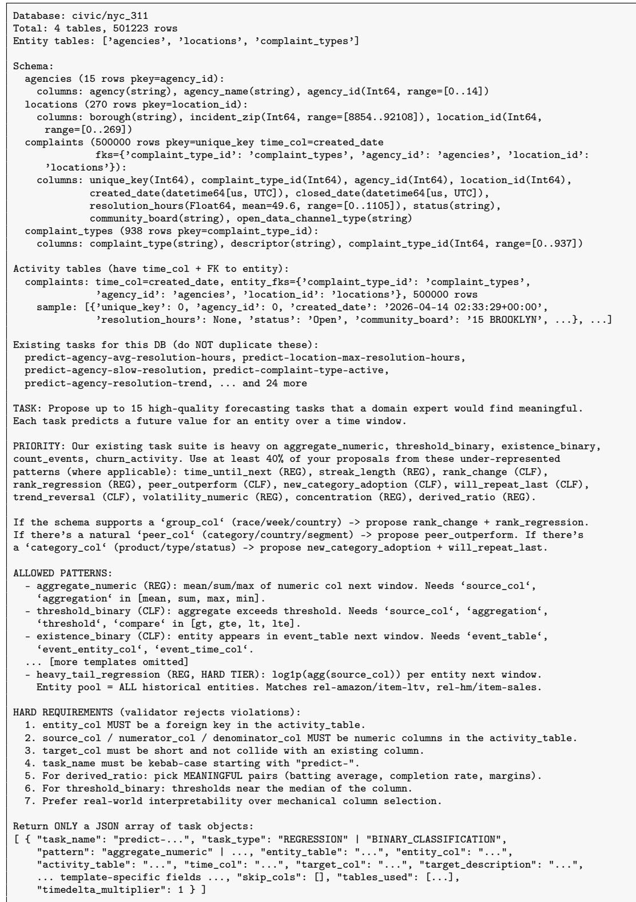  
Figure 8: Full proposer prompt for civic/nyc\_311 (one representative database). The schema, FK map, sample rows, and existing-task list are populated per database; the ALLOWED PATTERNS, HARD REQUIREMENTS, and JSON contract blocks are constant across databases (the ALLOWED PATTERNS block in particular is abbreviated here—the full version enumerates all 25 templates with their required fields).

```json
{
"task_name": "predict-agency-avg-resolution-hours",
"task_type": "REGRESSION",
"pattern": "aggregate_numeric",
"entity_table": "agencies",
"entity_col": "agency_id",
"activity_table": "complaints",
"time_col": "created_date",
"target_col": "avg_resolution_hours",
"target_description": "Predict the mean resolution time (hours) for complaints handled by an agency
in the next window.",
"source_col": "resolution_hours",
"aggregation": "mean",
"tables_used": ["agencies", "complaints"],
"timedelta_multiplier": 1
}
```  
Figure 9: First accepted proposal for civic/nyc\_311, returned by the Claude Opus proposer in response to the prompt of Figure 8. The proposal passes the mechanical validator (the entity\_col is a declared FK in the activity\_table, source\_col is a numeric column of the same table, target\_col does not collide with any existing column, and the pattern is registered) and is forwarded to the generator for instantiation.

Filtering and difficulty assignment. The quality filter removes tasks that are unlikely to be useful for downstream evaluation, such as tasks that are nearly trivial, exhibit severe distribution drift, or fail during baseline fitting. Tasks with non-trivial baseline signal are retained, and we also retain non-trivial tasks for which XGBoost does not recover signal, since stronger relational models may still exploit structure missed by the lightweight baseline. Retained tasks are assigned a coarse difficulty level from their XGBoost score: easy, medium, or hard.

Preparing the release format. After loadability validation, each task is converted into the release format. The train, validation, and test splits are concatenated in chronological order into a single time-ordered training file, while preserving the schema metadata required by downstream loaders.

## D.6 Asset licenses, Citations, and Compliance

Compliance practice. Every contributing source is either (a) a bulk archive that the upstream provider publishes for download under an explicit license, or (b) a public API whose documented terms permit programmatic research use. We do not crawl arbitrary websites, do not bypass paywalls, do not ignore robots.txt, and do not scrape sources whose terms of service forbid automation.

Released-corpus license. We intend to release the corpus under CC-BY-SA 4.0. Per-database metadata records (i) the upstream source identifier, (ii) the upstream license string verbatim, and (iii) any usage restrictions inherited from the source (e.g. non-commercial-only for ATP-Tennis, StatsBomb, Yelp, FMA, and ListenBrainz; research-use-only for the CTU repository). Downstream users redistributing derivative works must honor those per-source restrictions in addition to the aggregated CC-BY-SA 4.0 license on the corpus assembly.

PII. The corpus contains no personally-identifying information beyond what each upstream source has already published under its own license. Where source data uses pseudonymized identifiers (e.g. Stack Exchange user IDs, Lahman player IDs), we preserve those identifiers verbatim and do not attempt to de-anonymize or join across sources.

## D.7 Case Studies

To illustrate what a forecasting task in THE JOIN represents and the diversity of the corpus, we present three case studies from distinct real-world domains. In every case, the prediction target is a quantity monitored in the corresponding domain and instantiates a different label family among the twenty-five task patterns defined in the corpus.

Forecasting an account’s peak balance (join-berka) Our first example predicts a continuous quantity from a transaction stream. The Berka dataset from the PKDD’99 Challenge is a complete relational snapshot of a Czech retail bank, including its accounts, the clients who hold them, the permanent orders and loans they carry, and a central ledger of just over a million individual transactions, each stamped with the resulting running balance. Its eight tables form a multi-hop schema (Figure 10), where accounts are linked to its clients through disp, and both accounts and clients are linked to the district in which they are registered. As peak balance is a quantity that retail banks monitor directly, we create the account-max-balance regression task that, for each account and seed time, predicts the highest balance reached during the following window of roughly 17.5 days.

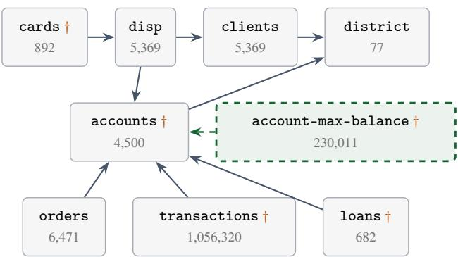  
Figure 10: Schema of join-berka: every table, its row count, and the foreign key links. Arrows point from a foreign key to the table it references; † marks a table carrying a time column. The dashed box is the task table derived from the database.

Forecasting new-user retention (join-brightkite) A cold-start task evaluates an entity at its first appearance. This setting is of independent interest because it isolates a model’s ability to generalise from relational context rather than from the entity’s own past. To showcase such a task in THE JOIN, we consider Brightkite, a location-based social network in which users check in at venues and form friendships. The newuser-will-return task considers each user in the window of their first-ever check-in and predicts whether they will check in again within the next two windows, each roughly 6.7 days. Because the user’s own label history is unavailable, a model cannot exploit autocorrelation and must instead generalise from side information, including the venues visited and the user’s position in the friendship graph.

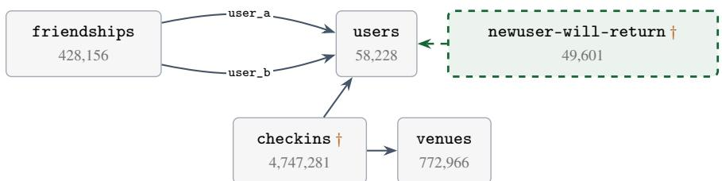  
Figure 11: Schema of join-brightkite. Here friendships and users tables are joined by more than one foreign key, so the edges are drawn separately and labelled with the referencing column.

Forecasting who beats their cohort (join-oulad) We consider the Open University Learning Analytics Dataset (OULAD), a relational record of a large online university that links each student to their virtual-learning-environment clickstream and assessment scores. The student-score-beats-cohort task predicts whether a student’s mean assessment score in the next window (of roughly 7.2 days) will exceed the mean score of their presentation cohort over the same window. The comparison threshold is therefore the cohort average rather than a fixed constant, and must be computed before the label can be assigned. Because the label is defined relative to a peer aggregate that changes over time, a model cannot score each student in isolation. Instead, it must compute the cohort context at each step and track the student’s trajectory across windows.

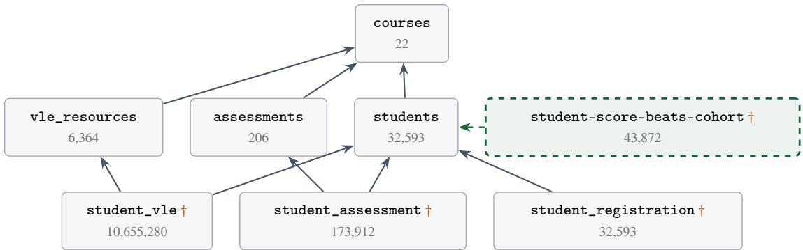  
Figure 12: Schema of join-oulad.

Table 6: Binary classification forecasting tasks in RelBench.
<table><tr><td>Dataset</td><td>Task</td><td>Entity</td><td>Prediction target</td></tr><tr><td>rel-amazon</td><td>user-churn</td><td>User</td><td>Whether the user does not review any product in the next 3 months.</td></tr><tr><td>rel-amazon</td><td>item-churn</td><td>Item</td><td>Whether the item receives no reviews in the next 3 months.</td></tr><tr><td>rel-avito</td><td>user-visits</td><td>User</td><td>Whether the user visits more than one ad in the next 4 days.</td></tr><tr><td>rel-avito</td><td>user-clicks</td><td>User</td><td>Whether the user clicks more than one ad in the next 4 days.</td></tr><tr><td>rel-f1</td><td>driver-dnf</td><td>Driver</td><td>Whether the driver does not finish a race in the next month.</td></tr><tr><td>rel-f1</td><td>driver-top3</td><td>Driver</td><td>Whether the driver qualifies in the top 3 for a race in the next month.</td></tr><tr><td>rel-hm</td><td>user-churn</td><td>User</td><td>Whether the customer makes no transactions in the next week.</td></tr><tr><td>rel-stack</td><td>user-engagement</td><td>User</td><td>Whether the user makes any votes, posts, or comments in the next 3 months.</td></tr><tr><td>rel-stack</td><td>user-badge</td><td>User</td><td>Whether the user receives a new badge in the next 3 months.</td></tr><tr><td>rel-trial</td><td>study-outcome</td><td>Study</td><td>Whether the trial achieves its primary outcome in the next year.</td></tr><tr><td>rel-event</td><td>user-repeat</td><td>User</td><td>Whether a previously active user attends another event in the next 7 days.</td></tr><tr><td>rel-event</td><td>user-ignore</td><td>User</td><td>Whether the user ignores more than two event invitations in the next 7 days.</td></tr></table>

## D.8 Manual Audit of Generated Tasks

The deterministic checks of Section 3.3 ensure that tasks are valid against the schema, but not that they are meaningful. We therefore manually reviewed the LLM task descriptions and label-generation SQL, and found the following.

Targets are semantically named quantities. In join-berka, tasks ignore the meaningless a2–a16 columns of district and instead predict max\_balance, goes\_negative, days\_to\_next\_txn, etc.

Label SQL uses domain concepts, not arbitrary aggregations. In join-oulad, student-score-beats-cohort compares a student to their cohort’s contemporaneous mean. In join-citi-bike, station-time-until-next-trip predicts station idle time, which operator need for inventory planning.

Tasks match real practitioner decisions. account-max-balance (join-berka) mirrors overdraftexposure and credit-limit review; newuser-will-return (join-brightkite) is a standard onboarding-retention metric; movie-new-tag-adoption (join-movielens) tracks metadata coverage.

A small number of tasks (about 100) did aggregate non-semantic columns, e.g., student-feature1-to-feature0-ratio in join-act\_mooc.

## E RelBench Forecasting Tasks

Binary classification tasks. The binary classification tasks in RelBench ask whether a future event or condition will occur for a given entity. They cover churn, future engagement, ad-click behavior, race outcomes, clinical outcomes, and event attendance behavior. See Table 6 for task descriptions.

Regression tasks. The regression tasks ask for a continuous or count-valued future outcome. They cover lifetime value, item sales, click-through rate, future votes, race position, adverse-event counts, site success, and event attendance. See Table 7 for task descriptions.

Table 7: Regression forecasting tasks in RelBench.
<table><tr><td>Dataset</td><td>Task</td><td>Entity</td><td>Prediction target</td></tr><tr><td>rel-amazon</td><td>user-ltv</td><td>User</td><td>Value of the products the user buys and reviews in the next 3 months.</td></tr><tr><td>rel-amazon</td><td>item-ltv</td><td>Item</td><td>Value of the purchases and reviews the item receives in the next 3 months.</td></tr><tr><td>rel-avito</td><td>ad-ctr</td><td>Ad</td><td>Click-through rate for the ad over the next 4 days.</td></tr><tr><td>rel-f1</td><td>driver-position</td><td>Driver</td><td>Average finishing position of the driver across races in the next 2 months.</td></tr><tr><td>rel-hm</td><td>item-sales</td><td>Item</td><td>Total sales for the article in the next week.</td></tr><tr><td>rel-stack</td><td>post-votes</td><td>Post</td><td>Number of votes the post receives in the next 3 months.</td></tr><tr><td>rel-trial</td><td>study-adverse</td><td>Study</td><td>Number of affected patients with severe adverse events in the next year.</td></tr><tr><td>rel-trial</td><td>site-success</td><td>Site</td><td>Success rate of a trial site in the next year.</td></tr><tr><td>rel-event</td><td>user-attendance</td><td>User</td><td>Number of events the user responds yes or maybe to in the next 7 days.</td></tr></table>

## E.1 Hard Regimes in RelBench

THE JOIN places special emphasis on rare-event, cold-start, heavy-tailed and long-horizon tasks. RelBench is too small to serve as a pretraining corpus, but its tasks already cover these regimes (Table 8).

Table 8: RelBench tasks in each hard regime. A task can belong to several regimes.
<table><tr><td>Regime</td><td>RelBench tasks</td><td>Count</td></tr><tr><td rowspan="2">rare event</td><td> $\mathtt { r e l - a v i t o / u s e r - c l i c k s , r e l - s t a c k / u s e r - b a d g e } ,$ </td><td>3</td></tr><tr><td> $\mathtt { r e l - s t a c k / u s e r - e n g a g e m e n t }$ </td><td>3</td></tr><tr><td rowspan="2">cold start</td><td> $\mathtt { r e l - t r i a l / s t u d y - o u t c o m e } ,$   $\mathbf { r e l - t r i a l / s t u d y - a d v e r s e , r e l - a v i t o / u s e r - c l i c k s }$ </td><td></td></tr><tr><td> $\mathtt { r e l - a m a z o n / i t e m - l t v , r e l - a v i t o / a d - c t r }$ </td><td>2</td></tr><tr><td rowspan="2">heavy-tailed target long horizon</td><td> $\mathtt { r e l - a m a z o n / u s e r - c h u r n , r e l - a m a z o n / i t e m - c h u r n } ,$ </td><td>4</td></tr><tr><td> $\mathbf { r e l - e v e n t / u s e r - r e p e a t } , \mathbf { r e l - h m / u s e r - c h u r n }$ </td><td></td></tr></table>

Rare events. Three RelBench tasks sit at or below 5% positive: rel-avito/user-clicks (3.9%), rel-stack/user-badge (4.8%), and rel-stack/user-engagement (5.0%), comparable to the rare end of THE JOIN.

Cold start. rel-trial/study-outcome and rel-trial/study-adverse are 100% cold start at test time: they key on nct\_id, each trial contributes one row, so no test trial appears in training. This is the most extreme cold-start setting in the suite, beyond the median of THE JOIN’s cold-start tasks. rel-f1/driver-position (79%), rel-f1/driver-dnf (71%), and rel-avito/user-clicks (61%) follow.

Heavy tails. rel-amazon/item-ltv has target skew 133 and kurtosis 29,079; rel-trial/study-adverse has skew 39; rel-hm/item-sales, rel-stack/post-votes, and rel-amazon/user-ltv sit near skew 21. About 140 tasks in THE JOIN are tail-dominated (the top 1% of values hold more than 30% of the mass); the heavy-tailed RelBench tasks are extreme versions of these.

## F Relational Transformer Architecture

The RT-J model comprises 12 transformer blocks with hidden dimension $d = 5 1 2 , H = 8$ attention heads of dimension $d _ { h } = 6 4$ , and feed-forward dimension $d _ { \mathrm { f f } } = 2 0 4 8$ . Each block applies column, feature, and neighbor attention sequentially, followed by a gated feed-forward network. The resulting model contains 86M trainable parameters, excluding the frozen text encoder.

Cell embeddings. Each cell i is associated with a value $v _ { i } ,$ semantic type $\tau _ { i } ,$ , column $c _ { i } ,$ table $t _ { i } ,$ and row $r _ { i } .$ Boolean values are cast to {0, 1} and treated as numeric; numeric values are standardized per column, while datetime values use a shared database-wide normalization. Text values and schema names are embedded using the frozen all-MiniLM-L12-v2 encoder $\mathcal { E } : \mathrm { T e x t }  \mathbb { R } ^ { 3 8 4 }$ . The additional schema-based textual information for each cell is given by:

$$
\mathbf { s } _ { i } = \mathcal { E } \big ( c _ { i } \big | \big | \big | \big | \big | t _ { i } \big ) ,\tag{2}
$$

where ∥ denotes string concatenation. For example: "age of $\tt u s e r ^ { \prime \prime }$ . Let $\mathbf { u } _ { i }$ denote the normalized scalar or text embedding representing the cell value. The initial token embedding is

$$
\mathbf { e } _ { i } ^ { \mathrm { s c h e m a } } = \mathrm { R M S N o r m } _ { s } \left( W _ { s } \mathbf { s } _ { i } + \mathbf { b } _ { s } \right) ,\tag{3}
$$

$$
\mathbf { e } _ { i } ^ { \mathrm { v a l u e } } = \left\{ \begin{array} { l l } { \mathbf { m } _ { \tau _ { i } } , } & { \mathrm { i f ~ c e l l ~ } i \mathrm { ~ i s ~ r } } \\ { \mathrm { R M S N o r m } _ { \tau _ { i } } \left( W _ { \tau _ { i } } \mathbf { u } _ { i } + \mathbf { b } _ { \tau _ { i } } \right) , } & { \mathrm { o t h e r w i s e } , } \end{array} \right.
$$

$$
\mathrm { i f ~ c e l l ~ } i \mathrm { ~ i s ~ m a s k e d } ,\tag{4}
$$

$$
\mathbf { x } _ { i } ^ { ( 0 ) } = \mathbf { e } _ { i } ^ { \mathrm { { s c h e m a } } } + \mathbf { e } _ { i } ^ { \mathrm { { v a l u e } } } \in \mathbb { R } ^ { 5 1 2 } .\tag{5}
$$

Value encoders and learned mask embeddings $\mathbf { m } _ { \tau _ { i } }$ are shared across columns of the same semantic type. Primary and foreign keys specify connectivity rather than contributing value embeddings. No positional or learned row-ID embeddings are used in the model.

Relational attention. Each of the 12 transformer blocks sequentially applies column, feature, and neighbor attention, with 8 heads per module. Let $\mathcal { P } ( r )$ denote the parent rows referenced by the foreign keys of row r. For non-padding cells, the masks are

$$
M _ { i j } ^ { \mathrm { c o l } } = \mathbb { I } [ c _ { i } = c _ { j } \wedge t _ { i } = t _ { j } ] ,\tag{6}
$$

$$
M _ { i j } ^ { \mathrm { { f e a t } } } = \mathbb { I } [ r _ { i } = r _ { j } \vee r _ { j } \in { \mathcal { P } } ( r _ { i } ) ] ,\tag{7}
$$

$$
M _ { i j } ^ { \mathrm { n b r } } = \mathbb { I } [ r _ { i } \in \mathcal { P } ( r _ { j } ) ] .\tag{8}
$$

These modules respectively exchange information within columns, within rows and their referenced parents, and with child rows referencing the query row. Padding cells are excluded from all attention masks. Each module receives pre-normalized inputs $\mathbf z _ { i } = \mathrm { R M S N o r m } _ { m } ( \mathbf x _ { i } )$ , with a separate RMSNorm per module $m .$ . For head h, bias-free projections and QK normalization [26] give:

$$
\widehat { \mathbf { q } } _ { i h } = \mathrm { R M S N o r m } _ { Q } \left( W _ { Q , h } \mathbf { z } _ { i } \right) ,\tag{9}
$$

$$
\widehat { \mathbf { k } } _ { j h } = \mathrm { R M S N o r m } _ { K } \left( W _ { K , h } \mathbf { z } _ { j } \right) ,\tag{10}
$$

$$
\begin{array} { r } { { \bf v } _ { j h } = W _ { V , h } { \bf z } _ { j } . } \end{array}\tag{11}
$$

Queries and keys are RMS-normalized along the head dimension, with separate learned feature-wise gains shared across heads. Normalized queries are additionally multiplied by a learned head-specific scalar and the logarithm of the valid-key count. For a module with mask $\dot { M } ,$ , the attention logits are

$$
k _ { i } = \sum _ { j } M _ { i j } ,\tag{12}
$$

$$
\ell _ { i j h } = \left\{ \begin{array} { l l } { \displaystyle \frac { \alpha _ { h } \log ( \operatorname* { m a x } ( k _ { i } , 1 ) ) } { d _ { h } } \widehat { \mathbf { q } } _ { i h } ^ { \top } \widehat { \mathbf { k } } _ { j h } , } & { M _ { i j } = 1 , } \\ { - \infty , } & { M _ { i j } = 0 , } \end{array} \right.\tag{13}
$$

where $\alpha _ { h }$ is a learned head-specific scale. For queries with at least one accessible key,

$$
a _ { i j h } = \mathrm { s o f t m a x } _ { j } ( \ell _ { i j h } ) ,\tag{14}
$$

$$
\mathbf { o } _ { i } = \mathrm { C o n c a t } _ { h = 1 } ^ { 8 } \left( \sum _ { j } a _ { i j h } \mathbf { v } _ { j h } \right) ,\tag{15}
$$

$$
{ \bf g } _ { i } = 2 \sigma ( W _ { G } { \bf z } _ { i } ) ,\tag{16}
$$

$$
\mathbf { x } _ { i }  \mathbf { x } _ { i } + W _ { O } ( \mathbf { g } _ { i } \odot \mathbf { o } _ { i } ) .\tag{17}
$$

Queries with no accessible keys receive a zero attention contribution. Each attention module has independent parameters. After the three attention modules, a pre-normalized residual SwiGLU network completes the block:

$$
\mathbf { z } _ { i } = \mathrm { R M S N o r m } _ { \mathrm { f f n } } ( \mathbf { x } _ { i } ) ,\tag{18}
$$

$$
\mathbf { x } _ { i } \gets \mathbf { x } _ { i } + W _ { 2 } \left[ \mathrm { S i L U } ( W _ { 1 } \mathbf { z } _ { i } ) \odot W _ { 3 } \mathbf { z } _ { i } \right] ,\tag{19}
$$

with intermediate dimension 2048. All attention and feed-forward projections are bias-free, and all RMSNorm operations use $\epsilon = 1 0 ^ { - 6 }$

Prediction heads. A final RMSNorm and type-specific affine decoders produce

$$
{ \bf h } _ { i } = \mathrm { R M S N o r m } _ { \mathrm { o u t } } \left( { \bf x } _ { i } ^ { ( 1 2 ) } \right) ,
$$

$$
\widehat { \mathbf { u } } _ { i } = D _ { \tau _ { i } } \mathbf { h } _ { i } + \mathbf { b } _ { \tau _ { i } } ^ { \mathrm { o u t } } .\tag{20}
$$

(21)

Numeric and datetime heads predict normalized scalars, and the text head predicts the 384- dimensional text embedding. All targets, including binary classification labels, are regressed with the Huber loss $( \delta = 1$ , averaged over output dimensions) as $\ell _ { \tau _ { i } }$ . For $B$ contexts with target sets ${ \mathcal { T } } _ { b } .$ , the objective is

$$
\mathcal { L } = \frac { 1 } { B } \sum _ { b = 1 } ^ { B } \frac { 1 } { \operatorname* { m a x } ( | \mathcal { T } _ { b } | , 1 ) } \sum _ { i \in \mathcal { T } _ { b } } \ell _ { \tau _ { i } } \left( \widehat { \mathbf { u } } _ { i } , \mathbf { u } _ { i } \right) .\tag{22}
$$

All prediction-head weights and biases are initialized to zero. The complete model contains 85,562,530 trainable parameters, excluding the frozen text encoder.

## G Pretraining Details

In all our experiments we use an 86M-parameter RT model with 12 layers, 512 hidden size and 8 attention heads, incorporating the improvements of [26] (such as QK-Norm) over the original architecture of [23]. We sample context size L from ${ \mathcal { L } } = \{ 5 1 2$ , 1024, 2048, 4096, 8192}, the local context size ℓ from $\mathcal { L } _ { \ell } = \{ \bar { 1 } 2 8 , 2 5 6 , 5 1 2 , 1 0 2 4$ , 2048, 4096, 8192}, the BFS width-bound b from $\boldsymbol { B } = \{ 8 , 1 6 , 3 2 , 6 4 , 1 2 8 , 2 5 \boldsymbol { \dot { 6 } } \}$ , and the recency parameter $\rho$ from $\mathcal { R } = \{ 0 , 1 \}$ . The random-walk retriever uses $W = 1 0 , 0 0 0$ walks of length $K = 2 0$ , and only the target cell is masked $( p _ { \operatorname* { m a x } } = 0 )$

We pretrain in two phases: first on the synthetic PluRel corpus [26] (86,211 tasks over 1,900 databases), then continuing from that checkpoint on a fixed mixture of 13,243 THE JOIN tasks drawn from the 523 databases whose preprocessed on-disk footprint stays under 5 GB. Each phase is early-stopped once neither mean validation AUROC nor mean validation nMAE (of the live or SWA weights) has improved for 10K optimizer steps (at 18K steps for PluRel and 26K for THE JOIN), at a global batch size of 1024 contexts per step using Muon [36] for 2D weight matrices and AdamW for the remaining parameters, at a constant learning rate of $5 \times 1 0 ^ { - 4 }$ (RMS-matched for Muon as in [53]) after a linear warmup over the first 2000 steps. To compensate for a lack of decay phase [54], and following the recommendation in [38], we track the stochastic weight average (SWA) performance during training and select the best SWA checkpoint based on validation performance. Specifically, we use an exponential moving average (EMA) for SWA, with momentum 0.9995, which gives an effective window of ≈2000 steps, and find that it produces more stable curves with better results.

Each phase takes about a day or less on a single node with 8×A100 GPUs, with BFloat16 activations and FP32 master weights [55]. The released RT-J checkpoint is the SWA weights after 9K steps of the THE JOIN phase, selected by mean validation AUROC (74.36); selection runs over the whole SWA trajectory, so the selected step lies well before the step at which the phase stopped. The same single checkpoint is used for every task, classification and regression alike.

## H Pretraining Ablations

## H.1 Multi-cell masking rate

The original RT recipe [23] masks only a single target cell in a given context of length $L .$ Following prior work on masked pretraining and meta-learning [56–59], the framework also supports masking non-target cells with a hierarchical Bernoulli scheme: per training context i a rate $\bar { p } _ { i } \sim \mathrm { U n i f } \left( [ \bar { 0 , } p _ { \operatorname * { m a x } } ] \right)$ is drawn, and each non-target, non-missing cell is masked independently with that rate $m _ { i , j } \sim \mathrm { B e r n o u l l i } ( p _ { i } )$ ; RT-J is pretrained with $p _ { \operatorname* { m a x } } = 0 .$ , i.e., only the target cell is masked. The hyperparameter $p _ { \mathrm { m a x } }$ of the hierarchical Bernoulli masking rate controls how many non-target cells are masked, and thus how much supervision each context carries. To test whether denser supervision would have been better, we sweep $p _ { \mathrm { m a x } }$ over $\{ 0 , 0 . 2 5 , 0 . 5 , 0 . 7 5 \}$ , with identical data and context-sampling settings, all arms warm-started from the same checkpoint.

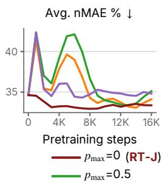

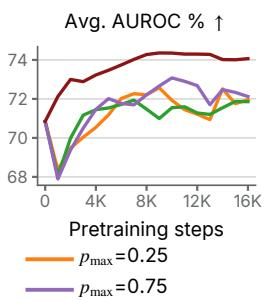

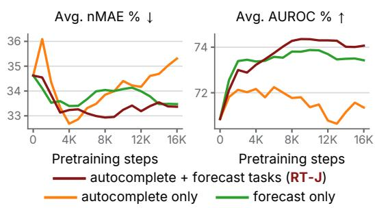  
(a) Multi-cell masking ablation  
(b) Pretraining task-mix ablation  
Figure 13: Pretraining ablations: multi-cell masking rate and task mix, as validation nMAE / AUROC over pretraining steps. Each arm differs from RT-J’s own pretraining run in one knob and is trained to the same 32,769-step budget. (a) Masking non-target cells at any rate $p _ { \operatorname* { m a x } } > 0$ costs both metrics; RT-J masks only the target cell. (b) Forecasting tasks alone nearly match the mixture on classification but lose on regression, and autocompletion alone trails on both; the mixture is competitive on both.

Observations. Figure 13a shows that masking non-target cells hurts both metrics. Over the common window of 10K–18K pretraining steps, single-cell masking averages 74.2 validation AUROC and 33.3 nMAE, while every masked rate is 1.6–2.6 AUROC points and 0.6–1.5 nMAE behind (71.6/33.9 at $p _ { \operatorname* { m a x } } = 0 . 2 5$ , 71.6/34.0 at 0.5, and 72.5/34.8 at 0.75); the gap holds at each arm’s own best step (74.4/32.9 against a best of 73.1/33.1 across the masked arms). Masked non-target cells corrupt the very context the model predicts from, and at this model and data scale that cost is not repaid by the extra supervision per step. Denser supervision is therefore not free: it buys gradient signal by degrading the in-context evidence, and at a fixed step budget the trade is a losing one.

## H.2 Pretraining task mix

THE JOIN supplies two families of pretraining tasks, forecasting and autocompletion (Section 3), and RT-J is pretrained on both. We ablate the mixture by pretraining on each family alone, holding everything else fixed.

Observations. From Figure 13b, the mixture is the only setting competitive on both metrics. Over the same 10K–18K window, the mixed objective reaches 74.2 AUROC and 33.3 nMAE; forecasting alone is close on classification (73.6) but 0.4 nMAE behind, and autocompletion alone trails badly on classification (71.2, three points down) while also being the worst on regression (34.8). The single-family arms are not simply slower: autocompletion alone posts the best regression value of any arm early (32.7 nMAE at 4K steps) and then degrades steadily, which is what one expects when the pretraining distribution stops resembling the RelBench forecasting tasks the model is evaluated on. Mixing the two families is what keeps both metrics improving together, so we keep it in the recipe.

## H.3 Compute scaling

Figure 14 tracks validation nMAE and AUROC over pretraining for three runs with the same recipe: from scratch on synthetic PluRel data only, from scratch on THE JOIN only, and continued pretraining of RT-PluRel on THE JOIN, which yields RT-J. Real data scales better than synthetic data: the PluRel-only run stops improving after about 8K steps and degrades on regression thereafter, while the THE JOIN-only run keeps slowly improving regression up to 32K steps. Continued pretraining from RT-PluRel reaches its best validation metrics within about 8K steps and stays ahead of pretraining on THE JOIN from scratch on regression throughout, and on classification at all but a few steps around 24K, so most of its benefit arrives early.

Avg. nMAE % ↓ Avg. AUROC % ↑   
75   
38   
70   
36   
34 65   
0 10K 20K 30K 0 10K 20K 30K   
Pretraining steps Pretraining steps   
PluRel only The Join only   
RT-PluRel + The Join (RT-J)  
Figure 14: Validation nMAE and AUROC (SWA, 8192-cell context) over pretraining steps. The two runs from scratch are shown from step 2K; the PluRel-only run stops early at 18K steps.

Algorithm 1 Random-walk context construction (one task item).   
Require: target row $v ^ { \star }$ in table τ with timestamp $t ^ { \star } ;$ database $\mathcal { D } ;$ total cell budget $L ;$ per-seed cell   
budget $\ell ;$ BFS width-bound $b ;$ recency flag $\rho \in \{ 0 , 1 \}$ ; walks $W ;$ walk length $K .$   
Ensure: cell sequence x with $| \mathbf { x } | \leq L .$   
Stage 1: score same-table candidates by random-walk visits.   
1: score[u] $\gets 0$ for every row u.   
2: for $w = 1$ to $W$ do   
3: $u  v ^ { \star } .$   
4: for $k = 1$ to $K$ do   
5: Move u to a uniformly random PK/FK neighbor whose timestamp is $\leq t ^ { \star } ;$ if no such   
neighbor exists, end this walk.   
6: if $u \neq v ^ { \star }$ and u is in table $\tau$ then   
7: score[u] ← score[u] + 1.   
8: end if   
9: end for   
10: end for   
Stage 2: launch BFSfrom the ordered candidates.   
11: If $\rho = 1$ , order same-table rows by (timestamp, score) lexicographically descending; otherwise   
order by score descending.   
12: x ← empty cell sequence.   
13: for each row s in this order do   
14: if $| \mathbf { x } | \geq L$ then break.   
15: end if   
16: Append BFSCOLLECT $( \mathcal { D } , s , \ell , b , t ^ { \star } , L - | \mathbf { x } | )$ to x.   
17: end for   
18: return x.

## I Random-Walk Context Construction

This appendix gives the full procedure for context construction summarized in Section 4. For one task item, we score same-table candidate rows by random-walk visit counts (Stage 1), then consume the candidates in order—most recent first with visit counts breaking ties when the recency flag $\rho = 1$ or by visit count alone when $\rho = 0 \mathrm { - } \mathrm { a s }$ launch points for the width-bounded BFS cell collector BFSCOLLECT of the original RT, which we reuse unchanged (Stage 2). Walks step uniformly at random along PK and FK edges, restricted to neighbor rows whose timestamp does not exceed the target’s timestamp $t ^ { \star } ;$ this enforces temporal validity at the walk level and avoids leaking future information into the context. Only visits to rows other than the target in the target’s table τ contribute, so the score ranks same-table rows by their personalized random-walk proximity to the target.

## I.1 Sensitivity to random-walk parameters

The random-walk retriever of Appendix I uses $W = 1 0 , 0 0 0$ walks of length $K = 2 0$ by default. We evaluate RT-J with the default and three cheaper settings on the 8192-row test subsample at $L = 8 1 9 2$ over three context seeds. Table 9 breaks down the per-example inference cost and Tables 10 and 11 the accuracy. Fewer or shorter walks cut the context-sampling cost from 28.1 to 14.3–17.9 ms per example, while the forward pass stays at about 10 ms. Classification degrades steadily as the walks shrink, from 72.9 to 71.9 mean AUROC, driven by rel-trial/study-outcome (59.4 to 52.7–55.8), rel-stack/user-engagement and rel-f1/driver-dnf. Regression is insensitive on average (33.3–33.6 mean nMAE), although individual tasks move in both directions: rel-hm/item-sales improves with shorter walks (14.1 to 11.6 nMAE at (10K, 10)), while rel-f1/driver-position is best at the default. We keep the default.

Table 9: Per-example inference cost in ms at batch size 1 and $L = 8 1 9 2 .$ , on one B200 GPU with one AMD EPYC 9565 CPU: per-task means over 100 timed steps after 5 warmup steps, then mean ± std. over the 21 RelBench tasks.
<table><tr><td>Stage</td><td>(10K, 20)</td><td>(10K, 10)</td><td>(1K, 20)</td><td>(1K, 10)</td></tr><tr><td>Context sampler (CPU)</td><td> $2 8 . 0 6 \pm 1 0 . 3 9$ </td><td> $1 7 . 8 7 \pm 8 . 1 4$ </td><td> $1 4 . 3 1 \pm 7 . 9 9$ </td><td> $1 6 . 0 0 \pm 8 . 4 9$ </td></tr><tr><td>Forward pass (GPU) Total</td><td> $1 0 . 0 3 \pm 0 . 3 8$   $3 8 . 0 9 \pm 1 0 . 3 1$ </td><td> $9 . 8 5 \pm 0 . 4 2$   $2 7 . 7 2 \pm 8 . 1 2$ </td><td> $9 . 8 1 \pm 0 . 4 3$   $2 4 . 1 1 \pm 7 . 9 9$ </td><td> $9 . 7 8 \pm 0 . 4 5$   $2 5 . 7 8 \pm 8 . 5 2$ </td></tr></table>

Table 10: AUROC (%, higher is better) of RT-J for (W, K) on the 8192-row test subsample at $L = 8 1 9 2 ,$ , mean ± std. over 3 context seeds; the mean row averages the tasks per seed. Bold: within one standard deviation of the best per row.
<table><tr><td>Task</td><td>(10K, 20)</td><td>(10K, 10)</td><td>(1K, 20)</td><td>(1K, 10)</td></tr><tr><td> $\mathtt { r e l - a m a z o n / i t e m - c h u r n }$ </td><td> $7 6 . 6 7 \pm 0 . 0 5$ </td><td> $7 6 . 6 9 \pm 0 . 0 6$ </td><td> ${ \bf 7 6 . 7 9 \pm 0 . 1 2 }$ </td><td> ${ \bf 7 6 . 9 1 \pm 0 . 1 4 }$ </td></tr><tr><td> $\mathtt { r e l - a m a z o n / u s e r - c h u r n }$ </td><td> $6 6 . 8 8 \pm 0 . 1 0$ </td><td> ${ \bf 6 7 . 0 5 \pm 0 . 1 1 }$ </td><td> $6 6 . 6 9 \pm 0 . 1 4$ </td><td> $6 6 . 5 0 \pm 0 . 1 2$ </td></tr><tr><td> $\mathtt { r e l - a v i t o / u s e r - c l i c k s }$ </td><td> ${ \bf 5 2 . 3 1 \pm 0 . 9 8 }$ </td><td> ${ \bf 5 2 . 8 3 \pm 2 . 6 5 }$ </td><td> ${ \bf 5 3 . 1 4 \pm 3 . 4 1 }$ </td><td> ${ \bf 5 3 . 8 7 \pm 2 . 6 9 }$ </td></tr><tr><td> $\mathtt { r e l - a v i t o / u s e r - v i s i t s }$ </td><td> $6 1 . 7 0 \pm 0 . 2 2$ </td><td> ${ \bf 6 2 . 6 8 \pm 0 . 6 2 }$ </td><td> ${ \bf 6 2 . 5 0 \pm 0 . 6 2 }$ </td><td> ${ \bf 6 2 . 4 2 \pm 0 . 5 9 }$ </td></tr><tr><td> $\mathtt { r e l - e v e n t / u s e r - i g n o r e }$ </td><td> ${ \bf 7 9 . 9 1 \pm 1 . 9 5 }$ </td><td> ${ \bf 7 9 . 5 5 \pm 2 . 2 0 }$ </td><td> ${ \bf 7 8 . 9 4 \pm 2 . 1 6 }$ </td><td> $7 7 . 7 1 \pm 0 . 8 4$ </td></tr><tr><td> $\mathtt { r e l - e v e n t / u s e r - r e p e a t }$ </td><td> ${ \bf 7 7 . 9 1 \pm 1 . 1 3 }$ </td><td> $7 7 . 4 8 \pm 1 . 2 4$ </td><td> ${ \bf 7 7 . 0 7 \pm 1 . 2 3 }$ </td><td> $7 5 . 7 0 \pm 1 . 7 3$ </td></tr><tr><td> $\mathbf { r e l - f 1 / d r i v e r - d n f }$ </td><td> ${ \bf 8 2 . 8 2 \pm 0 . 1 7 }$ </td><td> $8 2 . 4 3 \pm 0 . 0 3$ </td><td> $8 1 . 9 0 \pm 0 . 1 3$ </td><td> $8 1 . 4 0 \pm 0 . 0 9$ </td></tr><tr><td> $\mathtt { r e l - f 1 / d r i v e r - t o p 3 }$ </td><td> ${ \bf 9 0 . 7 5 \pm 0 . 4 5 }$ </td><td> ${ \bf 9 1 . 1 8 \pm 0 . 4 0 }$ </td><td> ${ \bf 9 0 . 8 6 \pm 0 . 2 6 }$ </td><td> ${ \bf 9 0 . 9 5 \pm 0 . 2 7 }$ </td></tr><tr><td> $\mathtt { r e l - h m / u s e r - c h u r n }$ </td><td> $6 2 . 3 1 \pm 0 . 2 1$ </td><td> $6 2 . 0 3 \pm 0 . 2 1$ </td><td> $6 1 . 7 6 \pm 0 . 2 2$ </td><td> ${ \bf 6 3 . 4 8 \pm 0 . 0 3 }$ </td></tr><tr><td> $\mathtt { r e l - s t a c k / u s e r - b a d g e }$ </td><td> ${ \bf 7 9 . 7 4 \pm 0 . 4 5 }$ </td><td> ${ \bf 7 9 . 5 5 \pm 0 . 5 7 }$ </td><td> ${ \bf 7 9 . 7 5 \pm 0 . 7 1 }$ </td><td> ${ \bf 7 9 . 4 3 \pm 0 . 5 8 }$ </td></tr><tr><td> $\mathtt { r e l - s t a c k / u s e r - e n g a g e m e n t }$ </td><td> ${ \bf 8 4 . 7 3 \pm 0 . 4 3 }$ </td><td> $8 2 . 6 0 \pm 0 . 5 5$ </td><td> $8 3 . 1 8 \pm 0 . 3 7$ </td><td> $8 2 . 1 2 \pm 0 . 3 9$ </td></tr><tr><td> $\mathtt { r e l - t r i a l / s t u d y - o u t c o m e }$ </td><td> ${ \bf 5 9 . 3 6 \pm 1 . 7 2 }$ </td><td> $5 5 . 8 3 \pm 1 . 1 5$ </td><td> $5 2 . 9 5 \pm 2 . 2 0$ </td><td> $5 2 . 7 4 \pm 3 . 0 0$ </td></tr><tr><td>Mean</td><td> ${ \bf 7 2 . 9 2 \pm 0 . 2 7 }$ </td><td> $7 2 . 4 9 \pm 0 . 1 4$ </td><td> $7 2 . 1 3 \pm 0 . 2 8$ </td><td> $7 1 . 9 3 \pm 0 . 3 4$ </td></tr></table>

Table 11: nMAE (%, lower is better) of RT-J for (W, K) on the 8192-row test subsample at $L = 8 1 9 2 .$ mean ± std. over 3 context seeds; the mean row averages the tasks per seed. Bold: within one standard deviation of the best per row.
<table><tr><td>Task</td><td>(10K, 20)</td><td> $( \mathrm { 1 0 K } , \mathrm { 1 0 } )$ </td><td> $\left( 1 \mathrm { K } , 2 0 \right)$ </td><td>(1K, 10)</td></tr><tr><td> $\mathtt { r e l - a m a z o n / i t e m - 1 t v }$ </td><td> $8 . 4 9 \pm 0 . 0 1$ </td><td> $8 . 2 5 \pm 0 . 0 9$ </td><td> $8 . 3 5 \pm 0 . 0 3$ </td><td> ${ \bf 8 . 0 7 \pm 0 . 0 3 }$ </td></tr><tr><td> $\mathtt { r e l - a m a z o n / u s e r - l t v }$ </td><td> ${ \bf 3 0 . 2 1 \pm 0 . 1 0 }$ </td><td> $3 0 . 4 4 \pm 0 . 0 7$ </td><td> $3 0 . 4 5 \pm 0 . 0 7$ </td><td> ${ \bf 3 0 . 1 7 \pm 0 . 1 1 }$ </td></tr><tr><td> $\mathtt { r e l - a v i t o / a d - c t r }$ </td><td> ${ \bf 4 2 . 1 7 \pm 0 . 5 5 }$ </td><td> ${ \bf 4 2 . 2 2 \pm 0 . 4 5 }$ </td><td> $4 3 . 0 7 \pm 0 . 6 4$ </td><td> $4 3 . 1 1 \pm 0 . 5 9$ </td></tr><tr><td> $\mathtt { r e l - e v e n t / u s e r - a t t e n d a n c e }$ </td><td> ${ \bf 4 3 . 4 6 \pm 1 . 6 6 }$ </td><td> ${ \bf 4 3 . 3 8 \pm 1 . 7 1 }$ </td><td> ${ \bf 4 3 . 4 5 \pm 1 . 7 0 }$ </td><td> ${ \bf 4 3 . 7 8 \pm 1 . 8 5 }$ </td></tr><tr><td> $\mathbf { r e l - f 1 / d r i v e r - p o s i t i o n }$ </td><td> ${ \bf 3 8 . 5 3 \pm 0 . 0 3 }$ </td><td> $3 9 . 5 3 \pm 0 . 1 0$ </td><td> $3 9 . 9 7 \pm 0 . 1 8$ </td><td> $3 9 . 7 5 \pm 0 . 0 7$ </td></tr><tr><td> $\mathtt { r e l - h m / i t e m - s a l e s }$ </td><td> $1 4 . 0 7 \pm 0 . 2 0$ </td><td> ${ \bf 1 1 . 6 1 \pm 0 . 0 9 }$ </td><td> $1 2 . 5 6 \pm 0 . 0 7$ </td><td> $1 3 . 3 8 \pm 0 . 0 6$ </td></tr><tr><td> $\mathtt { r e l - s t a c k / p o s t - v o t e s }$ </td><td> $1 5 . 5 4 \pm 0 . 0 4$ </td><td> $1 5 . 4 6 \pm 0 . 0 4$ </td><td> $1 5 . 4 6 \pm 0 . 0 2$ </td><td> ${ \bf 1 5 . 2 1 \pm 0 . 0 4 }$ </td></tr><tr><td> $\mathtt { r e l - t r i a l / s i t e - s u c c e s s }$ </td><td> ${ \bf 9 1 . 1 0 \pm 0 . 1 4 }$ </td><td> $9 1 . 9 4 \pm 0 . 2 9$ </td><td> $9 1 . 8 0 \pm 0 . 3 1 $ </td><td> $9 2 . 1 8 \pm 0 . 4 0$ </td></tr><tr><td> $\mathtt { r e l - t r i a l / s t u d y - a d v e r s e }$ </td><td> ${ \bf 1 6 . 3 9 \pm 0 . 0 3 }$ </td><td> $1 6 . 6 1 \pm 0 . 0 4$ </td><td> $1 6 . 7 6 \pm 0 . 0 0$ </td><td> $1 6 . 9 0 \pm 0 . 0 5$ </td></tr><tr><td>Mean</td><td> ${ \bf 3 3 . 3 3 \pm 0 . 1 5 }$ </td><td> ${ \bf 3 3 . 2 7 \pm 0 . 1 8 }$ </td><td> $3 3 . 5 4 \pm 0 . 2 0$ </td><td> $3 3 . 6 2 \pm 0 . 2 0$ </td></tr></table>

## J Additional and Per-Task Results

## J.1 Baselines with extended context

Figure 15 repeats the aggregate baselines comparison of Figure 3 on a fixed 8192-row test subsample per task, extending all four baselines to a 131K-cell context (∼4,500 in-context examples on average, 20× what RT-J sees at 8K cells)—far past RT-J’s 8K training context. The extra context pays off on classification: the TabICLv2 pipelines pass RT-J’s 8K-context AUROC by 3.6–4.2 points at the largest context and the LightGBM pipelines by up to about 1 point. On regression, only LLM Agent + TabICLv2 passes RT-J, and only from 65K cells on (32.5 vs. 33.4 nMAE at 131K); RDBLearn + TabICLv2 improves steadily with context but stays 0.3–0.5 nMAE behind at the two largest sizes, and the LightGBM pipelines stay 1.7–5.2 nMAE behind at every extended context size (16K–131K cells).

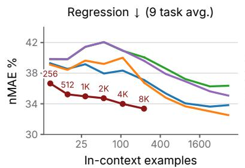

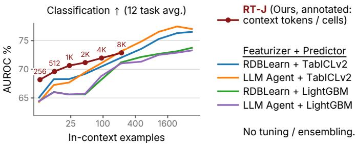  
Figure 15: Few-shot relational prediction vs. in-context-learning baselines on a fixed 8192-row-pertask subsample of the RelBench test set, with the baselines extended to 131K-cell contexts. As in Figure 3, the x-axis is the mean number of in-context labeled task rows and the markers on the RT-J curve are annotated with the underlying context size (RT-J caps at its 8K-cell training context). With 20× more labels than RT-J ever sees, the TabICLv2 pipelines lead on classification, and LLM Agent + TabICLv2 passes RT-J’s regression error only from 65K cells on.

## J.2 Per-task baseline curves

Figures 16 and 17 disaggregate the aggregate baselines comparison of Figure 3 into one panel per RelBench task, plotting test nMAE for the 9 regression tasks and test AUROC for the 12 classification tasks against inference-time context size. The five methods, the context grid, and the full-test evaluation protocol match Section 5; per-task y-axes are auto-scaled.

On regression, RT-J’s aggregate dominance in Figure 3 is anchored by wide wins at every context size on tasks whose targets are heavy-tailed or spread across the graph (rel-stack/post-votes, rel-amazon/user-ltv, rel-event/user-attendance, rel-avito/ad-ctr), where the flatfeature pipelines stall or get worse with more context. Elsewhere the TabICLv2 pipelines keep improving with context and pass RT-J at the largest budgets (rel-amazon/item-ltv), lead it at every context size on rel-hm/item-sales and rel-f1/driver-position, as do the feature-engineering pipelines on rel-trial/site-success, while rel-trial/study-adverse ends 0.8 nMAE behind RDBLearn + TabICLv2. On classification, RT-J leads or ties on nearly every task at small contexts—the label-scarce regime this paper targets. At 8K the picture is mixed: RT-J stays ahead on rel-event/user-repeat, rel-amazon/user-churn, rel-f1/driver-dnf and rel-avito/user-visits and ties on rel-hm/user-churn, while the feature-engineering pipelines overtake it on rel-avito/user-clicks, rel-amazon/item-churn, the two rel-stack tasks, rel-trial/study-outcome, rel-event/user-ignore and rel-f1/driver-top3, mirroring the aggregate convergence at the largest label budget.

## J.3 Cost of test-time compute scaling

Table 12 compares the cost of context tuning and context ensembling (Section 6), counted in passes of the context sampler and model over an evaluation split, and in labels used beyond the training split from which in-context examples are drawn. See Table 9 for forward pass latencies.

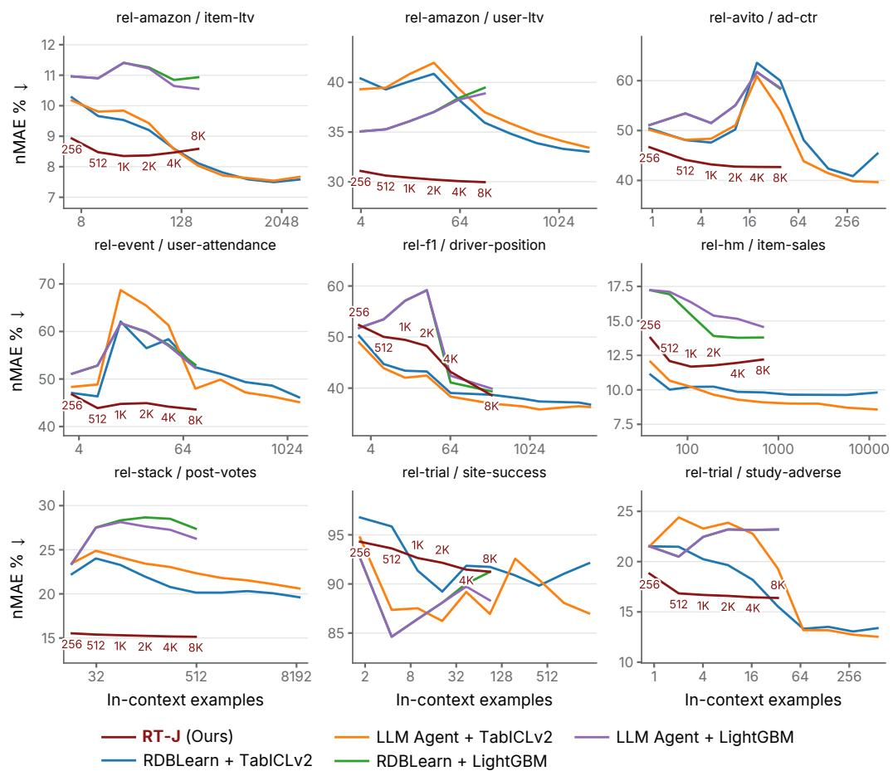  
Figure 16: Per-task test nMAE versus the average number of in-context examples on RelBench regression tasks; per-task counterpart of Figure 3 (left).

Table 12: Passes over an evaluation split, in total and on the critical path when fully parallelized, and labels used beyond the training split.
<table><tr><td>Setting</td><td>Total passes</td><td>Fully parallel</td><td>Extra labels</td></tr><tr><td>Default context</td><td>1 test</td><td>1 test</td><td>none</td></tr><tr><td>Tuning (120 configurations, 4 seeds)</td><td>144 val. + 1 test</td><td>1 val. + 1 test</td><td>≤ 4096 (val.)</td></tr><tr><td>Ensembling (16 seeds)</td><td>16 test</td><td>1 test</td><td>none</td></tr></table>

Tuning scores 120 configurations $( L , \ell , b , \rho )$ with 4 context seeds each. A single pass samples one context at the largest L and scores every $\dot { L } \geq \ell$ on its prefixes, so the grid takes 36 passes per seed over the shared $( \bar { \ell } , b , \rho )$ settings, i.e. 144 passes over a validation subsample of up to 4096 rows, plus one test pass with the selected configuration. Ensembling needs no labels beyond the training split. Both procedures parallelize fully across configurations and seeds.

## J.4 Per-task ablation curves

This appendix disaggregates each ablation in Section 7 into per-task panels, one per RelBench task, evaluated on the 8192-row test subsample of Section 7 across context sizes; per-panel y-axes are auto-scaled so the visual ranking of methods within a task is preserved even where its absolute scale differs. These panels disaggregate the aggregate ablation figures (context retrieval, schema semantics) directly.

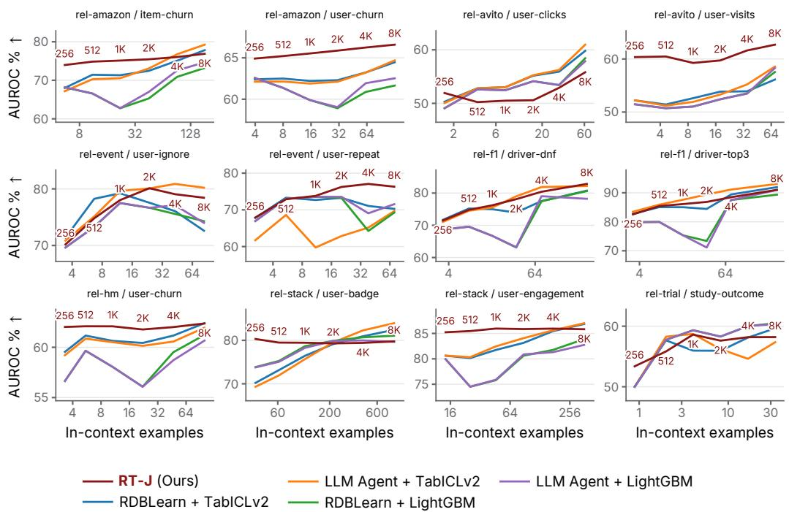  
Figure 17: Per-task test AUROC versus the average number of in-context examples on RelBench classification tasks; per-task counterpart of Figure 3 (right).

## J.4.1 Context retrieval (per task)

Per-task counterpart of Figure 6. Random walk’s advantage at small L is broad: at $L = 2 5 6$ it is the best or tied retriever on most regression tasks. Beyond L = 1024 RDBLearn-feature similarity leads on most of them (item-ltv, user-ltv, ad-ctr, item-sales, post-votes, study-adverse) and the two are close on user-attendance and driver-position; on site-success the structure-agnostic retrievers stay flat near 94 nMAE, 32-width BFS is far ahead beyond $L = 1 0 2 4$ random walk drifts back up past $L = 1 0 2 4$ and RDBLearn-feature similarity is erratic. On classification the same two retrievers lead nearly everywhere, RDBLearn-feature similarity by the wider margin on the churn and driver tasks and random walk on the rel-event tasks; the tasks with few labels (user-clicks, user-engagement, study-outcome) are noisy for every retriever. The 256-width BFS variant is a strong outlier at small L on several tasks; it is excluded from per-panel y-limit computation so the other curves remain readable, but its line is still drawn.

## J.4.2 Schema semantics (per task)

Per-task counterpart of Figure 5. Schema semantics help on most tasks. The largest classification gaps (rel-event/user-ignore, rel-event/user-repeat) are worth up to 5.2 AUROC points; shuffled names win at every context size on rel-avito/user-clicks, rel-f1/driver-top3 and rel-hm/item-sales, on rel-amazon/user-ltv from $L = 5 1 2$ , and on rel-f1/driver-position by up to 5.1 nMAE at small contexts.

## J.4.3 Context hyperparameter selection (per task)

Each task’s tuned context is chosen by a grid search over the global context length $L \in$ $\{ 5 1 2 , \dots , 8 1 9 2 \}$ , the per-seed cell budget $\ell \in \{ 2 5 6 , \ldots , 8 1 9 2 \}$ (with $\ell \ \leq \ L )$ , the BFS width $\bar { b } \in \{ 8 , 3 2 , 1 2 8 \}$ , and the recency flag $\rho \in \{ 0 , 1 \} { \stackrel { - } { - } } 1 2 0$ configurations per task—selecting per task the configuration that maximizes validation performance on a 4096-row validation subsample (four context seeds, per-row predictions averaged before scoring; nMAE for regression, AUROC for classification). Table 13 reports the resulting test metrics on the 8192-subsampled test set, comparing this tuned context against the shared default context $( L = 8 \mathrm { K } , \ell = 2 5 6 , b = 3 2 , \rho = 1 )$ at a single context seed; columns L, ℓ, b, ρ report the selected values.

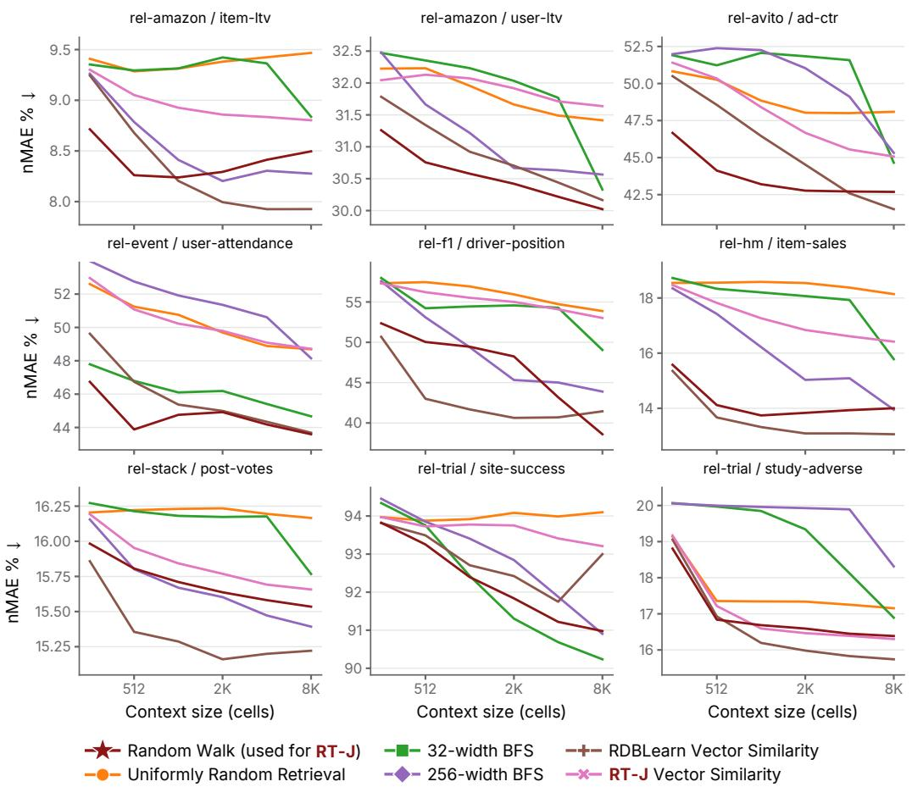  
Figure 18: Per-task test nMAE for context-retrieval ablations on RelBench regression tasks; per-task counterpart of Figure 6 (left).

## J.4.4 Context ensembling (per task)

Per-task counterpart of Figure 4, for the default (blue) and per-task-tuned (orange) context. Increasing the number of ensembled context seeds $n _ { \mathrm { e n s } }$ improves classification on most tasks (9 of 12 at the default context and 10 of 12 at the tuned one), but degrades rel-avito/user-clicks by 3.0 points at the default context, while several regression tasks (rel-amazon/user-ltv, rel-stack/post-votes) are insensitive, in line with the flatter aggregate regression curve. The pan els also localize the val–test mismatches behind the aggregate classification crossover in Figure 4: on rel-avito/user-clicks and rel-stack/user-engagement the tuned context is clearly worse than the default at every ensemble size, and on rel-trial/study-outcome it starts 2.3 AUROC ahead but ends 0.7 behind at $n _ { \mathrm { e n s } } = 1 6$ . (On rel-amazon/user-churn, tuning selects the default configuration, so the two curves coincide.)

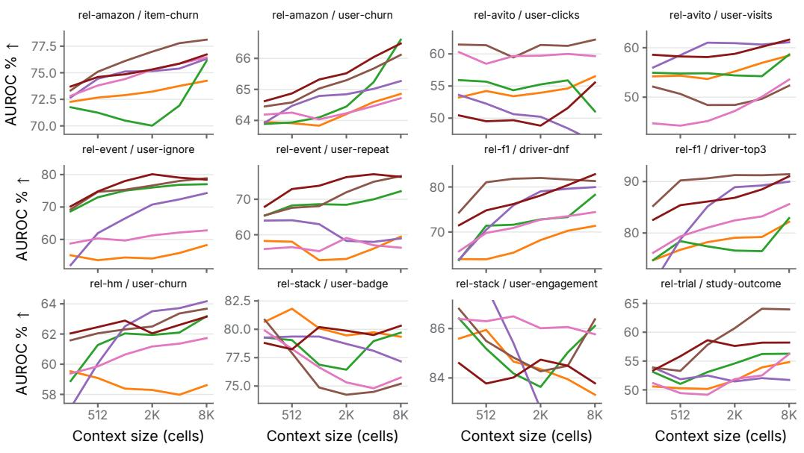

Figure 19: Per-task test AUROC for context-retrieval ablations on RelBench classification tasks; per-task counterpart of Figure 6 (right).  
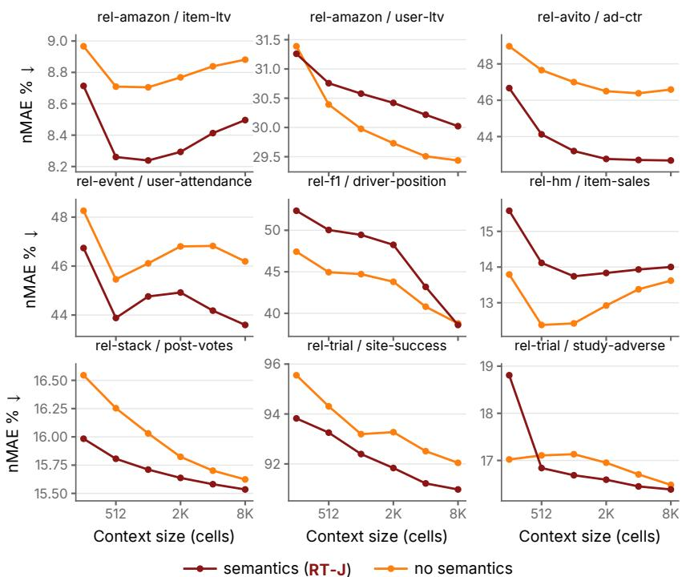  
Figure 20: Per-task test nMAE for the schema-semantics ablation on RelBench regression tasks; per-task counterpart of Figure 5 (left).

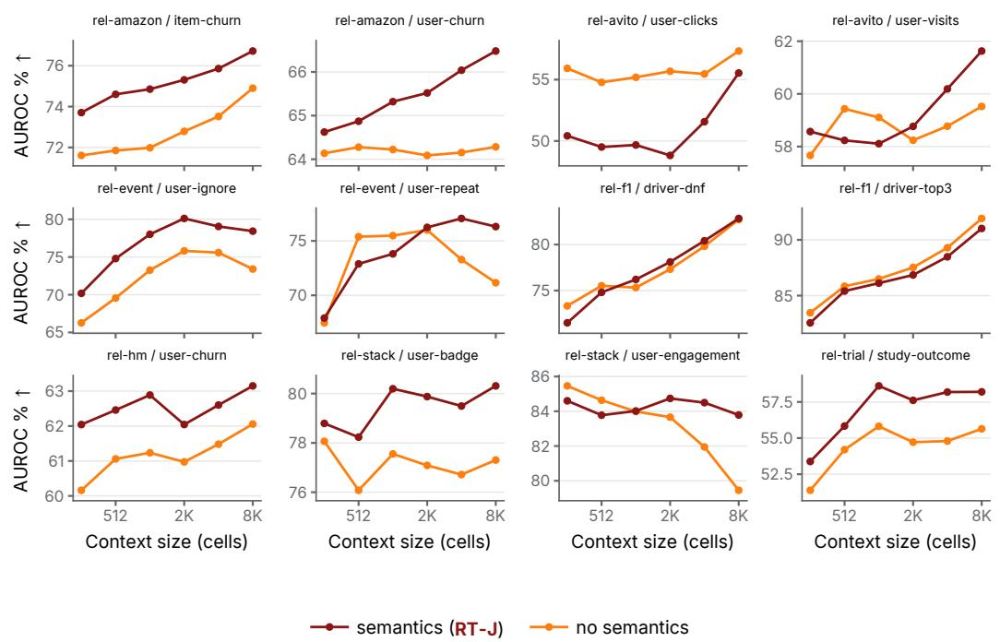  
Figure 21: Per-task test AUROC for the schema-semantics ablation on RelBench classification tasks; per-task counterpart of Figure 5 (right).

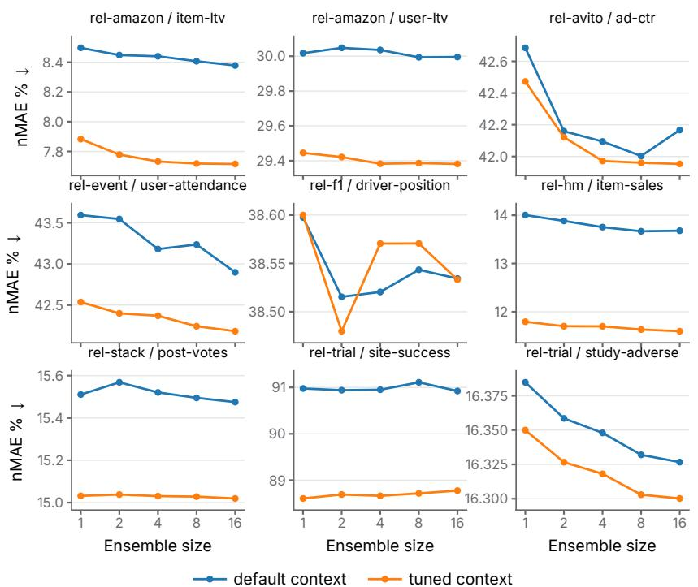  
Figure 22: Per-task test nMAE for context ensembling, default vs. per-task-tuned context, on RelBench regression tasks; per-task counterpart of Figure 4 (left).

Table 13: Per-task test metrics on the 8192-subsampled test set: shared default context (L = 8K, $\ell = 2 5 6 , b = 3 2 , \rho = 1 )$ vs. the per-task tuned context. Columns $L , \ell , b , \rho$ report the configuration selected on the validation split. Single context seed (no ensembling). All metrics shown in percent. Best per row in bold; lower is better for nMAE, higher for AUROC.
<table><tr><td>DB</td><td>Task</td><td>L</td><td>l</td><td>b</td><td> $\rho$ </td><td>Default</td><td>Tuned</td></tr><tr><td colspan="6">Regression (nMAE %, lower is better)</td><td></td><td></td></tr><tr><td>rel-amazon</td><td>item-ltv</td><td>4K</td><td>2048</td><td>8</td><td>0</td><td>8.50</td><td>7.88</td></tr><tr><td>rel-amazon</td><td>user-ltv</td><td>4K</td><td>2048</td><td>8</td><td>0</td><td>30.02</td><td>29.45</td></tr><tr><td>rel-avito</td><td>ad-ctr</td><td>8K</td><td>1024</td><td>8</td><td>0</td><td>42.69</td><td>42.47</td></tr><tr><td>rel-event</td><td>user-attendance</td><td>8K</td><td>256</td><td>8</td><td>1</td><td>43.59</td><td>42.54</td></tr><tr><td>rel-f1</td><td>driver-position</td><td>8K</td><td>256</td><td>8</td><td></td><td>38.60</td><td>38.60</td></tr><tr><td>rel-hm</td><td>item-sales</td><td>512</td><td>256</td><td>128</td><td>0</td><td>14.00</td><td>11.79</td></tr><tr><td>rel-stack</td><td>post-votes</td><td>8K</td><td>2048</td><td>8</td><td>0</td><td>15.51</td><td>15.03</td></tr><tr><td>rel-trial</td><td>site-success</td><td>8K</td><td>4096</td><td>32</td><td>0</td><td>90.98</td><td>88.61</td></tr><tr><td>rel-trial</td><td>study-adverse</td><td>8K</td><td>256</td><td>128</td><td>1</td><td>16.38</td><td>16.35</td></tr><tr><td colspan="6">Mean</td><td>33.36</td><td>32.52</td></tr><tr><td colspan="6">Classification (AUROC %, higher is better)</td><td></td><td></td></tr><tr><td>rel-amazon</td><td>item-churn</td><td>8K</td><td>512</td><td>128</td><td>1</td><td>76.73</td><td>77.79</td></tr><tr><td>rel-amazon</td><td>user-churn</td><td>8K</td><td>256</td><td>32</td><td>1</td><td>66.48</td><td>66.48</td></tr><tr><td>rel-avito</td><td>user-clicks</td><td>8K</td><td>2048</td><td>128</td><td>1</td><td>55.54</td><td>47.63</td></tr><tr><td>rel-avito</td><td>user-visits</td><td>1K</td><td>512</td><td>128</td><td>0</td><td>61.63</td><td>61.33</td></tr><tr><td>rel-event</td><td>user-ignore</td><td>4K</td><td>512</td><td>8</td><td>1</td><td>78.43</td><td>80.53</td></tr><tr><td>rel-event</td><td>user-repeat</td><td>2K</td><td>512</td><td>8</td><td>1</td><td>76.31</td><td>76.29</td></tr><tr><td>rel-f1</td><td>driver-dnf</td><td>8K</td><td>256</td><td>128</td><td>1</td><td>82.85</td><td>83.03</td></tr><tr><td>rel-f1</td><td>driver-top3</td><td>8K</td><td>256</td><td>128</td><td>1</td><td>91.02</td><td>90.75</td></tr><tr><td>rel-hm</td><td>user-churn</td><td>8K</td><td>512</td><td>128</td><td>0</td><td>63.14</td><td>65.50</td></tr><tr><td>rel-stack</td><td>user-badge</td><td>8K</td><td>4096</td><td>32</td><td>1</td><td>80.20</td><td>79.49</td></tr><tr><td>rel-stack</td><td>user-engagement</td><td>512</td><td>512</td><td>8</td><td>1</td><td>83.76</td><td>79.39</td></tr><tr><td>rel-trial</td><td>study-outcome</td><td>8K</td><td>2048</td><td>32</td><td>0</td><td>58.20</td><td>60.52</td></tr><tr><td colspan="6">Mean</td><td>72.86</td><td>72.39</td></tr></table>

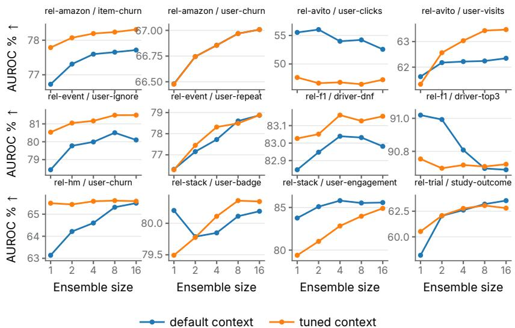  
Figure 23: Per-task test AUROC for context ensembling, default vs. per-task-tuned context, on RelBench classification tasks; per-task counterpart of Figure 4 (right).