# Reading Right, Acting Wrong: Diagnosing Decision Failures of System One Models in Agent Loops\*

Yubo Li Ramayya Krishnan Rema Padman

Carnegie Mellon University {yubol, rk2x, rpadman}@andrew.cmu.edu

## Abstract

System One models choose an agent’s next action by scoring a supplied set of options in a single pass. This makes them fast and cheap, but when they choose wrongly there is nothing to inspect: did the model misread what the agent has seen, or read it correctly and still act wrongly? We answer behaviorally. On a frozen benchmark of agent decision states from simulated environments, customer-service policies, tool use, web navigation and coding, we pair every next-action question with factual probes about the same state, each answered independently. Across seventeen fast systems and a reasoning model, the answer is consistent: most wrong actions follow correct reading, and the more accurate a system, the more of its errors take this form. These errors are not noise; they gather on the same states across systems of every kind. Where the probed facts provably determine the action, models that read every fact still fail to combine them, and their own answers, composed by code, repair the failure. On real states, what is missing is often not a fact but the next sub-goal.

## 1 Introduction

An agent acting in an environment repeatedly reads the feedback of its previous actions, works out where it stands, and chooses what to do next. In most current agents each such step is a call to a large language model that writes out its reasoning and then names an action (Yao et al., 2023). A growing family of System One models takes a different route (TypeSafe AI, 2026; Liquid AI, 2026; Kwok et al., 2026; Palmer, 2026; Convai Innovations, 2026; Cloudflare, 2026). Given the agent’s state and a set of candidate answers, they return a probability distribution over the supplied options and generate no text; their output is consumed directly by code, and their developers emphasize intelligence per dollar (TypeSafe AI, 2026). The System One models we evaluate answer a complete state in a median of 27–225 ms, against 317– 947 ms for likelihood readouts of open-weight language models and 2.3 s for a reasoning model (§4). We study only their choice interface, in which the model selects among supplied options.

When such a model picks the wrong action, there is no chain of thought to read. The error has two very different explanations. The model may have misread what the agent already knows, for example by missing that the last action failed or losing track of what it holds; or it may have read all of it correctly and still chosen badly. The first points to the state representation or the context budget, the second to the decision itself. Final-action accuracy cannot tell these cases apart, and generated rationales need not reflect the computation behind an answer (Turpin et al., 2023; Lanham et al., 2023). Conversely, a correct action does not show that the model understood the trace.

We therefore ask, behaviorally: can System One models understand the information an agent has obtained and act correctly on it, and when they fail, can we tell failures of comprehension from failures of decision? On a single agent decision state we ask, each in isolation, the next-action question and factual probes whose answers the environment determines, such as whether the last action succeeded, what the agent carries, or whether an action is permitted. Crossing “all measured facts correct” with “action correct” gives four observable outcomes (Figure 1). Around this measurement we build a frozen benchmark of 65,228 records, 19,663 of them paired test states, from simulators with exact ground truth (ALFWorld, BabyAI-Text, TextWorld), customer-service policies (τ2-bench), tool use, web navigation and coding traces, with every admissible action in context and gold labels computed only from what the agent has seen. We evaluate seventeen fast systems, fourteen System

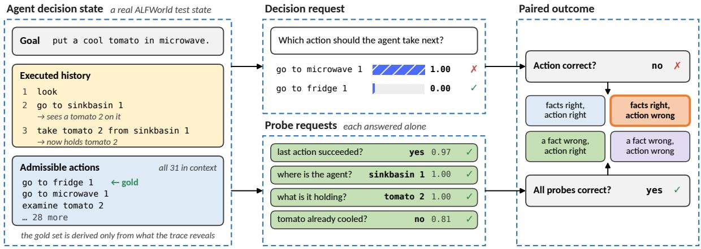  
Figure 1: Paired measurement on a real ALFWorld state. Left: the goal, the history and all 31 admissible actions; the gold action follows only from what the trace reveals. Middle: the decision and each factual probe are answered independently on the same state (JEV’s answers: every probe right, action wrong). Right: crossing all facts correct (U) with action correct (D) gives four outcomes; this state is facts right, action wrong.

One models of three kinds (hosted APIs, openweight models, and recipes that read a frozen language model) and three likelihood readouts of openweight language models, with a reasoning model, GPT-6.1, as a reference.

The short answer is that these models mostly read right and act wrong. Our main findings are:

• Most wrong actions follow correct reading. For the six most accurate systems, 73–85% of decision errors occur on states where every measured fact is answered correctly, and the share grows with accuracy (§5.1).

• The errors are structured. All 14 competent fast systems fail with every fact right on the same 141 states, where chance predicts none (§5.3).

• When the probes suffice, the failure is composition. On generated states whose probes determine the action, models that read every fact and decide perfectly from the facts alone lose 20–45 points when they must do both from the trace. Their own fact answers recover 15–28 points, and composing the action in code from them reaches 0.96–1.00 (§6.1).

• On real states, the decision itself is often missing. Correct answers to the benchmark’s probes add at most 7 points for all but two systems. On ALFWorld, stating the next subgoal adds 16 points for JEV, any block of facts at most 5 (§6.2, §6.3).

• Accuracy hides the rest. Removing the history collapses accuracy where earlier observations matter, policy edits are read correctly but acted on in only 22–72% of cases, and calibration error ranges from 2.6% to 26.6% (§7).

We also contribute a model-free criterion for when probes can support attributing an error to the decision (§2.4), states that satisfy it by construction, and an evaluation of eighteen systems that combines the paired diagnostics with cost, latency and calibration. The paired outcomes are behavioral evidence: they do not identify a model’s internal computation, and we do not claim that the probes exhaust every relevant fact.

## 2 Measuring Comprehension and Decision on the Same State

## 2.1 Decision states

A decision state s consists of a task goal, the executed history of actions and the observations they produced, any rules that govern the environment or policy, and the set A(s) of admissible next actions. The model must choose one element of A(s) and is never asked to generate an action. Every admissible action is placed in context with its name and a description, nothing is shortlisted, and no language model proposes candidates; tool calls with open arguments are enumerated from the environment or database. Gold is a set $G ( s ) \subseteq A ( s )$ computed only from information available to the agent: in the simulators, the first actions of all shortest plans on a map built from what the trace entails, or, when the needed objects have not yet been seen, the actions that reveal unseen locations. A decision is correct, $D ( s ) = 1$ , if the chosen action lies in $G ( s )$

## 2.2 Factual probes

On annotated states we also ask closed factual probes whose answers the simulator state, database or data labels determine: the outcome of the last action, the agent’s location and inventory, completed subgoals, whether an action is permitted, and which observation establishes a fact. Each question, probe or decision, is answered on the state alone; several may share a request, but no question or answer is added to another question’s input and no gold fact is revealed. “Paired” means that the input state is identical, not that we observe stages of the model’s computation.

## 2.3 Four observable outcomes

Let $U _ { i } = 1$ if all applicable probes of state i are answered correctly. $U _ { i }$ is measured-fact performance, not complete understanding. Crossing U with D gives four outcomes; we write U1D0 for U=1, D=0 (facts right, action wrong), and U1D1, U0D1, U0D0 likewise. Each licenses less than it may seem (Table 5 in Appendix B); in particular, U1D0 does not show that the failure lies purely in deciding, and U0D1 does not show a shortcut. Questions a system cannot answer because of an input limit are counted wrong and reported as coverage. We report counts pooled over the 19,663 paired test states, which summarize prevalence and are not a ranking statistic (cell-weighted estimates and cluster bootstrap: Appendix B.3).

## 2.4 When can a probe set support the diagnosis?

A U1D0 outcome suggests a decision failure only if the probes capture what the decision requires, and this can be checked without the model. Holding goal, rules and remaining context fixed, let $P ( s )$ be the vector of correct probe answers. For a group of states S sharing a probe vector, the probe set is sufficient on S if

$$
\textstyle \bigcap _ { s \in S } G ( s ) \neq \varnothing ,\tag{1}
$$

that is, if some action is correct in every state the agent could be in given those answers. If two states share the correct probe answers but have disjoint gold sets, answering every probe correctly cannot determine the action, and a wrong action after correct probes cannot be attributed to deciding alone. Pairwise intersections are not enough; the check must consider the whole group. In finite environments it is exhaustive; in natural data, absence of a counterexample does not prove sufficiency. Passing it means the probes can support a diagnosis, not that the model uses those facts.

## 2.5 Controlled variations

To see what drives the outcomes, the benchmark also contains a trace ablation that removes the executed history, observation minimal pairs that edit only the last observation relevantly or irrelevantly, stated rule changes that make prior knowledge wrong, and difficulty ladders over trace length and the distance from the decisive observation (§7); encoding controls are not analyzed here (Appendix B.5).

## 3 Benchmark

The frozen benchmark has 65,228 records, 59,234 test and 5,994 dev (Table 6 in Appendix C). Most paired states come from three simulators with exact ground truth: ALFWorld, BabyAI-Text and TextWorld cooking games (Shridhar et al., 2021; Paglieri et al., 2025; Chevalier-Boisvert et al., 2019; Carta et al., 2023; Côté et al., 2018; Cui et al., 2025). Trajectories are rolled out by each environment’s expert, by a noisy variant and by a variant that issues invalid commands, so traces contain failures and detours; no language model takes part. Gold sets were checked against breadth-first search in the real environments. From $\tau ^ { 2 } .$ -bench airline and retail (Barres et al., 2026) we take policyconstrained states with tool calls enumerated from the database and probes on record fields and permissions. Tool selection, web navigation and AgentRM trees (Xu et al., 2026; Shi et al., 2025; Patil et al., 2025; Ross et al., 2025; Deng et al., 2023; Xia et al., 2025) carry probes on fields stated in the trace (the visible-field probes), and 360 coding records built from real repository histories ask which edit caused a regression and which limited next action follows. Ladders vary trace length, distance from the decisive observation and novelty, and confirmation cohorts generated later from new seeds re-test the findings on states no earlier run had seen. A further 32,700 records of text-understanding primitives are part of the frozen population but not analyzed here.

Records are split into dev and test by source (game, user, repository), and every request byte, option order and label is frozen in a hash-sealed manifest before analysis. An independent content audit flagged 98 test records, which we keep and treat in a sensitivity analysis (§5.4). Because fixed public items can be overfit, the follow-up studies also use freshly generated states, including states whose probes are sufficient by construction (§6.1).

## 4 Systems and Protocol

Systems. Table 1 lists the seventeen fast systems and the reasoning reference, grouped by type. The fourteen System One models return a native distribution over the supplied options in one pass: two hosted APIs, JEV and OpenAI Decisions; ten released open-weight models, served locally from pinned revisions with their authors’ code and settings; and two recipes that read a frozen openweight language model through the same interface. Gemma-4-31B, Qwen3.8-27B and Qwen3.5-9B are read out by complete-option likelihood with thinking disabled, which gives a distribution of the same form. GPT-6.1 Sol (medium reasoning) answers each question in a separate call with the selected option and a verbalized distribution; it is a reference with deliberation, not a competitor.

Identical inputs. Every system receives the same frozen requests, and we never truncate a state, drop options or reselect records. A question beyond a system’s documented input limit is recorded as unsupported, counted wrong and reported as coverage; this matters mainly for Laya, Quyet-1.0-Large (which refuses more than ten options, including every ALFWorld decision), Perplexity Decider-27B, and the servers of Vega-27B and SimpleJev-27B on the longest states (Appendix D). A system that answers fewer than half of the questions of an analysis is left out of it and named (the coverage rule). Readouts differ by design, so comparisons are between deployed choice interfaces and do not isolate architecture, size or training data. All systems receive all 65,228 records.

Latency. Accuracy runs batch requests, so we time a separate latency panel of 163 test items, one per difficulty cell, answered strictly one item at a time after five warm-up items; we report the first pass on complete answers (Table 1). Systems marked there are estimated from their sequential accuracy runs; GPT-6.1 is timed through its synchronous API with an item’s questions sent in parallel (Appendix D).

Cost. JEV was billed \$8.79 for all 65,228 records (\$0.13 per 1,000 decision states) and OpenAI Decisions \$18.69 (\$0.29). For self-hosted systems we estimate cost from the panel’s time per state at a stated GPU price. The efficient frontier (Figure 2) runs from Laya and Kev-9B through Cygnet, Decider-chat-31B and JEV to Eikos-27B, which reaches 0.795 at about 1.4 times JEV’s cost, and Gemma-4-31B (0.811 at about five times). GPT-6.1 reaches 0.884 for \$642 under batch pricing, about 73 times JEV per state. Hosted models can change between versions: a rerun of JEV’s decisions five days after the formal run matched on 96.3% of 2,783 states (Appendix D).

## 5 Reading Correctly Is Not Enough

We first ask how often measured comprehension and action correctness come apart, how costly the errors are, and whether they are idiosyncratic to a model or attached to particular states.

## 5.1 Most decision errors follow correct reading

Table 2 and Figure 3 give the four outcomes for all eighteen systems on the same 19,663 states. For the six most accurate systems, 73–85% of all decision errors occur on states where every measured fact is answered correctly. Conditional on all measured facts being correct, the action is still wrong in 10– 21% of states. The converse also holds: when at least one fact is answered wrongly, the action is nevertheless correct in 62–70% of states. Neither direction of the pairing is a reliable proxy for the other.

The share of errors that follow correct reading grows with accuracy (Figure 3b). Among the fast systems above 0.5 accuracy it ranges from 49% (Kev-9B) to 81% (Gemma), and it is 85% for the reasoning reference, GPT-6.1. Stronger systems mainly stop misreading; they do not stop choosing wrongly after reading correctly. Deliberation helps: GPT-6.1 raises decision accuracy to 0.884, 7 points above Gemma and 9–12 points above the three most accurate System One models (Eikos-27B, Clef and JEV), at about 70 times JEV’s cost per state (§4). But its remaining errors are of the same kind, and in an even larger proportion. CLM-8B, Laya and Quyet-1.0-Large rarely answer both the probes and the action correctly (U1D1 1.1%,

<table><tr><td colspan="4"></td><td colspan="2">Latency (ms)</td></tr><tr><td>System</td><td>Model</td><td>Readout</td><td>Input limit</td><td>p50</td><td>p95</td></tr><tr><td colspan="4">System One models, hosted API</td><td colspan="2"></td></tr><tr><td>JEV 1.13 (TypeSafe AI, 2026)</td><td>hosted</td><td>native distribution</td><td>32k</td><td>205.7</td><td>290.5</td></tr><tr><td>OpenAI Decisions (OpenAI, 2026a)</td><td>hosted (public beta)</td><td>native distribution (two decimals)</td><td>none documented</td><td>150.6*</td><td>197.6*</td></tr><tr><td colspan="4">System One models, open weights</td><td colspan="2"></td></tr><tr><td>Clef-27B (Cloudflare,</td><td>Qwen3.8-27B,</td><td>native schema head</td><td>32k†</td><td>130.9</td><td>1,990.5</td></tr><tr><td>2026) Kev-9B (Palmer, 2026)</td><td>post-trained Qwen3.5-9B-Base</td><td>pointer head</td><td>64k state</td><td>98.1</td><td>562.0</td></tr><tr><td>CLM-8B (Kwok et al., 2026)</td><td>Qwen3-8B embeddings</td><td>two-tower head</td><td>32k per text†</td><td>39.2</td><td>475.9</td></tr><tr><td>Laya (Convai Innovations,</td><td>encoder</td><td>native distribution</td><td>512</td><td>27.4</td><td>69.8</td></tr><tr><td>2026) Eikos-27B (Vicentino,</td><td>Qwen3.8-27B</td><td>letter readout</td><td>32k†</td><td>114.0*</td><td>1,117.8*</td></tr><tr><td>2026) Perplexity Decider-27B (Perplexity AI, 2026)</td><td>fine-tune, FP8 Qwen3.8-27B fine-tune readout head</td><td></td><td>8k per question</td><td>85.4*</td><td>1,294.3*</td></tr><tr><td>SimpleJev-27B (SimpleJev, 2026)</td><td>Qwen3.8-27B + LoRA pointer head</td><td></td><td>32k†; GPU memory S</td><td>162.4*</td><td>3,798.9*</td></tr><tr><td>Vega-27B (vLLM Semantic Router Team,</td><td>Qwen3.8-27B + adapter</td><td>Decision 2.0 runtime</td><td>32k; GPU memory§</td><td>224.9*</td><td>3,756.8*</td></tr><tr><td>2026) Torchcast-27B (Torchcast AI, 2026)</td><td>StartLux-Decision- 27B fine-tune</td><td>letter readout</td><td>32k†</td><td>111.1*</td><td>2,164.5*</td></tr><tr><td>Quyet-1.0-Large (Nguyen, 2026)</td><td>Gemma-4-31B-it + LoRA</td><td>letter readout</td><td>state cut at 6k; ≤10 options</td><td>113.4*</td><td>1,297.3*</td></tr><tr><td colspan="4">System One readout of a frozen LLM</td><td></td><td></td></tr><tr><td>Cygnet (Blockbrain Labs, 2026)</td><td>Gemma-4-12B-it</td><td>grouped letter probabilities 16k</td><td></td><td>57.0</td><td>698.0</td></tr><tr><td>Decider-chat-31B (Mapika, Gemma-4-31B-it 2026)</td><td></td><td>letter readout</td><td>8k; state cut at 4k‡</td><td>68.3*</td><td>550.6*</td></tr><tr><td colspan="4">LLM, likelihood readout (thinking off)</td><td></td><td></td></tr><tr><td>Gemma-4-31B (Gemma Team, 2026)</td><td>Gemma-4-31B-it</td><td>option likelihood, thinking off</td><td>32k</td><td>397.9</td><td>3,476.5</td></tr><tr><td>Qwen3.8-27B (Qwen Team, 2026b)</td><td>Qwen3.8-27B</td><td>option likelihood, thinking off</td><td>32k</td><td>947.0</td><td>12,598.8</td></tr><tr><td>Qwen3.5-9B (Qwen Team, Qwen3.5-9B 2026a)</td><td></td><td>option likelihood, thinking off</td><td>32k</td><td>317.0</td><td>2,502.7</td></tr><tr><td colspan="4">LLM, reasoning (reference) (evaluated per question)</td><td>2,276.05,756.8</td><td></td></tr><tr><td>GPT-6.1 Sol (OpenAI, 2026b)</td><td>hosted reasoning model</td><td>answer + verbalized distribution</td><td></td><td></td><td></td></tr></table>

Table 1: Systems by type, with readouts, input limits and median and 95th-percentile latency on the latency panel (§4; local systems on one H100). ∗Estimated from sequential accuracy runs. †Our explicit budget (release defaults: 16k for Clef-27B and Eikos-27B, 8k for SimpleJev-27B, 256k for Torchcast-27B; CLM-8B’s serving example uses 2k). ‡Applied by the author’s runtime: Decider-chat-31B cuts states beyond 4,096 tokens; Quyet-1.0-Large cuts states to at most 6,000 tokens and refuses more than ten options. §The server fails on the longest states on one 80 GB H100. ¶Synchronous API, one question per request, an item’s questions sent in parallel.

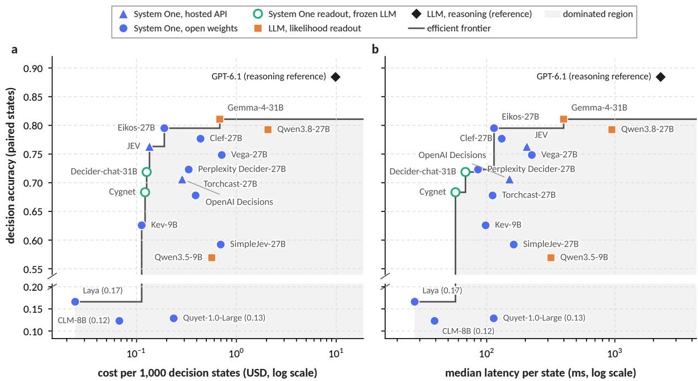  
Figure 2: Paired decision accuracy against (a) cost per 1,000 decision states and (b) median latency. The step line is the efficient frontier. Hosted costs are measured billing; self-hosted costs assume \$2.50 per H100-hour on the latency panel, an upper bound for batched serving (§4). Markers give the system category; Laya, Quyet-1.0-Large and CLM-8B lie below the axis break.

<table><tr><td></td><td colspan="2">Accuracy</td><td colspan="4">Joint outcome (% of states)</td><td colspan="2"> $P ( D { = } 1 \mid U )$ </td><td>Errors with</td><td>Coverage</td></tr><tr><td>System</td><td>D</td><td>U</td><td>U1D1</td><td>U1D0</td><td>U0D1</td><td>U0D0</td><td>U=1</td><td>U=0</td><td> $U { = } 1 \left( \% \right)$ </td><td>(%)</td></tr><tr><td colspan="9">System One models, hosted API</td><td></td></tr><tr><td>JEV</td><td>0.763</td><td>0.833</td><td>66.0</td><td>17.3</td><td>10.4</td><td>6.4</td><td>0.792</td><td>0.619</td><td>73.1</td><td>100.0</td></tr><tr><td>OpenAI Decisions</td><td>0.706</td><td>0.789</td><td>58.2</td><td>20.6</td><td>12.4</td><td>8.7</td><td>0.738</td><td>0.588</td><td>70.3</td><td>99.6</td></tr><tr><td colspan="9">System One models, open weights</td><td></td></tr><tr><td>Eikos-27B</td><td>0.795</td><td>0.850</td><td>69.1</td><td>15.9</td><td>10.4</td><td>4.6</td><td>0.813</td><td>0.695</td><td>77.7</td><td>100.0</td></tr><tr><td>Clef-27B</td><td>0.777</td><td>0.833</td><td>66.4</td><td>17.0</td><td>11.3</td><td>5.4</td><td>0.796</td><td>0.678</td><td>76.0</td><td>100.0</td></tr><tr><td>Vega-27B</td><td>0.748</td><td>0.776</td><td>63.0</td><td>14.6</td><td>11.9</td><td>10.6</td><td>0.812</td><td>0.529</td><td>58.0</td><td>95.1</td></tr><tr><td>Perplexity Decider-27B†</td><td>0.723</td><td>0.832</td><td>66.0</td><td>17.3</td><td>6.3</td><td>10.4</td><td>0.793</td><td>0.378</td><td>62.3</td><td>90.7</td></tr><tr><td>Torchcast-27B</td><td>0.678</td><td>0.858</td><td>60.4</td><td>25.3</td><td>7.3</td><td>6.9</td><td>0.705</td><td>0.517</td><td>78.7</td><td>100.0</td></tr><tr><td>Kev-9B</td><td>0.626</td><td>0.600</td><td>41.6</td><td>18.4</td><td>21.0</td><td>19.0</td><td>0.693</td><td>0.525</td><td>49.2</td><td>100.0</td></tr><tr><td>SimpleJev-27B†</td><td>0.592</td><td>0.758</td><td>48.2</td><td>27.6</td><td>11.0</td><td>13.2</td><td>0.636</td><td>0.454</td><td>67.6</td><td>93.4</td></tr><tr><td>Laya</td><td>0.166</td><td>0.039</td><td>0.4</td><td>3.5</td><td>16.2</td><td>79.9</td><td>0.110</td><td>0.168</td><td>4.1</td><td>97.0</td></tr><tr><td>Quyet-1.0-Large†</td><td>0.129</td><td>0.256</td><td>2.7</td><td>23.0</td><td>10.2</td><td>64.2</td><td>0.104</td><td>0.137</td><td>26.3</td><td>3.8</td></tr><tr><td>CLM-8B</td><td>0.123</td><td>0.092</td><td>1.1</td><td>8.1</td><td>11.2</td><td>79.6</td><td>0.122</td><td>0.123</td><td>9.2</td><td>100.0</td></tr><tr><td colspan="9">System One readout of a frozen LLM</td><td></td><td></td></tr><tr><td>Decider-chat-31B</td><td>0.719</td><td>0.786</td><td>61.2</td><td>17.4</td><td>10.7</td><td>10.7</td><td>0.778</td><td>0.501</td><td>62.0</td><td>99.7</td></tr><tr><td>Cygnet</td><td>0.683</td><td>0.812</td><td>56.6</td><td>24.6</td><td>11.7</td><td>7.1</td><td>0.697</td><td>0.623</td><td>77.6</td><td>99.7</td></tr><tr><td colspan="9">LLM, likelihood readout (thinking off)</td><td></td><td></td></tr><tr><td>Gemma-4-31B</td><td>0.811</td><td>0.888</td><td>73.5</td><td>15.3</td><td>7.6</td><td>3.6</td><td>0.828</td><td>0.678</td><td>80.9</td><td>100.0</td></tr><tr><td>Qwen3.8-27B</td><td>0.793</td><td>0.848</td><td>68.6</td><td>16.2</td><td>10.6</td><td>4.6</td><td>0.809</td><td>0.699</td><td>78.0</td><td>100.0</td></tr><tr><td>Qwen3.5-9B</td><td>0.569</td><td>0.640</td><td>40.1</td><td>23.9</td><td>16.8</td><td>19.1</td><td>0.626</td><td>0.468</td><td>55.6</td><td>100.0</td></tr><tr><td colspan="9">LLM, reasoning (reference)</td><td></td><td></td><td></td></tr><tr><td>GPT-6.1*</td><td>0.884</td><td>0.943</td><td>84.4</td><td>9.9</td><td>4.0</td><td>1.7</td><td>0.895</td><td>0.701</td><td>85.2</td><td>99.2</td></tr></table>

Table 2: Paired outcomes on the 19,663 paired test states (pooled counts). D: decision accuracy; U: share of states with every measured fact correct. The last two columns give the share of errors made with U=1 and coverage (states with every answer supported). Bold: best fast system. ∗Reasoning reference. †Coverage below 95%.

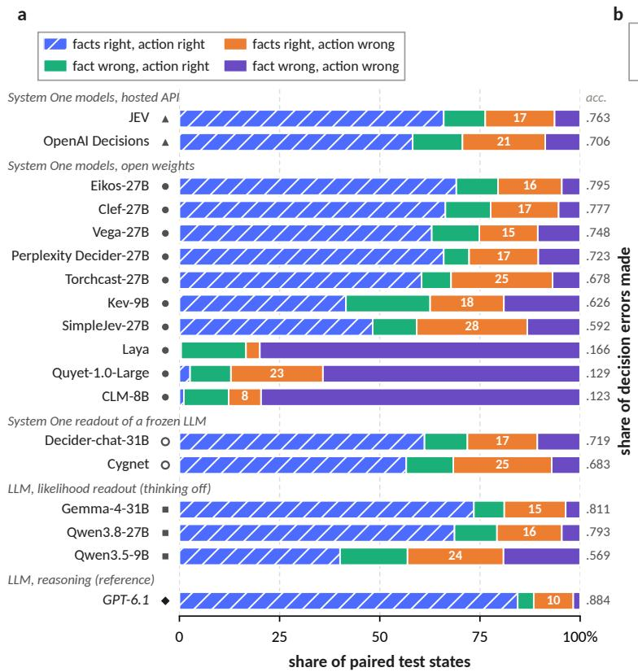

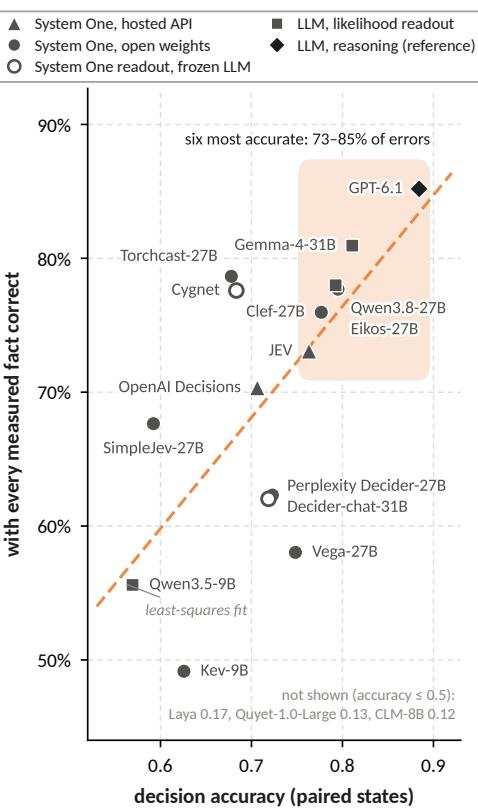  
Figure 3: Paired outcomes on the 19,663 paired test states. (a) Share of states in each outcome; the white number is the share with every fact right but the wrong action. (b) Decision accuracy against the share of errors made with every fact right; marker shape gives the system category. The more accurate the system, the larger this share.

0.4% and 2.7%), largely because of input limits that we count as wrong (§4).

The pattern does not depend on the type of system. Among the System One models, the hosted APIs make 73% (JEV) and 70% (OpenAI Decisions) of their errors after correct reading, the openweight models above 0.5 accuracy from 49% (Kev-9B) to 79% (Torchcast-27B; 78% for Eikos-27B, the most accurate System One model at 0.795), and the two readouts of a frozen LLM 62% (Deciderchat-31B) and 78% (Cygnet); the LLM likelihood readouts make 56–81%. Systems differ in how often a correct reading still leads to the wrong action: OpenAI Decisions acts wrongly in 26% of states with every fact right, Torchcast-27B in 30% and SimpleJev-27B in 36%, against 17–21% for the five most accurate fast systems; SimpleJev-27B, which reads well $( U = 0 . 7 5 8 )$ but decides correctly on only 0.592 of paired states, thus makes 68% of its errors after correct reading. Torchcast-27B is the clearest case: it reads better than any other System One model $\left( U = 0 . 8 5 8 \right.$ , second among fast systems only to Gemma) but decides correctly on only 0.678 of paired states, the largest gap between reading and acting of any competent system, so that 79% of its errors follow correct reading; it is weakest on ALFWorld (0.565). Perplexity Decider-27B and Decider-chat-31B rarely act correctly after a misread fact (P(D | U=0) 0.38 and 0.50), partly because a refused or shortened long state counts against both the probes and the decision (on $\tau ^ { 2 } .$ bench, with the longest states, they reach 0.53 and 0.48); Vega-27B, strong in TextWorld (0.880), is weak on $\tau ^ { 2 } .$ -bench and on the visible-field probes (0.60 and 0.61), where its server fails on the longest states.

The pattern is not driven by one domain (Figure 4). Among the six strongest systems, the share of errors after correct reading is 68–82% in ALF-World, 62–100% in BabyAI, 80–94% in TextWorld and 77–90% in $\tau ^ { 2 } .$ -bench. Two panels make the dissociation especially visible. On a TextWorld cohort generated after all earlier runs, JEV and Gemma both answer every probe correctly, yet their decision accuracies are 95.0% and 73.2%; Gemma has 161 of 600 states with all facts right and the action wrong, against 30 for JEV. On coding traces, both choose the correct next action on all 300 test states while answering the paired probes at 85.2% and 97.1%. A saturated action score here hides a twelve-point difference in what the models read correctly. Rankings also change across domains: among the fast systems, Decider-chat-31B, Gemma and Clef lead on ALFWorld (0.81–0.82), JEV on TextWorld and on the visible-field probes, and Eikos-27B on $\tau ^ { 2 }$ -bench (0.843), while GPT-6.1, strongest everywhere else, is the weakest of the six strongest systems on $\tau ^ { 2 } .$ -bench (0.709). The reason is a preference for caution rather than misreading. On $\tau ^ { 2 }$ states whose gold action is a tool call, typically a write the user has just confirmed, GPT-6.1 replies to the user instead in 16.7% of cases, against 2.8–7.0% for Gemma, Qwen3.8-27B, Clef and JEV, and calls a read-only tool to re-verify in another 5.3%; together these account for 80% of its errors there. Where the correct next step is to reply, it is more accurate than these four (0.695 vs. 0.34–0.64). Because $\tau ^ { 2 }$ gold actions come from successful trajectories, this extra caution is scored as an error.

b  
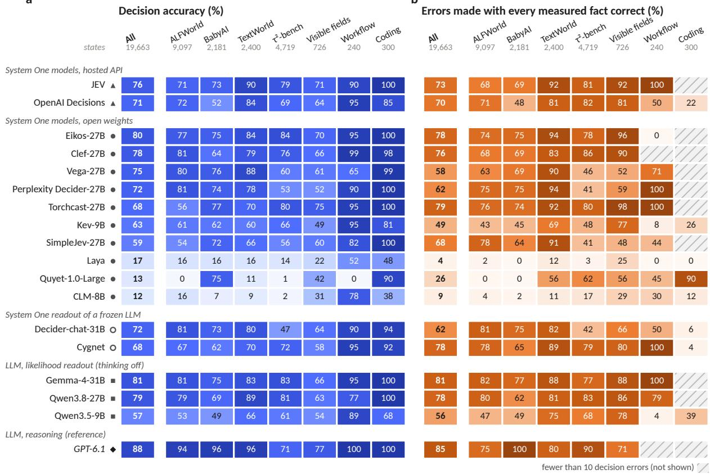  
Figure 4: (a) Decision accuracy and (b) share of errors made with every fact right, overall and by domain (number of states under each label; “Visible fields”: visible-field probes, §C.2). Hatched: fewer than ten errors.

## 5.2 Errors after correct reading are cheaper, but not free

A wrong action can be a harmless detour or a dead end. In the three simulators we replay every wrong decision and compute its regret by exact lookahead (Figure 5). Pooled over the 14 competent fast systems (paired decision accuracy above 0.5, coverage rule passed), most errors cost at most one extra step: 86–90% in ALFWorld, 42–56% in BabyAI and 77– 84% in TextWorld, the range spanning errors after correct reading and after a misread fact. Where the two kinds of error differ, errors after a misread fact are the costlier ones. In BabyAI, 58% of them cost two or more steps, against 44% of errors after correct reading; in TextWorld, 20% are unrecoverable, against 6%. For Gemma in TextWorld the unrecoverable share is 24% after a misread fact and 2% otherwise. ALFWorld is the exception: almost nothing is unrecoverable there, and errors after correct reading are, if anything, slightly costlier (14% vs. 10% cost two or more extra steps). Between 5% and 42% of a system’s “wrong” decisions, depending on the system and the simulator, are in fact also optimal under exact lookahead, which bounds how much of the measured error comes from gold sets that are stricter than necessary.

The reasoning reference changes this picture. GPT-6.1 makes few errors after a misread fact in the simulators (124 in ALFWorld, none in BabyAI,

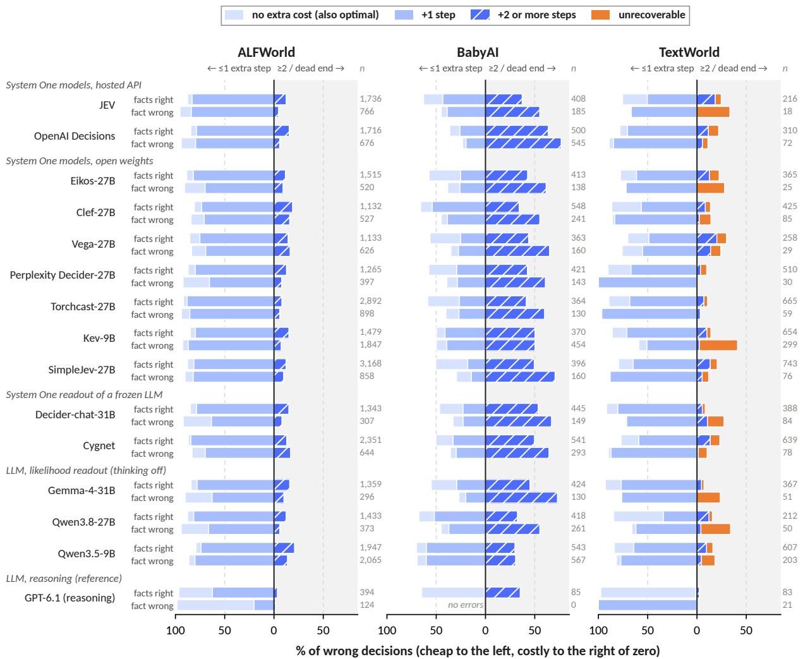  
Figure 5: Cost of every wrong decision in the three simulators, by exact lookahead (extra steps added to the shortest remaining plan). Left of zero: at most one extra step; right: two or more, or unrecoverable. Upper bar: errors with every fact right; lower bar: with a wrong fact; n: wrong decisions. Systems below 0.5 accuracy or failing the coverage rule are omitted.

21 in TextWorld), and a large part of its errors after correct reading are not errors at all: exact lookahead shows that the chosen action is also optimal for 34% of them in ALFWorld, 64% in BabyAI and 96% in TextWorld. As decision accuracy rises, gold sets that admit only some of the optimal actions account for a growing share of the measured error, and the headline share of errors after correct reading (85% for GPT-6.1) includes many such cases. Exact lookahead is therefore a necessary complement to set-valued gold when strong models are compared.

## 5.3 The same states defeat many systems

If facts-right, action-wrong errors were idiosyncratic noise, they would be spread evenly over states. They are not (Figure 6). Of the 53,382 such events produced by the 14 competent fast systems, 56% fall on states where at least seven of the 14 fail in this way, against 16% under a null that permutes each system’s events within its frozen cells, and 85% on states shared by at least three (78% under the null). All 14 systems fail with every fact right on the same 141 states, where the null expects none, and each of them decides correctly on 74–94% of the states that no other competent system fails but on only 1–16% of those that all thirteen others fail (Figure 6b). The errors are therefore attached to properties of particular states, which makes them worth explaining (§6); and a benchmark that samples such states is a sharper diagnostic than one that weights all states equally. Deliberation resolves many of them but not all: GPT-6.1, accurate on 88% of all paired states, chooses correctly on only 40% of the 141 states that defeat every competent fast system, and 62% of its own facts-right, actionwrong errors fall on states where at least three of them also fail.

## 5.4 How much of this is label error?

A facts-right, action-wrong outcome may also come from a wrong label. Two audits bound this. An independent content audit found 42 test records with conflicting labels and 56 whose inputs also occur in dev; excluding these 98 records changes no group score of any of the eighteen systems by more than 3.5 points (§C.4). Second, while building the decision-oriented probes of §6.3 we re-derived every ALFWorld label from the text of the trace alone. In the original ALFWorld cohorts, several receptacles can share one simulator location, and the builder recorded only one of them. For 303 paired test records, the location label therefore names a co-located receptacle rather than the one the text says the agent arrived at, and the four strong systems we audited answer the receptacle named in the text (98–99%), so these records cannot reach U=1 (Appendix E). The later confirmation cohort uses set-valued labels and is unaffected. Excluding the 398 affected ALFWorld records raises the share of errors made after correct reading for every audited system (on ALFWorld, from 0.663 to 0.707 for JEV and from 0.810 to 0.885 for Gemma). We keep the frozen labels and report this as a sensitivity analysis. It makes our headline estimate conservative.

## 6 Why Do Correct Readers Decide Wrongly?

A facts-right, action-wrong outcome on a natural state has two readings. The probes may have missed a decision-relevant fact (§2.4), or the model may have read everything it needed and still not combined it into the right action. On natural states the two cannot be separated, so we first build states where they can, and then return to real benchmark states. Figure 7 summarizes the three studies. Each adds information to the decision request and measures the change on the same states; requests that contain a system’s own answers are built from its earlier answers to the same probes, asked alone.

## 6.1 When the probes are sufficient by construction

Design. We generate decision states in two domains, a household text world and a customer service policy. Each state has a goal, a numbered decision list of four rules followed by a default action (“apply the first rule whose condition holds”), an executed trace that establishes eight binary facts, and a fixed set of nine actions. Four of the facts are tested by the rules; the other four are distractors, each tied to a plausible action outside the procedure, and any fact may be established and then overwritten by later feedback. The ladder variable is the position of the first rule whose condition holds (1– 4, or none, so that the default applies). Later rules hold independently with probability 0.5, so that choosing a later rule whose condition also holds (a precedence error) can be told apart from choosing a rule whose condition does not hold. For every assignment of the four rule facts the gold action is unique, which we verify by enumeration. The probes ask the four rule facts and two of the distractors, so correct answers to the rule-fact probes determine the action, and U=1, D=0 can only be a failure to use facts that were read. On the same 1,200 test states (120 per domain and ladder position) we ask the decision under four inputs: the raw trace; the trace plus the current values of the four rule facts; the trace plus the current values of the four distractor facts, in the same form (a control for added text); and the values of all eight facts without the trace.

Stage 1: every request without own answers, plus every probe asked alone on the same states. Stage 2: the green requests, built from each system's stage-1 answers.  
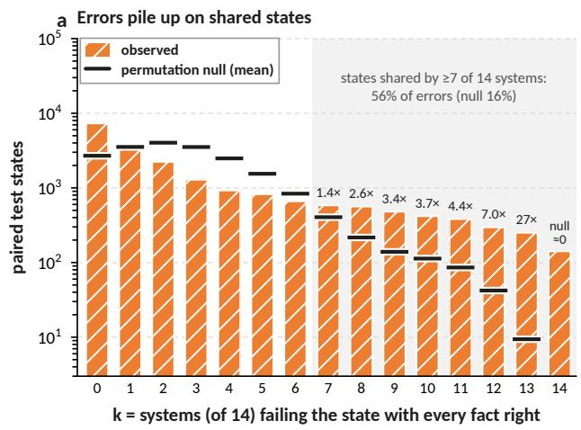

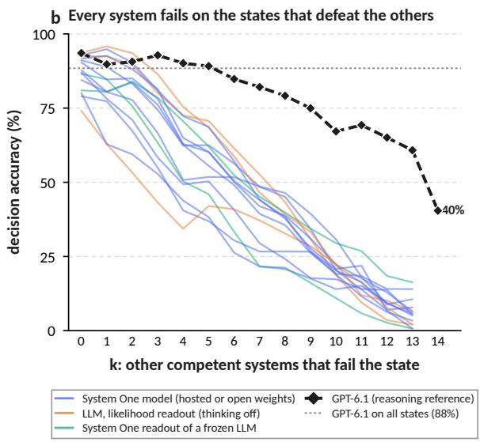  
Figure 6: (a) Paired test states on which k of the 14 competent fast systems make a facts-right, action-wrong error, against a within-cell permutation null (ticks; labels give observed/null). (b) Accuracy of each competent system on states that k of the other thirteen fail (thin lines, by category) and of GPT-6.1 by k (dashed).

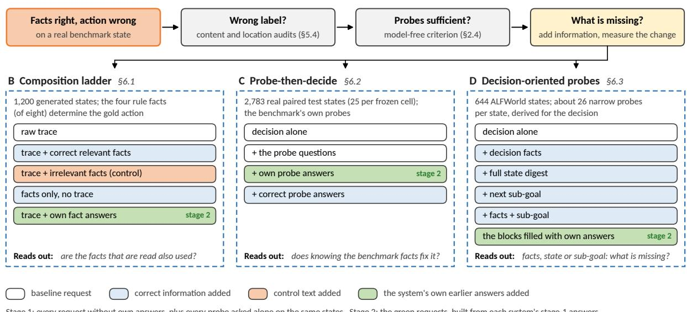  
Figure 7: The diagnostic studies. Each sends the decision again with information added, as separate requests on the same states: B on generated states whose probes determine the action, C with the benchmark’s probes on real states, D with probes derived for the decision on ALFWorld. Green requests use the system’s own earlier answers.

Reading and composing each succeed; doing both at once does not. Every system shown in Figure 8a answers the rule-fact probes almost perfectly on the raw trace (97–100%). JEV and Qwen3.8-27B also decide perfectly when given the facts alone (1.000 and 0.994). Yet from the raw trace their decision accuracy is 0.791 and 0.797, a gap of 20 points between two abilities that each work in isolation. Appending the correct values of the relevant facts to the trace closes the gap (0.974 and 0.967), while appending the same amount of irrelevant text widens it (0.751 and 0.705). Gemma shows no gap at all (0.991 from the trace), and Cygnet lies in between, with 0.992 from the facts alone and 0.881 from the trace. For Clef, Qwen3.5- 9B and Kev-9B even the facts-only condition is imperfect (0.71–0.87), so they also fail to apply the rules. For the fast systems, almost none of the errors comes from not knowing a fact (97–100% of JEV’s, Qwen3.8-27B’s and Cygnet’s errors have all four rule facts right). They come from choosing what to act on. The reasoning reference is the exception: GPT-6.1 decides at 0.928 from the trace and at 1.000 from the facts, but only 26 of its 86 errors have all four rule facts right, and 62 apply a rule whose condition does not hold. When it reasons before answering, composition is no longer the bottleneck and the remaining errors are misreadings, spread evenly over facts that were and were not overwritten later in the trace (2.6% and 2.3% of probes).

The remaining eight System One models separate the two abilities just as cleanly: seven of them decide perfectly from the facts alone (1.000). Four of them also nearly close the gap from the raw trace: Decider-chat-31B, Perplexity Decider-27B, Quyet-1.0-Large and Eikos-27B decide at 0.95–0.98, and most of their few errors (19–63) are precedence errors with all facts right. Torchcast-27B comes close (0.938 from the trace, a gap of 6 points);

its 75 errors, all but one with every fact right, are spread over precedence, distractor and default actions. OpenAI Decisions repeats the pattern of JEV and Qwen3.8-27B: 0.792 from the trace, 0.964 with the relevant facts appended and 0.757 with irrelevant ones; 232 of its 250 errors have all four rule facts right. A gap of 20 points between reading and composing is therefore not a property of one model family, but neither is it universal among fast decision models. Vega-27B shows a gap of its own: it reads the facts (0.999) but decides at 0.691 from the trace, 0.918 from the facts alone and 0.520 when irrelevant facts are appended, and 216 of its 371 errors act on a true fact outside the procedure, the capture failure we see for Clef. SimpleJev-27B has the largest gap of any system: it decides perfectly from the facts alone but at 0.551 from the trace and 0.451 with irrelevant facts appended, and 299 of its 539 errors act on a fact outside the procedure.

The errors follow true but wrong cues. JEV never applies a rule whose condition is false (OpenAI Decisions does, in 149 of its 250 errors, at least 131 of them with all four rule facts answered correctly). Its 251 errors on the raw trace apply a later rule whose condition is also true, skipping an earlier one (125, precedence), act on a true fact that is outside the procedure (103, distractor), or fall back to the default action although a rule applies (23). Across systems (Figure 8b), the errors of Clef, Vega-27B and SimpleJev-27B are mostly distractor actions, the few errors of Quyet-1.0-Large, Eikos-27B and Decider-chat-31B mostly precedence errors, and those of GPT-6.1 and OpenAI Decisions mostly false rules. We test four explanations with targeted rewrites of the same states (Figure 8c). Rewriting observations as neutral statements changes nothing for JEV (+0.5), so the wording of observations is not the cause. Moving the decisive evidence to the end of the trace helps (+7.9 in rule order, +10.8 reversed), and removing the distractor facts also helps (+7.8), but neither removes the precedence errors. Only a summary of the facts in one place recovers the facts-only level. For JEV and Qwen3.8-27B, the failure is therefore one of consolidating evidence scattered over a trace before applying an ordered rule. Clef behaves differently: removing distractor facts alone raises its accuracy by 33 points, to 0.924, so its dominant failure is capture by out-of-procedure cues. The same benchmark thus separates two mechanisms that yield the same outcome.

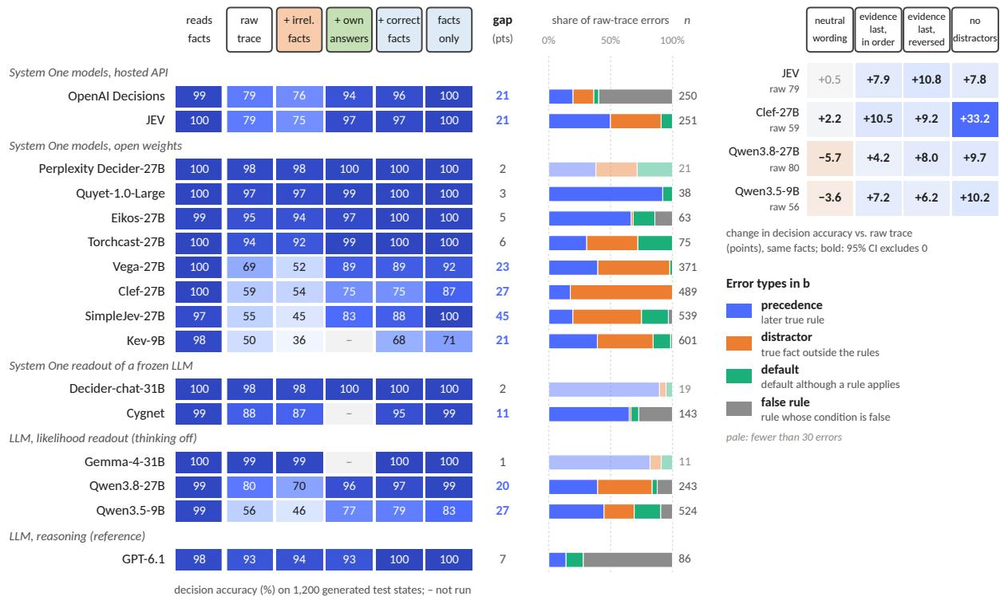  
Figure 8: States whose probes are sufficient by construction (1,200 test states). (a) Probe accuracy and decision accuracy under each input, and the gap from raw trace to facts only (points). (b) Raw-trace errors by type (n: errors). (c) Change vs. the raw trace for rewrites with the same facts; bold: 95% interval excludes zero. Header colours follow Figure 7.

Using the model’s own answers. Because these models read the facts correctly, they can supply the summary themselves. Appending each system’s own probe answers (asked in separate requests) recovers almost all of the gap: JEV rises from 0.791 to 0.968 (+17.7), Qwen3.8-27B to 0.955 (+15.8), Qwen3.5-9B to 0.767 (+20.3) and Clef to 0.747 (+15.4; its self-written summaries are identical to the correct ones on 1,197 of 1,200 states). GPT-6.1 gains nothing (0.928 to 0.931): its errors are misreadings, and its own summaries repeat them (114 wrong fact values over the 1,200 states). OpenAI Decisions recovers most of its gap from its own answers (0.792 to 0.937, +14.5, CI [+12.1, +16.8]), although its summaries contain 63 wrong fact values; Vega-27B gains about as much as Qwen3.5- 9B (0.691 to 0.890, +19.9, CI [+17.7, +22.2]) with only 5 wrong fact values; SimpleJev-27B gains the most of all (0.551 to 0.827, +27.6, CI [+25.1, +30.2]) despite 148 wrong fact values; Torchcast-27B closes its smaller gap (0.938 to 0.994, +5.7, CI [+4.3, +7.0]); the four systems near ceiling gain 1.3–2.7 points. Composing the action in code from the model’s own fact answers, which is possible here because the rules are explicit, is better still: 0.996 for JEV, 0.987 for Qwen3.8-27B, 1.000 for Clef and 0.965 for Qwen3.5-9B. The second request can be reserved for uncertain states: using the native confidence of the first decision, a cascade that re-asks only below a confidence of 0.7 reaches 0.932 for JEV with a second request on 38% of states. This is the usage pattern that System One models are designed for: many narrow questions in parallel, combined by code (TypeSafe AI, 2026).

## 6.2 Back to real states: probe-then-decide

Does the remedy transfer to natural states? We sample 2,783 paired test states (25 per frozen cell, all domains) and ask the decision alone, after the benchmark’s probe questions, after the system’s own earlier probe answers, or after the correct answers (Table 3, Figure 9a). The effect is small for every system but two. For the other fast systems, correct answers add 2.9–7.1 points, the system’s own answers 2.1–4.7 and merely asking the questions 0.6–3.0; GPT-6.1, which decides alone at 0.902, gains 1.3 points from the correct answers and 0.4 from its own. Most of the benefit of the own answers is therefore already obtained by listing the questions: the answers themselves add at most 2.1 points, and nothing distinguishable from zero for JEV, Kev-9B, Qwen3.5-9B and Perplexity Decider-27B. SimpleJev-27B and Torchcast-27B are the exceptions. Deciding alone at 0.656, SimpleJev-27B gains 10.1 points from the correct answers and 9.1 from its own, 5.6 of them beyond the questions; Torchcast-27B, alone at 0.715, gains 8.6 from the correct answers and 7.3 from its own, but 5.4 of them already from the questions, mostly on ALF-World (correct answers +20.2 there). The small net gain hides larger movements. For Qwen3.8-27B, JEV, Gemma and Clef, the own answers repair 34%, 32%, 27% and 25% of the facts-right, actionwrong states, but break 2–4% of the states that were correct, which are about five times as many. OpenAI Decisions’ own answers repair 33% of its facts-right, action-wrong states, as many as for JEV, but break 6.8% of the correct ones, the most of any system. Quyet-1.0-Large answers only 547 of the 2,783 states (it refuses option lists longer than ten); on those, no condition changes its accuracy measurably (0.808 alone).

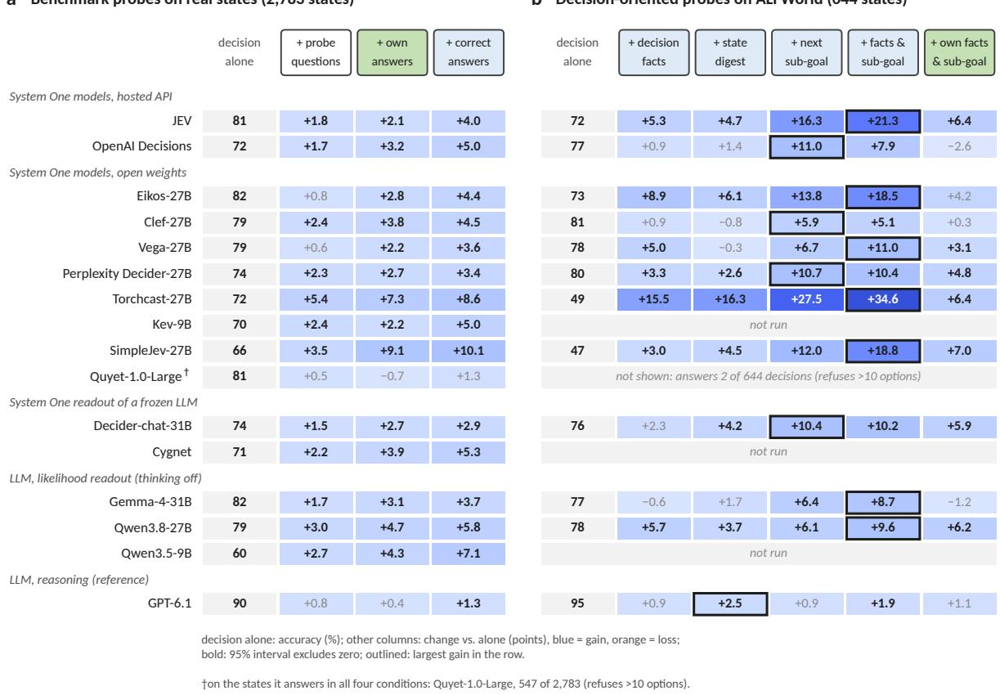  
Figure 9: Adding information to real states: decision accuracy alone (gray) and the change when information is added (points; blue gain, orange loss; bold: 95% interval excludes zero). (a) Benchmark probes on 2,783 paired states. (b) Decision-oriented blocks on 644 ALFWorld states; outlined: the largest gain in each row. Header colours follow Figure 7.

The contrast with §6.1 is the point. There, the probes were sufficient and their answers determined the action; here, even the correct answers to the benchmark probes leave most errors in place. The probes were designed to measure reading, not to specify the decision, so they do not carry the missing information.

## 6.3 Decision-oriented probes

If the bottleneck is what the probes ask, probes designed for the decision should do better. On 644 ALFWorld states we derive, from the text of the trace alone, everything a planner would need: the agent’s location and inventory, where each stillneeded object was last seen, whether the held object has been cleaned, heated or cooled, how many objects are already in place, which receptacles have not yet been visited, and the next sub-goal (search, fetch, take, go to the appliance, process, go to the destination, place, use the lamp). We validate the parse against the simulator labels (§5.4) and ask each fact as a narrow, independent question, about 26 per state. We then add to the decision request either the decision-oriented facts, a complete digest of the observed state, the next sub-goal, or facts plus sub-goal, each with correct values, and the same blocks filled with each system’s own answers (Table 4, Figure 9b).

<table><tr><td></td><td></td><td colspan="3">Change vs. alone (points)</td></tr><tr><td>System</td><td></td><td>Alone +questions</td><td>+own</td><td>+correct</td></tr><tr><td colspan="5">System One models, hosted API</td></tr><tr><td>JEV</td><td>0.806</td><td>+1.8</td><td>+2.1</td><td>+4.0</td></tr><tr><td></td><td></td><td>[+0.4, +3.2]</td><td>[+0.7, +3.3]</td><td>[+2.6, +5.5]</td></tr><tr><td>OpenAI Decisions 0.722</td><td></td><td>+1.7</td><td>+3.2</td><td>+5.0</td></tr><tr><td></td><td></td><td>[+0.0, +3.5]</td><td>[+1.6, +5.0]</td><td>[+3.4, +6.7]</td></tr><tr><td colspan="5">System One models, open weights</td></tr><tr><td>Eikos-27B</td><td>0.821</td><td>+0.8</td><td>+2.8</td><td>+4.4</td></tr><tr><td></td><td></td><td>[-0.3, +1.8]</td><td>[+1.6, +4.1]</td><td>[+3.1, +5.8]</td></tr><tr><td>Clef-27B</td><td>0.789</td><td>+2.4</td><td>+3.8</td><td>+4.5</td></tr><tr><td></td><td></td><td>[+1.1, +3.6]</td><td>[+2.6, +5.2]</td><td>[+3.1, +5.9]</td></tr><tr><td>Vega-27B</td><td>0.792</td><td>+0.6</td><td>+2.2</td><td>+3.6</td></tr><tr><td></td><td></td><td>[-0.5, +1.6]</td><td>[+1.0, +3.4]</td><td>[+2.3, +4.8]</td></tr><tr><td>Perplexity</td><td>0.739</td><td>+2.3</td><td>+2.7</td><td>+3.4</td></tr><tr><td>Decider-27B</td><td></td><td>[+1.4, +3.4]</td><td>[+1.7, +3.8]</td><td>[+2.4, +4.6]</td></tr><tr><td>Torchcast-27B</td><td>0.715</td><td>+5.4</td><td>+7.3</td><td>+8.6</td></tr><tr><td></td><td></td><td>[+4.2, +6.7]</td><td>[+5.8, +8.7]</td><td>[+7.1, +10.3]</td></tr><tr><td>Kev-9B</td><td>0.697</td><td>+2.4</td><td>+2.2</td><td>+5.0</td></tr><tr><td></td><td></td><td>[+1.2, +3.7]</td><td>[+0.8, +3.5]</td><td>[+3.6, +6.5]</td></tr><tr><td>SimpleJev-27B</td><td>0.656</td><td>+3.5</td><td>+9.1</td><td>+10.1</td></tr><tr><td></td><td></td><td>[+1.2, +5.8]</td><td>[+6.9, +11.4]</td><td>[+7.8, +12.5]</td></tr><tr><td>Quyet-1.0-Large†</td><td>0.808</td><td>+0.5</td><td>-0.7</td><td>+1.3</td></tr><tr><td></td><td></td><td>[-1.5, +2.4]</td><td>[-3.1, +1.6]</td><td>[-1.1, +3.7]</td></tr><tr><td colspan="5">System One readout of a frozen LLM</td></tr><tr><td>Decider-chat-31B 0.737</td><td></td><td>+1.5</td><td>+2.7</td><td>+2.9</td></tr><tr><td></td><td></td><td>[+0.7, +2.3]</td><td>[+1.6, +3.7]</td><td>[+1.9, +3.9]</td></tr><tr><td>Cygnet</td><td>0.713</td><td>+2.2</td><td>+3.9</td><td>+5.3</td></tr><tr><td></td><td></td><td>[+1.1, +3.4]</td><td>[+2.5, +5.6]</td><td>[+3.7, +6.8]</td></tr><tr><td colspan="5">LLM, likelihood readout (thinking off)</td></tr><tr><td>Gemma-4-31B</td><td>0.821</td><td>+1.7</td><td>+3.1</td><td>+3.7</td></tr><tr><td></td><td></td><td>[+0.9, +2.7]</td><td>[+2.0, +4.2]</td><td>[+2.5, +4.9]</td></tr><tr><td>Qwen3.8-27B</td><td>0.794</td><td>+3.0</td><td>+4.7</td><td>+5.8</td></tr><tr><td></td><td></td><td>[+1.3, +4.6]</td><td>[+3.2, +6.3]</td><td>[+4.5, +7.4]</td></tr><tr><td>Qwen3.5-9B</td><td>0.600</td><td>+2.7</td><td>+4.3</td><td>+7.1</td></tr><tr><td></td><td></td><td> $[ + 1 . 1 , + 4 . 5 ]$ </td><td> $[ + 1 . 6 , + 6 . 9 ]$ </td><td>[+4.4, +9.7]</td></tr><tr><td colspan="5">LLM, reasoning (reference)</td></tr><tr><td>GPT-6.1</td><td>0.902</td><td>+0.8</td><td>+0.4</td><td>+1.3</td></tr><tr><td></td><td></td><td>[-0.0, +1.7]</td><td> $[ - 0 . 1 , + 0 . 9 ]$ </td><td>[+0.7, +1.9]</td></tr></table>

Table 3: Probe-then-decide on 2,783 paired test states: accuracy alone and change (points) after the probe questions, the system’s own answers or the correct answers, with 95% intervals below; gray: interval includes zero. Refused requests count as wrong (Perplexity Decider-27B: 268 states, 8k-token limit per question). †Quyet-1.0-Large: the 547 states it answers.

The facts are read; the sub-goal is not chosen. JEV answers the narrow probes almost perfectly: 99.7% of the 14,104 visited-or-not questions, 100% for the held object and placed count, 96.9% for where needed objects were seen. Yet decisionoriented facts add only 5.3 points, no more than the benchmark’s own probes (5.7), and a complete state digest adds 4.7. Stating the next sub-goal adds 16.3 points, and facts plus sub-goal 21.3, reaching 0.929. JEV’s own answer to the sub-goal question is right in only 66.8% of states, so the same block filled with its own answers adds 6.4. Of JEV’s 183 errors when deciding alone, 41% have every fact right but the sub-goal wrong, and another 37% have both right when asked separately: JEV can state the sub-goal it then fails to pursue. For JEV, the remaining errors on real ALFWorld states are errors of planning, not of reading or of consolidation.

Stronger systems are limited elsewhere. The same blocks help Clef, Gemma and Qwen3.8-27B much less: no block adds more than 10 points, and the sub-goal adds about 6. Their own answers help only Qwen3.8-27B (+4.8 with facts, +6.2 with facts and sub-goal); for Clef and Gemma they change nothing (−1.2 to +0.3). GPT-6.1 decides alone at 0.953 and no block, correct or its own, adds more than 2.5 points. How well a system answers the subgoal question does not predict whether its answers help. Clef answers it best (89.1%) and gains nothing; of Clef’s errors when deciding alone, nearly half (48%) occur with every fact and the sub-goal answered correctly in separate requests. Qwen3.8- 27B answers it worst (36.0%, below its own decision accuracy) and still gains, through the facts; GPT-6.1 answers it equally poorly (35.2%) while deciding correctly in 95% of states, so its decisions do not pass through the sub-goal as the benchmark labels it. The decision-oriented facts can even hurt: on states where one needed object has been seen and another has not, listing the unvisited receptacles sends Gemma and Qwen3.8-27B to search instead of fetching what they already know about, and Gemma’s accuracy on these states falls from 0.659 to 0.341. With every block given, most of Gemma’s remaining errors pick the right kind of action for the wrong object. Extra information is not neutral: a salient but incomplete summary can pull a model away from the trace it otherwise reads well.

The other systems. The seven other System One models that answer ALFWorld decisions confirm that the sub-goal is the most useful single block: it adds 6.7–13.8 points for six of them (OpenAI Decisions +11.0, CI [+7.2, +14.9]; Eikos-27B +13.8), while decision-oriented facts add 0.9–3.3 points, except for Vega-27B (+5.0) and Eikos-27B (+8.9), which gains 18.5 from facts plus sub-goal. Torchcast-27B repeats JEV’s pattern more strongly: deciding alone at only 0.486, it gains 27.5 points from the sub-goal and 34.6 from facts plus sub-goal (to 0.832), more than any other system, answers the sub-goal question correctly in only 60% of states, and 53% of its errors when deciding alone have every fact right but the sub-goal wrong. Like Clef and Gemma rather than JEV, the others mostly answer the sub-goal question well (0.77–0.87; SimpleJev-27B 0.64), and 32–64% of their errors when deciding alone occur with every fact and the sub-goal answered correctly in separate requests. Their own answers help less than the correct ones, and OpenAI Decisions’ own facts and sub-goal even lower its accuracy (−2.6, CI [−7.1, +1.9]). The pull of an incomplete summary also recurs: on the states where one needed object has been seen and another has not, correct decision facts lower OpenAI Decisions from 0.698 to 0.543 and Decider-chat-31B from 0.698 to 0.434, although Vega-27B and Torchcast-27B gain on the same states (0.713 to 0.806 and 0.302 to 0.496).

<table><tr><td rowspan="3"></td><td rowspan="3"></td><td colspan="7">Change vs. decision alone (points)</td><td rowspan="3"></td></tr><tr><td colspan="5">Status block with correct values</td><td colspan="2">With own answers</td></tr><tr><td>Benchmark probes</td><td>Decision facts</td><td>State digest</td><td>Next sub-goal</td><td>Facts + sub-goal</td><td>Facts</td><td>Facts + sub-goal</td></tr><tr><td colspan="9">System One models, hosted API</td><td></td></tr><tr><td>JEV</td><td>0.716</td><td>+5.7</td><td>+5.3</td><td>+4.7</td><td>+16.3</td><td>+21.3</td><td>+4.8</td><td>+6.4</td><td>0.668</td></tr><tr><td>OpenAI Decisions</td><td>0.767</td><td>+4.0</td><td>+0.9</td><td>+1.4</td><td>+11.0</td><td>+7.9</td><td>+1.1</td><td>-2.6</td><td>0.775</td></tr><tr><td colspan="9">System One models, open weights</td></tr><tr><td>Eikos-27B</td><td>0.725</td><td>+9.3</td><td>+8.9</td><td>+6.1</td><td>+13.8</td><td>+18.5</td><td>+6.8</td><td>+4.2</td><td>0.809</td></tr><tr><td>Clef-27B</td><td>0.806</td><td>+4.8</td><td>+0.9</td><td>-0.8</td><td>+5.9</td><td>+5.1</td><td>-1.2</td><td>+0.3</td><td>0.891</td></tr><tr><td>Vega-27B</td><td>0.783</td><td>+3.6</td><td>+5.0</td><td>-0.3</td><td>+6.7</td><td>+11.0</td><td>+0.9</td><td>+3.1</td><td>0.767</td></tr><tr><td>Perplexity Decider-27B</td><td>0.798</td><td>+6.2</td><td>+3.3</td><td>+2.6</td><td>+10.7</td><td>+10.4</td><td>+2.0</td><td>+4.8</td><td>0.873</td></tr><tr><td>Torchcast-27B</td><td>0.486</td><td>+21.3</td><td>+15.5</td><td>+16.3</td><td>+27.5</td><td>+34.6</td><td>+14.1</td><td>+6.4</td><td>0.601</td></tr><tr><td>SimpleJev-27B</td><td>0.474</td><td>+19.3</td><td>+3.0</td><td>+4.5</td><td>+12.0</td><td>+18.8</td><td>+1.2</td><td>+7.0</td><td>0.638</td></tr><tr><td colspan="9">System One readout of a frozen LLM</td></tr><tr><td>Decider-chat-31B</td><td>0.762</td><td>+8.2</td><td>+2.3</td><td>+4.2</td><td>+10.4</td><td>+10.2</td><td>+2.0</td><td>+5.9</td><td>0.871</td></tr><tr><td colspan="9">LLM, likelihood readout (thinking off)</td></tr><tr><td>Gemma-4-31B</td><td>0.775</td><td>+7.0</td><td>-0.6</td><td>+1.7</td><td>+6.4</td><td>+8.7</td><td>-0.9</td><td>-1.2</td><td>0.795</td></tr><tr><td>Qwen3.8-27B</td><td>0.783</td><td>+9.9</td><td>+5.7</td><td>+3.7</td><td>+6.1</td><td>+9.6</td><td>+4.8</td><td>+6.2</td><td>0.360</td></tr><tr><td colspan="10">LLM, reasoning (reference)</td></tr><tr><td>GPT-6.1</td><td>0.953</td><td>+1.4</td><td>+0.9</td><td>+2.5</td><td>+0.9</td><td>+1.9</td><td>+1.6</td><td>+1.1</td><td>0.352</td></tr></table>

Table 4: Decision-oriented blocks on 644 ALFWorld states: accuracy alone, change (points) with each block (correct values unless marked own) and accuracy on the sub-goal question. Gray: 95% interval includes zero. Quyet-1.0-Large is omitted (answers 2 of 644).

What this means. Across these studies, the source of a facts-right, action-wrong error varies by system and by state: consolidation of scattered evidence for JEV and Qwen3.8-27B on rule procedures, capture by irrelevant cues for Clef, sub-goal selection for JEV on household tasks, and grounding a sub-goal in the right object for Gemma. Each calls for a different remedy, and only the paired measurement, combined with probes that are sufficient for the decision, reveals which applies.

## 7 Controls, Boundaries and Calibration

The paired outcomes describe single states. The controlled variations of §2.5 ask what the models rely on, where their accuracy begins to fall, and whether their distributions can be used to decide when to trust them.

The history is used where it is needed. Removing the executed history leaves BabyAI almost unchanged (JEV 73.3→70.1%; Gemma even rises from 75.5% to 79.9%), since the current view largely determines the next step, but it collapses the states that require remembering an earlier observation (Figure 10a). On the ALF-World distance ladder, every strong system falls to between 14% and 24% (JEV 87.2→13.7%, Gemma 92.6→22.6%, Clef 86.5→23.9%, Cygnet 93.9→15.7%), and on TextWorld to between 35% and 42% (from 74–86%). The other systems that answer ALFWorld decisions fall into the same band on the distance ladder (OpenAI Decisions 83.1→14.8%, Eikos-27B 88.6→15.3%, Perplexity Decider-27B 86.9→22.1%, Vega-27B 86.0→22.2%, Decider-chat-31B 93.6→24.3%; SimpleJev-27B and Torchcast-27B, weaker to begin with, 45.1→6.8% and 59.1→7.7%) and to 30– 48% on TextWorld, while on BabyAI they lose at most 2.3 points or improve. The models therefore do read the trace, and the facts-right, action-wrong errors of §5 are not a sign that the history is ignored.

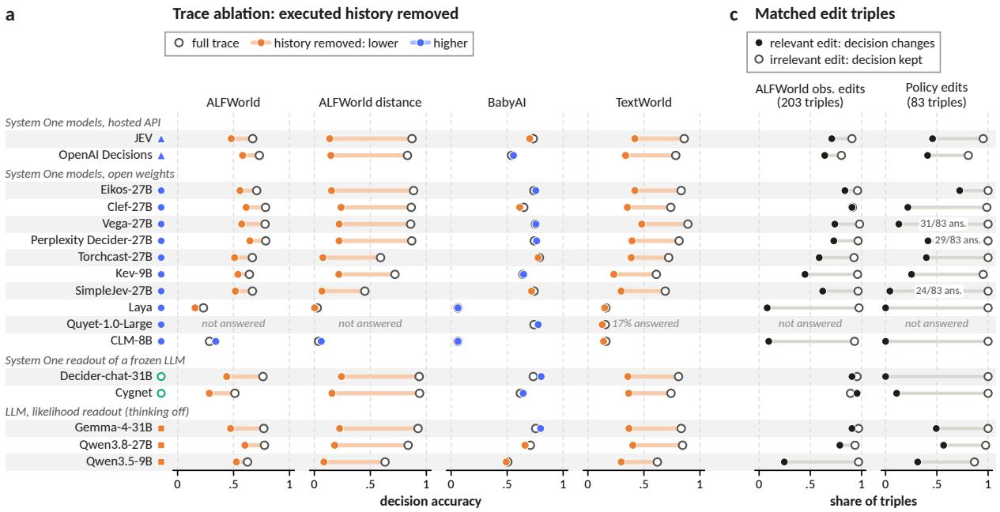

b ALFWorld decision accuracy by trace length  
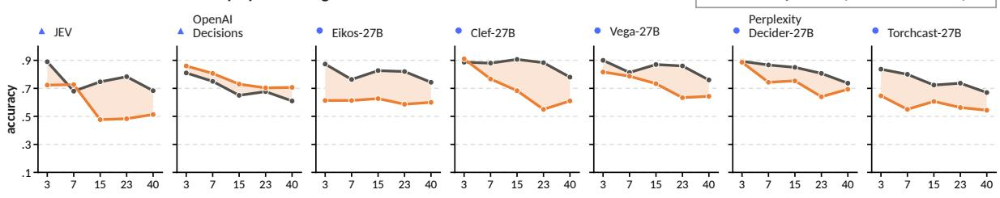

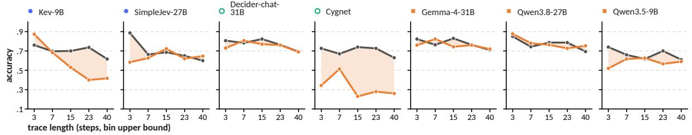  
Figure 10: Controlled variations. (a) Accuracy with the full trace (ring) and with the history removed (dot). (b) ALFWorld accuracy by trace length, for states whose needed object was already seen and states that require exploration. (c) Matched edit triples: share of relevant edits that change the decision (filled) and of irrelevant edits that keep it (ring). Systems failing the coverage rule are marked or omitted.

Exploration degrades with trace length; distance does not. The ALFWorld ladders locate where accuracy begins to fall (Figure 10b). When the needed object has already been seen, Clef and Gemma stay within about ten points of their shorttrace accuracy up to 23 steps, while JEV falls from 0.89 for three or fewer steps to 0.68–0.78 beyond. The larger effect is in states that still require exploration: JEV drops from 0.72 to 0.48 once the trace exceeds seven steps and Clef from 0.91 to 0.55, while Gemma stays between 0.72 and 0.82. Keeping track of which places have already been searched is the hard part. The distance between the decisive observation and the decision, in contrast, has no effect over the range we test: from zero to 15 irrelevant intervening steps, no competent system loses more than three points (e.g. Gemma 0.92– 0.94, JEV 0.84–0.90). The other systems agree: all lose accuracy on long traces (OpenAI Decisions even when the object has been seen, 0.81 to 0.61), and none loses accuracy with distance; Torchcast-27B even gains (0.52 with no intervening step, 0.64 with 15).

Relevant edits are noticed in simulators, missed in policies. When a single observation is edited so that the gold action changes (Figure 10c), Cygnet, Clef and Gemma change their decision in 91–96% of ALFWorld triples, Qwen3.8-27B in 79% and JEV in 71%, while all keep their decision after an irrelevant edit in 89–97% of cases. Deciderchat-31B (91%) and Eikos-27B (84%) react about as often as Cygnet, Clef and Gemma, and OpenAI Decisions is the least stable, changing after 64% of relevant edits but also after 20% of irrelevant ones; Torchcast-27B changes its decision after only 59% of relevant edits. Customer-service policy edits are a sharper case of the dissociation. When one record field is edited so that the policy now requires a different tool call, JEV, Clef, Gemma and Qwen3.8-27B answer every probe on the edited state correctly (all 374 edited states), yet in the 83 matched triples they change the call after a relevant edit in only 22% (Clef) to 57% (Qwen3.8-27B) of cases. The models read the edited fact and still act as if it had not changed. OpenAI Decisions answers 99.5% of the edited states’ probes correctly and changes the call in 41%; Torchcast-27B answers all of them correctly and changes the call in 40%. Eikos-27B is the exception: with every probe right, it changes the call after 72% of relevant edits and never after an irrelevant one. Decider-chat-31B never selects the required tool call on these states, so the question does not arise for it.

Stated rule changes are followed. When a TextWorld game states that cooking rules differ from the usual ones, the strong systems follow the stated rules in 90–99% of states (Clef 99.3%, Qwen3.8-27B 96.3%, JEV 93.3%, Gemma 90.3%), with the same results on a cohort generated later from new seeds. Kev-9B reaches 83.0% on the same states without ever answering all the rule probes correctly, an example of a correct action that does not follow from the measured facts. The other System One models follow the stated rules in 89–100% of states in both cohorts, with every rule probe answered correctly.

Calibration differs more than accuracy. Because System One models return a distribution, their confidence could decide when to escalate. Figure 11 shows that calibration varies far more across systems than accuracy does. Cygnet, whose recipe includes a calibration step, has an expected calibration error of 2.6%, and JEV 6.8%. Clef and Kev-9B are underconfident (mean confidence 0.66 and 0.47 at accuracies of 0.76 and 0.62), while the likelihood readout of Gemma is almost always near-certain (mean confidence 0.98 at an accuracy of 0.79; ECE 19.1%). For JEV, confidence is informative enough to drive the cascade of §6.1, but for an uncalibrated readout the same threshold would rarely fire. OpenAI Decisions, Eikos-27B and Deciderchat-31B are underconfident like Clef (mean confidence about 0.66 at accuracies of 0.70–0.79; ECE 8.8–11.9%), and Perplexity Decider-27B is close to Qwen3.8-27B (8.2%). Torchcast-27B is about as well calibrated as JEV (ECE 7.2%; mean confidence 0.70 at an accuracy of 0.69). OpenAI Decisions’ own confidence field, which we do not use, is lower still (ECE 13.9%). Quyet-1.0-Large’s low error (6.0%) covers only the 21% of decisions it answers. Apart from CLM-8B and Laya, Vega-27B is the least calibrated system we measure (ECE 26.6%): its mean confidence of 0.51 at an accuracy of 0.78 makes it strongly underconfident.

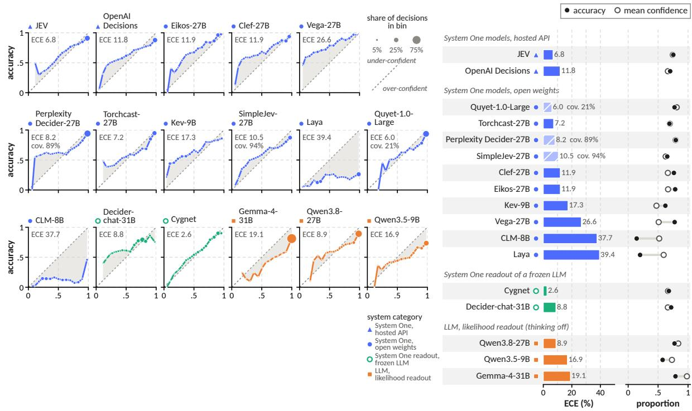  
Figure 11: Calibration of native decision distributions on test decisions. (a) Reliability diagrams; marker area is the share of decisions in the bin. (b) Expected calibration error (15 bins; hatched: coverage below 95%) and accuracy against mean confidence. GPT-6.1 is excluded (verbalized probabilities).

## 8 Related Work

System One models and next-action evaluation. Scoring a supplied set of answers, long used in classification and reranking, is now offered as a programmable interface for agents, by hosted models (TypeSafe AI, 2026; OpenAI, 2026a; Liquid AI, 2026) and open alternatives (Kwok et al., 2026; Palmer, 2026; Cloudflare, 2026; Convai Innovations, 2026; Vicentino, 2026; Perplexity AI, 2026; SimpleJev, 2026; vLLM Semantic Router Team, 2026; Nguyen, 2026; Blockbrain Labs, 2026; Mapika, 2026). As an evaluation judge, JEV approaches a reasoning judge where a verdict can be read off the text but falls behind where it must be derived, and its confidence can decide when to escalate (Li et al., 2026). Public comparisons report aggregate scores (Apolinário, 2026); agent benchmarks measure task success, progress or perstep correctness (Shridhar et al., 2021; Ma et al., 2024; Barres et al., 2026; Deng et al., 2023), and fixed histories with a next-action question are established (George et al., 2024). We ask what such accuracy leaves unexplained, pairing each decision with probes on the same state.

Knowing versus doing, and composition. Studies of agents (Schmied et al., 2026; Sobotka et al., 2026; Deb and Krishnan, 2026; Arghal et al., 2026) separate what an agent appears to know from what it does. Language models are also distracted by irrelevant context (Shi et al., 2023), plan better with an external component (Valmeekam et al., 2023; Kambhampati et al., 2024), and answer every subquestion of a problem yet fail the composed question (Press et al., 2023). Our setting exposes neither text nor hidden states, the probes are answered in isolation on the exact state, and we test whether the probe set can support the diagnosis at all. The remedies we test mirror decomposed and program-aided reasoning (Zhou et al., 2023; Khot et al., 2023; Gao et al., 2023), but the sub-questions go to the same choice-only model and the composition is done by the calling program.

Behavioral diagnosis. Chains of thought need not be faithful to the computation behind an answer (Turpin et al., 2023; Lanham et al., 2023). Like behavioral testing (Ribeiro et al., 2020), and unlike probing classifiers (Belinkov, 2022), we infer competence from controlled questions and input variations. Appendix A discusses each line of work, cost-aware routing and failure attribution in full.

## 9 Discussion

What a practitioner can do. The results suggest a simple procedure for deploying a System One model in an agent loop. First, measure the paired outcomes on the target states. If most errors follow misread facts, the remedy lies in the state representation, the trace format or the context budget. If most follow correct reading, as for every strong system here, the next question is whether the decision-relevant facts are known and the rules explicit. Where they are, as on our generated procedures, the strongest remedy is to ask the facts as narrow parallel questions and compose the action in code, which brought every system we tried to 0.96–1.00 at the price of a second batch of cheap questions; a confidence cascade keeps most of the gain with a second request on a third of the states. Where the decision requires choosing a sub-goal in an open task, as in ALFWorld, appending facts helps little, and the missing ingredient is a sub-goal that the model does not reliably supply; that is a planning problem, for a planner, for training, or for a deliberating model on the few states that need it.

A diagnostic instrument, not a leaderboard. The pooled accuracies of Table 2 hide most of what matters. Rankings change across domains (Figure 4); a perfect action score on coding traces hides a twelve-point difference in reading; two systems with similar paired accuracy fail for different reasons (consolidation for JEV, cue capture for Clef); and the most accurate fast system, Gemma’s likelihood readout, is among the least calibrated. Fast decision models are therefore better evaluated with diagnostic panels and their controls, and with freshly generated states whose probes are sufficient by construction, that match the kind of state a workflow depends on, than with a single number.

Fast is not the same as cheap to trust. GPT-6.1 shows what deliberation buys on the same states: seven to twelve points of decision accuracy at roughly seventy times the cost of JEV. It does not change the kind of error that remains. For agent builders, the interesting design space is therefore not System One versus reasoning models, but which states a fast model can be trusted on, which need a composed decision, and which need deliberation. The paired measurement, the probesufficiency check and the model’s own calibration are the instruments for drawing that line.

## 10 Limitations

Behavioral evidence only. The paired outcomes are observations on identical inputs. They do not show which internal computation produced an action, and a correct probe answer does not prove that the model used that fact. Probe coverage. On natural states the probes are not sufficient for the decision, so a facts-right, action-wrong outcome mixes decision failures with facts we did not ask about; the generated ladder and the decisionoriented probes address this only for the domains they cover. Labels. Gold actions are computed from agent-observable information, but they can be stricter than necessary (5–42% of a system’s simulator errors are in fact optimal) and, in the original ALFWorld cohorts, co-located receptacles produce wrong location labels for 303 of 8,197 paired ALFWorld records; we keep the frozen labels and report sensitivity analyses. Deployments, not architectures. Systems differ in serving stack, readout and input limits, two author runtimes shorten long states themselves, and hosted models can change between versions (96.3% agreement on a JEV rerun after five days; OpenAI Decisions is a public beta). Scope. We evaluate single decisions on frozen traces, not closed-loop execution, and the follow-up studies of §6 cover a subset of systems: the composition ladder and probe-then-decide sixteen each, and the decision-oriented probes twelve (each count includes the reasoning reference). The reasoning reference answered each question in a separate call with a verbalized distribution, so its calibration is not comparable.

## 11 Conclusion

A fast decision model that errs leaves nothing behind but a wrong action. By asking the same model, on the same state, what it read and what it chose, we find that for strong systems the problem is usually not reading. Across seventeen fast systems and a reasoning model, most wrong actions follow correct reading, and they gather on states that defeat systems of every kind. Reading right and acting wrong is therefore not the mark of weak models but the characteristic failure of strong ones. Nor is it a single failure. When the decisive facts are known, models fail to combine them, and their own answers, composed by code, repair the decision; in open tasks they lack the next sub-goal, which additional facts do not supply. Both point to one way of building agents on fast models: let the model read, through many narrow questions, and hand the composition of the decision to code, to a planner, or to deliberation where a state requires it. Measuring reading and acting separately is what tells which a state requires.

## References

Apolinário. 2026. Jev Decision Index. Hugging Face Space https://huggingface.co/spaces/ multimodalart/jev-decision-index; reproduction kit https://github.com/ apolinario/decision-index (Decision Index 0.2.1, 2026-09-27). Accessed 2026-10-05.

Raghu Arghal, Phoebe Chen, Niall Dalton, Evgenii Kortukov, Calum McNamara, Angelos Nalmpantis, Moksh Nirvaan, Gabriele Sarti, and Mario Giulianelli. 2026. A behavioural and representational evaluation of goal-directedness in language model agents. In Proceedings of the 43rd International Conference on Machine Learning, volume 306 of Proceedings of Machine Learning Research, pages 3434–3451. PMLR.

Victor Barres, Honghua Dong, Soham Ray, Xujie Si, and Karthik R. Narasimhan. 2026. τ2-bench: Evaluating conversational agents in a dual-control environment. In Proceedings of the 43rd International Conference on Machine Learning, volume 306 of Proceedings of Machine Learning Research, pages 6736–6782. PMLR.

Yonatan Belinkov. 2022. Probing classifiers: Promises, shortcomings, and advances. Computational Linguistics, 48(1):207–219.

Blockbrain Labs. 2026. Cygnet recipe: Typed decisions from frozen Gemma-4-12B-it. GitHub repository, https://github.com/blockbrain-ai/ cygnet-recipe. Accessed 2026-10-05.

Thomas Carta, Clément Romac, Thomas Wolf, Sylvain Lamprier, Olivier Sigaud, and Pierre-Yves Oudeyer. 2023. Grounding large language models in interactive environments with online reinforcement learning. In Proceedings of the 40th International Conference on Machine Learning, volume 202 of Proceedings of Machine Learning Research, pages 3676–3713. PMLR.

Lingjiao Chen, Matei Zaharia, and James Zou. 2024. FrugalGPT: How to use large language models while reducing cost and improving performance. Transactions on Machine Learning Research.

Maxime Chevalier-Boisvert, Dzmitry Bahdanau, Salem Lahlou, Lucas Willems, Chitwan Saharia, Thien Huu

Nguyen, and Yoshua Bengio. 2019. BabyAI: A platform to study the sample efficiency of grounded language learning. In International Conference on Learning Representations.

Cloudflare. 2026. Clef. Hugging Face model card, https://huggingface.co/Cloudflare/ clef. Accessed 2026-10-05.

Convai Innovations. 2026. Laya. Hugging Face model card, https://huggingface.co/ convaiinnovations/laya. Accessed 2026- 10-05.

Marc-Alexandre Côté, Ákos Kádár, Xingdi Yuan, Ben Kybartas, Tavian Barnes, Emery Fine, James Moore, Ruo Yu Tao, Matthew Hausknecht, Layla El Asri, Mahmoud Adada, Wendy Tay, and Adam Trischler. 2018. TextWorld: A learning environment for text-based games. Computer Games Workshop at IJCAI 2018. arXiv:1806.11532. Preprint, arXiv:1806.11532.

Christopher Zhang Cui, Xingdi Yuan, Ziang Xiao, Prithviraj Ammanabrolu, and Marc-Alexandre Côté. 2025. TALES: Text adventure learning environment suite. Preprint, arXiv:2504.14128.

Sagar Deb and Ashwanth Krishnan. 2026. STOCK-TAKE: Measuring the gap between perception and action in LLM agents with a fair oracle. Preprint, arXiv:2607.13618.

Xiang Deng, Yu Gu, Boyuan Zheng, Shijie Chen, Sam Stevens, Boshi Wang, Huan Sun, and Yu Su. 2023. Mind2Web: Towards a generalist agent for the web. In Advances in Neural Information Processing Systems (Datasets and Benchmarks Track), volume 36, pages 28091–28114. Curran Associates, Inc.

Jack FitzGerald, Christopher Hench, Charith Peris, Scott Mackie, Kay Rottmann, Ana Sanchez, Aaron Nash, Liam Urbach, Vishesh Kakarala, Richa Singh, Swetha Ranganath, Laurie Crist, Misha Britan, Wouter Leeuwis, Gokhan Tur, and Prem Natarajan. 2023. MASSIVE: A 1M-example multilingual natural language understanding dataset with 51 typologically-diverse languages. In Proceedings of the 61st Annual Meeting of the Association for Computational Linguistics (Volume 1: Long Papers), pages 4277–4302, Toronto, Canada. Association for Computational Linguistics.

Luyu Gao, Aman Madaan, Shuyan Zhou, Uri Alon, Pengfei Liu, Yiming Yang, Jamie Callan, and Graham Neubig. 2023. PAL: Program-aided language models. In Proceedings of the 40th International Conference on Machine Learning, volume 202 of Proceedings ofMachine Learning Research, pages 10764–10799. PMLR.

Gemma Team. 2026. Gemma 4 technical report. Preprint, arXiv:2607.02770.

Sonny George, Chris Sypherd, and Dylan Cashman. 2024. Probing the capacity of language model agents

to operationalize disparate experiential context despite distraction. In Findings of the Association for Computational Linguistics: EMNLP 2024, pages 15447–15459, Miami, Florida, USA. Association for Computational Linguistics.

Chuan Guo, Geoff Pleiss, Yu Sun, and Kilian Q. Weinberger. 2017. On calibration of modern neural networks. In Proceedings ofthe 34th International Conference on Machine Learning, volume 70 of Proceedings ofMachine Learning Research, pages 1321– 1330. PMLR.

Yeonjun In, Mehrab Tanjim, Jayakumar Subramanian, Sungchul Kim, Uttaran Bhattacharya, Wonjoong Kim, Sangwu Park, Somdeb Sarkhel, and Chanyoung Park. 2026. Rethinking failure attribution in multi-agent systems: A multi-perspective benchmark and evaluation. Preprint, arXiv:2603.25001.

Zhijing Jin, Yuen Chen, Felix Leeb, Luigi Gresele, Ojasv Kamal, Zhiheng Lyu, Kevin Blin, Fernando Gonzalez Adauto, Max Kleiman-Weiner, Mrinmaya Sachan, and Bernhard Schölkopf. 2023. CLadder: Assessing causal reasoning in language models. In Advances in Neural Information Processing Systems, volume 36, pages 31038–31065. Curran Associates, Inc.

Saurav Kadavath, Tom Conerly, Amanda Askell, Tom Henighan, Dawn Drain, Ethan Perez, Nicholas Schiefer, Zac Hatfield-Dodds, Nova DasSarma, Eli Tran-Johnson, Scott Johnston, Sheer El-Showk, Andy Jones, Nelson Elhage, Tristan Hume, Anna Chen, Yuntao Bai, Sam Bowman, Stanislav Fort, and 17 others. 2022. Language models (mostly) know what they know. Preprint, arXiv:2207.05221.

Daniel Kahneman. 2011. Thinking, Fast and Slow. Farrar, Straus and Giroux, New York.

Subbarao Kambhampati, Karthik Valmeekam, Lin Guan, Mudit Verma, Kaya Stechly, Siddhant Bhambri, Lucas Saldyt, and Anil Murthy. 2024. Position: LLMs can’t plan, but can help planning in LLMmodulo frameworks. In Proceedings ofthe 41st International Conference on Machine Learning, volume 235 of Proceedings of Machine Learning Research, pages 22895–22907. PMLR.

Mehran Kazemi, Quan Yuan, Deepti Bhatia, Najoung Kim, Xin Xu, Vaiva Imbrasaite, and Deepak Ramachandran. 2023. BoardgameQA: A dataset for natural language reasoning with contradictory information. In Advances in Neural Information Processing Systems (Datasets and Benchmarks Track), volume 36, pages 39052–39074. Curran Associates, Inc.

Tushar Khot, Harsh Trivedi, Matthew Finlayson, Yao Fu, Kyle Richardson, Peter Clark, and Ashish Sabharwal. 2023. Decomposed prompting: A modular approach for solving complex tasks. In International Conference on Learning Representations.

Yuri Kuratov, Aydar Bulatov, Petr Anokhin, Ivan Rodkin, Dmitry Sorokin, Artyom Sorokin, and Mikhail Burtsev. 2024. BABILong: Testing the limits of LLMs with long context reasoning-in-a-haystack. In Advances in Neural Information Processing Systems (Datasets and Benchmarks Track), volume 37, pages 106519–106554. Curran Associates, Inc.

Jacky Kwok, Hangoo Kang, Tarun Suresh, Jon Saad-Falcon, Marco Pavone, Christopher Ré, and Azalia Mirhoseini. 2026. Contrastive language models: A system one model for fast and generalizable decision-making. Notion blog (https: //contrastive-lm.notion.site); code https://github.com/Contrastive-LM/ CLM; model https://huggingface.co/ Contrastive-LM/CLM-v0.1-8B. Accessed 2026-10-05.

Tamera Lanham, Anna Chen, Ansh Radhakrishnan, Benoit Steiner, Carson Denison, Danny Hernandez, Dustin Li, Esin Durmus, Evan Hubinger, Jackson Kernion, Kamile Lukoši˙ ut¯ e, Karina Nguyen, Newton˙ Cheng, Nicholas Joseph, Nicholas Schiefer, Oliver Rausch, Robin Larson, Sam McCandlish, Sandipan Kundu, and 11 others. 2023. Measuring faithfulness in chain-of-thought reasoning. Preprint, arXiv:2307.13702.

Stefan Larson, Anish Mahendran, Joseph J. Peper, Christopher Clarke, Andrew Lee, Parker Hill, Jonathan K. Kummerfeld, Kevin Leach, Michael A. Laurenzano, Lingjia Tang, and Jason Mars. 2019. An evaluation dataset for intent classification and out-ofscope prediction. In Proceedings ofthe 2019 Conference on Empirical Methods in Natural Language Processing and the 9th International Joint Conference on Natural Language Processing (EMNLP-IJCNLP), pages 1311–1316, Hong Kong, China. Association for Computational Linguistics.

Yubo Li, Yidi Miao, Ramayya Krishnan, and Rema Padman. 2026. JEV-as-a-judge: Accept when confident, escalate when unsure. Preprint, arXiv:2609.26550.

Liquid AI. 2026. Decision models. Liquid Docs, https://docs.liquid.ai/lfm/ models/decision-models. Accessed 2026- 10-05.

Jiale Liu, Huajun Xi, Shaokun Zhang, Yifan Zeng, Tianwei Yue, Chi Wang, Jian Kang, Qingyun Wu, and Huazheng Wang. 2026. Who&When Pro: Can LLMs really attribute failures in AI agents? Preprint, arXiv:2607.09996.

Nelson F. Liu, Kevin Lin, John Hewitt, Ashwin Paranjape, Michele Bevilacqua, Fabio Petroni, and Percy Liang. 2024. Lost in the middle: How language models use long contexts. Transactions of the Association for Computational Linguistics, 12:157–173.

Xing Han Lù, Amirhossein Kazemnejad, Nicholas Meade, Arkil Patel, Dongchan Shin, Alejandra Zambrano, Karolina Stanczak, Peter Shaw, Christopher J.´

Pal, and Siva Reddy. 2025. AgentRewardBench: Evaluating automatic evaluations of web agent trajectories. In Second Conference on Language Modeling (COLM).

Chang Ma, Junlei Zhang, Zhihao Zhu, Cheng Yang, Yujiu Yang, Yaohui Jin, Zhenzhong Lan, Lingpeng Kong, and Junxian He. 2024. AgentBoard: An analytical evaluation board of multi-turn LLM agents. In Advances in Neural Information Processing Systems (Datasets and Benchmarks Track), volume 37, pages 74325–74362. Curran Associates, Inc.

Mapika. 2026. decider-chat-gemma4-31b: Gemma-4-31B-it read through the decider readout. Model https://huggingface.co/Mapika/ decider-chat-gemma4-31b (revision 22975cbd). Accessed 2026-10-09.

Chinh Nguyen. 2026. Quyet 1.0: Calibrated decision models. Model https://huggingface. co/chinhnc/Quyet-1.0-Large (revision 3a3c5e7d); runtime quyet 1.0.2 (PyPI). Accessed 2026-10-09.

Curtis G. Northcutt, Anish Athalye, and Jonas Mueller. 2021. Pervasive label errors in test sets destabilize machine learning benchmarks. In Proceedings of the Neural Information Processing Systems Track on Datasets and Benchmarks.

OpenAI. 2026a. Decisions API. OpenAI API documentation, POST /v1/decisions, public beta, https://developers.openai.com/ api/docs/guides/decisions. Accessed 2026-10-11.

OpenAI. 2026b. GPT-6.1 Sol model. OpenAI API documentation, https://developers.openai. com/api/docs/models/gpt-6.1-sol. Accessed 2026-10-05.

Davide Paglieri, Bartłomiej Cupiał, Samuel Coward, Ulyana Piterbarg, Maciej Wolczyk, Akbir Khan, Eduardo Pignatelli, Łukasz Kucinski, Lerrel Pinto, Rob´ Fergus, Jakob Nicolaus Foerster, Jack Parker-Holder, and Tim Rocktäschel. 2025. BALROG: Benchmarking agentic LLM and VLM reasoning on games. In International Conference on Learning Representations.

Jared Palmer. 2026. Kev-9B: A calibrated decision model on Qwen3.5-9B. Model https:// huggingface.co/jaredpalmer/kev-9b; code https://github.com/jaredpalmer/ kev. Version 2, released 2026-09-30 (Kev 1.0). Accessed 2026-10-05.

Shishir G. Patil, Huanzhi Mao, Fanjia Yan, Charlie Cheng-Jie Ji, Vishnu Suresh, Ion Stoica, and Joseph E. Gonzalez. 2025. The Berkeley function calling leaderboard (BFCL): From tool use to agentic evaluation of large language models. In Proceedings of the 42nd International Conference on Machine Learning, volume 267 of Proceedings of Machine Learning Research, pages 48371–48392. PMLR.

Perplexity AI. 2026. pplx-decider-v1.1-27b. Model https://huggingface.co/ perplexity-ai/pplx-decider-v1. 1-27b (revision 5cd25e3f). Accessed 2026- 10-09.

Ofir Press, Muru Zhang, Sewon Min, Ludwig Schmidt, Noah A. Smith, and Mike Lewis. 2023. Measuring and narrowing the compositionality gap in language models. In Findings of the Association for Computational Linguistics: EMNLP 2023, pages 5687–5711, Singapore. Association for Computational Linguistics.

Qwen Team. 2026a. Qwen3.5: Towards native multimodal agents. Blog post, https://qwen. ai/blog?id=qwen3.5; model card https:// huggingface.co/Qwen/Qwen3.5-9B. Accessed 2026-10-05.

Qwen Team. 2026b. Qwen3.8-27B. Hugging Face model card, https://huggingface.co/ Qwen/Qwen3.8-27B (revision 1d4bf0f2). Accessed 2026-10-13.

Abhilasha Ravichander, Matt Gardner, and Ana Marasovic. 2022. CONDAQA: A contrastive reading com-´ prehension dataset for reasoning about negation. In Proceedings of the 2022 Conference on Empirical Methods in Natural Language Processing, pages 8729–8755, Abu Dhabi, United Arab Emirates. Association for Computational Linguistics.

Marco Tulio Ribeiro, Tongshuang Wu, Carlos Guestrin, and Sameer Singh. 2020. Beyond accuracy: Behavioral testing of NLP models with CheckList. In Proceedings ofthe 58th Annual Meeting ofthe Associationfor Computational Linguistics, pages 4902– 4912, Online. Association for Computational Linguistics.

Hayley Ross, Ameya Sunil Mahabaleshwarkar, and Yoshi Suhara. 2025. When2Call: When (not) to call tools. In Proceedings ofthe 2025 Conference ofthe Nations ofthe Americas Chapter ofthe Association for Computational Linguistics: Human Language Technologies (Volume 1: Long Papers), pages 3391– 3409, Albuquerque, New Mexico. Association for Computational Linguistics.

Thomas Schmied, Jörg Bornschein, Jordi Grau-Moya, Markus Wulfmeier, and Razvan Pascanu. 2026. LLMs are greedy agents: Effects of RL fine-tuning on decision-making abilities. In International Conference on Learning Representations.

Jingyuan S. She, Christopher Potts, Samuel R. Bowman, and Atticus Geiger. 2023. ScoNe: Benchmarking negation reasoning in language models with finetuning and in-context learning. In Proceedings ofthe 61st Annual Meeting of the Association for Computational Linguistics (Volume 2: Short Papers), pages 1803–1821, Toronto, Canada. Association for Computational Linguistics.

Freda Shi, Xinyun Chen, Kanishka Misra, Nathan Scales, David Dohan, Ed H. Chi, Nathanael Schärli, and Denny Zhou. 2023. Large language models can be easily distracted by irrelevant context. In Proceedings ofthe 40th International Conference on Machine Learning, volume 202 of Proceedings of Machine Learning Research, pages 31210–31227. PMLR.

Zhengliang Shi, Yuhan Wang, Lingyong Yan, Pengjie Ren, Shuaiqiang Wang, Dawei Yin, and Zhaochun Ren. 2025. Retrieval models aren’t tool-savvy: Benchmarking tool retrieval for large language models. In Findings of the Association for Computational Linguistics: ACL 2025, pages 24497–24524, Vienna, Austria. Association for Computational Linguistics.

Mohit Shridhar, Xingdi Yuan, Marc-Alexandre Côté, Yonatan Bisk, Adam Trischler, and Matthew Hausknecht. 2021. ALFWorld: Aligning text and embodied environments for interactive learning. In International Conference on Learning Representations.

SimpleJev. 2026. JevAny-Qwen3.8-27B-LoRA. Model https://huggingface.co/SimpleJev/ JevAny-Qwen3.8-27B-LoRA (revision 09c9e910) on Qwen3.8-27B; served with jevany. Accessed 2026-10-09.

Koustuv Sinha, Shagun Sodhani, Jin Dong, Joelle Pineau, and William L. Hamilton. 2019. CLUTRR: A diagnostic benchmark for inductive reasoning from text. In Proceedings of the 2019 Conference on Empirical Methods in Natural Language Processing and the 9th International Joint Conference on Natural Language Processing (EMNLP-IJCNLP), pages 4506–4515, Hong Kong, China. Association for Computational Linguistics.

Jan Sobotka, Mustafa O. Karabag, and Ufuk Topcu. 2026. Why do LLMs struggle in strategic play? broken links between observations, beliefs, and actions. Preprint, arXiv:2605.00226.

Oyvind Tafjord, Bhavana Dalvi, and Peter Clark. 2021. ProofWriter: Generating implications, proofs, and abductive statements over natural language. In Findings of the Association for Computational Linguistics: ACL-IJCNLP 2021, pages 3621–3634, Online. Association for Computational Linguistics.

Torchcast AI. 2026. Torchcast Decision 27B. Model https:// huggingface.co/torchcast-ai/ torchcast-decision-27b (revision 08645834), fine-tuned from StartLux-Decision-27B (Qwen3.8-27B). Accessed 2026-10-09.

Harsh Trivedi, Niranjan Balasubramanian, Tushar Khot, and Ashish Sabharwal. 2022. MuSiQue: Multihop questions via single-hop question composition. Transactions of the Association for Computational Linguistics, 10:539–554.

Miles Turpin, Julian Michael, Ethan Perez, and Samuel R. Bowman. 2023. Language models don’t

always say what they think: Unfaithful explanations in chain-of-thought prompting. In Advances in Neural Information Processing Systems, volume 36, pages 74952–74965. Curran Associates, Inc.

TypeSafe AI. 2026. Jev: Introduction, models and API reference. TypeSafe AI website and documentation, https://typesafe.ai, https: //docs.typesafe.ai/introduction, https://docs.typesafe.ai/models and https://docs.typesafe.ai/api. Accessed 2026-10-13.

Karthik Valmeekam, Matthew Marquez, Sarath Sreedharan, and Subbarao Kambhampati. 2023. On the planning abilities of large language models – a critical investigation. In Advances in Neural Information Processing Systems, volume 36, pages 75993–76005.

Caio Vicentino. 2026. Eikos: Open, calibrated, single-pass typed-decision models for finance and trading. Model https://huggingface. co/caiovicentino1/Eikos-27B; FP8 build https://huggingface.co/ caiovicentino1/Eikos-27B-FP8 (revision 8b053df4); code https://github.com/ caiovicentino/eikos. Accessed 2026-10-09.

vLLM Semantic Router Team. 2026. Decision-2.0- Vega-27B: A Decision 2.0 model for structured decisions. Model https://huggingface. co/vllm-sr/Decision-2.0-Vega-27B (revision 7aec49ae). Accessed 2026-10-09.

Mingxuan Wang, Hongyue Chen, Yinglong Guo, Fei Luo, Chao Ning, Bo Wang, Guorun Yao, Yanbiao Ma, and Jungong Han. 2026a. StateComp: Learning when to compress history in long horizon agents. Preprint, arXiv:2609.27298.

Mingxuan Wang, Guorun Yao, Fei Luo, Yinglong Guo, Chao Ning, Bo Wang, Hongyue Chen, Yanbiao Ma, and Jungong Han. 2026b. Memory control signals emerge before action in long horizon agents. Preprint, arXiv:2609.27286.

Jason Wei, Xuezhi Wang, Dale Schuurmans, Maarten Bosma, Brian Ichter, Fei Xia, Ed Chi, Quoc V. Le, and Denny Zhou. 2022. Chain-of-thought prompting elicits reasoning in large language models. In Advances in Neural Information Processing Systems, volume 35, pages 24824–24837. Curran Associates, Inc.

Yu Xia, Jingru Fan, Weize Chen, Siyu Yan, Xin Cong, Zhong Zhang, Yaxi Lu, Yankai Lin, Zhiyuan Liu, and Maosong Sun. 2025. AgentRM: Enhancing agent generalization with reward modeling. In Proceedings of the 63rd Annual Meeting of the Association for Computational Linguistics (Volume 1: Long Papers), pages 19277–19290, Vienna, Austria. Association for Computational Linguistics.

Zhangchen Xu, Adriana Meza Soria, Shawn Tan, Anurag Roy, Ashish Sunil Agrawal, Radha Poovendran, and Rameswar Panda. 2026. TOUCAN: Synthesizing 1.5M tool-agentic data from real-world

MCP environments. In International Conference on Learning Representations.

Shunyu Yao, Noah Shinn, Pedram Razavi, and Karthik Narasimhan. 2025. τ-bench: A benchmark for toolagent-user interaction in real-world domains. In International Conference on Learning Representations.

Shunyu Yao, Jeffrey Zhao, Dian Yu, Nan Du, Izhak Shafran, Karthik Narasimhan, and Yuan Cao. 2023. ReAct: Synergizing reasoning and acting in language models. In International Conference on Learning Representations.

Tongxin Yuan, Zhiwei He, Lingzhong Dong, Yiming Wang, Ruijie Zhao, Tian Xia, Lizhen Xu, Binglin Zhou, Fangqi Li, Zhuosheng Zhang, Rui Wang, and Gongshen Liu. 2024. R-judge: Benchmarking safety risk awareness for LLM agents. In Findings of the Associationfor Computational Linguistics: EMNLP 2024, pages 1467–1490, Miami, Florida, USA. Association for Computational Linguistics.

Shaokun Zhang, Ming Yin, Jieyu Zhang, Jiale Liu, Zhiguang Han, Jingyang Zhang, Beibin Li, Chi Wang, Huazheng Wang, Yiran Chen, and Qingyun Wu. 2025. Which agent causes task failures and when? on automated failure attribution of LLM multiagent systems. In Proceedings ofthe 42nd International Conference on Machine Learning, volume 267 of Proceedings of Machine Learning Research, pages 76583–76599. PMLR.

Denny Zhou, Nathanael Schärli, Le Hou, Jason Wei, Nathan Scales, Xuezhi Wang, Dale Schuurmans, Claire Cui, Olivier Bousquet, Quoc Le, and Ed Chi. 2023. Least-to-most prompting enables complex reasoning in large language models. In International Conference on Learning Representations.

## A Extended Related Work

System One models for agents. Most language agents generate reasoning and actions token by token (Yao et al., 2023; Wei et al., 2022). System One models instead score a supplied set of answers and return a distribution over them, a pattern long used in classification and reranking that is now offered as a general programmable interface for agents and software. Examples include hosted models such as JEV (TypeSafe AI, 2026), OpenAI’s Decisions API (OpenAI, 2026a) and Liquid’s decision models (Liquid AI, 2026), and open alternatives that range from a two-tower head over frozen embeddings (Kwok et al., 2026) to finetuned pointer and schema heads (Palmer, 2026; Cloudflare, 2026), a compact encoder (Convai Innovations, 2026), fine-tuned 27–31B decision models (Vicentino, 2026; Perplexity AI, 2026; Simple-Jev, 2026; vLLM Semantic Router Team, 2026;

Nguyen, 2026), and recipes that read a frozen openweight model through the same interface (Blockbrain Labs, 2026; Mapika, 2026). Public comparisons of these systems report aggregate scores on decision suites (Apolinário, 2026). We instead ask what such accuracy leaves unexplained: whether errors reflect misreading or mis-deciding, and how far that question can be answered through a choiceonly interface. The “System 1” label borrows the fast/deliberate distinction of Kahneman (2011); we use it, as these models’ developers do, only to name the interface, not to claim anything about the computation inside the models. Their output types go beyond choices; we evaluate only the choice interface.

Agent benchmarks and next-action evaluation. Interactive environments such as ALFWorld (Shridhar et al., 2021), BabyAI (Chevalier-Boisvert et al., 2019; Paglieri et al., 2025) and TextWorld (Côté et al., 2018; Cui et al., 2025), and suites such as AgentBoard (Ma et al., 2024), τ-bench (Yao et al., 2025; Barres et al., 2026) and Mind2Web (Deng et al., 2023), mainly measure task success, progress or per-step action correctness. Tool-use benchmarks test tool selection, argument filling and when to call a tool (Patil et al., 2025; Shi et al., 2025; Ross et al., 2025), and large synthesized tool-use trajectories are available for training (Xu et al., 2026), and trajectory-judgment benchmarks test whether a model can tell success, safety or the failing step from a finished trace (Lù et al., 2025; Yuan et al., 2024; Zhang et al., 2025). Presenting a fixed agent history and asking for the next action is itself established (George et al., 2024); AgentRM-style trees provide sibling actions with value estimates (Xia et al., 2025). We reuse many of these sources, but we pair each decision with independently answered factual probes on the same state, place every admissible action in context, and compute gold labels only from information visible to the agent. Label errors in test sets can change benchmark conclusions (Northcutt et al., 2021); rederiving labels from the agent-visible text, as we do in §5.4, is one way to find them when a simulator’s internal state and the text disagree.

Knowing versus doing. Several recent studies separate what an agent appears to know from what it does. Sobotka et al. (2026) distinguish observation–belief from belief–action gaps and intervene on beliefs through steering and prompting. Deb and Krishnan (2026) measure state judgments and control separately in a supply-chain task, Arghal et al. (2026) combine behavior, optimal policies and representation probes in grid worlds, and Schmied et al. (2026) report a knowing–doing gap in which models can state a good strategy but do not act on it. State-maintenance methods for long-horizon agents decide when to compress, retrieve or rewrite history (Wang et al., 2026b,a). Our setting differs in three ways that follow from the interface we study. The models expose neither text nor hidden states, so all evidence is behavioral; the probes are answered in isolation on the exact decision state rather than elicited as free-text rationales; and we test whether the probe set is sufficient to support the diagnosis at all. At the scale of a full benchmark, we find the knowing–doing gap to be the dominant source of error for every strong system, including a reasoning model, and we show that it is not one phenomenon: depending on system and state, it reflects a failure to combine facts, capture by irrelevant cues, or the choice of the next sub-goal.

Composing what has been read. Language models often answer every sub-question of a multistep problem yet fail the composed question, a compositionality gap that does not shrink with model size, because single-step accuracy improves faster than composed accuracy (Press et al., 2023). They are also distracted by irrelevant context (Shi et al., 2023) and use evidence unevenly across long inputs (Liu et al., 2024). Our composition ladder (§6.1) is a controlled version of this question for agent decisions: with probes that provably determine the action, we can attribute a facts-right, action-wrong outcome to composition, and the rewrites separate consolidation of scattered evidence from capture by irrelevant cues. The remedies we test mirror known ones. Answering sub-questions first and then deciding resembles least-to-most and decomposed prompting (Zhou et al., 2023; Khot et al., 2023), and composing the action in code resembles program-aided reasoning (Gao et al., 2023). The difference is the setting: the sub-questions are asked of the same choice-only model in parallel, without generated text, and the composition is done by the calling program, as System One models are designed to be used (TypeSafe AI, 2026).

Planning with language models. Language models are weak autonomous planners, and planning works better when a model proposes and an external component checks or plans (Valmeekam et al., 2023; Kambhampati et al., 2024). On real ALFWorld states we find a matching pattern for a System One model: JEV reads the state almost perfectly, but stating the next sub-goal adds 16 points that no amount of additional facts provides (§6.3). This suggests a division of labor in which the fast model reads and acts, and the sub-goal comes from a planner or a deliberating model.

Cost-aware routing. Cascades that send only uncertain inputs to a more expensive model reduce cost at little loss in accuracy (Chen et al., 2024), provided the score that decides whether to accept the cheap answer is informative. The same idea has been applied to evaluation with a System One model: JEV used as a judge accepts its confident verdicts and escalates the rest to a reasoning judge (Li et al., 2026). Our confidence cascade (§6.1) applies this idea within one System One model, and our calibration results (§7) show that whether it can work depends strongly on the readout.

## Failure attribution and explanation faithfulness.

Automated failure attribution asks which agent or step caused the failure of a single- or multi-agent system (Zhang et al., 2025; Liu et al., 2026), and recent work stresses that an error can admit several valid explanations (In et al., 2026). Our target is narrower and lower in the stack: for a single decision, was the available evidence read correctly? Generated explanations are an unreliable route to this answer, because chains of thought need not be faithful to the computation that produced an answer (Turpin et al., 2023; Lanham et al., 2023). Our method is closer to behavioral testing (Ribeiro et al., 2020): we infer competence from controlled questions and input variations, and, unlike probing classifiers (Belinkov, 2022), we need no access to internal representations. Finally, because System One models expose probabilities, we also ask whether their confidence flags risky decisions (Guo et al., 2017; Kadavath et al., 2022).

## B Measurement Details

## B.1 Decision states

A decision state s consists of a task goal g, the executed history $h _ { 1 : t } = ( a _ { 1 } , o _ { 1 } , \ldots , a _ { t } , o _ { t } )$ of actions and the observations they produced, any rules R that govern the environment or policy, and the set $\boldsymbol { \mathcal { A } } ( \boldsymbol { s } )$ of admissible next actions. The model receives s and must choose one element of A(s); it is never asked to generate an action. We call this the closed-world principle: every admissible action is placed in context with its canonical name and a description, nothing is shortlisted, and the gold action is never the only well-formed option. Actions with open arguments, such as tool calls, are enumerated from the environment or database. When a flat list would exceed the interface limit of 255 options, the call is factorized into one choice for the tool and one per closed-set argument, and scored as a complete call. Candidate sets come from the environment, from code, or from the dataset as released; no language model proposes candidates at evaluation time, since that would measure the proposer rather than the System One model.

Gold is a set $G ( s ) \subseteq A ( s )$ of acceptable actions, computed only from information available to the agent. In the simulated environments, $G ( s )$ contains the first actions of all shortest plans on a map built from what the trace entails. States where the needed objects have not yet been observed are labeled as exploration states, whose gold is the set of actions that reveal unseen locations (§3). A decision is correct, $D ( s ) = 1$ , if the chosen action lies in $G ( s )$

## B.2 Factual probes

On annotated states we additionally ask factual probes $q _ { 1 } , \ldots , q _ { m }$ about the same state. Their answers are determined by the simulator state, the database or the data labels:

<table><tr><td>Probe family</td><td>Example</td></tr><tr><td>Feedback</td><td>Did the last action succeed, fail, or</td></tr><tr><td>outcome</td><td>have no effect?</td></tr><tr><td>Current state</td><td>Where is the agent? What is it holding?</td></tr><tr><td>Progress</td><td>Which subgoals are complete?</td></tr><tr><td>Constraint</td><td>Is action x permitted in the current state?</td></tr><tr><td>Evidence</td><td>Which earlier observation establishes this fact?</td></tr></table>

Which families apply depends on the domain, and we report coverage per domain (§3). Probes are closed questions with all candidate answers listed. Each question, whether probe or decision, is answered in isolation. Several questions about one state may share a request, as the interface allows, but each is answered on the state alone: no question or answer is added to another question’s input, and no gold fact is revealed. “Paired” therefore means that the input state is identical. It does not mean that we observe successive stages of the model’s computation.

<table><tr><td>U</td><td>D</td><td>Directly observed</td><td>Not licensed</td></tr><tr><td>1</td><td>1</td><td>Measured facts and action both correct</td><td>That all relevant facts were understood</td></tr><tr><td>0</td><td>0</td><td>Some probe wrong; action wrong</td><td>That the probe error caused the wrong</td></tr><tr><td>1</td><td>0</td><td>All measured facts correct; action</td><td>action That the failure lies purely in deciding</td></tr><tr><td>0</td><td>1</td><td>wrong Some probe wrong; action correct</td><td>That the model used a shortcut, or that the wrong fact mattered</td></tr></table>

Table 5: The four observable outcomes on a paired state and the conclusions each does and does not support.

## B.3 Four observable outcomes

For a state $s _ { i }$ with applicable probes, let $U _ { i } = 1$ if all of them are answered correctly, and let $D _ { i }$ be decision correctness. $U _ { i }$ is measured-fact performance, not a latent variable of complete understanding. We also record the mean probe accuracy of each state, and we write U1D0 for the outcome U=1, D=0 (and U1D1, U0D1, U0D0 likewise). Crossing $U _ { i }$ and $D _ { i }$ gives four outcomes (Table 5).

We report the four joint rates together with $P ( D { = } 1 \mid U { = } 1 )$ and $P ( D { = } 1 \mid U { = } 0 )$ , mean probe accuracy, and the number of applicable states. Because different models reach $U { = } 1$ on different states, conditional rates also reflect composition. We therefore read them alongside the joint table on identical states, and leave a conditioning event that is empty undefined rather than reporting zero. Questions a system cannot answer because of an input limit stay in the denominator as wrong, and are reported separately as coverage, since a deployment limit is not a cognitive error.

Estimation. Records come in difficulty cells nested in task groups. The main text reports raw counts pooled over all 19,663 paired test states (or over the states of a study). These counts mix heterogeneous tasks and probe granularities, so they summarize prevalence and are not a ranking statistic. Cell-weighted estimates instead average probes within a record, records within a frozen cell, and cells equally within a panel, with percentile intervals from 2,000 paired bootstrap draws that resample whole source clusters (games, users, repositories), since states from the same source are dependent. Intervals shown for the follow-up studies use the same idea with the study’s own clusters (§6).

## B.4 When can a probe set support the diagnosis?

An outcome with $U { = } 1 , D { = } 0$ suggests a decision failure only if the probes capture what the decision requires. This can be checked without looking at the model at all. Hold fixed the goal, the rules and the remaining context, and let $P ( s )$ be the vector of correct probe answers for state s and $G ( s )$ its set of acceptable actions. For a group of states S that share a probe vector, the probe set is sufficient on S if

$$
\bigcap _ { s \in S } G ( s ) \neq \emptyset ,\tag{2}
$$

that is, if some action is correct no matter which of these states the agent is in. If two states have the same correct probe answers but disjoint gold sets, then answering every probe correctly cannot by itself determine the right action, so a wrong action after correct probes cannot be attributed to deciding alone. Pairwise intersections are not enough; the check must consider the whole group. In finite, fully enumerable environments it can be run exhaustively. In natural data, finding no counterexample in a sample does not prove sufficiency. Context that the probes do not ask about, such as rules or tool availability, must either be held fixed or be probed. Passing the check means the probes can support a diagnosis. It does not show that the model actually uses those facts.

## B.5 Controlled variations

The paired outcomes describe a single state. To see what drives them, the benchmark also contains controlled variations of states:

• a trace ablation that removes the executed history and keeps the goal and current observation;

• observation minimal pairs that edit only the last observation, either relevantly, which changes the gold action, or irrelevantly, which does not;

• rule changes stated in the environment description, such as altered recipes or verbs, that make prior knowledge wrong;

• encoding controls: option-order permutations, named versus opaque action identifiers with descriptions kept, flat versus factorized tool calls, and conversation-history rendering;

• difficulty ladders over trace length, distance from the decisive observation to the decision, size of the action set, and novelty, from which we read capability boundaries.

This paper reports the trace ablation, the minimal pairs, the rule changes and the trace-length and distance ladders (§7); the encoding controls and the remaining ladders are not analyzed here.

## C Benchmark Construction

Table 6 summarizes the frozen benchmark. It has 65,228 records: 59,234 test and 5,994 dev. Agent decision states are the core; a supporting track of text-understanding primitives measures abilities that agent decisions draw on, such as multi-hop and long-context reading. We describe the agent states here.

## C.1 Simulated decision states

Simulators give exact ground truth for both actions and facts, so most paired states come from three of them. In ALFWorld (Shridhar et al., 2021) we use the unseen evaluation games, plus the seen games as a separate cell; in BabyAI-Text we use BALROG’s text rendering (Paglieri et al., 2025; Chevalier-Boisvert et al., 2019; Carta et al., 2023); and in TextWorld we generate cooking games at four TALES difficulty settings (Côté et al., 2018; Cui et al., 2025). Trajectories are rolled out by the environment’s own expert, by a noisy variant that takes a uniformly random admissible action with probability 0.2, and by a variant that issues invalid commands. This puts failures, error feedback and detours into the traces, which successful demonstrations rarely contain. No language model takes part in the roll-outs.

Gold actions use only what the trace reveals. For each state we build a map from the observations so far and compute the first actions of all shortest plans. A state is determinable when the needed objects have already been observed and the gold set is the same whether unseen cells are assumed free, assumed blocked, or taken from the true map. Otherwise it is an exploration state, whose gold is the set of actions that reveal unseen locations. Sampled items were checked against breadth-first search in the real environments; for example, 234 of 234 BabyAI items and 63 of 63 TextWorld items matched. Probe answers are read from the simulator state.

<table><tr><td></td><td></td><td colspan="3">Records</td><td></td></tr><tr><td>Domain</td><td>Sources</td><td>Test</td><td>Paired test</td><td>Dev</td><td>Decision / probes</td></tr><tr><td colspan="6">Agent decision states</td></tr><tr><td>Household (sim.)</td><td>ALFWorld unseen and seen</td><td>9,097</td><td>9,097</td><td>840</td><td>admissible commands; location, holding, last outcome, progress</td></tr><tr><td>Grid world (sim.)</td><td>games BabyAI-Text (BALROG)</td><td>2,181</td><td>2,181</td><td>236</td><td>6 actions; orientation, holding, target position, last outcome</td></tr><tr><td>Text game (sim.)</td><td>TextWorld cooking (TALES levels)</td><td>2,400</td><td>2,400</td><td>300</td><td>admissible commands; room, holding,</td></tr><tr><td>Customer service</td><td>τ2-bench airline, retail</td><td>3,739</td><td>3,739</td><td>330</td><td>ingredient state, item location enumerated tool calls; record fields, policy</td></tr><tr><td>Coding</td><td>SWE-smith repository traces</td><td>300</td><td>300</td><td>60</td><td>constraints next action; edit effect, current vs. stale</td></tr><tr><td>Workflow</td><td>rule-governed synthetic</td><td>240</td><td>240</td><td>40</td><td>evidence, attribution next call; state and constraint facts</td></tr><tr><td>Offline traces</td><td>workflows AgentRM, Mind2Web</td><td>1,800</td><td></td><td>180</td><td>sibling actions; page elements and</td></tr><tr><td>Tools</td><td>Toucan, ToolRet, BFCL,</td><td>2,400</td><td></td><td>240</td><td>operation full tool list; call vs. ask vs. abstain</td></tr><tr><td>Visible-field probes</td><td>When2Call parents in AgentRM,</td><td>726</td><td>726</td><td>59</td><td>as parent; facts stated in the trace</td></tr><tr><td>Encoding controls</td><td>Mind2Web, tools permuted, rendered, factorized</td><td>2,570</td><td>980</td><td>320</td><td>as parent</td></tr><tr><td>Trace judgments</td><td>copies AgentRewardBench, R-Judge, Who&amp;When</td><td>1,081</td><td></td><td>119</td><td>success, side effects, safety, failing step</td></tr><tr><td colspan="6">Text-understanding primitives</td></tr><tr><td>24 task groups</td><td>negation, multi-hop, long context, multi-turn, label definitions, rules, reasoning</td><td>32,700</td><td></td><td></td><td>3,270 native task labels</td></tr><tr><td colspan="2">Total</td><td>59,234</td><td>19,663</td><td>5,994</td><td></td></tr></table>

Table 6: Composition of the frozen benchmark (65,228 records). “Paired test” counts test states that carry factual probes. Dev records are reported separately and never pooled with test results. Household includes the targetedcoverage cohort; grid-world and text-game rows include newly generated confirmation cohorts and, for TextWorld, native rule changes.

On these environments we build the ladders and controls of §2.5. ALFWorld cells vary trace length, and a distance ladder inserts valid but irrelevant steps between the decisive observation and the decision. Observation minimal pairs move a sighting to another receptacle. Novelty cells rename objects and verbs or replace action names with opaque identifiers while keeping their descriptions. BabyAI and TextWorld cells follow the environments’ difficulty levels. Confirmation cohorts generated later from new seeds re-test the main findings on states that no earlier run had seen. Separate TextWorld cohorts change the rules of cooking in the game description, so that prior knowledge about recipes no longer applies.

## C.2 Policy, tools, web and coding

Customer service. From $\tau ^ { 2 } .$ -bench airline and retail (Barres et al., 2026) we take decision states from recorded and native trajectories. Tool calls are enumerated from the task database, and probes ask about record fields and whether a policy permits an action. Minimal pairs edit one policy-relevant field so that the correct call changes, or edit an irrelevant field so that it does not. A native recovery panel places the agent after a failed or incomplete call.

Offline traces and tools. AgentRM trees supply all sibling actions at a node together with value estimates (Xia et al., 2025). Mind2Web supplies all candidate page elements and operations (Deng et al., 2023). Toucan trajectories, ToolRet, BFCL and When2Call supply tool selection over full tool lists that include tools the model has not seen, as well as the choice between calling a tool, asking the user, and abstaining (Xu et al., 2026; Shi et al., 2025; Patil et al., 2025; Ross et al., 2025). These sources have no native comprehension labels. A separate panel adds visible-field probes, whose answers are stated explicitly in the trace, to a subset of them.

Coding traces. To test feedback reading in software agents without asking the model to write code, we build 360 records from real SWE-smith repository images. Each case combines two genuine patches to different files in the same repository, runs the published tests, and asks which edit caused a named check to regress, whether the displayed evidence is current or stale, and which limited next action follows. The 50 test source pairs span 17 repositories, which are disjoint from the 11 development repositories.

Trace judgments. AgentRewardBench, R-Judge and Who&When ask for judgments about a completed trajectory, namely success, side effects, safety and the failing step (Lù et al., 2025; Yuan et al., 2024; Zhang et al., 2025). We report them as a separate family, since they are not next-action decisions.

## C.3 Text-understanding primitives

Twenty-four task groups (32,700 test records) measure negation, multi-hop reasoning, long context with distractors, multi-turn recollection and correction, new label definitions, counterfactual rules, and logical reasoning. Each group is arranged along a difficulty ladder, for example hop count or context length. Sources include CondaQA, ScoNe, ProofWriter, CLUTRR, MuSiQue, BA-BILong, CLINC150, MASSIVE, CLadder and BoardgameQA, together with programmatic generators (Ravichander et al., 2022; She et al., 2023; Tafjord et al., 2021; Sinha et al., 2019; Trivedi et al., 2022; Kuratov et al., 2024; Larson et al., 2019; FitzGerald et al., 2023; Jin et al., 2023; Kazemi et al., 2023). These records have no paired probes. They allow boundaries in general reading to be compared with boundaries in agent decisions; this paper does not analyze them and does not use them as a measure of next-action skill.

## C.4 Splits, freezing and audits

Records are split into dev and test by a hash of their source group (game, user, repository), so no source contributes to both splits. Dev is used for template and pipeline checks and for selecting the reasoning reference, and is always reported separately from test. The target is 300 test records per difficulty cell, sampled with matched pairs across cells where a ladder requires them. The full population, including every request byte, option order and label, is frozen in a hash-sealed manifest before analysis, and all systems receive the identical requests. An independent content audit found 42 test records with conflicting labels outside the control groups and 56 test records whose inputs also occur in dev. We keep the frozen population unchanged and report a sensitivity analysis that excludes these 98 records. Public training games cannot be assumed unseen by pretrained models, which is one reason we add freshly generated confirmation cohorts. Fixed public items can also be overfit. The generators we use for the follow-up studies, including one for decision states whose probes are sufficient by construction (§6.1), can draw new evaluation states at any time.

## D Systems, Protocol, Cost and Latency

Systems. Table 1 lists the seventeen fast systems and the reasoning reference, grouped by type. Fourteen are System One models, which return a native distribution over the supplied options in one pass. Two are hosted APIs: JEV and OpenAI Decisions (OpenAI, 2026a). Ten are released openweight models that we serve locally, pinned to released revisions, each with its authors’ own serving code and documented settings: Clef-27B, Kev-9B, CLM-8B, Laya, Eikos-27B, Perplexity Decider-27B, SimpleJev-27B, Vega-27B, Torchcast-27B and Quyet-1.0-Large. Two are published recipes that read a frozen open-weight language model through the same interface: Cygnet reads masked single-letter probabilities of Gemma-4-12B, scores long option lists in groups of 20 and calibrates the result, and Decider-chat-31B reads the answerletter distribution of Gemma-4-31B-it with a temperature that depends on the number of options. The three open-weight language models are scored by complete-option likelihood with thinking disabled. We render the state, question and enumerated options with the model’s chat template, sum the log probabilities of each option’s full name followed by the end-of-turn token, and normalize over the options. This exposes a full distribution that is directly comparable in form to those of the System One models. A hosted reasoning model (GPT-6.1 Sol, medium reasoning) answers each question in a separate call with the selected option and a verbalized distribution. It serves as a reference with deliberation, not as a competitor to the System One models; it answered all 174,513 questions of the benchmark (322 answers could not be parsed and count as wrong). Further released System One models are being evaluated with the same client, request format and run records; we report only systems for which every record and every condition is complete.

Identical inputs. Every system receives the same frozen request: the same state, question text, options, descriptions and option order. We never truncate a state, drop options or reselect records to fit a system. When a request exceeds a system’s doc umented input limit, the question is recorded as unsupported, counted wrong, and reported as coverage. This affects Laya (512 input tokens, and option lists longer than its 192-token head bud get), Cygnet (726 records over its 16k context) and Gemma (4 records over 32k). It also affects Quyet-1.0-Large, whose runtime refuses questions with more than ten options, which includes every ALF-World decision: only 3.8% of paired test states have all of its answers supported. Perplexity Decider-27B refuses questions whose prompt exceeds 8,192 tokens (9.3% of paired states have a refused answer, mostly in $\tau ^ { 2 } .$ -bench and the visible-field probes); Decider-chat-31B and OpenAI Decisions refuse 0.3–0.4%. Vega-27B’s server runs out of memory on the longest states on one 80 GB H100; after three failures on a healthy server we record such a question as unsupported (9,237 answers; 5.0% of paired states), and SimpleJev-27B’s server fails repeatedly on the longest states (13,119 answers recorded as unsupported after the same rules; 6.6% of paired states). Two author runtimes shorten long states themselves before reading them (Table 1); we report them as shipped. Readouts differ across systems by design, so comparisons are between deployed choice interfaces. They do not isolate the effect of architecture, model size or training data. Where an analysis uses a subset of questions, a system that answers fewer than half of them is left out of that analysis and named (the coverage rule).

What is evaluated. All seventeen fast systems and the reasoning reference receive all 65,228 records, including every paired test state. The traceablation condition was run for all seventeen fast systems on the 10,897 original agent records that carry it. Closed-loop execution, in which a System One model acts as the policy in a live environment, is outside the scope of this paper’s results.

Latency. Accuracy runs batch requests for throughput, so their timings are not latency. We therefore time a separate fixed latency panel of 163 test items, one per main difficulty cell, so that every group, context length (37 to 99k characters), question count (1–8) and option count (2–255) is represented. Each system answers all questions of an item in one request, strictly sequentially, after five untimed warm-up items. We run three passes in reshuffled order and report the first pass, excluding the warm-up items; repeated passes, which benefit from caches, are reported separately. Only complete answers count toward latency, and refusals are reported as coverage. For pairs of systems we also report the median of per-request time ratios on the requests both answer, which is more robust than a ratio of medians. Seven systems, marked in Table 1, were not timed on this panel. Their accuracy runs, unlike those of the other systems, send one request at a time to a server on its own H100 (or, for OpenAI Decisions, to the hosted API), so we estimate their latency from those runs on the same 158 timed panel items; these estimates lack the panel’s warm-up and are marked separately in Figure 2. The reasoning reference answers one question per request, so we time it through its synchronous API on the same panel and order, sending the questions of an item in parallel; all 158 timed items were answered, with a median of 2.3 s per item, about eleven times JEV’s.

Cost. System One models emphasize intelligence per dollar, so we report cost next to accuracy (Figure 2). The hosted JEV model was billed for 209.2M input tokens over all 65,228 records, \$8.79 in total or \$0.13 per 1,000 decision states. For selfhosted systems we estimate cost from the panel’s time per state at a stated GPU price; all were timed on the same hardware class, one request at a time (for the self-hosted systems not timed on it, from their accuracy runs; §D). On these estimates the efficient frontier runs from Laya and Kev-9B through Cygnet, Decider-chat-31B and JEV to Eikos-27B and Gemma-4-31B. Eikos-27B reaches 0.795 at an estimated \$0.19 per 1,000 states, about 1.4 times JEV’s measured cost, and displaces Clef-27B from the frontier; moving from JEV to Gemma raises paired decision accuracy from 0.763 to 0.811 at about five times the cost per state, while the Qwen readouts and CLM are dominated. The second hosted decision model, OpenAI Decisions, was billed for 186.9M input tokens on the 65,228 records (\$18.69 at \$0.10 per million input tokens, output free), \$0.29 per 1,000 decision states or about twice JEV’s cost, for a paired decision accuracy of 0.706. The reasoning reference is shown for orientation only: its full run cost \$642.00 under batch pricing, \$9.84 per 1,000 decision states or about 73 times JEV, for a paired decision accuracy of 0.884 (§5.1).

<table><tr><td></td><td></td><td colspan="3">Label disagrees with the text</td></tr><tr><td>Group</td><td>Records</td><td>Location</td><td>Seen-at</td><td>Extra gold</td></tr><tr><td>A1</td><td>3,000</td><td>140</td><td>23</td><td>232</td></tr><tr><td>A2</td><td>300</td><td>11</td><td>0</td><td>47</td></tr><tr><td>A3</td><td>300</td><td>22</td><td>0</td><td>19</td></tr><tr><td>A4</td><td>1,500</td><td>54</td><td>20</td><td>0</td></tr><tr><td>A5</td><td>997</td><td>57</td><td>70</td><td>58</td></tr><tr><td>A7</td><td>300</td><td>19</td><td>0</td><td>35</td></tr><tr><td>C3-ALF</td><td>1,800</td><td>0</td><td>0</td><td>13</td></tr></table>

Table 7: ALFWorld test records whose labels disagree with the trace text because receptacles share a simulator location. Location: the probe names a co-located receptacle. Seen-at: the sighting differs. Extra gold: the gold also contains an already searched receptacle (lenient).

Model versions and reproducibility. Open models are pinned to released revisions and served with recorded configurations. JEV is pinned by its version string (jev-1.13.0), but its provider does not promise long-term support for a version, and hosted serving can change or fail: during one check on 5 October 2026, 16 of 24 minimal requests returned server errors. We therefore re-ran the decision question alone on a stratified sample (up to 25 per cell) of 2,783 paired test states on 6 October, after the formal runs had finished on 1 October. The selected action matched the formal run on 96.3% of states (2,681/2,783). Because the formal requests also carried the probe questions, this agreement bounds the combined effect of version drift, serving nondeterminism and request packing; it does not isolate any one of them. OpenAI Decisions is a public beta identified only by its model name (gpt-6-luna); all of its records were collected on 11 October 2026. We keep all raw requests, full output distributions and timestamps, so that later versions can be compared on identical inputs.

## E Label audit: co-located receptacles

ALFWorld can place several receptacles at one native location (for example a countertop and a coffee machine). The builder of the original cohorts mapped the agent’s location to one representative receptacle, chosen by fact order, and derived the location probe, the sightings and the set of visited receptacles from that mapping. We re-derived all three from the text of the trace with ALFWorld’s fixed message patterns (“You arrive at R”, “On the R, you see”, “You open the R”, “You pick up”, “You move”, “You cool/heat/clean”, “Nothing happens”), without simulator facts. Table 7 lists the disagreements. In every inspected location case, the text states that the agent arrived at a different receptacle from the label; for the 303 paired test records with such a label, JEV, Qwen3.8-27B, Cygnet and Gemma answer the receptacle named in the text in 297–301 cases. The extra gold options are lenient rather than wrong, since a co-located receptacle can be acted on from the same location. Among the observation minimal pairs, most seenat disagreements are edited sightings that a later visit to the same receptacle contradicts. The confirmation cohort already uses set-valued location labels. We keep the frozen labels; excluding the 398 records with a location or seen-at disagreement raises, for every strong system, the share of ALF-World decision errors made with all measured facts correct (Table 8).

<table><tr><td>System</td><td>All</td><td>Clean</td><td>Flagged</td></tr><tr><td>Gemma-4-31B</td><td>0.810</td><td>0.885</td><td>0.251</td></tr><tr><td>Qwen3.8-27B</td><td>0.792</td><td>0.864</td><td>0.295</td></tr><tr><td>Cygnet</td><td>0.776</td><td>0.834</td><td>0.334</td></tr><tr><td>Clef-27B</td><td>0.682</td><td>0.751</td><td>0.212</td></tr><tr><td>JEV</td><td>0.663</td><td>0.707</td><td>0.364</td></tr></table>

Table 8: Share of ALFWorld decision errors made with all measured facts correct, on all 8,197 paired ALF-World test records, on the 7,799 records without a location or seen-at disagreement, and on the 398 flagged records.

## F Decision-oriented probes: definitions

All probe answers are derived from the task sentence, the initial observation and the trace. For each state we ask: the agent’s location (all receptacles plus “the middle of the room”); what it holds (all objects seen plus “nothing”); for every object type the task still needs, where an instance was last seen that is still available (all receptacles plus “not seen yet”); whether the held target object has already been cleaned, heated or cooled; how many target objects are already in place (two-object tasks); for every receptacle, whether the agent has gone there; and the next sub-goal. Sub-goal categories are defined by mapping each admissible action through the parsed state: search (an unvisited receptacle), fetch (a receptacle where a needed object was seen), open the receptacle here, take a needed object, go to the appliance, process, go to the destination, place, use the lamp, and two residual categories (another object; look, examine or inventory). The gold subgoal is the set of categories of the gold actions. States whose gold actions fall into a residual category or into a revisit of a searched receptacle were excluded; all inspected cases were co-located receptacles (Appendix E). Of 705 sampled ALFWorld states, 644 remain. The probe request contains 26 questions per state on average.

## G Generated procedures

The generator produces states in a household domain (a home robot following a house protocol) and an orders domain (a support agent following a refund policy). Each procedure is a decision list over four rule facts with a default action; the trace establishes eight binary facts (the four rule facts and four distractors) through observations, some of which are later overwritten. The action set is fixed per domain and includes actions licensed by the distractor facts, so a model that acts on any true fact can be wrong. Sufficiency (a unique gold action for every assignment of the four rule facts) is verified by enumeration. Dev seeds were used only for template checks; the 1,200 test states use disjoint seeds.