# Readout Scaling Shapes Sparse Feature Recovery

Brian Xiao University of Waterloo b8xiao@uwaterloo.ca

Sarah Wilson Columbia University sw4104@columbia.edu

## Abstract

Readout scaling changes what a sparse autoencoder (SAE) learns, but the benefit of removing it depends on the data. We use readout-canonicalized decision-space (RC-DS) coordinates to remove singular-value gains while preserving retained decision information. At a fixed readout condition number, changing the generating distribution reverses which training coordinates recover known factors best. In our controlled coordinate-matching study, recovery is highest when training restores the space in which the factors were generated. When factors are generated before readout scaling, RC-DS increases mean sparse-factor recovery from 0.506 to 0.913 at condition number 100, compared with centered-logit training under the same budget. An exact wrapper reproduces RC-DS training to numerical precision, isolating training geometry rather than additional information. In neural policies, RC-DS improves mean logit reconstruction under the tested budgets. On three fixed language-model checkpoints, RC-DS has higher mean gain-free reconstruction in all 18 tested task–sparsity settings, while centered-logit SAEs reconstruct output logits better in 17. Small-label-head controls show that longer training reduces the reconstruction gap from 0.0198 to 0.0016. Together, these results show how readout scaling, the data distribution, and training shape sparse learning. RC-DS provides an information-preserving method for studying and controlling the readout’s contribution. Separate label-detection and steering tests distinguish these reconstruction efects from task-specific feature usefulness.

## 1 Introduction

Sparse autoencoders (SAEs) decompose neural activations into a small number of active learned features (Cunningham et al., 2023; Bricken et al., 2023; Gao et al., 2024). The usual squared-error objective measures how well these features reconstruct the input. The choice of input coordinates determines which reconstruction errors receive the most weight. Two representations can contain the same information and still lead to diferent sparse features. We study this efect near a neura network’s linear readout.

The readout maps hidden activations to output scores, called logits, that determine action or token probabilities. We focus on sparse features of a model’s immediate decisions, so these scores provide a direct starting point. Centering the logits over allowed outputs removes their common ofset without changing the probability distribution. An SAE trained on these centered scores seeks reusable patterns in how the model favors some outputs over others.

The readout scales some hidden directions more strongly than others. If two directions are scaled by 100 and 1, equal errors before scaling contribute in the ratio 10,000 : 1 to squared logit error. An SAE trained on logits therefore prioritizes the strongly amplified direction. The central question is how this readout-induced weighting changes sparse feature recovery, and what happens when the scaling is removed.

<table><tr><td>Retained state</td><td>readout</td><td rowspan="2">Scaled coordinates</td><td>remove RC-DS coordinates gains</td></tr><tr><td> $\textit { q } = \left( q _ { 1 } , q _ { 2 } \right)$  Error:  $\boldsymbol { e } = ( e _ { 1 } , e _ { 2 } )$ </td><td> $\Sigma q = ( 1 0 0 q _ { 1 } , q _ { 2 } )$   $\mathrm { L o s s } \colon 1 0 , 0 0 0 e _ { 1 } ^ { 2 } + e _ { 2 } ^ { 2 }$ </td><td> $\Sigma ^ { - 1 } \Sigma q \ = \ q$  Loss:  $e _ { 1 } ^ { 2 } + e _ { 2 } ^ { 2 }$ </td></tr></table>

Figure 1: The same retained information, with diferent reconstruction weights. In a two-dimensional retained singular basis, the readout multiplies one direction by 100 and the other by 1. An error $\boldsymbol { e } = ( e _ { 1 } , e _ { 2 } )$ is consequently weighted by 10,000 : 1 in logit squared error. RC-DS removes these gains. The orthonormal map into output space is omitted because it preserves these norms.

We introduce readout-canonicalized decision-space (RC-DS) coordinates. RC-DS keeps the retained hidden directions that afect diferences between output scores and removes the readout’s singularvalue gains. An SAE trained on these coordinates is an RC-DS-SAE. At a fixed checkpoint and allowed-action set, RC-DS and retained centered logits can be converted into each other. They carry the same decision information. Comparing them therefore isolates a change in training geometry rather than a change in information (Figure 1). Centered-logit SAEs therefore provide a controlled baseline for testing the efect of readout scaling. Ordinary hidden-state SAEs provide a complementary comparison, testing whether moving into readout-based coordinates improves sparse learning in the first place.

Our controlled studies show that the generating distribution changes which coordinates recover factors best, even at the same readout condition number. Matching the training coordinates to the generating space gives the highest recovery in the coordinate-matching study. The condition-number sweep is a specific case: its factors are generated in the unscaled space, and RC-DS restores that space after readout distortion. An exact wrapper reproduces this training from scaled inputs. Readout gains and the data distribution jointly shape recovery, so condition number alone does not determine the benefit of removing gains.

Real-model comparisons measure the corresponding reconstruction efects. We report errors both before and after readout scaling, retain ordinary hidden-state and covariance-based baselines, and test how longer training changes the gaps. These controls explain the improvements through their objective and training procedure. Label detection and steering then serve as separate application tests, summarized in Section 6.

Contributions. We make three contributions to understanding sparse learning near a linear readout.

1. Evidence for when removing the gains helps. Controlled changes to the generating distribution reverse which coordinates recover factors better, even at the same condition number. A fitting-data diagnostic predicts these reversals on new settings within the tested synthetic family.

2. Controlled evidence that readout scaling changes sparse learning. RC-DS comparisons preserve retained decision information while removing readout gains. An exact training wrapper and loss-only controls isolate how the resulting change in training geometry afects known-factor recovery.

3. A characterization of reconstruction benefits in neural policies and language-model readouts. Common-metric evaluation, hidden-state and whitening baselines, and trainingbudget controls identify what improves, what is traded of, and how the comparison changes with training.

## 2 Related Work

SAE research studies feature discovery, scaling, and evaluation (Cunningham et al., 2023; Bricken et al., 2023; Gao et al., 2024). Templeton et al. (2024) extend feature extraction and intervention studies to Claude 3 Sonnet. Gated SAEs separate feature selection from magnitude estimation to reduce shrinkage (Rajamanoharan et al., 2024a). JumpReLU SAEs improve reconstruction at a given sparsity through their activation function and training objective (Rajamanoharan et al., 2024b). These architectural changes complement our question about input coordinates. Our comparisons hold the SAE architecture fixed and do not establish the same coordinate efects for every SAE variant. Benchmarking and sparse-probing studies distinguish reconstruction, sparsity, interpretability, and usefulness (Karvonen et al., 2025; Kantamneni et al., 2025). Critiques of canonical features and random-baseline comparisons motivate tests that isolate why a method helps (Leask et al., 2025; Korznikov et al., 2026). We study the efect of changing readout coordinates while preserving their decision information.

Interpreting hidden states through vocabulary predictions is also the motivation for the logit lens (nostalgebraist, 2020) and tuned lens (Belrose et al., 2023). The logit lens applies the model’s output readout to intermediate states. The tuned lens learns an afine translator for each layer to make these predictions more reliable. Our study instead starts at the model’s actual linear readout and changes the coordinates used for sparse learning. It does not learn layerwise translators or add decision information.

Input scaling and encoder capacity are established concerns in sparse learning. Saraswatula and Klindt (2025) study PCA whitening for modern SAEs and report interpretability gains alongside reconstruction trade-ofs. O’Neill et al. (2024) analyze limitations of the usual sparse encoder and compare more expressive inference methods. Our comparison isolates the scaling introduced by a linear readout. This difers from covariance whitening, which rescales activations using their observed variances and correlations. We compare both approaches and include a control that reproduces RC-DS training exactly.

Coordinate choice also afects optimization. Adam uses coordinatewise moment estimates (Kingma and Ba, 2015), and its behavior can change under rotations of the parameter space (Zhang et al., 2025). This is relevant when independently trained hidden-state and full-rank RC-DS SAEs difer despite having transportable solutions. Natural-gradient methods address parameterization through a Fisher-based optimization metric (Martens, 2020). RC-DS is not a natural-gradient optimizer. It removes gains specified by the readout, and ordinary squared-error training in the resulting coordinates changes the reconstruction objective relative to logit training. Our loss-only and exact wrapper controls examine both reconstruction weighting and training parameterization. They do not isolate Adam as the sole source of diferences.

Representation comparisons also depend on the transformations under which a claim is intended to hold (Kornblith et al., 2019). Orthogonal Procrustes alignment removes rotations without changing Euclidean geometry (Schönemann, 1966). RC-DS additionally removes readout singular gains. This is not covariance whitening. The policy setting supplies exact maps from hidden perturbations to legal logits, with OpenSpiel providing the game interface (Lanctot et al., 2019). These maps let us test geometry separately from immediate decision information.

Our prediction test asks a diferent question from whether one preprocessing method improves average benchmark scores. Geometry has also been used to predict layerwise SAE scaling (Zaher et al., 2026), and statistics of trained features can predict steering side efects (Duan, 2026). We instead forecast the direction and size of a change between information-equivalent readout coordinates before new SAEs are trained. The target is a paired recovery diference, not a layer’s scaling exponent or a trained feature’s intervention efect. We test semantic usefulness separately with label probes and causal interventions.

## 3 RC-DS: Removing Scaling While Preserving Information

## 3.1 Removing readout scaling

Let $h ( x ) \in \mathbb { R } ^ { d }$ be a hidden representation and $z ( x ) = W h ( x ) + b$ its logits for A actions. $\mathrm { A t }$ state $x ,$ only the actions in $L ( x )$ are allowed. The matrix $S _ { L }$ selects those actions, and $\begin{array} { r } { C _ { L } = I - | L | ^ { - 1 } \mathbf { 1 } \mathbf { 1 } ^ { \top } } \end{array}$ subtracts their mean score. We study $W _ { c } = C _ { L } S _ { L } W$ because adding the same value to all allowed logits does not change their softmax probabilities. Write $\ell ( x ) = C _ { L } S _ { L } z ( x ) = W _ { c } h ( x ) + c ,$ with $c = C _ { L } S _ { L } b$ , for these centered allowed-action logits. For text classification, the model chooses among a fixed set of labels, all available for every example. The equations below hold for a fixed model checkpoint and allowed-action set, also called a mask.

Use a singular value decomposition (SVD) $W _ { c } ^ { ( \rho ) } = U \Sigma V ^ { \top }$ , keeping the $\rho$ singular values above a declared numerical tolerance. These values, stored in $\Sigma ,$ are the readout’s scale factors, or gains. RC-DS removes them. With $\mu$ the mean hidden state on the SAE training data, define

$$
r _ { 0 } ( x ) = U V ^ { \top } ( h ( x ) - \mu ) .\tag{1}
$$

We keep the mask with each representation. The map $S _ { L } ^ { \top } r _ { 0 }$ places allowed-action entries back into the full action vector. To compare no scaling, partial scaling, and full scaling on the same retained subspace, use

$$
\begin{array} { r } { r _ { \alpha } ( x ) = U \Sigma ^ { \alpha } V ^ { \top } ( h ( x ) - \mu ) , \qquad \alpha \in \{ 0 , \frac { 1 } { 2 } , 1 \} . } \end{array}\tag{2}
$$

Here $\alpha = 0$ gives RC-DS, $\begin{array} { r } { \alpha = \frac { 1 } { 2 } } \end{array}$ takes square roots of the gains, and $\alpha = 1$ keeps them. The last case is the centered-head response to $h - \mu$ . Unlike covariance whitening, this construction normalizes the readout, not the activation distribution.

Remark 1 (Fixed-mask readout equivalence). Let $\ell ^ { ( \rho ) } = W _ { c } ^ { ( \rho ) } h + c$ be the retained centered logits. On the retained subspace,

$$
\boldsymbol { \ell } ^ { ( \rho ) } = \boldsymbol { U } \boldsymbol { \Sigma } \boldsymbol { U } ^ { \top } \boldsymbol { r } _ { 0 } + W _ { c } ^ { ( \rho ) } \boldsymbol { \mu } + c ,\tag{3}
$$

$$
r _ { 0 } = U \Sigma ^ { - 1 } U ^ { \top } ( \ell ^ { ( \rho ) } - W _ { c } ^ { ( \rho ) } \mu - c ) .\tag{4}
$$

Thus, RC-DS and retained centered logits contain the same immediate decision information.

Proof. Substitute $r _ { 0 } = U V ^ { \top } ( h - \mu )$ and use $U ^ { \top } U = I$ . The forward map becomes $W _ { c } ^ { ( \rho ) } ( h - \mu )$ plus its ofset. Multiplying by $U \Sigma ^ { - 1 } U ^ { \top }$ gives the inverse. □

Within the retained directions, RC-DS and centered logits can be converted into each other without losing information. They can express the same changes to output scores, but their diferent scaling can afect SAE training. RC-DS specifies the input coordinates, not a unique set of learned SAE features. Appendix A explains the efect of discarding small singular values and changing the hidden-state basis.

Operationally, the readout factors are fixed during SAE training. Each state is encoded using its legal mask, and a reconstructed RC-DS vector is mapped back with Equation 3 before scoring. The fitting mean and actor bias are restored as ofsets, not learned again by the comparison. A mask with only one legal action has no relative-logit degree of freedom. Diferent masks can have diferent retained ranks. We record their spectra separately and check that mapping coordinates to logits and back recovers the starting values within numerical tolerance.

## 3.2 How scaling changes the reconstruction loss

The condition number $\kappa = \sigma _ { 1 } / \sigma _ { \rho }$ is the ratio of the largest to smallest retained gain. A value of one means equal scaling, and larger values mean more unequal scaling. Write $q = V ^ { \top } ( h - \mu )$ for the hidden state in the retained singular-vector basis. These coordinates are gain-free: the readout’s scaling has not been applied. For reconstruction error e in these coordinates,

$$
\| U \Sigma e \| _ { 2 } ^ { 2 } = \sum _ { j = 1 } ^ { \rho } \sigma _ { j } ^ { 2 } e _ { j } ^ { 2 } , \qquad \| U e \| _ { 2 } ^ { 2 } = \sum _ { j = 1 } ^ { \rho } e _ { j } ^ { 2 } .\tag{5}
$$

Equation 5 gives the weighting in the introduction’s two-direction example. Removing the gains gives low-gain directions more weight relative to high-gain ones. That can improve their reconstruction while increasing total logit error. The outcome also depends on how much the data vary along each direction, where the factors point, how many features may be active, and how the SAE is trained. A weakly scaled direction with little data variation may have little efect on either error measure. Condition number also depends on the chosen hidden-state coordinates and can change if those coordinates are rescaled.

If $\rho = d$ , RC-DS keeps the whole hidden representation and preserves its Euclidean lengths and angles. After expressing RC-DS in a hidden-width orthonormal basis, the two representations difer only by a rotation or reflection. Transporting an SAE’s encoder, decoder, and bias through that transformation preserves its activations, sparsity, and Euclidean reconstruction error. This gives equivalent models. Separately trained models follow their own optimization paths because Adam’s coordinatewise updates depend on the basis (Kingma and Ba, 2015). Ordinary hidden-state SAEs are therefore essential controls in this case.

## 3.3 Training and evaluation

An SAE learns a dictionary of feature directions, also called decoder atoms. Its encoder assigns nonnegative weights to at most K directions per input, and its decoder adds them to reconstruct that input. We use unit-length decoder atoms and a Top-K encoder (Gao et al., 2024),

$$
f ( s ) = \mathrm { T o p K } _ { K } ( \mathrm { R e L U } ( W _ { e } ( s - b _ { d } ) + b _ { e } ) ) , \qquad { \hat { s } } = D f ( s ) + b _ { d } .\tag{6}
$$

Our exact wrapper tests whether a result can be reproduced by undoing the coordinate change. It removes the scaling before the encoder, restores it after the decoder, and removes it again when measuring error. For scaled inputs $y = T r$ , where $T = U \Sigma ^ { \alpha } U ^ { \top }$ is invertible on the retained subspace, define

$$
\hat { y } = T F _ { \boldsymbol { \theta } } ( T ^ { - 1 } y ) , \qquad \mathcal { L } = \| T ^ { - 1 } ( y - \hat { y } ) \| _ { 2 } ^ { 2 } = \| r - F _ { \boldsymbol { \theta } } ( r ) \| _ { 2 } ^ { 2 } .\tag{7}
$$

Here $F _ { \theta }$ is the SAE trained on RC-DS inputs. With the same parameters and optimizer state, the two procedures give the same activations, gradients, and updates. Reweighting the loss alone does not guarantee this result because the encoder still receives scaled inputs.

Reconstruction measures how closely an SAE reproduces a specified target. We score every method in the same two spaces. In output space, we convert predictions to centered logits and compute explained variance (EV). Let $\ell _ { i } = \ell ( x _ { i } )$ be the target, $\hat { \ell } _ { i }$ its reconstruction, and $\bar { \bar { \ell } }$ the mean target over evaluation examples:

$$
\mathrm { E V } = 1 - \frac { \sum _ { i } \Vert \ell _ { i } - \hat { \ell } _ { i } \Vert _ { 2 } ^ { 2 } } { \sum _ { i } \Vert \ell _ { i } - \bar { \ell } \Vert _ { 2 } ^ { 2 } } .\tag{8}
$$

Higher EV means better reconstruction, with one indicating zero error. Lower mean squared error (MSE) likewise means better reconstruction. For gain-free EV, we apply the same formula after undoing the readout’s scaling in predictions and targets. This measures fidelity to the retained hidden representation. It changes the weight of each error, not the predictions being evaluated. The full-vocabulary reconstruction analysis reports both as secondary outcomes of a study whose primary outcome was semantic label detection.

Factor recovery connects reconstruction to learned features by comparing learned directions with the known factors in synthetic data. We map learned directions back to the generating coordinates, find the best one-to-one match, and average their cosine similarities. Higher scores mean closer alignment. We retain the sign because opposite directions are distinct for nonnegative codes. The score measures directional alignment. Real-model studies instead measure reconstruction, label detection, and steering because their generating factors are unknown.

All preprocessing statistics use SAE training data only. We report training seeds and active-feature counts, and distinguish reused development data from new evaluation data. Reported measurements use at most four significant figures. Diferences are computed before rounding, and saved results retain full precision. Counts, seeds, and configured training settings are reported exactly. Section 6 defines the separate label-detection and steering evaluations.

## 3.4 Coordinate baselines

Centered logits are the main baseline because they contain the same retained decision information as RC-DS, with the gains left in place. A hidden-state SAE is a second essential baseline. When the readout has a nullspace, it also sees directions that cannot afect output scores. At full column rank, it contains the same information as RC-DS and difers only by an orthogonal coordinate change. This is the case for the three full-vocabulary readouts. The same number of dictionary atoms does not imply the same parameter count when input dimensions difer, as in the smaller label-head comparisons.

For the full-vocabulary study, we omit the orthonormal map U and use one input coordinate per retained singular direction. We call q compact RC-DS and Σq compact logits. Both exclude the fixed ofsets, which are restored when scoring output logits.

Whitening uses the covariance of observed states, whereas RC-DS uses the readout matrix (Table 1). The full-vocabulary study uses one coordinate per retained singular direction to match input sizes and parameter counts. This preserves reconstruction error. Compact and vocabulary-wide parameterizations can follow diferent Adam updates. The exact wrapper retains the same parameters and optimizer state to reproduce training. The appendix gives the numerical safeguards used for whitening.

Table 1: Baselines and what they test. Reconstruction comparisons use common logit and gain-free metrics. The $q$ coordinates avoid storing a vocabulary-wide input in the full-readout study. The exact wrapper is tested on synthetic data.
<table><tr><td>Input or training control</td><td>Explanation tested</td></tr><tr><td>Centered logits,  $U \Sigma q$ </td><td>Keep the readout&#x27;s scaling.</td></tr><tr><td>Hidden states,  $h - \mu$ </td><td>Keep all hidden directions, including those invisible to the readout.</td></tr><tr><td>Compact logits,  $\Sigma q$ </td><td>Keep the gains but omit the map  $U$  i1 into output space.</td></tr><tr><td>Compact RC-DS, q</td><td>Remove the gains and omit  $U .$ </td></tr><tr><td>Coordinate standardization</td><td>Rescale each input coordinate by its standard deviation.</td></tr><tr><td>PCA / ZCA whitening</td><td>Rescale using both variances and correlations in the data.</td></tr><tr><td>Inverse-gain loss only</td><td>Undo scaling in the error measure, but not in the encoder input.</td></tr><tr><td>Exact wrapper</td><td>Undo the full coordinate change and reproduce RC-DS training.</td></tr></table>

The diference from whitening can be written directly. For a fixed mask, let $\Gamma = \operatorname { C o v } ( q )$ on the fitting distribution. Ignoring constant ofsets,

$$
\begin{array} { r } { \mathrm { C o v } ( r _ { 0 } ) = U \Gamma U ^ { \top } , \qquad \mathrm { C o v } ( \ell ^ { ( \rho ) } ) = U \Sigma \Gamma \Sigma U ^ { \top } . } \end{array}\tag{9}
$$

RC-DS removes Σ but leaves the unequal variances and correlations in Γ intact. Whitening normalizes the observed covariance, which combines readout gains with the distribution of hidden states.

The baselines separate these two normalizations. The contribution of direction $j$ to logit variance is $\sigma _ { j } ^ { 2 } \Gamma _ { j j }$ , so the singular spectrum alone does not describe the errors that dominate training.

## 4 Why Scaling Changes Feature Recovery

Synthetic data isolate how readout scaling afects recovery of known features. We first change the generating geometry while keeping the readout spectrum fixed. We then examine the conditionnumber sweep as a specific case and use training controls to explain its recovery gap.

## 4.1 The generating geometry changes which coordinates win

We add two of 16 unit-length random directions in eight dimensions with nonnegative weights, then center the resulting samples to obtain s. At fixed $\kappa = 1 0 0$ , output coordinates are $y = \Sigma ^ { g } s$ , with $g \in \{ 0 , { \frac { 1 } { 2 } } , 1 \}$ . Each value of g places the same base factors in a diferent coordinate system. The readout remains Σ, and the corresponding hidden coordinates are $q = \Sigma ^ { g - 1 } s , \mathrm { s o } y = \Sigma q$ in every case.

Training uses $\Sigma ^ { - t } y$ , with $t \in \{ 0 , \frac { 1 } { 2 } , 1 \}$ . No removal $( t = 0 )$ gives the compact-logit baseline, half removal gives the intermediate coordinates, and full removal $( t = 1 )$ gives RC-DS. Within each row, these invertible transformations preserve the information supplied to the SAE. We map learned directions back to the base generating space before scoring recovery. The comparison uses seeds 440–451, 2,048 samples, and 40 epochs per fit.

The preferred training coordinates change with the generating geometry (Figure 2). When $g = 1$ RC-DS recovers the base space and scores 0.8364, compared with 0.5031 for the logit baseline. When $g = 0$ , the logit baseline already receives the base signal and scores 0.8364, while RC-DS scores 0.4823.

Best removal depends on the generating geometry  
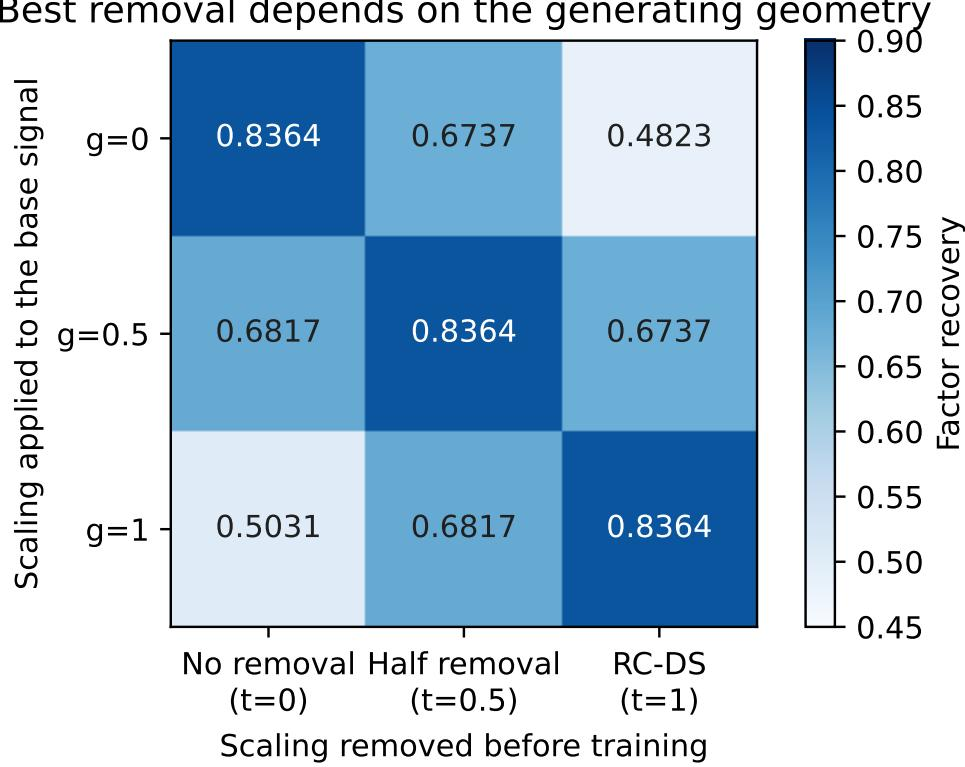  
Figure 2: Changing the generating geometry changes which training coordinates recover factors best, with the readout condition number fixed at 100. Rows apply $\Sigma ^ { g }$ to the base sparse signal, and columns remove $\Sigma ^ { t }$ before training. Scores average twelve paired seeds after 40 epochs. The diagonal returns the same training inputs, so its equal scores are a construction check, not independent replications. The of-diagonal scores measure the efect of mismatched scaling.

Recovery is highest at $t = g$ in every row. All three diagonal means are 0.8364 because the transforms cancel, yielding the same inputs, initialization, and minibatch schedule up to numerical precision. The empirical result is the recovery loss away from this diagonal and the resulting change in the preferred method. It identifies a coordinate-matching efect in this generator, not a generally best representation.

## 4.2 A specific case: factors generated before readout scaling

The condition-number sweep keeps the $g = 1$ construction: unit-length factors are generated in the unscaled hidden space before the readout applies its gains. We vary the scale factors in Equation 2. The 20-seed sweep (seeds 200–219) uses 4,096 samples and 60 SAE epochs at each $\kappa \in \{ 1 , 3 , 1 0 , 3 0 , 1 0 0 \}$ . With full scaling and no noise, mean recovery falls from 0.9134 to 0.8554, 0.7435, 0.6332, 0.5063 as $\kappa$ increases. RC-DS removes the scaling, returning the same inputs and recovery 0.9134 at every condition number (Figure 3).

We also add noise before or after scaling. When noise is added before scaling, the same invertible transform acts on the signal and the noise. The methods therefore still receive the same information.

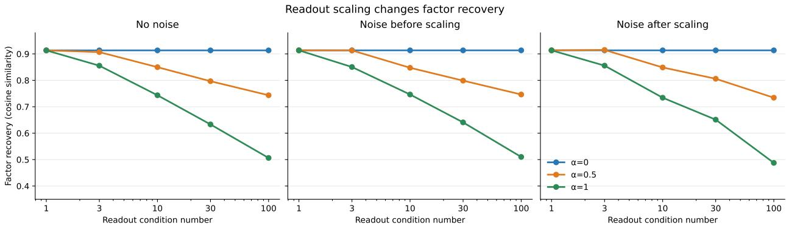  
Figure 3: The case where factors are generated in the unscaled hidden space. Unequal readout scaling reduces mean recovery under ordinary logit training in this generator. Results average seeds 200–219 after 60 epochs. RC-DS $( \alpha = 0 )$ receives the same inputs at every condition number. Noise added before scaling is transformed with the signal, so the methods still receive the same information.

With this pre-gain noise at $\kappa = 1 0 0$ , RC-DS improves recovery by 0.4034, with a paired seedbootstrap interval of [0.3627, 0.4445], despite identical information in both inputs. The no-noise diference is 0.4070 (Table 5).

## 4.3 The recovery gap comes from training geometry

A separate 12-seed comparison (seeds 400–411) keeps factors in the unscaled generating space and asks whether changing the loss alone explains the recovery gap at $\kappa = 1 0 0$ . Using 2,048 samples and 40 epochs, RC-DS and the exact wrapper match in every trial, with mean recovery 0.8176. Keeping the gains and using ordinary MSE gives 0.4841. Undoing the gains only in the loss gives 0.6284 (Figure 4). Loss reweighting therefore recovers part, but not all, of the diference under this training procedure. Separately, nine numerical checks spanning $\kappa = 3 , 3 0 , 3 0 0$ compare initial and trained activations, reconstructions, decoder directions, initial gradients, and final parameters. Their maximum discrepancy is $1 . 3 3 \times 1 0 ^ { - 1 5 }$ , consistent with the exact equivalence in Equation 7.

The condition-number sweep uses a diferent sample size and training budget from the coordinatematching and loss comparisons. Each study also uses separate seeds, so their absolute scores should not be compared directly. Within each study, paired seeds give methods the same sampled problem, and bootstrap intervals resample seeds rather than individual activations. In the loss comparison, RC-DS improves on ordinary scaled-input MSE by 0.3335 with interval [0.2851, 0.3816]. An untuned alternative trainer retains a positive diference of 0.1656 with interval [0.1377, 0.2008].

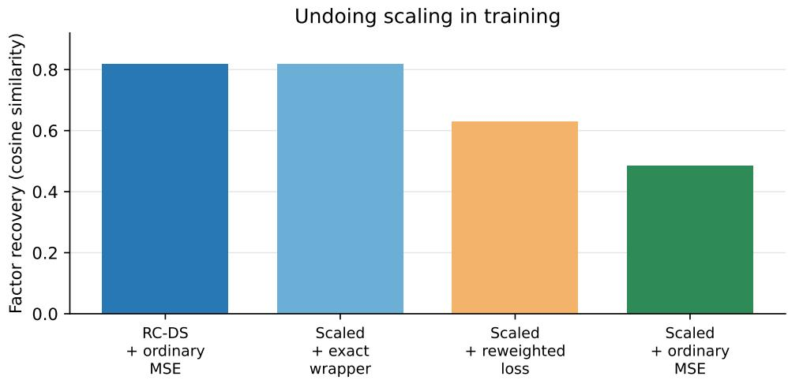  
Figure 4: Training controls for the case with factors generated before readout scaling. RC-DS and the exact wrapper both score 0.8176, versus 0.6284 when only the loss is reweighted and 0.4841 with ordinary scaled-input MSE. The exact wrapper changes the input, output, and loss together. Means use seeds 400–411, 2,048 samples, 40 epochs, and $\kappa = 1 0 0$

## 4.4 Correlation, sparsity, and training also change the result

The coordinate-matching result comes from a controlled generator. To test its sensitivity, we vary how similar the generating directions are and how many contribute to each sample. The comparison uses two correlation settings, one, two, or four active factors, two condition numbers, and two learning rates. The SAE’s K equals the number of active generating factors. Four coordinate methods and three paired seeds give 288 fits, with encoder and decoder weights updated independently. At condition number one, RC-DS and logit recovery agree to numerical precision. At condition number 100, RC-DS has higher mean recovery in 10 of 12 settings. The ordering depends on correlation, simultaneous activity, and training settings, even when factors are generated before scaling. Appendix F gives the full construction and results at both learning rates.

## 4.5 Predicting the direction before training

We forecast the preferred coordinates using only fitting-example geometry: diferences in angular overlap and covariance conditioning, together with the configured sparsity. The predictor does not receive true factors, their coeficients, or evaluation examples. Unlike direction similarity, the outcome here is support F1: how often the SAE activates the correct generating factors, after a one-to-one assignment selected on fitting examples and held fixed for evaluation.

Six development trials select a four-term regression. After freezing it, we issue forecasts for twelve new settings with three seeds each, then train all 288 SAE fits. The prediction gets the sign right in all 36 pairs. MAE is 0.0526, versus 0.241 for predicting zero efect. The MAE misses the declared 0.05 error target. Each of the twelve settings contributes three paired seeds. ZCA has higher support F1 than RC-DS in 34 of the 36 pairs.

The useful distinction is not high versus low condition number. At the same condition number 100, with two active factors and zero construction correlation, moving the generating factors changes an RC-DS benefit of +0.4095 F1 into a cost of −0.4460. The observable diagnostic predicts both.

The readout and the data must be considered together. Appendix J gives the formula, frozen development procedure, noise and generating-coordinate shifts, all selection rules, and uncertainty.

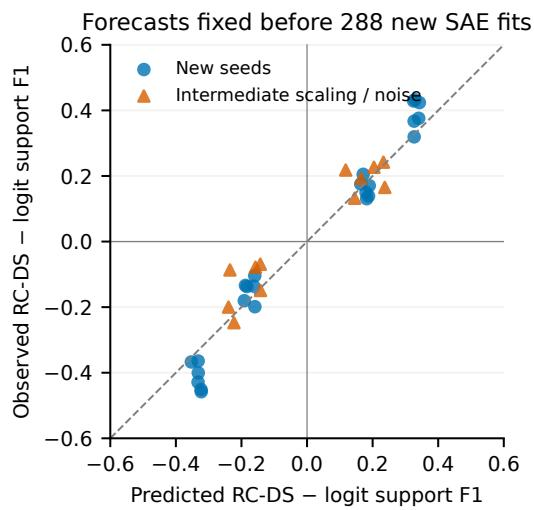

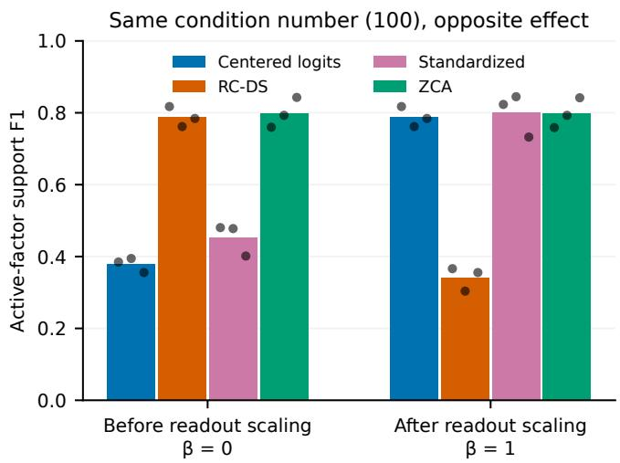  
Figure 5: Fitting-data geometry predicts opposite recovery efects at the same readout condition number. Left: all 36 frozen forecasts, covering twelve settings and three seeds. Right: two matched settings with condition number 100, two active factors, and zero construction correlation. Bars average three seeds, shown as dots. Moving the generating factors reverses the RC-DS–logit ordering. Whitening is a separate, strong control.

## 5 Reconstruction in Neural Policies and Language Models

The controlled studies identify changes in known-factor recovery. In real models, the generating factors are unknown, so we measure which parts of the representation the SAE preserves. We first compare reconstruction in policies and full-vocabulary readouts, then use alternative coordinates and longer training to explain the measured gaps. All diferences are computed from unrounded means. Means and diferences are rounded separately for display, so subtracting rounded table entries can difer by 0.0001 from the reported diference. Decimal places record numerical summaries, not certainty about efects across models.

## 5.1 RC-DS improves fixed-budget policy reconstruction

In OpenSpiel bargaining, mean centered-logit EV rises from 0.8802 to 0.9144 under RC-DS training. In seven-card Goofspiel it rises from 0.7654 to 0.8637. Both comparisons use 192-atom, Top-K 8 SAEs, trained for 15 epochs in bargaining and 125 in Goofspiel. The gain is positive for all three bargaining policies and two of three Goofspiel policies. Goofspiel policy seed 1120 has a decrease of 0.0045. Bargaining’s policies had already been inspected during development, whereas Goofspiel uses fresh policy seeds under its retained protocol. Appendix D gives the per-policy values and fixed-budget protocols.

## 5.2 Full-vocabulary readouts expose a metric trade-of

The full-vocabulary comparison uses Qwen2.5-0.5B (Qwen Team, 2024), Qwen3-0.6B-Base (Qwen Team, 2025), and SmolLM2-360M (Ben Allal et al., 2025). We evaluate each model on Emotion (Saravia et al., 2018), AG News (Zhang et al., 2015), and IMDb (Maas et al., 2011). The readout condition numbers are 22.6, 14.4, and 79.4, respectively. Each model–dataset pair has 2,400 fitting texts and 1,200 disjoint scoring texts. Five coordinate methods use 1,024 dictionary atoms, $K \in \{ 8 , 3 2 \}$ , three paired seeds, and two learning rates. All train for 6,000 updates, giving 540 fits. Each method selects its rate using only its final fitting loss. Model weights remain frozen. Appendix L gives the full data split, controls, and training procedure, including the separate 600-text feature-selection split used for label detection.

RC-DS has higher mean gain-free EV than centered-logit SAEs in every one of the 18 settings. The paired diference is positive for each of the three observed seeds in each setting. This is a descriptive count across three fixed checkpoints, three tasks, and two sparsity levels, not 18 independent model replications or 18 significance tests. We pair SAE seeds within each setting. Figure 6 shows the mean and observed seed range of each diference. Table 2 averages tasks and sparsities within each seed before summarizing each checkpoint. Appendix L.5 retains paired ranges against every coordinate baseline, including small and negative diferences. The gains range from 0.0048 to 0.0968, with the largest diferences on SmolLM2 (Figure 6). For example, on SmolLM2 Emotion with eight active features, gain-free EV rises from 0.5428 to 0.6397. On Qwen2.5 Emotion at the same sparsity, it rises from 0.4269 to 0.4622.

Centered-logit SAEs have higher mean logit EV in 17 of 18 settings, even though they have lower gain-free EV in all 18. This is the weighting trade-of in Equation 5: preserving strongly amplified output directions and preserving the unscaled representation are diferent objectives. Both scores were recorded for the same fits. Reconstruction is a secondary analysis of a study with a primary label-detection outcome, and the present emphasis was chosen after examining the results. These full-vocabulary fits use a fixed 6,000-update budget. Section 5.4 examines longer training and separate tuning on smaller label heads.

Table 2: RC-DS reconstruction diferences from two baselines, reported as mean ± sample standard deviation across three paired seed summaries. For each checkpoint and seed, we first average its six task–sparsity diferences. We then summarize the three seed averages, rather than treating 18 fits as independent observations. Positive values favor RC-DS. “Hidden” is the ordinary hidden-state SAE. The spread is conditional on the fixed checkpoint, texts, and training budget, not a confidence interval over models. Qwen2.5 supplied development data. Qwen3 and SmolLM2 were reserved for the semantic study.
<table><tr><td>Model</td><td>Gain-free EV vs. logits</td><td>Gain-free EV vs. hidden</td><td>Logit EV vs. logits</td><td>Logit EV vs. hidden</td></tr><tr><td>Qwen2.5</td><td> $+ 0 . 0 2 1 6 \pm 0 . 0 0 0 8$ </td><td> $+ 0 . 0 0 4 3 \pm 0 . 0 0 1 9$ </td><td> $- 0 . 0 0 5 8 \pm 0 . 0 0 0 6$ </td><td> $+ 0 . 0 0 5 2 \pm 0 . 0 0 1 9$ </td></tr><tr><td>Qwen3</td><td> $+ 0 . 0 0 9 0 \pm 0 . 0 0 1 2$ </td><td> $+ 0 . 0 0 7 3 \pm 0 . 0 0 1 1$ </td><td> $- 0 . 0 0 3 3 \pm 0 . 0 0 1 0$ </td><td> $+ 0 . 0 0 6 8 \pm 0 . 0 0 0 8$ </td></tr><tr><td>SmolLM2</td><td> $+ 0 . 0 5 6 6 \pm 0 . 0 0 2 5$ </td><td> $+ 0 . 0 0 2 2 \pm 0 . 0 0 0 6$ </td><td> $- 0 . 0 2 7 2 \pm 0 . 0 0 1 1$ </td><td> $+ 0 . 0 0 9 0 \pm 0 . 0 0 1 7$ </td></tr></table>

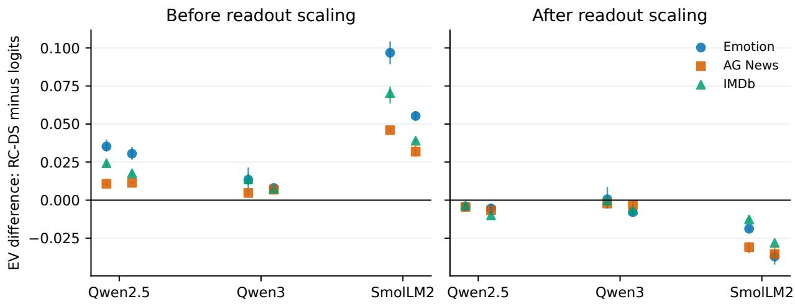  
Figure 6: Changing the reconstruction target changes the preferred coordinates. The same fitted SAEs are scored before scaling (left) and on output logits (right). Positive values favor RC-DS over centered-logit training. Each point averages three paired SAE seeds for one dataset and sparsity level. Vertical lines span the three paired diferences, not confidence intervals. $K = 8$ is to the left and $K = 3 2$ to the right of each model label. The 18 points per panel summarize the nine model–dataset pairs at two sparsity levels, not independent model replications. The right panel shows the corresponding output-score trade-of.

## 5.3 Hidden-state and whitening controls explain the comparison

Ordinary hidden-state SAEs are close competitors. RC-DS has higher mean reconstruction in all 18 settings under both metrics, but its gain-free advantage over this baseline ranges only from 0.0002 to 0.0124. On SmolLM2 Emotion at $K = 8$ , the hidden-state SAE reaches 0.6392, compared with RC-DS at 0.6397. All three readouts retain the full hidden dimension. Compact RC-DS and hidden coordinates therefore difer only by an orthogonal transformation. The theory gives equivalent representations and transportable SAE solutions. These fits were optimized separately with Adam in the two coordinate systems. Positive setting means alone do not establish a reliable advantage. The paired seed ranges in Table 26 show how these small diferences vary across runs. In six of the 18 gain-free comparisons, at least one paired seed favors hidden-state training despite the positive mean.

Readout normalization also difers from generic variance normalization. In this full-vocabulary grid, RC-DS exceeds standardization and ZCA on gain-free EV in all 18 setting means. It exceeds ZCA on logit EV in all 18, but standardization in only 14. For SmolLM2 Emotion at $K = 8 ,$ gain-free EV is 0.6397 for RC-DS, 0.4771 for standardization, and 0.2159 for ZCA. ZCA is stronger in the longer-trained label-head comparison below and in many controlled support-recovery settings. Readout normalization and covariance normalization favor diferent objectives and training settings.

## 5.4 Longer training changes the coordinate advantage

Small constrained label heads expose the efect of training budget. The six-label Qwen2.5 and Qwen3 heads have condition numbers 1.425 and 1.353, respectively. Extending the same Qwen2.5 SAEs from 60 to 1,000 epochs reduces the common-logit EV advantage from 0.0198 to 0.0016. None of the action-space fits meets the declared loss-stability rule at that cap. ZCA reaches 0.9690 EV, above RC-DS at 0.9655 and centered logits at 0.9639.

A separate comparison uses independent encoder updates, new SAE seeds, and 360 new Emotion prompts. Each method and sparsity level receives its own learning-rate selection on Qwen2.5, with the selected rates transferred unchanged to Qwen3. At K = 4, the RC-DS minus logit diferences are +0.00058 with seed interval [−0.00011, +0.00128] on Qwen2.5 and +0.00008 with interval [−0.00106, +0.00141] on Qwen3. At K = 1 and 2, centered-logit SAEs have higher mean logit EV. Thirty-one of 180 fits still exceed the late-training loss-change threshold. At K = 4, both mean diferences are near zero and both intervals span zero. Appendix K retains all coordinates, sparsity levels, and training diagnostics. These small-label-head comparisons are separate from the full-vocabulary grid.

The comparisons identify three sources of variation in reconstruction: the readout and data geometry, the target used to score errors, and the training procedure. They explain the observed RC-DS gains without treating the coordinate choice as an independent source of decision information.

## 5.5 Comparing training at the same reconstruction targets

We analyze the saved small-label-head fits using common fitting EV targets of 0.90, 0.95, 0.98, and 0.99, separately in logit and gain-free space. The analysis retains all 720 saved checkpoints from the 180 confirmation fits. Learning rates remain fixed. For each target, we select the first saved checkpoint that reaches it using fitting reconstruction only, then score the selected model on the existing 360 held-out prompts. This is a post-hoc analysis, not a new confirmation. Appendix F.1 gives the curves, attained errors, probe procedure, and search costs.

At the original primary sparsity K = 4, both RC-DS and centered logits reach every target in all five seeds of both models. For gain-free targets, their first qualifying saved checkpoints are identical in every pair. For logit targets, the checkpoints also match except for two Qwen2.5 seed–target pairs, where logits qualify earlier. The saved resolution therefore shows no earlier RC-DS checkpoint. Measurements exist only at 100, 500, 2,000, and 6,000 updates, so they do not resolve speed diferences between those checkpoints.

A shared threshold does not give identical fitting error. For example, at logit EV 0.90 on Qwen2.5, the selected RC-DS checkpoints have 0.0127 higher mean fitting EV, partly because one RC-DS fit is selected later. Its held-out EV advantage of 0.0135 is consequently not a matched-loss advantage. At the 0.99 logit target, held-out EV diferences are 0.0012 on Qwen2.5 and 0.0003 on Qwen3, with attained fitting-EV diferences of about 0.0004 for each. Single-feature label-detection diferences at those checkpoints are +0.0036 and −0.0038 AUROC, respectively. These comparisons distinguish checkpoint cost, achieved reconstruction, and feature usefulness without claiming exact loss matching or asymptotic equality.

## 6 Applications: Label Detection and Steering

The preceding sections establish a training-geometry efect. We now ask what the learned features add in two uses: detecting external labels and changing model behavior. These tests evaluate the resulting features separately from reconstruction.

## 6.1 Raw coordinates outperform RC-DS label detectors

Using the full-vocabulary SAEs from Section 5, we select one feature and its sign per class on 600 separate texts, then score AUROC on 1,200 texts and average equally over classes. Labels are used for feature selection, not SAE training. Raw singular coordinates receive the same selection procedure. They outperform the mean trained RC-DS score in all 18 settings, with diferences from 0.0002 to 0.1838 AUROC. The nine raw model–task scores are each compared with two SAE sparsity levels, using three SAE seeds per setting. Table 21 retains every comparison. This is a descriptive result across nine model–task pairs and two SAE sparsities, not eighteen independent model replications. The candidate pools difer: raw probes search the retained rank, whereas each SAE supplies 1,024 features. In this test, sparse training does not improve on selecting an existing coordinate, reinforcing the need for simple probe baselines (Kantamneni et al., 2025).

Multiplying a raw coordinate by a positive singular gain leaves its example rankings and AUROC unchanged. Per-coordinate standardization also preserves rankings because it subtracts a fixed mean and divides by a positive scale. The raw RC-DS, compact-logit, and standardized probes therefore match exactly. Sparse training learns new combinations of these coordinates, but its reconstruction advantage does not translate into a stronger detector than the raw baseline in this test. Among trained methods on the two reserved models, two setting means favor RC-DS by more than 0.01 AUROC, two favor logits, and eight have smaller diferences. The fitting-data predictor is less accurate than predicting zero diference. Appendix L gives all scores, forecasts, and controls.

## 6.2 Controlled steering and generation

For constrained targets, the linear readout gives a state-specific oracle that maximizes target probability under a per-example KL budget. An RC-DS intervention $\delta r$ is lifted to the hidden state as $\delta h = V U ^ { \top } \delta r$ . We compare learned directions with an optimized fixed direction and random dictionaries given the same selection budget.

The frozen study using Qwen2.5-0.5B (Qwen Team, 2024) on the Emotion dataset (Saravia et al., 2018) supplies a positive controlled case. Across five SAE seeds on 360 balanced test examples, learned directions exceed their strongest control by +7.73% of oracle gain, with seed-bootstrap interval $[ + 4 . 3 7 \% , + 1 1 . 1 8 \% ]$ . All five seeds are positive and the full confirmation rule passes. This compares learned directions with direct and random controls. A separate longer-trained RC-DS–logit comparison on reused development texts gives −4.08% of oracle gain, with interval $[ - 1 0 . 7 3 \% , + 0 . 8 2 \% ]$

The other application tests give diferent outcomes. Bargaining’s selected family closely approximates direct steering, and Goofspiel’s family has a smaller efect than its strongest random control. A naturally active contextual bargaining variant misses its development threshold. Two frozen Qwen sentiment-generation studies, fitted on IMDb or generated states, also miss their confirmation rules, with both learned-minus-random intervals spanning zero. Appendix H retains the efect sizes, protocols, activity checks, and uncertainty. These outcomes distinguish the established reconstruction efects from feature usefulness for a particular target and state distribution.

## 7 Discussion

The central finding is that sparse learning depends on how decision information is represented, not only on which information is available. On the retained subspace, RC-DS and centered logits determine each other. Ordinary squared-error training nevertheless places diferent weights on their reconstruction errors. The exact wrapper makes this distinction concrete: transforming the inputs, outputs, and loss together reproduces RC-DS training from scaled coordinates. Reweighting the loss alone recovers only part of the improvement. The resulting diference concerns both error weighting and training parameterization, rather than additional decision information.

When removing readout scaling helps. In the base synthetic generator, sparse factors are formed before the readout applies its gains. RC-DS restores that generating space, and its recovery advantage grows as the gains become more unequal. Changing the generating space reverses the preferred coordinates at the same condition number. A singular spectrum describes how strongly the readout scales each direction, but does not specify how the data or its sparse factors occupy those directions. This explains why condition number alone is insuficient. The relevant question is whether removing the gains brings the training geometry closer to the structure being recovered.

RC-DS provides a readout-based reference for answering that question. It removes gains defined by the model’s output map. Whitening instead uses the observed covariance, which also reflects the data distribution. ZCA’s higher support F1 in 34 of the 36 controlled prediction pairs shows that removing readout gains is not the best preprocessing choice in that comparison. Our predictor forecasts RC-DS relative to logits, not the best method among all coordinate choices. The whitening results establish this distinction without identifying which covariance property causes the advantage.

Reconstruction gains reflect both the target and the training procedure. Gain-free error treats retained directions equally, whereas logit error weights them by the readout gains. The full-vocabulary trade-of is therefore meaningful: a method can preserve more of the unscaled representation while preserving the output logits less accurately. When the readout has full column rank, compact RC-DS coordinates are also a rotation of the hidden state. Their small diferences from independently trained hidden-state SAEs concern optimization, not an increase in information or representational capacity. Adam’s sensitivity to the coordinate basis is relevant here (Zhang et al., 2025), but our comparisons do not isolate it from every other training choice.

Training budget answers a separate question. An advantage at equal updates describes performance at that budget, not the best attainable reconstruction. Longer training and separate tuning substantially reduce the gaps on the small label heads. The common-quality analysis in Section 5.5 further separates the cost of reaching a reconstruction target from performance at a fixed step count. These findings motivate reporting learning curves and achieved errors alongside endpoint scores. They do not establish the converged ordering for the separate full-vocabulary study.

Better reconstruction is not the same as better features. The reconstruction objective rewards representing the input with a sparse code. It does not directly reward alignment with a particular semantic label or steering target. Raw singular coordinates outperform mean trained RC-DS label detectors in all 18 tested full-vocabulary settings. The gain-free reconstruction advantage over centered-logit SAEs therefore does not make the trained features stronger label detectors than the raw baseline. The controlled Qwen steering result establishes a useful learned basis for its tested target and distribution. The game and generation controls show why that result does not extend automatically to other uses. These are distinct evaluations of the same features, not conflicting answers to one question.

Implications for SAE evaluation. Readout scaling should be an explicit experimental choice. Compare logits, gain-free coordinates, hidden states, and covariance-based preprocessing under matched capacity and tuning budgets. Score the same reconstructions in both gain-free and logit space, then evaluate the intended use directly. Known-factor recovery needs ground-truth factors. Label detection needs raw-coordinate controls, and steering needs direct and random controls with matched selection budgets. This separates improvements in reconstruction from evidence that sparse training has learned a more useful feature basis.

## 8 Limitations

The case studies cover two games with three evaluation policies each and three fixed language-model checkpoints, two reserved for semantic prediction. They are not a random model survey. The 18-setting grid repeats tasks and sparsity levels within those checkpoints. Seed summaries describe variation on fixed models and texts, not uncertainty across a population of models. Reconstruction is a secondary analysis emphasized after inspecting the results.

Several fits fail the declared loss-stability checks. The full-vocabulary comparison uses a fixed 6,000-update budget, and the smaller-head training extensions do not determine its converged outcome. Saved checkpoint spacing and unequal attained errors also prevent interpreting the common-quality analysis as exact loss matching. The coordinate efects have not been established across other SAE architectures.

Known-factor recovery is measured only in synthetic data. Real-model application tests concern single-feature labels and the specified steering targets and state distributions. The equivalence result holds on the retained subspace at a fixed checkpoint and mask. Discarded directions and cross-checkpoint feature stability are outside that result.

## 9 Conclusion

Readout scaling shapes sparse feature recovery without changing retained decision information. The controlled studies show that the generating geometry changes which coordinates work best. In the base generator, RC-DS improves recovery by removing readout distortion. Other generating constructions favor retaining the gains. The condition-number sweep quantifies the former case, and the exact wrapper isolates its training-geometry mechanism. Real-model comparisons identify reconstruction gains and explain their dependence on the target and training budget. Together, the method and evidence make readout geometry an explicit, testable part of SAE design and evaluation. Better reconstruction alone does not establish better recovered factors or more useful features. Whitening and raw-coordinate controls are necessary to test those claims.

## Ethics Statement

The study uses synthetic data, simulated games, and public text corpora. It contains no newly collected human-subject data. Sentiment continuations are machine-generated. The intervention results concern small research models, not deployment-ready behavioral control. We retain failed comparisons and distinguish development from confirmation to avoid overstating capability.

## References

Nora Belrose, Igor Ostrovsky, Lev McKinney, Zach Furman, Logan Smith, Danny Halawi, Stella Biderman, and Jacob Steinhardt. Eliciting latent predictions from transformers with the tuned lens. arXiv preprint arXiv:2303.08112, 2023. URL https://arxiv.org/abs/2303.08112.

Loubna Ben Allal, Anton Lozhkov, Elie Bakouch, et al. SmolLM2: When smol goes big—data-centric training of a small language model. arXiv preprint arXiv:2502.02737, 2025. URL https://arxiv.org/abs/2502.02737.

Trenton Bricken, Adly Templeton, Joshua Batson, Brian Chen, Adam Jermyn, Tom Conerly, Nicholas Turner, Cem Anil, Carson Denison, Amanda Askell, Robert Lasenby, Yifan Wu, Shauna Kravec, Nicholas Schiefer, Tim Maxwell, Nicholas Joseph, Zac Hatfield-Dodds, Alex Tamkin, Karina Nguyen, Brayden McLean, Josiah E. Burke, Tristan Hume, Shan Carter, Tom Henighan, and Christopher Olah. Towards monosemanticity: Decomposing language models with dictionary learning. Transformer Circuits Thread, 2023. URL https://transformer-circuits.pub/2023/monosemantic-features/index.html.

Hoagy Cunningham, Aidan Ewart, Logan Riggs, Robert Huben, and Lee Sharkey. Sparse autoencoders find highly interpretable features in language models. arXiv preprint arXiv:2309.08600, 2023. URL https://arxiv.org/abs/2309.08600.

Sumanth Dathathri, Andrea Madotto, Janice Lan, Jane Hung, Eric Frank, Piero Molino, Jason Yosinski, and Rosanne Liu. Plug and play language models: A simple approach to controlled text generation. In International Conference on Learning Representations, 2020. URL https://arxiv.org/abs/1912.02164.

Evan Duan. Pre-intervention prediction of sparse autoencoder steering side efects. arXiv preprint arXiv:2606.08365, 2026. URL https://arxiv.org/abs/2606.08365.

Leo Gao, Tom Dupré la Tour, Henk Tillman, Gabriel Goh, Rajan Troll, Alec Radford, Ilya Sutskever, Jan Leike, and Jefrey Wu. Scaling and evaluating sparse autoencoders. arXiv preprint arXiv:2406.04093, 2024. URL https://arxiv.org/abs/2406.04093.

Subhash Kantamneni, Joshua Engels, Senthooran Rajamanoharan, Max Tegmark, and Neel Nanda. Are sparse autoencoders useful? a case study in sparse probing. In Proceedings of the 42nd International Conference on Machine Learning, volume 267 of Proceedings of Machine Learning Research, pages 29018–29049. PMLR, 2025. URL https://proceedings.mlr.press/v267/kantamneni25a.html.

Adam Karvonen, Can Rager, Johnny Lin, Curt Tigges, Joseph Isaac Bloom, David Chanin, Yeu-Tong Lau, Eoin Farrell, Callum Stuart McDougall, Kola Ayonrinde, Demian Till, Matthew Wearden, Arthur Conmy, Samuel Marks, and Neel Nanda. SAEBench: A comprehensive

benchmark for sparse autoencoders in language model interpretability. In Proceedings of the 42nd International Conference on Machine Learning, volume 267 of Proceedings of Machine Learning Research, pages 29223–29264. PMLR, 2025. URL   
https://proceedings.mlr.press/v267/karvonen25a.html.

Diederik P. Kingma and Jimmy Ba. Adam: A method for stochastic optimization. In International Conference on Learning Representations, 2015. URL https://arxiv.org/abs/1412.6980.

Simon Kornblith, Mohammad Norouzi, Honglak Lee, and Geofrey Hinton. Similarity of neural network representations revisited. In Proceedings of the International Conference on Machine Learning, pages 3519–3529, 2019. URL https://proceedings.mlr.press/v97/kornblith19a.html.

Anton Korznikov, Andrey V. Galichin, Alexey Dontsov, Oleg Rogov, Ivan V. Oseledets, and Elena Tutubalina. Sanity checks for sparse autoencoders: Do SAEs beat random baselines? arXiv preprint arXiv:2602.14111, 2026. URL https://arxiv.org/abs/2602.14111.

Marc Lanctot, Edward Lockhart, Jean-Baptiste Lespiau, Vinicius Zambaldi, Satyaki Upadhyay, Julien Pérolat, Sriram Srinivasan, Finbarr Timbers, Karl Tuyls, Shayegan Omidshafiei, Daniel Hennes, Dustin Morrill, Paul Muller, Timo Ewalds, Ryan Faulkner, János Kramár, Bart De Vylder, Brennan Saeta, James Bradbury, David Ding, Sebastian Borgeaud, Matthew Lai, Julian Schrittwieser, Thomas Anthony, Edward Hughes, Ivo Danihelka, and Jonah Ryan-Davis. Openspiel: A framework for reinforcement learning in games. arXiv preprint arXiv:1908.09453, 2019. URL https://arxiv.org/abs/1908.09453.

Patrick Leask, Bart Bussmann, Michael T. Pearce, Joseph Isaac Bloom, Curt Tigges, Noura Al Moubayed, Lee Sharkey, and Neel Nanda. Sparse autoencoders do not find canonical units of analysis. In International Conference on Learning Representations, 2025. URL https://proceedings.iclr.cc/paper\_files/paper/2025/hash/84ca3f2d9d9bfca13f69b4 8ea63eb4a5-Abstract-Conference.html.

Alisa Liu, Maarten Sap, Ximing Lu, Swabha Swayamdipta, Chandra Bhagavatula, Noah A. Smith, and Yejin Choi. DExperts: Decoding-time controlled text generation with experts and anti-experts. In Proceedings of the 59th Annual Meeting of the Association for Computational Linguistics and the 11th International Joint Conference on Natural Language Processing, pages 6691–6706. Association for Computational Linguistics, 2021. doi: 10.18653/v1/2021.acl-long.522. URL https://aclanthology.org/2021.acl-long.522/.

Andrew L. Maas, Raymond E. Daly, Peter T. Pham, Dan Huang, Andrew Y. Ng, and Christopher Potts. Learning word vectors for sentiment analysis. In Proceedings of the 49th Annual Meeting of the Association for Computational Linguistics: Human Language Technologies, pages 142–150. Association for Computational Linguistics, 2011. URL https://aclanthology.org/P11-1015/.

James Martens. New insights and perspectives on the natural gradient method. Journal of Machine Learning Research, 21(146):1–76, 2020. URL https://jmlr.org/papers/v21/17-678.html.

nostalgebraist. Interpreting GPT: The logit lens. LessWrong, 2020. URL https: //www.lesswrong.com/posts/AcKRB8wDpdaN6v6ru/interpreting-gpt-the-logit-lens.

Charles O’Neill, Alim Gumran, and David Klindt. Compute optimal inference and provable amortisation gap in sparse autoencoders. arXiv preprint arXiv:2411.13117, 2024. URL https://arxiv.org/abs/2411.13117.

Qwen Team. Qwen2.5: A party of foundation models, 2024. URL https://qwenlm.github.io/blog/qwen2.5/.

Qwen Team. Qwen3 technical report. arXiv preprint arXiv:2505.09388, 2025. URL https://arxiv.org/abs/2505.09388.

Senthooran Rajamanoharan, Arthur Conmy, Lewis Smith, Tom Lieberum, Vikrant Varma, János Kramár, Rohin Shah, and Neel Nanda. Improving dictionary learning with gated sparse autoencoders. arXiv preprint arXiv:2404.16014, 2024a. URL https://arxiv.org/abs/2404.16014.

Senthooran Rajamanoharan, Tom Lieberum, Nicolas Sonnerat, Arthur Conmy, Vikrant Varma, János Kramár, and Neel Nanda. Jumping ahead: Improving reconstruction fidelity with JumpReLU sparse autoencoders. arXiv preprint arXiv:2407.14435, 2024b. URL https://arxiv.org/abs/2407.14435.

Victor Sanh, Lysandre Debut, Julien Chaumond, and Thomas Wolf. DistilBERT, a distilled version of BERT: Smaller, faster, cheaper and lighter. arXiv preprint arXiv:1910.01108, 2019. URL https://arxiv.org/abs/1910.01108.

Ashwin Saraswatula and David Klindt. Data whitening improves sparse autoencoder learning. arXiv preprint arXiv:2511.13981, 2025. URL https://arxiv.org/abs/2511.13981.

Elvis Saravia, Hsien-Chi Toby Liu, Yen-Hao Huang, Junlin Wu, and Yi-Shin Chen. CARER: Contextualized afect representations for emotion recognition. In Proceedings of the 2018 Conference on Empirical Methods in Natural Language Processing, pages 3687–3697. Association for Computational Linguistics, 2018. doi: 10.18653/v1/D18-1404. URL https://aclanthology.org/D18-1404/.

Peter H. Schönemann. A generalized solution of the orthogonal procrustes problem. Psychometrika, 31(1):1–10, 1966. URL https://doi.org/10.1007/BF02289451.

Adly Templeton, Tom Conerly, Jonathan Marcus, Jack Lindsey, Trenton Bricken, Brian Chen, Adam Pearce, Craig Citro, Emmanuel Ameisen, Andy Jones, Hoagy Cunningham, Nicholas L. Turner, Callum McDougall, Monte MacDiarmid, Alex Tamkin, Esin Durmus, Tristan Hume, Francesco Mosconi, C. Daniel Freeman, Theodore R. Sumers, Edward Rees, Joshua Batson, Adam Jermyn, Shan Carter, Chris Olah, and Tom Henighan. Scaling monosemanticity: Extracting interpretable features from Claude 3 Sonnet. Transformer Circuits Thread, 2024. URL https://transformer-circuits.pub/2024/scaling-monosemanticity/index.html.

Eslam Zaher, Maciej Trzaskowski, Quan Nguyen, and Fred Roosta. The geometric wall: Manifold structure predicts layerwise sparse autoencoder scaling laws. arXiv preprint arXiv:2605.09887, 2026. URL https://arxiv.org/abs/2605.09887.

Tianyue H. Zhang, Lucas Maes, Alan Milligan, Alexia Jolicoeur-Martineau, Ioannis Mitliagkas, Damien Scieur, Simon Lacoste-Julien, and Charles Guille-Escuret. Understanding Adam requires better rotation dependent assumptions. In Advances in Neural Information Processing Systems, 2025. URL https://arxiv.org/abs/2410.19964.

Xiang Zhang, Junbo Zhao, and Yann LeCun. Character-level convolutional networks for text classification. In Advances in Neural Information Processing Systems, volume 28, 2015. URL https://proceedings.neurips.cc/paper/2015/hash/250cf8b51c773f3f8dc8b4be867a9a0 2-Abstract.html.

## Study overview

Table 3 maps the reported evidence to its data, training budget, and supporting appendix. The studies use diferent runs and budgets. In particular, the 20-seed condition-number sweep and the 12-seed coordinate-matching and loss studies are separate, and the small-label-head training extensions do not extend the full-vocabulary fits.

Budgets are per SAE fit unless marked as policy training. An epoch is one pass through the fitting data, whereas an update is one minibatch step. Language-model checkpoints remain frozen. Seed counts refer to SAE or synthetic runs unless marked as policy seeds, and do not count as independent language models. Data shared across studies and analyses that reuse fitted models are identified below.

Table 3: Study overview. Data sizes describe fitting and evaluation roles, not independent model replications. The final column links to supporting appendices.
<table><tr><td>Study</td><td>Models and data</td><td>Budget and seeds</td><td>Question tested</td><td>Details</td></tr><tr><td>Gain and noise sweep</td><td>Synthetic, 16 factors in 8 dimensions, 4,096 samples (200–219)</td><td>60 epochs, 20 seeds</td><td>How does unequal scaling affect recovery when factors are generated before scaling?</td><td>B, C</td></tr><tr><td>Approximate inverse loss</td><td>same dimensions and sample count as the sweep</td><td>Separate synthetic samples, 60 epochs, 20 different seeds How much of the recovery (300–319)</td><td>difference does changing only the loss remove?</td><td>B, C</td></tr><tr><td>Coordinate matching and attribution</td><td>Synthetic, 2,048 samples per run</td><td>40 epochs, 12 seeds per study, separate seed sets for coordinates, exact wrapping, four controls</td><td>Separate generating alternative training, and noise effects.</td><td>B, C</td></tr><tr><td>Exact-wrapper check</td><td>Synthetic, condition numbers 3, 30, and 300</td><td>Short optimizer trajectories, Do wrapped activations, 3 seeds per condition (9 cases)</td><td>gradients, parameters, and reconstructions match numerically?</td><td>A</td></tr><tr><td>Bargaining</td><td>OpenSpiel, 800 fitting and Policy: 3,000 episodes. 400 evaluation episodes per SAE: 15 epochs. 3 policy</td><td>development and 3 reused evaluation policy seeds</td><td>Compare logit reconstruction B, D, H and decoder-family steering with direct and random controls.</td><td></td></tr><tr><td>Goofspiel</td><td>OpenSpiel, 7 cards, 400 fitting and 200 evaluation episodes per policy</td><td>Policy: 5,000 episodes. SAE: 125 epochs. 3 development and 3 evaluation policy seeds</td><td>Test reconstruction and decoder-family steering on a second game.</td><td>B, D, H</td></tr><tr><td>Contextual bargaining</td><td>3 development policies, 120 SAE variants: 15 or 30 evaluation episodes each</td><td>epochs. No reserved-policy evaluation</td><td>Can naturally active features H capture the advantage of state-dependent control?</td><td></td></tr><tr><td>Coordinate comparison and extension</td><td>Qwen2.5 Emotion label head, 3,000 fitting and 480 fits continued to 1,000. 5 reused development texts paired seeds, 20 fits</td><td>60 epochs, then the same</td><td>Separate coordinate effects from training budget with every dictionary atom learned.</td><td>E</td></tr></table>

Continued on the next page

Table 3 continued
<table><tr><td rowspan=1 colspan=8>Study              Models and data            Budget and seeds             Question tested               Details</td></tr><tr><td></td><td></td><td rowspan=1 colspan=1>as th</td><td></td><td rowspan=1 colspan=2></td><td></td><td></td></tr><tr><td rowspan=1 colspan=1>Common</td><td></td><td></td><td></td><td></td><td></td><td></td><td></td></tr><tr><td rowspan=1 colspan=1>fitting-quality</td><td rowspan=1 colspan=4>360 scoring texts as the</td><td></td><td></td><td></td></tr><tr><td rowspan=1 colspan=1>comparison</td><td rowspan=1 colspan=4>fresh-prompt study</td><td></td><td></td><td></td></tr><tr><td rowspan=1 colspan=1></td><td rowspan=2 colspan=4>Synthetic, 2,048 fitting an</td><td rowspan=2 colspan=2>d 3,000 updates, 3 seeds, 2rates, 288 fits</td><td></td></tr><tr><td rowspan=1 colspan=1>Correlation and</td><td></td></tr><tr><td rowspan=1 colspan=1>sparsity controlsFrozen recovery</td><td rowspan=1 colspan=4>512 scoring samples12 new synthetic settings,</td><td></td><td></td><td></td></tr><tr><td rowspan=1 colspan=1>predictor</td><td rowspan=1 colspan=4>2,048 fitting and 512</td><td rowspan=1 colspan=2>per setting, 288 fits</td><td></td></tr><tr><td rowspan=1 colspan=1></td><td rowspan=1 colspan=4>scoring samples each</td><td rowspan=1 colspan=2></td><td rowspan=1 colspan=1></td></tr><tr><td rowspan=1 colspan=1>Constrained</td><td rowspan=1 colspan=4>Qwen2.5 and Qwen3 label 6</td><td rowspan=2 colspan=2>,000 updates, 3 seeds, 2rates, 96 fits</td><td></td></tr><tr><td rowspan=1 colspan=1>semantic probes</td><td rowspan=1 colspan=4>heads, 3,000 fitting and</td><td></td></tr><tr><td rowspan=2 colspan=1>Qwen</td><td rowspan=2 colspan=4>480 new scoring texts</td><td rowspan=1 colspan=2></td><td rowspan=1 colspan=1>Emotion label detection?</td></tr><tr><td rowspan=2 colspan=2>8 methods, 32 fits</td><td rowspan=1 colspan=1>Compare both reconstructiol</td></tr><tr><td rowspan=1 colspan=1>full-readout</td><td rowspan=1 colspan=4>3,000 fitting, 240 tuning,</td><td rowspan=1 colspan=1>metrics with hidden-state,</td></tr><tr><td rowspan=1 colspan=1>comparison</td><td rowspan=1 colspan=4>240 scoring Emotion states,</td><td rowspan=2 colspan=2></td><td rowspan=4 colspan=1>whitening, and loss-onlycontrols.Test semantic forecasts on</td></tr><tr><td rowspan=1 colspan=1></td><td rowspan=1 colspan=4>reused data</td></tr><tr><td rowspan=2 colspan=1>Full-readout.</td><td rowspan=2 colspan=4>Qwen2.5, Qwen3,</td><td rowspan=2 colspan=2>6,000 updates, 3 seeds, 2</td><td rowspan=2 colspan=1>Test ser</td></tr><tr><td rowspan=1 colspan=1>ema</td></tr><tr><td rowspan=1 colspan=1>three-model</td><td rowspan=1 colspan=4>SmolLM2. Emotion, AG</td><td rowspan=1 colspan=2>rates, 2 sparsities, 540 fits</td><td rowspan=1 colspan=1>reserved models. The same</td></tr><tr><td rowspan=1 colspan=1>study</td><td rowspan=1 colspan=4>News, IMDb. Per task:</td><td rowspan=1 colspan=2></td><td rowspan=1 colspan=1>fits supply the 18-setting</td></tr><tr><td rowspan=1 colspan=1></td><td rowspan=1 colspan=4>2,400 fit, 600 select, 1,200</td><td rowspan=1 colspan=2></td><td></td></tr><tr><td rowspan=1 colspan=1></td><td rowspan=1 colspan=4>score</td><td rowspan=1 colspan=2></td><td></td></tr><tr><td rowspan=1 colspan=1>Constrained</td><td rowspan=1 colspan=4>Qwen2.5 label head, 3,000 6</td><td rowspan=2 colspan=2>0 epochs, 5 seeds, anchored DoSAEs</td><td rowspan=1 colspan=1>active learned features</td></tr><tr><td rowspan=1 colspan=1>Emotion steering</td><td rowspan=1 colspan=4>fitting, 480 development,</td><td rowspan=1 colspan=1>beat</td></tr><tr><td rowspan=1 colspan=1></td><td rowspan=1 colspan=4>360 test texts</td><td rowspan=1 colspan=2></td><td></td></tr><tr><td rowspan=1 colspan=1></td><td rowspan=1 colspan=4></td><td rowspan=1 colspan=2></td><td></td></tr><tr><td rowspan=1 colspan=1>IMDb-to-</td><td rowspan=1 colspan=4>Qwen2.5, 3,072 fitting</td><td rowspan=1 colspan=2>60 epochs, 5 seeds. Five</td><td></td></tr><tr><td rowspan=1 colspan=1>generation</td><td rowspan=1 colspan=4>reviews, 1,024 association</td><td rowspan=1 colspan=2>32-token samples per prefix</td><td rowspan=1 colspan=1>learned fr</td></tr><tr><td rowspan=1 colspan=1>steering</td><td rowspan=1 colspan=4>reviews, 15 test prefixes</td><td rowspan=1 colspan=2>and polarity</td><td></td></tr><tr><td rowspan=1 colspan=1>Generated-state</td><td rowspan=1 colspan=4>Qwen2.5, OpenWebText</td><td rowspan=2 colspan=2>60 epochs, 5 new seeds.Three 32-token samples per</td><td></td></tr><tr><td rowspan=1 colspan=1>steering</td><td rowspan=1 colspan=4>prompts: 128 fit, 64</td><td></td></tr><tr><td rowspan=2 colspan=1>Sequence-aware</td><td rowspan=2 colspan=4>associate, 64 testQwen2.5, 64 further</td><td rowspan=2 colspan=2>test prompt and polarity</td><td rowspan=1 colspan=1>d polarity</td></tr><tr><td rowspan=2 colspan=2>Reuses one generated-stateSAE seed. Three 16-token</td><td></td></tr><tr><td rowspan=1 colspan=1>follow-up</td><td rowspan=1 colspan=4>OpenWebText prompts</td><td rowspan=1 colspan=1></td></tr><tr><td rowspan=1 colspan=7>samples per prompt andpolarity</td><td></td></tr></table>

## A Mathematical Details

## A.1 Centering allowed actions and choosing the rank

For a legal set L, the selector $S _ { L }$ removes the rows of the global action head that cannot be executed and the centering matrix $\begin{array} { r } { C _ { L } = I - | L | ^ { - 1 } \mathbf { 1 } \mathbf { 1 } ^ { \top } } \end{array}$ subtracts the mean legal logit. Because $C _ { L } \mathbf { 1 } = 0$ , adding the same scalar to every legal logit leaves both the centered logits and their softmax probabilities unchanged. The centered legal head $W _ { c } = C _ { L } S _ { L } W$ therefore contains every linear direction that can change the immediate policy over legal actions. Hidden directions in its nullspace cannot change those probabilities.

Let $W _ { c } ^ { ( \rho ) } = U \Sigma V ^ { \top }$ retain singular values above the declared numerical tolerance. Writing $P _ { U } = U U ^ { \top }$ and $P _ { V } = V V ^ { \top }$ , the polar representation is $r = U V ^ { \top } ( h - \mu )$ . Its image lies in col(U) and its squared norm is

$$
\| r \| _ { 2 } ^ { 2 } = ( h - \mu ) ^ { \top } P _ { V } ( h - \mu ) ,\tag{10}
$$

so it preserves Euclidean length within the retained row space while deleting the orthogonal nullspace. The forward and inverse maps in Remark 1 act only on this retained subspace. If $E = W _ { c } - W _ { c } ^ { ( \rho ) }$ the diference between the original and retained centered-logit response is bounded by

$$
\begin{array} { r } { \| E h \| _ { 2 } \leq \| E \| _ { 2 } \| h \| _ { 2 } . } \end{array}\tag{11}
$$

We record the tolerance and rank for each allowed-action set rather than assuming $\rho = | L | - 1$

## A.2 Proof details for fixed-mask equivalence

For fixed checkpoint and mask, suppress the indices and define $r = U V ^ { \top } ( h - \mu )$ . Since $U ^ { \top } U =$ $V ^ { \top } V = I _ { \rho }$

$$
\boldsymbol { U } \boldsymbol { \Sigma } \boldsymbol { U } ^ { \top } \boldsymbol { r } = \boldsymbol { U } \boldsymbol { \Sigma } \boldsymbol { U } ^ { \top } \boldsymbol { U } \boldsymbol { V } ^ { \top } ( h - \mu )\tag{12}
$$

$$
= U \Sigma V ^ { \top } ( h - \mu )\tag{13}
$$

$$
= W _ { c } ^ { ( \rho ) } ( h - \mu ) .\tag{14}
$$

Adding $W _ { c } ^ { ( \rho ) } \mu + c$ yields the rank-truncated centered logits. Conversely, the centered residual belongs to col(U), and therefore

$$
U \Sigma ^ { - 1 } U ^ { \top } \left( W _ { c } ^ { ( \rho ) } ( h - \mu ) \right) = U \Sigma ^ { - 1 } U ^ { \top } U \Sigma V ^ { \top } ( h - \mu )\tag{15}
$$

$$
= U V ^ { \top } ( h - \mu ) = r .\tag{16}
$$

The map is afine because the fitting mean and actor bias appear as fixed ofsets. It is invertible only between the retained representations. Neither side recovers hidden-state components in ker $( W _ { c } ^ { ( \rho ) } )$

## A.3 Hidden-basis invariance and its limit

For an orthogonal hidden-state reparameterization $h ^ { \prime } = O h$ and $W ^ { \prime } = W O ^ { \top }$ , a valid right singular basis is $V ^ { \prime } = O V$ . Hence

$$
\boldsymbol { U } \boldsymbol { V ^ { \prime } } ^ { \top } ( \boldsymbol { h } ^ { \prime } - \boldsymbol { O } \boldsymbol { \mu } ) = \boldsymbol { U } \boldsymbol { V } ^ { \top } \boldsymbol { O } ^ { \top } \boldsymbol { O } ( \boldsymbol { h } - \boldsymbol { \mu } ) = \boldsymbol { U } \boldsymbol { V } ^ { \top } ( \boldsymbol { h } - \boldsymbol { \mu } ) .\tag{17}
$$

The same cancellation handles simultaneous sign changes and orthogonal rotations inside a degenerate singular subspace. This statement does not extend to an arbitrary nonsingular reparameterization $T \colon$ Euclidean polar factors generally change under $h ^ { \prime } = T h$ and $W ^ { \prime } = W T ^ { - 1 }$ . Centered logits have the stronger general-linear invariance. We therefore interpret RC-DS as one choice of how to measure distances, not a representation independent of all choices of hidden-state coordinates.

## A.4 Why the exact wrapper reproduces RC-DS training

For one fixed allowed-action set, write the scaled coordinates as

$$
y _ { \alpha } = T _ { \alpha } r , \qquad T _ { \alpha } = U \Sigma ^ { \alpha } U ^ { \top } \quad \mathrm { o n ~ c o l } ( U ) .\tag{18}
$$

Let an SAE in RC-DS coordinates be $F _ { \theta } ( r )$ . The exact wrapper for scaled inputs is

$$
\begin{array} { r } { \widehat { y } _ { \alpha } = T _ { \alpha } F _ { \theta } ( T _ { \alpha } ^ { - 1 } y _ { \alpha } ) , \qquad \mathcal { L } _ { \alpha } = \left\| T _ { \alpha } ^ { - 1 } ( y _ { \alpha } - \widehat { y } _ { \alpha } ) \right\| _ { 2 } ^ { 2 } . } \end{array}\tag{19}
$$

Substitution gives $\mathcal { L } _ { \alpha } = \Vert r - F _ { \theta } ( r ) \Vert _ { 2 } ^ { 2 }$ . Thus the forward values, sparse activations, gradients, and optimizer trajectory are identical when the wrapper transforms the encoder input, decoder output, and loss consistently. The numerical test spans condition numbers 3, 30, and 300 and observes a maximum discrepancy of $1 . 3 3 \times 1 0 ^ { - 1 5 }$

In the policy comparison that changes only the loss, the encoder still receives $y _ { \alpha }$ . Only the error weighting changes. The inverse transform acts as the identity on col $( U ) ^ { \perp }$ so that arbitrary decoder residuals receive finite loss:

$$
\widetilde { T } _ { \alpha } ^ { - 1 } = U \Sigma ^ { - \alpha } U ^ { \top } + ( I - U U ^ { \top } ) .\tag{20}
$$

With Top-K selection and state-dependent masks, this is not the same model as the complete wrapper. Changing only the loss therefore does not guarantee the same training trajectory as RC-DS.

## B Experimental Protocols

## B.1 Common design and evaluation

We evaluate generalization across policies, not by counting their many transitions as independent policies. Complete episodes are assigned to separate SAE-training, method-development, and evaluation sets. The fitting mean, readout factors, RMS scales, and SAE parameters use only the fitting partition. Development outcomes may select a trainer or intervention family. Evaluation on a previously inspected policy is labeled post-hoc validation rather than confirmation.

The policy comparisons use $\alpha \in \{ 0 , { \frac { 1 } { 2 } } , 1 \}$ with the same SAE capacity. Reconstruction is scored as centered-logit explained variance in a shared output space, using Equation 8. The synthetic recovery score first maps learned decoder directions back to the generating coordinates. For learned directions $\hat { d } _ { i }$ and known factors $d _ { j }$ , it is

$$
R = \operatorname* { m a x } _ { \pi } \frac { 1 } { m } \sum _ { i = 1 } ^ { m } \frac { \hat { d } _ { i } ^ { \top } d _ { \pi ( i ) } } { \| \hat { d } _ { i } \| _ { 2 } \| d _ { \pi ( i ) } \| _ { 2 } } ,\tag{21}
$$

Table 4: Policy settings fixed before evaluation. Each policy is tested with no readout scaling, square-root scaling, and full scaling.
<table><tr><td>Setting</td><td>Bargaining</td><td>Goofspiel</td></tr><tr><td>Development policy seeds</td><td>710-712</td><td>920-922</td></tr><tr><td>Evaluation policy seeds</td><td>810-812</td><td>1120-1122</td></tr><tr><td>Policy-training episodes</td><td>3,000</td><td>5,000</td></tr><tr><td>Hidden layers</td><td>128,128</td><td>128,128</td></tr><tr><td>SAE fit/evaluation episodes</td><td>800/400</td><td>400/200</td></tr><tr><td>Dictionary size / Top-K</td><td>192/8</td><td>192/8</td></tr><tr><td>SAE epochs / batch size</td><td>15/512</td><td>125/512</td></tr><tr><td>SAE learning rate</td><td>10-3</td><td>10-3</td></tr><tr><td>Selected family size</td><td>24</td><td>2</td></tr><tr><td>Random dictionaries</td><td>8</td><td>8</td></tr><tr><td>Rollout episodes per cell</td><td>500</td><td>500</td></tr></table>

where π is a one-to-one assignment and $m = 1 6$ in the recovery studies. As in the implementation, cosine normalization uses an epsilon floor for a zero-norm direction. Cosines are not made absolute: the generator and SAE use nonnegative codes, so reversing a direction is not treated as recovering the same factor. The score measures directional agreement, not the fraction of factors recovered exactly or a reconstruction score.

Causal rollout conditions reuse environment, policy-action, and opponent-action random streams. We report the target statistic, conditional non-target KL, return, and policy agreement. Random controls receive the same dictionary width, family size, and outcome-blind selection procedure as the SAE. Direct controls apply the corresponding centered action-space direction without an SAE.

## B.2 Sparse model and selection of steering directions

The policy SAEs use a nonnegative Top-K encoder with a 192-atom decoder and eight active atoms per observation. This implementation includes one fixed direction per action, called an anchor, and learns the remaining atoms. Bargaining penalizes similarity between decoder atoms with a coherence weight of 0.05. Groups of steering directions are selected by orthogonal least squares using only decoder directions, the fixed readout, and the frequencies of allowed-action sets in the SAE training data. Rewards and rollout outcomes are not inputs to family selection.

The resulting intervention is a signed linear combination of selected decoder atoms. It is a test of whether a few dictionary directions can produce a useful intervention. It does not establish that one naturally active feature represents one meaningful concept.

## B.3 Synthetic generator and uncertainty

The generator samples 16 normalized Gaussian directions in eight dimensions, chooses two active factors per observation, and assigns nonnegative coeficients uniformly between 0.5 and 1.5. The signal is their weighted sum. The gain sweep applies diagonal log-spaced scales between 1 and $1 / \kappa ,$ raised to α, and centers each observed dataset before training. The initial implementation check uses five seeds and 4,096 samples at condition number 100. The invertibility study uses seeds 200–219, 4,096 samples, 60 epochs, and condition numbers 1, 3, 10, 30, 100, with no noise, pre-gain noise, and post-gain noise. Noise has standard deviation 0.01 before its designated transformation. Pre-gain noise is transformed with the signal, preserving information across the scaling choices. Post-gain noise is added after the transformation instead. Equivalent efective spectra share a training block, including the identical RC-DS inputs across nominal condition numbers, and are not additional independent replications.

The approximate inverse-loss comparison uses a separate set of seeds, 300–319, with 4,096 samples and 60 epochs at condition numbers 10, 30, and 100. It tests no noise and pre-gain noise. Its RC-DS and ordinary scaled-input baselines are trained on these new sampled problems, not reused from the seeds 200–219 sweep.

The follow-up comparisons use 2,048 samples, 40 epochs, and twelve seeds per test: 400–411 for the loss and wrapper comparison, 420–431 for the alternative trainer, 440–451 for changes to the generating coordinates, and 460–471 for noise and scaling tests. The last test adds condition number 300. Both the sweep and campaign use batch size 512 and learning rate 10−3. Reported intervals use paired bootstrap resampling over seeds: 10,000 resamples for the sweep and 5,000 for the campaign. The nine-case numerical equivariance check is a separate study of short training runs, not another set of factor-recovery measurements.

## C Additional Synthetic Results

Table 5: Factor recovery at condition number 100 under the invertibility and noise-placement controls, using seeds 200–219, 4,096 samples, and 60 epochs. Intervals are paired 95% bootstrap intervals for $\alpha = 0$ minus $\alpha = 1$ . Means and diferences are computed at full precision and rounded separately.
<table><tr><td>Noise</td><td> $\alpha = 0$ </td><td> $\alpha = 1 / 2$ </td><td> $\alpha = 1$ </td><td>Difference [95% CI]</td></tr><tr><td>None</td><td>0.9134</td><td>0.7435</td><td>0.5063</td><td>0.4070 [0.3702, 0.4446]</td></tr><tr><td>Before gain</td><td>0.9135</td><td>0.7464</td><td>0.5101</td><td>0.4034 [0.3627, 0.4445]</td></tr><tr><td>After gain</td><td>0.9135</td><td>0.7342</td><td>0.4876</td><td>0.4259 [0.3958, 0.4556]</td></tr></table>

Mean recovery is tied at condition number one and separates as gains become more unequal in this generator and finite-budget sweep. This is not a guarantee of monotonic change in every seed or dataset. The pre-gain row is the crucial control: because the same invertible map is applied to signal and noise, its recovery gap cannot be attributed to additional information in the RC-DS arm.

The separate approximate inverse-loss comparison uses seeds 300–319, rather than 200–219 in Table 5. Its baseline means therefore come from diferent sampled problems. The inverse-weighted loss recovers part of the diference but not all of it. At condition number 100 without noise, recovery is 0.9131 for MSE in RC-DS coordinates, 0.6531 for the approximate inverse loss, and 0.5158 for ordinary MSE in scaled coordinates. With pre-gain noise, the corresponding values are 0.9063, 0.6484, and 0.5085. The inverse-minus-ordinary diferences are 0.1373 [0.1062, 0.1739] and 0.1399 [0.1052, 0.1792]. These approximate results motivated the exact wrapper rather than serving as evidence against mathematical equivalence.

In the loss and wrapper comparison, RC-DS and the exact wrapper match in every trial, with mean recovery 0.8176, compared with 0.6284 for the approximate inverse loss and 0.4841 for ordinary MSE in scaled coordinates. The exact-wrapper advantage over this baseline is 0.3335 [0.2851, 0.3816]. A separate untuned trainer yields 0.6359 versus 0.4703, a diference of 0.1656 [0.1377,

0.2008]. When generating factors are moved among the three coordinate systems, recovery is highest on the matched diagonal in every row (0.8364). Matching cancels the transform and returns the same training inputs, initialization, and minibatch schedule. Equal diagonal scores are therefore a construction check. The of-diagonal losses establish the coordinate-matching efect within this generator (Section 4.1).

These controls support a specific empirical claim: readout gains can change recovery under ordinary sparse training without changing the available information. They do not identify one universally best coordinate system, demonstrate equal convergence across coordinates, or predict that removing readout scaling must improve output-weighted reconstruction in real models.

## D Policy Reconstruction

Bargaining uses an imperfect-information negotiation task. Its three evaluation policies were inspected during method development, so reconstruction and corrected causal rollouts are post-hoc validation. Goofspiel uses seven cards, descending prize cards, and point-diference returns. Its evaluation seeds are fresh under the retained protocol. Both environments train against a uniform opponent. Episode partitions, model sizes, and budgets appear in Table 4.

Table 6: Bargaining reconstruction by policy. All values are evaluation centered-logit EV.
<table><tr><td>Policy</td><td> $\alpha = 0$ </td><td> $\alpha = 1 / 2$ </td><td> $\alpha = 1$ </td></tr><tr><td>810</td><td>0.9108</td><td>0.9107</td><td>0.8739</td></tr><tr><td>811</td><td>0.9207</td><td>0.9167</td><td>0.9009</td></tr><tr><td>812</td><td>0.9116</td><td>0.8774</td><td>0.8657</td></tr><tr><td>Macro mean</td><td>0.9144</td><td>0.9016</td><td>0.8802</td></tr></table>

Goofspiel evaluation means are 0.8637, 0.8181, and 0.7654 for $\alpha = 0 , 1 / 2 , 1$ . The RC-DS minus centered-logit diferences for seeds $1 1 2 0 \mathrm { - 1 1 2 2 ~ a r e ~ } \mathrm { - 0 . 0 0 4 5 , + 0 . 1 0 8 5 , + 0 . 1 9 0 9 }$ . Thus, the higher mean does not imply improvement on every policy. The inverse-gain-loss-only method reaches 0.5607 in bargaining and 0.2384 in Goofspiel. It still feeds scaled inputs to the encoder, with scaling that depends on the allowed actions, unlike the exact wrapper. Means are not pooled across environments, and three policy seeds do not support a population-level significance claim.

## E Coordinate Comparisons and Training Checks

## E.1 Qwen comparison with every dictionary atom learned

The three training comparisons below use the same 3,000 fitting and 480 already-opened Qwen Emotion development states. They do not reuse the earlier Qwen confirmation test data. The centered six-label head has rank five and condition number 1.425. Hidden states, centered logits, RC-DS, and ZCA-whitened logits receive 64 trainable atoms, Top-K 4, no fixed anchors, and fittingonly means, scales, and whitening statistics. The three action-space arms have 838 parameters each. The hidden-state arm has 115,648. Thus, dictionary width is matched, but the hidden-state comparison is not parameter matched. Seeds 262001–262005 share initialization rows and minibatch schedules.

The 60-epoch comparison copies decoder weights into the encoder after each update and retains all twenty outcomes. Known labels guide the intervention for each example. This is a controlled steering test, not label prediction or free generation. Controls are the maximum permitted targetprobability increase under a per-example KL limit (the oracle), an optimized fixed direction, and eight shared random dictionaries. Random controls match each SAE’s actual number of active features. At 60 epochs, the paired RC-DS minus centered-logit efect is +0.52% of oracle gain, with seed interval [−0.14%, +1.19%] and prompt interval [−0.58%, +1.64%]. Neither interval establishes a coordinate-specific steering benefit.

## E.2 Longer training without evaluation-based stopping

The extension reproduces every 60-epoch parameter and fitting-history value exactly before continuing the same optimizer and shufle states. Beginning at epoch 200, checks occur every 100 epochs and compare successive 50-epoch mean fitting MSE and total objective. Both absolute relative changes must be below 1% for three successive checks, for all twenty fits, or training stops at a common 1,000-epoch cap. The stopping decision is recorded before development scoring. The cap is reached: only the five hidden-state fits satisfy the stability condition. All fifteen action-space fits remain outside it, so these are not converged-model comparisons.

Table 7: Qwen coordinate comparison on reused development data. EV is measured in common centered-logit space. Excess is learned minus strongest control gain, divided by oracle gain, after 1,000 epochs. All entries average the same five seeds.
<table><tr><td>Coordinates</td><td>EV, 60 epochs</td><td>EV, 1,000</td><td>Excess, 1,000</td><td>Stable fits</td></tr><tr><td>Hidden states</td><td>0.7735</td><td>0.8025</td><td>+8.42%</td><td>5/5</td></tr><tr><td>Centered logits</td><td>0.6066</td><td>0.9639</td><td>+7.14%</td><td>0/5</td></tr><tr><td>RC-DS</td><td>0.6264</td><td>0.9655</td><td>+0.15%</td><td>0/5</td></tr><tr><td>ZCA-whitened logits</td><td>0.7041</td><td>0.9690</td><td>+5.07%</td><td>0/5</td></tr></table>

At the cap, the direct paired RC-DS minus centered-logit steering contrast is −4.08% of oracle gain: its seed interval is [−10.73%, +0.82%] and its prompt interval is [−5.42%, −2.77%]. These estimate diferent sources of uncertainty. The negative prompt interval for a fixed seed panel does not establish a seed-robust efect. The mean efective nonzero counts are 3.995, 3.939, 3.955, and 3.970 in table order. Each arm’s random control uses its actual active support. The raw RC-DS minus centered-logit target-probability diference is −0.004910. The shared oracle gain is measured from baseline probability 0.3494 to oracle probability 0.4697. No failed seed is discarded.

## E.3 Checking encoder updates and learning-rate schedules

The copy-based trainer computes an encoder gradient but overwrites the updated encoder weight with the normalized decoder after each Adam step. A one-step probe has encoder-gradient norm 0.3193, yet setting the encoder-weight rate to zero changes no final parameter under copying. Without copying, the maximum parameter diference is 0.001000. The copy/constant branch reproduces the recorded trainer exactly over 60 epochs. Finite diferences validate the independent encoder away from Top-K ties.

A comparison fixed before evaluation tests all four combinations of copied or independently learned encoder weights and constant or cosine-decayed learning rates. Every representation uses seeds

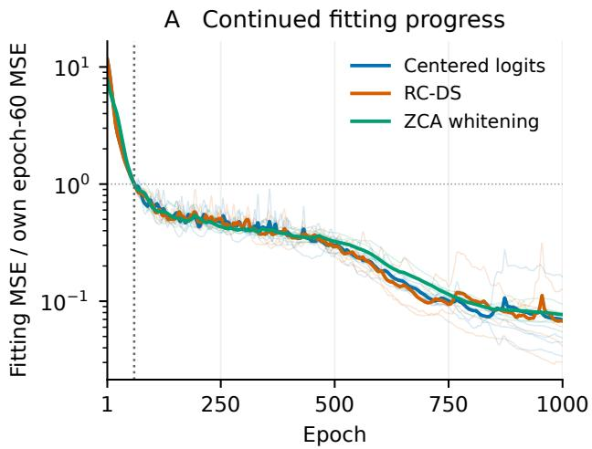

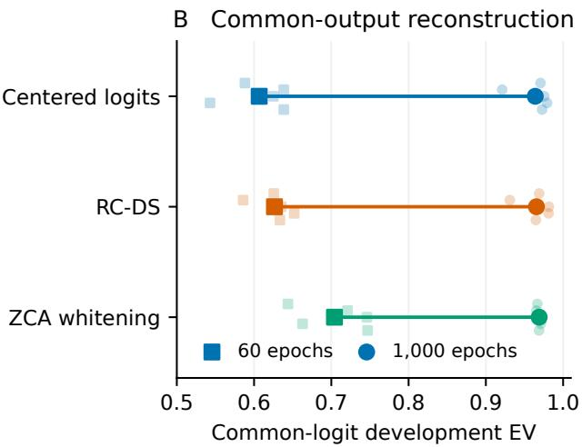  
Figure 7: Training-budget sensitivity on the Qwen2.5 label head, using the same five paired seeds and three parameter-matched action-space arms. Left: fitting histories normalized within each fit to epoch 60. Thin curves show individual seeds and thick curves their means. Right: common-logit development EV at the two measured endpoints. Faint points show every seed and large markers show means. Connecting lines do not imply intermediate measurements. The extension reaches its cap, not convergence.

262101–262103, 2,000 epochs, batch size 512, coherence weight 0.001, encoder/base rate 0.001, and three times that rate for the decoder. Decay stops at 1% of the initial rate. A training procedure is selected only if all twelve fits meet the predeclared stability and method-specific accuracy requirements. New-prompt and steering outcomes are not used for selection.

Table 8: The 48-fit training audit. No recipe satisfies both conditions for all twelve fits, so no recipe is selected and the twenty reserved-seed confirmation fits are not run.
<table><tr><td>Encoder / learning rate</td><td>Stable fits</td><td>Accurate fits</td><td>Both</td></tr><tr><td>Copy / constant</td><td>2/12</td><td>12/12</td><td>2/12</td></tr><tr><td>Copy / decay</td><td>10/12</td><td>3/12</td><td>3/12</td></tr><tr><td>Independent / constant</td><td>9/12</td><td>12/12</td><td>9/12</td></tr><tr><td>Independent / decay</td><td>11/12</td><td>11/12</td><td>10/12</td></tr></table>

Table 9: Efect of learning encoder weights independently at a constant learning rate. MSE is measured on training data in each method’s normalized input coordinates. Compare MSE within rows, not between coordinate systems. EV uses the common logit space, also on fitting data.
<table><tr><td>Coordinates</td><td>Copy MSE</td><td>Independent MSE</td><td>Copy EV</td><td>Independent EV</td></tr><tr><td>Hidden states</td><td>0.3774</td><td>0.3058</td><td>0.8002</td><td>0.8656</td></tr><tr><td>Centered logits</td><td>0.01069</td><td>0.006251</td><td>0.9894</td><td>0.9937</td></tr><tr><td>RC-DS</td><td>0.01425</td><td>0.006699</td><td>0.9865</td><td>0.9935</td></tr><tr><td>Whitened logits</td><td>0.01463</td><td>0.01246</td><td>0.9852</td><td>0.9873</td></tr></table>

Independent encoder learning improves training fit in every method. A small learning rate can make loss nearly constant even when the fit is poor, so stability alone does not establish accuracy. The independent-encoder, decaying-rate procedure misses in two fits: a centered-logit fit exceeds the 1% change threshold while still improving, and a whitened fit exceeds its MSE ceiling by 0.727%. The thresholds are not relaxed. These failures do not establish harmful oscillation in every case or rule out other training recipes. The audit ends without selecting a trainer, extracting fresh model states, or scoring fresh interventions. Earlier results remain attributable to their original algorithms and budgets.

Full per-epoch histories, trained parameters, optimizer state, coordinate maps, and checksums remain in the internal research record. Execution retries and the unused fresh-panel scoring correction are documented there. Neither constitutes additional independent evidence.

## F Separate Tuning and Evaluation on New Qwen Prompts

This comparison fixes its protocol before training the new SAEs or evaluating new prompts. It uses the same 3,000 Qwen2.5 training states as the coordinate comparison, verified by checksum. Qwen3 states are extracted for those same texts. The pinned model revisions are:

Qwen2.5 060db6499f32faf8b98477b0a26969ef7d8b9987

Qwen3 da87bfb608c14b7cf20ba1ce41287e8de496c0cd

The extraction path is checked against the complete model’s final hidden states and label logits. Both models use the same six distinct single-token labels and prompt template. The two checkpoints belong to the same model family and perform the same task. They do not represent independent model families.

Each action-space SAE has six inputs and 838 parameters. PCA coordinates are padded to the same width. The hidden references have 115,648 and 132,160 parameters, respectively, with the same 64-atom dictionary. They also retain directions that cannot afect the readout. Neither parameter count nor dictionary size relative to input size is matched to the action-space SAEs. All normalization statistics use fitting rows only. Numerical rank uses relative tolerance 10−6, excluding the centering null direction. Whitening uses a relative covariance floor of 10−6, which is inactive on the five retained covariance eigenvalues of both label heads. These are full retained-rank PCA and ZCA controls, not truncated dimensionality-reduction baselines.

Initial decoder directions use paired fitting-row indices, with one fitting RMS scale per arm. The encoder initializes from the decoder and then learns independently. Adam updates all parameters using MSE in each method’s input coordinates, with gradient clipping at norm one and no coherence penalty or post-update encoder copying. Minibatches sample with replacement. Learning rates decay linearly to one tenth of their initial value by update 4,800 and remain fixed through update 6,000. The common candidate rates are 0.0003, 0.001, 0.003, with tuning seeds 270101–270102. Every method and K chooses its own rate using final tuning logit EV. Five confirmation seeds 270201–270205 then use those rates. Qwen3 receives no additional learning-rate search. Earlier curve checkpoints use the final-selected rate too, so their search cost must not be treated as zero. Equal search budgets do not establish equally optimized models. Several choices are at the largest tested learning rate, and better settings outside this grid are not ruled out.

The new evaluation set contains 360 label-balanced examples from the pinned Emotion training split at sampling seed 270299. It excludes fitting texts and the entire oficial validation and test splits after normalized-text deduplication. The pipeline also checks identity after each tokenizer’s prompt formatting and truncation. All trained SAEs are saved and checksummed before this set is evaluated. Evaluation proceeds regardless of the sign of the result or training accuracy. The earlier training audit’s reserved set remains unused. These examples are new to this evaluation protocol, but may have appeared in the language models’ unknown pretraining data.

Saved checkpoints at 100, 500, 2,000, and 6,000 updates provide the learning curves. Every 100 updates, full-fitting MSE is recorded. The late-change diagnostic compares the means of the final two five-checkpoint windows. A change below 1% is descriptive, not proof of a global optimum. Training time uses one CPU thread and excludes initialization, extraction, preprocessing, evaluation, and serialization. Dense matrix-multiplication work is approximated by 12T bdm for T updates, batch size $b ,$ input width $d ,$ and dictionary width $m .$ It excludes optimizer, normalization, and Top-K overhead. Timings are not end-to-end speedups.

Table 10: Centered-logit EV on 360 fresh prompts at 6,000 updates. Means of all five SAE seeds. Hidden is a larger, unmatched reference.
<table><tr><td>Model</td><td>K</td><td>Logits</td><td>RC-DS</td><td>Std.</td><td>ZCA</td><td>PCA</td><td>Hidden</td></tr><tr><td>Qwen2.5-0.5B</td><td>1</td><td>0.9203</td><td>0.9175</td><td>0.9178</td><td>0.8560</td><td>0.8425</td><td>0.7010</td></tr><tr><td>Qwen2.5-0.5B</td><td>2</td><td>0.9437</td><td>0.9398</td><td>0.9386</td><td>0.9175</td><td>0.9210</td><td>0.7491</td></tr><tr><td>Qwen2.5-0.5B</td><td>4</td><td>0.9920</td><td>0.9926</td><td>0.9917</td><td>0.9866</td><td>0.9839</td><td>0.8120</td></tr><tr><td>Qwen3-0.6B-Base</td><td>1</td><td>0.9228</td><td>0.9190</td><td>0.9161</td><td>0.8540</td><td>0.8397</td><td>0.7705</td></tr><tr><td>Qwen3-0.6B-Base</td><td>2</td><td>0.9409</td><td>0.9344</td><td>0.9323</td><td>0.9142</td><td>0.9157</td><td>0.7987</td></tr><tr><td>Qwen3-0.6B-Base</td><td>4</td><td>0.9918</td><td>0.9919</td><td>0.9916</td><td>0.9838</td><td>0.9819</td><td>0.8440</td></tr></table>

Table 11: Gain-free EV on 360 fresh prompts at 6,000 updates. Means of all five SAE seeds. Hidden is a larger, unmatched reference.
<table><tr><td>Model</td><td>K</td><td>Logits</td><td>RC-DS</td><td>Std.</td><td>ZCA</td><td>PCA</td><td>Hidden</td></tr><tr><td>Qwen2.5-0.5B</td><td>1</td><td>0.9090</td><td>0.9126</td><td>0.9055</td><td>0.8537</td><td>0.8410</td><td>0.6951</td></tr><tr><td>Qwen2.5-0.5B</td><td>2</td><td>0.9372</td><td>0.9373</td><td>0.9313</td><td>0.9169</td><td>0.9201</td><td>0.7448</td></tr><tr><td>Qwen2.5-0.5B</td><td>4</td><td>0.9910</td><td>0.9923</td><td>0.9905</td><td>0.9865</td><td>0.9838</td><td>0.8084</td></tr><tr><td>Qwen3-0.6B-Base</td><td>1</td><td>0.9176</td><td>0.9182</td><td>0.9070</td><td>0.8539</td><td>0.8401</td><td>0.7691</td></tr><tr><td>Qwen3-0.6B-Base</td><td>2</td><td>0.9371</td><td>0.9335</td><td>0.9262</td><td>0.9144</td><td>0.9158</td><td>0.7985</td></tr><tr><td>Qwen3-0.6B-Base</td><td>4</td><td>0.9910</td><td>0.9916</td><td>0.9907</td><td>0.9837</td><td>0.9818</td><td>0.8446</td></tr></table>

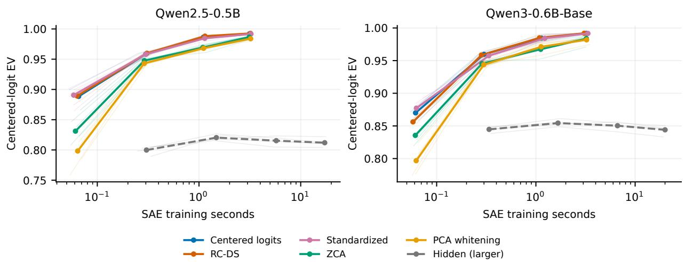

Figure 8: Logit EV on new prompts versus SAE training time at $K = 4$ . Points show the four checkpoints selected before evaluation. Thin lines show each seed and thick lines show means. The hidden-state SAE is larger. Tuning adds to the reported time, and Qwen3 reuses Qwen2.5’s rates. Lines connect measurements without implying scores at intermediate times.  
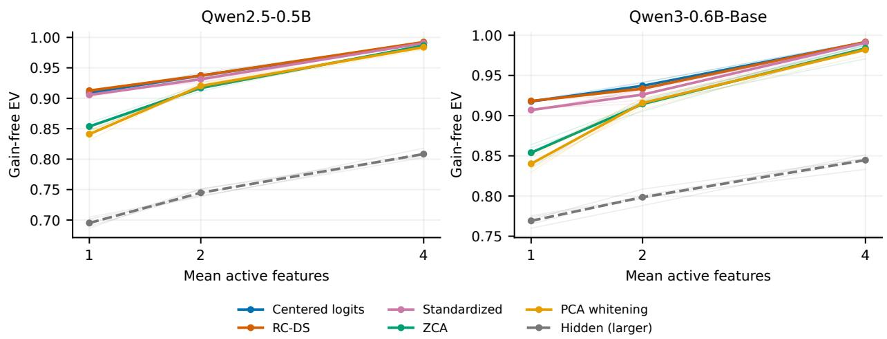  
Figure 9: Gain-free reconstruction for the same fresh data, fitted models, and sparsity levels as the common-logit comparison. These metrics score the same residuals with diferent weighting. Neither identifies ground-truth sparse factors in the language models.

## F.1 Common fitting-quality thresholds and checkpoint cost

This post-hoc analysis reuses the complete small-label-head comparison in this appendix. It does not retrain SAEs, change learning rates, or open new prompts. Both models, all six coordinate methods, $K \in \{ 1 , 2 , 4 \}$ , five seeds, and four saved checkpoints are retained. All 720 checkpoints are loaded from their recorded files, and all four original held-out reconstruction metrics are reproduced within absolute tolerance $1 0 ^ { - 1 0 }$ . Consumed source files are checked against their recorded hashes and checked again after replay.

For each fit, we compute common fitting logit EV and gain-free EV using the original fitting means and coordinate maps. Each metric has targets 0.90, 0.95, 0.98, and 0.99, corresponding to residual energies of at most 10%, 5%, 2%, and 1% of its fitting-set variance. Each target is applied separately. We choose the first saved checkpoint whose fitting EV reaches the target. Native coordinate losses, labels, and held-out scores do not choose the checkpoint. The thresholds were specified for this retrospective analysis after the original study’s outcomes were known, not as part of its confirmation protocol.

The recording schedule limits the comparison. A target met at update 100 could have been met earlier. A target first observed at update 2,000 might have been met between saved observations. Curves can also be nonmonotonic. We therefore report first saved hits, not interpolated crossing times. Targets with no saved hit remain in the record, rather than being assigned zero efect or excluded from reach counts. Paired diferences use only seeds in which both methods have an observed hit, with the denominator reported. The original five seeds are reused across targets and metrics, so these rows are not independent replications.

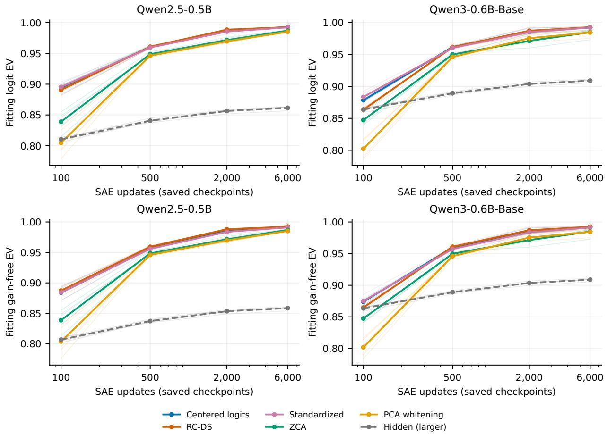  
Figure 10: Common fitting-quality curves for every method at $K = 4$ . Upper panels score logit reconstruction and lower panels score gain-free reconstruction. Thin lines show individual seeds and thick lines show their means. Only the four saved checkpoints are measured. Joining them does not supply intermediate observations. The hidden-state reference has more parameters, so an update is not equal compute across all methods.

Table 12: Logit fitting-quality thresholds at $K = 4 .$ . Hits count RC-DS/logit fits out of five seeds. n counts seeds for which both methods reach the target at a saved checkpoint. Diferences are RC-DS minus logits over those pairs only. $\Delta T$ is updates, $\Delta F$ is attained fitting EV, and $\Delta E$ is held-out EV in the same metric. AUC is held-out single-feature macro AUROC. Nonzero $\Delta F$ shows that threshold matching is not exact loss matching.
<table><tr><td>Model</td><td>Target</td><td>Hits</td><td>n</td><td>∆T</td><td> $\Delta F$ </td><td>∆E</td><td>ΔAUC</td></tr><tr><td>Qwen2.5</td><td>0.90</td><td>5/5</td><td>5</td><td>+80</td><td>+0.0127</td><td>+0.0135</td><td>+0.0122</td></tr><tr><td>Qwen2.5</td><td>0.95</td><td>5/5</td><td>5</td><td>+0</td><td>+0.0004</td><td>+0.0014</td><td>+0.0029</td></tr><tr><td>Qwen2.5</td><td>0.98</td><td>5/5</td><td>5</td><td>+0</td><td>+0.0007</td><td>+0.0017</td><td>-0.0014</td></tr><tr><td>Qwen2.5</td><td>0.99</td><td>5/5</td><td>5</td><td>+800</td><td>+0.0004</td><td>+0.0012</td><td>+0.0036</td></tr><tr><td>Qwen3</td><td>0.90</td><td>5/5</td><td>5</td><td>+0</td><td>-0.0002</td><td>-0.0011</td><td>+0.0055</td></tr><tr><td>Qwen3</td><td>0.95</td><td>5/5</td><td>5</td><td>+0</td><td>-0.0002</td><td>-0.0011</td><td>+0.0055</td></tr><tr><td>Qwen3</td><td>0.98</td><td>5/5</td><td>5</td><td>+0</td><td>+0.0010</td><td>+0.0004</td><td>+0.0003</td></tr><tr><td>Qwen3</td><td>0.99</td><td>5/5</td><td>5</td><td>+0</td><td>+0.0004</td><td>+0.0003</td><td>-0.0038</td></tr></table>

Table 13: Gain-free fitting-quality thresholds at $K = 4$ . Hits count RC-DS/logit fits out of five seeds. n counts seeds for which both methods reach the target at a saved checkpoint. Diferences are RC-DS minus logits over those pairs only. ∆T is updates, $\Delta F$ is attained fitting EV, and $\Delta E$ is held-out EV in the same metric. AUC is held-out single-feature macro AUROC. Nonzero $\Delta F$ shows that threshold matching is not exact loss matching.
<table><tr><td>Model</td><td>Target</td><td>Hits</td><td>n</td><td> $\Delta T$ </td><td> $\Delta F$ </td><td> $\Delta E$ </td><td>∆AUC</td></tr><tr><td>Qwen2.5</td><td>0.90</td><td>5/5</td><td>5</td><td>+0</td><td>+0.0025</td><td>+0.0037</td><td>+0.0029</td></tr><tr><td>Qwen2.5</td><td>0.95</td><td>5/5</td><td>5</td><td>+0</td><td>+0.0025</td><td>+0.0037</td><td>+0.0029</td></tr><tr><td>Qwen2.5</td><td>0.98</td><td>5/5</td><td>5</td><td>+0</td><td>+0.0018</td><td>+0.0027</td><td>-0.0014</td></tr><tr><td>Qwen2.5</td><td>0.99</td><td>5/5</td><td>5</td><td>+0</td><td>+0.0007</td><td>+0.0014</td><td>+0.0024</td></tr><tr><td>Qwen3</td><td>0.90</td><td>5/5</td><td>5</td><td>+0</td><td>+0.0013</td><td>+0.0002</td><td>+0.0055</td></tr><tr><td>Qwen3</td><td>0.95</td><td>5/5</td><td>5</td><td>+0</td><td>+0.0013</td><td>+0.0002</td><td>+0.0055</td></tr><tr><td>Qwen3</td><td>0.98</td><td>5/5</td><td>5</td><td>+0</td><td>+0.0017</td><td>+0.0011</td><td>+0.0003</td></tr><tr><td>Qwen3</td><td>0.99</td><td>5/5</td><td>5</td><td>+0</td><td>+0.0010</td><td>+0.0008</td><td>-0.0038</td></tr></table>

The tables focus on the original primary K = 4 contrast, but the machine-readable record retains all 1,440 fit–metric–target rows across all methods and sparsities. It includes attained fitting EV, overshoot, the previous saved observation, missed targets, training-only seconds, updates, examples seen, and estimated dense matrix-multiplication work. At $K = 4$ , all ten RC-DS fits and all ten logit fits reach every target. Gain-free targets select the same saved checkpoint for both methods in every seed. For logit targets, one Qwen2.5 seed selects RC-DS at 500 rather than 100 updates for the 0.90 target, and another selects RC-DS at 6,000 rather than 2,000 for the 0.99 target. Al other logit-target pairs select the same saved update. This recording schedule supplies no RC-DS update-count advantage. Original training times are retained, but do not establish an end-to-end speedup.

For the new descriptive label-probe analysis, one feature and its sign per class are selected by AUROC on the original 3,000 fitting examples at each checkpoint. Labels do not enter SAE training or fitting-quality selection. We hold the probes fixed and measure class-macro AUROC on the original 360 disjoint prompts. Thus, feature selection reuses SAE fitting data, and evaluation reuses the previously opened prompt panel. This is distinct from the full-vocabulary study’s separate 600-text feature-selection split. It measures single-feature label detection, not causal steering or ground-truth recovery. The signs of the RC-DS–logit AUROC diferences vary across models and targets, and checkpoint overshoot remains a possible source of diferences.

Table 14: Original Qwen2.5 learning-rate search cost at $K = 4 ,$ six complete fits per method (three rates, two seeds). Qwen3 reuses these choices. Training-only seconds exclude extraction, preprocessing, evaluation, and serialization.
<table><tr><td>Method</td><td>Updates</td><td>Training seconds</td><td>Dense work  $\left( 1 0 ^ { 9 } \ \mathrm { F L O P s } \right)$ </td></tr><tr><td>Centered logits</td><td>36,000</td><td>18.21</td><td>42.47</td></tr><tr><td>RC-DS</td><td>36,000</td><td>18.11</td><td>42.47</td></tr><tr><td>Standardized</td><td>36,000</td><td>18.21</td><td>42.47</td></tr><tr><td>ZCA</td><td>36,000</td><td>18.48</td><td>42.47</td></tr><tr><td>PCA whitening</td><td>36,000</td><td>18.36</td><td>42.47</td></tr><tr><td>Hidden (larger)</td><td>36,000</td><td>67.19</td><td>6342</td></tr></table>

Every method and sparsity used six full Qwen2.5 tuning fits before the confirmation fits. Qwen3 reused the selected rates without an additional search. Early checkpoints still inherit choices made using the 6,000-update tuning endpoints, so their selection cost is not zero. This analysis does not retune specifically for an early quality target or compare the best attainable speed of each method.

## F.2 Varying factor correlation and the number of active factors

The synthetic comparison uses the same independent-encoder trainer with 16 atoms in eight hidden dimensions, 2,048 fitting and 512 test samples, and 3,000 updates. Factors are unit-normalized mixtures of independent random directions and a shared unit direction with square-root weights $\sqrt { 1 - \rho }$ and ${ \sqrt { \rho } } .$ . The construction parameter $\rho \in \{ 0 , 0 . 7 \}$ is not a measured pairwise correlation. Codes have one, two, or four active factors, chosen uniformly with nonzero coeficients sampled uniformly from [0.5, 1.5]. The SAE’s K matches this generating activity. Readouts have condition numbers one or 100. All four coordinate methods, both learning rates 0.001 and 0.003, and all three seeds 270401–270403 are reported, for 288 fits. No rate is selected on recovery. The full grid, including condition number one, is retained in the internal research record. Factors are generated in the gain-free space, so this test supplements rather than replaces the generating-coordinate control. The recovery score is also harder to interpret when the true directions are highly correlated: one learned direction can be similar to several true factors. We therefore compare methods within each correlation setting, not raw scores across correlation settings. The score uses signed cosine similarity, not its absolute value.

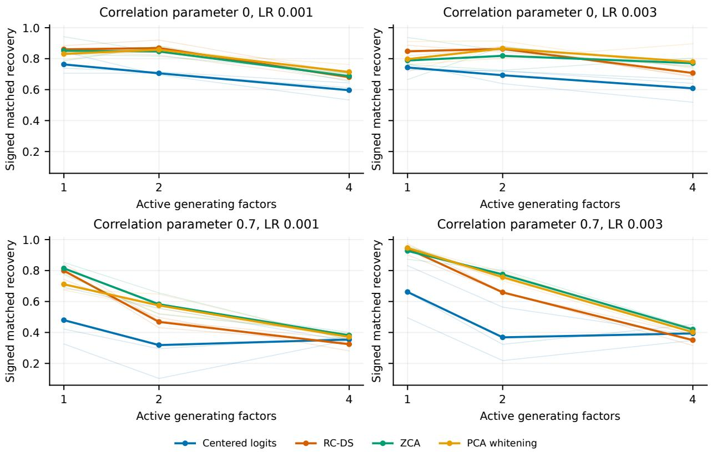  
Figure 11: Factor recovery at condition number 100 as correlation and simultaneous activity change. Both learning rates are shown. Thin lines show individual seeds and thick lines show means. Recovery is signed cosine similarity after mapping decoder directions back to the known generating space.

## G Qwen Full-Vocabulary Reconstruction

## G.1 Readout, data, and optimization

The centered Qwen2.5-0.5B vocabulary matrix has shape $1 5 1 , 9 3 6 \times 8 9 6$ , retained rank 896, and condition number 22.6. The spectrum uses float64 Gram eigenvalues and relative rank cutof $1 0 ^ { - 6 }$ Tied embeddings are verified against the output head. Pinned model revisions, weight checksums, coordinate factors, and the prepared-state checksum are retained in the internal full-readout records.

The comparison uses 3,000 cached Emotion fitting states and splits the previously used 480 development states into 240 tuning and 240 scoring rows with seed 267000. Fitting means, coordinate scales, and covariance statistics use fitting rows only. A token-sequence audit finds one fitting–tuning and one fitting–scoring duplicate, with no tuning–scoring overlap. There are 2,995 unique fitting sequences. The recorded data were not changed after this discovery. These are reused development data with known duplicates, not a new deduplicated test set.

All eight methods use 896-dimensional inputs, 1,792 decoder atoms, Top-K 16, independently updated encoders, paired data-row initialization, and the same 400-epoch positive-floor learning-rate schedule. SAE seeds are 267001 and 267002. Every arm receives rates 0.001 and 0.003. Mean tuning logit EV selects its rate before scoring. Dictionary expansion two and Top-K 16 were fixed for Qwen after a separate development search, not selected on Qwen’s scoring rows. The full search record is retained internally.

The compact RC-DS input is $q = V ^ { \top } ( h - \mu )$ , and the compact-logit input is $\Sigma q .$ These factorizations exactly preserve ambient RC-DS and logit reconstruction norms, but do not claim to reproduce unconstrained vocabulary-width Adam updates. At full rank, the gain-free coordinates are an orthogonal rotation of hidden states. Ordinary hidden-state SAEs are therefore an essential control. Standardization and PCA/ZCA whitening act in the intrinsic basis, with fitting-only relative variance floors of $1 0 ^ { - 6 }$ . Whitened SAEs minimize MSE in whitened coordinates. They do not test whitening the encoder input while retaining an unwhitened output loss. The inverse-loss arm changes only the weighting of residuals in compact-logit coordinates, not the complete encoder/decoder wrapper.

## G.2 Reconstruction and training checks for every method

Table 15: Qwen full-readout scoring reconstruction. Means use both SAE seeds at each arm’s tuning-selected learning rate. The metrics use the same predictions in diferent spaces. Neither is known-factor recovery.
<table><tr><td>Training method</td><td>Logit EV</td><td>Gain-free EV</td></tr><tr><td>RC-DS</td><td>0.7741</td><td>0.7928</td></tr><tr><td>Half gain</td><td>0.7816</td><td>0.7922</td></tr><tr><td>Centered logits</td><td>0.7835</td><td>0.7882</td></tr><tr><td>Hidden states</td><td>0.7725</td><td>0.7908</td></tr><tr><td>Standardized</td><td>0.7765</td><td>0.7802</td></tr><tr><td>PCA whitening</td><td>0.5138</td><td>0.5021</td></tr><tr><td>ZCA whitening</td><td>0.5279</td><td>0.5204</td></tr><tr><td>Inverse-gain loss</td><td>0.7784</td><td>0.7886</td></tr></table>

Centered logits are the baseline selected using tuning data. RC-DS minus centered-logit EV is −0.009332. RC-DS logit EV is 0.7738 and 0.7745 across the two seeds, compared with 0.7820 and 0.7849 for centered logits. Its mean gain-free advantage is 0.004571 over the logit SAE and 0.002022 over the hidden-state SAE. These are descriptive two-seed diferences, not confidence intervals over models.

The comparison comprises 32 complete fits. Mean efective activity is exactly 16 for every selected arm. Six of eight selected arms exceed the 1% final-window loss-change diagnostic, comparing mean fitting loss over epochs 301–350 and 351–400. RC-DS scoring logit EV changes by −0.000586 between the 200- and 400-epoch snapshots under the fixed schedule. Scoring snapshots do not choose the stopping epoch. Equal budgets therefore do not establish equally converged models, and the weak whitening outcomes do not establish superiority over all whitening procedures.

## H Steering Results and Controls

The game studies select groups of decoder directions without using labels or rewards. They compare them with direct logit changes and eight random dictionaries selected in the same way. The decoder families allow fixed action anchors. Bargaining’s family was developed after inspecting the policies, so its intervention evidence is post hoc. Bargaining’s intervention is nearly a direct change to the target-action logit: the component orthogonal to that direction is only 0.032%–7.47% of its norm. Goofspiel’s selected family increases expected bid on prize cards 5–7, but its aggregate gains 0.0319, 0.0613, and 0.0536 are smaller than the best random gains 0.0523, 0.0692, and 0.0954 across α = 0, 1/2, 1. Decoder-family steering is therefore not evidence of a uniquely useful learned feature. A stricter, naturally active contextual bargaining study finds that an optimized fixed direction misses 51.31% of the oracle’s achievable improvement. Yet the best learned intervention beats the strongest control by only 2.44% of the oracle’s improvement, below the predeclared 5% requirement. Reserved contextual bargaining policies are not opened.

The constrained study uses Qwen2.5-0.5B (Qwen Team, 2024) on the Emotion dataset (Saravia et al., 2018), with six label-token logits, 3,000 fitting examples, 480 development examples, 360 balanced test examples, and five predeclared SAE seeds. The 60-epoch anchored trainer and intervention protocol are fixed before confirmation. Naturally active non-anchor features, an optimized fixed direction, and eight selection-matched random dictionaries share a pointwise KL budget of 0.05. The oracle uses the known row label. This is controlled steering, not independent label prediction. Mean excess is learned gain minus the strongest control, normalized by oracle gain.

Table 16: Frozen Qwen Emotion test. The seed-bootstrap interval and practical criterion count retain every seed. A positive learned margin does not isolate the coordinate choice.
<table><tr><td>Model</td><td>Mean excess</td><td>95% seed interval Seeds above 5%</td><td></td></tr><tr><td>Qwen2.5-0.5B</td><td>+7.73%</td><td> $[ + 4 . 3 7 \% , + 1 1 . 1 8 \% ]$ </td><td>4/5</td></tr></table>

All five Qwen seed efects are positive, with four above 5%. Qwen passes the full rule of at least four positive seeds, at least three above 5%, and all correctness checks. This study includes fixed anchor directions, unlike the later coordinate comparison in which every atom is learned. That comparison’s RC-DS minus centered-logit steering diference at the training cap is −4.08% of oracle gain, with seed interval [−10.73%, +0.82%] and prompt interval [−5.42%, −2.77%]. A prompt interval for this fixed seed panel does not estimate variation over new SAE training seeds.

Two frozen Qwen sentiment-generation studies use independent DistilBERT SST-2 scoring (Sanh et al., 2019). Both use the same released SST-2-finetuned checkpoint, pinned to a fixed revision.1 The first fits SAEs on IMDb states (Maas et al., 2011), evaluates 15 neutral prefixes adapted from PPLM (Dathathri et al., 2020), and has learned-minus-random target probability +0.0138 with prefix interval [−0.0220, +0.0504]. The second fits on generated states and uses disjoint OpenWebText prompts from DExperts (Liu et al., 2021). Its mean is −0.0025 with prompt interval [−0.0255, +0.0207]. Both use five SAE seeds, paired continuations, and a per-token KL cap of 0.01, and both fail their complete confirmation criteria. Later sequence-aware development has a positive mean +0.0370 but interval [−0.0255, +0.1016], also insuficient to establish a reliable learned advantage. These test steering during generation, not reconstruction across full-vocabulary coordinates.

Feature activity diverges during generation despite matching on fitting data. In the first study, the selected learned family is active on 3.53% of generated states versus 26.35% for its random control. In the generated-state follow-up, four of ten seed–polarity activity ratios miss the declared range. Directions with the intended immediate token-axis sign can also lower externally scored positive sentiment after generation. Immediate logit efects and sequence-level sentiment are separate outcomes.

## I Experimental Setup and Verification

## I.1 Software and computation

The studies use Python and PyTorch for policy and SAE training, OpenSpiel for the game environments, and Hugging Face Transformers for the pretrained language models and tokenizers. Game policies are trained before their representations are collected. The pretrained language models remain frozen. Their hidden states and readout factors are cached so that coordinate methods can be compared on the same examples without repeating model inference for every SAE fit.

The 540-fit full-vocabulary study runs SAE training with three concurrent CPU workers and one thread per fit. Development and confirmation training take 2.66 and 5.62 wall-clock hours, respectively, excluding representation extraction and final scoring. These timings describe that study, not the total cost of the paper. Appendix L gives the model dimensions, data sizes, update schedule, and per-fit compute totals.

## I.2 Data partitions and matched training

Each study distinguishes examples used to fit the SAE, select methods or features, and evaluate the selected result. Centering means, normalization scales, and covariance transforms are estimated from fitting examples. Model and dataset revisions, numerical rank tolerances, seeds, and split rules are specified by the study’s protocol. Coordinate comparisons match SAE capacity and training budgets within a study. Paired initialization and minibatch schedules are used where specified, and learning-rate selection follows the stated rule for each study. Table 3 at the start of the appendices summarizes the distinct data, budgets, and questions, with links to each study’s detailed settings.

The attribution and training studies use previously opened development data. The training audit selects no recipe and evaluates no fresh interventions. The Qwen full-readout comparison also uses previously opened prompts. These analyses are distinct from the separately frozen game and text evaluations. The manuscript’s case studies were selected after broader exploration, not as a preregistered model survey.

## I.3 Result verification

Saved records include training histories, checkpoints, selection decisions, and checksums linking results to their protocols and prepared data. Paper tables and figures are generated from these saved fits without retraining. For example, the Qwen full-readout comparison retains all 32 fits and the results for all eight methods. The 540-fit full-vocabulary study replays 1,080 saved checkpoints and checks 585 semantic score rows, including feature selection, tie-aware AUROC, text separation, selected learning rates, and forecast timestamps.

The internal experiment ledger retains the broader research history, including outcomes outside the manuscript’s scope. The appendices provide the study setup, mathematical derivations, evaluation procedures, and supporting results.

## J Observable Recovery Prediction and Semantic Probes

## J.1 An observable diagnostic with no true-factor inputs

The earlier cosine-recovery score measures signed agreement between decoder directions and the generating directions. Highly correlated true factors can make this score dificult to interpret. We therefore also measure support F1. A one-to-one feature assignment maximizes activation-support overlap on fitting examples only. Holding that assignment fixed, we compute micro F1 between positive SAE features and the true active factors on separate evaluation rows. True codes are used for assignment and evaluation, never for SAE training.

The predictor receives fitting hidden activations, the centered readout, the configured K, and dictionary width. It has no true-factor, coeficient, label, or evaluation-row input. Let $u _ { i }$ be each mean-centered fitting example normalized to unit length. We measure

$$
a = \frac { 1 } { n ( n - 1 ) } \sum _ { i \neq j } ( u _ { i } ^ { \top } u _ { j } ) ^ { 2 } .\tag{22}
$$

This is overlap between fitting examples, not direct observation of latent-factor overlap. Let $c = a _ { \mathrm { l o g i t s } } - a _ { \mathrm { R C } } ,$ a¯ be the mean of those two overlaps, and b the diference in log covariance condition numbers. The retained regression uses $c , c K / m , c \bar { a } .$ , and $b ,$ where m is dictionary width. It has zero intercept and a numerical ridge of $1 0 ^ { - 8 }$ . Its coeficients fitted to all development rows, rounded for display, are $( 3 . 6 3 4 , - 4 . 8 4 7 , - 6 . 2 8 3 , 0 . 0 0 2 8 8 8 )$ .

Six autoresearch trials use only previously observed outcomes. They reduce grouped development MAE from 0.202 for a zero-efect prediction to 0.0538. All seeds and condition numbers sharing a generating-coordinate, correlation, and sparsity setting remain together in each fold. There are 68 nonidentity rows in eleven groups. The target of 0.05 is not reached. Previously observed confirmation rows are explicitly development data for this new search.

## J.2 Fresh controlled validation

After freezing the predictor, we evaluate twelve new settings with three fresh seeds each. All 36 forecasts precede their SAE fits. Eight settings cross generating-coordinate exponent $\beta \in \{ 0 , 1 \}$ correlation parameter $\rho \in \{ 0 , 0 . 7 \}$ , and $K \in \{ 2 , 4 \}$ at readout condition number 100. Four further settings use condition number 30, $\rho = 0 . 3 5$ , and $K = 3$ . They include intermediate exponents 0.25 and 0.75, and $\beta = 0 , 1$ with noise.

Each setting has eight dimensions, sixteen factors, 2,048 fitting rows, and 512 evaluation rows. Factors are drawn in a base coordinate system and transformed by $\Sigma ^ { - \beta }$ without a second normalization. Active positive coeficients are uniform on [0.5, 1.5]. Noise is isotropic before that transformation, with RMS 0.05 times the clean centered fitting RMS. Signal and noise undergo the same map, preserving information equivalence between arms.

Centered-logit, RC-DS, standardization, and ZCA SAEs each receive rates 0.001 and 0.003. There are 288 fits with 6,000 updates each, batch size 256, and independently optimized encoder and decoder weights. The decay schedule remains anchored to the first 3,000 updates. Each arm chooses its rate by final native fitting MSE only. Both rates are retained.

The frozen predictor gets the direction right in all 36 pairs. All absolute observed efects exceed the declared 0.03 F1 band. MAE is 0.0526, versus 0.241 for zero-efect prediction. A bootstrap over the twelve whole settings gives [0.0399, 0.0685] for MAE. The 0.05 target remains missed. These are twelve settings with three seeds, not 36 independent real networks. ZCA has higher support F1 than RC-DS in 34 of the 36 pairs.

At $\rho = 0 , K = 2 .$ , and condition number 100, mean support F1 is 0.7878 for RC-DS versus 0.3783 for logits when $\beta = 0 . \mathrm { A t } \ \beta = 1$ , the ordering reverses to 0.3418 versus 0.7878. The same condition number can therefore accompany a large benefit or a large cost from removing the gains. The frozen observable diagnostic predicts these reversals within the tested family. It is not a distribution-independent recovery theorem.

## J.3 Semantic usefulness on the two constrained Qwen heads

The semantic comparison reuses pinned fitting activations from Qwen2.5-0.5B and Qwen3-0.6B-Base, with 3,000 fitting texts and six-label readouts. It trains four coordinate methods, two sparsities, three seeds, and two rates, for 96 fits. SAEs have 64 atoms and train for 6,000 updates. For each class, one feature and its sign are selected by fitting AUROC. The fixed feature is then evaluated on disjoint texts. Ties contribute one half in the exact rank-based AUROC.

The evaluation panel is balanced with 80 texts per class. It comes from the larger unsplit Emotion pool, excluding all 20,000 oficial split texts and duplicate normalized or truncated token identities. It is not an oficial benchmark test split, and pretraining contamination cannot be excluded. The initial requested pool had too few unused examples in one class. That attempt stopped before new activations or evaluation scores were obtained. A separate sampling amendment was recorded, and all fitting MSE values were identical on the retry. The failed attempt and amendment remain in the audit record.

Table 17: RC-DS minus centered-logit semantic AUROC on 480 new texts. Seed ranges are conditional on each fixed checkpoint and text panel, not confidence intervals over models.
<table><tr><td>Model</td><td>K</td><td>Mean difference</td><td>Seed range</td></tr><tr><td>Qwen2.5</td><td>1</td><td>+0.00095</td><td>[-0.00455, +0.00688]</td></tr><tr><td>Qwen2.5</td><td>4</td><td>-0.00603</td><td>[-0.00834, -0.00170]</td></tr><tr><td>Qwen3</td><td>1</td><td>+0.00289</td><td>[+0.00162,+0.00357]</td></tr><tr><td>Qwen3</td><td>4</td><td>+0.00142</td><td>[-0.00519,+0.01019]</td></tr></table>

## J.4 Internal verification

The private research record contains the training and analysis code with saved outputs. The 288-fit observable validation has 576 replayed training checkpoints. The semantic study has 192 replayed checkpoints and 104 replayed semantic-score rows, including random-initialization and raw-coordinate controls. The six-trial predictor search and unsuccessful hypotheses are preserved separately, together with source hashes.

## K Additional Reconstruction Studies

The synthetic study measures known-factor recovery. Real-model generating factors are unknown, so we instead test reconstruction: can RC-DS reproduce the same logits more accurately, and does any advantage remain when baselines receive more training and separate tuning?

## K.1 Fixed-budget improvements in neural policies

Actor–critic policies train in OpenSpiel bargaining and seven-card imperfect-information Goofspie for 3,000 and 5,000 episodes, respectively. Both use 192-atom, Top-K 8 SAEs trained for 15 and 125 epochs, respectively. Each environment contributes three evaluation policies, with separate episodes for SAE training and evaluation. Bargaining’s policies had already been inspected during development, so their evaluation is post-hoc. Goofspiel uses new held-out policy seeds.

Table 18: Shared centered-logit EV. Game rows average three policies under their fixed budgets. Qwen rows average five paired SAE seeds on reused development data.
<table><tr><td>Setting</td><td>Centered logits</td><td>RC-DS</td><td>Difference</td></tr><tr><td>Bargaining</td><td>0.8802</td><td>0.9144</td><td>+0.0342</td></tr><tr><td>Goofspiel</td><td>0.7654</td><td>0.8637</td><td>+0.0983</td></tr><tr><td>Qwen label head, 60 epochs</td><td>0.6066</td><td>0.6264</td><td>+0.0198</td></tr><tr><td>Qwen label head, 1,000 epochs</td><td>0.9639</td><td>0.9655</td><td>+0.0016</td></tr></table>

RC-DS reconstruction is higher for all three bargaining policies and two of three Goofspiel policies. The Goofspiel diferences $\mathrm { a r e \ - 0 . 0 0 4 5 , + 0 . 1 0 8 5 , + 0 . 1 9 0 9 }$ , so the average hides variation between policies. Reweighting only the loss performs substantially worse in both games. Unlike the exact wrapper, it still feeds scaled inputs to the encoder, with scaling that depends on the allowed actions. These results cover few policies and fixed training budgets. They do not show that RC-DS beats fully converged baselines. Protocols and per-policy results are in Appendix D.

## K.2 Longer training nearly closes the Qwen gap

For Qwen, we restrict output to six single-token Emotion labels. A comparison with all 64 dictionary atoms learned uses 3,000 training states, 480 previously used development states, five paired SAE seeds, and Top-K 4. Hidden-state, centered-logit, RC-DS, and ZCA-whitened SAEs use the same initialization examples and minibatch order. The label head has rank five and $\kappa = 1 . 4 2 5$ . Each action-space SAE has 838 parameters, whereas the hidden-state SAE has 115,648. The latter is a larger reference model, not a parameter-matched baseline.

Extending the same fits from 60 to 1,000 epochs reduces the RC-DS–logit diference from 0.0198 to 0.0016. ZCA reaches 0.9690. None of the action-space fits meets the predeclared loss-stability rule at the training cap, so the final scores do not establish convergence. This trainer also copies decoder weights into the encoder after each Adam step. A separate 48-fit comparison finds that letting encoder weights learn independently improves training MSE in every representation. No setting meets both its accuracy and stability requirements, so its reserved evaluation data remain unused. We therefore test independent encoder updates and separate learning-rate selection next. Full procedures, outcomes, and training curves are in Appendix E.

## K.3 Separate tuning gives near-ties on new prompts

We compare centered logits, RC-DS, standardization, PCA whitening, ZCA whitening, and the larger hidden-state reference. Each SAE has 64 atoms and trains for 6,000 Adam updates with batch size 256 and independent encoder and decoder updates. On Qwen2.5-0.5B (Qwen Team, 2024), each method and $K \in \{ 1 , 2 , 4 \}$ gets three learning rates and two tuning seeds. We select rates separately by mean final logit EV on the reused 480 development prompts. Five new SAE seeds then train each selected setting on Qwen2.5 and Qwen3-0.6B-Base (Qwen Team, 2025). Qwen3 reuses Qwen2.5’s selected rates without retuning. It tests whether those settings transfer, not the best separately tuned result on Qwen3.

All 180 trained SAEs are saved before we evaluate 360 new Emotion prompts, balanced across labels. These exclude SAE training texts and the oficial validation and test texts, with duplicate checks on both text and token sequences. The predeclared primary comparison is RC-DS minus centered-logit EV at K = 4 after 6,000 updates. Other sparsity levels and training times are secondary comparisons. Both heads have rank five and nearly equal gains, with condition numbers 1.425 and 1.353. This tests two small label heads, not their full vocabularies.

Table 19: RC-DS and centered-logit SAEs are nearly tied on new prompts at K = 4. Intervals resample the five paired SAE seeds for each fixed model and the same 360 prompts. Both intervals include zero. They do not measure uncertainty across language models.
<table><tr><td>Checkpoint</td><td>Logit EV</td><td>RC-DS EV</td><td>Difference</td><td>95% seed interval</td></tr><tr><td>Qwen2.5-0.5B</td><td>0.9920</td><td>0.9926</td><td>+0.00058</td><td> $[ - 0 . 0 0 0 1 1 , + 0 . 0 0 1 2 8 ]$ </td></tr><tr><td>Qwen3-0.6B-Base</td><td>0.9918</td><td>0.9919</td><td>+0.00008</td><td> $\left[ - 0 . 0 0 1 0 6 , + 0 . 0 0 1 4 1 \right]$ </td></tr></table>

The primary comparison does not establish a reliable RC-DS advantage (Table 19). At one or two active features, centered-logit training gives higher mean logit EV on both models. Whitening also gives lower logit EV under these settings, but this does not show that its features are less interpretable. Figure 12 shows all methods and sparsity levels. Training loss still changes by more than 1% near the end in 31 of 180 fits, including three of five primary logit fits on each model. Equal tuning and training budgets therefore do not establish equal convergence. Appendix F reports the loss check, gain-free EV, training-time plots, and full protocol.

## K.4 Full-vocabulary results depend on the scoring metric

We next keep Qwen2.5’s entire output vocabulary instead of six labels. Its centered head has rank 896 and condition number 22.6, compared with 1.425 for the label head. SAEs train in 896-dimensional coordinates with 1,792 atoms, Top-K 16, two seeds, and 400 epochs. Each of eight coordinate or loss choices gets the same two learning rates, selected by tuning logit EV. The 3,000 training states and 240/240 tuning/evaluation split come from previously used Emotion prompts. These are development results, not confirmation on new data.

On evaluation rows, RC-DS logit EV is 0.7741 versus 0.7835 for centered-logit training, a diference of −0.0093. Gain-free EV instead favors RC-DS, 0.7928 versus 0.7882, but the ordinary hidden-state SAE is close at 0.7908. Both SAE seeds have the same sign of the logit diference. Thus, the higher condition number does not produce a common-logit reconstruction advantage in this comparison. The two metrics weight the same residuals diferently (Equation 5). Neither measures recovery of known sparse factors.

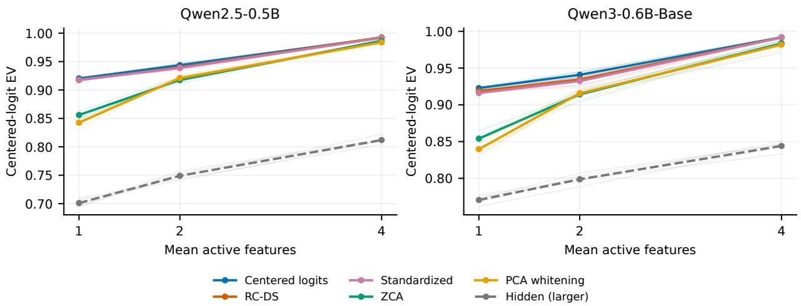  
Figure 12: Reconstruction on new prompts with one, two, or four active features after 6,000 updates. Thin lines show all five seeds and thick lines show means. The larger hidden-state arm is a reference, not a parameter-matched baseline. Rates are tuned per method and K on Qwen2.5 and transferred unchanged to Qwen3.

Six of eight selected methods exceed the 1% late-training loss-change threshold, so equal budgets do not establish equal convergence. Comparing two readouts from one model also cannot show that condition number predicts benefit across models. Appendix G reports all methods, the reused data and duplicate checks, and the training procedure.

## L Full-Readout Semantic Usefulness

This study tests whether fitting-data geometry predicts a change in label detection, not whether an SAE recovers unknown generating factors. It uses full pretrained vocabulary readouts rather than fitted task heads. Qwen2.5-0.5B supplies development data (Qwen Team, 2024). Qwen3-0.6B-Base and SmolLM2-360M are reserved for confirmation (Qwen Team, 2025; Ben Allal et al., 2025). No language-model weights are updated. The retained ranks are 896, 1,024, and 960, respectively. The corresponding condition numbers are 22.6, 14.4, and 79.4.

## L.1 Texts, coordinates, and training

We use Emotion, AG News, and IMDb (Saravia et al., 2018; Zhang et al., 2015; Maas et al., 2011). Each task has 2,400 SAE-fitting texts, 600 feature-selection texts, and 1,200 scoring texts, balanced across its six, four, or two classes. These are fixed partitions from the published training pools, not oficial benchmark test scores. We exclude duplicate normalized texts and identical truncated token sequences across roles and tasks for all three tokenizers. Emotion also excludes all 20,000 oficial-split texts and the earlier 480-text semantic panel. The same text partitions are used across models. This matching does not establish independence from language-model pretraining data.

Inputs are raw text without task instructions or label prefixes. We truncate to 128 tokens and extract the final nonpadding hidden state before the original vocabulary readout. Centering means and coordinate transforms use fitting states only. We compare centered logits, RC-DS, ordinary hidden coordinates, per-singular-coordinate standardization, and ZCA whitening. The logit and RC-DS arms use compact singular coordinates. These preserve reconstruction norms and the retained information, but a vocabulary-width SAE can follow a diferent Adam training trajectory. Standardization acts on singular coordinates, not individual vocabulary tokens. Whitening uses fitting covariance with the protocol’s $1 0 ^ { - 6 }$ regularization floor.

All arms use 1,024 dictionary atoms and $K \in \{ 8 , 3 2 \}$ . The dictionary is modestly overcomplete for Qwen2.5 and SmolLM2 and equal-width for Qwen3. Three paired seeds and two learning rates, 0.001 and 0.003, give 180 development and 360 confirmation fits. Each fit uses 6,000 updates with batches of 128, independently updated encoder and decoder weights, unit decoder directions, and global fitting-RMS normalization. The learning rate decays to one tenth of its initial value by 80% of the training budget. Paired seeds use the same sampled fitting rows for initialization and the same minibatch schedule. We preserve initial weights, complete training histories, and checkpoints at updates 3,000 and 6,000. For each arm, K, and seed, the final native fitting MSE selects the learning rate. No semantic labels or scoring outcomes are used for this selection.

## L.2 Label detection and frozen forecasts

For each class, we choose one feature and its orientation on the separate 600-text selection split. On the 1,200 scoring texts, we compute exact tie-aware one-versus-rest AUROC, then average equally over classes. Each arm receives the same label-selection procedure. Untrained paired-initialization SAEs and raw-coordinate probes undergo the same procedure. The primary contrast is the trained RC-DS AUROC minus trained centered-logit AUROC, averaged over the three paired seeds for each model, task, and K.

The development search permits at most six small predictors and leaves out one entire Qwen2.5 task at a time. It ends after three trials, whose errors relative to the fold-training mean baseline are 1.681, 1.294, and 0.7326. The last trial meets the declared 0.8 target. However, its absolute development error is 0.0238 AUROC, worse than the zero-efect baseline’s 0.0227. Thus, meeting that search target is not evidence that useful prediction has been achieved. There are only three development task groups.

The retained predictor is ridge regression with three inputs: the logit-minus-RC-DS covariance spectral entropy, the diference in normalized radial fourth moments, and log(K/1024). Covariates are standardized using development rows only. Standardized query values are clipped to [−2, 2]. With n development rows, ridge penalty 4nI regularizes all coeficients, including the intercept, toward zero efect. Penalizing the intercept makes zero diference, rather than the development-set mean diference, the default under strong regularization. This was a deliberate choice given the three development task groups, not the usual unpenalized-intercept ridge convention. The implementation and every reserved forecast are saved before any confirmation SAE starts. No confirmation outcome changes this predictor. The earlier synthetic predictor is also frozen and recorded, but its support-F1 magnitude is not treated as a calibrated AUROC forecast.

## L.3 Results on the reserved models

The retained predictor’s reserved-model MAE is 0.0169, compared with 0.0135 for the developmentmean constant and 0.00944 for zero efect. Separately, predictor MAE is 0.0183 on Qwen3 and 0.0155 on SmolLM2, versus zero-efect errors of 0.00825 and 0.0106. Choosing coordinates from its predicted sign incurs mean regret 0.00675 AUROC relative to choosing the better of RC-DS and logits for each setting after seeing both outcomes.

Two setting means exceed +0.01, two are below −0.01, and eight lie within that band. The predictor gets all four outside-band directions wrong (Figure 13). The band was declared before confirmation and is descriptive, not a significance threshold. Both positive SmolLM2/AG News settings have negative and positive paired seeds. The study does not support predictable semantic benefits from the tested geometry features. This finding does not refute fixed-mask equivalence or the controlled synthetic results.

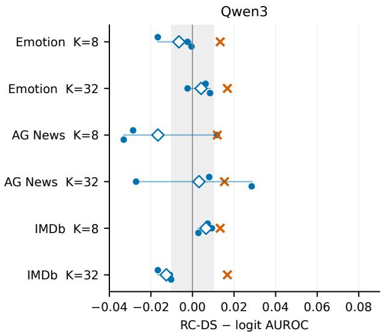

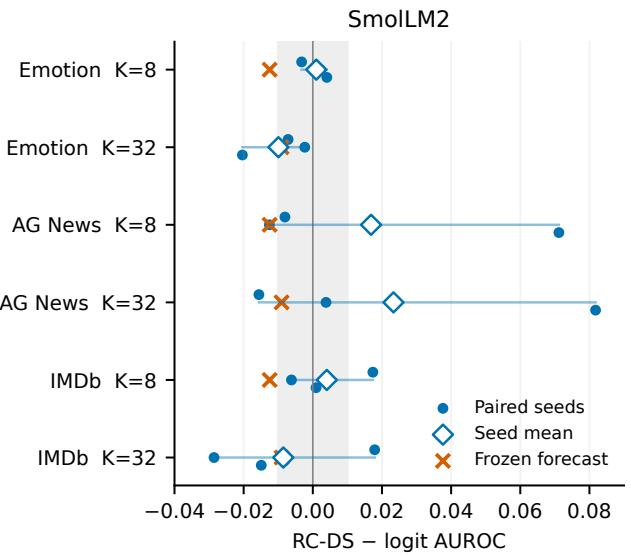  
Figure 13: All twelve reserved full-readout settings. Dots show paired seeds, diamonds their means, and crosses forecasts frozen before confirmation training. Horizontal lines span the three seed values and are not confidence intervals. Gray shading marks the declared ±0.01 AUROC band. Each panel is one checkpoint, not six independent models.

Table 20: All trained RC-DS minus centered-logit AUROC diferences. Seeds 1–3 are 730201–730203. Qwen2.5 is development, not an additional reserved-model replication.
<table><tr><td>Model</td><td>Task</td><td>K</td><td>Mean</td><td>Seed 1</td><td>Seed 2</td><td>Seed 3</td></tr><tr><td>Qwen2.5</td><td>Emotion</td><td>8</td><td>+0.00047</td><td>-0.01294</td><td>+0.01430</td><td>+0.00004</td></tr><tr><td>Qwen2.5</td><td>Emotion</td><td>32</td><td>-0.00265</td><td>+0.00059</td><td>-0.00643</td><td>-0.00210</td></tr><tr><td>Qwen2.5</td><td>AG News</td><td>8</td><td>+0.03900</td><td>+0.04816</td><td>-0.00584</td><td>+0.07467</td></tr><tr><td>Qwen2.5</td><td>AG News</td><td>32</td><td>+0.04761</td><td>+0.05308</td><td>+0.04760</td><td>+0.04215</td></tr><tr><td>Qwen2.5</td><td>IMDb</td><td>8</td><td>-0.03294</td><td>-0.05240</td><td>-0.01532</td><td>-0.03109</td></tr><tr><td>Qwen2.5</td><td>IMDb</td><td>32</td><td>+0.01331</td><td>+0.02103</td><td>+0.01708</td><td>+0.00183</td></tr><tr><td>Qwen3</td><td>Emotion</td><td>8</td><td>-0.00651</td><td>-0.01669</td><td>-0.00237</td><td>-0.00048</td></tr><tr><td>Qwen3</td><td>Emotion</td><td>32</td><td>+0.00413</td><td>+0.00632</td><td>-0.00237</td><td>+0.00845</td></tr><tr><td>Qwen3</td><td>AG News</td><td>8</td><td>-0.01663</td><td>-0.02857</td><td>+0.01176</td><td>-0.03308</td></tr><tr><td>Qwen3</td><td>AG News</td><td>32</td><td>+0.00313</td><td>+0.00805</td><td>-0.02715</td><td>+0.02849</td></tr><tr><td>Qwen3</td><td>IMDb</td><td>8</td><td>+0.00650</td><td>+0.00732</td><td>+0.00933</td><td>+0.00286</td></tr><tr><td>Qwen3</td><td>IMDb</td><td>32</td><td>-0.01261</td><td>-0.01665</td><td>-0.01088</td><td>-0.01029</td></tr><tr><td>SmolLM2</td><td>Emotion</td><td>8</td><td>+0.00101</td><td>-0.00324</td><td>+0.00221</td><td>+0.00406</td></tr><tr><td>SmolLM2</td><td>Emotion</td><td>32</td><td>-0.00995</td><td>-0.00715</td><td>-0.00232</td><td>-0.02036</td></tr><tr><td>SmolLM2</td><td>AG News</td><td>8</td><td>+0.01685</td><td>-0.00806</td><td>-0.01255</td><td>+0.07117</td></tr><tr><td>SmolLM2</td><td>AG News</td><td>32</td><td>+0.02333</td><td>-0.01559</td><td>+0.00382</td><td>+0.08177</td></tr><tr><td>SmolLM2</td><td>IMDb</td><td>8</td><td>+0.00404</td><td>+0.01737</td><td>-0.00618</td><td>+0.00093</td></tr><tr><td>SmolLM2</td><td>IMDb</td><td>32</td><td>-0.00853</td><td>+0.01789</td><td>-0.02857</td><td>-0.01491</td></tr></table>

## L.4 All coordinate methods and controls

Tables 22–24 retain every coordinate method. The hidden and standardized arms are important controls, not only centered logits. For example, SmolLM2/IMDb at K = 32 has mean AUROC 0.6078 for hidden coordinates, 0.5507 for logits, and 0.5422 for RC-DS. ZCA’s strong synthetic support-recovery results do not transfer to this semantic score. Several Emotion and IMDb scores are close to chance, which limits what small diferences can establish. Raw RC-DS coordinate probes have higher AUROC than the corresponding trained RC-DS SAE mean in all eighteen settings, including development. This is a descriptive comparison, not eighteen significance tests. Raw RC-DS, compact-logit, and standardized probes are identical here. Positive per-coordinate scaling and subtraction of a fixed mean preserve example rankings, so they leave both feature selection and AUROC unchanged.

Table 21 places these raw and trained scores side by side. For Qwen2.5 AG News, a raw coordinate scores 0.8493, compared with 0.7053 and 0.8273 for trained RC-DS features at K = 8 and 32. Raw-minus-trained diferences range from 0.0002 to 0.1838 AUROC across the grid. The nine raw model–task scores are each compared with two SAE sparsity levels. Candidate counts difer: raw probes search the retained rank, while the SAE has 1,024 features. Each trained entry averages three SAE seeds. The table also shows their observed range, so a raw score exceeding the trained mean is not read as exceeding every trained run. For example, Qwen2.5 IMDb at K = 32 has raw AUROC 0.5650 and trained mean 0.5648, but trained scores range from 0.5462 to 0.5792. This small mean diference does not establish a consistent raw-probe advantage across seeds.

Table 21: Raw singular coordinates versus trained RC-DS features on label detection. Each entry is macro-AUROC on the same scoring texts after feature and sign selection on separate texts. Trained entries show the mean and [minimum, maximum] over three SAE seeds. These are observed ranges, not confidence intervals. The same raw score is compared with both sparsity levels. Qwen2.5 supplies development data. The following tables retain all other coordinate methods and untrained controls.
<table><tr><td>Model</td><td>Task</td><td>Raw</td><td></td><td>RC-DS, K = 8</td><td>RC-DS, K = 32</td></tr><tr><td>Qwen2.5</td><td>Emotion</td><td>0.5669</td><td>0.5223</td><td>[0.5128, 0.5296]</td><td>0.5372 [0.5349, 0.5404]</td></tr><tr><td>Qwen2.5</td><td>AG News</td><td>0.8493</td><td>0.7053</td><td>[0.6918,0.7130]</td><td>0.8273 [0.8160, 0.8351]</td></tr><tr><td>Qwen2.5</td><td>IMDb</td><td>0.5650</td><td>0.5143</td><td>[0.5045, 0.5326] 0.5648</td><td>[0.5462, 0.5792]</td></tr><tr><td>Qwen3</td><td>Emotion</td><td>0.5958</td><td>0.5236</td><td>[0.5152,0.5289] 0.5428</td><td>[0.5392,0.5501]</td></tr><tr><td>Qwen3</td><td>AG News</td><td>0.8471</td><td></td><td>0.6721 [0.6585, 0.6965]</td><td>0.7982 [0.7862, 0.8157]</td></tr><tr><td>Qwen3</td><td>IMDb</td><td>0.5564</td><td></td><td>0.5385 [0.5227, 0.5473]</td><td>0.5421 [0.5330, 0.5480]</td></tr><tr><td>SmolLM2</td><td>Emotion</td><td>0.5650</td><td></td><td>0.5153 [0.5117, 0.5207]</td><td>0.5318 [0.5292, 0.5359]</td></tr><tr><td>SmolLM2</td><td>AG News</td><td>0.8716</td><td></td><td>0.6878 [0.6579, 0.7210]</td><td>0.8025 [0.7873,0.8267]</td></tr><tr><td>SmolLM2</td><td>IMDb</td><td>0.6241</td><td></td><td>0.5016 [0.4895, 0.5129]</td><td>0.5422 [0.5170, 0.5809]</td></tr></table>

Table 22: Trained single-feature macro-AUROC, averaged over three selected SAE seeds. Std. denotes per-singular-coordinate standardization. Qwen2.5 is development data.
<table><tr><td>Model</td><td>Task</td><td>K</td><td>Logits</td><td>RC-DS</td><td>Hidden</td><td>Std.</td><td>ZCA</td></tr><tr><td>Qwen2.5</td><td>Emotion</td><td>8</td><td>0.5219</td><td>0.5223</td><td>0.5128</td><td>0.5226</td><td>0.5072</td></tr><tr><td>Qwen2.5</td><td>Emotion</td><td>32</td><td>0.5398</td><td>0.5372</td><td>0.5408</td><td>0.5569</td><td>0.5133</td></tr><tr><td>Qwen2.5</td><td>AG News</td><td>8</td><td>0.6663</td><td>0.7053</td><td>0.7138</td><td>0.6235</td><td>0.5167</td></tr><tr><td>Qwen2.5</td><td>AG News</td><td>32</td><td>0.7797</td><td>0.8273</td><td>0.8313</td><td>0.7513</td><td>0.5346</td></tr><tr><td>Qwen2.5</td><td>IMDb</td><td>8</td><td>0.5472</td><td>0.5143</td><td>0.5227</td><td>0.5464</td><td>0.5008</td></tr><tr><td>Qwen2.5</td><td>IMDb</td><td>32</td><td>0.5515</td><td>0.5648</td><td>0.5589</td><td>0.5673</td><td>0.5106</td></tr><tr><td>Qwen3</td><td>Emotion</td><td>8</td><td>0.5301</td><td>0.5236</td><td>0.5277</td><td>0.5273</td><td>0.5044</td></tr><tr><td>Qwen3</td><td>Emotion</td><td>32</td><td>0.5387</td><td>0.5428</td><td>0.5482</td><td>0.5357</td><td>0.5062</td></tr><tr><td>Qwen3</td><td>AG News</td><td>8</td><td>0.6887</td><td>0.6721</td><td>0.6917</td><td>0.6672</td><td>0.5147</td></tr><tr><td>Qwen3</td><td>AG News</td><td>32</td><td>0.7951</td><td>0.7982</td><td>0.7944</td><td>0.7810</td><td>0.5256</td></tr><tr><td>Qwen3</td><td>IMDb</td><td>8</td><td>0.5320</td><td>0.5385</td><td>0.5285</td><td>0.5221</td><td>0.5100</td></tr><tr><td>Qwen3</td><td>IMDb</td><td>32</td><td>0.5547</td><td>0.5421</td><td>0.5347</td><td>0.5357</td><td>0.5116</td></tr><tr><td>SmolLM2</td><td>Emotion</td><td>8</td><td>0.5143</td><td>0.5153</td><td>0.5124</td><td>0.5218</td><td>0.5090</td></tr><tr><td>SmolLM2</td><td>Emotion</td><td>32</td><td>0.5417</td><td>0.5318</td><td>0.5319</td><td>0.5432</td><td>0.5087</td></tr><tr><td>SmolLM2</td><td>AG News</td><td>8</td><td>0.6709</td><td>0.6878</td><td>0.6930</td><td>0.6628</td><td>0.5162</td></tr><tr><td>SmolLM2</td><td>AG News</td><td>32</td><td>0.7792</td><td>0.8025</td><td>0.7761</td><td>0.7670</td><td>0.5243</td></tr><tr><td>SmolLM2</td><td>IMDb</td><td>8</td><td>0.4975</td><td>0.5016</td><td>0.5347</td><td>0.5244</td><td>0.5165</td></tr><tr><td>SmolLM2</td><td>IMDb</td><td>32</td><td>0.5507</td><td>0.5422</td><td>0.6078</td><td>0.5584</td><td>0.5116</td></tr></table>

## L.5 Reconstruction and training curves

Tables 29 and 30 score the same selected models on the disjoint scoring texts, using common logit and gain-free metrics. These are diferent questions from detecting semantic labels. The fitting curves in Figures 14 and 15 instead use each arm’s native RMS-normalized reconstruction loss. Their vertical values should not be treated as a common-metric ranking of coordinate methods. A fixed training budget and declining loss do not prove convergence.

Table 23: Untrained SAE control macro-AUROC. Feature selection uses the same separate texts as for trained SAEs. Each value averages the three paired initializations.
<table><tr><td>Model</td><td>Task</td><td>K</td><td>Logits</td><td>RC-DS</td><td>Hidden</td><td>Std.</td><td>ZCA</td></tr><tr><td>Qwen2.5</td><td>Emotion</td><td>8</td><td>0.5079</td><td>0.5062</td><td>0.5062</td><td>0.5105</td><td>0.5040</td></tr><tr><td>Qwen2.5</td><td>Emotion</td><td>32</td><td>0.5253</td><td>0.5227</td><td>0.5227</td><td>0.5297</td><td>0.5091</td></tr><tr><td>Qwen2.5</td><td>AG News</td><td>8</td><td>0.5384</td><td>0.5442</td><td>0.5442</td><td>0.5361</td><td>0.5183</td></tr><tr><td>Qwen2.5</td><td>AG News</td><td>32</td><td>0.6344</td><td>0.6472</td><td>0.6472</td><td>0.6293</td><td>0.5261</td></tr><tr><td>Qwen2.5</td><td>IMDb</td><td>8</td><td>0.5070</td><td>0.5084</td><td>0.5084</td><td>0.5143</td><td>0.5011</td></tr><tr><td>Qwen2.5</td><td>IMDb</td><td>32</td><td>0.5236</td><td>0.5212</td><td>0.5212</td><td>0.5333</td><td>0.5083</td></tr><tr><td>Qwen3</td><td>Emotion</td><td>8</td><td>0.5139</td><td>0.5135</td><td>0.5135</td><td>0.5147</td><td>0.5048</td></tr><tr><td>Qwen3</td><td>Emotion</td><td>32</td><td>0.5270</td><td>0.5275</td><td>0.5275</td><td>0.5300</td><td>0.5089</td></tr><tr><td>Qwen3</td><td>AG News</td><td>8</td><td>0.5499</td><td>0.5478</td><td>0.5478</td><td>0.5477</td><td>0.5160</td></tr><tr><td>Qwen3</td><td>AG News</td><td>32</td><td>0.6508</td><td>0.6468</td><td>0.6468</td><td>0.6478</td><td>0.5248</td></tr><tr><td>Qwen3</td><td>IMDb</td><td>8</td><td>0.5100</td><td>0.5014</td><td>0.5014</td><td>0.5022</td><td>0.5066</td></tr><tr><td>Qwen3</td><td>IMDb</td><td>32</td><td>0.5343</td><td>0.5225</td><td>0.5225</td><td>0.5132</td><td>0.5048</td></tr><tr><td>SmolLM2</td><td>Emotion</td><td>8</td><td>0.5077</td><td>0.5052</td><td>0.5052</td><td>0.5091</td><td>0.5061</td></tr><tr><td>SmolLM2</td><td>Emotion</td><td>32</td><td>0.5247</td><td>0.5086</td><td>0.5086</td><td>0.5241</td><td>0.5108</td></tr><tr><td>SmolLM2</td><td>AG News</td><td>8</td><td>0.5518</td><td>0.5524</td><td>0.5524</td><td>0.5476</td><td>0.5138</td></tr><tr><td>SmolLM2</td><td>AG News</td><td>32</td><td>0.6589</td><td>0.6461</td><td>0.6461</td><td>0.6484</td><td>0.5222</td></tr><tr><td>SmolLM2</td><td>IMDb</td><td>8</td><td>0.5058</td><td>0.5031</td><td>0.5031</td><td>0.5044</td><td>0.5050</td></tr><tr><td>SmolLM2</td><td>IMDb</td><td>32</td><td>0.5181</td><td>0.5123</td><td>0.5123</td><td>0.5333</td><td>0.5088</td></tr></table>

Table 24: Raw-coordinate macro-AUROC with the same feature-selection and scoring procedure. These probes do not have an SAE seed or a Top-K setting. Logits, RC-DS, and Std. tie because positive per-coordinate scaling and constant shifts preserve rankings and AUROC.
<table><tr><td>Model</td><td>Task</td><td>K</td><td>Logits</td><td>RC-DS</td><td>Hidden</td><td>Std.</td><td>ZCA</td></tr><tr><td>Qwen2.5</td><td>Emotion</td><td></td><td>0.5669</td><td>0.5669</td><td>0.5815</td><td>0.5669</td><td>0.5268</td></tr><tr><td>Qwen2.5</td><td>AG News</td><td></td><td>0.8493</td><td>0.8493</td><td>0.8580</td><td>0.8493</td><td>0.5324</td></tr><tr><td>Qwen2.5</td><td>IMDb</td><td></td><td>0.5650</td><td>0.5650</td><td>0.6886</td><td>0.5650</td><td>0.5354</td></tr><tr><td>Qwen3</td><td>Emotion</td><td></td><td>0.5958</td><td>0.5958</td><td>0.5841</td><td>0.5958</td><td>0.5165</td></tr><tr><td>Qwen3</td><td>AG News</td><td></td><td>0.8471</td><td>0.8471</td><td>0.8664</td><td>0.8471</td><td>0.5449</td></tr><tr><td>Qwen3</td><td>IMDb</td><td></td><td>0.5564</td><td>0.5564</td><td>0.6233</td><td>0.5564</td><td>0.5094</td></tr><tr><td>SmolLM2</td><td>Emotion</td><td></td><td>0.5650</td><td>0.5650</td><td>0.5713</td><td>0.5650</td><td>0.5005</td></tr><tr><td>SmolLM2</td><td>AG News</td><td></td><td>0.8716</td><td>0.8716</td><td>0.8313</td><td>0.8716</td><td>0.5514</td></tr><tr><td>SmolLM2</td><td>IMDb</td><td></td><td>0.6241</td><td>0.6241</td><td>0.5797</td><td>0.6241</td><td>0.5563</td></tr></table>

We report paired diferences separately for each checkpoint, task, and sparsity level. For metric E and baseline $b ,$ a seed-level diference is $d _ { s } = E ( { \mathrm { R C } } { \mathrm { - D S } } , s ) - E ( b , s )$ , using the originally selected fits for the same seed. Tables 25–28 give the mean and observed range of the three diferences. Ranges describe run-to-run variation on fixed texts and checkpoints. They are not confidence intervals and do not measure uncertainty from resampling texts or choosing other models. All comparisons are retained regardless of size or sign. A range that spans zero shows a reversal among the observed seeds. A range entirely on one side of zero is still not a population-level significance claim.

For Table 2, we first average the six task–sparsity diferences within each checkpoint and seed, then report the mean and sample standard deviation of those three averages. This preserves seed matching instead of pooling correlated settings as independent observations. We do not fit a population random-efects model to three deliberately selected checkpoints. The setting counts describe this grid only.

Table 25: Paired RC-DS minus centered-logit reconstruction diferences. Each metric gives the mean and [minimum, maximum] across seeds 730201–730203, not a confidence interval. Positive values favor RC-DS. Tasks and sparsity levels repeat within each fixed checkpoint.
<table><tr><td>Model</td><td>Task</td><td>K</td><td></td><td>Gain-free EV</td><td></td><td>Logit EV</td></tr><tr><td>Qwen2.5</td><td>Emotion</td><td>8</td><td>+0.0353</td><td>[+0.0318, +0.0398]</td><td>-0.0041</td><td>[-0.0069, -0.0025]</td></tr><tr><td>Qwen2.5</td><td>Emotion</td><td>32</td><td>+0.0305</td><td>[+0.0265, +0.0349]</td><td>-0.0055</td><td>[-0.0083, -0.0027]</td></tr><tr><td>Qwen2.5</td><td>AG News</td><td>8</td><td>+0.0108</td><td>[+0.0092, +0.0131]</td><td>-0.0046</td><td>[-0.0058, -0.0039]</td></tr><tr><td>Qwen2.5</td><td>AG News</td><td>32</td><td>+0.0114</td><td>[+0.0104, +0.0122]</td><td>-0.0067</td><td>[-0.0072, -0.0065]</td></tr><tr><td>Qwen2.5</td><td>IMDb</td><td>8</td><td>+0.0242</td><td>[+0.0216, +0.0261]</td><td>-0.0036</td><td>[-0.0042, -0.0032]</td></tr><tr><td>Qwen2.5</td><td>IMDb</td><td>32</td><td>+0.0177</td><td>[+0.0160, +0.0189]</td><td>-0.0101</td><td>[-0.0106, -0.0095]</td></tr><tr><td>Qwen3</td><td>Emotion</td><td>8</td><td>+0.0134</td><td>[+0.0079, +0.0215]</td><td>+0.0006</td><td>[-0.0056, +0.0086]</td></tr><tr><td>Qwen3</td><td>Emotion</td><td>32</td><td>+0.0080</td><td>[+0.0065, +0.0099]</td><td>-0.0080</td><td>[-0.0096, -0.0056]</td></tr><tr><td>Qwen3</td><td>AG News</td><td>8</td><td>+0.0048</td><td>[+0.0031, +0.0072]</td><td>-0.0023</td><td>[-0.0046, +0.0008]</td></tr><tr><td>Qwen3</td><td>AG News</td><td>32</td><td>+0.0069</td><td>[+0.0052, +0.0099]</td><td>-0.0032</td><td>[-0.0049, -0.0002]</td></tr><tr><td>Qwen3</td><td>IMDb</td><td>8</td><td>+0.0136</td><td>[+0.0101,+0.0177]</td><td>-0.0003</td><td>[-0.0034, +0.0027]</td></tr><tr><td>Qwen3</td><td>IMDb</td><td>32</td><td>+0.0075</td><td>[+0.0073, +0.0077]</td><td>-0.0065</td><td>[-0.0068, -0.0061]</td></tr><tr><td>SmolLM2</td><td>Emotion</td><td>8</td><td>+0.0968</td><td>[+0.0894, +0.1044]</td><td>-0.0188</td><td>[−0.0200, -0.0182]</td></tr><tr><td>SmolLM2</td><td>Emotion</td><td>32</td><td>+0.0553</td><td>[+0.0525, +0.0585]</td><td>-0.0371</td><td>[-0.0424, -0.0334]</td></tr><tr><td>SmolLM2</td><td>AG News</td><td>8</td><td>+0.0460</td><td>[+0.0437, +0.0472]</td><td>-0.0309</td><td>[-0.0351, -0.0276]</td></tr><tr><td>SmolLM2</td><td>AG News</td><td>32</td><td>+0.0318</td><td>[+0.0287, +0.0367]</td><td>-0.0354</td><td>[-0.0390, -0.0296]</td></tr><tr><td>SmolLM2</td><td>IMDb</td><td>8</td><td>+0.0703</td><td>[+0.0635, +0.0747]</td><td>-0.0127</td><td>[-0.0148,-0.0107]</td></tr><tr><td>SmolLM2</td><td>IMDb</td><td>32</td><td>+0.0391</td><td>[+0.0374, +0.0400]</td><td></td><td>-0.0281 [-0.0285, -0.0279]</td></tr></table>

Table 26: Paired RC-DS minus hidden-state reconstruction diferences, with the same mean and observed seed-range convention as Table 25.
<table><tr><td>Model</td><td>Task</td><td>K</td><td></td><td>Gain-free EV</td><td></td><td>Logit EV</td></tr><tr><td>Qwen2.5</td><td>Emotion</td><td>8</td><td>+0.0013</td><td>[-0.0003, +0.0027]</td><td>+0.0018</td><td>[-0.0017,+0.0041]</td></tr><tr><td>Qwen2.5</td><td>Emotion</td><td>32</td><td>+0.0048</td><td>[+0.0003, +0.0098]</td><td>+0.0054</td><td>[+0.0006, +0.0100]</td></tr><tr><td>Qwen2.5</td><td>AG News</td><td>8</td><td>+0.0064</td><td>[+0.0050, +0.0078]</td><td>+0.0081</td><td>[+0.0074, +0.0089]</td></tr><tr><td>Qwen2.5</td><td>AG News</td><td>32</td><td>+0.0080</td><td>[+0.0062, +0.0090]</td><td>+0.0095</td><td>[+0.0067, +0.0113]</td></tr><tr><td>Qwen2.5</td><td>IMDb</td><td>8</td><td>+0.0004</td><td>[-0.0012,+0.0027]</td><td>+0.0006</td><td>[-0.0001,+0.0013]</td></tr><tr><td>Qwen2.5</td><td>IMDb</td><td>32</td><td>+0.0050</td><td>[+0.0011, +0.0075]</td><td>+0.0061</td><td>[+0.0022, +0.0083]</td></tr><tr><td>Qwen3</td><td>Emotion</td><td>8</td><td>+0.0081</td><td>[+0.0038, +0.0115]</td><td>+0.0068</td><td>[+0.0016,+0.0104]</td></tr><tr><td>Qwen3</td><td>Emotion</td><td>32</td><td>+0.0103</td><td>[+0.0049, +0.0146]</td><td>+0.0098</td><td>[+0.0045, +0.0142]</td></tr><tr><td>Qwen3</td><td>AG News</td><td>8</td><td>+0.0032</td><td>[+0.0025, +0.0045]</td><td>+0.0034</td><td>[+0.0024, +0.0048</td></tr><tr><td>Qwen3</td><td>AG News</td><td>32</td><td>+0.0060</td><td>[+0.0048, +0.0084]</td><td>+0.0057</td><td>[+0.0041, +0.0078</td></tr><tr><td>Qwen3</td><td>IMDb</td><td>8</td><td>+0.0039</td><td>[+0.0028, +0.0048]</td><td>+0.0031</td><td>[+0.0015, +0.0043]</td></tr><tr><td>Qwen3</td><td>IMDb</td><td>32</td><td>+0.0124</td><td>[+0.0111, +0.0132]</td><td>+0.0122</td><td>[+0.0109, +0.0130]</td></tr><tr><td>SmolLM2</td><td>Emotion</td><td>8</td><td>+0.0005</td><td>[-0.0006, +0.0018]</td><td>+0.0040</td><td>[+0.0017,+0.0055]</td></tr><tr><td>SmolLM2</td><td>Emotion</td><td>32</td><td>+0.0032</td><td>[+0.0003, +0.0061]</td><td>+0.0045</td><td>[+0.0002,+0.0073]</td></tr><tr><td>SmolLM2</td><td>AG News</td><td>8</td><td>+0.0003</td><td>[−0.0022, +0.0042]</td><td>+0.0063</td><td>[+0.0014,+0.0115]</td></tr><tr><td>SmolLM2</td><td>AG News</td><td>32</td><td>+0.0083</td><td>[+0.0065, +0.0099]</td><td>+0.0176</td><td>[+0.0135, +0.0249]</td></tr><tr><td>SmolLM2</td><td>IMDb</td><td>8</td><td>+0.0002</td><td>[-0.0008, +0.0018]</td><td>+0.0138</td><td>[+0.0118,+0.0175]</td></tr><tr><td>SmolLM2</td><td>IMDb</td><td>32</td><td>+0.0006</td><td>[-0.0003, +0.0023]</td><td>+0.0079</td><td>[+0.0060, +0.0098]</td></tr></table>

Table 27: Paired RC-DS minus standardized-coordinate reconstruction diferences. Entries give the mean and observed range over three matched seeds.
<table><tr><td>Model</td><td>Task</td><td>K</td><td></td><td>Gain-free EV</td><td></td><td>Logit EV</td></tr><tr><td>Qwen2.5</td><td>Emotion</td><td>8</td><td>+0.0644</td><td>[+0.0582, +0.0726]</td><td>+0.0127</td><td>[+0.0095, +0.0154]</td></tr><tr><td>Qwen2.5</td><td>Emotion</td><td>32</td><td>+0.0613</td><td>[+0.0572, +0.0686]</td><td>+0.0143</td><td>[+0.0108,+0.0200]</td></tr><tr><td>Qwen2.5</td><td>AG News</td><td>8</td><td>+0.0252</td><td>[+0.0235, +0.0280]</td><td>-0.0007</td><td>[-0.0017, +0.0001]</td></tr><tr><td>Qwen2.5</td><td>AG News</td><td>32</td><td>+0.0277</td><td>[+0.0258, +0.0288]</td><td>+0.0022</td><td>[+0.0009, +0.0036]</td></tr><tr><td>Qwen2.5</td><td>IMDb</td><td>8</td><td>+0.0777</td><td>[+0.0685, +0.0865]</td><td>+0.0197</td><td>[+0.0166, +0.0240]</td></tr><tr><td>Qwen2.5</td><td>IMDb</td><td>32</td><td>+0.0496</td><td>[+0.0478, +0.0508]</td><td>+0.0093</td><td>[+0.0084, +0.0105]</td></tr><tr><td>Qwen3</td><td>Emotion</td><td>8</td><td>+0.0332</td><td>[+0.0281, +0.0372]</td><td>+0.0304</td><td>[+0.0265, +0.0333]</td></tr><tr><td>Qwen3</td><td>Emotion</td><td>32</td><td>+0.0352</td><td>[+0.0320, +0.0392]</td><td>+0.0348</td><td>[+0.0314, +0.0389]</td></tr><tr><td>Qwen3</td><td>AG News</td><td>8</td><td>+0.0122</td><td>[+0.0103, +0.0150]</td><td>+0.0101</td><td>[+0.0082, +0.0127]</td></tr><tr><td>Qwen3</td><td>AG News</td><td>32</td><td>+0.0162</td><td>[+0.0147, +0.0175]</td><td>+0.0158</td><td>[+0.0142, +0.0167]</td></tr><tr><td>Qwen3</td><td>IMDb</td><td>8</td><td>+0.0388</td><td>[+0.0364, +0.0411]</td><td>+0.0228</td><td>[+0.0200, +0.0254]</td></tr><tr><td>Qwen3</td><td>IMDb</td><td>32</td><td>+0.0277</td><td>[+0.0261, +0.0289]</td><td>+0.0227</td><td>[+0.0209, +0.0240]</td></tr><tr><td>SmolLM2</td><td>Emotion</td><td>8</td><td>+0.1626</td><td>[+0.1564, +0.1704]</td><td>+0.0077</td><td>[+0.0054,+0.0114]</td></tr><tr><td>SmolLM2</td><td>Emotion</td><td>32</td><td>+0.1276</td><td>[+0.1227,+0.1305]</td><td>-0.0059</td><td>[-0.0104,-0.0028]</td></tr><tr><td>SmolLM2</td><td>AG News</td><td>8</td><td>+0.0822</td><td>[+0.0740, +0.0908]</td><td>-0.0142</td><td>[-0.0226, -0.0085]</td></tr><tr><td>SmolLM2</td><td>AG News</td><td>32</td><td>+0.0700</td><td>[+0.0685, +0.0710]</td><td>-0.0132</td><td>[-0.0142, -0.0125]</td></tr><tr><td>SmolLM2</td><td>IMDb</td><td>8</td><td>+0.1715</td><td>[+0.1669, +0.1795]</td><td>+0.0265</td><td>[+0.0247, +0.0288]</td></tr><tr><td>SmolLM2</td><td>IMDb</td><td>32</td><td>+0.1107</td><td>[+0.1055,+0.1176]</td><td>+0.0066</td><td>[+0.0048, +0.0090]</td></tr></table>

Table 28: Paired RC-DS minus ZCA reconstruction diferences. Entries give the mean and observed range over three matched seeds.
<table><tr><td>Model</td><td>Task</td><td>K</td><td></td><td>Gain-free EV</td><td></td><td>Logit EV</td></tr><tr><td>Qwen2.5</td><td>Emotion</td><td>8</td><td>+0.3025</td><td>[+0.2962, +0.3110]</td><td>+0.2570</td><td>[+0.2559, +0.2589]</td></tr><tr><td>Qwen2.5</td><td>Emotion</td><td>32</td><td>+0.4759</td><td>[+0.4687, +0.4796]</td><td>+0.4301</td><td>[+0.4240, +0.4366]</td></tr><tr><td>Qwen2.5</td><td>AG News</td><td>8</td><td>+0.3112</td><td>[+0.3029, +0.3238]</td><td>+0.2811</td><td>[+0.2720, +0.2915]</td></tr><tr><td>Qwen2.5</td><td>AG News</td><td>32</td><td>+0.3696</td><td>[+0.3651, +0.3777]</td><td>+0.3429</td><td>[+0.3350, +0.3483]</td></tr><tr><td>Qwen2.5</td><td>IMDb</td><td>8</td><td>+0.3131</td><td>[+0.2944, +0.3226]</td><td>+0.2670</td><td>[+0.2462, +0.2779]</td></tr><tr><td>Qwen2.5</td><td>IMDb</td><td>32</td><td>+0.4231</td><td>[+0.4179,+0.4261]</td><td>+0.3855</td><td>[+0.3806, +0.3901]</td></tr><tr><td>Qwen3</td><td>Emotion</td><td>8</td><td>+0.3617</td><td>[+0.3527, +0.3673]</td><td>+0.3610</td><td>[+0.3520, +0.3664]</td></tr><tr><td>Qwen3</td><td>Emotion</td><td>32</td><td>+0.5368</td><td>[+0.5208, +0.5508]</td><td>+0.5412</td><td>[+0.5276, +0.5546]</td></tr><tr><td>Qwen3</td><td>AG News</td><td>8</td><td>+0.3488</td><td>[+0.3462, +0.3523]</td><td>+0.3474</td><td>[+0.3446, +0.3508]</td></tr><tr><td>Qwen3</td><td>AG News</td><td>32</td><td>+0.4175</td><td>[+0.4162, +0.4189]</td><td>+0.4235</td><td>[+0.4198, +0.4264]</td></tr><tr><td>Qwen3</td><td>IMDb</td><td>8</td><td>+0.3498</td><td>[+0.3475, +0.3533]</td><td>+0.3411</td><td>[+0.3385, +0.3450]</td></tr><tr><td>Qwen3</td><td>IMDb</td><td>32</td><td>+0.4467</td><td>[+0.4389, +0.4515]</td><td>+0.4473</td><td>[+0.4404, +0.4538]</td></tr><tr><td>SmolLM2</td><td>Emotion</td><td>8</td><td>+0.4238</td><td>[+0.4092, +0.4373]</td><td>+0.2495</td><td>[+0.2389, +0.2552]</td></tr><tr><td>SmolLM2</td><td>Emotion</td><td>32</td><td>+0.5273</td><td>[+0.5213, +0.5322]</td><td>+0.3874</td><td>[+0.3813, +0.3930]</td></tr><tr><td>SmolLM2</td><td>AG News</td><td>8</td><td>+0.4010</td><td>[+0.3979, +0.4068]</td><td>+0.2892</td><td>[+0.2864, +0.2930]</td></tr><tr><td>SmolLM2</td><td>AG News</td><td>32</td><td>+0.4286</td><td>[+0.4182, +0.4442]</td><td>+0.3767</td><td>[+0.3725, +0.3822]</td></tr><tr><td>SmolLM2</td><td>IMDb</td><td>8</td><td>+0.4462</td><td>[+0.4315, +0.4568]</td><td>+0.3269</td><td>[+0.3128, +0.3410]</td></tr><tr><td>SmolLM2</td><td>IMDb</td><td>32</td><td>+0.4736</td><td>[+0.4703, +0.4799]</td><td>+0.4075</td><td>[+0.3985, +0.4121]</td></tr></table>

Table 29: Scoring-set explained variance in the same full centered-logit metric, averaging three selected SAE seeds. Higher is better.
<table><tr><td>Model</td><td>Task</td><td>K</td><td>Logits</td><td>RC-DS</td><td>Hidden</td><td>Std.</td><td>ZCA</td></tr><tr><td>Qwen2.5</td><td>Emotion</td><td>8</td><td>0.3930</td><td>0.3889</td><td>0.3870</td><td>0.3762</td><td>0.1319</td></tr><tr><td>Qwen2.5</td><td>Emotion</td><td>32</td><td>0.5207</td><td>0.5152</td><td>0.5098</td><td>0.5008</td><td>0.0851</td></tr><tr><td>Qwen2.5</td><td>AG News</td><td>8</td><td>0.6325</td><td>0.6279</td><td>0.6198</td><td>0.6285</td><td>0.3467</td></tr><tr><td>Qwen2.5</td><td>AG News</td><td>32</td><td>0.7002</td><td>0.6935</td><td>0.6840</td><td>0.6912</td><td>0.3506</td></tr><tr><td>Qwen2.5</td><td>IMDb</td><td>8</td><td>0.5403</td><td>0.5367</td><td>0.5361</td><td>0.5170</td><td>0.2697</td></tr><tr><td>Qwen2.5</td><td>IMDb</td><td>32</td><td>0.6167</td><td>0.6066</td><td>0.6006</td><td>0.5973</td><td>0.2212</td></tr><tr><td>Qwen3</td><td>Emotion</td><td>8</td><td>0.4663</td><td>0.4668</td><td>0.4601</td><td>0.4364</td><td>0.1058</td></tr><tr><td>Qwen3</td><td>Emotion</td><td>32</td><td>0.6040</td><td>0.5960</td><td>0.5862</td><td>0.5612</td><td>0.0549</td></tr><tr><td>Qwen3</td><td>AG News</td><td>8</td><td>0.6451</td><td>0.6428</td><td>0.6393</td><td>0.6326</td><td>0.2953</td></tr><tr><td>Qwen3</td><td>AG News</td><td>32</td><td>0.7223</td><td>0.7191</td><td>0.7134</td><td>0.7033</td><td>0.2956</td></tr><tr><td>Qwen3</td><td>IMDb</td><td>8</td><td>0.6059</td><td>0.6056</td><td>0.6025</td><td>0.5828</td><td>0.2645</td></tr><tr><td>Qwen3</td><td>IMDb</td><td>32</td><td>0.6835</td><td>0.6770</td><td>0.6649</td><td>0.6543</td><td>0.2297</td></tr><tr><td>SmolLM2</td><td>Emotion</td><td>8</td><td>0.4125</td><td>0.3937</td><td>0.3897</td><td>0.3860</td><td>0.1441</td></tr><tr><td>SmolLM2</td><td>Emotion</td><td>32</td><td>0.5422</td><td>0.5051</td><td>0.5006</td><td>0.5109</td><td>0.1177</td></tr><tr><td>SmolLM2</td><td>AG News</td><td>8</td><td>0.6410</td><td>0.6101</td><td>0.6038</td><td>0.6243</td><td>0.3209</td></tr><tr><td>SmolLM2</td><td>AG News</td><td>32</td><td>0.7153</td><td>0.6799</td><td>0.6623</td><td>0.6931</td><td>0.3032</td></tr><tr><td>SmolLM2</td><td>IMDb</td><td>8</td><td>0.5748</td><td>0.5621</td><td>0.5483</td><td>0.5356</td><td>0.2351</td></tr><tr><td>SmolLM2</td><td>IMDb</td><td>32</td><td>0.6471</td><td>0.6189</td><td>0.6111</td><td>0.6123</td><td>0.2114</td></tr></table>

## L.6 Provenance and internal verification

The internally retained protocol pins all model and dataset revisions. Its SHA-256 begins 7fcfe2e0d79652b1. The source code is also locked, separately from its outputs. Saved forecasts precede all 360 reserved fits. Checkpoint replay verifies 1,080 training checkpoints across 540 fits and 585 semantic score rows, including trained, untrained, and raw-coordinate controls. It recomputes feature selection and exact tied-score AUROC and checks text/token separation, selected learning rates, source hashes, and forecast timestamps.

SAE training uses three concurrent CPU workers with one thread per fit. Development training takes 2.66 wall-clock hours and confirmation 5.62 hours on the recorded machine, excluding representation extraction and final scoring. Summed per-fit training times are 7.37 and 14.08 hours. These measurements are not portable runtime guarantees.

Development and confirmation outputs come from separate executions of identical checksum-locked source. Their metadata records the phase and source hash. An initial setup failure occurred before SAE training and remains in the internal record. Tables and figures are generated from saved results without retraining. The source code and executable notebooks are not publicly released.

The scope remains three fixed checkpoints, with only two reserved for confirmation. SAE seeds and tasks are repeated measurements, not additional independently trained models. The outcome is a single-feature label-detection score on the specified text partitions. It is not a test of all possible semantics, latent-factor truth, or causal intervention quality.

Table 30: Scoring-set explained variance after removing readout gains, averaging three selected SAE seeds. Higher is better. This weights errors diferently from logit EV. Entries are rounded to four decimal places. Diferences reported in the text are computed from unrounded means, then rounded separately.
<table><tr><td>Model</td><td>Task</td><td>K</td><td>Logits</td><td>RC-DS</td><td>Hidden</td><td>Std.</td><td>ZCA</td></tr><tr><td>Qwen2.5</td><td>Emotion</td><td>8</td><td>0.4269</td><td>0.4622</td><td>0.4609</td><td>0.3977</td><td>0.1596</td></tr><tr><td>Qwen2.5</td><td>Emotion</td><td>32</td><td>0.5700</td><td>0.6006</td><td>0.5958</td><td>0.5392</td><td>0.1247</td></tr><tr><td>Qwen2.5</td><td>AG News</td><td>8</td><td>0.6673</td><td>0.6781</td><td>0.6717</td><td>0.6529</td><td>0.3668</td></tr><tr><td>Qwen2.5</td><td>AG News</td><td>32</td><td>0.7383</td><td>0.7497</td><td>0.7416</td><td>0.7220</td><td>0.3800</td></tr><tr><td>Qwen2.5</td><td>IMDb</td><td>8</td><td>0.6086</td><td>0.6328</td><td>0.6324</td><td>0.5551</td><td>0.3196</td></tr><tr><td>Qwen2.5</td><td>IMDb</td><td>32</td><td>0.6916</td><td>0.7092</td><td>0.7042</td><td>0.6596</td><td>0.2861</td></tr><tr><td>Qwen3</td><td>Emotion</td><td>8</td><td>0.4576</td><td>0.4710</td><td>0.4629</td><td>0.4378</td><td>0.1093</td></tr><tr><td>Qwen3</td><td>Emotion</td><td>32</td><td>0.5884</td><td>0.5964</td><td>0.5861</td><td>0.5611</td><td>0.0596</td></tr><tr><td>Qwen3</td><td>AG News</td><td>8</td><td>0.6472</td><td>0.6520</td><td>0.6487</td><td>0.6398</td><td>0.3031</td></tr><tr><td>Qwen3</td><td>AG News</td><td>32</td><td>0.7193</td><td>0.7262</td><td>0.7201</td><td>0.7099</td><td>0.3086</td></tr><tr><td>Qwen3</td><td>IMDb</td><td>8</td><td>0.6095</td><td>0.6231</td><td>0.6192</td><td>0.5843</td><td>0.2733</td></tr><tr><td>Qwen3</td><td>IMDb</td><td>32</td><td>0.6846</td><td>0.6921</td><td>0.6797</td><td>0.6645</td><td>0.2454</td></tr><tr><td>SmolLM2</td><td>Emotion</td><td>8</td><td>0.5428</td><td>0.6397</td><td>0.6392</td><td>0.4771</td><td>0.2159</td></tr><tr><td>SmolLM2</td><td>Emotion</td><td>32</td><td>0.6951</td><td>0.7504</td><td>0.7472</td><td>0.6228</td><td>0.2231</td></tr><tr><td>SmolLM2</td><td>AG News</td><td>8</td><td>0.7520</td><td>0.7980</td><td>0.7977</td><td>0.7158</td><td>0.3970</td></tr><tr><td>SmolLM2</td><td>AG News</td><td>32</td><td>0.8267</td><td>0.8585</td><td>0.8502</td><td>0.7885</td><td>0.4299</td></tr><tr><td>SmolLM2</td><td>IMDb</td><td>8</td><td>0.7286</td><td>0.7988</td><td>0.7987</td><td>0.6273</td><td>0.3526</td></tr><tr><td>SmolLM2</td><td>IMDb</td><td>32</td><td>0.8095</td><td>0.8486</td><td>0.8480</td><td>0.7379</td><td>0.3750</td></tr></table>

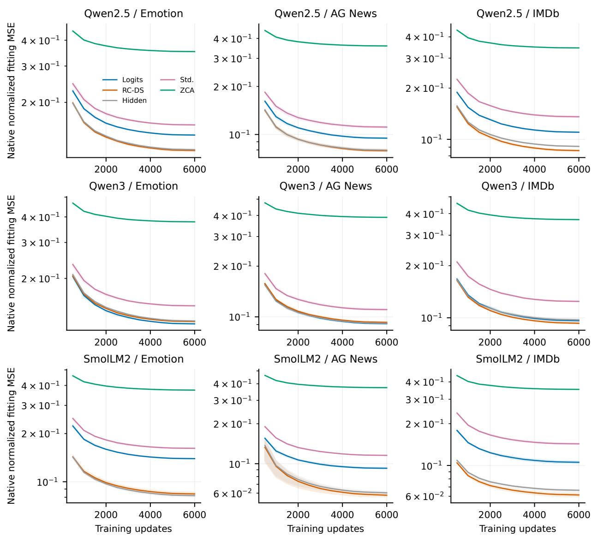  
Figure 14: Fitting curves for K = 8. Lines average three selected learning-rate fits, one per SAE seed. Shading spans the seeds, not a confidence interval. Loss is native normalized fitting MSE, with a logarithmic vertical axis. Qwen2.5 is development data.

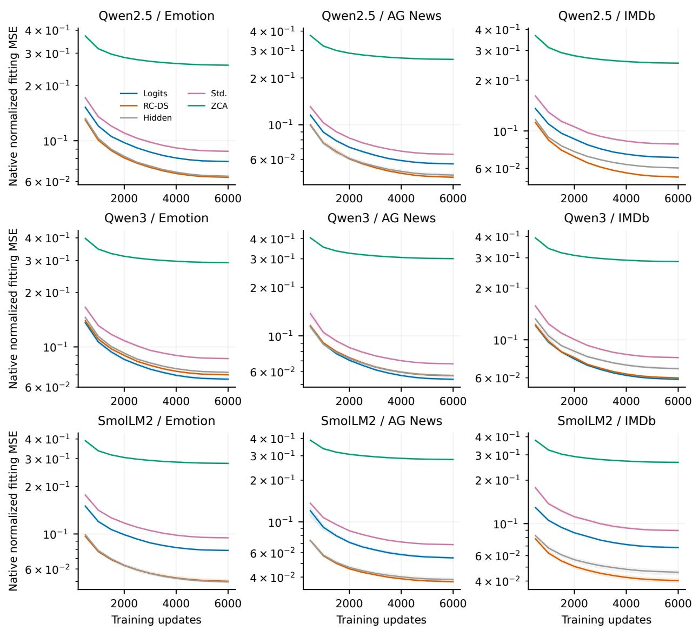  
Figure 15: Fitting curves for K = 32, using the same conventions as Figure 14. Both candidate learning rates and all histories remain in the internal study records, including rates not selected for scoring.