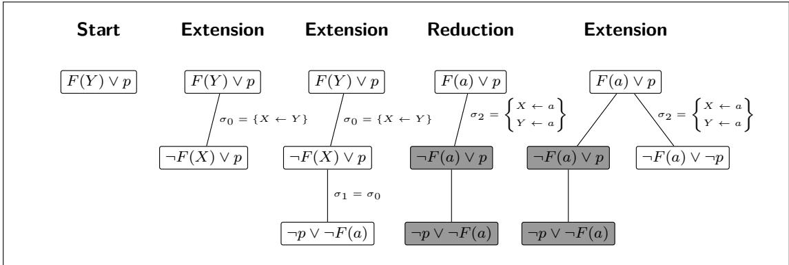
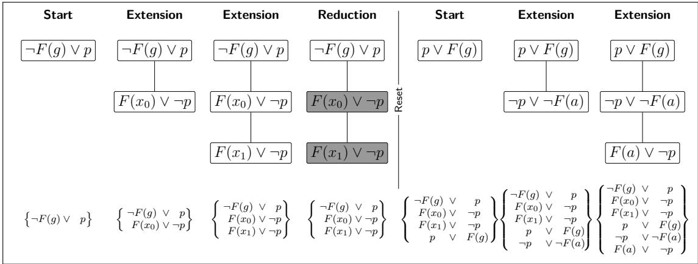
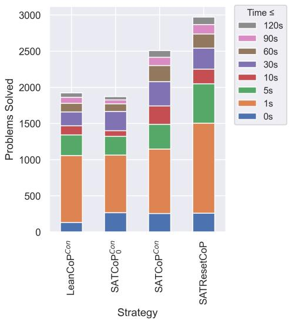
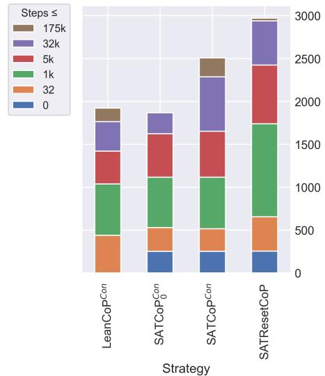
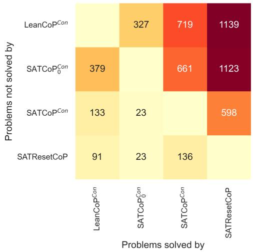
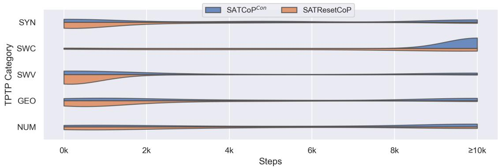
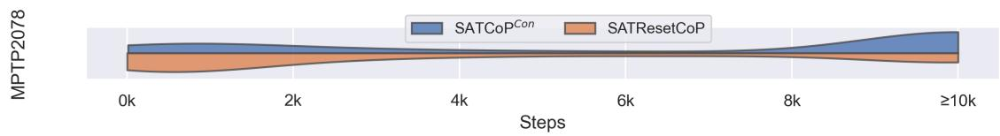

# Reset Early, Reset Often, Eliminate Models

Martin S. Fixman<sup>1</sup>, Fredrik Rømming<sup>2</sup>, and Sean B. Holden<sup>3</sup>

University of Cambridge,

<sup>1</sup>msf43@cl.cam.ac.uk <sup>2</sup>fr409@cl.cam.ac.uk <sup>3</sup>sbh11@cl.cam.ac.uk

United Kingdom

## Abstract

Connection-tableau provers typically construct closed tableaux by backtracking search. This gives lightweight proof procedures, but their low-memory search state leaves little derived information to reuse after a failed attempt. SATCoP addresses this by retaining grounded tableau clauses in an incremental SAT solver, allowing the prover to refute the problem once the accumulated ground clauses become propositionally unsatisfiable. We introduce SATResetCoP, which relies more directly on this persistent SAT state by not backtracking on unproductive tableaux and instead starting new ones to generate further ground clauses for the SAT solver. On TPTP, SATResetCoP improves over our leanCoPstyle baseline by 54% and our SATCoP-style baseline by 18%. On the bushy MPTP2078 benchmark, it solves 616 problems, a 49% improvement over our leanCoP-style baseline and a 12% improvement over our SATCoP-style baseline. These results suggest that changing tableau guidance to accumulate useful ground clauses faster improves the performance of the prover.

## 1 Introduction

Connection-tableau provers prove first-order problems by constructing closed tableaux from sound tableau-construction rules [8]. Implementations usually turn this construction into backtracking search over applications of those rules. This gives a lightweight and goal-directed proof procedure, but its small search state means that failed partial tableaux leave little derived information for later attempts to reuse.

Much practical work on connection-tableau proving has therefore focused on controlling backtracking, and learning how to restrict it. The line from semantic tableaux and model elimination to leanTAP and leanCoP showed that goal-directed tableau search could be implemented in small, efective proof procedures [4, 9, 3, 13].

leanCoP uses Prolog’s SLD resolution for depth-first connection-tableau search with iterative deepening, and leanCoP 2.0 obtains substantial speedups by restricting this backtracking with Prolog cuts at the cost of completeness [11]. meanCoP refines this pruning strategy by separating cuts on reductions from cuts on extensions and by introducing exclusive cuts, which preserve more alternatives than the inclusive cuts used by leanCoP [7].

SATCoP addresses the same weakness from a diferent direction [18]. During tableau construction, it grounds encountered clauses and stores them in an incremental SAT solver. If the accumulated ground clauses become propositionally unsatisfiable, the original first-order problem can be proved before the active tableau has closed. We introduce SATResetCoP, which pushes this idea further: when the active tableau stops producing new ground clauses, it is reset, while the accumulated SAT solver state is kept. The tableau is therefore used as a generator of ground clauses, and the SAT solver becomes the persistent object from which a proof may ultimately be obtained.

We evaluate SATResetCoP on TPTP against leanCoP-style and SATCoP-style baselines implemented in a fully compatible backend. SATResetCoP solves 54% more problems than the leanCoP-style baseline and 18% more than the SATCoP-style baseline, suggesting that once ground clauses are preserved in the SAT solver, starting a new tableau rather than continuing to backtrack on an unproductive one can be an efective way to generate the clauses needed for a proof.

## 2 Preliminaries

## 2.1 Connection Calculus and Tableau Search

Connection tableaux and model elimination give a goal-directed alternative to the saturation style used by provers such as Vampire [19]. Instead of deriving clauses from a global clause set until a contradiction is found [2, 22], connection calculi try to close a tableau by connecting goal literals to complementary literals, either on the current path or in a fresh copy of an input clause [8, 14].

The standard clausal connection tableau has three proof-building rules [8, 15].

Start Choose an input clause and make its literals open goals.

Extension Open a branch on a clause containing a complementary literal, and add the remaining literals as new subgoals. This may require a substitution of variables with terms.

Reduction Close the current goal against a complementary literal already on the current branch. This may also require a substitution.

The rules are sound, and with the possibility of backtracking over rule applications the calculus is complete. The calculus is not confluent: a locally sound connection can bind variables in a way that prevents later branches from closing [8]. Backtracking is therefore part of the operational search procedure, not a proof-building rule.

  
Figure 1: Drawing convention for the tableau diagrams, illustrated on steps from SYN052-1.p [16]. Each box is a clause instance in the tableau. An edge records the connection that introduced a child clause, with the edge label showing the resulting substitution. Grey boxes mark clauses whose selected open literal has been closed. A Reduction closes against a complementary literal already on the current path, so it adds no new child.

## 2.2 Backtracking Control

Backtracking lets a prover recover from locally sound choices that later prevent tableau closure.   
In leanCoP-style provers, this search is controlled mainly by iterative deepening and Prolog cuts.

Iterative deepening bounds the tableau height and raises the bound when no proof is found. Cuts prune alternatives after selected reductions or extensions, reducing search but making the cut phase incomplete unless the surrounding schedule later explores less restricted search [11].

meanCoP refines this pruning mechanism by separating cuts on reductions from cuts on extensions and by introducing exclusive cuts, which preserve more alternatives than the inclusive cuts used by leanCoP [7]. hopCoP takes a diferent route: instead of pruning alternatives directly, it learns constraints explaining why a search state is stuck, reducing repeated backtracking while preserving completeness at a fixed iterative-deepening bound [17].

## 2.3 SATCoP and Persistent Ground Clauses

SATCoP maintains an incremental SAT solver alongside tableau search [18]. During tableau search, clauses appearing in the tableau are heuristically grounded and added to the SAT solver. If the accumulated ground clauses are propositionally unsatisfiable, proof search can stop even if the active first-order tableau has not closed.

The soundness condition is that every clause sent to the SAT solver must be a ground instance of a clause generated by the tableau. Remaining tableau variables are therefore mapped to ground terms before a clause is added. Rawson and Reger use the grounding heuristic inspired by a similar suggestion by Schulz [21]: choose the most frequent constant in the conjecture, falling back to a fresh constant when no conjecture constant is available [18].

Later SATCoP variants also use the SAT solver to guide tableau search. Rawson and Reger describe a literal-selection refinement that prefers extension choices whose selected literal is true in the current SAT assignment [18, § 9.1].

## 3 Research Vehicle

## 3.1 SATResetCoP Specification

We propose a new tableau prover based on SATCoP, but guided by the goal of producing the ground clauses needed for a SAT refutation rather than using the leanCoP heuristics that attempt to close the current tableau.

The resulting strategy is simple: aggressively reset the tree when the SAT solver stops receiving new ground clauses. This adds a broader set of ground clauses to the solver in less time, allowing the SAT solver to reach unsatisfiability earlier.

SATResetCoP uses many of the properties of SATCoP described in the original paper and in its “Future Research” section [18, § 9.1], but changes the tableau guidance to prioritise aggressive resets.

Like SATCoP, the implementation keeps a persistent SAT solver alongside the active tableau search. Ground clauses accumulated in earlier tableau attempts remain available in later attempts, and new clauses are added incrementally to the same solver instance. This keeps the approach sound but incomplete. However, we expect it to certify unsatisfiability of problems faster and in fewer steps.

SATResetCoP randomises the Start and Extension steps in the same way as SATCoP. When starting a new tree, the implementation shufles the possible starts and the literals inside each start clause. When several extensions are possible from the leftmost open node, it shufles the extension choices and the literal order inside the copied extension clause.

A new virtual operation, Reset, clears the tableau, the current substitution, and the proof sequence, and starts a new tableau attempt with a specified depth bound. It does not clear the persistent SAT solver: every reset starts from an empty tree, while the SAT solver keeps the ground information produced by earlier attempts. An example of how this operation works can be seen in Figure 2.

  
Figure 2: Example of SATResetCoP on SYN052-1.p. SATCoP and previous provers would backtrack after closing the branch with F(x ) ∨ ¬p; instead, SATResetCoP resets into a new tree. This accumulates the ground clauses that form the UNSAT core shown at the bottom faster than in SATCoP, allowing the SAT solver to reach unsatisfiability earlier. Substitutions are omitted for simplicity. At the end of the last extension, the accumulated ground clauses are unsatisfiable and the entire tableau prover can report UNSAT.

The grounded clauses used by SATResetCoP come from clauses that have appeared in the tableau, after applying the tableau substitution accumulated so far. Start clauses are added to the SAT state when the run is initialised. After successful Extension and Reduction steps, the implementation grounds the clauses currently present in the tableau and records the genuinely new ones, which are later added to the SAT solver.

The grounding scheme follows the soundness argument of Section 2.3: the SAT solver receives only ground instances of clauses generated by the tableau. Ground terms are kept as they are, and variables assigned by the current tableau substitution are replaced by their assigned terms. Only tableau variables that remain unassigned need to be replaced by a ground term. Our Python SATCoP-style variants use the simpler fallback-style choice throughout, mapping every remaining tableau variable to the same fresh artificial constant.

The reset policy does not change this soundness argument. Cuts and resets only afect which ground instances are discovered, and hence the completeness and performance of the search, not the soundness of a SAT refutation once found.

The aggressive reset-on-backtrack policy is the main implementation diference between SATResetCoP and SATCoP. At a dead end, the prover first asks whether the current tableau attempt produced any new ground clauses that have not yet been added to the SAT solver. If it did, those clauses are flushed to the SAT solver and the prover resets at the same depth. This gives the next tableau attempt the same depth bound, but a larger SAT state and a fresh set of grounded clauses. If the attempt did not produce any new ground clauses, the prover treats the current depth as exhausted and resets at the next depth instead of spending more steps on local backtracking. The process stops as soon as the accumulated ground clauses become propositionally unsatisfiable.

Since SATResetCoP resets the tree aggressively, it only increases the depth bound when the accumulated ground clauses have not been updated since the last Reset. This prevents trees from growing out of control, while still trying to maximise the set of accumulated ground clauses.

```python
1 def solve_tableau(start_clauses):
2 solver := incremental_sat_solver()
3 solver.add(ground(start_clauses))
4 pending := empty_set
5
6 max_depth := 1
7 tableau := empty_tableau(max_depth)
8
9 while solve_sat(solver) != UNSAT:
10 model := current_model(solver)
11 actions := legal_actions(tableau)
12
13 if any Start, Extension, Reduction in actions:
14 model rank(a) :=
15 2 if a is Start
16 0 if selected_literal(a) is true in model
17 1 if l d li l( ) i k i d l
18 3 if selected_literal(a) is false in model
19
20 next_action = argmin(actions, key = model_rank)
21 tableau_step(next_action)
22
23 if next_action is Reduction or Extension:
24 pending.add(ground(tableau))
25
26 else:
27 if pending is not empty:
28 solver.add_all(pending)
29 pending := empty_set
30 tableau := empty_tableau(max_depth)
31 else:
32 max_depth := max_depth + 1
33 tableau := empty_tableau(max_depth)
```  
Listing 1: Pseudocode of the SATResetCoP control policy.

Pseudocode for this implementation can be found in Listing 1.

## 3.2 Implementation and benchmarking

We implement SATResetCoP using the Connections library [20], which provides primitives for implementing connection-tableau provers, together with the incremental SAT solver CaDiCaL [5]. We also implement the control strategies leanCoP<sup>Con</sup>, SATCoP<sub>0</sub><sup>Con</sup>, and SATCoP<sup>Con</sup> using the same backend, as mirrors of LeanCoP, SATCoP , and SATCoP. Using a common backend makes the strategies easier to compare by keeping the tableau representation, rule applications, grounding interface, SAT interface, and step accounting fixed.

The source code for this implementation is available online,<sup>1</sup> and is released under the GNU Lesser General Public Licence [6].

We evaluate these 3 control strategies along with the test strategy SATResetCoP on 7815 CNF problems and 8779 FOF problems from the Thousands of Problems for Theorem Provers (TPTP) library [23]. The TPTP problems cover all 50 TPTP categories containing at least one CNF or FOF problem.

These benchmark sets provide a varied collection of problems for first-order provers. TPTP also provides declared statuses for its problems, which are a useful sanity check for false unsatisfiability results.

We additionally test these strategies in the Bushy MPTP2078 library, which contains 2078 problems exported from the Mizar Mathematical library [1]. This benchmark is useful because its problems share a large formal-mathematical vocabulary and test whether the strategies remain efective on related large-theory problems rather than only on the more heterogeneous TPTP collection.

## 4 Experimental Evaluation

## 4.1 Experiment Design

As a leanCoP-style baseline we use leanCoP<sup>Con</sup> [11]. This is a Python version of the leanCoP Prolog implementation, with the two recommended predicates used in the first step of the schedule of LeanCoP 2.0 [11, § 5.5].

cut Choose one extension or reduction and commit to it, similarly to Prolog’s ! operator.

comp(7) The prover increases the depth bound by 1 whenever the current tree saturates, until reaching maximum height 7. Afterwards, the height limit is removed.

These simple policies tend to be very efective in tableau provers [12].

We add Python implementations in the connection prover of the two versions of SATCoP presented by Rawson and Reger [18]: ${ \mathsf { S A T C o P } } _ { 0 } ^ { \mathsf { C o n } }$ , corresponding to SATCoP , and SATCoP<sup>Con</sup>, corresponding to the version of SATCoP with the improvements in the “Future Research” section that was submitted to CASC. These implementations use similar techniques to the original provers, and since they use the same backend as SATResetCoP allow for a fair comparison.

An overview of these strategies is shown in Table 1.

<table><tr><td>Strategy</td><td>Explanation</td><td>Cut</td><td>SAT Refutation</td><td>SAT Guidance</td><td>Reset on Backtrack</td></tr><tr><td>leanCoPCon</td><td>leanCoP with initial set of predicates.</td><td>√</td><td></td><td></td><td></td></tr><tr><td>SATCoP0Con</td><td>Based on the initial im- plementation of SAT- CoP [18].</td><td>√</td><td></td><td></td><td></td></tr><tr><td>SATCoPCon</td><td>Improvements on SAT- CoP [18, § 9.1].</td><td>V</td><td>了</td><td></td><td></td></tr><tr><td>SATResetCoP</td><td>Novel strategy, specified in Section 3.1.</td><td>V</td><td></td><td></td><td></td></tr></table>

Table 1: Control features of the baseline strategies and SATResetCoP.

Each problem-strategy pair is run until the problem is solved, or until either 120 seconds or 1 million steps pass, on a single core of the University of Cambridge CSD3 Cluster with dual-socket Intel Xeon Platinum 8368Q CPUs at 2.60 GHz, with 38 cores per socket and one thread per core, and 3370 MiB RAM per core [24]. We thank the Computer Science Lab of the University of Cambridge for providing this computer.

## 4.2 Results

## 4.2.1 Individual Results

SATResetCoP considerably improves on the number of problems solved by both ${ \mathsf { S A T C o P } } _ { 0 } { \mathsf { C o n } }$ and ${ \mathsf { S A T C o P } } ^ { \mathsf { C o n } }$ under the 120-second time limit, as shown in Table 2. The results are consistent with the claim that the SAT solver reaches unsatisfiability in less time and fewer Start, Extension, and Reduction steps than in the previous strategies, as seen in Figures 3a and 3b.

The improvement is visible in both TPTP problem formats and on the MPTP2078-derived problems. SATResetCoP solves 529 more problems than ${ \mathsf { S A T C o P } } ^ { \mathsf { C o n } }$ , with a net gain of 206 TPTP CNF problems, 256 TPTP FOF problems, and 67 Mizar Bushy problems. Compared with ${ \mathsf { S A T C o P } } _ { 0 } ^ { \mathsf { C o n } }$ , it solves 1395 more problems, an increase of 63.6%, and compared with leanCoP<sup>Con</sup> it solves 1251 more problems, an increase of 53.6%.

<table><tr><td rowspan="3">strategy</td><td colspan="2">TPTP CNF</td><td colspan="2">TPTP FOF</td><td colspan="2">MPTP2078</td><td colspan="2">Total</td></tr><tr><td>Number</td><td>%</td><td>Number</td><td>%</td><td>Number</td><td>%</td><td>Number</td><td>%</td></tr><tr><td> $\mathsf { l e a n C o P ^ { C o n } }$ </td><td>723</td><td>9.3</td><td>1200</td><td>13.7</td><td>413</td><td>19.9</td><td>2336</td><td>12.5</td></tr><tr><td> ${ \mathsf { S A T C o P } } _ { 0 } { \mathsf { C o n } }$ </td><td>804</td><td>10.3</td><td>1067</td><td>12.2</td><td>321</td><td>15.4</td><td>2192</td><td>11.7</td></tr><tr><td> ${ \mathsf { S A T C o P } } ^ { \mathsf { C o n } }$ </td><td>1067</td><td>13.7</td><td>1442</td><td>16.4</td><td>549</td><td>26.4</td><td>3058</td><td>16.4</td></tr><tr><td> ${ \mathsf { S A T R e s e t C o P } }$ </td><td>1273</td><td>16.3</td><td>1698</td><td>19.3</td><td>616</td><td>29.6</td><td>3587</td><td>19.2</td></tr></table>

Table 2: Number and percentage of TPTP CNF, TPTP FOF, and MPTP2078-derived problems solved within the time limit by each strategy. The total column combines all three benchmark sets.

  
(a) Problems solved, stacked by time in seconds.

  
(b) Problems solved, stacked by number of steps. SATbased strategies can solve a problem in 0 steps if the initial ground SAT clause set is already unsatisfiable.

Figure 3: Results of running the strategies on all TPTP problems under a time limit of 120 seconds and step limit of 1 million steps. SATResetCoP solves more problems in fewer steps than in previous strategies, and also faster except for the niche category of ≤ 1s solves.

## 4.2.2 Comparative Results

The tableau guidance in SATResetCoP allows it to solve several problems left unsolved by strategies without the same mechanism for accumulating ground clauses, and even by ${ \mathsf { S A T C o P } } _ { 0 } { \mathsf { C o n } }$ and ${ \mathsf { S A T C o P } } ^ { \mathsf { C o n } }$ , which use less aggressive guidance. A comparison of newly solved and newly unsolved problems can be seen in Table 3.

This comparison is useful because the total number of solved problems hides changes in which problems are solved. On TPTP, SATResetCoP solves 598 problems that ${ \mathsf { S A T C o P } } ^ { \mathsf { C o n } }$ does not, but loses 136 problems solved by ${ \mathsf { S A T C o P } } ^ { \mathsf { C o n } }$ . The reset policy is therefore changing the search distribution rather than just speeding up the same proof attempts.

<table><tr><td>Strategy</td><td>Newly Solved</td><td>Newly Unsolved</td><td>Total Solved</td></tr><tr><td> $\mathsf { l e a n C o P ^ { C o n } }$ </td><td></td><td></td><td>1923</td></tr><tr><td> ${ \mathsf { S A T C o P } } _ { 0 } { \mathsf { C o n } }$ </td><td>327</td><td>379</td><td>1871</td></tr><tr><td> ${ \mathsf { S A T C o P } } ^ { \mathsf { C o n } }$ </td><td>661</td><td>23</td><td>2509</td></tr><tr><td> ${ \mathsf { S A T R e s e t C o P } }$ </td><td>598</td><td>136</td><td>2971</td></tr></table>

Table 3: Problems from the TPTP dataset newly solved and newly unsolved by each strategy compared with the previous strategy in the table, together with the total number of solved problems. The reset policy changes which parts of the search space are explored: SATResetCoP solves 598 TPTP problems missed by ${ \mathsf { S A T C o P } } ^ { \mathsf { C o n } }$ but misses 136 problems solved by $\mathsf { S A T C o P ^ { C o n } }$ . This shows that aggressive resetting is not only a speedup of the same proof attempts, but a diferent search tradeof.

The same tradeof appears on the bushy MPTP2078 benchmark. SATResetCoP solves 111 MPTP2078 problems that ${ \mathsf { S A T C o P } } ^ { \mathsf { C o n } }$ does not, while ${ \mathsf { S A T C o P } } ^ { \mathsf { C o n } }$ solves 44 problems missed by SATResetCoP. The resulting net gain of 67 problems is smaller than on TPTP, but the pattern is similar. Resets help when useful ground instances appear quickly, and hurt when the useful branch requires longer local tableau search.

This is the expected behaviour for a policy that treats the tableau mainly as a source of ground clauses. When the early branches already expose the clauses needed by the SAT solver, resetting avoids spending many steps on similar local backtracking. When the useful clauses only appear after a longer sequence of tableau choices, the same reset policy can discard the partial search state too early.

Figure 4 shows the number of problems solved by one strategy but not by another.

The improvement between ${ \mathsf { S A T R e s e t C o P } }$ and the best previous experimental strategy, our ${ \mathsf { S A T C o P } } ^ { \mathsf { C o n } }$ implementation of ${ \mathsf { S A T C o P } }$ , is especially visible in $\mathrm { T P T P }$ categories where the accumulated ground clauses become propositionally unsatisfiable quickly, such as SYN, SWC, and SWV. This can be seen in Table 4.

As expected, this strategy also solves problems in fewer steps, as can be seen in Figure 5 for TPTP problems and in Figure 6 for the Mizar MPTP2078 dataset.

<table><tr><td>Strategy</td><td>SYN</td><td>SWC</td><td>SWV</td><td>GEO</td><td>NUM</td><td>Rest</td><td>Total</td></tr><tr><td> $\mathtt { l e a n C o P } ^ { \mathtt { C o n } }$ </td><td>486</td><td>14</td><td>163</td><td>216</td><td>86</td><td>958</td><td>1923</td></tr><tr><td> ${ \mathsf { S A T C o P } } _ { 0 } { \mathsf { C o n } }$ </td><td>459</td><td>2</td><td>161</td><td>177</td><td>90</td><td>982</td><td>1871</td></tr><tr><td> ${ \mathsf { S A T C o P } } ^ { \mathsf { C o n } }$ </td><td>549</td><td>11</td><td>173</td><td>260</td><td>151</td><td>1365</td><td>2509</td></tr><tr><td> ${ \mathsf { S A T R e s e t C o P } }$ </td><td>672</td><td>64</td><td>215</td><td>293</td><td>179</td><td>1548</td><td>2971</td></tr></table>

Table 4: Number of problems solved, per category, for each strategy.

  
Figure 4: Pairwise comparison of strategy results: the cell in column y and row x shows the number of problems solved by strategy y, but not by strategy x. For example, SATResetCoP solved 1123 TPTP problems that ${ \mathsf { S A T C o P } } _ { 0 } ^ { \mathsf { C o n } }$ did not.



Figure 5: Density of problems solved at each step count by ${ \mathsf { S A T C o P } } ^ { \mathsf { C o n } }$ and SATResetCoP on the TPTP categories SYN, SWC, SWV, GEO, and NUM. The area of each violinplot is the same; besides solving more problems in each category, SATResetCoP solves many problems in fewer steps. Unsolved problems are collected in the $\geq 1 0 k$ category on the right.  
  
Figure 6: Density of problems solved at each step count by ${ \mathsf { S A T C o P } } ^ { \mathsf { C o n } }$ and SATResetCoP on the Mizar Bushy MPTP2078 dataset. Just like in TPTP, SATResetCoP solves more problems in fewer steps. Unsolved problems are collected in the $\geq 1 0 k$ category on the right.

## 4.2.3 Satisfiability Sanity Check

The TPTP library includes declared statuses for its problems [23]. While this does not demonstrate soundness, it provides a useful check that the strategy has not become unsound by mistake.

As a sanity check, we group the SATResetCoP results by TPTP declared status in Table 5. The results are consistent with what we would expect if the prover were sound: it does not find unsatisfiability (“Solved”) in any problem marked satisfiable or countersatisfiable. It also does not solve any unknown or open problems, which would require solutions to be checked closely to ensure that they were not caused by an incorrect prover.

<table><tr><td rowspan="2">Declared status</td><td colspan="2">FOF</td><td colspan="2">CNF</td></tr><tr><td>Unsolved</td><td>Solved</td><td>Unsolved</td><td>Solved</td></tr><tr><td>Satisfiable</td><td>358</td><td>0</td><td>1095</td><td>0</td></tr><tr><td>CounterSatisfiable</td><td>746</td><td>0</td><td>0</td><td>0</td></tr><tr><td>Unknown</td><td>139</td><td>0</td><td>745</td><td>0</td></tr><tr><td>Open</td><td>4</td><td>0</td><td>28</td><td>0</td></tr><tr><td>Unsatisfiable</td><td>110</td><td>66</td><td>4674</td><td>1273</td></tr><tr><td>ContradictoryAxioms</td><td>493</td><td>36</td><td>0</td><td>0</td></tr><tr><td>Theorem</td><td>5231</td><td>1596</td><td>0</td><td>0</td></tr></table>

Table 5: Number of problems solved and unsolved by SATResetCoP, grouped by TPTP declared status. No satisfiable or countersatisfiable problem was incorrectly proven to be unsatisfiable.

## 5 Conclusion

The experiments on SATResetCoP show that replacing local backtracking with resets can improve tableau performance when ground clauses are retained.

Section 4.2.2 shows that, on a 1 million step and 120 second time limit, SATResetCoP solves 2971 problems. This is 462 more problems than SATCoP<sup>Con</sup>, an 18% increase, and 1048 more problems than leanCoP<sup>Con</sup>, a 54% increase. Pairwise, SATResetCoP solves 598 problems that SATCoP<sup>Con</sup> does not, and 1139 problems that leanCoP<sup>Con</sup> does not.

The improvement is not uniform across TPTP. It is strongest in categories where useful ground clauses accumulate quickly: SATResetCoP solves 672 SYN problems, 64 SWC problems, and 215 SWV problems, compared with 549, 11, and 173 for SATCoP<sup>Con</sup>. It also improves on GEO and NUM, solving 293 and 179 problems respectively.

The newly unsolved problems show the other side of this tradeof. These are cases where the accumulated ground clauses do not become propositionally unsatisfiable quickly enough, and the aggressive reset policy can discard tableau branches that a less aggressive prover eventually closes.

This suggests that accumulating ground clauses is a useful objective for connection tableaux, but not a replacement for all tableau control. The most promising direction is therefore not a single fixed reset policy, but a schedule or controller that can use aggressive resets when ground instances are informative and fall back to ordinary connection search when they are not.

## 6 Future Work

## 6.1 Schedule with diferent provers

The reset policy is deliberately incomplete, and the newly unsolved problems show cases where less aggressive tableau search finds proofs that SATResetCoP misses. A natural next step is to use SATResetCoP as one component of a schedule, following leanCoP 2.1 and the strategy-scheduling work of Mangla [11, 10]. leanCoP 2.1, for example, obtains stronger performance by scheduling several strategy variants with diferent options and resource limits, rather than relying on a single fixed configuration [12].

The simplest schedule would run SATResetCoP first as a fast ground-clause generator, then switch to a more conventional leanCoP- or SATCoP-style strategy after a fixed time or step budget. More adaptive schedules could use the SAT state itself, for example whether new ground clauses are still being produced or recent resets have stopped changing the accumulated clause set.

## 6.2 Further Experiments

The current implementation uses CaDiCaL as its incremental SAT solver. Future experiments should test whether the results are stable under diferent SAT solvers, solver restart policies, and incremental interfaces. This matters because SATResetCoP relies on the solver not only for the final unsatisfiability result, but also for the model information used to guide tableau extensions.

It would also be useful to vary the reset policy itself. The present policy resets aggressively when the current tableau stops producing new ground clauses, but the newly unsolved problems suggest that some domains need longer tableau branches before the useful ground instances appear. A broader experiment could compare fixed reset budgets, category-specific schedules, and policies that delay resets when recent SAT models still give useful literal guidance.

## 6.3 CASC Submission

SATResetCoP will also be packaged as a CASC entrant. This will test whether the improvements seen here survive the standard competition setting, including the oficial hardware, time limits, problem selection, and input requirements. It will also make the comparison with earlier connection-tableau systems more direct, since both leanCoP and SATCoP have been evaluated through CASC.

Preparing a CASC version requires more than submitting the current research prototype. The prover should expose a stable command-line interface, handle TPTP input robustly, report SZS statuses consistently, and include a reproducible installation path for the SAT backend. This would turn the current experimental result into a system that can be compared against the broader ATP ecosystem.

## 7 Acknowledgements

This work was performed using resources provided by the Cambridge Service for Data Driven Discovery (CSD3) operated by the University of Cambridge Research Computing Service (www. csd3.cam.ac.uk), provided by Dell EMC and Intel using Tier-2 funding from the Engineering and Physical Sciences Research Council (capital grant EP/T022159/1), and DiRAC funding from the Science and Technology Facilities Council (www.dirac.ac.uk).

## References

[1] Jesse Alama, Tom Heskes, Daniel Kühlwein, Evgeni Tsivtsivadze, and Josef Urban. Premise selection for mathematics by corpus analysis and kernel methods. Journal of Automated Reasoning, 52(2):191–213, 2014.

[2] Leo Bachmair, Harald Ganzinger, David McAllester, and Christopher Lynch. Resolution Theorem Proving. In Handbook of Automated Reasoning, pages 19–99. Elsevier, 2001.

[3] Bernhard Beckert and Joachim Posegga. leanTAP: Lean tableau-based deduction. Journal of Automated Reasoning, 15(3):339–358, 1995.

[4] Evert Willem Beth. Semantic Entailment and Formal Derivability. Mededelingen der Koninklijke Nederlandse Akademie van Wetenschappen, Afd. Letterkunde, Nieuwe Reeks. Noord-Hollandsche Uitgevers Maatschappij, 1955. Deel 18, no. 13.

[5] Armin Biere, Tobias Faller, Katalin Fazekas, Mathias Fleury, Nils Froleyks, and Florian Pollitt. CaDiCaL 2.0. In Computer Aided Verification, volume 14681 of Lecture Notes in Computer Science, pages 133–152. Springer, 2024.

[6] Free Software Foundation. GNU lesser general public license, version 3, 2007.

[7] Michael Färber. A Curiously Efective Backtracking Strategy for Connection Tableaux. In Jens Otten and Wolfgang Bibel, editors, Automated Reasoning with Connection Calculi, volume 3613 of CEUR Workshop Proceedings, pages 23–40. CEUR-WS.org, 2023.

[8] Reinhold Letz and Gernot Stenz. Model Elimination and Connection Tableau Procedures. In Handbook of Automated Reasoning, pages 2015–2114. Elsevier, 2001.

[9] Donald W. Loveland. Mechanical theorem-proving by model elimination. Journal of the ACM, 15(2):236–251, 1968.

[10] C. Mangla, S.B. Holden, and L.C. Paulson. Bayesian ranking for strategy scheduling in automated theorem provers. In International Joint Conference on Automated Reasoning (IJCAR), pages 559–577, 2022.

[11] Jens Otten. Restricting backtracking in connection calculi. AI Communications, 23(2–3):159–182, 2010.

[12] Jens Otten. 20 years of leanCoP — an overview of the provers. In Proceedings of the 1st International Workshop on Automated Reasoning with Connection Calculi (AReCCa@TABLEAUX 2023), volume 3613 of CEUR Workshop Proceedings, 2023.

[13] Jens Otten and Wolfgang Bibel. leanCoP: Lean connection-based theorem proving. Journal of Symbolic Computation, 36(1–2):139–161, 2003.

[14] Jens Otten and Wolfgang Bibel. Advances in Connection-Based Automated Theorem Proving. In Mike Hinchey, Jonathan P. Bowen, and Ernst-Rüdiger Olderog, editors, Provably Correct Systems, pages 211–241. Springer International Publishing, 2017.

[15] Jens Otten and Sean Holden. A Syntax for Connection Proofs. In Jens Otten and Wolfgang Bibel, editors, Automated Reasoning with Connection Calculi, volume 3613 of CEUR Workshop Proceedings, pages 84–94. CEUR-WS.org, 2023.

[16] Francis Jefry Pelletier. Seventy-five problems for testing automatic theorem provers. Journal of Automated Reasoning, 2(2):191–216, 1986.

[17] Michael Rawson, Clemens Eisenhofer, and Laura Kovács. Constraint Learning for Non-confluent Proof Search. In Gian Luca Pozzato and Tarmo Uustalu, editors, Automated Reasoning with Analytic Tableaux and Related Methods, volume 15980, pages 103–119. Springer Nature Switzerland, 2026.

[18] Michael Rawson and Giles Reger. Eliminating Models During Model Elimination. In Anupam Das and Sara Negri, editors, Automated Reasoning with Analytic Tableaux and Related Methods, volume 12842, pages 250–265. Springer International Publishing, 2021.

[19] Alexandre Riazanov and Andrei Voronkov. The design and implementation of VAMPIRE. AI Communications, 15(2–3):91–110, 2002.

[20] Fredrik Rømming, Jens Otten, and Sean B. Holden. Connections: Markov Decision Processes for Classical, Intuitionistic and Modal Connection Calculi. In Proceedings of the 1st International Workshop on Automated Reasoning with Connection Calculi, volume 3613 of CEUR Workshop Proceedings, pages 107–118, 2023.

[21] Stephan Schulz. Light-weight integration of SAT solving into first-order reasoners: First experiments. In Laura Kovács and Andrei Voronkov, editors, Vampire 2017. Proceedings of the 4th Vampire Workshop, volume 53 of EPiC Series in Computing, pages 9–19. EasyChair, 2018.

[22] Stephan Schulz and Martin Möhrmann. Performance of Clause Selection Heuristics for Saturation-Based Theorem Proving. In Nicola Olivetti and Ashish Tiwari, editors, Automated Reasoning, volume 9706, pages 330–345. Springer International Publishing, 2016.

[23] Geof Sutclife. The TPTP problem library and associated infrastructure: From CNF to TH0, TPTP v6.4.0. Journal of Automated Reasoning, 59(4):483–502, 2017.

[24] University of Cambridge Research Computing Services. Ice Lake Nodes. https://docs.hpc.cam. ac.uk/hpc/user-guide/icelake.html, 2026. Accessed 13 May 2026.