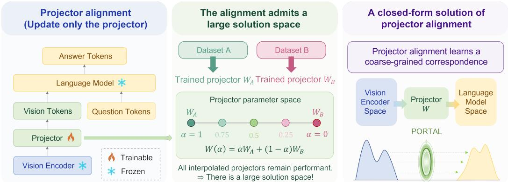
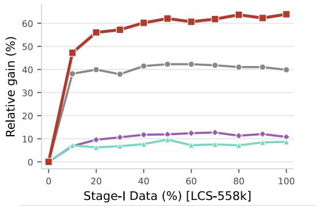
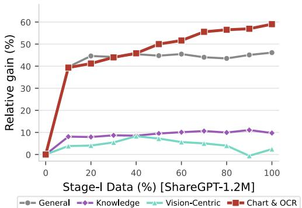
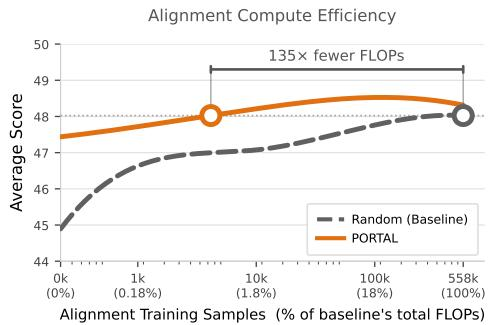
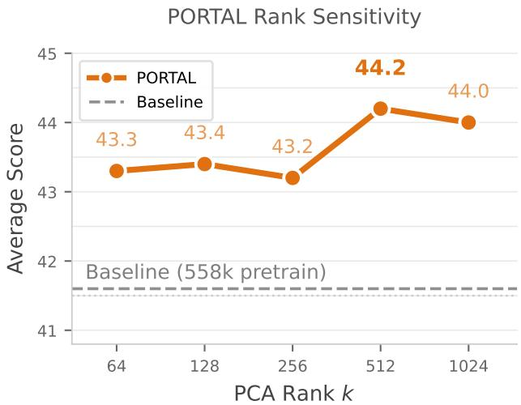

# Rethinking Projector Training in Multimodal LLMs

Fabian Gröger<sup>1,2,3,∗</sup> , Naël Ouerghemi<sup>1,∗</sup> , Shuo Wen<sup>1,∗</sup> , Maria Brbic´<sup>1</sup> <sup>1</sup>EPFL <sup>2</sup>University of Basel <sup>3</sup>HSLU

## Abstract

Multimodal LLMs are typically trained by first aligning a vision encoder with a language model via projector training on large image-caption datasets, followed by joint training of the full multimodal model. Despite its widespread use, the role of the projector training stage remains poorly understood. We find that (i) using only 10 to 20% of the data for training the projector already recovers most downstream performance gains, and (ii) projectors trained on different datasets can be linearly interpolated while largely preserving performance. These results suggest that projector training mainly performs a coarse alignment, which many different projectors achieve equally well. Motivated by these findings, we propose PORTAL, a training-free projector initialization that requires neither paired image-caption data nor gradient-based optimization, but only per-modality summary statistics. PORTAL computes an optimal-transport-based map between Gaussian approximations of the vision and language feature distributions on a shared principal subspace, so that the projector training stage can be skipped entirely. Without any paired data, PORTAL matches the standard pipeline trained on 558k image-caption pairs across six LLM backbones, two vision encoders, and 16 benchmarks. It outperforms that pipeline in 3 of 7 (vision encoder, LLM) settings and reaches an average 98% of its score across the other four.

## 1 Introduction

Modern multimodal LLMs commonly align a vision encoder with a language model by first training a projector on a large amount of image-caption paired samples, followed by joint training of the full multimodal model. This pipeline has become standard, from LLaVA [1, 2], Molmo [3], and InternVL [4] to the QwenVL series [5]. While the first stage of projector alignment has been motivated by the goal of producing a visual tokenizer compatible with the frozen LLM [1], what this stage actually does remains poorly understood. Prior works offer conflicting evidence: Prismatic [6] reports that skipping projector alignment can improve performance, whereas Cambrian-1 [7] shows that scaling the training data of projector alignment to 2.5M image-caption pairs helps. MM1 [8] suggests that factors like resolution and data mixing matter more than the projector design. These findings are difficult to reconcile without a deeper understanding of what projector alignment actually does.

In this work, we show that projector alignment primarily performs coarse alignment, mapping visual features into a language-model-compatible input space which admits a large set of possible solutions. Two empirical observations support this view: (i) using only 10 to 20% of the standard 558k-sample alignment corpus achieves similar performance to training on the full dataset, and (ii) projectors trained on entirely different datasets can be linearly interpolated without losing performance. If the projector alignment learned a precise and semantically unique mapping, neither reducing the training data nor linear interpolation between independently trained projectors would preserve performance.

Motivated by these observations, we propose PORTAL (Projector via Optimal-transpoRT ALignment), a training-free approach that constructs the projector from the marginal statistics of the two modalities. PORTAL is the Bures-Wasserstein optimal transport map between Gaussian approximations of the vision feature distribution and the language-model input distribution, computed in a shared top-k principal subspace. It does not require any paired captions or gradient-based optimization, relying only on the per-modality means, principal directions, and the spread along each direction. PORTAL removes the projector alignment training stage entirely.

  
Figure 1: Projector alignment as a coarse alignment with a broad solution space. (Left) Standard pipeline: during projector alignment, the vision encoder and language model are frozen, and only the projector is trained to map visual tokens into a representation space compatible with the LLM using image-caption pairs. (Middle) We show that projectors trained on different image-caption datasets can be linearly interpolated while largely preserving downstream performance, indicating that there is a large solution space for the weights of the projector. (Right) This observation motivates a closedform solution of projector alignment. We propose a training-free projector PORTAL constructed by optimal transport between the two modalities’ marginal statistics.

Across seven (vision encoder, LLM) pairs spanning four LLM families (Vicuna, LLaMA, Qwen, OLMo) from 0.5B to 8B parameters, and two vision encoders (CLIP, SigLIP), PORTAL matches the standard pipeline trained on 558k image-caption pairs and exceeds it in three out of seven settings, peaking at 106% of the trained baseline. When PORTAL is used to initialize rather than replace projector alignment, the performance of the baseline is reached with 135× fewer alignment FLOPs. Performance gaps are concentrated on OCR-heavy benchmarks, where marginal statistics appear insufficient to capture fine-grained character-level spatial structure that paired supervision provides.

## 2 Related Work

Projector alignment in multimodal LLMs. Two-stage multimodal LLM training, where a vision encoder is first aligned to a frozen language model via training a projector, followed by visual instruction tuning, has become a standard pipeline for training multimodal LLMs. This pipeline was popularized by LLaVA [1, 2] and replicated in InstructBLIP [9], BLIP-2 [10], Flamingo [11], Molmo [3], InternVL [4], and the Qwen-VL series [5]. Despite its success, the role of Stage-I projector alignment has been poorly understood and prior studies offer conflicting views. Prismatic finds it can be skipped without a loss [6]. Cambrian-1 reports that scaling Stage-I data to 2.5M pairs helps [7]. MM1 emphasizes resolution and data mixing over the projector itself [8]. We resolve this disagreement by identifying what projector alignment actually does: Stage-I acts as geometric conditioning ofvisualfeatures into the LLM input distribution, not as fine-grained semantic learning. This explains the three findings above as a single phenomenon: skipping Stage-I works when the projector already lands in a compatible region (Prismatic [6]), more data helps only until that region is reached (Cambrian-1 [7]), and the resolution and data mixing dominate because they affect the conditioning more than the projector capacity does (MM1 [8]). These findings lead us to propose a closed-form projector that requires neither paired data nor gradient updates.

Connector designs and projector geometry. Beyond the MLP used in LLaVA [1], connector architectures span the Q-Former [10], Perceiver Resampler [11], locality-enhanced abstractors [12], ALIGN [13], vision-expert mixtures [14], prefix-attention adapters [15], and pixel-shuffle or patchmerging schemes for token reduction [16, 5]. A complementary line of work analyzes what these connectors actually do. Verma et al. [17] track how visual information degrades through LLM layers, Li et al. [18] probe information loss through learned projectors, Li et al. [19] report systematic norm discrepancies between visual and text tokens, and Shukor and Cord [20] show that cross-modal alignment emerges primarily after self-attention layers. We use the 2-layer MLP projector of LLaVA by default, and also test PORTAL with a linear projector and with the C-Abstractor [12], which has 19× more parameters (Section 5.3).

Optimal transport for feature alignment. The Bures-Wasserstein optimal transport map between two Gaussians has a closed form on positive-definite covariances [21, 22], which the construction of the projector in our work exploits. Courty et al. [23] introduced OT for domain adaptation, and Alvarez-Melis and Jaakkola [24] used Gromov-Wasserstein to align word-embedding spaces with no paired anchors. Closest to PORTAL is CORAL [25, 26], which aligns second-order statistics with a single linear map for domain adaptation. PORTAL extends this idea to the multimodal-alignment setting and ties it explicitly to the Bures-Wasserstein optimum on a shared top-k principal subspace, which we then use as a closed-form projector rather than a regularizer.

Training-free and efficient connector construction. Several recent works try to eliminate or reduce connector training. VPGTrans [27] transfers a learned visual prompt generator across LLMs at reduced cost. LangBridge [28] interprets visual tokens as combinations of language embeddings, enabling cross-LLM transfer at the price of bottlenecking visual information through a vocabulary subspace. SEMI [29] meta-learns a hypernetwork connector that adapts to new modalities from a few samples. In the related CLIP-classification setting, training-free or lightweight adapters such as Tip-Adapter [30] and TaskRes [31] cache or residualize over a frozen backbone. PORTAL differs from all of the above by requiring neither paired data, gradient steps, learned caches, nor a vocabulary bottleneck: it is a closed-form construction from per-modality summary statistics alone. Gupta et al. [32] also learn without paired multimodal data, but to improve a unimodal representation by sharing parameters across unpaired modalities, whereas we ask whether the projector between a frozen vision encoder and a frozen LLM needs paired training at all.

## 3 What Does the Projector Alignment Actually Do?

## 3.1 Projector Alignment Saturates with a Small Number of Samples

To investigate the role of projector alignment, we first examine how downstream performance scales with the amount of Stage-I training data. If strong performance requires large-scale data, it would suggest the projector is learning fine-grained visual-language correspondences. Conversely, if a small fraction of the data is sufficient, this would indicate that the projector primarily learns a coarse-grained correspondence, placing visual features into a broadly compatible input space for the language model.

We conduct this analysis on the LLaVA 1.5 setup (CLIP ViT-L/14-336, Vicuna 1.5 7B, 2-layer MLP projector), with LCS-558k for Stage-I and LLaVA-665k for Stage-II. For the data-fraction experiment we replace Vicuna with MobileLLaMA 1.4B, which keeps 11 data fractions on two corpora tractable. We evaluate on 16 benchmarks grouped into four categories adapted from the Cambrian-1 [7] taxonomy: Knowledge (Know.), General (Gen.), OCR, and Vision-Centric (Vis.). Appendix C lists the benchmarks in each. Full experimental details are in Appendix C.1.

We observe that only 10 to 20% of the LCS-558k image-caption pairs already capture most of the downstream benefit, and all categories plateau by 30 to 40% (Figure 2). The marginal downstream benefit of the remaining pairs is small under this protocol. ShareGPT-1.2M, more than twice as large, does not do better: its average peaks at 38.1 with 40% of its data (Appendix D). These results suggest that projector alignment is not primarily learning fine-grained visual-language correspondences. Rather, it appears to perform a coarse-grained alignment step, mapping visual features into a region of the LLM input space from which subsequent joint training can effectively adapt the full multimodal model.

## 3.2 Projector Alignment Admits a Broad Solution Space

We have shown that projector alignment can be achieved with only a small fraction of the standard pretraining data. This observation is consistent with two possible explanations: either the set of effective projector solutions is narrow but easy to reach, or the solution space itself is broad. To distinguish between these possibilities, we examine whether independently trained projectors can be linearly interpolated while preserving performance.

  
(a) LCS-558k

  
(b) ShareGPT-1.2M  
Figure 2: Stage-I gain saturates early. Relative gain in downstream performance over the nopretraining baseline by Cambrian-1 category, as a function of Stage-I data fraction on LCS-558k (left) and ShareGPT-1.2M (right). OCR and Chart benefit the most, while Knowledge and Vision-Centric scores saturate early.

Specifically, we train two projectors on different datasets (LCS-558k versus ShareGPT-1.2M), obtaining the weights $W _ { \mathrm { L C S } }$ and $W _ { \mathrm { S h a r e G P T } }$ . Then we evaluate the linear interpolation $W _ { \alpha } = ( 1 - \alpha ) W _ { \mathrm { L C S } } + \alpha W _ { \mathrm { S h a r e G P T } }$ with $\alpha \in \{ 0 , 0 . 2 5 , 0 . 5 , 0 . 7 5 , 1 \}$ . If effective projectors occupied a narrow and isolated region, interpolation would be expected to degrade performance. Instead, we find that projectors along the entire interpolation path largely preserve downstream performance, supporting the view that projector alignment admits a broad solution space (Figure 3).

The per-category breakdown results further support this interpretation. The cross-data interpolation path is not only traversable but often outperforms either endpoint. Averaged across the four Cambrian-1 categories, every interior α improves on both LCS-558k and ShareGPT-1.2M projectors, with the optimum at α=0.5. The category-wise optima differ: OCR peaks closer to the ShareGPT endpoint, Knowledge closer to the LCS endpoint. The aggregate score improves with mixing, so

<table><tr><td rowspan=1 colspan=1></td><td rowspan=1 colspan=5>Know. Gen. OCR  Vis.   All</td></tr><tr><td rowspan=2 colspan=1>LCS (α = 0)α = 0.25</td><td rowspan=1 colspan=1>45.7</td><td rowspan=1 colspan=1>68.0</td><td rowspan=1 colspan=1>27.1</td><td rowspan=1 colspan=1>51.3</td><td rowspan=1 colspan=1>48.0</td></tr><tr><td rowspan=1 colspan=1>46.2</td><td rowspan=1 colspan=1>68.5</td><td rowspan=1 colspan=1>27.6</td><td rowspan=1 colspan=1>52.5</td><td rowspan=1 colspan=1>48.7</td></tr><tr><td rowspan=1 colspan=1>α= 0.50</td><td rowspan=1 colspan=1>46.2</td><td rowspan=1 colspan=1>68.4</td><td rowspan=1 colspan=1>28.1</td><td rowspan=1 colspan=1>53.0</td><td rowspan=1 colspan=1>49.0</td></tr><tr><td rowspan=2 colspan=1>α= 0.75SGPT (α = 1)</td><td rowspan=1 colspan=1>45.6</td><td rowspan=1 colspan=1>67.5</td><td rowspan=1 colspan=1>28.4</td><td rowspan=1 colspan=1>54.0</td><td rowspan=1 colspan=1>48.9</td></tr><tr><td rowspan=1 colspan=1>45.4</td><td rowspan=1 colspan=1>67.9</td><td rowspan=1 colspan=1>28.2</td><td rowspan=1 colspan=1>53.8</td><td rowspan=1 colspan=1>48.8</td></tr></table>

Figure 3: Cross-data projectors are linearly interpolable. Cross-data interpolation $W _ { \alpha } \ = \ ( 1 { - } \alpha ) W _ { \mathrm { L C S } } \ + \ \alpha W _ { \mathrm { S h a r e G P T } } ,$ evaluated per Cambrian-1 category. The optimal α varies by category, but every interior blend outperforms both endpoints on the aggregate score, with the $\alpha { = } 0 . 5$ mixture peaking above either trained projector.

a simple combination of two independently trained solutions, with no additional Stage-I optimization, outperforms both. Such behavior indicates that projector alignment admits a broad solution space.

The two projectors above start from the same initialization and differ only in their training data. We next asked whether the initialization matters in the same way, and trained a second pair on the same LCS-558k data from two different random initializations. Unlike the cross-data pair, this cross-seed pair is not linearly interpolable: captioning CIDEr drops from about 80 at both endpoints to 0.7 at α=0.5 (Appendix C.2). Initialization thus appears to select the loss basin, and training data the solution within it.

These results clarify the role of projector alignment. The early saturation with limited data and the traversable interpolation path between projectors trained on different data suggest that projector alignment does not require a highly specific solution. Instead, projector alignment appears to place visual features into a broadly compatible region of the LLM input space, where many different projector weights can serve the same functional role.

## 4 PORTAL: Training-Free Projector via Optimal Transport

The previous findings suggest that projector alignment primarily serves as geometric conditioning, placing visual features into a region of the LLM input space from which subsequent joint training can effectively adapt the multimodal model. This mapping admits a large set of solutions, motivating a simpler alternative to the projector alignment training stage.

We instantiate this idea with PORTAL (Projector via Optimal-transpoRT ALignment), a training-free method that initializes the projector from the marginal feature statistics of the vision encoder and the LLM. PORTAL estimates the mean, principal directions, and variances of each modality separately, then constructs a closed-form optimal-transport map that aligns the source visual feature distribution with a compatible target language-feature distribution. We also show why matching only means and covariances can suffice. The LLM normalizes each token before attention, so attention depends only on token directions. When token norms vary little, the spread of these directions is fixed by the covariance, which PORTAL matches.

## 4.1 Closed-Form Projector Initialization

Let $\mathbf { x } \in \mathbb { R } ^ { d _ { s } }$ denote a feature from the source modality (e.g., a per-patch vision token in our setting) and $\mathbf { y } \in \mathbb { R } ^ { d _ { t } }$ a target embedding (e.g., an LLM input token). We seek a map $f : \mathbb { R } ^ { d _ { s } }  \mathbb { R } ^ { d _ { t } }$ , the projector in standard multimodal-LLM terminology, whose output distribution is compatible with the distribution the target is trained to process. We adopt the standard 2-layer MLP used by LLaVA [2],

$$
f ( \mathbf { x } ) = \mathbf { W } _ { 2 } \phi ( \mathbf { W } _ { 1 } \mathbf { x } + \mathbf { b } _ { 1 } ) + \mathbf { b } _ { 2 } , \quad \mathbf { W } _ { 1 } \in \mathbb { R } ^ { d _ { t } \times d _ { s } } , \mathbf { W } _ { 2 } \in \mathbb { R } ^ { d _ { t } \times d _ { t } } ,\tag{1}
$$

with $\phi$ as GELU. We will fix ${ \bf W } _ { 2 } = { \bf I } _ { d _ { t } }$ (i.e., the identity matrix of dimension $d _ { t } ) , \mathbf { b } _ { 2 } = \mathbf { 0 } ( i . e .$ ., the zero vector of dimension $d _ { t } )$ , and construct $( \mathbf { W } _ { 1 } , \mathbf { b } _ { 1 } )$ in closed form.

PORTAL. Approximate each modality’s marginal as a Gaussian, $\mathcal { N } ( \boldsymbol { \mu } _ { s } , \boldsymbol { \Sigma } _ { s } )$ on the source side and $\textstyle { \mathcal { N } } ( { \boldsymbol { \mu } } _ { t } , { \boldsymbol { \Sigma } } _ { t } )$ on the target side. We derive the affine parameters $( \mathbf { W } _ { 1 } , \mathbf { b } _ { 1 } )$ from the Gaussian optimal transport map [33, 21] between these approximations, computed on the top-k PCA subspaces of source and target with coordinates identified by eigenvalue order:

$$
\mathbf { W } _ { 1 } = \mathbf { V } _ { t } \operatorname { d i a g } \left( { \frac { \pmb { \sigma } _ { t } } { \pmb { \sigma } _ { s } } } \right) \mathbf { V } _ { s } ^ { \top } , \qquad \mathbf { b } _ { 1 } = \pmb { \mu } _ { t } - \mathbf { W } _ { 1 } \pmb { \mu } _ { s } ,\tag{2}
$$

where $\mathbf { V } _ { s } \in \mathbb { R } ^ { d _ { s } \times k }$ and $\mathbf { V } _ { t } \in \mathbb { R } ^ { d _ { t } \times k }$ are the top-k PCA bases of the source and target features (orthonormal columns) and $\sigma _ { s } , \sigma _ { t } \in \mathbb { R } ^ { k }$ are the square roots of the top-k covariance eigenvalues, $i . e .$ , the spread along each principal axis. The map $\bar { \bf W } _ { 1 }$ whitens the source distribution (decorrelates it and rescales each axis to unit variance), expresses it in the target’s principal axes, and rescales each axis to match the target’s spread. The bias b<sub>1</sub> recenters the result. The closed form matches Gaussian moments at the preactivation $\mathbf { W } _ { 1 } \mathbf { x } + \mathbf { b } _ { 1 }$ . The post-GELU output is verified empirically in Appendix H.4. Appendix F gives a self-contained PyTorch implementation.

This construction depends only on summary statistics of each modality $( i . e .$ , means, principal directions, and the spread along each direction). It requires no Stage-I paired captions and no Stage-I optimization. A single PCA on each side is sufficient. It is agnostic to which model produces x and which model consumes $f ( \mathbf { x } )$ . We adopt $k { = } 5 1 2$ as the default throughout the paper, which is small enough to suppress noisy directions and large enough to preserve the dominant geometry. Varying k over {64, 128, 256, 512, 1024} supports this choice empirically (Appendix K).

On the Gaussian assumption. Eq. (2) treats both modalities as Gaussian to obtain a closed-form transport map in terms of means, principal directions, and the spread along each direction. Real source and target distributions deviate from Gaussianity in tail weight and in the shape of their marginals (Appendix H.1). We explain why the construction remains effective under these deviations in Section 4.2.

Targeting hidden states instead of input embeddings. Eq. (2) matches visual features to the LLM’s input embeddings, the vectors the LLM looks up for each text token before its first transformer block. The same construction can instead target the hidden states that text tokens have after block ℓ: we replace $\mathbf { \Gamma } ( \mu _ { t } , \mathbf { V } _ { t } , \sigma _ { t } )$ by the mean, PCA basis, and spread along the principal axes of these hidden states, collected by passing a list of English words and short phrases through the LLM. The visual tokens still enter the LLM at its input. Only the target statistics change. Trained projectors that inject visual tokens into deeper layers [34, 35] motivate this variant, which we call PORTAL-ctxℓ. We use it to ablate the target layer (Section 5.4), where the input embeddings (ℓ=0) remain the best target. Details are in Appendix G.

## 4.2 Why Moment Matching Survives Non-Gaussianity

Real vision and text features are not Gaussian (Appendix H.1), so Eq. (2) cannot match their full distributions. We argue that it does not need to. Every LLM we use normalizes before computing attention logits (RMSNorm on each input token, or on queries and keys in OLMo 2), so rescaling a token leaves its logits unchanged. Attention therefore depends only on the directions of the tokens, and the relevant property of the projector output is how these directions are spread.

We measure this spread by the cosine dispersion $\omega ,$ the standard deviation of the cosine similarity between two tokens:

$$
\omega ^ { 2 } = \frac { 1 } { { \binom { n } { 2 } } } \sum _ { i < j } \left( \cos \angle ( { \mathbf { z } } _ { i } , { \mathbf { z } } _ { j } ) - \overline { { \cos } } \right) ^ { 2 } , \qquad \overline { { \cos } } = \frac { 1 } { { \binom { n } { 2 } } } \sum _ { i < j } \cos \angle ( { \mathbf { z } } _ { i } , { \mathbf { z } } _ { j } ) ,\tag{3}
$$

where $\{ { \bf z } _ { i } \} _ { i = 1 } ^ { n }$ are the output tokens, pooled over all patches of all images. A small ω means the tokens point in similar directions, a large ω that they spread over many directions. Two properties of a distribution with covariance Σ determine $\omega .$ The effective dimension $d _ { \mathrm { e f f } } ( \Sigma ) : = ( \mathrm { t r } \Sigma ) ^ { 2 } / \mathrm { t r } ( \Sigma ^ { 2 } )$ counts the directions that carry most of the variance: it equals d when variance is spread evenly over d directions and 1 when a single direction holds it all. The norm spread $\kappa : = \mathrm { s t d } ( \| \mathbf { z } \| ^ { 2 } ) / \mathbb { E } [ \| \bar { \mathbf { z } } \| ^ { 2 } ]$ is small when all tokens have about the same length.

Proposition 1 (Spectrum-to-ω bound). Let z and z<sup>′</sup> be independent random vectors in $\mathbb { R } ^ { d }$ with the same distribution, which has mean zero and covariance Σ. Assume $\mathbb { P } ( \mathbf { z } = \mathbf { 0 } ) = 0$ . Then

$$
\left| \mathrm { V a r } \big ( \cos \angle ( { \bf z } , { \bf z } ^ { \prime } ) \big ) - \frac { 1 } { d _ { \mathrm { e f f } } ( { \bf \Sigma } ) } \right| \le 2 \kappa + \kappa ^ { 2 } + \kappa ^ { 4 } .\tag{4}
$$

The assumption $\mathbb { P } ( \mathbf { z } = \mathbf { 0 } ) = 0$ says that a token is never exactly the zero vector, so that its cosine with another token is always defined. The left side of Eq. (4) is the variance of the cosine similarity between two tokens drawn at random from the distribution, which is the population value of $\omega ^ { 2 }$ that Eq. (3) estimates from n tokens. The right side is zero when all tokens have the same length $( \kappa = 0 )$ , and the proposition then gives $\omega ^ { 2 } = 1 / \overline { d } _ { \mathrm { e f f } } ( \Sigma )$ : the spread of token directions is fixed by the covariance alone. Intuitively, when all tokens have the same length, the cosine of two tokens is their dot product divided by a constant, and the second moment of the dot product of two independent tokens depends only on the covariance. The proof is in Appendix H.2 and does not assume Gaussianity. PORTAL matches the target’s mean and covariance on the top-k subspace (second-order matching, i.e., matching the means and covariances of the two distributions), so in this limit its outputs inherit the target’s ω.

Real token norms vary (Appendix H.4), so the bound does not predict ω precisely for our features. We therefore measure ω directly. On three (CLIP, LLM) pairs, PORTAL reduces ω from 0.23 at the source to 0.09 to 0.10, towards the target’s 0.05 to 0.06, while a random projector leaves ω at the source value (Appendix H.3). The attention weights also depend on the learned query and key projections, which ω does not describe.

## 5 Experiments

We test whether PORTAL, built without any paired image-caption data, matches projector alignment trained on 558k image-caption pairs across LLM backbones and vision encoders.

We evaluate this question by inserting a PORTAL-constructed projector into the standard LLaVA pipeline and then running the same LLaVA-665k instruction tuning for every configuration. We compare against two baselines: (i) the standard trained LLaVA projector, obtained from 558k paired captions, and (ii) a randomly initialized projector which skips projector alignment entirely. This setup isolates the contribution of projector initialization: after initialization, all models receive identical joint training.

We test seven (vision encoder, LLM) pairs, built from three 7B to 8B LLMs (Vicuna 1.5 7B [36], LLaMA 3.1 8B [37], Qwen 2.5 7B [38]), three smaller LLMs for cross-scale checks (LLaMA 3.2 1B,

Table 1: PORTAL generalizes across LLM backbones and vision encoders. All configurations use identical Stage-II instruction tuning (LLaVA-665k [2]). PORTAL requires zero Stage-I paired captions and zero Stage-I gradient steps. Baseline †: uses 558k paired captions for Stage-I pretraining. Bold: best among zero training data methods. Avg: unweighted mean of the 16 per-benchmark scores. %BL: this average as a percentage of the trained baseline (BL), which is therefore 100%. Subscripts on the Avg and %BL columns give the 95% bootstrap confidence-interval half-width over per-sample outcomes, from 1000 resamples paired across methods. LLM backbones: Vicuna 1.5 7B [36], LLaMA 3.1 8B [37], Qwen 2.5 7B [38], LLaMA 3.2 1B [37], Qwen 2.5 0.5B [38], OLMo 2 1B [39]. Vision encoders: CLIP ViT-L/14-336 [40], SigLIP SO400M [41]. <sup>L</sup>: 500-sample Lite subset from lmms-eval [42].
<table><tr><td rowspan="2"></td><td rowspan="2"></td><td rowspan="2"></td><td rowspan="2"></td><td colspan="3">Knowledge</td><td colspan="3">General</td><td colspan="4"></td><td colspan="4">Vision</td><td rowspan="2"></td><td rowspan="2"></td><td rowspan="2"></td></tr><tr><td>AID</td><td>SciQA</td><td>MathV</td><td>MMMU</td><td>GOA MME</td><td>SEEDL</td><td>MMB</td><td>TxtVQA</td><td>OCR-Bv2 DocVQA</td><td>ChartQA</td><td>CV-2D</td><td>CV-3D</td><td>BLINK RealWQ</td><td></td></tr><tr><td rowspan="4">Vicuna 1.5</td><td rowspan="4">CLIP</td><td>Baseline†</td><td>54.5</td><td>67.9 69.1</td><td>26.1</td><td>34.3</td><td>66.6 74.5</td><td></td><td>67.7</td><td>63.2 58.1</td><td>57.3</td><td>12.5 22.0</td><td>16.5</td><td>54.7</td><td>58.3</td><td></td><td>37.4</td><td>54.9</td><td>48.0 100.0</td></tr><tr><td>Random</td><td>51.5</td><td></td><td>27.2</td><td>32.8</td><td>64.2 69.2</td><td></td><td>57.2</td><td>52.8</td><td>11.0</td><td>17.1</td><td>15.2</td><td>52.5</td><td>53.8</td><td>34.7</td><td>51.9</td><td>44.9±0.60</td><td>93.5±1.6</td></tr><tr><td></td><td>PORTAL</td><td>53.4</td><td>68.2</td><td>27.4 34.4</td><td></td><td>66.4 69.9</td><td>67.9</td><td>60.4</td><td>55.1</td><td>12.7</td><td>20.5</td><td>16.3</td><td>56.2</td><td>60.7</td><td>36.0</td><td>53.5</td><td>47.4±0.56</td><td>98.8±1.5</td></tr><tr><td rowspan="2"></td><td>Baseline†</td><td>55.8</td><td>68.0</td><td>27.2</td><td>34.0</td><td>68.7 73.6</td><td>69.1</td><td>66.0</td><td>61.5</td><td>13.3</td><td>25.3</td><td>19.1</td><td>57.5</td><td>60.8</td><td>28.1</td><td>56.6</td><td>49.0</td><td>100.0</td></tr><tr><td rowspan="2">SigLIP</td><td>Random PORTAL</td><td>51.8 55.5</td><td>67.9 68.3</td><td>26.7 27.9</td><td>35.1 34.4</td><td>56.8 60.6 67.8 71.6</td><td>46.5 68.3</td><td>52.3 64.3</td><td>43.8 60.0</td><td>7.9 13.6</td><td>8.9 24.8</td><td>12.8 17.9</td><td>47.1 57.6</td><td>57.5 64.6</td><td>25.6 28.6</td><td>45.9 54.2</td><td>40.5±0.58 48.7±0.56</td><td>82.5±1.1 99.3±1.5</td></tr><tr><td rowspan="2"></td><td></td><td>58.5</td><td>73.8</td><td></td><td></td><td>67.0</td><td>73.0</td><td></td><td></td><td></td><td></td><td></td><td></td><td></td><td></td><td></td><td></td><td></td></tr><tr><td rowspan="2">CLIP</td><td>Baseline†</td><td>58.6</td><td>74.8</td><td>31.3 31.7</td><td>36.8 35.3</td><td>67.6</td><td>71.7 69.5</td><td>68.1 67.5</td><td>57.2</td><td>13.7 13.9</td><td>21.8 19.6</td><td>15.1 15.0</td><td>64.5 61.8</td><td>63.0 66.2</td><td>39.8 38.5</td><td>57.5 57.0</td><td>50.8</td><td>100.0 99.2±1.4</td></tr><tr><td>Random PORTAL</td><td></td><td>62.2 76.2</td><td>30.7</td><td>38.6</td><td>67.7</td><td>73.4 74.1</td><td>69.9</td><td>70.1</td><td>56.2 58.0</td><td>14.5</td><td></td><td>16.8</td><td>65.2</td><td>70.9</td><td>40.4</td><td></td><td>50.4±0.58</td><td>102.7±1.5</td></tr><tr><td rowspan="3">LLaMA 3.2</td><td rowspan="2"></td><td></td><td>46.5</td><td>66.2</td><td></td><td></td><td></td><td></td><td></td><td></td><td></td><td>22.7</td><td></td><td>53.5</td><td></td><td></td><td>56.9</td><td>52.2±0.57</td><td></td></tr><tr><td>Baseline†</td><td></td><td></td><td>26.9</td><td>33.6 34.2</td><td>59.7 58.4</td><td>56.2</td><td>46.1</td><td>43.7</td><td>10.1</td><td>12.8 12.8</td><td>10.8</td><td>54.2</td><td>56.4</td><td>37.2</td><td>47.3</td><td>41.6</td><td>100.0</td></tr><tr><td>CLIP Random PORTAL</td><td></td><td>46.6 47.6</td><td>66.9 67.1</td><td>26.3 29.2 33.7</td><td>59.8 62.1</td><td>58.1 66.0</td><td>56.0 59.6</td><td>45.2 54.2</td><td>43.8 47.1</td><td>10.4 11.4</td><td>16.3</td><td>11.0 12.0</td><td>54.6</td><td>54.9 57.3</td><td>37.4 38.9</td><td>46.9</td><td>41.5±0.57</td><td>99.9±0.7 106.2±1.3</td></tr><tr><td rowspan="3">Qwen 2.5</td><td rowspan="3"></td><td></td><td></td><td></td><td></td><td></td><td></td><td></td><td></td><td></td><td></td><td></td><td></td><td></td><td></td><td></td><td>49.7</td><td>44.2±0.60</td><td></td></tr><tr><td>Baseline†</td><td>66.9</td><td>77.5</td><td>33.3</td><td>44.7 42.0</td><td>65.6 74.6 63.7</td><td></td><td>70.7</td><td>71.2 57.2</td><td>15.6</td><td>23.0</td><td>19.0</td><td>54.0 56.3</td><td>69.0</td><td>42.3</td><td>56.6</td><td>52.6</td><td>100.0 92.4±0.9</td></tr><tr><td>Random PORTAL</td><td>62.1 65.7</td><td>73.9 76.7</td><td>27.7 31.9</td><td>44.8</td><td>70.9 65.5 75.9</td><td>67.7 70.9</td><td>60.1 68.0</td><td>51.0 55.4</td><td>13.6 14.9</td><td>17.6 18.9</td><td>14.6 17.1</td><td>57.9</td><td>60.0 64.8</td><td>42.1 41.5</td><td>53.9 56.1</td><td>48.6±0.56 51.7±0.58</td><td>98.3±1.4</td></tr><tr><td rowspan="3">Qwen 2.5</td><td rowspan="3">0.5B CLIP</td><td></td><td></td><td>58.6</td><td>26.7</td><td>31.7</td><td>52.2</td><td>53.9 47.9</td><td>38.7</td><td>35.7</td><td>11.1</td><td>9.4</td><td>9.7</td><td>45.7</td><td>50.7</td><td>39.4</td><td>46.0</td><td></td><td>100.0</td></tr><tr><td>Baseline†</td><td>43.6 43.5</td><td>58.5</td><td>26.8</td><td>33.1</td><td>52.5</td><td>54.2 48.9</td><td>37.9</td><td>35.6</td><td>10.5</td><td>9.5</td><td>9.8</td><td>44.2</td><td>51.5</td><td>40.5</td><td>45.5</td><td>37.6 37.7±0.58</td><td>100.2±1.0</td></tr><tr><td>Random PORTAL</td><td>44.2</td><td>59.1</td><td>27.4</td><td>31.3</td><td>58.1 57.6</td><td>56.0</td><td>46.4</td><td>41.8</td><td>11.8</td><td>14.6</td><td>11.6</td><td>41.4</td><td>51.2</td><td>39.7</td><td>45.6</td><td>39.9±0.56</td><td>106.1±1.3</td></tr><tr><td rowspan="2">OLMo 2</td><td rowspan="2">1B CLIP</td><td></td><td>46.9</td><td>64.3</td><td>25.0</td><td>33.9</td><td>62.7 63.1</td><td></td><td>63.2 57.6</td><td>46.3</td><td>10.5</td><td>17.2</td><td>12.2</td><td>57.3</td><td>54.8</td><td>37.6</td><td>48.1</td><td>43.8</td><td>100.0 40.5±0.57</td></tr><tr><td>Baseline† Random</td><td>45.7</td><td>58.8</td><td>24.6 26.8</td><td>31.2 31.2</td><td>59.4 59.5 61.8 61.8</td><td>59.8 60.2</td><td>49.4 51.5</td><td>42.4 44.2</td><td>9.7 9.8</td><td>13.6 15.0</td><td>11.0 11.1</td><td>50.2 54.8</td><td>50.9 55.3</td><td>37.5</td><td>43.9</td></table>

Qwen 2.5 0.5B, OLMo 2 1B [39]), and two vision encoders (CLIP ViT-L/14-336 [40], SigLIP-SO400M [41]). Table 1 lists the pairs. The trained baseline uses the standard LLaVA Stage-I corpus of 558k LCS image-caption pairs, and all configurations share the same LLaVA-665k instruction-tuning data for Stage-II. The 16 evaluation benchmarks are grouped into the four Cambrian-1 categories. The full benchmark list, citations, and evaluation protocol are in Appendix C.

## 5.1 PORTAL Matches Trained Projector Alignment Without Paired Data

We find that our closed-form projector PORTAL requiring no paired captions or gradient updates achieves comparable downstream performance to conventional alignment pipelines trained on 558k image-caption pairs, across a range of vision encoder and LLM combinations (Table 1). In particular, using LLaMA 3.2 1B/CLIP and Qwen 2.5 0.5B/CLIP, PORTAL reaches 106.2% and 106.1% of the trained baseline, respectively. Using LLaMA 3.1 8B/CLIP, it exceeds the trained baseline, reaching 102.7%. On Vicuna 1.5 with CLIP and SigLIP, Qwen 2.5 7B, and OLMo 2 1B, PORTAL remains very close to the trained projector, reaching 98.8%, 99.3%, 98.3%, and 96.3% of the trained baseline, respectively. Thus, PORTAL removes the requirement for paired training data and optimization cost of projector alignment while preserving almost all of its downstream benefit after instruction tuning.

The advantage of PORTAL is clearest where the random projector fails. On SigLIP, the Random baseline collapses to 82.5% of the trained projector. PORTAL closes that gap to 99.3%. This is what we would expect if the alignment stage were dominated by distributional matching rather than caption supervision.

Two settings sit below the trained baseline’s bootstrap CI, Qwen 2.5 7B/CLIP and OLMo 2 1B/CLIP, with the gaps concentrated on OCR and Chart benchmarks. This matches the observation in Section 3.1 that OCR and Chart drive most of the Stage-I gain over the no-pretraining baseline, supporting our reading that character-level spatial structure is the regime where paired captions teach what marginal statistics alone cannot recover. Importantly, this phenomenon is not specific to PORTAL. Other unpaired distribution-matching approaches, including CORAL [26] and Gromov-Wasserstein [24] alignment, also recover most of the performance of paired Stage-I training (Appendix E.1). This provides additional evidence that much of the benefit of Stage-I can be obtained by bringing the two modalities into a compatible feature distribution, rather than requiring a uniquely learned image-text correspondence.

A category-level analysis across all seven configurations further shows that this behavior is not systematic across OCR tasks: PORTAL retains, on average, 100.7%, 102.0%, 102.4%, and 100.4% of the trained-baseline performance on Knowledge, General, OCR, and Vision-Centric tasks, respectively (Appendix E.2). We further test PORTAL beyond the standard LLaVA-665k Stage-II setting. Under substantially larger-scale multimodal instruction tuning with 3.2M samples, PORTAL slightly outperforms the conventionally Stage-I-trained initialization (Appendix E.3). We also evaluate object hallucination on POPE [43] and find that PORTAL matches or exceeds the trained Stage-I baseline in every setting (Appendix E.4).

## 5.2 PORTAL Reduces the Projector Alignment Budget

The previous experiment shows that PORTAL can provide a strong projector without paired optimization. We next ask whether PORTAL can also serve as a warm start for projector alignment. Instead of using PORTAL to skip this stage entirely, we initialize the projector with PORTAL and then continue projector alignment with progressively smaller subsets of LCS-558k. This experiment evaluates whether closedform alignment can reduce the amount of paired data needed for subsequent projector training.



We vary the projector alignment budget over {0, 1k, 10k, 100k, 558k} paired captions from LCS-558k on Vicuna 1.5 7B/CLIP, starting from either a Random or a PORTAL projector. The 0 point skips projector alignment entirely and proceeds directly to Stage-II from the initialization, and the 558k point is the standard LLaVA baseline. Stage-II tuning on LLaVA-665k is identical for every configuration.

Figure 4: Alignment compute efficiency on Vicuna 1.5 7B/CLIP. Average over the 16 benchmarks as a function of the projector alignment budget, with identical Stage-II tuning on LLaVA-665k. PORTAL stays above Random at every budget. The marked point indicates the crossover at roughly 4k captions, where PORTAL matches the 558k-trained baseline at ∼135× fewer alignment FLOPs. The horizontal dashed line shows the 558k baseline.

PORTAL provides a better starting point at every projector alignment budget than the random initialization (Figure 4). With zero projector training, it already outperforms random initialization. As more paired captions are added, the PORTAL-initialized projector remains consistently above the randomly initialized projector. PORTAL reaches the performance of the full 558k trained projector baseline using only around 4k captions, corresponding to roughly 135× fewer projector alignment FLOPs. Beyond matching the trained baseline at lower compute, PORTAL with as few as 10k paired captions exceeds the full 558k-trained projector baseline and continues to widen the gap up to 100k. PORTAL therefore offers two practical advantages: it reaches the trained baseline at substantially lower alignment cost, and it surpasses that baseline once even a small paired-data budget is available.

This result strengthens the main claim that much of projector alignment is a distributional conditioning problem. The projector has a large solution space, and many mappings can make visual features compatible with the LLM input space. PORTAL identifies one such compatible solution directly in closed form. This solution is not necessarily the exact optimum selected by supervised projector training but it lies close to the high-performing region, providing strong performance without paired optimization and a small amount of paired data can further refine it within this region. Additional projector training thus mainly refines a projector that is already compatible.

## 5.3 Ablations: Projector Architecture, Image Pool, and Rank

A key advantage of PORTAL is that it is a closed-form geometric construction rather than a learned projector tied to a particular architecture or paired dataset. We therefore test whether its gains persist when the projector is simplified and when the unlabeled image pool used to estimate vision-side statistics is changed.

For architecture, we replace the standard 2-layer MLP-GELU projector with a single linear layer, keeping all other components fixed (Table 2). If PORTAL’s gains depended on the expressivity of the MLP, they should weaken in this setting. Instead, the gain becomes larger. With the MLP projector, PORTAL reaches 106.2% of the trained baseline against Random’s 99.9%. With the linear projector, it reaches 111.8% against Random’s 94.2%, widening the Random-to-PORTAL gap from 6.3 to 17.6 percentage points. This shows that PORTAL’s advantage does not come from a particular nonlinearity or hidden expansion. It comes from placing the visual features into a better-matched LLM input distribution. We also test the opposite regime by substantially increasing connector capacity. Using the C-Abstractor [12], which contains approximately 19× more parameters than the two-layer MLP and additionally performs token mixing and sequence compression, PORTAL remains essentially indistinguishable from conventional Stage-I training (42.93 vs. 42.98 average score; Appendix E.5).

Table 2: Linear vs. MLP-2x-GELU projector on LLaMA 3.2 1B/CLIP. Full perbenchmark breakdown in Appendix J.
<table><tr><td>Projector</td><td>Init</td><td>Avg</td><td>%BL</td></tr><tr><td rowspan="3">MLP</td><td>Trained†</td><td>41.6</td><td>100.0</td></tr><tr><td>Random</td><td>41.5</td><td>99.9</td></tr><tr><td>PORTAL</td><td>44.2</td><td>106.2</td></tr><tr><td rowspan="3">Linear</td><td>Trained†</td><td>39.9</td><td>100.0</td></tr><tr><td>Random</td><td>37.6</td><td>94.2</td></tr><tr><td>PORTAL</td><td></td><td>44.7 111.8</td></tr></table>

For the image pool, we vary the unlabeled image pool used to estimate the vision-side statistics. On LLaMA 3.2 1B/CLIP, we compare a small single-domain pool, COCO val2017 with 1024 images, against a larger and more diverse Cambrian-737k subset spanning 9 sources with 4096 images. The small COCO pool matches or exceeds the diversified pool on 12 of 15 benchmarks and obtains a higher average score (44.0 vs. 43.4). This suggests that PORTAL does not require a carefully curated or highly diverse image pool. A small unlabeled natural-image pool is sufficient to estimate the source statistics well enough for downstream instruction tuning in this setting. Per-benchmark results are reported in Appendix I.

Additionally, the PORTAL construction depends on a rank k used to define the PCA subspace. We vary k over {64, 128, 256, 512, 1024} on LLaMA 3.2 1B/CLIP, constructing each projector from the same 1024 COCO images and running identical Stage-II tuning. The method is robust to this choice (Appendix K): every k outperforms the trained baseline by at least ∼4%. Performance is flat from k=64 to k=256 (∼43.3 Avg), peaks at k=512 (44.2), and decreases marginally at k=1024 (44.0). The plateau at low ranks indicates that the dominant PCA directions already capture most of the cross-modal structure. The small drop at k=1024 is consistent with noisy eigenvectors diluting the transport map. We adopt k=512 as the default.

## 5.4 Target Layer Choice

PORTAL targets the LLM’s input embedding distribution by default. The PORTAL-ctxℓ variant (Section 4) generalizes the construction to deeper targets, matching visual features to hidden states after LLM block ℓ instead. We use this variant to ablate the choice of target layer.

Targeting the embedding table (ℓ = 0) is the strongest choice on LLaMA 3.1 8B/CLIP, reaching 102.3% of the trained projector alignment baseline (Table 3). Contextualized targets at ℓ = 4 and ℓ = 8 remain close, reaching 101.9% and 101.4%, respectively. We therefore use the embedding table as the default target.

Table 3: Layer ablation for PORTALctx on LLaMA 3.1 8B/CLIP. Avg over the 16-benchmark suite, %BL relative to trained Stage-I.
<table><tr><td rowspan=1 colspan=3>Target        Avg %BL</td></tr><tr><td rowspan=1 colspan=2>Trained†      51.3</td><td rowspan=1 colspan=1>100.0</td></tr><tr><td rowspan=1 colspan=1>Random</td><td rowspan=1 colspan=1>51.4</td><td rowspan=1 colspan=1>100.2</td></tr><tr><td rowspan=1 colspan=1>l=0 (embed)</td><td rowspan=1 colspan=1>52.5</td><td rowspan=1 colspan=1>102.3</td></tr><tr><td rowspan=1 colspan=1>l=4</td><td rowspan=1 colspan=1>52.3</td><td rowspan=1 colspan=1>101.9</td></tr><tr><td rowspan=1 colspan=1>l=8</td><td rowspan=1 colspan=1>52.0</td><td rowspan=1 colspan=1>101.4</td></tr></table>

## 6 Conclusion

This work rethinks projector alignment in multimodal LLMs. Our results suggest that this stage primarily performs coarse alignment, mapping visual features into a language-model-compatible input space rather than learning fine-grained visual-language correspondences. This view is supported by the early saturation of alignment data, where 10 to 20% of LCS-558k recovers most downstream gains, and by the linear interpolability of projectors trained on different datasets from a shared initialization.

Motivated by this finding, we introduced PORTAL, a training-free projector initialization. PORTAL uses only per-modality summary statistics, requires no paired image-caption data or gradient-based optimization, and remains close to the 558k-trained baseline across the evaluated model pairs. As an initialization, it reaches the trained baseline with roughly 135× lower alignment compute. These results suggest that projector alignment can often be replaced by, or reduced to, a lightweight featuredistribution matching step, lowering the cost and paired-data requirements for building multimodal LLMs.

Several natural directions remain for future work. Our study focuses on projector alignment with frozen vision and language backbones during alignment, single-image inputs, and simple projector architectures. Extending the analysis to richer connectors, long-context grounding, multi-image reasoning, and additional modalities such as audio, video, and 3D would further clarify how broadly this coarse-alignment view applies. We discuss other limitations of PORTAL in Appendix A.

## Acknowledgements

We thank Yulun Jiang, Siba Smarak Panigrahi, and Petar Damjanovic for their valuable suggestions,´ which helped improve the clarity of the manuscript. We gratefully acknowledge the support of the Swiss National Science Foundation (SNSF) starting grant TMSGI2\_226252/1, SNSF grant IC00I0\_231922, SNSF grant 10.004.411, Swiss Cancer League (KFS-6340-02-2025-R), Kamprad Foundation (Cancer Immunotherapy Networking Program), and the Swiss AI Initiative Large Call (ab006). Maria Brbic is a CIFAR Fellow in the Multiscale Human Program.´

## References

[1] Haotian Liu, Chunyuan Li, Qingyang Wu, and Yong Jae Lee. Visual Instruction Tuning. In Advances in Neural Information Processing Systems (NeurIPS), 2023.

[2] Haotian Liu, Chunyuan Li, Yuheng Li, and Yong Jae Lee. Improved Baselines with Visual Instruction Tuning. In Conference on Computer Vision and Pattern Recognition (CVPR), 2024.

[3] Matt Deitke et al. Molmo and PixMo: Open Weights and Open Data for State-of-the-Art Vision-Language Models. In Conference on Computer Vision and Pattern Recognition (CVPR), 2024.

[4] Zhe Chen et al. InternVL: Scaling up Vision Foundation Models and Aligning for Generic Visual-Linguistic Tasks. In Conference on Computer Vision and Pattern Recognition (CVPR), 2024.

[5] Peng Wang, Shuai Bai, Sinan Tan, Shijie Wang, Zhihao Fan, Jinze Bai, Keqin Chen, Xuejing Liu, Jialin Wang, Wenbin Ge, Yang Fan, Kai Dang, Mengfei Du, Xuancheng Ren, Rui Men, Dayiheng Liu, Chang Zhou, Jingren Zhou, and Junyang Lin. Qwen2-VL: Enhancing Vision-Language Model’s Perception of the World at Any Resolution. arXiv preprint arXiv:2409.12191, 2024.

[6] Siddharth Karamcheti et al. Prismatic VLMs: Investigating the Design Space of Visually-Conditioned Language Models. In International Conference on Machine Learning (ICML), 2024.

[7] Shengbang Tong et al. Cambrian-1: A Fully Open, Vision-Centric Exploration of Multimodal LLMs. In Advances in Neural Information Processing Systems (NeurIPS), 2024.

[8] Brandon McKinzie et al. MM1: Methods, Analysis & Insights from Multimodal LLM Pre-training. In European Conference on Computer Vision (ECCV), 2024.

[9] Wenliang Dai, Junnan Li, Dongxu Li, Anthony Meng Huat Tiong, Junqi Zhao, Weisheng Wang, Boyang Li, Pascale Fung, and Steven Hoi. InstructBLIP: Towards General-purpose Vision-Language Models with Instruction Tuning. In Advances in Neural Information Processing Systems (NeurIPS), 2023.

[10] Junnan Li, Dongxu Li, Silvio Savarese, and Steven Hoi. BLIP-2: Bootstrapping Language-Image Pretraining with Frozen Image Encoders and Large Language Models. In International Conference on Machine Learning (ICML), 2023.

[11] Jean-Baptiste Alayrac, Jeff Donahue, Pauline Luc, Antoine Miech, Iain Barr, Yana Hasson, Karel Lenc, Arthur Mensch, Katie Millican, Malcolm Reynolds, et al. Flamingo: A Visual Language Model for Few-Shot Learning. In Advances in Neural Information Processing Systems (NeurIPS), 2022.

[12] Junbum Cha, Wooyoung Kang, Jonghwan Mun, and Byungseok Roh. Honeybee: Locality-Enhanced Projector for Multimodal LLM. In Conference on Computer Vision and Pattern Recognition (CVPR), 2024.

[13] Ahmed Masry, Juan A Rodriguez, Tianyu Zhang, Suyuchen Wang, Chao Wang, Aarash Feizi, Akshay Kalkunte Suresh, Abhay Puri, Xiangru Jian, Pierre-André Noël, et al. AlignVLM: Bridging Vision and Language Latent Spaces for Multimodal Document Understanding. arXiv preprint arXiv:2502.01341, 2025.

[14] Zhuofan Zong, Bingqi Ma, Dazhong Shen, Guanglu Song, Hao Shao, Dongzhi Jiang, Hongsheng Li, and Yu Liu. MoVA: Adapting Mixture of Vision Experts to Multimodal Context. In Advances in Neural Information Processing Systems (NeurIPS), 2024.

[15] Renrui Zhang, Jiaming Han, Chris Liu, Peng Gao, Aojun Zhou, Xiangfei Hu, Shilin Yan, Pan Lu, Hongsheng Li, and Yu Qiao. LLaMA-Adapter: Efficient Fine-tuning of Language Models with Zero-init Attention. In International Conference on Learning Representations (ICLR), 2024.

[16] Andrés Marafioti, Orr Zohar, Miquel Farré, Merve Noyan, Elie Bakouch, Pedro Cuenca, Cyril Zakka, Loubna Ben Allal, Anton Lozhkov, Nouamane Tazi, Vaibhav Srivastav, Joshua Lochner, Hugo Larcher, Mathieu Morlon, Lewis Tunstall, Leandro von Werra, and Thomas Wolf. SmolVLM: Redefining Small and Efficient Multimodal Models. arXiv preprint arXiv:2504.05299, 2025.

[17] Gaurav Verma, Minje Choi, Kartik Sharma, Jamelle Watson-Daniels, Sejoon Oh, and Srijan Kumar. Cross-Modal Projection in Multimodal LLMs Doesn’t Really Project Visual Attributes to Textual Space. In Annual Meeting of the Association for Computational Linguistics (ACL), 2024.

[18] Wenyan Li, Raphael Tang, Chengzu Li, Caiqi Zhang, Ivan Vulic, and Anders Søgaard. Lost in Embeddings:´ Information Loss in Vision-Language Models. In Findings of the Association for Computational Linguistics (EMNLP), 2025.

[19] Bozhou Li et al. The Unseen Bias: How Norm Discrepancy in Pre-Norm MLLMs Leads to Visual Information Loss. arXiv preprint arXiv:2512.08374, 2025.

[20] Mustafa Shukor and Matthieu Cord. Implicit Multimodal Alignment: On the Generalization of Frozen LLMs to Multimodal Inputs. In Advances in Neural Information Processing Systems (NeurIPS), 2024.

[21] Rajendra Bhatia, Tanvi Jain, and Yongdo Lim. On the Bures-Wasserstein Distance Between Positive Definite Matrices. Expositiones Mathematicae, 2019.

[22] Gabriel Peyré and Marco Cuturi. Computational Optimal Transport. Foundations and Trends in Machine Learning, 2019.

[23] Nicolas Courty, Rémi Flamary, Devis Tuia, and Alain Rakotomamonjy. Optimal Transport for Domain Adaptation. IEEE Transactions on Pattern Analysis and Machine Intelligence (TPAMI), 2017.

[24] David Alvarez-Melis and Tommi S. Jaakkola. Gromov-Wasserstein Alignment of Word Embedding Spaces. In Conference on Empirical Methods in Natural Language Processing (EMNLP), 2018.

[25] Baochen Sun, Jiashi Feng, and Kate Saenko. Return of Frustratingly Easy Domain Adaptation. In AAAI Conference on Artificial Intelligence (AAAI), 2016.

[26] Baochen Sun and Kate Saenko. Deep CORAL: Correlation Alignment for Deep Domain Adaptation. In European Conference on Computer Vision (ECCV) Workshops, 2016.

[27] Ao Zhang et al. VPGTrans: Transfer Visual Prompt Generator across LLMs. In Advances in Neural Information Processing Systems (NeurIPS), 2023.

[28] Jiaqi Liao, Yuwei Niu, Fanqing Meng, Hao Li, Changyao Tian, Yinuo Du, Yuwen Xiong, Dianqi Li, Xizhou Zhu, Li Yuan, Jifeng Dai, and Yu Cheng. LangBridge: Interpreting Image as a Combination of Language Embeddings. In International Conference on Computer Vision (ICCV), 2025.

[29] Osman Batur <sup>˙</sup>Ince, André F. T. Martins, Oisin Mac Aodha, and Edoardo M. Ponti. Sample-Efficient Integration of New Modalities into Large Language Models. arXiv preprint arXiv:2509.04606, 2025.

[30] Renrui Zhang, Wei Zhang, Rongyao Fang, Peng Gao, Kunchang Li, Jifeng Dai, Yu Qiao, and Hongsheng Li. Tip-Adapter: Training-Free Adaption of CLIP for Few-shot Classification. In European Conference on Computer Vision (ECCV), 2022.

[31] Tao Yu, Zhihe Lu, Xin Jin, Zhibo Chen, and Xinchao Wang. Task Residual for Tuning Vision-Language Models. In Conference on Computer Vision and Pattern Recognition (CVPR), 2023.

[32] Sharut Gupta, Shobhita Sundaram, Chenyu Wang, Stefanie Jegelka, and Phillip Isola. Better together: Leveraging unpaired multimodal data for stronger unimodal models. In International Conference on Learning Representations (ICLR), 2026.

[33] Ingram Olkin and Friedrich Pukelsheim. The Distance Between Two Random Vectors with Given Dispersion Matrices. Linear Algebra and its Applications, 1982.

[34] Lingchen Meng, Jianwei Yang, Rui Tian, Xiyang Dai, Zuxuan Wu, Jianfeng Gao, and Yu-Gang Jiang. DeepStack: Deeply Stacking Visual Tokens is Surprisingly Simple and Effective for LMMs. In Advances in Neural Information Processing Systems (NeurIPS), 2024.

[35] Shuai Bai, Yuxuan Cai, Ruizhe Chen, Keqin Chen, Xionghui Chen, et al. Qwen3-VL Technical Report. arXiv preprint arXiv:2511.21631, 2025.

[36] Wei-Lin Chiang, Zhuohan Li, Zi Lin, Ying Sheng, Zhanghao Wu, Hao Zhang, Lianmin Zheng, Siyuan Zhuang, Yonghao Zhuang, Joseph E Gonzalez, Ion Stoica, and Eric P Xing. Vicuna: An Open-Source Chatbot Impressing GPT-4 with 90%\* ChatGPT Quality. LMSYS Blog, 2023.

[37] Aaron Grattafiori, Abhimanyu Dubey, Abhinav Jauhri, Abhinav Pandey, et al. The Llama 3 Herd of Models. arXiv preprint arXiv:2407.21783, 2024.

[38] An Yang, Baosong Yang, et al. Qwen2.5 Technical Report. arXiv preprint arXiv:2412.15115, 2024.

[39] Team OLMo, Pete Walsh, Luca Soldaini, Dirk Groeneveld, Kyle Lo, Shane Arora, Akshita Bhagia, Yuling Gu, Shengyi Huang, Matt Jordan, Nathan Lambert, et al. 2 OLMo 2 Furious. arXiv preprint arXiv:2501.00656, 2024.

[40] Alec Radford, Jong Wook Kim, Chris Hallacy, Aditya Ramesh, Gabriel Goh, Sandhini Agarwal, Girish Sastry, Amanda Askell, Pamela Mishkin, Jack Clark, Gretchen Krueger, and Ilya Sutskever. Learning Transferable Visual Models From Natural Language Supervision. In International Conference on Machine Learning (ICML), 2021.

[41] Xiaohua Zhai, Basil Mustafa, Alexander Kolesnikov, and Lucas Beyer. Sigmoid Loss for Language Image Pre-Training. arXiv preprint arXiv:2303.15343, 2023.

[42] Kaichen Zhang, Bo Li, Peiyuan Zhang, Fanyi Pu, Joshua Adrian Cahyono, Kairui Hu, Shuai Liu, Yuanhan Zhang, Jingkang Yang, Chunyuan Li, and Ziwei Liu. LMMs-Eval: Reality Check on the Evaluation of Large Multimodal Models. In Findings ofthe Associationfor Computational Linguistics (NAACL), 2025.

[43] Yifan Li, Yifan Du, Kun Zhou, Jinpeng Wang, Xin Zhao, and Ji-Rong Wen. Evaluating object hallucination in large vision-language models. In Conference on Empirical Methods in Natural Language Processing (EMNLP), 2023.

[44] Lin Chen, Jinsong Li, Xiaoyi Dong, Pan Zhang, Conghui He, Jiaqi Wang, Feng Zhao, and Dahua Lin. ShareGPT4V: Improving Large Multi-Modal Models with Better Captions. In European Conference on Computer Vision (ECCV), 2024.

[45] Tsung-Yi Lin, Michael Maire, Serge Belongie, Lubomir Bourdev, Ross Girshick, James Hays, Pietro Perona, Deva Ramanan, C. Lawrence Zitnick, and Piotr Dollár. Microsoft COCO: Common Objects in Context. In European Conference on Computer Vision (ECCV), 2014.

[46] Aniruddha Kembhavi, Mike Salvato, Eric Kolve, Minjoon Seo, Hannaneh Hajishirzi, and Ali Farhadi. A Diagram Is Worth a Dozen Images. In European Conference on Computer Vision (ECCV), 2016.

[47] Pan Lu, Swaroop Mishra, Tony Xia, Liang Qiu, Kai-Wei Chang, Song-Chun Zhu, Oyvind Tafjord, Peter Clark, and Ashwin Kalyan. Learn to Explain: Multimodal Reasoning via Thought Chains for Science Question Answering. In Advances in Neural Information Processing Systems (NeurIPS), 2022.

[48] Pan Lu, Hritik Bansal, Tony Xia, Jiacheng Liu, Chunyuan Li, Hannaneh Hajishirzi, Hao Cheng, Kai-Wei Chang, Michel Galley, and Jianfeng Gao. MathVista: Evaluating Mathematical Reasoning of Foundation Models in Visual Contexts. In International Conference on Learning Representations (ICLR), 2024.

[49] Xiang Yue, Yuansheng Ni, Kai Zhang, Tianyu Zheng, Ruoqi Liu, Ge Zhang, Samuel Stevens, Dongfu Jiang, Weiming Ren, Yuxuan Sun, Cong Wei, Botao Yu, Ruibin Yuan, Renliang Sun, Ming Yin, Boyuan Zheng, Zhenzhu Yang, Yibo Liu, Wenhao Huang, Huan Sun, Yu Su, and Wenhu Chen. MMMU: A Massive Multi-discipline Multimodal Understanding and Reasoning Benchmark for Expert AGI. In Conference on Computer Vision and Pattern Recognition (CVPR), 2024.

[50] Drew A. Hudson and Christopher D. Manning. GQA: A New Dataset for Real-World Visual Reasoning and Compositional Question Answering. In Conference on Computer Vision and Pattern Recognition (CVPR), 2019.

[51] Chaoyou Fu, Peixian Chen, Yunhang Shen, Yulei Qin, Mengdan Zhang, Xu Lin, Jinrui Yang, Xiawu Zheng, Ke Li, Xing Sun, Yunsheng Wu, Rongrong Ji, Caifeng Shan, and Ran He. MME: A Comprehensive Evaluation Benchmark for Multimodal Large Language Models. arXiv preprint arXiv:2306.13394, 2024.

[52] Bohao Li, Yuying Ge, Yixiao Ge, Guangzhi Wang, Rui Wang, Ruimao Zhang, and Ying Shan. SEED-Bench: Benchmarking Multimodal Large Language Models. In Conference on Computer Vision and Pattern Recognition (CVPR), 2024.

[53] Yuan Liu, Haodong Duan, Yuanhan Zhang, Bo Li, Songyang Zhang, Wangbo Zhao, Yike Yuan, Jiaqi Wang, Conghui He, Ziwei Liu, Kai Chen, and Dahua Lin. MMBench: Is Your Multi-modal Model an All-around Player? In European Conference on Computer Vision (ECCV), 2024.

[54] Amanpreet Singh, Vivek Natarajan, Meet Shah, Yu Jiang, Xinlei Chen, Dhruv Batra, Devi Parikh, and Marcus Rohrbach. Towards VQA Models That Can Read. In Conference on Computer Vision and Pattern Recognition (CVPR), 2019.

[55] Ling Fu, Zhebin Kuang, Jiajun Song, Mingxin Huang, Biao Yang, Yuzhe Li, Linghao Zhu, Qidi Luo, Xinyu Wang, Hao Lu, et al. OCRBench v2: An Improved Benchmark for Evaluating Large Multimodal Models on Visual Text Localization and Reasoning. arXiv preprint arXiv:2501.00321, 2025.

[56] Minesh Mathew, Dimosthenis Karatzas, and C. V. Jawahar. DocVQA: A Dataset for VQA on Document Images. In Winter Conference on Applications ofComputer Vision (WACV), 2021.

[57] Ahmed Masry, Do Xuan Long, Jia Qing Tan, Shafiq Joty, and Enamul Hoque. ChartQA: A Benchmark for Question Answering about Charts with Visual and Logical Reasoning. In Findings of the Association for Computational Linguistics (ACL), 2022.

[58] Xingyu Fu, Yushi Hu, Bangzheng Li, Yu Feng, Haoyu Wang, Xudong Lin, Dan Roth, Noah A. Smith, Wei-Chiu Ma, and Ranjay Krishna. BLINK: Multimodal Large Language Models Can See but Not Perceive. In European Conference on Computer Vision (ECCV), 2024.

[59] xAI. RealWorldQA, 2024.

[60] Bradley Efron. Bootstrap methods: another look at the jackknife. The Annals of Statistics, 1979.

[61] Xiangxiang Chu, Limeng Qiao, Xinyang Lin, Shuang Xu, Yang Yang, Yiming Hu, Fei Wei, Xinyu Zhang, Bo Zhang, Xiaolin Wei, and Chunhua Shen. MobileVLM: A Fast, Strong and Open Vision Language Assistant for Mobile Devices. arXiv preprint arXiv:2312.16886, 2023.

[62] Ramakrishna Vedantam, C. Lawrence Zitnick, and Devi Parikh. CIDEr: Consensus-based Image Description Evaluation. In Conference on Computer Vision and Pattern Recognition (CVPR), 2015.

[63] Jonathan Frankle, Gintare Karolina Dziugaite, Daniel M. Roy, and Michael Carbin. Linear Mode Connectivity and the Lottery Ticket Hypothesis. In International Conference on Machine Learning (ICML), 2020.

[64] Benno Krojer, Shravan Nayak, Oscar Mañas, Vaibhav Adlakha, Desmond Elliott, Siva Reddy, and Marius Mosbach. LatentLens: Revealing Highly Interpretable Visual Tokens in LLMs. arXiv preprint arXiv:2602.00462, 2026.

[65] K. V. Mardia. Measures of multivariate skewness and kurtosis with applications. Biometrika, 1970.

[66] T. W. Anderson and D. A. Darling. Asymptotic theory of certain “goodness of fit” criteria based on stochastic processes. The Annals ofMathematical Statistics, 1952.

[67] Olivier Roy and Martin Vetterli. The effective rank: A measure of effective dimensionality. In European Signal Processing Conference (EUSIPCO), 2007.

## A Limitations

Our analysis and method address a specific slice of the multimodal-LLM pipeline: Stage-I projector alignment with frozen vision and language backbones. Several caveats follow from that scope. (i) The empirical analysis in Section 3 runs on the LLaVA 1.5 architecture with a 2-layer MLP projector. Richer connectors (resamplers, perceiver-style cross-attention, multi-stage abstractors) may not exhibit the same linear interpolability, and we do not test them here. (ii) PORTAL is constructed from a Gaussian approximation of each modality. The approximation captures means, principal directions, and per-axis spread, but no higher-order structure. Appendix H.1 quantifies how far real source and target distributions deviate from this assumption. We hypothesize that the residual gap on OCR and Chart benchmarks reflects this missing higher-order structure (character-level spatial layout). (iii) As in LLaVA-1.5, all experiments keep the vision encoder frozen and train only the projector and the LLM in Stage-II. We do not study end-to-end fine-tuning that also updates the vision encoder. (iv) Our 16-benchmark suite follows the Cambrian-1 grouping and inherits its biases. It does not stress long-context grounding or multi-image reasoning, which may behave differently. (v) We instantiate PORTAL for vision-tolanguage alignment. We have not tested it on audio or video encoders. The present results should be regarded as a first existence proof rather than a finished construction. (vi) Our reading of Stage-I as geometric conditioning is the simplest hypothesis consistent with our data. We do not claim it is the unique mechanism, and other interpretations remain possible. (vii) The closed-form construction exceeds trained Stage-I or stays within 1.6 average points of it across the configurations we test. We make no broader claim that this holds across all multimodal-LLM regimes. Richer benchmarks or backbones may reveal regimes where trained Stage-I genuinely outperforms PORTAL.

## B Training Details and Compute Resources

All experiments follow the standard two-stage LLaVA-1.5 [2] training recipe. Training is performed on 8× NVIDIA A100 80 GB GPUs with DeepSpeed ZeRO-2 and bf16 mixed precision.

Hyperparameters. Table 4 summarizes the training configuration for both stages. All runs use the AdamW optimizer with $( \beta _ { 1 } , \beta _ { 2 } ) = ( 0 . 9 , 0 . 9 9 9 )$ and no gradient clipping.

Table 4: Training hyperparameters. Identical to LLaVA-1.5.
<table><tr><td colspan="2">Stage I (Pretrain)</td><td>Stage II (Finetune)</td></tr><tr><td>Learning rate</td><td> $1 \times 1 0 ^ { - 3 }$ </td><td> $2 \times 1 0 ^ { - 5 }$ </td></tr><tr><td>Schedule</td><td>Cosine</td><td>Cosine</td></tr><tr><td>Warmup</td><td> $2 0 0 \ \mathrm { s t e p s }$ </td><td>3% ratio</td></tr><tr><td>Weight decay</td><td> $5 \times 1 0 ^ { - 2 }$ </td><td>0</td></tr><tr><td>Per-device batch size</td><td>32</td><td>4</td></tr><tr><td>Gradient accumulation</td><td>1</td><td>4</td></tr><tr><td>Effective batch size</td><td>256</td><td>128</td></tr><tr><td>Epochs</td><td>1</td><td>1</td></tr><tr><td>Trainable parameters</td><td>Projector only</td><td>Projector + LLM</td></tr></table>

Compute budget. Each Stage-I run completes in under one hour for MobileLLaMA 1.4B and in under four hours for Vicuna 7B on 8×A100 GPUs. Stage-II instruction tuning takes between two and ten hours depending on model scale (2.4 h for Qwen 0.5B, 5.4 h for LLaMA 8B, 10 h for Qwen 7B). The cost of constructing a PORTAL projector is negligible: the closed-form solution requires only forward passes on approximately 1,024 images and completes in under 30 seconds on a single RTX 3090.

Seeds. The cross-seed analysis in Section 3.2 compares two Stage-I projectors trained with seeds 42 and 120 on the same LCS-558k data. All other experiments use seed 42. Bootstrap confidence intervals are computed from B=1,000 resamples paired across methods within each (encoder, LLM) group.

Datasets and licenses. Table 5 lists the datasets used in our experiments.

## C Evaluation Setup: Benchmarks and Protocol

All models are evaluated on 16 benchmarks grouped into four categories adapted from the Cambrian-1 [7] taxonomy (Knowledge, General, OCR, Vision), summarized in Table 6. Relative to the original Cambrian-1 suite, we replace OCRBench with OCRBench-v2 [55] and MMVP with BLINK [58]. All evaluations are performed using lmms-eval v0.4.1 [42].

Table 5: Datasets used in our experiments.
<table><tr><td>Dataset</td><td>Used for</td><td>License</td><td>Source</td></tr><tr><td colspan="4">Training data</td></tr><tr><td>LCS-558k</td><td>Stage-I pretrain</td><td>CC-BY-4.0</td><td>[2]</td></tr><tr><td>ShareGPT-1.2M</td><td>Stage-I pretrain</td><td>CC-BY-NC-4.0</td><td>[44]</td></tr><tr><td>LLaVA-665k</td><td>Stage-II finetune</td><td>CC-BY-4.0</td><td>[2]</td></tr><tr><td>Cambrian-737k</td><td>PORTAL image pool</td><td>Apache-2.0</td><td>[7]</td></tr><tr><td>COCO val2017</td><td>PORTAL image pool</td><td>CC-BY-4.0</td><td>[45]</td></tr><tr><td colspan="4">Knowledge benchmarks</td></tr><tr><td>AI2D</td><td>Evaluation</td><td>CC-BY-SA-4.0</td><td>[46]</td></tr><tr><td>ScienceQA</td><td>Evaluation</td><td>CC-BY-NC-SA-4.0</td><td>[47]</td></tr><tr><td>MathVista</td><td>Evaluation</td><td>CC-BY-SA-4.0</td><td>[48]</td></tr><tr><td>MMMU</td><td>Evaluation</td><td>Apache-2.0</td><td>[49]</td></tr><tr><td colspan="4">General benchmarks</td></tr><tr><td>GQA</td><td>Evaluation</td><td>CC-BY-4.0</td><td>[50]</td></tr><tr><td>MME</td><td>Evaluation</td><td>Research only</td><td>[51]</td></tr><tr><td>SeedBench</td><td>Evaluation</td><td>Apache-2.0</td><td>[52]</td></tr><tr><td>MMBench</td><td>Evaluation</td><td>CC-BY-4.0</td><td>[53]</td></tr><tr><td colspan="4">OCR &amp; Chart benchmarks</td></tr><tr><td>TextVQA</td><td>Evaluation</td><td>CC-BY-4.0</td><td>[54]</td></tr><tr><td>OCRBench-v2</td><td>Evaluation</td><td>CC-BY-NC-4.0</td><td>[55]</td></tr><tr><td>DocVQA</td><td>Evaluation</td><td>Apache-2.0</td><td>[56]</td></tr><tr><td>ChartQA</td><td>Evaluation</td><td>GPL-3.0</td><td>[57]</td></tr><tr><td colspan="4">Vision-Centric benchmarks</td></tr><tr><td>CV-Bench</td><td>Evaluation</td><td>Apache-2.0</td><td>[7]</td></tr><tr><td>BLINK</td><td>Evaluation</td><td>Apache-2.0</td><td>[58]</td></tr><tr><td>RealWorldQA</td><td>Evaluation</td><td>CC-BY-ND-4.0</td><td>[59]</td></tr></table>

Table 6: Evaluation benchmarks grouped by Cambrian-1 category. ${ \mathrm { \Delta ^ { L } } = } \mathrm { I }$ Lite subset (500 samples).
<table><tr><td>Category</td><td>Benchmark</td><td>Samples</td><td>Metric</td></tr><tr><td rowspan="4">Knowledge</td><td>AI2D [46]</td><td>3,088</td><td>Exact match</td></tr><tr><td>ScienceQA [47]</td><td>2,017</td><td>Exact match</td></tr><tr><td>MathVista [48]</td><td>1,000</td><td>LLM-as-judge</td></tr><tr><td>MMMU [49]</td><td>900</td><td>Accuracy</td></tr><tr><td rowspan="4">General</td><td>GQA [50]</td><td>12,578</td><td>Exact match</td></tr><tr><td>MME [51]</td><td>2,374</td><td>Perception / 20</td></tr><tr><td>SeedBench² [52]</td><td>500</td><td>Accuracy (image)</td></tr><tr><td>MMBench [53]</td><td>4,329</td><td>GPT-eval score</td></tr><tr><td rowspan="4">OCR</td><td>TextVQA [54]</td><td>5,000</td><td>Exact match</td></tr><tr><td>OCRBench-v2 [55]</td><td>1,000</td><td>Accuracy</td></tr><tr><td>DocVQA [56]</td><td>5,349</td><td>ANLS</td></tr><tr><td>ChartQA [57]</td><td>2,500</td><td>Relaxed accuracy</td></tr><tr><td rowspan="4">Vision</td><td>CV-Bench-2D [7]</td><td>1,438</td><td>Accuracy</td></tr><tr><td>CV-Bench-3D [7]</td><td>1,200</td><td>Accuracy</td></tr><tr><td>BLINK [58]</td><td>1,437</td><td>Accuracy</td></tr><tr><td>RealWorldQA [59]</td><td>765</td><td>Exact match</td></tr></table>

Scoring conventions. MME perception scores (out of 2,000) are divided by 20 to fit a 0–100 scale. MMBench reports GPT-eval scores (0–100) directly. MathVista uses GPT-4o as the judge model. All other metrics are reported as percentages (0–100).

Lite subsets. SeedBench uses the 500-sample Lite split from lmms-eval, denoted <sup>L</sup> in Table 1. Running the full SeedBench (17,990 samples) for every model configuration is computationally prohibitive.

Category averages. The Avg column in Table 1 is the arithmetic mean of all 16 benchmarks. Since each of the four categories contains four benchmarks, this is equivalent to the macro-average of the four category means.

Bootstrap confidence intervals. 95% confidence intervals for all category averages and overall scores are computed using B=1,000 bootstrap resamples [60]. Resampling is paired across methods within each (encoder, LLM) group: the same bootstrap indices are applied to all models that share a backbone, so per-sample correlations are preserved and the resulting intervals reflect method differences rather than sample noise. The %BL column reports the ratio of each model’s overall score to its group baseline, bootstrapped under the same paired protocol.

## C.1 Setup for the Data-Fraction and Interpolation Experiments

Throughout Section 3, we use the LLaVA 1.5 architecture. The vision encoder is CLIP ViT-L/14 (336px), the projector is a 2-layer MLP (1024 → 4096 → 4096), and the LLM is Vicuna 1.5 7B. The data-fraction experiment in Section 3.1 uses the smaller MobileLLaMA 1.4B backbone [61] with a 1024 → 2048 → 2048 projector to keep the 11 data fractions on two corpora computationally feasible. Per-benchmark numbers for this experiment are reported in Appendix D.1. By default, we use LCS-558k (LAION/CC/SBU filtered pairs with BLIP captions) for Stage-I training and the standard LLaVA-665k instruction-tuning mix for Stage-II. Section 5 extends the picture to LLaMA 3.1 8B and Qwen 2.5 7B, and to SigLIP-SO400M as the vision encoder. For two corpora, LCS-558k and ShareGPT-1.2M, we train Stage-I projectors at evenly spaced data fractions (0 to 100%), apply identical LLaVA-665k instruction tuning on each, and evaluate on 16 benchmarks grouped into the four Cambrian-1 categories (Knowledge, General, OCR, Vision-Centric).

## C.2 Cross-Seed vs. Cross-Data Interpolation

Section 3.2 reports that projectors trained on different datasets from the same initialization remain interpolable along the linear interpolation path. This appendix complements that result with a control that varies the random initialization instead of the training data, and contrasts the two cases.

Setup. We train two pairs of projectors using the LLaVA 1.5 setup described in Appendix C.1. Cross-data projectors share the same random initialization but are trained on different corpora (LCS-558k and ShareGPT-1.2M). Cross-seed projectors share the LCS-558k corpus but use two different random initializations. For each pair $( \hat { W _ { A } } , \hat { W _ { B } ) }$ we report the Frobenius distance $\| W _ { A } - W _ { B } \| _ { F }$ and evaluate the linear interpolation $W _ { \alpha } \overset { - } { = } \left( 1 \overset { - } { - } \alpha \right) W _ { A } \overset { - } { + } \alpha W _ { B } ^ { - }$ for α ∈ [0, 1]. Stage-II tuning is identical for every $W _ { \alpha }$

Results. The cross-seed pair is farther apart in weight space than the cross-data pair $( \| \Delta W \| _ { F } = 9 2 . 4 $ versus 63.7), but only the cross-data pair stays inside a low-loss region under interpolation. Cross-seed CIDEr [62] on the LLaVA captioning evaluation collapses from approximately 80 at the two endpoints to 0.7 at α = 0.5. Cross-data projectors interpolate smoothly along the entire path and the aggregate downstream score peaks at α = 0.5 (Figure 3).

Interpretation. Cross-seed projectors reach distinct loss basins separated by high-loss barriers, which is the standard picture for independently initialized networks [63]. Cross-data projectors trained from the same initialization remain inside one shared low-loss region. Initialization therefore selects the basin, and training data selects the particular solution reached within that basin. This is the property that PORTAL targets directly: the closed-form construction lands inside the same compatible region without using paired data.

## D Full Downstream Benchmarks

## D.1 LCS-558k Pretraining

Table 7: Per-benchmark results for each LCS-558k data fraction. Architecture: CLIP ViT-L/14 (336 px) and MobileLLaMA 1.4B [61], with a two-layer MLP projector (1024 → 2048 → 2048). Rows: fraction of the 558k-sample LCS corpus used for Stage-I pretraining (0% corresponds to no Stage-I, random projector init). Columns: 16 benchmarks grouped into four categories adapted from the Cambrian-1 taxonomy (Appendix C), followed by the overall average and its ratio to the 100% reference. All scores are normalized to 0–100 (MME is divided by 20, others are already percentages). <sup>L</sup>: 500-sample Lite subset from lmms-eval [42].
<table><tr><td rowspan="2"></td><td colspan="3">Knowledge</td><td colspan="4">General</td><td colspan="4">OCR</td><td colspan="4">Vision</td><td></td><td></td></tr><tr><td>A2D Pretrain</td><td>SciQA</td><td>MathV</td><td>MMMU</td><td>GOA</td><td>MME</td><td>SEEDL</td><td>MMB</td><td>TxtVQA</td><td>OCR-Bv2</td><td>DocVQA</td><td>ChartQA</td><td>CV-2D</td><td>CV-3D</td><td>BLINK</td><td>RealWQ</td><td>Avg %BL</td></tr><tr><td>0%</td><td>34.5</td><td>47.4</td><td>25.2</td><td>26.6</td><td>51.2</td><td>49.7</td><td>41.6</td><td>10.1 17.0</td><td>7.0</td><td>8.9</td><td>10.3</td><td>36.6</td><td>51.7</td><td>35.3</td><td>41.6</td><td>30.9</td><td>80.9</td></tr><tr><td>10%</td><td>37.5</td><td>53.0</td><td>24.3</td><td>28.0</td><td>56.5 56.4</td><td></td><td>58.6 39.3</td><td>32.1</td><td>7.8</td><td>13.1</td><td>10.6</td><td>43.7</td><td>53.2</td><td>35.7</td><td>44.4</td><td>37.1</td><td>97.1</td></tr><tr><td>20%</td><td>39.1</td><td>55.4</td><td>24.4</td><td>27.6</td><td>56.8 58.7</td><td></td><td>59.0 39.0</td><td>33.6</td><td>8.3</td><td>14.2</td><td>11.3</td><td>44.6</td><td>51.2</td><td>35.5</td><td>44.2</td><td>37.7</td><td>98.5</td></tr><tr><td>30%</td><td>39.1</td><td>53.7</td><td>25.8</td><td>29.3</td><td>56.6</td><td>57.6</td><td>58.6 37.7</td><td>34.8</td><td>7.6</td><td>14.9</td><td>10.6</td><td>44.6</td><td>51.8</td><td>35.7</td><td>44.3</td><td>37.7</td><td>98.5</td></tr><tr><td>40%</td><td>39.2</td><td>55.2</td><td>25.9</td><td>29.1</td><td>56.7 58.2</td><td></td><td>59.2 41.8</td><td>35.2</td><td>8.1</td><td>15.0</td><td>10.9</td><td>45.6</td><td>52.9</td><td>34.8</td><td>44.6</td><td>38.3</td><td>100.1</td></tr><tr><td>50%</td><td>39.7</td><td>54.9</td><td>25.8</td><td>29.2</td><td>57.1 58.2</td><td></td><td>59.6 42.2</td><td>35.5</td><td>8.2</td><td>15.4</td><td>10.9</td><td>46.0</td><td>53.2</td><td>35.6</td><td>46.3</td><td>38.6</td><td>101.0</td></tr><tr><td>60%</td><td>38.9</td><td>55.3</td><td>27.1</td><td>29.0</td><td>56.7 57.6</td><td></td><td>59.8 43.0</td><td>35.2</td><td>7.8</td><td>15.4</td><td>11.0</td><td>44.6</td><td>52.6</td><td>35.8</td><td>44.1</td><td>38.4</td><td>100.3</td></tr><tr><td>70%</td><td>39.4</td><td>55.2</td><td>27.1</td><td>29.0</td><td>56.9</td><td>58.7</td><td>59.6 41.2</td><td>35.6</td><td>7.6</td><td>15.2</td><td>11.5</td><td>45.5</td><td>52.4</td><td>34.6</td><td>45.2</td><td>38.4</td><td>100.5</td></tr><tr><td>80%</td><td>39.2</td><td>54.7</td><td>26.2</td><td>28.7</td><td>57.0</td><td>57.2</td><td>59.8 41.2</td><td>35.6</td><td>8.8</td><td>15.4</td><td>10.9</td><td>44.6</td><td>53.7</td><td>34.6</td><td>44.1</td><td>38.2</td><td>100.0</td></tr><tr><td>90%</td><td>39.4</td><td>55.2</td><td>26.4</td><td>28.8</td><td>57.4 57.0</td><td>59.4</td><td>41.4</td><td>35.7</td><td>7.8</td><td>15.5</td><td>11.1</td><td>46.2</td><td>54.0</td><td>34.7</td><td>44.2</td><td>38.4</td><td>100.4</td></tr><tr><td>100%</td><td>39.6</td><td>53.7</td><td>26.7</td><td>28.1</td><td>57.0 57.9</td><td></td><td>58.6 39.9</td><td>35.7</td><td>7.8</td><td>15.7</td><td>11.6</td><td>46.4</td><td>52.2</td><td>35.9</td><td>45.0</td><td>38.2</td><td>100.0</td></tr></table>

## D.2 ShareGPT-1.2M Pretraining

Table 8: Per-benchmark results for each ShareGPT-1.2M data fraction. Layout matches Table 7 but with the ShareGPT-1.2M corpus used for Stage-I pretraining.
<table><tr><td rowspan="2"></td><td colspan="3">Knowledge</td><td colspan="4">General</td><td colspan="4"></td><td colspan="4">Vision</td><td rowspan="2"></td><td rowspan="2"></td></tr><tr><td>AID</td><td>SciQA</td><td>MathV</td><td>MMMU</td><td>GOA</td><td>MME</td><td>SEEDL</td><td>MMB TxtVQA</td><td>OCR-Bv2</td><td>DocVQA</td><td>ChartQA</td><td>CV-2D</td><td>CV-3D</td><td>BLINK</td><td>RealWQ</td><td>Avg</td></tr><tr><td>0%</td><td>34.5</td><td>47.4</td><td>25.2</td><td>26.6</td><td>51.2</td><td>49.7</td><td>41.6</td><td>10.1</td><td>17.0 7.0</td><td>8.9</td><td>10.3</td><td>36.6</td><td>51.7</td><td>35.3</td><td>41.6</td><td>30.9</td><td>81.4</td></tr><tr><td>10%</td><td>38.4</td><td>53.7</td><td>24.3</td><td>28.1</td><td>55.1 54.5</td><td></td><td>53.5 50.0</td><td>29.6</td><td>6.9</td><td>12.5</td><td>11.2</td><td>40.8</td><td>52.4</td><td>35.2</td><td>43.1</td><td>36.8</td><td>97.0</td></tr><tr><td>20%</td><td>37.9</td><td>54.2</td><td>24.1</td><td>28.1</td><td>55.7 55.1</td><td></td><td>55.4 54.5</td><td>30.7</td><td>6.5</td><td>12.7</td><td>11.1</td><td>41.7</td><td>53.8</td><td>32.3</td><td>44.1</td><td>37.4</td><td>98.4</td></tr><tr><td>30%</td><td>38.7</td><td>53.9</td><td>24.4</td><td>28.3</td><td>56.4 55.7</td><td></td><td>56.4 51.5</td><td>31.1</td><td>6.8</td><td>13.1</td><td>11.2</td><td>40.5</td><td>52.9</td><td>35.6</td><td>45.2</td><td>37.6</td><td>99.0</td></tr><tr><td>40%</td><td>38.0</td><td>53.9</td><td>24.8</td><td>28.4</td><td>56.4 57.5</td><td></td><td>57.2 50.8</td><td>31.4</td><td>6.8</td><td>13.2</td><td>11.6</td><td>44.4</td><td>52.8</td><td>35.3</td><td>46.4</td><td>38.1</td><td>100.2</td></tr><tr><td>50%</td><td>38.3</td><td>54.4</td><td>26.0</td><td>27.7</td><td>56.7 57.0</td><td></td><td>54.9 52.3</td><td>31.9</td><td>7.3</td><td>14.0</td><td>11.6</td><td>41.5</td><td>52.8</td><td>34.6</td><td>48.2</td><td>38.1</td><td>100.2</td></tr><tr><td>60%</td><td>38.4</td><td>53.7</td><td>26.4</td><td>28.7</td><td>56.9</td><td>56.4</td><td>56.4 52.3</td><td>32.8</td><td>7.7</td><td>13.5</td><td>11.5</td><td>43.2</td><td>53.8</td><td>31.1</td><td>46.4</td><td>38.1</td><td>100.2</td></tr><tr><td>70%</td><td>38.3</td><td>54.4</td><td>26.8</td><td>28.4</td><td>57.1</td><td>56.3</td><td>55.6 50.8</td><td>33.9</td><td>7.8</td><td>14.1</td><td>11.4</td><td>45.0</td><td>52.2</td><td>30.9</td><td>45.4</td><td>38.0</td><td>100.1</td></tr><tr><td>80%</td><td>38.7</td><td>53.7</td><td>26.0</td><td>28.6</td><td>57.1</td><td>57.3</td><td>55.4 49.2</td><td>34.1</td><td>7.9</td><td>14.1</td><td>11.5</td><td>41.9</td><td>52.2</td><td>30.9</td><td>46.8</td><td>37.8</td><td>99.6 99.1</td></tr><tr><td>90%</td><td>38.2</td><td>54.9</td><td>26.2</td><td>29.2</td><td>57.1</td><td>57.1</td><td>57.2 50.0</td><td>34.1</td><td>8.2</td><td>14.4</td><td>11.1</td><td>43.0</td><td>51.9</td><td>24.2</td><td>45.1</td><td>37.6</td><td></td></tr><tr><td>100%</td><td>38.6</td><td>54.4</td><td>25.5</td><td>28.2</td><td>57.2</td><td>55.8</td><td>57.0 53.0</td><td>34.4</td><td>7.9</td><td>14.5</td><td>11.9</td><td>42.8</td><td>53.0</td><td>26.7</td><td>46.7</td><td>38.0</td><td>100.0</td></tr></table>

## E Additional Experiments

In this section, we provide additional experiments that further evaluate the scope and robustness of PORTAL. We study whether the coarse-alignment phenomenon extends to a substantially higher-capacity connector, whether PORTAL remains effective under larger-scale multimodal instruction tuning, how its performance varies across task categories, how it compares with alternative unpaired alignment methods, and whether training-free alignment affects object hallucination.

## E.1 Comparison with Alternative Unpaired Alignment Methods

Random initialization in our main experiments serves as a control for completely skipping Stage-I alignment rather than as the only competing alignment method. We additionally compare PORTAL against CORAL [25], which aligns second-order feature statistics in closed form, and Gromov-Wasserstein (GW) alignment [24], an iterative unpaired alignment method.

Table 9: Comparison with alternative alignment methods. All methods except the conventional Stage-I baseline require no paired image-caption samples.
<table><tr><td>Initialization</td><td>Avg16</td><td>% of Baseline</td></tr><tr><td>Stage-I trained baseline</td><td>48.03</td><td>100.0</td></tr><tr><td>Random</td><td>44.90</td><td>93.5</td></tr><tr><td>CORAL</td><td>46.36</td><td>96.5</td></tr><tr><td>Gromov-Wasserstein</td><td>47.06</td><td>98.0</td></tr><tr><td>PORTAL</td><td>47.43</td><td>98.8</td></tr></table>

Table 10: Characteristics of the unpaired initialization methods considered in Table 9.
<table><tr><td>Method</td><td>Paired Samples</td><td>Projector Training</td><td>Construction</td></tr><tr><td>Random</td><td>No</td><td>No</td><td>Random initialization</td></tr><tr><td>CORAL</td><td>No</td><td>No</td><td>Closed form</td></tr><tr><td>GW</td><td>No</td><td>No</td><td>Iterative optimization</td></tr><tr><td>PORTAL</td><td>No</td><td>No</td><td>Closed form</td></tr></table>

Both CORAL and GW substantially improve over random initialization, recovering 96.5% and 98.0% of the paired Stage-I baseline, respectively (Table 9). This confirms more broadly that useful projector initialization can be obtained from unpaired feature distributions. PORTAL performs best among the unpaired methods considered here, recovering 98.8% of the trained baseline while retaining a closed-form construction and requiring neither paired samples nor projector optimization.

## E.2 Performance Retention Across Task Categories

We next examine whether the aggregate performance of PORTAL hides systematic differences across task categories. Table 11 reports performance relative to the corresponding conventionally Stage-I-trained baseline for Knowledge, General, OCR, and Vision-Centric benchmarks.

Table 11: PORTAL performance as a percentage of the corresponding Stage-I-trained baseline, broken down by task category. The last row averages the retention rate across the seven (vision encoder, LLM) configurations.
<table><tr><td>LLM</td><td>Vision Encoder</td><td>Knowledge</td><td>General</td><td>OCR</td><td>Vision</td><td>Overall</td></tr><tr><td>Vicuna 1.5 7B</td><td>CLIP</td><td>100.3</td><td>97.3</td><td>96.6</td><td>100.5</td><td>98.8</td></tr><tr><td>Vicuna 1.5 7B</td><td>SigLIP</td><td>100.6</td><td>98.1</td><td>97.6</td><td>101.0</td><td>99.3</td></tr><tr><td>LLaMA 3.1 8B</td><td>CLIP</td><td>103.6</td><td>100.7</td><td>103.9</td><td>103.8</td><td>102.7</td></tr><tr><td>LLaMA 3.2 1B</td><td>CLIP</td><td>102.5</td><td>109.8</td><td>112.1</td><td>103.1</td><td>106.2</td></tr><tr><td>Qwen 2.5 7B</td><td>CLIP</td><td>98.5</td><td>99.4</td><td>92.6</td><td>99.3</td><td>98.3</td></tr><tr><td>Qwen 2.5 0.5B</td><td>CLIP</td><td>100.9</td><td>113.2</td><td>121.1</td><td>97.9</td><td>106.1</td></tr><tr><td>OLMo 2 1B</td><td>CLIP</td><td>98.2</td><td>95.4</td><td>92.9</td><td>97.4</td><td>96.3</td></tr><tr><td>Mean across configurations</td><td></td><td>100.7</td><td>102.0</td><td>102.4</td><td>100.4</td><td>101.1</td></tr></table>

On average across configurations, PORTAL retains 100.7%, 102.0%, 102.4%, and 100.4% of the trainedbaseline performance on Knowledge, General, OCR, and Vision-Centric tasks, respectively. Thus, the aggregate performance of PORTAL is not driven by a single task category. At the same time, paired Stage-I training remains beneficial for particular encoder-LLM combinations and individual benchmarks. For example, the largest category-level deficits occur for OCR under Qwen-2.5-7B and OLMo-2-1B. The results therefore suggest a more nuanced picture than fine-grained tasks universally requiring paired Stage-I supervision: the value of paired supervision depends on the specific backbone, encoder, and benchmark.

## E.3 Large-Scale Multimodal Instruction Tuning

Our main experiments use LLaVA-665k for Stage-II instruction tuning. We further test whether PORTAL remains effective under a substantially larger multimodal fine-tuning regime using 3.2M samples subsampled from Cambrian-7M. This setting provides a stronger test of whether PORTAL initialization remains stable when followed by heavier multimodal training.

Table 12: Performance under large-scale Stage-II multimodal instruction tuning with 3.2M samples. The confidence interval reports the 95% CI for the difference between PORTAL and the Stage-Itrained baseline.
<table><tr><td>Category</td><td>Baseline</td><td>PORTAL</td><td>Δ</td><td>95% CI</td></tr><tr><td>Knowledge</td><td>45.95</td><td>46.68</td><td>+0.72</td><td> $[ - 0 . 4 0 , + 1 . 8 8 ]$ </td></tr><tr><td>General</td><td>59.60</td><td>59.88</td><td>+0.27</td><td> $[ - 0 . 7 1 , + 1 . 2 7 ]$ </td></tr><tr><td>OCR</td><td>30.28</td><td>31.45</td><td>+1.18</td><td> $[ + 0 . 6 7 , + 1 . 6 8 ]$ </td></tr><tr><td>Vision</td><td>50.12</td><td>51.28</td><td>+1.16</td><td> $[ - 0 . 1 3 , + 2 . 4 6 ]$ </td></tr><tr><td>Overall</td><td>46.49</td><td>47.32</td><td>+0.83</td><td> $\mathbf { \left[ + 0 . 3 6 , + 1 . 3 5 \right] }$ </td></tr></table>

PORTAL remains effective under this substantially heavier Stage-II training regime (Table 12). Across the 16 benchmarks, the overall mean increases from 46.49 with conventional Stage-I initialization to 47.32 with PORTAL, corresponding to a statistically significant improvement of +0.83 points with a 95% confidence interval of [+0.36, +1.35]. Importantly, PORTAL does not lead to performance collapse or degradation under large-scale multimodal fine-tuning. The result suggests that the benefit of the closed-form initialization is not restricted to the standard LLaVA-665k Stage-II regime.

## E.4 Object Hallucination

Finally, we evaluate whether replacing paired Stage-I alignment with coarse statistical alignment increases object hallucination. We evaluate all seven (vision encoder, LLM) configurations on POPE [43], a standard benchmark for object hallucination (Table 13). PORTAL matches or outperforms the conventionally Stage-I-trained baselin across all seven configurations, with improvements ranging from +0.2 to +2.2 F1 points. Thus, replacing paired Stage-I projector training with PORTAL does not increase object hallucination in these experiments and can slightly improve hallucination robustness.

Table 13: POPE F1 scores across all seven (vision encoder, LLM) configurations. Numbers in parentheses indicate the improvement of PORTAL over the conventionally Stage-I-trained baseline.
<table><tr><td>LLM</td><td>Vision Encoder</td><td>Baseline</td><td>Random</td><td>PORTAL</td></tr><tr><td>Vicuna 1.5 7B</td><td>CLIP</td><td>85.5</td><td>85.3</td><td>85.7 (+0.2)</td></tr><tr><td>Qwen 2.5 7B</td><td>CLIP</td><td>85.7</td><td>85.5</td><td>86.4 (+0.7)</td></tr><tr><td>LLaMA 3.1 8B</td><td>CLIP</td><td>84.0</td><td>84.2</td><td>84.9 (+0.9)</td></tr><tr><td>Vicuna 1.5 7B</td><td>SigLIP</td><td>84.6</td><td>79.1</td><td>85.1 (+0.5)</td></tr><tr><td>OLMo 2 1B</td><td>CLIP</td><td>85.3</td><td>84.8</td><td>85.5 (+0.2)</td></tr><tr><td>LLaMA 3.2 1B</td><td>CLIP</td><td>84.1</td><td>84.0</td><td>86.2 (+2.1)</td></tr><tr><td>Qwen 2.5 0.5B</td><td>CLIP</td><td>82.9</td><td>82.7</td><td>85.1 (+2.2)</td></tr></table>

## E.5 Higher-Capacity Connector

Our main experiments use either a two-layer MLP or a linear projector. A possible alternative explanation for the observed coarse-alignment behavior is therefore that it arises from limited projector capacity. To test this, we additionally evaluate PORTAL with the C-Abstractor connector from Honeybee [12], a substantially higher-capacity architecture that performs both token mixing and sequence compression.

In the LLaMA-3.2-1B + CLIP setting, C-Abstractor contains 120.2M parameters, approximately 19× more than the 6.3M-parameter two-layer MLP, and compresses the visual sequence from 576 to 144 tokens. We initialize the residual branches of C-Abstractor to zero such that the connector initially reduces to applying PORTAL to the pooled visual features. All remaining C-Abstractor parameters are then optimized during the same Stage-II training used for the other initialization schemes.

As shown in Table 14, PORTAL reaches an average score of 42.93, compared with 42.98 for conventional Stage-I training, while direct Stage-II training from random initialization reaches only 41.46. PORTAL also outperforms the Stage-I-trained baseline on 7 of the 16 individual benchmarks. Thus, increasing connector capacity by approximately 19×, while additionally enabling token mixing and sequence compression, does not yield an aggregate advantage for paired Stage-I training over PORTAL. Together with our linear and two-layer MLP experiments, this result provides evidence that the observed coarse-alignment behavior cannot be explained simply by insufficient projector capacity. We do not, however, claim that every possible connector architecture must exhibit identical behavior.

Table 14: Performance with the higher-capacity C-Abstractor connector. Despite substantially increasing connector capacity and introducing explicit token mixing and sequence compression, PORTAL remains essentially indistinguishable from conventional Stage-I training.
<table><tr><td>Task</td><td>Baseline</td><td>Random</td><td>PORTAL</td></tr><tr><td>AI2D</td><td>49.3</td><td>46.7</td><td>48.0</td></tr><tr><td>ScienceQA</td><td>68.2</td><td>65.2</td><td>66.2</td></tr><tr><td>MathVista</td><td>26.9</td><td>25.9</td><td>26.2</td></tr><tr><td>MMMU</td><td>32.3</td><td>34.6</td><td>33.9</td></tr><tr><td>GQA</td><td>60.6</td><td>59.7</td><td>60.7</td></tr><tr><td>MME-P</td><td>60.8</td><td>59.6</td><td>65.4</td></tr><tr><td>SEED-L</td><td>58.4</td><td>54.7</td><td>56.2</td></tr><tr><td>MMBench</td><td>58.4</td><td>52.4</td><td>54.9</td></tr><tr><td>TextVQA-OCR</td><td>46.7</td><td>43.6</td><td>45.4</td></tr><tr><td>OCRBench-v2</td><td>10.7</td><td>11.2</td><td>11.5</td></tr><tr><td>DocVQA</td><td>13.2</td><td>11.8</td><td>12.7</td></tr><tr><td>ChartQA</td><td>11.1</td><td>10.4</td><td>10.8</td></tr><tr><td>CV-Bench 2D</td><td>50.1</td><td>47.8</td><td>50.8</td></tr><tr><td>CV-Bench 3D</td><td>54.2</td><td>53.9</td><td>55.2</td></tr><tr><td>BLINK</td><td>38.3</td><td>37.0</td><td>40.9</td></tr><tr><td>RealWorldQA</td><td>48.6</td><td>48.9</td><td>48.1</td></tr><tr><td>Average</td><td>42.98</td><td>41.46</td><td>42.93</td></tr></table>

## F PORTAL Construction: Pseudocode

Listing 1 states the PORTAL construction as a self-contained PyTorch routine. The function consumes a sample of source features (e.g., CLIP patch tokens), a sample of target features (e.g., the LLM’s input embedding table or the hidden states after block ℓ), and a rank k. It returns the parameters $( \mathbf { W } _ { 1 } , \mathbf { b } _ { 1 } , \mathbf { W } _ { 2 } , \mathbf { \bar { b } } _ { 2 } )$ of the standard two-layer LLaVA projector $f ( \mathbf { x } ) = \mathbf { W } _ { 2 } \phi ( \mathbf { W } _ { 1 } \mathbf { x } + \mathbf { b } _ { 1 } ) +$ b<sub>2</sub> from Section 4, with ϕ a GELU. The first layer is the closed-form Gaussian optimal-transport map of Eq. (2), and the second layer is fixed to the identity. No paired captions and no Stage-I optimization are required, only one PCA on each side.

```python
import torch
def portal(X, Y, k=512):
ii
X: source features, shape (N_s, d_s) -- e.g. CLIP patch tokens.
Y: target features, shape (N_t, d_t) -- LLM input embeddings,
or post-block-l hidden
states for PORTAL-ctx-l.
k: PCA rank for the shared subspace.
Returns (W1, b1, W2, b2) for the LLaVA projector
f(x) = W2 @ gelu(W1 @ x + b1) + b2.
# 1. Source statistics: top-k PCA on centered source features.
mu_s = X.mean(dim=0) # (d_s,)
. S s. Vt s = torch.linalg.syd(X - mu s. full matrices=False)
V_s = Vt_s[:k].T # (d_s, k)
sigma_s = S_s[:k] / (X.shape[0] - 1) ** 0.5 # (k,)
# 2. Target statistics: top-k PCA on centered target features.
mu_t = Y.mean(dim=0) # (d_t,)
_, S_t, Vt_t = torch.linalg.svd(Y - mu_t, full_matrices=False)
V_t = Vt_t[:k].T # (d_t, k)
sigma_t = S_t[:k] / (Y.shape[0] - 1) ** 0.5 # (k,)
# 3. Closed-form projector (Eq. 2): W2 fixed to identity.
W1 = V_t @ torch.diag(sigma_t / sigma_s) @ V_s.T # (d_t, d_s)
b1 = mu_t - W1 @ mu_s # (d_t,)
W2 = torch.eye(Y.shape[1])
b2 = torch.zeros(Y.shape[1])
return W1, b1, W2, b2
```  
Listing 1: PORTAL: training-free projector via Gaussian optimal transport. The same routine yields PORTAL-ctxℓ when Y is replaced by post-block-ℓ hidden states (Appendix G).

Inputs. The source matrix X contains all per-patch tokens from a small unlabeled image pool: with P patches per image and $N _ { \mathrm { i m g } }$ images, $N _ { s } = N _ { \mathrm { i m g } } \cdot \mathrm { \hat { \cal P } }$ . Throughout the paper we use a default of $\hat { N } _ { \mathrm { i m g } } = 1 0 2 4$ images from COCO val2017 (Appendix I). For default PORTAL, the target matrix Y is the LLM’s input embedding table, with one row per vocabulary token. For PORTAL-ctxℓ, Y instead holds the hidden states after block ℓ, which we collect by passing a list of English words and short phrases (the concepts.txt file of LatentLens) through the LLM (Appendix G).

Interpretation. Read right to left, V\_s.T projects each centered source token onto the source’s top-k principal axes, the diagonal rescaling diag(sigma\_t / sigma\_s) rescales each axis from source to target spread, and V\_t rotates the result into the target’s top-k principal frame. Adding $\mathsf { b } \mathsf { 1 } \ = \ \mathsf { m } \mathsf { u } _ { - } \mathsf { t } \ - \ \mathsf { W } \mathsf { 1 } \ @$ mu\_s then recenters to the target mean. The composition matches first and second moments of source and target on the k-dimensional shared subspace. We use k=512 as the default (Appendix K). The construction is well-defined for any $k \leq \mathrm { m i n } ( d _ { s } , d _ { t } , \tilde { N _ { s } } , { N _ { t } } )$

Cost. The procedure runs two thin SVDs and two matrix multiplies. For the default setting $\left( N _ { s } \approx 1 0 2 4 \cdot 5 7 6 \right.$ $d _ { s } = 1 0 2 4 , \stackrel { . } { d } _ { t } = 4 0 9 6 , k = 5 1 2 )$ the construction completes in under 30 seconds on a single RTX 3090 (Appendix B) and uses no captions, no paired data, and no gradient steps. This stands in contrast to standard Stage-I projector training, which consumes a paired image-caption corpus (typically LCS-558k) and about 2,200 optimizer steps (558k pairs at batch size 256).

## G Contextualized Targets: Methodology Details

This appendix provides the implementation details behind PORTAL-ctxℓ (Section 4).

Probe corpus. We use the concepts.txt corpus released with LatentLens [64], a list of English concepts originally assembled for probing latent directions in LLMs. The corpus offers broad semantic coverage and is not tied to any downstream task, which makes it a representative sample of the input distribution of the LLM at depth ℓ.

Cached hidden states. For LLMs covered by LatentLens (LLaMA 3.1 8B, Qwen 2.5 7B, Gemma 2 9B) we use the pre-computed hidden states distributed on Hugging Face. For each LLM and each layer ℓ, the cache stores the post-block-ℓ hidden state of every token in every concepts.txt entry, collected in a single tensor $\mathbf { H } ^ { ( \ell ) } \in \mathbb { R } ^ { \mathbf { \hat { N } } _ { t } \times d _ { t } }$ . The available layers are $\ell \in \{ 1 , 4 , 8 , 1 2 , 1 6 , 2 0 \}$ . For Vicuna v1.5, which is not part of the LatentLens release, we run concepts.txt through the model and store the corresponding hidden states in the same format. The tensor $\mathbf { H } ^ { ( \ell ) }$ replaces the LLM’s input embedding table as the target distribution in Eq. (2). The remainder of the PORTAL construction is unchanged.

Layer indexing. ℓ denotes the residual stream after the ℓ-th transformer block (1-indexed), following the LatentLens convention. The setting ℓ=0 recovers standard PORTAL targeting the LLM’s input embedding table.

## H Cosine Dispersion: Theory and Empirical Checks

This section consolidates the analysis underlying Section 4.2. It quantifies how non-Gaussian the relevant source and target distributions are (Appendix H.1), proves the spectrum-to-ω bound (Appendix H.2), reports the empirical check of that bound on PORTAL projector outputs (Appendix H.3), and extends the empirical check to the full MLP-GELU projector (Appendix H.4).

## H.1 Distributional Audit of Source and Target Modalities

PORTAL treats both modalities as Gaussian in Eq. (2) only to obtain a closed-form transport map. The empirical source and target distributions are not exactly Gaussian. This subsection quantifies the deviation so that the reader can assess how reliable the second-order summary used by PORTAL is.

Procedure. For each distribution we draw n=5,000 tokens (CLIP and SigLIP patches from COCO val2017 images, rows of the LLM’s input embedding table), project the centered features onto their top k=128 principal components and whiten the resulting coordinates to unit per-axis variance. On these coordinates we compute four statistics. Mardia’s multivariate skewness b [65], reported as $b _ { 1 } / k ^ { 3 }$ , which is close to zero under Gaussianity. Mardia’s kurtosis b [65], reported as the excess $\bar { b _ { 2 } } / \bar { k ^ { 2 } } - ( 1 + 2 / \bar { k } )$ over its Gaussian value, which quantifies tail weight relative to a Gaussian. The fraction of the k whitened marginals for which the Anderson-Darling test [66] rejects $\mathcal { N } ( 0 , 1 )$ at the 5% level. The effective dimension $d _ { \mathrm { e f f } } = \overline { { ( \mathrm { t r } \Sigma ) ^ { 2 } / \mathrm { t r } ( \Sigma ^ { 2 } ) } }$ [67], which summarizes how variance is distributed across the leading directions. Results are reported in Table 15.

Table 15: Distributional audit on top k=128 principal components. The columns most relevant to the argument in Section 4 are $d _ { \mathrm { e f f } }$ and Mardia $b _ { 1 }$ . The Anderson-Darling rejection rate (AD rej.) and the excess kurtosis identify where the deviation from Gaussianity is concentrated.
<table><tr><td>Type</td><td>Distribution</td><td>n</td><td>d</td><td> $d _ { \mathrm { e f f } }$ </td><td>Mardia  $b _ { 1 }$ </td><td>Exc. kurt.</td><td>AD rej.</td></tr><tr><td>Source</td><td>CLIP ViT-L/14 patches</td><td>5,000 5,000</td><td>1,024 1,152</td><td>4.5 50.9</td><td>0.0022 0.0026</td><td>0.487 0.278</td><td>100% 100%</td></tr><tr><td>Source</td><td>SigLIP SO400M patches</td><td></td><td></td><td>1,429.6</td><td>0.0005</td><td></td><td></td></tr><tr><td>Target Target</td><td>Vicuna 7B embedding table</td><td>5,000 5,000</td><td>4,096 4,096</td><td>1,713.2</td><td>0.0005</td><td>0.071 0.131</td><td>84% 98%</td></tr><tr><td>Target</td><td>LLaMA 3.1 8B embedding table</td><td>5,000</td><td>3,584</td><td>830.1</td><td>0.0004</td><td>0.114</td><td>100%</td></tr><tr><td></td><td>Qwen 2.5 7B embedding table</td><td></td><td></td><td></td><td></td><td></td><td></td></tr></table>

Results. No measured distribution is exactly Gaussian, and the Anderson-Darling test rejects Gaussianity on almost all top marginals. This is expected for high-dimensional learned features and does not, on its own, imply that PORTAL should fail.

The question is where the deviation lives. Skewness is small for every distribution $( b _ { 1 } / k ^ { 3 } \le 0 . 0 0 3 )$ , so the residual deviation from Gaussianity lies in tail weight. The tails are heaviest for the vision features (excess kurtosis 0.28 to 0.49) and light for the LLM input embedding tables (0.07 to 0.13).

A second question is whether the distributions that PORTAL targets spread their variance over many directions. The input embedding tables do, with $d _ { \mathrm { e f f } }$ between 830 and $1 , { \bar { 7 } } 1 3 .$ , while the CLIP patches concentrate their variance in a few directions $( d _ { \mathrm { e f f } } = 4 . 5 )$ .

## H.2 Proof of Proposition 1

Proposition 1 states that the variance of the cosine between two random tokens is close to $1 / d _ { \mathrm { e f f } } ( \pmb { \Sigma } )$ when token lengths vary little. The proof first computes the second moment of the plain dot product $\mathbf { z } ^ { \top } \mathbf { z } ^ { \prime }$ , which depends only on Σ, and then bounds how much dividing by the two token lengths can change it.

Notation. The trace tr Σ equals the mean squared length $\mathbb { E } [ \| \mathbf { z } \| ^ { 2 } ]$ , because z has mean zero. We write

$\mathbf { u } = \mathbf { z } / \| \mathbf { z } \|$ and $\mathbf { u } ^ { \prime } = \mathbf { z } ^ { \prime } / \lVert \mathbf { z } ^ { \prime } \rVert$ for the unit vectors along z and $\mathbf { z } ^ { \prime } .$

$c = \mathbf { u } ^ { \top } \mathbf { u } ^ { \prime } = \cos \angle ( \mathbf { z } , \mathbf { z } ^ { \prime } )$ for the cosine,

$a = \| \mathbf { z } \| ^ { 2 } / \mathrm { t r } \Sigma$ and $a ^ { \prime } = \| \mathbf { z } ^ { \prime } \| ^ { 2 } / \mathrm { t r } \Sigma$ for the squared lengths relative to their mean, so that $\mathbb { E } [ a ] = 1$ and $\operatorname { s t d } ( a ) = \kappa ,$

$m = \operatorname { \mathbb { E } } | 1 - a |$ for the mean deviation of a from 1. By the Cauchy-Schwarz inequality, $m \leq \sqrt { \mathbb { E } [ ( 1 - a ) ^ { 2 } ] } =$ κ.

Proof. Step 1: the dot product. Averaging over z with z<sup>′</sup> held fixed, and using $\mathbb { E } [ { \mathbf { z } } { \mathbf { z } } ^ { \top } ] = \pmb { \Sigma }$

$$
\begin{array} { r } { \mathbb { E } \big [ ( \mathbf { z } ^ { \top } \mathbf { z } ^ { \prime } ) ^ { 2 } \big ] = \mathbb { E } \big [ \mathbf { z } ^ { \prime \top } \mathbf { z } \mathbf { z } ^ { \top } \mathbf { z } ^ { \prime } \big ] = \mathbb { E } \big [ \mathbf { z } ^ { \prime \top } \Sigma \mathbf { z } ^ { \prime } \big ] = \mathrm { t r } \big ( \Sigma \mathbb { E } [ \mathbf { z } ^ { \prime } \mathbf { z } ^ { \prime \top } ] \big ) = \mathrm { t r } ( \Sigma ^ { 2 } ) . } \end{array}
$$

For the normalized squared dot product $q = ( \mathbf { z } ^ { \top } \mathbf { z } ^ { \prime } ) ^ { 2 } / ( \mathrm { t r } \Sigma ) ^ { 2 }$ this gives

$$
\mathbb { E } [ q ] = \frac { \operatorname { t r } ( \pmb { \Sigma } ^ { 2 } ) } { ( \operatorname { t r } \pmb { \Sigma } ) ^ { 2 } } = \frac { 1 } { d _ { \mathrm { e f f } } ( \pmb { \Sigma } ) } .
$$

This step is exact and holds for any distribution.

Step 2:from the dot product to the cosine. The cosine is the dot product divided by both lengths, so $\boldsymbol { \cdot } \boldsymbol { c ^ { 2 } } = \boldsymbol { q } / ( a a ^ { \prime } )$ or $q = c ^ { 2 } a a ^ { \prime }$ . Hence

$$
\mathbb { E } [ c ^ { 2 } ] - \frac { 1 } { d _ { \mathrm { e f f } } ( \Sigma ) } = \mathbb { E } [ c ^ { 2 } - q ] = \mathbb { E } \big [ c ^ { 2 } ( 1 - a a ^ { \prime } ) \big ] .
$$

Since $c ^ { 2 } \leq 1 .$ the absolute value of the right side is at most $\mathbb { E } | 1 - a a ^ { \prime } |$ . Writing $\begin{array} { r } { 1 - a a ^ { \prime } = ( 1 - a ) + ( 1 - } \end{array}$ $a ^ { \prime } ) - ( 1 - a ) ( 1 - a ^ { \prime } )$ , the triangle inequality and the independence of a and $a ^ { \prime }$ give

$$
\begin{array} { r } { \mathbb { E } | 1 - a a ^ { \prime } | \leq \mathbb { E } | 1 - a | + \mathbb { E } | 1 - a ^ { \prime } | + \mathbb { E } | 1 - a | \mathbb { E } | 1 - a ^ { \prime } | = 2 m + m ^ { 2 } . } \end{array}
$$

Step 3: the mean cosine. The variance subtracts the squared mean, $\mathrm { V a r } ( c ) = \mathbb { E } [ c ^ { 2 } ] - \mathbb { E } [ c ] ^ { 2 }$ , so it remains to bound $\mathbb { E } [ c ]$ , the average cosine between two independent tokens. By independence, $\dot { \mathbb { E } } [ c ] \dot { = } \dot { \mathbb { E } } [ \mathbf { u } ] ^ { \top } \mathbb { E } [ \mathbf { u } ^ { \prime } ] = \lVert \mathbb { E } [ \mathbf { u } ] \rVert ^ { 2 }$ Because $\mathbf { z } = { \sqrt { \operatorname { t r } \Sigma } } { \sqrt { a } }$ u has mean zero, ${ \mathbb E } [ \sqrt { a } \mathbf { u } ] = \mathbf { 0 }$ , and therefore

$$
\mathbb { E } [ \mathbf { u } ] = \mathbb { E } \big [ ( 1 - \sqrt { a } ) \mathbf { u } \big ] , \qquad \big | \big | \mathbb { E } [ \mathbf { u } ] \big | \big | \leq \mathbb { E } | 1 - \sqrt { a } | \leq \mathbb { E } | 1 - a | = m ,
$$

where we used $\lvert \lvert \mathbf { u } \rvert \rvert = 1$ and $| 1 - { \sqrt { a } } | = | 1 - a | / ( 1 + { \sqrt { a } } ) \leq | 1 - a |$ . Hence $\mathbb { E } [ c ] ^ { 2 } = \| \mathbb { E } [ { \mathbf { u } } ] \| ^ { 4 } \leq m ^ { 4 } .$

Combining the steps. By Steps 2 and 3 and m $\leq \kappa ,$

$$
\left| \operatorname { V a r } ( c ) - { \frac { 1 } { d _ { \mathrm { e f f } } ( \Sigma ) } } \right| \leq \left| \mathbb { E } [ c ^ { 2 } ] - { \frac { 1 } { d _ { \mathrm { e f f } } ( \Sigma ) } } \right| + \mathbb { E } [ c ] ^ { 2 } \leq 2 m + m ^ { 2 } + m ^ { 4 } \leq 2 \kappa + \kappa ^ { 2 } + \kappa ^ { 4 } .
$$

The quantity $\omega ^ { 2 }$ in $\operatorname { E q . } \left( 3 \right)$ is the empirical variance of the cosines over all pairs of n sampled tokens. Both of its pairwise averages are averages of a bounded function over all pairs (U-statistics), so $\omega ^ { 2 }$ converges to $\mathrm { V a r } ( c )$ as n grows.

## H.3 Cosine Dispersion of PORTAL Projector Outputs

This appendix measures ω on the PORTAL outputs for the three CLIP pairs with a 7B or 8B LLM in Table 1. We construct PORTAL as in Appendix F from the first 1024 COCO val2017 images, apply it to the next 100 images (576 CLIP patches per image), and report two quantities. The intra-image ω is averaged across images, with each image contributing the dispersion of its own 576 output tokens. The population ω is computed over 576 output tokens sampled at random across all images. The intra-image quantity reflects the dispersion seen by attention on a single forward pass. The population quantity is the distributional property that Proposition 1 describes.

Table 16: Cosine dispersion ω of projector outputs and downstream average. For each (encoder, LLM) pair, Source is ω of the raw source patches, Random and PORTAL are ω after applying the corresponding projector, and Target is ω of the LLM’s input embedding table restricted to the top-512 principal subspace that PORTAL matches. Random and PORTAL denote the first layer $\mathbf { W } _ { 1 } \mathbf { x } + \mathbf { b } _ { 1 }$ of each projector. PORTAL $d _ { \mathrm { e f f } }$ reports the effective dimension of the PORTAL output cloud. Downstream Avg columns from Table 1.
<table><tr><td>Encoder LLM</td><td></td><td>Scale</td><td>Source</td><td>Random</td><td>PORTAL</td><td>Target</td><td>PORTAL  $d _ { \mathrm { e f f } }$ </td><td>Random Avg</td><td>PORTAL Avg</td><td>Trained Avg</td></tr><tr><td rowspan="3">CLIP</td><td rowspan="3">Vicuna 7B</td><td>pop</td><td>0.234</td><td>0.234</td><td>0.100</td><td>0.056</td><td>266.7</td><td>44.9</td><td>47.4</td><td>48.0</td></tr><tr><td>intra</td><td>0.252</td><td>0.251</td><td>0.235</td><td>0.056</td><td>266.7</td><td>44.9</td><td>47.4</td><td>48.0</td></tr><tr><td>pop</td><td>0.234</td><td>0.234</td><td>0.101</td><td>0.057</td><td>257.4</td><td>50.4</td><td>52.2</td><td>50.8</td></tr><tr><td rowspan="2">CLIP</td><td>LLaMA 3.1 8B</td><td>intra</td><td>0.252</td><td>0.251</td><td>0.234</td><td>0.057</td><td>257.4</td><td>50.4</td><td>52.2</td><td>50.8</td></tr><tr><td></td><td></td><td>0.234</td><td>0.234</td><td>0.094</td><td>0.054</td><td>289.3</td><td>48.6</td><td>51.7</td><td>52.6</td></tr><tr><td rowspan="2">CLIP</td><td>Qwen 2.5 7B</td><td>pop intra</td><td>0.252</td><td>0.251</td><td>0.245</td><td>0.054</td><td>289.3</td><td>48.6</td><td>51.7</td><td>52.6</td></tr><tr><td></td><td></td><td></td><td></td><td></td><td></td><td></td><td></td><td></td><td></td></tr></table>

PORTAL reduces ω from the source value of 0.23 to between 0.09 and 0.10, towards the target value of 0.05 to 0.06. Over the full embedding table, the target’s ω is 0.02 to 0.03. A random projector roughly preserves angles and therefore leaves ω at the source value. The intra-image ω does not separate the three projectors, because patches from a single image share a common offset that no global linear map can remove.

The measurement is correlative. PORTAL moves ω most of the way from the source towards the target, and we do not claim that ω is the sole geometric property responsible for the downstream performance of PORTAL.

## H.4 Post-Projection Statistics: Linear vs. MLP-GELU Output

The closed-form construction in Eq. (2) gives an affine map $\mathbf { W } _ { 1 } \mathbf { x } + \mathbf { b } _ { 1 }$ that matches the target’s first and second moments under a Gaussian approximation. The implemented projector then passes that affine output through GELU. This subsection reports distributional statistics of the actual projector output for each (encoder, LLM) pair across four constructions. Random+GELU is a Random Kaiming initialization followed by GELU. PORTAL (preact) is the PORTAL preactivation alone, which is the linear object the theory in Section 4.2 applies to. PORTAL+GELU is the PORTAL preactivation followed by GELU, which is the implemented PORTAL projector. Trained Stage-I is a trained Stage-I projector loaded from checkpoint. The target row reports the same statistics on the LLM’s input embedding table, restricted to the top-512 principal subspace that PORTAL matches. Trained Stage-I is the public LLaVA-1.5 projector for Vicuna and our trained projectors for LLaMA and Qwen. For the latter two we report only the statistics that do not depend on the target.

For each output cloud we report five statistics. The mean offset $\| \Delta \mu \|$ is the $L ^ { 2 }$ distance between the output mean and the target mean, with a relative version normalized by $\| \mu _ { t } \|$ . The spectrum error is the relative $L ^ { 2 ^ { ' } }$ distance between the top-128 output and target singular values. The effective dimension is $d _ { \mathrm { e f f } } = ( \mathrm { t r } \Sigma ) ^ { 2 } / \mathrm { t r } ( \Sigma ^ { 2 } )$ The norm coefficient of variation $\mathrm { c v } = \mathrm { s t \bar { d } } ( \| \mathbf { z } \| ) / \mathbb { E } [ \| \mathbf { z } \| ]$ serves as a concentration check. The population pairwise-cosine standard deviation is ω as defined in Eq. (3). Statistics are computed over 100 COCO val2017 images of 576 CLIP patches each, with PORTAL constructed from a disjoint set of 1024 images.

The table supports four observations. First, Random+GELU is far from the target on every column, consistent with the SigLIP collapse reported in Table 1. Second, the PORTAL preactivation matches the target mean and top-128 spectrum, comes close to its d<sub>ef</sub>, and moves ω from 0.23 at the source to about 0.10, against 0.05 to 0.06 for the target. Third, applying GELU to the PORTAL preactivation roughly preserves $d _ { \mathrm { e f f } }$ and ω, even though the spectrum error grows by an order of magnitude. This empirical observation closes the gap between the theory of the linear object and the implemented MLP. Fourth, a trained Stage-I projector deviates substantially from the target distribution on every column we report. Despite this, trained Stage-I and PORTAL reach comparable downstream Avg in Table 1. The two solutions are distributionally distinct, which is consistent with the broad-solution-space rather than with the view that Stage-I learns a unique target distribution.

## I Image Pool for PORTAL Construction

PORTAL uses an unlabeled image pool only to estimate the CLIP patch-feature statistics required by Eq. (2), and requires neither captions nor paired text. We assess the sensitivity of the constructed projector to the identity and size of this pool. Table 18 reports an ablation on LLaMA 3.2 1B/CLIP along two axes.

• Source diversity. COCO (val2017, single domain) vs. a reservoir-sampled subset of Cambrian-737k [7] spanning nine sources (coco, vg, ocr\_vqa, gqa, chartqa, textvqa, ai2d, docvqa, dvqa). For reference, the trained baseline uses the LCS-558k [2] caption pool.

• Pool size. 1024 images (standard) vs. 4096 images.

Table 17: Post-projection statistics on CLIP patch tokens. Distributional fit to the target distribution for four projector constructions, plus a target row for reference. Smaller $\| \Delta \mu \|$ and spectrum error indicate a closer fit to the target. The $d _ { \mathrm { e f f } }$ and ω values should be read against the target row of the same LLM.
<table><tr><td>LLM</td><td>Method</td><td> $\| \Delta \pmb { \mu } \|$ </td><td>Rel.</td><td>Spec. err.</td><td> $d _ { \mathrm { e f f } }$ </td><td>CV</td><td>ω (pop)</td></tr><tr><td>Vicuna 7B</td><td>target</td><td>0.000</td><td>0.000</td><td>0.000</td><td>319.7</td><td>0.123</td><td>0.056</td></tr><tr><td></td><td>Random+GELU</td><td>7.144</td><td>47.33</td><td>24.25</td><td>3.6</td><td>0.682</td><td>0.212</td></tr><tr><td></td><td>PORTAL (preact)</td><td>0.021</td><td>0.142</td><td>0.066</td><td>266.7</td><td>0.281</td><td>0.100</td></tr><tr><td></td><td>PORTAL+GELU</td><td>0.077</td><td>0.508</td><td>0.470</td><td>266.9</td><td>0.281</td><td>0.100</td></tr><tr><td></td><td>Trained Stage-I</td><td>33.18</td><td>219.8</td><td>142.4</td><td>2.4</td><td>1.047</td><td>0.232</td></tr><tr><td>LLaMA 3.1 8B</td><td>target</td><td>0.000</td><td>0.000</td><td>0.000</td><td>308.2</td><td>0.135</td><td>0.057</td></tr><tr><td></td><td>Random+GELU</td><td>7.145</td><td>83.28</td><td>47.07</td><td>3.6</td><td>0.682</td><td>0.212</td></tr><tr><td></td><td>PORTAL (preact)</td><td>0.011</td><td>0.133</td><td>0.088</td><td>257.4</td><td>0.279</td><td>0.101</td></tr><tr><td></td><td>PORTAL+GELU</td><td>0.043</td><td>0.505</td><td>0.460</td><td>257.3</td><td>0.279</td><td>0.101</td></tr><tr><td></td><td>Trained Stage-I</td><td>一</td><td></td><td></td><td>2.4</td><td>1.019</td><td>0.239</td></tr><tr><td>Qwen 2.5 7B</td><td>target</td><td>0.000</td><td>0.000</td><td>0.000</td><td>352.5</td><td>0.216</td><td>0.054</td></tr><tr><td></td><td>Random+GELU</td><td>6.791</td><td>81.61</td><td>25.55</td><td>3.6</td><td>0.686</td><td>0.212</td></tr><tr><td></td><td>PORTAL (preact)</td><td>0.020</td><td>0.242</td><td>0.097</td><td>289.3</td><td>0.294</td><td>0.094</td></tr><tr><td></td><td>PORTAL+GELU</td><td>0.043</td><td>0.511</td><td>0.456</td><td>289.1</td><td>0.294</td><td>0.094</td></tr><tr><td></td><td>Trained Stage-I</td><td>一</td><td></td><td></td><td>2.0</td><td>1.147</td><td>0.221</td></tr></table>

The smaller single-domain COCO pool (1024 images) matches or exceeds the larger Cambrian pool (4096 images) on 12 of 15 benchmarks, with 2 exact ties and 3 marginal Cambrian wins (AI2D, MMMU, DocVQA). The COCO pool yields an aggregate gain of +0.6 Avg (44.0 vs. 43.4) and +1.3 %BL (106.1 vs. 104.8).

These numbers indicate that the second-order statistics of a generic natural-image distribution are sufficient to specify the whitening map. Increasing source diversity provides no additional benefit once the statistics have converged, in agreement with the rapid decay of the leading singular values of a CLIP feature matrix. On this configuration, PORTAL is insensitive to the choice between the two pools.

Table 18: Image-pool ablation for the PORTAL construction, per-benchmark breakdown. Setup: LLaMA 3.2 1B/CLIP, Stage-II on LLaVA-665k. Both PORTAL variants use rank k=512 and require no paired captions. Bold: best between the two PORTAL rows per benchmark. Avg and %BL are computed over the 15 benchmarks shown.
<table><tr><td></td><td></td><td></td><td colspan="4">Knowledge</td><td colspan="4">General</td><td colspan="3">OCR</td><td colspan="5">Vision</td><td></td></tr><tr><td>Pool</td><td>Src</td><td>#Img</td><td>AI2D</td><td>SciQA</td><td>MathV</td><td>MMMU</td><td>GQA</td><td>MME</td><td>SEEDL</td><td>MMB</td><td>OCR-Bv2</td><td>DocVQA</td><td>ChartQA</td><td>CV-2D</td><td>CV-3D</td><td>BLINK</td><td>RealWQ</td><td>Avg</td><td>%BL</td></tr><tr><td>Baseline†</td><td>LCS</td><td>558k</td><td>46.5</td><td>66.2</td><td>26.9</td><td>33.6</td><td>59.7</td><td>58.4</td><td>56.2</td><td>46.1</td><td>10.1</td><td>12.8</td><td>10.8</td><td>53.5</td><td>56.4</td><td>37.2</td><td>47.3</td><td>41.4</td><td>100.0</td></tr><tr><td>Random</td><td></td><td>0</td><td>46.6</td><td>66.9</td><td>26.3</td><td>34.2</td><td>59.8</td><td>58.1</td><td>56.0</td><td>45.2</td><td>10.4</td><td>12.8</td><td>11.0</td><td>54.2</td><td>54.9</td><td>37.4</td><td>46.9</td><td>41.4</td><td>99.8</td></tr><tr><td>PORTAL</td><td>Cambrian</td><td>4096</td><td>48.2</td><td>66.7</td><td>26.9</td><td>34.3</td><td>62.0</td><td>64.3</td><td>59.6</td><td>53.6</td><td>10.8</td><td>16.8</td><td>12.0</td><td>53.5</td><td>55.8</td><td>37.7</td><td>49.4</td><td>43.4</td><td>104.8</td></tr><tr><td>PORTAL</td><td>COCO</td><td>1024</td><td>47.6</td><td>67.1</td><td>29.2</td><td>33.7</td><td>62.1</td><td>66.0</td><td>59.6</td><td>54.2</td><td>11.4</td><td>16.3</td><td>12.0</td><td>54.6</td><td>57.3</td><td>38.9</td><td>49.7</td><td>44.0</td><td>106.1</td></tr></table>

## J Projector Architecture: Linear vs. MLP

The standard LLaVA projector is a two-layer MLP with a GELU activation. We test whether the benefit of PORTAL also transfers to a simpler architecture. We replace the MLP with a single linear layer (no nonlinearity, no hidden expansion, input dimension 1024, output dimension d<sub>LLM</sub>) and keep all other components fixed: LLaMA 3.2 1B/CLIP, Stage-II tuning on LLaVA-665k, identical hyperparameters, and the same PORTAL construction with rank k=512 on the COCO-1024 image pool from Appendix I. For each projector we evaluate three initialization schemes: a trained baseline (Stage-I on LCS-558k), Random init, and PORTAL. The MLP rows are reproduced from Table 1.

Table 19 reports the per-benchmark breakdown. Under the MLP, Random init matches the trained baseline (41.5 vs. 41.6 Avg, 99.9%) and PORTAL reaches 44.2 Avg (106.2%). Under the linear projector, Random init falls to 37.6 Avg (94.2% of the linear baseline) and PORTAL reaches 44.7 Avg (111.8%), the highest macro average among the six configurations. The Random-to-PORTAL gap on the macro average is 2.7 points under the MLP and 7.1 points under the linear projector. PORTAL is the stronger zero-shot init on 15 of 16 benchmarks under the MLP and on 16 of 16 benchmarks under the linear projector. This supports the interpretation that the gain from PORTAL is a property of the projector initialization and transfers across projector architectures.

Table 19: Linear versus MLP-2x-GELU projector, per-benchmark breakdown. Setup: LLaMA 3.2 1B/CLIP, Stage-II on LLaVA-665k. Each architecture is anchored to its own trained baseline for %BL. Bold: best between Random and PORTAL within an architecture. Underline: second best.
<table><tr><td rowspan="3"></td><td rowspan="3"></td><td colspan="3">Knowledge</td><td colspan="3">General</td><td colspan="5"></td><td colspan="5">Vision</td><td></td><td></td></tr><tr><td rowspan="2">AI2D</td><td rowspan="2">SciQA</td><td rowspan="2">MathV</td><td rowspan="2">MMMU</td><td rowspan="2">GQA</td><td rowspan="2">MME</td><td rowspan="2">SEEDL</td><td rowspan="2">MMB</td><td rowspan="2">TxtVQA</td><td rowspan="2">OCR-Bv2</td><td rowspan="2">DocVQA</td><td rowspan="2">ChartQA</td><td rowspan="2">CV-2D</td><td rowspan="2">CV-3D</td><td rowspan="2">BLINK</td><td rowspan="2"></td><td rowspan="2">RealWQ</td><td rowspan="2">Avg %BL</td></tr><tr><td></td></tr><tr><td rowspan="2">MLP-2x-GELU</td><td>Baseline† Random</td><td>46.5 46.6</td><td>66.2 66.9</td><td>26.9 26.3</td><td>33.6 34.2</td><td>59.7</td><td>58.4</td><td>56.2</td><td>46.1</td><td>43.7</td><td>10.1</td><td>12.8</td><td>10.8</td><td>53.5</td><td>56.4</td><td>37.2</td><td>47.3</td><td>41.6</td><td>100.0</td></tr><tr><td>PORTAL</td><td></td><td>67.1</td><td>29.2</td><td>33.7</td><td>59.8 62.1</td><td>58.1 66.0</td><td>56.0 59.6</td><td>45.2 54.2</td><td>43.8 47.1</td><td>10.4 11.4</td><td>12.8 16.3</td><td>11.0 12.0</td><td>54.2 54.6</td><td>54.9 57.3</td><td>37.4 38.9</td><td>46.9 49.7</td><td>41.5 44.2</td><td>99.9 106.2</td></tr><tr><td rowspan="3">Linear</td><td></td><td>47.6</td><td></td><td></td><td></td><td></td><td></td><td></td><td></td><td></td><td></td><td></td><td></td><td></td><td></td><td></td><td></td><td></td><td></td></tr><tr><td>Baseline†</td><td>46.5</td><td>65.5</td><td>27.1</td><td>33.3</td><td></td><td>54.7 53.1</td><td>47.3</td><td>49.8</td><td>42.6</td><td>10.1</td><td>11.0</td><td>10.0</td><td>50.1</td><td>54.4</td><td>36.8</td><td>46.7</td><td>39.9</td><td>100.0</td></tr><tr><td>Random PORTAL</td><td>46.0 48.2</td><td>63.2 68.5</td><td>24.6 28.2</td><td>30.9 34.6</td><td>53.0 62.2</td><td>52.8 66.8</td><td>46.1 60.4</td><td>43.8 54.4</td><td>36.8 48.9</td><td>7.9 11.6</td><td>7.3 17.5</td><td>8.8 12.1</td><td>45.6 54.1</td><td>52.8 57.8</td><td>37.7 38.1</td><td>44.4 51.1</td><td>37.6 44.7</td><td>94.2 111.8</td></tr></table>

## K PCA Rank Sensitivity

  
Figure 5: PCA rank sensitivity on LLaMA 3.2 1B/CLIP. Average over the 16 benchmarks as a function of the rank k used in the PORTAL construction, with identical Stage-II tuning. All ranks outperform the trained baseline (41.6). k=512 is optimal (44.2).

The PORTAL projector is constructed in a rank-k PCA subspace (Section 4). We vary k over {64, 128, 256, 512, 1024} on LLaMA 3.2 1B/CLIP, constructing each projector from the same 1024 COCO images and running identical Stage-II tuning. Figure 5 shows the resulting Avg score. Performance is flat from k=64 to k=256 (approximately 43.3 Avg), peaks at k=512 (44.2), and decreases marginally at k=1024 (44.0). The plateau at low ranks indicates that the dominant PCA directions already capture most of the cross-modal structure. The peak at k=512 suggests that mid-variance directions contribute additional geometric signal. The decrease at k=1024 is consistent with noisy eigenvectors diluting the transport map. We adopt k=512 as the default throughout the paper.

## NeurIPS Paper Checklist

## 1. Claims

Question: Do the main claims made in the abstract and introduction accurately reflect the paper’s contributions and scope?

Answer: [Yes]

Justification: Yes, all claims are placed against related work (Section 2) and all claims regarding the method’s performance are backed by empirical results (Section 5).

Guidelines:

• The answer [N/A] means that the abstract and introduction do not include the claims made in the paper.

• The abstract and/or introduction should clearly state the claims made, including the contributions made in the paper and important assumptions and limitations. A [No] or [N/A] answer to this question will not be perceived well by the reviewers.

• The claims made should match theoretical and experimental results, and reflect how much the results can be expected to generalize to other settings.

• It is fine to include aspirational goals as motivation as long as it is clear that these goals are not attained by the paper.

## 2. Limitations

Question: Does the paper discuss the limitations of the work performed by the authors?

Answer: [Yes]

Justification: Yes, the paper discusses limitations in the Conclusion and in Appendix A.

Guidelines:

• The answer [N/A] means that the paper has no limitation while the answer [No] means that the paper has limitations, but those are not discussed in the paper.

• The authors are encouraged to create a separate “Limitations” section in their paper.

• The paper should point out any strong assumptions and how robust the results are to violations of these assumptions (e.g., independence assumptions, noiseless settings, model well-specification, asymptotic approximations only holding locally). The authors should reflect on how these assumptions might be violated in practice and what the implications would be.

• The authors should reflect on the scope of the claims made, e.g., if the approach was only tested on a few datasets or with a few runs. In general, empirical results often depend on implicit assumptions, which should be articulated.

• The authors should reflect on the factors that influence the performance of the approach. For example, a facial recognition algorithm may perform poorly when image resolution is low or images are taken in low lighting. Or a speech-to-text system might not be used reliably to provide closed captions for online lectures because it fails to handle technical jargon.

• The authors should discuss the computational efficiency of the proposed algorithms and how they scale with dataset size.

• If applicable, the authors should discuss possible limitations of their approach to address problems of privacy and fairness.

• While the authors might fear that complete honesty about limitations might be used by reviewers as grounds for rejection, a worse outcome might be that reviewers discover limitations that aren’t acknowledged in the paper. The authors should use their best judgment and recognize that individual actions in favor of transparency play an important role in developing norms that preserve the integrity of the community. Reviewers will be specifically instructed to not penalize honesty concerning limitations.

## 3. Theory assumptions and proofs

Question: For each theoretical result, does the paper provide the full set of assumptions and a complete (and correct) proof?

Answer: [Yes]

Justification: Yes, Proposition 1 states its assumptions, and Appendix H.2 gives the complete proof. Guidelines:

• The answer [N/A] means that the paper does not include theoretical results.

• All the theorems, formulas, and proofs in the paper should be numbered and cross-referenced.

• All assumptions should be clearly stated or referenced in the statement of any theorems.

• The proofs can either appear in the main paper or the supplemental material, but if they appear in the supplemental material, the authors are encouraged to provide a short proof sketch to provide intuition.

• Inversely, any informal proof provided in the core of the paper should be complemented by formal proofs provided in appendix or supplemental material.

• Theorems and Lemmas that the proof relies upon should be properly referenced.

## 4. Experimental result reproducibility

Question: Does the paper fully disclose all the information needed to reproduce the main experimental results of the paper to the extent that it affects the main claims and/or conclusions of the paper (regardless of whether the code and data are provided or not)?

Answer: [Yes]

Justification: Yes, experimental details are described in the experimental setup (Section 5), and all hyperparameters and the evaluation protocol are given in Appendices B and C.

Guidelines:

• The answer [N/A] means that the paper does not include experiments.

• If the paper includes experiments, a [No] answer to this question will not be perceived well by the reviewers: Making the paper reproducible is important, regardless of whether the code and data are provided or not.

• If the contribution is a dataset and/or model, the authors should describe the steps taken to make their results reproducible or verifiable.

• Depending on the contribution, reproducibility can be accomplished in various ways. For example, if the contribution is a novel architecture, describing the architecture fully might suffice, or if the contribution is a specific model and empirical evaluation, it may be necessary to either make it possible for others to replicate the model with the same dataset, or provide access to the model. In general. releasing code and data is often one good way to accomplish this, but reproducibility can also be provided via detailed instructions for how to replicate the results, access to a hosted model (e.g., in the case of a large language model), releasing of a model checkpoint, or other means that are appropriate to the research performed.

• While NeurIPS does not require releasing code, the conference does require all submissions to provide some reasonable avenue for reproducibility, which may depend on the nature of the contribution. For example

(a) If the contribution is primarily a new algorithm, the paper should make it clear how to reproduce that algorithm.

(b) If the contribution is primarily a new model architecture, the paper should describe the architecture clearly and fully.

(c) If the contribution is a new model (e.g., a large language model), then there should either be a way to access this model for reproducing the results or a way to reproduce the model (e.g., with an open-source dataset or instructions for how to construct the dataset).

(d) We recognize that reproducibility may be tricky in some cases, in which case authors are welcome to describe the particular way they provide for reproducibility. In the case of closedsource models, it may be that access to the model is limited in some way (e.g., to registered users), but it should be possible for other researchers to have some path to reproducing or verifying the results.

## 5. Open access to data and code

Question: Does the paper provide open access to the data and code, with sufficient instructions to faithfully reproduce the main experimental results, as described in supplemental material?

Answer: [Yes]

Justification: Yes, the code is available at https://github.com/mlbio-epfl/PORTAL.

Guidelines:

• The answer [N/A] means that paper does not include experiments requiring code.

• Please see the NeurIPS code and data submission guidelines (https://neurips.cc/public/ guides/CodeSubmissionPolicy) for more details.

• While we encourage the release of code and data, we understand that this might not be possible, so [No] is an acceptable answer. Papers cannot be rejected simply for not including code, unless this is central to the contribution (e.g., for a new open-source benchmark).

• The instructions should contain the exact command and environment needed to run to reproduce the results. See the NeurIPS code and data submission guidelines (https://neurips.cc/ public/guides/CodeSubmissionPolicy) for more details.

• The authors should provide instructions on data access and preparation, including how to access the raw data, preprocessed data, intermediate data, and generated data, etc.

• The authors should provide scripts to reproduce all experimental results for the new proposed method and baselines. If only a subset of experiments are reproducible, they should state which ones are omitted from the script and why.

• At submission time, to preserve anonymity, the authors should release anonymized versions (if applicable).

• Providing as much information as possible in supplemental material (appended to the paper) is recommended, but including URLs to data and code is permitted.

## 6. Experimental setting/details

Question: Does the paper specify all the training and test details (e.g., data splits, hyperparameters, how they were chosen, type of optimizer) necessary to understand the results?

Answer: [Yes]

Justification: Yes, experimental details are described in the experimental setup (Section 5), and all hyperparameters and the evaluation protocol are given in Appendices B and C.

Guidelines:

• The answer [N/A] means that the paper does not include experiments.

• The experimental setting should be presented in the core of the paper to a level of detail that is necessary to appreciate the results and make sense of them.

• The full details can be provided either with the code, in appendix, or as supplemental material.

## 7. Experiment statistical significance

Question: Does the paper report error bars suitably and correctly defined or other appropriate information about the statistical significance of the experiments?

Answer: [Yes]

Justification: Yes, all aggregate scores in the main results and ablation tables are reported with 95% confidence intervals computed from B=1,000 paired bootstrap resamples [60]; resampling is paired across methods within each (encoder, LLM) group so the intervals reflect method differences rather than sample noise. The ± subscripts in the tables denote the half-width of these CIs. The bootstrap protocol is described in Appendix C.

Guidelines:

• The answer [N/A] means that the paper does not include experiments.

• The authors should answer [Yes] if the results are accompanied by error bars, confidence intervals, or statistical significance tests, at least for the experiments that support the main claims of the paper.

• The factors of variability that the error bars are capturing should be clearly stated (for example, train/test split, initialization, random drawing of some parameter, or overall run with given experimental conditions).

• The method for calculating the error bars should be explained (closed form formula, call to a library function, bootstrap, etc.)

• The assumptions made should be given (e.g., Normally distributed errors).

• It should be clear whether the error bar is the standard deviation or the standard error of the mean.

• It is OK to report 1-sigma error bars, but one should state it. The authors should preferably report a 2-sigma error bar than state that they have a 96% CI, if the hypothesis of Normality of errors is not verified.

• For asymmetric distributions, the authors should be careful not to show in tables or figures symmetric error bars that would yield results that are out of range (e.g., negative error rates).

• If error bars are reported in tables or plots, the authors should explain in the text how they were calculated and reference the corresponding figures or tables in the text.

## 8. Experiments compute resources

Question: For each experiment, does the paper provide sufficient information on the computer resources (type of compute workers, memory, time of execution) needed to reproduce the experiments?

Answer: [Yes]

Justification: Yes, we specify the computational resources in Appendix B.

Guidelines:

• The answer [N/A] means that the paper does not include experiments.

• The paper should indicate the type of compute workers CPU or GPU, internal cluster, or cloud provider, including relevant memory and storage.

• The paper should provide the amount of compute required for each of the individual experimental runs as well as estimate the total compute.

• The paper should disclose whether the full research project required more compute than the experiments reported in the paper (e.g., preliminary or failed experiments that didn’t make it into the paper).

## 9. Code of ethics

Question: Does the research conducted in the paper conform, in every respect, with the NeurIPS Code of Ethics https://neurips.cc/public/EthicsGuidelines?

Answer: [Yes]

Justification: Yes, we have carefully reviewed and adhered to the NeurIPS Code of Ethics.

Guidelines:

• The answer [N/A] means that the authors have not reviewed the NeurIPS Code of Ethics.

• If the authors answer [No], they should explain the special circumstances that require a deviation from the Code of Ethics.

• The authors should make sure to preserve anonymity (e.g., if there is a special consideration due to laws or regulations in their jurisdiction).

## 10. Broader impacts

Question: Does the paper discuss both potential positive societal impacts and negative societal impacts of the work performed?

Answer: [Yes]

Justification: Yes, the positive societal impact of the paper is discussed in the introduction and conclusion. Negative societal impacts are not expected as the outlined methodology enables multimodal LLMs projector alignment without paired data while being computationally efficient.

Guidelines:

• The answer [N/A] means that there is no societal impact of the work performed.

• If the authors answer [N/A] or [No], they should explain why their work has no societal impact or why the paper does not address societal impact.

• Examples of negative societal impacts include potential malicious or unintended uses (e.g., disinformation, generating fake profiles, surveillance), fairness considerations (e.g., deployment of technologies that could make decisions that unfairly impact specific groups), privacy considerations, and security considerations.

• The conference expects that many papers will be foundational research and not tied to particular applications, let alone deployments. However, if there is a direct path to any negative applications, the authors should point it out. For example, it is legitimate to point out that an improvement in the quality of generative models could be used to generate Deepfakes for disinformation. On the other hand, it is not needed to point out that a generic algorithm for optimizing neural networks could enable people to train models that generate Deepfakes faster.

• The authors should consider possible harms that could arise when the technology is being used as intended and functioning correctly, harms that could arise when the technology is being used as intended but gives incorrect results, and harms following from (intentional or unintentional) misuse of the technology.

• If there are negative societal impacts, the authors could also discuss possible mitigation strategies (e.g., gated release of models, providing defenses in addition to attacks, mechanisms for monitoring misuse, mechanisms to monitor how a system learns from feedback over time, improving the efficiency and accessibility of ML).

## 11. Safeguards

Question: Does the paper describe safeguards that have been put in place for responsible release of data or models that have a high risk for misuse (e.g., pre-trained language models, image generators, or scraped datasets)?

Answer: [N/A]

Justification: This paper poses no such risks as beyond code, we are not releasing any new artifacts such as data or models.

Guidelines:

• The answer [N/A] means that the paper poses no such risks.

• Released models that have a high risk for misuse or dual-use should be released with necessary safeguards to allow for controlled use of the model, for example by requiring that users adhere to usage guidelines or restrictions to access the model or implementing safety filters.

• Datasets that have been scraped from the Internet could pose safety risks. The authors should describe how they avoided releasing unsafe images.

• We recognize that providing effective safeguards is challenging, and many papers do not require this, but we encourage authors to take this into account and make a best faith effort.

## 12. Licenses for existing assets

Question: Are the creators or original owners of assets (e.g., code, data, models), used in the paper, properly credited and are the license and terms of use explicitly mentioned and properly respected?

Answer: [Yes]

Justification: Yes, we cite the creators of every model and dataset we use (Section 5, Appendices B and C), and Table 5 lists the license of each dataset.

Guidelines:

• The answer [N/A] means that the paper does not use existing assets.

• The authors should cite the original paper that produced the code package or dataset.

• The authors should state which version of the asset is used and, if possible, include a URL.

• The name of the license (e.g., CC-BY 4.0) should be included for each asset.

• For scraped data from a particular source (e.g., website), the copyright and terms of service of that source should be provided.

• If assets are released, the license, copyright information, and terms of use in the package should be provided. For popular datasets, paperswithcode.com/datasets has curated licenses for some datasets. Their licensing guide can help determine the license of a dataset.

• For existing datasets that are re-packaged, both the original license and the license of the derived asset (if it has changed) should be provided.

• If this information is not available online, the authors are encouraged to reach out to the asset’s creators.

## 13. New assets

Question: Are new assets introduced in the paper well documented and is the documentation provided alongside the assets?

Answer: [N/A]

Justification: This paper does not release any new assets beyond code, which is adequately documented in order to reproduce all results from the paper.

Guidelines:

• The answer [N/A] means that the paper does not release new assets.

• Researchers should communicate the details of the dataset/code/model as part of their submissions via structured templates. This includes details about training, license, limitations, etc.

• The paper should discuss whether and how consent was obtained from people whose asset is used.

• At submission time, remember to anonymize your assets (if applicable). You can either create an anonymized URL or include an anonymized zip file.

## 14. Crowdsourcing and research with human subjects

Question: For crowdsourcing experiments and research with human subjects, does the paper include the full text of instructions given to participants and screenshots, if applicable, as well as details about compensation (if any)?

Answer: [N/A]

Justification: The paper does not involve crowdsourcing nor research with human subjects.

Guidelines:

• The answer [N/A] means that the paper does not involve crowdsourcing nor research with human subjects.

• Including this information in the supplemental material is fine, but if the main contribution of the paper involves human subjects, then as much detail as possible should be included in the main paper.

• According to the NeurIPS Code of Ethics, workers involved in data collection, curation, or other labor should be paid at least the minimum wage in the country of the data collector.

## 15. Institutional review board (IRB) approvals or equivalent for research with human subjects

Question: Does the paper describe potential risks incurred by study participants, whether such risks were disclosed to the subjects, and whether Institutional Review Board (IRB) approvals (or an equivalent approval/review based on the requirements of your country or institution) were obtained? Answer: [N/A]

Justification: The paper does not involve crowdsourcing nor research with human subjects.

Guidelines:

• The answer [N/A] means that the paper does not involve crowdsourcing nor research with human subjects.

• Depending on the country in which research is conducted, IRB approval (or equivalent) may be required for any human subjects research. If you obtained IRB approval, you should clearly state this in the paper.

• We recognize that the procedures for this may vary significantly between institutions and locations, and we expect authors to adhere to the NeurIPS Code of Ethics and the guidelines for their institution.

• For initial submissions, do not include any information that would break anonymity (if applicable), such as the institution conducting the review.

## 16. Declaration of LLM usage

Question: Does the paper describe the usage of LLMs if it is an important, original, or non-standard component of the core methods in this research? Note that if the LLM is used only for writing, editing, or formatting purposes and does not impact the core methodology, scientific rigor, or originality of the research, declaration is not required.

Answer: [N/A]

Justification: The paper does not involve the development of any LLMs, nor their use beyond minor editing.

## Guidelines:

• The answer [N/A] means that the core method development in this research does not involve LLMs as any important, original, or non-standard components.

• Please refer to our LLM policy in the NeurIPS handbook for what should or should not be described.