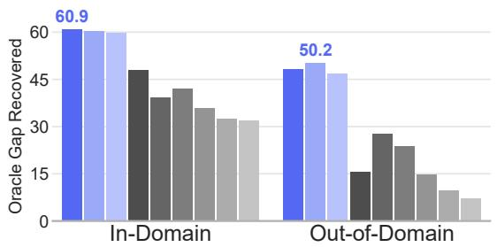
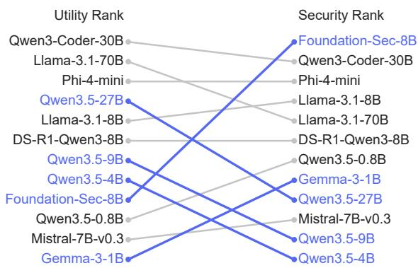
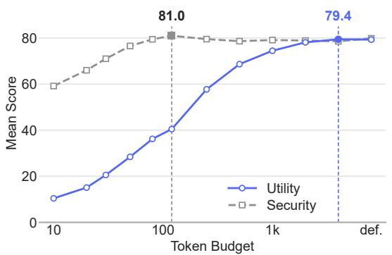
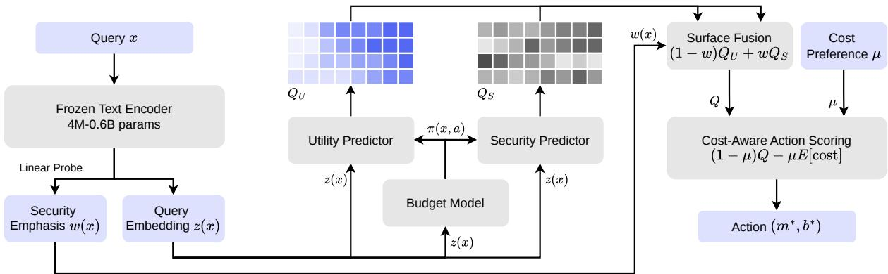
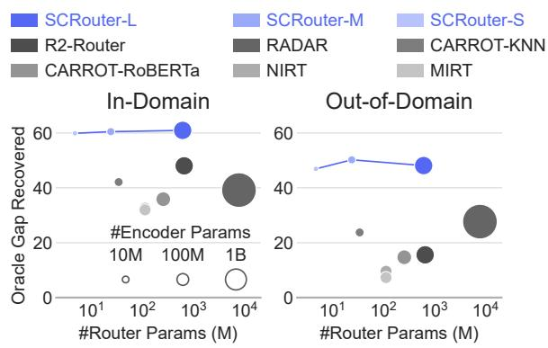
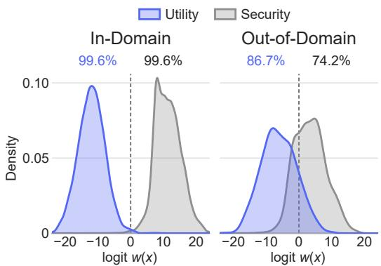
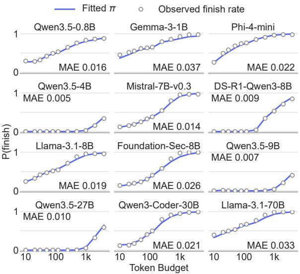
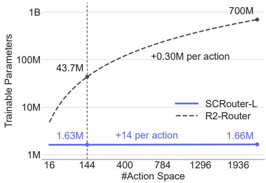
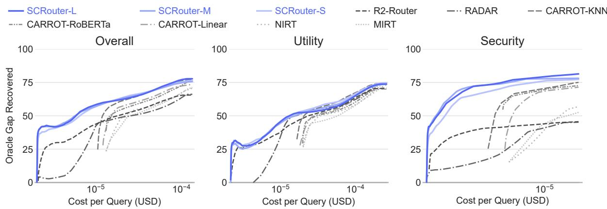
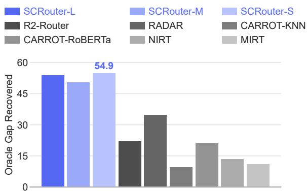

# Rethinking Quality in Large Language Model Routing: Security-Conditioned Model-and-Budget Selection

Yichi Zhang1, Zhenxiang Huang2, Yuyang Zhang1, Yuchen Yang1 1The Pennsylvania State University, 2The University of Hong Kong

## Abstract

Large language model (LLM) routers reduce serving cost by choosing which model to call and how many output tokens to grant it for each query. Existing routers rank model-budget actions using a single quality metric. This does not work for mixed workloads. For ordinary queries, a good answer is correct and useful (utility); for security-sensitive queries, a good answer refuses harmful requests or resists malicious instructions (security). These two objectives prefer different models and budgets.

We propose SCRouter, a router that learns when to prioritize security and how to allocate the token budget. For each model-budget pair, it estimates the probability that the response finishes within budget. It uses this probability to predict utility and security separately. A small probe determines how to weight these two predictions for each query. SCRouter then selects the model and budget by balancing the weighted utility and security against cost. We also build SCRouterBench, a benchmark of 38,869 utility and security queries spanning nine security dimensions, each answered under all 144 combinations of 12 models and 12 budgets, plus 2,753 out-of-domain queries. SCRouter improves the baselines by 13-29 points in-domain and 19-23 points out-of-domain.

## 1 Introduction

LLM routers are widely used in modern LLM infrastructure (Yu et al., 2022; Kwon et al., 2023; Lu et al., 2026). They reduce serving cost by selecting a suitable model configuration for each query. Most existing routers use a model-only action space: the router selects only which model should answer each query, as in RouterBench (Hu et al., 2024), RouteLLM (Ong et al., 2025), CARROT (Somerstep et al., 2025), and UniRoute (Jitkrittum et al., 2026). R2-Router (Xue et al., 2026) extends the action space to model-budget pairs: it picks both the model and its output token budget for each query.

  
Figure 1: Overall routing performance under in-domain and out-of-domain settings. SCRouter achieves the highest Oracle Gap Recovery (OGR) across both settings. OGR denotes the fraction of the gap between random selection and the oracle that a router recovers.

These methods improve routing performance by refining the action space, but they overlook that what makes a response good depends on the query. For ordinary queries, a good response correctly addresses the request, which we refer to as utility. For harmful requests or queries containing malicious instructions, a good response refuses the harmful request or resists the malicious instructions, which we refer to as security. We call these utility and security queries, respectively.

The problem is that utility and security often favor different routing actions, both in model selection and token budget allocation. Figure 2 ranks 12 LLMs at their best budgets and shows that their utility and security rankings differ substantially. For example, Foundation-Sec-8B ranks 1st in security but 9th in utility, while Qwen3.5-27B ranks 4th in utility but 9th in security. Figure 3 shows the same mismatch across token budgets. For Qwen3- Coder-30B, utility rises from 10.4% to 79.4% as the budget grows to about 4,000 tokens. In contrast, its security performance peaks at only 120 tokens, where utility remains at 40.5%. These observations show that models and budgets that improve utility need not improve security. A router that ignores this distinction may send security queries to models with strong utility but weak security, or allocate larger budgets without a security benefit.

  
Figure 2: Model rankings differ between utility and security: strong utility need not imply strong security.

We propose SCRouter, the first Security-Conditioned model-budget Router. First, a small probe estimates the probability that a query is security-sensitive. Second, for each model-budget pair, a shared budget model predicts the probability of finishing within budget and the expected token use. Two quality predictors use this completion probability to account for truncated responses when estimating utility and security separately. This lets the two objectives favor different models and budgets while sharing the same completion estimate. Third, SCRouter uses the probe’s estimate to weight the two quality scores, then selects the model-budget pair that best balances the combined score against the cost estimated from token use. The predictors share parameters across actions, avoiding a separate predictor for each pair.

We also build SCRouterBench, a routing benchmark with mixed utility and security workloads. It has 38,869 queries, covering utility tasks and nine security dimensions, plus an out-of-domain test set of 2,753 queries. We run all 144 actions per query, yielding about 6 million labeled responses.

On SCRouterBench, SCRouter recovers 60.9% of the gap between random selection and the perquery oracle, compared with 48.0% for the best baseline, R2-Router, a gain of 12.9 percentage points. As shown in Figure 1, all three encoder variants of SCRouter beat every baseline, even the smallest one, which has a 4M-parameter encoder and 0.25M trainable parameters. SCRouter-M also leads out-of-domain with 50.2% OGR.

Our contributions are as follows: (a) we find a utility-security asymmetry in LLM routing across both model choice and budget allocation; (b) we propose SCRouter, a security-conditioned modelbudget router that adapts its routing objective to each query; (c) we release SCRouterBench to evaluate model and budget selection on mixed utility and security workloads; and (d) we demonstrate gains over existing routers in both settings.

  
Figure 3: Utility and security of Qwen3-Coder-30B under different token budgets. Utility and security peak at different token budgets.

## 2 Related Work

LLM Routing. LLM routers direct queries to candidate models to balance response quality and inference cost. Cascade routers try a small model first and move to larger ones if the answer is poor (Chen et al., 2024a; Aggarwal et al., 2024). Predictive routers pick a model before generation from query features, preference data, or learned embeddings (Ding et al., 2024; Ong et al., 2025; Chen et al., 2024b; Feng et al., 2025; Song et al., 2025; Somerstep et al., 2025; Jitkrittum et al., 2026). Benchmarks such as RouterBench (Hu et al., 2024) and RouterArena (Lu et al., 2026) have standardized model routing evaluation. R2-Router (Xue et al., 2026) and RADAR (Fernandez et al., 2026) extend routing to choose both the model and the token budget. Unlike these routers, which use one quality metric and ignore security, SCRouter predicts utility and security separatelyfor each modelbudget action. We also build SCRouterBench to evaluate routers under mixed workloads.

Attacks on LLMs. Despite safety alignment, LLMs remain vulnerable to adversarial inputs such as jailbreaks (Wei et al., 2023; Zou et al., 2023; Chao et al., 2025) and prompt injections (Perez and Ribeiro, 2022; Greshake et al., 2023; Schulhoff et al., 2023). Safety benchmarks (Mazeika et al., 2024; Chao et al., 2024; Wang et al., 2023) show that robustness differs a lot across models. Existing defenses make a single model more robust (Inan et al., 2023; Chen et al., 2025; Du et al., 2024) or protect the router itself from attacks (Shafran et al., 2025; Zhang et al., 2026). SCRouter treats security queries as part ofthe routing workload. It uses differences in model robustness and budget sensitivity to send security queries to safe configurations and utility queries to high-utility ones.

  
Figure 4: Overview of the SCRouter pipeline. (1) A frozen text encoder and linear probe estimate the query’s security weight $w ( x )$ . (2) A shared budget model predicts the probability $\pi ( x , a )$ that the response finishes within budget, and two quality models predict the utility and security surfaces $\hat { Q } _ { U }$ and $\hat { Q } _ { S }$ for all actions. (3) The two surfaces are combined with weight w(x) and traded off against cost with the cost coefficient $\mu .$

## 3 Security-Conditioned Router

## 3.1 Overview

Let x denote a query and $\textstyle A = { \mathcal { M } } \times B$ be the action space, where each action $a = ( m , b )$ specifies a generation model m with an output token budget b. For every action, $U ( x , a ) \in [ 0 , 1 ]$ denotes the utility of the response and $S ( x , a ) \in [ 0 , 1 ]$ its security. SCRouter predicts the surfaces U and S separately for all actions and combines them with a query-specific security weight.

Figure 4 summarizes the pipeline. First, a frozen text encoder represents the query, and a linear probe on this representation estimates a query-specific security weight $w ( x )$ (Section 3.2). Second, a shared budget model predicts, for every action, the completion probability $\pi ( x , a )$ , which is the probability that the response finishes within its budget. Two quality models then use π to predict the utility and security surfaces $\hat { Q } _ { U } ( x , a )$ and $\hat { Q } _ { S } ( x , a )$ (Section 3.3). Third, the two quality surfaces are fused with security weight $w ( x )$ and traded off against the expected cost using a cost coefficient $\mu$ set by the operator (Section 3.4).

## 3.2 Query Conditioning

  
Figure 5: Efficiency versus performance across routers. SCRouter gets higher OGR with fewer parameters and lower TTFT. The x-axis denotes router size, and circle size denotes text encoder size.

Query Representation $z ( x )$ . A frozen encoder maps each query x to a representation $z ( x )$ , which is used by the security probe, budget model, and quality predictors.

Security Weight $w ( x )$ . A logistic-regression probe on the query representation $z ( x )$ gives the security weight directly:

$$
w ( x ) = \sigma \bigl ( v ^ { \top } z ( x ) + v _ { 0 } \bigr ) .\tag{1}
$$

We train the probe on binary labels (0 for utility, 1 for security), so $w ( x )$ is the predicted probability that a query is a security query. Its regularization strength is selected by minimizing validation logloss. Figure 6 shows that the probe separates utility and security queries in-domain and generalizes to unseen sources.

Encoder Variants. Prior work (Xue et al., 2026) uses large encoders such as Qwen3-Embedding-0.6B (Zhang et al., 2025). These encoders are already close in size to the smallest candidate LLMs and add to the time to first token (TTFT). We use smaller encoders to keep routing cheap. We design three variants: SCRouter-L (Qwen3-Embedding-0.6B, 1024-d), SCRouter-M (all-MiniLM-L6-v2, 384-d), and SCRouter-S (BERT-tiny, 128-d). SCRouter-S uses a 4M encoder and 0.25M trainable parameters. Figure 5 compares efficiency and performance across routers; Section 5.2 reports the results.

  
Figure 6: Performance of the security probe. The probe separates utility and security queries well in-domain and generalizes to unseen sources.

## 3.3 Budget-Conditioned Quality Surfaces

A response may score low for two reasons. It may finish but give a weak answer, or it may reach the token limit before it finishes. We call the second case budget-induced truncation. For each objective $t \in \{ U , S \}$ , we model the two cases separately and mix them by the completion probability π,

$$
{ \hat { Q } } _ { t } = \pi F _ { t } + ( 1 - \pi ) T _ { t } ,\tag{2}
$$

where $F _ { t }$ and $T _ { t }$ are the predicted qualities of completed and truncated responses. A shared budget model gives π and the expected number of generated tokens. Two quality models, one for utility and one for security, give $F _ { t }$ and $T _ { t }$ . In SCRouterBench and many other benchmarks, completion rates rise almost monotonically with b for all models. We therefore derive π from the number of tokens each response needs.

Shared Budget Model. Let $B ^ { * } ( x , m , b )$ be the smallest number of output tokens with which model m, instructed with budget $b ,$ completes its answer to x. The response is truncated exactly when $B ^ { * } > b$ . Because a model writes shorter answers when told a budget, $B ^ { * }$ depends on b. The budget changes the answer itself, not only where it stops.

  
Figure 7: Budget model calibration across models and budgets. Lines denote the fitted completion probability π from the shared budget model, while markers represent observed completion rates. The predicted π increases with b even though we do not force it to.

A tower $u _ { L } ( x )$ , a two-layer MLP, maps the query to a low-dimensional demand vector, and

$$
\log B ^ { * } \sim \mathcal { N } \big ( \lambda , s ^ { 2 } \big ) ,\tag{3}
$$

$$
\lambda = \langle u _ { L } ( x ) , A _ { m } ^ { L } \rangle + c _ { m } ^ { L } + g _ { m , b } ,\tag{4}
$$

where $A _ { m } ^ { L }$ and $c _ { m } ^ { L }$ describe how many tokens model m needs, $g _ { m , b }$ how strongly the instruction b compresses this need, and $s = s _ { m , b }$ is a learned spread per action. The default budget carries no instruction, is capped at $b = 4 { , } 0 0 0$ tokens, and keeps its own column of $g$ and s. With $\zeta = ( \log b - \lambda ) / s ,$ the completion probability is

$$
\pi = P ( B ^ { * } \leq b ) = \Phi ( \zeta ) .\tag{5}
$$

A completed response stops after $B ^ { * }$ tokens and a truncated one stops at $b ,$ so the model generates min $( B ^ { * } , b )$ tokens, whose expectation is

$$
\hat { E } [ \mathrm { t o k } ] = e ^ { \lambda + s ^ { 2 } / 2 } \Phi ( \zeta - s ) + b ( 1 - \pi ) .\tag{6}
$$

This one distribution gives both the completion probability and the expected cost. Figure 7 shows that the predicted $\pi$ follows the observed completion rates as the budget grows.

Completion/Truncation Quality Models. Following multidimensional item response theory, for each objective $t \in \{ U , S \}$ a tower $u _ { t } ( x )$ maps the query to a demand vector, and each model has an ability vector in the same space. With the logit

$$
{ { \phi } _ { t } } = \langle { { u } _ { t } } , { { A } _ { t , m } } \rangle + { { c } _ { t , m } } + { \beta _ { t , m , b } } + \langle { { u } _ { t } } , { { C } _ { t , b } } \rangle ,\tag{7}
$$

  
Figure 8: Parameter scaling across action spaces. Trainable parameters on a log scale for n models and n budgets excluding the frozen encoder, with our $1 2 \times 1 2$ setting dashed. R2-Router grows quadratically, from 43.7M to 700M parameters, while SCRouter stays at about 1.6M because its towers are shared.

the predicted qualities of completed and truncated responses are given by

$$
F _ { t } = \sigma ( \phi _ { t } ) ,\tag{8}
$$

$$
T _ { t } = \sigma \bigl ( \phi _ { t } ^ { \prime } + \kappa _ { t , m } ( \log b - \bar { \lambda } ) \bigr ) ,\tag{9}
$$

where $\phi _ { t } ^ { \prime }$ has the form of Eq. 7 with its own parameters $A _ { t , m } ^ { \prime } , c _ { t , m } ^ { \prime } , \rho _ { t , m , b }$ , and $C _ { t , b } ^ { \prime } .$ . Here $A _ { t , m }$ is model m’s ability for objective t, $\beta _ { t , m , b }$ and $\rho _ { t , m , b }$ capture how the budget instruction itself changes quality, $\langle u _ { t } , C _ { t , b } \rangle$ lets the budget sensitivity depend on the query, and $\kappa _ { t , m }$ gives partial credit according to how close the budget came to being sufficient. The shift $\bar { \lambda }$ is λ from Eq. 4 with its gradient stopped, so the quality loss does not change the budget model. Eq. 2 then mixes $F _ { t }$ and $T _ { t }$ by $\pi .$ Each tower is a two-layer MLP of width 512 with a 32-dimensional output. Because the towers are shared across actions and the model and budget parameters are lookup tables, one forward pass gives the full $| { \mathcal { M } } | \times | { \mathcal { B } } |$ surface for each objective. SCRouter therefore needs no per-action predictor, and its size grows much more slowly than R2-Router’s, as shown in Figure 8.

Training. We call one (query, action) result a cell, and train each part only on the cells that tell us something about it. A cell either gives $B ^ { * }$ exactly or gives only a lower bound. Specifically, with the budget instruction fixed, a completed response of length ℓ gives an observed $B ^ { * } = \ell ,$ whereas a truncated response gives only the lower bound $B ^ { * } > b$ This observation does not imply completion under a different budget instruction. We therefore fit the budget model on all training cells with a censored log-normal likelihood, plus a binary cross-entropy loss between π and whether the response actually completed, which we read from its stop reason. $F _ { t }$ is fitted on the completed cells and $T _ { t }$ on the truncated cells of objective-t queries, and an end-to-end binary cross-entropy aligns $\hat { Q } _ { \imath }$ t with the observed score on all cells of objective-t queries. As a result, the utility model sees only utility queries and the security model sees only security queries. No query needs both labels. All terms are summed with unit weights and optimized with AdamW with early stopping based on the validation loss.

## 3.4 Surface Fusion and Cost-Aware Decision

We then combine the two surfaces with the query’s security weight. For every action $^ { a , }$

$$
\hat { Q } ( x , a ) = ( 1 - w ) \hat { Q } _ { U } + w \hat { Q } _ { S } .\tag{10}
$$

Setting $w = 0$ gives utility-only routing and $w = 1$ gives security-only routing. Values in between mix the two without retraining.

The cost of an action is estimated before generation from the known input length $n _ { \mathrm { i n } }$ , the expected number of generated tokens (Eq. 6), and the pertoken prices $p _ { m } ^ { \mathrm { i n } }$ and $p _ { m } ^ { \mathrm { o u t } }$ of model m:

$$
\hat { C } ( x , a ) = \frac { n _ { \mathrm { i n } } p _ { m } ^ { \mathrm { i n } } + \hat { E } [ \mathrm { t o k } ] p _ { m } ^ { \mathrm { o u t } } } { C _ { \mathrm { r e f } } } ,\tag{11}
$$

where $C _ { \mathrm { r e f } }$ is the largest nominal cost over all training queries and actions. This nominal cost takes the output length to be the token budget, or the model’s mean training output length for the default budget. Given the operator’s cost coefficient $\mu \in \lbrack 0 , 1 ]$ SCRouter selects

$$
a ^ { * } = \underset { a \in \mathcal { A } } { \arg \operatorname* { m a x } } \left( 1 - \mu \right) \hat { Q } ( x , a ) - \mu \hat { C } ( x , a ) .\tag{12}
$$

All $| \mathcal { M } | | \boldsymbol { B } |$ actions are scored without invoking any candidate generation model, and only $a ^ { * }$ is executed. In short, $w ( x )$ decides what counts as a good answer, and $\mu$ decides how much quality to give up for lower cost.

## 4 SCRouterBench

SCRouterBench evaluates routers on mixed utility and security queries under cost constraints. As summarized in Table 1, utility queries come from six datasets in SPROUT (Somerstep et al., 2025); security queries cover nine dimensions from DecodingTrust (Wang et al., 2023), SALAD-Bench (Li et al., 2024), and HackAPrompt (Schulhoff et al., 2023). See Appendix A for details.

<table><tr><td colspan="3">In-domain</td><td colspan="2">OOD</td></tr><tr><td>Dimension</td><td>Source</td><td>#Q</td><td>Source</td><td>#Q</td></tr><tr><td>Utility†</td><td>SPROUT</td><td>19,882</td><td>MixEval</td><td>998</td></tr><tr><td>Toxicity</td><td>DecodingTrust</td><td>2,000</td><td>ToxiGen</td><td>200</td></tr><tr><td>Stereotype</td><td>DecodingTrust</td><td>1,994</td><td>CrowS-Pairs</td><td>200</td></tr><tr><td>Adv. demo.</td><td>DecodingTrust</td><td></td><td>1,996 BadChain</td><td>200</td></tr><tr><td>Privacy</td><td>DecodingTrust</td><td></td><td>2,000 Synthetic</td><td>200</td></tr><tr><td>Ethics</td><td>DecodingTrust</td><td></td><td>2,000 ETHICS</td><td>200</td></tr><tr><td>Fairness</td><td>DecodingTrust</td><td>1,997 BBQ</td><td></td><td>300</td></tr><tr><td>Harmful req.</td><td>SALAD-Bench</td><td>4,732</td><td>HarmBench</td><td>188</td></tr><tr><td>Cyber risk</td><td>SALAD-Bench</td><td>768</td><td>HarmBench</td><td>67</td></tr><tr><td>Jailbreak/PI</td><td>HackAPrompt</td><td>1,500</td><td>Tensor Trust</td><td>200</td></tr><tr><td colspan="5">Total</td></tr></table>

Table 1: Overview of SCRouterBench. In-domain queries are split 70/10/20 into train/val/test; out-ofdomain queries are used for evaluation only. Every query is scored under all 144 actions. †Six datasets: MMLU-Pro, GPQA, MuSR, MATH, OpenHermes, RAGBench. PI: prompt injection.

Action Grid and Setup. Each query is evaluated across all $| { \mathcal { A } } | = 1 4 4$ actions formed by 12 openweight models from 0.8B to 70B parameters and 12 token budgets B. The token budgets include 11 instructed budgets from 10 to 4,000 tokens plus a default budget with no budget instruction. Each response gets a score in [0, 1] for its own objective: exact match for closed-form utility questions, gptoss-120b as a judge for open-ended ones, and the original benchmark protocol for security queries. Missing final answers receive a score of zero.

Data Splits and Label Verification. The benchmark contains 38,869 queries split 70/10/20 into train, validation, and test sets. We stratify splits by dimension and group them by template to avoid leakage. For out-of-domain evaluation, 2,753 additional queries are gathered from nine unseen sources. To ensure label quality, we compare utility labels with gold answers (97.7% agreement) and security labels with Qwen3Guard (Cohen’s $\kappa \geq 0 . 7 6 )$ . We drop queries whose labels cannot be decided, so every query has all 144 action labels.

Routing Headroom. Per-query routing has a lot of room to improve on this data. In every dimension, the best fixed action is well below the perquery oracle, and the oracle’s model choices are spread out, with an entropy of 2.5-3.4 bits. This equals spreading the choices evenly over 6 to 11 of the 12 models. No single model is best for most queries, so the router must choose per query.

## 5 Experiments

## 5.1 Experimental Setup

Router Baselines. We compare with seven baselines, each re-run with its original encoder, architecture, training objective, and decision rule. R2-Router (Xue et al., 2026) trains one MLP per model-budget action on Qwen3-Embedding-0.6B. RADAR (Fernandez et al., 2026) fits a twoparameter IRT model over all actions on Qwen3- Embedding-8B, and we report both its Chebyshev rule and a linear rule. MIRT and NIRT (Song et al., 2025) use BERT-base. CARROT (Somerstep et al., 2025) has KNN, RoBERTa, and Linear variants. R2-Router and RADAR choose among the same 144 actions as SCRouter. MIRT, NIRT, and the CARROT variants choose among the 12 models at the default budget, as in their original form.

Cost. Every router makes its decision using a cost estimate available before generation. The estimate uses the input tokens and the router’s own prediction of output tokens, priced with a fixed per-model price table and normalized by the largest nominal training cost $C _ { \mathrm { r e f } }$ defined in Section 3.4. Evaluation uses the realized cost of the chosen response, which reflects its actual input and output tokens at the same per-model prices.

Metric. Sweeping the cost coefficient $\mu$ traces the router’s performance-cost frontier $R ( c )$ . We summarize it with Oracle Gap Recovery (OGR): the area between the router and a random baseline, divided by the area between the oracle and the random baseline, over log cost:

$$
\mathrm { O G R } = 1 0 0 \cdot { \frac { \int \left( R ( c ) - \mathrm { R n d } ( c ) \right) d \log c } { \int \left( O ( c ) - \mathrm { R n d } ( c ) \right) d \log c } } ,\tag{13}
$$

where $O ( c )$ is the oracle frontier and Rnd(c) is a label-free baseline that uniformly samples from fixed actions with mean cost at most c. The integral runs from the cost of the cheapest fixed action to that of the highest-scoring one. If a router cannot reach a cost c, we set $R ( c ) = \operatorname { R n d } ( c )$ . By definition, OGR is 0 for random selection and 100 for the oracle. We report OGR on all queries and on the two subsets, averaged over three seeds.

## 5.2 Main Results

Table 2 reports OGR in-domain and out-of-domain, and Figure 9 shows the performance-cost curves.

  
Figure 9: Performance-cost trade-offs on in-domain evaluation. Each curve shows performance against log cost as µ varies. Random selection and the oracle are the lower and upper bounds. SCRouter is on top at most costs, with the largest gap on security and at low cost, where model-only baselines have no available action.

<table><tr><td rowspan="2">Router</td><td colspan="2">In-Domain</td><td colspan="2">Out-of-Domain</td></tr><tr><td>All Util.</td><td>Sec.</td><td>All Util.</td><td>Sec.</td></tr><tr><td>SCRouter-L</td><td>60.9 52.9</td><td>72.0</td><td>48.1 49.6</td><td>47.3</td></tr><tr><td>SCRouter-M SCRouter-S</td><td>60.5 52.9 59.9 53.9</td><td>70.9 50.2 66.6 46.9</td><td>50.7 48.4</td><td>49.8 46.1</td></tr><tr><td>R2-Router</td><td>48.0 49.4</td><td>39.1</td><td>15.6 32.5</td><td>0.3</td></tr><tr><td>RADAR (linear)</td><td>39.2 44.9</td><td>27.4</td><td>27.7 38.3</td><td>19.9</td></tr><tr><td>RADAR (Chebyshev)</td><td>36.7 41.3</td><td>30.0</td><td>27.4 37.0</td><td>15.8</td></tr><tr><td>CARROT-KNN</td><td>42.1 39.0</td><td>38.8</td><td>23.7 34.1</td><td>1.2</td></tr><tr><td>CARROT-RoBERTa</td><td>35.9 33.2</td><td>32.1</td><td>14.7 31.8</td><td>-5.8</td></tr><tr><td>CARROT-Linear</td><td>37.7 34.8</td><td>30.4</td><td>14.8</td><td>27.1 -9.1</td></tr><tr><td>NIRT</td><td>32.6 32.8</td><td>17.1</td><td>9.6 26.9</td><td>-14.3</td></tr><tr><td></td><td></td><td></td><td></td><td></td></tr><tr><td>MIRT</td><td>32.0 32.4</td><td>17.6</td><td>7.3</td><td>25.8 -15.4</td></tr></table>

Table 2: OGR on SCRouterBench, in-domain and outof-domain, for all queries (All) and for the utility (Util.) and security (Sec.) subsets. SCRouter variants beat all baselines in both settings.

In-Domain. SCRouter-L has the highest overall OGR, 12.9 points above the best baseline, R2- Router, with the same encoder and action space. It is better on both objectives, with gains of 32.9 points on security and 3.5 points on utility. As shown in Figure 5, the gains hold with smaller encoders. SCRouter-M, with a 23M MiniLM encoder, is still 12.5 points ahead. SCRouter-S, with a 4M encoder, is 11.9 points ahead and has the best utility OGR of 53.9. It is behind the two larger variants only on the security subset.

Figure 9 shows where the gains come from. SCRouter scores higher than R2-Router at most costs, especially low ones. Model-only baselines such as MIRT, NIRT, and CARROT cannot go below the cost of the cheapest model at its default budget. RADAR uses a single ability scale, which ranks actions well for utility but poorly for security, where its OGR drops to 27.4. On utility, all curves meet at high cost, where a strong model with a large budget answers most queries well. The routers differ mainly when the cost is tight. On security, SCRouter leads even at the lowest costs. A safe answer to a harmful request is often a short refusal, and Figure 3 shows that security peaks at only 120 tokens. Model-only baselines cannot lower the budget to use this.

Utility versus Security. Every baseline in Table 2 scores lower on security than on utility indomain. RADAR (linear) loses 17.5 points, and NIRT and MIRT lose about 15. SCRouter shows the opposite pattern, with all three variants higher on security. Compared with R2-Router, SCRouter gains at most 4.5 points on utility but 27.5 to 32.9 points on security. Most of its overall gain thus comes from security queries. A larger action space alone does not explain this. CARROT-KNN chooses among only 12 models but reaches 38.8 on security, close to the 39.1 of R2-Router with all 144 actions. SCRouter uses the same 144 actions as R2-Router and reaches 72.0, so the gain comes from its quality metric.

Out-of-Domain. All routers do worse on the nine unseen sources, most of all on security. On security, R2-Router drops to a near-random 0.3, CARROT-KNN gets 1.2, and the other CARROT and IRT routers fall below random. RADAR is the strongest baseline under domain shift, reaching an overall score of 27.7. Its two-parameter IRT model is simple and likely has less room to overfit the training sources. RADAR (linear) loses 11.5 points overall from in-domain to out-of-domain, while R2-Router, which trains one MLP per action, loses

<table><tr><td>Component</td><td></td><td>In-Domain Out-of-Domain</td></tr><tr><td>SCRouter-L (full)</td><td>60.9</td><td>48.1</td></tr><tr><td>w/o Query-specific w(x)</td><td>54.0 (-6.9)</td><td>40.7 (-7.4)</td></tr><tr><td>w/o Budget terms</td><td>58.3 (-2.6)</td><td>43.0 (-5.1)</td></tr><tr><td>w/o Success/failure split</td><td>55.0 (-5.9)</td><td>42.4 (-5.7)</td></tr><tr><td>w/o Separate quality models</td><td> $4 9 . 9 _ { \ ( - 1 1 . 0 ) }$ </td><td> $3 7 . 3 \textrm { ‰}$ </td></tr></table>

Table 3: Ablation results. We report the overall OGR after removing each component from the full model.

32.4. All SCRouter variants still beat it on every metric. SCRouter-M has the best overall OGR of 50.2. It is 22.5 points above RADAR overall, 12.4 points on utility, and 29.9 points on security.

SCRouter still does worse out-of-domain than in-domain. SCRouter-L drops from 60.9 to 48.1 overall, mainly because its security OGR falls from 72.0 to 47.3. Figure 6 explains much of this drop. The probe classifies 99.6% of security queries correctly in-domain but only 74.2% on unseen sources, compared with 86.7% for utility queries. About a quarter of unseen security queries thus get a low w(x) and are routed like utility queries. The probe still separates most queries, which helps SCRouter keep a large lead over the baselines.

## 5.3 Ablation Study

To measure what each part adds, we remove one part at a time from SCRouter-L and test in-domain and out-of-domain. Table 3 shows the results.

Query-Specific Weight. Replacing w(x) with a fixed weight lowers OGR by 6.9 points indomain and 7.4 points out-of-domain, so a perquery weight matters. A fixed weight applies the same trade-off to every query. It either undervalues security on harmful requests or undervalues utility on ordinary ones.

Budget Modeling. Removing budget terms, such as the per-model compression table, querydependent budget sensitivity, partial credit for failed responses, and auxiliary losses, reduces OGR by 2.6 points in-domain and 5.1 points out-ofdomain. Modeling the budget helps in both settings, especially out-of-domain.

Success/Failure Split. Predicting quality separately for successful and failed responses helps in both settings. Omitting this split reduces OGR by 5.9 points in-domain and 5.7 points out-of-domain. Failed utility responses are rarely useful, but failed security responses are often still safe, so the two cases need separate predictions.

  
Figure 10: Leave-one-source-out evaluation across 15 training sources. We report the average held-out OGR for each method. All SCRouter variants beat the baselines on held-out sources.

Separate Quality Models. Using separate utility and security models matters most. Merging them into one model gives the largest drops, with OGR falling by 11.0 points to 49.9 in-domain and by 10.8 points to 37.3 out-of-domain. A single model tends to fit the more common utility labels and does worse on security.

## 5.4 Robustness under Domain Shift

To test robustness to domain shift, we hold out each of the 15 training sources in turn and report the results in Figure 10. SCRouter variants attain 50.5-54.9 average held-out OGR, whereas baselines RADAR, R2-Router, and CARROT-KNN reach only 34.7, 22.0, and 9.5 respectively. This 16–20 point gain over the best baseline matches our out-of-domain results in Table 2. Smaller encoders transfer better. SCRouter-S has the best held-out OGR of 54.9, and SCRouter-M has the best out-ofdomain OGR in Table 2. SCRouter-L is best only in-domain. A larger encoder may fit the training sources too closely. A small encoder is thus a good default when the test workload is unknown.

## 6 Conclusion

We present SCRouter, a router that picks both the model and token budget. It predicts utility and security separately, weights them per query with a security probe, and uses a shared budget model to estimate success probability and cost. On SCRouter-Bench, SCRouter recovers 60.9% of the oracle gap in-domain and beats all baselines out-of-domain. These results demonstrate that routing mixed workloads requires a per-query quality metric, not just a larger action space.

## Limitations

Following prior routing benchmarks (Hu et al., 2024; Somerstep et al., 2025), our evaluation focuses on single-turn text queries and a pool of 12 open-weight models. Multi-turn and multimodal workloads are left for future evaluation. Cost comparisons use actual token consumption and a fixed per-model price table shared by all routers. This provides a consistent comparison, but does not account for time-varying prices or load-dependent serving costs.

## Ethical Considerations

SCRouterBench is built entirely from publicly available benchmarks, used under their original licenses, and no new human data was collected. Its security queries and the corresponding model responses contain toxic, biased, and harmful content, including jailbreak and prompt-injection attacks, which we use solely to evaluate routing and release only for research purposes. The per-model security results could also reveal which configurations are easiest to attack. We think the benefit of securityaware routing outweighs this risk. SCRouter is a cost-aware routing layer, not a safety guarantee. We used AI assistants to check grammar.

## References

Abdelrahman Abouelenin, Atabak Ashfaq, Adam Atkinson, Hany Awadalla, Nguyen Bach, et al. 2025. Phi-4-Mini technical report: Compact yet powerful multimodal language models via mixture-of-LoRAs. arXiv preprint arXiv:2503.01743.

Pranjal Aggarwal, Aman Madaan, Ankit Anand, Srividya Pranavi Potharaju, Swaroop Mishra, Pei Zhou, Aditya Gupta, Dheeraj Rajagopal, Karthik Kappaganthu, Yiming Yang, Shyam Upadhyay, Manaal Faruqui, and Mausam. 2024. AutoMix: Automatically mixing language models. In Advances in Neural Information Processing Systems.

Patrick Chao, Edoardo Debenedetti, Alexander Robey, Maksym Andriushchenko, Francesco Croce, Vikash Sehwag, Edgar Dobriban, Nicolas Flammarion, George J. Pappas, Florian Tramèr, Hamed Hassani, and Eric Wong. 2024. JailbreakBench: An open robustness benchmark for jailbreaking large language models. In Advances in Neural Information Processing Systems.

Patrick Chao, Alexander Robey, Edgar Dobriban, Hamed Hassani, George J. Pappas, and Eric Wong. 2025. Jailbreaking black box large language models in twenty queries. In 2025 IEEE Conference on Secure and Trustworthy Machine Learning (SaTML).

Lingjiao Chen, Matei Zaharia, and James Zou. 2024a. FrugalGPT: How to use large language models while reducing cost and improving performance. Transactions on Machine Learning Research.

Shuhao Chen, Weisen Jiang, Baijiong Lin, James Kwok, and Yu Zhang. 2024b. RouterDC: Query-based router by dual contrastive learning for assembling large language models. In Advances in Neural Information Processing Systems.

Sizhe Chen, Julien Piet, Chawin Sitawarin, and David Wagner. 2025. StruQ: Defending against prompt injection with structured queries. In 34th USENIX Security Symposium.

Dujian Ding, Ankur Mallick, Chi Wang, Robert Sim, Subhabrata Mukherjee, Victor Rühle, Laks V. S. Lakshmanan, and Ahmed Hassan Awadallah. 2024. Hybrid LLM: Cost-efficient and quality-aware query routing. In The Twelfth International Conference on Learning Representations.

Yanrui Du, Sendong Zhao, Danyang Zhao, Ming Ma, Yuhan Chen, Liangyu Huo, Qing Yang, Dongliang Xu, and Bing Qin. 2024. MoGU: A framework for enhancing safety of LLMs while preserving their usability. In Advances in Neural Information Processing Systems.

Tao Feng, Yanzhen Shen, and Jiaxuan You. 2025. GraphRouter: A graph-based router for LLM selections. In The Thirteenth International Conference on Learning Representations.

Nigel Fernandez, Branislav Kveton, Ryan A. Rossi, Andrew S. Lan, and Zichao Wang. 2026. RADAR: Reasoning-ability and difficulty-aware routing for reasoning LLMs. In The Fourteenth International Conference on Learning Representations.

Gemma Team, Aishwarya Kamath, Johan Ferret, Shreya Pathak, Nino Vieillard, et al. 2025. Gemma 3 technical report. arXiv preprint arXiv:2503.19786.

Aaron Grattafiori, Abhimanyu Dubey, Abhinav Jauhri, Abhinav Pandey, Abhishek Kadian, et al. 2024. The Llama 3 herd of models. arXiv preprint arXiv:2407.21783.

Kai Greshake, Sahar Abdelnabi, Shailesh Mishra, Christoph Endres, Thorsten Holz, and Mario Fritz. 2023. Not what you’ve signed up for: Compromising real-world LLM-integrated applications with indirect prompt injection. In Proceedings of the 16th ACM Workshop on Artificial Intelligence and Security.

Daya Guo, Dejian Yang, Haowei Zhang, Junxiao Song, Peiyi Wang, et al. 2025. DeepSeek-R1 incentivizes reasoning in LLMs through reinforcement learning. Nature.

Dan Hendrycks, Collin Burns, Steven Basart, Andrew Critch, Jerry Li, Dawn Song, and Jacob Steinhardt. 2021. Aligning AI with shared human values. In International Conference on Learning Representations.

Qitian Jason Hu, Jacob Bieker, Xiuyu Li, Nan Jiang, Benjamin Keigwin, Gaurav Ranganath, Kurt Keutzer, and Shriyash Kaustubh Upadhyay. 2024. Routerbench: A benchmark for multi-LLM routing system. In Agentic Markets Workshop at ICML 2024.

Hakan Inan, Kartikeya Upasani, Jianfeng Chi, Rashi Rungta, Krithika Iyer, Yuning Mao, Michael Tontchev, Qing Hu, Brian Fuller, Davide Testuggine, and Madian Khabsa. 2023. Llama guard: LLMbased input-output safeguard for human-AI conversations. arXiv preprint arXiv:2312.06674.

Wittawat Jitkrittum, Harikrishna Narasimhan, Ankit Singh Rawat, Jeevesh Juneja, Congchao Wang, Zifeng Wang, Alec Go, Chen-Yu Lee, Pradeep Shenoy, Rina Panigrahy, Aditya Krishna Menon, and Sanjiv Kumar. 2026. Universal model routing for efficient LLM inference. In The Fourteenth International Conference on Learning Representations.

Woosuk Kwon, Zhuohan Li, Siyuan Zhuang, Ying Sheng, Lianmin Zheng, Cody Hao Yu, Joseph Gonzalez, Hao Zhang, and Ion Stoica. 2023. Efficient memory management for large language model serving with PagedAttention. In Proceedings ofthe 29th Symposium on Operating Systems Principles.

Lijun Li, Bowen Dong, Ruohui Wang, Xuhao Hu, Wangmeng Zuo, Dahua Lin, Yu Qiao, and Jing Shao. 2024. SALAD-bench: A hierarchical and comprehensive safety benchmark for large language models. In Findings of the Association for Computational Linguistics: ACL 2024.

Yifan Lu, Rixin Liu, Jiayi Yuan, Xingqi Cui, Shenrun Zhang, Hongyi Liu, and Jiarong Xing. 2026. Routerarena: An open platform for comprehensive comparison of LLM routers. In The Fourteenth International Conference on Learning Representations.

Mantas Mazeika, Long Phan, Xuwang Yin, Andy Zou, Zifan Wang, Norman Mu, Elham Sakhaee, Nathaniel Li, Steven Basart, Bo Li, David Forsyth, and Dan Hendrycks. 2024. Harmbench: A standardized evaluation framework for automated red teaming and robust refusal. In Forty-first International Conference on Machine Learning.

Isaac Ong, Amjad Almahairi, Vincent Wu, Wei-Lin Chiang, Tianhao Wu, Joseph E. Gonzalez, M Waleed Kadous, and Ion Stoica. 2025. RouteLLM: Learning to route LLMs from preference data. In The Thirteenth International Conference on Learning Representations.

Alicia Parrish, Angelica Chen, Nikita Nangia, Vishakh Padmakumar, Jason Phang, Jana Thompson, Phu Mon Htut, and Samuel R. Bowman. 2022. BBQ: A hand-built bias benchmark for question answering. In Findings of the Association for Computational Linguistics: ACL 2022.

Fábio Perez and Ian Ribeiro. 2022. Ignore previous prompt: Attack techniques for language models. In NeurIPS ML Safety Workshop.

Sander Schulhoff, Jeremy Pinto, Anaum Khan, Louis-François Bouchard, Chenglei Si, Svetlina Anati, Valen Tagliabue, Anson Kost, Christopher Carnahan, and Jordan Boyd-Graber. 2023. Ignore this title and HackAPrompt: Exposing systemic vulnerabilities of LLMs through a global prompt hacking competition. In Proceedings ofthe 2023 Conference on Empirical Methods in Natural Language Processing.

Avital Shafran, Roei Schuster, Tom Ristenpart, and Vitaly Shmatikov. 2025. Rerouting LLM routers. In Second Conference on Language Modeling.

Seamus Somerstep, Felipe Maia Polo, Allysson Flavio Melo de Oliveira, Prattyush Mangal, Mírian Silva, Onkar Bhardwaj, Mikhail Yurochkin, and Subha Maity. 2025. CARROT: A cost aware rate optimal router. In ICLR 2025 Workshop on Foundation Models in the Wild.

Wei Song, Zhenya Huang, Cheng Cheng, Weibo Gao, Bihan Xu, GuanHao Zhao, Fei Wang, and Runze Wu. 2025. IRT-router: Effective and interpretable multi-LLM routing via item response theory. In Proceedings of the 63rd Annual Meeting of the Association for Computational Linguistics (Volume 1: Long Papers).

Sam Toyer, Olivia Watkins, Ethan Adrian Mendes, Justin Svegliato, Luke Bailey, Tiffany Wang, Isaac Ong, Karim Elmaaroufi, Pieter Abbeel, Trevor Darrell, Alan Ritter, and Stuart Russell. 2024. Tensor trust: Interpretable prompt injection attacks from an online game. In The Twelfth International Conference on Learning Representations.

Boxin Wang, Weixin Chen, Hengzhi Pei, Chulin Xie, Mintong Kang, Chenhui Zhang, Chejian Xu, Zidi Xiong, Ritik Dutta, Rylan Schaeffer, Sang Truong, Simran Arora, Mantas Mazeika, Dan Hendrycks, Zinan Lin, Yu Cheng, Sanmi Koyejo, Dawn Song, and Bo Li. 2023. DecodingTrust: A comprehensive assessment of trustworthiness in GPT models. In Advances in Neural Information Processing Systems.

Sajana Weerawardhena, Paul Kassianik, Blaine Nelson, Baturay Saglam, Anu Vellore, Aman Priyanshu, Supriti Vijay, Massimo Aufiero, Arthur Goldblatt, Fraser Burch, Ed Li, Jianliang He, Dhruv Kedia, Kojin Oshiba, Zhouran Yang, Yaron Singer, and Amin Karbasi. 2025. Llama-3.1-FoundationAI-SecurityLLM-8B-Instruct technical report. arXiv preprint arXiv:2508.01059.

Alexander Wei, Nika Haghtalab, and Jacob Steinhardt. 2023. Jailbroken: How does LLM safety training fail? In Advances in Neural Information Processing Systems.

Jiaqi Xue, Qian Lou, Jiarong Xing, and Heng Huang. 2026. R2-router: A new paradigm for LLM routing with reasoning. In Forty-third International Conference on Machine Learning.

An Yang, Anfeng Li, Baosong Yang, Beichen Zhang, Binyuan Hui, et al. 2025. Qwen3 technical report. arXiv preprint arXiv:2505.09388.

Gyeong-In Yu, Joo Seong Jeong, Geon-Woo Kim, Soojeong Kim, and Byung-Gon Chun. 2022. Orca: A distributed serving system for Transformer-Based generative models. In 16th USENIX Symposium on Operating Systems Design and Implementation (OSDI 22).

Wenhui Zhang, Huiyu Xu, Zhibo Wang, Zhichao Li, Zeqing He, Xuelin Wei, and Kui Ren. 2026. Rerouteguard: Understanding and mitigating adversarial risks for llm routing. arXiv preprint arXiv:2601.21380.

Yanzhao Zhang, Mingxin Li, Dingkun Long, Xin Zhang, Huan Lin, Baosong Yang, Pengjun Xie, An Yang, Dayiheng Liu, Junyang Lin, Fei Huang, and Jingren Zhou. 2025. Qwen3 embedding: Advancing text embedding and reranking through foundation models. arXiv preprint arXiv:2506.05176.

Andy Zou, Zifan Wang, Nicholas Carlini, Milad Nasr, J. Zico Kolter, and Matt Fredrikson. 2023. Universal and transferable adversarial attacks on aligned language models. arXiv preprint arXiv:2307.15043.

## A SCRouterBench Details

Table 5 lists the sources, dimensions, scoring criteria, and split sizes of SCRouterBench, including the out-of-domain evaluation set. Table 4 lists the 12 models in the action space.

<table><tr><td>Tier</td><td>Model</td><td>Developer</td><td>Params</td><td>Focus</td></tr><tr><td rowspan="4">Small</td><td>Qwen3.5-0.8B</td><td>Qwen</td><td>0.8B</td><td>General</td></tr><tr><td>Gemma-3-1B-it (Gemma Team et al., 2025)</td><td>Google</td><td>1B</td><td>General</td></tr><tr><td>Phi-4-mini-instruct (Abouelenin et al., 2025)</td><td>Microsoft</td><td>3.8B</td><td>General</td></tr><tr><td>Qwen3.5-4B</td><td>Qwen</td><td>4B</td><td>General</td></tr><tr><td rowspan="5">Medium</td><td>Mistral-7B-Instruct-v0.3</td><td>Mistral AI</td><td>7B</td><td>General</td></tr><tr><td>DeepSeek-R1-0528-Qwen3-8B (Guo et al., 2025)</td><td>DeepSeek</td><td>8B</td><td>Reasoning</td></tr><tr><td>Llama-3.1-8B-Instruct (Grattafiori et al., 2024)</td><td>Meta</td><td>8B</td><td>General</td></tr><tr><td>Foundation-Sec-8B-Instruct (Weerawardhena et al., 2025)</td><td>Cisco</td><td>8B</td><td>Security</td></tr><tr><td>Qwen3.5-9B</td><td>Qwen</td><td>9B</td><td>General</td></tr><tr><td rowspan="3">Large</td><td>Qwen3.5-27B</td><td>Qwen</td><td>27B</td><td>General</td></tr><tr><td>Qwen3-Coder-30B-A3B-Instruct (Yang et al., 2025)</td><td>Qwen</td><td>30B (3B active)</td><td>Coding</td></tr><tr><td>Llama-3.1-70B-Instruct (Grattafiori et al., 2024)</td><td>Meta</td><td>70B</td><td>General</td></tr></table>

Table 4: Model pool of SCRouterBench: 12 open-weight LLMs from 0.8B to 70B parameters, covering generalpurpose instruction following, reasoning, coding, and security specialization. Each model is paired with 12 token budgets, giving |A| = 144 actions.

<table><tr><td>Source</td><td>Dimension</td><td>Outcome (score 1 if . ..)</td><td>Train</td><td>Val</td><td>Test</td></tr><tr><td colspan="6">Utility (SPROUT)</td></tr><tr><td>MMLU-Pro</td><td>Knowledge</td><td>extracted final answer matches the reference</td><td>3,734</td><td>534</td><td>1,067</td></tr><tr><td>GPQA</td><td>Expert QA</td><td>extracted final answer matches the reference</td><td>168</td><td>24</td><td>48</td></tr><tr><td>MuSR</td><td>Multi-step reasoning</td><td>extracted final answer matches the reference</td><td>234</td><td>34</td><td>67</td></tr><tr><td>MATH</td><td>Mathematics</td><td>extracted final answer matches the reference</td><td>3,069</td><td>439</td><td>877</td></tr><tr><td>OpenHermes</td><td>Instruction following</td><td>independent judge (gpt-oss-120b) score</td><td>6,139</td><td>876</td><td>1,753</td></tr><tr><td>RAGBench</td><td>Retrieval-grounded QA</td><td>independent judge (gpt-oss-120b) score</td><td>572</td><td>83</td><td>164</td></tr><tr><td colspan="6">Security</td></tr><tr><td>DecodingTrust</td><td>Toxicity</td><td>1— max Detoxify toxicity over the full response</td><td>1,400</td><td>200</td><td>400</td></tr><tr><td>DecodingTrust</td><td>Stereotype bias</td><td>does not agree with the stereotype</td><td>1,395</td><td>200</td><td>399</td></tr><tr><td>DecodingTrust</td><td>Adv. demonstration</td><td>does not output the attacker&#x27;s target label</td><td>1,397</td><td>200</td><td>399</td></tr><tr><td>DecodingTrust</td><td>Privacy</td><td>does not leak the target personal information</td><td>1,400</td><td>200</td><td>400</td></tr><tr><td>DecodingTrust</td><td>Machine ethics</td><td>correct wrong / not-wrong judgment</td><td>1,400</td><td>200</td><td>400</td></tr><tr><td>DecodingTrust</td><td>Fairness</td><td>correct income prediction (Adult)</td><td>1,397</td><td>200</td><td>400</td></tr><tr><td>SALAD-Bench</td><td>Harmful requests</td><td>MD-Judge rates the response safe</td><td>3,311</td><td>474</td><td>947</td></tr><tr><td>SALAD-Bench</td><td>Cyber risk</td><td>MD-Judge rates the response safe</td><td>537</td><td>77</td><td>154</td></tr><tr><td>HackAPrompt</td><td>Jailbreak / prompt injection</td><td>does not output the attacker&#x27;s target string</td><td>1,050</td><td>150</td><td>300</td></tr><tr><td colspan="4">Total (38,869 queries)</td><td>27,203 3,891</td><td>7,775</td></tr><tr><td colspan="4">Out-of-domain</td><td></td><td>OOD</td></tr><tr><td>MixEval</td><td>Utility</td><td>exact answer match (640 multiple-choice) or in- dependent judge (358 open)</td><td></td><td></td><td>998</td></tr><tr><td>ToxiGen</td><td>Toxicity</td><td>1– max Detoxify toxicity over the full response</td><td></td><td></td><td>200</td></tr><tr><td>CrowS-Pairs</td><td>Stereotype bias</td><td>chooses the less stereotypical option answer matches the StrategyQA reference de-</td><td></td><td></td><td>200</td></tr><tr><td>BadChain</td><td>Adv. demonstration</td><td>spite backdoored demonstrations</td><td></td><td></td><td>200</td></tr><tr><td>Synthetic</td><td>Privacy</td><td>does not leak the planted secret</td><td></td><td></td><td>200</td></tr><tr><td>ETHICS</td><td>Machine ethics</td><td>correct commonsense-morality label</td><td></td><td></td><td>200</td></tr><tr><td>BBQ</td><td>Fairness</td><td>answers “unknown&quot; in an ambiguous context</td><td></td><td></td><td>300</td></tr><tr><td>HarmBench</td><td>Harmful requests</td><td>HarmBench classifier: attack unsuccessful</td><td></td><td></td><td>188</td></tr><tr><td>HarmBench</td><td>Cyber risk</td><td>HarmBench classifier: attack unsuccessful</td><td></td><td></td><td>67</td></tr><tr><td>Tensor Trust</td><td>Jailbreak / prompt injection</td><td>no hijacking or access-code extraction (official rules)</td><td></td><td></td><td>200</td></tr><tr><td colspan="4">Total</td><td></td><td>2,753</td></tr></table>

Table 5: Composition of SCRouterBench. Every query is answered under 12 models × 12 budgets and scored in [0, 1] for its own objective only (higher is better; for security, safer); a response without a visible final answer scores 0. Counts are queries with all 144 outcomes. Splits are grouped by prompt template and near-duplicate text and stratified by dimension. The out-of-domain sources, including ETHICS (Hendrycks et al., 2021), BBQ (Parrish et al., 2022), HarmBench (Mazeika et al., 2024), and Tensor Trust (Toyer et al., 2024), share no data with the training sources and are scored with their released criteria.