# SEEING DEPTH BUT CHOOSING CUES IN VISION-LANGUAGE MODELS

Zhengtao Zou   
Aalto University   
zhengtao.zou@aalto.fi   
Pekka Marttinen   
Aalto University   
pekka.marttinen@aalto.fi

## ABSTRACT

Do vision-language models use depth information to judge which object is closer, or rely on image-plane cues? We investigate this question through controlled depth–cue conflicts, representation analysis, and interventions. Among the many image-plane cues relevant to depth perception, we focus on apparent size and vertical position. We compare depth judgments under cue-consistent and cueconflict conditions in both rendered scenes and real-world photographs. Across model families and scales, depth judgments systematically shift toward misleading cues. Yet the correct depth order remains decodable from the queried objects visual representations, including when the model answers incorrectly. Image and category controls support interpreting this signal as image-dependent depth information beyond the two target cues. Strengthening the model’s own depth readout through object-level write-back can correct conflict decisions without updating model parameters or using ground-truth depth annotations. Interventions show that the effect of this correction depends on the direction and target tokens of the written signal, while its strength varies across architectures and domains. Together, these findings reveal a mismatch between a model’s ability to represent depth and use this information when deciding the answer. VLMs can retain useful depth information while allowing competing image-plane cues to exert greater influence on their answers.

## 1 INTRODUCTION

Picture a scene of you sitting in a living room. A mug is on the table in front of you, and a sofa is across the table. In the real world, any three-year-old can tell that the mug is closer to you than the sofa. However, for state-of-the-art vision-language models (VLMs), that answer is less reliable, despite their strength elsewhere (Fu et al., 2024). This paper asks why this happens and answers with a diagnosis. Humans often use statistical shortcuts, or cues, about the front-behind relationship between objects. For example, nearer things tend to sit lower in the frame and look larger. We hypothesize that VLMs may do the same. These cues are genuinely predictive in natural 2D images and are directly available from the image plane. A learner rewarded on ordinary photographs therefore has every statistical reason to use them. We ask whether VLMs actually use depth information when judging depth relations, or instead rely on these simpler 2D cues.

To separate depth from projected-size and vertical-position cues, we construct two controlled diagnos tic settings. The first uses rendered scenes in which size and vertical position are decorrelated from true depth. The second uses real-world photographs with sensor depth, from which we select cases where these 2D cues point to the wrong answer. Across eleven VLMs from five families, including multiple model scales and a checkpoint fine-tuned for spatial reasoning, performance drops sharply when the cues conflict with true depth. Neither model scaling nor spatial fine-tuning eliminates this pattern. When depth and 2D cues disagree, VLM behavior systematically follows the cues. Code is available anonymously.1

Prior work has identified perspective shortcuts and spatial entanglement in VLMs (Min et al., 2026), as well as steerable spatial directions (Kang et al., 2026). We show that correct depth order remains linearly decodable from the difference between the two objects’ visual representations even when the model follows a conflicting cue. Decoding remains accurate when projected size and vertical position are decorrelated from depth, while image and category controls support its dependence on the current visual input. We then strengthen this depth information through opposite updates to the two objects’ representations, with the update sign determined by which object the probe predicts is closer. This object-level write-back requires neither evaluation depth labels nor updates to VLM parameters. It improves conflict accuracy across several model families, including on real photographs, although effects vary across architectures and domains. Together, these findings reveal a mismatch between available depth information and its influence on the answer, which object-level write-back can partially resolve.

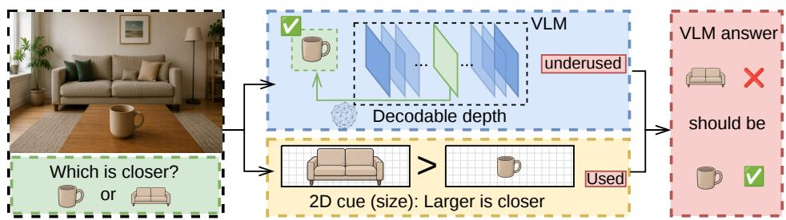  
Figure 1: Schematic illustration. A conflict item. The sofa looks larger, so the size cue favors the sofa. Yet the same forward pass contains the correct depth relation in its visual representations, while the final decision follows the conflicting cue.

Our contributions are:

• We show across eleven VLMs from five families that depth judgments systematically follow image-plane size and vertical-position cues when those cues conflict with true depth.

• We identify a linearly decodable depth signal in visual object contrasts and show that it remains informative even when the model produces a cue-supported error.

• We show that object-level write-back, oriented by the model’s own depth readout, can correct conflict decisions without updating VLM parameters. Matched controls test the specificity of this effect to the direction, target tokens, and write-back configuration.

## 2 RELATED WORK

Shortcuts in spatial reasoning. Min et al. (2026) show that VLM depth judgments are sensitive to perspective cues, particularly vertical position. We examine the internal basis of this behavior by controlling apparent size and vertical position and testing whether depth remains represented when answers follow conflicting cues.

Spatial representations and their influence. Liao et al. (2026) distinguish grounded, prior-driven, and inverted depth representations through probing and visual ablations. Our focus is the competition between image-dependent depth information and misleading image-plane cues. Kang et al. (2026) identify linear spatial directions and show that steering them can alter spatial judgments, including depth. We instead read depth from queried-object contrasts and use self-oriented write-back to test its influence under controlled cue conflicts. Following causal representation analyses (Belrose et al., 2023; Li et al., 2023a; Rimsky et al., 2024), our controls distinguish decodability from intervention effects on the final answer.

Improving spatial reasoning. SpatialVLM (Chen et al., 2024) and SpatialRGPT (Cheng et al., 2024) improve spatial competence through additional supervision, while contrastive decoding meth ods modify generation without updating model weights (Li et al., 2023b; Leng et al., 2024). We use a frozen model to test how available depth information influences decisions when it conflicts with apparent size or vertical position.

## 3 CONTROLLED DIAGNOSIS OF DEPTH–CUE COMPETITION

## 3.1 EXPERIMENTAL SETUP

We study pairwise depth judgments in which a model decides which of two objects is closer to the camera. Real-world images contain many depth-relevant cues, such as texture and shadow; we focus on apparent size and vertical position. Our rendered setting controls their agreement with true depth, while our natural-image setting selects corresponding conflicts using sensor-derived depth order. We vary the relation of these cues to depth to create three conditions. In the consistent condition, both cues agree with true depth. In the conflict condition, the designated cue favors the opposite depth ordering. In the decorrelated condition, we balance cue directions across depth labels, so that the closer object is equally likely to appear larger or smaller, and higher or lower, than the farther object.

VLMs’ behaviors are quantified with depth accuracy, which is the fraction of examples where the model answers the truly closer object, with 50% corresponding to random guessing.

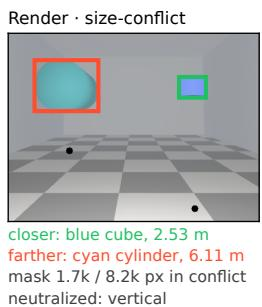

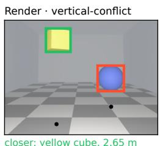  
closer: yellow cube, 2.65 m farther: blue sphere, 3.80 m row 171 / 282 px in conflict neutralized: size

Real · size-conflict  
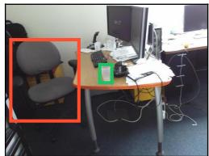  
closer: plasticcup, 1.29 m farther: chair, 1.85 m mask 1.8k / 28.8k px in conflict neutralized: vertical

Real · vertical-conflict  
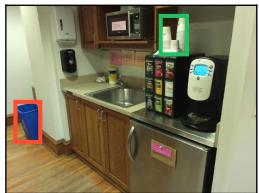  
closer: cup, 1.39 m farther: trashcan, 2.84 m row 92 / 325 px in conflic neutralized: size

Figure 2: Examples in which a 2D cue conflicts with true depth. The black dot marks each object’s position projected straight down onto the floor. Bounding boxes highlight the queried objects.

We first create rendered scenes where depth, object size, and vertical position can be set independently. We manipulate the physical size and image-plane position of the two objects while preserving their depth ordering, allowing each cue to agree with or oppose depth. Since object shape and perspective projection can make scene parameters differ from their final appearance, we measure projected size and vertical position directly from the rendered pixels and adjust each scene until the intended relation is satisfied.

We also construct a real-world-image setting using photographs and sensor depth from SUN RGB-D (Song et al., 2015). Sensor depth is used as a pseudo-label to determine which object is truly closer, while projected size and vertical position are measured directly from the image. For each object pair, we compare the ordering implied by each 2D cue with the sensor-depth ordering. A pair is consistent when the cue favors the truly closer object and conflict when it favors the farther one. This yields an analogous depth–cue comparison in natural photographs, although other scene properties are not independently controlled.

## 3.2 VLMS FOLLOW 2D CUES WHEN THEY CONFLICT WITH DEPTH

A consistent pattern emerges across all five model families. Depth accuracy drops sharply when either 2D cue conflicts with true depth (Figure 3). On rendered scenes, Qwen3-VL-8B falls to 42.8% under vertical conflict, and LLaVA-OneVision-1.5-8B to 7.4%, both below chance. Spatial fine-tuning does not remove the effect. SpaceThinker, a Qwen2.5-VL-3B checkpoint trained on synthetic spatial reasoning traces (Remyx AI, 2026), reaches only 51.8% and 32.4% under the two conflict conditions.

Vertical position is generally the stronger cue. Its conflict produces a larger accuracy drop than size conflict in eight of eleven models, spanning all five families. The same pattern appears in natural photographs, though with smaller gaps because naturally occurring conflicts are less extreme than those in the rendered setting. Together, these results show that when 2D cues disagree with true depth, model predictions are systematically pulled toward the cue-supported answer.

Cue influence changes gradually with cue strength in rendered scenes (Figure 4). We hold the objects true depths fixed and vary their apparent size or vertical position. For example, suppose object A is farther away than object B. As A is made to appear larger, the model becomes more likely to choose A as closer, although the correct answer remains B. Lowering A in the image produces a similar shift. These rendered-scene curves show that stronger misleading cues progressively pull decisions away from the correct depth order. Since size and vertical position are measured in different units, we use the curves to establish graded cue dependence rather than compare their raw slopes.

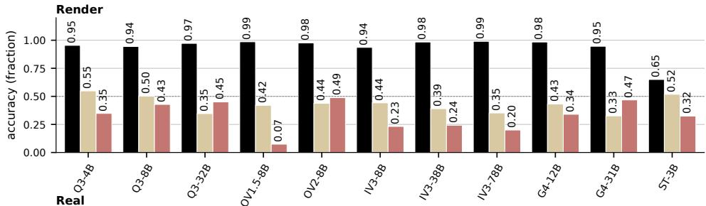

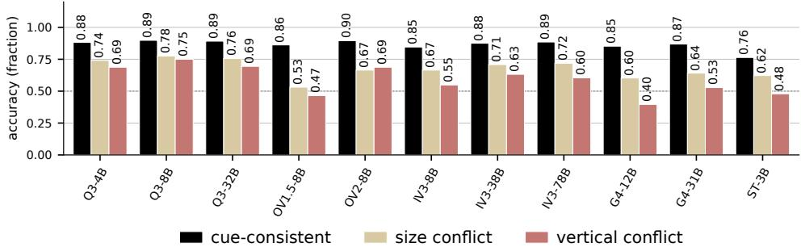  
Figure 3: Depth accuracy drops across model families when image-plane cues conflict with true depth.

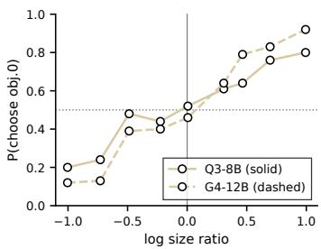  
(a) Size cue.

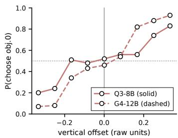  
(b) Vertical cue.

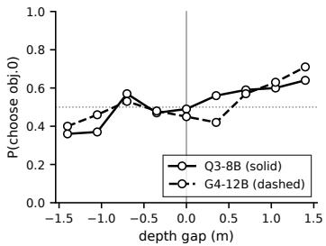  
(c) True depth.  
Figure 4: Impact of increasing the object’s size, adjusting its vertical position, or changing its depth on the model’s probability of selecting it as the closest.

Separately, we examine how often these cues agree with depth in the real-world image pool before selecting conflict cases. Among object pairs whose vertical separation exceeds our specified threshold, the lower object is closer in 76.3% of cases. Among pairs whose apparent-size difference exceeds the corresponding threshold, the larger object is closer in 58.1% of cases. This ordering is consistent with the stronger behavioral influence of vertical position, although it does not establish its cause.

The pattern also appears across model scales and on external spatial evaluations (Appendices C and D). We next ask whether the correct depth relation remains represented despite these cue-driven errors.

## 4 REPRESENTATION OF DEPTH ORDER

## 4.1 LINEAR READOUT OF THE DEPTH TRACE

We read depth order from the representations of the two queried objects. Visual tokens within each segmentation mask are mean-pooled into object representations $c _ { A }$ and $c _ { B } .$ , and we define their contrast as

$$
d = c _ { A } - c _ { B } .\tag{1}
$$

At each layer, we fit a linear probe (Alain & Bengio, 2016) to object contrasts $d _ { i }$ and their depth-order labels $y _ { i } \in \{ 0 , 1 \}$ , where $y _ { i } = 1$ means that object A is closer than object B. We standardize each contrast as $\tilde { d } _ { i } = ( d _ { i } - \mu ) / s$ , where $\mu$ and s are the per-dimension means and scales computed on the calibration training fold; division is elementwise.

The probe uses logistic regression to predict depth order:

$$
p ( y _ { i } = 1 \mid d _ { i } ; w , b ) = \sigma ( w ^ { \top } \tilde { d } _ { i } + b ) ,\tag{2}
$$

where w is the weight vector, b is the intercept, and σ is the sigmoid function. We fit these parameters by maximizing the regularized log-likelihood:

$$
( w ^ { * } , b ^ { * } ) = \arg \operatorname* { m a x } _ { w , b } \left[ \frac { 1 } { N } \sum _ { i = 1 } ^ { N } \log p ( y _ { i } \mid d _ { i } ; w , b ) - \frac { \lambda } { 2 } \| w \| _ { 2 } ^ { 2 } \right] .\tag{3}
$$

The likelihood term rewards correct depth-order predictions, while the regularization term limits the magnitude of the weights. The fitted weight $w ^ { * }$ is normal to the classifier’s decision boundary in standardized feature space.

We map this direction back to the original hidden-state coordinates and unit-normalize it:

$$
v = \frac { w ^ { * } / s } { \lVert w ^ { * } / s \rVert _ { 2 } } .\tag{4}
$$

For a new object pair, we measure its contrast along v:

$$
z = v ^ { \top } d , \qquad d = c _ { A } - c _ { B } .\tag{5}
$$

A positive z favors object A as closer, while a negative z favors object B. We call z the depth trace and v the trace direction. The fitted classifier uses the standardized features and intercept in

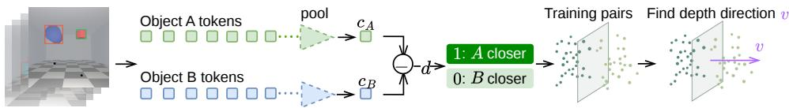  
Figure 5: Reading depth from object representations. Object tokens are pooled and contrasted to fit the depth direction v. Point clouds and separating planes are schematic.

Eq. 2. For the intervention, which strengthens the depth signal by updating the two objects’ visual representations, we instead use the offset-free readout z in Eq. 5, retaining the direction without the classifier’s centering and intercept offsets. Classifier accuracy and intervention sign-readout accuracy are therefore evaluated separately.

Probes are fitted on the decorrelated condition, where apparent size and vertical position do not individually predict depth order. Full fitting details, including the regularization strength and standardization procedure, are provided in Appendix E.

The object-level readout is highly accurate. On Qwen3-VL-8B, probe accuracy remains above 97.3% at every language layer above the embeddings on rendered scenes and ranges from 82.9% to 91.7% on real-world photographs. We test whether this readout reflects visual depth information rather than the two target cues or object-category priors, such as expecting a cup to be closer than a sofa regardless of the image. On the decorrelated calibration split, neither apparent size nor vertical position alone predicts depth order. With the depth direction, question, and object-token positions held fixed, replacing the image sharply reduces depth-readout accuracy (Table 4). On real-image vertical conflicts, Qwen3-VL-8B falls from 82.6% with the original image to 40.3% with a grey image. Mismatched-image controls show a similar reduction. The readout also generalizes to unseen category combinations. On the real-world image held-out fold, Qwen3-VL-8B achieves 84.4% depth sign accuracy on pairs whose category combination is absent from the probe’s training fold, compared with 84.5% overall. These results show that the readout depends on the current image, even when apparent size or vertical position favors the wrong answer.

Where depth becomes linearly accessible differs across architectures. On Qwen3-VL-8B, the preprojection probe reaches 74.0%, and accuracy is already 99.7% at the language-model input embeddings and remains near ceiling thereafter. On Gemma-4-12B, the corresponding readouts are 62.5% and 66.0%, with near-ceiling accuracy emerging after the first decoder block. These probes locate where depth becomes linearly accessible, rather than where depth information first exists.

## 4.2 DEPTH INFORMATION AT DECISION STATES

We next ask whether depth information is accessible where the model prepares its answer. We call the hidden state at the last input-token position the answer state, since the model uses this position to predict the next token. We probe this state at each layer and compare it with the two objects’ visual representations (Figure 6).

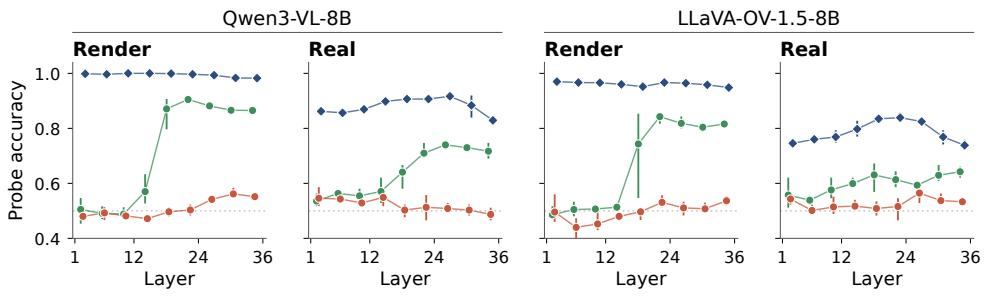  
Answer letter, last token Closer object, last token Object contrast  
Figure 6: Depth readouts from answer states and object representations. Points average four consecutive layers; bars indicate within-bin minima and maxima, not confidence intervals.

We train two separate probes on the same answer states. The closer-object probe predicts which of the two queried objects is truly closer. The answer-letter probe predicts the letter assigned to that object in the answer options, regardless of whether the model itself answers correctly. For example, if the mug is closer than the sofa, the closer-object target remains the mug when the options are swapped from “A: mug, B: sofa” to “A: sofa, B: mug”, whereas the answer-letter target changes from “A” to “B”. This comparison tests whether the correct depth order is more accessible as an object relation or as an answer choice.

On Render, probes struggle to identify the closer object from the answer state, with accuracy generally near chance. Yet probes can predict the correct answer letter from the same states: accuracy rises sharply around middle layers and peaks at 91.3% in Qwen and 85.3% in OneVision. The same distinction appears on Real, although answer-letter accuracy is lower, peaking at 75.3% and 67.2%, respectively. Thus, the answer state can support accurate decoding of the correct option even when the closer object’s identity is difficult to decode directly.

Depth order is more consistently accessible from object-representation differences in both models. Decoding remains high throughout the stack on Render, while on Real it peaks in the middle layers and declines toward the final layers.

Decodability does not guarantee a correct answer. In a separate evaluation on rendered verticalconflict examples, Qwen’s object-level depth readout is correct on 99.0% of examples, while the model answers correctly on only 42.8%. This gap motivates testing whether strengthening depth information in object representations can change the final decision.

## 5 TESTING THE INFLUENCE OF DEPTH INFORMATION

The previous section shows that the correct depth relation can remain strongly represented even when the final answer follows a conflicting 2D cue. Probing alone, however, does not show whether this representation influences the decision. We therefore intervene directly on the fitted depth direction while keeping the input and model weights fixed.

## 5.1 WRITE-BACK INTERVENTION TO STRENGTHEN THE DEPTH TRACE

We use the depth direction identified in Section 4. On rendered scenes, the direction is fitted on the decorrelated calibration split, where apparent size and vertical position do not predict depth order. For real-world photographs, we refit the direction on the corresponding development subset split using DepthAnything 3 (Lin et al., 2025) to provide pseudo-depth orders. The evaluation example’s depth label is never used to orient the intervention.

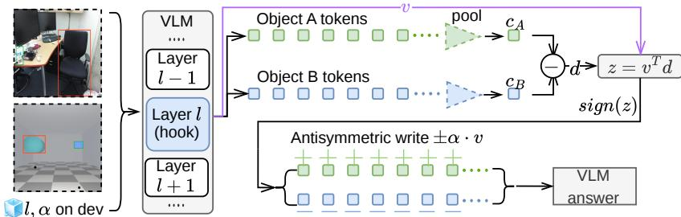  
Figure 7: Intervention to strengthen the depth trace. The sign of the pre-intervention depth trace z determines opposite updates to the two queried objects along v. The intervention uses no ground-truth depth label.

We select the intervention layer ℓ and strength α on development data. For each candidate setting, we measure the fractions of the size and vertical conflict gaps recovered, $R _ { \mathrm { s i z e } } ( \ell , \alpha )$ and $R _ { \mathrm { v e r t i c a l } } ( \ell , \alpha )$ We score the setting by the weaker recovery:

$$
R _ { \mathrm { b a l a n c e d } } ( \ell , \alpha ) = \operatorname* { m i n } \left\{ R _ { \mathrm { s i z e } } ( \ell , \alpha ) , R _ { \mathrm { v e r t i c a l } } ( \ell , \alpha ) \right\} .\tag{6}
$$

Among settings satisfying the development-set constraint on cue-consistent accuracy, we select the one with the largest balanced recovery. This favors settings that improve both conflict conditions. We then freeze ℓ and α before evaluation. The search ranges and accuracy constraint are specified in Appendix E.

At layer ℓ, we mean-pool the visual tokens of the two queried objects into $c _ { A }$ and $c _ { B } ,$ form their contrast $d = c _ { A } - c _ { B }$ , and compute $z = v ^ { \top } d$ . As illustrated in Figure 7, we strengthen this readout through opposite updates to the two objects. Expressed in units of the layer’s mean token norm, the updates are

$$
\begin{array} { r l } { { \mathrm { O b j e c t ~ } } A { \mathrm { ~ t o k e n s : ~ } } } & { { } + \alpha \operatorname { s i g n } ( z ) v , } \\ { { \mathrm { O b j e c t ~ } } B { \mathrm { ~ t o k e n s : ~ } } } & { { } - \alpha \operatorname { s i g n } ( z ) v . } \end{array}\tag{7}
$$

Each update is multiplied by the mean token norm at that layer before being added to the corresponding token states. When $z > 0$ , the edit moves object A along v and object B against it; when $z < 0 ,$ , both updates reverse. The intervention therefore strengthens the ordering read from the current image rather than supplying a ground-truth ordering. Only the queried object tokens are directly modified at the selected layer. Subsequent layers process the edited states normally, while the input and VLM parameters remain fixed.

## 5.2 STRENGTHENING THE DEPTH TRACE CHANGES THE DECISION

Strengthening the depth trace moves conflict decisions toward the depth order already represented by the model. On rendered scenes, for Qwen3-VL-8B, accuracy rises from 50.2% to 90.8% under size conflict and from 42.8% to 71.4% under vertical conflict, while cue-consistent accuracy remains high (94.4% to 99.6%). The update shifts the model’s answer toward the object identified as closer by its pre-intervention depth readout.

Table 1: Effect of depth-trace intervention across models. Accuracy (%) before and after intervention on rendered and natural images. Each setup is selected on held-out development data and frozen before evaluation. (‘van.’ is vanilla and ‘int.’ is the intervened model)
<table><tr><td></td><td colspan="6">Rendered</td><td colspan="6">Real</td></tr><tr><td></td><td colspan="2">conflict-size van. int.</td><td colspan="2">conflict-vert. van. int.</td><td colspan="2">consistent van. int.</td><td colspan="2">conflict-size van. int.</td><td colspan="2">conflict-vert. van. int.</td><td colspan="2">consistent van. int.</td></tr><tr><td>Qwen3-VL-8B</td><td>50.2</td><td>90.8</td><td>42.8</td><td>71.4</td><td>94.4</td><td>99.6</td><td>77.5</td><td>78.9</td><td>75.0</td><td>80.6</td><td>89.2</td><td>87.9</td></tr><tr><td>Qwen3-VL-4B</td><td>54.8</td><td>88.8</td><td>34.8</td><td>75.4</td><td>95.4</td><td>99.8</td><td>74.2</td><td>77.5</td><td>68.8</td><td>75.0</td><td>88.2</td><td>84.9</td></tr><tr><td>Qwen3-VL-32B</td><td>34.6</td><td>85.0</td><td>45.0</td><td>84.4</td><td>97.2</td><td>100.0</td><td>75.6</td><td>76.1</td><td>69.4</td><td>77.8</td><td>89.2</td><td>86.2</td></tr><tr><td>LLaVA-OV-1.5-8B</td><td>42.0</td><td>83.6</td><td>7.4</td><td>47.0</td><td>98.6</td><td>96.8</td><td>53.1</td><td>65.1</td><td>46.5</td><td>61.8</td><td>86.2</td><td>85.2</td></tr><tr><td>LLaVA-OV-2-8B</td><td>43.8</td><td>77.6</td><td>48.8</td><td>77.4</td><td>97.6</td><td>99.8</td><td>66.5</td><td>72.7</td><td>68.8</td><td>73.6</td><td>89.5</td><td>84.9</td></tr><tr><td>InternVL3-8B</td><td>44.2</td><td>73.2</td><td>23.2</td><td>48.6</td><td>93.6</td><td>98.0</td><td>66.5</td><td>68.4</td><td>54.9</td><td>53.5</td><td>84.6</td><td>84.6</td></tr><tr><td>InternVL3-38B</td><td>39.0</td><td>44.8</td><td>24.2</td><td>32.2</td><td>98.4</td><td>97.8</td><td>70.8</td><td>70.8</td><td>63.2</td><td>63.2</td><td>87.5</td><td>87.5</td></tr><tr><td>Gemma-4-12B</td><td>43.2</td><td>51.8</td><td>34.0</td><td>37.6</td><td>98.4</td><td>96.8</td><td>60.3</td><td>52.6</td><td>39.6</td><td>38.2</td><td>85.2</td><td>78.4</td></tr><tr><td>Gemma-4-31B</td><td>32.6</td><td>53.4</td><td>46.8</td><td>57.0</td><td>94.6</td><td>98.6</td><td>64.1</td><td>57.4</td><td>52.8</td><td>47.2</td><td>86.9</td><td>78.0</td></tr></table>

The effect extends beyond Qwen3-VL-8B but varies substantially across architectures (Table 1). Qwen3-VL and LLaVA-OneVision show large shifts under conflict, as does InternVL3-8B, whereas the effect is weaker for InternVL3-38B and Gemma-4. A linearly readable depth trace therefore does not imply an equally strong causal handle in every model.

On real photographs, write-back increases observed accuracy in both conflict conditions for Qwen3- VL and LLaVA-OneVision, with larger gains in some models than others. The effect is mixed or negative for InternVL3 and Gemma-4, and cue-consistent accuracy often decreases. These results indicate that the benefit depends on the model and evaluation setting. The 95% confidence intervals for accuracy changes are reported in Tables 5 and 6. Figure 8 illustrates conflict cases in which write-back changes a cue-supported error into the correct depth judgment.

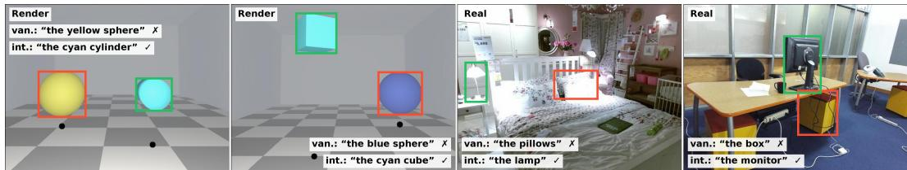  
Figure 8: Example corrections on rendered scenes and natural photographs.

The source of consistent-split degradation varies across models (Figure 9). For Qwen3-VL-8B and LLaVA-OneVision-1.5-8B, most newly introduced errors occur when the pre-intervention depth readout identifies the farther object as closer, orienting the write-back in the wrong direction. In Gemma-4-12B, however, most new errors occur even when the readout identifies the closer object correctly. Thus, an incorrect update sign alone cannot explain the degradation across architectures. InternVL3-8B changes few answers and shows no net accuracy decline.

## 5.3 ABLATIONS

We test the intervention on Qwen3-VL-8B in both domains using 1) cue-avoidant prompting (instructing the model not to use cues), 2) predicted depth input (providing external depth map to the model), 3) random directions of the v vector, and alternative write locations (answer token vs. object contrast) (Table 2). Neither explicitly discouraging the two cues nor supplying a predicted depth map reproduces the gains from object-level write-back.

The effect is also specific to the internal representation being manipulated. Replacing the depth direction with random directions leaves conflict performance near the unmodified model. Writing the same depth direction at the answer token rather than antisymmetrically at the two queried objects likewise produces little selective improvement. Reversing the orientation of the depth write-back produces the opposite behavioral shift.

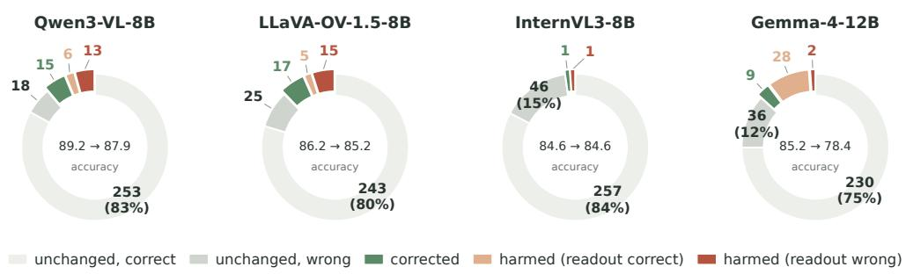  
Figure 9: How answers change after the write-back intervention on consistent real-world images. Changes from correct to incorrect are categorized by whether the pre-intervention readout identified the closer object correctly. Numbers show the counts of corresponding images.

Table 2: Ablation study on Qwen3-VL-8B. Values are answer accuracy (%). The write-back intervention gives the largest improvement for size and vertical conflicts.
<table><tr><td></td><td colspan="3">Rendered</td><td colspan="3">Real</td></tr><tr><td></td><td>size</td><td>vertical</td><td>consistent</td><td>size</td><td>vertical</td><td>consistent</td></tr><tr><td>Vanilla</td><td>50.2</td><td>42.8</td><td>94.4</td><td>77.5</td><td>75.0</td><td>89.2</td></tr><tr><td>Cue-avoidant CoT</td><td>45.6</td><td>36.0</td><td>91.0</td><td>74.2</td><td>68.8</td><td>87.9</td></tr><tr><td>Depth input</td><td>48.6</td><td>51.8</td><td>88.8</td><td>76.1</td><td>72.2</td><td>87.9</td></tr><tr><td>Random direction</td><td>51.6</td><td>41.5</td><td>94.6</td><td>75.5</td><td>73.7</td><td>87.7</td></tr><tr><td>Answer-token write</td><td>51.0</td><td>47.6</td><td>89.8</td><td>77.0</td><td>77.8</td><td>90.2</td></tr><tr><td>Write-back intervention</td><td>90.8</td><td>71.4</td><td>99.6</td><td>78.9</td><td>80.6</td><td>87.9</td></tr></table>

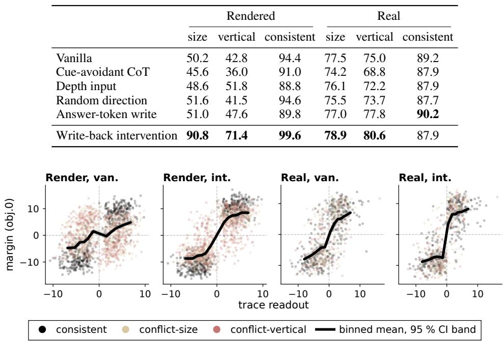  
Figure 10: Depth readout versus answer-logit margin before and after write-back. The margin is the logit for the option naming object 0 minus that for naming object 1; positive values favor object 0. Black curves show binned means with 95% confidence bands.

Figure 10 shows how write-back changes the relationship between the internal depth readout and the final answer. On Render, the vanilla answer margin varies only weakly with the trace readout, whereas write-back produces a clearer separation between negative and positive readouts. On Real, the vanilla predictions already track the readout, and write-back sharpens this transition around z = 0. Together, these results show that object-level write-back shifts the model’s answer toward the depth ordering decoded before intervention.

## 6 LIMITATIONS

Our analysis focuses on pairwise depth judgments and two common image-plane cues, apparent size and vertical position. Real-world images contain additional depth-relevant signals that cannot be isolated as cleanly as in controlled rendering, which may contribute to the smaller effects observed there. The causal effect also varies across model families and domains. Extending the analysis to additional depth cues and more general spatial reasoning is an important direction for future work.

## REFERENCES

Guillaume Alain and Yoshua Bengio. Understanding intermediate layers using linear classifier probes. arXiv preprint arXiv:1610.01644, 2016.

Nora Belrose, David Schneider-Joseph, Shauli Ravfogel, Ryan Cotterell, Edward Raff, and Stella Biderman. Leace: Perfect linear concept erasure in closed form. Advances in Neural Information Processing Systems, 36:66044–66063, 2023.

Boyuan Chen, Zhuo Xu, Sean Kirmani, Brain Ichter, Dorsa Sadigh, Leonidas Guibas, and Fei Xia. Spatialvlm: Endowing vision-language models with spatial reasoning capabilities. In Proceedings ofthe IEEE/CVF conference on computer vision and pattern recognition, pp. 14455–14465, 2024.

An-Chieh Cheng, Hongxu Yin, Yang Fu, Qiushan Guo, Ruihan Yang, Jan Kautz, Xiaolong Wang, and Sifei Liu. Spatialrgpt: Grounded spatial reasoning in vision-language models. Advances in Neural Information Processing Systems, 37:135062–135093, 2024.

Yung-Sung Chuang, Yujia Xie, Hongyin Luo, Yoon Kim, James R Glass, and Pengcheng He. Dola: Decoding by contrasting layers improves factuality in large language models. In International Conference on Learning Representations, volume 2024, pp. 54158–54183, 2024.

Xingyu Fu, Yushi Hu, Bangzheng Li, Yu Feng, Haoyu Wang, Xudong Lin, Dan Roth, Noah A Smith, Wei-Chiu Ma, and Ranjay Krishna. Blink: Multimodal large language models can see but not perceive. In European Conference on Computer Vision, pp. 148–166. Springer, 2024.

Raphaela Kang, Hongqiao Chen, Georgia Gkioxari, and Pietro Perona. Linear mechanisms for spatiotemporal reasoning in vision language models. In International Conference on Learning Representations, volume 2026, pp. 41245–41258, 2026.

Sicong Leng, Hang Zhang, Guanzheng Chen, Xin Li, Shijian Lu, Chunyan Miao, and Lidong Bing. Mitigating object hallucinations in large vision-language models through visual contrastive decoding. In 2024 IEEE/CVF Conference on Computer Vision and Pattern Recognition (CVPR), pp. 13872–13882. IEEE, 2024.

Kenneth Li, Oam Patel, Fernanda Viegas, Hanspeter Pfister, and Martin Wattenberg. Inference-time´ intervention: Eliciting truthful answers from a language model. Advances in neural information processing systems, 36:41451–41530, 2023a.

Xiang Lisa Li, Ari Holtzman, Daniel Fried, Percy Liang, Jason Eisner, Tatsunori B Hashimoto, Luke Zettlemoyer, and Mike Lewis. Contrastive decoding: Open-ended text generation as optimization. In Proceedings ofthe 61st annual meeting ofthe associationfor computational linguistics (volume 1: Long papers), pp. 12286–12312, 2023b.

Chih-Ting Liao, Fei Shen, Xin Cao, and Tat-Seng Chua. Decodable is not grounded: A vision-ablation arbiter for vlm spatial reasoning. arXiv preprint arXiv:2606.31257, 2026.

Haotong Lin, Sili Chen, Junhao Liew, Donny Y Chen, Zhenyu Li, Guang Shi, Jiashi Feng, and Bingyi Kang. Depth anything 3: Recovering the visual space from any views. arXiv preprint arXiv:2511.10647, 2025.

Cheolhong Min, Jaeyun Jung, Daeun Lee, Hyeonseong Jeon, Yu Su, Jonathan Tremblay, Chan Hee Song, and Jaesik Park. Why far looks up: Probing spatial representation in vision-language models. arXiv preprint arXiv:2605.30161, 2026.

Remyx AI. Spacethinker-qwen2.5vl-3b. Hugging Face model repository, 2026. URL https: //huggingface.co/remyxai/SpaceThinker-Qwen2.5VL-3B. Accessed: 2026-09- 01.

Nina Rimsky, Nick Gabrieli, Julian Schulz, Meg Tong, Evan Hubinger, and Alexander Turner. Steering llama 2 via contrastive activation addition. In Proceedings of the 62nd Annual Meeting of the Associationfor Computational Linguistics (Volume 1: Long Papers), pp. 15504–15522, 2024.

Shuran Song, Samuel P Lichtenberg, and Jianxiong Xiao. Sun rgb-d: A rgb-d scene understanding benchmark suite. In Proceedings of the IEEE conference on computer vision and pattern recognition, pp. 567–576, 2015.

Gemma Team, Sherif El Abd, Vaibhav Aggarwal, Robin Algayres, Alek Andreev, Olivier Bachem, Ian Ballantyne, Cormac Brick, Victor Carbune, Michelle Casbon, et al. Gemma 4 technical report.˘ arXiv preprint arXiv:2607.02770, 2026.

Shengbang Tong, Ellis Brown, Penghao Wu, Sanghyun Woo, Manoj Middepogu, Sai C Akula, Jihan Yang, Shusheng Yang, Adithya Iyer, Xichen Pan, et al. Cambrian-1: A fully open, visioncentric exploration of multimodal llms. Advances in Neural Information Processing Systems, 37: 87310–87356, 2024.

Jinguo Zhu, Weiyun Wang, Zhe Chen, Zhaoyang Liu, Shenglong Ye, Lixin Gu, Hao Tian, Yuchen Duan, Weijie Su, Jie Shao, et al. Internvl3: Exploring advanced training and test-time recipes for open-source multimodal models. arXiv preprint arXiv:2504.10479, 2025.

## A STATEMENT ON THE USE OF AI ASSISTANCE

The experimental program and manuscript preparation used a coding agent under the authors’ direction. The agent wrote and ran scripts and organized result artifacts. Experimental design and decisions were the authors’. The authors take responsibility for the manuscript and results.

## B REPRODUCIBILITY STATEMENT

Data construction and answer scoring are described in Appendix D; probe fitting, object-level writeback, and controls are detailed in Appendix E. Dataset examples appear in Appendix D.4. The working repository contains the experimental code, result artifacts, checkpoint revisions, and imagelevel manifests recording object pairs, option assignments, depth labels, and measured cue values. The main-paper intervention results use object-only write-back, with directions and intervention settings fixed before evaluation.

## C EXTERNAL BENCHMARKS

## C.1 EXTERNAL DIAGNOSIS

SpatialRGPT-Bench (Cheng et al., 2024) and SpatialTunnel reproduce the cue-conflict pattern on data we did not construct. On the 92 SpatialRGPT depth items, Qwen3-VL-8B scores 88.9% on cue-consistent items and 69.2% on conflicts. The conflict subset has only 13 items and mixed sources, so it is supporting evidence rather than a standalone estimate. Five items are near-duplicates of our evaluation images, including one calibration image.

## C.2 INTERVENTION RESULTS

Table 3 applies the intervention after fitting the direction on calibration images from the target benchmark. It helps the small SpatialRGPT conflict subset and is nearly neutral on pooled SpatialTunnel for Qwen3-VL-8B. It does not improve the other external settings. In particular, accuracy falls on CV-Bench (Tong et al., 2024) and on the Qwen3-VL-32B SpatialTunnel pool. These negative results limit transfer beyond the diagnostic distributions.

Table 3: External answer accuracy (%). Pooled SpatialTunnel combines 976 phase and 1076 size items that support object masks. SpatialRGPT conflict is directional and contains 13 items.
<table><tr><td>Benchmark</td><td>Model</td><td>Vanilla</td><td>Intervention</td></tr><tr><td>SpatialRGPT depth</td><td>Qwen3-VL-8B</td><td>85.9</td><td>85.9</td></tr><tr><td>SpatialRGPT conflict</td><td>Qwen3-VL-8B</td><td>69.2</td><td>84.6</td></tr><tr><td>SpatialTunnel pooled</td><td>Qwen3-VL-8B</td><td>89.4</td><td>89.8</td></tr><tr><td>SpatialTunnel pooled</td><td>Qwen3-VL-32B</td><td>94.8</td><td>94.4</td></tr><tr><td>CV-Bench depth</td><td>Qwen3-VL-8B</td><td>95.7</td><td>93.5</td></tr><tr><td>CV-Bench depth</td><td>Qwen3-VL-32B</td><td>95.5</td><td>93.6</td></tr></table>

Figure 11 shows vanilla accuracy across model scales. The SpatialRGPT conflict spoke has 13 items; the CV-Bench cue split was constructed from measured image cues and the benchmark depth ordering.  
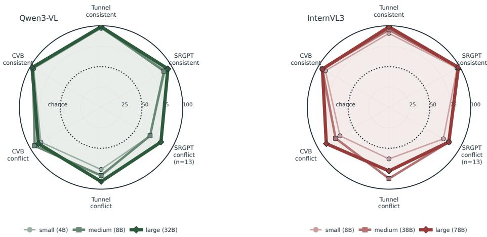  
Figure 11: Vanilla accuracy on three external benchmarks. The upper spokes are cue-consistent and the lower spokes are cue-conflict conditions.

## D DATA AND EVALUATION

## D.1 RENDERED SCENES

Each scene contains two primitives in a room with a checkerboard floor. Depth, angular size, and image position are sampled independently, while physical size and world position are derived from them. The camera light, depth fog, floor, and walls retain valid depth cues. Objects appear on opposite sides of the image and do not occlude each other.

The dataset has 500 scenes in each of four splits. In the consistent split, the closer object is larger and lower. In size conflict, it is smaller and vertical position is neutralized. In vertical conflict, it is higher and size is neutralized. In the decorrelated split, both cues are independent of depth. A scene is rerendered up to four times until the neutralized objects differ by at most 3% in mask area or one pixel in centroid row, as appropriate.

Images are 448 × 448. Depth ranges from 2.5 to 7.0 m with at least 1.0 m separation. Angular size ranges from 0.055 to 0.115 with at least 0.02 separation, and vertical position from −0.18 to 0.18 with at least 0.08 separation. Masks below 60 pixels are rejected. The base seed is 0 and split i uses seed 1000i.

## D.2 REAL PHOTOGRAPHS

We rasterize SUN RGB-D polygons (Song et al., 2015) and define object depth as the median sensor depth inside each mask. A pair must differ by at least 0.4 m and a depth factor of 1.20. Box IoU is at most 5%; each mask covers at least 1500 pixels and at most one quarter of the image; neither box is within five pixels of the border. Each category appears only once in the image, and each image contributes at most three pairs. The neutralized cue is sign-balanced within each conflict split.

## D.3 EVALUATION

We score each example by comparing the next-token logits for “A” and “B” at the final input position. Option order is randomized per item and recorded in the manifest. Each input contains one user message with the image and question, formatted using the model’s chat template with a generation prompt and no system prompt.

For rendered scenes, the question is: “Two objects are visible in the image. Which object is closer to the camera? A: the {a}. B: the {b}. Answer with only the letter A or B.” For SUN RGB-D, it is: “Which object is closer to the camera, the {a} or the {b}? A: the {a}. B: the {b}. Answer with only the letter A or B.” The harness tokenizes the bare answer strings without special tokens and verifies that each is a single token.

For SUN RGB-D, object depth is the median refined sensor depth within the instance polygon; apparent size is mask area and vertical position is centroid row. Cue-consistent pairs require the closer object to have at least 1.25 times the area and appear lower by at least 7% of image height. Size-conflict pairs require its area ratio to be at most 1/1.25, with vertical separation at most 6% of image height. Vertical-conflict pairs require it to appear higher by at least 7%, with an area ratio in [1/1.35, 1.35]. The decorrelated split balances the four combinations of size and vertical cue directions.

The final splits contain 305 consistent pairs, 209 size-conflict pairs, 144 vertical-conflict pairs , and 289 decorrelated pairs. The accompanying image-level manifest records all 947 pairs, including scene identifiers, image and mask paths, object identities, depth order, option assignment, and measured cue values.

Patch shuffling permutes visual-token positions while retaining local appearance information, including fog and shading. The grey-image control retains the original object masks and therefore preserves the positions used for token selection. Neither control removes every possible source of spatial information.

Figure 12 reports cue–depth agreement and its variation with depth ratio.

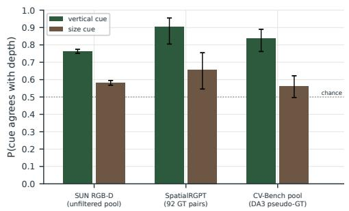  
(a) Agreement across datasets.

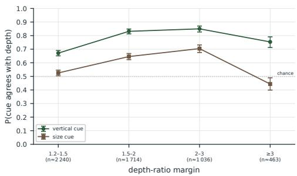  
(b) SUN RGB-D by depth ratio.  
Figure 12: Agreement of image-plane cues with depth. Error bars are Wilson 95% intervals; intervals in (b) use approximate reweighted sample sizes.

## D.4 DATASET EXAMPLES

Each panel shows the first 16 recorded items in manifest order. Tile text gives the item ID, answer assignment, depth order, mask area, and centroid row. Rendered labels use scene depth; real labels use median sensor depth inside each object mask.

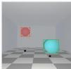

0000 ans A d A 4.4 B 6.6 px 7072 2544 cy 285 193

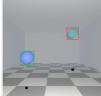

0004 ans A d A 2.8 B 6.0 px 3122 1958 cy 269 159

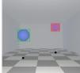

0008 ans A d A 4.5 B 6.6 px 3815 1884 cy 218 173

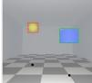

0012 ans A d A 2.9 B 4.5 px 6523 1884 cy 204 160

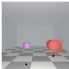

0000 ans B d A 4.0 B 2.7 px 6180 1678 cy 291 291

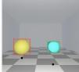

0004 ans A d A 3.1 B 4.1 px 3557 6665 cy 292 292

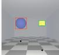

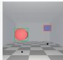

0001 ans B d A 6.8 B 3.6 px 2082 7357 cy 195 243

0008 ans A d A 3.0 B 5.6 px 2028 5717 cy 190 191

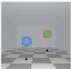

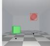

0002 ans B d A 6.9 B 3.7 px 1820 3029 cy 206 255

0005 ans B d A 5.7 B 3.6 px 2937 5049 cy 166 288

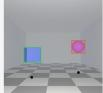

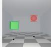

0012 ans B d A 6.9 B 3.4 px 7800 2750 cy 151 151

0009 ans A d A 3.8 B 5.0 px 5479 2431 cy 236 171

0006 ans A d A 4.1 B 5.1 px 5001 2620 cy 255 219

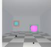

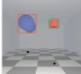

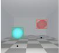

0013 ans A d A 2.9 B 4.9 px 3835 1724 cy 269 224

0010 ans A d A 3.4 B 7.0 px 6453 4217 cy 276 207

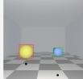

## (a) Consistent

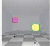

0001 ans B d A 3.9 B 2.5 px 4877 1872 cy 292 292

0014 ans B d A 4.4 B 2.7 px 2018 4372 cy 197 265

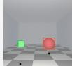

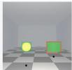

0005 ans B d A 4.1 B 2.5 px 4573 1867 cy 292 292

0002 ans B d A 4.0 B 2.7 px 6066 2987 cy 295 295

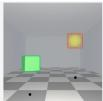

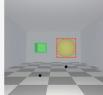

0003 ans A d A 2.7 B 4.9 px 5574 3274 cy 276 172

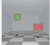

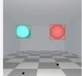

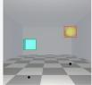

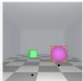

0007 ans Bd A 5.2 B 4.1px 3179 5932cy 168 262

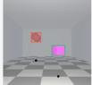

0015 ans B d A 6.7 B 3.0 px 1706 3538 cy 197 264

0011 ans A d A 2.8 B 4.8 px 3454 2355 cy 242 178

0003 ans B d A 4.1 B 2.7 px 6475 2016 cy 293 293

0006 ans B d A 3.6 B 2.6 px 5561 4550 cy 187 187

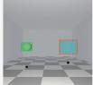

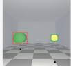

0009 ans B d A 6.8 B 4.2 px 5776 2145 cy 229 228

0007 ans A d A 4.6 B 5.9 px 1919 5769 cy 244 244

0010 ans B d A 5.3 B 2.6 px 5249 1624 cy 260 260

0013 ans A d A 5.5 B 6.6 px 3503 5804 cy 219 218

(c) Size conflict

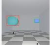

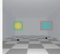

0011 ans B d A 6.1 B 2.5 px 8183 1652 cy 208 208

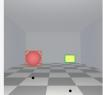

0014 ans A d A 2.6 B.3.9 px 1536 3580 cy 273 273

0015 ans B d A 5.4 B 3.2 px 7087 3964 cy 173 173

0000 ans A d A 5.1 B 6.2 px 5733 3516 cy 226 172

0004 ans A d A 3.0 B 6.7 px 4866 1667 cy 226 155

0008 ans B d A 6.6 B 3.5 px 1851 4534 cy 246 293

0012 ans B d A 6.9 B 5.0 px 3459 6271 cy 159 274

0000 ans B d A 6.9 B 2.7 px 3418 3419 cy 244 186

0004 ans B d A 4.4 B 2.5 px 3404 3501 cy 215 157

0008 ans B d A 6.0 B 4.4 px 6231 6260 cy 262 213

0012 ans B d A 6.6 B 4.7 px 1855 1854 cy 199 167

0001 ans B d A 5.1 B 2.6 px 6474 2578 cy 259 167

0002 ans A d A 4.7 B 6.8 px 4482 1917 cy 166 229

0005 ans A d A 4.3 B 6.9 px 2181 5695 cy 207 239

0006 ans B d A 6.8 B 5.2 px 2367 4360 cy 254 214

0009 ans B d A 6.3 B 4.6 px 6304 2072 cy 243 164

0013 ans A d A 4.3 B 6.7 px 3337 5502 cy 197 234

0003 ans A d A 3.1 B 4.2 px 2258 3939 cy 222 188

0010 ans A d A 2.8 B 5.4 px 4344 2706 cy 195 236

0007 ans B d A 5.7 B 3.9 px 5342 2501 cy 233 280

0014 ans A d A 3.9 B 5.5 px 3318 1727 cy 210 252

0001 ans B d A 6.8 B 2.5 px 5045 5075 cy 232 200

## (b) Decorrelated

0011 ans A d A 3.0 B 6.4 px 1722 5998 cy 280 173

0015 ans A d A 3.9 B 5.2 px 1960 6724 cy 259 183

0005 ans A d A 3.9 B 5.6 px 4493 4500 cy 203 236

0002 ans B d A 6.9 B 3.2 px 2285 2300 cy 203 156

0003 ans A d A 3.6 B 4.6 px 2283 2281 cy 215 278

0006 ans B d A 6.7 B 5.1 px 5751 5777 cy 232 199

0009 ans B d A 6.0 B 2.6 px 5369 5446 cy 230 155

0007 ans B d A 5.5 B 3.5 px 5318 5286 cy 241 192

0010 ans A d A 4.0 B 6.8 px 5712 5683 cy 168 207

  
0013 ans B d A 5.4 B 3.4 px 4070 4086 cy 214 183

0011 ans B d A 5.9 B 3.5 px 7054 7010 cy 258 223

0014 ans Bd A 6.4 B 2.8px 6990 6932cy 251 152

  
(d) Vertical conflict

0015 ans B d A 3.6 B 2.6 px 4268 4241 cy 229 190

Figure 13: Rendered dataset examples. Depth, apparent size, and vertical position are controlled independently.

(d) Vertical conflict  
  
Figure 14: SUN RGB-D examples. Depth labels come from sensor depth inside the object masks; cue conditions use measured mask area and centroid row.

## E REPRESENTATION ANALYSIS AND INTERVENTION

## E.1 PROBE FITTING

We fit logistic regression using mean binary cross-entropy plus $1 0 ^ { - 3 } \| w \| _ { 2 } ^ { 2 }$ , leaving the intercept unpenalized. This corresponds to $\lambda = 2 \times \mathrm { \dot { 1 } 0 ^ { - 3 } }$ under the convention in Eq. 3. Regularization is fixed across models and domains rather than selected by search. Features are standardized using training-fold statistics, with standard deviations floored at $1 0 ^ { - 6 }$ . Optimization uses full-batch L-BFGS for at most 200 iterations from zero initialization. Probe folds use an 80/20 random split; the deployed direction uses seed 0.

An object token is selected when at least one quarter of its grid cell is covered by the segmentation mask. If no cell passes this threshold, we use the cell with the largest overlap. Object representations are unweighted means of the selected tokens.

At each layer, the probe predicts depth order from $d = c _ { A } - c _ { B }$ . Standardization is fitted on the training fold only. The classifier uses the standardized features and intercept in Eq. 2; the intervention uses the unit raw-space direction v and the offset-free sign of $v ^ { \top } d .$ Classifier accuracy, sign accuracy, and answer accuracy are therefore different measurements. Probes are fitted on decorrelated calibration scenes. For real-image interventions, v is refitted on separate development images using Depth Anything 3 pseudo-depth (Lin et al., 2025). Evaluation uses sensor depth.

The category-only baseline predicts the majority depth ordering for each unordered category pair observed in the probe’s training fold. Unseen category pairs receive a score of 0.5. On SUN RGB-D, this baseline covers 22 of 209 size-conflict pairs and 8 of 144 vertical-conflict pairs. We therefore also evaluate the depth readout on unseen category combinations. On the held-out probe fold, these account for approximately 92% of pairs, and Qwen3-VL-8B achieves 84.4% sign accuracy on them versus 84.5% overall, using the fixed intervention layer (ℓ = 8). Grey-image and mismatched-image controls test image dependence. Fixed masks leave position information in the grey-image control, and patch shuffling preserves local fog and shading.

Table 4: Depth sign accuracy (%) under image replacement. The depth direction, question, and object-token positions are fixed. Gemma’s rendered controls use layer 20; the main intervention uses layer 9.
<table><tr><td>Model / domain</td><td>Conflict</td><td>Original</td><td>Grey</td><td>Mismatched</td></tr><tr><td rowspan="2">Qwen3-8B, Render (l = 7)</td><td>Size</td><td>99</td><td>52</td><td>49</td></tr><tr><td>Vertical</td><td>99</td><td>63</td><td>49</td></tr><tr><td rowspan="2">Qwen3-8B, Real (l = 8)</td><td>Size</td><td>84</td><td>51</td><td>58</td></tr><tr><td>Vertical</td><td>82.6</td><td>40.3</td><td>40</td></tr><tr><td rowspan="2">Gemma-12B, Render (l = 20)</td><td>Size</td><td>89</td><td>57</td><td>52</td></tr><tr><td>Vertical</td><td>99</td><td>32</td><td>52</td></tr><tr><td rowspan="2">Gemma-12B, Real (l = 9)</td><td>Size</td><td>83</td><td>57</td><td>55</td></tr><tr><td>Vertical</td><td>83</td><td>41</td><td>41</td></tr></table>

## E.2 INTERVENTION AND SETTING SELECTION

We apply object-level write-back once at the output of decoder block ℓ − 1, where hidden-state layer 0 denotes the embeddings. The edit occurs in the same forward pass used to compute the answer logits.

Let $O _ { A }$ and $O _ { B }$ denote the queried objects’ visual-token sets, selected using the mask-overlap rule in Appendix E.1. Before the edit, we mean-pool their hidden states into $c _ { A }$ and $c _ { B }$ and compute

$$
z = v ^ { \top } ( c _ { A } - c _ { B } ) ,
$$

where v is the unit-normalized depth direction in the original hidden-state coordinates. It is obtained by dividing the fitted probe weights by the feature standard deviations and normalizing; neither the classifier’s centering offset nor its intercept is used.

For each input, the update is

$$
\begin{array} { l } { { \displaystyle h _ { s } ^ { \prime } = h _ { s } + \alpha m \ \mathrm { s i g n } ( z ) \big ( \mathcal { k } [ s \in O _ { A } ] - \mathcal { k } [ s \in O _ { B } ] \big ) v , } } \\ { { \displaystyle m = \frac { 1 } { S } \sum _ { u = 1 } ^ { S } \| h _ { u } \| _ { 2 } . } } \end{array}
$$

Both z and m are computed from the pre-intervention states of that input at layer ℓ. The norm average includes all positions in the left-padded sequence, so its value can depend on batch padding. Only the queried object tokens are updated; shared tokens receive zero net update. We use $\mathrm { s i g n } ( 0 ) = 0$

For disjoint object-token sets, the update changes the readout to $z ^ { \prime } = z + 2 \alpha m \ : \mathrm { s i g n } ( z )$ , strengthening the depth ordering already read from the model rather than supplying an external ordering. Subsequent decoder blocks process the edited states normally. The intervention uses no projection, gating, or test-time refitting.

We select the layer ℓ and strength α on development data by maximizing the smaller recovery of the two conflict gaps, subject to at most a two-percentage-point loss on cue-consistent examples. The direction and intervention settings are frozen before evaluation. For Qwen3-VL-8B, the rendered experiments use $\ell = 7$ and $\alpha = 1 . 0$ , while SUN RGB-D uses $\ell = 8$ and $\alpha = 0 . 8$

Table 5: Accuracy changes after write-back on rendered scenes (n = 500 per split), reported as $\Delta$ [95% CI] in percentage points.
<table><tr><td rowspan=1 colspan=5>Model                  Size conflict       Vertical conflict</td></tr><tr><td rowspan=6 colspan=1>Qwen3-VL-4B      +34.0[Qwen3-VL-8B      +40.6[Qwen3-VL-32B     +50.4 [LLaVA-OV-1.5-8B  +41.6[LLaVA-OV-2-8B    +33.8[InternVL3-8B       +29.0 [2</td><td rowspan=1 colspan=1>29.8, 38.2]</td><td rowspan=1 colspan=1>+40.6 [[</td><td rowspan=1 colspan=1>36.2, 45.0]</td><td rowspan=1 colspan=1></td></tr><tr><td rowspan=1 colspan=1>36.4, 44.8]</td><td rowspan=1 colspan=1>+28.6</td><td rowspan=1 colspan=1>[24.8, 32.6]</td><td rowspan=1 colspan=1></td></tr><tr><td rowspan=1 colspan=1>[46.0, 54.6]</td><td rowspan=1 colspan=1>+39.4 [</td><td rowspan=1 colspan=1>[35.2, 43.6]</td><td rowspan=1 colspan=1></td></tr><tr><td rowspan=1 colspan=1>37.0, 46.0]</td><td rowspan=1 colspan=1>+39.6[</td><td rowspan=1 colspan=1>35.4, 44.0]</td><td rowspan=1 colspan=1></td></tr><tr><td rowspan=1 colspan=1>29.4, 38.0]</td><td rowspan=1 colspan=1>+28.6[</td><td rowspan=1 colspan=1>24.4, 32.8]</td><td rowspan=1 colspan=1></td></tr><tr><td rowspan=1 colspan=1>5.2, 33.0]</td><td rowspan=1 colspan=1>+25.4 [2</td><td rowspan=1 colspan=1>1.6, 29.2]</td><td rowspan=1 colspan=1></td></tr><tr><td rowspan=1 colspan=1>InternVL3-38B        +5.8 [</td><td rowspan=1 colspan=1>2.2, 9.2]</td><td rowspan=1 colspan=1>+8.0 [5</td><td rowspan=1 colspan=1>.0, 11.0]</td><td rowspan=1 colspan=1></td></tr><tr><td rowspan=1 colspan=1>Gemma-4-12B        +8.6 [4</td><td rowspan=1 colspan=1>.8, 12.4]</td><td rowspan=1 colspan=1>+3.6</td><td rowspan=1 colspan=1>[0.2, 7.0]</td><td rowspan=2 colspan=1>.2, 13.2]</td></tr><tr><td rowspan=1 colspan=1>Gemma-4-31B      +20.8 [1</td><td rowspan=1 colspan=1>7.2, 24.6]</td><td rowspan=1 colspan=1>+10.2 [7</td><td></td></tr></table>

Table 6: Accuracy changes after write-back on SUN RGB-D, reported as ∆ [95% CI] in percentage points.
<table><tr><td>Model</td><td>Size conflict</td><td>Vertical conflict</td></tr><tr><td>Qwen3-VL-4B</td><td>+3.3 [2.0, 7.9]</td><td>+6.2 [2.0, 12.6]</td></tr><tr><td>Qwen3-VL-8B</td><td>+1.4 [0.3, 6.7]</td><td>+5.6 [2.3, 12.2]</td></tr><tr><td>Qwen3-VL-32B</td><td>+0.5 [−0.3, 6.0]</td><td>+8.3 [2.8, 14.1]</td></tr><tr><td>LLaVA-OV-1.5-8B</td><td>+12.0 [5.9, 18.1]</td><td>+15.3 [8.3, 22.3]</td></tr><tr><td>LLaVA-OV-2-8B</td><td>+6.2 [1.4, 11.1]</td><td>+4.9 [0.6, 11.0]</td></tr><tr><td>InternVL3-8B</td><td>+1.9 [0.5, 3.9]</td><td>-1.4 [−2.5, 0.0]</td></tr><tr><td>InternVL3-38B</td><td>0.0 [0.0, 0.0]</td><td>0.0 [−3.5, 3.5]</td></tr><tr><td>Gemma-4-12B</td><td>-7.7 [−13.3, -2.4]</td><td>−1.4 [−7.6, 5.0]</td></tr><tr><td>Gemma-4-31B</td><td>−6.7 [−12.6, −1.0]</td><td>-5.6 [−11.3, 0.0]</td></tr></table>

## E.3 COMPARISON WITH OTHER METHODS

Table 7 compares current Qwen3-VL-8B results on the same rendered splits. CoT changes the prompt; SpatioRoute changes prompt routing; VCD and DoLa are contrastive decoders (Leng et al., 2024; Chuang et al., 2024); depth input supplies a predicted depth map; and mean difference uses a class-mean direction instead of the fitted probe direction. Each row uses its registered evaluation setting. The intervention is much stronger on both conflict splits and preserves the consistent split.

Table 7: Qwen3-VL-8B answer accuracy (%) on rendered scenes.
<table><tr><td>Method</td><td>Size conflict</td><td>Vertical conflict</td><td>Consistent</td></tr><tr><td>Vanilla</td><td>50.2</td><td>42.8</td><td>94.4</td></tr><tr><td>CoT</td><td>41.8</td><td>41.4</td><td>93.0</td></tr><tr><td>SpatioRoute</td><td>42.2</td><td>35.2</td><td>94.0</td></tr><tr><td>VCD</td><td>46.6</td><td>38.4</td><td>93.8</td></tr><tr><td>DoLa</td><td>49.2</td><td>43.4</td><td>94.0</td></tr><tr><td>Depth input</td><td>48.6</td><td>51.8</td><td>88.8</td></tr><tr><td>Mean difference</td><td>66.6</td><td>57.4</td><td>88.8</td></tr><tr><td>Intervention (ours)</td><td>90.8</td><td>71.4</td><td>99.6</td></tr></table>

## E.4 CONTROLS AND LIMITATIONS

Reversing the direction reverses the behavioral effect. Random directions, random signs, and writes to all image tokens or all tokens do not reproduce the object-localized result. Figure 15 compares the probe direction with the mean-difference direction on SUN RGB-D pairs where both read the correct depth order. With identical signs and magnitudes, the probe direction corrects more initially wrong answers and harms fewer initially correct answers. The 95% intervals use an image-cluster bootstrap.

  
size conflict vertical conflict vanilla (open) probe (filled) mean diference (hatched)

  
Figure 15: Matched-readout comparison on real images. Size and vertical subsets contain 157 and 111 pairs; labels give event counts.

The main-table effect varies by model and domain. It is weak for InternVL3 (Zhu et al., 2025) on real images and harmful for Gemma-4 (Team et al., 2026). The active-hook audit for InternVL3-38B found nonzero readouts but no changed size-conflict predictions; changes on the other real splits cancel in aggregate. These are intervention failures, not evidence that the depth trace is absent.