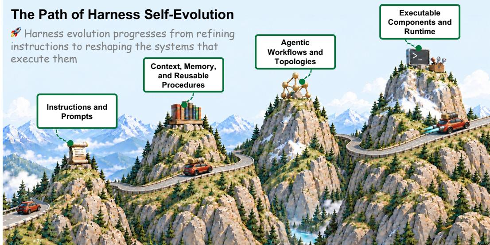
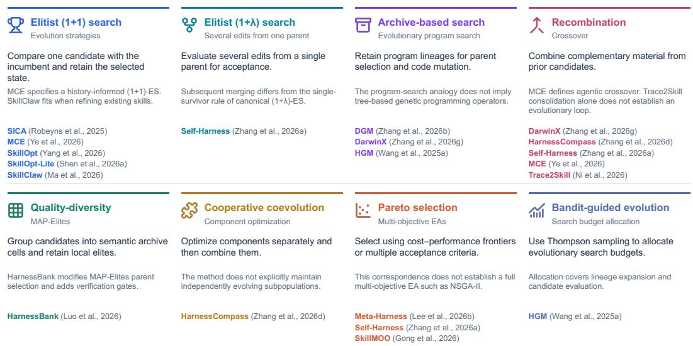
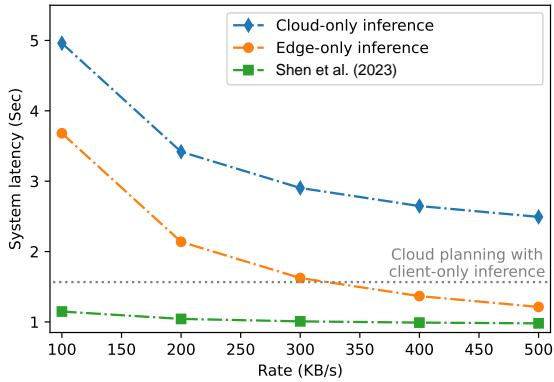

# SELF-EVOLVING AGENT HARNESS

Chuyang Wei1,3, Haoxiang Guan1,3, Minghang Zhu1, Kexin Zhou1,3, Jiyan He1,2, Xiren Zhou3, Huanhuan Chen3, Yifei Shen1,2,†

1Zhongguancun Academy, 2Zhongguancun Institute of Artificial Intelligence

3University of Science and Technology of China

†Corresponding author

## ABSTRACT

Harness self-evolution revises an agent’s software scaffolding, including prompts, memory, workflows, and executable components, while keeping model weights fixed. We formalize a feedback-driven process in which accepted revisions persist across runs. The framework separates update targets from proposal and admission mechanisms. It distinguishes changes to interpreted state from revisions to tools and code, repository-level control logic, and plugin composition. We characterize search through evolutionary optimization and examine its reliability through continual PAC-learning. Under explicit assumptions, the analysis yields an expected generalization bound, a retention bound conditional on historical regression budgets, and a high-probability admission rule using fresh, independent validation data. We examine how persistent harness revisions affect knowledge sharing and organizational workflows, with implications for scientific reliability, physical safety, and institutional accountability. Cases from prior work illustrate model–harness co-design, distributed execution, and plugin reuse. Reliable deployment requires continual validation as task distributions and evaluators change, with independent safeguards for learning, runtime privileges, and consequential actions. We provide a comprehensive 66-page discussion of related work, theory, algorithms, evaluation, applications, and the broader impact of Harness RSI, together with continuously updated code and supplementary materials, at https://github.com/zgcagi/Harness-RSI.

  
Figure 1: From reusable instructions and procedures to revisable executable components.

## 1 INTRODUCTION

As tasks and environments change after deployment, agents need mechanisms for continued adaptation. Harness self-evolution uses execution feedback to revise instructions, memory, and control logic while keeping model weights fixed. Later runs load accepted revisions, and the update mechanism remains available to learn from subsequent experience (Section 2). This process builds on recursive self-improvement and self-referential problem solving in the context of contemporary agents (Good, 1965; Schmidhuber, 2003).

Adaptation can revise model weights or the harness governing prompts, memory, workflows, and tools. Our focus on the latter rests on three considerations. First, the harness directly shapes a fixed model’s behavior, while reusable procedures preserve task constraints and lessons from earlier failures (Chan et al., 2025; Zhao et al., 2024; Wang et al., 2024). Second, harness revisions reuse an existing model deployment, avoiding retraining and additional weight checkpoints. This can reduce adaptation and maintenance costs and permits updates through proprietary APIs without access to model weights. Third, instructions, memory records, and code support direct inspection, version comparison, and change tracking; attributing behavioral differences between model checkpoints can require additional controlled experiments. We hold the task model fixed to isolate harness selfevolution, with joint model–harness evolution addressed in Section 6.1.

Existing methods vary in what is modified, how candidates are generated, and how revisions are admitted (Shinn et al., 2023; Zhao et al., 2024; Wang et al., 2024; Zhang et al., 2025b; Robeyns et al., 2025). We first classify the update target: the state modified and inherited by later runs. Interpreted-state updates revise instructions, stored experience, or task-level coordination over predefined capabilities; executable revisions change capability implementations, runtime control logic, or plugin-based service composition (Section 3; Figure 1). Empirical selection alone does not establish generalization or retention. Section 4 relates candidate search to evolutionary structures, then uses stability and concentration results to state conditions for expected generalization, bounded accumulated regressions, and high-probability admission. Persistent state also determines how revisions propagate and which consequences software recovery can address, motivating system design choices, continual validation, and independent safety controls (Sections 5–6).

This work makes three contributions:

• Definition and Operational Taxonomy (Sections 2–3). We define a persistent feedback-driven lifecycle and organize interpreted-state updates and executable revisions by their mutation boundaries.

• Conditional Theoretical Analysis (Section 4). We map harness search to evolutionary structures and derive conditions for expected generalization, bounded accumulated regressions, and highprobability admission from classical stability and concentration results.

• Systems Implications and Design Trade-offs (Sections 5–6). We analyze propagation and repair burdens in five settings and connect attributed cases (Sections 3 and 6) to model–harness pairing, deployment, and reuse decisions, with continual validation and safety constraints.

Associated resources are available at https://github.com/zgcagi/Harness-RSI.

## 2 DEFINITION OF HARNESS SELF-EVOLUTION

Harness. Following the model–harness decomposition (DeepSeek-AI, 2026), we define a harness H as the software and configuration governing a model $\boldsymbol { M } ^ { \flat } \bar { \mathbf { s } }$ execution in a task environment $E .$ Table 1 summarizes seven runtime functions. Model adapters are part of H; learned parameters are part of M. Execution produces a rollout, which is scored by J:

$$
\tau \sim \mathrm { R u n } ( M , H , E ) , \qquad y = J ( \tau ) .\tag{1}
$$

The final assessment J includes scoring, outcome verification, and the records that determine the result. Candidates may revise internal critics or provisional checks within H, but cannot modify J.

Harness self-evolution. Harness self-evolution uses execution experience to iteratively revise $H ,$ aiming to improve task performance or resource efficiency while holding M fixed. At round $k \geq 1$

Table 1: Runtime functions of a harness. An implementation may combine these functions rather than assign each to a separate module.
<table><tr><td>Component</td><td>Runtime role</td><td>Mechanisms</td></tr><tr><td>Agent loop and execution control</td><td>Controls execution and termination</td><td>Model and tool calls; continuation, stopping, cancellation, and recovery</td></tr><tr><td>Tool and skill</td><td>Exposes callable capabilities</td><td>Interfaces and registration; dispatch; skill loading</td></tr><tr><td>orchestration Context construction</td><td>and procedures Prepares each model input</td><td>and invocation System instructions, tool descriptions, dialogue</td></tr><tr><td>Memory and state</td><td>Preserves information across</td><td>history, and added context Retrieval and reusable memory; persistence,</td></tr><tr><td>management Context compaction</td><td>calls or sessions Keeps model inputs within</td><td>resumption, and forking Summarization; retention and trigger policies;</td></tr><tr><td></td><td>context limits</td><td>pruning tool outputs</td></tr><tr><td>Scheduling and coordination</td><td>loops</td><td>Assigns work across execution Delegation to subagents; task scheduling; background work</td></tr><tr><td>Execution infrastructure Enforces boundaries and</td><td>records activity</td><td>Sandboxes, permissions, approvals, storage, model adapters, logs, and replay</td></tr></table>

the incumbent $H _ { k - 1 }$ generates a batch of b rollouts, each including its trajectory, outcome, and available feedback:

$$
\begin{array} { r } { \mathcal { B } _ { k } = \{ \tau _ { k , i } \} _ { i = 1 } ^ { b } , \qquad \tau _ { k , i } \sim \mathrm { R u n } ( M , H _ { k - 1 } , E _ { k , i } ) , } \end{array}\tag{2}
$$

$$
H _ { k } = \operatorname { U p d a t e } ( H _ { k - 1 } , B _ { k } ) .\tag{3}
$$

The update operator combines diagnosis, proposal, assessment, and admission. It may draw on historical feedback, archived candidates, and additional validation rollouts. If no revision is admitted, the incumbent is retained: $H _ { k } = H _ { k - 1 }$

Each retained revision changes the state used for subsequent execution, whose feedback can guide the next update. This lifecycle requires:

1. Operational feedback and update continuity. The system uses feedback from its own executions to construct or select revisions algorithmically, and retains the mechanism for further updates. Environments, automated assessors, and people may provide feedback; admission may require human approval.

2. Persistence across runs. Accepted revisions are stored and loaded in a subsequent run, allowing experience from one interaction to influence later execution.

These requirements concern repeatability: one observed update can demonstrate the capability if both hold. Appending logs or compacting context under fixed rules does not revise the harness; learning reusable procedures or changing memory policies can. Revising the update mechanism adds another level of recursion.

Scope and terminology. Self-evolution denotes the update process; self-improvement denotes a gain established by comparison. We use harness RSI (recursive self-improvement) as the name of the research area, without assuming that each revision helps. Weight-only adaptation and scaffold without an update mechanism fall outside this scope. When a system also trains weights, we examine its harness updates with the task model held fixed.

## 3 THE TAXONOMY OF HARNESS SELF-EVOLUTION

EURISKO’s heuristic revision and the Gödel Machine’s proof-governed self-rewriting established distinct antecedents of harness self-evolution (Lenat, 1983; Schmidhuber, 2003). Contemporary methods use empirical feedback to revise prompts, consolidate persistent memory, and search workflow specifications around a fixed model (Agrawal et al., 2026; Fernando et al., 2024; Zhao et al., 2024; Wang et al., 2025b; Zhang et al., 2025b). The interpreted/executable distinction concerns the edited artifact’s role, not its programming language. Workflow revisions remain interpreted when they change task-level sequencing or routing through fixed coordination interfaces over predefined operators. This includes code that only composes those operators; revising operator implementations or the runtime mechanisms that enact coordination constitutes an executable revision, even under an unchanged executor.

We organize executable targets into component implementations, repository-level control logic, and plugin composition. The first two describe mutation scope; the third describes how components and runtime services are bound and replaced. Plugin composition can span component implementations and repository-level logic, so a revision may belong to more than one category. Classifying the update target does not determine whether a method satisfies the feedback, continuity, and persistence requirements in Section 2.

## 3.1 TOOLS AND CODE PATCHES

Component-level revision confines mutation to callable procedures or designated modules while keeping surrounding orchestration outside the editable surface. Where entry points and I/O contracts remain fixed, candidates replace component implementations; tool synthesis may instead extend the callable interface. Skill libraries retain executable functions for later retrieval and composition (Wang et al., 2024; Yu et al., 2025); patch-based architectures, including Self-Harness, Har nessCompass, and Agentic Harness Engineering, constrain trace-guided mutation to selected components (Zhang et al., 2026a;d; Lin et al., 2026). Editing memory-management functions changes the harness machinery, whereas curating stored entries changes its interpreted state (Zhang et al., 2025a). Within this boundary, candidate archives preserve alternatives for subsequent search (Luo et al., 2026), while protocol perturbations test whether an evolved harness’s gain over the initia harness survives changes in assessment conditions (Zhu et al., 2026). Stable interfaces facilitate replacement and local checks, but changed outputs or shared state can propagate regressions beyond the edited module.

## 3.2 REPOSITORY AND RUNTIME LOGIC

Repository-level search exposes context construction, orchestration loops, execution hooks, recovery, and termination to revision. The boundary concerns control over interactions among harness components, rather than the number of files edited. Whole-agent synthesis searches complete control programs, while repository evolution retains implementation lineages for later selection and revision (Hu et al., 2025; Lee et al., 2026b; Robeyns et al., 2025; Zhang et al., 2026b;g; Wang et al., 2025a). Changes to shared context, scheduling, or recovery can alter the inputs and execution assumptions of otherwise unchanged components. This coupling motivates edit constraints, transfer oriented admission, and deployment checks (Xia et al., 2026; Cai et al., 2026a). Archive membership preserves a candidate for further search; adoption additionally requires promoting the selected program into the runtime used by later tasks. Extending mutation to the optimizer’s prompts, hooks, and tools makes the update mechanism itself evolvable (Wang et al., 2026). An exported program satisfies the continuing lifecycle only if its deployment retains an update mechanism.

HarnessOpt extends the SkillOpt-Lite study from skill editing to runtime revision, improving spreadsheet previews, output checks, and recovery after tool failures (Shen et al., 2026a). On Spreadsheet-Bench (Table 2), GPT-5.4-nano with HarnessOpt and skill reaches 77.58%, exceeding GPT-5.5 with SkillOpt (76.20%); across all four models, HarnessOpt with skill improves on SkillOpt-Lite by 5.69–11.39 percentage points. This crossover illustrates model–harness pairing, but does not estab lish superiority at matched cost.

Table 2: SpreadsheetBench accuracy (%), converted from proportions in Table 3 of Shen et al. (2026a). HO: HarnessOpt; + skill: with-skill condition.
<table><tr><td>Model</td><td>Initial</td><td>SkillOpt</td><td>SkillOpt-Lite</td><td>HO only</td><td>HO + skill</td></tr><tr><td>GPT-5.4-nano</td><td>29.89</td><td>51.60</td><td>66.19</td><td>76.51</td><td>77.58</td></tr><tr><td>GPT-5.4-mini</td><td>28.21</td><td>47.50</td><td>73.31</td><td>81.14</td><td>82.56</td></tr><tr><td>GPT-5.4</td><td>39.86</td><td>61.50</td><td>79.36</td><td>83.63</td><td>85.05</td></tr><tr><td>GPT-5.5</td><td>37.37</td><td>76.20</td><td>79.72</td><td>83.63</td><td>85.77</td></tr></table>

## 3.3 EVERYTHING IS A PLUGIN

Plugin architectures organize mutation through declared interfaces, dependency constraints, and lifecycle operations. The editable object may be a component implementation or a binding that determines which implementation supplies a runtime service, such as memory storage, tool dispatch, or the agent loop. Composition here therefore reaches beyond task-level routing among fixed operators. Kernel-defined substrates specify how these services are connected, mounted, and replaced (DeepSeek-AI, 2026; Shi et al., 2026); feedback-driven systems revise typed primitives, versioned resources, or scoped modules under interface and validation constraints (Chen et al., 2026b; Li et al., 2026a; Zhang et al., 2026f; Wu et al., 2026a). This organization can expose both local capabilities and core runtime services while retaining explicit constraints on their composition. Everything Is a Plugin (EIP) extends it to capabilities generated, validated, and mounted during operation. Interface contracts support compatibility checks and component replacement; they do not establish behavioral isolation or safe admission. Adoption still requires validation of the composed behavior.

Using DSH Everything, a Codex plugin lets the agent generate tools during execution and retain them for later tasks (Shen, 2026; Pan, 2026). In a simulated office workload, spreadsheets from different company regions vary in language and content but share similar calculations. Codex creates batch-lookup and summarization tools: first-task tool calls fall from 13 to 3, while wall time rises by 54.9% and tokens by 15.7%. A separately reported cumulative series shows savings from the second task, reaching 110,351 tokens and 22.97 s after five tasks (Table 3). The first-task totals imply increases of 6,453 tokens and 8.51 s, whereas cumulative row 1 reports 4,895 tokens and 6.74 s. This unresolved difference prevents treating the two reports as a single cost trajectory; negative cumulative differences indicate savings.

Table 3: EIP spreadsheet costs (Pan, 2026).
<table><tr><td colspan="2">(a) First task</td></tr><tr><td>Metric</td><td>Baseline EIP Aggregate</td></tr><tr><td>Tool calls</td><td>13 47,572</td></tr><tr><td>Tokens</td><td>41,119</td></tr><tr><td>Wall time (s)</td><td>15.49 24.00</td></tr></table>

(b) Cumulative EIP − baseline
<table><tr><td>Tasks</td><td></td><td>∆ tokens ∆ wall time (s)</td></tr><tr><td>1</td><td>+4,895</td><td>+6.74</td></tr><tr><td>2</td><td>-19,907</td><td>-3.97</td></tr><tr><td>3</td><td>-47,375</td><td>-8.44</td></tr><tr><td>4</td><td>-77,542</td><td>-13.87</td></tr><tr><td>5</td><td>-110,351</td><td>-22.97</td></tr></table>

Table 4: LiveBrowseComp results (Pan, 2026).
<table><tr><td>Model / harness Score</td></tr><tr><td>&lt; 40B</td></tr><tr><td>XYZ + dsh-everything 51.39</td></tr><tr><td>XYZ-Aquila-mini 48.7</td></tr><tr><td>Nex-N2-mini 41.4</td></tr><tr><td>MiroThinker 1.7 mini 34.9</td></tr><tr><td>apodex-mini 32.8</td></tr><tr><td>Agents-A1 29.6</td></tr><tr><td>&lt; 400B</td></tr><tr><td>XYZ-Aquila-pro 53.7</td></tr><tr><td>Nex-N2-Pro 50.4</td></tr><tr><td>MiroThinker 1.7 34.1</td></tr><tr><td>&gt; 1T or closed-source</td></tr><tr><td>DeepSeek V4-Pro 38.3</td></tr><tr><td>Kimi-K2.6 31.7</td></tr></table>

  
Figure 2: Evolutionary algorithm correspondences in harness and skill optimization. Each panel summarizes a search structure, the basis and limits of its correspondence, and representative methods. The categories overlap: a method may instantiate more than one structure, and a correspondence does not imply equivalence to the full canonical algorithm.

The same source reports a LiveBrowseComp score of 51.39 for XYZ + dsh-everything, compared with 48.7 for XYZ-Aquila-mini, placing it first among the six displayed < 40B entries and second among all eleven (Table 4). Table 4 preserves the source’s model groups and scores, whose unit is unspecified. These reports illustrate potential reuse savings and model–harness pairing. Repeated runs, matched budgets, and matched task quality are needed to establish causal plugin gains and general reuse benefits.

## 4 THEORY OF HARNESS SELF-EVOLUTION

Many harness optimizers explore discrete instructions, skills, and code through execution-guided proposals rather than gradients through the edits. Evolutionary algorithms (EAs) characterize the search structure; continual-learning analysis relates empirical gains to generalization and capability retention. Recent work likewise distinguishes optimization from generalization and links reliable adoption to verification cost (Gan et al., 2026; Cai et al., 2026b).

## 4.1 AN EVOLUTIONARY PERSPECTIVE ON HARNESS SEARCH

The EA view separates four aspects of an update: the representation of mutable state, the variation that generates edits, the assessment of their fitness, and the selection of state to retain. Traces and critiques can guide variation, while admission depends on the resulting assessment.

Local elitism concentrates search around an incumbent; archive-based diversity preserves alternative lineages; Pareto selection balances competing objectives. Figure 2 summarizes eight algorithmic correspondences, their limits, and representative methods. Because all three mechanisms select on empirical fitness, accepted revisions can overfit or forget, motivating the generalization and retention analysis below.

## 4.2 GENERALIZATION AND RETENTION FROM A CONTINUAL PAC-LEARNING PERSPECTIVE

Lasting capability requires controls on generalization, forgetting, and admission uncertainty. Continual PAC-learning studies retention under memory constraints (Chen et al., 2022); here we use stability and concentration under explicit sampling assumptions.

Evolution state and sampling. Let $X _ { k }$ record the harness, skills, archive, and feedback memory after round k, with $\bar { H _ { k } } = \mathrm { { D e p l o y } } ( X _ { k } )$ and $X _ { k } = \mathcal { A } _ { k } ( X _ { k - 1 } , D _ { k } ; U _ { k } )$ . For stability, assume $D _ { k }$ contains $n _ { k }$ tasks drawn from an exogenous distribution $\mathcal { D } _ { k }$ , independently within and across rounds. Auxiliary randomness and external assessment samples in $\bar { U } _ { k }$ are independent of these draws; task-derived feedback remains part of the update process. Fix the model and evaluator, and let $\ell ( H , z ) \in [ 0 , 1 ]$ denote loss averaged over execution randomness. Define

$$
R _ { s } ( H ) = \mathbb { E } _ { z \sim \mathcal { D } _ { s } } \ell ( H , z ) , \qquad \widehat { R } _ { s } ( H ) = \frac { 1 } { n _ { s } } \sum _ { i = 1 } ^ { n _ { s } } \ell ( H , z _ { s , i } ) .\tag{4}
$$

Stability under task replacement. Algorithmic stability links task sensitivity to generalization (Shalev-Shwartz et al., 2010). Replace $z _ { s , i }$ by an independent draw from $\dot { \mathcal { D } } _ { s }$ and rerun all downstream updates, including feedback, archives, and selection, under coupled randomness to obtain $H _ { k } ^ { ( s , i ) }$ . For $s \leq k$ , define $\begin{array} { r } { \beta _ { s , k } = \frac { 1 } { n _ { s } } \sum _ { i = 1 } ^ { n _ { s } } \mathbb { E } \Big [ \Big | \ell ( H _ { k } , z _ { s , i } ) - \ell ( H _ { k } ^ { ( s , i ) } , z _ { s , i } ) \Big | \Big ] } \end{array}$ . Replace-one exchangeability yields

$$
\Bigl | \mathbb { E } [ R _ { s } ( H _ { k } ) - \widehat { R } _ { s } ( H _ { k } ) ] \Bigr | \le \beta _ { s , k } .\tag{5}
$$

The bound controls the magnitude of the expected generalization gap, not the gap in any individual run. Small code edits do not by themselves imply stability of the full update process.

Retention and accumulated regressions. Write $F _ { s , k } = R _ { s } ( H _ { k } ) - R _ { s } ( H _ { s } )$ , with positive values indicating forgetting and negative values backward transfer. For fixed regression budgets $\varepsilon _ { s , u }$ , suppose each later transition satisfies $R _ { s } ( H _ { u } ) - R _ { s } ( H _ { u - 1 } ) \ \leq \ \varepsilon _ { s , u }$ Telescoping gives $\begin{array} { r } { F _ { s , k } \le \sum _ { u = s + 1 } ^ { k } \varepsilon _ { s , u } ; } \end{array}$ combined with stability at round s, this yields

$$
\mathbb { E } R _ { s } ( H _ { k } ) \le \mathbb { E } \widehat { R } _ { s } ( H _ { s } ) + \beta _ { s , s } + \sum _ { u = s + 1 } ^ { k } \varepsilon _ { s , u } .\tag{6}
$$

The term $\beta _ { s , s }$ measures sensitivity of the complete round-s update. The historical-risk budgets are separate assumptions, not implications of stability, and their allowances accumulate. Checking them requires groupwise uncertainty control for the deployed composition, including merged edits and shared routers.

Admission with fresh validation. Let $\begin{array} { r } { \bar { R } _ { k } ( H ) = k ^ { - 1 } \sum _ { s = 1 } ^ { k } R _ { s } ( H ) } \end{array}$ denote risk on the uniform historical mixture. At each of $T$ rounds, fix at most K candidates, then draw a fresh validation set $V _ { k }$ of m independent tasks from this mixture, independent of candidate construction conditional on the prior history. For candidate $H ^ { \prime }$ , define

$$
\begin{array} { l } { { \Delta _ { k } ( H ^ { \prime } ) = \bar { R } _ { k } ( H ^ { \prime } ) - \bar { R } _ { k } ( H _ { k - 1 } ) , } } \\ { { \displaystyle \widehat { \Delta } _ { k } ( H ^ { \prime } ) = \frac { 1 } { m } \sum _ { z \in V _ { k } } [ \ell ( H ^ { \prime } , z ) - \ell ( H _ { k - 1 } , z ) ] . } } \end{array}\tag{7}
$$

Paired differences lie in $[ - 1 , 1 ]$ , with range width 2. Conditional Hoeffding bounds followed by a union bound over at most $\bar { K T }$ comparisons give, simultaneously with probability at least $1 -$ δ (Hoeffding, 1963),

$$
\Delta _ { k } ( H ^ { \prime } ) \leq \widehat { \Delta } _ { k } ( H ^ { \prime } ) + \sqrt { \frac { 2 \ln ( K T / \delta ) } { m } } .\tag{8}
$$

Accept only candidates with negative upper bounds. Edits or merges informed by $V _ { k }$ need fresh validation; mixture gains do not ensure groupwise retention. HarnessBank reuses training tasks for screening before a separate final test; Self-Harness reuses a held-out regression split (Luo et al., 2026; Zhang et al., 2026a). These search-time checks lack the assumed independence. Secrecy and comparison-count corrections do not remove adaptive dependence; use fresh samples or adaptivevalid inference (Dwork et al., 2015a).

Scope of the guarantees. Independent tasks determine the sample size; additional rollouts can reduce execution noise without adding tasks. Equation (8) also covers unbiased paired-loss estimates in [−1, 1] from independent task clusters. Correlated sessions need grouping or dependence-aware analysis, and non-additive metrics require separate concentration arguments. Admission is certified on the historical mixture, not arbitrary future distributions. If evaluator and target risk differ by at most η for each compared harness, a sufficient condition for target-risk improvement is

$$
\widehat { \Delta } _ { k } ( H ^ { \prime } ) + \sqrt { \frac { 2 \ln ( K T / \delta ) } { m } } + 2 \eta < 0 .\tag{9}
$$

The discrepancy bound requires evidence from executable checks or independent human assessment. Without such a bound, the certificate concerns only evaluator-defined loss. Section 6.4 discusses continuing validation as task distributions and evaluators change.

## 5 APPLICATIONS AND SOCIETAL IMPACTS

Persistent harness revisions preserve learned procedures across tasks. We examine their implications for knowledge sharing, reliability, and accountability in five application settings.

Personal workspaces. Revisable instructions, memory, and skills preserve project conventions and user preferences across programming, writing, and research sessions (Anthropic, 2026; GitHub, 2026; Anthropic, 2025). Playbook revision and trajectory distillation convert execution feedback into reusable procedures that can reduce repeated setup and diagnosis (Zhang et al., 2026e; Ni et al., 2026; Shen et al., 2026a). As updates accumulate, users may struggle to track changes: temporary workarounds become standing rules, and injected instructions persist across tasks (Gadgil et al., 2026). Even successful task executions can yield skills that generalize harmfully (Zhang et al., 2026c). Reviewable changes and artifact provenance support ongoing curation; recovery must encompass derived skills, memory, and caches as well as tracked code.

Enterprise automation. Shared skill libraries and revisable agent components let teams reuse incident diagnoses, API adaptations, and recovery procedures as operational requirements change (Ma et al., 2026; Liu et al., 2026; Zhang et al., 2026g; Lin et al., 2026; Cai et al., 2026a). Local workarounds can spread to teams with different permission or data assumptions. Shared faulty procedures may cause correlated errors that escape detection, extending concerns about algorithmic monoculture to persistent harness artifacts (Kleinberg & Raghavan, 2021; Bommasani et al., 2022). Remediation requires identifying consumers, withdrawing affected versions, restoring dependent workflows, and investigating unauthorized actions. Version-linked deployment records and staged rollout support containment, while service disruption or data exposure may require organizational redress after software recovery.

Scientific discovery. Persistent settings, failure reports, and search heuristics help collaborators reuse earlier trials (Qu et al., 2026; Li et al., 2026a). Diagnostic evaluations also document failures to check claims against evidence and artifacts (Fei et al., 2026). When evolving protocols exploit provisional checks or imperfect external metrics, specification gaming can reinforce procedures that fail independent measurement (Skalse et al., 2022; Baker et al., 2025). These procedures can spread through collaboration or wet-lab transfer, consuming instrument time, reagents, and expert effort before detection. Final assessment J must remain outside the editable surface (Section 2); independent measurement and replication are also needed to establish scientific validity.

Robotics and embodied interaction. EMHO revises planning, observation handling, and recovery around a frozen model (Lee et al., 2026a); RoboRSI revises and reuses a hierarchy of robot skills (Wen et al., 2026). Memory Transfer Planning adapts code from a fixed memory, including transfer from simulation to hardware (Kagaya et al., 2025); EmbodiedSWE learns weights from verified simulation trajectories (Shen et al., 2026b). Errors in accepted action code can persist across motions, causing excessive force, unsafe recovery, or incorrect contact behavior. Software rollback changes future commands but cannot reverse deformation, wear, or injury. For physical deployment, we recommend keeping emergency stops, force and speed limits, and authorization checks outside the editable surface, with independent action checks and staged trials. Revision-linked command records support investigation and remediation.

Public services and clinical systems. Revisable triage, eligibility routing, and case-processing procedures offer an inspectable way to incorporate changing guidelines and operational feedback; current evidence includes prototype clinical interactions and context adaptation on diagnostic and legal tasks (Jiang et al., 2025; Schmidgall et al., 2024; Ye et al., 2026). Qualified professionals must validate and authorize consequential revisions. Erroneous preferences can otherwise become persistent rules that reproduce institutional disadvantage across cases (Citron, 2008; Shao et al., 2026). Patients and applicants may lack access to an alternative institution. Software rollback cannot recover a missed treatment window or, by itself, correct denied entitlements and corrupted records. Execution-log inspection aids agent evaluation (Kapoor et al., 2026). For accountability, we recommend recording each decision’s rule version, evidence, and admission history, alongside accessible review, appeal, and remediation.

## 6 FUTURE DIRECTIONS

The executable-revision cases in Section 3 motivate research on model–harness co-design and plugin lifecycles. We also examine distributed execution, continual validation, and safety boundaries for evolving systems.

## 6.1 MODEL–HARNESS CO-DESIGN

The model–harness crossover in Section 3.2 motivates studying how to allocate adaptation effort between the model and its runtime. Budget-matched studies should compare model selection, skill optimization, runtime revision, and weight updates (Chen et al., 2026a; Li et al., 2026b), accounting for both adaptation and subsequent execution costs. Testing frozen, transferred, and re-evolved harnesses across checkpoints would distinguish transferable gains from those requiring further harness evolution. Joint adaptation should also examine which update order preserves earlier capabilities as model behavior and runtime assumptions change.

## 6.2 DISTRIBUTED EXECUTION AND EDGE INFRASTRUCTURE

Runtime revision (Section 3.2) can change both execution cost and where components are best placed. A fixed-deployment study illustrates the communication trade-offs: Shen et al. (2023) compare a Jetson Nano client, an RTX 4090 edge server, and Azure under a workload of 10% classification, 40% captioning, and 50% visual question answering. Client–edge execution partitions expert networks and compresses task-relevant features; the edge-only baseline transmits losslessly compressed input images.

Client–edge co-inference minimizes latency across 100–500 KB/s in this study (Figure 3). Future studies should include harness synthesis, validation, and distribution costs when comparing deployment choices across network conditions and update frequencies, at matched quality and subject to privacy constraints.

  
Figure 3: Latency adapted from Shen et al. (2023); client–edge in green.

## 6.3 PLUGIN CREATION AND REUSE

The creation overhead and subsequent savings in Section 3.3 motivate lifecycle-aware decisions about when to reuse, revalidate, regenerate, or retire a plugin. Future studies should measure the number of related tasks needed to recover generation and validation costs at matched quality, including repair and dependency-maintenance costs. Varying task similarity, reuse frequency, and interface changes would reveal when a retained tool remains useful and when regeneration is preferable. Admission should test the resulting composition, since a locally valid plugin can alter shared state or the behavior of other components.

## 6.4 CONTINUAL VALIDATION UNDER DISTRIBUTION AND EVALUATOR DRIFT

Time-stamped tasks (White et al., 2024; Jain et al., 2024; Yan et al., 2026), version-pinned environments (Merrill et al., 2026), and difficulty calibration (Chen et al., 2026c) help distinguish harness gains from workload drift. Admission requires fresh independent tasks (Section 4.2); adaptive reuse needs separate statistical controls (Dwork et al., 2015b; Blum & Hardt, 2015). Reused calibration tasks cannot replace fresh admission evidence. Judge bias (Lù et al., 2025; Wu et al., 2024) requires independent calibration of η in Equation (9) after evaluator changes. Protecting J does not prevent specification gaming (Pan et al., 2024; Shao et al., 2026). Allocating budgets among calibration, admission, and regression checks remains an open problem.

## 6.5 SAFETY BOUNDARIES FOR SELF-MODIFYING SYSTEMS

External safeguards complement model alignment (Bai et al., 2022). Context-removal and transfer tests can probe harmful skill generalization (Zhang et al., 2026c; Wu et al., 2026b); data-flow and tool-sequence constraints support runtime enforcement (Doshi et al., 2026). We recommend least privilege, time-limited grants, and isolation; creating capabilities must not confer authority. Rollback covers only effects within its recovery model (Shi et al., 2026), motivating authorization and physical or spending limits for consequential actions. Validating composed behavior and revoking grants as dependencies change remain open problems. Defenses should be evaluated by attack success, isolation time, and legitimate-work overhead.

## 7 CONCLUSION

Our framework defines harness self-evolution through feedback-driven revision, continuing update capability, and persistence around fixed models. It separates mutation boundaries from search and admission, distinguishing expected generalization, budget-constrained retention, and highprobability acceptance under fresh validation.

Persistent revisions preserve knowledge but can spread errors with irreversible consequences. Their deployment requires continual validation under distribution and evaluator drift, with independent controls over learning, runtime privileges, and consequential actions.

## REFERENCES

Lakshya A Agrawal, Shangyin Tan, Dilara Soylu, Noah Ziems, Rishi Khare, Krista Opsahl-Ong, Arnav Singhvi, Herumb Shandilya, Michael J Ryan, Meng Jiang, Christopher Potts, Koushik Sen, Alexandros G. Dimakis, Ion Stoica, Dan Klein, Matei Zaharia, and Omar Khattab. GEPA: Reflective prompt evolution can outperform reinforcement learning. In The Fourteenth International Conference on Learning Representations, 2026. URL https://openreview.net/ forum?id=RQm2KQTM5r. Oral.

Anthropic. Equipping agents for the real world with agent skills. https://www.anthropic.com/engineering/ equipping-agents-for-the-real-world-with-agent-skills, 2025.

Anthropic. How claude remembers your project. https://code.claude.com/docs/en/ memory, 2026. Claude Code documentation.

Yuntao Bai, Saurav Kadavath, Sandipan Kundu, Amanda Askell, Jackson Kernion, Andy Jones, et al. Constitutional AI: Harmlessness from AI feedback, 2022. Anthropic; arXiv preprint.

Bowen Baker, Joost Huizinga, Leo Gao, Zehao Dou, Melody Y. Guan, Aleksander Madry, Wojciech Zaremba, Jakub Pachocki, and David Farhi. Monitoring reasoning models for misbehavior and the risks of promoting obfuscation, 2025. URL https://arxiv.org/abs/2503.11926.

Avrim Blum and Moritz Hardt. The ladder: A reliable leaderboard for machine learning competitions. In International Conference on Machine Learning, volume 37, pp. 1006–1014. PMLR, 2015.

Rishi Bommasani, Kathleen A. Creel, Ananya Kumar, Dan Jurafsky, and Percy Liang. Picking on the same person: Does algorithmic monoculture lead to outcome homogenization? In Advances in Neural Information Processing Systems, volume 35, 2022.

Qianshu Cai, Yonggang Zhang, Xianzhang Jia, Huajiang Zheng, Wei Xue, Jun Song, Xinmei Tian, and Yike Guo. Moss: Self-evolution through source-level rewriting in autonomous agent systems, 2026a. URL https://arxiv.org/abs/2605.22794. arXiv preprint.

Qianshu Cai, Yonggang Zhang, Jun Nie, Maohao Ran, Huajiang Zheng, Jun Song, Xinmei Tian, Yike Guo, and Wei Xue. A theory of reliable self-evolution for agent harnesses, 2026b. URL https://arxiv.org/abs/2609.08175.

Jun Shern Chan, Neil Chowdhury, Oliver Jaffe, James Aung, Dane Sherburn, Evan Mays, Giulio Starace, Kevin Liu, Leon Maksin, Tejal Patwardhan, Lilian Weng, and Aleksander Madry. MLEbench: Evaluating machine learning agents on machine learning engineering. In International Conference on Learning Representations, 2025.

Jixuan Chen, Jiaxin Zhang, Qinyuan Ye, Yada Pruksachatkun, Haoxiang Zhang, Jingming Zhuo, Yifan Zhang, Yutong Dai, Juntao Tan, Xiangyu Peng, Silvio Savarese, Zeyuan Chen, Lianhui Qin, and Chien-Sheng Wu. CoTrace: Data recipes for training terminal agents with harnessmodel co-evolution, 2026a. URL https://arxiv.org/abs/2610.10426.

Tingyang Chen, Shuo Lu, Kang Zhao, Weicheng Meng, Hanlin Teng, Tianhao Li, Chao Li, Xule Liu, Jian Liang, Zhizhong Zhang, Yuan Xie, Heng Qu, Kun Shao, and Jian Luan. Harnessx: A composable, adaptive, and evolvable agent harness foundry, 2026b. URL https://arxiv. org/abs/2606.14249. arXiv preprint.

Xi Chen, Christos Papadimitriou, and Binghui Peng. Memory bounds for continual learning. In 2022 IEEE 63rd Annual Symposium on Foundations of Computer Science (FOCS), 2022. doi: 10.1109/FOCS54457.2022.00056.

Yongrui Chen, Yangyang Ma, Xiaoying Huang, Shenyu Zhang, Huajun Chen, Haofen Wang, and Guilin Qi. StressEval: Failure-driven dynamic benchmarking for knowledge-intensive reasoning in large language models, 2026c. URL https://arxiv.org/abs/2605.01939.

Danielle Keats Citron. Technological due process. Washington University Law Review, 85(6):1249– 1313, 2008. URL https://repository.library.washu.edu/law\_lawreview/ vol85/iss6/2/.

DeepSeek-AI. DeepSeek harness. https://www.deepseek.com/en/harness/, 2026. Product and developer documentation; accessed October 2026.

Aarya Doshi, Yining Hong, Congying Xu, Eunsuk Kang, Alexandros Kapravelos, and Christian Kästner. Towards verifiably safe tool use for LLM agents, 2026. URL https://arxiv.org/ abs/2601.08012. arXiv preprint.

Cynthia Dwork, Vitaly Feldman, Moritz Hardt, Toniann Pitassi, Omer Reingold, and Aaron Roth. Generalization in adaptive data analysis and holdout reuse. arXiv preprint arXiv:1506.02629, 2015a.

Cynthia Dwork, Vitaly Feldman, Moritz Hardt, Toniann Pitassi, Omer Reingold, and Aaron Roth. The reusable holdout: Preserving validity in adaptive data analysis. Science, 349(6248):636–638, 2015b.

Yanlin Fei, Nazhou Liu, Xinmiao Yu, Shaolong Chen, Lei Li, Rahul Thapa, et al. How do agents fail on AutoResearch: End-to-end diagnostic evaluation on 100 real-world frontier research tasks, 2026. AutoResearchEval; arXiv preprint.

Chrisantha Fernando, Dylan Sunil Banarse, Henryk Michalewski, Simon Osindero, and Tim Rocktäschel. Promptbreeder: Self-referential self-improvement via prompt evolution. In Proceedings of the 41st International Conference on Machine Learning, volume 235 of Proceedings of Machine Learning Research, pp. 13481–13544. PMLR, PMLR, 2024. URL https: //proceedings.mlr.press/v235/fernando24a.html.

Soham Gadgil, David Alexander, Sai Sunku, and Franziska Roesner. Bad memory: Evaluating prompt injection risks from memory in agentic systems, 2026. URL https://arxiv.org/ abs/2607.14611. arXiv preprint.

Zeyu Gan, Zixuan Gong, and Yong Liu. Harness evolution as learning: Approximation, generalization, and optimization limits of self-improving personal agents, 2026. URL https: //arxiv.org/abs/2609.36892.

GitHub. About GitHub Copilot Memory. https://docs.github.com/en/copilot/ concepts/agents/copilot-memory, 2026.

Jingzhi Gong, Ruizhen Gu, Zhiwei Fei, Yazhuo Cao, Lukas Twist, Alina Geiger, Shuo Han, Dominik Sobania, Federica Sarro, and Jie M. Zhang. SkillMOO: Multi-objective optimization of agent skills for software engineering, 2026. URL https://arxiv.org/abs/2604.09297.

Irving John Good. Speculations concerning the first ultraintelligent machine. In Franz L. Alt and Morris Rubinoff (eds.), Advances in Computers, volume 6, pp. 31–88. Elsevier, 1965.

Wassily Hoeffding. Probability inequalities for sums of bounded random variables. Journal of the American Statistical Association, 58(301):13–30, 1963.

Shengran Hu, Cong Lu, and Jeff Clune. Automated design of agentic systems. In The Thirteenth International Conference on Learning Representations, Singapore, 2025. URL https: //openreview.net/forum?id=t9U3LW7JVX.

Naman Jain, King Han, Alex Gu, Wen-Ding Li, Fanjia Yan, Tianjun Zhang, Sida Wang, Armando Solar-Lezama, Koushik Sen, and Ion Stoica. Livecodebench: Holistic and contamination free evaluation of large language models for code, 2024. URL https://arxiv.org/abs/ 2403.07974.

Yixing Jiang, Kameron C. Black, Gloria Geng, Danny Park, James Zou, Andrew Y. Ng, and Jonathan H. Chen. MedAgentBench: A realistic virtual EHR environment to benchmark medical LLM agents, 2025. URL https://arxiv.org/abs/2501.14654. arXiv preprint; associated with NEJM AI.

Tomoyuki Kagaya, Subramanian Lakshmi, Yuxuan Lou, Thong Jing Yuan, Jayashree Karlekar, Sugiri Pranata, Natsuki Murakami, Akira Kinose, and Yang You. Memory transfer planning: Llm-driven context-aware code adaptation for robot manipulation, 2025. URL https: //arxiv.org/abs/2509.24160.

Sayash Kapoor, Benedikt Stroebl, Peter Kirgis, Nitya Nadgir, Zachary S. Siegel, Boyi Wei, Tianci Xue, Ziru Chen, Felix Chen, Saiteja Utpala, Franck Ndzomga, Dheeraj Oruganty, Sophie Luskin, Kangheng Liu, Botao Yu, Amit Arora, Dongyoon Hahm, Harsh Trivedi, Huan Sun, Juyong Lee, Tengjun Jin, Yifan Mai, Yifei Zhou, Yuxuan Zhu, Rishi Bommasani, Daniel Kang, Dawn Song, Peter Henderson, Yu Su, Percy Liang, and Arvind Narayanan. Holistic agent leaderboard: The missing infrastructure for AI agent evaluation. In The Fourteenth International Conference on Learning Representations, 2026. URL https://proceedings.iclr.cc/paper\_files/paper/2026/file/ a0928f924a344aaebbb7f6cd8d56e34c-Paper-Conference.pdf.

Jon Kleinberg and Manish Raghavan. Algorithmic monoculture and social welfare. Proceedings of the National Academy ofSciences, 118(22):e2018340118, 2021. doi: 10.1073/pnas.2018340118.

Hyun Jung Lee, Jungtaek Kim, Jongwon Jeong, Tae-Eui Kam, Donghyun Kim, and Yong Jae Lee. EMHO: Embodied agent harness optimization via experience traces, 2026a. URL https:// arxiv.org/abs/2610.08432.

Yoonho Lee, Roshen S. Nair, Qizheng Zhang, Kangwook Lee, Omar Khattab, and Chelsea Finn. Meta-harness: End-to-end optimization of model harnesses. In Third Conference on Language Modeling (COLM 2026), 2026b. Originally released as arXiv:2603.28052.

Douglas B. Lenat. Eurisko: A program that learns new heuristics and domain concepts. Artificial Intelligence, 21(1–2):61–98, 1983.

Boxiu Li, Zimo Wen, Yijia Fan, Chuan Wen, Fan Yang, Hangxi Guo, Jiaao Wu, Jiachen Zhang, Junxiang Lei, Mukai Li, Ruize Tang, Runjing Gu, Shibo Hu, Sihan Chen, Sufeng Guo, Wanbo Zhang, Xian Zhang, Xiaoyu Chen, Xuanhe Zhou, Xuyao Huang, Yifei Gao, Yifei Shen, Yilin Chen, Yuheng Wu, Yuzhe Zhang, Zelong Zhao, and Zhijie Deng. Argus: A general-purpose agentic reasoning runtime for long-horizon tasks, 2026a. URL https://arxiv.org/abs/ 2608.05144.

Yixuan Li, Yiyun Zhou, Yao Long Teng, Fuchao Yang, Yanchen Deng, Zhiyi Lyu, Xuyu Dong, Feng Chen, and Bo An. Finding the right fit: Model-harness interactions across agent tasks, 2026b. URL https://arxiv.org/abs/2610.00917.

Jiahang Lin, Shichun Liu, Chengjun Pan, Lizhi Lin, Shihan Dou, Zhiheng Xi, Xuanjing Huang, Hang Yan, Zhenhua Han, Tao Gui, and Yu-Gang Jiang. Agentic harness engineering: Observability-driven automatic evolution of coding-agent harnesses, 2026. arXiv:2604.25850.

Xingyan Liu, Xiyue Luo, Linyu Li, Ganghong Huang, Jianfeng Liu, and Honglin Qiao. Skillforge: Forging domain-specific, self-evolving agent skills in cloud technical support. In Proceedings of the 49th International ACM SIGIR Conference on Research and Development in Information Retrieval, pp. 4763–4768. ACM, 2026. doi: 10.1145/3805712.3808466. Industry Track.

Xing Han Lù, Amirhossein Kazemnejad, Nicholas Meade, Arkil Patel, Dongchan Shin, Alejandra Zambrano, Karolina Stanczak, Peter Shaw, Christopher J. Pal, and Siva Reddy. Agentre-´ wardbench: Evaluating automatic evaluations of web agent trajectories. In Second Conference on Language Modeling (COLM 2025), 2025. URL https://colm.cc/virtual/2025/ poster/571. Originally released as arXiv:2504.08942.

Xiaotian Luo, Dizhan Xue, Fengxingyu Wang, Chuanrui Hu, and Yafeng Deng. Harnessbank: Semantic gene-bank search with gated verification for agent-harness self-evolution, 2026. URL https://arxiv.org/abs/2607.13683.

Ziyu Ma, Shidong Yang, Yuxiang Ji, Xucong Wang, Yong Wang, Yiming Hu, Tongwen Huang, and Xiangxiang Chu. Skillclaw: Let skills evolve collectively with agentic evolver, 2026. URL https://arxiv.org/abs/2604.08377. arXiv preprint.

Mike A. Merrill, Alexander G. Shaw, Nicholas Carlini, Boxuan Li, Harsh Raj, Ivan Bercovich, Lin Shi, Jeong Yeon Shin, Thomas Walshe, E. Kelly Buchanan, Junhong Shen, Guanghao Ye, Haowei Lin, Jason Poulos, Maoyu Wang, Marianna Nezhurina, Di Lu, Orfeas Menis Mastromichalakis, Zhiwei Xu, Zizhao Chen, Yue Liu, Robert Zhang, Leon Liangyu Chen, Anurag Kashyap, Jan-Lucas Uslu, Jeffrey Li, Jianbo Wu, Minghao Yan, Song Bian, Vedang Sharma, Ke Sun, Steven Dillmann, Akshay Anand, Andrew Lanpouthakoun, Bardia Koopah, Changran Hu, Etash Guha, Gabriel H. S. Dreiman, Jiacheng Zhu, Karl Krauth, Li Zhong, Niklas Muennighoff, Robert Amanfu, Shangyin Tan, Shreyas Pimpalgaonkar, Tushar Aggarwal, Xiangning Lin, Xin Lan, Xuandong Zhao, Yiqing Liang, Yuanli Wang, Zilong Wang, Changzhi Zhou, David Heineman, Hange Liu, Harsh Trivedi, John Yang, Junhong Lin, Manish Shetty, Michael Yang, Nabil Omi, Negin Raoof, Shanda Li, Terry Yue Zhuo, Wuwei Lin, Yiwei Dai, Yuxin Wang, Wenhao Chai, Shang Zhou, Dariush Wahdany, Ziyu She, Jiaming Hu, Zhikang Dong, Yuxuan Zhu, Sasha Cui, Ahson Saiyed, Arinbjörn Kolbeinsson, Jesse Hu, Christopher Michael Rytting, Ryan Marten, Yixin Wang, Jenia Jitsev, Alex Dimakis, Andy Konwinski, and Ludwig Schmidt. Terminal-bench: Benchmarking agents on hard, realistic tasks in command line interfaces. In The Fourteenth International Conference on Learning Representations, 2026. URL https://proceedings.iclr.cc/paper\_files/paper/2026/file/ 444a3737adaee10d86ad2ef5f74468e6-Paper-Conference.pdf.

Jingwei Ni, Yihao Liu, Xinpeng Liu, Yutao Sun, Mengyu Zhou, Pengyu Cheng, Dexin Wang, Erchao Zhao, Xiaoxi Jiang, and Guanjun Jiang. Trace2skill: Distill trajectory-local lessons into transferable agent skills, 2026. arXiv:2603.25158.

Jane Pan, He He, Samuel R. Bowman, and Shi Feng. Spontaneous reward hacking in iterative self-refinement, 2024. URL https://arxiv.org/abs/2407.04549.

Runqi Pan. Can DeepSeek Harness’s “everything is a plugin + skills” enable agent selfevolution? Zhihu answer, 2026. URL https://www.zhihu.com/question/ 2072255826778140869/answer/2074560352944124337. In Chinese; title translated from the question; displayed author: Pan Runqi. Public EIP/Codex demonstration, accessed October 2026.

Ao Qu, Han Zheng, Zijian Zhou, Yihao Yan, Yihong Tang, Shao Yong Ong, Fenglu Hong, Kaichen Zhou, Chonghe Jiang, Minwei Kong, Jiacheng Zhu, Xuan Jiang, Sirui Li, Cathy Wu, Bryan Kian Hsiang Low, Jinhua Zhao, and Paul Pu Liang. Coral: Towards autonomous multi-agent evolution for open-ended discovery. In The Third Conference on Language Modeling (COLM 2026), 2026. arXiv:2604.01658.

Maxime Robeyns, Martin Szummer, and Laurence Aitchison. A self-improving coding agent, 2025. URL https://arxiv.org/abs/2504.15228. arXiv preprint.

Samuel Schmidgall, Rojin Ziaei, Carl Harris, Eduardo Reis, Jeffrey Jopling, and Michael Moor. AgentClinic: A multimodal agent benchmark to evaluate AI in simulated clinical environments, 2024. URL https://arxiv.org/abs/2405.07960. arXiv preprint; later in npj Digital Medicine.

Jürgen Schmidhuber. Gödel machines: Self-referential universal problem solvers making provably optimal self-improvements, 2003. arXiv:cs/0309048.

Shai Shalev-Shwartz, Ohad Shamir, Nathan Srebro, and Karthik Sridharan. Learnability, stability and uniform convergence. Journal ofMachine Learning Research, 11:2635–2670, 2010.

Shuai Shao, Qihan Ren, Dongrui Liu, Chen Qian, Boyi Wei, Dadi Guo, Jingyi Yang, Xinhao Song, Linfeng Zhang, Weinan Zhang, and Jing Shao. Your agent may misevolve: Emergent risks in selfevolving LLM agents. In The Fourteenth International Conference on Learning Representations, 2026. URL https://proceedings.iclr.cc/paper\_files/paper/2026/hash/ a24cd16bc361afa78e57d31d34f3d936-Abstract-Conference.html. Author order follows the ICLR proceedings record, which differs from the arXiv byline; originally released as arXiv:2509.26354.

Yifei Shen. DSH Everything: Everything Is a Plugin and runtime self-evolution. Software repository, 2026. URL https://github.com/yshenaw/dsh-everything. Repository owner: yshenaw; accessed October 2026.

Yifei Shen, Jiawei Shao, Xinjie Zhang, Zehong Lin, Hao Pan, Dongsheng Li, Jun Zhang, and Khaled B. Letaief. Large language models empowered autonomous edge AI for connected intelligence, 2023. URL https://arxiv.org/abs/2307.02779. Version 3, December 2023.

Yifei Shen, Bo Li, and Xinjie Zhang. Skillopt-lite: Better and faster agent self-evolution via one line of vibe, 2026a. Preprint, arXiv:2607.03451.

Zeyu Shen, Haoxiang You, Yilang Liu, Zhicheng Zheng, Lihan Zha, Kashu Yamazaki, Mingtong Zhang, Suning Huang, Jiankai Sun, Qianzhong Chen, Lucy He, Kaiyuan Liu, Haoran Chang, Katerina Fragkiadaki, Dhruv Shah, Mac Schwager, Peter Henderson, Ian Abraham, and Canwen Xu. EmbodiedSWE: Coding Agents for Long Horizon Dexterous Robotics, 2026b.

Yifan Shi, Wei Zhang, and Tianyi Cui. A programming paradigm for spatiotemporal composability, 2026. arXiv:2608.25512.

Noah Shinn, Federico Cassano, Ashwin Gopinath, Karthik Narasimhan, and Shunyu Yao. Reflexion: Language agents with verbal reinforcement learning. In Advances in Neural Information Processing Systems, volume 36, 2023. URL http://papers.nips.cc/paper\_files/paper/ 2023/hash/1b44b878bb782e6954cd888628510e90-Abstract-Conference. html.

Joar Skalse, Nikolaus Howe, Dmitrii Krasheninnikov, and David Krueger. Defining and characterizing reward gaming. In Advances in Neural Information Processing Systems 35 (NeurIPS 2022), volume 35, pp. 9460–9471. Curran Associates, Inc., 2022. URL https://papers.nips.cc/paper\_files/paper/2022/hash/ 3d719fee332caa23d5038b8a90e81796-Abstract-Conference.html. Originally released as arXiv:2209.13085 under the title “Defining and Characterizing Reward Hacking”.

Guanzhi Wang, Yuqi Xie, Yunfan Jiang, Ajay Mandlekar, Chaowei Xiao, Yuke Zhu, Linxi Fan, and Anima Anandkumar. Voyager: An open-ended embodied agent with large language models. Transactions on Machine Learning Research, 2024, 2024. URL https://openreview. net/forum?id=ehfRiF0R3a.

Wenyi Wang, Piotr Pi˛ekos, Li Nanbo, Firas Laakom, Yimeng Chen, Mateusz Ostaszewski, Mingchen Zhuge, and Jürgen Schmidhuber. Huxley-gödel machine: Human-level coding agent development by an approximation of the optimal self-improving machine, 2025a. URL https: //arxiv.org/abs/2510.21614.

Zekai Wang, Yingqiang Ge, Zekun Wang, Hai Wang, Yuhui Xu, Joshua Frandsen, Shancong Fu, Ashia C. Wilson, and Chandan K. Reddy. VERSE: Verified self-evolving optimizer for agent harnesses, 2026. URL https://arxiv.org/abs/2610.02616.

Zora Zhiruo Wang, Jiayuan Mao, Daniel Fried, and Graham Neubig. Agent workflow memory. In Proceedings ofthe 42nd International Conference on Machine Learning, volume 267 of Proceedings ofMachine Learning Research, pp. 63897–63911. PMLR, PMLR, 2025b.

Zimo Wen, Yijin Chen, Yuxuan Cao, Wendi Chen, Yanwen Zou, Wenye Yu, Fuhang Kuang, Han Xue, Jun Lv, Chuan Wen, and Cewu Lu. RoboRSI: Stable, efficient, and reusable robot self evolution in complex real-world environments, 2026. URL https://arxiv.org/abs/ 2610.12424.

Colin White, Samuel Dooley, Manley Roberts, Arka Pal, Ben Feuer, Siddhartha Jain, Ravid Shwartz-Ziv, Neel Jain, Khalid Saifullah, Sreemanti Dey, Shubh-Agrawal, Sandeep Singh Sandha, Siddartha Naidu, Chinmay Hegde, Yann LeCun, Tom Goldstein, Willie Neiswanger, and Micah Goldblum. Livebench: A challenging, contamination-limited LLM benchmark, 2024. URL https://arxiv.org/abs/2406.19314. ICLR 2025 Spotlight.

Siwei Wu, Jincheng Ren, Yizhi Li, Haau-Sing Li, Chengran Yang, Yuxuan Zhang, Weicheng Gu, Jian Yang, Riza Batista-Navarro, Chuanyi Zhang, Xianglong Liu, Ming Zhou, Bryan Dai, and Chenghua Lin. Modularrsi: Modular and generalizable recursive harness self-improvement, 2026a. URL https://arxiv.org/abs/2609.14857.

Tianhao Wu, Weizhe Yuan, Olga Golovneva, Jing Xu, Yuandong Tian, Jiantao Jiao, Jason Weston, and Sainbayar Sukhbaatar. Meta-rewarding language models: Self-improving alignment with LLM-as-a-Meta-Judge, 2024.

Xiaodong Wu, Yu Shi, Qi Li, Zhimin Zhao, Xiangman Li, Bram Adams, Ahmed E. Hassan, and Jianbing Ni. EVOMAL: Self-poisoning in self-evolving coding agents, 2026b. URL https: //arxiv.org/abs/2608.25776.

Peng Xia, Rujun Han, Zifeng Wang, Yanfei Chen, Yufan Zhuang, Yoonho Lee, Chengsong Huang, Han Yu, Zhongying CuiZhu, Yifei Ming, Huaxiu Yao, Burak Gokturk, Tomas Pfister, and Chen-Yu Lee. Rrsi: Regularized recursive self-improvement of agent harnesses, 2026. URL https: //arxiv.org/abs/2609.24972.

Zhiling Yan, Dingjie Song, Zhe Fang, Yisheng Ji, Xiang Li, Quanzheng Li, and Lichao Sun. LiveMedBench: A contamination-free medical benchmark for LLMs with automated rubric eval uation, 2026. URL https://arxiv.org/abs/2602.10367.

Yifan Yang, Ziyang Gong, Weiquan Huang, Qihao Yang, Ziwei Zhou, Zisu Huang, Yan Li, Xuemei Gao, Qi Dai, Bei Liu, Kai Qiu, Yuqing Yang, Dongdong Chen, Xue Yang, and Chong Luo. Skillopt: Executive strategy for self-evolving agent skills, 2026. Preprint, arXiv:2605.23904.

Haoran Ye, Xuning He, Vincent Arak, Haonan Dong, and Guojie Song. Meta context engineering via agentic skill evolution. In Proceedings of the 43rd International Conference on Ma chine Learning (ICML 2026), 2026. URL https://icml.cc/virtual/2026/poster/ 64296. arXiv:2601.21557.

Simon Yu, Gang Li, Weiyan Shi, and Peng Qi. Polyskill: Learning generalizable skills through polymorphic abstraction, 2025. URL https://arxiv.org/abs/2510.15863.

Guibin Zhang, Haotian Ren, Chong Zhan, Zhenhong Zhou, Junhao Wang, He Zhu, Wangchunshu Zhou, and Shuicheng Yan. MemEvolve: Meta-evolution of agent memory systems, 2025a. URL https://arxiv.org/abs/2512.18746.

Hangfan Zhang, Shao Zhang, Kangcong Li, Chen Zhang, Yang Chen, Yiqun Zhang, Lei Bai, and Shuyue Hu. Self-harness: Harnesses that improve themselves, 2026a. Preprint, arXiv:2606.09498.

Jenny Zhang, Shengran Hu, Cong Lu, Robert Tjarko Lange, and Jeff Clune. Darwin gödel machine: Open-ended evolution of self-improving agents. In The Fourteenth International Conference on Learning Representations, 2026b. URL https://openreview.net/forum?id= pUpzQZTvGY. Poster.

Jiayi Zhang, Jinyu Xiang, Zhaoyang Yu, Fengwei Teng, Xiong-Hui Chen, Jiaqi Chen, Mingchen Zhuge, Xin Cheng, Sirui Hong, Jinlin Wang, Bingnan Zheng, Bang Liu, Yuyu Luo, and Chenglin Wu. AFlow: Automating agentic workflow generation. In The Thirteenth International Conference on Learning Representations, Singapore, 2025b. URL https://openreview.net/ forum?id=z5uVAKwmjf.

Lizhi Zhang, Xin He, Dianxuan Fu, Yuyuan Feng, Jiatong Li, Qi Wang, Xin Wang, and Qinggang Zhang. SkillPoison: Progressive skill poisoning via successful experiences, 2026c. URL https: //arxiv.org/abs/2610.07645.

Luan Zhang, Ruochen Zhou, Dandan Song, Zhengyu Chen, Yuhang Tian, Jun Yang, Huipeng Ma, Chenhao Li, Guangyuan Feng, Xudong Li, Yizhou Jin, and Yan Xu. Harnesscompass: Guiding automatic harness evolution toward generalizable and effective agent harnesses, 2026d. URL https://arxiv.org/abs/2608.01918.

Qizheng Zhang, Changran Hu, Shubhangi Upasani, Boyuan Ma, Fenglu Hong, Vamsidhar Kamanuru, Jay Rainton, Chen Wu, Mengmeng Ji, Hanchen Li, Urmish Thakker, James Zou, and Kunle Olukotun. Agentic context engineering: Evolving contexts for self-improving language models. In The Fourteenth International Conference on Learning Representations, 2026e. URL https://openreview.net/forum?id=eC4ygDs02R.

Wentao Zhang, Zhe Zhao, Haibin Wen, Yingcheng Wu, Cankun Guo, Ming Yin, and Bo An. Autogenesis: A self-evolving agent protocol, 2026f. URL https://arxiv.org/abs/2604. 15034.

Yifan Zhang, Yutong Dai, Juntao Tan, Luyu Yang, Rishi Mullur, Thai Hoang, Zhiyuan Hu, James Zhu, Phil Mui, Silvio Savarese, Ran Xu, and Zeyuan Chen. Darwinx: Evolving agent harnesses through natural selection, 2026g. URL https://arxiv.org/abs/2608.07545. arXiv preprint.

Andrew Zhao, Daniel Huang, Quentin Xu, Matthieu Lin, Yong-Jin Liu, and Gao Huang. Expel: Llm agents are experiential learners. In Proceedings ofthe AAAI Conference on Artificial Intelligence, volume 38, pp. 19632–19642. AAAI Press, 2024. doi: 10.1609/aaai.v38i17.29936.

Guojun Zhu, Xunheng Huang, Peng Yin, Jiahui Xie, Sanguo Zhang, and Doudou Zhou. Bad genius: Counterfactual-guided harness evolution beyond task-specific shortcuts, 2026. URL https: //arxiv.org/abs/2609.18366.

## A EXTENDED TECHNICAL REPORT

This paper presents a self-contained framework for harness self-evolution. For broader literature coverage and extended discussions of evaluation, applications, and societal implications, see our companion technical report, Harness Self-Evolution: Theory, Algorithms, Evaluation, Applications, and Impact, at https://openreview.net/pdf?id=m5jsFGXUM2.

Contents of the companion report.

## 1. Introduction

2. Definition of Harness Self-Evolution

3. Interpreted Update Targets 3.1 From Recursive Self-Improvement to Harness Adaptation 3.2 Instructions and Prompts 3.3 Context, Memory, and Reusable Procedures 3.4 Agentic Workflows and Topologies

4. Executable Update Targets 4.1 Tools and Code Patches 4.2 Repository and Runtime Logic 4.3 Everything Is a Plugin

5. Theory of Harness Self-Evolution 5.1 An Evolutionary Perspective on Harness Search 5.2 Generalization and Retention from a Continual PAC-Learning Perspective

6. Evaluating Harness Self-Evolution 6.1 Four Claims Behind a Task Score 6.2 Current Evaluation Practices and Benchmarks 6.3 Longitudinal and Dynamic Evaluation

7. Applications of Harness Self-Evolution 7.1 Personal Assistance and Developer Workspaces 7.2 Enterprise Automation 7.3 Scientific Discovery 7.4 Robotics and Embodied Interaction 7.5 Public Services and Clinical Systems

8. Societal and Economic Implications 8.1 Productivity, Work, and Education 8.2 Economic Distribution and Market Structure 8.3 Innovation and Public-Service Capacity 8.4 Privacy, Security, and Systemic Stability 8.5 Governance and Institutional Power

9. Future Directions 9.1 Model–Harness Co-Evolution 9.2 Optimization Algorithms for Heterogeneous Harness Search 9.3 Infrastructure for Evolving State 9.4 Dynamic Evaluation and Benchmark Refresh 9.5 Safety Boundaries for Self-Modifying Systems 9.6 Governance, Provenance, and Human Oversight

## 10. Conclusion