# SimInter: Evidence-Grounded User Simulation with Interview-Based Profile Enrichment for Conversational Recommender Systems

Erfan Shahabi\*1, Amirhossein Roshandel\*1, Mohammad Sadegh Sadeghi1, and Azadeh Shakery1,2

1School of Electrical and Computer Engineering, College of Engineering, University of Tehran, Tehran, Iran

2Institute for Research in Fundamental Sciences (IPM), Tehran, Iran

{erfanshahabi, roshandel.amir, mhmssadeghi74, shakery}@ut.ac.ir

## Abstract

Conversational Recommender Systems (CRSs) require reliable user simulators for costeffective evaluation. LLM-based simulators have made realistic simulation possible but typically condition on profiles derived from explicit ratings, demographics, and static sources capturing surface preferences while omitting implicit behavioral characteristics such as decision-making style, aspect-level preferences, and domain expertise. We propose SimInter, a pipeline that elicits these attributes via synthetic interviews between two LLM agents, grounded in the user’s statistical profile and historical conversational evidence. Before profile enrichment, an audit agent explicitly flags potential fabrication and stereotyping at the turn level. We instantiate and evaluate SimInter on movie recommendation. We simulate 300 Re Dial users and, on a matched subset of 100 users, compare SimInter with a statistics-only baseline: SimInter significantly increases the diversity of expressed preference aspects (fil tered aspect entropy: 1.619 vs. 0.859; paired $d = 0 . 9 6 .$ , Holm-adjusted $p < 0 . 0 0 1 )$ . This gain persists when the simulator converses with two trained recommenders, KBRD and Uni-CRS, under two independent evaluation judges (+0.28 to +0.56 nats; all $p < 0 . 0 0 1 )$ . Human evaluation finds 94.3% of enriched-attribute claims supported or partially supported, while human judgments agree with 95.2% of the auditor’s binary filtering decisions on a stratified sample.

## 1 Introduction

Conversational Recommender Systems (CRSs) have become a primary interface for content discovery (Fu et al., 2020; Kim et al., 2012), but their evaluation remains difficult: studies with real users are expensive, slow, and rarely reproducible, with outcomes depending on the specific sample recruited (Zhu et al., 2024a). User simulation has emerged as a complementary methodology in which artificial users interact with a CRS in place of humans, enabling controlled, repeatable experimentation at scale (Balog and Zhai, 2025; Zhu et al., 2024b).

Early simulators were rule-based or agendabased (Ruß et al., 2012; Afzali et al., 2023), offering controllability at the cost of behavioral realism. Large language models (LLMs) have changed this picture, but LLM-based simulators still exhibit characteristic failure modes: repetitive responses, narrow choice ranges, binary reactions, and drift toward generic “average user” behavior (Yoon et al., 2024; Zhu et al., 2024a). We argue that an important source of these limitations is the user profile that conditions the simulator.

The profile bottleneck. Most LLM-based simulators condition generation on profiles built from observable signals: ratings, interaction histories, and demographic attributes. Such profiles capture what a user has consumed but leave largely unspecified how the user makes choices: whether they satisfice or maximize, whether their choices are driven by mood or social context, and how willing they are to accept unfamiliar recommendations. These behavioral dispositions strongly shape conversational behavior yet are precisely what ratingsbased profiles omit (Tigunova et al., 2019; Yoon et al., 2024). A natural alternative—prompting an LLM to infer behavioral attributes from a static profile—has a known failure mode: LLMs tend to produce stereotyped inferences, inflating apparent profile richness while reducing individual fidelity. The same risk applies to self-play dialogue, where two agents can amplify rather than reveal latent attributes, fabricating plausible-sounding traits not grounded in actual behavior.

Our approach. We propose SimInter, which derives behavioral attributes from synthetic dialogue while explicitly defending against fabrication via four design choices. (i) Statistical grounding: we first compute behavioral statistics (acceptance rate, reference style, genre distribution, exploration ratio) from the user’s interaction history; the synthetic dialogue is then conditioned on these statistics and the user’s historical conversational evidence. (ii) Interview rather than peer dialogue: generation is cast as an asymmetric interview, with the interviewee anchored to the user’s profile and the interviewer as a neutral elicitor probing specific dimensions (Tigunova et al., 2019), preventing mutual reinforcement of speculative content. (iii) Turnlevel auditing: an Audit Agent flags fabrication, history contradictions, and caricature (generic persona templates and invented rationalizations). Depending on severity, flagged turns are excluded from profile enrichment, while structurally compromised dialogues trigger regeneration. (iv) Evidence-linked enrichment: an LLM agent enriches the user’s statistical profile with attributes extracted from the audited interview, with each categorical or scored attribute paired with a supporting evidence quote; human annotators verify that 94% of these enriched claims are supported by the interview.

Contributions. (1) We identify the profile bottleneck in LLM-based user simulation. (2) We propose SimInter, combining statistical grounding, asymmetric interview dialogue, turn-level auditing, and evidence-linked profile enrichment; the audit uses a flag taxonomy that distinguishes unsupported claims from invented rationalizations. (3) We evaluate SimInter on 300 ReDial users (1,200 simulated conversations), with matched 100-user comparisons against statistics-only and CSHI (Zhu et al., 2024b) baselines across four complementary tracks (item diversity, populationlevel preference alignment, aspect richness, and linguistic variety). We find a significant increase in aspect richness over statistics-only profiles (T3, d = +0.96, Holm-adjusted p < 0.001).

## 2 Related Work

User simulation provides a scalable alternative to human evaluation of conversational recommender systems (CRSs) (Balog and Zhai, 2025; Zhu et al., 2024b; Zhang and Balog, 2020; Bernard and Balog, 2025). Earlier approaches relied on agenda-based control, later extended with neural generation in frameworks such as GenTUS (Afzali et al., 2023; Lin et al., 2022). LLM-based frameworks, including iEvaLM, enable more flexible interactions but raise concerns about behavioral realism, data leakage, and controllability (Wang et al., 2023; Yoon et al., 2024; Zhu et al., 2024a).

Recent approaches incorporate richer user models. RecUserSim combines bounded-rationality principles with memory tracking (Chen et al., 2025a); PerCRS uses assigned personality traits (Zhao et al., 2025), while PUB infers Big-Five traits from behavioral logs (Ma et al., 2025). PEARL derives persona knowledge from user reviews (Kim et al., 2024), and CSHI offers controllable, target-conditioned simulation (Zhu et al., 2024b). Other work investigates LLM-based and user-centric CRS evaluation and parameterized behavioral traits (Chen et al., 2025b; Jin et al., 2024; Sekulic et al.´ , 2024).

SimInter differs by eliciting implicit behavioral attributes through synthetic interviews grounded in historical conversational evidence. Unlike predefined trait configurations or review-derived personas, SimInter uses user-specific dialogue and audits potentially fabricated or stereotyped content before profile enrichment.

Table 1 compares these frameworks in terms of datasets, profile sources, available ground truth, target conditioning, reliability mechanisms, evaluation objectives, and data requirements. Notably, while CSHI addresses target-item leakage and Per-CRS uses knowledge-graph grounding, SimInter audits interview-derived claims against historical user evidence before profile enrichment.

## 3 Method

Figure 1 illustrates the SimInter pipeline. The method consists of six stages: (1) constructing basic user profiles from historical interactions, (2) extracting behavioral statistics from these profiles, (3) generating synthetic interviews between two LLM-based agents, (4) auditing the generated conversations with an audit agent, (5) extracting implicit user attributes and enriching the profiles, and (6) simulating users interacting with a CRS using their enriched profiles. We instantiate the LLMbased components with Gemini 2.5 Flash (Comanici et al., 2025) for interview generation and user simulation, Claude Haiku 4.5 (Anthropic, 2025) for auditing, Tencent Hy3 (Tencent Hy Team, 2026) for enrichment, and GPT-4o-mini (Achiam et al., 2023) as the CRS the simulated user interacts with. Models were chosen for availability and cost;

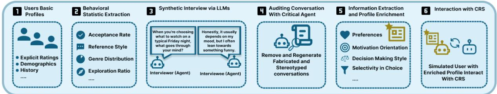  
Figure 1: Overview of the SimInter pipeline.

<table><tr><td>Dimension</td><td>CSHI (Zhu et al., 2024b)</td><td>PerCRS (Zhao et al., 2025)</td><td>PUB (Ma et al., 2025)</td><td>SimInter (ours)</td></tr><tr><td>Dataset</td><td>ReDial, OpenDialKG, MovieLens</td><td>DuRecDial 2.0</td><td>Amazon Reviews</td><td>ReDial</td></tr><tr><td>Conversational</td><td>Yes</td><td>Yes</td><td>No</td><td>Yes</td></tr><tr><td>Profile source</td><td>History; generated or editable profiles</td><td>History; injected Big Five</td><td>Behavioral logs; inferred Big Five</td><td>Statistics; audited interviews</td></tr><tr><td>Profile ground truth</td><td>Target items; held-out interactions</td><td>Injected personality traits</td><td>Held-out real interactions</td><td>Historical preferences; no trait labels</td></tr><tr><td>Target-item conditioning</td><td>Yes</td><td>Yes</td><td>N/A</td><td>No</td></tr><tr><td>Fabrication control</td><td>Target-leakage prevention</td><td>KG-based factual grounding</td><td>Not reported</td><td>Evidence-based turn-level auditing</td></tr><tr><td>Evaluation target</td><td>CRS recommendation performance</td><td>Trait consistency; CRS outcomes</td><td>Behavioral fidelity; RS ranking</td><td>Simulator behavior; human evaluation</td></tr><tr><td>Data requirements</td><td>Interaction history; item information</td><td>Preferences; traits; KG</td><td>Ratings; reviews; timestamps; metadata</td><td>Dialogues; historical preferences</td></tr></table>

Table 1: Conceptual comparison of user simulation frameworks. Ground truth denotes available evaluation references, not necessarily verified personality traits. Fabrication-control mechanisms differ in scope; N/A indicates not applicable.

where possible, we drew components from different model families to reduce shared bias between generator, auditor, and judges. All model choices are flexible.

## 3.1 Basic User Profiles and Behavioral Statistics

Stage 1 (Basic User Profiles). We construct basic user profiles from ReDial (Li et al., 2018), treating each crowdworker as a user across both seeker and recommender roles. Of the 1,112 workers in the 11,348 ReDial dialogues, we retain the 618 with at least two conversations. Each profile contains observed movie preferences (liked, disliked, and implicitly disliked movies, derived from ReDial’s post-conversation questionnaires) and the user’s historical conversations.

Stage 2 (Behavioral Statistic Extraction). We augment these profiles with rule-based behavioral statistics derived from historical interactions: acceptance and rejection rates, reference style (genre, mood, actor, director, year), genre and decade distributions, exploration ratio, and popularity score. Together these form a behavioral fingerprint that grounds the synthetic interview. Figure 2 shows an example. Of the 618 profiles, 543 meet our eligibility criteria, requiring at least one seeker-role conversation and a nonzero acceptance or implicitrejection signal. We randomly sample 300 users from this eligible set for the full SimInter pipeline, and randomly select a subset of 100 of these users for matched ablation experiments and comparison with CSHI (§4.1).

## 3.2 Synthetic Interview Generation

## Stage 3 (Synthetic Interview Generation).

Conversations often contain implicit information that provides deeper insights into users (Tigunova et al., 2019; Torbati et al., 2021). We exploit LLMs’ role-playing capabilities (Wang et al., 2024; Chen et al., 2024) to simulate interviews between two agents: an interviewee anchored to the user’s profile and an interviewer that elicits it. For each of the 300 sampled users, the interviewee agent receives the user’s statistical profile and one historical Re-Dial conversation in which the user acts as a seeker. The interviewer, in contrast, has no access to the profile or the ReDial history; it sees only the ongoing interview, so that it cannot steer the interviewee toward known preferences. It opens with one of four predefined open-ended questions, chosen at random (e.g., “Walk me through the last movie you really enjoyed — what was it and what stuck with you?”; all four are listed in Appendix J.1), and dynamically adapts its follow-up questions to the interviewee’s responses. Each interview comprises an initial six-turn elicitation phase followed by four clarification turns, for a total of 10 turns. Figure 3 shows an example; full system prompts are in Appendix J.

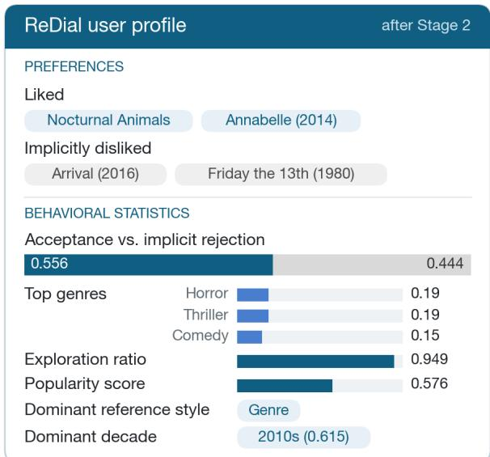

Figure 2: Example ReDial user profile after Stage 2, combining historical preferences with derived behavioral statistics.  
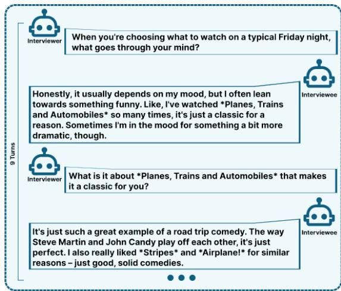  
Figure 3: Example simulated interview between interviewer and interviewee agents.

## 3.3 Conversation Auditing

Stage 4 (Conversation Auditing).

An Audit Agent checks each interviewee turn against the user’s own evidence, namely the statistical profile and the historical ReDial conversation, for three types of issues. Fabrication covers specific claims that are neither stated in nor plausibly inferable from this evidence, such as invented viewing experiences or personal anecdotes. Caricature covers stereotyped persona performances and invented rationalizations: plausible-sounding justifications for preferences that the profile does not attest, or recognizable persona archetypes it does not support. History contradiction covers statements that conflict with the user’s liked and disliked movies or with their earlier ReDial conversation. In addition, deterministic structural checks verify the number of turns, the alternation of speaker roles, and the absence of empty turns.

The auditor assigns each flag a severity (low, medium, or high), and a deterministic rule derives the dialogue-level decision. Any structural error or ≥ 3 high-severity flags trigger REGENERATE (up to two retries, with a corrective nudge appended to the interviewee prompt). At least one high-severity or ≥ 3 medium-severity flags trigger PARTIAL: the interview is retained, but its high- and mediumseverity turns are excluded from enrichment. All other interviews are accepted (ACCEPT). For example, in one interview, the interviewee claimed to have enjoyed Blue Streak, although the user’s Re-Dial conversation indicated that they had not seen it. In another, the interviewee dismissed the action in Justice League as hard to care about, although the film is on the user’s liked list. The auditor flagged both turns, so they could be excluded before profile enrichment. Full auditor prompts, flag definitions, and representative examples are in Appendix B.

## 3.4 Profile Enrichment

## Stage 5 (Profile Enrichment).

From audited interviews, we extract six implicit user attributes grounded in prior user-modeling literature: aspect-level preferences (Radlinski et al., 2019), pickiness (Yoon et al., 2024), decisionmaking style (Scott and Bruce, 1995; Hayati et al., 2020), viewing motivation (Oliver and Raney, 2011), novelty preference (Tang and Liao, 2022), and domain expertise (Kostric et al., 2025). Each attribute reveals behavior not observable in the static profile: aspect preferences organize preferences along Movie/Genre/Person/Other anchors; pickiness captures selectivity; decision-making style ranges across rational, intuitive, dependent, avoidant, and spontaneous; viewing motivation combines a hedonic-eudaimonic score (1–5) with a primary category (escapism, hedonic, eudaimonic, social, catharsis, arousal); novelty preference scores openness to unfamiliar content (1–5); and domain expertise classifies users as novice, intermediate, or cinephile. Full attribute schemas, evidence-extraction prompts, and an example enriched profile are in Appendix H.

The inferred attributes and derived pickiness are combined with the Stage 2 statistical profile to form the enriched profile that conditions user simulation in Stage 6.

## 3.5 User Simulation

## Stage 6 (User Simulation).

The enriched profile of each user conditions Gemini 2.5 Flash (Comanici et al., 2025) to simulate that user’s behavior in conversation with a CRS powered by GPT-4o-mini (Achiam et al., 2023). Each user is simulated in four conversations varying the opening strategy across aspect, movie, mood, and expertise prompts. After each CRS turn, starting from the fourth, an LLM termination judge classifies the last exchange as true acceptance (the user explicitly commits to a specific recommendation), resigned acceptance, explicit give-up, other, or continue; any label other than continue ends the conversation, which is otherwise capped at eight CRS turns.

## 4 Evaluation

We evaluate SimInter on ReDial using 300 users in the full pipeline and a matched subset of 100 users for comparisons against two baselines: STA-TISTICALONLY and CSHI. We ask four questions: do enriched users (T1) mention a more diverse set of items? (T2) express preferences correlated with population-level movie ratings? (T3) discuss movies along richer behavioral aspects? (T4) differ in surface linguistic variety? We additionally conduct a targeted human evaluation (§4.6) and report a separate cross-CRS robustness experiment with two trained ReDial recommenders, KBRD (Chen et al., 2019) and UniCRS (Wang et al., 2022) (Appendix E). Our evaluation focuses on profileconditioned simulated user behavior, rather than the recommendation accuracy of the underlying CRS models.

## 4.1 Experimental Setup

FULL represents the complete SimInter pipeline, combining behavioral statistics, audited interviews, and enriched user attributes. STATIS-TICALONLY uses only the behavioral statistics, without interview-based profile enrichment. We additionally compare against CSHI, an existing user-simulation baseline that follows a targetconditioned dialogue protocol.

We run FULL on 300 ReDial users, generating four conversations per user (1,200 conversations). For matched comparisons, we select a subset of 100 users and evaluate STATISTICALONLY and CSHI on the same users, generating 400 conversations per baseline. All comparisons use the corresponding 100-user subset of FULL.

We report descriptive metrics for the full 300- user cohort and conduct paired comparisons on the matched 100-user subset. For each comparison, we compute user-level mean differences with bootstrap 95% confidence intervals (20,000 paired resamples), two-sided paired sign-flip tests (50,000 randomizations), and paired Cohen’s dz (Cohen, 2013). We apply Holm’s correction (Holm, 1979) across the original family of 24 paired metric tests, using a significance level of α = 0.05. T2 population-level correlations are reported descriptively.

## 4.2 Evaluation Tracks

T1 — Item diversity. For each user, Shannon entropy of the movie-mention distribution across their four conversations. Higher entropy indicates broader coverage, reflecting whether the simulator escapes the “average user” attractor (Zhu et al., 2024a). We also report Jensen–Shannon divergence (JSD) against the movie-mention distribution of ReDial seekers.

T2 — Popularity alignment. For movies the user rates or reacts to in conversation, we correlate the simulator’s expressed preference with the movie’s mean MovieLens-25M rating (Harper and Konstan, 2015) (Pearson and Spearman). This tests whether stated preferences track population-level signal.

T3 — Aspect richness. Using Claude Haiku 4.5 (Anthropic, 2025) as an aspect-level judge (Liu et al., 2023; Zheng et al., 2023), we extract (aspect, sentiment) pairs from the user’s sentences about each movie discussed in the conversation.

After filtering generic placeholders (e.g., movie, film, story), we compute per-user Shannon entropy over remaining aspects and over the sentiment distribution. Higher aspect entropy indicates the simulator articulates preferences along a wider range of behavioral dimensions rather than collapsing to a single template.

T4 — Linguistic surface variety. Per-user metrics over user turns: corpus-level type-token ratio (TTR), n-gram monotony (mean Jaccard overlap of bigrams/trigrams between turn pairs), and SBERT semantic diversity (Reimers and Gurevych, 2019). TTR and n-gram monotony measure lexical variety, SBERT diversity measures the semantic spread of requests, and T3 captures semantic-content variety; these can move oppositely.

## 4.3 Results

Table 2 summarizes the matched 100-user comparisons. Relative to STATISTICALONLY, FULL achieves higher T3 aspect entropy $( \Delta = + 0 . 7 6 0 )$ but lower T1 item diversity (∆ = −0.375), both significant after Holm correction. FULL also exceeds CSHI on T1, T3, and T4. T2 correlations are reported descriptively.

T1 — Item diversity. FULL exhibits a more concentrated movie-mention distribution than STA-TISTICALONLY $( p _ { \mathrm { a d j } } < 0 . 0 0 1 )$ , and a marginally higher but significant JSD from ReDial (0.681 vs. 0.676). These results characterize the breadth of movie mentions rather than the fidelity of simulated preferences.

T2 — Popularity alignment. In the full 300- user evaluation, SimInter exhibits a moderate positive correlation between simulated movie preferences and MovieLens-25M mean ratings (Pearson $r = 0 . 3 4 7$ $n = 2 7 5$ movies). This suggests that the preferences expressed in simulated dialogue capture meaningful population-level rating patterns. On the matched 100-user subset, correlations remain positive for FULL $( r = 0 . 1 7 1 )$ ) and STATIS-TICALONLY $( r = 0 . 1 3 3 )$ . As the movie sets differ across conditions, these estimates are descriptive rather than paired comparisons and do not establish individual-level preference fidelity. Further diagnostics are provided in Appendix A.

T3 — Aspect richness. One of the strongest findings is the substantial increase in the diversity of movie-related aspects expressed by enriched users. Across the full 300-user cohort, FULL achieves a mean aspect entropy of 1.606. On the matched 100-user subset, FULL substantially exceeds STA-TISTICALONLY (1.619 vs. 0.859; $\Delta = + 0 . 7 6 0$ $d _ { z } = 0 . 9 5 5 , p _ { \mathrm { a d j } } < 0 . 0 0 1 )$ . These findings highlight the contribution of interview-based profile enrichment to richer aspect-level preference expression.

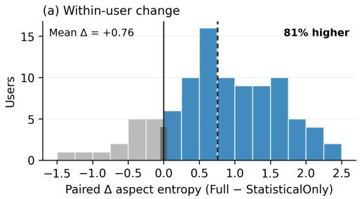

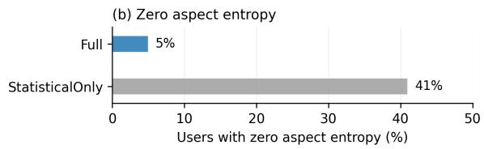  
Figure 4: Effect of interview-based profile enrichment on filtered T3 aspect entropy across 100 matched users. (a) Per-user paired differences between FULL and STA-TISTICALONLY; the dashed line indicates the mean difference and the solid line indicates zero. (b) Percentage of users with zero aspect entropy under both conditions.

Figure 4 shows that FULL achieves higher filtered aspect entropy than STATISTICALONLY for 81 of the 100 matched users (15 lower, 4 unchanged). Moreover, only 5% of users under FULL exhibit zero aspect entropy, compared with 41% under STATISTICALONLY.

A concrete example illustrates how enrichment shapes preference expression. User 468’s enriched profile captures preferences for relentless pacing and action choreography. In a matched moodstrategy opening, the FULL simulator requests “an action thriller with relentless pacing and some genuinely tight choreography,” whereas STATIS-TICALONLY asks for “some intense action” with “a good crime or thriller plot.” References to pacing and choreography recur across all four FULL openings, illustrating how enriched profile attributes translate into more specific movie-related requests. Additional qualitative examples and aspect distributions are provided in Appendix D.

T4 — Linguistic surface variety. FULL shows slightly higher SBERT semantic diversity than STA-TISTICALONLY (0.532 vs. 0.500; $d _ { z } = + 0 . 2 5 )$ , but the difference is not significant $( p _ { \mathrm { a d j } } = 0 . 1 1 )$ Conversely, FULL exhibits lower corpus TTR (0.674 vs. 0.728; $d _ { z } ~ = ~ - 0 . 6 8 )$ and higher ngram monotony (0.028 vs. 0.019; both uncorrected $p < 0 . 0 0 1 )$

<table><tr><td>Track</td><td>Metric</td><td>FULL</td><td>STATONLY</td><td>CSHI</td><td> $\Delta _ { F - S }$ </td><td> $\Delta { } _ { F - C }$ </td></tr><tr><td>T1</td><td>Item entropy</td><td>2.034</td><td>2.409</td><td>1.454</td><td> $- 0 . 3 7 5 ^ { \star }$ </td><td> $+ 0 . 5 8 8 ^ { \star }$ </td></tr><tr><td>T1</td><td>JSD vs. ReDial</td><td>0.681</td><td>0.676</td><td>0.682</td><td> $+ 0 . 0 0 5 ^ { \star }$ </td><td>-0.001</td></tr><tr><td>T2</td><td>Population Pearson r</td><td>0.171</td><td>0.133</td><td>0.074</td><td></td><td></td></tr><tr><td>T3</td><td>Aspect entropy (filtered)</td><td>1.619</td><td>0.859</td><td>0.194</td><td> $+ 0 . 7 6 0 ^ { \star }$ </td><td> $+ 1 . 4 2 5 ^ { \star }$ </td></tr><tr><td>T3</td><td>Aspect entropy (unfiltered)</td><td>1.857</td><td>1.490</td><td>0.694</td><td> $+ 0 . 3 6 6 ^ { \star }$ </td><td> $+ 1 . 1 6 3 ^ { \star }$ </td></tr><tr><td>T4</td><td>SBERT diversity (pairwise)</td><td>0.532</td><td>0.500</td><td>0.345</td><td>+0.032</td><td> $+ 0 . 1 8 6 ^ { \star }$ </td></tr><tr><td>T4</td><td>SBERT diversity (centroid)</td><td>0.226</td><td>0.211</td><td>0.140</td><td>+0.016</td><td> $+ 0 . 0 8 6 ^ { \star }$ </td></tr></table>

Table 2: Evaluation results on the matched 100-user subset. STATONLY denotes STATISTICALONLY. $\Delta _ { F - S }$ and $\Delta _ { F - C }$ denote paired mean differences between FULL and STATISTICALONLY and CSHI, respectively. ⋆ indicates significance after Holm correction $( p _ { \mathrm { a d j } } < 0 . 0 5 )$ . CSHI T1 is defined for 94 users (six mention a single movie). T2 correlations are descriptive and computed over condition-specific movie sets.

This lexical trade-off is consistent with the repetition of profile-specific expressions across conversations, a known issue in profile-conditioned generation (Sekulic et al.´ , 2024). For example, User 468 repeatedly uses “relentless” across three of four conversations, reflecting vocabulary from the enriched profile. Thus, T3 and T4 capture complementary properties: enrichment can increase aspect richness and semantic diversity while narrowing lexical expression. These distinctions matter when diagnosing CRS breakdowns (Bernard and Balog, 2024), particularly when varied user phrasing is important.

Comparison with CSHI. Under its targetconditioned protocol with the same GPT-4o-mini CRS, CSHI produces markedly less diverse simulated behavior than FULL: aspect entropy is 0.194 vs. 1.619 $( d _ { z } ~ = ~ 1 . 8 5 )$ , item entropy 1.454 vs. 2.034 (dz = 1.13), and SBERT diversity 0.345 vs. 0.532 (dz = 1.30; all $p _ { \mathrm { a d j } } < 0 . 0 0 1 )$ , while JSD from ReDial does not differ. CSHI requests are also lexically repetitive (n-gram monotony 0.300 vs. 0.028), and its population correlation is weak $( r = 0 . 0 7 4 .$ , 88 movies). Because CSHI steers each conversation toward a predefined target item, these differences reflect both profile content and protocol, not profile enrichment alone.

## 4.4 Auditor Behavior

The Audit Agent processed 300 interviews: AC-CEPT (209, 70%), PARTIAL (91, 30%), REGENER-ATE (0). Only one interview reached the REGENER-

ATE threshold; the regenerated interview received PARTIAL. All other corrective action was therefore turn-level exclusion under PARTIAL, removing 196 interviewee turns from enrichment. The auditor raised 676 flags (372 caricature, 173 history contradiction, 131 fabrication); the full taxonomy and example dialogues are in Appendix B.

Three observations follow. First, the dominant issue is not fabrication but caricature (372/676 flags, 55%), mostly invented rationalizations. For example, one interviewee explained a dislike of The Hangover and Superbad, both on the user’s disliked list, by calling them “loud and obnoxious,” although the user likes comparably broad comedies; the dislike is attested, but the reason is not. Second, the human evaluation shows a matching pattern (§4.6): decision-making style, which has no quantitative anchor in the profile, is the least supported attribute (21.4% Unsupported; 28.6% Evidence-grounded), whereas pickiness, derived from the rejection rate, is among the best supported (97.0%); this correspondence offers limited, indirect evidence of audit calibration. Third, the absence of final REGENERATE decisions indicates that gross structural failure is rare with capable LLMs at our interview scale; the dominant failure mode is local, which makes turn-level exclusion an appropriate response.

## 4.5 Human Evaluation of Audit Decisions

We evaluated Stage 4 auditing on 105 synthetic interviewee turns, with one turn per historical Re-Dial user, sampled equally from the 35 excluded, 35 flagged-but-retained, and 35 unflagged audit outcomes. Three co-author annotators independently examined each synthetic response alongside evidence from the corresponding user’s original ReDial conversations, without seeing the auditor’s decisions, flags, or rationales. They assigned one of three labels: EXCLUDED (a serious, evidence-supported issue warrants removing the turn), FLAGGED–RETAINED (a meaningful issue exists but does not warrant removal), or UN-FLAGGED (no meaningful issue is identified). The annotators agreed unanimously on 70/105 turns (66.7%; Fleiss’ $\kappa = 0 . 6 6 4 )$

Using majority human judgments as the reference, the auditor achieved 86.7% three-class accuracy (91/105), with agreement on 31/35 excluded, 31/35 flagged-but-retained, and 29/35 unflagged turns. Collapsing both retained classes yielded 95.2% binary filtering accuracy (100/105): four auditor-excluded turns were judged retainable and one auditor-retained turn was judged excludable. These results suggest that Stage 4 can distinguish concerns that warrant removal from those that need not discard an otherwise usable response. The figures are human-referenced accuracies on this balanced sample, not prevalence-adjusted estimates over all audited turns; annotation protocol, disagreements, and limitations are detailed in Appendix G.

## 4.6 Human Evaluation of Enriched Attributes

Three annotators independently evaluated enrichedattribute claims from FULL profiles. We report 105 claims from 45 users rated by all three annotators (315 annotations). Using behavioral profiles and interview transcripts, annotators assessed support, evidence grounding, consistency, usefulness, overreach, and confidence (Appendix F).

Results. By majority vote, 94.3% of claims were Supported or Partially supported (41.0% strictly Supported), and 5.7% were Unsupported or Contradicted. At the annotation level, 1.3% were Contradicted; mean usefulness and overreach were 3.61/5 and 1.70/5. Strict support was highest for pickiness (72.7%) and liked aspects (75.0%) while decision-making style had the highest Unsupported/Contradicted rate (21.4%; Table 3).

Inter-annotator agreement. Pairwise quadraticweighted Cohen’s κ ranged from 0.40 to 0.52, with 97–98% within-one-rank agreement. For binary support, Gwet’s AC1 was 0.89, while Fleiss’ κ was lower under label imbalance. Disagreements mainly involved Supported versus Partially supported (Appendix F).

<table><tr><td>Attribute</td><td>n</td><td>Support</td><td>Grounded</td></tr><tr><td>Viewing motivation</td><td>51</td><td>100.0%</td><td>47.1%</td></tr><tr><td>Aspect prefs. (liked)</td><td>60</td><td>100.0%</td><td>81.7%</td></tr><tr><td>Aspect prefs. (descr.)</td><td>24</td><td>100.0%</td><td>91.7%</td></tr><tr><td>Pickiness</td><td>66</td><td>97.0%</td><td>65.2%</td></tr><tr><td>Domain expertise</td><td>36</td><td>88.9%</td><td>41.7%</td></tr><tr><td>Novelty preference</td><td>15</td><td>86.7%</td><td>46.7%</td></tr><tr><td>Aspect prefs. (disliked)</td><td>21</td><td>81.0%</td><td>76.2%</td></tr><tr><td>Decision-making style</td><td>42</td><td>78.6%</td><td>28.6%</td></tr><tr><td>All</td><td>315</td><td>93.3%</td><td>59.7%</td></tr></table>

Table 3: Human-evaluation support rates by attribute. Support = Supported + Partially supported; Grounded = Evidence-grounded. n is number of annotations (each claim has three).

## 4.7 Cross-CRS Robustness

We evaluated T3 robustness on 120 users with KBRD and UniCRS under two independent judges. After audit filtering, the paired samples contained 111 KBRD and 80 UniCRS users. The aspectentropy improvement persisted for KBRD $( \Delta =$ +0.265 and +0.280) and UniCRS $( \Delta = + 0 . 3 3 0$ and +0.369) under GPT-4o-mini and DeepSeekchat, respectively (all $p < 0 . 0 0 1 )$ . Including all technically completed conversations also yielded positive effects (+0.275 to +0.560; all $p < 0 . 0 0 1 )$ . These results support T3 robustness across backends and judges, but do not establish overall simulator fidelity. Full details appear in Appendix E.

## 5 Conclusion

We presented SimInter, a pipeline for LLM-based user simulation that elicits qualitative behavioral attributes through structured synthetic interviews and guards against fabrication via explicit turnlevel auditing. On 300 ReDial users, simulators conditioned on enriched profiles discuss movies along substantially richer behavioral aspects than a statistics-only baseline $( d _ { z } ~ = ~ 0 . 9 6 , ~ p _ { \mathrm { a d j } } ~ <$ 0.001; zero-aspect users drop from 41% to 5%); pooled popularity alignment with MovieLens-25M reaches $r = 0 . 3 4 7 ;$ ; and 94% of enriched-attribute claims are human-supported. Enrichment also concentrates item mentions and reduces lexical variety, consistent with profile-conditioned generation narrowing expression toward profile vocabulary. Usersimulation quality in CRS is thus multidimensional: the goal is not to maximize every diversity metric, but to gain more on dimensions that matter for CRS evaluation than is lost on those that do not.

## Limitations

Evidence grounding and audit reliability. Sim-Inter grounds enriched attributes in historical user evidence, while independent validation against real user behavior remains an important direction for future work. Human evaluation assesses evidence support rather than direct behavioral fidelity. Moreover, audit decisions involve uncertainty, particularly when distinguishing unsupported rationalizations from legitimate preference elaboration. Automatically retrieved evidence and differences in annotator judgments further limit conclusions about audit reliability.

Evaluation scope and generalizability. Our ablations do not include direct LLM-based attribute inference without interviewing, leaving the interview’s independent contribution unresolved. Sparse and imbalanced preference evidence limits individual-level alignment evaluation. Enrichment also involves trade-offs between aspect richness, item diversity, and lexical variety. Although cross-CRS experiments support the robustness of aspectlevel findings, they rely on automated evaluation and do not establish agreement with real-user assessments of recommenders. Generalization beyond English movie recommendation remains to be investigated.

## Ethical Considerations

ReDial is released under CC BY 4.0, MovieLens-25M is available for non-commercial research use, and the iEvaLM-CRS implementations of KBRD and UniCRS (Wang et al., 2023) are under the MIT License; we use all of them solely for research. LLMs are accessed through their official APIs under the providers’ terms.

## References

Josh Achiam, Steven Adler, Sandhini Agarwal, Lama Ahmad, Ilge Akkaya, Florencia Leoni Aleman, Diogo Almeida, Janko Altenschmidt, Sam Altman, Shyamal Anadkat, and 1 others. 2023. Gpt-4 technical report. arXiv preprint arXiv:2303.08774.

Jafar Afzali, Aleksander Mark Drzewiecki, Krisztian Balog, and Shuo Zhang. 2023. Usersimcrs: A user simulation toolkit for evaluating conversational recommender systems. In Proceedings of the Sixteenth ACM International Conference on Web Search and Data Mining, WSDM ’23, page 1160–1163. ACM.

Anthropic. 2025. Claude haiku 4.5 system card. Technical report.

Krisztian Balog and ChengXiang Zhai. 2025. User simulation in the era of generative ai: User modeling, synthetic data generation, and system evaluation. ArXiv, abs/2501.04410.

Nolwenn Bernard and Krisztian Balog. 2024. Identifying breakdowns in conversational recommender systems using user simulation. Proceedings of the 6th ACM Conference on Conversational User Interfaces.

Nolwenn Bernard and Krisztian Balog. 2025. Limitations of current evaluation practices for conversational recommender systems and the potential of user simulation. In Proceedings ofthe 2025 Annual International ACM SIGIR Conference on Research and Development in Information Retrieval in the Asia Pacific Region, pages 261–271.

Jiangjie Chen, Xintao Wang, Rui Xu, Siyu Yuan, Yikai Zhang, Wei Shi, Jian Xie, Shuang Li, Ruihan Yang, Tinghui Zhu, Aili Chen, Nianqi Li, Lida Chen, Caiyu Hu, Siye Wu, Scott Ren, Ziquan Fu, and Yanghua Xiao. 2024. From persona to personalization: A survey on role-playing language agents. Preprint, arXiv:2404.18231.

Luyu Chen, Quanyu Dai, Zeyu Zhang, Xueyang Feng, Mingyu Zhang, Pengcheng Tang, Xu Chen, Yue Zhu, and Zhenhua Dong. 2025a. Recusersim: A realistic and diverse user simulator for evaluating conversational recommender systems. Companion Proceedings ofthe ACM on Web Conference 2025.

Nuo Chen, Quanyu Dai, Xiaoyu Dong, Piaohong Wang, Qinglin Jia, Zhaocheng Du, Zhenhua Dong, and Xiao-Ming Wu. 2025b. Evaluating conversational recommender systems via large language models: A user-centric framework.

Qibin Chen, Junyang Lin, Yichang Zhang, Ming Ding, Yukuo Cen, Hongxia Yang, and Jie Tang. 2019. Towards knowledge-based recommender dialog system. Preprint, arXiv:1908.05391.

Jacob Cohen. 1968. Weighted kappa: Nominal scale agreement provision for scaled disagreement or partial credit. Psychological bulletin, 70(4):213.

Jacob Cohen. 2013. Statistical power analysisfor the behavioral sciences, 2 edition. Routledge, London, England.

Gheorghe Comanici, Eric Bieber, Mike Schaekermann, Ice Pasupat, Noveen Sachdeva, Inderjit Dhillon, Marcel Blistein, Ori Ram, Dan Zhang, Evan Rosen, and 1 others. 2025. Gemini 2.5: Pushing the frontier with advanced reasoning, multimodality, long context, and next generation agentic capabilities. arXiv preprint arXiv:2507.06261.

Zuohui Fu, Yikun Xian, Yongfeng Zhang, and Yi Zhang. 2020. Tutorial on conversational recommendation systems. Proceedings of the 14th ACM Conference on Recommender Systems.

Kilem Li Gwet. 2008. Computing inter-rater reliability and its variance in the presence of high agreement. The British journal of mathematical and statistical psychology, 61 Pt 1:29–48.

F Maxwell Harper and Joseph A Konstan. 2015. The movielens datasets: History and context. Acm transactions on interactive intelligent systems (tiis), 5(4):1– 19.

Shirley Anugrah Hayati, Dongyeop Kang, Qingxiaoyang Zhu, Weiyan Shi, and Zhou Yu. 2020. IN-SPIRED: Toward sociable recommendation dialog systems. In Proceedings ofthe 2020 Conference on Empirical Methods in Natural Language Processing (EMNLP), pages 8142–8152, Online. Association for Computational Linguistics.

Sture Holm. 1979. A simple sequentially rejective multiple test procedure. Scandinavian Journal ofStatistics, 6(2):65–70.

Yucheng Jin, Li Chen, Wanling Cai, and Xianglin Zhao. 2024. Crs-que: A user-centric evaluation framework for conversational recommender systems. ACM Trans. Recomm. Syst., 2(1).

Hyeakyeong Kim, Young U. Ryu, Yoon Ho Cho, and Jae Kyeong Kim. 2012. Customer-driven content recommendation over a network of customers. IEEE Transactions on Systems, Man, and Cybernetics - Part A: Systems and Humans, 42:48–56.

Minjin Kim, Minju Kim, Hana Kim, Beong-woo Kwak, SeongKu Kang, Youngjae Yu, Jinyoung Yeo, and Dongha Lee. 2024. Pearl: A review-driven personaknowledge grounded conversational recommendation dataset. Findings of the Association for Computational Linguistics: ACL 2024, pages 1105–1120.

Ivica Kostric, Ujwal Gadiraju, and Krisztian Balog. 2025. Know your users! estimating user domain knowledge in conversational recommenders. arXiv preprint arXiv:2512.13173.

Raymond Li, Samira Ebrahimi Kahou, Hannes Schulz, Vincent Michalski, Laurent Charlin, and Chris Pal. 2018. Towards deep conversational recommendations. Advances in neural information processing systems, 31.

Hsien-chin Lin, Christian Geishauser, Shutong Feng, Nurul Lubis, Carel van Niekerk, Michael Heck, and Milica Gasic. 2022. GenTUS: Simulating user behaviour and language in task-oriented dialogues with generative transformers. In Proceedings ofthe 23rd Annual Meeting ofthe Special Interest Group on Discourse and Dialogue, pages 270–282, Edinburgh, UK. Association for Computational Linguistics.

Yang Liu, Dan Iter, Yichong Xu, Shuohang Wang, Ruochen Xu, and Chenguang Zhu. 2023. G-eval: NLG evaluation using gpt-4 with better human alignment. In Proceedings of the 2023 Conference on Empirical Methods in Natural Language Processing, pages 2511–2522, Stroudsburg, PA, USA. Association for Computational Linguistics.

Chenglong Ma, Ziqi Xu, Yongli Ren, Danula Hettiachchi, and Jeffrey Chan. 2025. Pub: an llmenhanced personality-driven user behaviour simulator for recommender system evaluation.

Mary Beth Oliver and Arthur A. Raney. 2011. Entertainment as pleasurable and meaningful: Identifying hedonic and eudaimonic motivations for entertainment consumption. Journal ofCommunication, 61(5):984– 1004.

Filip Radlinski, Krisztian Balog, Bill Byrne, and Karthik Krishnamoorthi. 2019. Coached conversational preference elicitation: A case study in understanding movie preferences. In Proceedings of the 20th Annual SIGdial Meeting on Discourse and Dialogue, pages 353–360, Stockholm, Sweden. Association for Computational Linguistics.

Nils Reimers and Iryna Gurevych. 2019. Sentence-BERT: Sentence embeddings using siamese BERTnetworks. In Proceedings of the 2019 Conference on Empirical Methods in Natural Language Processing and the 9th International Joint Conference on Natural Language Processing (EMNLP-IJCNLP), Stroudsburg, PA, USA. Association for Computational Linguistics.

Aaron Ruß, Michael Quade, Michael Kruppa, and Mathias Runge. 2012. Rule-based approach for simulating age-related usability problems.

Susanne G. Scott and Reginald A. Bruce. 1995. Decision-making style: The development and assessment of a new measure. Educational and Psychological Measurement, 55:818 – 831.

Ivan Sekulic, Lili Lu, Navdeep Singh Bedi, and Fabio´ Crestani. 2024. Simulating conversational search users with parameterized behavior. In Proceedings ofthe 2024 Annual International ACM SIGIR Conference on Research and Development in Information Retrieval in the Asia Pacific Region, SIGIR-AP 2024, page 72–81, New York, NY, USA. Association for Computing Machinery.

Muh-Chyun Tang and I-Han Liao. 2022. Preference diversity and openness to novelty: Scales construction from the perspective of movie recommendation. Journal of the Association for Information Science & Technology, 73(9):1222–1235.

Tencent Hy Team. 2026. Hy3: A mixture-ofexperts language model. https://github.com/ Tencent-Hunyuan/Hy3. Official model repository.

Anna Tigunova, Andrew Yates, Paramita Mirza, and Gerhard Weikum. 2019. Listening between the lines: Learning personal attributes from conversations. In The World Wide Web Conference, pages 1818–1828.

Ghazaleh H Torbati, Andrew Yates, and Gerhard Weikum. 2021. You get what you chat: Using conversations to personalize search-based recommendations. In European Conference on Information Retrieval, pages 207–223. Springer.

Noah Wang, Z.y. Peng, Haoran Que, Jiaheng Liu, Wangchunshu Zhou, Yuhan Wu, Hongcheng Guo, Ruitong Gan, Zehao Ni, Jian Yang, Man Zhang, Zhaoxiang Zhang, Wanli Ouyang, Ke Xu, Wenhao Huang, Jie Fu, and Junran Peng. 2024. RoleLLM: Benchmarking, eliciting, and enhancing role-playing abilities of large language models. In Findings of the Associationfor Computational Linguistics: ACL 2024, pages 14743–14777, Bangkok, Thailand. Association for Computational Linguistics.

Xiaolei Wang, Xinyu Tang, Xin Zhao, Jingyuan Wang, and Ji-Rong Wen. 2023. Rethinking the evaluation for conversational recommendation in the era of large language models. In Proceedings ofthe 2023 Conference on Empirical Methods in Natural Language Processing, pages 10052–10065, Singapore. Association for Computational Linguistics.

Xiaolei Wang, Kun Zhou, Ji-Rong Wen, and Wayne Xin Zhao. 2022. Towards unified conversational recommender systems via knowledge-enhanced prompt learning. In Proceedings ofthe 28th ACM SIGKDD Conference on Knowledge Discovery and Data Min ing, KDD ’22, page 1929–1937. ACM.

Se-eun Yoon, Zhankui He, Jessica Echterhoff, and Julian McAuley. 2024. Evaluating large language models as generative user simulators for conversational recommendation. In Proceedings of the 2024 Conference ofthe North American Chapter ofthe Association for Computational Linguistics: Human Language Technologies (Volume 1: Long Papers), pages 1490–1504.

Shuo Zhang and Krisztian Balog. 2020. Evaluating conversational recommender systems via user simulation. In Proceedings ofthe 26th acm sigkdd international conference on knowledge discovery & data mining, pages 1512–1520.

Xiaoyan Zhao, Yang Deng, Wenjie Wang, Hong Cheng, Rui Zhang, See-Kiong Ng, Tat-Seng Chua, and 1 others. 2025. Exploring the impact of personality traits on conversational recommender systems: A simulation with large language models. arXiv preprint arXiv:2504.12313.

Lianmin Zheng, Wei-Lin Chiang, Ying Sheng, Siyuan Zhuang, Zhanghao Wu, Yonghao Zhuang, Zi Lin, Zhuohan Li, Dacheng Li, Eric P Xing, Hao Zhang, Joseph E Gonzalez, and Ion Stoica. 2023. Judging LLM-as-a-judge with MT-bench and chatbot arena.

Lixi Zhu, Xiaowen Huang, and Jitao Sang. 2024a. How reliable is your simulator? analysis on the limitations of current llm-based user simulators for conversational recommendation. In Companion Proceedings of the ACM Web Conference 2024, WWW ’24, page 1726–1732, New York, NY, USA. Association for Computing Machinery.

Lixi Zhu, Xiaowen Huang, and Jitao Sang. 2024b. A llm-based controllable, scalable, human-involved user simulator framework for conversational recommender systems. Proceedings of the ACM on Web Conference 2025.

## A T2 Degeneracy Diagnostics

The main text reports only the pooled T2 popularity correlation (§4.3). This appendix documents why per-user and persona-anchored variants are not reportable.

## A.1 Per-User Popularity Correlation

For each user, the per-user popularity Pearson r is the correlation between the simulator’s rating and the MovieLens-25M mean rating across the movies that user mentioned. This requires a minimum sample of ∼ 30 (user, movie) pairs per user for a reliable estimate.

Only 6/300 FULL users reach this threshold (median 7 pairs per user, maximum 47); on the matched subset, only 2 users in each of FULL and STATIS-TICALONLY reach this threshold. A paired test across users is therefore not feasible. The pooled estimate in Table 2 aggregates all (user, movie) pairs across the cohort, treating each pair as an independent observation, a weaker statistical claim than per-user testing would provide, but the only one available at our sample size.

## A.2 Persona-Anchored T2 (Liked vs. Disliked)

A second variant of T2 correlates the simulator’s in-conversation rating with the user’s ReDial liked/disliked label (binary ground truth). Table 4 reports the diagnostics. In every condition, 94– 97% of high-confidence ground-truth labels are liked, giving varianceredial < 0.1, a near-constant variable. Pearson r against a near-constant variable is driven by a handful of disliked pairs and is not a reliable discriminative metric, so the apparent ordering across conditions is not interpreted.

## A.3 Balanced Accuracy as an Alternative

A natural alternative is balanced accuracy on liked/disliked classification. Computing this requires users with both classes in ground truth. As shown above, only 2 users per condition satisfy this, too few to estimate a meaningful per-user balanced accuracy distribution. Pooled simple accuracy (94–96%) equals the majority-class rate and is uninformative.

Recommendation for future work. Per-user behavioral alignment metrics in CRS user simulation require either (a) a larger sample where most users have ≥ 30 rated items in conversation, or (b) controlled prompting that elicits a balanced acceptance/ rejection ratio per user (e.g., 50/50 targeted CRS recommendations). Both would address the per-user consistency gap noted by Yoon et al. (2024) and Bernard and Balog (2025).

<table><tr><td></td><td>FULL</td><td>STATONLY</td></tr><tr><td>Persona r (pooled)</td><td>0.603</td><td>0.261</td></tr><tr><td>n pairs</td><td>52</td><td>92</td></tr><tr><td>Var.redial</td><td>0.078</td><td>0.074</td></tr><tr><td>% liked (GT)</td><td>94.0%</td><td>96.3%</td></tr><tr><td>n high-conf. pairs</td><td>50</td><td>81</td></tr><tr><td>n users, both classes</td><td>2</td><td>2</td></tr><tr><td>Accuracy (high-conf.)</td><td>94.0%</td><td>96.3%</td></tr></table>

Table 4: T2 persona-anchored diagnostics on the matched 100-user subset. Ground-truth labels are nearconstant in every condition, making Pearson r unreliable as a discriminative metric.
<table><tr><td>Issue type</td><td>High</td><td>Med.</td><td>Low</td><td>Tot.</td></tr><tr><td>fabrication</td><td>12</td><td>47</td><td>72</td><td>131</td></tr><tr><td>caricature</td><td>12</td><td>255</td><td>105</td><td>372</td></tr><tr><td>history_contradiction</td><td>55</td><td>68</td><td>50</td><td>173</td></tr><tr><td>structural_error</td><td>0</td><td>0</td><td>0</td><td>0</td></tr><tr><td>Total</td><td>79</td><td>370</td><td>227</td><td>676</td></tr></table>

Table 5: Distribution of auditor flags by type and severity across 300 interviews (final attempts). Dialoguelevel decision distribution: ACCEPT 209, PARTIAL 91, REGENERATE 0 (one interview regenerated once before receiving PARTIAL).

## B Auditor Flag Taxonomy and Examples

## B.1 Flag Taxonomy

Table 5 summarizes the full flag distribution across the 300 interviews. We make three observations:

1. Invented rationalization is the dominant pattern (372/676 flags are caricature, 69% of them medium severity): the simulator frequently produces reasons for preferences that sound plausible but are not attested in the profile.

2. Flags grounded in the user’s own evidence are the most reliable. Contradictions with the liked and disliked lists or with the ReDial conversation can be checked directly (Examples 2–4). Fabrication flags about film facts rely on the auditor’s parametric knowledge and are less reliable: in several cases the auditor flagged accurate scene descriptions as fabricated. Such errors are conservative: they can remove grounded content from the enrichment input, but they do not introduce unsupported claims into the profile.

3. REGENERATE is rare. The auditor reserves REGENERATE for structural failure or ≥ 3 highseverity flags. This occurred in one of 300 interviews, and the regenerated interview received PAR-TIAL, indicating that gross structural failure is rare with capable LLMs (Gemini 2.5 Flash) at our interview scale. The dominant failure mode is local rather than global.

## B.2 Representative Example 1: ACCEPT

User 78. The auditor raised no flags; every film the interviewee mentions appears in the user’s liked or disliked lists.

Q1: If a friend asked you to recommend a movie that captures your taste, what would you pick and why?

A1: I’d probably point them toward something like Juno or The Perks of Being a Wallflower. I really lean toward comedies and dramas that have a sharp, witty sense of humor while still hitting you with some genuine, deeper moments.

Q4: [...] When does that attempt at honesty in a drama or comedy feel unearned or fall flat for you?

A4: [...] Like when I watched White Noise, it just didn’t land for me at all—it missed that grounded, witty balance and felt a bit too forced.

## B.3 Representative Example 2: PARTIAL (history contradiction)

User 1. One high-severity history\_contradiction flag (turn 6) and one low-severity caricature flag (turn 10); turn 6 was excluded from enrichment.

A (turn 6, excluded): I just really enjoy that buddy-cop or mismatched-duo comedy style [...]. It’s the same kind of fun, fast-paced energy I liked in Blue Streak with Martin Lawrence [...]

Auditor explanation: “The user claims to have liked Blue Streak’s energy in the recent dialogue, but in the earlier conversation explicitly stated they had not seen Blue Streak and expressed intent to watch it in the future.”

## B.4 Representative Example 3: PARTIAL (caricature)

User 730. One high-severity caricature flag (turn 8), which was excluded from enrichment.

A (turn 8, excluded): Honestly, a lot of bigbudget stuff just gets way too chaotic and messy without really earning those stakes, like some of the massive CGI battles in Justice League where it’s hard to actually care about what’s happening.

Auditor explanation: “The user claims Justice League’s CGI battles don’t earn stakes and are hard to care about, but Justice League is in their liked movies list with no negative commentary in the profile.” This illustrates an invented rationalization: a plausible reason for a dislike that the user’s history does not support.

## B.5 Representative Example 4: PARTIAL (invented rationalization)

User 66. One high-severity caricature flag (turn 8) and one medium-severity caricature flag (turn 2); both turns were excluded from enrichment.

A (turn 8, excluded): I think it fails when a comedy tries way too hard to be funny without caring about the characters, like in The Hangover or Superbad. It just feels loud and obnoxious rather than having any real situation driving the humor.

Auditor explanation: “This response performs a snobby cinephile persona dismissing comedies as ‘loud and obnoxious,’ but the profile shows the user actually likes comedies like Super Troopers, Beerfest, and Tommy Boy.”

Both films are on the user’s disliked list, so the dislike itself is attested; the stated reason is not. The simulator invents a plausible justification that is inconsistent with the user’s liking for comparably broad comedies—an invented rationalization in the sense of Stage 4.

## C Per-User Metric Distributions

The main text (§4.3) shows the per-user T3 aspect entropy distribution. This appendix shows the corresponding distributions for all other primary metrics on the matched 100-user subset. Throughout, FULL is dark blue and STATISTICALONLY is light blue, with dashed lines marking condition means.

## D T3 Aspect Vocabulary

Table 6 shows the top-20 aspects in each condition after filtering generic placeholders. Beyond the aggregate counts, the qualitative difference is informative: FULL introduces experiential vocabulary (pacing, overall vibe, energy) that is rare or absent in STATISTICALONLY, whose mentions concentrate on a single holistic judgment (movie overall).

## E Cross-CRS Robustness with Trained Recommenders

We conducted a separate paired robustness experiment using the frozen ABLATION-120 cohort, sampled from the original FULL-300 population before inspecting the results. Each user interacted with KBRD and UniCRS under two conditions: FULL, containing the statistical profile and semantic enrichment, and STATISTICALONLY, containing the same statistical profile and pickiness score but no semantic enrichment.

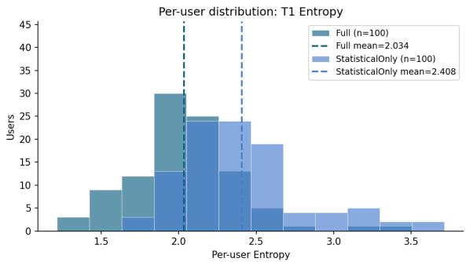  
Figure 5: T1 per-user item entropy. FULL is shifted left of STATISTICALONLY (2.034 vs. 2.409; $\Delta = - 0 . 3 7 5$ $d _ { z } = - 0 . 9 5 , p _ { \mathrm { a d j } } < 0 . 0 0 1 )$ , reflecting a more concentrated movie-mention distribution.

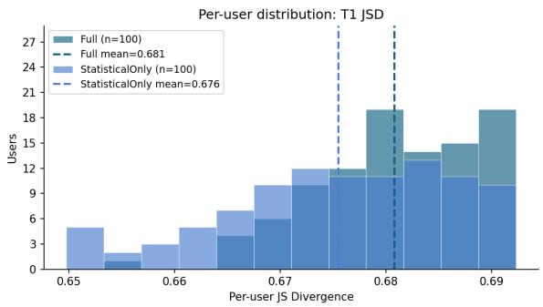  
Figure 6: T1 per-user JSD against the ReDial reference distribution. FULL is marginally higher (0.681 vs. 0.676; $d _ { z } = 0 . 4 7 , p _ { \mathrm { a d j } } < 0 . 0 0 1 )$ ; the absolute difference is small.

For every user, condition, and recommender, we generated four conversations corresponding to the aspect, movie, mood, and expertise opening strategies. This produced $1 2 0 \times 2 \times 2 \times 4 = 1 { , } 9 2 0$ conversations. User identity, behavioral statistics, opening-strategy schedule, conversation budget, and recommender configuration were held fixed across paired conditions.

Recommender implementations and generation. We used the iEvaLM-CRS implementations and released ReDial checkpoints. KBRD combines a relational-graph recommender with a BART-base conversation model (checkpoint files kbrd\_rec\_redial/model.pt and kbrd\_conv\_redial/pytorch\_model.bin;

<table><tr><td>Rank</td><td>FULL aspect</td><td>Count</td><td>STATONLY aspect</td><td>Count</td></tr><tr><td>1</td><td>mood</td><td>164</td><td>movie overall</td><td>407</td></tr><tr><td>2</td><td>pacing</td><td>103</td><td>plot</td><td>58</td></tr><tr><td>3</td><td>movie overall</td><td>81</td><td>mood</td><td>57</td></tr><tr><td>4</td><td>atmosphere</td><td>78</td><td>premise</td><td>23</td></tr><tr><td>5</td><td>overall vibe</td><td>50</td><td>action</td><td>22</td></tr><tr><td>6</td><td>plot</td><td>43</td><td>overall concept</td><td>21</td></tr><tr><td>7</td><td>vibe</td><td>37</td><td>humor</td><td>20</td></tr><tr><td>8</td><td>overall experience</td><td>27</td><td>genre</td><td>20</td></tr><tr><td>9</td><td>humor</td><td>26</td><td>comedy</td><td>18</td></tr><tr><td>10</td><td>mood/atmosphere</td><td>20</td><td>intensity</td><td>12</td></tr><tr><td>11</td><td>energy</td><td>18</td><td>overall fit</td><td>10</td></tr><tr><td>12</td><td>action</td><td>17</td><td>drama</td><td>9</td></tr><tr><td>13</td><td>overall quality</td><td>14</td><td>genre/mood</td><td>8</td></tr><tr><td>14</td><td>overall concept</td><td>14</td><td>vibe</td><td>8</td></tr><tr><td>15</td><td>tone</td><td>11</td><td>tone</td><td>7</td></tr><tr><td>16</td><td>overall appeal</td><td>11</td><td>atmosphere</td><td>7</td></tr><tr><td>17</td><td>premise</td><td>11</td><td>soundtrack</td><td>7</td></tr><tr><td>18</td><td>mood/vibe</td><td>11</td><td>pacing</td><td>6</td></tr><tr><td>19</td><td>intensity</td><td>11</td><td>thriller</td><td>6</td></tr><tr><td>20</td><td>style</td><td>10</td><td>overall quality</td><td>6</td></tr><tr><td>Distinct aspects (filtered)</td><td></td><td>267</td><td></td><td>174</td></tr></table>

Table 6: Top-20 most frequent aspects on the matched 100-user subset (after filtering generic placeholders). FULL’s vocabulary skews toward experiential dimensions (mood, pacing, atmosphere, energy); STATISTICALONLY is dominated by the near-generic movie overall (43% of its aspect mentions vs. 7% for FULL) and broad genre labels. Total distinct non-generic aspects: 267 vs. 174.

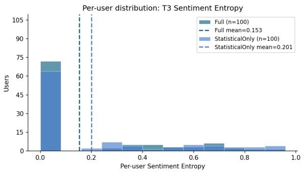  
Figure 7: T3 per-user sentiment entropy. FULL is slightly lower (0.153 vs. 0.201; $d _ { z } = - 0 . 2 6$ , uncorrected $p = 0 . 0 1 1 )$ . Both conditions cluster at zero (72 and 64 users), reflecting a strong positive-sentiment imbalance.

SHA-256 prefixes d62f7548 and dd85488a). UniCRS combines knowledge-graph prompts with DialoGPT-small and a RoBERTa-base text encoder (unicrs\_rec\_redial/model.pt and unicrs\_conv\_redial/model.pt; SHA-256 prefixes 9cd55118 and 23599951). For UniCRS, the released checkpoint’s padding-token index was mapped to the <movie> placeholder before movie-title substitution. Both recommenders used a maximum response length of 128 tokens; UniCRS additionally used a no-repeat 3-gram constraint. The user simulator was Gemini 2.5

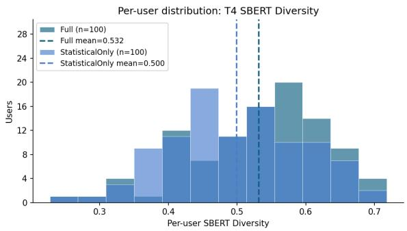  
Figure 8: T4 per-user SBERT semantic diversity. FULL is slightly higher (0.532 vs. 0.500; $d _ { z } = 0 . 2 5$ $p _ { \mathrm { a d j } } =$ 0.11); 10 FULL and 15 STATISTICALONLY users fall below 0.4.

Flash with temperature 0.7, a 256-token output limit, and reasoning disabled. Each conversation was generated once without a fixed sampling seed.

Unlike the primary experiment, which used Claude Haiku 4.5 for evaluation, this robustness experiment evaluated the same stored conversations with separate $\mathbf { G P T - } 4 \mathbf { o - m i n i }$ and DeepSeekchat calls, both at temperature 0.0. Each evaluator used its own extraction outputs and T3 reference baseline (baseline fingerprints 1afc994dd78c1045 and 82a23731b46cf48d, respectively). We therefore interpret within-judge paired differences and do not compare absolute entropy values across judges or with the primary experiment.

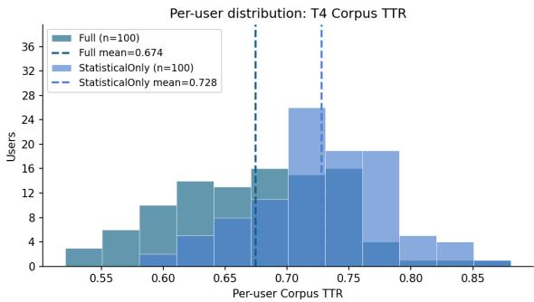  
Figure 9: T4 per-user corpus TTR. FULL TTR is systematically lower (0.674 vs. 0.728; $d _ { z } = - 0 . 6 8$ , uncorrected $p < 0 . 0 0 1 )$ ; enriched users repeat tokens more.

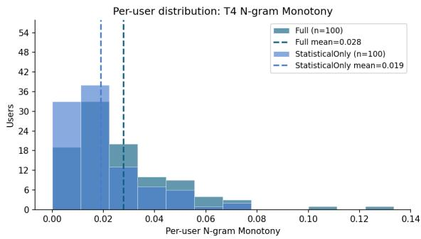  
Figure 10: T4 per-user n-gram monotony (Jaccard overlap of bigrams/trigrams between turn pairs; higher = more repetitive). FULL is skewed right of STATIS-TICALONLY (0.028 vs. 0.019; $d _ { z } = 0 . 3 6$ , uncorrected $p < 0 . 0 0 1 )$ , reflecting profile-vocabulary reuse.

Post-hoc CRS-dialogue audit. This Phase-2 audit is distinct from the Stage 4 Audit Agent that audits interviews before enrichment. GPT-4o-mini (temperature 0.2) checked the simulated user’s messages for fabrication, caricature, role confusion, and persona drift, with a 512-token output limit. It assigned ACCEPT when there was no major issue (at most a minor issue in one turn), PARTIAL when one issue type was present but the conversation remained mostly usable, and REJECT when multiple issue types or one severe issue were present; role confusion across multiple turns was explicitly severe. Model, prompt, temperature, and criteria were fixed across recommenders and conditions; only the condition-specific profile and generated conversation differed. Audit decisions were produced before T3 extraction and without access to extraction outputs. The audit affected inclusion only and did not regenerate conversations. Although the auditor and one T3 judge both used GPT-4o-mini, they were separate calls with different prompts; the DeepSeek-chat evaluation used a different underlying model.

Audit filtering and paired-sample construction. All four CRS–condition arms contained 480 technically completed conversations (120 users × four opening strategies), and no conversation terminated with a transport or generation error. In the primary analysis, individual conversations assigned a Phase-2 REJECT decision were excluded, whereas AC-CEPT and PARTIAL conversations were retained. Rejecting one conversation did not remove the entire user: a user remained evaluable in an arm whenever at least one of their four conversations was retained. The paired analysis then used the intersection of users evaluable in both conditions. This produced 111 paired users for KBRD (112 evaluable in FULL and 118 in STATISTICALONLY) and 80 for UniCRS (94 and 99, respectively).

The conversation-level rejection rates were 39.6% for FULL and 36.5% for STATISTICALONLY with KBRD, and 68.5% and 61.7%, respectively, with UniCRS. A post-hoc paired Wilcoxon diagnostic over per-user rejection rates found no significant condition difference for KBRD $( p = 0 . 2 6 2 )$ but found a higher rejection rate for FULL with UniCRS $( p \ : = \ : 0 . 0 1 9 ;$ two-sided). We therefore report the audit-filtered analysis together with an all-conversation sensitivity analysis.

Statistical inference. For each recommender– judge combination, inference was performed on paired user-level differences. We report percentile 95% confidence intervals from 10,000 paired bootstrap resamples (seed 0), two-sided Wilcoxon signed-rank tests with zero differences removed and SciPy’s automatic exact/asymptotic method selection, and paired Cohen’s $d _ { z }$ . The table reports unadjusted p-values for these four T3 comparisons. As a robustness check, two-sided paired sign-flip tests with 100,000 randomizations (seed 1) gave the same significance conclusions.

Per-user T3 aggregation. For each user and condition, the evaluator extracted aspect–sentiment pairs from every retained conversation and merged them into a single user-level aspect-frequency distribution. Filtered T3 aspect entropy was then computed once from this merged distribution. We did not compute a separate entropy for each opening strategy and then average the four values. The paired effect was calculated as $\Delta _ { u } \ = \ H _ { u } ^ { \mathrm { F U L I } }$ $H _ { u } ^ { \mathrm { S } }$ STATISTICALONLY, and statistical inference was performed over these user-level differences.

<table><tr><td>CRS</td><td>Evaluation judge</td><td>Nu</td><td>FULL</td><td>STATONLY</td><td>∆T3</td><td>95% CI</td><td>pw</td><td> $d _ { z }$ </td></tr><tr><td>KBRD</td><td>GPT-4o-mini</td><td>111</td><td>0.392</td><td>0.126</td><td>+0.265</td><td>[0.144, 0.389]</td><td>0.0002</td><td>0.40</td></tr><tr><td>KBRD</td><td>DeepSeek-chat</td><td>111</td><td>0.350</td><td>0.069</td><td>+0.280</td><td>[0.170, 0.394]</td><td> $< 0 . 0 0 0 1$ </td><td>0.46</td></tr><tr><td>UniCRS</td><td>GPT-4o-mini</td><td>80</td><td>0.488</td><td>0.157</td><td>+0.330</td><td>[0.179, 0.487]</td><td>0.0001</td><td>0.47</td></tr><tr><td>UniCRS</td><td>DeepSeek-chat</td><td>80</td><td>0.498</td><td>0.129</td><td>+0.369</td><td>[0.214, 0.527]</td><td> $< 0 . 0 0 0 1$ </td><td>0.52</td></tr></table>

Table 7: Primary audit-filtered Cross-CRS results for per-user filtered T3 aspect entropy. Here, $n _ { u }$ is the number of users with at least one ACCEPT or PARTIAL conversation in both conditions. For each user and condition, aspect–sentiment pairs were pooled across all retained conversations before computing entropy. Differences are FULL−STATISTICALONLY; p denotes the two-sided paired Wilcoxon signed-rank test. All bootstrap confidence intervals exclude zero. Because means and differences are computed from unrounded user-level values, a displayed difference need not equal the subtraction of the two rounded means. Absolute entropy values should not be compared across evaluation judges.

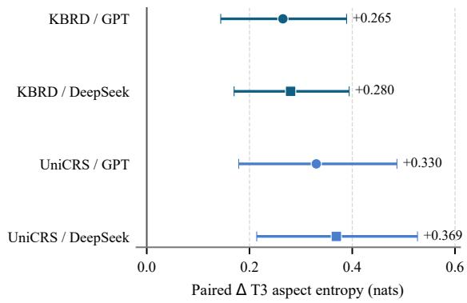  
Figure 11: Paired effect of semantic enrichment on filtered T3 aspect entropy. Points represent mean userlevel differences and horizontal bars show 95% bootstrap confidence intervals. The vertical line marks the null effect. Circles denote GPT-4o-mini and squares denote DeepSeek-chat; dark and light blue denote KBRD and UniCRS.

Because retained conversation counts could differ between conditions, the filtered entropy estimates may be sensitive to unequal exposure. Among paired users, the mean numbers of retained conversations were 2.60 for FULL and 2.62 for STATISTICALONLY with KBRD, and 1.66 and 1.80, respectively, with UniCRS. Pooling more conversations can expose more aspect categories and thereby affect entropy, so the filtered estimates may reflect both condition effects and retainedexposure differences. We therefore use the allconversation analysis below, which retains all four opening strategies in both conditions for all 120 users, as a sensitivity check.

Table 7 and Figure 11 show a positive primary T3 effect for both recommenders and both evaluation judges. The all-conversation sensitivity analysis yielded effects of +0.275 and +0.371 for KBRD, and +0.560 and +0.534 for UniCRS, under GPT-4o-mini and DeepSeek-chat, respectively (all $p \ < \ 0 . 0 0 1 )$ . Here, “technically completed” means that a complete conversation record was produced without a transport or generation error; it does not require natural acceptance and includes max-turn terminations.

Per-user T3 scores were strongly correlated between the two evaluation judges: Spearman’s $\rho =$ 0.77 in the primary analysis and $\rho = 0 . 7 2$ in the all-conversation sensitivity analysis. The consistent direction makes unequal exposure an unlikely sole explanation of the T3 result, but does not establish overall simulator quality or fidelity to individual real users.

## F Human Evaluation Protocol

## F.1 Annotation Task

Each annotation task presented an annotator with a single claim (one of the six attribute values from a FULL-enriched user profile), the user’s behavioral profile (Stage 1–2 statistics), and the user’s interview transcript (Stage 3 output, including any turns the auditor had flagged). Annotators were asked to judge whether the claim was supported by the interview evidence.

## F.2 Rating Scales

Support (4-class):

• Supported: the claim is directly justified by specific content in the interview.

• Partially supported: the interview contains relevant content but does not fully justify the specific claim (e.g., the claim is more specific or stronger than the evidence).

• Unsupported: the interview does not contain evidence relevant to the claim, even though the claim is consistent with the profile.

• Contradicted: the interview contains evidence inconsistent with the claim.

## Grounding (3-class):

• Evidence-grounded: the claim is anchored to a specific quotation or behavioral pattern in the interview.

• Generic: the claim is consistent with the interview but could apply to many users; the evidence is weak or non-specific.

• Cliche/stereotype: the claim performs a recognizable persona archetype not specifically attested in the user’s data.

## Numeric ratings (1–5):

• Consistency: how consistent the claim is with the user’s behavioral profile (1 = inconsistent, 5 = highly consistent).

• Usefulness: how useful the claim would be for conditioning a simulator (1 = not useful, 5 = highly useful).

• Overreach: how much the claim overshoots the available evidence (1 = no overreach, 5 = severe overreach).

• Confidence: the annotator’s confidence in their judgment (1 = uncertain, 5 = highly confident).

Mean ratings across all 315 annotations are 3.77 (consistency), 3.61 (usefulness), 1.70 (overreach), and 3.00 (confidence).

## F.3 Annotator Pool and Procedure

Three annotators (graduate students with prior NLP annotation experience) independently rated claims sampled at random from the 582 enriched-attribute claims of the FULL profiles. We report the 105 claims, drawn from 45 users and covering all six attribute types, that were rated by all three annotators (315 annotations). Annotators worked independently without discussion of disagreements; no calibration round was performed prior to annotation, a methodological choice we identify as a limitation (see Limitations).

<table><tr><td>Attribute</td><td>Sup.</td><td>Part.</td><td>Uns.</td><td>Contr.</td></tr><tr><td>Viewing motivation</td><td>27.5%</td><td>72.5%</td><td>0.0%</td><td>0.0%</td></tr><tr><td>Aspect prefs. (liked)</td><td>75.0%</td><td>25.0%</td><td>0.0%</td><td>0.0%</td></tr><tr><td>Aspect prefs. (descr.)</td><td>33.3%</td><td>66.7%</td><td>0.0%</td><td>0.0%</td></tr><tr><td>Pickiness</td><td>72.7%</td><td>24.2%</td><td>0.0%</td><td>3.0%</td></tr><tr><td>Domain expertise</td><td>27.8%</td><td>61.1%</td><td>11.1%</td><td>0.0%</td></tr><tr><td>Novelty prêference</td><td>26.7%</td><td>60.0%</td><td>13.3%</td><td>0.0%</td></tr><tr><td>Aspect prefs. (disliked)</td><td>38.1%</td><td>42.9%</td><td>9.5%</td><td>9.5%</td></tr><tr><td>Decision-making style</td><td>11.9%</td><td>66.7%</td><td>21.4%</td><td>0.0%</td></tr><tr><td>All</td><td>45.1%</td><td>48.3%</td><td>5.4%</td><td>1.3%</td></tr></table>

Table 8: Full per-attribute breakdown of support ratings (annotation level). The 1.3% Contradicted rate concentrates in disliked aspects (9.5%) and pickiness (3.0%); decision-making style has the highest Unsupported rate (21.4%), consistent with cognitive-style claims being the most amenable to invented rationalization.

## F.4 Per-Attribute Detail

## F.5 Inter-Annotator Agreement Details

We report multiple agreement metrics. Since the Support label is ordinal (Supported ≻ Partially supported ≻ Unsupported ≻ Contradicted), quadraticweighted κ is the methodologically appropriate primary metric (Cohen, 1968): it penalizes large ordinal disagreements (Supported vs. Contradicted) more than small ones (Supported vs. Partially supported).

Support label (4-class, ordinal). Pairwise agreement across the 105 triply-annotated claims:
<table><tr><td>Pair</td><td>Unwgt. κ</td><td>Wgt. κ</td><td>Exact</td><td>±1-rank</td></tr><tr><td>A vs. B</td><td>0.30</td><td>0.43</td><td>60.0%</td><td>98.1%</td></tr><tr><td>A vs. C</td><td>0.19</td><td>0.40</td><td>45.7%</td><td>97.1%</td></tr><tr><td>B vs. C</td><td>0.43</td><td>0.52</td><td>69.5%</td><td>98.1%</td></tr></table>

Table 9: Pairwise inter-annotator agreement on the Support label. Weighted κ is quadratic-weighted; “±1-rank” is the rate at which two annotators fell in the same or adjacent ordinal category. Annotator C applies the strictest interpretation of Supported.

Grounding label (3-class, nominal). For the Grounding label (Evidence-grounded / Generic / Cliche-stereotype), κ values are: A vs. B = 0.12, A vs. C = 0.27, B vs. C = 0.37. Agreement on grounding is fair, mainly reflecting the boundary between Generic and Evidence-grounded; only one of 315 annotations used Cliche/stereotype.

Binary support. Collapsing the 4-class label into positive (Supported + Partially supported) vs. negative (Unsupported + Contradicted) gives a coarser agreement signal:

• A vs. B: κ = 0.20, raw agreement 93.3%

• A vs. C: κ = 0.37, raw agreement 89.5%

• B vs. C: κ = 0.11, raw agreement 88.6%

All three annotators agree on 85.7% of claims under this split. Binary κ is depressed by the high prevalence of positive labels (the kappa paradox); Gwet’s AC1 (Gwet, 2008), which is robust to prevalence, is 0.89 for this split, and 0.99 for Contradicted versus all other labels.

Disagreement pattern. The most consistent disagreement is between Supported and Partially supported: in 32% of annotator pairs per claim, one annotator marked the claim Supported while the other marked it Partially supported. This boundary was under-specified in our protocol: the task statement did not operationalize how much explicit textual evidence was required to justify the stronger rating.

Annotator C as strictest rater. Annotator C marks claims Supported far less often than A and B (24.8% vs. 68.6% and 41.9%), while all three judge most claims at least partially supported (88.6%, 93.3%, and 98.1% for C, A, and B). Manual inspection suggests C required near-verbatim evidence for Supported, whereas A and B accepted paraphrased evidence. We retain all three annotators in the main results.

What the agreement numbers mean for the paper’s claims. The 94% aggregate support rate quoted in §4.6 is robust under several reasonable agreement assumptions: (a) it remains ≥ 91% under any single-annotator-out leave-one-out; (b) within-one-rank agreement of 97–98% across all annotator pairs indicates strong convergence on the direction of support, which is the quantity the headline claim relies on; (c) the 1.3% Contradicted rate, where chance-corrected agreement is highest (AC1 = 0.99), is the single most claim-critical number for paper integrity (it bounds the fabrication rate the auditor failed to catch). A revised protocol with sharper category definitions, an agreementcalibration pre-annotation phase, and a larger pool of annotators is the natural next step for human-eval methodology in this domain.

## G Human Evaluation Protocol for Audit Decisions

Evaluation material and sampling. The evaluation unit was a single synthetic interviewee response produced by the SimInter user-simulation pipeline and processed by Stage 4 in the 300-user experiment. These are generated interview responses, not utterances taken from ReDial. Each response was linked to the historical ReDial user whose interactions informed the simulation. We selected 105 turns from distinct users, equally stratified by the auditor’s final outcome: 35 EXCLUDED, 35 FLAGGED–RETAINED, and 35 UNFLAGGED. The three groups were presented as consecutive 35-case blocks in a fixed order shared by all annotators, but the group boundaries and auditor outputs were concealed.

## Annotation procedure and human reference.

Three co-author annotators independently reviewed the same 105 turns (315 judgments in total). They saw the target synthetic response, optional preceding synthetic-interview context, automatically retrieved statements from the matching historical ReDial user’s original conversations, and optional derived statistical-profile information. They did not see the auditor’s action, issue flags, or explanations. The three judgment categories were interpreted as follows: EXCLUDED, an evidencegrounded problem warrants removing the entire synthetic turn; FLAGGED–RETAINED, a meaningful concern exists but does not warrant removal; and UNFLAGGED, no meaningful issue is identified. We used the majority vote of the three annotators as the human reference for each turn. The evaluation unit and reference are at the whole-turn level; they do not validate the correctness of individual auditor flag types.

Inter-annotator agreement. All 105 cases received three labels. Agreement was unanimous on 70/105 (66.7%) and 2–1 on the remaining 35; there were no three-way splits. Nominal Fleiss’ κ was 0.664 (95% stratified case-bootstrap interval [0.572, 0.751]; 2,500 replicates, resampling within the three auditor strata). Within-stratum Fleiss κ values were 0.337 (excluded), 0.308 (flaggedbut-retained), and 0.268 (unflagged). These lower within-stratum values suggest that aggregate agreement is influenced by the differences in label distributions across strata.

Three-class and filtering accuracy. Three-class accuracy against the human-majority reference was 91/105 (86.7%): 31/35 (88.6%) in the excluded stratum, 31/35 (88.6%) in the flagged-but-retained stratum, and 29/35 (82.9%) in the unflagged stratum (Table 10). Fourteen cases disagreed at the three-class level: four auditor-excluded turns were judged flagged-but-retained; four flagged-butretained turns were judged unflagged; and among auditor-unflagged turns, five were judged flaggedbut-retained and one excluded. Thus, nine of the fourteen disagreements concerned the distinction between flagged-but-retained and unflagged outcomes, without changing the final filtering action.

<table><tr><td>Auditor outcome</td><td>n</td><td>Human Excluded</td><td>Human Flagged-ret.</td><td>Human Unflagged</td></tr><tr><td>Excluded</td><td>35</td><td>31</td><td>4</td><td>0</td></tr><tr><td>Flagged-retained</td><td>35</td><td>0</td><td>31</td><td>4</td></tr><tr><td>Unflagged</td><td>35</td><td>1</td><td>5</td><td>29</td></tr><tr><td>Total</td><td>105</td><td>32</td><td>40</td><td>33</td></tr></table>

Table 10: Auditor outcomes versus the majority judgments of three annotators for 105 synthetic interviewee turns. The diagonal corresponds to 91/105 (86.7%) three-class human-referenced accuracy on the balanced sample.

When both retained categories were collapsed to a single RETAIN action, the auditor agreed with the majority human filtering action on 100/105 turns (95.2%): 31/35 auditor-excluded turns and 69/70 auditor-retained turns. On the same evaluation set, an always-retain baseline would agree with 73/105 (69.5%) human binary judgments. This comparison is descriptive for the selected, auditstratified sample; its class balance differs from the full Stage 4 population.

Illustrative disagreements and supported exclusions. In CASE-066, the auditor excluded a synthetic response expressing appreciation for Get Out based partly on an alleged aversion to scary films. However, the corresponding historical ReDial user requested horror and a combination of comedy and scares (ReDial conversation 3189); two annotators favored retention and one exclusion. This illustrates the risk of treating genre preferences as exclusive.

Conversely, in CASE-071 all three annotators endorsed the auditor’s exclusion of a detailed recollection from Arrival; the historical user had earlier stated that they did not think they had seen the film and would add it to a watch list (ReDial conversation 12034). Such temporal evidence is suggestive rather than conclusive: a user might watch the film subsequently.

Finally, in CASE-082, all three annotators favored excluding a synthetic response that the auditor left unflagged. The historical user had previously stated that they had not seen The Greatest Showman (ReDial conversation 14457). However, expressing a positive opinion about a film does not necessarily imply having watched it. We therefore treat this case as a disagreement requiring further examination, rather than a confirmed auditor error. These examples illustrate turn-level judgments, not independent validation of individual audit flags.

Scope and limitations. The equal 35/35/35 allocation, together with at most one sampled turn per historical ReDial user, means that the reported sample accuracies are not unbiased estimates of accuracy over all Stage 4 turns. Consecutive presentation blocks may confound audit stratum with order, learning, or fatigue effects. The ReDial excerpts were retrieved automatically; although matched to historical users, their relevance and completeness were not exhaustively adjudicated, and missing context may affect individual decisions. In addition, the annotators were co-authors and majority vote is an operational human reference rather than an independently established ground truth. The evaluation therefore characterizes human agreement with Stage 4 turn-level outcomes, not the validity of each issue flag or population-level recall. The 14 three-class disagreements, particularly the five affecting the remove-versus-keep action, remain priorities for further evidence-based adjudication.

## H Six Enriched Attribute Schemas

This appendix provides the formal schema for each enriched attribute and an example enriched profile.

## H.1 Schema Definitions

Aspect-level preferences (Radlinski et al., 2019). A nested object with three sub-fields. Each entry is an (anchor, text) pair where anchor ∈ {Movie, Genre, Person, Other}:

• liked: aspects/items the user expressed positive sentiment toward

• disliked: aspects/items the user expressed negative sentiment toward

• descriptions: factual or descriptive statements the user made about specific items

Pickiness (Yoon et al., 2024). Deterministically computed from the rejection rate r, not LLMextracted: pickiness\_score = 5 if $r ~ \geq ~ 0 . 4 0$

4 if $r \geq 0 . 2 5$ , 3 if $r \geq 0 . 1 0$ , 2 if $r \geq 0 . 0 5$ , and 1 otherwise.

Decision-making style (Scott and Bruce, 1995; Hayati et al., 2020). Object: {style, evidence}, where style ∈ {rational, intuitive, dependent, avoidant, spontaneous}.

Viewing motivation (Oliver and Raney, 2011). Object: {hedonic\_score, primary\_motivation, evidence}, where hedonic\_score ∈ [1, 5] (1 = purely eudaimonic, 5 = purely hedonic) and primary\_motivation ∈ {hedonic, eudaimonic, escapism, social, catharsis, arousal}.

Novelty preference (Tang and Liao, 2022). Object: {novelty\_score, evidence}, where novelty\_score ∈ [1, 5].

Domain expertise (Kostric et al., 2025). Object: {level, evidence}, where level ∈ {novice, intermediate, cinephile}.

## H.2 Example Enriched Profile (User 468)

User 468’s enriched profile after Stage 5 (interview decision ACCEPT), with values shortened for readability.

{ user\_id: 468, aspect\_preferences: { liked: [ {Movie: “John Wick”}, {Genre: “crime thriller”}, {Genre: “action movie”}, {Other: “non-stop action and style of choreography”}, {Other: “high-energy pace and relentless energy”}, {Other: “physical set pieces and choreography unfold”} ], disliked: [], descriptions: [ {Movie: “Crouching Tiger, Hidden Dragon rooftop chase lays out history and skill through movement”}, {Other: “action can do storytelling through style and movement”}, [...] ] }, pickiness\_score: 1, // from rejection rate decision\_making\_style: { style: “rational”, evidence: “the steady momentum of a good crime thriller or action movie where the pacing never really lets up” }, viewing\_motivation: { hedonic\_score: 4, primary\_motivation: “arousal”, evidence: “relentless energy keeps you hooked from the start without any wasted moments” }, novelty\_preference: { novelty\_score: 4, [...] }, domain\_expertise: { level: “intermediate”, evidence: “the action itself is doing the storytelling through the style and movement” } }

The basic profile that conditions STATIS-TICALONLY contains only the Stage 1–2 fields (liked/disliked movie lists, acceptance rate, reference style, genre distribution, decade, exploration ratio, popularity, and pickiness score). The six enriched attributes above are absent in STATISTICALONLY: aspect\_preferences, decision\_making\_style,

viewing\_motivation, novelty\_preference, and domain\_expertise are all null.

## I Example End-to-End Simulated Conversations

This appendix shows conversations between the simulator and the GPT-4o-mini CRS for the same user (468) under FULL and STATISTICALONLY, both with the mood opening strategy.

## I.1 FULL (opening = mood)

User: I’m chasing a real adrenaline rush tonight, so I need an action thriller with relentless pacing and some genuinely tight choreography.

CRS: You might enjoy “John Wick (2014)” [...]. If you’re looking for something a bit different, “The Raid: Redemption (2011)” delivers incredible martial arts and relentless pacing.

User: I’ve already seen John Wick, but The Raid: Redemption sounds right up my alley with that martial arts choreography and pacing. Let’s go with that one.

[. . . ]

User: That was fantastic, exactly the kind of relentless pacing and fight choreography I was looking for. Got anything else along those lines with high energy?

## I.2 STATISTICALONLY (same user, opening = mood)

User: I’m in the mood for some intense action tonight. Something with a good crime or thriller plot.

CRS: How about “Heat (1995)”? [...]

User: Heat sounds good. I’ll watch that one.

[. . . ]

User: Die Hard with a Vengeance is a good one.   
I like those kinds of action films.

## I.3 Observations

The FULL simulator voices the aspects recorded in its enriched profile (pacing, choreography), which the T3 judge extracts as distinct aspects; the STA-TISTICALONLY simulator refers mainly to genres and titles. Across this user’s four conversations, T3 retains eight distinct aspects for FULL (e.g., pacing, martial arts choreography, intensity; filtered entropy 1.75) but only two for STATISTICALONLY (plot and a genre label; entropy 0.69), where 11 of 13 extracted aspects were generic and filtered out.

The same profile vocabulary also explains the T4 pattern: “relentless” appears in three of the four FULL opening requests.

## J Full System Prompts

This appendix reproduces the prompts of all LLMbased components in condensed form. Wording is kept verbatim where shown; “[...]” marks omitted examples or formatting instructions (full versions are in the released codebase). Text in braces (e.g., {liked\_movies}) denotes slots filled at run time.

## J.1 Interviewer Agent (Stage 3)

Each interview has ten messages: an Account phase (six messages) followed by a Clarify phase (four messages). The first interviewer message is not generated: it is one of four predefined open-ended questions, selected uniformly at random:

1. “Tell me about your relationship with movies — when you sit down to watch something, what kind of experience are you usually looking for?”

2. “Walk me through the last movie you really enjoyed — what was it and what stuck with you?”

3. “If a friend asked you to recommend a movie that captures your taste, what would you pick and why?”

4. “When you’re choosing what to watch on a typical Friday night, what goes through your mind?”

All subsequent interviewer messages are generated (temperature 0.7) from the interview so far only; the interviewer never receives the user’s profile or ReDial history.

## Account phase.

You are an interviewer conducting a conversation about movie preferences. Your goal is to understand how this person thinks about and chooses movies — their taste, their reasoning, the patterns in what they like.

CRITICAL CONSTRAINTS:

\- You do NOT know anything about this person beforehand. You have no profile, no history, no list of their favorite movies.

\- You must NOT make assumptions about what kind of movies they like based on stereotypes or popular taste patterns.

\- Every question should follow naturally from what they have ACTUALLY told you in this conversation.

QUESTIONING STYLE FOR THIS STAGE (ACCOUNT):

\- This is the OPENING phase. Let them talk freely.

\- Ask broad, inviting questions that let them set the direction.

\- When they mention a specific movie, genre, or feeling, follow up on THAT thing rather than pivoting to a new topic.

\- Do NOT challenge or contradict. Avoid leading questions.

\- Do NOT introduce movies, directors, or genres they did not mention.

CONVERSATION SO

{conversation\_history}

Output ONLY your next question.

## Clarify phase.

You are continuing the interview from earlier. [...] Your job now is different: you are NOT collecting more topics — you are pushing for the WHY behind what they have already said.

PREVIOUS DIALOGUE (Stage 1): {stage\_1\_dialogue}

WHAT TO ASK IN THIS STAGE:

Pick ONE or TWO things the user said that have a specific texture — a particular movie title, a phrase they repeated, a feeling they named. For each, ask a question that pushes for one of these:

\- The MECHANISM. They said they liked X — what specifically about X works for them?

\- A CONTRAST. They expressed a general preference — when does that preference NOT hold?

\- The PERSONAL MEANING. They used a word or phrase — what does it mean to them concretely?

WHAT NOT TO DO:

\- Do NOT ask the same kind of question Stage 1 already asked.

\- Do NOT zoom out to abstractions.

\- Do NOT introduce movies, directors, or genres they did not mention.

\- Do NOT challenge or contradict.

\- Use THEIR specific vocabulary when probing.

[... good and bad probe examples ...]

CONVERSATION SO FAR:

{full\_conversation\_history}

Output ONLY your next question.

## J.2 Interviewee Agent (Stage 3)

The interviewee (temperature 0.6) receives the user’s statistical profile and one historical ReDial conversation in which the user acted as a seeker.

You are participating in a conversation about your movie preferences. Someone is interviewing you to understand your taste in movies. Respond naturally, as

yourself.   
STATISTICAL PROFILE:   
Rejection rate: {rejection\_rate}   
(you accept about {accept\_pct}% of   
recommendations on average)   
- Movies you’ve liked: {liked\_movies}   
Movies you’ve disliked:   
{disliked\_movies}   
- You tend to talk about movies in terms   
of: {dominant\_ref\_style}   
- You prefer movies of popularity level:   
{popularity\_score}   
Your genre preferences:   
{genre\_preferences}   
YOUR TASTE PATTERN: {taste\_summary}   
YOUR ACTUAL CONVERSATION HISTORY:   
{redial\_conversation}   
GROUNDING RULES (most important):   
1. Everything you say must be CONSISTENT   
with the profile and history above.   
2. When you mention specific movies,   
prefer movies from your liked/disliked   
lists or movies that came up in your   
past conversation.   
When you give reasoning, the   
reasoning should be consistent with   
your profile patterns.   
4. Do NOT invent specific personal   
stories [...] that contradict or go   
beyond your profile.   
5. It is OK and encouraged to say “I’m   
not sure” [...] when a question pushes   
beyond what your profile and history   
can plausibly answer.   
6. Do NOT recite your statistical   
profile out loud.   
SPECIFICITY RULES:   
- Avoid generic emotional phrases like   
“emotional connection” [...].   
- When asked WHY you like a film, name   
a specific element: a scene, a line, a   
moment, a character choice, a visual   
style.   
Anchor comparisons in concrete   
examples from YOUR liked or disliked   
lists rather than abstract categories.   
CONVERSATION STYLE: first person; 2–4   
sentences; avoid absolute statements   
unless your profile genuinely supports   
them. [...]   
CONVERSATION SO FAR:   
{conversation\_history}

When the audit decision is REGENERATE, the interview is regenerated (up to two retries) with the following nudge appended to the interviewee prompt:

ADDITIONAL GUIDANCE FROM A PREVIOUS ATTEMPT:   
In your previous attempt at this conversation, you made claims that were not fully grounded in your profile or history. Be particularly careful to: - avoid absolute statements unless your profile supports them   
- avoid inventing specific personal anecdotes

- prefer “I’m not sure” over fabricated   
detail

## J.3 Audit Agent (Stage 4)

The Audit Agent combines a deterministic structural check with three separate LLM calls (Claude Haiku 4.5, temperature 0.2). Only interviewee turns are audited.

(a) Structural check (deterministic). Verifies that the interview has ten turns, that interviewer and interviewee strictly alternate, and that no turn is empty. Any violation yields a highseverity structural\_error, and the LLM checks are skipped.

## (b) Movie mentions vs. profile.

Extract all movie titles mentioned   
by the USER (not the interviewer)   
in this dialogue. For each movie,   
determine the sentiment expressed about   
it. [...] Classify sentiment:   
“positive”, “negative”, or “neutral”.

A movie mentioned positively but listed as disliked in the profile, or negatively but listed as liked, is flagged deterministically as a high-severity history\_contradiction.

(c) Contradiction with the ReDial conversation.

You are checking whether a recent   
dialogue contradicts an earlier   
conversation by the same user.   
EARLIER CONVERSATION:   
{redial\_conversation}   
RECENT DIALOGUE TO CHECK:   
{dialogue\_text}   
TASK: For each statement made by the   
USER [...], check whether it directly   
contradicts something they said in   
the earlier conversation. Distinguish   
carefully:   
CONTRADICTION: directly opposing   
statements   
- REPHRASING / ELABORATION / UNRELATED:   
NOT a contradiction   
Only flag CONTRADICTION. Output:   
turn\_index, user\_statement,   
redial\_reference, explanation,   
confidence (low|medium|high).

Each contradiction becomes a history\_contradiction flag whose severity equals the reported confidence.

## (d) Fabrication and caricature.

You are auditing a dialogue where a   
user discussed their movie preferences.   
The user was supposed to respond   
consistently with the profile and prior   
conversation history below. [...]   
CATEGORY 1 — FABRICATION

A specific factual claim that is neither in the profile nor plausibly inferable from it. The bar for flagging is HIGH — only flag specific, ungrounded claims. DO flag: personal anecdotes with specific people, places, or dates; claims about working in the film industry, attending specific festivals, knowing directors; specific verifiable facts the user could not plausibly know. DO NOT flag: plausible elaboration on a movie in the profile; general emotional reactions; vague time references; hedged statements.

CATEGORY 2 — CARICATURE   
A response that performs a stereotype   
rather than reflecting the actual   
profile. The test: would someone with   
THIS specific profile plausibly say this,   
or is this what an LLM imagines a “type   
of person” would say?   
DO flag: absolute statements that   
contradict profile nuance; reciting   
tropes about a “type of person”;   
extreme rejection or acceptance beyond   
what the rejection rate supports; a   
snob/cinephile persona without profile   
support.   
DO NOT flag: proportionate strong   
opinions; specific personal preferences;   
self-aware statements; mixed feelings.   
Output: for each issue, turn\_index,   
claim or quote, reason, and severity   
(low|medium|high).

Decision rule (deterministic). Any structural\_error or ≥ 3 high-severity flags yield REGENERATE; at least one high-severity or ≥ 3 medium-severity flags yield PARTIAL, in which case all high- and medium-severity interviewee turns are removed from the enrichment input; otherwise ACCEPT.

## J.4 Profile Enrichment (Stage 5)

A single Tencent Hy3 call (temperature 0.1) receives the audited interview and the user’s Stage 2 profile as background context.

You are an expert in user modeling for   
movie recommender systems. [...]   
You are given two inputs: 1. The user’s   
existing profile data [...] 2. A movie   
interview dialogue with that same user.   
Use the profile data as background   
context to better interpret what the   
user says in the dialogue. Extract   
exactly 6 profile fields based on what   
the user says in the dialogue.   
USER PROFILE (background context):   
{profile\_context}   
INTERVIEW DIALOGUE: {dialogue\_text}   
FIELD DEFINITIONS:   
1. aspect\_preferences: items of   
{anchor: Movie|Genre|Person|Other,   
text}, grouped into liked, disliked,   
and descriptions (neutral observations).

Extract only from what the user says.   
2. pickiness: DO NOT EXTRACT from   
dialogue [...]. Set to null.   
3. decision\_making\_style: {style:   
rational|intuitive|dependent|avoidant|spontaneous,   
evidence}   
4. viewing\_motivation:   
{hedonic\_score: 1–5 (eudaimonic   
↔ hedonic), primary\_motivation:   
hedonic|eudaimonic|escapism|social|catharsis|arousal,   
evidence}   
5. novelty\_preference: {novelty\_score:   
1–5 (conservative ↔ explorer),   
evidence}   
6. domain\_expertise: {level:   
novice|intermediate|cinephile,   
evidence}   
[... definitions of each category and   
score level ...]   
RULES:   
- Extract only from the DIALOGUE, not   
from the profile context   
- Use the profile context only to   
resolve ambiguity or calibrate scores   
- If a field cannot be determined from   
the dialogue, set it to null   
- Do not invent information not present   
in the dialogue   
Return ONLY this JSON [...]

The pickiness score (1–5) is assigned deterministically from the user’s rejection rate r: 5 if r ≥ 0.40, 4 if r ≥ 0.25, 3 if r ≥ 0.10, 2 if r ≥ 0.05, and 1 otherwise.

## J.5 User Simulator (Stage 6)

Opening message. For each of the four opening strategies, the simulator first generates the opening request (temperature 0.7):

You are generating the OPENING MESSAGE   
for a user about to start a conversation   
with a movie recommender.   
USER PROFILE: {profile\_context}   
OPENING STRATEGY: {strategy}   
Generate ONE opening message (1–3   
sentences) that:   
- Uses the strategy specified above   
- Reflects this user’s decision style   
({decision\_style}) and expertise level   
({expertise\_level})   
Is specific enough to give the   
recommender something to work with [...]   
- Sounds natural, like a real person   
typing   
Strategies: aspect (signal one or two   
specific aspects from your liked-aspects   
list); movie (anchor on a movie   
from your liked list and ask for   
something similar); mood (describe the   
mood you want the movie to match   
tonight); expertise (signal domain   
knowledge before asking for something   
specific). [... example phrasings   
per strategy; do not copy any example   
verbatim ...]

## Simulator. Subsequent user turns (temperature 0.7) are generated with:

You are simulating a real person seeking movie recommendations from a recommender system.

{profile\_context}

CRITICAL BEHAVIORAL RULES:

1. You are the USER. NEVER take the role of the recommender. [...]

2. Do NOT prefix your messages with any role label.

3. Do NOT recite your profile aloud. Your preferences emerge through your reactions, not declarations.

4. Stay consistent with your profile across all turns.

Keep responses 1–3 sentences typically.

6. {pickiness\_rule\_block}

7. Do not invent new movies you’ve watched beyond your profile.

The pickiness block depends on the pickiness score: agreeable for scores ≤ 2 (“Default to accepting recommendations unless they obviously contradict your stated preferences”), moderate for 3 (“Accept recommendations that match at least TWO of your stated preferences”), and picky for ≥ 4 (“Reject recommendations that fail to match your stated preferences in specific ways [...] state the specific reason”). Under STATISTICALONLY, {profile\_context} omits the enriched attributes.

## CRS (GPT-4o-mini, temperature 0.5).

You are conversational movie recommender system. [...] Ask clarifying questions when the user’s request is vague; recommend 1–3 specific movies with brief reasoning when you have enough information; provide titles in the format “Title (Year)”; adapt to user feedback; keep responses concise (2–4 sentences typically).

After each CRS turn, starting from the fourth, the termination judge (§J.6) classifies the last four messages; any label other than CONTINUE ends the conversation, which is otherwise capped at eight CRS turns.

## J.6 Evaluation Judges

In the primary experiment, all judges use Claude Haiku 4.5 at temperature 0.0. The termination judge operates during simulation; the others operate on the stored conversations. In the separate cross-CRS experiment, GPT-4o-mini serves as the termination judge and performs the post-hoc conversation audit before T3 extraction, without access to the extraction outputs; separate GPT-4omini and DeepSeek-chat calls then evaluate T3 (Appendix E).

## Termination judge (Stage 6).

Classify whether the following conversation has reached a natural endpoint. [...] Output EXACTLY ONE of these labels:

\- true\_acceptance: user explicitly endorses a SPECIFIC recommendation with positive language

\- resigned\_acceptance: user acknowledges a recommendation without enthusiasm or specificity

\- explicit\_giveup: user explicitly disengages or expresses frustration

\- other: conversation has ended but fits none of the above

\- CONTINUE: user is still exploring or asking

RULES: true\_acceptance requires BOTH a specific title AND clearly positive language; do NOT output it if the user asks a follow-up question.

CONVERSATION (last 4 messages): {last\_messages}

## Movie mention extraction (T1, T2, T3).

Identify every distinct movie that appears in the conversation. For each one, return: title (canonical); year; introduced\_by (“user” if the USER first mentioned this movie, “crs” if the CRS introduced it); first\_user\_mention\_turn\_index; all\_turn\_indices. Do NOT include person names, countries, or generic words. Do NOT include hypothetical references like “a comedy”. Deduplicate surface forms. [...]

## Rating inference (T2).

Infer how much the user would rate a specific movie. Assign a rating ONLY when the user expresses an actual opinion or evaluative reaction about this movie itself. REFERENCE-ONLY RULE: if the user mentions this movie ONLY as a reference point or comparison anchor (e.g., “something like X”), the rating MUST be null. Scale: 5.0 loved / accepted enthusiastically; 4.0 clear positive interest; 3.0 neutral; 2.0 mild disinterest; 1.0 explicitly rejected (half points allowed). Output: {rating, confidence: high|medium|low, evidence}.

## Aspect–sentiment extraction (T3).

You are extracting aspect-sentiment pairs from a user’s opinion about a movie. [...] Extract ALL aspect-sentiment pairs the user mentions. Aspects are concrete elements of the movie: plot, acting, pacing, cast, soundtrack, cinematography, dialogue, ending, characters, mood, atmosphere, etc. For each pair output: aspect (short noun phrase); sentiment (positive|neutral|negative); evidence (short quote from the user). If user expressed no specific aspect opinions, output no pairs.

<table><tr><td>Component</td><td>Model</td><td></td><td>Temp. Max tok.</td></tr><tr><td>Interviewer (S3)</td><td>Gemini 2.5 Flash</td><td>0.7</td><td>512</td></tr><tr><td>Interviewee (S3)</td><td>Gemini 2.5 Flash</td><td>0.6</td><td>512</td></tr><tr><td>Audit: movie check (S4)</td><td>Claude Haiku 4.5</td><td>0.2</td><td>512</td></tr><tr><td>Audit: contradiction (S4)</td><td>Claude Haiku 4.5</td><td>0.2</td><td>512</td></tr><tr><td>Audit: fabr./caric. (S4)</td><td>Claude Haiku 4.5</td><td>0.2</td><td>1,024</td></tr><tr><td>Enrichment (S5)</td><td>Tencent Hy3</td><td>0.1</td><td>8,192</td></tr><tr><td>Opening message (S6)</td><td>Gemini 2.5 Flash</td><td>0.7</td><td>256</td></tr><tr><td>User simulator (S6)</td><td>Gemini 2.5 Flash</td><td>0.7</td><td>256</td></tr><tr><td>CRS (S6)</td><td>GPT-4o-mini</td><td>0.5</td><td>256</td></tr><tr><td>Termination judge (S6)</td><td>Claude Haiku 4.5</td><td>0.0</td><td>20</td></tr><tr><td>Movie extraction (T1-T3)</td><td>Claude Haiku 4.5</td><td>0.0</td><td>2,000</td></tr><tr><td>Rating inference (T2)</td><td>Claude Haiku 4.5</td><td>0.0</td><td>256</td></tr><tr><td>Aspect-sentiment (T3)</td><td>Claude Haiku 4.5</td><td>0.0</td><td>2,048</td></tr><tr><td>Accept/reject</td><td>Claude Haiku 4.5</td><td>0.0</td><td>1,000</td></tr><tr><td>CSHI simulator</td><td>Gemini 2.5 Flash</td><td>0.0</td><td>2,048</td></tr></table>

Table 11: LLM components of the primary experiment. S3–S6 denote pipeline stages. The CSHI baseline uses the same CRS configuration.

A post-processing step removes generic placeholders (movie(s), film(s), overall movie, overall film, story/stories, thing(s), stuff, experience) before computing aspect entropy.

## Acceptance/rejection classification.

For each movie the CRS explicitly   
recommended, classify how the USER   
responded to it. ONLY classify movies   
the CRS recommended.   
- accept: clear positive intent to   
watch, enthusiasm, or agreement to try   
it (“sounds great”, “I’ll watch that”)   
- reject: explicit decline, clear   
disinterest, or dismissal (“not really   
my thing”, “no thanks”)   
- neutral: ambiguous, hedging, or absent   
reaction (“maybe”, no direct response)

## K Model Configuration and API Cost

Table 11 lists the model, decoding temperature, and output-token limit of every LLM component in the primary experiment. Reasoning was disabled for Gemini 2.5 Flash and enabled (effort high) for Tencent Hy3; all other models were used without reasoning.

API cost. Table 12 reports the provider-reported API cost of each run, split into generation (Stages 3– 6, including the CRS) and evaluation (all judges). Generating the full FULL cohort cost \$8.30, i.e., about \$0.028 per user including four simulated conversations; profile enrichment alone (Stages 3–5) cost \$4.29 (\$0.014 per user). Evaluation dominates the total cost, chiefly through per-movie rating inference for T2. STATISTICALONLY and CSHI involve no interviews or enrichment, so their generation cost covers only user simulation and the CRS.

<table><tr><td>Run</td><td>Calls</td><td>Tokens in/out (M)</td><td>Gen. ($)</td><td>Eval. ($)</td><td>Total ($)</td></tr><tr><td>FULL (300)</td><td>32,907</td><td>28.7 / 4.4</td><td>8.30</td><td>23.85</td><td>32.15</td></tr><tr><td>STATONLY (100)</td><td>11,149</td><td>8.5 / 0.9</td><td>1.41</td><td>8.93</td><td>10.34</td></tr><tr><td>CSHI (100)</td><td>16,589</td><td>14.8 / 1.4</td><td>1.37</td><td>16.90</td><td>18.27</td></tr><tr><td>Total</td><td>60,645</td><td>52.1 / 6.8</td><td>11.08</td><td>49.68</td><td>60.76</td></tr></table>

Table 12: API usage and cost (USD) per run of the primary experiment. Hy3 output tokens include reasoning tokens. Numbers in parentheses give the number of users.