# Socratic Skill Learning: Interleaving Teaching and Practice for Transferable Agent Skills

Letian Zhu<sup>1,</sup>∗ Han Li<sup>1,</sup>∗ Yifan Yao<sup>1,</sup>∗ Xinping Lei Xinyu Che<sup>1</sup> Jiahao Wang<sup>1</sup> Dianyi Wang<sup>1</sup> Yucheng Fu<sup>1</sup> Jiakai Wang<sup>2</sup> Zhiqi Bai<sup>2</sup> Wenbo Su<sup>2</sup> Jiaheng Liu<sup>1,†</sup>

<sup>1</sup> Nanjing University <sup>2</sup> Alibaba Group

∗ Equal contribution. <sup>†</sup> Corresponding author.

Agent Skills improve LLM agents by making task knowledge reusable across sessions. Learning transferable Skills requires evidence about a procedure and its conditions of use, which a successful task attempt can leave untested. We introduce Socratic Skill Learning (SSL), which interleaves expert teaching with Student practice. An Educator guides investigation while the Student remains the sole environment operator and Skill author, able to question, test, and adapt advice. To test reuse beyond the learning task, we construct SKILLTRANSFERBENCH, with 35 task families and 408 executable cases, pairing public variation specifications with held-out evaluation in fresh solver sessions. On the main 22-family, 155-case cohort, Fixed-Window SSL reaches 0.801 utility, versus 0.723 without a Skill, 0.761 for adapted Trace2Skill (trajectory distillation), and 0.751 for adapted SKILL-KD (contrastive distillation). Across three model pairs on shared families, interleaved guidance outperforms expert authoring and post-hoc teaching. Process analysis links guidance to Student writing and package revision; a case study shows the Student testing and refining a proposed procedure for later reuse. As demand for new lessons falls, the cost of fixed-window review grows. Issue-Guided SSL tracks unresolved questions across Skill revisions to select and focus review, reaching 0.805 utility with 61.7% fewer Educator tokens and 16.9% fewer total acquisition tokens than Fixed-Window SSL on the main cohort.

Correspondence: Jiaheng Liu at liujiaheng@nju.edu.cn Date: October 12, 2026 Code: https://github.com/NJU-LINK/Socratic-Skill-Learning

## 1 Introduction

Agent Skills extend LLM agents through reusable instructions and executable resources, without updating model weights (Anthropic, 2025). Curated Skills improve success on tasks requiring specialized expertise (Li et al., 2026b). Acquiring transferable Skills requires identifying which steps to reuse, under what conditions, and when to adapt them.

Recent methods distill execution trajectories into Skills and refine packages through testing and feedback (Ni et al., 2026; Ma et al., 2026; Shi et al., 2026). SkillLearnBench’s Teacher Feedback uses expert advice after failed attempts to guide revision (Zhong et al., 2026). Such refinement depends on which hypotheses the learner tests and which failures it investigates. Guidance during an ongoing attempt can redirect these choices before an untested assumption becomes a reusable rule. We therefore ask: how should external expertise guide the learner while it is still gathering evidence?

We introduce Socratic Skill Learning (SSL), interleaving expert teaching with Student practice (Figure 3).<sup>1</sup> An Educator observes recent Student work and the live Skill, then explains, challenges, diagnoses, or remains silent. The Student operates the environment and authors the package. Inspired by Socratic inquiry, the interaction examines assumptions through dialogue and practical checks; the Student can question advice, adapt it, and decide what to retain. We instantiate SSL with FIXED-WINDOW SSL, which reviews at regular tool-call intervals, and ISSUE-GUIDED SSL, which focuses review on unresolved learning issues.

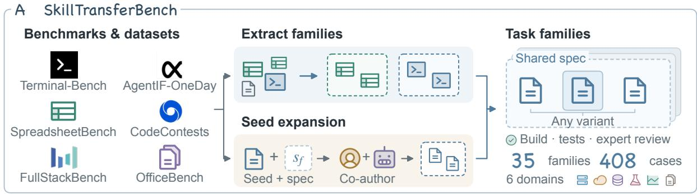

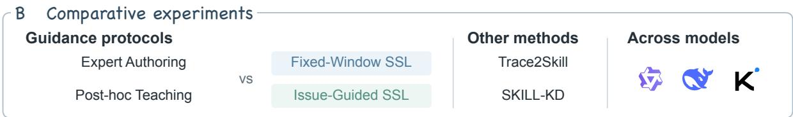

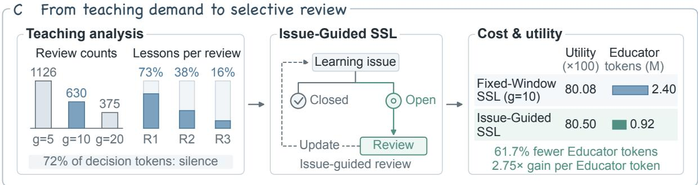  
Figure 1. Overview of the study. Panels show (A) task-family construction from six source benchmarks, (B) acquisition-protocol comparisons, external methods, and model pairs, and (C) the path from teaching demand to issue-guided review with utility and cost. Panel C summarizes Qwen experiments on the 22-family main cohort.

Existing benchmarks measure Skill utility and reuse (Li et al., 2026b; Zhong et al., 2026). Studying guided acquisition also requires specifying what the learner should investigate beyond the practice task. We construct SKILLTRANSFERBENCH, a benchmark of 35 task families and 408 executable cases across six domains. Each family pairs an anchor task with a public specification of invariants and permitted variation. This specification guides exploration; fresh solvers test the acquired package on held-out family members.

We organize the study around four questions (Figure 1): RQ1: How well does SSL transfer relative to existing induction methods? RQ2: How should external expertise guide Skill acquisition? RQ3: How does guidance enter Skill development as learning progresses? RQ4: How should review be organized to sustain transfer with less expert supervision?

On shared families across three model pairs, both interleaved protocols outperform direct expert authoring and post-hoc teaching. Process analysis links lessons to Student development; a case study shows the Student testing an Educator-proposed procedure and refining it for later reuse. ISSUE-GUIDED SSL reaches 0.805 utility with 61.7% fewer Educator tokens on the main cohort.

## Our contributions are threefold:

• We construct SKILLTRANSFERBENCH, containing 35 task families and 408 executable cases across six domains, with public family specifications that guide acquisition and held-out evaluation that tests frozen Skills in fresh solver sessions.

• We introduce Socratic Skill Learning (SSL), in which the Student owns exploration, verification, and Skill authoring while an Educator guides practice. Issue-Guided SSL uses persistent learning issues to select and focus review around unresolved questions.

• We evaluate Skill transfer across three model pairs and complement these comparisons with process analysis and case studies, linking guidance to Student development and showing how selecting and focusing review sustains transfer with less expert supervision.

## 2 Related Work

Constructing Skills from execution evidence. Skills can retain experience as guidance or executable code (Zhao et al., 2024; Wang et al., 2023), consolidate trajectory lessons (Ni et al., 2026), or evolve through execution and verification (Ma et al., 2026; Liu et al., 2026b). SKILL-KD’s consolidation agent derives patches from Teacher–Student trajectory contrasts and validates them through Student reruns (Shi et al., 2026).

Feedback during Skill development. Self-Refine and Reflexion improve outputs or attempts through feedback (Madaan et al., 2023; Shinn et al., 2023). For agent diagnosis (Zhao et al., 2026), CodeTracer reconstructs state transitions to localize failures (Li et al., 2026a). SkillLearnBench uses a reference Skill to guide revision after failure (Zhong et al., 2026); AgentBrew validates teacher-authored corrections through student retries (Jiang and Huang, 2026). HASP includes teacher review of student-proposed skill programs (Liu et al., 2026a), while SkillHone preserves revision evidence and decisions (Li and Hu, 2026). SSL places Educator guidance within Student investigation and verification, leaving the Student to author the Skill. Unresolved learning questions select and focus review. This design connects Socratic dialogue (Liu et al., 2024a) with learner construction (Chi et al., 2001) and feedback on the learning process (Hattie and Timperley, 2007).

Scope and transfer in Skill evaluation. SkillsBench measures Skill utility (Li et al., 2026b); SkillLearn-Bench and EconSkills evaluate reuse across parameterized instances (Zhong et al., 2026; Quan and Liu, 2026). Trace2Skill tests held-out transfer (Ni et al., 2026), while ContinualSkillBench uses ordered task streams (Guan et al., 2026). SKILLTRANSFERBENCH defines acquisition scope through a public family specification. Across six domains, evaluation in fresh sessions connects guided acquisition to held-out transfer and supervision cost.

## 3 SkillTransferBench

## 3.1 Task families and Skill transfer

Skill acquisition develops a reusable procedure for a task family f . Acquisition uses an executable anchor $x _ { f , 0 }$ for practice and a public specification s defining invariant goals and permitted variation $( \mathrm { e . g . }$ , WAL encoding, integrity, and recovery depth). The specification directs investigation beyond the anchor; heldout family members test transfer across these variations.

The acquired Skill is a package $\mathcal { K } = ( M , \mathcal { R } )$ , containing instructions $M = { \mathrm { S K I L L } }$ .md and optional scripts, references, and assets . We evaluate the frozen package with the target solver $\pi _ { S }$ in a new session for each case (a fresh solver). Transfer utility is

$$
U _ { f } ( { \mathcal { K } } ; \pi _ { S } ) = \mathbb { E } _ { x \sim { \mathcal { D } } _ { f } } [ r _ { f } ( \pi _ { S } ( x , { \mathcal { K } } ) ) ] ,\tag{1}
$$

where $\mathcal { D } _ { f }$ is the case distribution and $r _ { f }$ the verifier score.

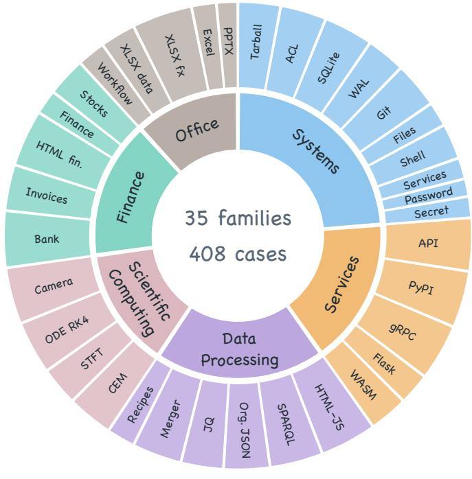

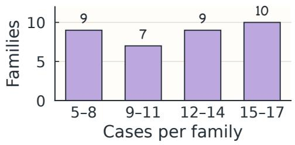

(b) Case breadth  
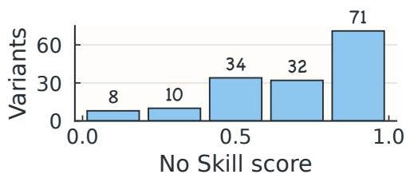  
(c) Baseline distribution  
(a) Domain and family composition  
(d) Evaluation cohorts  
Figure 2. Task-family catalog and evaluation cohorts. (a) Domain and family composition, (b) family sizes, and (c) Qwen No-Skill Avg@3 scores on the 155 main-cohort cases. (d) Bar length is proportional to case counts in the full catalog, main cohort, and lite subset shared by the additional model pairs.

## 3.2 Benchmark construction

We construct the benchmark in three stages: adapt source tasks, build task families through two complementary routes, and validate the resulting cases.

Source adaptation. We select tasks with clear requirements and meaningful variation from six benchmarks: Terminal-Bench and AgentIF-OneDay (Merrill et al., 2026; Chen et al., 2026), SpreadsheetBench (Ma et al., 2024), CodeContests and FullStackBench (Li et al., 2022; Liu et al., 2024b), and OficeBench (Wang et al., 2024). We normalize their formats and align descriptions, fixtures, and scorers.

Task-family construction. Experts in coding and agent benchmarking collaborate with agents through two routes (Figure 1A): extraction and adaptation groups compatible source cases under a shared specification and aligns their statements and tests; seed expansion starts from one task, defines its invariant goal and permitted variation, and authors additional cases within that scope. Both routes yield a public family specification and executable variants. One fixed case serves as the acquisition anchor; the remaining cases provide candidates for held-out evaluation.

Validation. Each case includes a resettable environment, a reference solution, and private tests. Programmatic checks verify Docker builds, execute tests, and confirm that reference solutions pass them; an expert other than the author then reviews each case before acceptance. Reference solutions and private tests remain outside agent workspaces (Appendix B).

Catalog and evaluation cohorts. The full catalog contains 35 families and 408 cases across six domains, with 5–17 cases per family, including the anchor (Figure 2). The main cohort selects families with at least 5 verified held-out cases and at least two non-perfect outcomes in catalog-wide No-Skill screening, yielding 22 families and 155 held-out cases (Table 5); its lite subset covers 10 families and 77 cases across all six domains for comparisons across model pairs. Each pair independently acquires its own packages.

## 3.3 Evaluation and metrics

Private checks score each fresh solver’s submitted artifacts or state. $R _ { f , v , r }$ is the fraction passed for case v of family f in repeat r; recorded timeouts score zero. All methods share the cases and verifier. The main study uses 3 independent acquisition runs per family and condition, each evaluated on all held-out cases; No Skill uses 3 fresh-solver repeats. Family-macro Avg@3 is

$$
\widehat { U } = \frac { 1 } { 3 | \mathcal { F } | } \sum _ { r = 1 } ^ { 3 } \sum _ { f \in \mathcal { F } } \frac { 1 } { | V _ { f } | } \sum _ { v \in V _ { f } } R _ { f , v , r } .\tag{2}
$$

Here $\mathcal { F }$ is the family set and $V _ { f }$ its held-out cases. Families receive equal weight; additional model pairs use a single repeat. Additional metrics: domain scores average their families; transfer gain is $1 0 0 ( \widehat { U } _ { \mathrm { S k i l l } } -$ $\widehat { U } _ { \mathrm { N o } \thinspace \mathrm { S k i l l } } )$ percentage points; Qwen main-cohort full-pass rate replaces $R _ { f , v , r }$ with $\mathbf { 1 } [ R _ { f , v , r } = 1 ]$ bin the same baverage. Uncertainty: paired 95% bootstrap intervals resample families after averaging their cases and repeats; process analyses likewise resample whole families to retain within-family dependence.

## 4 Socratic Skill Learning

We introduce Socratic Skill Learning (SSL), in which an Educator guides ongoing investigation while a Student tests the guidance and authors a transferable Skill. We develop two instantiations: FIXED-WINDOW SSL periodically reviews Student progress, while ISSUE-GUIDED SSL maintains learning issues to select and focus subsequent reviews. We first describe their shared learning process (Figure 3A), then present each protocol (Figure 3B).

A Learning & transfer  
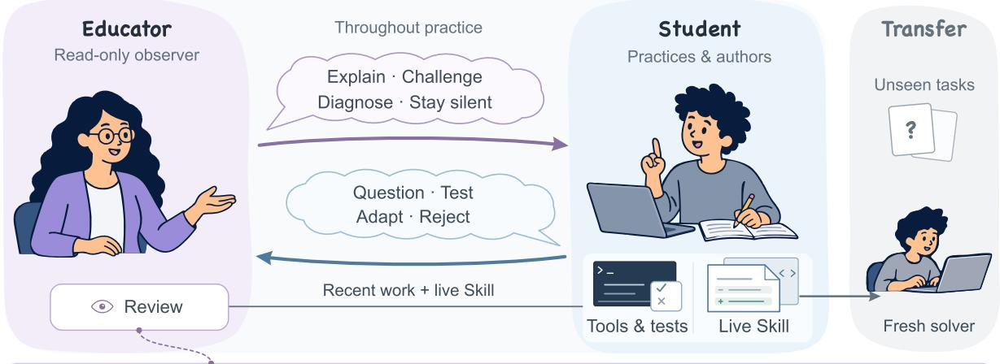

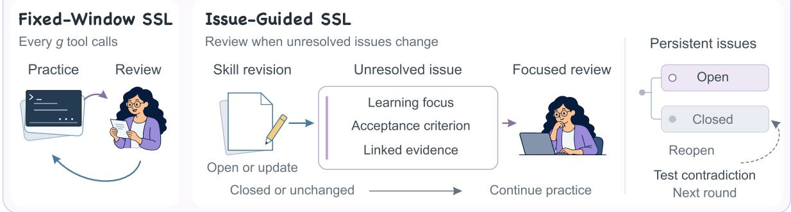  
Figure 3. Socratic Skill Learning. (A) The Student tests guidance and authors the Skill; the Educator reviews recent work and the live package read-only. Only the Skill transfers to fresh solvers. (B) FIXED-WINDOW SSL reviews every g tool calls; ISSUE-GUIDED SSL reviews unresolved issues when they open, change, or reopen, using focused context.

## 4.1 Socratic dialogue and Student practice

Both protocols use the target solver’s model as the Student, the sole environment operator and author of . Guided by the family specification, it explores the anchor, tests candidate procedures, and decides what evidence to gather and what knowledge to retain (Section 3.1).

Educator review and Student response. The Educator has read-only access to recent Student work and the live Skill. It can explain, challenge, diagnose, propose checks, or remain silent. The Student can question, test, adapt, or reject advice, responding through dialogue, environment experiments, and package revisions. This interaction examines the assumptions behind a procedure and the evidence needed to retain it, with the Student deciding how the evidence changes the Skill.

Rounds and transfer. A fresh solver tests each round’s package on the reset anchor, checking whether it carries the procedure beyond the author’s session. The resulting trajectory and verifier feedback guide the next round. Student and Educator sessions persist; evaluation sessions are fresh. Only the final package transfers to held-out family members.

## 4.2 Fixed-Window SSL

Fixed-Window SSL organizes acquisition as repeated periods of Student practice and Educator review. After every g completed Student tool calls, the Educator examines recent reasoning and tool results alongside the live Skill, informed by the family specification, prior lessons, and anchor feedback. This recurring review can challenge an assumption or suggest a missing check while an investigation is still open, shaping the evidence gathered before a procedure is retained.

The Student can clarify or contest a lesson, then resumes exploration and Skill revision. The resulting work informs the next review. Silence lets practice continue directly. The schedule thus fixes when review occurs, while guidance responds to the Student’s progress. The Student determines when to finish the round; a final review covers any work since the previous review, allowing Student action before the snapshot (Appendix C.2).

## 4.3 Issue-Guided SSL

Teaching demand changes as a Skill develops: practice can settle a question, while new evidence can call for further guidance. Issue-Guided SSL tracks unresolved questions across revisions to select when review is needed and focus it on relevant evidence.

Persistent learning issues. An Educator lesson supplies a learning focus and an acceptance criterion: what to investigate and what observable evidence would resolve it. A learning issue retains these together with evidence and package revisions for subsequent review. Issues form a persistent LEARNING-ISSUE TREE: a concern arising within an investigation becomes a child; closing it returns attention to the nearest unresolved ancestor. Resolved branches preserve what has already been addressed.

Revisions and resolution. The Student groups file edits into a coherent revision, declaring its summary, evidence, and any issue addressed. An addressed issue can close with a changed package when the Student verifies the revision, documents the procedure’s applicability with evidence, or rejects the guidance on evidential grounds. Verified closure requires a successful post-lesson check. Investigation can therefore settle a question without another Educator call.

Selective review and reopening. An initial review occurs at the first revision or after a warm-up window of tool calls. Thereafter, an unresolved issue must open, change, or reopen before further review. The Educator receives the active issue and its ancestors, the latest revision, and recent local work, with read access to the complete package. A lesson returns the Student to investigation; silence closes the current review episode. Contradictory fresh-solver anchor feedback can reopen the associated issue in the next round while preserving resolved siblings. Appendix C.2 gives event rules and boundary handling.

## 5 Can SSL Develop Transferable Agent Skills?

To assess how teaching supports Skill acquisition, we investigate four research questions (RQs): RQ1 evaluates transfer to held-out family members; RQ2 compares how expert guidance is organized across model pairs; RQ3 traces teaching, Student actions, and package revisions during acquisition; and RQ4 examines whether issue-guided review preserves transfer while reducing expert supervision. Evaluations follow the shared protocol in Section 3.

## 5.1 RQ1: Transfer to held-out family members

Do Skills acquired through interleaved teaching transfer to unseen members of the same taskfamilies?

Table 1 compares overall and domain-level transfer on the Qwen 22-family, 155-case main cohort. Qwen3.7 Plus serves as Student and fresh solver; Qwen3.7 Max supplies external expertise as Educator or direct package author. We compare the two SSL schedules with No Skill, direct Expert Authoring, Post-hoc Teaching, and adapted Trace2Skill and SKILL-KD. SSL, Expert Authoring, and Post-hoc Teaching use 3 acquisition rounds, with g = 10 for Fixed-Window SSL. Appendix C details model settings, baseline adaptations, and session boundaries; Appendix D provides per-family results, case-level gains and regressions, and uncertainty estimates.

The two SSL schedules rank first and second overall and in each of the six domains. Fixed-Window SSL exceeds adapted Trace2Skill by 3.99 percentage points (95% paired family-bootstrap CI: [1.45, 6.49]) and adapted SKILL-KD by 4.99 points. These gains measure package reuse beyond the anchor and acquisition session.

The utility improvement extends to complete task solutions. Family-macro full-pass rate, requiring every private check to pass, rises from 32.5% without a Skill to 49.5% with Fixed-Window SSL and 50.8% with Issue-Guided SSL.

Table 1. Overall and domain transfer on the Qwen main cohort. Family-macro Avg@3 utilities across 22 families and 155 cases on a 0–100 scale; superscripts show gain over No Skill (pp). Domains: Sys. (systems), Serv. (services), Data (data processing), Sci. (scientific computing), Fin. (finance), and Ofice (ofice automation). Bold and underlined scores mark the best and second-best learning methods in each column.
<table><tr><td>Skill method</td><td>All</td><td>Sys.</td><td>Serv.</td><td>Data</td><td>Sci.</td><td>Fin.</td><td>Office</td></tr><tr><td>No Skill score</td><td>72.3</td><td>78.6</td><td>58.2</td><td>68.1</td><td>66.8</td><td>78.0</td><td>90.4</td></tr><tr><td>ExPERT AUTHORING</td><td>72.8+0.5</td><td>77.9-0.6</td><td>58.7+0.6</td><td>71.6+3.5</td><td>72.4+5.7</td><td>72.5-5.5</td><td>91.4+1.0</td></tr><tr><td>POST-HOC TEACHING</td><td>74.8+2.4</td><td>73.6-4.9</td><td>64.4+6.3</td><td>73.7+5.6</td><td>76.4+9.7</td><td>78.1+0.0</td><td>91.3+0.9</td></tr><tr><td>TRACE2SKILL</td><td>76.1+3.8</td><td>85.0+6.4</td><td>63.4+5.2</td><td>71.0+2.9</td><td>73.3+6.5</td><td>77.9-0.1</td><td>90.0-0.4</td></tr><tr><td>SKILL-KD</td><td>75.1+2.8</td><td>85.5+6.9</td><td>60.9+2.7</td><td>73.2+5.1</td><td>68.2+1.5</td><td>75.7-2.4</td><td>90.3-0.1</td></tr><tr><td>FIXED-WINDOW SSL</td><td>80.1+7.8</td><td>88.7+10.1</td><td>67.3+9.1</td><td>75.1+6.9</td><td>77.0+10.2</td><td>82.4+4.4</td><td>94.1+3.7</td></tr><tr><td>IsSUE-GUIDED SSL</td><td>80.5+8.2</td><td>85.7+7.2</td><td>71.0+12.8</td><td>75.9+7.8</td><td>77.1+10.3</td><td>83.6+5.6</td><td>94.6+4.2</td></tr></table>

## 5.2 RQ2: Organizing expert guidance during Skill acquisition

How should external expertise guide Skill acquisition?

Table 2(a) compares the four authoring protocols on the shared 10 families across the Qwen, DeepSeek, and Kimi model pairs, complemented by the Qwen main cohort. Within each pair, the solver and tasks are fixed; protocols difer in who investigates and writes the package, when guidance is available, and how the agents interact (Appendices C and D).

Guidance during practice consistently produces stronger transfer than reviewing the Student’s completed authoring trajectory. Fixed-Window SSL and Post-hoc Teaching both preserve the Student as environment operator and package author, but Fixed-Window SSL outperforms Post-hoc Teaching on all three model pairs. On the main cohort, this advantage is 5.31 percentage points in utility with 21% fewer acquisition tokens. Interleaving lets the Student test advice while an investigation is still open and use the resulting evidence in subsequent exploration and writing. Post-hoc review arrives after those earlier choices have shaped the package. The results favor feedback that can redirect evidence gathering throughout practice.

The ordering also distinguishes guided practice from simply retaining a Student author. On the shared families, Post-hoc Teaching trails Expert Authoring in every model pair, whereas both interleaved protocols surpass Expert Authoring. This ordering favors coupling Student authorship with expert guidance during investigation. RQ3 examines how this interaction appears in Student actions and package revisions.

Table 2. Cross-model transfer and selective review. (a) Utility gain over No Skill (pp) on the shared lite subset (10 families, 77 cases). (b) Utility and Educator savings: Qwen main cohort (22 families, 155 cases); DeepSeek and Kimi lite subset. Savings and eficiency ratios compare Issue-Guided with Fixed-Window SSL. Qwen uses three repeats; DeepSeek and Kimi use one. Model pairs are defined in Appendix C.1.  
(a) Protocol comparison
<table><tr><td>Protocol</td><td></td><td>Qwen DeepSeek Kimi</td><td></td></tr><tr><td>FIXED-WINDOW SSL</td><td>+4.1</td><td>+3.1</td><td>+8.2</td></tr><tr><td>IsSUE-GUIDED SSL</td><td>+4.5</td><td>+2.5</td><td>+7.4</td></tr><tr><td>ExPERT AUTHORING</td><td>+1.1</td><td>+1.2</td><td>+5.8</td></tr><tr><td>POST-HOC TEACHING</td><td>-0.7</td><td>+0.5</td><td>+4.1</td></tr></table>

(b) Selective review
<table><tr><td>Metric</td><td>Qwen DeepSeek Kimi</td><td></td><td></td></tr><tr><td>Fixed-window utility</td><td>0.801</td><td>0.784</td><td>0.762</td></tr><tr><td>Issue-guided utility</td><td>0.805</td><td>0.779</td><td>0.753</td></tr><tr><td>Educator saved (%)</td><td>61.7</td><td>63.8</td><td>77.4</td></tr><tr><td>Efficiency ratio</td><td>2.75</td><td>2.2</td><td>3.9</td></tr></table>

## 5.3 RQ3: How teaching enters Skill development

How do teaching, Student actions, and package revisions change as Skill acquisition progresses?

Figure 4 traces 630 reviews across 66 Qwen FIXED-WINDOW SSL runs with 3 rounds each, linking Educatorreported intents, Student actions, and package snapshots. We compare behavior following teaching and silence at regular reviews, standardizing by round. Appendices E.1 and E.2 detail the taxonomy and estimation.

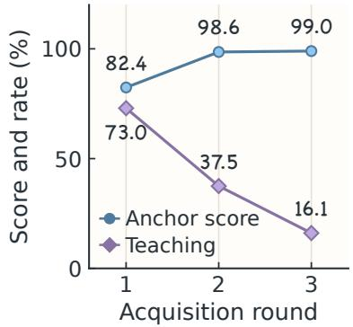  
(a) Progress and teaching

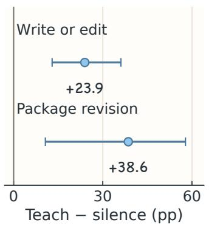  
(b) Writing and revision

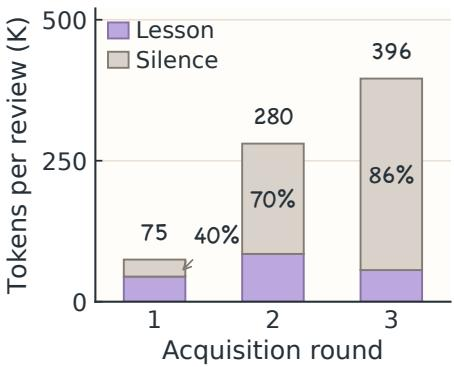  
(c) Review cost  
Figure 4. Teaching demand, Student development, and review cost. Qwen Fixed-Window SSL (g = 10), 22 families and 66 acquisition runs. Panels show (a) anchor scores and teaching rates at regular reviews, (b) teaching–silence diferences in writing on the next tool call and Skill changes over ten calls, standardized by round with 95% family bootstrap intervals, and (c) tokens per review before follow-up, with silent shares.

Teaching demand falls while Skill development continues. As anchor utility improves, the fraction of regular reviews delivering a lesson falls from 73.0% in round one to 16.1% in round three, and advice shifts from reasoning toward diagnosis. Under the three-round protocol, packages still change in 98 of 99 rounds following a perfect anchor score, including rounds with no new lesson.

Compared with silence, lessons are followed by a 23.9-point higher probability of file writing or editing on the next call and a 38.6-point higher probability of a Skill change over the next ten calls, after adjustment for round (Figure 4b).

The Qwen HTML-finance case shows how Student checks refine teaching advice. The Educator proposes deriving reported values from other entries to detect inconsistency. The Student’s initial implementation flags 4 metrics where only one is wrong. After inspecting this output, the Student replaces generic arithmetic with financial relations and reverse derivations, isolating the actual error (Table 3). The final Skill retains these relations and distinguishes an

Table 3. Testing teaching advice. Qwen Fixed-Window SSL, HTML-finance family, repeat 1. Recorded anchor checks; the erroneous report entry is line 210.
<table><tr><td>Verifier</td><td>Flagged Selected line</td></tr><tr><td>Generic arithmetic</td><td>140</td></tr><tr><td>Financial relations</td><td>1</td></tr></table>

untested value from a contradicted one. On an unseen cash-flow report, a fresh solver reads the package, checks accounting relations, and passes 4/4 checks (Appendix G). The lesson initiates an investigation; the Student’s execution evidence determines how the proposal becomes reusable knowledge.

Fixed review intervals become increasingly costly as this need for guidance declines. Average tokens per review grow 5.3-fold from the first to the last round as context accumulates; reviews returning silence account for 85.8% of final-round review tokens, before follow-up dialogue. This mismatch motivates selecting reviews around unresolved work while allowing the Student’s investigation to continue.

## 5.4 RQ4: Selecting and focusing review around unresolved issues

Can selecting and focusing review around unresolved issues preserve transfer while reducing expert supervision?

Figure 5 compares fixed reviews every g = 5, 10, 20 Student tool calls with ISSUE-GUIDED SSL on the Qwen main cohort, using 3 rounds and 66 runs per schedule. We prioritize Educator tokens to measure demand for external expertise, and track how Student work changes total acquisition cost. Table 2(b) extends the comparison to DeepSeek and Kimi on the shared 10 families. Appendix C.3 defines the cost components for each model pair.

<sup>(a)</sup> <sup>Utility</sup>(a) Util  
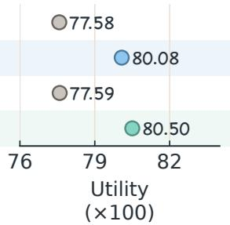

(b) Teaching cost  
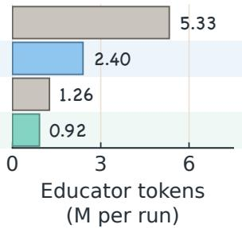

(c) Gain per cost  
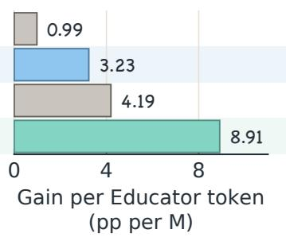  
Figure 5. Transfer utility and teaching eficiency across review schedules. Qwen main cohort: 22 families, 155 cases, 3 repeats. Panels compare (a) family-macro utility, (b) Educator tokens, and (c) transfer gain over No Skill per million Educator tokens, with shared schedule rows.

Issue-guided review reaches 0.805 utility versus 0.801 for the standard $g = 1 0$ window, using 61.7% fewer Educator tokens and 16.9% fewer acquisition tokens. It achieves 2.75 times the transfer gain per Educator token.

Simply changing the interval does not recover this balance: g = 5 increases Educator cost, whereas g = 20 reduces it, but both yield lower utility. Compared with $g = 1 0 .$ , Issue-Guided SSL reduces review count by 47.8% and tokens per review (including follow-up dialogue) by 26.7%.

On DeepSeek and Kimi, Issue-Guided SSL uses 63.8% and 77.4% fewer Educator tokens, respectively, while retaining utility within one percentage point of Fixed-Window SSL. Total acquisition tokens also fall for Kimi; additional Student work raises the total for DeepSeek (Appendix F).

## 6 Discussion and Conclusion

On shared SKILLTRANSFERBENCH families across three model pairs, Socratic Skill Learning (SSL) improves transfer over direct expert authoring and post-hoc teaching. Process and case analyses show how guidance enters Skill development: advice identifies a direction to investigate, while execution evidence informs how the Student tests, adapts, and retains a procedure.

As teaching demand changes, unresolved questions provide a basis for allocating expert attention. Issue-Guided SSL tracks these questions across revisions, retaining transfer utility with 2.75 times the gain per Educator token of Fixed-Window SSL on the main cohort. The study connects the development of reusable knowledge with decisions about where further guidance is needed.

## Reproducibility Statement

Benchmark tasks, acquisition and evaluation code, and released trajectories are available at https://gi thub.com/NJU-LINK/Socratic-Skill-Learning. Appendix B documents benchmark construction and evaluation cohorts; Appendix C specifies model settings, acquisition protocols, session boundaries, and reproduction commands. Appendices E.2 and F detail the process analyses and token accounting.

## AI Use Statement

We used generative AI tools to assist with drafting and adapting benchmark materials, implementing experimental code and analysis scripts, and analyzing recorded experimental results. We also used these tools for literature search, manuscript editing, and figure preparation. Benchmark materials were developed with human experts in coding and agent benchmarking. Each case underwent programmatic checks and review by an expert other than its author, following Appendix B. Numerical summaries were checked against recorded runs and analysis outputs. The authors take responsibility for the final content.

## References

Anthropic. Agent skills overview. https://platform.claude.com/docs/en/agents-and-tools/agent-skills/overview, 2025. Accessed 2026-08-02.

Kaiyuan Chen, Qimin Wu, Taiyu Hou, Tianhao Tang, Xueyu Hu, et al. AgentIF-OneDay: A task-level instructionfollowing benchmark for general AI agents in daily scenarios. arXiv preprint arXiv:2601.20613, 2026.

Michelene T. H. Chi, Stephanie A. Siler, Heisawn Jeong, Takashi Yamauchi, and Robert G. Hausmann. Learning from human tutoring. Cognitive Science, 25(4):471–533, 2001.

Tianyi Guan, Yiding Wang, Haotong Yang, Siyuan Cao, Shirui Liu, Yi Hu, Jiaqi Li, and Muhan Zhang. Continual-SkillBench: Can LLM agents truly evolve their capabilities? arXiv preprint arXiv:2608.03874, 2026.

John Hattie and Helen Timperley. The power of feedback. Review of Educational Research, 77(1):81–112, 2007.

Yangqin Jiang and Chao Huang. AgentBrew: Lifelong knowledge brewing from strong teachers to weak LLM agents. arXiv preprint arXiv:2607.16851, 2026.

Han Li, Yifan Yao, Letian Zhu, Rili Feng, Hongyi Ye, Jiaming Wang, Yancheng He, Pengyu Zou, Lehan Zhang, Xinping Lei, Haoyang Huang, Ken Deng, Ming Sun, Zhaoxiang Zhang, He Ye, and Jiaheng Liu. CodeTracer: Towards traceable agent states. arXiv preprint arXiv:2604.11641, 2026a.

Xiangyi Li, Yimin Liu, Wenbo Chen, Bingran You, Zonglin Di, et al. SkillsBench: Benchmarking how well agent skills work across diverse tasks. arXiv preprint arXiv:2602.12670, 2026b.

Yujia Li, David Choi, Junyoung Chung, Nate Kushman, Julian Schrittwieser, et al. Competition-level code generation with AlphaCode. Science, 378(6624):1092–1097, 2022.

Zhiwei Li and Yong Hu. SkillHone: A harness for continual agent skill evolution through persistent decision history. arXiv preprint arXiv:2606.08671, 2026.

Hongjun Liu, Yifei Ming, Shafiq Joty, and Chen Zhao. Harnessing LLM agents with skill programs. arXiv preprint arXiv:2605.17734, 2026a.

Jiayu Liu, Zhenya Huang, Tong Xiao, Jing Sha, Jinze Wu, Qi Liu, Shijin Wang, and Enhong Chen. SocraticLM: Exploring socratic personalized teaching with large language models. In Advances in Neural Information Processing Systems, volume 37, 2024a. https://papers.neurips.cc/paper\_files/paper/2024/hash/9bae399d1f34b8650351c1bd 3692aeae-Abstract-Conference.html.

Siyao Liu, He Zhu, Jerry Liu, Shulin Xin, Aoyan Li, Rui Long, Li Chen, Jack Yang, Jinxiang Xia, Z. Y. Peng, Shukai Liu, Zhaoxiang Zhang, Ge Zhang, Wenhao Huang, Kai Shen, and Liang Xiang. FullStack Bench: Evaluating LLMs as full stack coders. arXiv preprint arXiv:2412.00535, 2024b.

Yuxuan Liu, Zhaochen Su, Lingyun Xie, Yuhao Zhang, Qing Zong, Jiahe Guo, Zhongwei Xie, Yiyan Ji, Yauwai Yim, Hongyu Luo, Xiyu Ren, Ruan Chenyu, Haoran Li, and Yangqiu Song. SkillRevise: Improving LLM-authored agent skills via trace-conditioned skill revision. arXiv preprint arXiv:2606.01139, 2026b.

Yuchen Ma, Yue Huang, Han Bao, Haomin Zhuang, Swadheen Shukla, Michel Galley, Xiangliang Zhang, and Stefan Feuerriegel. SkillGen: Verified inference-time agent skill synthesis. arXiv preprint arXiv:2605.10999, 2026.

Zeyao Ma, Bohan Zhang, Jing Zhang, Jifan Yu, Xiaokang Zhang, Xiaohan Zhang, Sijia Luo, Xi Wang, and Jie Tang. SpreadsheetBench: Towards challenging real world spreadsheet manipulation. In Advances in Neural Information Processing Systems, volume 37, pages 94871–94908, 2024. doi: 10.52202/079017-3007.

Aman Madaan, Niket Tandon, Prakhar Gupta, Skyler Hallinan, Luyu Gao, Sarah Wiegrefe, Uri Alon, Nouha Dziri, Shrimai Prabhumoye, Yiming Yang, et al. Self-refine: Iterative refinement with self-feedback. In Advances in Neural Information Processing Systems, 2023.

Mike A. Merrill, Alexander G. Shaw, Nicholas Carlini, Boxuan Li, Harsh Raj, et al. Terminal-Bench: Benchmarking agents on hard, realistic tasks in command line interfaces. In International Conference on Learning Representations, 2026.

Jingwei Ni, Yihao Liu, Xinpeng Liu, Yutao Sun, Mengyu Zhou, Pengyu Cheng, Dexin Wang, Erchao Zhao, Xiaoxi Jiang, and Guanjun Jiang. Trace2Skill: Distill trajectory-local lessons into transferable agent skills. arXiv preprint arXiv:2603.25158, 2026.

Yinzhu Quan and Zefang Liu. EconSkills: Studying skill transfer and retrieval for web agents on live economic data. arXiv preprint arXiv:2609.19523, 2026.

Qiming Shi, Yibo Dou, Jiawen Zhu, Yulong Tao, Linbo Jin, Zhaolu Kang, Yunfan Zhou, and Di Weng. SKILL-KD: Contrastive skill distillation for LLM agents. arXiv preprint arXiv:2607.28048, 2026.

Noah Shinn, Federico Cassano, Ashwin Gopinath, Karthik Narasimhan, and Shunyu Yao. Reflexion: Language agents with verbal reinforcement learning. In Advances in Neural Information Processing Systems, 2023.

Guanzhi Wang, Yuqi Xie, Yunfan Jiang, Ajay Mandlekar, Chaowei Xiao, Yuke Zhu, Linxi Fan, and Anima Anandkumar. Voyager: An open-ended embodied agent with large language models. arXiv preprint arXiv:2305.16291, 2023.

Zilong Wang, Yuedong Cui, Li Zhong, Zimin Zhang, Da Yin, Bill Yuchen Lin, and Jingbo Shang. OficeBench: Benchmarking language agents across multiple applications for ofice automation. arXiv preprint arXiv:2407.19056, 2024.

Andrew Zhao, Daniel Huang, Quentin Xu, Matthieu Lin, Yong-Jin Liu, and Gao Huang. ExpeL: LLM agents are experiential learners. In Proceedings of the AAAI Conference on Artificial Intelligence, volume 38, pages 19632–19642, 2024. doi: 10.1609/aaai.v38i17.29936.

Xiangxin Zhao, Han Li, Shuaiting Li, Tianyi Zhao, Earl T. Barr, Federica Sarro, and He Ye. Failure as a process: An anatomy of CLI coding agent trajectories. arXiv preprint arXiv:2607.09510, 2026.

Shanshan Zhong, Yi Lu, Jingjie Ning, Yibing Wan, Lihan Feng, Yuyi Ao, Leonardo F. R. Ribeiro, Markus Dreyer, Sean Ammirati, and Chenyan Xiong. SkillLearnBench: Benchmarking continual learning methods for agent skill generation on real-world tasks. arXiv preprint arXiv:2604.20087, 2026.

## A Positioning of Prior Skill-Learning Methods

Table 4 compares where feedback enters Skill acquisition and how package updates are produced (Ni et al., 2026; Ma et al., 2026; Shi et al., 2026; Zhong et al., 2026). These distinctions motivate the acquisitionprotocol and review-schedule comparisons in the main study.

Table 4. Feedback and package updates in representative Skill-learning protocols. SSL combines external guidance during ongoing practice with Student-owned tool use and package writing.

<table><tr><td>Protocol</td><td>Feedback enters through</td><td>Skill update mechanism</td></tr><tr><td>Trace2Skill</td><td>Local trajectory analysis</td><td>Extract, merge, and apply lessons</td></tr><tr><td>SkillGen</td><td>Candidate verification</td><td>Generate, verify, and refine packages</td></tr><tr><td>SKILL-KD</td><td>Teacher-Student trajectory contrast and Student reruns</td><td>Consolidation agent proposes and validates patches</td></tr><tr><td>SkillLearnBench: Teacher Feedback</td><td></td><td> Advice after failure, using a reference Skill Learner revises the Skill before retrying</td></tr><tr><td>Fixed-Window SSL</td><td>Educator review during practice at fixed tool-call intervals</td><td>Student tests advice and writes the live</td></tr><tr><td>Issue-Guided SSL</td><td>Review on unresolved issue transitions with local evidence</td><td>package Student revisions and anchor feedback update persistent issue state</td></tr></table>

## B Benchmark Assets and Evaluation Cohorts

## B.1 Construction routes

Experts in coding and agent benchmarking collaborate with agents to construct the task families. We first convert source tasks to a common format, reconciling paths, formats, ordering, precision, and boundary conditions across the task descriptions, fixtures, and scorers. For example, adapting the WAL anchor preserves the source database fixtures while revising task metadata and strengthening checks of the recovered output.

In extraction and adaptation, compatible source cases are grouped into families, and statements and tests are revised to align their requirements. In seed expansion, a case from the adapted pool seeds a specification of the shared invariant and permitted variation; experts and agents then develop additional cases within this scope. Each task includes a description, public fixtures, a resettable environment, a reference solution, and a private verifier.

For example, WAL-recovery cases vary encoding, integrity, and recovery depth while preserving the reconstruction goal. Acquisition uses a fixed v01 anchor in each family.

## B.2 Catalog and variation axes

Table 5 distinguishes the full catalog, including one anchor per family, from the main held-out cohort. A dash denotes a family outside that cohort. Table 6 lists the public variation axes for the evaluated families. The catalog contains 35 anchors and 373 non-anchor cases, with 5–17 cases per family; family members are complete executable tasks.

Table 5. Curated task-family catalog and main evaluation cohort, showing case counts for each family within domain groupings and totals across the catalog.
<table><tr><td>Domain</td><td>Family</td><td>Catalog cases</td><td>Main held-out</td></tr><tr><td>Systems</td><td>Deterministic tarball</td><td>12</td><td>6</td></tr><tr><td></td><td>ACL inheritance</td><td>13</td><td>6</td></tr><tr><td></td><td>SQLite truncation</td><td>14</td><td>6</td></tr><tr><td></td><td>DB WAL recovery</td><td>11</td><td>7</td></tr><tr><td></td><td>Git leak recovery</td><td>13</td><td>6</td></tr><tr><td></td><td>Recover obfuscated files</td><td>7</td><td></td></tr><tr><td></td><td>Shell deobfuscation</td><td>10</td><td></td></tr><tr><td></td><td>Service decommissioning</td><td>6</td><td></td></tr><tr><td></td><td>Password recovery</td><td>5</td><td></td></tr><tr><td></td><td>Vulnerable secret</td><td>6</td><td>一</td></tr><tr><td>Services</td><td>API scheduler</td><td>15</td><td>10</td></tr><tr><td></td><td>PyPI server</td><td>16</td><td>10</td></tr><tr><td></td><td>KV-store gRPC</td><td>16</td><td>6</td></tr><tr><td></td><td>Flask</td><td>9</td><td>6</td></tr><tr><td></td><td>WASM pipeline</td><td>11</td><td>一</td></tr><tr><td>Data Processing</td><td>Filter JS from HTML</td><td>16</td><td>10</td></tr><tr><td></td><td>SPARQL professors</td><td>15</td><td>10</td></tr><tr><td></td><td>Organization JSON</td><td>13</td><td>8</td></tr><tr><td></td><td>JQ processing</td><td>12</td><td>7</td></tr><tr><td></td><td>Multi-source merger</td><td>14</td><td>一</td></tr><tr><td></td><td>Cocktail recipes</td><td>8</td><td>一</td></tr><tr><td>Scientific Computing</td><td>Cross-entropy method</td><td>13</td><td>6</td></tr><tr><td></td><td>Audio STFT peaks</td><td>11</td><td>10</td></tr><tr><td></td><td>ODE RK4</td><td>15</td><td>5</td></tr><tr><td></td><td>Camera layout</td><td>16</td><td>一</td></tr><tr><td>Finance</td><td>Bank transaction filter</td><td>16</td><td>6</td></tr><tr><td></td><td>Financial documents</td><td>13</td><td>6</td></tr><tr><td></td><td>HTML finance verification</td><td>16</td><td>6</td></tr><tr><td></td><td>Financial analysis</td><td>7</td><td>6</td></tr><tr><td></td><td>Stock analysis</td><td>11</td><td></td></tr><tr><td>Office Automation</td><td>Office workflow</td><td>8</td><td>6</td></tr><tr><td></td><td>XLSX structure</td><td>10</td><td>6</td></tr><tr><td></td><td>XLSX formula</td><td>17</td><td>1</td></tr><tr><td></td><td>Excel automation</td><td>7</td><td>一</td></tr><tr><td></td><td>PPTX editing</td><td>6</td><td>一</td></tr><tr><td colspan="2">Total: 35 catalog families; 22 main families</td><td>408</td><td>155</td></tr></table>

## B.3 Validation and acceptance

Acceptance requires a stable family invariant with declared variation, unambiguous requirements with deterministic tests, tasks that go beyond mechanical edits, and at least three separately attributable checks. Programmatic validation verifies Docker builds, executes tests, and confirms that reference solu-

tions pass them. An expert other than the author reviews each case before acceptance. Reference solutions and private tests remain outside agent workspaces.

Curation yields 35 families and 408 cases from 37 candidate families and 444 cases. Reference solutions pass all 2,807 checks (3–34 per case).

## B.4 Evaluation cohort

The main cohort selects families with at least 5 verified held-out cases and at least two non-perfect outcomes in catalog-wide No-Skill screening. It contains 22 families and 155 held-out cases, with 5–10 cases per family, retaining ceiling cases for coverage and regression measurement. Appendix D.2 reports repeat-level scores and case-level transfer directions.

Table 6. Public variation axes for each family in the main evaluation cohort, summarizing the changes across cases declared in the family specifications.
<table><tr><td>Family</td><td>What changes across cases</td></tr><tr><td>Filter JS from HTML</td><td>Executable constructs, preservation requirements, malformed syntax, encodings.</td></tr><tr><td>API scheduler</td><td>Task volume, emergencies, priority rules, dependencies, API capabilities.</td></tr><tr><td>SPARQL professors</td><td>Rank semantics, affiliation paths, graph noise and duplicate bindings.</td></tr><tr><td>Audio STFT peaks</td><td>Signal recipe, STFT settings, peak selection and shell output contract.</td></tr><tr><td>PyPI server</td><td>Package layout, public API, index configuration, publication and installation.</td></tr><tr><td>Organization JSON</td><td>Entity relationships, field normalization, aggregation distributions.</td></tr><tr><td>DB WAL recovery</td><td>WAL encoding, base/frame integrity, recovery depth, schema and update</td></tr><tr><td>JQ processing</td><td>topology. Selection and ordering, reshaping, normalization, collection-level aggregation.</td></tr><tr><td>Cross-entropy method</td><td>Environment dynamics, elite-update regime, shared-prefix plan evaluation.</td></tr><tr><td>Deterministic tarball</td><td>Source contents and exclusions, metadata normalization, archive/compressor</td></tr><tr><td>Flask</td><td>format.</td></tr><tr><td>KV-store gRPC</td><td>Stateful resources, coupled endpoints, validation and failure behavior. RPC schema, persistent state semantics, service lifecycle and request patterns.</td></tr><tr><td>HTML finance verification</td><td>Report structure, accounting relations, error type, output precision.</td></tr><tr><td>ODE RK4</td><td>Differential dynamics, evaluation schedule, step and efficiency constraints.</td></tr><tr><td>Bank transaction filter</td><td>Noisy identity signals, membership propagation, confusable distractors.</td></tr><tr><td>Git leak recovery</td><td>Object/ref location, repository topology, recovery and cleanup scope.</td></tr><tr><td>Financial documents</td><td>Content-based classification, OCR/modalities, amount expression, batch</td></tr><tr><td>SQLite truncation</td><td>composition.</td></tr><tr><td>ACL inheritance</td><td>Corruption mechanism, value encoding, record identification, recovery scale.</td></tr><tr><td></td><td>User/group policy topology, effective permissions, descendant inheritance.</td></tr><tr><td>Financial analysis</td><td>Source formats, cross-statement joins, metric definition, locale and schema.</td></tr><tr><td>Office workflow XLSX structure</td><td>Source/destination artifacts, temporal routing, cross-output consistency. Transformation, workbook topology, alignment, output geometry, preservation.</td></tr></table>

## C Protocols, Implementation, and Reproduction

## C.1 Runtime, sessions, and package boundaries

Runtime and models. We abbreviate the three model pairs as Qwen, DeepSeek, and Kimi. In each pair, the Student model also serves as the fresh solver, while the Educator model supplies external expertise or writes the package under Expert Authoring. The harness uses Pi coding agent 0.81.1<sup>2</sup>, TypeScript 5.9.3, and Docker task environments. Main Qwen runs use qwen3.7-plus as Student and qwen3.7-max as Educator, with a 1,000,000-token context window, a 65,536-token maximum completion, and thinking enabled. Sampling uses the provider defaults. DeepSeek uses deepseek-v4-flash-0731 as Student and deepseek-v4-pro-0813 as Educator, with the same context window, 393,216 maximum completion tokens, thinking enabled, and reasoning efort max. Kimi uses kimi-k2.5 for the Student and fresh solvers (262,144-token context, 16,384 maximum completion, thinking enabled), and kimi-k3 for the external author or Educator (1,048,576-token context, 131,072 maximum completion, reasoning efort max).

Session isolation and access. Within an original authoring-protocol run, the package author (the external model under Expert Authoring; the Student otherwise) and, where applicable, the Educator maintain separate continuous sessions across acquisition rounds, with automatic context compaction. Sessions never continue across families, replicates, or protocol cells. Every anchor and held-out evaluation uses a fresh target-model solver. Adapted SKILL-KD instead uses fresh executions with persistent rule-edit history (Appendix C.3.1).

The author operates in a Docker workspace containing the public task, anchor inputs, and family specification, and is the only agent that writes the live Skill. Educator tools list, read, and search the full package but cannot execute environment actions or write files. Solvers load only the frozen target package through the native Skill catalog, with ambient Skills disabled and a clean case workspace. The package contains SKILL.md and optional scripts/, references/, and assets/ directories. Held-out materials remain inaccessible during acquisition, and private checks are applied only after the solver submits its solution. Snapshots retain every package file; resource reads and executable invocations are logged.

## C.2 Acquisition loop and review events

Review context and interaction. FIXED-WINDOW SSL reviews after every g completed Student tool calls, with g = 10 in the main condition and g = 5, 20 in the schedule comparison. FIXED-WINDOW SSL provides the Educator with the family definition, recent reasoning and tool calls, prior lessons, feedback from anchor tests by fresh solvers, and the complete live package. An opening lesson may explain, propose a test, diagnose, or challenge an assumption; the Student may clarify, adapt, or contest it, followed by at most one Educator reply. Subsequent task actions and package edits remain Student decisions.

Round completion. The author ends its trajectory when it has finished the current exploration and package revision. The harness completes the scheduled terminal review, if any, and the Student’s resulting work, then validates and snapshots the package for a fresh anchor test. Each round permits at most one terminal review; resulting Student work is retained without another terminal review. The tool-call window controls review frequency, while the author determines trajectory length. All 3 rounds run, with anchor feedback entering the next round.

Revision declarations and issue state. During practice, the Student calls commit\_skill\_revision after a coherent knowledge change to the complete package. The declaration includes a summary and evidence, plus an issue ID and disposition when it addresses an existing lesson. Ordinary file edits accumulate until the Student commits such a revision. The Educator supplies a learning focus and an observable acceptance criterion when delivering a lesson.

Each persistent issue stores a focus, acceptance criterion, linked revisions, evidence, and disposition. A child records a concern within ongoing work; closure returns attention to the nearest unresolved ancestor. In Issue-Guided SSL, the first-round bootstrap occurs at the first revision or after ten tool calls, whichever comes first. At the round boundary, an uncommitted package change is processed as an implicit revision; the runtime also handles any pending bootstrap or anchor contradiction before the final snapshot. The default Educator view includes up to three active-path nodes, two recently closed issues, the latest revision, and recent local tool calls; read access to the complete package remains available. After

The loop below preserves Student package ownership under both schedules.

create Student; create Educator; initialize package K   
for round in 1..3:   
give Student public spec, clean anchor, previous feedback   
while the current authoring trajectory is active:   
let Student reason, invoke tools, and edit K   
Fixed-Window SSL: review after g completed tool calls   
or at an unreviewed end-of-round tail   
Issue-Guided SSL: on bootstrap, revision commit, or contradiction:   
resolve addressed active issue if closure conditions hold   
otherwise update, open, or reopen its persistent issue   
request review only for an unresolved transition   
if review requested:   
Educator observes local evidence and complete package   
if lesson: Student responds   
fixed-window permits one Educator follow-up   
else: retain Issue-Guided SSL issue with no-lesson closure reason   
Student resumes its own work   
freeze K; evaluate with fresh target model on clean anchor   
retain trajectory and verifier feedback for the next round   
evaluate final K with a fresh target model for each held-out case

bootstrap, another unresolved transition precedes further teaching, so triggers, context, and follow-up policy change together.

Student-declared closure requires an addressed active issue and a changed package. A verified disposition additionally requires a successful post-lesson verification event; bounded and rejected dispositions record stated evidence. A no-lesson closure records Educator silence rather than verified correctness. Contradictory feedback from an anchor test by a fresh solver targets the issue associated with that package and may reopen it while preserving resolved siblings.

## C.3 Acquisition comparators

Expert Authoring assigns exploration and package writing to the external model, including feedback from multi-round anchor tests by fresh solvers. Post-hoc Teaching keeps the Student as author and of fers one review after the authoring trajectory in each round. A lesson is followed by Student checks and revisions; this protocol has no immediate Educator follow-up. Table 7 summarizes the interaction structure. No Skill skips acquisition and solves each case in a fresh session. Our adaptation of the released Trace2Skill retains parallel patch proposal and consolidation over independent anchor trajectories generated from a generic seed package, replacing the spreadsheet-specific front end with a task-family adapter. The main authoring comparison contains 198 acquisition runs; Issue-Guided SSL adds 66.

Cost accounting. Acquisition tokens include cached input and exclude held-out solving. Qwen totals cover the author, Educator, and fresh-solver anchor evaluations; DeepSeek and Kimi totals cover the persistent author and Educator sessions. Teaching eficiency divides transfer gain by Educator tokens.

## C.3.1 Adapted SKILL-KD

Adaptation. We use the released SKILL-KD loop (Shi et al., 2026)<sup>3</sup> at upstream revision f76b51c3e855, with adapter revision 54954317354d; full hashes are retained in the compact evidence. Each of 66 independent runs starts from a generic rule seed and makes three visits to its public anchor. A successful Student attempt leaves the rules unchanged. Otherwise, Teacher and Student trajectories inform a critic’s proposed rule edits, accepted only after a fully successful fresh Student rerun. Each visit permits at most three adaptive rounds; failed candidates roll back to the visit-start rules. Qwen3.7 Plus is the Student and held-out solver; Max is Teacher and critic. Every execution uses a fresh session. Only accepted rules, not private edit history, enter the frozen Skill.

Table 7. Authoring and teaching protocols. Each uses 3 acquisition rounds with fresh-solver anchor feedback between rounds.
<table><tr><td>Protocol</td><td>Operator / author Review opportunity</td><td></td><td>Continuation</td></tr><tr><td>Expert Authoring</td><td>External model</td><td>No separate Educator</td><td>Author revises from anchor feedback</td></tr><tr><td>Post-hoc Teaching</td><td>Student</td><td>Once after the authoring trajectory in each round</td><td>Student checks and revises</td></tr><tr><td>Fixed-Window SSL</td><td>Student</td><td>Every g tool calls and an unreviewed tail</td><td>Student responds; one optional Educator follow-up</td></tr><tr><td>Issue-Guided SSL</td><td>Student</td><td>Unresolved issue transitions</td><td>Student investigates and commits revisions before further review</td></tr></table>

Separate cost scope. The physical-usage audit records 128.11M acquisition tokens across 66 runs (1.94M per run). The acquisition-cost columns show a dash for this baseline, since the audit follows a diferent scope.

## C.4 Reproduction

The released repository contains tasks in benchmark/, the execution harness in src/, and experiment records in experiments/. The file configs/scopes/main.yaml selects the 22-family, 155-case main cohort, and configs/scopes/lite.yaml selects the shared 10-family subset. Model pairs are specified in configs/models/. Method identifiers match the paper names: expert-authoring, post-hoc-teaching, fixed-window-ssl, and issue-guided-ssl.

With Node.js 22.19 or later and Docker, run the following commands from the repository root. Configure SSL\_URL and SSL\_KEY in .env before acquisition or evaluation:

```batch
npm ci
cp .env.example .env
npm run ssl -- run --scope main --model qwen \
--methods fixed-window-ssl,issue-guided-ssl
npm run ssl -- evaluate --scope main --model qwen \
--methods fixed-window-ssl,issue-guided-ssl \
--frozen experiments/main/qwen
```

Add --dry-run to inspect a run plan, or use acquire and evaluate as separate stages. docs/runni ng.md documents the trace2skill and skill-kd baseline commands and setup. experiments/RE ADME.md maps cohorts to teaching sessions, Skill packages, and evaluation records. Scores and frozen Skills are directly available; python3 scripts/unpack-experiments.py --group main-qwen restores the remaining Qwen session logs. Acquisition uses only the anchor and public family specification; held-out evaluation uses fresh solver sessions with the resulting package.

## D Supplementary Transfer Results

## D.1 Overall and per-family comparisons

Table 8 gives family-macro Avg@3 utility and full-pass rate, paired 95% bootstrap confidence intervals for utility gains, and mean acquisition cost on the Qwen 22-family, 155-case main cohort. A cost dash denotes no acquisition for No Skill and unavailable common-scope cost for the adapted baselines. Table 9 provides the full per-family values underlying Table 1.

Full-pass gains over No Skill are 16.99 percentage points for FIXED-WINDOW SSL (95% paired familybootstrap CI: [8.13, 26.86]) and 18.33 points for ISSUE-GUIDED SSL ([9.44, 28.12]), using the same family resampling as the utility comparisons.

Table 8. Utility, full-pass rate, and acquisition cost on the Qwen 22-family, 155-case main cohort (Avg@3, familymacro). Gain and 95% CI refer to utility diferences from No Skill.
<table><tr><td>Condition</td><td>Utility ↑</td><td>Gain (pp)</td><td>95% CI</td><td>Full-pass (%) ↑</td><td>Tokens/run (M)</td></tr><tr><td>No Skill</td><td>0.723</td><td>一</td><td></td><td>32.50</td><td>一</td></tr><tr><td>ExPERT AUTHORING</td><td>0.728</td><td>+0.46</td><td>[-5.46, 6.56]</td><td>40.44</td><td>4.95</td></tr><tr><td>POST-HOC TEACHING</td><td>0.748</td><td>+2.44</td><td>[-3.36,7.90]</td><td>40.37</td><td>8.71</td></tr><tr><td>Adapted TRACE2SκILL</td><td>0.761</td><td>+3.76</td><td>[−0.50,8.96]</td><td>39.11</td><td>一</td></tr><tr><td>Adapted SKILL-KD</td><td>0.751</td><td>+2.76</td><td>[-1.59,8.09]</td><td>41.65</td><td>一</td></tr><tr><td>FIxED-WINDOW SSL (g = 10)</td><td>0.801</td><td>+7.75</td><td>[3.53, 12.68]</td><td>49.49</td><td>6.89</td></tr><tr><td>IssUE-GuIDED SSL</td><td>0.805</td><td>+8.18</td><td>[3.54,13.57]</td><td>50.82</td><td>5.72</td></tr></table>

Table 9. Per-family Avg@3 scores on the Qwen main cohort (22 families, 155 cases), including adapted Trace2Skill and SKILL-KD. Only the last row is a macro-average across task families.
<table><tr><td>Family</td><td>No Skill</td><td>Expert Authoring</td><td>Post-hoc Teaching</td><td>Trace2Skill</td><td>SKILL-KD</td><td>Fixed- Window SSL</td><td>Issue- Guided SSL</td></tr><tr><td>ACL inheritance</td><td>0.933</td><td>0.728</td><td>0.858</td><td>0.885</td><td>0.933</td><td>0.933</td><td>0.881</td></tr><tr><td>API scheduler</td><td>0.767</td><td>0.730</td><td>0.745</td><td>0.897</td><td>0.921</td><td>0.791</td><td>0.830</td></tr><tr><td>Audio STFT peaks</td><td>0.563</td><td>0.631</td><td>0.652</td><td>0.608</td><td>0.664</td><td>0.643</td><td>0.656</td></tr><tr><td>Bank transaction filter</td><td>0.678</td><td>0.548</td><td>0.550</td><td>0.522</td><td>0.515</td><td>0.593</td><td>0.652</td></tr><tr><td>Cross-entropy method</td><td>0.553</td><td>0.556</td><td>0.642</td><td>0.617</td><td>0.556</td><td>0.667</td><td>0.656</td></tr><tr><td>DB WAL recovery</td><td>0.473</td><td>0.826</td><td>0.705</td><td>0.905</td><td>0.901</td><td>0.884</td><td>0.878</td></tr><tr><td>Deterministic tarball</td><td>0.678</td><td>0.691</td><td>0.677</td><td>0.706</td><td>0.682</td><td>0.728</td><td>0.693</td></tr><tr><td>Filter JS from HTML</td><td>0.366</td><td>0.350</td><td>0.403</td><td>0.363</td><td>0.391</td><td>0.433</td><td>0.440</td></tr><tr><td>Financial analysis</td><td>0.792</td><td>0.750</td><td>0.875</td><td>0.747</td><td>0.792</td><td>0.875</td><td>0.875</td></tr><tr><td>Financial documents</td><td>0.921</td><td>0.603</td><td>0.754</td><td>0.913</td><td>0.897</td><td>0.913</td><td>0.873</td></tr><tr><td>Flask</td><td>0.408</td><td>0.406</td><td>0.638</td><td>0.516</td><td>0.396</td><td>0.690</td><td>0.785</td></tr><tr><td>Git leak recovery</td><td>0.929</td><td>0.905</td><td>0.872</td><td>0.896</td><td>0.928</td><td>0.975</td><td>0.961</td></tr><tr><td>HTML finance verification</td><td>0.731</td><td>1.000</td><td>0.944</td><td>0.935</td><td>0.824</td><td>0.917</td><td>0.944</td></tr><tr><td>JQ processing</td><td>0.875</td><td>0.835</td><td>0.853</td><td>0.889</td><td>0.867</td><td>0.889</td><td>0.892</td></tr><tr><td>KV-store gRPC</td><td>0.607</td><td>0.635</td><td>0.630</td><td>0.586</td><td>0.584</td><td>0.625</td><td>0.635</td></tr><tr><td>ODE RK4</td><td>0.887</td><td>0.987</td><td>1.000</td><td>0.973</td><td>0.827</td><td>1.000</td><td>1.000</td></tr><tr><td>Office workflow</td><td>0.875</td><td>0.905</td><td>0.907</td><td>0.867</td><td>0.873</td><td>0.959</td><td>0.964</td></tr><tr><td>Organization JSON</td><td>0.778</td><td>1.000</td><td>1.000</td><td>0.875</td><td>1.000</td><td>1.000</td><td>1.000</td></tr><tr><td>PyPI server</td><td>0.544</td><td>0.578</td><td>0.564</td><td>0.536</td><td>0.533</td><td>0.583</td><td>0.589</td></tr><tr><td>SPARQL professors</td><td>0.706</td><td>0.680</td><td>0.690</td><td>0.713</td><td>0.672</td><td>0.680</td><td>0.705</td></tr><tr><td>SQLite truncation</td><td>0.915</td><td>0.747</td><td>0.569</td><td>0.856</td><td>0.830</td><td>0.915</td><td>0.875</td></tr><tr><td>XLSX structure</td><td>0.933</td><td>0.923</td><td>0.919</td><td>0.933</td><td>0.933</td><td>0.923</td><td>0.928</td></tr><tr><td>Macro average</td><td>0.723</td><td>0.728</td><td>0.748</td><td>0.761</td><td>0.751</td><td>0.801</td><td>0.805</td></tr></table>

Fixed-Window SSL’s paired gains are 7.29 points over Expert Authoring, 5.31 over Post-hoc Teaching, 3.99 over Trace2Skill, and 4.99 over adapted SKILL-KD. It improves on No Skill in 16 of the 22 families and uses 21% fewer acquisition tokens than Post-hoc Teaching. The 95% bootstrap confidence interval over task families for Fixed-Window SSL–Trace2Skill is [1.45, 6.49] percentage points. The intervals for Post-hoc Teaching–Expert Authoring, Fixed-Window SSL–Post-hoc Teaching, and Fixed-Window SSL– Expert Authoring are respectively [ 1.57, 5.64], [2.34, 9.09], and [3.62, 11.44] points. The Fixed-Window SSL–adapted SKILL-KD interval is [1.79, 8.48] points. All intervals resample the same paired family differences.

## D.2 Repeat variation, non-ceiling cases, and sensitivity

Table 10 compares each case’s Avg@3 score with its No-Skill score. Counts are independent of family or domain weighting. The ceiling subset contains the 25 cases with No-Skill score 1 across all repeats; the other 130 cases are non-ceiling. Fixed-Window SSL improves 55.4% of non-ceiling cases, and Issue-Guided SSL improves 54.6%.

Table 10. Case-level Avg@3 transfer directions relative to No Skill on the Qwen main cohort (22 families, 155 cases), with non-ceiling and ceiling subsets for Fixed-Window SSL and Issue-Guided SSL.
<table><tr><td>Method</td><td>Improved</td><td>Unchanged</td><td>Regressed</td></tr><tr><td>All cases (n = 155)</td><td></td><td></td><td></td></tr><tr><td>ExPERT AUTHORING</td><td>58</td><td>56</td><td>41</td></tr><tr><td>POST-HOC TEACHING</td><td>57</td><td>53</td><td>45</td></tr><tr><td>Adapted TRACE2SKILL</td><td>59</td><td>65</td><td>31</td></tr><tr><td>FIXED-WINDOW SSL</td><td>72</td><td>59</td><td>24</td></tr><tr><td>IssUE-GuIDED SSL</td><td>71</td><td>63</td><td>21</td></tr><tr><td>Adapted SKILL-KD</td><td>55</td><td>69</td><td>31</td></tr><tr><td>Non-ceiling (n = 130)</td><td></td><td></td><td></td></tr><tr><td>Fixed-Window SSL</td><td>72</td><td>37</td><td>21</td></tr><tr><td>Issue-Guided SSL</td><td>71</td><td>43</td><td>16</td></tr><tr><td>Ceiling (n = 25)</td><td></td><td></td><td></td></tr><tr><td>Fixed-Window SSL</td><td>0</td><td>22</td><td>3</td></tr><tr><td>Issue-Guided SSL</td><td>0</td><td>20</td><td>5</td></tr></table>

Table 11. Repeat variation on the Qwen main cohort (22 families, 155 cases): family-macro utility for each repeat, its standard deviation across repeats, and mean within-family variability.
<table><tr><td>Condition</td><td>Repeat 1</td><td>Repeat 2</td><td>Repeat 3</td><td>SD</td><td>Mean within-family SD</td></tr><tr><td>No Skill</td><td>0.719</td><td>0.730</td><td>0.721</td><td>0.006</td><td>0.036</td></tr><tr><td>FIXED-WINDOW SSL</td><td>0.772</td><td>0.799</td><td>0.831</td><td>0.030</td><td>0.031</td></tr><tr><td>IsSUE-GUIDED SSL</td><td>0.767</td><td>0.810</td><td>0.838</td><td>0.036</td><td>0.037</td></tr><tr><td>Adapted SKILL-KD</td><td>0.746</td><td>0.756</td><td>0.750</td><td>0.005</td><td>0.039</td></tr></table>

Every Fixed-Window SSL and Issue-Guided SSL repeat exceeds its corresponding No-Skill repeat. SD is the sample standard deviation across the 3 repeat-level scores. The final column averages the withinfamily sample SD across 22 families.

## D.3 Additional model pairs

DeepSeek-V4-Flash-0731 / DeepSeek-V4-Pro-0813 and Kimi K2.5 / Kimi K3 independently acquire packages on a 10-family, 77-case lite subset of the main cohort: Audio STFT peaks (10 cases), Filter JS from HTML (10), Git leak recovery (6), HTML finance verification (6), JQ processing (7), KV-store gRPC (6), PyPI server (10), SPARQL professors (10), SQLite truncation (6), and XLSX structure (6). Each condition has 1 repeat, 3 acquisition rounds, and 77 held-out evaluations in fresh sessions with equal weighting across task families. Each model-pair experiment comprises 40 acquisition runs, 120 anchor evaluations by fresh solvers, 308 Skill-based held-out evaluations, and 77 No-Skill evaluations, and compares four acquisition protocols and No Skill.

On all three model pairs, the two interleaved protocols take the top two positions and Expert Authoring ranks third (Table 2(a)). Fixed-Window SSL exceeds Post-hoc Teaching by 4.88, 2.54, and 4.09 points on the shared families for Qwen, DeepSeek, and Kimi, respectively. Fixed-Window SSL has the highest mean utility in both additional pairs, gaining 3.08 and 8.24 points over the respective No-Skill solvers; Table 12 gives the complete comparison. Table 13 reports paired family bootstrap intervals for the headline contrasts, and Table 14 lists the per-family scores.

Acquisition costs and review scheduling for these pairs appear in Appendix F.

Table 12. Utility and gain over No Skill for DeepSeek and Kimi on the lite subset (10 families, 77 cases; single repeat).
<table><tr><td></td><td colspan="2">DeepSeek</td><td colspan="2">Kimi</td></tr><tr><td>Condition</td><td>Utility</td><td>Gain (pp)</td><td>Utility</td><td>Gain (pp)</td></tr><tr><td>No Skill</td><td>.754</td><td>一</td><td>.679</td><td>一</td></tr><tr><td>ExPERT AUTHORING</td><td>.766</td><td>+1.21</td><td>.738</td><td>+5.85</td></tr><tr><td>POST-HOC TEACHING</td><td>.759</td><td>+0.54</td><td>.721</td><td>+4.15</td></tr><tr><td>FIXED-WINDOW SSL</td><td>.784</td><td>+3.08</td><td>.762</td><td>+8.24</td></tr><tr><td>IsSUE-GUIDED SSL</td><td>.779</td><td>+2.50</td><td>.753</td><td>+7.36</td></tr></table>

Table 13. Headline contrasts on the shared lite subset (10 families, 77 cases): 95% paired family-bootstrap intervals for Table 2(a). Qwen averages 3 repeats; DeepSeek and Kimi use one.
<table><tr><td>Contrast</td><td>Qwen (shared)</td><td>DeepSeek</td><td>Kimi</td></tr><tr><td>FIxED-WıNDOw SSL – No Skill</td><td>[+1.02, +8.03]</td><td>[-4.63, +13.03]</td><td>[+2.48, +15.62]</td></tr><tr><td>IsSUE-GUIDED SSL — FIXED-WINDOW SSL</td><td>[−0.84, +1.44]</td><td>[-5.34, +3.14]</td><td>[-4.72, +2.89]</td></tr><tr><td>FIXED-WINDOW SSL — ExPERT AUTHORING</td><td>[−0.83, +7.14]</td><td>[−1.93, +7.15]</td><td>[-2.33, +7.98]</td></tr><tr><td>ExPERT AUTHORING — POST-HOC TEACHING</td><td>[−1.28, +6.05]</td><td>[−0.89, +2.23]</td><td>[−1.13, +4.76]</td></tr></table>

Table 14. Per-family scores for DeepSeek and Kimi on the lite subset (10 families, 77 cases; single repeat). Qwen scores for these families appear in Table 9.
<table><tr><td>Family</td><td>No Skill</td><td>Expert Authoring</td><td>Post-hoc Teaching</td><td>Fixed-Window SSL</td><td>Issue-Guided SSL</td></tr><tr><td>DeepSeek</td><td></td><td></td><td></td><td></td><td></td></tr><tr><td>Audio STFT peaks</td><td>.668</td><td>.657</td><td>.677</td><td>.637</td><td>.570</td></tr><tr><td>Filter JS from HTML</td><td>.315</td><td>.485</td><td>.452</td><td>.712</td><td>.529</td></tr><tr><td>Git leak recovery</td><td>.963</td><td>.891</td><td>.891</td><td>.912</td><td>.912</td></tr><tr><td>HTML finance verification</td><td>.833</td><td>1.000</td><td>1.000</td><td>1.000</td><td>1.000</td></tr><tr><td>JQ processing</td><td>.909</td><td>.891</td><td>.846</td><td>.817</td><td>.835</td></tr><tr><td>KV-store gRPC</td><td>.656</td><td>.635</td><td>.600</td><td>.668</td><td>.689</td></tr><tr><td>PyPI server</td><td>.558</td><td>.617</td><td>.592</td><td>.642</td><td>.642</td></tr><tr><td>SPARQL professors</td><td>.718</td><td>.652</td><td>.672</td><td>.652</td><td>.722</td></tr><tr><td>SQLite truncation</td><td>.972</td><td>.898</td><td>.931</td><td>.875</td><td>.944</td></tr><tr><td>XLSX structure</td><td>.944</td><td>.933</td><td>.931</td><td>.931</td><td>.944</td></tr><tr><td>Kimi</td><td></td><td></td><td></td><td></td><td></td></tr><tr><td>Audio STFT peaks</td><td>.450</td><td>.635</td><td>.585</td><td>.660</td><td>.660</td></tr><tr><td>Filter JS from HTML</td><td>.248</td><td>.366</td><td>.314</td><td>.593</td><td>.456</td></tr><tr><td>Git leak recovery</td><td>.867</td><td>.891</td><td>.915</td><td>.891</td><td>.888</td></tr><tr><td>HTML finance verification</td><td>.833</td><td>1.000</td><td>.917</td><td>.889</td><td>1.000</td></tr><tr><td>JQ processing</td><td>.826</td><td>.817</td><td>.846</td><td>.891</td><td>.864</td></tr><tr><td>KV-store gRPC</td><td>.607</td><td>.635</td><td>.635</td><td>.635</td><td>.635</td></tr><tr><td>PyPI server</td><td>.542</td><td>.558</td><td>.600</td><td>.583</td><td>.633</td></tr><tr><td>SPARQL professors</td><td>.592</td><td>.647</td><td>.652</td><td>.677</td><td>.622</td></tr><tr><td>SQLite truncation</td><td>.907</td><td>.913</td><td>.812</td><td>.866</td><td>.838</td></tr><tr><td>XLSX structure</td><td>.921</td><td>.917</td><td>.933</td><td>.933</td><td>.933</td></tr></table>

## E Teaching Process Analysis

## E.1 Teaching-intervention taxonomy and dialogue turns

The Educator records intent labels when issuing each teaching tool call. These labels describe its intended change in learner state. A lesson may receive multiple labels; silence is a separate decision. The codebook distinguishes task knowledge, reasoning, evidence acquisition, diagnosis, calibration, and consolidation, following the emphasis on task, process, and self-regulation in feedback research and active construction during tutoring (Hattie and Timperley, 2007; Chi et al., 2001).

Reasoning is the most common opening intent; diagnosis and verification are more frequent in followups.

Table 15. Intent definitions and tag frequencies for Qwen Fixed-Window SSL (g = 10; 22 families, 66 acquisition runs). Opening lessons and follow-up turns use separate denominators of 254 and 91.
<table><tr><td>Intent</td><td>Operational target</td><td></td><td>Opening Follow-up</td></tr><tr><td>Knowledge transfer</td><td>Facts, mechanisms, APIs, formats, boundaries, or expert experience</td><td></td><td>101 (39.8%) 19 (20.9%)</td></tr><tr><td>Reasoning guidance</td><td>Representation, decomposition, causal reasoning, comparison, generalization, or decisions</td><td></td><td>168 (66.1%) 43 (47.3%)</td></tr><tr><td>Exploration/verification</td><td>Search, experimental design, evidence collection, validation,23 (9.1%) 21 (23.1%) or tool-use procedure</td><td></td><td></td></tr><tr><td></td><td>Error diagnosis/recovery Attribution of an observed error or stuck state and a recovery direction</td><td></td><td>99 (39.0%) 46 (50.5%)</td></tr><tr><td>Epistemic calibration</td><td>Unsupported assumptions, over-generalization, evidence levels, or confidence</td><td></td><td>39 (15.4%) 11 (12.1%)</td></tr><tr><td></td><td>Experience consolidation Retrievable triggers, rules, workflows, scripts, or references 104 (40.9%) 25 (27.5%) from local experience</td><td></td><td></td></tr><tr><td>Other</td><td>A target not captured by a combination of the six core labels</td><td>0</td><td>0</td></tr></table>

## E.2 Review decisions and subsequent Student behavior

We relate teaching and silence to the Student’s next action and subsequent Skill revision. The analysis covers 66 FIXED-WINDOW SSL runs from the evaluation manifest, using the latest complete attempt for each family and repeat. They contain 630 reviews, 254 opening lessons, and 91 follow-ups. Regular tentool-call reviews include 226 teaching and 206 silent decisions; trajectory-end reviews include 28 and 170, respectively.

Observation windows. Each window begins when the Student receives a lesson or a silent review completes, and ends at the next review or round boundary. We use event order and tool-call IDs to identify actions begun within the window. Initial prompts delimit rounds; recovery messages remain within the current round.

Across 432 regular windows, we classify the first subsequent tool call as environment, write/edit, read/search, or absent. Trajectory-end reviews are analyzed separately: 24/28 lessons precede a tool call, while all 170 silent reviews end the round.

Skill revision over ten tool calls. The revision analysis uses 193 windows containing exactly ten calls begun after review, with no continuation of an earlier call. We compare the Skill versions at the start and end of each window. Both versions are observable in 112 windows; the other 81 lack a comparable pair. Among these 112 windows, the package changes in 67/69 teaching windows and 27/43 silent windows. A sensitivity analysis relaxes the ten-call restriction and includes 316 windows with comparable versions.

Estimation. These observational comparisons measure associations with teaching: review decisions respond to the Student’s ongoing work. We standardize contrasts by acquisition round, using rounds with both comparison groups and weighting them by the eligible sample’s round distribution. Table 16 reports the number of supported observations with known outcomes (n). Confidence intervals resample the 22 whole families, keeping each family’s runs and reviews together and retaining the round weights. Pre-review comparisons use recorded tool composition, error flags, shell exit status, and package state. Tool-error and no-error groups contain 111 and 321 regular windows; the observable/unobservable package comparison is supported in round one.

Writing and revision after teaching. Following teaching, the Student’s next tool call is 23.9 percentage points more likely to write or edit a file than following silence (95% CI: [13.0, 36.1]). Over the next ten tool calls, the Skill package is 38.6 points more likely to change ([10.7, 57.8]), after standardizing by round. A within-run check gives a mean package-change diference of 34.3 points over 18 runs containing both decision types.

Table 16. Round-standardized review-behavior contrasts for Qwen FIXED-WINDOW SSL (g = 10; 22 families, 66 acquisition runs). Counts give supported observation windows, and brackets give cluster-bootstrap confidence intervals over task families.
<table><tr><td>Outcome and comparison</td><td>n Adjusted difference (pp)</td></tr><tr><td>Teaching: observed tool error vs no error</td><td>432 −0.4 [−9.2, +8.1]</td></tr><tr><td>Teaching: shell failure vs no failure</td><td>413 -8.5 [−20.8, +2.6]</td></tr><tr><td>Teaching: observable vs unobservable package</td><td>233 -31.5 [-41.7, −22.8]</td></tr><tr><td>Teaching: preceding package change vs none</td><td>130 -10.2 [-28.7, +12.4]</td></tr><tr><td>Teaching: environment-dominant vs other work</td><td>432 +1.5 [-8.2, +10.1]</td></tr><tr><td>Teaching: write-dominant vs other work</td><td>432 +1.8 [−21.4, +25.2]</td></tr><tr><td>Teaching: read-dominant vs other work</td><td>432 +4.6 [-10.2, +19.4]</td></tr><tr><td>Environment first: teaching vs silence</td><td>432 +0.9 [-11.5, +13.0]</td></tr><tr><td>Write/edit first: teaching vs silence</td><td>432 +23.9 [+13.0, +36.1]</td></tr><tr><td>Read/search first: teaching vs silence</td><td>432 -17.2 [-25.0, -8.7]</td></tr><tr><td>No subsequent tool: teaching vs silence</td><td>432 -7.7 [-10.9, -4.5]</td></tr><tr><td>Package change, ten tools: teaching vs silence</td><td>112 +38.6 [+10.7, +57.8]</td></tr><tr><td>Package change, all intervals: teaching vs silence</td><td>316 +60.1 [+49.2, +70.6]</td></tr></table>

## E.3 Learning progress and review cost

Each of the 66 runs completes all 3 acquisition rounds, with practice continuing after anchor success. We link the resulting 198 fresh-solver anchor evaluations to package snapshots. The unit of analysis is a later round paired with its preceding anchor result, yielding 132 transitions with comparable snapshots.

(a) Changing guidance

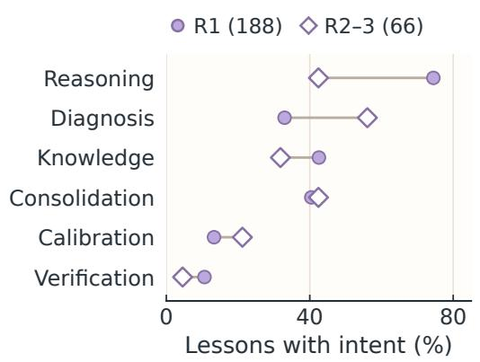  
(b) Post-success revision

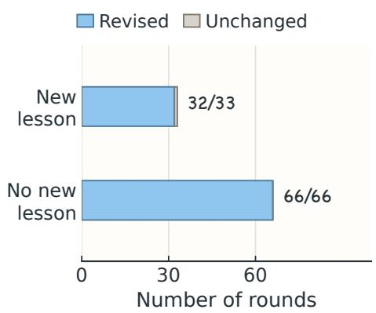  
Figure 6. Teaching emphasis and development after anchor success. Qwen Fixed-Window SSL (g = 10), 22 families and 66 acquisition runs. (a) Educator-reported intents in first-round versus later lessons; labels may overlap. (b) Package revisions in rounds following a perfect anchor score, grouped by whether a new lesson arrives.

Teaching across rounds. Figure 4a uses regular-review lesson counts of 170/233, 42/112, and 14/87. Including trajectory-end reviews gives 188/299, 47/178, and 19/153. Utility on anchor tests by fresh solvers is 0.824, 0.986, and 0.990, with 38/66, 61/66, and 63/66 perfect results. Figure 6a compares 188 first-round lessons with 66 later lessons; reasoning tags occur in 140 versus 28 and diagnosis tags in 62 versus 37.

Development after anchor success. Of the 132 later-round transitions, 99 follow a perfect anchor (38 second rounds and 61 third rounds), covering 61 runs and all 22 families. Packages change in 98/ 99: 32/33 rounds with a new lesson and 66/66 without one. Those 33 rounds contain 35 lessons. Across all later rounds, the 76 rounds without a new lesson all revise their package. Prior lessons and anchor feedback remain available.

Review cost before follow-up. Silent reviews account for 59.7% of review opportunities and 72.1% of opening-review tokens. Figure 4c includes cached input and excludes follow-up dialogue. Each round’s teaching and silent token totals are divided by its total review count, so stacked heights give mean cost per review. Round totals are 22.3M, 49.9M, and 60.5M tokens; silent shares are 40.4%, 69.8%, and 85.8%. Average token use per review rises from 74.7K to 395.7K tokens per review across acquisition rounds, a 5.3-fold increase. Appendix F reports schedule-level costs including follow-up dialogue.

The corresponding teaching sessions and training-iteration evaluations are released under experiment s/main/qwen/fixed-window-ssl/; each run’s meta.json lists its session inventory.

## F Review Scheduling and Cost Allocation

## F.1 Schedules and role-level cost

All four Qwen schedules use 22 families, 3 acquisition rounds, and 3 repeats (66 runs each). The tentool-call condition is the main Fixed-Window SSL experiment. Table 17 reports utility, cost, and teaching activity (lessons exclude follow-ups), with mean acquisition tokens split into Student-author, Educator, and anchor-evaluation work (Figure 7).

Table 17. Utility, acquisition cost, reviews, and opening lessons for the four Qwen schedules on the main cohort (22 families, 155 cases; 3 repeats and 66 acquisition runs per schedule).
<table><tr><td>Teaching schedule</td><td>Utility ↑</td><td>Tokens/run (M) ↓</td><td>Reviews</td><td>Lessons</td></tr><tr><td>Every 5 tool calls</td><td>0.776</td><td>9.56</td><td>1126</td><td>403</td></tr><tr><td>Every 10 tool calls</td><td>0.801</td><td>6.89</td><td>630</td><td>254</td></tr><tr><td>Every 20 tool calls</td><td>0.776</td><td>6.61</td><td>375</td><td>169</td></tr><tr><td>Issue transitions (Issue-Guided SSL)</td><td>0.805</td><td>5.72</td><td>329</td><td>135</td></tr></table>

ISSUE-GUIDED SSL reaches 0.805 utility versus 0.801 for FIXED-WINDOW SSL at $g \ = \ 1 0 ,$ , while reducing Educator tokens by 61.7% and total acquisition tokens by 16.9% (6.89M to 5.72M per run). Teaching eficiency is 2.75 times that of FIXED-WINDOW SSL at $g = 1 0 .$ . The fixed g = 5 and $g = 2 0$ schedules reach 0.776 and 0.776, respectively.

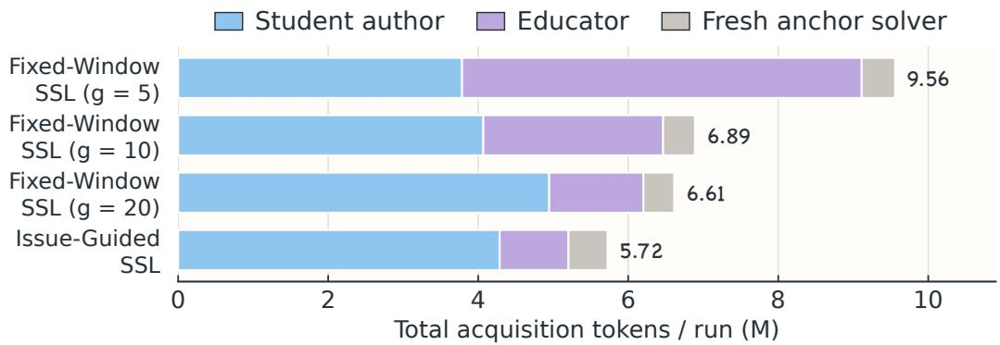  
Figure 7. Acquisition-cost allocation across the four teaching schedules. Qwen, 22 families and 66 acquisition runs per schedule. Stacked bars show mean Student-author, Educator, and anchor-evaluation tokens per run, with the total labeled for each schedule.

Fixed-Window SSL uses 158.2M Educator tokens across 630 reviews; Issue-Guided SSL uses 60.6M across 329. The 47.8% reduction in reviews combines with a 26.7% reduction in tokens per review (251.1K to 184.1K), yielding a 61.7% reduction in Educator tokens. These per-review costs include follow-up dialogue. Issue-Guided SSL combines issue-triggered review with local context and its follow-up policy; the protocol settings are detailed in Appendix C.2.

Table 18 puts reductions in Educator tokens and changed learner work on the same scale, in millions of tokens per run. Positive net savings mean fewer acquisition tokens within the recorded scope. Student tokens fall 16.1% on Kimi but rise 39.2% on DeepSeek, where the additional Student work exceeds the Educator saving. These outcomes distinguish the consistent reduction in external supervision from the model-dependent change in total acquisition cost.

Table 18. Role-level token changes and net acquisition savings for Issue-Guided SSL relative to Fixed-Window SSL, in millions of tokens per run. Qwen uses the 22 main-cohort families (3 repeats); DeepSeek and Kimi use the 10 shared families (one repeat). DeepSeek and Kimi rows cover the persistent author and Educator sessions.
<table><tr><td>Pair</td><td>Runs</td><td>Educator saved</td><td>Author added</td><td>Anchor added</td><td>Net saved</td></tr><tr><td>Qwen</td><td>66</td><td>1.479</td><td>0.218</td><td>0.097</td><td>1.164</td></tr><tr><td>DeepSeek</td><td>10</td><td>4.175</td><td>5.276</td><td>一</td><td>-1.101</td></tr><tr><td>Kimi</td><td>10</td><td>3.250</td><td>-0.870</td><td>一</td><td>4.120</td></tr></table>

On DeepSeek, 52.8M additional Student tokens arise mainly from more calls (890 to 1,216, +36.6%), concentrated in the first two rounds. sqlite-db-truncate adds 23.8M total acquisition tokens; the other families save 12.8M, leaving a net increase of 11.0M. The 41.8M Educator saving combines fewer reviews (195 to 69) with smaller ones. Fixed-Window SSL has 25 Educator calls re-reading over 500K cached tokens (maximum 799K); its top 15% of calls consume 35% of Educator tokens. Issue-Guided SSL has no calls above 500K cached tokens.

Table 19. Per-run acquisition tokens by session role for Fixed-Window SSL and Issue-Guided SSL for DeepSeek and Kimi on the 10-family lite subset (single repeat), covering the persistent author (Student) and Educator sessions.
<table><tr><td>Pair</td><td>Schedule</td><td>Student (M/run)</td><td>Educator (M/run)</td><td>Total (M/run)</td></tr><tr><td rowspan="2">DeepSeek</td><td>FIXED-WINDOW SSL</td><td>13.46</td><td>6.55</td><td>20.01</td></tr><tr><td>IsSUE-GUIDED SSL</td><td>18.74</td><td>2.37</td><td>21.11</td></tr><tr><td rowspan="2">Kimi</td><td>FIXED-WINDOW SSL</td><td>5.41</td><td>4.20</td><td>9.61</td></tr><tr><td>IsSUE-GUIDED SSL</td><td>4.54</td><td>0.95</td><td>5.49</td></tr></table>

## F.2 Issue lifecycles

Table 20 distinguishes persistent nodes from repeated transition events. A closure ends a review episode and need not be the issue’s last appearance. Most closures record Educator silence; verification and bounded-scope dispositions bypass another review in 9 events. All 28 reopen events lead to another lesson. The Flask sequence in Appendix G.2 illustrates this reopening behavior at the event level.

Table 20. Qwen Issue-Guided SSL lifecycle accounting across 22 families and 66 acquisition runs, listing persistent issues, reopen events, closure dispositions, and issue status at run end.
<table><tr><td>Persistent issues</td><td>Count or summary</td></tr><tr><td>Persistent issue nodes</td><td>177</td></tr><tr><td>Issues/run: mean; median; range</td><td>2.68; 3; 1–6</td></tr><tr><td>Nodes reopened at least once</td><td>23/177 (13.0%)</td></tr><tr><td>Reopen events</td><td>28</td></tr><tr><td>Reopen events followed by a new lesson</td><td>28/28</td></tr><tr><td>Nodes closed by run end</td><td>175</td></tr><tr><td>Nodes still pending at run end</td><td>2</td></tr></table>

<table><tr><td>Review closures</td><td>Count</td></tr><tr><td>Educator silence</td><td>194</td></tr><tr><td>Verification-backed closures</td><td>7</td></tr><tr><td>Bounded-scope closures</td><td>2</td></tr><tr><td>Evidence-backed rejection closures</td><td>0</td></tr></table>

In an API-scheduling no-lesson example, prior anchor feedback shows the solver searching the wrong script location and reimplementing the scheduler. The Student adds execution and Quick Start guidance to SKILL.md; review closes as teacher-silence.

## G Case Evidence and Frozen-Package Use

## G.1 Testing and adapting Educator guidance

The HTML-finance case comes from Qwen FIXED-WINDOW SSL, repeat 1, in the main 22-family cohort. It follows a teaching proposal through Student execution, package revision, and fresh use (Table 3).

From a proposal to a checked procedure. The Educator recommends deriving reported financial values from other entries and distinguishing agreement, disagreement, and the absence of an applicable rule. It also suggests generic arithmetic search. The Student implements and runs this strategy on the anchor. The resulting verifier flags 4 metrics and selects line 140, although the incorrect entry is the gross margin at line 210. Inspecting the output, the Student identifies missing financial derivations and replaces generic arithmetic with relations appropriate to each metric, including reverse derivations. Running the revised verifier on the same report leaves only line 210 flagged: the reported gross margin is 60.8%, while 520.4/842.0 100 rounds to 61.8%. The contrast records two executions during acquisition.

Retained knowledge and fresh use. The final SKILL.md retains three outcomes—confirmed, contradicted, and unchecked—and instructs solvers to use both forward and reverse financial relations. It bundles the revised verify.py. On held-out v14, a fresh solver reads both resources and checks relations in a cash-flow statement. Operating, investing, and financing subtotals sum to 8,000, whereas the reported net increase is 6,270. The closing cash balance independently agrees with 8,000. The solver submits 4206,6270, identifying the erroneous line and its reported value, and passes 4/4 checks.

Source records. The released run is experiments/main/qwen/fixed-window-ssl/r1/html-fin ance-verify/. Within it, skill-formation/student-author.jsonl contains the lesson and two executions (records 20 and 42–44); heldout/v14.jsonl contains package reads, accounting checks, and submission (records 4, 10, 12, and 14). Scores for all six held-out cases are in meta.json. Record numbers refer to the JSONL i field.

## G.2 Flask issue reopening: event-level evidence

In a Qwen Issue-Guided SSL Flask run, issue-1 receives a lesson, revision, and no-lesson closure during the first round. Fresh-solver anchor feedback with 6/9 checks and missing-table errors reopens it in the next round. The renewed lesson identifies an import-bound database path: a changed working directory can redirect the service to the wrong database. The Student reproduces the mismatch, resolves paths at request time, and reports 14/14 local checks before verification-backed closure. Separately, fresh-solver anchor utility is 0.667, 1.000, and 1.000 across rounds. The released run is experiments/main/qwe n/issue-guided-ssl/r3/flask/. Its session logs are restored with the command in Appendix C. In skill-formation/student-author.jsonl, records 50 and 52 show the anchor feedback and renewed guidance; records 80–82 show verification and the revision addressing the issue.

## H Limitations

Our study evaluates complete Skill-learning protocols under a shared single-anchor setting. Further controlled comparisons could isolate how much the Educator, review timing, and issue structure each contribute to transfer performance and teaching cost.