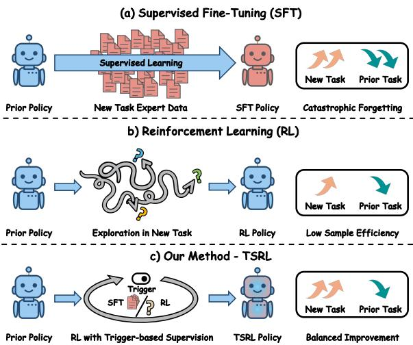
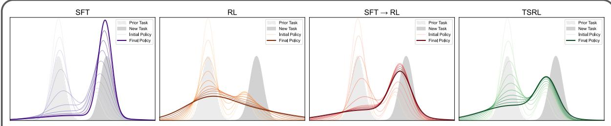
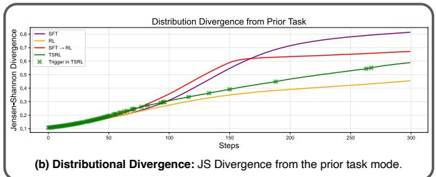
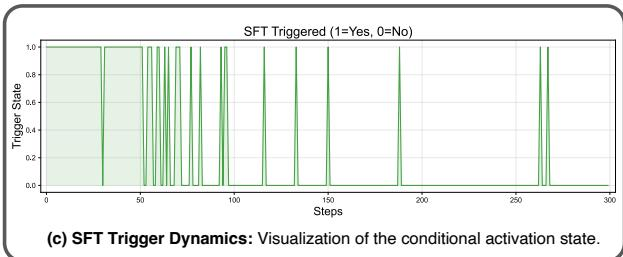
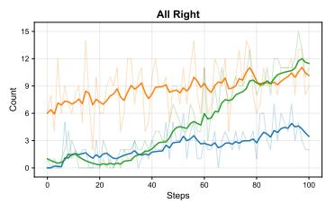
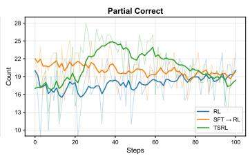
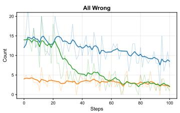
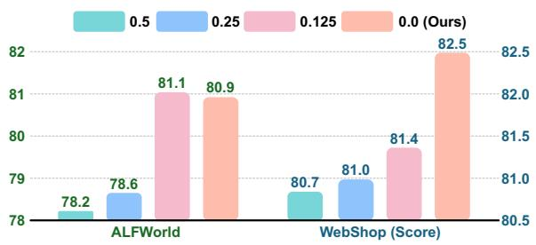
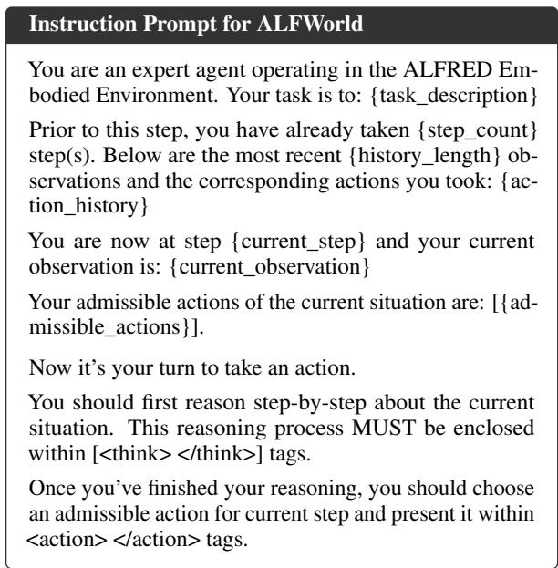
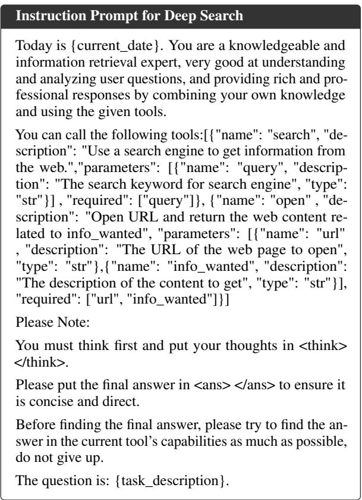

# TSRL: Trigger-based Supervised Reinforcement Learning for Continual Agent Training

Yuqian Fu1,2, Kaiwen Jiang1,2, Zijun Song1,2, Jiawei Wang3, Yuanheng Zhu1,2,†, Dongbin Zhao1,2

1SKL-MAIS, Institute of Automation, Chinese Academy of Sciences, 2School of Artificial Intelligence, University of Chinese Academy of Sciences, 3University of Science and Technology of China {fuyuqian2022,yuanheng.zhu}@ia.ac.cn

## Abstract

Large language model (LLM) agents excel at complex, multi-step tasks but suffer from catastrophic forgetting during continual learning—acquiring new skills often degrades previously mastered capabilities. Existing posttraining paradigms face a fundamental tradeoff: Supervised Fine-Tuning (SFT) is sampleefficient but prone to severe forgetting, while Reinforcement Learning (RL) preserves prior capabilities but converges slowly without expert guidance. To bridge this gap, we introduce Trigger-based Supervised Reinforcement Learning (TSRL), a framework that integrates the strengths of both paradigms through an adaptive, state-dependent expert supervision mechanism. TSRL employs RL as the optimization backbone, activating SFT selectively on "hard states" where the policy fails. Theoretically, we show that restricting supervision to failure states derives an upper bound on the cumulative parameter updates, thereby reducing forgetting compared to full SFT. Empirically, TSRL achieves consistent gains across three agent benchmarks (ALFWorld, WebShop, and Deep Search) at both 7B and 32B scales. In continual learning scenarios, our method retains up to 9.6 points more capability on prior tasks than SFT→RL baselines, while matching or exceeding target-task performance.

## 1 Introduction

Large language model (LLM) agents have demonstrated strong performance on complex, multi-step tasks across diverse domains (Zhang et al., 2025a; Xi et al., 2025; Dong et al., 2025b). However, deploying these agents in real-world environments presents a challenge: practical applications are inherently dynamic, requiring agents to continuously acquire new skills while retaining learned competencies (Bell et al., 2025; Guo et al., 2025b). This continual learning paradigm suffers from catastrophic forgetting, a phenomenon where learning new tasks degrades performance on previously mastered ones (McCloskey and Cohen, 1989).

  
Figure 1: Overview of different post-training methods for continual agent learning.

Existing post-training approaches primarily employ two paradigms: Supervised Fine-Tuning (SFT) and Reinforcement Learning (RL) (Tie et al., 2025). Under continual learning, these paradigms show different behaviors: RL induces less forgetting than SFT while achieving comparable targettask performance (Lai et al., 2025; Shenfeld et al., 2025). This performance discrepancy arises from their distinct optimization objectives. SFT minimizes forward KL divergence, inducing modecovering behavior that forces the policy to match the entire support of the expert distribution. In contrast, RL optimizes reverse KL divergence, promoting mode-seeking behavior that concentrates on high-reward regions without overwriting other behavioral modes (Korbak et al., 2022; Chen et al., 2025). However, relying solely on RL ignores expert demonstrations, and is typically less sampleefficient: SFT provides dense, token-level supervision, whereas RL relies on sparse, response-level rewards, making credit assignment harder (Fu et al.,

  
(a) Policy Evolution Dynamics: The temporal evolution of policy distributions across different post-training paradigms.

  
Figure 2: Illustrative case using bimodal Gaussian mixtures. TSRL achieves a favorable trade-off between forgetting mitigation and effective utilization of expert data by leveraging trigger-based supervision.

2026b; Zhang et al., 2026). This motivates a critical question: How can we mitigateforgetting while effectively utilizing expert data?

To address this question, we conduct an illustrative case study in Section 3, which reveals three key insights: RL exhibits minimal forgetting due to its mode-seeking nature; SFT induces severe forgetting through mode-covering behavior; and triggerbased supervision achieves a favorable trade-off.

We further formalize these observations theoretically. Under standard local approximations, we derive an upper bound on forgetting in terms of cumulative Fisher-weighted parameter updates—a quantity larger under full SFT than under selective supervision. These findings motivate two design principles: ❶ Sparsity via Locality—supervision should be triggered only on hard states where the policy fails; and ❷ On-policy Foundation—the primary optimization should remain on-policy RL.

Guided by these principles, we propose Triggerbased Supervised Reinforcement Learning (TSRL), a principled framework that combines SFT and RL for continual agent training, illustrated in Figure 1. The key insight behind TSRL is that expert demonstrations should be leveraged adaptively— invoked only when the current policy struggles, rather than uniformly applied across all training instances. Concretely, TSRL maintains RL as its optimization backbone and introduces a supervision trigger mechanism based on the Group Success Rate (GSR). When the GSR falls below a predefined threshold—indicating that the policy lacks capability on a particular task—our method leverages the corresponding expert demonstration and injects a supervised gradient during training. As training progresses and the policy improves, the trigger naturally deactivates for an increasing proportion of tasks, ensuring that supervision remains sparse and localized to genuinely difficult instances. Additionally, we employ a temporal annealing schedule that gradually reduces the influence of expert supervision, allowing the agent to transcend the expert’s performance limitations via RL exploration.

We evaluate TSRL on three agent benchmarks: ALFWorld and WebShop (with 4B and 7B models), and Deep Search (with 32B models). Experimental results demonstrate that TSRL consistently outperforms baselines and exhibits resistance to forgetting in continual learning scenarios.

Overall, our key contributions are threefold:

• We present an illustrative case study and theoretical analysis of the roles that SFT and RL play in continual learning, deriving two design guidelines: supervision should be sparse and localized to hard states, and the optimization backbone should remain on-policy RL.

• We propose TSRL, a framework that combines the sample efficiency of SFT with the forgetting-resistant properties of RL through a trigger-based supervision mechanism, enabling effective capability acquisition under the continual agent learning settings.

• We conduct extensive experiments demonstrating the effectiveness of TSRL across diverse agent benchmarks and model scales, including systematic evaluation of forgetting behavior in continual learning scenarios.

## 2 Preliminaries

RL for LLM Agents. We formulate reinforcement learning for the LLM agent as a finitehorizon Markov Decision Process (MDP) $\mathcal { M } =$ $( S , { \mathcal { A } } , P , r , H )$ (Bellman, 1957; Puterman, 1994). Here, S denotes the state space, A the action space, $P : \mathcal { S } \times \mathcal { A }  \Delta ( \mathcal { S } )$ the transition kernel (where $\Delta ( \cdot )$ denotes the probability simplex), $r : \mathbf { \mu } _ { \mathrm { ~ } }$ $\mathcal { S } \times \mathcal { A } $ R the reward function, and H the horizon (maximum number of interaction turns). A policy $\pi : S  \Delta ( { \mathcal { A } } )$ maps states to distributions over actions and induces a trajectory distribution $\mathbb { P } _ { \pi }$ . The RL objective is to maximize the expected cumulative reward: $\begin{array} { r } { J ( \pi ) = \mathbb { E } _ { ( s _ { t } , a _ { t } ) \sim \mathbb { P } _ { \pi } } \left[ \sum _ { t = 1 } ^ { H } r ( s _ { t } , a _ { t } ) \right] } \end{array}$ .

In LLM agents, the state $s _ { t } \in S$ aggregates the interaction history up to turn t, including the initial prompt, previous actions (e.g., tool calls, reasoning traces), and environmental feedback (e.g., code outputs, search results). The action $a _ { t } \in \mathcal A$ represents the agent’s textual output, and the transition $\textstyle P ( s _ { t + 1 } \mid s _ { t } , a _ { t } )$ captures environmental responses such as tool execution outcomes.

Problem Setting. In this work, we distinguish three policies: a pretrained prior policy π0 with parameters $\theta _ { 0 } .$ , encoding prior capabilities; a task expert $\pi _ { E }$ optimized for the target task, accessible via offline demonstrations; and a training policy πt in the new task at iteration t.

To quantify the degree of forgetting, let $\mathcal { D } _ { \mathrm { p r i o r } }$ denote a distribution on which we wish to preserve performance. We define $P _ { \mathrm { p r i o r } } ( \pi )$ as the policy’s performance (e.g., success rate or accuracy) on the prior task $\mathcal { D } _ { \mathrm { p r i o r } }$ . The performance forgetting metric is defined as $P _ { \mathrm { f o r g e t } } = P _ { \mathrm { p r i o r } } ( \pi _ { t } ) - P _ { \mathrm { p r i o r } } ( \pi _ { 0 } )$ During post-training, the aim is to achieve high new-task performance while minimizing the priortask performance forgetting.

Baseline Post-Training Paradigms. In LLM post-training, three paradigms exhibit a fundamental trade-off. Supervised Fine-Tuning (SFT) minimizes $\mathbb { E } _ { ( s , a _ { E } ) \sim \mathcal { D } _ { E } } [ - \log \pi ( a _ { E } \mid s ) ]$ on expert data $\mathcal { D } _ { E } \sim \mathbb { P } _ { \pi _ { E } }$ . While sample-efficient, it risks overwriting capabilities in $\pi _ { 0 }$ . Reinforcement Learning (RL) directly optimizes $J ( \pi )$ from $\pi _ { 0 }$ , preserving proximity to the prior policy but typically requiring substantially more interaction data because the learning signal is sparse and delayed.

A widely adopted LLM RL algorithm is Group Relative Policy Optimization (GRPO) (Shao et al., 2024), which eliminates the need for a value network. Specifically, for a given state $s ,$ GRPO samples a group of $G$ responses $\{ a ^ { ( i ) } \} _ { i = 1 } ^ { G }$ from the policy $\pi _ { t } ,$ computes rewards $\{ r ^ { ( i ) } \} _ { i = 1 } ^ { G }$ , and normalizes them to obtain group-relative advantages:

$$
\hat { A } ^ { ( i ) } = \frac { r ^ { ( i ) } - \mathrm { m e a n } ( \{ r ^ { ( j ) } \} _ { j = 1 } ^ { G } ) } { \mathrm { s t d } ( \{ r ^ { ( j ) } \} _ { j = 1 } ^ { G } ) } .\tag{1}
$$

The policy is then updated via a clipped objective analogous to PPO (Schulman et al., 2017), with an optional KL regularization term to prevent excessive deviation from a reference policy. SFT followed by RL is a popular two-stage approach that first applies SFT and then continues with RL. Although effective for target-task performance, the initial SFT phase may cause forgetting that the subsequent RL phase cannot fully recover.

## 3 Illustrative Case Study

To build intuition for how different post-training paradigms affect catastrophic forgetting, we conduct a controlled experiment using bimodal Gaussian mixture distributions, inspired by Chen et al. (2025). As shown in Figure 2, we model the LLM agent’s policy and target distributions for prior and new tasks as Gaussian mixtures. This setup simulates a realistic, continual learning scenario where the new task partially overlaps with prior knowledge but requires acquiring novel behavioral patterns. We compare four training paradigms over 300 optimization steps: pure SFT, pure RL, SFT→RL (SFT for 150 steps, followed by RL for 150 steps), and our method TSRL.

The results reveal three key insights. ❶ Pure RL exhibits minimal forgetting on the prior task (Figures 2(a) and (b)), as its mode-seeking nature concentrates probability mass on high-reward regions without perturbing other modes. However, pure RL suffers from slow convergence due to the absence of expert guidance. ❷ SFT induces severe forgetting: its mode-covering objective forces the policy to redistribute probability mass uniformly, overwriting parameters encoding prior competencies. ❸ TSRL achieves a favorable trade-off between new-task acquisition and prior-task retention. Figure 2(c) shows that the trigger rate decreases progressively as training proceeds, confirming that TSRL leverages expert data primarily in early learning when guidance is most beneficial, while relying on RL in later stages to mitigate forgetting. In contrast, SFT→RL applies dense supervision throughout the first 150 steps, incurring larger forgetting before transitioning to RL. While the RL phase can partially recover lost capabilities, the initial damage from aggressive SFT updates is difficult to reverse fully. TSRL’s trigger mechanism ensures sparse supervision from the outset, preserving parameter subspaces critical for prior task performance. Detailed experimental settings and analysis are provided in Appendix B.

Theoretical Justification. The empirical observations above can be formalized from a parameterspace perspective. We characterize forgetting via the Fisher Information Matrix (FIM) $F _ { \mathrm { p r i o r } } ,$ which captures the sensitivity of the policy to parameter changes on the prior task distribution. Under a local quadratic approximation in Assumption 1, forgetting in training is characterized by the Fisherweighted displacement:

$$
\Delta _ { \mathrm { f o r g e t } } \approx \frac { 1 } { 2 } \big \| \sum _ { t } \Delta \theta _ { t } \big \| _ { F _ { \mathrm { p r i o r } } } ^ { 2 } .\tag{2}
$$

This expression can be further bounded in Theorem 4. The resulting bound implies that forgetting is controlled by the cumulative magnitude of updates along directions sensitive to the prior task. In contrast, trigger-based supervision in TSRL restricts updates to hard states where the policy fails, yielding strictly smaller cumulative energy and thus reduced forgetting in continual learning. Full definitions and derivations appear in Appendix C.

## 4 Methodology

The illustrative case study and theoretical analysis in Section 3 establish that restricting expert supervision to sparse, hard states yields less forgetting than full SFT. We now present Trigger-based Supervised Reinforcement Learning (TSRL), a framework that operationalizes these insights.

Our framework consists of three key components: ❶ a group-based RL backbone that continuously optimizes the policy on the target task, ❷ a failure detection mechanism that identifies hard states via group success rate statistics, and ❸ an adaptive supervision module that injects expert supervision only when triggered. We describe each component in detail below.

## 4.1 Trigger-based Supervision on Hard State

To determine when expert supervision should be activated, we leverage the inherent exploration mechanism of group-based RL for failure detection.

For a given state s, the policy π samples a group of G actions $\{ a _ { 1 } , a _ { 2 } , \dotsc , a _ { G } \}$ . Let $r ( a _ { i } | s ) \in$ $\{ 0 , 1 \}$ denote the binary reward for the i-th output. We define the Group Success Rate (GSR) as:

$$
\operatorname { G S R } ( s ) = \frac { 1 } { G } \sum _ { i = 1 } ^ { G } r ( a _ { i } | s ) .\tag{3}
$$

A state s is classified as a hard state if the policy fails to generate sufficient correct responses within the sampled group. Formally, the trigger condition is defined by the indicator function:

$$
\mathbb { I } _ { \mathrm { t r i g g e r } } ( s ) = \mathbb { I } \left( { \mathrm { G S R } } ( s ) \leq \delta \right) ,\tag{4}
$$

where $\delta \in [ 0 , 1 ]$ is a predefined threshold. For instance, $\delta = 0$ implies supervision is triggered when all generations in the group fail, while $\delta = 0 . 5$ activates supervision when fewer than half succeed.

This formulation offers two advantages. First, it dynamically adapts to the policy’s evolving capability: as the agent learns and GSR(s) improves, the trigger automatically deactivates for an increasing proportion of states. Second, by conditioning on group-level statistics rather than individual samples, the detection mechanism exhibits robustness to stochastic variations in generation quality.

## 4.2 Policy Optimization

At each iteration t, the optimization objective combines the RL objective with the SFT loss. We describe each component and its integration below.

RL Backbone. We employ group-based RL (e.g., GRPO (Shao et al., 2024), DAPO (Yu et al., 2025)) to estimate the policy gradient. Specifically, following GRPO, for each output $a _ { i }$ in the group, we compute the advantage $A _ { i }$ by normalizing rewards within the group, as shown in Section 2. Following PPO (Schulman et al., 2017), GRPO applies a clipped surrogate objective to stabilize training. The corresponding gradient is $g _ { t } ^ { \mathrm { R L } } = \nabla _ { \theta } \mathcal { L } _ { t } ^ { \mathrm { R L } }$

Adaptive Expert Supervision. When the trigger condition in Eq. (4) is satisfied $( \mathbb { I } _ { \mathrm { t r i g g e r } } ( s ) = 1 )$ the algorithm queries the expert $\pi _ { E }$ or retrieves the corresponding demonstration from an offline expert buffer to obtain a target action $a _ { E } .$ . The SFT loss is computed only on on-policy states sampled from the current rollout buffer $B _ { t }$

$$
\mathcal { L } _ { t } ^ { \mathrm { S F T } } = \mathbb { E } _ { s \sim \mathcal { B } _ { t } } \left[ \mathbb { I } _ { \mathrm { t r i g g e r } } ( s ) \cdot ( - \log \pi _ { \theta _ { t } } ( a _ { E } \vert s ) ) \right]\tag{5}
$$

The indicator function ensures that supervision remains sparse and localized to difficult instances, thereby minimizing the parameter drift associated with full SFT. Although the target action $a _ { E }$ is off-policy, the trigger itself is evaluated on states encountered by the current policy, preserving the on-policy foundation of the overall training loop.

Combined Update with Annealing. The parameters are updated by combining both objectives:

$$
\theta _ { t + 1 } = \theta _ { t } - \eta \left( g _ { t } ^ { \mathrm { R L } } + \lambda ( t ) g _ { t } ^ { \mathrm { S F T } } \right) ,\tag{6}
$$

where $\eta$ is the learning rate, $g _ { t } ^ { \mathrm { S F T } } = \nabla _ { \theta } \mathcal { L } _ { t } ^ { \mathrm { S F T } }$ , and $\lambda ( t )$ is a temporal annealing coefficient that linearly decays from $\lambda _ { 0 }$ to 0 over training.

The annealing schedule serves a critical purpose: in later training stages, the policy $\pi \theta$ may develop specialized reasoning patterns that diverge from the expert $\pi _ { E }$ yet yield high rewards. Enforcing strict alignment with the expert at this stage can introduce objective mismatch, hindering the policy’s self-refinement. By annealing $\lambda ( t ) \to 0$ , we allow the agent to transcend the expert’s limitations via pure on-policy exploration once a sufficient competency foundation is established.

## 4.3 Summary and Design Principles

The complete training procedure is provided in Algorithm 1. We summarize the advantages of TSRL compared to existing paradigms in Table 1. Our algorithm directly instantiates two core design principles derived from the previous analysis:

• Sparsity via Locality. By computing the SFT gradient strictly contingent on the trigger condition (Eq. (4)), we ensure that supervision is localized only to hard states.

• On-policy Foundation. The algorithm maintains the RL gradient as the constant driver of optimization. This ensures that policy updates remain grounded in the model’s own generation probability landscape, preserving behavioral modes learned during pretraining.

## 5 Experiments

We present comprehensive experiments to demonstrate the effectiveness of TSRL. Across three diverse benchmarks, our approach consistently outperforms baseline methods and exhibits resilience to forgetting in continual agent learning.

Table 1: Comparison of post-training paradigms. $\pmb { \nu }$ indicates the property is satisfied, and ✘ indicates it is not. TSRL simultaneously achieves both high sample efficiency and forgetting resistance.
<table><tr><td>Method</td><td>Sample Efficiency</td><td>Forgetting Resistance</td></tr><tr><td>Pure SFT</td><td>V</td><td>x</td></tr><tr><td>Pure RL</td><td>x</td><td>V</td></tr><tr><td>SFT→RL</td><td>√</td><td>x</td></tr><tr><td>TSRL (ours)</td><td>V</td><td>V</td></tr></table>

## 5.1 Experimental Settings

Datasets. Our evaluation spans three representative agent benchmarks targeting distinct task domains. ALFWorld (Shridhar et al., 2021) focuses on embodied decision-making in household environments; WebShop (Yao et al., 2022) addresses interactive web navigation; and Deep Search involves complex multi-step information retrieval and synthesis, encompassing BrowseComp (Wei et al., 2025) and BrowseComp-ZH (Zhou et al., 2025). The reward structures differ across benchmarks: WebShop offers continuous rewards in the range [0, 1], whereas ALFWorld and Deep Search provide sparse binary signals indicating task completion. All benchmarks are formulated as finitehorizon sequential decision problems. To ensure high-quality supervision, we retain only trajectories achieving a reward of 1 for constructing the training set. Detailed descriptions of the datasets are provided in Appendix G.1. Appendix E further extends the continual-learning sequence with ScienceWorld (Wang et al., 2022).

Training Setup. We instantiate LLM agents using Qwen2.5-7B-Instruct (Yang et al., 2024) for ALFWorld and WebShop, and Qwen2.5-32B-Instruct for the more demanding Deep Search task. For all group-based RL algorithms, we set the rollout group size $G \ = \ 8 .$ The batch size is configured as B = 64 for 7B experiments and $B = 2 5 6$ for 32B experiments. The supervision trigger threshold δ is set to 0, indicating that expert demonstrations are incorporated only when all sampled outputs within a group fail to produce correct solutions. Experiments on ALFWorld and Web-Shop are executed on 8 NVIDIA H20 GPUs, while Deep Search experiments utilize 128 NVIDIA H20 GPUs. Complete hyperparameter configurations are documented in Appendix G.2.

Baselines. We benchmark TSRL against several competitive approaches spanning two categories. First, we evaluate closed-source LLMs including GPT-4o (Achiam et al., 2023), Claude-3.5-Sonnet (Anthropic, 2024), and Gemini-2.5- Pro (Team et al., 2023), which serve as upperbound references for powerful general-purpose agent capabilities. Second, we compare against standard post-training paradigms: pure SFT, pure RL, and the sequential combination SFT→RL. Within the RL category, we consider two widely adopted algorithms: GRPO (Shao et al., 2024) and DAPO (Yu et al., 2025). Our proposed TSRL framework is instantiated as TSRL GRPO and TSRL DAPO, applying the trigger-based supervision mechanism at each respective RL backbone. This design enables controlled comparisons of forgetting dynamics across different training paradigms. To further validate our approach, we additionally compare against more baselines in Appendix E.

Table 2: Performance comparison on ALFWorld and WebShop benchmarks (averaged over 3 random seeds). For ALFWorld, we report the average success rate (%); for WebShop, we report both the average score and success rate (%). TSRL consistently achieves performance improvements with both GRPO and DAPO backbones. The plus/minus signs (+/-) indicate the performance change compared to the corresponding SFT→RL baseline.
<table><tr><td>Method</td><td>ALFWorld</td><td>WebShop (Score)</td><td>WebShop (Succ.)</td></tr><tr><td colspan="4">Base: Closed-Source Model</td></tr><tr><td>Prompting GPT-4o</td><td>48.0</td><td>31.8</td><td>23.7</td></tr><tr><td>Prompting Gemini-2.5-Pro</td><td>60.3</td><td>42.5</td><td>35.9</td></tr><tr><td colspan="4">Base: Qwen2.5-7B-Instruct</td></tr><tr><td>Prompting Qwen2.5</td><td>14.8</td><td>26.4</td><td>7.8</td></tr><tr><td>Prompting ReAct</td><td>31.2</td><td>46.2</td><td>19.5</td></tr><tr><td>SFT</td><td>59.3</td><td>54.2</td><td>28.6</td></tr><tr><td>GRPO</td><td>74.4</td><td>77.2</td><td>64.3</td></tr><tr><td>SFT→GRPO</td><td>76.6</td><td>79.1</td><td>65.8</td></tr><tr><td>DAPO</td><td>86.8</td><td>88.9</td><td>73.3</td></tr><tr><td>SFT→DAPO</td><td>87.0</td><td>89.2</td><td>74.5</td></tr><tr><td>TSRL GRPO</td><td>_80.9 (+4.3)</td><td>82.5 (+3.4)</td><td>69.3(+3.5)</td></tr><tr><td> $\mathbf { T S R L _ { D A P O } }$ </td><td>90.4 (+3.4)</td><td>90.7 (+1.5)</td><td>78.9 (+4.4)</td></tr></table>

Table 3: Continual learning experiments between WebShop and ALFWorld. This table reports performance on both prior and new tasks when a model trained on one task is fine-tuned on another. Prior-task Model denotes the LLM agent after GRPO training on the prior task.
<table><tr><td rowspan="2">Method</td><td colspan="3">Continual Learning in WebShop</td><td colspan="3">Continual Learning in ALFWorld</td></tr><tr><td>ALFWorld</td><td>WebShop (Score)</td><td>WebShop (Succ.)</td><td>ALFWorld</td><td>WebShop (Score)</td><td>WebShop (Succ.)</td></tr><tr><td>Prior-task Model</td><td>74.4</td><td>22.0</td><td>2.8</td><td>24.2</td><td>77.2</td><td>64.3</td></tr><tr><td>SFT</td><td>69.3</td><td>49.1</td><td>18.3</td><td>64.2</td><td>58.9</td><td>29.4</td></tr><tr><td>GRPO</td><td>74.2</td><td>86.7</td><td>70.0</td><td>78.0</td><td>79.3</td><td>65.0</td></tr><tr><td>SFT→GRPO</td><td>70.3</td><td>85.4</td><td>60.2</td><td>84.3</td><td>64.1</td><td>58.7</td></tr><tr><td>DAPO</td><td>72.1</td><td>86.9</td><td>69.5</td><td>88.2</td><td>79.1</td><td>62.5</td></tr><tr><td>SFT→DAPO</td><td>73.4</td><td>87.2</td><td>70.4</td><td>90.0</td><td>66.0</td><td>63.1</td></tr><tr><td>TSRL GRPO</td><td>75.5 (+5.2)</td><td>88.3 (+2.9)</td><td>74.5 (+14.3)</td><td>85.2 (+0.9)</td><td>81.6 (+17.5)</td><td>68.3(+9.6)</td></tr><tr><td>TSRL DAPO</td><td>76.8 (+3.4)</td><td>90.4 (+3.2)</td><td>75.2 (+4.8)</td><td>90.3 (+0.3)</td><td>79.0 (+13.0)</td><td>64.6(+1.5)</td></tr></table>

## 5.2 Main Results

Our comprehensive experiments demonstrate that TSRL yields performance improvements across a diverse range of tasks, baselines, and model scales, while exhibiting forgetting resistance.

Performance on ALFWorld and WebShop. As shown in Table 2, when training on their respective tasks, TSRL achieves consistent performance gains over all baselines on both benchmarks. Specifically, TSRL improves upon the SFT→GRPO baseline by 4.3% on ALFWorld and 3.5% on Web-Shop (success rate), while TSRL DAPO yields improvements of 3.4% and 4.4%, respectively. These results confirm that trigger-based supervision effectively harnesses expert demonstrations while preserving the benefits of on-policy exploration.

Table 4: Performance with Qwen2.5-32B-Instruct on Deep Search (target training task) and Math Reasoning (measuring retention of base model capabilities).
<table><tr><td rowspan="2">Method</td><td colspan="2">Deep Search</td><td colspan="2">Math Reasoning</td></tr><tr><td>BrowseComp</td><td>BrowseComp-ZH</td><td>AIME 24</td><td>AIME 25</td></tr><tr><td>Base: Closed-Source Model</td><td></td><td></td><td></td><td></td></tr><tr><td>Prompting GPT-4o</td><td>0.7</td><td>6.9</td><td>9.3</td><td>13.1</td></tr><tr><td>Prompting Claude-3.5-Sonnet</td><td>0.8</td><td>5.9</td><td>16.0</td><td>7.4</td></tr><tr><td>Base: Qwen2.5-32B-Instruct</td><td></td><td></td><td></td><td></td></tr><tr><td>Prompting Qwen2.5</td><td>0.6</td><td>6.5</td><td>18.4</td><td>11.5</td></tr><tr><td>SFT</td><td>3.8</td><td>19.4</td><td>11.3</td><td>10.0</td></tr><tr><td>RL</td><td>6.7</td><td>28.8</td><td>13.3</td><td>16.7</td></tr><tr><td>SFT→RL</td><td>14.5</td><td>35.2</td><td>12.1</td><td>11.4</td></tr><tr><td>TSRL</td><td>13.4 (-1.1)</td><td>33.7 (-1.5)</td><td>17.3 (+5.2)</td><td>18.2 (+6.8)</td></tr></table>

  
Figure 3: Dynamics of the success/failure ratio within each training batch across optimization steps.

Continual Learning on ALFWorld and Web-Shop. We evaluate the two-task continual learning setting where a model trained on one task is further adapted to the other. As shown in Table 3, in the WebShop direction (training on WebShop after ALFWorld), TSRL emerges as the sole method that acquires strong new-task capability while preserving the prior task. In the reverse direction, pure RL methods preserve the prior task better than SFTbased baselines, but TSRL still offers the strongest overall balance between retention and final targettask performance. Appendix E shows that this trend also holds in a longer three-task sequence.

Performance on Deep Search. To further validate the effectiveness of our approach at larger model scales, we conduct experiments on the Deep Search task using Qwen2.5-32B-Instruct with GRPO. Since mathematical reasoning is among the model’s core general capabilities, we use it as a proxy to measure forgetting. Specifically, we evaluate on the mathematical competition benchmarks AIME 24 and AIME 25 (Li et al., 2024), which require sophisticated multi-step reasoning.

As shown in Table 4, our method achieves performance comparable to the SFT→RL baseline on Deep Search while exhibiting significant advantages in preserving math reasoning capabilities. Notably, on AIME 25, the agent trained with TSRL even surpasses the base model, suggesting that our approach maintains its forgetting mitigation benefits at larger model scales. We also note that training dynamics may differ between 7B and 32B models, consistent with the observations in Tan et al. (2026) and Shenfeld et al. (2025). Appendix E further includes comparisons with representative hybrid baselines and experiments on Qwen3-4B, both of which support the same conclusion.

## 5.3 Analysis

To comprehensively evaluate TSRL, we conduct extensive analyses focusing on three critical aspects: the training dynamics across different methods, ablation studies on the trigger threshold, and the effect of the annealing mechanism.

Dynamics of the Success/Failure Ratio. To understand how different training paradigms affect policy competence throughout optimization, we track the success/failure ratio within each batch under the Deep Search setting. The results are presented in Figure 3. Our findings indicate that RL methods suffer from relatively low sample efficiency. SFT provides dense token-level supervision, whereas RL only receives response-level rewards, making credit assignment harder. In contrast, TSRL, through its trigger-based SFT mechanism that selectively incorporates expert demonstrations, is able to converge more rapidly and surpass the performance of the SFT→RL baseline.

  
Figure 4: Performance comparison across different trigger threshold δ on ALFWorld and WebShop.

Ablation Studies on Trigger Threshold. To evaluate the effect of the trigger threshold (GSR) on TSRL performance, we experiment with different threshold values δ on the ALFWorld and WebShop benchmarks. The results are shown in Figure 4. Our findings reveal that triggering SFT only when the entire group fails (i.e., δ = 0) enables the most effective utilization of expert data. Higher threshold values introduce more frequent SFT updates, which negatively impact performance. This observation provides empirical support for our theoretical insight that applying SFT uniformly across all expert data during training is suboptimal and can impair subsequent RL performance.

Ablation Studies on Annealing Mechanism. To reduce interference between SFT and RL exploration in later training stages, TSRL incorporates a simple linear annealing schedule for the SFT loss weight. To assess the sensitivity of performance to annealing configurations, as shown in Table 5, we compare the following settings: ❶ Fixed weights of 1.0 and 0.1—both configurations result in noticeable performance degradation, confirming that persistent SFT supervision adversely affects final performance; ❷ Annealing from 1 to 0 over 25 and 50 steps—the 50-step schedule achieves performance comparable to the 100-step configuration used in TSRL, indicating that performance is reasonably robust to the choice of annealing duration.

## 6 Related Work

Reinforcement Learning for LLM Agents. Reinforcement learning has emerged as a strong paradigm for training LLM agents (Ouyang et al., 2022; Guo et al., 2025a; Chai et al., 2025). Recent work mainly improves credit assignment, training stability, and uncertainty handling in agent RL (Dong et al., 2025a; Feng et al., 2025a; Wang et al., 2025b; Xu et al., 2025; Wang et al., 2025c; Zhang et al., 2025b). Most of these methods focus on improving RL itself, whereas our goal is different: how to incorporate expert data into continual training without erasing prior capabilities. We defer the fuller survey to Appendix D.

Table 5: Ablation studies on the annealing mechanism.
<table><tr><td>Method</td><td>ALFWorld</td><td>WebShop (Score)</td><td>WebShop (Succ.)</td></tr><tr><td>Constant Weight</td><td></td><td></td><td></td></tr><tr><td>fixed 1.0</td><td>63.5</td><td>72.9</td><td>52.8</td></tr><tr><td>fixed 0.1</td><td>69.8</td><td>75.1</td><td>57.2</td></tr><tr><td colspan="4">Annealing With Different Annealing Steps</td></tr><tr><td>25 steps</td><td>76.4</td><td>78.8</td><td>61.2</td></tr><tr><td>50 steps</td><td>78.2</td><td>79.3</td><td>60.6</td></tr><tr><td>100 steps (Ours)</td><td>80.9</td><td>82.5</td><td>69.3</td></tr></table>

Catastrophic Forgetting in Continual Training. A primary challenge in continual training is catastrophic forgetting, wherein acquiring new skills degrades previously learned capabilities (McCloskey and Cohen, 1989; Kirkpatrick et al., 2017). Recent evidence shows that RL forgets less than SFT because updates remain closer to the base policy and focus on high-reward modes instead of densely matching the expert distribution (Lai et al., 2025; Shenfeld et al., 2025; Chen et al., 2025). Hybrid methods such as UFT and LUFFY mix supervised and reinforcement signals (Fu et al., 2026a; Liu et al., 2025; Yan et al., 2025), but they mainly target single-task reasoning rather than continual agent training. By contrast, TSRL uses sparse, outcomebased supervision specifically to control forgetting. Appendix D provides a more detailed comparison.

## 7 Conclusion

In this paper, we introduce TSRL, a trigger-based supervised reinforcement learning framework for continual agent training that effectively combines the sample efficiency of SFT with the forgettingresistant properties of RL. By maintaining RL as the optimization backbone and activating expert supervision only on hard states where the policy fails, TSRL adaptively leverages expert demonstrations without overwriting previously learned capabilities. Unlike existing post-training paradigms that apply supervision uniformly or sequentially, our trigger mechanism ensures that expert guidance remains sparse and localized to difficult tasks. Extensive experiments across three agent benchmarks demonstrate that TSRL consistently outperforms baseline methods while retaining more capability on prior tasks in continual learning scenarios. This work represents a step toward enabling continual learning for LLM agents in real-world applications.

## Limitations

The effectiveness of TSRL is closely tied to the quality of expert demonstrations and the design of the trigger-based supervision mechanism. In our experiments, we curate high-quality trajectories by retaining only those achieving maximum reward; however, in real-world scenarios where such filtering is impractical or expert policies are suboptimal, the supervision signal may introduce noise. Moreover, the current binary trigger condition based on group success rate is well-suited for tasks with sparse binary rewards, but may not fully capture the nuanced difficulty of states in tasks with dense or continuous reward structures.

Future work could explore robust aggregation strategies that leverage multiple expert sources of varying quality or develop mechanisms to automatically assess demonstration reliability. Extending the trigger mechanism to incorporate reward magnitude or uncertainty estimates would enable more fine-grained control over supervision activation. Another promising direction involves developing adaptive annealing strategies based on policy entropy or gradient statistics, which can dynamically adjust the transition from guided agent learning to autonomous exploration across different target tasks and training stages.

## Acknowledgements

This work was supported in part by Beijing Nova Program under Grant 20240484514 and in part by National Natural Science Foundation of China under Grants 62136008 and 62293541.

## References

OpenAI Josh Achiam, Steven Adler, Sandhini Agarwal, Lama Ahmad, Ilge Akkaya, Florencia Leoni Aleman, Diogo Almeida, Janko Altenschmidt, Sam Altman, Shyamal Anadkat, Red Avila, Igor Babuschkin, Suchir Balaji, Valerie Balcom, Paul Baltescu, Haim ing Bao, Mo Bavarian, Jeff Belgum, Irwan Bello, Jake Berdine, Gabriel Bernadett-Shapiro, Christopher Berner, Lenny Bogdonoff, Oleg Boiko, Made laine Boyd, Anna-Luisa Brakman, Greg Brockman, Tim Brooks, Miles Brundage, Kevin Button, Trevor Cai, Rosie Campbell, Andrew Cann, Brittany Carey, Chelsea Carlson, Rory Carmichael, Brooke Chan, Che Chang, Fotis Chantzis, Derek Chen, Sully Chen, Ruby Chen, Jason Chen, Mark Chen, Benjamin Chess, Chester Cho, Casey Chu, Hyung Won Chung, Dave Cummings, Jeremiah Currier, Yunxing Dai, Cory Decareaux, Thomas Degry, Noah Deutsch, Damien Deville, Arka Dhar, David Dohan, Steve

Dowling, Sheila Dunning, Adrien Ecoffet, Atty Eleti, Tyna Eloundou, David Farhi, Liam Fedus, Niko Felix, Sim’on Posada Fishman, Juston Forte, Is abella Fulford, Leo Gao, Elie Georges, Christian Gibson, Vik Goel, Tarun Gogineni, Gabriel Goh, Raphael Gontijo-Lopes, Jonathan Gordon, Morgan Grafstein, Scott Gray, Ryan Greene, Joshua Gross, Shixiang Shane Gu, Yufei Guo, Chris Hallacy, Jesse Han, Jeff Harris, Yuchen He, et al. 2023. GPT-4 technical report. arXiv preprint arXiv:2303.08774. 6

Anthropic. 2024. Claude 3.5 Sonnet. https://www.an thropic.com/news/claude-3-5-sonnet. 6

Jack Bell, Luigi Quarantiello, Eric Nuertey Coleman, Lanpei Li, Malio Li, Mauro Madeddu, Elia Piccoli, and Vincenzo Lomonaco. 2025. The future of continual learning in the era of foundation models: Three key directions. arXiv preprint arXiv:2506.03320. 1

Richard Bellman. 1957. A Markovian decision process. Journal of mathematics and mechanics, pages 679– 684. 3

Jiajun Chai, Sicheng Li, Yuqian Fu, Dongbin Zhao, and Yuanheng Zhu. 2025. Empowering LLM agents with zero-shot optimal decision-making through qlearning. In The Thirteenth International Conference on Learning Representations. 8

Howard Chen, Noam Razin, Karthik Narasimhan, and Danqi Chen. 2025. Retaining by doing: The role of on-policy data in mitigating forgetting. arXiv preprint arXiv:2510.18874. 1, 3, 8, 15, 16, 17

Guanting Dong, Hangyu Mao, Kai Ma, Licheng Bao, Yifei Chen, Zhongyuan Wang, Zhongxia Chen, Jiazhen Du, Huiyang Wang, Fuzheng Zhang, et al. 2025a. Agentic reinforced policy optimization. arXiv preprint arXiv:2507.19849. 8, 15

Yihong Dong, Xue Jiang, Jiaru Qian, Tian Wang, Kechi Zhang, Zhi Jin, and Ge Li. 2025b. A survey on code generation with LLM-based agents. arXiv preprint arXiv:2508.00083. 1

Jiazhan Feng, Shijue Huang, Xingwei Qu, Ge Zhang, Yujia Qin, Baoquan Zhong, Chengquan Jiang, Jinxin Chi, and Wanjun Zhong. 2025a. ReTool: Reinforcement learning for strategic tool use in LLMs. arXiv preprint arXiv:2504.11536. 8, 15

Lang Feng, Zhenghai Xue, Tingcong Liu, and Bo An. 2025b. Group-in-group policy optimization for LLM agent training. In The Thirty-ninth Annual Conference on Neural Information Processing Systems. 15, 19

Yuqian Fu, Tinghong Chen, Jiajun Chai, Xihuai Wang, Songjun Tu, Guojun Yin, Wei Lin, Qichao Zhang, Yuanheng Zhu, and Dongbin Zhao. 2026a. SRFT: A single-stage method with supervised and reinforcement fine-tuning for reasoning. In The Fourteenth International Conference on Learning Representations. 8

Yuqian Fu, Haohuan Huang, Kaiwen Jiang, Jiacai Liu, Zhuo Jiang, Yuanheng Zhu, and Dongbin Zhao. 2026b. Revisiting on-policy distillation: Empirical failure modes and simple fixes. In Third Conference on Language Modeling. 1

Daya Guo, Dejian Yang, Haowei Zhang, Junxiao Song, Peiyi Wang, Qihao Zhu, Runxin Xu, Ruoyu Zhang, Shirong Ma, Xiao Bi, et al. 2025a. Deepseek-R1 incentivizes reasoning in LLMs through reinforcement learning. Nature, 645(8081):633–638. 8

Haiyang Guo, Fanhu Zeng, Fei Zhu, Jiayi Wang, Xukai Wang, Jingang Zhou, Hongbo Zhao, Wenzhuo Liu, Shijie Ma, Da-Han Wang, et al. 2025b. Continual learning for generative ai: From llms to mllms and beyond. arXiv preprint arXiv:2506.13045. 1

James Kirkpatrick, Razvan Pascanu, Neil Rabinowitz, Joel Veness, Guillaume Desjardins, Andrei A Rusu, Kieran Milan, John Quan, Tiago Ramalho, Agnieszka Grabska-Barwinska, et al. 2017. Overcoming catastrophic forgetting in neural networks. Proceedings of the national academy of sciences, 114(13):3521–3526. 8, 13, 16

Tomasz Korbak, Hady Elsahar, Germán Kruszewski, and Marc Dymetman. 2022. On reinforcement learning and distribution matching for fine-tuning language models with no catastrophic forgetting. Advances in Neural Information Processing Systems, 35:16203–16220. 1

Song Lai, Haohan Zhao, Rong Feng, Changyi Ma, Wenzhuo Liu, Hongbo Zhao, Xi Lin, Dong Yi, Min Xie, Qingfu Zhang, et al. 2025. Reinforcement finetuning naturally mitigates forgetting in continual posttraining. arXiv preprint arXiv:2507.05386. 1, 8, 15

Jia Li, Edward Beeching, Lewis Tunstall, Ben Lipkin, Roman Soletskyi, Shengyi Costa Huang, Kashif Rasul, Longhui Yu, Albert Jiang, Ziju Shen, Zihan Qin, Bin Dong, Li Zhou, Yann Fleureau, Guillaume Lample, and Stanislas Polu. 2024. Numinamath. 7, 19

Zhizhong Li and Derek Hoiem. 2017. Learning without forgetting. IEEE transactions on pattern analysis and machine intelligence, 40(12):2935–2947. 16

Mingyang Liu, Gabriele Farina, and Asuman E. Ozdaglar. 2025. UFT: Unifying supervised and reinforcement fine-tuning. In The Thirty-ninth Annual Conference on Neural Information Processing Systems. 8, 16

Arun Mallya and Svetlana Lazebnik. 2018. Packnet: Adding multiple tasks to a single network by iterative pruning. In Proceedings of the IEEE conference on Computer Vision and Pattern Recognition, pages 7765–7773. 16

Michael McCloskey and Neal J Cohen. 1989. Catastrophic interference in connectionist networks: The sequential learning problem. In Psychology oflearning and motivation, volume 24, pages 109–165. Elsevier. 1, 8

Long Ouyang, Jeffrey Wu, Xu Jiang, Diogo Almeida, Carroll Wainwright, Pamela Mishkin, Chong Zhang, Sandhini Agarwal, Katarina Slama, Alex Ray, et al. 2022. Training language models to follow instructions with human feedback. Advances in neural information processing systems, 35:27730–27744. 8

Martin L Puterman. 1994. Markov decision processes: discrete stochastic dynamic programming, volume 37. JSTOR. 3

David Rolnick, Arun Ahuja, Jonathan Schwarz, Timothy Lillicrap, and Gregory Wayne. 2019. Experience replay for continual learning. Advances in neural information processing systems, 32. 16

John Schulman, Filip Wolski, Prafulla Dhariwal, Alec Radford, and Oleg Klimov. 2017. Proximal policy optimization algorithms. arXiv preprint arXiv:1707.06347. 3, 4, 15

Zhihong Shao, Peiyi Wang, Qihao Zhu, Runxin Xu, Junxiao Song, Xiao Bi, Haowei Zhang, Mingchuan Zhang, YK Li, Yang Wu, et al. 2024. DeepSeekMath: Pushing the limits of mathematical reasoning in open language models. arXiv preprint arXiv:2402.03300. 3, 4, 6, 15

Idan Shenfeld, Jyothish Pari, and Pulkit Agrawal. 2025. RL’s razor: Why online reinforcement learning forgets less. arXiv preprint arXiv:2509.04259. 1, 7, 8, 15

Mohit Shridhar, Jesse Thomason, Daniel Gordon, Yonatan Bisk, Winson Han, Roozbeh Mottaghi, Luke Zettlemoyer, and Dieter Fox. 2020. ALFRED: A benchmark for interpreting grounded instructions for everyday tasks. In Proceedings ofthe IEEE/CVF conference on computer vision and pattern recognition, pages 10740–10749. 18

Mohit Shridhar, Xingdi Yuan, Marc-Alexandre Cote, Yonatan Bisk, Adam Trischler, and Matthew Hausknecht. 2021. ALFWorld: Aligning text and embodied environments for interactive learning. In International Conference on Learning Representations. 5, 18

Zelin Tan, Hejia Geng, Mulei Zhang, Xiaohang Yu, Guancheng Wan, Yifan Zhou, Qiang He, Xiangyuan Xue, Heng Zhou, Yutao Fan, et al. 2026. Scaling behaviors of LLM reinforcement learning post-training: An empirical study in mathematical reasoning. Proceedings ofthe 64th Annual Meeting ofthe Associationfor Computational Linguistics (Volume 1: Long Papers), pages 31300–31319. 7

Gemini Team, Rohan Anil, Sebastian Borgeaud, Jean-Baptiste Alayrac, Jiahui Yu, Radu Soricut, Johan Schalkwyk, Andrew M Dai, Anja Hauth, Katie Millican, et al. 2023. Gemini: a family of highly capable multimodal models. arXiv preprint arXiv:2312.11805. 6

Guiyao Tie, Zeli Zhao, Dingjie Song, Fuyang Wei, Rong Zhou, Yurou Dai, Wen Yin, Zhejian Yang,

Jiangyue Yan, Yao Su, et al. 2025. A survey on posttraining of large language models. arXiv preprint arXiv:2503.06072. 1

Borui Wan, Gaohong Liu, Zuquan Song, Jun Wang, Yun Zhang, Guangming Sheng, Shuguang Wang, Houmin Wei, Chenyuan Wang, Weiqiang Lou, et al. 2025. Robust LLM training infrastructure at ByteDance. In Proceedings of the ACM SIGOPS 31st Symposium on Operating Systems Principles, pages 186–203. 19

Boxin Wang, Chankyu Lee, Nayeon Lee, Sheng-Chieh Lin, Wenliang Dai, Yang Chen, Yangyi Chen, Zhuolin Yang, Zihan Liu, Mohammad Shoeybi, et al. 2025a. Nemotron-cascade: Scaling cascaded reinforcement learning for general-purpose reasoning models. arXiv preprint arXiv:2512.13607. 15

Jiawei Wang, Jiacai Liu, et al. 2025b. Harnessing uncertainty: Entropy-modulated policy gradients for long-horizon LLM agents. arXiv preprint arXiv:2509.09265. 8, 15

Ruoyao Wang, Peter Jansen, Marc-Alexandre Côté, and Prithviraj Ammanabrolu. 2022. ScienceWorld: Is your agent smarter than a 5th grader? In Proceedings of the 2022 Conference on Empirical Methods in Natural Language Processing, pages 11279–11298, Abu Dhabi, United Arab Emirates. Association for Computational Linguistics. 5, 19

Zihan Wang, Kangrui Wang, Qineng Wang, Pingyue Zhang, Linjie Li, Zhengyuan Yang, Xing Jin, Kefan Yu, Minh Nhat Nguyen, Licheng Liu, et al. 2025c. RAGEN: Understanding self-evolution in LLM agents via multi-turn reinforcement learning. arXiv preprint arXiv:2504.20073. 8, 15

Jason Wei, Zhiqing Sun, Spencer Papay, Scott McKinney, Jeffrey Han, Isa Fulford, Hyung Won Chung, Alex Tachard Passos, William Fedus, and Amelia Glaese. 2025. BrowseComp: A simple yet challenging benchmark for browsing agents. arXiv preprint arXiv:2504.12516. 5, 18

Yunjia Xi, Jianghao Lin, Yongzhao Xiao, Zheli Zhou, Rong Shan, Te Gao, Jiachen Zhu, Weiwen Liu, Yong Yu, and Weinan Zhang. 2025. A survey of LLM-based deep search agents: Paradigm, optimization, evaluation, and challenges. arXiv preprint arXiv:2508.05668. 1

Wujiang Xu, Wentian Zhao, Zhenting Wang, Yu-Jhe Li, Can Jin, Mingyu Jin, Kai Mei, Kun Wan, and Dimitris N Metaxas. 2025. EPO: Entropy-regularized policy optimization for LLM agents reinforcement learning. arXiv preprint arXiv:2509.22576. 8, 15

Jianhao Yan, Yafu Li, Zican Hu, Zhi Wang, Ganqu Cui, Xiaoye Qu, Yu Cheng, and Yue Zhang. 2025. Learning to reason under off-policy guidance. In The Thirty-ninth Annual Conference on Neural Information Processing Systems. 8, 16, 17

An Yang, Anfeng Li, Baosong Yang, Beichen Zhang, Binyuan Hui, Bo Zheng, Bowen Yu, Chang Gao,

Chengen Huang, Chenxu Lv, et al. 2025. Qwen3 technical report. arXiv preprint arXiv:2505.09388. 17

Qwen An Yang, Baosong Yang, Beichen Zhang, Binyuan Hui, Bo Zheng, Bowen Yu, Chengyuan Li, Dayiheng Liu, Fei Huang, Guanting Dong, Haoran Wei, Huan Lin, Jian Yang, Jianhong Tu, Jianwei Zhang, Jianxin Yang, Jiaxin Yang, Jingren Zhou, et al. 2024. Qwen2.5 technical report. arXiv preprint arXiv:2412.15115. 5

Shunyu Yao, Howard Chen, John Yang, and Karthik Narasimhan. 2022. WebShop: Towards scalable realworld web interaction with grounded language agents. Advances in Neural Information Processing Systems, 35:20744–20757. 5, 18

Qiying Yu, Zheng Zhang, Ruofei Zhu, Yufeng Yuan, Xiaochen Zuo, YuYue, Weinan Dai, Tiantian Fan, Gaohong Liu, Juncai Liu, LingJun Liu, Xin Liu, Haibin Lin, Zhiqi Lin, Bole Ma, Guangming Sheng, Yuxuan Tong, Chi Zhang, Mofan Zhang, Ru Zhang, Wang Zhang, Hang Zhu, Jinhua Zhu, Jiaze Chen, Jiangjie Chen, Chengyi Wang, Hongli Yu, Yuxuan Song, Xiangpeng Wei, Hao Zhou, Jingjing Liu, Wei-Ying Ma, Ya-Qin Zhang, Lin Yan, Yonghui Wu, and Mingxuan Wang. 2025. DAPO: An open-source LLM reinforcement learning system at scale. In The Thirty-ninth Annual Conference on Neural Information Processing Systems. 4, 6

Xiangchi Yuan, Xiang Chen, Tong Yu, Dachuan Shi, Can Jin, Wenke Lee, and Saayan Mitra. 2025. Mitigating forgetting between supervised and reinforcement learning yields stronger reasoners. arXiv preprint arXiv:2510.04454. 15

Guibin Zhang, Hejia Geng, Xiaohang Yu, Zhenfei Yin, Zaibin Zhang, Zelin Tan, Heng Zhou, Zhongzhi Li, Xiangyuan Xue, Yijiang Li, et al. 2025a. The landscape of agentic reinforcement learning for LLMs: A survey. arXiv preprint arXiv:2509.02547. 1

Yaocheng Zhang, Jiajun Chai, Yuqian Fu, Songjun Tu, Xiaohan Wang, Wei Lin, Guojun Yin, Qichao Zhang, Yuanheng Zhu, and Dongbin Zhao. 2026. Are full rollouts necessary for on-policy distillation? arXiv preprint arXiv:2605.31490. 2

Zijing Zhang, Ziyang Chen, Mingxiao Li, Zhaopeng Tu, and Xiaolong Li. 2025b. RLVMR: Reinforcement learning with verifiable meta-reasoning rewards for robust long-horizon agents. arXiv preprint arXiv:2507.22844. 8, 15

Peilin Zhou, Bruce Leon, Xiang Ying, Can Zhang, Yifan Shao, Qichen Ye, Dading Chong, Zhiling Jin, Chenxuan Xie, Meng Cao, et al. 2025. BrowseComp-ZH: Benchmarking web browsing ability of large language models in Chinese. arXiv preprint arXiv:2504.19314. 5, 18

## Appendix

## A Pseudocode of TSRL

We describe the training process of TSRL framework in Algorithm 1.

Algorithm 1 Training Process for TSRL   
Input: Base policy $\pi _ { 0 } .$ , expert policy $\pi _ { E } .$ , train  
ing dataset $\mathcal { D } _ { \mathbf { \lambda } }$ , group size $G ,$ trigger threshold δ,   
total training steps $T$   
Output: Trained policy $\pi _ { T }$   
Initialize $\theta  \theta _ { 0 }$   
for $t = 1 , 2 , \dots , T$ do   
Sample a batch of states $\{ s _ { i } \} _ { i = 1 } ^ { B }$ from $\mathcal { D }$   
$\mathcal { L } _ { \mathrm { R L } }  0 , \mathcal { L } _ { \mathrm { S F T } }  0$   
for each state s in the batch do   
// Group Success Rate Compute   
Sample G actions $\{ a ^ { ( j ) } \} _ { j = 1 } ^ { G } \sim \pi _ { t } ( \cdot \mid s )$   
Compute rewards r for each action   
Compute group success rate via Eq. (3)   
// RL Gradient Compute   
Compute the group relative advantages   
$\{ \hat { A } ^ { ( j ) } \} _ { j = 1 } ^ { G }$ via Eq. (1)   
Accumulate RL loss via GRPO or DAPO   
// Trigger-based SFT   
if $\mathbf { G S R } ( s ) \leq \delta$ then   
Query expert for actions $a _ { E } \sim \pi _ { E } ( \cdot \mid s )$   
or query offline expert demonstrations   
Accumulate SFT loss via Eq. (5)   
end if   
end for   
// Update Policy   
Update the parameters of $\pi _ { t }$ via Eq. (6)   
end for   
return $\pi _ { T }$

## B Details of Illustrative Case

This section provides detailed experimental settings and extended analysis for the illustrative case presented in Section 3.

## B.1 Experimental Setup

We simulate the continual learning scenario using bimodal Gaussian mixture distributions, which capture the multi-modal structure commonly observed in LLM policy distributions.

Distribution Configuration. The prior-task distribution is represented by a mixture of two Gaussians:

$$
\begin{array} { r } { p _ { \mathrm { p r i o r } } ( x ) = 0 . 5 \cdot \mathcal { N } ( x ; \mu _ { 1 } , \sigma ^ { 2 } ) + 0 . 5 \cdot \mathcal { N } ( x ; \mu _ { 2 } , \sigma ^ { 2 } ) , } \\ { ( \mathrm { A } 1 ) } \end{array}
$$

where $\mu _ { 1 }$ and $\mu _ { 2 }$ denote the two mode centers, and $\sigma ^ { 2 }$ is the shared variance. The new-task distribution shares one mode with the prior task but introduces a novel mode:

$$
p _ { \mathrm { n e w } } ( x ) = 0 . 5 \cdot \mathcal { N } ( x ; \mu _ { 1 } , \sigma ^ { 2 } ) + 0 . 5 \cdot \mathcal { N } ( x ; \mu _ { 3 } , \sigma ^ { 2 } ) ,
$$

where $\mu _ { 3 } \neq \mu _ { 2 }$ represents the new mode location of the new tasks. This configuration simulates a realistic scenario in which the new task partially overlaps with the prior task but requires acquiring novel behavioral patterns.

(A2)

Training Paradigms. We compare four training paradigms over 300 optimization steps:

• Pure SFT: Supervised learning on expert demonstrations from the new task throughout all 300 steps.

• Pure RL: Policy gradient optimization without expert guidance for all 300 steps.

• SFT→RL: SFT for steps 1–150, then RL for steps 151–300.

• TSRL: RL backbone with trigger-based SFT activated when the group success rate falls below threshold δ.

Evaluation Metrics. We evaluate each paradigm using below two metrics:

• Prior Task Retention: The negative KL divergence between the learned policy and the prior task distribution, measuring how well the policy preserves prior capabilities.

• New Task Acquisition: The negative KL divergence between the learned policy and the new task distribution, measuring how effectively the policy learns the new task.

## B.2 Extended Analysis

Mode-Seeking vs. Mode-Covering. The fundamental difference between RL and SFT lies in their optimization objectives. SFT minimizes the forward KL divergence $D _ { \mathrm { K L } } ( \pi _ { E } \Vert \pi _ { \theta } )$ , which encourages mode-covering behavior: the policy must assign non-negligible probability mass wherever the expert distribution has support. This forces the policy to spread out to cover all expert modes, inevitably overwriting the probability mass allocated to prior task modes. In contrast, RL effectively minimizes the reverse KL divergence $D _ { \mathrm { K L } } ( \pi _ { \theta } \| \pi _ { \mathrm { r e w a r d } } )$ , promoting mode-seeking behavior: the policy concentrates probability mass on high-reward regions without being forced to cover all modes. This allows the policy to acquire new capabilities while leaving the modes corresponding to prior tasks relatively undisturbed.

Trigger Frequency Dynamics. As shown in Figure 2(c), the supervision trigger frequency in TSRL exhibits a characteristic decay pattern. In early training, the policy frequently fails on novel queries, triggering expert supervision to provide guidance. As the policy improves, it succeeds on an increasing proportion of queries, causing the trigger to deactivate. This adaptive supervision behavior ensures that:

• Expert knowledge is utilized when most beneficial (early training, hard instances).

• The policy transitions to pure RL exploration as competency develops.

• Cumulative supervised updates remain sparse, minimizing forgetting.

Comparison with SFT→RL. While SFT→RL also combines both paradigms, its sequential structure leads to suboptimal dynamics. The dense SFT phase (steps 1–150) causes substantial parameter drift away from the base model, overwriting parameters critical for prior task performance. Although the subsequent RL phase can partially recover some capabilities by re-exploring the policy space, the initial damage proves difficult to fully reverse. In contrast, TSRL interleaves sparse SFT with continuous RL from the beginning. The trigger mechanism ensures that even in early training, supervision is applied only to genuinely difficult instances where the policy cannot find correct solutions through exploration. This preserves the parameter subspaces encoding prior capabilities while providing guidance for new task acquisition.

Theoretical Connection. These empirical observations directly support the theoretical analysis in Appendix C. The Fisher information framework establishes that forgetting is bounded by the cumulative Fisher-weighted energy of parameter updates. By restricting supervision to hard states (where the policy has a near-zero success rate), TSRL ensures that the cumulative supervision energy $( C _ { \mathrm { t r i . } } )$ remains small compared to full SFT $( C _ { \mathrm { f u l . } } )$ The trigger mechanism thus provides a practical instantiation of the theoretical principle that sparse supervision minimizes destructive parameter drift.

## C Theoretical Analysis

The dichotomy between SFT and pure RL motivates a central question: How can we leverage expert knowledge to improve sample efficiency without catastrophically overwriting the prior capabilities? We posit that not all expert interventions are necessary; the utility of supervision is statedependent. This section develops a theoretical framework demonstrating that by restricting expert supervision exclusively to states where the policy fails, we can bound the parameter drift relative to SFT, thereby minimizing forgetting.

## C.1 Fisher Information Characterization of Forgetting

To quantify forgetting, we must measure how much the policy’s behavior changes on the prior distribution $\mathcal { D } _ { \mathrm { p r i o r } } .$ , even though training occurs on the new task. Directly measuring function space divergence is intractable. Therefore, we resort to a local quadratic approximation, where the Fisher Information Matrix (FIM) (Kirkpatrick et al., 2017) serves as the Riemannian metric tensor, linking parameter drift to functional degradation.

Let $\theta _ { 0 }$ denote the parameters of the base policy $\pi _ { 0 }$ . Define the prior preserve loss $L _ { \mathrm { p r i o r } } ( \theta ) \triangleq$ $\mathbb { E } _ { ( s , a ) \sim \mathcal { D } _ { \mathrm { p r i o r } } } [ - \log \pi _ { \theta } ( a | s ) ]$

Assumption 1 (Local quadratic structure). There exists a positive semidefinite matrix $F _ { \mathrm { p r i o r } }$ , the Fisher information matrix ofπ0 under $\mathcal { D } _ { \mathrm { p r i o r } } ,$ , such that for parameters θ in a neighborhood of θ0:

$$
L _ { \mathrm { p r i o r } } ( \theta ) \approx L _ { \mathrm { p r i o r } } ( \theta _ { 0 } ) + \frac { 1 } { 2 } ( \theta - \theta _ { 0 } ) ^ { \top } F _ { \mathrm { p r i o r } } ( \theta - \theta _ { 0 } ) .\tag{A3}
$$

Remark. $\nabla L _ { \mathrm { p r i o r } } ( \theta _ { 0 } ) = 0$ is satisfied when the base model $\pi _ { 0 }$ has been pretrained to convergence on data drawn from $\mathcal { D } _ { \mathrm { p r i o r } }$ . This is a standard assumption for foundation models in continual learning, which typically undergo extensive pretraining before task-specific fine-tuning. We do not assume that the global LLM loss landscape is quadratic; the approximation is only used locally around the pretrained prior policy, which is the relevant regimefor continual post-training initialized from a converged model.

Under Assumption 1, the forgetting metric $\Delta _ { \mathrm { f o r g e t } } \triangleq L _ { \mathrm { p r i o r } } ( \pi _ { T } ) - L _ { \mathrm { p r i o r } } ( \pi _ { 0 } )$ admits the representation:

$$
\Delta _ { \mathrm { f o r g e t } } \approx \frac { 1 } { 2 } \Vert \theta _ { T } - \theta _ { 0 } \Vert _ { F _ { \mathrm { p r i o r } } } ^ { 2 } ,\tag{A4}
$$

where $\| \boldsymbol { v } \| _ { F _ { \mathrm { p r i o r } } } ^ { 2 } \triangleq \boldsymbol { v } ^ { \top } F _ { \mathrm { p r i o r } } \boldsymbol { v } = \| F _ { \mathrm { p r i o r } } ^ { 1 / 2 } \boldsymbol { v } \| _ { 2 } ^ { 2 }$ denotes the squared Fisher-weighted norm.

This formulation implies that to minimize forgetting, the optimization trajectory should avoid directions with high curvature on the prior manifold (i.e., directions where $F _ { \mathrm { p r i o r } }$ is large).

## C.2 Forgetting Reduction via Selective Supervision

We now analyze the impact of the post-training paradigm on parameter drift. Although the gradient updates are computed based on the target task, their accumulation results in a displacement vector $\theta _ { T } -$ $\theta _ { 0 }$ . We evaluate the cost of this displacement using the geometry of the prior task $( F _ { \mathrm { p r i o r } } )$

Let $\Delta \theta _ { t } ^ { \mathrm { f u l } }$ . denote parameter updates derived from standard SFT (full supervision) at iteration $t ,$ and $\Delta \theta _ { t } ^ { \mathrm { t r i . } }$ . denote updates from trigger-based SFT (selective supervision). We characterize their cumulative impacts via their Fisher-weighted energy.

Assumption 2 (Cumulative update bounds). There exist nonnegative constants $C _ { \mathrm { f u l } }$ . and $C _ { \mathrm { t r i } }$ . such that the cumulative Fisher-weighted energy ofthe updates satisfies:

$$
\begin{array} { r } { \sum _ { t } \| F _ { \mathrm { p r i o r } } ^ { 1 / 2 } \Delta \theta _ { t } ^ { \mathrm { f u l . } } \| ^ { 2 } = C _ { \mathrm { f u l . } } , } \\ { \sum _ { t } \| F _ { \mathrm { p r i o r } } ^ { 1 / 2 } \Delta \theta _ { t } ^ { \mathrm { t r i . } } \| ^ { 2 } = C _ { \mathrm { t r i . } } . } \end{array}\tag{A5}
$$

Crucially, $C _ { \mathrm { t r i } }$ . aggregates gradients only from the subset of states where the policy fails, whereas $C _ { \mathrm { f u l } }$ aggregates gradients from the entire state distribution. Consequently, assuming the policy is not failing universally, the sparsity of the trigger mechanism implies $C _ { \mathrm { t r i . } } \ll C _ { \mathrm { f u l } }$

Assumption 3 (RL update bound). There exists a nonnegative constant $C _ { \mathrm { R I } }$ representing the cumulative energy of the on-policy RL updates:

$$
\begin{array} { r } { \sum _ { t } \| F _ { \mathrm { p r i o r } } ^ { 1 / 2 } \Delta \theta _ { t } ^ { \mathrm { R L } } \| ^ { 2 } \leq C _ { \mathrm { R L } } . } \end{array}\tag{A6}
$$

We formally compare two paradigms: ❶ SFT followed by RL $( \theta _ { T } ^ { \mathrm { f o l . } } )$ , and $\pmb { \varrho }$ Trigger-based SFT interleaved with RL $( \theta _ { T } ^ { \mathrm { { i n t . } } } )$ .

Theorem 4 (Bound on Forgetting). Under Assumptions $I { - } 3 ,$ forgetting for both SF $\scriptscriptstyle { \overrightarrow { T } } {  } R L$ and triggerbased $S F T {  } R L$ is bounded by:

$$
\begin{array} { r l } & { \Delta _ { \mathrm { f o r g e t } } ^ { \mathrm { f o l . } } \lesssim \frac { 1 } { 2 } T \bigl ( \sqrt { C _ { \mathrm { R L } } } + \sqrt { C _ { \mathrm { f u l . } } } \bigr ) ^ { 2 } , } \\ & { \Delta _ { \mathrm { f o r g e t } } ^ { \mathrm { i n t . } } \lesssim \frac { 1 } { 2 } T \bigl ( \sqrt { C _ { \mathrm { R L } } } + \sqrt { C _ { \mathrm { t r i . } } } \bigr ) ^ { 2 } . } \end{array}\tag{A7}
$$

Proof. The total parameter displacement equals the vector sum of RL updates and supervised updates. For the interleaved case, $\theta _ { T } ^ { \mathrm { i n t . } } - \theta _ { 0 } =$ $\begin{array} { r } { \sum _ { t } \Delta \theta _ { t } ^ { \mathrm { R L } } + \sum _ { t } \Delta \theta _ { t } ^ { \mathrm { t r i . } } } \end{array}$ . Using the definition of the Fisher norm $\| v \| _ { F _ { \mathrm { p r i o r } } } = \| F _ { \mathrm { p r i o r } } ^ { 1 / 2 } v \| _ { 2 }$ and the Triangle Inequality:

$$
\begin{array} { r l } {  { \| \theta _ { T } ^ { \mathrm { i n t . } } - \theta _ { 0 } \| _ { { P } _ { \mathrm { p r i o r } } } } \quad } & { } \\ & { \leq \| \sum _ { t } { \Delta \theta _ { t } ^ { \mathrm { R L } } } \| _ { { F } _ { \mathrm { p r i o r } } } + \| \sum _ { t } { \Delta \theta _ { t } ^ { \mathrm { t r i . } } } \| _ { { F } _ { \mathrm { p r i o r } } } } \\ & { \leq \displaystyle \sum _ { t } \| { \Delta \theta _ { t } ^ { \mathrm { R L } } } \| _ { { F } _ { \mathrm { p r i o r } } } + \sum _ { t } \| { \Delta \theta _ { t } ^ { \mathrm { t r i . } } } \| _ { { F } _ { \mathrm { p r i o r } } } } \\ & { \leq \sqrt { T \cdot C _ { \mathrm { R L } } } + \sqrt { T \cdot C _ { \mathrm { t r i . } } } . } \end{array}\tag{A8}
$$

□

Theorem 4 indicates that forgetting is driven by the magnitude of the supervised signal. Since the trigger mechanism restricts supervision to a subset of data (hard states), it inherently ensures $C _ { \mathrm { t r i . } } \ll$ $C _ { \mathrm { f u l . } }$ , thereby theoretically guaranteeing reduced forgetting compared to full SFT.

## C.3 Design Principles

Supported by the analysis above, we adhere to two core principles:

❶ Sparsity via Locality. Supervision should not be uniform. By triggering expert intervention only on hard states, we minimize the total energy of supervised updates $( C _ { \mathrm { t r i . } } )$ , which is the dominant factor in controlling forgetting.

❷ On-policy Foundation. The base optimization must remain on-policy RL. This ensures that the primary learning signal respects the model’s current generation probability, whereas offline SFT forces the model towards an external distribution, often incurring a larger penalty in the Fisher metric.

## D Extended Related Work

This appendix provides a comprehensive survey of recent advances in reinforcement learning for LLM agents, complementing the discussion in Section 6.

## D.1 Reinforcement Learning for LLM Agents

Building upon Proximal Policy Optimization (PPO) (Schulman et al., 2017), Group Relative Policy Optimization (GRPO) (Shao et al., 2024) eliminates the need for a separate value network by estimating advantages through group-based normalization, significantly reducing computational overhead and becoming a standard algorithm for RL with verifiable rewards (RLVR). However, extending GRPO to long-horizon agent tasks faces critical challenges in credit assignment and training stability. Recent work has proposed various algorithmic innovations to address these issues.

Credit Assignment. GiGPO (Feng et al., 2025b) introduces a two-level hierarchical structure that computes macro advantages at the episode level and micro advantages at the step level via anchor state grouping, achieving fine-grained credit assignment without additional rollouts. RLVMR (Zhang et al., 2025b) moves beyond outcome-only supervision by providing dense, verifiable rewards for meta-reasoning behaviors such as planning, exploration, and reflection through programmatic rules.

Entropy Management. ARPO (Dong et al., 2025a) observes that LLMs exhibit high entropy following tool interactions and proposes an entropybased adaptive rollout mechanism that balances global trajectory sampling and step-level branching to align tool-use behaviors. EMPG (Wang et al., 2025b) identifies that policy gradient magnitudes are inherently coupled with entropy, leading to inefficient updates, and recalibrates learning signals based on step-wise uncertainty to amplify confident correct actions while attenuating noisy exploration. EPO (Xu et al., 2025) addresses the explorationexploitation cascade failure unique to multi-turn sparse-reward settings through entropy smoothing regularization and adaptive phase-based weighting.

Training Stability. ReTool (Feng et al., 2025a) enables dynamic interleaving of real-time code execution within reasoning processes and trains models through outcome-based RL to learn when and how to invoke computational tools. RAGEN (Wang et al., 2025c) proposes StarPO, a general framework for trajectory-level agent RL that identifies the “Echo Trap” phenomenon where agents collapse into repetitive templates, and introduces stabilization techniques including trajectory filtering and gradient normalization.

## D.2 Catastrophic Forgetting in Agent Training Process

## D.2.1 SFT and RL’s Forgetting Mechanisms

Recent studies have identified several mechanisms explaining why RL naturally mitigates catastrophic forgetting compared to SFT. First, RL updates are scaled by reward variance, acting as a datadependent regularizer that protects sensitive parameter subspaces (Lai et al., 2025). Second, on-policy RL remains biased toward KL-minimal solutions close to the base policy, whereas SFT may converge to distributions arbitrarily far from initialization (Shenfeld et al., 2025). Third, the modeseeking nature of RL preserves existing behavioral modes while concentrating probability mass on high-reward regions; in contrast, SFT’s modecovering objective redistributes mass uniformly, overwriting prior competencies (Chen et al., 2025). Finally, SFT updates tend to be redundant and highmagnitude, which risks overwriting parsimonious RL-acquired knowledge (Yuan et al., 2025).

Building on these insights, hybrid strategies have been proposed to further stabilize continual learning. MIFO (Yuan et al., 2025) freezes RL-critical parameters during subsequent training phases, while RIF-RFT (Lai et al., 2025) filters rollout instances to enhance both efficiency and knowledge preservation. Wang et al. (2025a) propose Cascade RL for multi-domain training, requiring explicit removal of overlapping prompts between stages to prevent interference. Iterative SFT-style methods, motivated by the role of approximately on-policy data in mitigating forgetting (Chen et al., 2025), alternate between online data collection and supervised updates to improve harder examples. Although their sequential setup differs from general continual learning, these design choices underscore that forgetting remains a practical concern even in RL-based pipelines.

Our proposed TSRL builds on these insights by introducing trigger-based supervision that activates SFT only on hard states, thereby combining the sample efficiency of expert demonstrations with the forgetting-resistant properties of on-policy RL.

Table A1: Positioning TSRL among representative hybrid SFT-RL methods.
<table><tr><td>Method</td><td>Primary Goal</td><td>How Supervision Enters</td><td>Forgetting Control</td></tr><tr><td>UFT (Liu et al., 2025)</td><td>Single-task post-training</td><td>Dense unified SFT+RL objective</td><td>No explicit continual-learning control</td></tr><tr><td>LUFFY (Yan et al., 2025)</td><td></td><td>Reasoning beyond prior capability Off-policy traces mixed with on-policy RL</td><td>Partial, but not continual-specific</td></tr><tr><td>Iterative-SFT (Chen et al., 2025)</td><td>Improve with on-policy data</td><td>Alternating collection and updates</td><td>Milder drift, no explicit trigger</td></tr><tr><td>TSRL</td><td>Continual agent training</td><td>Sparse state-dependent trigger + annealing Explicitly designed to reduce forgetting</td><td></td></tr></table>

## D.2.2 Hybrid SFT-RL Methods

Recent methods combine supervised and reinforcement updates in several distinct ways. UFT (Liu et al., 2025) optimizes a unified objective that applies dense supervision throughout training, targeting single-task reasoning performance and convergence speed. LUFFY (Yan et al., 2025) mixes on-policy RL with off-policy trajectories through regularized importance sampling, emphasizing improved reasoning beyond the model’s initial capability frontier. These methods are related to our work, but their design goals differ from continual agent training. In particular, they do not explicitly control the density of supervised updates using a state-dependent trigger derived from verified outcomes. Table A1 summarizes these differences.

## D.2.3 Comparison with Classical CL Methods

Classical continual learning (CL) methods such as EWC (Kirkpatrick et al., 2017), LwF (Li and Hoiem, 2017), PackNet (Mallya and Lazebnik, 2018), and experience replay (Rolnick et al., 2019) are designed for models with millions of parameters and assume access to prior task data or model snapshots. Scaling these methods to LLMs with billions of parameters poses significant challenges: EWC’s Fisher matrix computation becomes intractable, LwF’s distillation doubles memory requirements, and replay buffers grow linearly with task history. In contrast, TSRL bridges this gap by combining RL’s forgetting resistance with selective SFT, achieving both goals without auxiliary models, second-order statistics, or replay mechanisms.

## E Additional Continual Learning Experiments

The additional experiments in this appendix explore whether the same mechanism continues to matter if we move beyond that base setup. We therefore examine three complementary questions: whether TSRL still behaves well over a longer training chain with cumulative forgetting, whether its gains persist against stronger hybrid baselines that also mix RL and SFT, and whether the effect continues to hold on an additional model. Taken together, these results help separate the core benefit of trigger-based supervision from artifacts of a particular task pair or model choice.

## E.1 Longer Continual Learning Sequence with ScienceWorld

To evaluate whether forgetting accumulates gracefully over longer training chains, we extend the continual-learning sequence from two stages to three stages: ALFWorld → WebShop → Science-World. The model first acquires an ALFWorld prior, is then adapted to WebShop, and finally finetuned on ScienceWorld. We report performance on the final target task together with retention on both earlier tasks. The longer sequence confirms the same qualitative pattern as the two-task setting. Compared with the dense SFT→RL baselines, TSRL GRPO improves retention on ALFWorld by 2.9 points and on WebShop by 2.6 points, while still slightly improving the final ScienceWorld result. The DAPO variant shows the same behavior, improving both prior-task metrics and the final ScienceWorld score over SFT→DAPO. Pure RL remains the strongest retention-oriented baseline, but TSRL stays close to it while recovering the sampleefficiency benefits of selective expert guidance.

## E.2 Additional Hybrid Baselines and Joint Training

We further compare TSRL against representative hybrid baselines. Iterative-SFT alternates between online data collection and supervised updates, following the intuition that approximately onpolicy supervised data can reduce forgetting (Chen et al., 2025). LUFFY mixes on-policy RL with off-policy traces through regularized importance sampling (Yan et al., 2025). We also include joint training baselines that optimize a fixed weighted sum of RL and SFT losses, written as $\mathcal { L } _ { \mathrm { { R L } } } + \alpha \mathcal { L } _ { \mathrm { { S F T } } }$

Among the additional hybrid baselines, Iterative-SFT preserves prior-task performance reasonably well but is consistently weaker than TSRL on the new task, suggesting that alternating SFT updates alone is not sufficient to exploit expert knowledge efficiently in continual agent training. LUFFY achieves stronger target-task performance than GRPO, but still incurs more forgetting than TSRL, indicating that applying off-policy supervision to all samples remains too aggressive in a continual setting. The fixed-weight joint-training baselines clarify that the key benefit does not come from simply mixing two losses. Adding $0 . 1 \mathcal { L } _ { \mathrm { S F T } }$ or $0 . 5 \mathcal { L } _ { \mathrm { S F T } }$ to GRPO improves the WebShop target score relative to pure GRPO, but prior-task retention drops sharply and remains far below TSRL. The same pattern appears in the reverse direction, where joint training lifts ALFWorld acquisition but sacrifices substantially more WebShop retention than our trigger-based design.

Table A2: Three-stage continual learning experiment: ALFWorld → WebShop → ScienceWorld. Prior-task Model denotes the model after the first two stages, before adaptation to ScienceWorld.
<table><tr><td>Method</td><td>ALFWorld (Prior)</td><td>WebShop (Prior)</td><td>ScienceWorld (Continual)</td></tr><tr><td>Prior-task Model</td><td>74.2</td><td>70.0</td><td>8.5</td></tr><tr><td>SFT</td><td>69.0</td><td>65.4</td><td>25.2</td></tr><tr><td>GRPO</td><td>71.7</td><td>68.9</td><td>29.3</td></tr><tr><td>SFT→GRPO</td><td>68.6</td><td>65.7</td><td>31.8</td></tr><tr><td>DAPO</td><td>71.3</td><td>68.9</td><td>29.5</td></tr><tr><td>SFT→DAPO</td><td>68.5</td><td>65.4</td><td>31.4</td></tr><tr><td>TSRL GRPO</td><td>71.5 (+2.9)</td><td> $6 8 . 3 \ ( + 2 . 6 ) $ </td><td> ${ \bf 3 1 . 9 } \left( + 0 . 1 \right)$ </td></tr><tr><td>TSRL DAPO</td><td> $6 9 . 7 \left( + 1 . 2 \right)$ </td><td> $6 6 . 3 \ ( + 0 . 9 )$ </td><td>31.8 (+0.4)</td></tr></table>

Table A3: Comparisons with additional hybrid baselines and fixed-weight joint training. We report success rates for both continual-learning directions.
<table><tr><td rowspan="2">Method</td><td colspan="2">ALFWorld → WebShop</td><td colspan="2">WebShop → ALFWorld</td></tr><tr><td>ALFWorld (Prior)</td><td>WebShop (Continual)</td><td>ALFWorld (Continual)</td><td>WebShop (Prior)</td></tr><tr><td>Prior-task Model</td><td>74.4</td><td>2.8</td><td>24.2</td><td>64.3</td></tr><tr><td>SFT</td><td>69.3</td><td>18.3</td><td>64.2</td><td>29.4</td></tr><tr><td>GRPO</td><td>74.2</td><td>70.0</td><td>78.0</td><td>65.0</td></tr><tr><td>SFT→GRPO</td><td>70.3</td><td>60.2</td><td>84.3</td><td>58.7</td></tr><tr><td>Iterative-SFT (Chen et al., 2025)</td><td>74.8</td><td>69.8</td><td>82.5</td><td>64.9</td></tr><tr><td>LUFFY (Yan et al., 2025)</td><td>74.0</td><td>73.6</td><td>85.0</td><td>64.8</td></tr><tr><td> $\mathcal { L } _ { \mathrm { { R L } } } + 0 . 1 \mathcal { L } _ { \mathrm { { S F T } } }$ </td><td>70.5</td><td>71.3</td><td>82.3</td><td>58.7</td></tr><tr><td> $\mathcal { L } _ { \mathrm { R L } } + 0 . 5 \mathcal { L } _ { \mathrm { S F T } }$ </td><td>70.1</td><td>71.2</td><td>82.6</td><td>58.2</td></tr><tr><td> $\mathbf { T S R L _ { G R P O } }$ </td><td>75.5</td><td>74.5</td><td>85.2</td><td>68.3</td></tr></table>

## E.3 Performance on Qwen3-4B Model

To test whether TSRL still maintains its continual learning capability on other models, we repeat the two-task continual-learning experiments using

Qwen3-4B model (Yang et al., 2025).

The results show that changing the base model does not eliminate forgetting. Relative to SFT→GRPO, TSRL improves ALFWorld retention by 6.7 points in the WebShop direction and WebShop retention by 5.6 points in the reverse direction, while keeping target-task performance essentially unchanged. This indicates that the forgetting-mitigation effect of TSRL is not limited to the base model choice.

## F Additional Discussions

The empirical results show that TSRL works well in practice, but two conceptual points still deserve clarification. First, the method assumes that expert supervision can be accessed when repeated failures expose a capability gap, so we explain what “querying the expert” means in our experiments and in broader agent-training settings. Second, the trigger is defined through group success rate, which raises the question of how this signal relates to instance difficulty and policy stochasticity. The following discussion addresses these two issues and clarifies why TSRL uses an outcome-based trigger rather than an internal-confidence heuristic.

Table A4: Continual learning results with Qwen3-4B. We report success rates for both continual-learning directions using the GRPO backbone.
<table><tr><td rowspan="2">Method</td><td colspan="2">ALFWorld → WebShop</td><td colspan="2">WebShop → ALFWorld</td></tr><tr><td>ALFWorld (Prior)</td><td>WebShop (Continual)</td><td>ALFWorld (Continual)</td><td>WebShop (Prior)</td></tr><tr><td>Prior-task Model</td><td>84.5</td><td>15.3</td><td>23.7</td><td>54.9</td></tr><tr><td>SFT</td><td>77.3</td><td>62.5</td><td>66.4</td><td>25.8</td></tr><tr><td>GRPO</td><td>83.8</td><td>74.2</td><td>77.6</td><td>49.7</td></tr><tr><td>SFT→GRPO</td><td>77.5</td><td>79.0</td><td>82.5</td><td>44.3</td></tr><tr><td>TSRL GRPO</td><td>84.2 (+6.7)</td><td>78.8 (-0.2)</td><td>83.0 (+0.5)</td><td>49.9 (+5.6)</td></tr></table>

## F.1 On the Assumption of Querying the Expert

TSRL is motivated by the practical setting where some form of expert supervision is available while catastrophic forgetting remains a concern. In our experiments, this supervision comes from offline buffers of successful trajectories, so “querying the expert” typically means retrieving the corresponding demonstration when the current policy repeatedly fails on an on-policy state. More broadly, the expert module is not restricted to a static offline teacher. In self-evolving settings, an agent can cache its own successful trajectories and later reuse them as supervision when the same capability degrades, effectively turning TSRL into a form of self-distillation. In online settings, the expert can instead be a stronger teacher model or a task-specific heuristic solver that is invoked when repeated failures reveal a capability gap. The assumption is sparse access to informative trajectories, rather than dense annotation for all states.

## F.2 Correlation Between GSR, Instance Difficulty, and Policy Stochasticity

We view difficulty as an agent-relative concept rather than an absolute property of the instance. Policy stochasticity acts as a probe: if the current policy is noisy but fundamentally capable, sampling a group of trajectories will usually yield a non-zero GSR, which means the instance is still solvable through on-policy exploration. In contrast, when the GSR stays at zero (or below the trigger threshold) despite multiple samples, the failure is unlikely to be explained by stochastic variance alone. In that regime, the state is hardfor the current policy, and expert supervision becomes useful. This perspective also clarifies why GSR differs from confidence- or entropy-based signals. Internal uncertainty can be miscalibrated, especially in long-horizon agent tasks where models may be confidently wrong. GSR is instead outcome-based: it measures whether stochastic exploration actually discovers successful trajectories. As a result, it provides a more reliable trigger for deciding when to inject expert guidance.

## G Experiment Details

## G.1 Datasets

WebShop. WebShop (Yao et al., 2022) is a simulated e-commerce environment containing over 1.18 million real products and 12,087 crowdsourced purchase instructions. Agents navigate the website through searching, browsing, and filtering to locate products that match user specifications. Upon selecting “buy,” the environment computes a continuous reward in [0, 1] based on attributematching heuristics between the purchased item and the target product.

ALFWorld. ALFWorld (Shridhar et al., 2021) provides interactive TextWorld environments paralleling the embodied ALFRED dataset (Shridhar et al., 2020). Agents complete household tasks (e.g., “Put a washed apple in the kitchen fridge”) through text-based interactions across six task types. The benchmark includes seen and unseen splits for evaluating in-distribution and outof-distribution generalization, respectively. The environment returns sparse binary rewards indicating task completion.

Deep Search. Deep Search combines BrowseComp (Wei et al., 2025) and BrowseComp-ZH (Zhou et al., 2025). BrowseComp comprises 1,266 challenging questions requiring persistent web browsing to locate hard-to-find, entangled information across numerous websites. BrowseComp-ZH extends this paradigm to the Chinese web with 289 multi-hop questions across 11 domains, natively constructed to address unique challenges such as fragmented platforms and implicit linguistic patterns. Both benchmarks provide sparse binary rewards based on exact answer matching.

ScienceWorld. ScienceWorld (Wang et al., 2022) is a text-based interactive benchmark grounded in elementary-school science curricula. Agents must solve multi-step tasks spanning domains such as chemistry, thermodynamics, and electricity by interacting with a simulated environment. We use ScienceWorld as the third stage of a longer continual-learning sequence to test whether forgetting accumulates across multiple task transitions.

Math Reasoning. AIME 24 and AIME 25 (Li et al., 2024) are derived from the American Invitational Mathematics Examination, a prestigious high school competition. Each exam features 15 challenging problems spanning algebra, number theory, combinatorics, and geometry, requiring multistep reasoning with integer answers. We use these benchmarks to measure the capability retention of reasoning abilities after continual learning.

## G.2 Training Details

WebShop and ALFWorld. We implement our experiments using the Verl-Agent framework1 (Feng et al., 2025b), built upon the veRL codebase2 (Wan et al., 2025) (both under the Apache License 2.0). Verl-Agent offers a scalable infrastructure for multi-turn RL training of LLM agents, featuring flexible per-step input structures, customizable history management, and modular memory components. The framework supports diverse RL algorithms and agent environments, making it well-suited for our experiments. Table A5 summarizes the key hyperparameters. Unless otherwise stated, the additional 7B continual-learning experiments in Appendix E reuse the same training recipe, including the rollout group size, trigger threshold, and annealing schedule.

Deep Search. For the Deep Search, we equip the agent with two tools: Bing Search for web queries and a web viewer capable of reading page content and summarizing lengthy articles. The training configuration differs from the smaller-scale experiments to accommodate the increased complexity of multi-hop retrieval tasks, as provided in Table A6.

## G.3 Prompts

We present the prompts used for WebShop, ALF-World, and Deep Search in Figures A1, A2, and A3, respectively.

Table A5: WebShop and ALFWorld’s Hyperparameters.
<table><tr><td>Parameter</td><td>Value</td></tr><tr><td>Optimization</td><td></td></tr><tr><td>Actor Learning Rate</td><td>1e-6</td></tr><tr><td>Batch Size</td><td>64</td></tr><tr><td>Training Steps</td><td>150</td></tr><tr><td>Regularization</td><td></td></tr><tr><td>KL Loss Coefficient</td><td>0.01</td></tr><tr><td>Entropy Coefficient</td><td>0.001</td></tr><tr><td>Policy Clipping</td><td></td></tr><tr><td>Clip Range (GRPO)</td><td>0.2</td></tr><tr><td>Clip Low / High (DAPO)</td><td>0.2 / 0.28</td></tr><tr><td>Rollout Configuration</td><td></td></tr><tr><td>Group Size</td><td>8</td></tr><tr><td>Temperature</td><td>1.0</td></tr><tr><td>Max Turns (ALFWorld)</td><td>50</td></tr><tr><td>Max Turns (WebShop)</td><td>15</td></tr><tr><td>Trigger-based Supervision</td><td></td></tr><tr><td>Trigger Threshold</td><td>0</td></tr><tr><td>Annealing Step</td><td>100</td></tr></table>

Table A6: Deep Search’s Hyperparameters.
<table><tr><td>Parameter</td><td>Value</td></tr><tr><td>Optimization</td><td></td></tr><tr><td>Actor Learning Rate</td><td>1e-6</td></tr><tr><td>Batch Size</td><td>256</td></tr><tr><td>Training Steps</td><td>100</td></tr><tr><td>Regularization</td><td></td></tr><tr><td>KL Loss Coefficient</td><td>0.001</td></tr><tr><td>Entropy Coefficient</td><td>0.0</td></tr><tr><td>Policy Clipping</td><td></td></tr><tr><td>Clip Range</td><td>0.2</td></tr><tr><td>Rollout Configuration</td><td></td></tr><tr><td>Group Size</td><td>8</td></tr><tr><td></td><td></td></tr><tr><td>Temperature</td><td>1.0</td></tr><tr><td>Max Turns</td><td>80</td></tr><tr><td>Trigger-based Supervision</td><td>0</td></tr><tr><td>Trigger Threshold</td><td></td></tr><tr><td>Annealing Step</td><td>50</td></tr></table>

  
Figure A1: Prompt template for WebShop.

  
Figure A2: Prompt template for ALFWorld.

  
Figure A3: Prompt template for Deep Search.