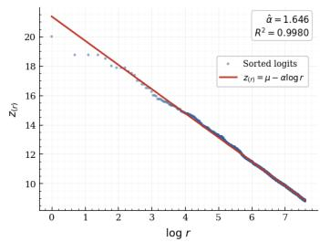
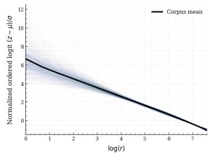
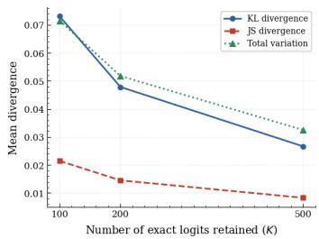
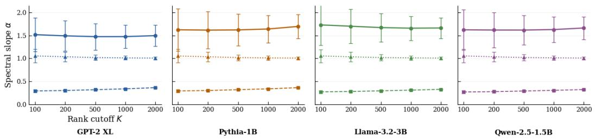
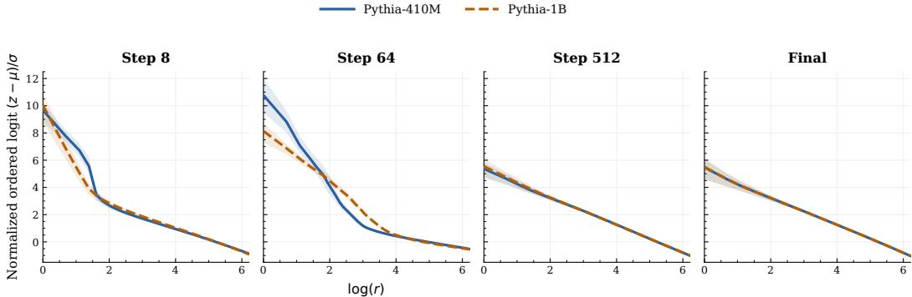
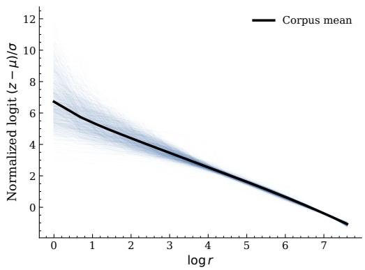
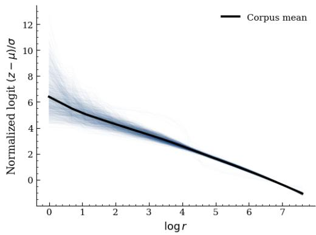
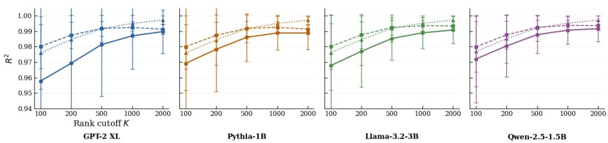

# The Geometry of Language Model Logits: Generic Structure and Learned Departures

Swathi Shree Narashiman1,∗, Aravind Ramana Venkatramanan2,∗, Nambi Seshadri3 1Stanford University, 2Indian Institute of Technology Madras, 3University of California San Diego (UCSD) ∗

## Abstract

Autoregressive language models produce, at every prediction step, a vocabularysized logit vector whose structure determines the conditional next-token distribution. We empirically identify that the ordered vocabulary-head logits follow a remarkably consistent log-linear relation

z(r) ≈ µ − α log r.

across prediction contexts, architectures, and scales, emerging progressively during pretraining. To our knowledge, this is the first systematic analysis of the logit geometry underlying the distributional assumptions used in the prior decoding work such as Basu et al. [2021]. While controlled order-statistic baselines spanning bounded, light-tailed, and heavier-tailed distributions can largely explain the observed loglinear geometry, they do not explain the systematic shift in the slope α: trained language models exhibit α ≈ 1.4–1.7, sitting well above the initialization baseline (α ≈ 0.2) . Moreover, α correlates with predictive performance, suggesting that it captures learned structure beyond generic extreme-value effects.

## 1 Introduction

At every prediction step, an autoregressive language model assigns a score to every token in its vocabulary, which governs how probability mass is distributed over possible continuations. Sampling is the last step of generation; the logits are where the real decision is already made. While substantial work has studied the resulting token probabilities, generated text, and hidden representations, the structure of this vocabulary-wide logit vector remains comparatively unexplored.

One natural way to expose this structure is to ignore token identities and examine the logits in rank order. This perspective is also directly relevant to common decoding procedures, such as top-k and top-p sampling, which operate on the vocabulary head by selecting or truncating the highest-ranked logits. This leads to a simple question: Does the ordered logit vector possess a simple geometric structure?

We empirically find a remarkably regular structure in the vocabulary head: ordered logits follow an approximately log-linear relation across prediction contexts, architectures, and model scales, and this structure emerges during pretraining. This raises the question of how much of this structure is attributable to language models and how much arises generically from order statistics.

Controlled order-statistic baselines show that ranking any finite collection of random variables induces its own structure, and light-tailed distributions can produce approximately log-linear ordered spectra. We therefore focus on the spectral slope α, examining how it differs from generic baselines, how it varies across models, and what information it carries about the model’s predictive state.

Our contributions are: (i) We characterize a consistent log-linear geometry in the ordered vocabularyhead logits of autoregressive language models across contexts, architectures, scales, and training. (ii)

We distinguish generic order-statistic geometry from learned structure using controlled distributional baselines, identifying the spectral slope α as the key empirical distinction between the regimes. (iii) We show that the spectral distribution can be efficiently reconstructed from the vocabulary head and that α correlates with pre-hoc predictive uncertainty (entropy) and post-hoc prediction quality, measured by NLL, ground-truth token probability $p _ { \mathrm { t r u e } } .$ , and ground-truth token rank.

## 2 Preliminaries

Autoregressive prediction. At each prediction step, a decoder-only Transformer [Vaswani et al., 2017] maps the preceding context to a hidden state $h _ { k } \in \mathbb { R } ^ { d }$ and produces a vocabulary-sized logit vector $z _ { k } = W _ { u } h _ { k } \overset {  } { + } b \in \mathbb { R } ^ { V }$ . The autoregressive factorization and conditional next-token distribution are

$$
P ( t _ { 1 : m } ) = \prod _ { k = 1 } ^ { m } P ( t _ { k } \mid t _ { 1 : k - 1 } ) P ( t _ { k } = v \mid t _ { 1 : k - 1 } ) = { \frac { \exp ( z _ { k , v } ) } { \sum _ { v ^ { \prime } } \exp ( z _ { k , v ^ { \prime } } ) } } .
$$

Here, $W _ { u } \in \mathbb { R } ^ { V \times d }$ is the unembedding matrix and $b \in \mathbb { R } ^ { V }$ is the output bias. Inference-time sampling may further rescale $z _ { k }$ by a temperature T before softmax [Ackley et al., 1985].

Rank-space representation. Because token identities are not relevant to the structural question we aim to answer, we study the vocabulary head in rank space by sorting the logits in descending order:

$$
z _ { ( 1 ) } \geq z _ { ( 2 ) } \geq \cdots \geq z _ { ( V ) } , \qquad z _ { ( r ) } : = r { \ - t h l a r g e s t e n t r y o f } z _ { k } .
$$

For a chosen head size $K \leq V$ , we analyze the ordered spectrum $\{ z _ { ( r ) } \} _ { r = 1 } ^ { K }$

Relation to Zipfian decoding. Our analysis is closely related to the Zipfian assumption underlying Mirostat [Basu et al., 2021], but addresses a more fundamental structural question. While Mirostat exploits a power-law next-token distribution for adaptive decoding, we characterize the ordered logit spectrum before softmax, ask whether its structure is generic or learned, and show that its two-parameter law can approximately reconstruct the full next-token distribution from a small exact vocabulary head. A detailed comparison is provided in Appendix A.

## 3 Results

## 3.1 Log-Linear Logit Geometry

For a prediction context, let $z _ { ( 1 ) } \geq \cdot \cdot \cdot \geq z _ { ( V ) }$ denote the vocabulary logits sorted in descending order. We empirically observe that the vocabulary head is well approximated by

$$
z _ { ( r ) } \approx \mu - \alpha \log r , \qquad r = 1 , \ldots , K ,
$$

  
Figure 1: Ordered logit geometry. (a) Ordered logit spectrum for a representative prediction context from Llama-3.2-1B, with logits sorted in descending order and plotted against log r. The red line shows the least-squares fit of $z _ { ( r ) } = \mu - \alpha$ log r over the top $K = 2 0 0 0$ vocabulary ranks. (b) Collapse of normalized ordered logit spectra across 1,000 randomly sampled prediction contexts from ten books for Llama-3.2-1B. Each spectrum is normalized independently as $( z - \mu ) / \sigma$ , and the black curve shows the corpus mean. (c) Mean divergence between the true next-token distribution and its spectral reconstruction using K exact logits and a two-parameter log-linear approximation of the remaining ranks, averaged over four language models. Experimental details and additional results are provided in Appendix B

where $\mu$ is a context-dependent intercept and $\alpha > 0$ is the spectral slope. Across the models and contexts studied, this relation provides an excellent fit over the vocabulary head, with $R ^ { 2 } > 0 . 9 9$ for a broad range of K.

Figure 1(a) shows that the log-linear structure persists across substantially different prediction contexts, rather than being tied to a particular sequence. Normalization reveals a strong crosscontext spectral collapse (Figure 1(b)), suggesting that much of the vocabulary-wide variation is captured by a low-dimensional rank-space structure. Robustness across $K .$ , models, and corpora is reported in Appendix C.3.

## 3.2 Generic vs. Learned Structure

The near-perfect fit of ordered logits does not by itself imply language-model-specific structure. We therefore apply the same fitting procedure to controlled order-statistic baselines spanning bounded, light-tailed, and heavier-tailed distributions.

Figure 2 shows that this separation is not specific to the choice of rank cutoff. Across a broad range of K, language models exhibit stable slopes, while the order-statistic baselines display distributiondependent behavior. Uniform samples fit substantially worse, with average $R ^ { \dot { 2 } } \stackrel { . } { \approx } 0 . 7 5$ across vocabulary sizes and $\alpha \approx 0 . 0 0 1 – 0 . 0 2 0$ , while Gaussian and Exponential samples achieve $R ^ { 2 } \approx 0 . 9 9$ and $R ^ { 2 } \approx 0 . 9 7$ , respectively. Lognormal samples achieve $R ^ { 2 } \approx 0 . 9 2$ but produce much larger slopes, $\alpha \approx 4 . 6 7 – 1 0 . 6$ . Thus, although log-linear structure can arise generically from order statistics, its fit and associated slope depend substantially on the underlying distribution.

What shapes the spectral slope α ? The cross-entropy objective provides a partial answer. At the population optimum, $z _ { i } ( h ) = \log q ( i \mid h ) + c ( h )$ , making the log-linear logit law equivalent to an approximately Zipfian conditional distribution q(· | h) - the same regularity estimated online by Mirostat [Basu et al., 2021]. This equivalence does not itself explain why language-model distributions should be Zipfian: it holds exactly only at the unconstrained population optimum. Rather, we view the empirical tightness and stability of α across architectures and scales as the phenomenon requiring explanation. Further equivalences and consequences are given in Appendix G.

Evolution during pretraining. Publicly available Pythia checkpoints show that the spectral regime develops during training: α increases from approximately 0.2 at initialization, while normalized spectra progressively approach the final-model shape, with most changes occurring early and the structure clearly established by step 512 (Figure 3). Training therefore systematically shapes the spectral parameters within an ordered-logit structure. Additional analyses of the training dynamics are provided in Appendix D.

LM -- Gaussian ……Exponential  
  
Figure 2: Rank-cutoff robustness of the learned spectral regime. Spectral slope α as a function of rank cutoff $K$ for representative models from four model families. Each language model is compared with Gaussian and Exponential order-statistic baselines matched to its vocabulary size. Error bars denote standard deviations across the 10 books for language models and across synthetic samples for the null distributions. The corresponding dependence of goodness of fit $R ^ { 2 }$ on $K$ is reported in Figure 5 (Appendix C).

  
Figure 3: Evolution of ordered logit geometry during pretraining. Mean normalized ordered-logit spectra for Pythia-410M (solid) and Pythia-1B (dashed) across representative training checkpoints. Shaded regions denote the interquartile range across prediction contexts.

## 3.3 Spectral Reconstruction of Next-Token Distributions

The log-linear structure also provides a compact approximation of the next-token distribution. Given only the top-K ordered logits, we retain their exact values and fit the spectral parameters $( \mu , \alpha )$ by least squares. The remaining vocabulary logits are then reconstructed according to $\hat { z } _ { ( r ) } = \hat { \mu } - \hat { \alpha } \log r$ yielding an approximate distribution after softmax.

Distribution reconstruction. Despite reconstructing the majority of vocabulary logits using only the two fitted spectral parameters, the resulting distributions remain close to the exact softmax distribution, with divergence consistently decreasing as the number of retained exact logits K increases Figure 1(c). At $K = 5 0 0 ( \leq 1 \%$ of the vocabulary), the reconstruction achieves a mean Jensen–Shannon divergence of only 0.008 across four model families. Thus, a small exact head together with a two-parameter spectral description of the remaining tail approximately recovers the full rank-space next token distribution(see Appendix E.)

Relation to predictive state. The spectral slope α also varies systematically with the model’s predictive state. Across 40 model-book pairs, larger α is associated with lower uncertainty and better prediction of the realized next token: entropy correlates at $r = - 0 . 3 3 2$ , NLL and ground-truth log-rank at $r = - 0 . 2 0 6$ and $r = - 0 . 2 0 9$ , and $p _ { \mathrm { t r u e } }$ at $r = + 0 . 1 1 1$ . These associations are highly consistent across pairs and persist without $R ^ { 2 }$ filtering and under Spearman correlations, suggesting that α captures variation in the predictive state beyond ordered logit geometry (see Appendix F).

## 4 Discussion

Our results reveal two complementary aspects of the ordered logit spectrum. Approximately loglinear geometry can arise generically from order statistics, while training systematically shapes the spectrum through α. This yields a compact rank-space representation of vocabulary-sized predictions: a small exact head and two fitted parameters can approximately reconstruct the ranked probability spectrum. This compact structure may provide a basis for approximating vocabulary-sized predictive distributions without retaining the full spectrum. Moreover, α systematically tracks aspects of the model’s predictive state, providing a compact summary of variation in next-token predictions.

Limitations and future work. Our analysis focuses on pretrained decoder-only language models and provides sufficient rather than necessary theoretical conditions. The origin of the learned spectral regime, and in particular why optimization drives the spectrum toward its observed parameter range, remains an open question. Moreover, our reconstruction concerns the ranked probability spectrum rather than token identities in the tail. Future work should examine whether these dynamics extend to other model architectures and whether the spectral functional can support uncertainty estimation, generation-state tracking, distribution approximation or decoding control.

## References

David H. Ackley, Geoffrey E. Hinton, and Terrence J. Sejnowski. A learning algorithm for Boltzmann machines. Cognitive Science, 9(1):147–169, 1985.

Sourya Basu, Govardana Sachitanandam Ramachandran, Nitish Shirish Keskar, and Lav R. Varshney. Mirostat: A neural text decoding algorithm that directly controls perplexity. In International Conference on Learning Representations, 2021.

Stella Biderman, Hailey Schoelkopf, Quentin Anthony, Herbie Bradley, Kyle O’Brien, Eric Hallahan, Mohammad Aflah Khan, Shivanshu Purohit, USVSN Sai Prashanth, Edward Raff, Aviya Skowron, Lintang Sutawika, and Oskar van der Wal. Pythia: A suite for analyzing large language models across training and scaling. In Proceedings of the 40th International Conference on Machine Learning, volume 202, pages 2397–2430. PMLR, 2023.

David Demeter, Gregory Kimmel, and Doug Downey. Stolen probability: A structural weakness of neural language models. In Proceedings of the 58th Annual Meeting of the Association for Computational Linguistics, pages 2191–2197, 2020.

Kawin Ethayarajh. How contextual are contextualized word representations? Comparing the geometry of BERT, ELMo, and GPT-2 embeddings. In Proceedings ofthe 2019 Conference on Empirical Methods in Natural Language Processing and the 9th International Joint Conference on Natural Language Processing (EMNLP-IJCNLP), pages 55–65, 2019.

Jun Gao, Di He, Xu Tan, Tao Qin, Liwei Wang, and Tie-Yan Liu. Representation degeneration problem in training natural language generation models. In International Conference on Learning Representations, 2019.

Llama Team, AI @ Meta. The Llama 3 herd of models. arXiv preprint arXiv:2407.21783, 2024.

Benoit Mandelbrot. An informational theory of the statistical structure of language. In Willis Jackson, editor, Communication Theory, pages 486–502. Butterworths, 1953.

Clara Meister and Ryan Cotterell. Language model evaluation beyond perplexity. In Proceedings of the 59th Annual Meeting of the Association for Computational Linguistics and the 11th International Joint Conference on Natural Language Processing (Volume 1: Long Papers), pages 5328–5339, 2021.

Steven T. Piantadosi. Zipf’s word frequency law in natural language: A critical review and future directions. Psychonomic Bulletin & Review, 21(5):1112–1130, 2014.

Qwen Team. Qwen2.5 technical report. arXiv preprint arXiv:2412.15115, 2024.

Alec Radford, Jeffrey Wu, Rewon Child, David Luan, Dario Amodei, and Ilya Sutskever. Language models are unsupervised multitask learners. OpenAI blog, 2019.

Shuntaro Takahashi and Kumiko Tanaka-Ishii. Evaluating computational language models with scaling properties of natural language. Computational Linguistics, 45(3):481–513, 2019.

Ashish Vaswani, Noam Shazeer, Niki Parmar, Jakob Uszkoreit, Llion Jones, Aidan N. Gomez, Łukasz Kaiser, and Illia Polosukhin. Attention is all you need. In Advances in Neural Information Processing Systems, volume 30, 2017.

Zhilin Yang, Zihang Dai, Ruslan Salakhutdinov, and William W. Cohen. Breaking the softmax bottleneck: A high-rank RNN language model. In International Conference on Learning Representations, 2018.

George Kingsley Zipf. Human Behavior and the Principle ofLeast Effort. Addison-Wesley, 1949.

## A Related Work

Statistical laws of language and generated text. Zipf’s law describes corpus-level token frequencies aggregated over natural language [Zipf, 1949, Mandelbrot, 1953, Piantadosi, 2014]. More recently, several works have investigated whether neural language models reproduce such statistical laws in generated text [Takahashi and Tanaka-Ishii, 2019, Meister and Cotterell, 2021]. Our object of study is different: we analyze the model’s predicted logit vector for each individual prediction context, before any token is sampled. The resulting log-linear law is therefore a pre-hoc property of conditional predictions rather than a post-hoc property of natural or generated text.

Structure of the conditional next-token distribution. Several works exploit regularities in the conditional next-token distribution to design decoding algorithms. Most closely related is Mirostat [Basu et al., 2021], which assumes Zipfian statistics of the predicted distribution and estimates the corresponding exponent online to adapt the sampling cutoff and control perplexity. Our work asks a prior structural question: why and how does such a power-lawform arise in thefirst place? Rather than positing Zipfian structure at the probability level for decoding, we directly study the ordered logits before softmax and find that they follow a remarkably tight log-linear law across individual prediction contexts, architectures, and scales.

This perspective also separates generic structure induced by sorting from structure learned by the language model. We characterize the observed spectral slope α, study its variation across predictive states, show that the geometry emerges progressively during pretraining, and demonstrate that a small exact vocabulary head together with the fitted spectral tail can approximately reconstruct the full next-token distribution. At the cross-entropy optimum, our logit law is exactly equivalent to a Zipfian conditional distribution, establishing a direct theoretical connection to the probability-level assumption used by Mirostat.

Geometry of the output layer. A separate line of work studies geometric properties of transformer outputs, including the softmax bottleneck [Yang et al., 2018], stolen probability [Demeter et al., 2020], representation degeneration [Gao et al., 2019], anisotropy [Ethayarajh, 2019], and low-rank structure in collections of logit vectors across prompts. These perspectives are complementary: while prior work primarily studies structure across contexts or representations, we identify an interpretable within context geometry of the vocabulary-sized output itself. The resulting two-parameter description provides a compact descriptor of each prediction step.

Training dynamics and theoretical characterization. Prior work has largely focused on analyzing trained models. We additionally study the emergence of ordered logit geometry during pretraining using intermediate checkpoints from the Pythia suite [Biderman et al., 2023], showing that the law develops progressively through optimization. On the theoretical side, rather than assuming a particular generative model for the observed spectrum, we characterize its relation to conditional Zipfian structure at the cross-entropy optimum, give an equivalent distance-based reparametrization, and establish deterministic consequences for tail counts and the softmax distribution.

## B Experimental Setup

## B.1 Models

We evaluate four families of decoder-only autoregressive language models spanning a range of model scales, vocabularies, and training procedures: GPT-2 (124M, 355M, 774M, 1.5B) [Radford et al., 2019], Pythia (410M, 1B) [Biderman et al., 2023], Llama 3.2 (1B, 3B) [Llama Team, AI @ Meta, 2024], and Qwen 2.5 (0.5B, 1.5B) [Qwen Team, 2024]. To study the emergence of the ordered logit geometry during training, we additionally evaluate intermediate checkpoints of the Pythia models at optimization steps {8, 64, 512, 143000}. All models are evaluated in inference mode without gradient computation.

## B.2 Corpora

Experiments are conducted on ten books from Project Gutenberg 2 covering diverse genres including realism, science fiction, mystery and adventure. Each text is tokenized using the model’s native tokenizer. We use the first 20,000 tokens of each book with a context length of 128 tokens and stride 1, yielding approximately $2 \times 1 0 ^ { 4 }$ prediction contexts per book. For every prediction context, we store the top-K sorted logits $( K = 2 0 0 0 )$ .The experimental code is available.3. As an ablation, we additionally verify this collapse on a different model and corpus (GPT-2 on WikiText-2), reported in Appendix C.

## B.3 Fitting Procedure

For each prediction context, we fit the log-linear model

$$
z _ { ( r ) } = \mu - \alpha \log r , \qquad r = 1 , \ldots , K ,
$$

using ordinary least squares. We report the fitted slope αˆ, intercept $\hat { \mu } ,$ coefficient of determination $( R ^ { 2 } )$ , and root mean squared error (RMSE). Per-model statistics are reported as the mean of per-book means, with standard deviation across books as a measure of corpus stability. For the normalized spectrum analysis, each logit spectrum is standardized as

$$
\tilde { z } _ { ( r ) } = \frac { z _ { ( r ) } - \bar { z } } { \sigma } ,
$$

before averaging across contexts.

## C Additional Experiments

## C.1 Functional Form Selection

We compare the log-linear form $z _ { ( r ) } = \mu - \alpha$ log r against five alternatives on prediction contexts from Llama-3.2 (1B); results are in Table 1.

Table 1: Comparison of functional forms fitted to ordered logit spectra (Llama-3.2 1B, $K = 2 0 0 0 )$ . # is the number of free parameters.
<table><tr><td>Form</td><td>#</td><td> $R ^ { 2 }$ </td><td>RMSE</td></tr><tr><td>Logarithmic</td><td>2</td><td> $0 . 9 9 2 2 \pm 0 . 0 0 7 4$ </td><td> $0 . 1 2 9 9 \pm 0 . 0 5 8 8$ </td></tr><tr><td>Power</td><td>3</td><td> $0 . 9 9 6 2 \pm 0 . 0 0 4 5$ </td><td> $0 . 0 8 7 4 \pm 0 . 0 4 3 7$ </td></tr><tr><td>Exponential</td><td>2</td><td> $0 . 9 4 6 0 \pm 0 . 0 2 9 0$ </td><td> $0 . 3 6 7 8 \pm 0 . 0 8 4 9$ </td></tr><tr><td>Square-root</td><td>2</td><td> $0 . 9 0 4 3 \pm 0 . 0 3 9 1$ </td><td> $0 . 4 9 4 1 \pm 0 . 1 2 9 8$ </td></tr><tr><td>Linear</td><td>2</td><td> $0 . 7 7 5 2 \pm 0 . 0 5 3 4$ </td><td> $0 . 7 6 9 2 \pm 0 . 1 4 6 4$ </td></tr><tr><td>Inverse</td><td>2</td><td> $0 . 1 9 5 0 \pm 0 . 0 4 0 9$ </td><td> $1 . 4 6 4 2 \pm 0 . 2 0 1 0$ </td></tr></table>

The three-parameter power law $z _ { ( r ) } = a \cdot r ^ { - b } + c$ is essentially matched by the two-parameter log-linear form, with its small residual gain in fit attributable to the extra parameter rather than a qualitatively better description. We adopt the log-linear form for two reasons: (1) parsimony: it reaches $R ^ { 2 } > 0 . 9 9$ with two parameters, one fewer than the power law; and (2) softmax tractability: it yields a closed-form Zipf law $p _ { r } \propto r ^ { - \alpha }$ , whereas the power law admits no comparably tractable softmax expression. We do not claim log-linear is uniquely correct, only that it is the simplest form consistent with the data and better suited to the softmax-based results in Section 3.

## C.2 Ablations

To verify that the rank-logit collapse is not specific to the primary model or corpus, we repeat the analysis with GPT-2 on WikiText-2 and French Wikipedia. As shown in Figure 4, the normalized logit curves $( z - \mu ) / \sigma$ collapse onto a shared trajectory across contexts in both corpora, consistent with the pattern observed in our primary experiments.

  
Figure 4: Cross-corpus normalized logit collapse for GPT-2. Left: GPT-2 evaluated on WikiText-2. Right: GPT-2 evaluated on French Wikipedia. In both panels, blue curves show individual prediction contexts and the black curve shows the corpus mean. The normalized ordered-logit spectra $( z - \mu ) / \sigma$ exhibit a shared trajectory across contexts in both corpora.

## C.3 Additional Results

Table 2: Log-linear fit statistics across autoregressive language model families, averaged over 10 books $( K = 2 0 0 0 )$ . Reported α is mean ± standard deviation across books; $R ^ { 2 }$ is the mean percontext coefficient of determination, averaged across books.
<table><tr><td>Family</td><td>Model</td><td>α</td><td> $R ^ { 2 }$ </td></tr><tr><td rowspan="3">GPT-2</td><td>124M</td><td> $1 . 4 2 6 \pm 0 . 2 4 3$ </td><td>0.9910 0.9914</td></tr><tr><td>355M 774M</td><td> $1 . 4 1 3 \pm 0 . 2 1 3$ </td><td>0.9905</td></tr><tr><td>1.5B</td><td> $1 . 4 8 8 \pm 0 . 2 2 0$   $1 . 4 9 4 \pm 0 . 2 2 9$ </td><td>0.9898</td></tr><tr><td>Pythia</td><td>410M 1.0B</td><td> $1 . 6 4 9 \pm 0 . 2 6 0$   $1 . 6 9 5 \pm 0 . 2 6 6$ </td><td>0.9889 0.9889</td></tr><tr><td>Llama-3.2</td><td>1.0B 3.0B</td><td> $1 . 6 2 9 \pm 0 . 2 3 4$   $1 . 6 6 1 \pm 0 . 2 2 4$ </td><td>0.9915 0.9908</td></tr><tr><td>Qwen-2.5</td><td>0.5B 1.5B</td><td> $1 . 5 5 8 \pm 0 . 2 2 9$   $1 . 6 6 0 \pm 0 . 2 4 7$ </td><td>0.9918 0.9917</td></tr></table>

Consistency Across Model Families . Table 2 summarizes the fitted log-linear parameters across all evaluated models. Despite substantial differences in architecture, tokenizer, training corpus, and more than an order-of-magnitude variation in model size, the ordered logit spectrum is consistently well approximated by a log-linear law $( R ^ { 2 } > 0 . 9 9 )$ . More strikingly, the fitted slope remains confined to a narrow range $( 1 . { \overset { . } { 4 } } 1 \leq \overset { . } { \alpha } \leq 1 . 7 0 ) $ , indicating that modern autoregressive language models exhibit remarkably similar ordered logit geometry despite their diverse training procedures and scales.

Dependence of goodness of fit on K. The goodness of fit generally improves as the rank cutoff increases for both language models and order-statistic baselines. Language-model fits approach $R ^ { 2 } \approx 0 . 9 9$ at larger $K ,$ but Gaussian and Exponential baselines attain similarly high or higher $R ^ { 2 }$ over the same range. Thus, the improvement in $R ^ { 2 }$ with $K$ is not specific to language models and should not itself be interpreted as evidence of learned structure. Instead, we use the spectral slope α to distinguish the language-model spectra from generic order-statistic geometry.

  
Figure 5: Dependence of goodness of fit on rank cutoff. Coefficient of determination $R ^ { 2 }$ as a function of rank cutoff K for the same representative language models and vocabulary-matched Gaussian and Exponential order-statistic baselines as in Figure 2. Error bars denote standard deviations across the 10 books for language models and across synthetic samples for the null distributions.

## D Additional Training Dynamics

Evolution of the spectral regime. We further quantify the evolution of the ordered-logit law throughout pretraining using intermediate checkpoints from the Pythia-410M and Pythia-1B suites. Table 3 reports the fitted spectral exponent α and goodness of fit at different training stages.

Both models exhibit a substantial change in the spectral regime during the early stages of optimization. At initialization (Step 0), the ordered spectra already admit a highly linear fit, but occupy a shallow regime, with $\alpha \approx 0 . 2 0$ at K = 500, closer to the Gaussian synthetic baseline $( \alpha \approx 0 . 3 )$ than to the trained models. This exponent is substantially smaller than that of the trained models, whose final values reach α ≈ 1.57–1.62 at the same cutoff.

Table 3: Evolution of the ordered-logit spectral regime during pretraining. We report the mean fitted exponent α and $R ^ { 2 }$ at $K = 5 0 0$ across evaluation contexts for Pythia-410M and Pythia-1B.
<table><tr><td rowspan="2">Checkpoint</td><td rowspan="2">Training stage</td><td colspan="2">Pythia-410M</td><td colspan="2">Pythia-1B</td></tr><tr><td>α</td><td> $R ^ { 2 }$ </td><td>α</td><td> $R ^ { 2 }$ </td></tr><tr><td>Step 0</td><td>Initialization</td><td>0.203</td><td>0.992</td><td>0.199</td><td>0.991</td></tr><tr><td>Step 8</td><td>Early</td><td>0.258</td><td>0.881</td><td>0.241</td><td>0.909</td></tr><tr><td>Step 64</td><td>Early</td><td>0.507</td><td>0.680</td><td>0.779</td><td>0.805</td></tr><tr><td>Step 512</td><td>Intermediate</td><td>1.128</td><td>0.990</td><td>1.164</td><td>0.988</td></tr><tr><td>Step 8000</td><td>Late</td><td>1.485</td><td>0.987</td><td>1.498</td><td>0.987</td></tr><tr><td>Final</td><td>Trained</td><td>1.571</td><td>0.987</td><td>1.618</td><td>0.986</td></tr></table>

In the earliest stages of training, the log-linear structure itself undergoes a substantial departure from the final regime Figure 3. For example, at Step 64, the $K = 5 0 0$ fit reaches only $R ^ { 2 ^ { * } } = 0 . 6 8$ and 0.81 for Pythia-410M and Pythia-1B, respectively. As training progresses, both the exponent and goodness of fit move toward their final values. By Step 512, the $\bar { K } = 5 0 0$ exponent reaches 1.13 for Pythia-410M and 1.16 for Pythia-1B, with $R ^ { 2 } \stackrel { . } { \approx } 0 . 9 9$ At Step 8000, both models are already close to their final spectral regime, with $\alpha = 1 . 4 8 – 1 . 5 0$ and $R ^ { 2 } \approx 0 . 9 8 7$ . The final checkpoints further sharpen this regime, reaching $\alpha = 1 . 5 7$ for Pythia-410M and 1.62 for Pythia-1B.

These dynamics indicate that training does not merely preserve or amplify a generic consequence of ordering. Rather, optimization transforms the initial shallow spectrum through a transient non-loglinear phase into a distinct spectral regime characterized by a substantially larger and increasingly stable exponent. The learned phenomenon is therefore characterized jointly by the emergence of strong log-linearity and a nontrivial spectral scale that is not present in either synthetic or untrained baselines.

## E Spectral Approximation of Next-Token Distributions

We provide additional details and model-wise results for the spectral reconstruction experiment in Section 3.3. The experiment evaluates whether the ordered logit spectrum can be used to approximately recover the full next-token distribution from a small exact head and a two-parameter description of the remaining ranks.

## E.1 Spectral Reconstruction

For each prediction context, let $z _ { ( 1 ) } \geq z _ { ( 2 ) } \geq \cdot \cdot \cdot \geq z _ { ( V ) }$ denote the vocabulary logits sorted in descending order. Given the first K exact ordered logits, we fit

$$
z _ { ( r ) } \approx \mu - \alpha \log r
$$

by ordinary least squares over $r = 1 , \ldots , K$ . We retain the first K logits exactly and reconstruct the remaining ranks as

$$
\hat { z } _ { ( r ) } = \left\{ \begin{array} { l l } { z _ { ( r ) } , } & { r \le K , } \\ { \hat { \mu } - \hat { \alpha } \log r , } & { r > K . } \end{array} \right.
$$

Applying softmax to the reconstructed spectrum yields the approximate distribution $\hat { p } ,$ which is compared with the exact distribution p = softmax(z).

We evaluate reconstruction using Kullback–Leibler (KL) divergence, Jensen–Shannon (JS) divergence, and total variation (TV) distance:

$$
D _ { \mathrm { K L } } ( p \Vert \hat { p } ) , \qquad D _ { \mathrm { J S } } ( p , \hat { p } ) , \qquad D _ { \mathrm { T V } } ( p , \hat { p } ) .
$$

Results are aggregated over 39,520 prediction contexts sampled from ten books across four language models. We consider $K \in \{ 1 0 0 , 2 0 \bar { 0 } , 5 0 0 \}$

## E.2 Model-wise Results

Table 4 reports the complete model-wise reconstruction results. Divergence decreases consistently as more exact logits are retained. At $K = 5 0 0$ , mean JS divergence ranges from 0.0058 to 0.0094 across models, while mean TV ranges from 0.0235 to 0.0369.

Table 4: Model-wise spectral reconstruction results. Divergences compare the exact next-token distribution with the distribution reconstructed from the top-K exact ordered logits and a log-linear approximation of the remaining ranks.
<table><tr><td>Model</td><td>K</td><td>N</td><td>Mean  $R ^ { 2 }$ </td><td>Mean KL</td><td>Mean JS</td><td>Mean TV</td></tr><tr><td rowspan="3">Pythia-1B</td><td>100</td><td>9880</td><td>0.9689</td><td>0.0805</td><td>0.0238</td><td>0.0772</td></tr><tr><td>200</td><td>9880</td><td>0.9781</td><td>0.0536</td><td>0.0163</td><td>0.0566</td></tr><tr><td>500</td><td>9880</td><td>0.9860</td><td>0.0292</td><td>0.0091</td><td>0.0348</td></tr><tr><td rowspan="3">Qwen2.5-1.5B</td><td>100</td><td>9880</td><td>0.9721</td><td>0.0848</td><td>0.0249</td><td>0.0786</td></tr><tr><td>200</td><td>9880</td><td>0.9803</td><td>0.0548</td><td>0.0167</td><td>0.0562</td></tr><tr><td>500</td><td>9880</td><td>0.9874</td><td>0.0300</td><td>0.0094</td><td>0.0347</td></tr><tr><td rowspan="3">GPT-2 XL</td><td>100</td><td>9880</td><td>0.9568</td><td>0.0675</td><td>0.0197</td><td>0.0717</td></tr><tr><td>200</td><td>9880</td><td>0.9686</td><td>0.0468</td><td>0.0141</td><td>0.0543</td></tr><tr><td>500</td><td>9880</td><td>0.9811</td><td>0.0285</td><td>0.0088</td><td>0.0369</td></tr><tr><td rowspan="3">Llama-3.2-3B</td><td>100</td><td>9880</td><td>0.9666</td><td>0.0595</td><td>0.0175</td><td>0.0587</td></tr><tr><td>200</td><td>9880</td><td>0.9760</td><td>0.0363</td><td>0.0110</td><td>0.0400</td></tr><tr><td>500</td><td>9880</td><td>0.9847</td><td>0.0189</td><td>0.0058</td><td>0.0235</td></tr></table>

## E.3 Aggregate Results

Across all four models, reconstruction quality improves consistently with K. The mean KL divergence decreases from 0.0731 at $K = 1 0 0$ to 0.0479 at $K = 2 0 0$ and 0.0266 at $K = 5 0 0$ . Mean JS divergence decreases from 0.0215 to 0.0145 and 0.0083, while mean TV decreases from 0.0715 to 0.0518 and 0.0325, respectively.

Table 5: Aggregate spectral reconstruction results across 39,520 contexts and four language models.
<table><tr><td>K</td><td>Mean KL</td><td>Mean JS</td><td>Mean TV</td><td>Mean  $R ^ { 2 }$ </td></tr><tr><td>100</td><td>0.0731</td><td>0.0215</td><td>0.0715</td><td>0.9661</td></tr><tr><td>200</td><td>0.0479</td><td>0.0145</td><td>0.0518</td><td>0.9758</td></tr><tr><td>500</td><td>0.0266</td><td>0.0083</td><td>0.0325</td><td>0.9848</td></tr></table>

## F Predictive-Behavior Analysis

Setup. For each prediction context, we sort the vocabulary logits and fit

$$
z _ { ( r ) } = \mu - \alpha \log r , \qquad r = 1 , \ldots , K ,
$$

with $K = 2 0 0 0$ by ordinary least squares. We evaluate GPT-2 XL, Pythia-1B, Llama-3.2-3B, and Qwen-2.5-1.5B on ten Project Gutenberg books per model. Contexts have length 128 and are sampled every 128 tokens, yielding non-overlapping windows. For each context, we record α, R2, NLL, ptrue, true-token rank, and full-vocabulary entropy

$$
H = - \sum _ { v = 1 } ^ { V } p _ { v } \log p _ { v } .
$$

We use log(true rank) for the rank analysis. Pearson and Spearman correlations between α and each statistic are computed separately within each of the 40 model–book pairs, then pooled with a DerSimonian-Laird random-effects meta-analysis on Fisher-z transformed correlations (sampling variance $1 / ( N - 3 ) )$ , giving pooled correlations, 95% confidence intervals, two-sided p-values, and heterogeneity I2. An exact two-sided binomial sign test over the 40 book-level correlations is included as a distribution-free check, and we also repeat the sign test at the level of the four model-family averages. We report results both with a fit-quality filter $( R ^ { 2 } \ge 0 . 9 5 )$ and without one $( R ^ { 2 } \geq 0 )$

Correlation results. Table 6 reports the pooled Pearson and Spearman correlations between α and each predictive statistic, together with the sign-test summary.

Table 6: Predictive-behavior analysis across 40 model–book pairs. Entries are random-effects pooled Pearson and Spearman correlations with 95% confidence intervals. The Sign column reports the percentage of book-level correlations with negative/positive sign. For the Pearson meta-analysis, $p < 1 e { - } 1 2$ for all statistics except $p _ { \mathrm { t r u e } }$ , for which $p \overset { \cdot } { = } 2 . 0 2 e - \overset { \cdot } { 1 } 1$ at $R ^ { 2 } \ge 0 . 9 5$ and $p = 1 . 3 6 e { - 1 2 }$ at $R ^ { 2 } \geq 0$ . Exact two-sided binomial sign-test p-values are given in parentheses.
<table><tr><td rowspan="2"> $R ^ { 2 }$ </td><td rowspan="2">Statistic</td><td colspan="2">Pearson</td><td rowspan="2">Sign</td><td colspan="2">Spearman</td></tr><tr><td>r</td><td>95% CI</td><td>ρ</td><td>95% CI</td></tr><tr><td rowspan="4"> $\geq 0 . 9 5$ </td><td>Entropy</td><td>-0.332</td><td>[−0.370, -0.293]</td><td>-100% (1.82e−12)</td><td>-0.290</td><td>[−0.331, -0.248]</td></tr><tr><td>NLL</td><td>-0.206</td><td>[−0.236, -0.175]</td><td>-97.5% (7.46e-11)</td><td>-0.159</td><td>[−0.193, -0.125]</td></tr><tr><td>Ptrue</td><td>+0.111</td><td>[+0.079, +0.143]</td><td>+87.5% (1.38e−06)</td><td>+0.159</td><td>[+0.125, +0.193]</td></tr><tr><td>Log-rank</td><td>-0.209</td><td>[−0.236, -0.181]</td><td>-97.5% (7.46e-11)</td><td>-0.146</td><td>[-0.176, -0.116]</td></tr><tr><td rowspan="4"> $\geq 0$ </td><td>Entropy</td><td>-0.290</td><td>[−0.334, -0.245]</td><td>-100% (1.82e−12)</td><td>-0.262</td><td>[−0.304, -0.218]</td></tr><tr><td>NLL</td><td>-0.244</td><td>[−0.287, -0.201]</td><td>-97.5% (7.46e-11)</td><td>-0.170</td><td>[−0.206, -0.134]</td></tr><tr><td>Ptrue</td><td>+0.116</td><td>[+0.084, +0.148]</td><td>+87.5% (1.38e−06)</td><td>+0.170</td><td>[+0.134, +0.206]</td></tr><tr><td>Log-rank</td><td>-0.232</td><td>[-0.265, -0.199]</td><td>-97.5% (7.46e-11)</td><td>-0.159</td><td>[−0.191,-0.127]</td></tr></table>

Heterogeneity across model–book pairs. Table 7 reports the $I ^ { 2 }$ heterogeneity statistic for each pooled Pearson correlation in Table 6. $I ^ { 2 }$ is moderate for NLL and $p _ { \mathrm { t r u e } }$ and higher for entropy, indicating that the correlation with entropy varies more across model–book pairs in magnitude, even though Table 6 shows its sign is consistent for all 40 pairs.

Table 7: Heterogeneity $( I ^ { 2 } )$ of the pooled Pearson correlations reported in Table $^ { 6 , }$ by fit-quality filter.
<table><tr><td> $R ^ { 2 }$  filter</td><td>Entropy</td><td>NLL</td><td> $p _ { \mathrm { t r u e } }$ </td><td>Log-rank</td></tr><tr><td> $\geq 0 . 9 5$ </td><td>66.6%</td><td>37.3%</td><td>40.3%</td><td>24.7%</td></tr><tr><td> $\geq 0$ </td><td>73.7%</td><td>69.7%</td><td>39.5%</td><td>48.9%</td></tr></table>

Robustness to the fit-quality filter. The $R ^ { 2 } \ge 0 . 9 5$ filter excludes a different fraction of contexts in each model–book pair; we call this the pair’s rejectionfraction and ask whether it is itself associated with that pair’s average predictive statistics, which would indicate the filter systematically selects easier or harder contexts. Table 8 shows none of the four correlations is significant, so we find no evidence of such a bias.

Table 8: Pearson correlation between each model–book pair’s $R ^ { 2 } \ge 0 . 9 5$ rejection fraction and its mean predictive statistics (N = 40 pairs). None of the four associations is significant at $\alpha = 0 . 0 5$
<table><tr><td>Statistic</td><td>r</td><td>p</td></tr><tr><td>Entropy</td><td>0.227</td><td>0.159</td></tr><tr><td>NLL</td><td>0.210</td><td>0.194</td></tr><tr><td>Ptrue</td><td>-0.066</td><td>0.684</td></tr><tr><td>Log-rank</td><td>0.189</td><td>0.244</td></tr></table>

## G Theoretical Characterization

This appendix collects the formal statements referenced in Section 3. Section G.1 characterizes the relationship between the log-linear logit law and an approximately Zipfian conditional nexttoken distribution and clarifies what this relationship does and does not establish. Sections G.2 and G.3 derive two exact consequences of the empirical law, once it holds for a given context: an equivalent exponential tail count (Prop. 1) and a conditional Zipf distribution with exact temperature rescaling (Prop. 2), which together formalize the assumption underlying Mirostat [Basu et al., 2021]. Section G.4 formalizes the normalized-collapse behavior shown in Figure 1(b) (Prop. 3) and bounds its robustness to residual fit error.

We distinguish two questions. The first concerns the consequences of the vocabulary head being approximately log-linear in log-rank. These consequences follow algebraically and do not depend on the origin of the observed law. The second concerns why a language model’s logits exhibit this form in the first place. Our analysis provides only a partial account of this second question.

Fix a prediction context h and write the vocabulary logits as

$$
z _ { i } ( h ) = w _ { i } ^ { \top } h + b _ { i } , \qquad i \in \mathcal { V } ,
$$

where $w _ { i }$ is the output embedding row for token $i , b _ { i }$ is an output bias when present, and $V = | \nu |$ We suppress the dependence on h when clear, and write

$$
z _ { ( 1 ) } \geq z _ { ( 2 ) } \geq \cdot \cdot \cdot \geq z _ { ( V ) }
$$

for the logits sorted in descending order.

## G.1 Relation to a Zipfian conditional distribution

An exact equivalence at the cross-entropy optimum. At the population optimum of the crossentropy objective, the softmax probabilities for a fixed context h equal the true conditional distribution $q ( \cdot \mid h )$ , so the logits satisfy

$$
z _ { i } ( h ) = \log q ( i \mid h ) + c ( h )
$$

for an arbitrary context-dependent constant c(h) (adding a constant to every logit of a context leaves the softmax unchanged). Sorting both sides by rank,

$$
z _ { ( r ) } ( h ) = \log q _ { ( r ) } ( h ) + c ( h ) ,
$$

where $q _ { ( r ) } ( h )$ is the r-th largest value of $q ( \cdot \mid h )$ . Thus, on the vocabulary head, the empirical law $z _ { ( r ) } \approx \mu - \alpha$ log r holds exactly when the conditional next-token distribution is approximately Zipfian in rank, $q _ { ( r ) } ( h ) \propto r ^ { - \alpha }$ . This is a change of variables rather than a new assumption: log-linear logits and an approximately Zipfian $q ( \cdot \mid h )$ express the same claim, provided the model is near its cross-entropy optimum.

What this equivalence does, and does not, explain. This identity does not by itself explain why $q ( \cdot \mid h )$ should be close to Zipfian; it instead transfers the same regularity from logits to probabilities, where related structure has been conjectured and used previously, most directly in Mirostat’s online Zipf-exponent estimate [Basu et al., 2021]. Two points distinguish this from a purely definitional restatement of what we measure. First, the identity above is exact only at the unconstrained population optimum, while a finite model trained on finite data with a fixed architecture and a low-rank output embedding is not guaranteed to attain that optimum. The observation that trained models realize this structure with $R ^ { 2 } > 0 . 9 9$ , with α confined to a narrow band across four model families and an order of magnitude of scale (Section 3), is therefore an empirical property of trained models rather than a consequence of the training objective alone. It is this tightness and stability, rather than the identity itself, that requires explanation. Second, we measure the structure directly in logit space, before any token is sampled and independently of any decoding rule, which differs from the post-hoc statistics of generated text studied in prior work on statistical laws of language (Appendix A).

An equivalent distance-based parameterization. We provide an equivalent representation not necessarily a real-world representation, but in terms of a context-dependent mismatch, or distance, $d _ { h } ( i )$ between the context and a candidate token, rather than directly in terms of $q ( \cdot \mid h )$ . The two descriptions are equivalent by construction: for any $\gamma _ { h } > 0$ , writing

$$
q ( i \mid h ) \propto \exp ( - \gamma _ { h } d _ { h } ( i ) )
$$

simply defines

$$
d _ { h } ( i ) : = - \gamma _ { h } ^ { - 1 } \log q ( i \mid h ) + \mathrm { c o n s t . }
$$

Under this definition, the exponential-volume condition

$$
G _ { h } ( t ) : = \# \{ i \in \mathcal { V } : d _ { h } ( i ) \leq t \} \ \approx \ e ^ { \lambda _ { h } t }
$$

is exactly the statement that $q ( \cdot \mid h )$ is approximately Zipfian in rank. We consider the resulting rank-distance relation as an alternative interpretation of the observed log-linear law and to express temperature rescaling and tail counts (Sections G.2 and G.3) in distance language as well. It is not intended as an additional result beyond the equivalence above. Neither the exponential-volume condition nor the linear-penalty form $z \approx \beta - \gamma d$ below is independently verified in our data.

Theorem 1 (rank-distance form of the log-linear law). Fix a context h, and let $D _ { h } ( r )$ denote the r-th smallest value $o f \{ d _ { h } ( i ) \} _ { i \in \mathcal { V } }$ . Suppose that for ranks $1 \leq r \leq K$

$$
\left| D _ { h } ( r ) - \frac { \log r - \nu _ { h } } { \lambda _ { h } } \right| \leq \frac { \eta _ { h } } { \lambda _ { h } } , \qquad \lambda _ { h } > 0 ,
$$

and that the logits are uniformly close to a linear penalty in distance:

$$
\begin{array} { r } { \displaystyle \operatorname* { m a x } _ { i \in \mathcal { V } } \left| z _ { i } ( h ) - \left( \beta _ { h } - \gamma _ { h } d _ { h } ( i ) \right) \right| \leq \varepsilon _ { h } , } \\ { \gamma _ { h } > 0 . } \end{array}
$$

Then, $f o r r = 1 , \dots , K$

$$
\begin{array} { r } { \left| z _ { ( r ) } ( h ) - \left( \mu _ { h } - \alpha _ { h } \log r \right) \right| \leq \varepsilon _ { h } + \alpha _ { h } \eta _ { h } , } \end{array}
$$

where

$$
\alpha _ { h } = \frac { \gamma _ { h } } { \lambda _ { h } } , \qquad \mu _ { h } = \beta _ { h } + \alpha _ { h } \nu _ { h } .
$$

Proof. Define the ideal score

$$
y _ { i } ( h ) = \beta _ { h } - \gamma _ { h } d _ { h } ( i ) .
$$

Because $\gamma _ { h } > 0$ , the ordering of $y _ { i } ( h )$ is the reverse of the ordering of $d _ { h } ( i )$ . Therefore, the r-th largest ideal score is

$$
y _ { ( r ) } ( h ) = \beta _ { h } - \gamma _ { h } D _ { h } ( r ) .
$$

Using the assumed rank-distance bound,

$$
\left| y _ { ( r ) } ( h ) - \left( \beta _ { h } + \frac { \gamma _ { h } \nu _ { h } } { \lambda _ { h } } - \frac { \gamma _ { h } } { \lambda _ { h } } \log r \right) \right| \leq \frac { \gamma _ { h } } { \lambda _ { h } } \eta _ { h } .
$$

With $\alpha _ { h } = \gamma _ { h } / \lambda _ { h }$ and $\mu _ { h } = \beta _ { h } + \alpha _ { h } \nu _ { h }$ , this becomes

$$
\begin{array} { r } { \left| y _ { ( r ) } ( h ) - \left( \mu _ { h } - \alpha _ { h } \log r \right) \right| \leq \alpha _ { h } \eta _ { h } . } \end{array}
$$

It remains to compare the order statistics of $z _ { i } ( h )$ and $y _ { i } ( h )$ . The uniform perturbation assumption gives

$$
\operatorname* { m a x } _ { i \in \mathcal { V } } | z _ { i } ( h ) - y _ { i } ( h ) | \leq \varepsilon _ { h } .
$$

Order statistics are 1-Lipschitz under the sup norm: if maxi $| a _ { i } - b _ { i } | \leq \varepsilon$ , then $| a _ { ( r ) } - b _ { ( r ) } | \leq \varepsilon$ for every rank r. Hence,

$$
| z _ { ( r ) } ( h ) - y _ { ( r ) } ( h ) | \leq \varepsilon _ { h } .
$$

Combining the two inequalities yields

$$
\left| z _ { ( r ) } ( h ) - \left( \mu _ { h } - \alpha _ { h } \log r \right) \right| \leq \varepsilon _ { h } + \alpha _ { h } \eta _ { h } .
$$

The rank–distance bound in Theorem 1 is the exponential-volume condition expressed in rank form. Define

$$
G _ { h } ( t ) = \# \{ i \in \mathcal { V } : d _ { h } ( i ) \leq t \} .
$$

If, over the relevant head range,

$$
\left| \log G _ { h } ( t ) - \left( \nu _ { h } + \lambda _ { h } t \right) \right| \leq \eta _ { h } ,
$$

then solving $G _ { h } ( t ) \approx r$ gives

$$
D _ { h } ( r ) \approx \frac { \log r - \nu _ { h } } { \lambda _ { h } } ,
$$

which is the hypothesis of Theorem 1. The next paragraph establishes this implication directly. Under this parameterization, the fitted slope decomposes as

$$
\alpha _ { h } = \frac { \gamma _ { h } } { \lambda _ { h } } = \frac { l o g i t p e n a l t y p e r u n i t d i s t a n c e } { d i s t a n c e - \nu o l u m e g r o w t h r a t e } ,
$$

which is the same Zipf exponent α already defined in the main text, expressed in terms of a penalty and a growth rate rather than as two separately measurable quantities. Intuitively, $d _ { h } ( i )$ can be viewed as how well a candidate token fits what the preceding context calls for. Within this parameterization, a larger $\alpha _ { h }$ corresponds to a more selective context, concentrating probability on a smaller set of plausible continuations and naturally yielding a sharper candidate set under nucleus truncation.

Checking the relabeling. Let $G _ { h } ( t ) = \# \{ i \in \mathcal { V } : d _ { h } ( i ) \leq t \}$ and $D _ { h } ( r ) = \operatorname* { i n f } \{ t : G _ { h } ( t ) \geq r \}$ Assume that over the relevant distance range,

$$
\left| \log G _ { h } ( t ) - \left( \nu _ { h } + \lambda _ { h } t \right) \right| \le \eta _ { h } , \qquad \lambda _ { h } > 0 .
$$

For

$$
t _ { + } ( r ) = \frac { \log r - \nu _ { h } + \eta _ { h } } { \lambda _ { h } } ,
$$

we have

log $G _ { h } ( t _ { + } ( r ) ) \geq \nu _ { h } + \lambda _ { h } t _ { + } ( r ) - \eta _ { h } = \log r ,$

so $G _ { h } ( t _ { + } ( r ) ) \geq r$ and therefore $D _ { h } ( r ) \leq t _ { + } ( r )$ . Similarly, for any

$$
t < t _ { - } ( r ) = \frac { \log r - \nu _ { h } - \eta _ { h } } { \lambda _ { h } } ,
$$

we have

$$
\log G _ { h } ( t ) \leq \nu _ { h } + \lambda _ { h } t + \eta _ { h } < \log r ,
$$

so $G _ { h } ( t ) < r$ and hence $D _ { h } ( r ) \geq t .$ . Letting $t \uparrow t _ { - } ( r )$ gives $D _ { h } ( r ) \geq t _ { - } ( r )$ . Combining the two bounds,

$$
\left| D _ { h } ( r ) - \frac { \log r - \nu _ { h } } { \lambda _ { h } } \right| \leq \frac { \eta _ { h } } { \lambda _ { h } } .
$$

## G.2 Tail-count form of the rank law

The preceding section concerns the possible origin of the empirical law. Here we characterize its consequences for a fixed logit vector, independently of its origin. Define the empirical upper-tail count

$$
N ( x ) = \# \{ i \in \mathcal { V } : z _ { i } \geq x \} .
$$

For distinct top-K logits, $N ( z _ { ( r ) } ) = r .$

Proposition 1 (tail-count characterization). Assume the top-K logits are distinct and

$$
\begin{array} { c } { { z _ { ( r ) } = \mu - \alpha \log r + \varepsilon _ { r } , } } \\ { { \alpha > 0 , \qquad r = 1 , \ldots , K . } } \end{array}
$$

Then, at $x = z _ { ( r ) }$

$$
\log N ( x ) = { \frac { \mu - x } { \alpha } } + { \frac { \varepsilon _ { r } } { \alpha } } .
$$

Conversely, if for all $r \leq K ,$

$$
\left| \log N ( z _ { ( r ) } ) - \frac { \mu - z _ { ( r ) } } { \alpha } \right| \leq \eta ,
$$

then

$$
\left| z _ { ( r ) } - \left( \mu - \alpha \log r \right) \right| \leq \alpha \eta .
$$

Proof. For distinct top-K logits, $N ( z _ { ( r ) } ) = r . { \mathrm { ~ I f ~ } } z _ { ( r ) } = \mu - \alpha \log r + \varepsilon _ { r } ,$ , then

$$
\log r = { \frac { \mu - z _ { ( r ) } } { \alpha } } + { \frac { \varepsilon _ { r } } { \alpha } } .
$$

Substituting log $N ( z _ { ( r ) } ) = \log r$ gives

$$
\log N \bigl ( z _ { ( r ) } \bigr ) = \frac { \mu - z _ { ( r ) } } { \alpha } + \frac { \varepsilon _ { r } } { \alpha } .
$$

Conversely, if $\begin{array} { r } { \left| \log N \big ( z _ { ( r ) } \big ) - \frac { \mu - z _ { ( r ) } } { \alpha } \right| \leq \eta , } \end{array}$ then using $N ( z _ { ( r ) } ) = r$ gives

$$
\left| \log r - { \frac { \mu - z _ { ( r ) } } { \alpha } } \right| \leq \eta .
$$

Multiplying by α and rearranging gives

$$
\left| z _ { ( r ) } - \left( \mu - \alpha \log r \right) \right| \leq \alpha \eta .
$$

Thus, on the vocabulary head, the log-linear law is equivalent to an approximately exponential empirical upper tail:

$$
N ( x ) \approx \exp \left( { \frac { \mu - x } { \alpha } } \right) .
$$

This statement is deterministic for each context and does not require treating the logits as independent random variables.

## G.3 Softmax consequence: a conditional Zipf law

The log-linear law has a direct consequence for the model’s predictive distribution. Let

$$
p _ { ( r ) } = \frac { \exp { z _ { ( r ) } } } { \sum _ { s = 1 } ^ { V } \exp { z _ { ( s ) } } }
$$

be the full softmax probability of the token at rank $^ { r } \cdot$ Since the empirical law is fitted over the top K logits, define the top- $\mathbf { \nabla } . K$ probability mass

$$
M _ { K } = \sum _ { s = 1 } ^ { K } p _ { ( s ) }
$$

and the conditional distribution within the vocabulary head

$$
q _ { r } ^ { ( K ) } = \frac { p _ { ( r ) } } { M _ { K } } = \frac { \exp { z _ { ( r ) } } } { \sum _ { s = 1 } ^ { K } \exp { z _ { ( s ) } } } .
$$

Proposition 2 (conditional Zipf law). Suppose

$$
\begin{array} { l } { { z _ { ( r ) } = \mu - \alpha \log r + \varepsilon _ { r } , } } \\ { { | \varepsilon _ { r } | \leq \delta , \qquad r = 1 , \ldots , K . } } \end{array}
$$

Let

$$
H _ { K , \alpha } = \sum _ { s = 1 } ^ { K } s ^ { - \alpha } .
$$

Then

$$
e ^ { - 2 \delta } \frac { r ^ { - \alpha } } { H _ { K , \alpha } } \leq q _ { r } ^ { ( K ) } \leq e ^ { 2 \delta } \frac { r ^ { - \alpha } } { H _ { K , \alpha } } .
$$

Equivalently,

$$
M _ { K } e ^ { - 2 \delta } \frac { r ^ { - \alpha } } { H _ { K , \alpha } } \leq p _ { ( r ) } \leq M _ { K } e ^ { 2 \delta } \frac { r ^ { - \alpha } } { H _ { K , \alpha } } .
$$

Proof. For each $r \leq K$

$$
\exp z _ { ( r ) } = e ^ { \mu } r ^ { - \alpha } e ^ { \varepsilon _ { r } } .
$$

Since $| \varepsilon _ { r } | \leq \delta ,$

$$
e ^ { \mu } e ^ { - \delta } r ^ { - \alpha } \leq \exp { z _ { ( r ) } } \leq e ^ { \mu } e ^ { \delta } r ^ { - \alpha } .
$$

Summing over $s = 1 , \ldots , K$ gives

$$
e ^ { \mu } e ^ { - \delta } H _ { K , \alpha } \leq \sum _ { s = 1 } ^ { K } \exp z _ { ( s ) } \leq e ^ { \mu } e ^ { \delta } H _ { K , \alpha } .
$$

Dividing the pointwise bounds by the denominator bounds yields

$$
e ^ { - 2 \delta } \frac { r ^ { - \alpha } } { H _ { K , \alpha } } \leq q _ { r } ^ { ( K ) } \leq e ^ { 2 \delta } \frac { r ^ { - \alpha } } { H _ { K , \alpha } } .
$$

The bound for $p _ { ( r ) }$ follows from $p _ { ( r ) } = M _ { K } q _ { r } ^ { ( K ) }$

Therefore, the log-linear logit law implies an approximate Zipf distribution for the model’s contextdependent next-token probabilities, restricted to the vocabulary head. This differs from corpus-level Zipf laws: here the distribution is produced by the model before sampling and varies with the context.

Temperature scaling follows directly. At temperature $T > 0$

$$
\frac { z _ { ( r ) } } { T } = \frac { \mu } { T } - \frac { \alpha } { T } \log r + \frac { \varepsilon _ { r } } { T } .
$$

Thus, in the exact case, temperature rescales the exponent as

$$
\alpha _ { T } = \frac { \alpha } { T } .
$$

Lower temperatures sharpen the head distribution, while higher temperatures flatten it.

## G.4 Normalized spectrum collapse

Figure 1(b) shows this collapse, and Section 3 describes it empirically; here we state it formally. The collapse is a direct algebraic consequence of z-scoring an affine function of log r: any two exactly log-linear spectra collapse onto the same normalized curve regardless of their $\mu$ and α. Thus, the collapse itself provides no evidence for cross-context universality beyond the quality of the affine fit in each context. The empirical claim is instead that individual contexts are well described by that affine form with a stable slope (Section 3). The stability result below quantifies how far the normalized collapse can deviate from its idealized form when the log-linear fit is approximate.

Proposition 3 (normalized spectrum collapse). $I f z _ { ( r ) } = \mu - \alpha \log r f o r r = 1 , \ldots , K$ , then the standardized spectrum $\tilde { z } _ { ( r ) } = ( z _ { ( r ) } - \bar { z } _ { K } ) / { \sigma _ { z , K } }$ satisfies

$$
\tilde { z } _ { ( r ) } = \frac { \bar { \ell } _ { K } - \log r } { s _ { \ell , K } } ,
$$

where $\ell _ { r } = \log r ,$ and $\bar { \ell } _ { K } , s _ { \ell , K }$ are the mean and standard deviation of $\{ \ell _ { r } \} _ { r = 1 } ^ { K }$ , independent of µ and α.

Proof. Let $\ell _ { r } = \log r . \mathrm { I f }$

$$
z _ { ( r ) } = \mu - \alpha \ell _ { r } ,
$$

then

$$
\bar { z } _ { K } = \mu - \alpha \bar { \ell } _ { K } .
$$

Therefore

$$
z _ { ( r ) } - \bar { z } _ { K } = \alpha ( \bar { \ell } _ { K } - \ell _ { r } ) .
$$

Also,

$$
\sigma _ { z , K } ^ { 2 } = \frac { 1 } { K } \sum _ { r = 1 } ^ { K } \alpha ^ { 2 } ( \ell _ { r } - \bar { \ell } _ { K } ) ^ { 2 } = \alpha ^ { 2 } s _ { \ell , K } ^ { 2 } .
$$

Since $\alpha > 0 , \sigma _ { z , K } = \alpha s _ { \ell , K }$ . Hence

$$
\widetilde { z } _ { ( r ) } = \frac { z _ { ( r ) } - \bar { z } _ { K } } { \sigma _ { z , K } } = \frac { \bar { \ell } _ { K } - \log r } { s _ { \ell , K } } .
$$

Stability of the normalized collapse In real contexts, the log-linear law is only approximate, so we consider the effect of residual fit error on the normalized spectrum. Let

$$
z _ { ( r ) } = \mu - \alpha \ell _ { r } + \varepsilon _ { r } ,
$$

and define the empirical norm

$$
\| x \| _ { K } = \left( \frac { 1 } { K } \sum _ { r = 1 } ^ { K } x _ { r } ^ { 2 } \right) ^ { 1 / 2 } .
$$

Let

$$
a _ { r } = \bar { \ell } _ { K } - \ell _ { r } , \qquad \phi _ { K } ( r ) = \frac { a _ { r } } { \| a \| _ { K } } ,
$$

so $\| a \| _ { K } = s _ { \ell , K }$ . Centering removes $\mu$ and the mean residual. With

$$
e _ { r } = \varepsilon _ { r } - \frac { 1 } { K } \sum _ { s = 1 } ^ { K } \varepsilon _ { s } ,
$$

the centered spectrum is

$$
z _ { ( r ) } - \bar { z } _ { K } = \alpha a _ { r } + e _ { r } .
$$

If

$$
\rho = \frac { \| e \| _ { K } } { \alpha s _ { \ell , K } } < 1 ,
$$

then by the reverse triangle inequality,

$$
\| \alpha a + e \| _ { K } \geq \alpha s _ { \ell , K } ( 1 - \rho ) .
$$

Using

$$
\left\| { \frac { u + v } { \| u + v \| } } - { \frac { u } { \| u \| } } \right\| \leq { \frac { 2 \| v \| } { \| u + v \| } }
$$

with $u = \alpha a$ and $v = e$ gives

$$
\Vert \widetilde { z } - \phi _ { K } \Vert _ { K } \leq \frac { 2 \rho } { 1 - \rho } .
$$

$\mathrm { I f } \left| \varepsilon _ { r } \right| \leq \delta$ for all $r \leq K$ , then $\| e \| _ { K } \le \delta ,$ , so whenever $\delta < \alpha s _ { \ell , K }$

$$
\| \widetilde { z } - \phi _ { K } \| _ { K } \le \frac { 2 \delta } { \alpha s _ { \ell , K } - \delta } .
$$