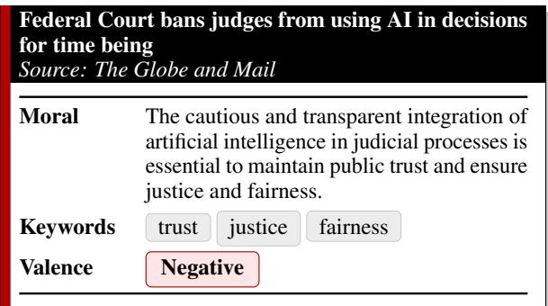
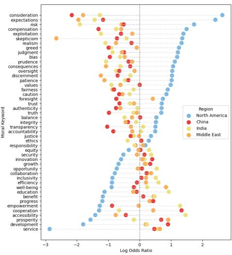
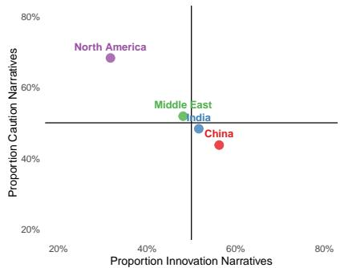
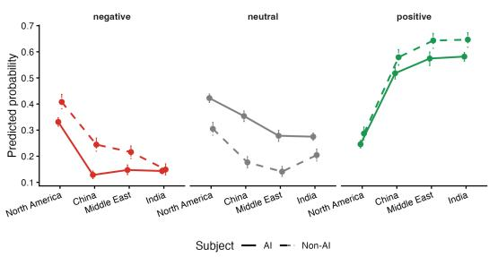
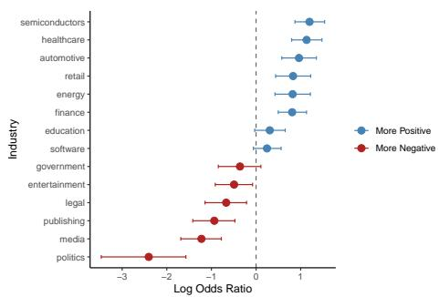

# The Many Morals of AI: The cautionary bias of North American news narratives in global perspective

Andrew Piper1 andrew.piper@mcgill.ca

Edie Pearman1 edie.pearman@mail.mcgill.ca

1Department of Languages, Literatures, and Cultures McGill University, Montreal, QC H3A 2M7

## Abstract

The stories told about artificial intelligence (AI) play a central role in shaping public understanding, policy debates, and expectations about technological change. News media are especially influential in this process. Using a crossregional corpus of 12,924 English-language news articles about AI published since 2022, we examine how storytelling about AI varies across media systems in four regions: North America, China, India, and the Middle East. Leveraging large language models, we extract the implicit narrative lessons conveyed by each article—commonly known as story morals—capturing value-laden interpretations that extend beyond thematic content or sentiment. We find that North American AI coverage is uniquely characterized by narratives of caution, while under-emphasizing narratives of innovation and collaboration that are more prevalent elsewhere. However, this pattern is largely explained by a broader regional negativity bias in North American news sentiment, rather than by heightened concern about AI itself. Our findings bring into view the culturally conditioned nature of AI news narratives.

## 1 Introduction

The stories we tell about AI shape how individuals understand the technology’s role in society. This in turn can shape how local publics interpret the balance of risk and reward that accompanies this emerging technology.

News media occupy a uniquely powerful position in the storytelling ecosystem of technological change (Walgrave and Van Aelst, 2006; Boydstun, 2022; Wlezien and Soroka, 2024). As recurring acts of sense-making, news stories help structure public attention by selecting which events count as “news” (McCombs and Shaw, 1972) and framing them within moral and emotional registers of risk and reward (Groves et al., 2016; Chong and Druckman, 2007; Iyengar, 1994; Cave et al., 2018).

  
Figure 1: Example of our story moral extraction process.

A substantial body of scholarship on AI’s portrayal in the news has emerged in recent years. Early work prior to the emergence of chatbots highlighted that AI coverage focused far more on themes of productivity and efficiency than issues surrounding governance or ethical concerns (Chuan et al., 2019; Sun et al., 2020; Ouchchy et al., 2020). When ethical questions have surfaced, they are often framed in practical or procedural terms rather than as moral debate (Ouchchy et al., 2020; Bunz and Braghieri, 2022; Nguyen and Hekman, 2024). This oscillation has been characterized as a shift between utopian “helping hand” and dystopian “Frankenstein” frames (Cools et al., 2024). More recent work has highlighted a growing negativity surrounding AI coverage (Ryazanov et al., 2024), with North American news showing higher relative negativity compared to other regions (Ittefaq et al., 2025).

While prior work has made important contributions to our understanding of how AI is framed in the news, there are significant limitations to the data and methodologies used to date. Work in this area has been hampered by a lack of regional diversity, with only one large-scale study focusing on crosscultural comparisons (Ittefaq et al., 2025). Several studies rely exclusively on qualitative analysis of small samples (N < 1,000) (Bunz and Braghieri,

2022; Ouchchy et al., 2020; Chuan et al., 2019), while computational analysis has typically relied on methods such as topic modeling and/or dictionaries (Sun et al., 2020; Nguyen, 2023; Cools et al., 2024; Ittefaq et al., 2025), which have known limitations in terms of interpretive reliability (Mantyla et al., 2018; Hecking and Leydesdorff, 2019; Rijcken et al., 2024; Pham et al., 2024) and ignore underlying narrative structures of news articles.

To address these limitations, we combine largescale cross-regional analysis with recent advances in computational narrative understanding (Ranade et al., 2022). Using a dataset of 12,924 news stories published since 2022 from four distinct regions—North America, the Middle East, China, and India—we apply methods for inferring the central values and lessons conveyed by a narrative, commonly described as story moral inference (Figure 1). This approach has been validated across multiple narrative domains (Hobson et al., 2024), and has shown robustness across languages and cultural settings in capturing the higher-order lessons that readers infer from stories (Zhou et al., 2024; Wu and Piper, 2026). Although related to media framing, story-moral inference targets a different level of narrative meaning: it seeks to recover the implicit evaluative point of view of a story, in effect asking, “Why was this story told?” rather than identifying its topics, themes, or issue-specific emphases.

Using this approach, we find that North American news about AI exhibits a distinctive narrative profile, emphasizing narratives of caution more strongly than those of innovation or collaboration. Importantly, this pattern is strongly associated with a broader negativity bias in North American news relative to other regions, suggesting the important role that culturally-inflected media conventions play in journalistic reporting. Our findings underscore that the cautionary narratives prominent in North American news should not be mistaken for a global consensus about the technology’s risks or social meaning.

## 2 Data and Methods

## 2.1 Data Collection

For the purposes of our data collection, we utilized the Dow Jones Factiva platform limiting our queries between Jan. 1, 2022 (preceding chatGPT’s launch) and Sept. 9, 2024. Article sources were limited to 12 major English-language news organizations across four regions: North America, China, India, and the Middle East (Table A1).

As a first filtering step, we retrieved articles using two broad search terms (“Artificial Intelligence” OR “AI”) in order to capture the full spectrum of potential AI discussion. This resulted in an initial collection of 48,201 articles. To distinguish articles that genuinely focused on AI from those that merely mentioned it or triggered false positives (e.g. ‘Air India’), we tested four automated filtering protocols using GPT-4o against a reference set of 100 manually labeled articles: i) identifying AI as the “main character" or “agent/object of opinions," (ii) detecting AI mentions in the first five sentences, (iii) counting total AI mentions, and (iv) extracting three central topics of the article and determining whether AI appeared in this set. Our best method (iv) showed a weighted F1 = 0.85, which when applied to the full dataset reduced the total number of articles to 8,924.

For comparison purposes, we then randomly selected 1,000 articles from each region (N=4,000) drawn from the rejected set of initially downloaded articles. This selection method helps guarantee the greatest alignment between our two primary article types (about AI, not about AI) while controlling for sections, length, industry focus and other confounding factors.

## 2.2 Inferring Story Morals using LLMs

For all articles, we prompted GPT-4o and Gemini-2.0-Flash to identify the following: (i) story moral statement in the form of a single sentence, (ii) 2-3 keywords distilled from the moral sentence, (iii) sentiment valence, and (iv) candidate industries mentioned in the article. (The full prompting notebooks are included in Appendix A4.) Given the sensitivity of LLM outputs to model architecture and prompt variation shown in prior work (Sclar et al., 2024; Baumann et al., 2025), we generate eight prompt variations manipulating phrasing and position of article text. For each article, we then randomly select one prompt variation and submit it to both models. We then aggregate both models’ outputs as our final dataset.1

To validate moral keyword quality, we randomly sampled 100 AI articles and divided them into two groups of 50. For each group, two independent human annotators rated keyword relevance (0 = not relevant, 1 = moderately relevant, 2 = highly relevant) without knowledge of which model generated the keywords. We averaged the two scores for each article. Overall, a strong majority of keywords from both models (GPT-4o: 96%, Gemini: 82%) achieved at least moderate relevance, justifying their inclusion in subsequent analysis.

For estimation of article-level valence, we follow recent work and apply our randomized prompting framework to the generation of an article-level three-class sentiment framework: negative, neutral, and positive (Zhang et al., 2024; Debess et al., 2024).

## 3 Results

## 3.1 Distribution of moral keywords by region

We begin by identifying the moral vocabularies that distinguish North American AI coverage from other regions, using log-odds ratios to compare moral keywords in North American stories with those in the rest of the corpus. We find that North American coverage disproportionately emphasizes skepticism, risk, exploitation, greed, and bias, while placing less emphasis on innovationrelated values such as development, prosperity, progress, and competitiveness, as well as social values such as collaboration, community, and cooperation (Figure 2). North American AI storytelling thus foregrounds risk while giving less attention to collective benefit and shared development.

  
Figure 2: Moral keywords most strongly / weakly associated with North American news stories.

To clarify these divisions more sharply, we organize moral keywords into two overarching narrative types: caution narratives, which center on risk, responsibility, ethics, regulation, and harm, and innovation narratives, which focus on progress, opportunity, efficiency, and growth (Figure 3, see Appendix A3 for process).

  
Figure 3: Regional variation in the balance between caution and innovation narratives, which represent 50% of the total documents in our corpus.

## 3.2 The association of sentiment and cautionary AI framing

One possible explanation for the distinctively cautionary character of North American AI coverage is that it reflects a unique concern about AI. Another is that it reflects a more general tendency within North American news to narrate events through negative frames. To distinguish between these possibilities, we fitted a multinomial logistic regression of sentiment (Negative, Neutral, Positive) within articles, including region, subject group (AI / not-AI), their interaction, and categorical controls for annotation model and prompt (Table A2). We found that North American articles were significantly more likely to be negative in both groups: predicted probabilities were 33.1% for AI-focused articles and 40.8% for comparison articles, versus 12.8–14.7% and 14.9–24.5%, respectively, in other regions (Figure 4).

We next asked whether North American AI coverage remains more likely to convey cautionary morals after accounting for its more negative sentiment. For each of the 17,848 model–prompt annotations of only the AI articles, we combined all extracted moral keywords and coded whether at least one belonged to our cautionary framework. We fitted binary logistic regressions predicting this outcome from region, annotation model, and prompt, before and after adding categorical sentiment, again clustering uncertainty by article (Table A3). We found that the North America–other regions gap declined from 15.1 percentage points before sentiment adjustment to 5.0 points afterward. The adjusted gap remained positive when each newspaper was omitted in turn (3.9–6.3 points) and in separate analyses of both annotation models. North America’s greater prevalence of cautionary AI morals is thus substantially reduced, though not entirely eliminated, when regional sentiment differences are taken into account and different sources and models are measured. This suggests that this cautionary framing is associated with a broader pattern of negative sentiment while also exhibiting a regional difference that sentiment alone does not fully capture.

  
Figure 4: Predicted probabilities of negative, neutral, and positive sentiment by article content from a multinomial logistic regression including region, article subject, their interaction, annotation model, and categorical prompt identity.

## 3.3 Negativity Around AI Is Unevenly Distributed Across Industries

We examined whether the negativity observed in North American media coverage was concentrated in particular industries by calculating odds ratios (ORs) of positive versus negative valence for the top 15 industries in this subset of the data. Logtransformed odds ratios (log ORs) and 95% confidence intervals (CIs) are shown in Figure 5. Negatively valenced industries cluster around media and entertainment (along with law), with politics exhibiting the highest level of concern. Other industries such as healthcare, semiconductors, retail and finance were generally more positively portrayed.

## 4 Conclusion

Our findings suggest that narratives surrounding AI in the news reflect not only local evaluations of the technology but also regional conventions of broader journalistic storytelling. Although North American coverage of AI disproportionately emphasizes cautionary values, this distinctiveness is substantially reduced when sentiment differences are taken into account. The greater negativity of North American coverage in general extends beyond articles centrally focused on AI, suggesting that cautionary storytelling belongs to a broader regional pattern. These findings suggest that public-facing narratives about AI are embedded within deeper media cultures of evaluation and affect, with potentially important consequences for how technological change is collectively understood.

  
Figure 5: Log odds ratios (OR) of positive valence in North American news by industry for the top 15 industries.

Our results help connect two strands of prior research on AI coverage that have often been treated separately: work documenting the growing negativity of AI-related news, particularly in North America (Ryazanov et al., 2024), and work emphasizing regional variation in media cultures (Ittefaq et al., 2025). Our analysis shows that the moral coloration of AI storytelling is closely associated with regional patterns of sentiment. In contrast to journalistic cultures elsewhere in the world that balance narratives of caution and innovation and collaboration, the entrenched negativity of North American news media strongly skews AI storytelling toward cautionary frames. That being said, our findings also show that narrative values, while strongly associated with sentiment, are not completely reducible to sentiment.

Overall, our work illustrates the importance of cross-regional comparison in understanding how technological change is narrated. For journalists, the findings invite reflection on whether the moral lessons conveyed by AI follow from the evidence of a particular story or draw on familiar sentiment conventions. For policymakers, they underscore the need to distinguish the narratives prominent in one’s own media environments from a global assessment of AI’s risks and benefits. Recognizing these regional patterns can bring a wider range of perspectives into public debate.

## Limitations

Several limitations should be noted in conclusion. Our analysis relies on large language models to infer story morals, which introduces dependence on model interpretive priors. While prior work has shown that frontier models like GPT and Gemini used here align with human judgments and are often preferred in blind surveys with respect to story moral quality (Hobson et al., 2024), our findings are nevertheless limited by the semantic frameworks of models. Even though we control for model and prompt effects and focus on robust aggregate patterns, future work should further validate moral inference and the potential interpretive biases introduced by LLMs. In addition, our regional categories necessarily compress internal diversity within media systems, and our findings should not be read as exhaustive characterizations of national or cultural attitudes toward AI. Our sam ple was designed with cross-cultural comparison first and foremost in mind. Additionally, mediation analyses in observational settings do not establish causal pathways: they provide evidence consistent with sentiment operating as an important explanatory factor linking region and moral framing. Future work can investigate this relationship between systemic valence and narrative generation at the publication or article level more deeply. Finally, while we assume the distribution of news narratives is an on-going dynamic process that may change after our data cut-off, our findings also suggest a strong anchoring via regional sentiment distributions which may make the story morals of AI more consistent than expected.

## Data Availability

A dataset of 12,924 news articles from 12 different sources is made available along with annotations for story morals, keywords, valence, and industry. https://anonymous.4open.science/r/ AI-in-the-news-3712/

## AI Disclosure Statement

OpenAI Codex assisted with idea development, outlining, language editing, code development, and data analysis. The authors reviewed and revised its contributions and take full responsibility for the final manuscript, analyses, and conclusions.

## References

Joachim Baumann, Paul Röttger, Aleksandra Urman, Albert Wendsjö, Flor Miriam Plaza-del Arco, Johannes B Gruber, and Dirk Hovy. 2025. Large language model hacking: Quantifying the hidden risks of using llms for text annotation. arXiv preprint arXiv:2509.08825.

Amber E Boydstun. 2022. Making the news: Politics, the media & agenda setting. University of Chicago Press.

Mercedes Bunz and Marco Braghieri. 2022. The ai doctor will see you now: assessing the framing of ai in news coverage. AI & society, 37(1):9–22.

Stephen Cave, Claire Craig, Kanta Dihal, Sarah Dillon, Jessica Montgomery, Beth Singler, and Lindsay Taylor. 2018. Portrayals and perceptions of ai and why they matter.

Dennis Chong and James N Druckman. 2007. Framing theory. Annu. Rev. Polit. Sci., 10(1):103–126.

Ching-Hua Chuan, Wan-Hsiu Sunny Tsai, and Su Yeon Cho. 2019. Framing artificial intelligence in american newspapers. In Proceedings of the 2019 AAAI/ACM Conference on AI, Ethics, and Society, pages 339–344.

Hannes Cools, Baldwin Van Gorp, and Michael Opgenhaffen. 2024. Where exactly between utopia and dystopia? a framing analysis of ai and automation in us newspapers. Journalism, 25(1):3–21.

Iben Nyholm Debess, Annika Simonsen, and Hafsteinn Einarsson. 2024. Good or bad news? exploring gpt-4 for sentiment analysis for faroese on a public news corpora. In Proceedings of the 2024 Joint International Conference on Computational Linguistics, Language Resources and Evaluation (LREC-COLING 2024), pages 7814–7824.

Tamar Groves, Carlos G Figuerola, and Miguel Á Quintanilla. 2016. Ten years of science news: A longitudinal analysis of scientific culture in the spanish digital press. Public Understanding of Science, 25(6):691– 705.

Tobias Hecking and Loet Leydesdorff. 2019. Can topic models be used in research evaluations? reproducibility, validity, and reliability when compared with semantic maps. Research Evaluation, 28(3):263–272.

David Hobson, Haiqi Zhou, Derek Ruths, and Andrew Piper. 2024. Story morals: Surfacing value-driven narrative schemas using large language models. In Proceedings of the 2024 Conference on Empirical Methods in Natural Language Processing, pages 12998–13032.

Muhammad Ittefaq, Ali Zain, Rauf Arif, Mohammad Ala-Uddin, Taufiq Ahmad, and Azhar Iqbal. 2025. Global news media coverage of artificial intelligence (ai): A comparative analysis of frames, sentiments, and trends across 12 countries. Telematics and Informatics, 96:102223.

Shanto Iyengar. 1994. Is anyone responsible?: How television frames political issues. University of Chicago Press.

Mika V Mantyla, Maelick Claes, and Umar Farooq. 2018. Measuring lda topic stability from clusters of replicated runs. In Proceedings of the 12th ACM/IEEE international symposium on empirical software engineering and measurement, pages 1–4.

Maxwell E McCombs and Donald L Shaw. 1972. The agenda-setting function of mass media. Public opinion quarterly, 36(2):176–187.

Dennis Nguyen. 2023. How news media frame data risks in their coverage of big data and ai. Internet Policy Review, 12(2):1–30.

Dennis Nguyen and Erik Hekman. 2024. The news framing of artificial intelligence: a critical exploration of how media discourses make sense of automation. AI & society, 39(2):437–451.

Leila Ouchchy, Allen Coin, and Veljko Dubljevic. 2020.´ Ai in the headlines: the portrayal of the ethical issues of artificial intelligence in the media. AI & society, 35(4):927–936.

Chau Pham, Alexander Hoyle, Simeng Sun, Philip Resnik, and Mohit Iyyer. 2024. Topicgpt: A promptbased topic modeling framework. In Proceedings of the 2024 Conference of the North American Chapter ofthe Associationfor Computational Linguistics: Human Language Technologies (Volume 1: Long Papers), pages 2956–2984.

Priyanka Ranade, Sanorita Dey, Anupam Joshi, and Tim Finin. 2022. Computational understanding of narratives: A survey. IEEE Access, 10:101575–101594.

Emil Rijcken, Kalliopi Zervanou, Pablo Mosteiro, Floortje Scheepers, Marco Spruit, and Uzay Kaymak. 2024. Topic specificity: A descriptive metric for algorithm selection and finding the right number of topics. Natural Language Processing Journal, page 100082.

Igor Ryazanov, Carl Öhman, and Johanna Björklund. 2024. How chatgpt changed the media’s narratives on ai: a semi-automated narrative analysis through frame semantics. Minds and Machines, 35(1):2.

Melanie Sclar, Yejin Choi, Yulia Tsvetkov, and Alane Suhr. 2024. Quantifying language models’ sensitivity to spurious features in prompt design or: How i learned to start worrying about prompt formatting. In International Conference on Learning Representations, volume 2024, pages 25055–25083.

Shaojing Sun, Yujia Zhai, Bin Shen, and Yibei Chen. 2020. Newspaper coverage of artificial intelligence: A perspective of emerging technologies. Telematics and Informatics, 53:101433.

Stefaan Walgrave and Peter Van Aelst. 2006. The contingency of the mass media’s political agenda setting power: Toward a preliminary theory. Journal of communication, 56(1):88–109.

Christopher Wlezien and Stuart Soroka. 2024. Media reflect! policy, the public, and the news. American Political Science Review, 118(3):1563–1569.

Sophie Wu and Andrew Piper. 2026. Lessons without borders? evaluating cultural alignment of llms using multilingual story moral generation. arXiv preprint arXiv:2604.08797.

Wenxuan Zhang, Yue Deng, Bing Liu, Sinno Pan, and Lidong Bing. 2024. Sentiment analysis in the era of large language models: A reality check. In Findings ofthe Associationfor Computational Linguistics: NAACL 2024, pages 3881–3906.

Haiqi Zhou, David G Hobson, Derek Ruths, and Andrew Piper. 2024. Large scale narrative messaging around climate change: A cross-cultural comparison. In Proceedings ofthe 1st Workshop on Natural Language Processing Meets Climate Change (ClimateNLP 2024), pages 143–155.

## Appendix

## A1 Article Counts by Publication and Region

<table><tr><td>Source Name</td><td>Region</td><td>AI</td><td>Non-AI</td></tr><tr><td>South China Morning Post</td><td>China</td><td>986</td><td>423</td></tr><tr><td>China Daily</td><td>China</td><td>700</td><td>577</td></tr><tr><td>The Times of India</td><td>India</td><td>1,766</td><td>493</td></tr><tr><td>Hindustan Times</td><td>India</td><td>902</td><td>315</td></tr><tr><td>The Hindu</td><td>India</td><td>499</td><td>192</td></tr><tr><td>The National</td><td>M. East</td><td>638</td><td>372</td></tr><tr><td>Gulf News (Dubai)</td><td>M. East</td><td>376</td><td>429</td></tr><tr><td>Al Jazeera English</td><td>M. East</td><td>225</td><td>199</td></tr><tr><td>The Wall Street Journal</td><td>N. America</td><td>1,112</td><td>403</td></tr><tr><td>The New York Times</td><td>N. America</td><td>721</td><td>232</td></tr><tr><td>The Washington Post</td><td>N. America</td><td>570</td><td>194</td></tr><tr><td>The Globe and Mail</td><td>N. America</td><td>429</td><td>171</td></tr></table>

Table A1: Article Counts by News Source, Region, and Category

## A2 Coefficient Tables

Coefficients for the models reported in Section 3.2. Table A2 reports the multinomial logistic regression of sentiment, and Table A3 the logistic regressions of cautionary framing before and after sentiment adjustment.

<table><tr><td></td><td colspan="3">Neutral vs. Negative</td><td colspan="3">Positive vs. Negative</td></tr><tr><td>Term</td><td>Estimate</td><td>SE</td><td>p</td><td>Estimate</td><td>SE</td><td>p</td></tr><tr><td>Intercept</td><td>-0.045</td><td>0.070</td><td>.519</td><td>-0.709</td><td>0.075</td><td>&lt;.001</td></tr><tr><td>Region: China</td><td>0.775</td><td>0.082</td><td>&lt;.001</td><td>1.702</td><td>0.086</td><td>&lt;.001</td></tr><tr><td>Region: Middle East</td><td>0.398</td><td>0.093</td><td>&lt;.001</td><td>1.669</td><td>0.093</td><td>&lt;.001</td></tr><tr><td>Region: India</td><td>0.411</td><td>0.067</td><td>&lt;.001</td><td>1.708</td><td>0.069</td><td>&lt;.001</td></tr><tr><td>Subject: Non-AI</td><td>-0.536</td><td>0.077</td><td>&lt;.001</td><td>-0.055</td><td>0.088</td><td>.534</td></tr><tr><td>China × Non-AI</td><td>-0.806</td><td>0.136</td><td>&lt;.001</td><td>-0.479</td><td>0.136</td><td>&lt;.001</td></tr><tr><td>Middle East × Non-AI</td><td>-0.529</td><td>0.149</td><td>&lt;.001</td><td>-0.216</td><td>0.141</td><td>.128</td></tr><tr><td>India × Non-AI</td><td>0.203</td><td>0.136</td><td>.135</td><td>0.124</td><td>0.134</td><td>.357</td></tr><tr><td>Model: GPT-4o</td><td>0.141</td><td>0.021</td><td>&lt;.001</td><td>0.286</td><td>0.014</td><td>&lt;.001</td></tr><tr><td>Prompt 2</td><td>0.108</td><td>0.088</td><td>.220</td><td>0.130</td><td>0.088</td><td>.142</td></tr><tr><td>Prompt 3</td><td>0.381</td><td>0.089</td><td>&lt;.001</td><td>0.360</td><td>0.090</td><td>&lt;.001</td></tr><tr><td>Prompt 4</td><td>0.197</td><td>0.092</td><td>.032</td><td>0.464</td><td>0.090</td><td>&lt;.001</td></tr><tr><td>Prompt 5</td><td>0.207</td><td>0.088</td><td>.018</td><td>0.165</td><td>0.088</td><td>.062</td></tr><tr><td>Prompt 6</td><td>0.136</td><td>0.090</td><td>.129</td><td>0.326</td><td>0.089</td><td>&lt;.001</td></tr><tr><td>Prompt 7</td><td>0.498</td><td>0.089</td><td>&lt;.001</td><td>0.382</td><td>0.090</td><td>&lt;.001</td></tr><tr><td>Prompt 8</td><td>0.249</td><td>0.090</td><td>.006</td><td>0.318</td><td>0.090</td><td>&lt;.001</td></tr></table>

Table A2: Multinomial logistic regression of article sentiment (25,848 annotations of 12,924 articles). Negative sentiment is the outcome reference. Coefficients are log odds. Standard errors are clustered by article (HC1). Reference categories: North America, AI-focused articles, Gemini-2.0-Flash, and prompt 1.

<table><tr><td></td><td colspan="3">Unadjusted</td><td colspan="3">Sentiment-adjusted</td></tr><tr><td>Term</td><td>Estimate</td><td>SE</td><td>p</td><td>Estimate</td><td>SE</td><td>p</td></tr><tr><td>Intercept</td><td>0.632</td><td>0.062</td><td>&lt;.001</td><td>1.207</td><td>0.071</td><td>&lt;.001</td></tr><tr><td>Region: China</td><td>-0.780</td><td>0.054</td><td>&lt;.001</td><td>-0.430</td><td>0.057</td><td>&lt;.001</td></tr><tr><td>Region: Middle East</td><td>-0.454</td><td>0.061</td><td>&lt;.001</td><td>-0.019</td><td>0.063</td><td>.769</td></tr><tr><td>Region: India</td><td>-0.663</td><td>0.046</td><td>&lt;.001</td><td>-0.240</td><td>0.049</td><td>&lt;.001</td></tr><tr><td>Model: GPT-4o</td><td>-0.727</td><td>0.022</td><td>&lt;.001</td><td>-0.704</td><td>0.024</td><td>&lt;.001</td></tr><tr><td>Prompt 2</td><td>0.000</td><td>0.077</td><td>.998</td><td>0.068</td><td>0.078</td><td>.383</td></tr><tr><td>Prompt 3</td><td>0.158</td><td>0.077</td><td>.040</td><td>0.263</td><td>0.078</td><td>&lt;.001</td></tr><tr><td>Prompt 4</td><td>0.034</td><td>0.076</td><td>.653</td><td>0.200</td><td>0.078</td><td>.011</td></tr><tr><td>Prompt 5</td><td>0.119</td><td>0.077</td><td>.120</td><td>0.202</td><td>0.077</td><td>.009</td></tr><tr><td>Prompt 6</td><td>-0.048</td><td>0.078</td><td>.534</td><td>0.046</td><td>0.080</td><td>.567</td></tr><tr><td>Prompt 7</td><td>0.195</td><td>0.075</td><td>.009</td><td>0.313</td><td>0.076</td><td>&lt;.001</td></tr><tr><td>Prompt 8</td><td>0.074</td><td>0.076</td><td>.326</td><td>0.189</td><td>0.077</td><td>.014</td></tr><tr><td>Sentiment: Neutral</td><td></td><td></td><td></td><td>-0.605</td><td>0.053</td><td>&lt;.001</td></tr><tr><td>Sentiment: Positive</td><td></td><td></td><td></td><td>-1.648</td><td>0.053</td><td>&lt;.001</td></tr></table>

Table A3: Logistic regressions of cautionary moral framing in AI-focused articles (17,848 annotations of 8,924 articles), without and with sentiment. The outcome is whether any extracted moral keyword is coded as caution. Coefficients are log odds. Standard errors are clustered by article (HC1). Reference categories: North America, Gemini-2.0-Flash, prompt 1, and negative sentiment.

## A3 Caution / Innovation Framing Exercise

We coded whether each story’s moral framing emphasized caution (risk, restraint, harms, governance concerns) and/or innovation (progress, opportunity, productivity, benefits). A story could contain neither, one, or both framings.

<table><tr><td>Caution</td><td>Innovation</td></tr><tr><td>accountability</td><td>adaptation</td></tr><tr><td>caution ethics</td><td>adaptability creativity</td></tr><tr><td>fairness</td><td>efficiency</td></tr><tr><td>justice</td><td>empowerment</td></tr><tr><td>privacy prudence</td><td>growth innovation</td></tr><tr><td></td><td></td></tr><tr><td>responsibility</td><td>opportunity</td></tr><tr><td>risk</td><td>progress</td></tr><tr><td></td><td>resilience</td></tr><tr><td>safety</td><td></td></tr><tr><td>security</td><td></td></tr><tr><td></td><td></td></tr><tr><td>transparency</td><td></td></tr><tr><td>trust</td><td></td></tr></table>

Table A4: Moral keywords mapped to caution and innovation framing categories.

## A4 Prompt Notebooks

All models were prompted using a temperature of 1.0 with a max token limit of 512.

Topic Prompt. This was used to filter non-AI related articles.

What are the central topics of the attached text? Provide your answer as a list of keywords separated by commas. Start from the most general topic and get increasingly specific. Give three total topics. Make sure your answer is just a simple list of keywords that are succinct. Do not combine themes into a single answer by using the word and. Choose one per item. You may use a multiword phrase however. Provide your answer as a list of three keywords separated by commas. Here is the passage:

Prompt Permutation Template. To reduce sensitivity to prompt wording for moral statements, keywords, industries candidates, and sentiment valence, each prompt was drawn from a set of eight variations. These variations are created by using two phrasings of the target question, altering the position of the article text relative to the target question, and the inclusion or exclusion of a role statement:

1. [ PHRASING 1] Here is the text: [ARTICLE TEXT]

2. [ PHRASING 2] Here is the text: [ARTICLE TEXT]

3. Here is the text: [ARTICLE TEXT] [ PHRAS-ING 1]

4. Here is the text: [ARTICLE TEXT] [ PHRAS-ING 2]

5. [ROLE STATEMENT] [ PHRASING 1] Here is the text: [ARTICLE TEXT]

6. [ROLE STATEMENT] [ PHRASING 2] Here is the text: [ARTICLE TEXT]

7. [ROLE STATEMENT] Here is the text: [AR-TICLE TEXT] [ PHRASING 1]

8. [ROLE STATEMENT] Here is the text: [AR-TICLE TEXT] [ PHRASING 2]

When included, the role statement was either the general role statement or the moral keyword specific role statement. These role statements, as well as the various prompt phrasings, are provided below.

## General Role Statement:

Today, you are an expert story interpreter. I will give you a news article and ask you a question about it.

## Valence Prompt, Phrasing 1:

Determine the emotional tone or evaluative stance of   
AI in the story. State your answer as a single word   
only.   
Your answer must be one of the following: ’positive’,   
’negative’, or ’neutral’.   
Please respond only with a valid JSON object in the   
following format:   
{{   
"AI\_VALENCE": "<valence>"   
}}

## Valence Prompt, Phrasing 2:

Is AI positively, negatively, or neutrally represented   
in this story? State your answer as a single word only.   
Your answer must be one of the following: ’positive’,   
’negative’, or ’neutral’.   
Please respond only with a valid JSON object in the   
following format:   
{{   
"AI\_VALENCE": "<valence>"   
}}

## Industry Prompt, Phrasing 1:

What is the principal industry or industries in this   
story? State your answer as a list of single words.   
Please respond only with a valid JSON object in the   
following format:   
{{   
"INDUSTRY\_1": "<industry\_name>",   
"INDUSTRY\_2": "<industry\_name>",   
...   
}}

## Industry Prompt, Phrasing 2:

List the principal industry or industries important to   
this story. State your answer as a list of single words.   
Please respond only with a valid JSON object in the   
following format:   
{{   
"INDUSTRY\_1": "<industry\_name>",   
"INDUSTRY\_2": "<industry\_name>",   
}}

## Moral Statement Prompt, Phrasing 1:

What is the moral of this story? State your answer as   
a single sentence.   
Please respond only with a valid JSON object in the   
following format:   
}}   
"MORAL\_SENTENCE": "<moral>"   
}}

## Moral Statement Prompt, Phrasing 2:

How might one interpret the moral of this story? State   
your answer as a single sentence.   
Please respond only with a valid JSON object in the   
following format:   
}}   
"MORAL\_SENTENCE": "<moral>"   
}}

## Moral Keyword Role Statement:

Today, you are an expert story interpreter. I will give you a sentence summary of a news article and ask you a question about it.

## Moral Keyword Prompt, Phrasing 1:

Label the sentence with a fitting moral keyword or   
keywords. Use only one word if appropriate, or up to   
three distinct words if multiple moral ideas are clearly   
present. Avoid using words like ’technology’ or ’AI’.   
Please respond only with a valid JSON object in the   
following format:   
}}   
"MORAL\_KEYWORD\_1": "<keyword>",   
"MORAL\_KEYWORD\_2": "<keyword>",   
...   
}}

## Moral Keyword Prompt, Phrasing 2:

Can you reduce this to between one and three moral   
keywords? Use only one word if appropriate, or up to   
three distinct words if multiple moral ideas are clearly   
present. Avoid using words like ’technology’ or ’AI’.   
Please respond only with a valid JSON object in the   
following format:   
}}   
"MORAL\_KEYWORD\_1": "<keyword>",   
"MORAL\_KEYWORD\_2": "<keyword>",   
...   
}}