# Tiny Recursive Message Passing

Tommaso Salvatori<sup>1,2</sup>, Matteo Forasassi<sup>1,2</sup> Alexis Toumi<sup>1</sup>, Giovanni de Felice<sup>1</sup>

<sup>1</sup>Relational Intelligence, Inc <sup>2</sup>Vienna University of Technology

{name}@rel-int.ai

Abstract. Message passing neural networks have shown remarkable performance in algorithmic and constraint reasoning, due to their ability to encode the structure of the task directly in the architecture. Recent work has shown that better results can be achieved using recursive transformers trained with deep supervision and truncated recursions, which make extremely deep loops stable to train, and equipped with test-time procedures such as discrete deduction lattices. In this work, we apply the same procedures to message passing networks, and show that the two ingredients are complementary, and lead to parameter eficient models: we obtain about 99% test accuracy on Sudoku-Extreme with a model of 16k parameters that trains in about 10 minutes on an H100, or in 9 hours on a CPU. We further show that the cost of truncating gradients grows with the number of rounds information needs to cross the graph, making the choice of wiring a trade-of between robustness to truncation and transfer across problem sizes. We conclude by showing that our models transfer zero-shot to larger instances than those seen during training, outperforming popular neural baselines on N-queens and Boolean satisfiability with a fraction of their parameters.

## 1 Introduction

Structured reasoning tasks consist of problems whose solution is computed by executing a specific set of instructions, or by searching over a known set of constraints. Such tasks are traditionally solved by symbolic methods, which are exact and scale to arbitrarily large instances, but require the solving procedure to be designed by hand. Neural networks instead learn this procedure directly from examples. To be competitive, however, they must exploit the structure of the problem and generalize to instances larger than those seen during training. Initially, message passing methods (Gilmer et al., 2017; Scarselli et al., 2008) dominated the neural subfield of algorithmic reasoning, as they are able to wire the interaction patterns of the problem directly inside the structure of the model. This way, no capacity is spent learning which variables constrain which, and the symmetries of the problem hold by construction rather than being learned from data (Xu et al., 2019). Furthermore, they can run any number of rounds, and thus spend more computation on harder instances (Selsam et al., 2019). This is particularly important when it comes to generalizing to problems that are harder than the ones encountered during training. Learning, however, is performed using backpropagation through time (BPTT) on the unrolled computational graph, which is memory expensive and hence limits in practice how deep the recursion can go.

Recent work has attacked this bottleneck by iterating a recurrent transformer model many times while replacing full backpropagation through the trajectory with a cheaper gradient. Deep equilibrium models diferentiate through the fixed point of the forward pass, giving a parameter update in O(1) memory (Bai et al., 2019, 2020), while tiny recursive models use a coarser approximation, running the recursion detached and diferentiating only its final segment (Jolicoeur-Martineau, 2025). The final ingredient that makes such deep loops trainable is deep supervision, which keeps the gradient path short (Graves, 2016; Wang et al., 2025). Together these have brought Sudoku-Extreme within reach of small models: the work introducing the benchmark reported 55% accuracy with 27M parameters (Wang et al., 2025), while models with 800k parameters now approach a perfect score (Davis et al., 2026; Sghaier et al., 2026; Huang et al., 2026). Whether these approximations carry over to message passing is not obvious: the gradient that detached recursion discards is exactly the one that travels along the edges, and diferent wirings of the same constraint satisfaction problem depend on it very diferently.

The transformer models that achieved the above results are parameter eficient even though they do not encode the structure of the problem. Can the parameter count of a recursive model be reduced even further by giving it the structure in the way message-passing architectures do, while keeping the inference and learning procedures that made looped transformers work? Can we use this modern machinery to design message passing architectures that generalize well to larger scale tasks at test time? We answer both questions positively: Deep supervision, detached recursion, and adaptive halting all presuppose a computation that decomposes into resumable segments carrying an explicit state. Recursive GNNs also carry such a state: at every round, each node reads the messages sitting on its edges together with its own memory, which is a tensor that can be paused and resumed like any other. What recursive GNNs lack is not this state but a training procedure built around it, which is what we provide. Architecturally, what we propose is close to recurrent relational networks (Palm et al., 2018); our contribution is the training and inference procedure, together with an analysis of how it interacts with the choice of wiring. Our contributions are briefly as follows:

• We adapt the training and inference machinery of tiny recursive models to recursive GNNs. While deep supervision and truncated recursion carry over directly, adaptive halting and the deduction lattice require reformulation, namely per-vertex halting logits pooled with a smooth minimum, and a lattice defined over residual formulas for SAT.

• We show that encoding the graph structure and using the recursive machinery are complementary: On Sudoku-Extreme and maze-unique, a 32k-parameter recursive lattice transformer and a recursive GNN with the same graph trained with BPTT are outperformed by our method, which combines the two.

• We show that the cost of truncating gradients grows with the propagation distance of the graph: dense wirings are robust to truncation, while factor graphs require longer gradient windows. We also show how a recent lattice-based method developed to improve performance of recursive transformers (Davis et al., 2026), when ported to message passing models, largely increases the robustness to truncated gradients.

• We conclude with experiments that test zero-shot generalization to larger instances: on N-Queens, we train on 10 × 10 boards and evaluate on boards up to 16 × 16; on Boolean satisfiability (SAT), we train on medium-size SR and 3-SAT formulas and evaluate on hard ones. Our models often match or outperform the current state of the art, despite using smaller models. We also test a recently introduced 4-SAT benchmark (Skenderi et al., 2026), where we outperform all of the neural methods reported in the original work.

## 2 Related Works

Recurrent message passing. The original graph neural network (Scarselli et al., 2008) was already recursive: a single transition function, shared across vertices and iterations, is iterated to the fixed point of a contraction. GGNNs (Li et al., 2015) drop the contraction, unroll a GRU for a fixed number of steps, and train by backpropagation through time. Implicit GNNs (Gu et al., 2020) return to the equilibrium view. Because a GNN is a distributed algorithm whose number of rounds must grow with the problem (Loukas, 2019), weight-tied networks can be run longer at test time to solve larger or harder instances (Tang et al., 2020; Schwarzschild et al., 2021; Bansal et al., 2022). Belief propagation is the canonical recursive message-passing algorithm, extended to the neural case with separate updates for variables and factors (Kuck et al., 2020; Satorras and Welling, 2021; Zhang et al., 2020). In this work, we will extensively use graphs with this topology. This is a special case of relational and heterogeneous networks (Schlichtkrull et al., 2018; Wang et al., 2019). Our modules also address neighbours individually, as in the port-numbering model (Angluin, 1980; Hella et al., 2012) and CPNGNN (Sato et al., 2019), and fall back on Deep Sets parameter sharing (Zaheer et al., 2017; Maron et al., 2018) when ports are interchangeable. The closest precedents are Recurrent Relational Networks (Palm et al., 2018), which solve Sudoku with deep supervision, and NeuroSAT (Selsam et al., 2019), which passes messages over the bipartite structure of SAT and runs longer at inference than in training. Both backpropagate through the full unrolled trajectory, which bounds their depth in practice.

Deep recursive computation. A complementary line of work has investigated how weight-shared models can be iterated to greater depths without backpropagating through the entire trajectory. Implicit and equilib rium GNNs allow message passing to approach arbitrary depth through fixed-point computation and implicit diferentiation (Yang et al., 2025; Georgiev et al., 2024), while recurrent GNNs have explored adaptive message passing and the allocation of additional computation at test time (Sun et al., 2026). In parallel, recursive reasoning models have shown that much simpler approximations, based on detached recursion, deep supervision, and adaptive halting, can train extremely deep recurrent computations eficiently on combinatorial reasoning problems (Jolicoeur-Martineau, 2025; Wang et al., 2025). In recent months, the performance of such recursive models on combinatorial tasks has further improved thanks to novel inference procedures, which either inject Gaussian noise in the search (Huang et al., 2026; Sghaier et al., 2026), or project the output into a lattice to guide search (Davis et al., 2026). In this work, we implement, adapt, and test all of them to see which one performs better and in which case.

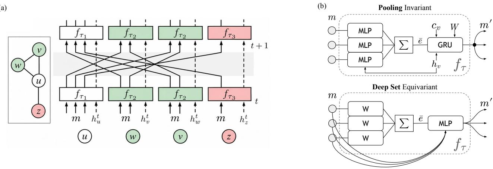  
Figure 1 (a) On the left, a graph with four nodes $( u , v , w , z )$ , of types $\left( \tau _ { 1 } , \tau _ { 2 } , \tau _ { 2 } , \tau _ { 3 } \right)$ respectively. On the right, the trajectory of a single message passing step on the corresponding model. The three types correspond to three diferent neural modules $f _ { \tau } ,$ while modules of the same type are identical and share their weights. (b) Structure of the two main neural modules used in this work. The pooling module is invariant, and carries a latent state, used to compute the output when the iterative process has converged; the deep sets module is equivariant, and does not carry any latent memory.

## 3 Background

Let us assume we have a graph $( V , E )$ , where every vertex v is assigned a type τ from a finite set $\tau$ . In a message passing model, each vertex v exchanges messages with its neighbours w $\in N ( v )$ : at every round t, the vertex reads the messages $m _ { w  v } ^ { ( t ) } \in \mathbb R ^ { n }$ it has received, combines them with its memory ${ \bf \Phi } _ { h _ { v } ^ { ( t ) } } \in \mathbb { R } ^ { d _ { \tau } }$ , if it has one, and a fixed input $c _ { v } \in \mathbb { R } ^ { d _ { \tau } ^ { c } }$ to update the memory, and sends a new message $m _ { v  w } ^ { ( t + 1 ) }$ back to every neighbour. This message becomes the incoming message at that neighbour for the next round t + 1. Repeating this for many rounds lets information travel across the whole graph. In neural message passing, all vertices of a given type τ share the same module $f _ { \tau }$ , whose memory, when present, is defined as the latent state of a gated recurrent unit (GRU) (Chung et al., 2014). For every vertex v of type τ, the module then performs the following operation:

$$
\begin{array} { r } { ( ( m _ { v  w } ^ { ( t + 1 ) } ) _ { w \in N ( v ) } , h _ { v } ^ { ( t + 1 ) } ) = f _ { \tau } ( ( m _ { w  v } ^ { ( t ) } ) _ { w \in N ( v ) } , h _ { v } ^ { ( t ) } , c _ { v } ) . } \end{array}\tag{1}
$$

The input embedding $c _ { v }$ (the clue) is how the datapoint $x _ { v }$ enters the model, and it is the same at every round: For discrete inputs, such as the given digits of a Sudoku, $c _ { v } = E x _ { v }$ . The structure of each module is task dependent: we use larger modules for vertices that solve harder tasks, and design each module to respect the symmetries of its neighbours. The two modules below, which cover almost every vertex type in this paper, are the special case in which all neighbours are interchangeable. When neighbours are not interchangeable, each edge is labelled with a port type, and the weights of the modules are shared only among edges of the same type. In what follows, MLP denotes a two-layer MLP (linear layer, ReLU activation, and a linear layer). All parameters are specific to the vertex type, and we omit the subscript τ for readability. We also drop all bias terms from the notation for simplicity.

Pooling module. This module is invariant to permutations of the neighbours, and is hence used when the neighbours of v are interchangeable and v needs only one, shared answer, as for the cells of a Sudoku. Every incoming message is encoded jointly with the memory by an MLP, and the results are summed over all neighbours into $\bar { e } _ { v } \in \mathbb { R } ^ { d _ { e } }$ , where $d _ { e }$ is the embedding width of the module. This sum, together with the input, is passed to a GRU whose hidden state is the memory; we write GRU(input, state). The new memory is then projected by a matrix $W _ { \mathrm { o u t } } \in \mathbb { R } ^ { n \times d _ { \tau } }$ , and the same message is sent to every neighbour:

$$
\begin{array} { r l } & { e _ { w  v } = \mathrm { M L P } ( [ h _ { v } ^ { ( t ) } , m _ { w  v } ^ { ( t ) } ] ) , } \\ & { \qquad \bar { e } _ { v } = \sum _ { w \in N ( v ) } e _ { w  v } , } \\ & { h _ { v } ^ { ( t + 1 ) } = \mathrm { G R U } ( [ \bar { e } _ { v } , c _ { v } ] , h _ { v } ^ { ( t ) } ) , } \\ & { m _ { v  w } ^ { ( t + 1 ) } = W _ { \mathrm { o u t } } h _ { v } ^ { ( t + 1 ) } . } \end{array}
$$

Deep Sets module. This module is equivariant to permutations of the neighbours: reordering the neighbours reorders the outgoing messages correspondingly. It has no memory and no input, and is used when the neighbours are interchangeable but v must answer each one individually, as for the rows, columns, and blocks of a Sudoku. Each incoming message is embedded by a matrix $W _ { \mathrm { e m b } } \in \mathbb { R } ^ { \hat { d } _ { e } \times n }$ , shared across neighbours, and the embeddings are summed into a summary $\bar { e } _ { v } .$ . For each neighbour w, an MLP then decodes the concatenation of its incoming message with this summary into the outgoing message (Zaheer et al., 2017):

$$
\begin{array} { r l } & { e _ { w \to v } = \mathrm { R e L U } ( W _ { \mathrm { e m b } } m _ { w \to v } ^ { ( t ) } ) , } \\ & { \qquad \bar { e } _ { v } = \sum _ { w \in N ( v ) } e _ { w \to v } , } \\ & { m _ { v \to w } ^ { ( t + 1 ) } = \mathrm { M L P } ( [ m _ { w \to v } ^ { ( t ) } , \bar { e } _ { v } ] ) . } \end{array}
$$

A complete forward pass hence works as follows: First, we embed each discrete input $x _ { v }$ into $c _ { v } ;$ then, we unroll the message passing schema for a fixed number of rounds $T ,$ and compute the output of every vertex with memory via a linear map $\hat { y } _ { v } = W _ { \mathrm { y } } h _ { v } ^ { ( T ) }$ . During training, this output is used to compute a cross entropy loss, whose gradients are computed via BPTT across all T rounds. In what follows, we replace this pipeline with the machinery of modern recursive models, namely deep supervision, truncated recursion, and adaptive halting, so that the same modules can be trained without this cost. For more details, we refer to the pseudocode in the Appendix.

## 4 Methods

We now discuss techniques already present in the literature that we use to scale up recursive models to complex reasoning tasks, and discuss how we have adapted them to work for message passing models: (1) the division of training and inference in three diferent loops, the inner loop, outer loop, and deep supervision loop (Wang et al., 2025); (2) the use of truncated gradients, that only store a small number of iterations of the outer loop in memory (Jolicoeur-Martineau, 2025); (3) an adaptive computation time (ACT) head, that is, a small linear layer that learns whether the model has converged or not, and is able to stop the deep-supervision loop early (Graves, 2016); or, alternatively (4) the use of a discrete lattice that represents the intermediate inferred solution across steps (Davis et al., 2026). Here, we intuitively sketch the methods; all the details can be found in the Appendix.

None of the techniques we use here significantly alters the structure of the model presented in the previous section. The only diference is the addition of a new latent state $a _ { v } \in \mathbb { R } ^ { d _ { \tau } }$ , which we call answer state, and a small cell in charge of updating it: During the inner loop, the answer state $a _ { v }$ is concatenated with $\bar { e } _ { v }$ and $c _ { v }$ as an additional input to the GRU of the pooling module. It is held fixed during the inner loop and updated by $\mathrm { G R U } _ { a }$ at its end. This has been shown to be fundamental for propagating information across the diferent nested loops (Wang et al., 2025). We have tested both the original formulation of the HRM, that uses an independent layer to perform the update of the answer state, and the TRM version, that uses the same module. Our early results showed that a smaller layer dedicated to the update of the answer state worked better, and hence we use this formulation throughout this work. To conclude, we have also tested the addition of noise on a trained model as done in probabilistic TRM, which allows one to compute multiple predictions from the same input by adding Gaussian noise at the end of every deep supervision step, and to pick the one that has the highest likelihood of being correct using the ACT head (Sghaier et al., 2026).

Looped Iterations We divide computation into three nested recurrent loops. The inner loop consists of R rounds as defined in Eq. (1), during which messages m and vertex memories h evolve while the current answer state a, representing the current proposed solution of the network, is held fixed. At the end of the inner loop, the outer loop updates a and starts a new inner loop, so the complete recurrence can be written as

$$
\begin{array} { r } { ( m ^ { ( k + 1 ) } , h ^ { ( k + 1 ) } ) = \Phi _ { \theta } ^ { R } ( m ^ { ( k ) } , h ^ { ( k ) } , c , a ^ { ( k ) } ) , \qquad a ^ { ( k + 1 ) } = \mathrm { L a y e r N o r m } \big ( \mathrm { G R U } _ { a } ( h ^ { ( k + 1 ) } , a ^ { ( k ) } ) \big ) . } \end{array}\tag{2}
$$

Here $\Phi _ { \theta } ^ { R }$ denotes R sequential applications of the shared vertex modules $f _ { \tau }$ from Eq. (1), with c and a held fixed, and θ collects the parameters. Superscripts (k) index outer iterations rather than rounds: $h ^ { ( k ) }$ is the memory after k inner loops, that is, after kR rounds. In terms of size, the GRU cell for the outer loop is smaller than the main one, as it is always less than 10% of the total parameters of the model. Increasing either the inner or outer-loop depth therefore increases computation while leaving the model parameters and state dimensions unchanged. At the end of K outer iterations, the answer vector of every cell is projected to the output space, $\hat { y } _ { v } = W _ { \mathrm { y } } a _ { v } ^ { ( K ) }$ , and a parameter update is performed. Instead of moving to the next batch, however, this whole process is repeated multiple times in a row, thus forming our third level of nested loop, called deep supervision. We call each outer iteration a cycle: a deep-supervision step consists of K cycles of R rounds each, that is, K · R applications of Eq. (1), and we denote this configuration by $K \times R ~ ( \mathrm { e . g . , 8 \times 1 2 }$ is 8 cycles of 12 rounds). Implementation details are given in the Appendix.

Truncated gradients. Due to the large number of nested loops, backpropagating through the entire trajectory would require storing all intermediate activations. While feasible on small models, this is problematic when scaling up to larger tasks. We therefore truncate the computational graph: earlier iterations are executed normally in the forward pass but their resulting state is detached before continuing, so gradients propagate only through a subset of the trajectory. If K outer iterations are executed and gradients are retained only for the last $K _ { g } \le K$ , the computation is

$$
\begin{array} { r } { \boldsymbol { s } ^ { ( K ) } = G _ { \theta } ^ { K _ { g } } \left( \mathrm { s g } \left( G _ { \theta } ^ { K - K _ { g } } \left( \boldsymbol { s } ^ { ( 0 ) } \right) \right) \right) , } \end{array}\tag{3}
$$

where $s = ( m , h , a )$ , G<sup>j</sup> denotes j-fold composition, and sg denotes stop-gradient. Here, $U _ { \theta }$ is the answer update in Eq. (2), so $G _ { \theta } = U _ { \theta } \circ \Phi _ { \theta } ^ { R }$ is one cycle. Truncation therefore changes neither the forward dynamics nor the parameters or latent states of the model; it only limits temporal credit assignment and reduces training memory from the full recursive trajectory to the subset for which gradients are stored.

Adaptive computation time. To avoid always running the full supervision loop, we follow the previous literature and train a halting head that stops the training of a specific datapoint and moves to the following one (Jolicoeur-Martineau, 2025). Unlike previous work, however, a linear head defined on the vertices of a graph produces one logit per vertex via $q _ { v } = w _ { q } \ \mathrm { s g } ( a _ { v } )$ , and not one for the overall latent state. This creates the need to aggregate the results of the individual logits, in order to reach a global, graph-level decision. As in all the problems considered in this work, a task is correct if and only if all of the individual cells are correctly classified, we pool with a smooth minimum $\begin{array} { r } { q = - \log \sum _ { v } \exp ( - q _ { v } ) } \end{array}$ , so a single unconvinced vertex is enough to keep the whole graph from halting. To train such a module, we minimize a binary cross-entropy loss defined on every $q _ { v } ,$ against whether the decoded value of its vertex v is already correct.

Interestingly, such a halting head can also be used to compute the confidence of the model with respect to a specific solution. To this end, let us assume we have two possible predictions for a given task, we could use the ACT head to select the most promising one. Following the probabilistic formulation of the TRM (Sghaier et al., 2026), we implement their way of scoring a test point: we run inference on a batch of P identical instances of the same datapoint, and we perturb the answer state with Gaussian noise at the end of every deep supervision step, resulting in $P$ diferent predictions. Then, we use the halting head to select the solution with the highest confidence. In the original work, this has allowed a pre-trained TRM to $_ \mathrm { g o }$ from 87% to 98% test accuracy on sudoku-extreme (Sghaier et al., 2026).

Discrete lattice. Deep-supervision steps are connected through a discrete lattice representing the partial solution accumulated so far (Davis et al., 2026). For each variable, the lattice distinguishes values that have already been committed from those that remain unresolved; hence a state $L _ { \ell }$ represents not only a candidate solution, but also the information inferred up to deep-supervision step ℓ. For example, in Sudoku tasks, the entry of each cell in $L _ { \ell }$ is a multi-hot subset of $\{ 1 , \ldots , 9 \}$ : a blank cell starts with all nine candidates alive, and successive projections can only kill candidates, never revive them, until a cell is left with one alive candidate (committed) or, in a failure case, none; the support of $L _ { \ell }$ therefore encodes the full history of eliminations made up to step $\ell ,$ not merely a current best guess. After each inference phase, the model produces a distribution $p _ { \theta } ( \cdot \mid L _ { \ell } )$ over possible values. A projection operator Π converts this continuous prediction into discrete deductions. After each deep-supervision step, the projection Π removes every non-given candidate whose predicted keep probability falls below a threshold, and declares the board in conflict if some cell is left with no candidate. If the board is neither solved nor in conflict, Π then commits one randomly chosen undecided cell to a symbol sampled from the predicted distribution of the model over its surviving candidates. The resulting lattice then becomes the problem presented to the next deep-supervision step,

Table 1 Performance on Sudoku-Extreme and Maze-Unique.
<table><tr><td>Dataset</td><td colspan="3">Peer Graph no Lattice (32k)</td><td colspan="2">Lattice (&lt;24k)</td><td colspan="4">Baselines (32k)</td></tr><tr><td></td><td>Single Pass</td><td></td><td></td><td></td><td>Noisy Single best-of-64 | Peer graph Factor graph</td><td>LDT</td><td>Graph-LDT</td><td>RRN</td><td>SE-RRN</td></tr><tr><td>Sudoku-Extreme</td><td>98.7 ± 0.06</td><td> $9 8 . 2 \pm 1 . 2 $ </td><td> ${ \bf 9 9 . 9 \pm 0 . 1 }$ </td><td> $9 9 . 1 \pm 0 . 0 4 $ </td><td> $9 7 . 6 \pm 0 . 0 4$ </td><td> $9 6 . 9 \pm 0 . 5$ </td><td>98.1 ± 0.4</td><td> $1 3 . 2 \pm 2 . 9$ </td><td> $4 1 . 1 \pm 6 . 3$ </td></tr><tr><td>Maze-Unique</td><td>99.9 ± 0.0</td><td> $9 9 . 9 \pm 0 . 1 $ </td><td> $\mathbf { 1 0 0 } \pm 0 . 0$ </td><td> $9 9 . 9 \pm 0 . 0$ </td><td>n.a.</td><td> $1 8 . 6 \pm 3 . 2$ </td><td>99.4 ± 0.2</td><td> $5 . 8 \pm 2 . 7$ </td><td> $1 1 . 3 \pm 4 . 2$ </td></tr></table>

$$
L _ { \ell + 1 } = \Pi \bigl ( p _ { \ell } \bigl ( \cdot \mid L _ { \ell } \bigr ) , L _ { \ell } \bigr ) .\tag{4}
$$

A partial solution that hits an internal conflict is reset and the process restarts from scratch, until a maximum number of deep supervision steps is completed. This creates two kinds of failures: timeout, meaning that the model has failed to reach any solution after multiple trials, and wrong, meaning that the model produces an actual, wrong prediction. In short, this process can be seen as a way of guiding the recursive model towards the correct solution by providing each deep supervision loop the discrete partial solution produced by the previous supervision step.

## 5 Experiments

Before applying message passing to a task, we must choose the graph that describes it, and hence the module each vertex runs, as tasks like Sudoku admit more than one sensible choice: In a factor graph, every constraint is a vertex connected to the variables it involves, so variables communicate only through the constraints they share. In a peer graph, only variables are vertices, and two are adjacent whenever some constraint involves both, so every constraint becomes a clique. In a $4 \times 4$ Sudoku, the sixteen cells are constrained by twelve units: four rows, four columns, and four $2 \times 2$ blocks. The peer graph connects each cell to the seven cells it shares a unit with, for 56 edges. The factor graph connects each cell to its three units, for 28 vertices and 48 edges.

Peer or factor? The peer graph needs a single module, and two constrained cells exchange information in one round. The factor graph needs a second module, the Deep Sets module for the units, and two rounds per cell-to-cell exchange. On a $9 \times 9$ board, its cell-to-cell diameter is therefore 4 rather than 2. In exchange, a constraint over k variables costs k edges rather than $k ( k - 1 ) / 2$ . More importantly, every unit sees all its cells at once and can reason about them jointly, for instance detecting that a digit fits in only one of its cells. A peer-graph cell pools its 20 peers together without knowing which unit each belongs to, which makes such reasoning much harder. Finally, the factor graph gives each cell a fixed number of ports regardless of problem size, which is what allows it to transfer across sizes. In short, the factor graph is more expressive and transfers across sizes, at the price of longer paths, which make it more sensitive to truncated gradients.

## 5.1 Sudoku-extreme and Maze-unique

We test our method on the two constraint satisfaction puzzles most used in the recent literature: Sudoku-extreme (Wang et al., 2025), boards of $9 \times 9$ cells to be completed, and Maze-unique (Huang et al., 2026), a variant of Maze-Hard restricted to $3 0 \times 3 0$ mazes with a single correct path between an entrance and an exit cell. We will investigate diferent questions: which one of the two graph structures performs better and survives the truncation of the gradients. We also compare the performance of a lattice-based model against that of the noisy halting head. We train models of diferent sizes, wirings, and truncation regimes on both tasks. A factor graph model with 16k parameters trains on Sudoku-extreme in about ten minutes on a single H100, or in about nine hours on 32 CPU threads of an Intel Xeon Platinum 8480C. Training on Maze-unique takes longer, since every round of message passing now runs over a grid of 900 cells rather than a board of 81. To select which configurations of cycles and rounds to report, we use the ones that have reached the highest validation accuracy over a single parametrization (average over 5 seeds). To conclude, we evaluate the models without a lattice via a single pass with 128 deep supervision steps, with a noisy pass with Gaussian noise of std 1.0, via 64 parallel noisy passes, which we call best-of-64.

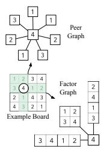

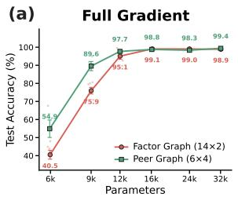

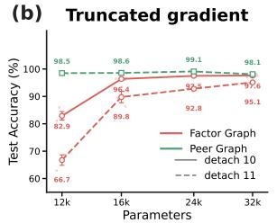

(c)  
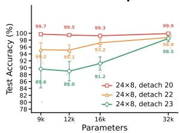

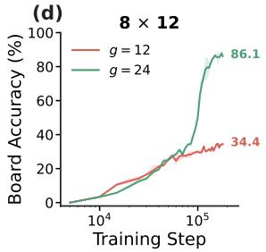

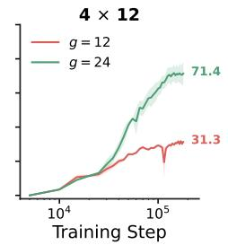

(e)  
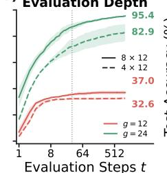

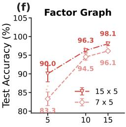  
g

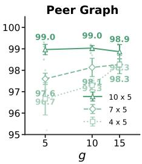  
Figure 2 (a) Sudoku-extreme with the full gradient and lattice; (b) The same comparison under truncated backpropagation, $1 2 \times 6 ; ( \mathrm { c } )$ Maze-unique, $2 4 \times 8 .$ sweeping the truncation depth with the lattice; (d) Training curves when only g rounds carry the gradients, no lattice; (e) Test-time extrapolation: board accuracy as a function of the number of inference steps t for the same configurations; (f) Test accuracies using the lattice, under diferent numbers of cycles and rounds with gradient g.

Datasets. Sudoku-extreme has 1000 training, 300 validation, and 1000 test boards, selected as in (Davis et al., 2026). The symmetry group of Sudoku is the direct product of two groups: the group of geometric symmetries, defined by the wreath product $( S _ { 3 } \wr S _ { 3 } ) \wr S _ { 2 }$ , of order 3,359,232, generated by permuting rows within a band, bands, columns within a stack, and stacks, and by transposition. The second is the group S<sub>9</sub> of digit relabelings. Since the geometric group is the automorphism group of both the peer and the factor graph, our models are equivariant to the group of geometric symmetries by construction. Hence, we augment only with random digit relabelings. Maze-unique has disjoint train and test splits of 1000 mazes each, and a validation set of 300 datapoints. As augmentation, we add the swapping of the entrance and exit points. To conclude, for every table we generate the peer graph such that pairs of connected walkable cells in the maze are connected in the graph.

Baselines. To separate the contributions of architecture and training, we use four baselines; three transformerbased ones and a graph one. The first is a 32k-parameter lattice deduction transformer (LDT) (Davis et al., 2026), which difers from our lattice models in its architecture. As this model does not have knowledge of the graph structure, we also implement a graph-LDT, where we embed the structure of the graph inside the architecture by masking connections that are not adjacent. Then, we use the symbol-equivariant (SE-RRN) recursive model (Freinschlag et al., 2026). As a message passing alternative, we consider RRNs (Palm et al., 2018) with the same shape and parameters as our models, so that they isolate the advantage given by the training procedure. We have tuned the hyperparameters of all baselines for the small-parameter regime. We have also tested our baselines when using models of 16k parameters, and observed a drop in performance, with none of them managed to get past 20% board accuracy on Sudoku-extreme. The performance, reported in Table 1, shows that our peer graph model outperforms all of the baselines at such small scales.

<sup>∗</sup>Used for model selection
<table><tr><td></td><td colspan="5">Test board size</td></tr><tr><td>Model</td><td> $1 0 \times 1 0 ^ { * }$ </td><td> $1 2 \times 1 2$ </td><td> $1 4 \times 1 4$ </td><td> $1 5 \times 1 5$ </td><td> $1 6 \times 1 6$ </td></tr><tr><td>RRN,  $T = 6 4$ </td><td> $0 . 8 3 \pm 0 . 2 1$ </td><td> $0 . 6 8 \pm \mathbf { 0 . 1 5 }$ </td><td> $0 . 4 1 \pm 0 . 1 1$ </td><td> $0 . 1 4 \pm 0 . 1 0$ </td><td> $0 . 0 2 \pm 0 . 0 3$ </td></tr><tr><td>RRN,  $T = 1 2 8$ </td><td> $0 . 8 4 \pm 0 . 1 6$ </td><td> $0 . 6 2 \pm \mathbf { 0 . 1 3 }$ </td><td> $0 . 3 8 \pm 0 . 2 1$ </td><td> $0 . 3 2 \pm 0 . 1 9$ </td><td> $0 . 2 6 \pm 0 . 1 4$ </td></tr><tr><td>Ours, FG  $8 \times 1 2$ </td><td> $0 . 9 6 \pm 0 . 0 3$ </td><td> $0 . 9 8 \pm 0 . 0 1$ </td><td> $0 . 5 5 \pm 0 . 2 7$ </td><td> $0 . 3 8 \pm 0 . 3 1$ </td><td> $0 . 2 8 \pm 0 . 2 6$ </td></tr><tr><td>Ours, FG  $1 0 \times 1 2$ </td><td> $0 . 9 7 \pm 0 . 0 2$ </td><td> $0 . 8 8 \pm \mathbf { 0 . 1 4 }$ </td><td> $0 . 6 3 \pm 0 . 4 4$ </td><td> $0 . 6 1 \pm 0 . 4 4$ </td><td> $0 . 5 7 \pm 0 . 3 4$ </td></tr><tr><td>Ours, FG  $1 2 \times 1 2$ </td><td> $0 . 9 9 \pm 0 . 0 1$ </td><td> $\mathbf { 0 . 9 8 \pm 0 . 0 2 }$ </td><td> $\mathbf { 0 . 8 3 \pm 0 . 1 2 }$ </td><td> ${ \bf 0 . 6 7 \pm 0 . 3 0 }$ </td><td> ${ \bf 0 . 6 3 \pm 0 . 3 5 }$ </td></tr></table>

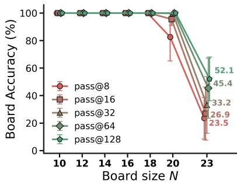  
Figure 3 Zero-shot size transfer on N-Queens. Left: Full board accuracy across test board sizes using a single deterministic pass. Right: Full board accuracy via multiple probabilistic passes, assuming we have access to a verifier.

## 5.1.1 Results

With the full gradient, both wirings reach about 99% on Sudoku-Extreme from 16k parameters onwards (Fig. 2(a)), and the peer graph reaches near-perfect accuracy on Maze-unique (Table 1). On a single-pass evaluation, the peer-graph lattice model outperforms the standard one on Sudoku-Extreme, and matches it on Maze-unique, even though it needs a larger amount of compute at test time, while the factor-graph lattice model stays slightly below both. Increasing the test-time compute of non-lattice based models and scoring them as done in probabilistic TRMs allows them to reach the best results, 99.9% on Sudoku-Extreme and 100% on Maze-unique with 64 passes. Under truncated gradients (Fig. 2(b)), the peer graph stays above 98% at ever size, while the factor graph degrades, especially for small models, and does not fully recover even with a longer gradient window. This is consistent with path length: in the bipartite factor graph, two cells of the same unit are two rounds apart rather than one, so a fixed truncation window covers half as many cell-to-cell exchanges Maze-unique, whose graph has a far larger diameter, amplifies the efect (Fig. 2(c)): it needs more cycles and rounds, and exceeds 99% at every size only with the longest gradient window.

The accuracy results also hold when using the standard TRM recipe with the ACT head, and 32 deep supervision steps. We compare models with 32k parameters under one deterministic pass in Table 1, and the same model under a single and 64 noisy passes, with the best run selected by the halting head. Dropping the lattice slightly afects performance on Sudoku-Extreme in the deterministic setting even when running 1024 deep supervision steps, and a single noisy pass does not improve on it, but it allows us to reach the best results once we use 64 parallel noisy passes. The lattice and the noisy halting head address the same dificulty from opposite directions: the lattice commits to partial deductions explicitly and restarts on conflict, while the halting head perturbs the answer state and picks among the resulting candidates.

Truncated gradients. Let us call g the number of rounds that carry gradients. In Figure 2, we study how the performance is afected when varying the number of cycles, gradient rounds g, and number of parameters of the model. Panel (d) varies the number of gradient-carrying rounds g at fixed total depth, without the lattice. Accuracy rises sharply with g, more than doubling when going from $g = 1 2$ to $g = 2 4$ , so a short window is not enough to learn Sudoku-Extreme from scratch. Figure 2(e) shows that this gap is further widened at inference: models trained with more gradients make better use of test-time iterations, while the others tend to converge earlier. The credit horizon thus sets a ceiling at training time, so it should be treated as a per-task hyperparameter that grows with the propagation distance and diameter of the graph. We also observe a stark diference in performance between factor graphs and peer graphs (Fig. 2(f)), with the second being much more robust to the truncation of the gradients, due to its graph diameter being smaller; and between lattice and non-lattice methods (Fig. 2(d) and (f)): the lattice provides a simpler intermediate supervision signal, that allows the model to make improvements even using the small number of steps. This may not be the case for the standard supervision, as filling the next sudoku cell may need a larger number of backtracking steps than the ones that carry gradients, hence leaving the model with no useful signal.

## 5.2 N-Queens

To test generalization to boards larger than those seen in training, we use the N-Queens dataset (Nandwani et al., 2020). Given an $N \times N$ chess board with some queens already placed, the task is to complete it to N queens, no two sharing a row, column, or diagonal. For every complete $1 0 \times 1 0$ solution we sample 60 partial boards, 20 each with 1, 2, and 3 queens. Since our models are equivariant to the eight symmetries of the square, we split by orbit under this group, so that no test board is a rotation or reflection of a training board. This gives 13,442 training and 2,372 validation boards. For larger boards $N \in \{ 1 2 , \ldots , 1 6 \}$ , we sample 400 solutions, keep 1, 2, or 3 queens, giving ≈ 750 test boards per size.

Model. Each cell is a node with a recurrent hidden state and an answer state, and receives an embedding of its clue (queen or empty) at every step. As peer graphs do not have the structure to generalize to larger boards, here we use factor graphs, where every row, column, diagonal and anti-diagonal is a factor node. Every cell lies on exactly four lines, so it has exactly four ports for every N, while factors pool over their variable number of cells; no part of the model depends on N. As a baseline, we run an RRN on the same factor graph with the same widths, data, and target selection, trained as a single segment of T ∈ {64, 128} rounds with full BPTT and evaluated at a depth that increases with the board size, until we noted that more iterations were not improving the results anymore. We also tested $T = 2 5 6$ , but the training with full BPTT did not fit into a single GPU. All models have 16k parameters, and training follows the same procedure used for Sudoku-extreme, without the lattice and with the ACT head only. Since a partial board may have several completions, we use as label the board consistent solution with the lowest current cross-entropy, as done in previous work (Nandwani et al., 2020). A board counts as solved if and only if it contains N queens with no two sharing a line.

Results. All models transfer beyond their training size: On $1 6 \times 1 6$ boards, our best configuration solves 63% on average (Figure 3 left). The RRN degrades faster than our models: $T = 6 4$ , drops to 2% at $1 6 \times 1 6 .$ , and only $T = 1 2 8$ retains 26%, while requiring more memory and training time than our models. We have also tested the probabilistic formulation, where we have assumed we had access to a verifier that allows us to pick the correct solution out of sampled ones. The results in Figure 3(right) show that our $1 2 \times 1 2$ configuration is able to reach near-perfect accuracy up to boards of size 20 × 20. We have observed that selecting the solution using the ACT head performs slightly worse, or on par with the deterministic single pass.

## 5.3 Boolean satisfiability (SAT)

We consider SAT, a standard testbed for algorithmic reasoning (Selsam et al., 2019; Ozolins et al., 2022; Chang and Liu, 2025). We focus on satisfying assignment prediction: A formula in conjunctive normal form (CNF) is a conjunction of clauses, each a disjunction of literals, where a literal is a Boolean variable or its negation. Given a satisfiable CNF formula, the model must assign a truth value to every variable so that all clauses hold.

Datasets. We use two benchmarks. From G4SATBench (Li et al., 2024) we take the random SR and 3-SAT families and its assignment task, which keeps only satisfiable formulas. Dificulty is the number of variables, drawn uniformly per instance: $n \in [ 1 0 , 4 0 ]$ (easy), [40, 200] (medium), and [200, 400] for SR or [200, 300] for 3-SAT (hard). Easy and medium provide 80k training, 10k validation and test formulas each, and hard is test-only. RandCSPBench (Skenderi et al., 2026) instead mixes every size $N \in \{ 1 6 , \ldots , 2 5 6 \}$ and every clause-to-variable ratio α into one pool per family $( \alpha \in [ 3 . 0 , 5 . 0 ]$ for 3-SAT, [8.0, 10.0] for 4-SAT, in steps of 0.1), holding size fixed while sweeping across the satisfiability threshold, where random instances are hardest. Its training pools contain 168k 3-SAT and 80.8k 4-SAT formulas, its test splits 42k and 21k.

Model. We use the VCG<sup>∗</sup> encoding of G4SATBench: a bipartite graph between variables and clauses with polarity-typed edges, i.e. the factor graph of Sudoku and N-Queens with variables as cells and clauses as factors, the two polarities entering as two port types. Variables run the pooling module and emit one logit each; clauses run the Deep Sets module. No parameter depends on the number of variables or on clause length, so one model runs on formulas of any size. Since a formula admits many satisfying assignments, we train on the unsupervised loss of G4SATBench, the negative log-probability that each clause is satisfied. Without lattice, the ACT head scores clauses rather than variables, pooled per instance by a size-corrected smooth minimum, and halts the recursion once that score clears a threshold; best-of-P perturbs the answer state and keeps the rollout the head scores highest. With the lattice, every variable is undecided, committed, or in conflict, and the loss is conditioned on the commitments, so the model learns to complete a partial assignment.

Table 2 Solve rate on G4SATBench (Li et al., 2024) and RandCSPBench (Skenderi et al., 2026), mean ± sample standard deviation over three seeds. Zero-shot transfer models are trained on medium and evaluated on hard without further tuning; RandCSPBench is scored against the benchmark’s satisfiable set. All baseline solve rates are taken from the original work. NeuroSAT implementation is the same in both RandCSPBench and G4SATBench.
<table><tr><td rowspan="3"></td><td rowspan="3"></td><td colspan="6">G4SATBench</td><td rowspan="2" colspan="2">RandCSPBench</td></tr><tr><td colspan="2">Easy</td><td colspan="2">Medium</td><td colspan="2">Hard</td></tr><tr><td>SR</td><td>3-SAT</td><td>SR</td><td>3-SAT</td><td>SR</td><td>3-SAT</td><td>3-SAT</td><td>4-SAT</td></tr><tr><td>NeuroSAT</td><td>430k</td><td>79.79</td><td>80.59</td><td>37.25</td><td>41.61</td><td>5.19</td><td>11.34</td><td>84.48</td><td>47.52</td></tr><tr><td>GGNN</td><td>445k</td><td>78.75</td><td>76.42</td><td>21.18</td><td>25.68</td><td></td><td></td><td></td><td></td></tr><tr><td>QuerySAT</td><td>363k</td><td></td><td></td><td></td><td></td><td></td><td></td><td>92.38</td><td>66.57</td></tr><tr><td>Ours, ACT  $( P = 1 )$ </td><td>65k</td><td> $7 9 . 1 _ { \pm 1 . 5 }$ </td><td> $7 5 . 6 { \scriptstyle \pm 0 . 7 }$ </td><td> $3 6 . 6 { \scriptstyle \pm 1 . 1 }$ </td><td> $4 2 . 8 { \scriptstyle \pm 3 . 4 }$ </td><td> $8 . 0 { \scriptstyle \pm 0 . 4 }$ </td><td> $1 7 . 7 _ { \pm 3 . 3 }$ </td><td> $8 3 . 6 { \scriptstyle \pm 1 . 1 }$ </td><td> $4 8 . 0 { \scriptstyle \pm 4 . 7 }$ </td></tr><tr><td>Ours, ACT best-of-8</td><td>65k</td><td> $8 6 . 1 { \scriptstyle \pm 0 . 9 }$ </td><td> $8 2 . 7 _ { \pm 0 . 7 }$ </td><td> $4 7 . 6 _ { \pm 3 . 4 }$ </td><td> $5 4 . 9 { \scriptstyle \pm 3 . 0 }$ </td><td> $1 6 . 4 { \scriptstyle \pm 1 . 4 }$ </td><td> $3 2 . 2 { \scriptstyle \pm 3 . 7 }$ </td><td> $8 8 . 5 { \scriptstyle \pm 0 . 7 }$ </td><td> $6 0 . 5 { \scriptstyle \pm 3 . 2 }$ </td></tr><tr><td> ${ \mathrm { O u r s } } ,$  ACT best-of-64</td><td>65k</td><td> $8 9 . 6 { \scriptstyle \pm 1 . 1 }$ </td><td> $8 6 . 7 \pm 1 . 0$ </td><td> $5 5 . 8 { \scriptstyle \pm 5 . 0 }$ </td><td> $6 3 . 2 { \scriptstyle \pm 2 . 2 }$ </td><td> ${ \bf 2 6 . 7 \pm 3 . 8 }$ </td><td> $\mathbf { 4 4 . 8 { \scriptstyle \pm 3 . 5 } }$ </td><td> $9 0 . 9 { \scriptstyle \pm 0 . 8 }$ </td><td> $6 7 . 8 { \scriptstyle \pm 2 . 7 }$ </td></tr><tr><td> ${ \mathrm { O u r s } } ,$  lattice</td><td>65k</td><td> $\mathbf { 9 9 . 7 _ { \pm 0 . 1 } }$ </td><td> $\mathbf { 9 9 . 5 _ { \pm 0 . 3 } }$ </td><td> ${ \bf 7 2 . 5 _ { \pm 1 . 3 } }$ </td><td> ${ \bf 7 6 . 1 _ { \pm 1 . 6 } }$ </td><td> $1 2 . 3 { \scriptstyle \pm 1 . 4 }$ </td><td> $2 9 . 5 { \scriptstyle \pm 4 . 7 }$ </td><td> ${ \bf 9 5 . 6 _ { \pm 0 . 5 } }$ </td><td> $\mathbf { 7 2 . 9 _ { \pm 2 . 1 } }$ </td></tr></table>

Inference and baselines. The lattice model reads the assignment of the commitments where present and the readout elsewhere, then repairs it: it picks an unsatisfied clause at random, commits one of its free variables so that its literal becomes true, and restarts a chain whose commitments conflict. It therefore never returns a wrong assignment, only timeouts. Methods also difer in whether they evaluate the formula at inference. NeuroSAT, GGNN and our no-lattice model do not: the latter halts and selects rollouts from a learned score rather than from a satisfaction check. Our lattice model and QuerySAT instead round the current assignment and test every clause as they run, which steers the next step and lets them stop as soon as the formula is satisfied. As baselines we use NeuroSAT and GGNN on G4SATBench, and NeuroSAT and QuerySAT on RandCSPBench.

Results. With a single rollout, our model roughly matches NeuroSAT on both benchmarks: in distribution on G4SATBench it is within 1.2 points on three of the four splits and 5 points below on 3-SAT easy, and on RandCSPBench it is 0.9 points below on 3-SAT and 0.5 above on 4-SAT. It already outperforms GGNN on the medium splits, and under zero-shot transfer to hard formulas it exceeds NeuroSAT by a factor of 1.5 (8.0 vs. 5.2 on SR, 17.7 vs. 11.3 on 3-SAT). Selecting among noisy rollouts with the halting head improves every column, and more so the harder the split: best-of-64 gains about 20 points on the G4SATBench medium splits and reaches 4–5× NeuroSAT on hard, and on RandCSPBench it draws level with QuerySAT (90.9 vs. 92.4 on 3-SAT, 67.8 vs. 66.6 on 4-SAT) at a fifth of its parameters. The lattice is the strongest recipe in the aggregate on both benchmarks: it solves over 99% of the easy G4SATBench formulas, nearly doubles NeuroSAT on the medium ones, and is the strongest neural method on both RandCSPBench families (95.6 and 72.9), the only one above QuerySAT on 3-SAT. On the hard splits, however, it falls behind the no-lattice model, whose best-of-64 noisy rollouts generalize better to larger formulas.

## 6 Conclusion

Our results show that the machinery of recent recursive transformers (deep supervision, truncated recursion, adaptive halting and deduction lattices) carries over to typed message passing, and that it is complementary to encoding the graph structure. Together they yield models with 16k–65k parameters that match or exceed neural baselines up to an order of magnitude larger. Truncation, however, becomes more costly as graph diameter grows, making wiring a trade-of between robustness to truncation and size transfer. A natural next step is to use such models as learned heuristics inside exact solvers, for problems with known constraint structure such as scheduling, configuration and verification-derived SAT.

## References

Dana Angluin. Local and global properties in networks of processors. In Proceedings of the twelfth annual ACM symposium on Theory of computing, pages 82–93, 1980. (page 2)

Shaojie Bai, J. Zico Kolter, and Vladlen Koltun. Deep equilibrium models. In Advances in Neural Information Processing Systems 32 (NeurIPS 2019). Curran Associates, Inc., 2019. (page 1)

Shaojie Bai, Vladlen Koltun, and J Zico Kolter. Multiscale deep equilibrium models. Advances in neural information processing systems, 33:5238–5250, 2020. (page 1)

Arpit Bansal, Avi Schwarzschild, Eitan Borgnia, Zeyad Emam, Furong Huang, Micah Goldblum, and Tom Goldstein. End-to-end algorithm synthesis with recurrent networks: Extrapolation without overthinking. Advances in Neural Information Processing Systems, 35:20232–20242, 2022. (page 2)

Wenjing Chang and Wenlong Liu. SAT-GATv2: A Dynamic Attention-Based Graph Neural Network for Solving Boolean Satisfiability Problem. Electronics, page 423, 2025. (page 9)

Junyoung Chung, Caglar Gulcehre, KyungHyun Cho, and Yoshua Bengio. Empirical evaluation of gated recurrent neural networks on sequence modeling. arXiv preprint arXiv:1412.3555, 2014. (page 3)

Liam Davis, Leopold Haller, Alberto Alfarano, and Mark Santolucito. Lattice deduction transformers. arXiv preprint arXiv:2605.08605, 2026. (pages 1, 2, 3, 4, 5, 7)

Giovanni De Felice, Alexis Toumi, and Bob Coecke. Discopy: Monoidal categories in python. arXiv preprint arXiv:2005.02975, 2020. (page 24)

Richard Freinschlag, Timo Bertram, Erich Kobler, Andreas Mayr, and Günter Klambauer. Symbol-equivariant recurrent reasoning models. arXiv preprint arXiv:2603.02193, 2026. (page 7)

Dobrik Georgiev, JJ Wilson, Davide Bufelli, and Pietro Liò. Deep equilibrium algorithmic reasoning. Advances in Neural Information Processing Systems, 37:33638–33667, 2024. (page 3)

Justin Gilmer, Samuel S Schoenholz, Patrick F Riley, Oriol Vinyals, and George E Dahl. Neural message passing for quantum chemistry. In International conference on machine learning, pages 1263–1272. Pmlr, 2017. (page 1)

Alex Graves. Adaptive computation time for recurrent neural networks. arXiv preprint arXiv:1603.08983, 2016. (pages 1, 4)

Fangda Gu, Heng Chang, Wenwu Zhu, Somayeh Sojoudi, and Laurent El Ghaoui. Implicit graph neural networks. Advances in neural information processing systems, 33:11984–11995, 2020. (page 2)

Lauri Hella, Matti Järvisalo, Antti Kuusisto, Juhana Laurinharju, Tuomo Lempiäinen, Kerkko Luosto, Jukka Suomela, and Jonni Virtema. Weak models of distributed computing, with connections to modal logic. In Proceedings of the 2012 ACM Symposium on Principles of distributed computing, pages 185–194, 2012. (page 2)

Benhao Huang, Zhengyang Geng, and Zico Kolter. Equilibrium reasoners: Learning attractors enables scalable reasoning. arXiv preprint arXiv:2605.21488, 2026. (pages 1, 3, 6)

Alexia Jolicoeur-Martineau. Less is more: Recursive reasoning with tiny networks. arXiv preprint arXiv:2510.04871, 2025. (pages 1, 3, 4, 5)

Jonathan Kuck, Shuvam Chakraborty, Hao Tang, Rachel Luo, Jiaming Song, Ashish Sabharwal, and Stefano Ermon. Belief propagation neural networks. Advances in Neural Information Processing Systems, 33:667–678, 2020. (page 2)

Yujia Li, Daniel Tarlow, Marc Brockschmidt, and Richard Zemel. Gated graph sequence neural networks. arXiv preprint arXiv:1511.05493, 2015. (page 2)

Zhaoyu Li, Jinpei Guo, and Xujie Si. G4satbench: Benchmarking and advancing sat solving with graph neural networks. arXiv preprint arXiv:2309.16941, 2024. (pages 9, 10)

Andreas Loukas. What graph neural networks cannot learn: depth vs width. arXiv preprint arXiv:1907.03199, 2019. (page 2)

Haggai Maron, Heli Ben-Hamu, Nadav Shamir, and Yaron Lipman. Invariant and equivariant graph networks. arXiv preprint arXiv:1812.09902, 2018. (page 2)

Yatin Nandwani, Deepanshu Jindal, Parag Singla, et al. Neural learning of one-of-many solutions for combinatorial problems in structured output spaces. arXiv preprint arXiv:2008.11990, 2020. (page 9)

Emils Ozolins, Karlis Freivalds, Andis Draguns, Eliza Gaile, Ronalds Zakovskis, and Sergejs Kozlovics. Goal-aware neural SAT solver. In IJCNN, 2022. (page 9)

Rasmus Palm, Ulrich Paquet, and Ole Winther. Recurrent relational networks. Advances in neural information processing systems, 31, 2018. (pages 2, 7)

Ryoma Sato, Makoto Yamada, and Hisashi Kashima. Approximation ratios of graph neural networks for combinatorial problems. Advances in neural information processing systems, 32, 2019. (page 2)

Victor Garcia Satorras and Max Welling. Neural enhanced belief propagation on factor graphs. In International Conference on Artificial Intelligence and Statistics, pages 685–693. PMLR, 2021. (page 2)

Franco Scarselli, Marco Gori, Ah Chung Tsoi, Markus Hagenbuchner, and Gabriele Monfardini. The graph neural network model. IEEE transactions on neural networks, 20(1):61–80, 2008. (pages 1, 2)

Michael Schlichtkrull, Thomas N Kipf, Peter Bloem, Rianne Van Den Berg, Ivan Titov, and Max Welling. Modeling relational data with graph convolutional networks. In European semantic web conference, pages 593–607. Springer, 2018. (page 2)

Avi Schwarzschild, Eitan Borgnia, Arjun Gupta, Furong Huang, Uzi Vishkin, Micah Goldblum, and Tom Goldstein. Can you learn an algorithm? generalizing from easy to hard problems with recurrent networks. Advances in Neural Information Processing Systems, 34:6695–6706, 2021. (page 2)

Daniel Selsam, Matthew Lamm, Benedikt Bünz, Percy Liang, Leonardo de Moura, and David L. Dill. Learning a SAT solver from single-bit supervision. In International Conference on Learning Representations, 2019. (pages 1, 2, 9)

Amin Sghaier, Ali Parviz, and Alexia Jolicoeur-Martineau. Probabilistic tiny recursive model. arXiv preprint arXiv:2605.19943, 2026. (pages 1, 3, 4, 5)

Geri Skenderi, Lorenzo Bufoni, Francesco D’Amico, David Machado, Rafaele Marino, Matteo Negri, Federico Ricci-Tersenghi, Carlo Lucibello, and Maria Chiara Angelini. Benchmarking graph neural networks in solving hard constraint satisfaction problems. CoRR, abs/2602.18419, 2026. (pages 2, 9, 10)

Junshu Sun, Wanxing Chang, Qingming Huang, and Shuhui Wang. Adaptive recurrent message passing for test time computing on graphs. arXiv preprint arXiv:2606.22462, 2026. (page 3)

Hao Tang, Zhiao Huang, Jiayuan Gu, Bao-Liang Lu, and Hao Su. Towards scale-invariant graph-related problem solving by iterative homogeneous gnns. Advances in Neural Information Processing Systems, 33:15811–15822, 2020. (page 2)

Guan Wang, Jin Li, Yuhao Sun, Xing Chen, Changling Liu, Yue Wu, Meng Lu, Sen Song, and Yasin Abbasi Yadkori. Hierarchical reasoning model. arXiv preprint arXiv:2506.21734, 2025. (pages 1, 3, 4, 6)

Xiao Wang, Houye Ji, Chuan Shi, Bai Wang, Yanfang Ye, Peng Cui, and Philip S Yu. Heterogeneous graph attention network. In The world wide web conference, pages 2022–2032, 2019. (page 2)

Keyulu Xu, Jingling Li, Mozhi Zhang, Simon S Du, Ken-ichi Kawarabayashi, and Stefanie Jegelka. What can neural networks reason about? arXiv preprint arXiv:1905.13211, 2019. (page 1)

Yongyi Yang, Tang Liu, Yangkun Wang, Zengfeng Huang, and David Wipf. Implicit vs unfolded graph neural networks. Journal of Machine Learning Research, 26(82):1–46, 2025. (page 3)

Manzil Zaheer, Satwik Kottur, Siamak Ravanbakhsh, Barnabas Poczos, Russ R Salakhutdinov, and Alexander Smola. Deep sets. Advances in neural information processing systems, 30, 2017. (pages 2, 4)

Zhen Zhang, Fan Wu, and Wee Sun Lee. Factor graph neural networks. Advances in Neural Information Processing Systems, 33:8577–8587, 2020. (page 2)

```latex
Algorithm 1 Training with deep supervision, truncated recursion and adaptive halting (one instance; batched
in practice).
1: function $\mathrm { C Y C L E } ( s = ( m , h , a ) , \ c )$ ▷ $G _ { \theta } = U _ { \theta } \circ F _ { \theta } ^ { R }$
2: for $r = 1 , \ldots , R$ do ▷ inner loop, Eq. (1); a held fixed
3: for all $v \in V$ in parallel do
4: $( ( m _ { v  w } ^ { \prime } ) _ { w \in N ( v ) } , h _ { v } ^ { \prime } )  f _ { \tau ( v ) } ( ( m _ { w  v } ) _ { w \in N ( v ) } , h _ { v } , c _ { v } , a _ { v } )$
5: end for
6: $( m , h ) \gets ( m ^ { \prime } , h ^ { \prime } )$
7: end for
8: for all $v \in V$ with memory do ▷ answer update $U _ { \theta } , \operatorname { E q } .$ (2)
9: $a _ { v } \gets \mathrm { L N } \left( \mathrm { G R U } _ { a } ( h _ { v } , a _ { v } ) \right)$
10: end for
11: return $( m , h , a )$
12: end function
Require: graph $( V , E )$ , inputs $( x _ { v } )$ , labels $( y _ { v } )$ , configuration $K \times R ,$ gradient window $K _ { g } \leq K ,$ , budget D
13: $c _ { v } \gets E x _ { v }$ for all $v \in V$
14: $s \gets s ^ { ( 0 ) }$ ▷ initial messages, memories and answer states
15: for $\ell = 1 , \ldots , D$ do ▷ deep-supervision loop
16: for $k = 1 , \ldots , K - K _ { g }$ do ▷ no activations stored
17: $s \gets \mathrm { C Y C L E } ( s , c )$
18: end for
19: $s  \operatorname { s g } ( s )$
20: for $k = 1 , \dots , K _ { g }$ do ▷ gradients through the last $R _ { g } = K _ { g } R$ rounds, Eq. (3)
21: $s \gets \mathrm { C Y C L E } ( s , c )$
22: end for
23: $\hat { y } _ { v }  W _ { y } a _ { v } , \quad q _ { v }  w _ { q } ^ { \top } \mathrm { s g } ( a _ { v } )$ for all v with memory
24: $\begin{array} { r } { \mathcal { L } \gets \sum _ { v } \mathrm { C E } ( \hat { y } _ { v } , y _ { v } ) + \dot { \sum } _ { v } \mathrm { B C E } \big ( q _ { v } , \mathcal { H } [ \arg \operatorname* { m a x } \hat { y } _ { v } = y _ { v } ] \big ) } \end{array}$
25: update θ with $\nabla _ { \boldsymbol { \theta } } \mathcal { L }$
26: $s  \operatorname { s g } ( s )$ ▷ state carried to the next step, detached
27: $\begin{array} { r } { \mathbf { i f } \ - \log \sum _ { v } e ^ { - q _ { v } } > \delta _ { \mathrm { h a l t } } } \end{array}$ then ▷ smooth-minimum halting
28: break ▷ batch slot is refilled with a new instance
29: end if
30: end for
```

## A Pseudocode

```latex
Algorithm 2 Inference. Best-of-P with $\overline { { P = 1 , \ \sigma = 0 } }$ is the deterministic single pass.
1: function BestOfP(x, P, σ, D)
2: for $i = 1 , \ldots , P$ in parallel do
3: $c _ { v } \gets E x _ { v }$ for all $v ; \quad s _ { i } \gets s ^ { ( 0 ) }$
4: for $\ell = 1 , \ldots , D$ do
5: for $k = 1 , \ldots , K$ do
6: $s _ { i } \gets \mathrm { C Y C L E } ( s _ { i } , c )$
7: end for
8: if $\ell < D$ then ▷ perturb the answer state
9: $a _ { i , v } \gets a _ { i , v } + \varepsilon _ { i , v } , \quad \varepsilon _ { i , v } \sim \mathcal { N } ( 0 , \sigma ^ { 2 } I )$
10: end if
11: end for
12: $\hat { y } _ { i , v } \gets \mathrm { a r g }$ max $\begin{array} { r } { \boldsymbol { W } _ { \boldsymbol { y } } \boldsymbol { a } _ { i , \boldsymbol { v } } , \quad \boldsymbol { q } _ { i } \gets - \log { \sum _ { \boldsymbol { v } } e ^ { - w _ { q } ^ { \top } \boldsymbol { a } _ { i , \boldsymbol { \imath } } } } } \end{array}$
13: end for
14: return $\hat { y } _ { i ^ { \star } }$ , with $i ^ { \star } =$ arg max<sub>i</sub> q<sub>i</sub> ▷ selected by the halting head
15: end function
16: function Lattice(x, D)
17: $L ^ { 0 } \gets$ lattice of x ▷ givens committed, blanks hold all candidates
18: $L  L ^ { 0 } ; \quad s  s ^ { ( 0 ) }$
19: for $\ell = 1 , \ldots , D$ do
20: $c _ { v } \gets E L _ { v }$ for all v ▷ multi-hot embedding of surviving candidates
21: for $k = 1 , \ldots , K$ do
22: $s \gets \mathrm { C Y C L E } ( s , c )$
23: end for
24: p<sub>v</sub> ← softmax $\left( W _ { y } a _ { v } \right)$ for all v
25: $( L ,$ status) ← Project(p, L) ▷ Eq. (4)
26: if status = solved then
27: return L
28: else if status = conflict then
29: $L \gets L ^ { 0 } ; \quad s \gets s ^ { ( 0 ) }$ ▷ restart
30: end if
31: end for
32: return timeout
33: end function
34: function Project(p, L)
35: for all non-given v and $j \in L _ { v }$ do
36: if $p _ { v } ( j ) < \delta$ then
37: $L _ { v } \gets L _ { v } \setminus \{ j \}$ ▷ candidates are only removed
38: end if
39: end for
40: if $L _ { v } = \emptyset$ for some v then
41: return (L, conflict)
42: else if $| L _ { v } | = 1$ for all v then
43: return (L, solved)
44: end if
45: pick an undecided v uniformly at random; sample $j \sim p _ { v }$ restricted to $L _ { v }$
46: $L _ { v } \gets \{ j \}$ ▷ commit one cell
47: return (L, continue)
48: end function
```

## B Recursive message passing with truncated gradients

This appendix documents the models and protocols behind our Sudoku-Extreme and Maze-unique experiments, in which back-propagation reaches only the final part of the recursion. We first describe the recurrent messagepassing network shared by every model (§B.1), then the two ways in which we read it out and train it: a lattice model that prunes sets of candidate symbols and searches over them, and an $A C T$ model that decodes a one-hot answer and halts adaptively (§B.2). Section B.3 states precisely what the truncated gradient computes. Sections B.4 and B.5 give, for each task, the data, the hyperparameters and the evaluation protocol needed to reproduce the reported numbers, together with the full results tables. We close with the observations we found most instructive and with practical notes on training (§B.6).

Notation. Every vertex v of a graph $( V , E )$ , with neighbours $N ( v )$ , holds a memory $h _ { v } ,$ a clue embedding $c _ { v } = E x _ { \imath }$ of its input $x _ { v } ,$ , and an answer state $a _ { v } ;$ every ordered pair of adjacent vertices carries a message $m _ { w  v }$ . Computation is organised in three nested loops: an inner loop of R rounds of message passing (§B.1), an outer loop of $C$ cycles, each closed by one update of the answer state (Eq. (10)), and deep-supervision steps, each of which runs one full sweep of C cycles and is followed by a parameter update. We write the shape of a deep-supervision step as $C \times R$ . When training with truncated gradients (§B.3), the first D cycles of a deep-supervision step are executed without recording a computational graph, and back-propagation reaches only the last $T = C - D$ cycles. The number of message-passing rounds that receive credit,

$$
\begin{array} { r } { h = T R = \left( C - D \right) R , } \end{array}\tag{5}
$$

is what we call the credit horizon; it is the quantity varied by all of our truncation studies. Setting $D = 0$ recovers full back-propagation through time, with $h = C R$ . We write Σ for the set of symbols a cell can take and k for the number of parallel chains or noisy rollouts used at test time.

## B.1 Architecture

All models are recurrent message-passing networks on a fixed graph whose cell vertices are the cells of the puzzle. A single module is shared by all vertices of the same type, and is applied at every round, every cycle and every deep-supervision step, so the parameter count does not depend on the amount of computation (C, R), and the same weights can be iterated for as long as desired at test time.

Graphs. For Sudoku we use two wirings of the same constraint structure. In the factor graph (FG), the 81 cell vertices are joined to 27 unit vertices (nine rows, nine columns and nine 3 × 3 boxes); every unit has nine neighbours and every cell has three, one per unit it belongs to. In the peer graph the unit vertices are removed and two cells are adjacent whenever they share a unit, which gives every cell exactly 20 neighbours (eight in its row, eight in its column and four more in its box), and 810 undirected edges in total. The peer graph is generated programmatically from the factor graph, so the two wirings encode identical constraints and difer only in how information is routed. In a round, every vertex fires synchronously on the messages produced in the previous round, so a cell-to-cell exchange takes one round in the peer graph and two rounds (cell→unit, unit→cell) in the factor graph; the cell-to-cell diameter is therefore 2 rounds in the peer graph and 4 in the factor graph.

For Maze-unique, each of the $3 0 \times 3 0 = 9 0 0$ cells has seven neighbours: its four grid neighbours (a neighbour that falls outside the grid sends an all-zero message, which is how a cell learns that it lies on the border), and three unit vertices, namely its row, its column, and a single unit containing the whole grid. There is a single wiring for this task.

No vertex carries a positional encoding, no edge carries a type, and all vertices of the same type share their weights. As a consequence the networks are exactly equivariant to the symmetries of their graphs: for Sudoku, to the geometric group generated by permutations of bands, of stacks, of rows within a band, of columns within a stack, and by transposition; for the Maze, to the eight symmetries of the square. We verify both properties numerically (agreement to $1 0 ^ { - 1 2 }$ in double precision), and neither task therefore needs geometric data augmentation. Digit relabellings (the group $S _ { 9 } )$ , by contrast, are not a symmetry of the architecture, because the input embedding and the readout assign a meaning to each digit channel; we handle them by augmentation (§B.4).

Cell vertices: pooling module. Cells run a pooling module, which is invariant to the order of their neighbours and broadcasts a single message to all of them. One round updates every cell v synchronously as

$$
e _ { w } = \mathrm { M L P } ( [ h _ { v } ; m _ { w  v } ] ) , \qquad w \in N ( v ) ,\tag{6}
$$

$$
h _ { v } ^ { \prime } = \mathrm { L N } \Big ( \mathrm { G R U } \big ( [ \mathrm { m e a n } _ { w } ( e _ { w } ) ; c _ { v } ; a _ { v } ] , h _ { v } \big ) \Big ) ,\tag{7}
$$

$$
m _ { v \to w } ^ { \prime } = W h _ { v } ^ { \prime } \qquad \forall w \in N ( v ) ,\tag{8}
$$

after which the new messages are routed along the edges of the graph. Here $\left[ \cdot ; \cdot \right]$ denotes concatenation, MLP is a two-layer perceptron with a ReLU, $\operatorname { G R U } ( \cdot , h )$ is a standard gated recurrent cell with hidden state h, and LN is layer normalisation. We omit biases from the equations; they are present in the models and counted in Eq. (11). Every incoming message is processed by the same MLP before the mean, which makes the update invariant to the order of the neighbours, and a single message is broadcast unchanged to all of them. Apart from the gates of the GRU there are no residual connections, and no attention is used anywhere.

Unit vertices: Deep Sets module. The Sudoku factor-graph units and the Maze row, column and grid units run the Deep Sets module, which is equivariant to the order of their members. Given the messages $m _ { w  c }$ of the members $w \in N ( c )$ of a unit $c ,$ the unit replies to each member individually with

$$
\varphi _ { w } = \mathrm { R e L U } ( W _ { \varphi } m _ { w  c } ) , \qquad m _ { c  w } ^ { \prime } = \mathrm { M L P } ( [ m _ { w  c } ; \bigoplus _ { w ^ { \prime } \in N ( c ) } \varphi _ { w ^ { \prime } } ] ) ,\tag{9}
$$

which the member receives as one of its incoming messages. Units carry no memory. The pooling $\oplus$ is a sum for Sudoku and a mean for the Maze, where a unit has 30 (a row or a column) or 900 (the grid) members. All 27 Sudoku units share one module, so rows, columns and boxes are not distinguished; the Maze uses one module for rows and columns and a second one for the grid. The peer graph has no units at all: the message $m _ { w  v } = W h _ { w }$ of a cell is read directly by its 20 neighbours.

Two time scales. After the R rounds of a cycle, the answer state of every cell is refreshed once by a second, smaller gated recurrent cell that reads the memory:

$$
a _ { v } \gets \mathrm { L N } _ { a } \big ( \mathrm { G R U } _ { a } ( h _ { v } , a _ { v } ) \big ) .\tag{10}
$$

The memory h is therefore a fast variable, updated at every round, while the answer state a is a slow variable, updated once per cycle; this mirrors the latent and answer states of HRM and TRM. Every readout is a linear function of a.

Initial state. A deep-supervision step starts from $h = 0$ , zero messages and $a = a _ { 0 }$ , where $a _ { 0 }$ is a learned vector initialised at zero. Because the initial state is built outside the autograd graph, a<sub>0</sub> never receives a gradient and remains zero in practice, so the starting state is a deterministic function of the input alone. The lattice model re-initialises this state at every deep-supervision step; the ACT model initialises it once per puzzle and carries it across deep-supervision steps (§B.2).

Widths and parameter count. A model is specified by four widths $( n , m , n _ { \mathrm { h i d } } , m _ { a } )$ : messages and clue embeddings $m _ { w  v } , u _ { v } \in \mathbb { R } ^ { n }$ , memories $h _ { v } \in \mathbb R ^ { m }$ , the hidden layer of every MLP R<sup>n</sup>hid , and answer states $a _ { v } \in \mathbb { R } ^ { m _ { a } }$ . Let |Σ| be the number of input channels $( | \Sigma | = 9$ for Sudoku, |Σ| = 5 for the Maze) and $n _ { \mathrm { r e l } }$ the number of Deep Sets modules (0 for the peer graph, 1 for the factor graph, 2 for the Maze). The number of trainable parameters is

$$
\begin{array} { r } { P _ { \mathrm { c e l l } } = \left( m + n \right) n _ { \mathrm { h i d } } + n _ { \mathrm { h i d } } ^ { 2 } + 2 n _ { \mathrm { h i d } } + 3 m \left( n _ { \mathrm { h i d } } + n + m _ { a } + m \right) + 8 m + n { m } + n , } \end{array}
$$

$$
P _ { \mathrm { r e l } } = 3 n n _ { \mathrm { h i d } } + n _ { \mathrm { h i d } } ^ { 2 } + 2 n _ { \mathrm { h i d } } + n ,
$$

$$
P _ { \mathrm { a n s } } = 3 m _ { a } \left( m + m _ { a } \right) + 8 m _ { a } ,
$$

$$
P _ { \mathrm { i o } } = \left( | \Sigma | + 1 \right) n + 2 ( | \Sigma | + 1 ) m _ { a } + 2 | \Sigma | + 1 ,
$$

$$
P = P _ { \mathrm { c e l l } } + n _ { \mathrm { r e l } } P _ { \mathrm { r e l } } + P _ { \mathrm { a n s } } + P _ { \mathrm { i o } } ,\tag{11}
$$

Table 3 Widths $( n , m , n _ { \mathrm { h i d } } , m _ { a } )$ and exact parameter counts of the models in this appendix. Sizes are referred to by their nominal budget.
<table><tr><td>Task and wiring</td><td>Budget</td><td>Widths</td><td>Parameters</td></tr><tr><td>Sudoku, peer graph</td><td>16k</td><td>(10, 27, 55, 14)</td><td>16,485</td></tr><tr><td>Sudoku, peer graph</td><td>24k</td><td>(12, 34, 65, 16)</td><td>23,978</td></tr><tr><td>Sudoku, peer graph</td><td>32k</td><td>(15, 39, 76, 20)</td><td>32,763</td></tr><tr><td>Sudoku, peer graph, with halting head</td><td>32k</td><td>(15, 39, 76, 20)</td><td>32,784</td></tr><tr><td>Sudoku, factor graph</td><td>16k</td><td>(9, 24, 48, 12)</td><td>16,543</td></tr><tr><td>Sudoku, factor graph</td><td>32k</td><td>(13, 34, 68, 17)</td><td>32,798</td></tr><tr><td>Maze</td><td>32k</td><td>(12, 31, 64, 16)</td><td>34,786</td></tr></table>

where $P _ { \mathrm { i o } }$ collects the input embedding $E , a _ { 0 }$ and the three lattice readout heads of §B.2. The ACT models keep the same heads and add an $( m _ { a } + 1 )$ -parameter halting head. The answer update $P _ { \mathrm { a n s } }$ is below 10% of the total for every model. To reach a target budget we scan n along the ray $( n , m , n _ { \mathrm { h i d } } , m _ { a } ) \approx n \cdot ( 1 , 2 . 6 1 5 , 5 . 2 3 1 , 1 . 3 0 8 )$ build each candidate, and keep the one whose exact parameter count is closest to the budget. Table 3 lists the widths used in this appendix.

## B.2 Two readouts: the discrete lattice and adaptive halting

The same network is used in two diferent systems, which difer in what is carried from one deep-supervision step to the next, in how the output is read, and in how the model is trained. We refer to them as the lattice and the ACT models.

## B.2.1 Lattice model

Carried object. The lattice model maintains, outside the recurrent state, a discrete lattice $x _ { d } \in \{ 0 , 1 \} ^ { | V | \times | \Sigma | }$ where d indexes deep-supervision steps and V here denotes the cell vertices: the row $x _ { d , v }$ is the set of symbols still considered possible for cell v. A given cell is a singleton; a blank Sudoku cell starts with all nine digits, and a blank Maze cell with the two symbols free and path. The input of a cell is its row of the lattice, so that $\boldsymbol { u _ { v } } = E \boldsymbol { x _ { d , v } }$

Readout and projection. Three linear heads read the answer state a: a keep probability $p _ { v , j } ^ { \mathrm { k e e p } }$ for every candidate j of every cell, a symbol distribution $p _ { v } ^ { \mathrm { s y m } }$ over Σ for every cell, and a conflict logit for every cell, whose log-sum-exp over cells gives a board-level conflict probability $p ^ { \mathrm { c o n f } }$ . Together they form the prediction $p _ { \theta } ( \cdot \mid x _ { d } )$ After each deep-supervision step, the non-diferentiable projection Π computes $x _ { d + 1 } = \Pi \big ( p _ { \theta } \big ( \cdot \mid x _ { d } \big ) , x _ { d } \big )$ as follows:

1. every non-given candidate j of cell v with $p _ { v , j } ^ { \mathrm { k e e p } } < \varpi = 0 . 1$ is removed;

2. the board is declared in conflict if some cell has no candidate left, or if $p ^ { \mathrm { c o n f } } > \varpi _ { \mathrm { c l s } }$ (0.5 during training and 0.8 when evaluating Sudoku);

3. it is declared solved if every cell is a singleton and there is no conflict;

4. otherwise one undecided cell is chosen uniformly at random and committed to a symbol sampled from $p _ { v } ^ { \mathrm { s y m } }$ at temperature 1.5, restricted to its surviving candidates.

Candidates are only ever removed, so the lattice descends monotonically; the procedure is a DPLL-style solver whose propagation and branching heuristics are learned. The recurrent state is rebuilt from the current lattice at every deep-supervision step, so the only memory between steps is $x _ { d }$ itself.

Training. Training uses a persistent pool of B boards, which also serves as the batch. At every optimisation step one deep-supervision step is run on every board in the pool, the loss is computed, and the lattice is projected; boards leave the pool and are replaced by fresh draws once they are finished, and after at most 100 steps. The

loss is

$$
{ \mathcal { L } } = \mathrm { B C E } _ { w } \left( p ^ { \mathrm { k e e p } } , x _ { d } \odot x _ { d } ^ { \star } \right) + 0 . 2 \mathrm { C E } \left( p ^ { \mathrm { s y m } } \right) + 0 . 1 \mathrm { B C E } \left( p ^ { \mathrm { c o n f } } \right) ~ [ ~ + ~ 0 . 1 \mathrm { B C E } ( \mathrm { c e l l ~ c o n f i c t } ) ] ,\tag{12}
$$

where $x _ { d } ^ { \star } \in \{ 0 , 1 \} ^ { | V | \times | \Sigma | }$ marks, for every cell, the symbols that it takes in the solutions still compatible with $x _ { d } ,$ and $\mathrm { B C E } _ { w }$ weights positives by 4 and negatives by 0.5. When a commitment has excluded every solution, the board is labelled as a conflict. The symbol cross-entropy is applied only to cells that are neither given nor ambiguous in the target, and only on satisfiable boards; the per-cell conflict term is used for the Maze only. Every diferentiated cycle is read ${ \mathrm { o u t } } ,$ and the terms are averaged over these readouts. For Sudoku, every fresh draw starts from the raw puzzle with probability 0.20, from a partial fill with the correct digits with probability 0.55, and from a partial fill in which 1–30% of the filled cells are wrong with probability 0.25, so that the model learns both to complete assignments and to recognise contradictions; the Maze uses an analogous mixture of partially solved and corrupted starts.

Inference by chain search. At test time each puzzle is attacked by k independent stochastic chains run in parallel. At every step every chain runs one deep-supervision step followed by one projection; a chain that reaches a conflict restarts from the original puzzle, and the first chain that reaches a solved board provides the answer, which is graded afterwards (no oracle is involved). The compute budget is the maximum number of deep-supervision steps per puzzle; a puzzle that is not solved within the budget counts as a failure (a timeout).

## B.2.2 ACT model

Readout. The ACT model uses the symbol head alone and decodes every cell by arg max<sub>j</sub> $p _ { v , j } ^ { \mathrm { s y m } }$ , writing the givens back; on the Maze the arg max is restricted to the symbols that the puzzle allows at that cell (free or path on a blank cell), which reads the puzzle and never the label. There is no lattice, no projection and no search, and the puzzle encoding is never modified.

Halting. A linear head maps the answer state of every cell to a halting logit, and the logits are pooled into a board-level logit by a smooth minimum:

$$
q _ { v } = w _ { q } \ \mathrm { s g } ( a _ { v } ) + b _ { h } , \qquad q = - \log \sum _ { v } \exp ( - q _ { v } ) ,\tag{13}
$$

with $w _ { q }$ initialised at zero and $b _ { h }$ at −5, so that the model never halts at initialisation. The smooth minimum q lets a board stop only once every cell is individually confident. Because the head reads $\operatorname { s g } ( a )$ , halting is trained without shaping the representation, and its gradient reaches only its own $m _ { a } + 1$ parameters.

Deep supervision with a carried state. A deep-supervision step runs C cycles starting from the carried state $( h , a ) ;$ the state is passed on to the next step and detached in between, so no gradient ever crosses the boundary between two deep-supervision steps. Training follows the persistent-batch scheme of TRM: the batch consists of B slots, every optimisation step advances every slot by one deep-supervision step, and a slot is refilled with a fresh puzzle and a fresh state as soon as $q > 0$ or its trajectory has reached $n _ { \mathrm { s u p } } = 3 2$ deep-supervision steps. Slots are initialised at staggered depths (slot i starts at phase i mod $n _ { \mathrm { s u p } } )$ , which prevents the whole pool from expiring in the same step, and the periodic gradient spikes that this otherwise causes. With $p _ { k } ^ { \mathrm { s y m } }$ the readout after cycle k, the loss of a deep-supervision step is

$$
{ \mathcal { L } } = { \frac { 1 } { C - D } } \sum _ { k = D + 1 } ^ { C } \operatorname { C E } ( p _ { k } ^ { \mathrm { s y m } } , { \mathrm { t a r g e t } } ) + { \frac { 1 } { | V | } } \sum _ { \nu } \operatorname { R C E } ( q _ { \nu } , \mathbf { 1 } [ v { \mathrm { ~ c o r r e c t } } ] ) + \lambda _ { \mathrm { b o a r d } } \operatorname { B C E } ( q , \mathbf { 1 } [ { \mathrm { b o a r d ~ c o r r e c t } } ] ) .\tag{14}
$$

with the cross-entropy averaged over cells and the halting targets computed from the final readout of the step.   
The target is the single solution provided with each puzzle.

Inference. We read a trained model in three ways: (i) at fixed compute, running a prescribed number of deep-supervision steps and decoding the result; (ii) with halting, stopping at the first deep-supervision step with $q > 0$ , up to a cap; and (iii) with best-of-k selection, running k rollouts in which Gaussian noise of scale σ is added to a at every deep-supervision step, each rollout halting by its own rule, and returning the rollout whose q is highest. Best-of-k uses only the model’s own confidence; we also report pass@k, the fraction of puzzles for which any rollout is correct, as an oracle upper bound on what selection could achieve.

## B.3 The truncated gradient

Write one cycle as $s _ { k } = G _ { \theta } ( s _ { k - 1 } )$ , where s collects all memories, messages and answer states, and $G _ { \theta }$ applies R rounds of Eqs. $( 6 ) \AA { - } \textcircled { 9 }$ followed by the answer update (10). Let $\ell _ { k }$ be the loss of the readout after cycle k. With D detached cycles, the state reached by the diferentiated window is

$$
s _ { C } = G _ { \theta } ^ { T } \big ( \thinspace \mathrm { s g } \left[ G _ { \theta } ^ { D } ( s _ { 0 } ) \right] \big ) , \qquad T = C - D ,\tag{15}
$$

where sg denotes stop-gradient, and training minimises $\scriptstyle \sum _ { k = D + 1 } ^ { C } \ell _ { k }$ while treating $s _ { D }$ as a constant: every term of the chain rule that would pass through $s _ { D }$ into the first D cycles is dropped. Concretely, in both models:

• the first D cycles run inside a no-gradient context, so they build no graph, and their values are handed to the diferentiated window as constants;

• the clue embedding $u = E x$ is recomputed with gradient at the start of the diferentiated window, so that the input embedding is still trained, through the last T cycles only;

• every diferentiated cycle is read out and supervised, while the detached cycles contribute no loss term at all;

• activation memory and backward cost scale with h rather than with CR, while the forward computation is unchanged: at test time the network is identical to one trained with full gradients, and $D$ only afects how its parameters were obtained.

In the ACT model, deep-supervision steps are additionally separated by a detach, so the credit horizon of a single optimisation step is h in both systems. For example, the peer-graph Sudoku recipe with $C \times R = 1 2 \times 5$ and $D = 1 1$ diferentiates five rounds out of sixty, and the Maze lattice recipe $2 4 \times 8$ with $D = 2 0$ diferentiates 32 rounds out of 192.

Stabilisation. Long credit horizons back-propagate through deep unrolled recurrences, whose per-board gradient gain is heavy-tailed. All recipes clip the global gradient norm. The ACT recipes additionally bound the influence of individual trajectories: the gradient $g _ { b }$ of board b is rescaled by min $\left( 1 , \kappa \bar { r } / r _ { b } \right)$ , where $r _ { b } = \| g _ { b } \| / \ell _ { b }$ is the board’s gradient per unit of its own loss, r¯ is a slowly updated reference for the median of $r _ { b }$ (in the main recipes, an exponential moving average with decay 0.99 that moves by at most $1 . 4 \%$ per accepted step), and $\kappa = 5 0$ in the main recipes and 5 otherwise. An optimisation step whose pre-clipping gradient norm exceeds a threshold is skipped altogether, since a single very large gradient corrupts Adam’s second-moment estimate for thousands of steps. All reported models are the bias-corrected exponential moving average (EMA) of the training weights (§B.6).

## B.4 Sudoku-Extreme

Data. We use the Sudoku-Extreme benchmark released with HRM, downloaded from the Hugging Face dataset sapientinc/sudoku-extreme. A deterministic build (seed 0) draws 1,000 training puzzles and a disjoint pool of 18,000 validation puzzles from the oficial training split, and shufles the oficial test split, of which the first 1,000 puzzles form our test set. Validation uses 500 puzzles from the validation pool. Every puzzle has a unique solution.

Augmentation. Every time a training puzzle is drawn, its digits are relabelled by a fresh uniformly random permutation in $S _ { 9 } .$ , applied to puzzle and solution alike. This is the only augmentation: the geometric symmetries are exact symmetries of the network, and digit relabelling supplies the remaining factor of the symmetry group, to which the network is not equivariant.

Lattice recipes. Table 4 lists the lattice recipes. All use AdamW with $\beta = ( 0 . 9 , 0 . 9 5 )$ and weight decay on matrices only, a linear warm-up followed by cosine decay to 5% of the peak learning rate, bf16 autocast with TF32 matrix products. The width study trains the peer graph at $1 2 \times 5$ with $D = 1 1 \ ( h = 5 )$ at six budgets between 6k and 32k parameters; its factor-graph counterpart uses the same shape with $D = 1 0 \ ( h = 1 0 .$ , i.e. two diferentiated cycles), because a single diferentiated factor-graph cycle is much less reliable. The credit-horizon ablation fixes $R = 5$ and the 16k models, and varies C and D to obtain $h \in \{ 5 , 1 0 \}$

Table 4 Lattice recipes for Sudoku-Extreme. h counts rounds; a cell-to-cell exchange takes one round in the peer graph and two in the factor graph.
<table><tr><td rowspan="2"></td><td>Full gradient</td><td>Width study</td><td colspan="2">Credit-horizon ablation</td></tr><tr><td>factor graph</td><td>peer graph</td><td>peer graph</td><td>factor graph</td></tr><tr><td>Shape  $C \times R$ </td><td> $1 4 \times 2$ </td><td> $1 2 \times 5$ </td><td> $\{ 4 , 7 , 1 0 \} \times 5$ </td><td> $\{ 7 , 1 0 \} \times 5$ </td></tr><tr><td>Detached cycles D</td><td>0</td><td>11</td><td> $C - 1 , C - 2$ </td><td> $C - 1 , C - 2$ </td></tr><tr><td>Credit horizon h</td><td>28</td><td>5</td><td>5, 10</td><td>5, 10</td></tr><tr><td>Widths</td><td> $( 9 , 2 4 , 4 8 , 1 2 )$ </td><td>6k–32k; 24k: (12, 34, 65, 16)</td><td> $( 1 0 , 2 7 , 5 5 , 1 4 )$ </td><td> $( 9 , 2 4 , 4 8 , 1 2 )$ </td></tr><tr><td>Peak learning rate</td><td> $6 . 8 7 4 2 \times 1 0 ^ { - 3 }$ </td><td> $4 . 8 1 1 9 \times 1 0 ^ { - 3 }$ </td><td> $6 . 8 7 4 2 \times 1 0 ^ { - 3 }$ </td><td> $6 . 8 7 4 2 \times 1 0 ^ { - 3 }$ </td></tr><tr><td>Gradient-norm clip</td><td>1.0</td><td>0.5</td><td>1.0</td><td>1.0</td></tr><tr><td>Weight decay</td><td>0.04821</td><td>0.04821</td><td>0.04821</td><td>0.04821</td></tr><tr><td>Warm-up fraction</td><td>0.1009</td><td>0.1009</td><td>0.1009</td><td>0.1009</td></tr><tr><td>Pool / batch size</td><td>512</td><td>512</td><td>512</td><td>512</td></tr><tr><td>EMA decay</td><td>0.9995</td><td>0.9995</td><td>0.9995</td><td>0.9995</td></tr><tr><td>Training steps</td><td>20,000</td><td>20,000</td><td>20,000</td><td>20,000</td></tr></table>

Table 5 Sudoku-Extreme, lattice model, truncated width study. Exact test accuracy (%) on 1,000 puzzles, mean $\pm$ standard deviation over independent runs. The last row is the full-gradient reference.
<table><tr><td></td><td>6k</td><td>9k</td><td>12k</td><td>16k</td><td>24k</td><td>32k</td></tr><tr><td>Peer,  $1 2 \times 5 , D = 1 1 \ ( h = 5 )$ </td><td> $5 3 . 9 \pm 6 . 5$ </td><td> $8 7 . 4 \pm 2 . 7$ </td><td> $9 8 . 5 \pm 0 . 2 $ </td><td> $9 8 . 6 \pm 0 . 3$ </td><td> ${ \bf 9 9 . 1 \pm 0 . 2 }$ </td><td> $9 8 . 1 \pm 0 . 4 $ </td></tr><tr><td> $\mathrm { F G } , 1 2 \times 5 , D = 1 0 \left( h = 1 0 \right)$   $\mathrm { P e e r , ~ 4 } \times 6 , D = 0 ~ ( \mathrm { f u l l } )$ </td><td>一  $5 4 . 9 \pm 1 0 . 8$ </td><td>一  $8 9 . 6 \pm 5 . 7$ </td><td> $8 2 . 9 \pm 2 . 2$   $9 7 . 7 \pm 0 . 9$ </td><td>一  $9 8 . 8 \pm 0 . 3$ </td><td>一  $9 8 . 3 \pm 0 . 6 $ </td><td>97.6  $9 9 . 4 \pm 0 . 1 $ </td></tr></table>

Lattice evaluation. From step 12,000, and then every 2,000 steps, the EMA weights are evaluated on the 500 validation puzzles with 64 chains and a budget of 300 deep-supervision steps. The best validation checkpoint (ties broken in favour of the later one) is then evaluated once on the 1,000 test puzzles, with 64 chains and a budget of 1,000 deep-supervision steps. For the full-gradient factor-graph recipe, chains are checked for acceptance or reset every 4 deep-supervision steps on validation and at every step on test. We report exact board accuracy: a board counts as solved only if all 81 cells are correct.

Lattice results. With full gradients, the 16k factor graph exceeds 99%. Table 5 reports the truncated width study, with the peer graph trained with full gradients at its best shape $( 4 \times 6 , D = 0 )$ as a reference. With a credit horizon of only five rounds out of sixty, the peer graph matches full back-propagation between 12k and 16k parameters and exceeds it at 24k, where it reaches 99.1%. At 32k this recipe, tuned at 24k, falls behind (98.1% against 99.4%). Truncation does not move the small-model clif: both regimes drop to about 54% at 6k parameters. The factor graph trained on the same shape, even with twice the credit horizon, loses at every width, and dramatically so at 12k (82.9% against 98.5%). Table 6 isolates the credit horizon at 16k parameters: doubling h from five to ten rounds helps the peer graph only marginally, but lifts the factor graph by more than ten points.

ACT recipes. Table 7 lists the ACT recipes, all on the 32k peer graph. Our main recipe runs deep-supervision steps of $8 \times 1 2$ with $D = 6 ,$ so that two of the eight cycles, i.e. $h = 2 4$ of 96 rounds, are diferentiated. The credit-horizon ladder fixes $C \times R = 9 \times 3$ and varies only D, giving $h \in \{ 3 , 9 , 1 8 , 2 7 \}$ , the last being full back-propagation. The truncation ladder fixes $R = 1 2$ and compares two values of C at h ∈ {12, 24}. All recipes use AdamW with $\beta = ( 0 . 9 , 0 . 9 5 )$ , weight decay 0.04821, 10% warm-up and cosine decay to 5%, EMA decay 0.9995, a global gradient-norm clip of 0.5, 512 slots and $n _ { \mathrm { s u p } } = 3 2$ , and run in single precision.

ACT evaluation. During training the EMA weights are evaluated on 500 validation puzzles, and the checkpoint with the best fixed-compute board accuracy after 128 deep-supervision steps is kept. The final model is tested on the same 1,000 test puzzles as the lattice model, at fixed compute (32 to 2,048 deep-supervision steps), with halting at $q > 0 ,$ , and with best-of-k selection over noisy rollouts; the noise scale σ is chosen per run from a sweep, and the selected values were 0.1 and 0.5.

Table 6 Sudoku-Extreme, lattice model, credit-horizon ablation at 16k parameters with $R = 5$ . Mean exact test accuracy (%) over all shapes and runs of each cell.
<table><tr><td></td><td>h = 5 (one cycle)</td><td> $h = 1 0$  (two cycles)</td></tr><tr><td>Peer graph</td><td>97.5</td><td>98.3</td></tr><tr><td>Factor graph</td><td>85.3</td><td>95.7</td></tr></table>

Table 7 ACT recipes for Sudoku-Extreme, 32k peer graph, (15, 39, 76, 20).
<table><tr><td></td><td>Main recipe</td><td>Credit-horizon ladder</td><td>Truncation ladder</td></tr><tr><td>Shape  $C \times R$ </td><td> $8 \times 1 2$ </td><td> $9 \times 3$ </td><td> $8 \times 1 2 , 4 \times 1 2$ </td></tr><tr><td>Detached cycles D</td><td>6</td><td> $8 , 6 , 3 , 0$ </td><td> $C - 2 , C - 1$ </td></tr><tr><td>Credit horizon h</td><td>24</td><td> $3 , 9 , 1 8 , 2 7$ </td><td> $2 4 , 1 2$ </td></tr><tr><td>Peak learning rate</td><td> $7 . 5 \times 1 0 ^ { - 4 }$ </td><td> $1 . 5 \times 1 0 ^ { - 3 }$ </td><td> $1 . 5 \times 1 0 ^ { - 3 }$ </td></tr><tr><td>Training steps</td><td> $^ { 2 7 5 , 0 0 0 }$ </td><td>150,000</td><td>180,000</td></tr><tr><td>Board-level halting loss</td><td> $\lambda _ { \mathrm { b o a r d } } = 1$ </td><td></td><td></td></tr><tr><td>Per-trajectory clip</td><td> $\kappa = 5 0$ </td><td> $\kappa = 5$ </td><td> $\kappa = 5$ </td></tr><tr><td>Step rejection</td><td> $\mathrm { n o r m } > 5 0 \phantom { . 0 } > 2 0 0 \times$ </td><td>running median</td><td> $> 2 0 0 \times$  running median</td></tr><tr><td>Checkpoint selection</td><td></td><td>fixed compute, 128 deep-supervision steps, 500 validation puzzles</td><td></td></tr></table>

ACT results. The main recipe reaches a mean exact test accuracy of 98.7% with deterministic halting (capped at 1,024 deep-supervision steps), and 99.9% with best-of-64 selection, matching the pass@64 oracle: when the correct answer is among the rollouts, the halting head finds it. Table 8 shows the two ladders. Credit sets the level that training can reach: with $h = 3$ or $h = 9$ the model never leaves an early plateau within 150,000 steps, $h = 1 8$ escapes it after about 64,000 steps, and full back-propagation $\left( h = 2 7 \right)$ after about 40,000. At equal credit horizon the longer deep-supervision step is markedly better (89.6% against 61.2% at $h = 2 4 )$ , so the detached cycles are not wasted computation: they bring the state to where the diferentiated window can use its credit.

Longer credit horizons are also harder to train. At a peak learning rate of 1 $. 5 \times 1 0 ^ { - 3 }$ the $8 \times 1 2$ , h = 24 arm diverged, and the value in Table 8 was obtained at $7 . 5 \times 1 0 ^ { - 4 }$ , the learning rate of the main recipe. The $4 \times 1 2$ $h = 2 4$ arm was also unstable at $1 . 5 \times 1 0 ^ { - 3 }$ . Warm-started runs with credit horizons of 36 and 54 rounds diverged at the default learning rate as well (gradient norms up to $4 . 5 \times 1 0 ^ { 6 } )$ and needed a four-fold smaller one. The runs of both ladders were trained without the board-level halting loss, and in several of them the halting head never fires within 1,024 deep-supervision steps, which is why we compare them at fixed compute.

## B.5 Maze-unique

Data. We use the maze-30x30-unique-1k set released with Equilibrium Reasoners (locuslab/EqR), whose $3 0 \times 3 0$ mazes have exactly one shortest path between entrance and exit, of length 100–140 cells. Unlike Maze-Hard, where a maze can admit $1 0 ^ { 4 } – 1 \bar { 0 } ^ { 1 0 }$ equally short paths, a maze here has a single correct answer, so exact and lenient scoring coincide; we verify uniqueness for every maze by an exact count over the shortest-path graph. We train on all 1,000 released training mazes and test on all 1,000 released test mazes. For model selection we generated 100 additional validation mazes with the authors’ own generator and recipe (perfect mazes, wall probability 0.37, path lengths drawn uniformly in [100, 140]) at seed 20260910, and checked that none of them coincides with any of the 2,000 released mazes, either as a grid or as a grid–solution pair. The input has $| \Sigma | = 5$ channels (wall, free, entrance, exit, path): walls, entrance and exit are one-hot, and every originally blank cell is two-hot on free and path, so that deciding between the two is exactly the task.

Augmentation. Since the network is exactly equivariant to the eight symmetries of the square, no geometric augmentation is used. The only augmentation swaps the entrance and exit channels with probability $1 / 2$ at every draw, which preserves the solution because paths are undirected.

Table 8 Sudoku-Extreme, ACT model: validation board accuracy (%) at a fixed compute of 128 deep-supervision steps. Left: credit-horizon ladder after 150,000 steps. Right: truncation ladder after 180,000 steps.
<table><tr><td colspan="4"> $9 \times 3$ </td><td colspan="4">R = 12</td></tr><tr><td>D</td><td>h</td><td>Accuracy</td><td>Escape step</td><td> $C \times R$ </td><td>D</td><td>h</td><td>Accuracy</td></tr><tr><td>8</td><td>3</td><td>15.8</td><td>never</td><td> $8 \times 1 2$ </td><td>7</td><td>12</td><td>34.4</td></tr><tr><td>6</td><td>9</td><td>25.0</td><td>never</td><td> $8 \times 1 2$ </td><td>6</td><td>24</td><td>89.6</td></tr><tr><td>3</td><td>18</td><td>41.4</td><td>~64k</td><td> $4 \times 1 2$ </td><td>3</td><td>12</td><td>31.9</td></tr><tr><td>0</td><td>27</td><td>87.2</td><td>~40k</td><td> $4 \times 1 2$ </td><td>2</td><td>24</td><td>61.2</td></tr></table>

Table 9 Truncated-gradient recipes for Maze-unique.
<table><tr><td></td><td>Lattice</td><td>ACT</td></tr><tr><td>Shape  $C \times R$ </td><td>24 × 8</td><td>12 × 12</td></tr><tr><td>Detached cycles D</td><td>20</td><td>10</td></tr><tr><td>Credit horizon h</td><td>32</td><td>24</td></tr><tr><td>Parameters</td><td>9k–128k; 32k: (12, 31, 64, 16)</td><td>60,720; (16, 42, 84, 21)</td></tr><tr><td>Optimiser</td><td>AdamW, β = (0.9, 0.95), decay on matrices only</td><td></td></tr><tr><td>Peak learning rate</td><td>3.4 × 10−4</td><td> $7 . 5 \times 1 0 ^ { - 4 }$ </td></tr><tr><td>Weight decay</td><td>0.18</td><td>0.04821</td></tr><tr><td>Schedule</td><td>10% linear warm-up, cosine decay to 5%</td><td></td></tr><tr><td>EMA decay</td><td>0.999</td><td>0.9995</td></tr><tr><td>Gradient-norm clip</td><td>1.0</td><td>0.5</td></tr><tr><td>Per-trajectory clip</td><td></td><td>κ = 50, reference decay 0.99</td></tr><tr><td>Step rejection Board-level halting loss</td><td></td><td>norm &gt; 50</td></tr><tr><td></td><td>96</td><td>λboard = 1</td></tr><tr><td>Pool / slots Training steps</td><td></td><td> $1 2 8 , n _ { \mathrm { s u p } } = 3 2$ </td></tr><tr><td></td><td>10k–25k (by size)</td><td>120,000</td></tr><tr><td>Precision</td><td>bf16</td><td>bf16 forward kernels</td></tr><tr><td>Model selection</td><td>100 val., 16 chains, 400 steps</td><td>100 val., 128 steps</td></tr></table>

Lattice recipe. Our main lattice recipe runs deep-supervision steps of $2 4 \times 8$ with D = 20, i.e. a credit horizon of four cycles or $h = 3 2$ rounds; Table 9 summarises it. Training budgets grow as the model shrinks: 10,000 steps at 128k parameters, 12,000 at 64k, 15,000 at 32k, 20,000 at 16k, and 25,000 at 12k and 9k. The shape study uses the same recipe with 24 × 8, D = 22 (h = 16), 16 × 8, D = 12 (h = 32, with a third fewer forward rounds), and $2 4 \times 8 , D = 2 3 ( h = 8 )$ . During training the detached cycles run through a fused kernel in bf16.

Lattice evaluation. Checkpoints are evaluated as they are written, on the 100 validation mazes with 16 chains and a budget of 400 deep-supervision steps; training stops early once all 100 are solved. A run whose best validation score does not exceed 85/100 is not taken to test. The best validation checkpoint is tested on the 1,000 test mazes with 64 chains and a budget of 1,000 deep-supervision steps. The larger test budget matters: validation, with its smaller budget, systematically understates a converged model.

Lattice results. Table 10 reports the size study at 24 × 8, D = 20. Every budget from 128k down to 9k parameters solves on average between 98.9% and 99.9% of the test mazes, so shrinking the model by more than an order of magnitude barely afects accuracy. What it changes is training time: the number of steps needed to reach a perfect validation score grows by a factor of two to three from 128k to 9k parameters.

Table 11 varies the shape at fixed size. Halving the credit horizon at fixed depth, from 24 × 8 with $D = 2 0$ to $D = 2 2$ , lowers the accuracy at every size and slows training down. Keeping the credit horizon at four cycles but removing a third of the forward computation $( 1 6 \times 8 , D = 1 2 )$ preserves the accuracy at every size. The length of the diferentiated window, rather than the depth of the unroll or the parameter budget, is what governs how well the model trains.

Table 10 Maze-unique, lattice model, 24 × 8, D = 20 (h = 32). Exact test accuracy (%) on 1,000 mazes, averaged over the runs that passed the validation threshold of val accuracy $> 4 0 \%$
<table><tr><td>Budget</td><td>Steps</td><td>Accuracy</td></tr><tr><td>128k</td><td>10,000</td><td>99.10</td></tr><tr><td>64k</td><td>12,000</td><td>99.63</td></tr><tr><td>32k</td><td>15,000</td><td>99.90</td></tr><tr><td>16k</td><td>20,000</td><td>98.92</td></tr><tr><td>12k</td><td>25,000</td><td>99.20</td></tr><tr><td>9k</td><td>25,000</td><td>99.15</td></tr></table>

Table 11 Maze-unique, lattice model, shape study. Exact test accuracy (%), mean ± standard deviation over the best runs of each cell.
<table><tr><td>Shape (h)</td><td>9k</td><td>12k</td><td>16k</td><td>32k</td></tr><tr><td> $2 4 \times 8 , D = 2 0$  (32)</td><td> $9 9 . 7 \pm 0 . 5$ </td><td> $9 9 . 5 \pm 0 . 5$ </td><td> $9 9 . 3 \pm 0 . 7$ </td><td> $9 9 . 9 \pm 0 . 0$ </td></tr><tr><td> $2 4 \times 8 , D = 2 2$  (16)</td><td> $9 8 . 7 \pm 0 . 9$ </td><td> $9 5 . 5 \pm 3 . 7$ </td><td> $9 8 . 2 \pm 1 . 5$ </td><td> $9 8 . 7 \pm 0 . 9$ </td></tr><tr><td> $1 6 \times 8 , D = 1 2$  (32)</td><td> $9 9 . 4 \pm 0 . 4$ </td><td> $9 9 . 8 \pm 0 . 2 $ </td><td> $9 9 . 3 \pm 0 . 7$ </td><td> $9 9 . 3 \pm 0 . 3$ </td></tr></table>

ACT recipe and evaluation. The ACT Maze model (Table 9) is a direct port of the Sudoku main recipe to deep-supervision steps of 12 × 12 with D = 10 (h = 24 of 144 rounds), trained for 120,000 steps. The checkpoint with the best exact board accuracy at 128 deep-supervision steps on the 100 validation mazes, evaluated every 5,000 steps from step 40,000, is tested on the 1,000 test mazes in four stages: deterministic rollouts at fixed compute from 32 to 2,048 deep-supervision steps; a scan of the noise scale $\sigma \in \{ 0 . 1 , 0 . 2 , 0 . 3 , 0 . 5 \}$ with eight rollouts at 256 deep-supervision steps; best-of-k scaling with 32 rollouts; and 64 noisy rollouts up to 1,024 deep-supervision steps, reporting both best-of-k and pass@k. The selected noise scales were 0.1 and 0.2.

ACT results. On average the model solves 99.90% (s.e. 0.07) of the test mazes with deterministic rollouts at 256 deep-supervision steps, and 100.0% with best-of-64 selection at 64 deep-supervision steps; pass@k reaches 100% by k = 32. The halting head stops after 1.41 deep-supervision steps on average, i.e. after roughly 200 rounds of message passing. Two arms of a truncation ladder at fixed R = 12, 12 × 12 with $D = 1 1 \ ( h = 1 2 )$ and $6 \times 1 2$ with $D = 4 \ ( h = 2 4 )$ , both solve all 100 validation mazes at 32 deep-supervision steps; they have not been taken to the test set.

## B.6 Practical notes

Precision. The fused kernels re-associate the same arithmetic as the reference implementation (agreement to about $1 0 ^ { - 1 5 }$ in double and $1 0 ^ { - 5 }$ in single precision), but the bf16 kernels used for the Maze change gradients by 3–10% in relative terms. All Maze numbers in this appendix were obtained with the bf16 kernels; the Sudoku ACT models were trained in single precision, and the Sudoku lattice models under bf16 autocast.

Compute. All experiments ran on single NVIDIA H100 GPUs (80 GB), often with two jobs sharing a GPU. Under that load, a 20,000-step Sudoku lattice run at 16k parameters takes about 15 minutes, a 10,000-step Maze lattice run at 128k about half an hour, and a 180,000-step Sudoku ACT run with 8 × 12 deep-supervision steps eight to nine hours. The peer graph and the factor graph architectures have been initially implemented in Discopy De Felice et al. (2020), used to accelerate training via a designed Triton kernel.

## C N-Queens: experimental setup

N-Queens difers from Sudoku-Extreme and Maze-unique in one respect that shapes the whole protocol: a puzzle generally admits many solutions. This afects how the data are split, what the model is trained against, and how its outputs are scored. This appendix describes these choices; the models and the training machinery are those of Appendix B, and we use its notation.

Table 12 N-Queens datasets. Orbits are dihedral orbits of puzzles. The coverage floor is the mean of $1 / | S ( x ) |$ over the test puzzles, i.e. the coverage of a model that always returns a single correct solution.
<table><tr><td>N</td><td>Solutions of the board</td><td>Train puzzles</td><td>Test puzzles</td><td>Test orbits</td><td>Coverage floor</td></tr><tr><td>10</td><td>724</td><td>13,442</td><td>2,372</td><td>756</td><td>0.426</td></tr><tr><td>11</td><td>2,680</td><td></td><td>703</td><td>703</td><td>0.146</td></tr><tr><td>12</td><td>14,200</td><td></td><td>736</td><td>736</td><td>0.037</td></tr><tr><td>13</td><td>73,712</td><td></td><td>777</td><td>777</td><td>0.009</td></tr><tr><td>14</td><td>365,596</td><td></td><td>782</td><td>782</td><td>0.002</td></tr><tr><td>15</td><td>2,279,184</td><td></td><td>799</td><td>799</td><td>0.0005</td></tr><tr><td>16</td><td>14,772,512</td><td></td><td>808</td><td>808</td><td>0.0001</td></tr></table>

Puzzles and correctness. A puzzle on an $N \times N$ board is obtained from a complete solution by removing the queens of all but one, two or three rows; the remaining queens are the clues. A prediction is correct if it places N queens of which no two share a row, a column or a diagonal, and keeps every clue. Since clues are written back before scoring, correctness amounts to validity of the board. For every puzzle x, the set $s ( x )$ of consistent solutions is computed exactly by enumerating all solutions of the board with bitmask backtracking, so every puzzle is solvable by construction. On a $1 0 \times 1 0$ board a puzzle has up to 93 consistent solutions.

Graphs. Every cell is a vertex with a memory $h _ { v }$ and an answer state ${ { a } _ { v } } ,$ and receives the embedding $u _ { v }$ of its clue (queen or empty) at every round. We compare the two wirings of Appendix B.1. In the peer graph, two cells are adjacent whenever they share a line. In the factor graph, every row, column, diagonal and anti-diagonal is a unit vertex running the Deep Sets module of Eq. (9). Every cell lies on exactly four lines, so it has exactly four neighbours for every N, while the units pool over a variable number of members; no parameter of the factor-graph model depends on N. In the peer graph, instead, the number of neighbours of a cell grows with N.

Splitting by symmetry orbits. Our networks are exactly equivariant to the eight symmetries of the square, so a model that has seen a puzzle has, in efect, seen its seven images as well. An ordinary split of the puzzles therefore leaks. We instead group puzzles by dihedral orbit (identified by the lexicographically smallest of the eight images), assign whole orbits to either side, and check that no orbit is shared. On $1 0 \times 1 0$ we sample, for every one of the 724 solutions, 20 removal patterns for each number of clues, i.e. 60 puzzles per solution, which gives 13,442 training and 2,372 test puzzles. The split is drawn once, so all runs share the same test set. There is no separate validation set (see Model selection below).

Size-transfer probes. To measure generalisation to larger boards we build test-only sets for $N = 1 1 , \ldots , 1 6$ For each size we sample 400 complete solutions, take one removal pattern per solution and number of clues, and keep one puzzle per dihedral orbit, which gives about 750 test puzzles per size. Consistent solutions are counted against all solutions of the board, up to 14.8 million at $N = 1 6 ;$ at most 64 of them are stored per puzzle. Models trained on $1 0 \times 1 0$ are evaluated on these sets without any fine-tuning, which the factor graph allows because none of its parameters depends on the board size. Table 12 summarises all datasets.

Supervising many answers. With several correct answers, the training target must be chosen with care. We train against the consistent solution that the model is currently closest to,

$$
\mathcal { L } _ { \mathrm { C E } } = \operatorname* { m i n } _ { y \in S ( x ) } \mathrm { C E } \big ( p ^ { \mathrm { s y m } } , y \big ) ,\tag{16}
$$

where the minimiser $y ^ { \star }$ is selected without gradient and the ordinary cross-entropy to $y ^ { \star }$ is back-propagated, which is exactly the gradient of Eq. (16). This term replaces the single-target cross-entropy of Eq. (14), and the halting logits $q _ { v }$ and $q$ are likewise trained to predict agreement with $y ^ { \star }$ . The obvious alternative, a solution drawn at random at every deep-supervision step, drives a deterministic model towards the average of the solutions, whose per-cell arg max is generally not a valid board; in our experiments its test accuracy peaked early and then declined as training continued. All reported models use the minimum-over-solutions target. No data augmentation is used.

Training protocol. All models are ACT models (§B.2), without lattice, held to at most 16k parameters (15,913 for the peer graph, 15,985 for the factor graph). Every model is trained for 30,000 steps with 256 slots and $n _ { \mathrm { s u p } } = 3 2$ , AdamW with a peak learning rate of $2 \times 1 0 ^ { - 3 }$ , 10% warm-up and cosine decay to 5%, weight decay 0.04821, a gradient-norm clip of 0.5, EMA decay 0.9995 and $\lambda _ { \mathrm { b o a r d } } = 1$ . On $1 0 \times 1 0$ we train the peer graph with full gradients at $C \times R = 3 { \times } 9$ , and the factor graph with truncated gradients at $C \times R \in \{ 1 2 \times 8 , 1 2 \times 1 0 , 1 2 \times 1 2 \}$ with $D \in \{ 1 0 , 1 1 \}$ , i.e. with the last one or two cycles diferentiated. As a baseline we train a Recurrent Relational Network (RRN; Palm et al., 2018) on the same factor graph, with the same widths, data, target and parameter budget: a single deep-supervision step unrolled for 32, 64 or 128 rounds, trained with full back-propagation through time, without halting, for at most 30,000 steps, and evaluated at the depth it was trained with.

Model selection. Lacking a validation set, we evaluate on the $1 0 \times 1 0$ test set every 3,000 steps, with a cap of 32 deep-supervision steps, and keep both the final checkpoint and the best one. Because the best checkpoint is selected on test, all in-distribution numbers are reported for the final checkpoint. For size transfer we use the best $1 0 \times 1 0$ checkpoint: the set on which it was selected is disjoint from the $1 1 \times 1 1$ to $1 6 \times 1 6$ probes, so the selection does not bias the transfer numbers.

Metrics. Accuracy is the fraction of test puzzles solved by a single deterministic rollout. Coverage measures diversity: the fraction of a puzzle’s consistent solutions that appear among k samples, averaged over puzzles, to be compared with the floor of Table 12. We draw samples in two ways: categorical sampling draws k boards from the per-cell distribution $p _ { v } ^ { \mathrm { s y m } }$ of one deterministic rollout at temperature 1, whereas latent noise runs k independent rollouts in which Gaussian noise of scale σ perturbs the answer state a at every deep-supervision step, each rollout being read at its own halting step. From the same samples we report pass@k, the fraction of puzzles on which at least one sample is valid according to an external verifier, and the accuracy of the single sample chosen by the halting head (highest q); the gap between the two isolates the selection error of the halting head from the solving ability of the network. Unless stated otherwise, all evaluations, including size transfer, use the same cap of 32 deep-supervision steps.

## D Boolean satisfiability: experimental setup

SAT difers from the other tasks in two respects: a satisfiable formula admits many satisfying assignments, none of which we use as a target, and correctness is decided exactly, by testing the returned assignment against every clause. The machinery is that of Appendix B, whose notation we use.

Formulas. A formula in conjunctive normal form over $x _ { 1 } , \ldots , x _ { N }$ is a conjunction of M clauses, each a disjunction of literals, and an assignment satisfies it when every clause holds a true literal. Hardness comes from the ratio $\alpha = M / N$ rather than the size: random formulas are easy to satisfy below a critical value, about 4.27 for clauses of three literals, almost never satisfiable above it, and hard near it.

Datasets. The two benchmarks approach that threshold from opposite directions. RandCSPBench sweeps the ratio, crossing 21 ratios in steps of $0 . 1 - 3 . 0$ to 5.0 for 3-SAT, 8.0 to 10.0 for 4-SAT – with the five sizes $N \in \{ 1 6 , \dots , 2 5 6 \}$ , and drawing each clause from k distinct variables with random polarities: 168,000 and 80,800 training formulas, 42,000 and 21,000 test. We train on a 95% subsample (159,600 and 76,760) and select on the satisfiable part of the remainder (5,728 for 3-SAT). G4SATBench pins each formula to the threshold: its 3-SAT family draws the number of variables from the dificulty range ([10, 40], [40, 200], [200, 300]; [200, 400] for hard SR) and sets the clause count to the empirical estimate of the critical value, while its SR family appends clauses until a solver reports unsatisfiability, one flipped literal of the last clause making the formula satisfiable again. Each easy and medium dataset holds 80,000 training, 10,000 validation and 10,000 test formulas, hard is test-only, and we use the satisfiable half throughout. Checkpoints are scored on 1,000 validation formulas and the test splits are decoded in full, once.

Graph. A formula is a factor graph in the sense of §B.1: variables are vertices with a memory $h _ { v }$ and an answer state $a _ { v } .$ , clauses are unit vertices running the Deep Sets module of Eq. (9) pooled by a mean, and each edge carries the polarity of an occurrence as one of two port types. Nothing depends on the number of variables or clauses or on clause length, so a medium-trained model runs on hard formulas unchanged. Both recipes use the widths $( n , m , n _ { \mathrm { h i d } } , m _ { a } ) = ( 4 8 , 6 4 , 6 4 , 1 6 )$ of Eq. (11), giving 64,689 parameters for the lattice model and 64,722 for the ACT model.

Lattice recipe. Deep-supervision steps of $C \times R = 1 2 \times 6$ with $D = 1 0 .$ , a credit horizon of two cycles or $h = 1 2$ rounds out of 72. With $\Sigma = \{ \mathtt { T } , \mathtt { F } \}$ the lattice of §B.2 records which truth values remain possible per variable, and the readout collapses to the symbol head alone, the clauses stating exactly which assignments stay viable. The projection Π commits rather than kills: the assignment is the commitments where present and the rounded readout elsewhere, accepted once it satisfies the formula; a conflict is declared when the commitments alone leave a clause unsatisfiable; otherwise a free variable of a uniformly drawn unsatisfied clause is committed to make its literal true. Lacking a target $x _ { d } ^ { \star }$ , the loss of Eq. (12) becomes the clause objective conditioned on the lattice – committed variables entering as hard values, violated clauses excluded – plus a cross-entropy tying the readout to the commitments. Steps start blank with probability 0.20 and otherwise from random commitments that leave every clause satisfiable.

ACT recipe. Three supervision segments per step, each $1 2 \times 6$ with $D = 6$ and the diferentiated window at a random position, so $h = 3 6$ rounds of 72 per segment. The halting head of Eq. (13) reads clauses rather than variables, with its pooling corrected for their number, $\begin{array} { r } { q = - \log | C | ^ { - 1 } \sum _ { c } \exp ( - q _ { c } ) } \end{array}$ , and is trained against exact clause and formula satisfaction.

Training protocol. Both recipes use AdamW with $\beta = ( 0 . 9 , 0 . 9 9 9 )$ and decay on matrices only, a peak learning rate of $7 . 5 6 \times 1 0 ^ { - 4 }$ , a 400-step warm-up and cosine decay, weight decay $7 . 0 4 \times 1 0 ^ { - 3 }$ , a gradient-norm clip of 1.0, EMA decay 0.99, batches of 128 and single precision. Lattice models train for 20,000 steps everywhere, ACT models for 10,000 on the easy splits and 20,000 otherwise.