# To Align or Not To Align: Check Your COMPASS Before You Train

Fabian Gröger1,2,3,∗ , Petar Damjanovic´1,∗ , Maria Brbic´1 1EPFL 2University of Basel 3HSLU

## Abstract

Combining pretrained models is a common strategy for building AI systems, whether by aligning a vision encoder with a language model or merging fine-tuned checkpoints. However, finding compatible pairs typically requires costly empirical search, as compatibility is known only after alignment or merging. We propose COMPASS (COMPatibility ASsessment Score), a theoretically motivated diagnostic that estimates whether a model pair will be compatible prior to alignment or merging. Building on the observation that representational convergence is most robust at the level of local neighborhoods, COMPASS decomposes model compatibility into two cheap-to-compute axes: a pair-specific ease, defined as the k-NN overlap between the two encoders, and a paradigm-level ceiling, capturing the maximum overlap their training paradigms allow. Together, these two axes provide a ranking of candidate model pairs and prescribe how to act on each pair: (i) prioritize pairs that already agree and whose paradigms are compatible, (ii) invest additional compute on pairs with compatible paradigms but low initial agreement, (iii) switch the pretraining paradigm when it cannot support sufficient agreement, or (iv) deprioritize pairs that score poorly on both axes. We apply COMPASS to 72 cross-modal alignment experiments and 392 task-arithmetic model merges and show that compatibility estimates by COMPASS strongly correlate with downstream success, achieving average Pearson correlation of 0.91 on cross-modal alignment tasks and 0.70 on model merging.

## 1 Introduction

Combining two pretrained models, whether by aligning a vision encoder with a language model [1– 6] or by merging two fine-tuned checkpoints into a single model [7–10], is a central operation in modern transfer pipelines [1–3, 7, 11]. In both cases, the most critical decision is which pair of models to combine. We treat both operations as instances of model-pair compatibility: the degree of agreement two pretrained models exhibit when aligned or merged. While prior works have proposed transferability metrics for selecting a single pretrained model for fine-tuning [12–14], the analogous question for model pairs (i.e., whether two pretrained models will combine well) is typically answered only after expensive alignment or merging. A diagnostic that ranks candidate pairs from a small probe set, scoring each model once and reusing these scores across candidate pairs, could avoid most of these runs, reducing evaluation cost from scaling with the number of pairs to scaling with the number of models.

A growing body of empirical work suggests that such a diagnostic could be achievable. The Platonic Representation Hypothesis [15] suggested that sufficiently expressive models converge toward a shared global representation, whereas the Aristotelian Representation Hypothesis [16] showed that the agreement is mainly local: models trained with different objectives and data agree on who is close to whom, even when their global geometries differ, which makes it a natural candidate for a diagnostic. However, there is still a gap between this principle and a working model compatibility diagnostic.

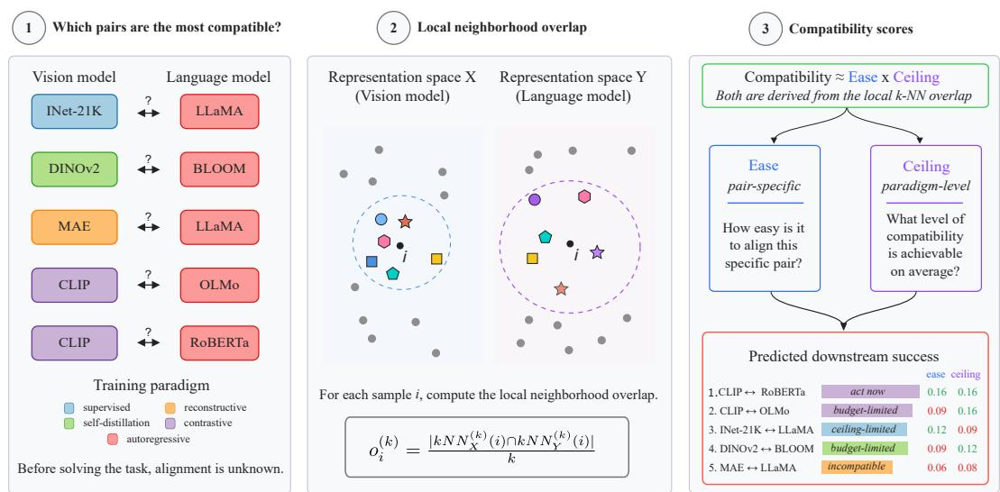  
Figure 1: Given a library of candidate encoders, the compatibility of a model pair is typically unknown before running the downstream transfer. Using COMPASS, we estimate the compatibility based on local neighborhood agreement: for each probe sample, we compare its local k-NN overlap across the two representation spaces. Aggregating this local overlap across different axes gives two scores computed before alignment or merging. Ease is a pair-specific score that measures how close the selected pair is at the start of the relevant dynamics: before encoder training in cross-modal alignment, and before weight merging in task arithmetic. Ceiling is a paradigm-level score that estimates how much agreement the corresponding training paradigms can support on average. Candidate pairs are ranked by combining ease and ceiling. Each axis is thresholded at its median value: green compatibility scores are above the corresponding median while the red ones are below it. The resulting high/low pattern assigns each pair to one of four regimes: act now (high ease, high ceiling), budget-limited (low ease, high ceiling), ceiling-limited (high ease, low ceiling), or incompatible (low ease, low ceiling).

Here, we close the gap and give a theoretical motivation for why local overlap should predict modelpair compatibility. Motivated by this, we introduce COMPASS (COMPatibility ASsessment Score), a diagnostic that combines two cheap-to-compute axes (Figure 1). The first axis, the ease score, asks: How much agreement does a pair exhibit before any training? Pairs that already agree on local neighborhoods need only modest training for them to locally agree, whereas pairs with low initial agreement require substantially more training. The second axis, the ceiling score, asks: How much agreement can the training paradigms of model pairs support in general before training, averaged across models drawn from those paradigms? Paradigms with very different training objectives (e.g., reconstructive vs. autoregressive) exhibit limited agreement, regardless of how well aligned the pair is.

We combine ease and ceiling multiplicatively to obtain the continuous COMPASS score, which ranks candidate pairs by favoring those that are strong on both axes. For interpretability, thresholding each axis at its median gives a phase diagram that groups candidate pairs into four regimes: act now (high ease, high ceiling), budget-limited (low ease, high ceiling), ceiling-limited (high ease, low ceiling), and incompatible (low ease, low ceiling). Act-now pairs are the strongest immediate candidates, and their transfer is expected to be both feasible and efficient. For budget-limited pairs, the success may require more data, optimization, or a stronger partner. For ceiling-limited pairs, one should switch to a paradigm whose target is closer to the downstream target. Incompatible pairs are weak on both axes and should be deprioritized. The regimes summarize the ranking; the continuous score remains the primary output.

We evaluate COMPASS in two applications: cross-modal alignment and task-arithmetic merging. In cross-modal alignment, we consider 72 vision-language pairs and show that COMPASS predicts retrieval R@1 with Pearson correlation of 0.90 on the Flickr30k dataset [17] and 0.91 on the COCO dataset [18] , compared to the Pearson correlation of 0.63 and 0.68 for global CKA [19]. In task-arithmetic merging, we consider 392 task pairs from 14 ViT checkpoints fine-tuned on the 8 image-classification tasks from the standard task-arithmetic benchmark [11]. COMPASS predicts mean retention across the 8 image-classification tasks with Pearson correlation of 0.70, compared to 0.25 for global CKA [19].

Contributions. (i) We introduce COMPASS, a diagnostic for selecting model pairs before expensive alignment or merging, combining a pair-specific ease score with a paradigm-level ceiling score. (ii) We provide a supporting analysis on how quickly the two models will become better aligned, given how close they start, and on a bound that says how close two models’ local neighborhoods can ever get, given their training paradigms. (iii) We validate COMPASS across cross-modal alignment and task-arithmetic merging, demonstrating that it strongly correlates with downstream transfer success and reliably ranks candidate pairs before transfer.

## 2 Related work

Representational convergence. Representational convergence studies whether independently trained models recover similar structure in their learned representations. Early evidence showed that different networks trained on the same task learn similar features [20] and that representations from different networks can often be stitched together [21], suggesting shared structure across independently trained models. At the scale of foundation models, the Platonic Representation Hypothesis [15] proposed that sufficiently broad and capable models may converge toward a shared representation. The Aristotelian Representation Hypothesis [16] questioned this global view and showed that only local neighborhood alignment can be empirically observed. Gupta et al. [22] demonstrated strong convergence within CLIP-style architectures. Together, these works provide growing empirical evidence that representational convergence is real but more often local than global. We build on this view but shift the focus from observation to application by using local agreement of trained models to select suitable model pairs for alignment and merging.

Structure of training objectives. Training objectives shape the geometry of learned representations by specifying the conditional relationships that the model is trained to learn. This makes them central to model compatibility: two models trained with similar objectives may induce similar neighborhoods, whereas models trained with different objectives may preserve different notions of similarity. The I-Con framework [23] unified contrastive, non-contrastive, and clustering objectives by minimizing Kullback–Leibler (KL) divergence over conditional distributions. We use this view to connect objective-level similarity to local representational agreement. If two training paradigms induce similar neighborhood structure, their representations can support higher local agreement; if they induce different neighborhoods, downstream transfer is limited even before optimization begins. This motivates our paradigm-level ceiling score, which estimates how much local agreement a pair of training paradigms can support.

Multi-modal alignment. Multi-modal alignment aims to map representations from different modali ties into a shared space where semantically corresponding inputs are close [1–3]. A central difficulty is that different modalities may retain distinct geometry even after alignment. Liang et al. [24] identified such a persistent “modality gap” in CLIP representations, showing that image and text embeddings occupy distinct regions of the shared space even after contrastive training. Most work on alignment focuses on improving the alignment method [4, 5] or reducing the amount of paired data required for alignment [25, 6]. Our goal is complementary; we provide a pre-alignment diagnostic for model selection. We show that local k-NN overlap is cheap to compute on a probe set, suggesting which frozen encoder pairs are worth aligning before expensive training is run.

Weight-space transfer and model merging. Model merging combines multiple trained models directly in weight space, with the goal of reusing their capabilities without training a new model from scratch. Examples include model soups [7], which average fine-tuned weights, task arithmetic [11], which edits behavior via weight-space task vectors, and evolutionary merging [10], which searches over merging recipes across tasks. These methods are most effective when checkpoints being combined remain compatible; otherwise, averaging can interpolate into a region that preserves neither model well. Existing merging approaches typically discover this only after performing the merge and evaluating the result [7, 11, 10]. In contrast, we study whether mergeability can be estimated beforehand. For two fine-tuned checkpoints, we measure whether they agree on local neighborhoods and use this agreement to predict merge quality before actual model merging.

## 3 Preliminaries

We measure agreement using local k-NN overlap, the fraction of nearest neighbors that two encoders share for each sample. Gröger et al. [16] showed that representational convergence persists across architectures and modalities at the level of local neighborhoods, while global agreement is not observed. Appendix D confirms that, on our model library, local overlap correlates with downstream transfer more strongly than global agreement (e.g., CKA [19]) does.

Setup. We assume a probe set of $N$ samples indexed by $V : = \{ 1 , \ldots , N \}$ . Two encoders X and $Y$ embed each sample $i \in V$ , producing embeddings of possibly different dimensions. The theory is agnostic to the choice of probe set; the empirical setup is described in Appendix B.

Neighborhood overlap. For each sample i and each encoder, we list the k nearest other samples in the probe set. The neighborhood overlap at i is the fraction of this set that is shared between the two encoders, quantifying how strongly they agree on which samples are neighbors of i, irrespective of their order.

Let $\mathrm { k N N } _ { X } ^ { ( k ) } ( i ) \subseteq V \setminus \{ i \}$ denote the k nearest neighbors of i in encoder X (ties broken by a fixed deterministic rule). The per-sample overlap and its dataset-level average are respectively defined as:

$$
o _ { i } ( k ) : = \frac { \lvert \mathrm { k N N } _ { X } ^ { ( k ) } ( i ) \cap \mathrm { k N N } _ { Y } ^ { ( k ) } ( i ) \rvert } { k } , \quad O ( k ) : = \frac { 1 } { N } \sum _ { i = 1 } ^ { N } o _ { i } ^ { ( k ) } ,\tag{1}
$$

where the per-sample overlap measures agreement around a single sample i, and its dataset-level average is the standard mutual k-NN overlap [15], which we refer to as the “overlap”. To simplify notation, we fix $k = 1 0$ throughout the paper as in [15, 16] and drop the argument (k). Appendix H.2 verifies that the results are unchanged at $\bar { k } \in \{ 2 0 , 5 0 , 1 0 0 \}$ .

Neighborhood distribution. To apply information-theoretic tools, we encode the k-NN set of each encoder as a probability distribution that places mass $1 / k$ on each neighbor and zero elsewhere. We call this the hard neighborhood distribution of encoder X at sample i, a uniform-mass k-NN distribution of the form used in Alshammari et al. [23]:

$$
p _ { X } ( j \mid i ) : = { \binom { 1 / k , \quad j \in \mathrm { k N N } _ { X } ( i ) , } { 0 , \quad { \mathrm { ~ o t h e r w i s e } } , } }\tag{2}
$$

with $p _ { Y } ( j \mid i )$ defined analogously.

To ensure that the KL divergences in Theorem 4.2 are well-defined, we consider a smoothed version of each hard neighborhood distribution with full support over the non-self indices. Let $\nu ( j \mid i ) : =$ $\textstyle { \frac { 1 } { N - 1 } } \mathbb { 1 } \{ j \neq i \}$ denote the uniform distribution over the non-self indices $V \setminus \{ i \}$ . For a fixed small constant $\varepsilon \in ( 0 , 1 )$ , we define

$$
q _ { X } ( j \mid i ) : = ( 1 - \varepsilon ) p _ { X } ( j \mid i ) + \varepsilon \nu ( j \mid i ) .\tag{3}
$$

## 4 Theoretical motivation

We motivate COMPASS through sufficient conditions under which local overlap is informative for compatibility. Theorem 4.1 connects start-condition overlap to finite-budget convergence, motivating ease; Theorem 4.2 connects target discrepancy to achievable overlap, motivating ceiling. These results provide supporting motivation rather than universal guarantees; assumptions and failure modes are discussed in Appendix A and Appendix F.1.

## 4.1 Pair-specific ease: per-sample start-condition overlap

We first consider per-sample start-condition overlap and ask whether two models that are compatible in principle can reach high agreement within a finite training budget. Specifically, we consider the start-condition neighborhood overlap, $o _ { i } ^ { ( 0 ) }$ , defined as the per-sample overlap from Equation (1), measured at $t = 0$ of the relevant training dynamics, that is before alignment in the cross-modal setting and before weight merging in the task-arithmetic setting.

For a fixed anchor sample $i ,$ let $q _ { W } ^ { ( t ) } ( \cdot ~ | ~ i )$ denote the neighborhood distribution induced by model $W \in \{ X , Y \}$ at training step $t ,$ and let $q _ { W } ^ { \star } ( \cdot \mid i )$ denote the target neighborhood distribution that the model is trying to reach. We regard two models as having converged towards each other when the total variation distance (TV) between their induced neighborhood distributions, $\delta _ { i } ^ { ( t ) } : = \mathrm { T V } ( q _ { X } ^ { ( t ) } ( \cdot \mid i ) , q _ { Y } ^ { ( t ) } ( \cdot \mid i ) )$ , falls below the tolerance threshold η. We now impose two dynamical assumptions on the training trajectory. First, we assume that after T training steps, at least one model lies within total variation distance $\xi$ of its target distribution $q _ { W } ^ { \star } ( \cdot \mid i )$ with probability at least pT. Second, we suppose that after t training steps the expected per-sample TV gap between the two models’ neighborhood distributions, $\delta _ { i } ^ { ( t ) }$ , is at most $\lambda ( t ) \delta _ { i } ^ { ( 0 ) }$ , for a nonincreasing decay function λ with $\lambda ( t ) \to 0 { \mathrm { ~ a s ~ } } t \to \infty$ . Full statements and discussion of failure modes are in Appendix F.1.

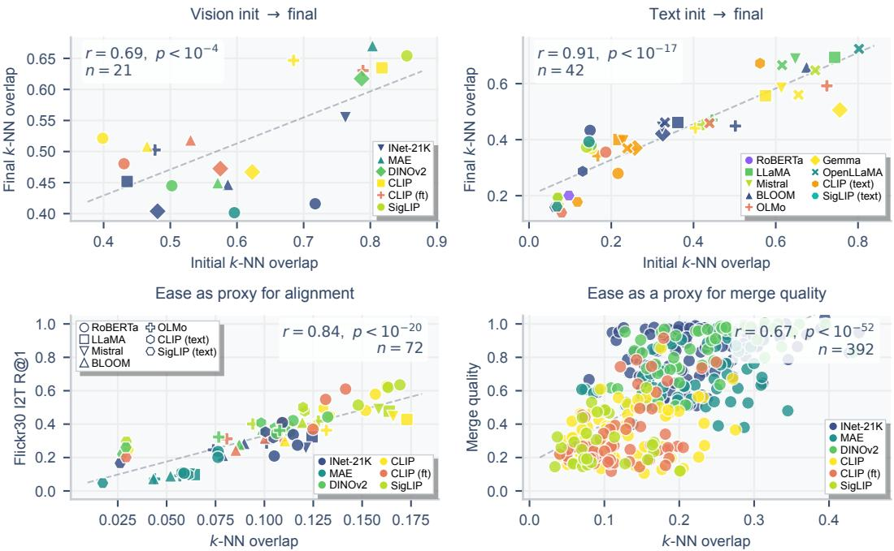  
Figure 2: Theorem 4.1 across four settings, each showing a start-condition score against the corresponding endpoint. Top: unimodal validation. Initial random k-NN overlap predicts final pretrained overlap across $n = 2 1$ vision family pairs (left; $r = 0 . 6 9 , p < 1 0 ^ { - 4 } )$ and $n = 4 2$ text family pairs (right; $r = 0 . \dot { 9 } 1 , p < 1 0 ^ { - 1 7 } )$ Bottom left: cross-modal alignment. Pretrained k-NN overlap predicts Flickr30k I2T R@1 after alignment $( r = 0 . 8 \dot { 4 } , p < 1 0 ^ { - 2 0 } )$ across $n = 7 2$ vision-language pairs. Bottom right: model merging via task arithmetic. k-NN overlap between fine-tuned checkpoints predicts merge quality $( r = 0 . 6 7 , p < \mathrm { 1 0 } ^ { - 5 2 } )$ across $n = 3 9 2$ model merges. Color encodes the vision/text family throughout. In the top panels (unimodal) and bottom-left (cross-modal alignment), marker shape encodes the other family of the pair (text family in the cross-modal case). The bottom-right merging panel uses a single shape, since each point has a single base-model family. Initialization structure that underlies the unimodal panels is reported in Appendix H.1. The same qualitative pattern holds at k ∈ {20, 50, 100} (Appendix H.2).

Theorem 4.1 (Per-sample start-condition overlap controls finite-time convergence). Under the assumptions stated above,for every $\eta > 0$ andfor each sample i, with probability at least

$$
\left[ p _ { T } - \frac { \lambda ( T ) ( 1 - \varepsilon ) \big ( 1 - o _ { i } ^ { ( 0 ) } \big ) } { \eta } \right] _ { + }\tag{4}
$$

after $T$ training steps, at least one of the two models is within distance $\xi o f$ its target neighborhood distribution and the two models remain within gap η ofeach other. Here ε is the smoothing parameter in the smoothed k-NN distributionfrom Equation (3), and $[ z ] _ { + } : = \operatorname* { m a x } \{ z , 0 \}$

Proof. See Appendix F.3. Extension. Under an additional basin condition (Appendix F.1), this extends to asymptotic convergence (Appendix F.4). □

The bound motivates using per-sample start-condition overlap as the pair-specific ease score: it is measurable before any joint optimization, and higher values reduce the initial inter-model gap $\delta _ { i } ^ { ( 0 ) } = ( 1 - \varepsilon ) ( 1 - o _ { i } ^ { ( 0 ) } )$ , thereby tightening the finite-time guarantee. Pairs with higher per-sample start-condition overlap are therefore easier to make compatible within a fixed training budget.

In practice, the start-condition overlap is the per-sample overlap measured at the start of the relevant training dynamics, $o _ { i } ^ { ( 0 ) }$ , which differs by setting. In unimodal convergence, the dynamics goes from a random initialization to the pretrained model, so the per-sample start-condition overlap is the per-sample overlap between two random initializations of the architecture. In cross-modal alignment, the dynamics goes from the two frozen pretrained models to the trained adapter, so the per-sample start-condition overlap is the pretrained per-sample overlap between those models. In task-arithmetic merging, the dynamics start from the two fine-tuned checkpoints to their weight-averaged combination, so the per-sample start-condition overlap is the per-sample overlap between the two checkpoints. Figure 2 shows the per-sample start-condition overlap against the corresponding endpoint across different settings.

## 4.2 Paradigm-level ceiling: target discrepancy

We now look into the paradigm-level component of compatibility. Even if two models start from a favorable pair-specific per-sample start-condition overlap, their training objectives [23] $( e . g .$ contrastive, reconstructive, self-distillation) may result in different neighborhoods. Such disagreement limits the per-sample overlap that the two representations can support, independently of the finite training budget. We formalize this obstruction through a target-discrepancy term and show that it determines the paradigm-level ceiling used in COMPASS.

For each model $W \in \{ X , Y \}$ , we define $q _ { W } ^ { \star } ( \cdot \mid i )$ to be the target conditional distribution over candidate neighbors of anchor sample i, supported on all samples except i itself. The learned smoothed neighborhood distribution is $q _ { W } ^ { ( t ) } ( \cdot \mid i )$ , and the training objective is represented as minimizing the KL divergence $D _ { \mathrm { K L } } \big ( q _ { W } ^ { \star } ( \cdot \mid i ) \| q _ { W } ^ { ( t ) } ( \cdot \mid i ) \big )$ . Define the target discrepancy as:

$$
\gamma _ { i } : = \mathrm { T V } \big ( q _ { X } ^ { \star } ( \cdot \mid i ) , q _ { Y } ^ { \star } ( \cdot \mid i ) \big ) ,\tag{5}
$$

where $\gamma _ { i }$ measures how differently the two paradigms define neighbors of sample i. Small $\gamma _ { i }$ means that the two objectives induce similar local topology, whereas large $\gamma _ { i }$ means that the objectives favor incompatible neighborhood structures.

In practice, the targets $q _ { W } ^ { \star }$ are not directly observable; we only need to estimate $\bar { \gamma } : = \mathbb { E } _ { i } [ \gamma _ { i } ]$ , the mean target discrepancy across the probe set. This quantity summarizes how strongly the two training paradigms disagree in the local neighborhoods they induce.

Theorem 4.2 (Target discrepancy caps per-sample overlap). For each sample i at time step t,

$$
o _ { i } ^ { ( t ) } \leq 1 - \frac { 1 } { 1 - \varepsilon } \left[ \gamma _ { i } - \sqrt { \frac { 1 } { 2 } D _ { \mathrm { K L } } \big ( q _ { X } ^ { \star } ( \cdot \mid i ) \| q _ { X } ^ { ( t ) } ( \cdot \mid i ) \big ) } - \sqrt { \frac { 1 } { 2 } D _ { \mathrm { K L } } \big ( q _ { Y } ^ { \star } ( \cdot \mid i ) \| q _ { Y } ^ { ( t ) } ( \cdot \mid i ) \big ) } \right] .\tag{6}
$$

Proof. See Appendix G.1.

Continued optimization drives the two KL terms to zero but cannot reduce $\gamma _ { i } ,$ so achievable persample overlap is bounded by $1 - \gamma _ { i } / ( 1 - \varepsilon )$ even under perfect optimization. Averaging the bound over samples yields a paradigm-level statement: the mean overlap is bounded above by $1 - \bar { \gamma } / ( 1 - \varepsilon )$ in the limit of perfect optimization. This motivates an empirical paradigm-level proxy for the achievable overlap, which we call the ceiling score.

## 4.3 Implications from combining ease and ceiling

Together, Theorem 4.1 and Theorem 4.2 motivate complementary finite-budget and achievable agreement components of compatibility.

The event in Theorem 4.1 has two parts: at least one model reaches its target within tolerance $\xi ,$ and the two models remain within gap $\eta$ of each other. If the two models X and Y share the same target $q ^ { \star } ( \cdot \mid i )$ , then the triangle inequality implies that both models are within $\xi + \eta$ of this shared target. More generally, when the targets differ, if model $X ,$ , for example, is within $\xi$ of its target, then model $Y$ is within $\xi + \eta$ of model $\breve { X } ^ { \bullet } \mathrm { s }$ target and within $\xi + \eta + \gamma _ { i }$ of its own target, where $\gamma _ { i }$ is the target discrepancy defined in Equation (5). Thus, start-condition overlap controls the finite-time probability of reaching a common neighborhood structure, while any mismatch between the targets appears as an additional obstruction. The bound increases strictly in the per-sample start-condition overlap $o _ { i } ^ { ( 0 ) }$ , so pairs that start with more shared neighbors have a tighter finite-time guarantee.

## 5 Cheap-to-compute scores for downstream problems

The pair-specific ease and paradigm-level ceiling scores together provide a measure of model compatibility for the two applications we consider: (i) cross-modal alignment, and (ii) model merging. We combine them into a simple diagnostic recipe, COMPASS (COMPatibility ASsessment Score), which ranks candidate model pairs before any transfer is performed. Both quantities are inexpensive to compute, requiring only forward passes over a small probe set.

The probe set should be drawn from the relevant data distribution, i.e., image-text pairs for crossmodal alignment (where the diagnostic measures vision-text agreement) and task-relevant images for merging fine-tuned checkpoints (where it measures agreement between models specialized to those tasks). In practice, we use 1024 image-text pairs from WIT [26] for alignment, and a 2048-sample probe pooled from one of the eight fine-tuning tasks for merging, here MNIST [27] (Appendix H.3 ablates the choice).

Candidate pairs are ranked by the product of ease and ceiling scores. Importantly, feature extraction scales with the number of models rather than candidate pairs. For the $1 9 \times 1 0$ alignment grid, COMPASS requires only 29 probe passes instead of 190 downstream alignment runs. In our setup, this translates to more than two orders of magnitude lower wall-clock cost, with full timing details reported in Appendix H.10.

☼ COMPASS: Model compatibility diagnostic. Given a library of candidate models and a way to combine them (e.g., cross-modal alignment or task-arithmetic model merging):

1. Compute ease and ceiling on the probe set. Ease is the pair-specific k-NN overlap measured at the start of the relevant training dynamics. Ceiling is a paradigm-level mean k-NN overlap that estimates the upper bound on agreement the two paradigms can support. Both scores lie in [0, 1]; higher score is better.

2. Rank pairs by the product of ease and ceiling. Produce ranking of pairs by combining ease and ceiling scores. Pairs with higher scores should be prioritized.

3. Read the quadrant as a fallback diagnostic. Splitting each axis at its median yields four regimes: (i) act now (high ease, high ceiling), (ii) budget-limited (low ease, high ceiling), (iii) ceiling-limited (high ease, low ceiling), and (iv) incompatible (low ease, low ceiling). For budget-limited, invest in more data, optimization, or a stronger partner. For ceilinglimited, switch to a paradigm whose target is closer to the downstream target. Deprioritize incompatible pairs.

Figure 3 compares the correlation between candidate predictors and the downstream outcome in cross-modal alignment and model merging via task arithmetic. In cross-modal alignment, we measure the downstream outcome as image-to-text Recall@1 (R@1) after training a CSA adapter, evaluated on Flickr30k and COCO datasets. The product ease × ceiling reaches Pearson correlation of $| r | = 0 . 9 0$ with R@1 on the Flickr30k I2T dataset and $| r | = 0 . 9 1$ with R@1 on the COCO I2T dataset, compared to 0.84/0.83 for ease alone and 0.85/0.83 for ceiling alone, respectively. In task-arithmetic model merging, we measure the downstream outcome as the mean of per-task accuracy retained relative to the unmerged checkpoints after weight averaging, evaluated across 392 task-pair merges from 14 pretrained ViT backbones spanning five pretraining paradigms. The product ease × ceiling reaches $| \bar { r } | = 0 . 7 0$ with merge quality, compared to 0.67 for ease alone and 0.64 for ceiling alone. Global CKA, in contrast, correlates only weakly with downstream outcomes in both applications (0.63/0.68 for alignment, 0.25 for merging).

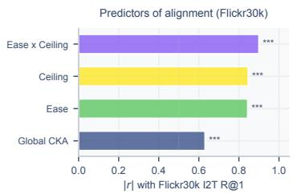

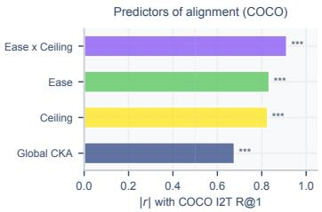

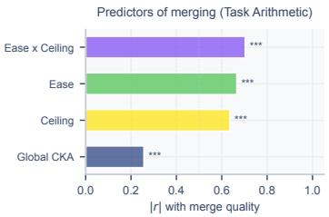  
Figure 3: Absolute Pearson correlations between each candidate predictor and the downstream outcome; significance against zero is indicated by $^ { * } p < 0 . 0 5 , ^ { * * } p < 0 . 0 1 , ^ { \widehat { * * } * } p < 0 . 0 0 1$ . Left/Center: cross-modal alignment evaluated on Flickr30k and COCO I2T R@1 $( n = 7 2 { \mathrm { p a i r s } } )$ . Ease (pretrained k-NN overlap) and ceiling (paradigm-level cross-modal overlap) dominate, with their product $( E a s e \times C e i l i n g )$ reaching $| r | = 0 . 9 0$ (Flickr30k) and $| r | = 0 . 9 1$ (COCO). Right: task-arithmetic merging against mean retention $( n = 3 9 2 )$ . The product predictor $( E a s e \times C e i l i n g )$ reaches $| r | = 0 . 7 0$ , with ease at $| \bar { r } | = 0 . 6 7$ and ceiling at $| r | = 0 . 6 4$ alone.

Because the practical goal is model selection, we next ask whether this advantage is preserved at the level of pair rankings. We compare COMPASS with the alternative predictors using Spearman ρ and Kendall τ. COMPASS remains the strongest predictor, reaching Spearman $\rho = 0 . 9 1 / 0 . 9 3$ on Flickr30k/COCO and 0.70 for merging; full results are reported in Appendix H.6. Under budgeted evaluation, COMPASS finds the optimal alignment pair immediately and the optimal merge within the first 5 of 392 candidates (Appendix H.6).

We further test whether this advantage depends on the particular set of predictors considered in Figure 3. Comparisons with metadata predictors, alternative representational similarities, and learned metadata regressors are reported in Appendix H.7. COMPASS outperforms the baselines computed before alignment or merging; learned regressors can perform strongly when trained on completed alignment or merging outcomes, but degrade under held-out families or paradigms.

## 5.1 COMPASS for cross-modal alignment

Cross-modal alignment trains a learned adapter on paired image-text data so that a frozen vision encoder and a frozen language model produce compatible representations [1–6]. Following the setup of Gröger et al. [6], we connect the two encoders with a small learned adapter (CSA [25]) trained on MS-COCO [18] dataset. Downstream performance is measured on two retrieval benchmarks Flickr30k [17] and COCO [18] datasets using image-to-text R@1 after alignment. We evaluate 72 vision-language pairs spanning 19 vision models (6 paradigm families) and 10 text encoders (7 families); see Appendix B.1 for the full library.

For alignment, ease is the pretrained cross-modal k-NN overlap of the vision-text pair, while ceiling averages the vision encoder’s overlap across the reference language-model library; both are measured on the 1024-sized subset from WIT as in [15] before any alignment training (Appendix B.1.4). Intuitively, a vision paradigm whose pretraining target is already linked to language (contrastive vision-language) has a high ceiling, whereas one whose target is pixel reconstruction (masked autoencoding) has a low ceiling.

The ease axis separates pairs whose frozen encoders already agree on neighborhoods from those that do not. The ceiling axis separates contrastive vision-language paradigms (CLIP 0.140, SigLIP 0.134) from CLIP fine-tuned (0.112), self-distillation (0.109), discriminative (0.100), and reconstructive (0.058). Figure 4 shows the resulting phase diagram for both retrieval benchmarks; the quadrant structure is consistent across both. Mean Flickr30k I2T R@1 separates the regimes cleanly: act now (n = 28) reaches $0 . 4 6 \pm 0 . 0 9$ , ceiling-limited (n = 8) $0 . { \bar { 3 } } 4 \pm 0 . 0 5$ , budget-limited (n = 10) $0 . 3 0 \pm 0 . 0 6$ , and incompatible $( n = 2 6 ) 0 . 2 1 \pm 0 . 1 1$ , with the same ordering on COCO. A

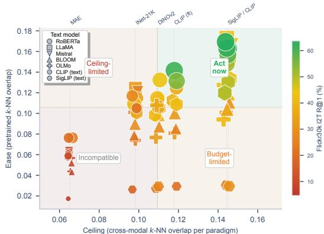

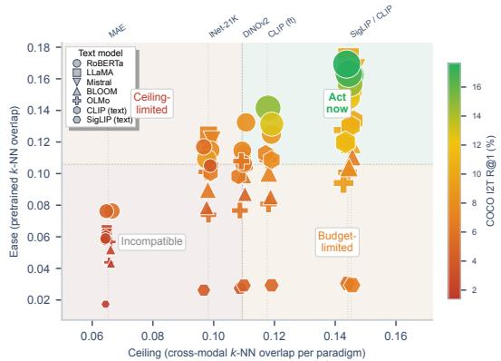  
Figure 4: Alignability phase diagram $( n = 7 2$ pairs). x-axis: paradigm-level mean cross-modal k-NN overlap (ceiling). y-axis: pretrained k-NN overlap (ease). Color and size encode retrieval I2T R@1 after alignment. Left: Flickr30k. Right: COCO. The quadrant structure is consistent across both benchmarks

Kruskal–Wallis test [28] rejects the null that the four regimes share the same R@1 distribution (Flickr30k: $H = 4 5 . 3 , p \check { < } 1 0 ^ { - 9 }$ ; COCO: $H = 5 1 . 5 , \overline { { p } } < 1 0 ^ { - 1 0 } )$ . Appendix H.5 reports the full per-regime distribution. Contrastive vision-language paradigms (CLIP, SigLIP, CLIP-FT) and the largest DINOv2 variants populate act now, reaching up to 63% Flickr R@1; smaller DINOv2 and ImageNet-21K models fall into ceiling-limited; MAE (mean Flickr R@1 0.11, range 5-24%) along with the smallest ImageNet-21K and DINOv2 models occupy incompatible. The unusually low-overlap cases associated with the SigLIP text tower are analyzed in Appendix H.13.

We next test whether this relationship is driven by coarse differences between model families or by details of the alignment setup. First, ease remains predictive when the vision-model family is held fixed: within each of the six vision families, ease correlates positively with R@1 across the text partners, with a median Spearman $\rho = 0 . 8 0$ (Appendix H.11), showing that its signal is not explained only by broad differences between pretraining paradigms. Second, the diagnostic tracks changes even within a fixed architecture: classification fine-tuning lowers the cross-modal ceiling at all three tested CLIP scales, with retrieval changing in the same direction (Appendix H.12). Finally, the resulting pair ranking is not specific to CSA: on 24 representative pairs, COMPASS remains predictive under trained Linear, MLP, and LoRA-style adapters, and outperforms global CKA in each case (Appendix H.9).

The training-budget experiments further clarify the meaning of ceiling. Across 18 alignment pairs, its correlation with downstream performance increases from $\rho = 0 . 7 9$ after 10 epochs to 0.92 after 300 epochs, as low-ceiling pairs saturate while higher-ceiling pairs continue toward stronger outcomes (Appendix H.14). Ceiling therefore captures the level of performance that a transfer setting can ultimately support, rather than the marginal improvement obtained from increasing the training budget over an arbitrary interval.

## 5.2 COMPASS for task-arithmetic model merging

Combining the weights of multiple fine-tuned models is a common alternative to joint multi-task training [7–10]. We focus on the task arithmetic [11]: two checkpoints of the same base model, each fine-tuned on a different downstream task, are combined into a single model whose weights are the average of the two, with the goal of inheriting the capabilities of both. The downstream metric is mean retention across the two original tasks after merging. We fine-tune 14 models (9 ViT-B/16, 4 ViT-L/14-16, 1 ViT-T/16) from 5 pretraining paradigms on 8 tasks from the standard benchmark [11] and merge all within-paradigm pairs (392 model merges in total). Details and the full task-arithmetic multi-task extension are in Appendix H.4.

For task-arithmetic merging, ease is the pre-merge k-NN overlap between the two fine-tuned checkpoints, while ceiling measures specialization of their pretrained base model relative to the reference vision-model library (Appendix B.1.4).

If the two checkpoints already agree on neighborhood structure, weight averaging is unlikely to interpolate destructively, consistent with the linear mode connectivity literature [29, 30]; whereas if they disagree, averaging interpolates into a region that neither checkpoint occupied. Specialized paradigms, such as those whose features differ most from other paradigms, produce smaller, more consistent task vectors under finetuning, so weight averaging drifts less.

The four regimes mirror those in Section 5.1, applied to fine-tuned checkpoints rather than pretrained encoders. Discriminative, selfdistillation, and reconstructive paradigms populate the act now regime; the ceiling-limited and incompatible regimes concentrate on contrastive vision-language paradigms, whose features change substantially under classification fine-tuning. Mean retention again separates the

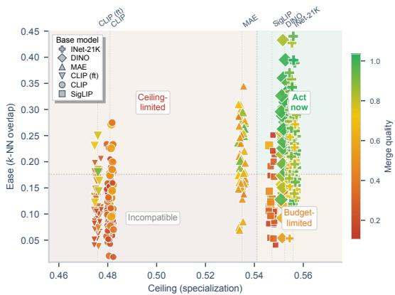  
Figure 5: Mergeability phase diagram $( n = 3 9 2$ pairs). x-axis: paradigm specialization, defined as 1− mean across-paradigm k-NN overlap from the convergence experiments (ceiling). y-axis: pair-specific pre-merge k-NN overlap (ease). Color and size encode merge quality.

regimes cleanly (Kruskal–Wallis $H = 1 9 8 . 2 , p < 1 0 ^ { - 4 2 } ) \colon$ act now $( n = 1 2 9 )$ at $0 . 8 4 \pm 0 . 1 6$ budget-limited $( n = 6 7 )$ at $0 . 5 7 \pm 0 . 2 6$ , ceiling-limited $( n = 6 7 )$ at $0 . 5 6 \pm 0 . 2 3$ , and incompatible $( n = 1 2 9 )$ at $0 . 3 5 \pm 0 . 1 7$ (Appendix H.5). Budget-limited and ceiling-limited pairs reach almost the same mean retention (0.57 vs. 0.56), yet they call for different actions: more optimization or a stronger partner for the first, a different paradigm for the second. The regime label carries this distinction, the score alone does not.

## 6 Discussion

In this work, we show that model-pair compatibility can be estimated before running an expensive transfer procedure. A small probe set is enough to measure whether two models agree on local neighborhoods, and this local agreement provides a strong signal of downstream transfer success.

The key idea is to separate compatibility into two parts. Ease measures whether a specific pair already starts close: it is high when the two encoders assign similar neighbors to the same examples before alignment or merging. Ceiling measures whether the corresponding training paradigms are compatible with the application: it is high when the paradigms leave enough room for strong agreement to emerge. The combination of scores yields a simple phase diagram that distinguishes pairs worth using immediately from pairs that are budget-limited, ceiling-limited, or unlikely to succeed.

This two-axis view explains why the same model family can behave differently across applications. Contrastive vision-language models are favorable for cross-modal alignment, where their pretraining objective is close to the downstream target, but unfavorable for task-arithmetic merging across classification tasks. Discriminative and self-distillation models show the reverse pattern. Thus, the relevant question is not whether a paradigm is universally good, but whether its objective is compatible with the transfer operation at hand.

These conclusions are robust to both the composition of the model library and the precise estimation of the ceiling. Recomputing COMPASS while leaving out individual families or paradigms preserves correlations of 0.85–0.93 for alignment and 0.60-0.72 for merging on the remaining candidate pools (Appendix H.8). Likewise, replacing pair-specific ceiling estimates with a single shared value per paradigm, or perturbing them with moderate noise, leaves the ranking largely unchanged, whereas shuffling the paradigm ordering removes this benefit (Appendix H.10). The four regimes in our phase diagram should therefore be viewed as an interpretable summary rather than strict categories; for finer-grained comparisons, the continuous ease × ceiling score is more informative. We discuss further limitations of COMPASS in Appendix A.

COMPASS can help practitioners spend their compute budget where it is most likely to pay off. By ranking candidate pairs using only forward passes on a small probe set, it reduces the need to align or merge every possible combination. Its two-axis diagnostic also indicates whether to invest further in a pair or reconsider the pretraining paradigm. As pretrained model libraries grow, such inexpensive compatibility checks can make model selection more systematic and guide costly experiments toward the most promising combinations.

## Acknowledgements

We thank Shuo Wen, Artyom Gadetsky, Maxim Kodryan, and Jack Naimer for their valuable suggestions, which helped improve the clarity of the manuscript. We gratefully acknowledge the support of the Swiss National Science Foundation (SNSF) starting grant TMSGI2\_226252/1, SNSF grant IC00I0\_231922, SNSF grant 10.004.411, Swiss Cancer League (KFS-6340-02-2025-R), Kamprad Foundation (Cancer Immunotherapy Networking Program), and the Swiss AI Initiative Large Call (ab006). Maria Brbic is a CIFAR Fellow in the Multiscale Human Program.´

## References

[1] Xiaohua Zhai, Xiao Wang, Basil Mustafa, Andreas Steiner, Daniel Keysers, Alexander Kolesnikov, and Lucas Beyer. LiT: Zero-shot transfer with locked-image text tuning. In Conference on Computer Vision and Pattern Recognition (CVPR), 2022.

[2] Junnan Li, Dongxu Li, Silvio Savarese, and Steven Hoi. BLIP-2: Bootstrapping language-image pretraining with frozen image encoders and large language models. In International Conference on Machine Learning (ICML), 2023.

[3] Jean-Baptiste Alayrac, Jeff Donahue, Pauline Luc, Antoine Miech, Iain Barr, Yana Hasson, Karel Lenc, Arthur Mensch, Katie Millican, Malcolm Reynolds, et al. Flamingo: A visual language model for few-shot learning. In Advances in Neural Information Processing Systems (NeurIPS), 2022.

[4] Jack Merullo, Louis Castricato, Carsten Eickhoff, and Ellie Pavlick. Linearly mapping from image to text space. In International Conference on Learning Representations (ICLR), 2023.

[5] Jing Yu Koh, Ruslan Salakhutdinov, and Daniel Fried. Grounding language models to images for multimodal inputs and outputs. In International Conference on Machine Learning (ICML), 2023.

[6] Fabian Gröger, Shuo Wen, Huyen Le, and Maria Brbic. With limited data for multimodal alignment, let´ the structure guide you. In Advances in Neural Information Processing Systems (NeurIPS), 2025.

[7] Mitchell Wortsman, Gabriel Ilharco, Samir Yitzhak Gadre, Rebecca Roelofs, Raphael Gontijo-Lopes, Ari S. Morcos, Hongseok Namkoong, Ali Farhadi, Yair Carmon, Simon Kornblith, and Ludwig Schmidt. Model soups: Averaging weights of multiple fine-tuned models improves accuracy without increasing inference time. In International Conference on Machine Learning (ICML), 2022.

[8] Michael S. Matena and Colin A. Raffel. Merging models with Fisher-weighted averaging. In Advances in Neural Information Processing Systems (NeurIPS), 2022.

[9] Prateek Yadav, Derek Tam, Leshem Choshen, Colin A. Raffel, and Mohit Bansal. TIES-merging: Resolving interference when merging models. In Advances in Neural Information Processing Systems (NeurIPS), 2023.

[10] Takuya Akiba, Makoto Shing, Yujin Tang, Qi Sun, and David Ha. Evolutionary optimization of model merging recipes. Nature Machine Intelligence, 2025.

[11] Gabriel Ilharco, Marco Tulio Ribeiro, Mitchell Wortsman, Suchin Gururangan, Ludwig Schmidt, Hannaneh Hajishirzi, and Ali Farhadi. Editing models with task arithmetic. In International Conference on Learning Representations (ICLR), 2023.

[12] Alessandro Achille, Michael Lam, Rahul Tewari, Avinash Ravichandran, Subhransu Maji, Charless C Fowlkes, Stefano Soatto, and Pietro Perona. Task2vec: Task embedding for meta-learning. In International Conference on Computer Vision (ICCV), 2019.

[13] Cuong V Nguyen, Tal Hassner, Matthias Seeger, and Cedric Archambeau. LEEP: A new measure to evaluate transferability of learned representations. In International Conference on Machine Learning (ICML), 2020.

[14] Kaichao You, Yong Liu, Jianmin Wang, and Mingsheng Long. LogME: Practical assessment of pre-trained models for transfer learning. In International Conference on Machine Learning (ICML), 2021.

[15] Minyoung Huh, Brian Cheung, Tongzhou Wang, and Phillip Isola. The Platonic Representation Hypothesis. In International Conference on Machine Learning (ICML), 2024.

[16] Fabian Gröger, Shuo Wen, and Maria Brbic. Revisiting the Platonic Representation Hypothesis: An´ Aristotelian view. In International Conference on Machine Learning (ICML), 2026.

[17] Bryan A Plummer, Liwei Wang, Chris M Cervantes, Juan C Caicedo, Julia Hockenmaier, and Svetlana Lazebnik. Flickr30k entities: Collecting region-to-phrase correspondences for richer image-to-sentence models. In International Conference on Computer Vision (ICCV), 2015.

[18] Tsung-Yi Lin, Michael Maire, Serge Belongie, Lubomir Bourdev, Ross Girshick, James Hays, Pietro Perona, Deva Ramanan, C Lawrence Zitnick, and Piotr Dollár. Microsoft COCO: Common objects in context. In European Conference on Computer Vision (ECCV), 2014.

[19] Simon Kornblith, Mohammad Norouzi, Honglak Lee, and Geoffrey Hinton. Similarity of neural network representations revisited. In International Conference on Machine Learning (ICML), 2019.

[20] Yixuan Li, Jason Yosinski, Jeff Clune, Hod Lipson, and John Hopcroft. Convergent learning: Do different neural networks learn the same representations? In International Conference on Learning Representations (ICLR), 2016.

[21] Yamini Bansal, Preetum Nakkiran, and Boaz Barak. Revisiting model stitching to compare neural representations. In Advances in Neural Information Processing Systems (NeurIPS), 2021.

[22] Sharut Gupta, Sanyam Kansal, Stefanie Jegelka, Phillip Isola, and Vikas Garg. Canonicalizing multimoda contrastive representation learning. arXiv preprint, 2026.

[23] Shaden Alshammari, John Hershey, Axel Feldmann, William T. Freeman, and Mark Hamilton. I-Con: A unifying framework for representation learning. In International Conference on Learning Representations (ICLR), 2025.

[24] Weixin Liang, Yuhui Zhang, Yongchan Kwon, Serena Yeung, and James Zou. Mind the gap: Understanding the modality gap in multi-modal contrastive representation learning. In Advances in Neural Information Processing Systems (NeurIPS), 2022.

[25] Po-han Li, Sandeep P. Chinchali, and Ufuk Topcu. CSA: Data-efficient Mapping of Unimodal Features to Multimodal Features. In International Conference on Learning Representations (ICLR), 2025.

[26] Krishna Srinivasan, Karthik Raman, Jiecao Chen, Michael Bendersky, and Marc Najork. Wit: Wikipediabased image text dataset for multimodal multilingual machine learning. In ACM SIGIR Conference on Research and Development in Information Retrieval (SIGIR), 2021.

[27] Yann LeCun. The mnist database of handwritten digits. http://yann.lecun.com/exdb/mnist/, 1998.

[28] William H. Kruskal and W. Allen Wallis. Use of ranks in one-criterion variance analysis. Journal of the American Statistical Association, 1952.

[29] Timur Garipov, Pavel Izmailov, Dmitrii Podoprikhin, Dmitry P. Vetrov, and Andrew Gordon Wilson. Loss surfaces, mode connectivity, and fast ensembling of DNNs. In Advances in Neural Information Processing Systems (NeurIPS), 2018.

[30] Jonathan Frankle, Gintare Karolina Dziugaite, Daniel M. Roy, and Michael Carbin. Linear mode connectivity and the lottery ticket hypothesis. In International Conference on Machine Learning (ICML), 2020.

[31] Ross Wightman. PyTorch image models. https://github.com/rwightman/ pytorch-image-models, 2019.

[32] Tal Ridnik, Emanuel Ben-Baruch, Asaf Noy, and Lihi Zelnik-Manor. ImageNet-21K pretraining for the masses. In Advances in Neural Information Processing Systems (NeurIPS) Datasets and Benchmarks Track, 2021.

[33] Alexey Dosovitskiy, Lucas Beyer, Alexander Kolesnikov, Dirk Weissenborn, Xiaohua Zhai, Thomas Unterthiner, Mostafa Dehghani, Matthias Minderer, Georg Heigold, Sylvain Gelly, Jakob Uszkoreit, and Neil Houlsby. An image is worth 16x16 words: Transformers for image recognition at scale. In International Conference on Learning Representations (ICLR), 2021.

[34] Kaiming He, Xinlei Chen, Saining Xie, Yanghao Li, Piotr Dollár, and Ross Girshick. Masked autoencoders are scalable vision learners. In Conference on Computer Vision and Pattern Recognition (CVPR), 2022.

[35] Maxime Oquab, Timothée Darcet, Théo Moutakanni, Huy V. Vo, Marc Szafraniec, Vasil Khalidov, Pierre Fernandez, Daniel Haziza, Francisco Massa, Alaaeldin El-Nouby, Mahmoud Assran, Nicolas Ballas, Wojciech Galuba, Russell Howes, Po-Yao Huang, Shang-Wen Li, Ishan Misra, Michael Rabbat, Vasu Sharma, Gabriel Synnaeve, Hu Xu, Herve Jegou, Julien Mairal, Patrick Labatut, Armand Joulin, and Piotr Bojanowski. DINOv2: Learning robust visual features without supervision. Transactions on Machine Learning Research (TMLR), 2024.

[36] Alec Radford, Jong Wook Kim, Chris Hallacy, Aditya Ramesh, Gabriel Goh, Sandhini Agarwal, Girish Sastry, Amanda Askell, Pamela Mishkin, Jack Clark, Gretchen Krueger, and Ilya Sutskever. Learning transferable visual models from natural language supervision. In International Conference on Machine Learning (ICML), 2021.

[37] Xiaohua Zhai, Basil Mustafa, Alexander Kolesnikov, and Lucas Beyer. Sigmoid loss for language image pre-training. In International Conference on Computer Vision (ICCV), 2023.

[38] BigScience Workshop, Teven Le Scao, Angela Fan, Christopher Akiki, Ellie Pavlick, Suzana Ilic, Daniel´ Hesslow, Roman Castagné, Alexandra Sasha Luccioni, François Yvon, et al. Bloom: A 176b-parameter open-access multilingual language model. arXiv preprint, 2022.

[39] Xinyang Geng and Hao Liu. OpenLLaMA: An open reproduction of LLaMA. https://github.com/ openlm-research/open\_llama, 2023.

[40] Hugo Touvron, Thibaut Lavril, Gautier Izacard, Xavier Martinet, Marie-Anne Lachaux, Timothée Lacroix, Baptiste Rozière, Naman Goyal, Eric Hambro, Faisal Azhar, et al. Llama: Open and efficient foundation language models. arXiv preprint, 2023.

[41] Aaron Grattafiori, Abhimanyu Dubey, Abhinav Jauhri, Abhinav Pandey, Abhishek Kadian, Ahmad Al-Dahle, Aiesha Letman, Akhil Mathur, Alan Schelten, Alex Vaughan, et al. The llama 3 herd of models. arXiv preprint, 2024.

[42] Dirk Groeneveld, Iz Beltagy, Evan Walsh, Akshita Bhagia, Rodney Kinney, Oyvind Tafjord, Ananya Jha, Hamish Ivison, Ian Magnusson, Yizhong Wang, et al. Olmo: Accelerating the science of language models. In Annual Meeting ofthe Associationfor Computational Linguistics (ACL), 2024.

[43] Gemma Team, Thomas Mesnard, Cassidy Hardin, Robert Dadashi, Surya Bhupatiraju, Shreya Pathak, Laurent Sifre, Morgane Rivière, Mihir Sanjay Kale, Juliette Love, et al. Gemma: Open models based on gemini research and technology. arXiv preprint, 2024.

[44] Albert Q. Jiang, Alexandre Sablayrolles, Arthur Mensch, Chris Bamford, Devendra Singh Chaplot, Diego de las Casas, Florian Bressand, Gianna Lengyel, Guillaume Lample, Lucile Saulnier, Lélio Renard Lavaud, Marie-Anne Lachaux, Pierre Stock, Teven Le Scao, Thibaut Lavril, Thomas Wang, Timothée Lacroix, and William El Sayed. Mistral 7B. arXiv preprint, 2023.

[45] Yinhan Liu, Myle Ott, Naman Goyal, Jingfei Du, Mandar Joshi, Danqi Chen, Omer Levy, Mike Lewis, Luke Zettlemoyer, and Veselin Stoyanov. Roberta: A robustly optimized bert pretraining approach. arXiv preprint, 2019.

[46] Mathilde Caron, Hugo Touvron, Ishan Misra, Hervé Jégou, Julien Mairal, Piotr Bojanowski, and Armand Joulin. Emerging properties in self-supervised vision transformers. In International Conference on Computer Vision (ICCV), 2021.

[47] Oriane Siméoni, Huy V. Vo, Maximilian Seitzer, Federico Baldassarre, Maxime Oquab, Cijo Jose, Vasil Khalidov, Marc Szafraniec, Seungeun Yi, Michaël Ramamonjisoa, Francisco Massa, Daniel Haziza, Luca Wehrstedt, Jianyuan Wang, Timothée Darcet, Théo Moutakanni, Leonel Sentana, Claire Roberts, Andrea Vedaldi, Jamie Tolan, John Brandt, Camille Couprie, Julien Mairal, Hervé Jégou, Patrick Labatut, and Piotr Bojanowski. DINOv3. arXiv preprint, 2025.

[48] Ilya Loshchilov and Frank Hutter. Decoupled weight decay regularization. In International Conference on Learning Representations (ICLR), 2019.

[49] Ilya Loshchilov and Frank Hutter. SGDR: Stochastic gradient descent with warm restarts. In International Conference on Learning Representations (ICLR), 2017.

[50] Aäron van den Oord, Yazhe Li, and Oriol Vinyals. Representation learning with contrastive predictive coding. arXiv preprint, 2018.

## A Limitations

COMPASS might generalize to other domains involving interactions between two learned representations or models, but we leave such extensions to future work.

A second limitation concerns the definition of the ceiling proxy. In our experiments, we instantiate this score separately for the cross-modal alignment and for the task-arithmetic merging. More generally, the ceiling proxy depends on the application and requires domain-specific knowledge; it cannot be expressed as a single universal formula.

Our complete 72-pair cross-modal sweep uses CSA. To test whether the observed compatibility ranking is specific to this alignment procedure, we additionally evaluate trained Linear, MLP, and LoRA-style adapters on 24 representative pairs spanning all vision paradigms and find consistent pair rankings across alignment methods (Appendix H.9).

Our dynamical assumptions from Section 4.1 are sufficient conditions, not necessary ones, and may not hold for all training regimes. A2 is strongest when the training dynamics preserve the initial ordering of inter-encoder gaps and drive them down through a finite-time decay function λ(t). For models with very different optimizers, data distributions, or objectives, this decay may be slow, yielding a loose bound. Appendix F.5 relaxes A2 to allow an additive noise floor that captures realistic SGD noise.

Finally, our phase diagram should be interpreted as a finite-budget diagnostic rather than an impossibility result. Pairs with low ease and low ceiling are predicted to be poor candidates under a fixed alignment or merging recipe and realistic compute and data budgets. However, with substantially more alignment data, larger adapters, longer training, or a different optimization objective, even pairs that are initially classified as incompatible may eventually achieve strong downstream performance. Thus, the proposed regimes describe the expected efficiency and practicality of transfer, not a fundamental impossibility claim.

## B Experimental setup

## B.1 Model libraries and measurement protocol

We use three model libraries across the experiments. The convergence library (Appendix B.1.1) supports the unimodal init-to-final panels of Figure 2. The alignment library (Appendix B.1.2) supports the crossmodal experiments of Section 5.1. The merging library (Appendix B.1.3) supports the merging experiments of Section 5.2.

Model features are computed on a 1,024-pair probe from WIT [26], following Huh et al. [15], for both the convergence and alignment experiment. For the merge experiment, we extract features from a 2048-sample probe pooled from one of the eight fine-tuning tasks for merging, here MNIST [27] (Appendix H.3 ablates the choice). We extract CLS-token activations on the vision side and mean-pooled hidden states on the language side from all layers, apply outlier-robust preprocessing (quantile clipping at q = 0.95), and select the layer combination that maximizes the calibrated overlap per model pair, following the layer-selection protocol of Huh et al. [15]. SigLIP variants in timm are trained without a class token and use an attention-pool head, so for these we substitute mean pooling over patch tokens, which produces alignment scores consistent with CLIP across all comparisons. We evaluate mutual k-NN overlap as a local metric and linear CKA as a global metric, both calibrated with the permutation procedure of Gröger et al. [16], which controls for chance overlap by comparing the measured similarity against a null distribution from K = 200 random permutations of the embedding rows at significance level α = 0.05.

## B.1.1 Convergence library

The convergence library contains 20 vision models and 17 language models. The 20 vision models [31] span six paradigms: ImageNet-21K classification [32] with ViT-T/S/B/L [33], masked autoencoders MAE-B/L/H [34], DINOv2 self-distillation models at four scales (S/B/L/G, 35), CLIP-B/L/H [36], CLIP-B/L/H fine-tuned on ImageNet-12K, and SigLIP-B/L/SO400M [37]. The 17 language models span seven families: BLOOM at 560M to 7.1B parameters [38], OpenLLaMA at 3B to 13B parameters [39], the LLaMA family at 7B and 13B [40] together with Llama-3-8B [41], OLMo at 1B and 7B parameters [42], Gemma at 2B and 7B parameters [43], Mistral at 7B parameters [44], and the encoder model RoBERTa-large [45]. The language panel spans heterogeneous architectural choices (ALiBi vs. RoPE positional encoding, multi-query vs. grouped-query vs. multi-head attention, sliding-window attention, RMSNorm vs. LayerNorm, GeGLU vs. SwiGLU activations), so the within- and across-family comparisons are not driven by a single dominant design. For the initialization experiments we create three random variants per model with different seeds.

## B.1.2 Alignment library

The cross-modal alignment experiments use 19 vision models and 10 text encoders, evaluated on 72 visionlanguage pairs. The vision side reuses the convergence library minus DINOv2-Giant, which is excluded because aligning a 1.1B-parameter encoder is too expensive for the per-pair adapter sweep. The 10 text encoders span seven families: OLMo-1B/7B [42], BLOOMz-560M/3B [38], LLaMA-7B [40], Mistral-7B [44], RoBERTalarge [45], and the text towers of CLIP-B/L [36] and SigLIP-B [37].

The 72 pairs sample the 19 × 10 = 190 grid in a matchmaking design. RoBERTa-large is paired with all 19 vision models, anchoring every vision scale and paradigm at one common text encoder. The four base-size representatives of the four widest vision paradigms (ViT-21K-B, MAE-B, CLIP-B, SigLIP-B) are paired with all 10 text encoders, fully resolving the cross-paradigm overlap matrix at base scale. Two further base-size representatives (DINOv2-B and CLIP-FT-B) are paired with 8 text encoders, omitting the LLaMA-7B and Mistral-7B columns. DINOv2-L is paired with the four short-context text encoders only (RoBERTa-large and the three vision-language text towers). Pairs in the intersection are counted once, summing to 72.

## B.1.3 Merging library

The task-arithmetic merging experiments use a separate library of 14 ViT backbones loaded from public timm checkpoints [31], chosen to match the standard task-arithmetic benchmark of Ilharco et al. [11]. The 14 backbones span five paradigms: contrastive vision-language (CLIP-B-LAION, CLIP-B-OpenAI, SigLIP-B, CLIP L-LAION), contrastive vision-language fine-tuned on classification (CLIP-FT-B, CLIP-FT-L), self-distillation (DINO-B [46] and DINOv3-B [47]), reconstructive (MAE-B, MAE-L), and discriminative (ViT-T, two ViT-B variants from the augreg and orig recipes, and ViT-L, all on ImageNet-21K [32]). The self-distillation paradigm is represented by DINO and DINOv3 instead of DINOv2; the substitution is operational, since publicly availabl DINOv2 timm base checkpoints use patch14 while the rest of the merging base library is patch16.

## B.1.4 Operational computation of ease and ceiling

Cross-modal alignment. Let $O ( a , b )$ denote the mutual k-NN overlap between encoders a and b on the shared probe set. For a vision encoder b and text encoder v,

$$
E _ { \mathrm { a l i g n } } ( b , v ) = O ( b , v ) .
$$

Let $\mathcal { L } _ { \mathrm { t e x t } }$ be the reference library of text encoders. We define

$$
C _ { \mathrm { a l i g n } } ( b ) = \frac { 1 } { \left| \mathcal { L } _ { \mathrm { t e x t } } \right| } \sum _ { v ^ { \prime } \in \mathcal { L } _ { \mathrm { t e x t } } } O ( b , v ^ { \prime } ) .
$$

Thus, all candidate pairs containing the same vision encoder receive the same ceiling, while ease remains pair-specific.

Task-arithmetic merging. For two task-specific checkpoints $b _ { t _ { 1 } }$ and $b _ { t _ { 2 } }$ derived from the same pretrained base model b,

$$
E _ { \mathrm { m e r g e } } ( b _ { t _ { 1 } } , b _ { t _ { 2 } } ) = O ( b _ { t _ { 1 } } , b _ { t _ { 2 } } ) .
$$

Let $\mathcal { L } _ { \mathrm { v i s i o n } }$ be the reference library of pretrained vision models. We define

$$
C _ { \mathrm { m e r g e } } ( b ) = 1 - \frac { 1 } { | \mathcal { L } _ { \mathrm { v i s i o n } } | - 1 } \sum _ { v \in \mathcal { L } _ { \mathrm { v i s i o n } } } O ( b , v ) .
$$

Thus, all merges derived from the same pretrained base model receive the same ceiling, while ease depends on the two fine-tuned checkpoints.

## B.2 Cross-modal alignment protocol

We align each vision-language pair with CSA [25], a closed-form adapter based on normalized canonical correlation analysis. Both encoders are kept frozen. The adapter consists of two linear projections that map the vision and language features into a shared 512-dimensional canonical subspace, and is fitted in closed form by canonical correlation on paired image-caption embeddings. Since the solution is closed form, there is no iterative optimization and no learning rate, batch size, or epoch budget to set. We use a canonical dimension of 512, no equal-weight constraint between the two projections, and no regularization on the canonical solution.

For each pair, we select a single combination of one vision layer and one language layer. Following the layerselection protocol of Gröger et al. [6], we sample a probe of 5,000 paired image-caption embeddings from the MS-COCO 2014 training split [18] and choose the layer combination with the highest mutual k-NN overlap at k = 10. The canonical correlation is then fitted on paired image-caption embeddings from the MS-COCO 2014 training split at the selected layer combination. No augmentation is applied to the embeddings.

We report image-to-text retrieval Recall@1 on the MS-COCO 2014 validation split and on the Flickr30k test split [17]. Recall@5, Recall@10, and the text-to-image direction are also computed but are not reported in the main paper. Retrieval uses cosine similarity between $\ell _ { 2 } \cdot$ -normalized aligned features with an evaluation batch size of 256. Each pair is run once with a random seed of 42. The closed-form solution is deterministic given its input features, so no additional seeds are required.

## B.3 Task-arithmetic merging protocol

Following the standard task-arithmetic benchmark of Ilharco et al. [11], we use the eight image-classification tasks: MNIST, SVHN, GTSRB, DTD, EuroSAT, RESISC45, Stanford Cars, and SUN397. The 14 pretrained backbones are the merging library of Appendix B.1.3. For every base model and every task we fine-tune one checkpoint, producing $\dot { 1 } 4 \times 8 = \dot { 1 } 1 2$ task-specialized models in total.

Fine-tuning follows the standard end-to-end recipe in which all backbone parameters are updated together with the classifier head, with no frozen layers. We use AdamW [48] with weight decay 0.01, the cross-entropy loss, and a cosine annealing schedule across the full training run [49]. The backbone learning rate is $1 0 ^ { - 4 } .$ The classifier head is initialized at random, trained jointly with the backbone, and uses a learning rate of $1 0 ^ { - 3 }$ (ten times the backbone rate). Each model is trained for 20 epochs with batch size 32, and the final-epoch checkpoint is used for all subsequent merging and evaluation. Training images are augmented with a random resized crop of size 224 at scale 0.6 to 1.0, followed by a random horizontal flip and ImageNet normalization. Evaluation images are resized to 256 pixels on the short side, center-cropped to 224, and ImageNet-normalized. The random seed is fixed at 42 across all fine-tuning runs.

Merging follows the standard task-arithmetic recipe of Ilharco et al. [11], which averages fine-tuned weights in the spirit of model soups [7]. For pairwise merging, two fine-tuned checkpoints of the same backbone are combined by averaging their backbone weights, $\theta _ { \mathrm { m e r g e d } } = 0 . 5 \theta _ { a } + 0 . 5 \theta _ { b }$ . The classifier head from each task is restored at evaluation time, so that the merged backbone is paired with the original task-specific head when scoring that task. For the multi-task task-arithmetic extension reported in Appendix H.4, the merged backbone is $\theta _ { \mathrm { b a s e } } + \textstyle \alpha \sum _ { i } ( \theta _ { i } - \theta _ { \mathrm { b a s e } } )$ across all eight tasks, with α $ \mathrm { \Omega } _ { : } \in \{ 0 . 3 , 0 . 5 \}$ , also following Ilharco et al. [11].

For each task we report top-1 accuracy on the standard test split. The merge quality of a task pair is the mean retention $\begin{array} { r } { \frac { 1 } { 2 } \big ( \operatorname { a c c } _ { a } / \operatorname { a c c } _ { a } ^ { \mathrm { s o l o } } + \operatorname { a c c } _ { b } / \operatorname { a c c } _ { b } ^ { \mathrm { s o l o } } \big ) } \end{array}$ , where $\operatorname { a c c } ^ { \mathrm { s o l o } }$ is the accuracy of the corresponding fine-tuned baseline before merging. We evaluate every within-model task pair across all 14 backbones, giving $1 4 \times { \binom { 8 } { 2 } } = 3 9 2$ pairwise merges.

## B.4 Hyperparameters

Table 1 summarizes the hyperparameters of the cross-modal alignment pipeline and Table 2 summarizes those of the task-arithmetic fine-tuning and merging pipeline. Together they are sufficient to reproduce both pipelines without reading the source code

Table 1: Cross-modal alignment hyperparameters.
<table><tr><td>Component</td><td>Value</td></tr><tr><td>Adapter</td><td>Normalized canonical correlation analysis (CSA, 25)</td></tr><tr><td>Encoders</td><td>Frozen</td></tr><tr><td>Canonical dimension</td><td>512</td></tr><tr><td>Equal-weight constraint</td><td>No</td></tr><tr><td>Regularization</td><td>None</td></tr><tr><td>Layer-selection probe size</td><td>5,000 paired image-caption embeddings</td></tr><tr><td>Layer-selection metric</td><td>Mutual k-NN overlap, k = 10</td></tr><tr><td>Training data</td><td>MS-COCO 2014 captions (training split)</td></tr><tr><td>Embedding augmentation</td><td>None</td></tr><tr><td>Evaluation batch size</td><td>256</td></tr><tr><td>Random seed</td><td>42</td></tr></table>

Table 2: Task-arithmetic fine-tuning and merging hyperparameters.
<table><tr><td>Component</td><td>Value</td></tr><tr><td>Pretrained source</td><td>Public timm checkpoints [31]</td></tr><tr><td>Fine-tuning method</td><td>Full fine-tuning</td></tr><tr><td>Optimizer</td><td>AdamW [48]</td></tr><tr><td>Weight decay</td><td> $0 . 0 1$ </td></tr><tr><td>Backbone learning rate</td><td> $1 0 ^ { - 4 }$ </td></tr><tr><td>Classifier-head learning rate</td><td> $1 0 ^ { - 3 }$ </td></tr><tr><td>Scheduler</td><td>Cosine annealing</td></tr><tr><td>Loss</td><td>Cross-entropy</td></tr><tr><td>Epochs</td><td>20</td></tr><tr><td>Batch size</td><td>32</td></tr><tr><td>Train augmentation</td><td>Random resized crop, random horizontal flip</td></tr><tr><td>Eval augmentation</td><td>Resize to 256 on the short side, center crop to 224</td></tr><tr><td>Checkpoint selection</td><td>Final epoch</td></tr><tr><td>Pairwise merge coefficient</td><td> $\alpha = 0 . { \overset { \cdot } { 5 } }$ </td></tr><tr><td>Multi-task merge coefficients</td><td> $\alpha \in \{ 0 . 3 , 0 . 5 \}$ </td></tr><tr><td>Random seed</td><td>42</td></tr></table>

## B.5 Compute resources

All experiments run on a cluster of 8 NVIDIA GeForce RTX 3090 GPUs (24 GB each), with each individual training run scheduled to a single GPU. Per-run memory is below 4 GB, and per-run wall time is at most 30 minutes. The total compute budget across all reported experiments is approximately 100 GPU-hours, including the 72 cross-modal alignment runs, the 112 fine-tuning runs that produce the merging checkpoints, and the forward passes used to compute k-NN overlap and CKA across the model library.

## B.6 Datasets and licenses

Table 3 lists the datasets used in the paper together with their licenses. All datasets are publicly available and used in accordance with their respective terms.

Table 3: Datasets used in this paper with their licenses.
<table><tr><td>Dataset</td><td>Used for</td><td>License</td></tr><tr><td>WIT-1024 [26]</td><td>probe set, k-NN overlap</td><td>CC BY-SA 3.0</td></tr><tr><td>MS-COCO [18]</td><td>alignment training, retrieval</td><td>CC BY 4.0</td></tr><tr><td>Flickr30k [17]</td><td>retrieval evaluation</td><td>Flickr terms of use</td></tr><tr><td>Task-arithmetic merging benchmark [11]</td><td></td><td></td></tr><tr><td>MNIST</td><td>merging fine-tuning</td><td>CC BY-SA 3.0</td></tr><tr><td>SVHN</td><td>merging fine-tuning</td><td>non-commercial research use</td></tr><tr><td>GTSRB</td><td>merging fine-tuning</td><td>CCO 1.0</td></tr><tr><td>DTD</td><td>merging fine-tuning</td><td>research use</td></tr><tr><td>EuroSAT</td><td>merging fine-tuning</td><td>MIT</td></tr><tr><td>RESISC45</td><td>merging fine-tuning</td><td>non-commercial research use</td></tr><tr><td>Stanford Cars</td><td>merging fine-tuning</td><td>research use</td></tr><tr><td>SUN397</td><td>merging fine-tuning</td><td>research use</td></tr></table>

## B.7 Code availability

The full code base for the convergence, alignment, and merging experiments, together with the configuration files and scripts used to produce every figure in the paper, will be released upon acceptance.

## C Broader impact

COMPASS is a measurement framework for selecting model pairs before alignment or merging. It introduces no new pretrained models, releases no scraped data, and does not change the capabilities of any existing system. Its intended use is to reduce the wasted compute spent on transferring incompatible model pairs, which we view as a net positive for accessibility and energy use. We do not foresee direct negative societal impacts beyond those already associated with the underlying pretrained models, which are released by their original authors under their stated licenses.

## D Why local: empirical evidence

This experiment motivates the choice of local k-NN overlap rather than global CKA as the cheap-to-compute proxy used in Section 5. Local neighborhood recovery is a strictly weaker requirement than global distance recovery, so local metrics can track alignment trends in regimes where global metrics flatten or diverge. For each fixed reference model, we correlate calibrated alignment with the partner model’s scale (parameter count).

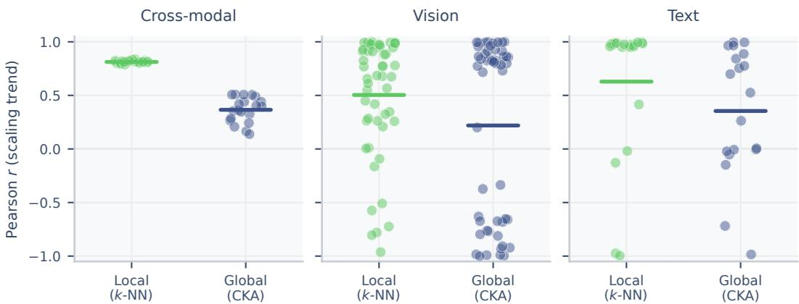  
Figure 6: Pearson r between calibrated alignment and model scale $( k = 1 0 ) .$ , for each fixed reference model. Left: for cross-modal, local k-NN (green) shows positive scaling (mean $r \approx 0 . 6 4 ) .$ while global CKA (blue) is weaker after calibration (mean $r \approx 0 . 3 7 )$ . Center: within-vision. Right: within-text. The local-global gap motivates measuring local k-NN overlap rather than global CKA.

Figure 6 shows the local-global gap. Cross-modal local k-NN correlations concentrate near $r \approx 0 . 6 4$ , while global CKA correlations are weaker and more dispersed (mean $r \approx 0 . 3 7 )$ , so local alignment captures a stronger scaling trend than global alignment.

## E Distribution identities for local overlap

To simplify notation, throughout this section we suppress the time index t and write all neighborhood distributions, overlaps, and k-NN sets without an explicit time dependence.

## E.1 Overlap-TV identities

The bound in Theorem 4.2 relies on two exact identities between k-NN overlap and the total variation distance of the corresponding neighborhood distributions.

Proposition E.1 (Overlap-TV equivalence). For the hard k-NN distributions defined in Equation (2),

$$
\operatorname { T V } \left( p _ { X } ( \cdot \mid i ) , p _ { Y } ( \cdot \mid i ) \right) = 1 - o _ { i } .\tag{7}
$$

Proposition E.2 (Smoothed hard-distribution identity). For each sample i and every $\varepsilon \in ( 0 , 1 )$

$$
\mathrm { T V } \big ( q _ { X } ( \cdot \mid i ) , q _ { Y } ( \cdot \mid i ) \big ) = ( 1 - \varepsilon ) ( 1 - o _ { i } ) .\tag{8}
$$

## E.2 Proof of Proposition E.1

Fix a sample i. By definition, the hard k-NN distribution $p x ( \cdot \mid i )$ assigns mass $1 / k$ to each element of $\mathrm { k N N } _ { X } ( i )$ and mass 0 to every other index. The same is true for $p _ { Y } ( \cdot \mid i )$ with $\mathrm { k } \bar { \mathrm { N N } } _ { Y } ( i )$ in place of $\mathrm { k N N } _ { X } ( i )$ . We use the identity

$$
\mathrm { T V } ( p , q ) = 1 - \sum _ { j } \operatorname* { m i n } \{ p ( j ) , q ( j ) \}\tag{9}
$$

for probability measures on a finite space. Therefore

$$
\mathrm { T V } \big ( p _ { X } ( \cdot \mid i ) , p _ { Y } ( \cdot \mid i ) \big ) = 1 - \sum _ { j } \operatorname* { m i n } \big \{ p _ { X } ( j \mid i ) , p _ { Y } ( j \mid i ) \big \} .\tag{10}
$$

$\mathrm { I f } ~ j \in \mathrm { k N N } _ { X } ( i ) \cap \mathrm { k N N } _ { Y } ( i )$ , both distributions assign mass $1 / k$ to j, so the minimum is $1 / k .$ . Otherwise at least one of the two distributions assigns mass 0 to $j ,$ so the minimum is 0. The sum therefore contains exactly $| \mathrm { k N N } _ { X } ( i ) \cap \mathrm { k N N } _ { Y } ( i ) |$ nonzero terms, each equal to $1 / k ,$ , giving

$$
\sum _ { j } \operatorname* { m i n } \big \{ p _ { X } ( j \mid i ) , p _ { Y } ( j \mid i ) \big \} = \frac { \lvert \mathrm { k N N } _ { X } ( i ) \cap \mathrm { k N N } _ { Y } ( i ) \rvert } { k } = o _ { i } ,\tag{11}
$$

and hence $\mathrm { T V } ( p _ { X } , p _ { Y } ) = 1 - o _ { i }$

## E.3 Proof of Proposition E.2

Fix a sample i, and let $\textstyle \nu ( j \mid i ) : = { \frac { 1 } { N - 1 } } \mathbb { 1 } \left\{ j \neq i \right\}$ denote the uniform distribution over $V \setminus \{ i \}$ . By definition,

$$
q _ { X } ( \cdot \mid i ) = ( 1 - \varepsilon ) p _ { X } ( \cdot \mid i ) + \varepsilon \nu ( \cdot \mid i ) , \qquad q _ { Y } ( \cdot \mid i ) = ( 1 - \varepsilon ) p _ { Y } ( \cdot \mid i ) + \varepsilon \nu ( \cdot \mid i ) .\tag{12}
$$

Subtracting,

$$
q _ { X } ( \cdot \mid i ) - q _ { Y } ( \cdot \mid i ) = ( 1 - \varepsilon ) \bigl ( p _ { X } ( \cdot \mid i ) - p _ { Y } ( \cdot \mid i ) \bigr ) .\tag{13}
$$

Using $\begin{array} { r } { \mathrm { T V } ( p , q ) = \frac { 1 } { 2 } \sum _ { j } | p ( j ) - q ( j ) | } \end{array}$

$$
\mathrm { T V } { \bigl ( } q _ { X } ( \cdot \mid i ) , q _ { Y } ( \cdot \mid i ) { \bigr ) } = \textstyle { \frac { 1 } { 2 } } \sum _ { j } ( 1 - \varepsilon ) \left| p _ { X } ( j \mid i ) - p _ { Y } ( j \mid i ) \right|\tag{14}
$$

$$
= ( 1 - \varepsilon ) \operatorname { T V } \left( p _ { X } ( \cdot \mid i ) , p _ { Y } ( \cdot \mid i ) \right) .\tag{15}
$$

Proposition E.1 identifies the last total variation as $1 - o _ { i } ,$ , so $\mathrm { T V } ( q _ { X } , q _ { Y } ) = ( 1 - \varepsilon ) ( 1 - o _ { i } )$

## E.4 Why we ε-smooth hard distributions

Theorem 4.2 uses KL divergences, which require full-support distributions. The ε-smoothing in Equation (3) mixes the hard distribution with the uniform background and yields a full-support conditional, while Proposition E.2 preserves the hard-overlap semantics exactly up to the factor $( 1 - \varepsilon )$ . The smoothing parameter ε is a fixed analytical regularizer required only to make KL divergences finite. In practice we take ε small $( e . g .$ $\varepsilon = 1 / N )$ , which keeps the prefactor $1 / ( 1 - \varepsilon )$ in Theorem 4.2 close to 1 at the cost of larger KL terms when supports of the learned and target distributions disagree. A natural alternative is to replace the hard distribution with a distance-based soft distribution $( e . g .$ , a Gaussian over embedding distances). We avoid this choice because such distributions implicitly assume that local metric distances are meaningful objects of comparison across views. The empirical object of interest, hard k-NN overlap, depends only on neighbor identity and not on the distances to those neighbors. The ε-smoothing preserves this property by adding uniform background mass to all non-self indices regardless of their distances, while providing the full support required for KL divergences to be finite.

## F Pair-specific ease: per-sample start-condition overlap

## F.1 Dynamical assumptions and proof variables

The finite-time convergence results in Section 4.1 rest on three explicit assumptions. Let $( \mathcal { F } _ { t } ) _ { t \geq 0 }$ be the filtration generated by the training randomness, and let $q _ { W } ^ { ( t ) } ( \cdot \mid i )$ denote the smoothed distribution of encoder $W \in \{ X , Y \}$ after t training steps. We define two per-step total variation quantities:

$$
m _ { i } ^ { ( t ) } : = \operatorname* { m i n } _ { W \in \{ X , Y \} } \mathrm { T V } \big ( q _ { W } ^ { ( t ) } ( \cdot \mid i ) , q _ { W } ^ { \star } ( \cdot \mid i ) \big ) , \qquad \delta _ { i } ^ { ( t ) } : = \mathrm { T V } \big ( q _ { X } ^ { ( t ) } ( \cdot \mid i ) , q _ { Y } ^ { ( t ) } ( \cdot \mid i ) \big ) ,\tag{16}
$$

where $m _ { i } ^ { ( t ) }$ is the smaller of the two encoder-to-target distances and $\delta _ { i } ^ { ( t ) }$ is the inter-encoder gap. Proposition E.2 gives the identity

$$
\delta _ { i } ^ { ( 0 ) } = ( 1 - \varepsilon ) \big ( 1 - o _ { i } ^ { ( 0 ) } \big ) \quad \mathrm { a t } t = 0 ,\tag{17}
$$

so the start-condition overlap and the initial inter-encoder gap describe the same starting point.

(A1) Conditional reachability. There exist $T > 0 , \xi > 0 .$ , and $p _ { T } > 0$ such that for every $\delta _ { i } ^ { ( 0 ) }$ in the support of the start condition, $\mathbb { P } \big ( m _ { i } ^ { ( T ) } \leq \xi \mid \delta _ { i } ^ { ( 0 ) } \big ) \geq p _ { T }$ . This is a finite-time reachability condition: it does not require that both encoders reach the target, only that one does. The assumption is satisfied whenever the training procedure has a nonzero probability of making sufficient progress within $T$ steps, a condition that holds for stochastic gradient methods on objectives with bounded noise, provided the target is reachable from the initialization.

(A2) Finite-time decay. There exists a nonincreasing function $\lambda : \mathbb { N } _ { 0 }  [ 0 , \infty )$ with $\lambda ( t ) \to 0$ as $t \to \infty$ such that, for every $t \geq \bar { 0 }$

$$
\mathbb { E } \big [ \delta _ { i } ^ { ( t ) } \mid \delta _ { i } ^ { ( 0 ) } \big ] \leq \lambda ( t ) \delta _ { i } ^ { ( 0 ) } .\tag{18}
$$

This is a stability condition on the training dynamics: the expected inter-encoder gap after t steps is controlled by its initial value. The assumption is problem-dependent and strongest when both encoders share training dynamics (e.g., the same objective, same data, similar architectures). A2 controls discrepancy, not convergence: it bounds how far apart the two encoders can be at time $t ,$ not whether either has reached the target. A relaxation allowing an additive noise floor is developed in Appendix F.5.

(A3) Basin condition. There exists $\eta > 0$ such that $\left\{ m _ { i } ^ { ( T ) } \leq \xi , \delta _ { i } ^ { ( T ) } \leq \eta \right\} \subseteq \mathcal { C } _ { i }$ , where $\mathcal { C } _ { i } : =$ $\{ \operatorname* { l i m } _ { t \to \infty }$ max $w \mathrm { T V } ( q _ { W } ^ { ( t ) } , q _ { W } ^ { \star } ) = 0 \}$ is the eventual-convergence event. This is a deterministic inclusion: if at time $T$ at least one encoder is near the target and the two encoders are mutually close, then both eventually converge. A3 is the only assumption used to transfer the finite-time bound (Theorem 4.1) to eventual convergence (Corollary F.2), and is not used in the finite-time theorem itself. The assumption is natural when the shared target is a stable fixed point of the training dynamics.

Separation of concerns. The two-step structure (first Theorem 4.1 under A1–A2, then Corollary F.2 under A1–A3) is intentional. The finite-time theorem is the primary result and gives a concrete bound that depends on the start-condition overlap. The corollary adds A3 to convert this into an asymptotic statement, ensuring that the finite-time bound stands on its own when the basin condition is difficult to verify.

Adapter dynamics in cross-modal alignment. In applications where the encoders are frozen and only an adapter is trained (e.g., cross-modal alignment), A1 and A2 apply to the adapter-induced dynamics on $q _ { W } ^ { ( t ) }$ the distributions evolve through the adapter while the underlying encoders remain fixed. The same theorem then bounds the probability that the adapter brings the two distributions close to each other and to their respective targets within T adapter-training steps.

## F.2 Finite-time control of the inter-encoder gap

Lemma F.1 (Finite-time control). Under A2, E $\vdots [ \delta _ { i } ^ { ( T ) } \mid \delta _ { i } ^ { ( 0 ) } ] \le \lambda ( T ) \delta _ { i } ^ { ( 0 ) }$

Proof. This is exactly Assumption A2.

## F.3 Two-form statement and proof of Theorem 4.1

Under A1–A2, for every $\eta > 0 ,$ the finite-time bound takes two equivalent forms:

$$
\mathbb { P } \big ( m _ { i } ^ { ( T ) } \le \xi , \ : \delta _ { i } ^ { ( T ) } \le \eta \ : | \ : \delta _ { i } ^ { ( 0 ) } \big ) \ge \left[ p _ { T } - \frac { \lambda ( T ) \delta _ { i } ^ { ( 0 ) } } { \eta } \right] _ { + } \qquad \mathrm { ( d i s c r e p a n c y \ f o r m ) }\tag{19}
$$

and equivalently, by the affine bijection Equation (17) between $\delta _ { i } ^ { ( 0 ) }$ and $o _ { i } ^ { ( 0 ) }$

$$
\mathbb { P } \big ( m _ { i } ^ { ( T ) } \le \xi , ~ \delta _ { i } ^ { ( T ) } \le \eta ~ | ~ o _ { i } ^ { ( 0 ) } \big ) \ge \left[ p _ { T } - \frac { \lambda ( T ) ( 1 - \varepsilon ) \big ( 1 - o _ { i } ^ { ( 0 ) } \big ) } { \eta } \right] _ { + } \qquad \mathrm { ( o v e r l a p ~ f o r m ) . }\tag{20}
$$

The discrepancy form is the natural output of the proof, and the overlap form is the version most directly connected to the empirical quantity $o _ { i }$

Proof. Fix a sample i and define $A : = \{ m _ { i } ^ { ( T ) } \leq \xi \}$ and $B : = \{ \delta _ { i } ^ { ( T ) } \leq \eta \}$

Step 1: separate the two requirements. Since $A = ( A \cap B ) \cup ( A \cap B ^ { c } )$ with the two parts disjoint, conditional additivity gives $\mathbb { P } ( A \mid \delta _ { i } ^ { ( 0 ) } ) = \mathbb { P } ( A \cap B \mid \delta _ { i } ^ { ( 0 ) } ) + \mathbb { P } ( A \cap B ^ { c } \mid \delta _ { i } ^ { ( 0 ) } )$ . Rearranging and using $A \cap B ^ { c } \subseteq B ^ { c }$

$$
\mathbb { P } ( A \cap B \mid \delta _ { i } ^ { ( 0 ) } ) \geq \mathbb { P } ( A \mid \delta _ { i } ^ { ( 0 ) } ) - \mathbb { P } ( B ^ { c } \mid \delta _ { i } ^ { ( 0 ) } ) .\tag{21}
$$

Step 2: lower-bound the reachability term. Assumption A1 gives $\mathbb { P } ( A \mid \delta _ { i } ^ { ( 0 ) } ) \ge p _ { T }$

Step 3: upper-bound the discrepancy-failure term. Markov’s inequality applied conditionally on $\delta _ { i } ^ { ( 0 ) }$ gives $\mathbb { P } ( \delta _ { i } ^ { ( T ) } > \eta \mid \delta _ { i } ^ { ( 0 ) } ) \le \mathbb { E } [ \delta _ { i } ^ { ( T ) } \mid \delta _ { i } ^ { ( 0 ) } ] / \eta .$ . Lemma F.1 bounds the numerator by $\lambda ( T ) \delta _ { i } ^ { ( 0 ) }$ , so $\mathbb { P } ( B ^ { c } \mid \delta _ { i } ^ { ( 0 ) } ) \le$ $\lambda ( T ) \delta _ { i } ^ { ( 0 ) } / \eta$

Step 4: combine. Inserting the two bounds into Equation (21) and taking the positive part (since the left-hand side is a probability) gives the discrepancy form. Substituting Equation (17) gives the overlap form. □

Informativeness regime. The bound is informative when $\lambda ( T ) ( 1 - \varepsilon ) \big ( 1 - o _ { i } ^ { ( 0 ) } \big ) < p _ { T } \eta$ . Outside this regime the right-hand side is zero and the theorem yields no nontrivial guarantee. In particular, for fixed $\eta > 0$ the bound becomes informative for sufficiently large T whenever $\lambda ( \dot { T } ) \to 0$ , and the threshold on T shrinks with the start-condition overlap $o _ { i } ^ { ( 0 ) }$

## F.4 Convergence under basin condition

Corollary F.2 (Convergence under basin condition). Under $A l { - } A 3$

$$
\begin{array} { l } { \mathbb { P } ( \mathcal { C } _ { i } \mid \delta _ { i } ^ { ( 0 ) } ) \geq \left[ p _ { T } - \frac { \lambda ( T ) \delta _ { i } ^ { ( 0 ) } } { \eta } \right] _ { + } \quad a n d e q u i \nu a l e n t l y } \\ { \mathbb { P } ( \mathcal { C } _ { i } \mid o _ { i } ^ { ( 0 ) } ) \geq \left[ p _ { T } - \frac { \lambda ( T ) ( 1 - \varepsilon ) \left( 1 - o _ { i } ^ { ( 0 ) } \right) } { \eta } \right] _ { + } . } \end{array}\tag{22}
$$

Proof. Assumption A3 gives $\{ m _ { i } ^ { ( T ) } \leq \xi , \delta _ { i } ^ { ( T ) } \leq \eta \} \subseteq \mathcal { C } _ { i }$ , so monotonicity of probability gives $\mathbb { P } ( \mathcal { C } _ { i } \mid \delta _ { i } ^ { ( 0 ) } ) \geq$ $\mathbb { P } ( m _ { i } ^ { ( T ) } \leq \xi , \delta _ { i } ^ { ( T ) } \leq \eta \mid \delta _ { i } ^ { ( 0 ) } )$ . Substituting the bound from Theorem 4.1 (discrepancy form) yields the first inequality, and Equation (17) converts it into the overlap form. □

## F.5 Extension to noisy finite-time decay

A2 requires exact finite-time decay: $\mathbb { E } [ \delta _ { i } ^ { ( t ) } \mid \delta _ { i } ^ { ( 0 ) } ] \leq \lambda ( t ) \delta _ { i } ^ { ( 0 ) }$ , where $\lambda ( t )$ is nonincreasing and tends to zero. A more realistic model of SGD allows an additive noise floor.

$( \mathbf { A } 2 ^ { \prime } )$ Noisy finite-time decay. There exist functions λ $: \mathbb { N } _ { 0 }  [ 0 , \infty )$ and $b : \mathbb { N } _ { 0 } \to [ 0 , \infty )$ , with $\lambda ( t ) \to 0$ such that for every $t \geq 0 ,$

$$
\mathbb { E } \big [ \delta _ { i } ^ { ( t ) } \mid \delta _ { i } ^ { ( 0 ) } \big ] \leq \lambda ( t ) \delta _ { i } ^ { ( 0 ) } + b ( t ) .\tag{23}
$$

When $b ( t ) = 0 , \mathrm { A } 2 ^ { \prime }$ reduces to A2. We refer to $b ( t )$ as the finite-time noise floor.

Lemma F.3 (Finite-time control under noisy decay). Under $A 2 ^ { \prime } ,$

$$
\mathbb { E } \big [ \delta _ { i } ^ { ( T ) } \mid \delta _ { i } ^ { ( 0 ) } \big ] \le \lambda ( T ) \delta _ { i } ^ { ( 0 ) } + b ( T ) .\tag{24}
$$

Proof. This is exactly Assumption $\mathbf { A } 2 ^ { \prime }$

Theorem F.4 (Finite-time bound under noisy decay). Under A1 and $A 2 ^ { \prime } ,$ ,for every $\eta > 0$

$$
\mathbb { P } \big ( m _ { i } ^ { ( T ) } \le \xi , \delta _ { i } ^ { ( T ) } \le \eta | o _ { i } ^ { ( 0 ) } \big ) \ge \left[ p _ { T } - \frac { \lambda ( T ) ( 1 - \varepsilon ) \big ( 1 - o _ { i } ^ { ( 0 ) } \big ) + b ( T ) } { \eta } \right] _ { + } .\tag{25}
$$

When $b ( T ) = 0 ,$ , this reduces to Theorem 4.1.

Proof. The proof follows that of Theorem 4.1, substituting Lemma F.3 for Lemma F.1 in the Markov step:

$$
\mathbb { P } \big ( \delta _ { i } ^ { ( T ) } > \eta \mid \delta _ { i } ^ { ( 0 ) } \big ) \le \frac { \mathbb { E } [ \delta _ { i } ^ { ( T ) } \mid \delta _ { i } ^ { ( 0 ) } ] } { \eta } \le \frac { \lambda ( T ) \delta _ { i } ^ { ( 0 ) } + b ( T ) } { \eta } .\tag{26}
$$

Using $\delta _ { i } ^ { ( 0 ) } = ( 1 - \varepsilon ) \big ( 1 - o _ { i } ^ { ( 0 ) } \big )$  gives the stated overlap form.

The noise floor $b ( T )$ enters additively: even with perfect start-condition overlap $( o _ { i } ^ { ( 0 ) } = 1 )$ , the bound is $[ p _ { T } - b ( T ) / \eta ] _ { + }$ rather than $[ p _ { T } ] _ { + }$ . For the bound to be nontrivial, η must exceed $b ( T ) / \bar { p } _ { T }$ , reflecting that noisy dynamics cannot guarantee arbitrarily precise convergence.

## G Paradigm-level ceiling on overlap

To simplify notation, throughout this section we suppress the time index t and write all neighborhood distributions, overlaps, and k-NN sets without an explicit time dependence.

## G.1 Proof of Theorem 4.2

Fix a sample i and write $q _ { X } ^ { i } : = q _ { X } ( \cdot \mid i ) , q _ { Y } ^ { i } : = q _ { Y } ( \cdot \mid i ) , q _ { X } ^ { \star i } : = q _ { X } ^ { \star } ( \cdot \mid i ) , \mathrm { a n d } q _ { Y } ^ { \star i } : = q _ { Y } ^ { \star } ( \cdot \mid i ) .$

Step 1: rewrite hard overlap in terms of smoothed total variation. Proposition E.2 gives

$$
\mathrm { T V } ( q _ { X } ^ { i } , q _ { Y } ^ { i } ) = ( 1 - \varepsilon ) \bigl ( 1 - o _ { i } \bigr ) , \qquad \mathrm { e q u i v a l e n t l y } \qquad 1 - o _ { i } = \frac { 1 } { 1 - \varepsilon } \mathrm { T V } ( q _ { X } ^ { i } , q _ { Y } ^ { i } ) .\tag{27}
$$

Step 2: reverse triangle inequality through the two targets. Two applications of the reverse triangle inequality for total variation give

$$
\mathrm { T V } ( q _ { X } ^ { i } , q _ { Y } ^ { i } ) \geq \mathrm { T V } ( q _ { X } ^ { \star i } , q _ { Y } ^ { \star i } ) - \mathrm { T V } ( q _ { X } ^ { i } , q _ { X } ^ { \star i } ) - \mathrm { T V } ( q _ { Y } ^ { \star i } , q _ { Y } ^ { i } ) .\tag{28}
$$

The first term is $\gamma _ { i }$ by definition Equation (5).

Step 3: bound the outer terms by KL. Pinsker’s inequality, $\begin{array} { r } { \mathrm { T V } ( p , q ) \leq \sqrt { \frac { 1 } { 2 } D _ { \mathrm { K L } } ( p \| q ) } } \end{array}$ , applied with $( p , q ) = ( q _ { X } ^ { \star i } , q _ { X } ^ { i } )$ and $( q _ { Y } ^ { \star i } , q _ { Y } ^ { i } )$ gives

$$
\begin{array} { r } { \mathrm { T V } ( q _ { X } ^ { \star i } , q _ { X } ^ { i } ) \leq \sqrt { \frac { 1 } { 2 } D _ { \mathrm { K L } } ( q _ { X } ^ { \star i } \| q _ { X } ^ { i } ) } , \qquad \mathrm { T V } ( q _ { Y } ^ { \star i } , q _ { Y } ^ { i } ) \leq \sqrt { \frac { 1 } { 2 } D _ { \mathrm { K L } } ( q _ { Y } ^ { \star i } \| q _ { Y } ^ { i } ) } . } \end{array}\tag{29}
$$

Substituting Equation (29) into Equation (28) and then into Equation (27) yields the claimed bound.

Sequence statement. For a sequence of learned distributions indexed by t such that both KL terms vanish, lim supt $o _ { i } ^ { ( t ) } \leq 1 - \gamma _ { i } / ( 1 - \varepsilon )$ .When $q _ { X } ^ { \star } = q _ { Y } ^ { \star } , \gamma _ { i } = 0$ and $o _ { i } ^ { ( t ) } \to 1 .$ □

## G.2 A natural shared target

Theorem 4.2 holds for any pair of full-support targets. One natural setting where $\gamma _ { i } = 0$ is when both encoders observe paired views of the same underlying content (e.g., an image and its caption): a conditional affinity distribution

$$
p ^ { \star } ( j \mid i ) \propto \kappa ( i , j ) , \qquad j \neq i ,\tag{30}
$$

serves as a shared target, where $\kappa ( i , j )$ measures co-occurrence or affinity between paired contents and is therefore independent of the view. For instance, when pairs arise under an unobserved context variable, $\kappa ( i , j )$ is proportional to the expected co-occurrence of the two contents under that context, which is compatible with contrastive views of representation learning [50]. Smoothing this candidate via

$$
q _ { \star } ^ { ( \varepsilon ) } ( j \mid i ) : = \left( 1 - \varepsilon \right) p ^ { \star } ( j \mid i ) + \frac { \varepsilon } { N - 1 } \mathbb { 1 } \{ j \neq i \}\tag{31}
$$

yields a full-support target suitable for Theorem 4.2. We do not require this specific choice: different objectives or modalities may induce different targets $( \gamma _ { i } > 0 )$ , and the bound remains informative whenever $\gamma _ { i }$ is small.

## H Additional empirical material

## H.1 Initialization structure

The unimodal panels of Figure 2 use the initial random k-NN overlap $o _ { i } ^ { ( 0 ) }$ as a start-condition proxy for Theorem 4.1. For the proxy to be well-posed, three things must hold at initialization: (i) two copies of the same randomly initialized model should agree on their local geometry (random seeds of the same architecture give a meaningful family-level $\delta _ { i } ^ { ( 0 ) } )$ , (ii) models from different families should disagree more (architecture modulates $\delta _ { i } ^ { ( 0 ) } ,$ ), and (iii) training must actually change local geometry (otherwise the final-vs-initial correlation would be a tautology). Figures 7a and 7b verify all three for vision and text respectively.

Within-model random overlap in the vision panel sits between 0.72 and 0.89 for every architecture family (mean 0.83), indicating that two random seeds of the same architecture produce nearly identical local neighborhood structure. Cross-family random overlap has mean ≈ 0.54, indicating that architecture choice does shift the initial geometry but less than across paradigms. Pretrained-vs-random overlap drops to 0.09-0.28 (mean 0.19), confirming that training substantially reshapes the local geometry rather than merely refining what the random network already encoded. Architecture alone therefore parameterizes $\delta _ { i } ^ { ( 0 ) }$ , and the training dynamics move every model far from its initialization, so Theorem 4.1 is tested non-trivially in this regime.

The text panel shows the same qualitative three-zone pattern across nine language-model families: within-family random overlap between 0.4 and 0.8, cross-family a $\approx 0 . 3 5$ , and pretrained-vs-random collapsed to 0.2-0.4. The within-family value is lower than for vision and spreads more, reflecting the wider design space of languagemodel blocks. The pretrained-vs-random drop is nonetheless large in every family, so the init-vs-final correlation in Figure 2 (top right) reflects genuine learned structure rather than initialization bleed-through.

Taken together, the two panels show that families with similar architectures start with similar local geometry and that training moves every model far from its initialization. This is the condition under which the architectural proxy $\delta _ { i } ^ { ( 0 ) }$ should predict the family-level spread of final overlap, and Figure 2 (top) confirms that it does.

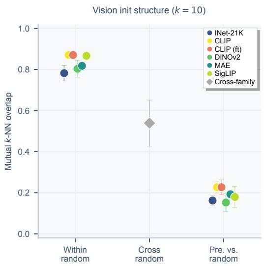  
(a) Vision initialization structure at $k = 1 0$ . Within-model random overlap is high and concentrated, cross-family random overlap is lower, and pretrained-vs-random overlap is near zero.

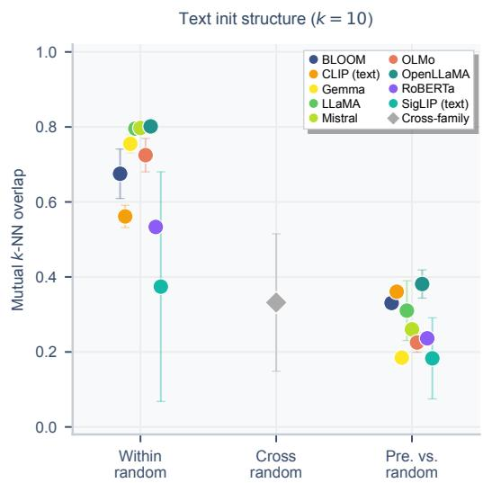  
(b) Text initialization structure at $k \ = \ 1 0 .$ . The same three-zone pattern as for vision: high within-family random overlap, intermediate cross-family, near-zero pretrained-vsrandom.  
Figure 7: Initialization structure underlying the unimodal panels of Figure 2. Both modalities show structured random geometry within architecture families, lower cross-family random overlap, and a large drop between pretrained and random representations.

## H.2 Robustness to neighborhood size

The main text uses local k-NN overlap with $k = 1 0$ throughout the empirical analyses. We repeat the combined proxies figure of Figure 2 at $k \in \{ 2 0 , 5 0 , 1 0 0 \}$ to check that the start-condition overlap continues to predict downstream transfer at larger neighborhood sizes. The qualitative conclusions remain unchanged: the startcondition overlap continues to predict the pretrained overlap in the unimodal validation and to predict downstream transfer in cross-modal alignment and task-arithmetic merging.

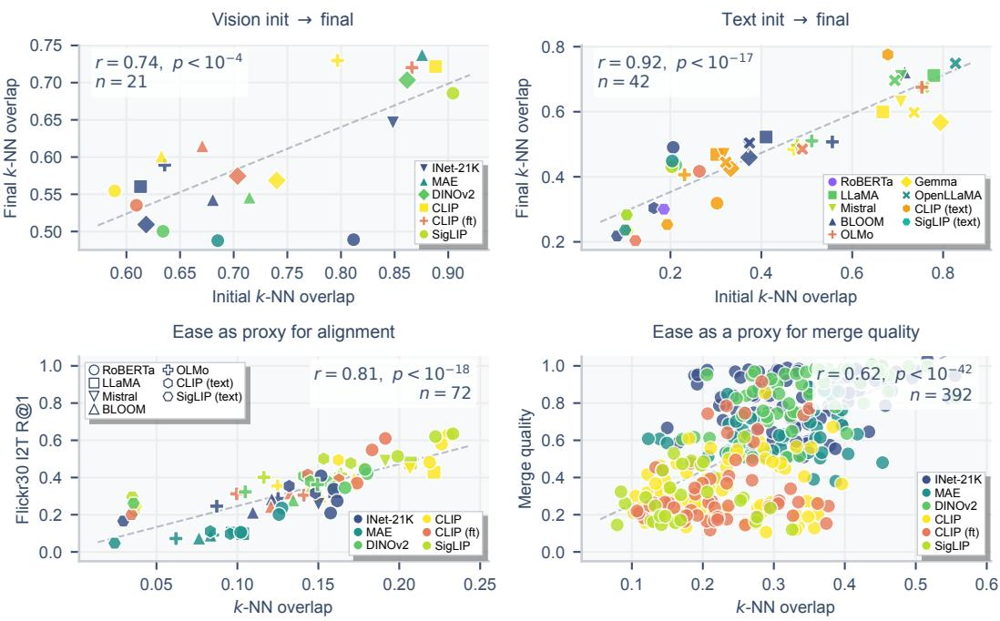  
Figure 9: Combined proxies figure at $k = 5 0 .$ . The start-condition overlap remains predictive at larger neighborhood size across all four settings.

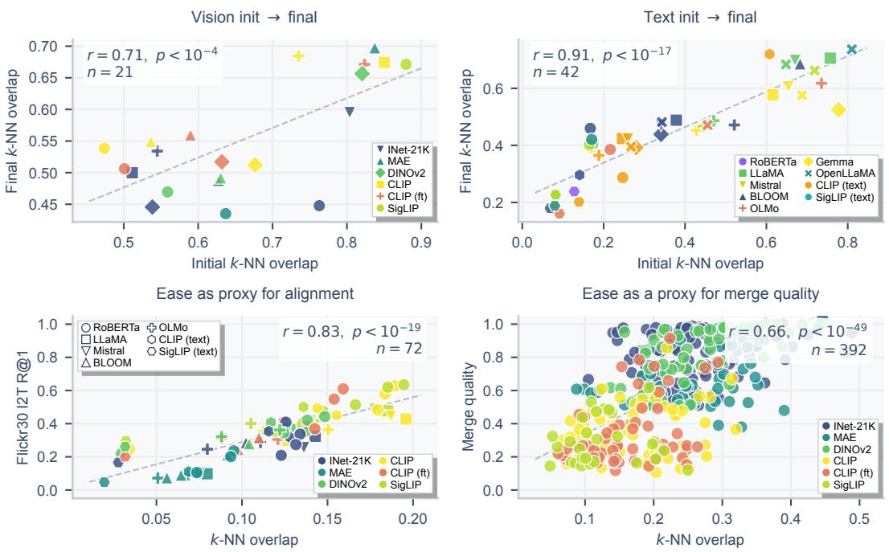  
Figure 8: Combined proxies figure at k = 20. Top: unimodal init-to-final validation for vision and text. Bottom left: pretrained k-NN overlap predicts Flickr30k I2T R@1 after alignment. Bottom right: pre-merge k-NN overlap predicts merge quality. The same qualitative pattern as at $k = 1 0$ is preserved.

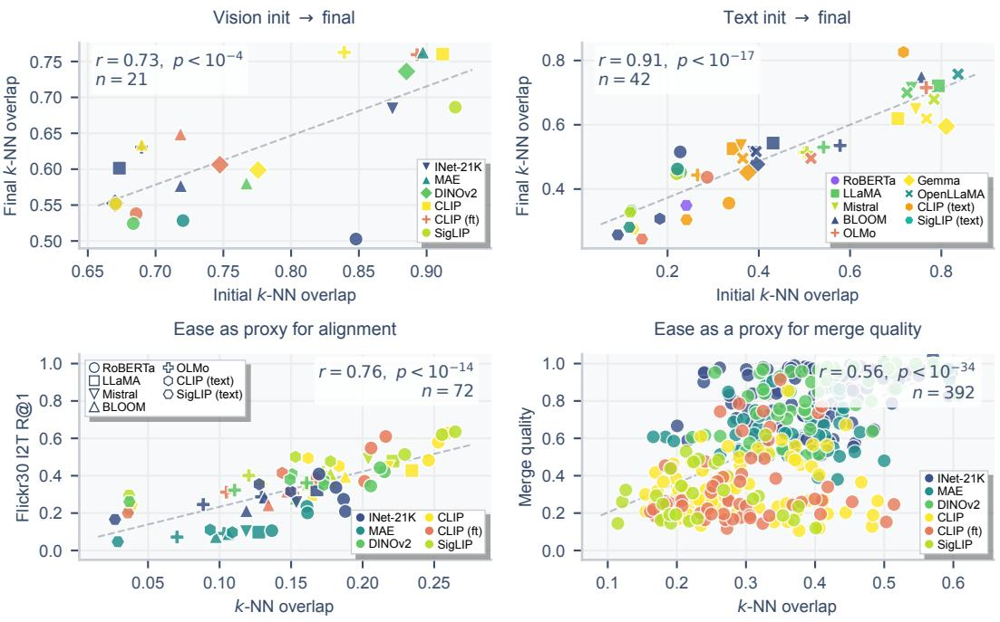  
Figure 10: Combined proxies figure at $k = 1 0 0$ . Even at a large neighborhood size, the qualitative structure is unchanged.

## H.3 Probe-set sensitivity for merging ease

In the main text, the merging ease score is computed on a 2K-sample probe drawn from MNIST’s train split (a task in the standard task-arithmetic benchmark, used as a fixed shared probe across all candidate pairs). To test the sensitivity of the diagnostic to this probe choice, we replace MNIST with an 8-task pool: 256 images per task across all eight fine-tuning tasks (2,048 samples total; Table 4).

Table 4: Probe-set sensitivity for the merging ease score. Replacing the MNIST probe with an 8-task pool weakens the ease signal (the pool dilutes per-pair specialization across 8 distributions), but the product predictor remains positively correlated with merge quality. The same direction holds: pairs with higher ease and higher ceiling merge better.
<table><tr><td>Ease probe</td><td>|r| ease</td><td>|r| ceiling</td><td>|r| product</td></tr><tr><td>MNIST (2K samples, main text)</td><td>0.67</td><td>0.64</td><td>0.70</td></tr><tr><td>8-task pool (256 7 task, 2,048 samples)</td><td>0.42</td><td>0.64</td><td>0.65</td></tr></table>

## H.4 Merging: paradigm-level results and multi-task extension

This section supplements Section 5.2 with a paradigm-level view of the within-model merge experiments and a full multi-task task-arithmetic extension (n = 392 pairs from 14 models, i.e., 9 ViT-B/16, 4 ViT-L/14-16, and 1 ViT-T/16, across 5 paradigms and 8 tasks).

Figure 11 shows two complementary views of the same merging experiments. Left: pairwise mean retention $( n = 3 9 2$ pairs) grouped by paradigm, with merge quality encoded by color and median overlap indicated by horizontal lines. The monotonic increase in median overlap from contrastive VL to self-distillation confirms that the paradigm hierarchy is stable across task pairs. Right: full multi-task task arithmetic, in which all 8 task vectors are summed simultaneously $( \theta _ { \mathrm { b a s e } } + \alpha \hat { \sum _ { i } } \Delta _ { i } )$ at $\alpha \in \{ 0 . 3 , 0 . 5 \}$ , and accuracy is averaged across all 8 tasks. The pairwise paradigm ordering is preserved at scale: discriminative and self-distillation paradigms retain the highest accuracy, while contrastive VL paradigms collapse.

This ordering is the inverse of the one observed for cross-modal alignment, where contrastive vision-language models lead and discriminative or self-distillation models trail. The inversion is consistent with the ceiling bound: achievable overlap depends on the match between the pretraining paradigm and the downstream target, rather than on the paradigm alone. Thus, the pairwise compatibility ordering is not an artifact of two-task merges, but remains visible in the harder multi-task setting as well.

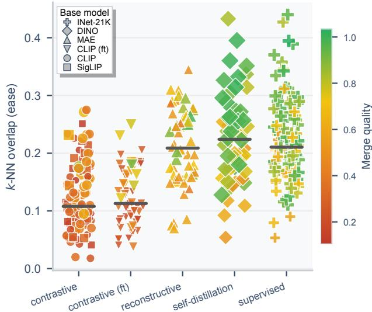

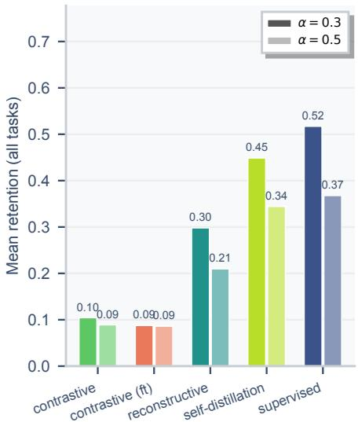  
Figure 11: Left: pair-specific k-NN overlap by paradigm, with median lines. The paradigm ordering is stable across task pairs $( n = 3 9 2$ pairwise merges). Color encodes pairwise merge quality (mean retention across the two original tasks). Marker shape encodes base model family. Right: full multi-task task arithmetic (all 8 tasks summed jointly), reporting mean accuracy across all 8 tasks. The pairwise ordering of Figure 5 is preserved at the multi-task scale: discriminative (0.52/0.37 multi-task accuracy) and self-distillation $( \bar { 0 } . 4 5 / 0 . 3 \bar { 4 } )$ retain the most, contrastive VL collapses (0.10/0.09). Note that these multi-task accuracies differ from the pairwise mean retentions reported in Section 5.2, since they aggregate across all 8 tasks at once rather than over pairs of tasks.

## H.5 Regime-level distribution of downstream outcomes

This section gives the full distribution of downstream outcomes per regime, supplementing the inline regime statistics reported in Sections 5.1 and 5.2. Regimes are assigned by splitting the ease and ceiling axes at their respective medians, as defined in the COMPASS diagnostic of Section 5. The Kruskal-Wallis statistic on each panel tests the null that the four regimes are drawn from the same distribution of the panel’s outcome variable;

Table 5: Rank correlations with downstream transfer performance. The final column uses global CKA for alignment and task-vector cosine for merging.
<table><tr><td>Outcome</td><td>COMPASS  $\rho$ </td><td>COMPASS  $\tau$ </td><td>Ease  $\rho$ </td><td>Ceiling  $\rho$ </td><td>Baseline ρ</td></tr><tr><td>Flickr30k I2T R@1</td><td>0.91</td><td>0.73</td><td>0.87</td><td>0.77</td><td>0.63</td></tr><tr><td>Flickr30k T2I R@1</td><td>0.91</td><td>0.73</td><td>0.87</td><td>0.77</td><td>0.65</td></tr><tr><td>COCO I2T R@1</td><td>0.93</td><td>0.77</td><td>0.88</td><td>0.81</td><td>0.67</td></tr><tr><td>COCO T2I R@1</td><td>0.93</td><td>0.77</td><td>0.88</td><td>0.81</td><td>0.66</td></tr><tr><td>Merge retention</td><td>0.70</td><td>0.50</td><td>0.66</td><td>0.61</td><td>0.06</td></tr></table>

the test is the rank-based, non-parametric analogue of a one-way ANOVA, and we use it because the per-regime sample sizes are unequal and the outcomes are not normally distributed.

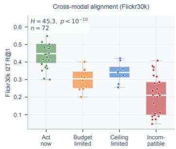

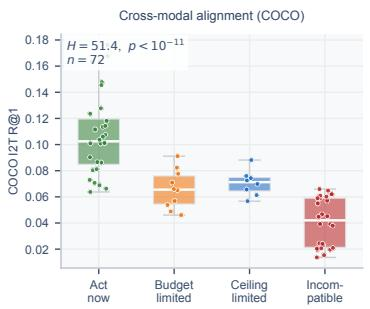

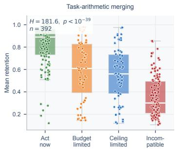  
Figure 12: Per-regime distribution of downstream outcomes for the three settings. Left: Flickr30k I2T R@1 on $n = 7 2$ vision-language pairs. Center: COCO I2T R@1 on the same pairs. Right: mean retention on $n = 3 9 2$ task-arithmetic merges. Boxes show the interquartile range with the median line; whiskers extend to the non-outlier extremes; individual points are overlaid. Color encodes the four regimes: act now (high ease, high ceiling), budget-limited (low ease, high ceiling), ceiling-limited (high ease, low ceiling), and incompatible (low ease, low ceiling). The Kruskal-Wallis H statistic and $p \mathrm { - }$ value at the top of each panel test the null that the four regimes share the same distribution; the test rejects in all three settings.

## H.6 Ranking and budget model selection

Because COMPASS is intended to rank candidate model pairs before transfer, we complement the Pearson analysis of Figure 3 with rank correlations and measures of the quality of the induced candidate ordering. Al analyses use the same candidate pools and downstream outcomes as in the main experiments.

## H.6.1 Rank correlations

Table 5 reports Spearman ρ and Kendall τ . COMPASS gives the strongest overall ranking in all settings. The results are nearly identical across the image-to-text (I2T) and text-to-image (T2I) retrieval directions.

## H.6.2 Top-k selection, regret, and NDCG

For evaluation budget k, we define top-k performance as the mean downstream outcome of the k highest-ranked candidates. Regret is its relative shortfall from the oracle top-k set. NDCG@k evaluates the quality of the complete ordering within the first k candidates, using downstream performance as relevance and normalizing by the oracle ordering. “Budget to best” is the rank assigned to the globally best candidate. Selection results for alignment and merging are reported in Tables 6 and 7.

Table 6: Selection performance on Flickr30k I2T retrieval $( n = 7 2$ candidate pairs). Regret is relative to the oracle top-k set.
<table><tr><td>Predictor</td><td> $\mathrm { T o p - } 1$ </td><td>Regret</td><td> $\mathrm { T o p } { - } 5$ </td><td>Regret</td><td>NDCG@5</td><td> $\mathrm { T o p - l 0 }$ </td><td>Regret</td><td>NDCG@10</td><td> $\mathrm { T o p } { - 2 0 }$ </td><td>Regret</td><td>NDCG@20</td><td>Budget to best</td></tr><tr><td>COMPASS</td><td>0.635</td><td>0.0%</td><td>0.578</td><td>5.9%</td><td>0.957</td><td>0.530</td><td>5.7%</td><td>0.952</td><td>0.493</td><td>2.1%</td><td>0.972</td><td>1/72</td></tr><tr><td>Ease</td><td>0.428</td><td>32.6%</td><td>0.521</td><td>15.2%</td><td>0.819</td><td>0.530</td><td>5.7%</td><td>0.893</td><td>0.486</td><td>3.6%</td><td>0.923</td><td>2/72</td></tr><tr><td>Ceiling</td><td>0.635</td><td>0.0%</td><td>0.563</td><td>8.3%</td><td>0.945</td><td>0.455</td><td>19.0%</td><td>0.864</td><td>0.439</td><td>12.8%</td><td>0.889</td><td>1/72</td></tr><tr><td>Global CKA</td><td>0.635</td><td>0.0%</td><td>0.589</td><td>4.2%</td><td>0.970</td><td>0.515</td><td>8.2%</td><td>0.940</td><td>0.440</td><td>12.7%</td><td>0.901</td><td>1/72</td></tr><tr><td>Paradigm distance</td><td>0.323</td><td>49.1%</td><td>0.204</td><td>66.8%</td><td>0.368</td><td>0.226</td><td>59.8%</td><td>0.406</td><td>0.245</td><td>51.3%</td><td>0.458</td><td>72/72</td></tr><tr><td>Total parameters</td><td>0.418</td><td>34.2%</td><td>0.352</td><td>42.6%</td><td>0.614</td><td>0.328</td><td>41.6%</td><td>0.609</td><td>0.316</td><td>37.3%</td><td>0.629</td><td>21/72</td></tr><tr><td>Random ordering</td><td>0.334</td><td>47.4%</td><td>0.334</td><td>45.6%</td><td></td><td>0.334</td><td>40.5%</td><td></td><td>0.334</td><td>33.7%</td><td></td><td>36.5 expected</td></tr></table>

Global CKA happens to rank the best Flickr30k pair first and is slightly stronger at $k = 5 ,$ but its ranking deteriorates as the budget increases: at k = 20, COMPASS has 2.1% regret compared with 12.7% for CKA,

while also achieving higher NDCG. COCO shows the same pattern: COMPASS/CKA regret is 5.9%/4.5% at k = 5 and 2.1%/14.4% at k = 20.

Table 7: Selection performance for task-arithmetic merging (n = 392 candidate merges).
<table><tr><td>Predictor</td><td>Top-1</td><td>Regret</td><td>Top-10</td><td>Regret</td><td>NDCG@10</td><td>Top-40</td><td>Regret</td><td>NDCG@40</td><td>Budget to best</td></tr><tr><td>COMPASS</td><td>0.947</td><td>8.4%</td><td>0.927</td><td>7.1%</td><td>0.920</td><td>0.890</td><td>9.1%</td><td>0.910</td><td>5/392</td></tr><tr><td>Ease</td><td>0.947</td><td>8.4%</td><td>0.935</td><td>6.4%</td><td>0.924</td><td>0.874</td><td>10.7%</td><td>0.896</td><td>5/392</td></tr><tr><td>Ceiling</td><td>0.968</td><td>6.4%</td><td>0.926</td><td>7.3%</td><td>0.930</td><td>0.828</td><td>15.5%</td><td>0.871</td><td>162/392</td></tr><tr><td>Task-vector cosine</td><td>0.963</td><td>6.8%</td><td>0.826</td><td>17.3%</td><td>0.841</td><td>0.708</td><td>27.7%</td><td>0.749</td><td>328/392</td></tr><tr><td>Random ordering</td><td>0.585</td><td>43.4%</td><td>0.585</td><td>41.4%</td><td></td><td>0.585</td><td>40.3%</td><td></td><td>196.5 expected</td></tr></table>

Ceiling and task-vector cosine can select a strong first merge but rank the full candidate pool substantially less well. COMPASS finds the globally best merge after evaluating only 5 of the 392 candidates.

## H.6.3 Budget evaluation

We additionally evaluate the practical setting in which downstream transfer can be performed for only a limited number of candidates. At budget b, we take the best downstream outcome among the top b candidates according to each predictor and normalize it by the optimum over the complete candidate pool. Random-order values are exact expectations (Tables 8 and 9).

Table 8: Budget selection for Flickr30k I2T retrieval. Values are the best outcome found within the evaluation budget, normalized by the pool optimum.
<table><tr><td>Pairs trained</td><td>1</td><td>2</td><td>5</td><td>10</td><td>20</td></tr><tr><td>COMPASS</td><td>1.00</td><td>1.00</td><td>1.00</td><td>1.00</td><td>1.00</td></tr><tr><td>Ease</td><td>0.67</td><td>1.00</td><td>1.00</td><td>1.00</td><td>1.00</td></tr><tr><td>Global CKA</td><td>1.00</td><td>1.00</td><td>1.00</td><td>1.00</td><td>1.00</td></tr><tr><td>Random order</td><td>0.53</td><td>0.66</td><td>0.79</td><td>0.88</td><td>0.95</td></tr></table>

COCO gives the same qualitative result: COMPASS reaches the pool optimum after one downstream run, compared with random-order expectations of 0.42 at b = 1 and 0.68 at $b = 5 .$

Table 9: Budget selection for task-arithmetic merging.
<table><tr><td>Merges performed</td><td>1</td><td>5</td><td>10</td><td>20</td><td>50</td></tr><tr><td>COMPASS</td><td>0.92</td><td>1.00</td><td>1.00</td><td>1.00</td><td>1.00</td></tr><tr><td>Ease</td><td>0.92</td><td>1.00</td><td>1.00</td><td>1.00</td><td>1.00</td></tr><tr><td>Ceiling</td><td>0.94</td><td>0.94</td><td>0.95</td><td>0.96</td><td>0.97</td></tr><tr><td>Task-vector cosine</td><td>0.93</td><td>0.93</td><td>0.94</td><td>0.95</td><td>0.95</td></tr><tr><td>Random order</td><td>0.57</td><td>0.87</td><td>0.93</td><td>0.95</td><td>0.97</td></tr></table>

## H.7 Additional baselines

We compare COMPASS against three groups of alternatives: cheap metadata predictors, other representationsimilarity measures, and learned regressors. Unless stated otherwise, values are Spearman correlations with the same downstream outcomes and over the same candidate sets used for COMPASS.

## H.7.1 Metadata predictors

Cheap metadata-based predictors are summarized in Table 10.

The pretraining paradigm provides useful coarse information, but cannot distinguish candidate pairs within the same paradigm. In the within-family analysis of Appendix H.11, where the vision family is fixed, ease remains predictive with a median Spearman correlation of 0.80. Local k-NN overlap therefore captures pair-specific compatibility beyond metadata labels.

Table 10: Comparison with cheap metadata-based predictors.
<table><tr><td>Predictor</td><td>Alignment: Flickr I2T</td><td>Merging: retention</td></tr><tr><td>COMPASS</td><td>0.91</td><td>0.70</td></tr><tr><td>Pretraining paradigm distance</td><td>-0.60</td><td></td></tr><tr><td>Architecture self-consistency</td><td>0.37</td><td></td></tr><tr><td>Total parameters</td><td>0.09</td><td></td></tr><tr><td>Random-init k-NN overlap</td><td>0.11</td><td></td></tr><tr><td>Mean solo accuracy of two checkpoints</td><td></td><td>0.43</td></tr><tr><td>Task-vector cosine</td><td></td><td>0.06</td></tr></table>

## H.7.2 Alternative representation-similarity metrics

To isolate the effect of the similarity measure itself, we compare metrics computed using identical model inputs, probe sets, and layer-search procedures (Table 11).

Table 11: Alternative representation-similarity metrics computed on identical inputs.
<table><tr><td>Metric</td><td>Alignment: Flickr I2T</td><td>Merging: retention</td></tr><tr><td>Mutual k-NN overlap</td><td>0.82</td><td>0.42</td></tr><tr><td>RSA, rank correlation between RDMs</td><td>0.38</td><td>0.22</td></tr><tr><td>Procrustes similarity</td><td>0.45</td><td>0.37</td></tr><tr><td>Linear CKA</td><td>0.34</td><td>0.25</td></tr></table>

Local k-NN overlap has highest predictive performance in both settings, particularly for alignment.

## H.7.3 Learned regressor predictors

We additionally fit ridge and gradient-boosted regressors on one-hot family, paradigm, and task labels plus model sizes, and score their out-of-fold predictions (Table 12).

Table 12: Comparison with learned metadata regressors. Unlike COMPASS, these models require previousl observed downstream transfer outcomes as labels.
<table><tr><td>Evaluation</td><td>Alignment</td><td>Merging</td></tr><tr><td>COMPASS, nothing fitted</td><td>0.91</td><td>0.70</td></tr><tr><td>Regressor, random 5-fold CV</td><td>0.94</td><td>0.91</td></tr><tr><td>Regressor, leave-one-family/backbone out</td><td>0.60</td><td>0.81</td></tr><tr><td>Regressor, leave-one-paradigm out</td><td>0.46</td><td>-0.54</td></tr></table>

The regressors can perform stronger under random cross-validation, but require completed transfer runs as supervision, which is the expensive step COMPASS is meant to precede. For example: its merging figure of 0.81 comes from fitting on 364 completed merges in order to rank the remaining 28. It also degrades where a diagnostic is needed, on a model or paradigm it has not seen, and turns negative when a whole paradigm is held out. COMPASS fits no parameters and is computed before any transfer, so its number is the same in all three rows.

## H.8 Generalization across held-out families, backbones, and paradigms

We test whether the COMPASS ranking depends on particular families, backbones, or paradigms. Because COMPASS is parameter-free, we consider two complementary evaluations. In the rest analysis, one group is removed, all scores that depend on the the reference library are recomputed without that group, and performance is measured on the remaining candidate pool. In the held-out only analysis, the correlation is evaluated only among candidates belonging to the removed group, isolating pair-specific variation within that group. Librarybased scores are re-estimated per fold, excluding the held-out language family for alignment or paradigm for merging (Table 13).

Alignment is stable to removing individual model groups(Table 14): relative to the pooled correlation of 0.91, removing any vision or text family changes the correlation on the remaining pool by at most 0.06. Held-out-group correlations remain positive across all vision and text families.

In all seven text folds, ceilings re-estimated from the remaining language models preserve the full-library vision ranking (Spearman ρ = 1.00).

Table 13: Generalization under held-out groups. The pooled references are $\rho = 0 . 9 1$ for Flickr30k alignment and ρ = 0.70 for merging.
<table><tr><td>Fold type</td><td>Folds</td><td>Spearman on rest</td><td>Spearman inside held-out group</td></tr><tr><td>Leave-one-vision-family-out</td><td>6</td><td>0.85-0.93</td><td>0.81 median (0.56-0.87)</td></tr><tr><td>Leave-one-text-family-out</td><td>7</td><td>0.89-0.92</td><td>0.86 median (0.78-0.94)</td></tr><tr><td>Leave-one-vision-paradigm-out</td><td>5</td><td>0.85-0.93</td><td>0.80 median (0.56-0.87)</td></tr><tr><td>Leave-one-backbone-out (merging)</td><td>14</td><td>0.67-0.71</td><td>0.28 median (-0.13-0.75)</td></tr><tr><td>Leave-one-paradigm-out (merging)</td><td>5</td><td>0.60-0.72</td><td>0.27 median (0.20-0.66)</td></tr></table>

Table 14: Per-fold results for Flickr30k I2T alignment.
<table><tr><td>Held-out vision family</td><td>Rest</td><td>Held out</td><td>Held-out text family</td><td>Rest</td><td>Held out</td></tr><tr><td>CLIP</td><td>0.91</td><td>0.78</td><td>CLIP text</td><td>0.92</td><td>0.78</td></tr><tr><td>SigLIP</td><td>0.89</td><td>0.87</td><td>SigLIP text</td><td>0.89</td><td>0.86</td></tr><tr><td>CLIP fine-tuned</td><td>0.92</td><td>0.83</td><td>OLMo</td><td>0.92</td><td>0.86</td></tr><tr><td>DINOv2</td><td>0.93</td><td>0.80</td><td>BLOOM</td><td>0.91</td><td>0.90</td></tr><tr><td>MAE</td><td>0.85</td><td>0.87</td><td>RoBERTa</td><td>0.90</td><td>0.94</td></tr><tr><td>Classification</td><td>0.92</td><td>0.56</td><td>LLaMA</td><td>0.91</td><td>0.80</td></tr><tr><td></td><td></td><td></td><td>Mistral</td><td>0.91</td><td>0.80</td></tr></table>

For merging, the correlation on the remaining candidate pool stays between 0.67 and 0.71 when leaving out individual backbones, and between 0.60 and 0.72 when leaving out complete paradigms. Correlations measured only within one backbone are lower because 74% of the variance in retention lies between backbones. Conditioning the probe on the particular task pair captures additional residual interference and increases the median within-backbone correlation from 0.28 to 0.44 across the 14 backbones, each containing 28 task pairs.

## H.9 Robustness to the alignment procedure

The complete 72-pair alignment experiment in the main text uses CSA. To test whether the inferred compatibility ranking is specific to this alignment method, we additionally evaluate 24 vision-language pairs spanning six vision encoders from all five vision paradigms and four text towers. For each pair, we train Linear, MLP, and LoRA-style adapters using a contrastive InfoNCE objective and compare their downstream retrieval ranking with CSA (Table 15).

Table 15: Pair-ranking agreement across alignment procedures. Values below the diagonal are Spearman correlations for Flickr30k I2T and values above the diagonal are for T2I.
<table><tr><td></td><td>CSA</td><td>Linear</td><td>MLP</td><td>LoRA</td></tr><tr><td>CSA</td><td>-</td><td>0.94</td><td>0.82</td><td>0.96</td></tr><tr><td>Linear</td><td>0.87</td><td></td><td>0.86</td><td>0.99</td></tr><tr><td>MLP</td><td>0.76</td><td>0.84</td><td></td><td>0.85</td></tr><tr><td>LoRA</td><td>0.91</td><td>0.98</td><td>0.85</td><td></td></tr></table>

CSA rankings agree with LoRA at $\rho = 0 . 9 1$ for I2T retrieval, while pairs of trained adapters agree with each other at $\rho = 0 . 8 4 – 0 . 9 8$ . We next repeat the predictor analysis using the outcome produced by each adapter (Table 16).

Table 16: Spearman correlation with Flickr30k I2T R@1 under different alignment procedures.
<table><tr><td>Predictor</td><td>CSA</td><td>Linear</td><td>MLP</td><td>LoRA</td></tr><tr><td>COMPASS</td><td>0.87</td><td>0.90</td><td>0.73</td><td>0.92</td></tr><tr><td>Ease</td><td>0.78</td><td>0.78</td><td>0.56</td><td>0.78</td></tr><tr><td>Ceiling</td><td>0.86</td><td>0.97</td><td>0.76</td><td>0.95</td></tr><tr><td>Global CKA</td><td>0.71</td><td>0.79</td><td>0.60</td><td>0.78</td></tr></table>

COMPASS remains predictive of the downstream ranking produced by every trained adapter and exceeds global CKA in all cases. T2I retrieval gives the same qualitative conclusion. The consistency across CSA, Linear, MLP, and LoRA-style alignment indicates that the reported ranking reflects properties of the model pair rather than an artifact of CSA.

## H.10 Cost and robustness of ceiling estimation

Ceiling estimation reuses the same cached probe representations required to compute pairwise overlaps and therefore introduces no additional model forward passes. For the 19 × 10 cross-modal candidate grid, each model is run over the probe once and the resulting overlap averages are then inexpensive to compute (Table 17).

Table 17: Cost of COMPASS scoring compared with exhaustive downstream alignment. The wall-clock comparison was benchmarked on a single RTX 2080 Ti.
<table><tr><td>Procedure</td><td>Scaling</td><td>Cost for full 19 × 10 grid</td></tr><tr><td>COMPASS, including ceiling Exhaustive downstream evalu- ation</td><td>One probe pass per model One alignment run per pair</td><td>29 passes; ～21 min; 12 GB cached features 190 runs; ~86–102 h; 729 GB cached fea-</td></tr></table>

The ceiling averages themselves take only seconds once the model features and pairwise overlaps have been cached. To test whether COMPASS requires precise model-level ceiling estimates, we progressively coarsen or perturb the ceiling while keeping ease unchanged (Table 18).

Table 18: Sensitivity to ceiling granularity and estimation noise. Values are Spearman correlations with downstream performance.
<table><tr><td>Ceiling estimate</td><td>Alignment: Flickr30k I2T</td><td>Merging: retention</td></tr><tr><td>Original estimate</td><td>0.909</td><td>0.696</td></tr><tr><td>One shared value per paradigm</td><td>0.903</td><td>0.699</td></tr><tr><td>Gaussian noise at 25% of ceiling spread</td><td>0.901</td><td>0.695</td></tr><tr><td>Gaussian noise at 50% of ceiling spread</td><td>0.883</td><td>0.695</td></tr><tr><td>Gaussian noise at 100% of ceiling spread</td><td>0.830</td><td>0.691</td></tr><tr><td>Ceiling values shuffled across paradigms</td><td>0.675</td><td>0.654</td></tr><tr><td>Ceiling removed: ease alone</td><td>0.866</td><td>0.657</td></tr></table>

These results show that COMPASS is robust to coarse ceiling estimates. Replacing the individual values with one value per paradigm changes the correlation in a negligible way for alignment and for merging. It is also robust to moderate estimation error: with noise equal to 50% of the ceiling’s empirical spread, COMPASS still reaches 0.883 for alignment and 0.695 for merging, compared with 0.866 and 0.657 when the ceiling is removed entirely.

The reason is that the ceiling mainly provides a coarse ordering between paradigms, while the ease distinguishes individual model pairs within each paradigm. Consequently, the exact numerical ceiling values are not critical as long as their relative ordering is approximately correct. When we deliberately destroy that ordering by shuffling the ceiling values across paradigms, the ceiling stops helping altogether: alignment falls to 0.675, below the 0.866 that ease alone reaches with no ceiling, and merging falls to 0.654 against 0.657 for ease alone. A wrongly ordered ceiling is therefore worse than no ceiling for alignment and worth nothing for merging. COMPASS needs a directionally correct group ordering, not a precise model-by-model estimate.

## H.11 Pair-specific signal within model families

A possible alternative explanation for the strong predictive performance of COMPASS is that it merely separates broad model paradigms with already-known downstream behavior. We therefore repeat the alignment analysis within individual vision-model families. For each row in Table 19, the vision family is held fixed and the correlation is computed only across candidate pairs within that subset. For example, the CLIP row contains only the 12 candidate pairs whose vision encoder belongs to the CLIP family; variation then comes from the text-model partner and, where available, the vision-model scale.

Ease is positively correlated with downstream performance in all six families, with a median Spearman correlation of 0.80. The encoder-specific ceiling varies little within each family, so performance differences within a row are driven primarily by pair-specific agreement rather than by broad differences between paradigms.

Table 19: Predictive power within individual vision-model families on Flickr30k I2T retrieval.
<table><tr><td>Vision family held fixed</td><td>Pairs</td><td>Ease vs. R@1</td><td>COMPASS vs. R@1</td><td>Within-family ceiling spread</td></tr><tr><td>CLIP only</td><td>12</td><td>0.67</td><td>0.78</td><td>0.013</td></tr><tr><td>SigLIP only</td><td>12</td><td>0.85</td><td>0.87</td><td>0.023</td></tr><tr><td>CLIP fine-tuned only</td><td>10</td><td>0.83</td><td>0.83</td><td>0.017</td></tr><tr><td>MAE only</td><td>12</td><td>0.87</td><td>0.87</td><td>0.016</td></tr><tr><td>DINOv2 only</td><td>13</td><td>0.77</td><td>0.80</td><td>0.024</td></tr><tr><td>Classification only</td><td>13</td><td>0.43</td><td>0.56</td><td>0.009</td></tr></table>

## H.12 Sensitivity to training stage within a fixed architecture

We further test whether COMPASS tracks changes induced by additional training rather than only static architectural or paradigm labels. Our library contains OpenCLIP LAION-2B checkpoints at three scales together with versions subsequently fine-tuned for ImageNet-12K classification. Table 20 compares their cross-modal ceilings and mean downstream retrieval before and after classification fine-tuning.

Table 20: Change in cross-modal ceiling and mean Flickr30k I2T R@1 after ImageNet-12K classification fine-tuning.
<table><tr><td>Encoder</td><td>Ceiling before ft</td><td>Ceiling after ft</td><td>Mean R@1 before</td><td>Mean R@1 after</td></tr><tr><td>CLIP ViT-B/16</td><td>0.138</td><td>0.109</td><td>0.396</td><td>0.319</td></tr><tr><td>CLIP ViT-L/14</td><td>0.147</td><td>0.117</td><td>0.579</td><td>0.548</td></tr><tr><td>CLIP ViT-H/14</td><td>0.151</td><td>0.127</td><td>0.628</td><td>0.610</td></tr></table>

Classification fine-tuning lowers the cross-modal ceiling at all three scales, and downstream retrieval changes in the same direction. The diagnostic therefore tracks a training-stage change within a fixed architecture family, rather than merely recovering a difference between named pretraining paradigms.

## H.13 SigLIP text-tower readout

The unusually low overlap visible for several points in Figure 4 is associated with the SigLIP text encoder, rather than with the SigLIP vision-text pairing specifically. Across all vision encoders paired with this text tower, calibrated cross-modal overlap lies between 0.017 and 0.031, compared with approximately 0.10-0.17 against the other language-model families. The layer search also behaves differently for this tower. It selects the first SigLIP text layer, corresponding to the embedding-level representation, whereas the other text towers select deeper layers between 11 and 35. Before calibration, the selected SigLIP representation has overlap 0.041, compared with approximately 0.10-0.15 for the other text encoders. Our language-side representation is the mean-pooled hidden state. Under this readout, the SigLIP text tower therefore exposes substantially less local neighborhood structure to the probe than the other text encoders. This observation should be interpreted as specific to the representation readout used in our experiments rather than as a general statement about SigLIP representations. The downstream behavior is consistent with this measurement: the seven candidate pairs using the SigLIP text tower have mean Flickr30k R@1 of 0.205, compared with approximately 0.28 − 0.42 for the other text-model families. Importantly, ease still ranks the seven SigLIP-text pairs internally, with Spearman ρ = 0.75. COMPASS therefore flags these pairs as relatively weak under the chosen text-tower readout while retaining pair-specific predictive signal.

## H.14 What the ceiling predicts under increasing training budget

The ceiling is intended to capture the level of compatibility supported by the application, rather than the amount of improvement obtained from increasing the optimization budget by an arbitrary amount. To examine this interpretation directly, we sweep 10, 30, 100, and 300 alignment epochs on 18 vision-language pairs spanning OLMo-1B, OLMo-7B, and BLOOMz-3B text towers and six vision encoders. The OLMo-1B sweep is reported in Table 21.

The ceiling-limited pair stops improving: MAE gains 0.074 R@1 between 10 and 100 epochs and then nothing at all, 0.216 to 0.215, for a further threefold increase in budget. The high-ceiling pairs are still climbing at 300 epochs, CLIP by 0.020 and SigLIP by 0.015 over their 100-epoch values. Ranking the pairs by outcome therefore converges on ranking them by ceiling as the budget grows: Spearman between outcome and ceiling is 0.83 at 10 and 30 epochs and 0.94 at 100 and 300.

Table 21: Flickr30k I2T R@1 as the alignment-training budget increases, with OLMo-1B held fixed.
<table><tr><td>Vision encoder</td><td>Ceiling</td><td>10 ep</td><td>30 ep</td><td>100 ep</td><td>300 ep</td></tr><tr><td>MAE ViT-B</td><td>0.055</td><td>0.142</td><td>0.183</td><td>0.216</td><td>0.215</td></tr><tr><td>AugReg ViT-B</td><td>0.101</td><td>0.269</td><td>0.356</td><td>0.411</td><td>0.420</td></tr><tr><td>DINOv2 ViT-B</td><td>0.106</td><td>0.362</td><td>0.480</td><td>0.477</td><td>0.471</td></tr><tr><td>CLIP ViT-B ft-IN12k</td><td>0.109</td><td>0.288</td><td>0.370</td><td>0.454</td><td>0.459</td></tr><tr><td>SigLIP ViT-B</td><td>0.130</td><td>0.359</td><td>0.472</td><td>0.544</td><td>0.559</td></tr><tr><td>CLIP ViT-B LAION-2B</td><td>0.138</td><td>0.424</td><td>0.528</td><td>0.587</td><td>0.607</td></tr></table>

The same holds across text towers. Pooled over all 18 pairs, the correlation between outcome and ceiling rises from 0.79 at 10 epochs to 0.92 at 300. At 300 epochs, it is 0.94, 0.94, and 0.89 within the OLMo-1B, OLMo-7B, and bloomz-3b towers, respectively.

The ceiling predicts the performance level a model pair converges to, and not necessarily how much performance increases when the budget does. The gain from 10 to 300 epochs also depends on how close each pair already is to its plateau at 10 epochs. For OLMo-1B, all pairs start sufficiently far from saturation, so pairs with higher ceiling also improve more, yielding a correlation of 0.89. For bloomz-3b, several high-ceiling pairs are already close to their plateau after 10 epochs and therefore show little additional improvement, while the lower-ceiling MAE pair still has more room to improve. This produces a negative correlation between ceiling and gain. Our claim is that the ceiling predicts the final plateau, not the improvement observed between two specific training budgets.

## NeurIPS Paper Checklist

## 1. Claims

Question: Do the main claims made in the abstract and introduction accurately reflect the paper’s contributions and scope?

Answer: [Yes]

Justification: Yes, the main claims in the abstract and introduction are supported by the theoretical results in Section 4, and by empirical evaluations in Section 5 across cross-modal alignment and task-arithmetic merging.

Guidelines:

• The answer [N/A] means that the abstract and introduction do not include the claims made in the paper.

• The abstract and/or introduction should clearly state the claims made, including the contributions made in the paper and important assumptions and limitations. A [No] or [N/A] answer to this question will not be perceived well by the reviewers.

• The claims made should match theoretical and experimental results, and reflect how much the results can be expected to generalize to other settings.

• It is fine to include aspirational goals as motivation as long as it is clear that these goals are not attained by the paper.

## 2. Limitations

Question: Does the paper discuss the limitations of the work performed by the authors?

Answer: [Yes]

Justification: Yes, the paper discusses the limitations in Appendix A.

Guidelines:

• The answer [N/A] means that the paper has no limitation while the answer [No] means that the paper has limitations, but those are not discussed in the paper.

• The authors are encouraged to create a separate “Limitations” section in their paper.

• The paper should point out any strong assumptions and how robust the results are to violations of these assumptions (e.g., independence assumptions, noiseless settings, model well-specification, asymptotic approximations only holding locally). The authors should reflect on how these assumptions might be violated in practice and what the implications would be.

• The authors should reflect on the scope of the claims made, e.g., if the approach was only tested on a few datasets or with a few runs. In general, empirical results often depend on implicit assumptions, which should be articulated.

• The authors should reflect on the factors that influence the performance of the approach. For example, a facial recognition algorithm may perform poorly when image resolution is low or images are taken in low lighting. Or a speech-to-text system might not be used reliably to provide closed captions for online lectures because it fails to handle technical jargon.

• The authors should discuss the computational efficiency of the proposed algorithms and how they scale with dataset size.

• If applicable, the authors should discuss possible limitations of their approach to address problems of privacy and fairness.

• While the authors might fear that complete honesty about limitations might be used by reviewers as grounds for rejection, a worse outcome might be that reviewers discover limitations that aren’t acknowledged in the paper. The authors should use their best judgment and recognize that individual actions in favor of transparency play an important role in developing norms that preserve the integrity of the community. Reviewers will be specifically instructed to not penalize honesty concerning limitations.

## 3. Theory assumptions and proofs

Question: For each theoretical result, does the paper provide the full set of assumptions and a complete (and correct) proof?

Answer: [Yes]

Justification: Yes, for all the theoretical results in Section 4, the paper provides a full set of assumptions and complete proofs in Appendix E, Appendix F, and Appendix G.

Guidelines:

• The answer [N/A] means that the paper does not include theoretical results.

• All the theorems, formulas, and proofs in the paper should be numbered and cross-referenced.

• All assumptions should be clearly stated or referenced in the statement of any theorems.

• The proofs can either appear in the main paper or the supplemental material, but if they appear in the supplemental material, the authors are encouraged to provide a short proof sketch to provide intuition.

• Inversely, any informal proof provided in the core of the paper should be complemented by formal proofs provided in appendix or supplemental material.

• Theorems and Lemmas that the proof relies upon should be properly referenced.

## 4. Experimental result reproducibility

Question: Does the paper fully disclose all the information needed to reproduce the main experimental results of the paper to the extent that it affects the main claims and/or conclusions of the paper (regardless of whether the code and data are provided or not)?

Answer: [Yes]

Justification: Yes, the experimental details, along with all the hyperparameters are described in the experimental setup in Appendix B.

Guidelines:

• The answer [N/A] means that the paper does not include experiments.

• If the paper includes experiments, a [No] answer to this question will not be perceived well by the reviewers: Making the paper reproducible is important, regardless of whether the code and data are provided or not.

• If the contribution is a dataset and/or model, the authors should describe the steps taken to make their results reproducible or verifiable.

• Depending on the contribution, reproducibility can be accomplished in various ways. For example, if the contribution is a novel architecture, describing the architecture fully might suffice, or if the contribution is a specific model and empirical evaluation, it may be necessary to either make it possible for others to replicate the model with the same dataset, or provide access to the model. In general. releasing code and data is often one good way to accomplish this, but reproducibility can also be provided via detailed instructions for how to replicate the results, access to a hosted model (e.g., in the case of a large language model), releasing of a model checkpoint, or other means that are appropriate to the research performed.

• While NeurIPS does not require releasing code, the conference does require all submissions to provide some reasonable avenue for reproducibility, which may depend on the nature of the contribution. For example

(a) If the contribution is primarily a new algorithm, the paper should make it clear how to reproduce that algorithm.

(b) If the contribution is primarily a new model architecture, the paper should describe the architecture clearly and fully.

(c) If the contribution is a new model (e.g., a large language model), then there should either be a way to access this model for reproducing the results or a way to reproduce the model (e.g., with an open-source dataset or instructions for how to construct the dataset).

(d) We recognize that reproducibility may be tricky in some cases, in which case authors are welcome to describe the particular way they provide for reproducibility. In the case of closedsource models, it may be that access to the model is limited in some way (e.g., to registered users), but it should be possible for other researchers to have some path to reproducing or verifying the results.

## 5. Open access to data and code

Question: Does the paper provide open access to the data and code, with sufficient instructions to faithfully reproduce the main experimental results, as described in supplemental material?

Answer: [Yes]

Justification: Yes, the code is available at https://github.com/mlbio-epfl/COMPASS

Guidelines:

• The answer [N/A] means that paper does not include experiments requiring code.

• Please see the NeurIPS code and data submission guidelines (https://neurips.cc/public/ guides/CodeSubmissionPolicy) for more details.

• While we encourage the release of code and data, we understand that this might not be possible, so [No] is an acceptable answer. Papers cannot be rejected simply for not including code, unless this is central to the contribution (e.g., for a new open-source benchmark).

• The instructions should contain the exact command and environment needed to run to reproduce the results. See the NeurIPS code and data submission guidelines (https://neurips.cc/ public/guides/CodeSubmissionPolicy) for more details.

• The authors should provide instructions on data access and preparation, including how to access the raw data, preprocessed data, intermediate data, and generated data, etc.

• The authors should provide scripts to reproduce all experimental results for the new proposed method and baselines. If only a subset of experiments are reproducible, they should state which ones are omitted from the script and why.

• At submission time, to preserve anonymity, the authors should release anonymized versions (if applicable).

• Providing as much information as possible in supplemental material (appended to the paper) is recommended, but including URLs to data and code is permitted.

## 6. Experimental setting/details

Question: Does the paper specify all the training and test details (e.g., data splits, hyperparameters, how they were chosen, type of optimizer) necessary to understand the results?

Answer: [Yes]

Justification: Yes, the experimental details and all the hyperparameters are given in Appendix B.

Guidelines:

• The answer [N/A] means that the paper does not include experiments.

• The experimental setting should be presented in the core of the paper to a level of detail that is necessary to appreciate the results and make sense of them.

• The full details can be provided either with the code, in appendix, or as supplemental material.

## 7. Experiment statistical significance

Question: Does the paper report error bars suitably and correctly defined or other appropriate information about the statistical significance of the experiments?

Answer: [Yes]

Justification: Yes, the paper reports Pearson correlations with significance levels for the predictor analysis in Section 5, and Kruskal–Wallis tests for the regime-level comparison in Section 5.2 and Appendix H.4.

Guidelines:

• The answer [N/A] means that the paper does not include experiments.

• The authors should answer [Yes] if the results are accompanied by error bars, confidence intervals, or statistical significance tests, at least for the experiments that support the main claims of the paper.

• The factors of variability that the error bars are capturing should be clearly stated (for example, train/test split, initialization, random drawing of some parameter, or overall run with given experimental conditions).

• The method for calculating the error bars should be explained (closed form formula, call to a library function, bootstrap, etc.)

• The assumptions made should be given (e.g., Normally distributed errors).

• It should be clear whether the error bar is the standard deviation or the standard error of the mean.

• It is OK to report 1-sigma error bars, but one should state it. The authors should preferably report a 2-sigma error bar than state that they have a 96% CI, if the hypothesis of Normality of errors is not verified.

• For asymmetric distributions, the authors should be careful not to show in tables or figures symmetric error bars that would yield results that are out of range (e.g., negative error rates).

• If error bars are reported in tables or plots, the authors should explain in the text how they were calculated and reference the corresponding figures or tables in the text.

## 8. Experiments compute resources

Question: For each experiment, does the paper provide sufficient information on the computer resources (type of compute workers, memory, time of execution) needed to reproduce the experiments?

Answer: [Yes]

Justification: Yes, Appendix B.5 reports GPU type, memory, per-run wall time, per-run memory use, and the approximate total compute budget for the reported experiments.

Guidelines:

• The answer [N/A] means that the paper does not include experiments.

• The paper should indicate the type of compute workers CPU or GPU, internal cluster, or cloud provider, including relevant memory and storage.

• The paper should provide the amount of compute required for each of the individual experimental runs as well as estimate the total compute.

• The paper should disclose whether the full research project required more compute than the experiments reported in the paper (e.g., preliminary or failed experiments that didn’t make it into the paper).

## 9. Code of ethics

Question: Does the research conducted in the paper conform, in every respect, with the NeurIPS Code of Ethics https://neurips.cc/public/EthicsGuidelines?

Answer: [Yes]

Justification: Yes, the authors have carefully reviewed and adhered to the NeurIPS Code of Ethics. Guidelines:

• The answer [N/A] means that the authors have not reviewed the NeurIPS Code of Ethics.

• If the authors answer [No], they should explain the special circumstances that require a deviation from the Code of Ethics.

• The authors should make sure to preserve anonymity (e.g., if there is a special consideration due to laws or regulations in their jurisdiction).

## 10. Broader impacts

Question: Does the paper discuss both potential positive societal impacts and negative societal impacts of the work performed?

Answer: [Yes]

Justification: Yes, the positive societal impact of the paper is discussed in Section 1, Section 5, and Section 6 and broader impact is discussed in Appendix C. Negative societal impacts are not expected as the outlined diagnostics tends to reduce wasted compute in model transfer experiments.

Guidelines:

• The answer [N/A] means that there is no societal impact of the work performed.

• If the authors answer [N/A] or [No], they should explain why their work has no societal impact or why the paper does not address societal impact.

• Examples of negative societal impacts include potential malicious or unintended uses (e.g., disinformation, generating fake profiles, surveillance), fairness considerations (e.g., deployment of technologies that could make decisions that unfairly impact specific groups), privacy considerations, and security considerations.

• The conference expects that many papers will be foundational research and not tied to particular applications, let alone deployments. However, if there is a direct path to any negative applications, the authors should point it out. For example, it is legitimate to point out that an improvement in the quality of generative models could be used to generate Deepfakes for disinformation. On the other hand, it is not needed to point out that a generic algorithm for optimizing neural networks could enable people to train models that generate Deepfakes faster.

• The authors should consider possible harms that could arise when the technology is being used as intended and functioning correctly, harms that could arise when the technology is being used as intended but gives incorrect results, and harms following from (intentional or unintentional) misuse of the technology.

• If there are negative societal impacts, the authors could also discuss possible mitigation strategies (e.g., gated release of models, providing defenses in addition to attacks, mechanisms for monitoring misuse, mechanisms to monitor how a system learns from feedback over time, improving the efficiency and accessibility of ML).

## 11. Safeguards

Question: Does the paper describe safeguards that have been put in place for responsible release of data or models that have a high risk for misuse (e.g., pre-trained language models, image generators, or scraped datasets)?

Answer: [N/A]

Justification: This paper poses no such risks as beyond code we are not releasing any new artifacts such as data or models.

Guidelines:

• The answer [N/A] means that the paper poses no such risks.

• Released models that have a high risk for misuse or dual-use should be released with necessary safeguards to allow for controlled use of the model, for example by requiring that users adhere to usage guidelines or restrictions to access the model or implementing safety filters.

• Datasets that have been scraped from the Internet could pose safety risks. The authors should describe how they avoided releasing unsafe images.

• We recognize that providing effective safeguards is challenging, and many papers do not require this, but we encourage authors to take this into account and make a best faith effort.

## 12. Licenses for existing assets

Question: Are the creators or original owners of assets (e.g., code, data, models), used in the paper, properly credited and are the license and terms of use explicitly mentioned and properly respected?

Answer: [Yes]

Justification: Yes, the paper cites the pretrained models and datasets used in the experiments, and Appendix B.6 lists the datasets together with their licenses or terms of use.

Guidelines:

• The answer [N/A] means that the paper does not use existing assets.

• The authors should cite the original paper that produced the code package or dataset.

• The authors should state which version of the asset is used and, if possible, include a URL.

• The name of the license (e.g., CC-BY 4.0) should be included for each asset.

• For scraped data from a particular source (e.g., website), the copyright and terms of service of that source should be provided.

• If assets are released, the license, copyright information, and terms of use in the package should be provided. For popular datasets, paperswithcode.com/datasets has curated licenses for some datasets. Their licensing guide can help determine the license of a dataset.

• For existing datasets that are re-packaged, both the original license and the license of the derived asset (if it has changed) should be provided.

• If this information is not available online, the authors are encouraged to reach out to the asset’s creators.

## 13. New assets

Question: Are new assets introduced in the paper well documented and is the documentation provided alongside the assets?

Answer: [N/A]

Justification: This paper does not release any new assets beyond the code, which is adequately documented in order to reproduce all the results from the paper.

Guidelines:

• The answer [N/A] means that the paper does not release new assets.

• Researchers should communicate the details of the dataset/code/model as part of their submissions via structured templates. This includes details about training, license, limitations, etc.

• The paper should discuss whether and how consent was obtained from people whose asset is used.

• At submission time, remember to anonymize your assets (if applicable). You can either create an anonymized URL or include an anonymized zip file.

## 14. Crowdsourcing and research with human subjects

Question: For crowdsourcing experiments and research with human subjects, does the paper include the full text of instructions given to participants and screenshots, if applicable, as well as details about compensation (if any)?

Answer: [N/A]

Justification: The paper does not involve crowdsourcing nor research with human subjects.

Guidelines:

• The answer [N/A] means that the paper does not involve crowdsourcing nor research with human subjects.

• Including this information in the supplemental material is fine, but if the main contribution of the paper involves human subjects, then as much detail as possible should be included in the main paper.

• According to the NeurIPS Code of Ethics, workers involved in data collection, curation, or other labor should be paid at least the minimum wage in the country of the data collector.

## 15. Institutional review board (IRB) approvals or equivalent for research with human subjects

Question: Does the paper describe potential risks incurred by study participants, whether such risks were disclosed to the subjects, and whether Institutional Review Board (IRB) approvals (or an equivalent approval/review based on the requirements of your country or institution) were obtained?

Answer: [N/A]

Justification: The paper does not involve human-subject research, so IRB approval or equivalent review is not applicable.

## Guidelines:

• The answer [N/A] means that the paper does not involve crowdsourcing nor research with human subjects.

• Depending on the country in which research is conducted, IRB approval (or equivalent) may be required for any human subjects research. If you obtained IRB approval, you should clearly state this in the paper.

• We recognize that the procedures for this may vary significantly between institutions and locations, and we expect authors to adhere to the NeurIPS Code of Ethics and the guidelines for their institution.

• For initial submissions, do not include any information that would break anonymity (if applicable), such as the institution conducting the review.

## 16. Declaration of LLM usage

Question: Does the paper describe the usage of LLMs if it is an important, original, or non-standard component of the core methods in this research? Note that if the LLM is used only for writing, editing, or formatting purposes and does not impact the core methodology, scientific rigor, or originality of the research, declaration is not required.

## Answer: [N/A]

Justification: The paper does not involve any development or LLMs. The use of LLM was limited to writing, editing, formatting or visualization assistance and did not affect the scientific methodology, experiments, or claims.

## Guidelines:

• The answer [N/A] means that the core method development in this research does not involve LLMs as any important, original, or non-standard components.

• Please refer to our LLM policy in the NeurIPS handbook for what should or should not be described.