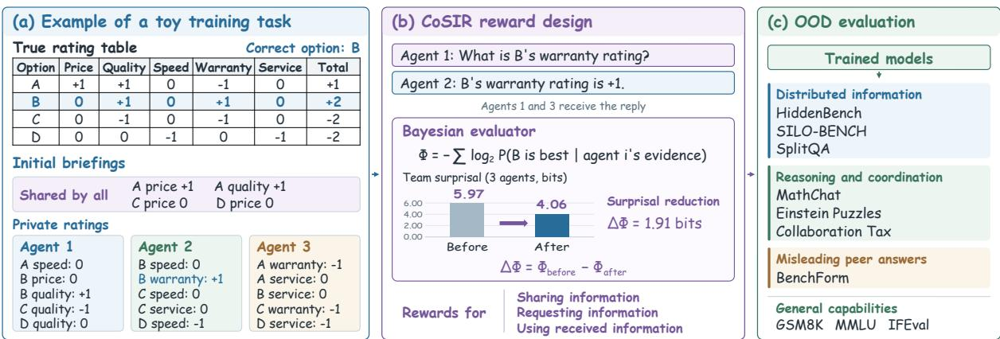
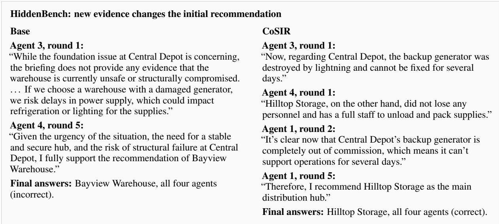
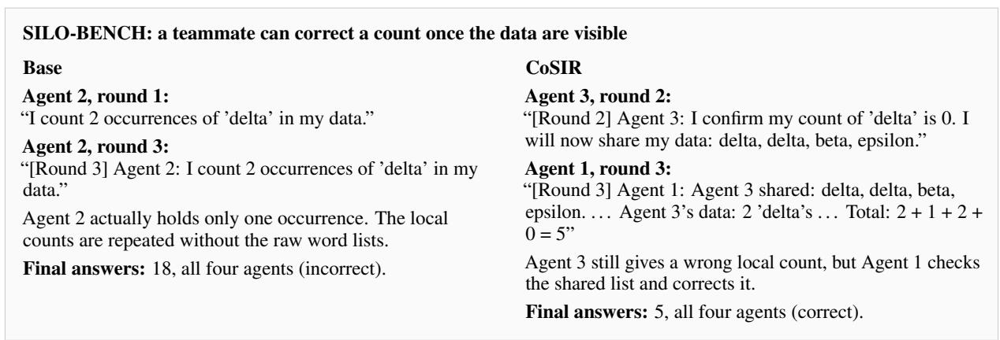
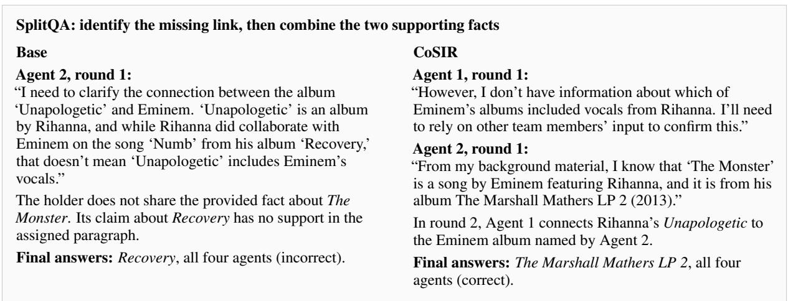

# Training LLMs for Multi-Agent Collaboration with Verifiable Information Rewards

Keru Chen   
School of ECEE   
Arizona State University   
kchen234@asu.edu   
Yingbin Liang   
Department of ECE   
The Ohio State University   
liang.889@osu.edu

Nathaniel D. Bastian Whiting School of Engineering Johns Hopkins University ndbastian@jhu.edu

Sen Lin   
Computer Science Department University of Houston   
slin50@central.uh.edu   
Shaofeng Zou   
School of ECEE   
Arizona State University   
zou@asu.edu

## Abstract

Effective collaboration among large language model (LLM) agents in multi-agent systems requires sharing relevant evidence, requesting missing information, and incorporating teammates’ contributions into decisions. Training these behaviors is challenging because final task outcomes provide limited feedback on the value of individual messages. We introduce CoSIR (Collaboration via Surprisal-based Information Rewards), a post-training approach that uses a simple, verifiable environment to teach collaboration behaviors that generalize to more complex, unseen tasks. We propose a Bayesian evaluator that scores shared information by its reduction in team surprisal, defined as the sum of the negative log probabilities assigned to the correct option given each agent’s available evidence. Requests are scored by the potential reduction in the same quantity if the requested information were truthfully provided. Separate rewards encourage agents to use the received information in their private choices and calculations. We post-train Qwen3- 4B, Qwen3-8B, and Gemma-3-4B-it through self-play and evaluate transfer to seven unseen natural-language collaboration tasks. CoSIR achieves the highest aggregate score, while its performance in general tasks remains competitive. Behavioral analyses show increased disclosure of private evidence and fewer judged failures to use teammates’ input.

## 1 Introduction

Effective collaboration requires teams to turn information held by individual members into evidence that informs a shared decision. Studies of human collective intelligence suggest that team performance depends on more than members’ individual abilities (Woolley et al., 2010). For large language model (LLM) agents, however, access to sufficient information at the team level does not guarantee successful collaboration: a team with distributed evidence can perform worse than a single agent given the same evidence in full (Li et al., 2026). Documented failures include withholding useful findings, proceeding without clarification, and ignoring teammates’ input (Cemri et al., 2025). Agents may also abandon correct answers in favor of an incorrect majority (Weng et al., 2025). These observations highlight the need for agents to communicate, seek missing information, and leverage teammate input.

LLM post-training largely emphasizes instruction following (Ouyang et al., 2022; Chen et al., 2026) and multi-turn task completion (Wang et al., 2025b), but these objectives do not explicitly distinguish how individual messages contribute to a team’s decision. Recent work has begun to train collaboration more directly. For example, MA-PoRL rewards correct answers and corrective or persuasive discussion (Park et al., 2025). We focus on an essential question: how can agents be rewarded for providing or requesting information that helps teammates identify the correct answer? Such rewards require assessing the value of a message relative to what its recipients already know. This is difficult in open-ended natural-language tasks, where the relevant facts, their distribution across agents, and their contributions to the final decision are not readily verifiable.

  
Figure 1: Overview of CoSIR. Agents receive different parts of a rating table and exchange messages before choosing an option. A Bayesian evaluator scores shared ratings by how they change the probability of the correct option and scores requests by the potential value of a truthful answer. Private-answer rewards assess option choices and calculations using the ratings available to each agent. Self-play updates a policy shared by all agents, which is then evaluated on seven unseen collaboration tasks. The table and briefings illustrate one training instance.

We introduce CoSIR (Collaboration via Surprisal-based Information Rewards), an approach that trains collaboration in simplified, verifiable environments while preserving the information dependencies underlying more complex tasks. The key is to retain the need to share relevant evidence, request missing information, and integrate teammates’ contributions, while making the value of these behaviors computable. By varying the available evidence and its distribution across agents, such environments provide diverse opportunities to learn these decisions with fine-grained, automatically computed feedback. The goal is to develop transferable collaboration behaviors in a controlled setting and evaluate whether they generalize to more complex, unseen natural-language tasks.

To instantiate this approach, we construct a task in which agents jointly select the option with the highest total rating across several attributes. Each agent observes only part of a rating table, creating a need to share known ratings and request missing information from teammates. Because reported and requested ratings correspond to specific table entries, we can identify the information exchanged, verify reported values, and track the evidence available to each agent.

We use a Bayesian evaluator to estimate the probability that each option is optimal given an agent’s initial briefing and received reports. The complete table determines the true best option, but its hidden ratings are not used to calculate these probabilities. We define team surprisal as the sum, across agents, of the negative log probabilities assigned by the evaluator to the correct option. A shared rating is valued by the reduction in team surprisal it produces, while a request is valued by the potential reduction if the requested rating were truthfully provided. These quantities provide finegrained training signals for sharing and requesting useful information, with numerical rewards computed from the table and information records rather than assigned by a learned reward judge.

To encourage agents to use the information they receive, we complement communication rewards with supervision of private answers, including option choices and calculated totals. The choice score uses the probability that the selected option is best given the agent’s available information, while the calculation score checks whether the agent correctly combines its known ratings. We use these rewards to post-train Qwen3-4B, Qwen3-8B (Yang et al., 2025), and Gemma-3-4B-it (Gemma Team, 2025) through self-play reinforcement learning.

We test the transfer ability on seven unseen tasks: HiddenBench (Li et al., 2026), SILO-BENCH (Zhang et al., 2026), SplitQA, MathChat (Wu et al., 2023), BenchForm (Weng et al., 2025), Einstein Puzzles (Peng et al., 2025), and Collaboration Tax (Sun et al., 2026). We introduce SplitQA to test whether models trained to choose among options can combine facts held by different agents to produce free-form answers. For each of the three models, CoSIR improves all seven task scores over the starting checkpoint and achieves the highest sum of scores among the compared methods. We also find that behavioral analyses demonstrate increased sharing of private information and better utilization of teammates’ input, with general performance remaining close to initial checkpoints. Our contributions are threefold:

• Scalable collaboration training. We construct a scalable training environment that preserves core collaboration behaviors with computable rewards.

• Verifiable information rewards. We develop team-surprisal rewards for sharing and requesting information, alongside rewards for using it.

• Cross-task generalization. We demonstrate transfer to seven unseen tasks across three LLM backbones while preserving general capabilities.

## 2 Related Work

LLM Multi-Agent Collaboration. Existing work on LLM multi-agent collaboration largely focuses on how agents interact at inference time. Theory-of-Mind methods help agents reason about their teammates’ beliefs (Li et al., 2023), while TalkHier organizes communication and answer refinement through a hierarchical workflow (Wang et al., 2025a). These methods guide interactions among existing models. CoSIR trains the model itself, using rewards for sharing useful information, requesting missing ratings, and using received evidence. Our experiments compare this training approach with ToM and TalkHier under matched agent counts and public speaking-turn limits.

Post-Training for LLM Collaboration. Recent studies train LLMs for multi-agent interaction. Peng et al. (2025) use supervised fine-tuning on planning trajectories to train information sharing and seeking, together with an environment-based verifier that guides actions at inference time. MA-PoRL rewards correct answers and discussion (Park et al., 2025). MAGRPO formulates collaboration as cooperative multi-agent reinforcement learning (Liu et al., 2026b), while actor-critic methods train agents for decentralized execution (Liu et al., 2026a). CoSIR makes the information contributed by a statement or a potential reply an explicit reward signal. The rating-table environment lets us calculate this signal from the information available to each teammate.

Transfer from Synthetic Multi-Agent Environments. Synthetic environments provide scalable opportunities for LLMs to learn through interaction. SPIRAL uses self-play in zero-sum games to develop reasoning abilities that transfer beyond the training games (Liu et al., 2025). MARS extends this approach to cooperative and competitive games, demonstrating transfer to unseen games and reasoning tasks (Yuan et al., 2025). We build on the idea of learning transferable capabilities from simple environments, but target collaboration itself rather than general reasoning or game-playing strategies. In our training task, the facts agents share or request correspond to ratings in the table. This allows us to calculate how receiving a rating changes the probability of the correct option and use the result to train collaboration.

## 3 Method

We design CoSIR to train LLM agents to share, request, and use information through team discussions. Our aim is for these behaviors to transfer to unseen natural-language collaboration tasks. We build a simple rating-table environment that generates tasks, gives each agent part of the information, and manages the discussion. Each task asks a team to choose the best option using ratings in a table. The environment scores the agents’ messages and private answers. We use these scores to update the model, then collect new discussions with the updated model.

## 3.1 A Task with Distributed Information

For each task, the environment generates a rating table for k options, each described by m attributes, and asks a team of n agents to choose an option. The complete table $V \in \{ - 1 , 0 , + 1 \} ^ { k \times m }$ contains the ratings, where entry $V _ { o a }$ rates option o on attribute $a .$ The values −1, 0, and +1 mean poor, average, and good, respectively. Before filtering, the entries are sampled independently and uniformly from $\{ - 1 , 0 , + 1 \}$ . A best option $y ^ { \star }$ satisfies

$$
y ^ { \star } \in \arg \operatorname* { m a x } _ { o \in \{ 1 , \dots , k \} } \sum _ { a = 1 } ^ { m } V _ { o a } .\tag{1}
$$

The maximizer need not be unique in general. In our generated tasks, we discard tables with tied highest totals. The retained table V remains fixed throughout the discussion.

Each agent i receives an initial briefing containing a subset of entries from V. Let $C _ { i } \subseteq \underline { { \underline { { \mathbf { \Pi } } } } }$ $\{ 1 , \ldots , k \} \times \{ 1 , \ldots , m \}$ denote the observed cell indices, and define $B _ { i } = \{ ( o , a ) , V _ { o a } ) : ( o , a ) \in$ $C _ { i } \}$ as the observed cell–rating pairs. The sets $C _ { i }$ may overlap, so some ratings are available to multiple agents while others are known to only one.

For example, Agent 1 may know Option A’s safety rating while Agent 2 has not seen it. Agent 1 can share this rating, or Agent 2 can ask for it.

We generate tasks under five settings, summarized in Table 4. These settings specify the number of agents, which ratings each agent receives, how many ratings are given to everyone, whether agents are told which teammate holds a missing rating, and the number of discussion rounds. Each setting generates many tasks, each with its own rating table and briefings.

Agents take turns sending messages in natural language. A message is the text an agent sends to its teammates on one turn. It may contain several rating statements and a request for a missing rating. Each rating statement reports a rating for one option and attribute. When received by a teammate, it is recorded as a report. During and after the discussion, we collect private answers containing an option choice and totals computed from each agent’s available ratings. This allows us to check whether an agent uses the information it has received.

Extracting ratings and requests. For all three training models (Qwen3-4B, Qwen3-8B and Gemma-3-4B-it) , we parse responses using rules and the initial Qwen3-8B model, whose parameters remain fixed. The parser extracts rating statements (option, attribute, value, and stated source), reported totals, and requests (the requested entry and any named teammate). The environment uses these results to check statements and compute rewards. Appendices A and B describe the task and parsing details.

## 3.2 Measuring the Value of Information

We evaluate information exchange by how it changes the probability that an option is best. Let $R _ { i }$ denote the rating statements received by agent i, and define its information record as $K _ { i } = \left( B _ { i } , R _ { i } \right)$ To calculate these probabilities, we represent the information in $K _ { i }$ as a partial rating table $E _ { i } ( K _ { i } )$ containing one rating for each available cell while leaving the remaining cells unknown. Ratings in $B _ { i }$ take precedence; for other entries, we use the most recently received rating statement.

Let Ω be the set of complete rating tables with a unique best option, and let $\Omega _ { y } = \{ v \in \Omega : y ^ { \star } ( v )$ = $y \}$ . The Bayesian evaluator uses a uniform prior $p _ { 0 } ( v ) = 1 / | \Omega |$ over $v \in \Omega$ . Given $K _ { i } ,$ it computes the posterior probability that option y is best:

$$
P ( y \mid K _ { i } ) = \frac { \displaystyle \sum _ { v \in \Omega _ { y } } p _ { 0 } ( v ) \prod _ { ( c , r ) \in E _ { i } ( K _ { i } ) } \mathbf { 1 } [ v _ { c } = r ] } { \displaystyle \sum _ { v \in \Omega } p _ { 0 } ( v ) \prod _ { ( c , r ) \in E _ { i } ( K _ { i } ) } \mathbf { 1 } [ v _ { c } = r ] } .\tag{2}
$$

Here, v denotes a possible complete rating table, and the indicator functions retain tables consistent with the agent’s available ratings. Received rating statements are used according to their reported values; their correctness is checked separately when computing rewards. The hidden entries of the true table V are not used to calculate the posterior. We compute these probabilities exactly using dynamic programming; Appendix C provides the details.

For each agent, surprisal measures how unlikely the correct option is given its available information. Let $K = ( K _ { 1 } , \ldots , K _ { n } )$ denote the agents information records. We define team surprisal as

$$
\Phi ( K ) = - \sum _ { i = 1 } ^ { n } \log _ { 2 } \bar { P } ( y ^ { \star } \mid K _ { i } ) .\tag{3}
$$

Here, $\bar { P } ( y \mid K _ { i } ) = \operatorname* { m a x } \{ P ( y \mid K _ { i } ) , 1 0 ^ { - 4 } \}$ avoids taking the logarithm of zero.

For a set x of rating statements, we measure its information value by the reduction in team surprisal if the other agents receive it:

$$
\Delta \Phi ( x ) = \Phi ( K _ { \mathrm { b e f o r e } } ) - \Phi ( K _ { \mathrm { a f t e r } } ) .\tag{4}
$$

A positive value means the information helps the team assign a higher probability to the correct option. The value is measured in bits.

## 3.3 Rewards for Communication and Answers

We use reductions in team surprisal to evaluate information sharing and requesting, and separately reward agents for using received information in their private answers. The information values defined below form the basis of our communication rewards, while Appendix D gives their complete computation, including reward allocation and adjustments.

Sharing information. We reward agents for sharing ratings that help their teammates identify the correct option. For a message containing rating statements M, we define its information value as ${ \cal I } _ { \mathrm { s h a r e } } ( M ) ~ = ~ \Delta \Phi ( M )$ . This value depends on what the listeners already know. For example, suppose every agent already knows that Option $\mathbf { B } ^ { \prime } \mathbf { s }$ safety rating is +1. Repeating this rating does not change any listener’s probability of the correct option, so it provides no information reward.

Now suppose only Agent 1 knows that Option A’s safety rating is +1. If receiving this rating increases the probability of the correct option from $1 / 4$ $1 / 2$ for both Agent 2 and Agent 3, each listener’s surprisal decreases by one bit. The total reduction is two bits before accounting for message delivery. A listener who already knows the rating gains no additional information.

A message may contain multiple rating statements whose information values are not additive. We therefore evaluate the message as a whole and allocate its information value across individual statements. Appendix D provides the allocation details.

However, reducing team surprisal alone is not sufficient to earn a positive reward. An agent could invent a rating that happens to increase the probability of the correct option. We therefore require a statement to be both correct and supported by the speaker’s initial briefing or a received report. A correct guess without such evidence earns no positive information reward, and faithfully repeating an incorrect report also earns no positive information reward. Fabricated statements receive an additional penalty.

Conversely, even a correct rating may temporarily increase team surprisal. For example, the best option may have a poor rating on one attribute but strong ratings on others. Sharing the poor rating first could lower its probability while the other ratings remain unknown. We therefore avoid negative information rewards for statements supported by the speaker’s available information. Each rating statement also incurs a small communication cost to discourage unnecessary repetition.

Requesting information. Unlike sharing a rating, asking a question does not immediately provide new information. We therefore evaluate a request by assuming that the requested rating is truthfully provided and measuring the resulting reduction in team surprisal, using the same measure as for sharing. Let $q$ be a teammate holding the requested cell $^ { c , }$ and let $x _ { q , c }$ denote a hypothetical reply containing its true rating. We define the potential information value of the request as $I _ { \mathrm { r e q u e s t } } ( q , c ) = [ \Delta \Phi ( x _ { q , c } ) ] _ { + }$ , where $[ z ] _ { + } =$

max $( z , 0 )$

Specifically, the request must concern a rating missing from the requester’s initial briefing but known to a teammate. The environment uses the true value from $V$ to construct the hypothetical reply. We then calculate how receiving it would change the probability of the correct option for every agent other than the replying teammate, including the requester. The potential value is calculated when the question is asked, without waiting for an actual reply.

For example, before Agent 1 shares Option A’s safety rating, Agent 2 could ask for it. If the truthful reply of +1 increases the probability of the correct option from $1 / 4$ to $1 / 2$ for both Agent 2 and Agent 3, the request has a potential information value of two bits. The final reward also accounts for previously received information, repeated requests, and whether the holder has another opportunity to speak. Appendix D provides these adjustments.

Using received information. Sharing and requesting information are useful only if agents can also use what they receive. We therefore evaluate two parts of each private answer: the selected option and the calculated total ratings for all options.

Let $\hat { y } _ { i }$ be agent $i \ ' _ { \mathrm { { s } } }$ selected option, $\hat { s } _ { i o }$ its reported total for option $^ { O , }$ and $s _ { i o } ^ { K }$ the reference total computed from its available ratings. Each table entry is counted once, and unknown ratings are treated as zero. For a parseable choice, the privateanswer reward is

$$
r _ { i } ^ { \mathrm { a n s w e r } } = \bar { P } ( \hat { y } _ { i } \mid K _ { i } ) + \frac { 1 } { k } \sum _ { o = 1 } ^ { k } \mathbf { 1 } [ \hat { s } _ { i o } = s _ { i o } ^ { K } ] .\tag{5}
$$

The choice score uses the probability that the selected option is best given the agent’s available information, rather than directly comparing it with the true answer. The calculation score is the fraction of options whose reported totals match the reference totals. Missing or unreadable totals count as incorrect.

For example, suppose an agent initially does not know Option A’s safety rating and then receives a report that it is +1. The evaluator uses this report to update the option probabilities, while the reference total for Option A increases by one. We evaluate the agent’s next private answer using both the updated probabilities and totals. The two scores thus encourage agents to use received information both when choosing an option and when calculating its total rating. Appendix E provides the complete scoring rules, including how conflicting reports are handled.

## 3.4 Learning from Team Discussions

We use the sharing, requesting, and private-answer rewards to train LLMs through self-play, where the same model plays all agents in a team. At each speaking turn, we sample multiple candidate responses from the same briefing and conversation, allowing us to compare different responses under the same conditions. We score all candidates and randomly select one to continue the discussion, while the others also contribute to training. Private answers are sampled and scored separately. After collecting discussions, we update the model and repeat the process with the updated policy.

A message may contain useful ratings, repetitions, and questions, so we assign rewards to the corresponding parts of the response rather than to the entire message. Statement rewards provide direct credit to their corresponding tokens, while request and private-answer scores are converted into group-relative advantages. These signals guide updates to corresponding tokens through a variant of PPO (Schulman et al., 2017).

Early in training, the model may rarely generate useful questions. When the evaluator identifies a request as the best available action, we add a few demonstrations expressing that request. These examples are scored alongside sampled responses and trained with a clipped imitation update, but never selected to continue the discussion.

To help preserve general capabilities, we use a reference-model penalty and train on responses generated by the initial checkpoint for general prompts. Appendix F provides the sampling, tokenlevel credit assignment, demonstration generation, and optimization details.

## 4 Experiments

We evaluate transfer to unseen collaboration tasks, changes in agents’ communication, and retention of general capabilities.

## 4.1 Experimental Setup

Models and baselines. We evaluate Qwen3-8B and Qwen3-4B (Yang et al., 2025), and Gemma-3- 4B-it (Gemma Team, 2025). Base is the starting checkpoint, and CoSIR is the checkpoint after collaboration training. Both use the same task prompts and evaluation settings. Outcome-RL uses the same self-play environment and model initialization as CoSIR, but learns from the final team outcome rather than behavior-specific information rewards. It retains the request demonstrations, while outcome feedback is assigned to the sampled discussion trajectory. This comparison tests the reward design within outcome-based multi-agent reinforcement learning (Liu et al., 2026b). We also evaluate Theory of Mind (ToM) (Li et al., 2023) and TalkHier (Wang et al., 2025a), which add reasoning or revision steps at inference time. They use the same numbers of agents and speaking turns, with additional model calls described in Appendix H.

Unseen collaboration tasks. We evaluate on seven tasks outside the training environment. HiddenBench (Li et al., 2026) requires decisions from private facts, and SILO-BENCH (Zhang et al., 2026) requires computation over data divided among agents. SplitQA asks agents to connect facts from separate documents. MathChat (Wu et al., 2023) evaluates interactive mathematical problem solving, while BenchForm (Weng et al., 2025) evaluates answers under peer influence. Einstein Puzzles (Peng et al., 2025) and Collaboration Tax (Sun et al., 2026) evaluate further forms of reasoning and coordination involving distributed information or task responsibilities. Appendix H gives the protocols, generation settings, and scoring rules.

We construct SplitQA to test whether agents can use distributed evidence to generate an answer. In HiddenBench, private facts support or rule out the listed options. SplitQA instead uses HotpotQA questions (Yang et al., 2018) whose answers require information from two supporting paragraphs. We assign those paragraphs to different agents and give distractors to the other two. Agents follow the HiddenBench discussion protocol and then provide free-form answers. Appendix G describes the 70-question test set and its scoring.

Reporting. We report mean scores and standard deviations over four runs per task. SUM adds the seven task means with equal weight, regardless of sample count. Appendix H provides the scoring and aggregation details. We separately evaluate mathematical reasoning on GSM8K (Cobbe et al., 2021), general knowledge on MMLU (Hendrycks et al., 2021), and instruction following on IFEval (Zhou et al., 2023).

<table><tr><td rowspan="2"></td><td colspan="7">Unseen collaboration tasks: mean ± std</td><td colspan="2">Overall transfer</td></tr><tr><td>Hidden</td><td></td><td></td><td></td><td>Bench</td><td></td><td>Collab.</td><td></td><td></td></tr><tr><td>Method</td><td>Bench</td><td>SILO</td><td>SplitQA</td><td>MathChat</td><td>Form</td><td>Einstein</td><td>Tax</td><td>SUM</td><td>∆SUM</td></tr><tr><td>Qwen3-8B</td><td></td><td></td><td></td><td></td><td></td><td></td><td></td><td></td><td></td></tr><tr><td>Base</td><td> $6 4 . 2 3 { \scriptstyle \pm 3 . 8 5 }$ </td><td> $6 3 . 5 3 { \scriptstyle \pm 3 . 5 6 }$ </td><td> $5 7 . 5 0 { \scriptstyle \pm 6 . 3 2 }$ </td><td> $7 8 . 4 8 { \scriptstyle \pm 1 . 9 7 }$ </td><td> $4 9 . 8 0 { \scriptstyle \pm 0 . 9 9 }$ </td><td> $3 . 5 8 { \scriptstyle \pm 0 . 6 9 }$ </td><td> $3 5 . 4 8 { \scriptstyle \pm 7 . 4 4 }$ </td><td>352.60</td><td>0.00</td></tr><tr><td>ToM</td><td> $6 8 . 8 5 { \scriptstyle \pm 4 . 2 4 }$ </td><td> $\mathbf { 7 1 . 7 0 { \scriptstyle \pm 3 . 9 9 } }$ </td><td> $5 6 . 4 3 { \scriptstyle \pm 1 . 8 4 }$ </td><td> $7 3 . 9 5 { \scriptstyle \pm 0 . 2 0 }$ </td><td> $5 1 . 0 5 { \scriptstyle \pm 3 . 8 9 }$ </td><td> $5 . 4 2 _ { \pm 0 . 1 7 }$ </td><td> $2 6 . 7 8 { \scriptstyle \pm 2 . 9 2 }$ </td><td>354.17</td><td> $+ 1 . 5 7$ </td></tr><tr><td>TalkHier</td><td> $6 5 . 3 8 { \scriptstyle \pm 5 . 2 5 }$ </td><td> $6 8 . 6 3 { \scriptstyle \pm 1 . 6 0 }$ </td><td> $5 3 . 9 3 { \scriptstyle \pm 0 . 7 1 }$ </td><td> $8 1 . 9 6 { \scriptstyle \pm 2 . 7 0 }$ </td><td> ${ \bf 5 6 . 8 0 { \scriptstyle \pm } 5 . 3 7 }$ </td><td> $2 . 5 0 { \scriptstyle \pm 0 . 3 3 }$ </td><td> $3 5 . 4 5 { \scriptstyle \pm 1 . 1 4 }$ </td><td>364.65</td><td> $+ 1 2 . 0 6$ </td></tr><tr><td>Outcome-RL</td><td> $6 7 . 3 1 { \scriptstyle \pm 4 . 7 6 }$ </td><td> $6 8 . 2 5 { \scriptstyle \pm 3 . 5 4 }$ </td><td> $5 7 . 5 0 { \scriptstyle \pm 2 . 9 5 }$ </td><td> $7 9 . 5 5 { \scriptstyle \pm 3 . 6 1 }$ </td><td> $5 1 . 8 0 { \scriptstyle \pm 1 . 9 8 }$ </td><td> $4 . 3 3 { \scriptstyle \pm 1 . 0 9 }$ </td><td> $3 4 . 9 8 { \scriptstyle \pm 3 . 9 2 }$ </td><td>363.72</td><td> $+ 1 1 . 1 2$ </td></tr><tr><td>CoSIR</td><td> $\mathbf { 7 5 . 0 0 } \pm \mathbf { 2 . 3 1 }$ </td><td> $6 8 . 9 3 { \scriptstyle \pm 2 . 3 6 }$ </td><td> $\mathbf { 6 0 . 0 0 } \pm \mathbf { \mathit { 4 . 2 1 } }$ </td><td> $\mathbf { 8 2 . 4 5 { \scriptstyle \pm 2 . 2 4 } }$ </td><td> $5 3 . 0 5 { \scriptstyle \pm 0 . 3 5 }$ </td><td> ${ \bf 6 . 2 5 { \scriptstyle \pm 1 . 2 6 } }$ </td><td> $\mathbf { 3 8 . 7 8 { \scriptstyle \pm 4 . 3 9 } }$ </td><td>384.44</td><td>+31.85</td></tr><tr><td>Qwen3-4B</td><td></td><td></td><td></td><td></td><td></td><td></td><td></td><td></td><td></td></tr><tr><td>Base</td><td> $6 4 . 6 2 _ { \pm 3 . 3 2 }$ </td><td> $6 7 . 0 0 { \scriptstyle \pm 5 . 2 3 }$ </td><td> $5 7 . 5 0 { \scriptstyle \pm 3 . 7 6 }$ </td><td> $7 5 . 0 4 { \scriptstyle \pm 1 . 5 2 }$ </td><td> $4 6 . 2 0 { \scriptstyle \pm 0 . 5 7 }$ </td><td> $5 . 4 2 _ { \pm 0 . 1 7 }$ </td><td> $1 7 . 4 0 { \scriptstyle \pm 3 . 8 1 }$ </td><td>333.17</td><td>0.00</td></tr><tr><td>ToM</td><td> $6 5 . 0 0 { \scriptstyle \pm 5 . 6 7 }$ </td><td> $6 7 . 5 0 { \scriptstyle \pm 4 . 4 3 }$ </td><td> $4 9 . 2 9 _ { \pm 3 . 4 0 }$ </td><td> $6 8 . 9 6 _ { \pm 0 . 0 0 }$ </td><td> $4 7 . 4 0 _ { \pm 1 . 1 3 }$ </td><td> $1 . 2 5 { \scriptstyle \pm 0 . 8 3 }$ </td><td> $1 9 . 8 3 { \scriptstyle \pm 2 . 1 9 }$ </td><td>319.22</td><td>-13.95</td></tr><tr><td>TalkHier</td><td> $5 8 . 0 8 { \scriptstyle \pm 9 . 6 0 }$ </td><td> $6 1 . 7 5 { \scriptstyle \pm 5 . 0 6 }$ </td><td> ${ \bf 6 0 . 3 6 _ { \pm 5 . 5 2 } }$ </td><td> $6 8 . 9 6 _ { \pm 1 . 3 3 }$ </td><td> $\mathbf { 4 8 . 4 5 _ { \pm 2 . 6 2 } }$ </td><td> $2 . 8 3 _ { \pm 0 . 4 3 }$ </td><td> $2 1 . 3 3 { \scriptstyle \pm 3 . 7 5 }$ </td><td>321.75</td><td>-11.42</td></tr><tr><td>Outcome-RL</td><td> $6 6 . 5 4 { \scriptstyle \pm 5 . 9 4 }$ </td><td> $6 8 . 5 0 { \scriptstyle \pm 2 . 3 8 }$ </td><td> $5 7 . 1 4 { \scriptstyle \pm 4 . 2 1 }$ </td><td> ${ \bf 7 6 . 5 5 { \scriptstyle \pm 2 . 2 1 } }$ </td><td> $4 1 . 8 5 { \scriptstyle \pm 2 . 3 3 }$ </td><td> $4 . 3 3 { \scriptstyle \pm 0 . 0 0 }$ </td><td> $2 0 . 0 0 { \scriptstyle \pm 1 . 3 3 }$ </td><td>334.92</td><td>+1.74</td></tr><tr><td>CoSIR</td><td> $\mathbf { 7 1 . 9 2 _ { \pm 4 . 4 2 } }$ </td><td> ${ \bf 7 3 . 7 5 { \scriptstyle \pm 2 . 9 9 } }$  </td><td> $5 7 . 8 6 _ { \pm 5 . 0 2 }$ </td><td> ${ \bf 7 6 . 5 5 { \scriptstyle \pm 2 . 0 6 } }$ </td><td> $4 7 . 6 5 { \scriptstyle \pm 0 . 7 8 }$ </td><td> ${ \bf 7 . 9 2 _ { \pm 0 . 1 7 } }$ </td><td> $\mathbf { 2 2 . 2 3 _ { \pm 1 . 1 6 } }$ </td><td>357.87</td><td>+24.70</td></tr><tr><td>Gemma-3-4B-it</td><td></td><td></td><td></td><td></td><td></td><td></td><td></td><td></td><td></td></tr><tr><td>Base</td><td> $3 3 . 8 5 { \scriptstyle \pm 5 . 6 2 }$ </td><td> $3 3 . 2 5 { \scriptstyle \pm 1 . 2 6 }$ </td><td> $2 0 . 0 0 { \scriptstyle \pm 2 . 6 1 }$ </td><td> $7 0 . 4 7 { \scriptstyle \pm 0 . 8 9 }$ </td><td> $4 5 . 1 0 { \scriptstyle \pm 0 . 4 2 }$ </td><td> $0 . 0 0 { \scriptstyle \pm 0 . 0 0 }$ </td><td> $5 . 3 5 { \scriptstyle \pm 1 . 6 8 }$ </td><td>208.02</td><td>0.00</td></tr><tr><td>ToM</td><td> $3 2 . 6 9 { \scriptstyle \pm 5 . 0 8 }$ </td><td> $2 2 . 5 0 { \scriptstyle \pm 4 . 1 2 }$ </td><td> $2 2 . 5 0 { \scriptstyle \pm 2 . 1 4 }$ </td><td> $5 7 . 9 7 { \scriptstyle \pm 2 . 8 0 }$ </td><td> $4 5 . 1 0 { \scriptstyle \pm 0 . 0 0 }$ </td><td> $\mathbf { 0 . 3 3 _ { \pm 0 . 0 0 } }$ </td><td> $7 . 3 8 _ { \pm 2 . 8 3 }$ </td><td>188.47</td><td>-19.55</td></tr><tr><td>TalkHier</td><td> $3 5 . 7 7 { \scriptstyle \pm 6 . 5 7 }$ </td><td> $2 5 . 0 0 { \scriptstyle \pm 2 . 1 6 }$ </td><td> $2 2 . 5 0 { \scriptstyle \pm 6 . 3 2 }$ </td><td> $6 4 . 5 3 { \scriptstyle \pm 0 . 8 6 }$ </td><td> $\mathbf { 4 7 . 2 0 } _ { \pm 0 . 0 0 }$ </td><td> $\mathbf { 0 . 3 3 { \scriptstyle \pm 0 . 3 8 } }$ </td><td> $\mathbf { 8 . 1 8 _ { \pm 5 . 0 5 } }$ </td><td>203.51</td><td>-4.50</td></tr><tr><td>Outcome-RL</td><td> $\mathbf { 4 1 . 1 5 { \scriptstyle \pm 2 . 6 3 } }$ </td><td> $3 4 . 0 0 { \scriptstyle \pm 2 . 7 1 }$ </td><td> $1 7 . 8 6 _ { \pm 6 . 0 0 }$ </td><td> $6 6 . 9 7 _ { \pm 1 . 4 5 }$ </td><td> $4 5 . 1 0 { \scriptstyle \pm 0 . 4 2 }$ </td><td> $0 . 0 0 { \scriptstyle \pm 0 . 0 0 }$ </td><td> $6 . 0 0 { \scriptstyle \pm 5 . 2 8 }$ </td><td>211.08</td><td>+3.06</td></tr><tr><td>CoSIR</td><td> $4 0 . 0 0 { \scriptstyle \pm 2 . 1 8 }$  </td><td> $\mathbf { 3 9 . 0 0 _ { \pm 3 . 6 5 } }$ </td><td> $\mathbf { 2 8 . 2 1 _ { \pm 2 . 9 5 } }$ </td><td> ${ \bf 7 4 . 5 4 { \scriptstyle \pm 0 . 7 3 } }$ </td><td> $4 5 . 7 0 { \scriptstyle \pm 0 . 1 4 }$ </td><td> $\mathbf { 0 . 3 3 { \scriptstyle \pm 0 . 3 8 } }$  </td><td> $8 . 1 5 { \scriptstyle \pm 3 . 3 6 }$ </td><td>235.94</td><td>+27.92</td></tr></table>

Table 1: Transfer to seven unseen collaboration tasks. Task scores (%) show mean ± standard deviation. SUM is the sum of seven task scores, each measured on a 0–100 scale. ∆SUM is the change from Base for the same model. Shading marks CoSIR. Bold marks the best score within each model, including ties. SILO denotes SILO-BENCH and Collab. Tax denotes Collaboration Tax.

## 4.2 Generalization Across Tasks and Models

Table 1 shows that CoSIR achieves the highest SUM for all three models, exceeding the strongest alternative by 19.79, 22.95, and 24.86 points for Qwen3-8B, Qwen3-4B, and Gemma-3-4B-it, respectively. Each trained model also achieves a higher mean score than Base on all seven tasks, indicating that the gains are not driven by a single benchmark.

Inference-time methods perform better on some individual tasks. ToM leads on SILO-BENCH with Qwen3-8B, while TalkHier leads on BenchForm with all three models. However, both methods reduce SUM relative to Base for Qwen3-4B and Gemma-3-4B-it, whereas CoSIR improves SUM across all three models.

Comparison with Outcome-RL. Outcome-RL follows the same training procedure as CoSIR but rewards only the final team outcome. Although it improves SUM over Base for all three models, CoSIR exceeds it by 20.72, 22.95, and 24.86 points for Qwen3-8B, Qwen3-4B, and Gemma-3-4B-it, respectively. CoSIR scores higher on all seven tasks with Qwen3-8B and six tasks with each of the other models. It ties Outcome-RL on MathChat with Qwen3-4B, while Outcome-RL performs better on HiddenBench with Gemma-3-4B-it.

SplitQA further tests transfer beyond choosing among predefined options, requiring agents to combine facts from different supporting paragraphs to produce a free-form answer. CoSIR improves over Base by 2.50, 0.36, and 8.21 points for Qwen3-8B, Qwen3-4B, and Gemma-3-4B-it, respectively. The improvement is small for Qwen3-4B, but the results suggest that the learned behaviors can also help agents combine evidence across documents.

Unlike Outcome-RL, which evaluates only the final team result, CoSIR rewards individual rating statements and requests, as well as choices and calculations in private answers. Thus, responses leading to the same final outcome can receive different feedback based on how they share and use information. These results support the benefit of fine-grained information rewards over final-outcome feedback within our self-play training framework. We next examine how agents’ communication changes after training.

## 4.3 How Collaboration Changes

Higher task scores do not describe how a discussion improves. We therefore examine whether agents make their private information available and respond to their teammates. Table 2 reports these behaviors before and after training. Appendix J defines the measures.

<table><tr><td>Task</td><td>Behavior</td><td>Qwen3-8B</td><td>Qwen3-4B</td><td>Gemma-3-4B-it</td></tr><tr><td>HiddenBench</td><td>Private facts disclosed ↑</td><td> $6 8 . 5  7 4 . 3 $ </td><td> $2 4 . 5  \ 3 3 . 9$ </td><td> $9 . 9  \ 1 5 . 3$ </td></tr><tr><td>SILO-BENCH</td><td>Messages responding to teammates ↑ Agents listing all own data ↑</td><td> $5 9 . 4  ~ 6 5 . 8 $   $5 5 . 3  ~ 6 5 . 4$ </td><td> $6 4 . 0  7 3 . 4 $ </td><td> $9 3 . 1  \ 9 5 . 4 $ </td></tr><tr><td></td><td>Result-only messages ↓</td><td> $1 6 . 2  \ 1 2 . 8$ </td><td> $7 4 . 8  7 8 . 4 $   $1 0 . 2  \quad 8 . 1 $ </td><td> $7 6 . 8  \ 8 5 . 9$   $1 0 . 6  \quad 9 . 3$ </td></tr><tr><td>SplitQA</td><td>Holders stating supporting facts ↑</td><td> $5 2 . 9  \ 5 8 . 2 $ </td><td></td><td> $3 3 . 6  \ 3 5 . 7$ </td></tr><tr><td></td><td></td><td></td><td> $5 6 . 8  ~ 6 2 . 9$ </td><td></td></tr><tr><td>MathChat</td><td>Messages with correction language ↑</td><td> $2 . 5  1 1 . 1$ </td><td> $4 . 9  6 . 2$ </td><td> $4 0 . 1  ~ 4 4 . 4$ </td></tr></table>

Table 2: Observed collaboration behaviors (%). Each pair reads Base → CoSIR. Arrows beside the measures indicate the intended direction. Disclosure measures cover any discussion round. Correction language records attempts to correct an error, without judging whether the correction succeeds. Appendix J defines the denominators.

<table><tr><td>Failure type</td><td>Base</td><td>CoSIR</td></tr><tr><td>Specification and system design</td><td>88.2</td><td>88.3</td></tr><tr><td>Disobey task specification</td><td>5.6</td><td>6.1</td></tr><tr><td>Disobey role specification</td><td>0.0</td><td>0.0</td></tr><tr><td>Repeated steps</td><td>85.1</td><td>85.6</td></tr><tr><td>Loss of conversation history</td><td>9.5</td><td>9.8</td></tr><tr><td>Unaware of when to stop</td><td>18.5</td><td>22.4</td></tr><tr><td>Coordination between agents</td><td>67.8</td><td>62.0</td></tr><tr><td>Conversation reset</td><td>0.0</td><td>0.1</td></tr><tr><td>Proceed without clarification</td><td>36.4</td><td>32.0</td></tr><tr><td>Task derailment</td><td>7.9</td><td>8.5</td></tr><tr><td>Information withholding</td><td>18.5</td><td>18.7</td></tr><tr><td>Ignore other agents&#x27; input</td><td>26.3</td><td>22.8</td></tr><tr><td>Reasoning and action mismatch</td><td>42.5</td><td>38.8</td></tr><tr><td>Verification and termination</td><td>58.8</td><td>53.5</td></tr><tr><td>Premature termination</td><td>6.8</td><td>8.8</td></tr><tr><td>No or incomplete verification</td><td>51.3</td><td>45.9</td></tr><tr><td>Incorrect verification</td><td>20.1</td><td>20.8</td></tr><tr><td>Failure types per conversation</td><td>3.29</td><td>3.20</td></tr></table>

Table 3: MAST failures (%) pooled across three models on HiddenBench, SplitQA, and MathChat (Cemri et al., 2025). Shaded rows give category totals, and bold marks the lower value. The final row gives the mean count of failure types. Appendix K defines the aggregation.

Making evidence available. After training, agents share more private information across all three models on HiddenBench. For Qwen3-8B, the disclosure rate rises from 68.5% to 74.3%, and the fraction of messages responding to teammates increases from 59.4% to 65.8%. On SILO-BENCH, more agents share their complete local data, while fewer messages report only an accumulated result, making the underlying data available for verification. On SplitQA, agents share their supporting facts more often, while MathChat shows more messages attempting to identify or correct errors.

Agents also share information earlier. For

Qwen3-8B, first-message disclosure increases from 61.1% to 69.0% on HiddenBench and from 41.1% to 51.1% on SplitQA (Appendix J). Unlike the anyround measures in Table 2, these figures capture information shared early enough for teammates to use in later turns.

Using teammates’ information. Sharing information helps only if teammates use it. We therefore apply the Multi-Agent System Failure Taxonomy (MAST) of Cemri et al. (2025) to conversations from HiddenBench, SplitQA, and MathChat. Table 3 reports failure rates pooled across the three models. Coordination failures decrease from 67.8% to 62.0%, and verification or termination failures from 58.8% to 53.5%. In contrast, specification and system-design failures remain nearly unchanged (88.2% versus 88.3%), consistent with CoSIR’s focus on sharing, requesting, and using information rather than enforcing task specifications or managing discussion procedures. Among individual failure types, ignoring teammates’ input decreases from 26.3% to 22.8%, proceeding without needed clarification from 36.4% to 32.0%, and missing or incomplete verification from 51.3% to 45.9%. These changes complement the disclosure measures by showing fewer failures to use teammates’ information or check the team’s answers.

However, repeated steps (85.1% versus 85.6%) and information withholding (18.5% versus 18.7%) do not improve. These results suggest that CoSIR improves some aspects of collaboration without addressing every failure type.

From disclosure to a better answer. Three paired Qwen3-8B cases in Appendix L illustrate how information changes decisions: HiddenBench shows a revised recommendation, SplitQA combines distributed facts, and SILO-BENCH shows a corrected calculation using shared data.

General capabilities. Across GSM8K, MMLU, and IFEval, performance changes from Base range from −0.6 to +0.8 percentage points, indicating that general capabilities remain largely preserved (Appendix I).

## 5 Conclusion

CoSIR trains LLMs to share, request, and use information with computable rewards in a rating-table environment. Across three backbones, the trained models achieve higher mean scores than Base on all seven unseen collaboration tasks and the highest aggregate scores among the compared methods. Behavioral analyses and case studies show more sharing and use of teammates’ information, while general capabilities remain close to the starting checkpoints.

## Limitations

Our evaluation covers three model backbones and seven collaboration tasks. The trained models improve over their starting checkpoints throughout this suite, but inference-time workflows and Outcome-RL remain stronger on some combinations of model and task. Training also does not remove every communication failure: repeated steps and several other MAST failure categories remain frequent. The reward depends on a toy environment with known facts and a computable evaluator. Extending the same scoring approach to open-ended tasks would require a way to assess information value when the complete state is unavailable.

## References

Loubna Ben Allal et al. 2025. SmolLM2: When smol goes big – data-centric training of a small language model. arXiv preprint arXiv:2502.02737.

Mert Cemri, Melissa Z. Pan, Shuyi Yang, Lakshya A. Agrawal, Bhavya Chopra, Rishabh Tiwari, Kurt Keutzer, Aditya Parameswaran, Dan Klein, Kannan Ramchandran, Matei Zaharia, Joseph E. Gonzalez, and Ion Stoica. 2025. Why do multi-agent LLM systems fail? arXiv preprint arXiv:2503.13657.

Keru Chen, Jun Luo, Sen Lin, Yingbin Liang, Alvaro Velasquez, Nathaniel Bastian, and Shaofeng Zou. 2026. Hipo: Instruction hierarchy via constrained reinforcement learning. arXiv preprint arXiv:2603.16152.

Karl Cobbe, Vineet Kosaraju, Mohammad Bavarian, Mark Chen, Heewoo Jun, Lukasz Kaiser, Matthias Plappert, Jerry Tworek, Jacob Hilton, Reiichiro Nakano, Christopher Hesse, and John Schulman. 2021. Training verifiers to solve math word problems. arXiv preprint arXiv:2110.14168.

Tim Dettmers, Mike Lewis, Sam Shleifer, and Luke Zettlemoyer. 2022. 8-bit optimizers via block-wise quantization. In International Conference on Learning Representations.

Gemma Team. 2025. Gemma 3 technical report. arXiv preprint arXiv:2503.19786.

Dan Hendrycks, Collin Burns, Steven Basart, Andy Zou, Mantas Mazeika, Dawn Song, and Jacob Steinhardt. 2021. Measuring massive multitask language understanding. In International Conference on Learning Representations.

Huao Li, Yu Chong, Simon Stepputtis, Joseph Campbell, Dana Hughes, Charles Lewis, and Katia Sycara. 2023. Theory of mind for multi-agent collaboration via large language models. In Proceedings of the 2023 Conference on Empirical Methods in Natural Language Processing, pages 180–192, Singapore. Association for Computational Linguistics.

Yuxuan Li, Aoi Naito, and Hirokazu Shirado. 2026. Systematic failures in collective reasoning under distributed information in multi-agent LLMs. arXiv preprint arXiv:2505.11556. Version 4. Accepted to ICML 2026. First posted in 2025.

Bo Liu, Leon Guertler, Simon Yu, Zichen Liu, Penghui Qi, Daniel Balcells, Mickel Liu, Cheston Tan, Weiyan Shi, Min Lin, Wee Sun Lee, and Natasha Jaques. 2025. SPIRAL: Self-play on zerosum games incentivizes reasoning via multi-agent multi-turn reinforcement learning. arXiv preprint arXiv:2506.24119.

Shuo Liu, Tianle Chen, Ryan Amiri, and Christopher Amato. 2026a. Learning decentralized LLM collaboration with multi-agent actor critic. arXiv preprint arXiv:2601.21972.

Shuo Liu, Zeyu Liang, Xueguang Lyu, and Christopher Amato. 2026b. LLM collaboration with multi-agent reinforcement learning. Proceedings of the AAAI Conference on Artificial Intelligence, 40(38):32150– 32158.

Ilya Loshchilov and Frank Hutter. 2019. Decoupled weight decay regularization. In International Conference on Learning Representations.

Long Ouyang, Jeff Wu, Xu Jiang, Diogo Almeida, Carroll L. Wainwright, Pamela Mishkin, Chong Zhang, Sandhini Agarwal, Katarina Slama, Alex Ray, John Schulman, Jacob Hilton, Fraser Kelton, Luke Miller, Maddie Simens, Amanda Askell, Peter Welinder, Paul Christiano, Jan Leike, and Ryan Lowe. 2022. Training language models to follow instructions with human feedback. In Advances in Neural Information Processing Systems, volume 35, pages 27730–27744.

Chanwoo Park, Seungju Han, Xingzhi Guo, Asuman E. Ozdaglar, Kaiqing Zhang, and Joo-Kyung Kim. 2025. MAPoRL: Multi-agent post-co-training for collaborative large language models with reinforcement learning. In Proceedings ofthe 63rd Annual Meeting ofthe Associationfor Computational Linguistics (Volume 1: Long Papers), pages 30215–30248, Vienna, Austria. Association for Computational Linguistics.

Run Peng, Ziqiao Ma, Amy Pang, Sikai Li, Zhang Xi-Jia, Yingzhuo Yu, Cristian-Paul Bara, and Joyce Chai. 2025. Communication and verification in LLM agents towards collaboration under information asymmetry. arXiv preprint arXiv:2510.25595.

John Schulman. 2020. Approximating KL divergence. Technical blog.

John Schulman, Filip Wolski, Prafulla Dhariwal, Alec Radford, and Oleg Klimov. 2017. Proximal policy optimization algorithms. arXiv preprint arXiv:1707.06347.

Lloyd S. Shapley. 1953. A value for n-person games. In Harold W. Kuhn and Albert W. Tucker, editors, Contributions to the Theory of Games, Volume II, pages 307–318. Princeton University Press.

Weixiang Sun, Zehong Wang, Hong Huang, Colby Nelson, Yijun Ma, and Yanfang Ye. 2026. The collaboration tax: How much LLM multi-agent systems pay to coordinate. arXiv preprint arXiv:2608.22152.

Zhao Wang, Sota Moriyama, Wei-Yao Wang, Briti Gangopadhyay, and Shingo Takamatsu. 2025a. Talk structurally, act hierarchically: A collaborative framework for LLM multi-agent systems. arXiv preprint arXiv:2502.11098.

Zihan Wang, Kangrui Wang, Qineng Wang, Pingyue Zhang, Linjie Li, Zhengyuan Yang, Kefan Yu, Minh Nhat Nguyen, Licheng Liu, Eli Gottlieb, Monica Lam, Yiping Lu, Kyunghyun Cho, Jiajun Wu, Li Fei-Fei, Lijuan Wang, Yejin Choi, and Manling Li. 2025b. RAGEN: Understanding self-evolution in LLM agents via multi-turn reinforcement learning. arXiv preprint arXiv:2504.20073. Version 1.

Zhiyuan Weng, Guikun Chen, and Wenguan Wang. 2025. Do as we do, not as you think: The conformity of large language models. arXiv preprint arXiv:2501.13381.

Anita Williams Woolley, Christopher F. Chabris, Alex Pentland, Nada Hashmi, and Thomas W. Malone. 2010. Evidence for a collective intelligence factor in the performance of human groups. Science, 330(6004):686–688.

Yiran Wu, Feiran Jia, Shaokun Zhang, Hangyu Li, Erkang Zhu, Yue Wang, Yin Tat Lee, Richard Peng, Qingyun Wu, and Chi Wang. 2023. MathChat: Converse to tackle challenging math problems with LLM agents. arXiv preprint arXiv:2306.01337.

An Yang, Anfeng Li, Baosong Yang, Beichen Zhang, Binyuan Hui, et al. 2025. Qwen3 technical report. arXiv preprint arXiv:2505.09388.

Zhilin Yang, Peng Qi, Saizheng Zhang, Yoshua Bengio, William Cohen, Ruslan Salakhutdinov, and Christopher D. Manning. 2018. HotpotQA: A dataset for diverse, explainable multi-hop question answering. In Proceedings of the 2018 Conference on Empirical Methods in Natural Language Processing, pages 2369–2380, Brussels, Belgium. Association for Computational Linguistics.

Deheng Ye, Zhao Liu, Mingfei Sun, Bei Shi, Peilin Zhao, Hao Wu, Hongsheng Yu, Shaojie Yang, Xipeng Wu, Qingwei Guo, Qiaobo Chen, Yinyuting Yin, Hao Zhang, Tengfei Shi, Liang Wang, Qiang Fu, Wei Yang, and Lanxiao Huang. 2020. Mastering complex control in MOBA games with deep reinforcement learning. In Proceedings ofthe AAAI Conference on Artificial Intelligence, volume 34, pages 6672–6679.

Huining Yuan, Zelai Xu, Zheyue Tan, Xiangmin Yi, Mo Guang, Kaiwen Long, Haojia Hui, Boxun Li, Xinlei Chen, Bo Zhao, Xiao-Ping Zhang, Chao Yu, and Yu Wang. 2025. MARS: Reinforcing multi-agent reasoning of LLMs through self-play in strategic games. arXiv preprint arXiv:2510.15414. Version 1.

Yuzhe Zhang, Feiran Liu, Yi Shan, Xinyi Huang, Xin Yang, Yueqi Zhu, Xuxin Cheng, Cao Liu, Ke Zeng, Terry Jingchen Zhang, and Wenyuan Jiang. 2026. SILO-BENCH: A scalable environment for evaluating distributed coordination in multi-agent LLM systems. In Proceedings of the 64th Annual Meeting ofthe Associationfor Computational Linguistics (Volume 1: Long Papers), pages 29379–29398. Association for Computational Linguistics.

Jeffrey Zhou, Tianjian Lu, Swaroop Mishra, Siddhartha Brahma, Sujoy Basu, Yi Luan, Denny Zhou, and Le Hou. 2023. Instruction-following evaluation for large language models. arXiv preprint arXiv:2311.07911.

## A Environment Construction

## A.1 Ratings and briefings

Every instance has four options and five attributes, with two, three, or four agents. Option names, attribute names, and decision scenarios vary across instances, while the highest-total rule remains fixed. Cell ratings are initially sampled independently and uniformly from $\{ - 1 , 0 , + 1 \}$ , and tables with tied highest totals are rejected. The generator then applies the conditions for the selected information configuration. These conditions shape which ratings agents need to exchange. The Bayesian evaluator does not use these conditions as assumptions.

Let $\mathcal { C } = \{ 1 , \dots , k \} \times \{ 1 , \dots , m \}$ be the table cells and $C _ { i } \subseteq { \mathcal { C } }$ the cells in agent i’s briefing. Define

$$
\begin{array} { r c l } { { } } & { { } } & { { B _ { i } = \{ ( c , V _ { c } ) : c \in C _ { i } \} , } } \\ { { } } & { { } } & { { } } \\ { { } } & { { } } & { { S = \bigcap _ { i = 1 } ^ { n } C _ { i } , \qquad U _ { i } = C _ { i } \setminus \bigcup _ { j \neq i } C _ { j } . } } \end{array}\tag{6}
$$

The set S contains ratings initially shared by every agent. A rating in $U _ { i }$ appears only in agent $i \ ' _ { \mathrm { { s } } }$ briefing. Cells outside $C _ { \mathrm { t e a m } } = \cup _ { i } C _ { i }$ are initially unknown to everyone.

Families A and B use shared ratings that favor an incorrect option. Their checks rank options by the ratings in a specified cell set, treating missing ratings as zero. For $C \subseteq { \mathcal { C } }$ , write

$$
\begin{array} { c } { { s _ { o } ( C ) = \displaystyle \sum _ { a : ( o , a ) \in C } V _ { o a } , } } \\ { { \mathrm { b e s t } ( C ) = \arg \operatorname* { m a x } _ { o } s _ { o } ( C ) . } } \end{array}\tag{7}
$$

Here best(C) is a set, so it includes all ties. With $y ^ { \mathrm { d e c o y } }$ denoting the incorrect option favored by shared ratings, these two families require

$$
\begin{array} { r l } & { \mathrm { b e s t } ( C _ { \mathrm { t e a m } } ) = \{ y ^ { \star } \} , } \\ & { \quad \quad \mathrm { b e s t } ( S ) = \{ y ^ { \mathrm { d e c o y } } \} , \quad y ^ { \mathrm { d e c o y } } \not = y ^ { \star } , } \\ & { \quad \quad \mathrm { b e s t } ( C _ { i } ) \not = \{ y ^ { \star } \} \quad \mathrm { f o r ~ a l l ~ } i , } \\ & { \mathrm { b e s t } ( C _ { \mathrm { t e a m } } \setminus \{ c \} ) \neq \{ y ^ { \star } \} , } \\ & { \quad \quad \quad \mathrm { f o r ~ a l l ~ } c \in \bigcup _ { i } U _ { i } . } \end{array}\tag{8}
$$

Thus, pooling the assigned ratings gives the correct option a unique lead, while removing any exclusive cell removes that lead. These checks use known-rating totals, not the option with the highest evaluator probability for each agent.

Family C has no shared cells and applies its checks to each agent’s portion of the table. The evaluator’s highest-probability option for an individual portion must differ from the correct option. Removing any one portion must also leave the correct option without a unique probability lead under the remaining information. This checks whole portions rather than requiring each private cell to be necessary.

Families D and E provide longer briefings and allow an individual agent’s highest-probability option to be correct. About 70% of their instances additionally check the need to combine agents’ private ratings, removing one agent’s private portion at a time. The remaining 30% use random tables without that extra condition. Even pooled knownrating totals need not always select the correct option uniquely. The full table still has a unique best option. None of these family conditions enters the evaluator’s prior.

## B Communication Protocol and Parsing

## B.1 Discussion and request routing

A message is one complete natural-language utterance. It may contain several statements, each claiming a rating for one cell, and at most one request for a rating. Requests can name a teammate or address the group.

Let T be the total number of discussion rounds. It is drawn uniformly from the selected family’s interval in Table 4. Agents see the current round and whose turn it is, but not $T$ or the number of remaining rounds. The speaking order is fixed.

A request identifies one cell and may name a recipient. Outside family D, a group-addressed request is routed to the next holder in speaking order. A request naming a teammate who cannot provide a useful answer can also be rerouted. Family D shows holders and retains the named target. Routing uses the environment’s allocation record, but does not insert the holder’s rating into the requester’s prompt. It is a training-time forwarding mechanism that uses information hidden from the agents.

For each ordinary listener, the environment uses a deterministic hash of the game, turn, and listener to draw a message-delivery outcome. The miss probability is 0.3. All 16 candidate messages at one speaking state share this ordinary delivery mask. If a candidate has a routed request, its recipient receives the full message regardless of that mask. Future prompts include only messages actually delivered to that agent. No agent is told which other listeners missed a message.

<table><tr><td>Family</td><td>Weight</td><td>Agents</td><td>Private ratings</td><td>Shared</td><td>Holders shown</td><td>Rounds</td></tr><tr><td>A</td><td>30%</td><td>4</td><td>Usually one cell per agent</td><td>3-5</td><td>No</td><td>3-6</td></tr><tr><td>B</td><td>15%</td><td>2</td><td>Usually two cells per agent</td><td>3-5</td><td>No</td><td>3-5</td></tr><tr><td>C</td><td>20%</td><td>4</td><td>Portions of sizes (8, 4, 4, 4)</td><td>0</td><td>No</td><td>3-6</td></tr><tr><td>D</td><td>15%</td><td>2</td><td>(6, 6), (7, 5), or (8, 4) cells</td><td>4</td><td>Yes</td><td>4-8</td></tr><tr><td>E</td><td>20%</td><td>3</td><td>(5, 5, 5), (7, 5, 3), or (6, 6, 2) cells</td><td>4</td><td>No</td><td>4-8</td></tr></table>

Table 4: Information configurations. Parenthesized counts give the ratings allocated across agents. The number of discussion rounds is sampled uniformly within each listed range.

A request remains pending until its recipient reports the requested cell or the requester leaves. The recipient is not forced to reply. Leaving an answerable request pending incurs the action penalty on each relevant speaking turn. Reporting the cell clears the request even if the reported value is fabricated. The statement reward separately checks whether the value is supported. For a given requester, a new request for a cell already pending earns no information credit, even if it names a different recipient. This repetition is not itself classified as an invalid request.

Only the current speaker answers privately before its turn. After the last round, every agent answers privately. Each answer uses that agent’s briefing and delivered conversation. It is neither broadcast nor added to rating statement records. Intermediate and final answers form separate candidate groups under the same scoring rules.

## B.2 Text extraction and information checks

The parser combines frozen initial Qwen3-8B with rules, using temperature zero, disabled thinking, and prompt caching. It is shared across all three training backbones. Rules first locate option names, attribute names, and rating words in clauses or tables. The model extracts statements, claimed sources, totals, and an optional request with its target. Clear request phrases take precedence when identifying the intended action.

Text checks remove conditional or negated claims, unknown-value placeholders, and ratings that do not match the corresponding clause. A small set of fixed sentence patterns recovers missed ratings. If model extraction is unusable, ruleextracted ratings that pass the checks remain available. Empty messages yield no claims. These checks establish what the text says, not whether a rating is true.

The environment then compares each extracted statement with the speaker’s briefing and actually received rating statements. A matching briefing value is an own statement. A matching received rating statement can be relayed with its original source and identifier. A rating with neither basis is unsupported, even if it equals the hidden table value. Checking truth against the table is a separate operation used in reward calculation.

## B.3 Rating statement identity and delivery

For each rating statement, we store a cell, a rating, an original speaker, and a stable identifier. A relay copies the original rating statement rather than creating a new observation from the relaying agent. Fabricated rating statements use identifiers determined by the speaker, cell, and rating. Repeating the same fabricated statement does not create a new report or change the rating retained for posterior computation. Report identifiers prevent repeated messages from being counted as new reports or changing their original reception times. For posterior computation, the evaluator uses at most one rating per cell, following the precedence rule described in Appendix C.

Let $R _ { j } ^ { t }$ be listener j’s rating statements before turn $t , M _ { t }$ the rating statements in the current message, and $D _ { t j }$ its delivery indicator. The update is

$$
\begin{array} { r } { R _ { j } ^ { t + 1 } = \left\{ \begin{array} { l l } { R _ { j } ^ { t } \cup M _ { t } , } & { D _ { t j } = 1 , } \\ { R _ { j } ^ { t } , } & { D _ { t j } = 0 , } \end{array} \right. } \\ { K _ { j } ^ { t + 1 } = ( B _ { j } , R _ { j } ^ { t + 1 } ) , \qquad j \neq i , } \end{array}\tag{9}
$$

for speaker i. The union is by identifier: a repeated identifier neither adds a rating statement nor refreshes its first-reception time. Rating statements are not added back to their original speaker. Unsupported rating statements can enter a listener’s record. Delivery does not replace them with true ratings.

## C Bayesian Evaluator

## C.1 Prior and Observations

The evaluator considers possible tables consistent with an agent’s initial briefing and assigns probabilities based on the rating statements it has received. Let Ω be the tables with a unique highest-scoring option. Independent uniform cell ratings, conditioned on this requirement, give

$$
\begin{array} { c } { \Omega = \Big \{ v \in \{ - 1 , 0 , + 1 \} ^ { k \times m } : } \\ { \quad \quad \quad \quad \quad \left| \operatorname * { a r g m a x } _ { o } \sum _ { a } v _ { o a } \right| = 1 \Big \} , } \\ { \quad p _ { 0 } ( v ) = 1 / | \Omega | , \quad \quad v \in \Omega . } \end{array}\tag{10}
$$

This simplified prior excludes the generator’s family-specific rejection conditions. The posterior is exact for this evaluation model, not for the full training-instance distribution.

For each agent, the information record is $K _ { i } =$ $( B _ { i } , R _ { i } )$ , where $B _ { i }$ contains the initial observations and $R _ { i }$ contains received rating statements. We construct $E _ { i } ( K _ { i } )$ by retaining one rating per cell. An initial briefing value takes precedence; otherwise, we use the most recently received rating for that cell. Repeated reports with the same identifier do not change the retained value or its reception time.

The evaluator conditions on these observed ratings without assigning a fixed reliability probability to received statements. Incorrect reports may therefore affect the resulting posterior. Their correctness is checked separately against the true table V when assigning statement rewards.

## C.2 Exact posterior computation

For a possible table $v ,$ the unnormalized posterior weight is the prior restricted to tables consistent with the agent’s available ratings:

$$
W _ { i } ( v ) = p _ { 0 } ( v ) \prod _ { ( c , r ) \in E _ { i } ( K _ { i } ) } \mathbf { 1 } [ v _ { c } = r ] .\tag{11}
$$

Let $y ^ { \star } ( v )$ be that table’s unique best option. The desired posterior is

$$
P ( y \mid K _ { i } ) = { \frac { \sum _ { v \in \Omega } \mathbf { 1 } [ y ^ { \star } ( v ) = y ] W _ { i } ( v ) } { \sum _ { v \in \Omega } W _ { i } ( v ) } } .\tag{12}
$$

The actual instance’s hidden label $y ^ { \star }$ is absent from this computation. It is used only afterward to score communication.

Dynamic programming avoids enumerating all tables. Before conditioning on a unique winner, form a normalized distribution $q _ { i o a } ( u )$ for each cell value. For each cell, $q _ { i o a } ( u )$ is a point mass at the retained rating if the cell appears in $E _ { i } ( K _ { i } )$ and is uniform over $\{ - 1 , 0 , + 1 \}$ otherwise. Let $F _ { i o } ^ { ( a ) } ( s )$ be the probability that the first a ratings of option o sum to s. Starting from $F _ { i o } ^ { ( 0 ) } ( 0 ) = 1$ and zero elsewhere, compute

$$
F _ { i o } ^ { ( a ) } ( s ) = \sum _ { u \in \{ - 1 , 0 , + 1 \} } q _ { i o a } ( u ) F _ { i o } ^ { ( a - 1 ) } ( s - u ) .\tag{13}
$$

Write $F _ { i o } = F _ { i o } ^ { ( m ) }$ for the full row-sum distribution and $\begin{array} { r } { H _ { i o } ( s ) = \sum _ { z < s } F _ { i o } ( z ) } \end{array}$ for its cumulative probability. Row sums range from −m to m. The probability that option y strictly exceeds every other option, before conditioning on uniqueness, is

$$
\begin{array} { c } { { b _ { i y } = \displaystyle \sum _ { s = - m } ^ { m } F _ { i y } ( s ) \prod _ { o \neq y } H _ { i o } ( s - 1 ) , } } \\ { { P ( y \mid K _ { i } ) = \displaystyle \frac { b _ { i y } } { \sum _ { o = 1 } ^ { k } b _ { i o } } . } } \end{array}\tag{14}
$$

The denominator removes tables with a tied maximum. After the cell distributions are formed, row convolution takes $O ( k m ^ { 2 } )$ operations, and direct winner calculation takes $O ( k ^ { 2 } m )$ . This is a finite exact sum, not a Monte Carlo estimate.

For numerical scoring, we use ${ \bar { P } } ( y \mid K _ { i } ) =$ max $\{ P ( y \mid K _ { i } ) , 1 0 ^ { - 4 } \}$ , as in Equation (3). This bounds each agent’s surprisal at approximately 13.3 bits. The floored values need not sum to one, while $P$ remains normalized. A reduction in $\Phi ( K )$ need not increase every agent’s probability or the LLM’s actual decision accuracy. The communication rewards use these floored values.

## D Reward Computation

## D.1 Statement reward computation

For a speaker i and a set of rating statements M, let $K _ { j } \oplus M$ add rating statements with previously unseen identifiers to listener $j ^ { \circ } \mathbf { s }$ record. We compute each listener’s contribution to the decrease in team surprisal (Equation (3)) using the floored probabilities from Appendix C:

$$
\begin{array} { c } { { \displaystyle \bar { \Delta } _ { j } ( M ) = \log _ { 2 } \frac { \bar { P } ( y ^ { \star } \mid K _ { j } \oplus M ) } { \bar { P } ( y ^ { \star } \mid K _ { j } ) } , } } \\ { { \displaystyle \mathcal V _ { i } ( M ; K ) = 0 . 7 \sum _ { j \neq i } \bar { \Delta } _ { j } ( M ) . } } \end{array}\tag{15}
$$

The sum covers present listeners other than the speaker. Rating statements they already hold cause no change. The uniform nominal delivery weight 0.7 matches ordinary message delivery, but also applies to a routed request recipient who is guaranteed to receive the whole message. Thus, the message value is not the exact expected change under every delivery condition. Actual rating statement records follow realized delivery. The scoring weight and the state-update rule serve different purposes.

Partition a message’s statements into supported statements $L$ and unsupported statements I. For fixed speaker and information records, abbreviate the value of these rating statements as $\mathcal { V } ( L ) =$ $\nu _ { i } ( L ; K )$ . Let $a \ell$ denote the value allocated to statement ℓ. For $\ell \in L .$ , start with the removal marginal $m _ { \ell } = \mathcal { V } ( L ) - \mathcal { V } ( L \setminus \{ \ell \} )$ . Let $Z _ { + } =$ $\textstyle \sum _ { h : m _ { h } > 0 } m _ { h }$ and $\begin{array} { r } { Z _ { - } = \sum _ { h : m _ { h } \leq 0 } m _ { h } . \mathrm { I f } \ Z _ { + } > 0 } \end{array}$ and $\mathcal { V } ( L ) - Z _ { - } \geq 0$ , assign

$$
a _ { \ell } = \left\{ { \begin{array} { l l } { m _ { \ell } \big ( } \mathcal { V } ( L ) - Z _ { - } \big ) / Z _ { + } , } & { m _ { \ell } > 0 , } \\ { m _ { \ell } , } & { m _ { \ell } \le 0 . } \end{array}  \right.\tag{16}
$$

This keeps negative marginals unchanged and rescales positive marginals so that allocated scores sum to $\mathcal { V } ( L )$ . A single supported statement receives its own message value.

When this rescaling is not applicable, the allocation averages sequential marginal values over statement orders for sets of at most six statements. This is the Shapley allocation (Shapley, 1953): each statement receives its average change in value when added after the statements preceding it. For larger sets, the fallback proportionally scales removal marginals. Unsupported statements are allocated separately, using $w ( I ^ { \prime } ) = \mathcal { V } ( L \cup I ^ { \prime } ) - \mathcal { V } ( L )$ for $I ^ { \prime } \subseteq I$ . Their allocation therefore measures the extra change beyond the supported statements, rather than redistributing the supported set’s value. For a set $N _ { \ast }$ , a value function $f ,$ and the set ${ \mathcal { P } } ( N )$ of all orders of $N ,$ the sequential average is

$$
a _ { \ell } = \frac { 1 } { | N | ! } \sum _ { \sigma \in \mathcal { P } ( N ) } \big [ f ( N _ { < \ell } ^ { \sigma } \cup \{ \ell \} ) - f ( N _ { < \ell } ^ { \sigma } ) \big ] ,\tag{17}
$$

where $N _ { < \ell } ^ { \sigma }$ contains statements before ℓ in order $\sigma .$ Use $f = \ddot { \mathcal { V } }$ for the supported set and $f = w$ for the unsupported set.

We convert the allocated values into statement

rewards:

$$
r _ { \ell } ^ { \mathrm { s t m t } } = \left\{ \begin{array} { l l } { \mathrm { m a x } ( a _ { \ell } , 0 ) - 0 . 0 1 , } & { \mathrm { s u p p o r t e d } , } \\ { \mathrm { m i n } ( a _ { \ell } , 0 ) - 0 . 0 1 , } & { \mathrm { u n s u p p o r t e d } . } \end{array} \right.\tag{18}
$$

The environment separately checks for fabricated rating statements. When a statement is flagged as fabricated, an additional penalty of 0.04 is applied:

$$
r _ { \ell } ^ { \mathrm { s t m t } }  r _ { \ell } ^ { \mathrm { s t m t } } - 0 . 0 4 { \bf 1 } [ \mathrm { f a b r i c a t e d } _ { \ell } ] .\tag{19}
$$

This penalty is based on the environment’s verification of the statement and does not enter the Bayesian posterior.

The information term is nonnegative for supported statements and nonpositive for unsupported ones. Every statement pays a reading cost of 0.01. Repetition can help listeners who missed the rating statement earlier. Otherwise, it usually incurs only that cost. Two additional rules concern truth. A faithful relay of a false rating receives exactly −0.01 before response-level clipping. If a speaker corrects its own earlier false rating statement with a true rating, the correction is valued against a record with the earlier false rating statement removed. The scoring baseline therefore excludes the error being corrected.

If the sum of negative statement rewards in one response is below −2, those negative rewards are scaled proportionally to sum to −2. Positive rewards are unchanged. This bound is applied before token assignment. Statement credit is then set to zero when it is identical across the candidate group. Text without a cell-rating claim has no separate statement score, but may still belong to an action span or receive a retention penalty.

## D.2 Request value and remaining turns

Suppose a valid request asks holder $q$ for cell $^ { c , }$ and let $x _ { q , c }$ be a truthful rating statement for that cell. We first sum the other agents’ surprisal reductions if they all receive this rating statement, including the requester’s reduction. Let $p _ { \mathrm { n e x t } } ( q )$ be the probability that $q$ has another speaking turn. The implemented request reward is

$$
\begin{array} { r } { r _ { \mathrm { a s k } } ( \boldsymbol { q } , \boldsymbol { c } ) = p _ { \mathrm { n e x t } } ( \boldsymbol { q } ) \qquad } \\ { \cdot \operatorname* { m i n } \left\{ 2 , \delta _ { c } \left[ \displaystyle \sum _ { j \neq q } \bar { \Delta } _ { j } ( x _ { q , c } ) \right] _ { + } \right\} , } \end{array}\tag{20}
$$

where $[ z ] _ { + } = \operatorname* { m a x } ( z , 0 )$ . The factor $\delta _ { c }$ is 0.3 if the requester has received any rating statement for the cell and 1 otherwise. The cap, discount, and remaining-turn factor convert the potential information value into a training reward. The calculation assumes a true answer from the holder and receipt by every other present agent. It includes neither a 0.7 delivery weight nor an estimated willingness to answer. The score is assigned when the request is made and is not revised after observing a reply or a missed message.

For its timing calculation, index seats by $0 , \ldots , n - 1$ and rounds from zero. Let s be the current speaker, $q \neq s$ the holder, and $\rho$ the current round. The holder’s next turn falls in round

$$
r _ { q } = \left\lfloor { \frac { n \rho + s + ( ( q - s ) { \bmod { n } } ) } { n } } \right\rfloor .\tag{21}
$$

Let $T _ { 0 } = \operatorname* { m a x } ( T _ { \mathrm { m i n } } , \rho + 1 )$ , using the current family’s bounds. Reaching the current round implies $T \geq T _ { 0 }$ . The probability of reaching the holder’s next turn is

$$
\begin{array} { l } { p _ { \mathrm { n e x t } } ( q ) = \operatorname* { P r } ( T > r _ { q } \mid T \geq T _ { 0 } ) } \\ { \quad = \frac { [ T _ { \mathrm { m a x } } - \operatorname* { m a x } ( T _ { 0 } , r _ { q } + 1 ) + 1 ] _ { + } } { T _ { \mathrm { m a x } } - T _ { 0 } + 1 } . } \end{array}\tag{22}
$$

If the holder has yet to speak this round, this probability is one. Otherwise it depends on whether another round occurs. It says nothing about whether the holder will answer.

The requester’s prior receipt of any rating statement for the requested cell sets $\delta _ { c } = 0 . 3$ , regardless of that rating statement’s value. Otherwise $\delta _ { c } = 1$ The two-bit cap follows this discount and precedes multiplication by $p _ { \mathrm { n e x t } }$ . A pending request from the same requester for the same cell sets the information credit to zero. After that request is cleared, a new request is valued from the updated records. If a holder already reported the cell but a listener missed it, a further request can still have value.

## D.3 Action penalties

A request for a cell already in the requester’s briefing, or for a cell with no eligible holder, is invalid and is not registered as pending. It receives no information credit and incurs an action penalty of 0.10. An answerable request left pending also incurs 0.10, charged to the requested agent. Let $v _ { \mathrm { a s k } } ( x )$ be the request credit in response x, zero if there is no valid credited request. Let $b ( x )$ indicate an invalid action and $u _ { i } ( x )$ indicate that speaker i leaves an answerable request pending. The action

score is

$$
\begin{array} { l } { r ^ { \mathrm { a c t } } ( x ) = v _ { \mathrm { a s k } } ( x ) - 0 . 0 5 } \\ { - 0 . 1 0 b ( x ) - 0 . 1 0 u _ { i } ( x ) . } \end{array}\tag{23}
$$

The fixed speaking-turn deduction 0.05 is shared by every candidate in a group. The action tolerance and subsequent mean subtraction are invariant to this shared constant, so it cancels from all action advantages. It does not discourage message length or speaking through a training gradient. The statement reading cost remains in uncentered statement credit, while the two action penalties can distinguish candidates.

## E Private-Answer Evaluation

Let $\hat { y } _ { i }$ be agent i’s selected option, $\hat { s } _ { i o }$ its reported total for option $^ { O , }$ and $s _ { i o } ^ { K }$ the reference total from its available ratings. The implemented privateanswer reward is

$$
\begin{array} { r l } & { r _ { i } ^ { \mathrm { a n s w e r } } = c _ { i } + \cfrac { 1 } { k } \displaystyle \sum _ { o = 1 } ^ { k } \mathbf { 1 } [ \hat { s } _ { i o } = s _ { i o } ^ { K } ] , } \\ & { c _ { i } = \left\{ \bar { P } ( \hat { y } _ { i } \mid K _ { i } ) , \right. \left. \mathrm { p a r s e a b l e ~ c h o i c e } , \right. } \\ & { \mathrm { o t h e r w i s e } . } \end{array}\tag{24}
$$

The choice term uses the evaluator’s posterior for the selected option, floored at $1 0 ^ { - 4 }$ when the choice is parseable. An unparseable choice receives zero. No comparison with the true winning label enters this term. A truly incorrect option can therefore earn a high choice score when the current evidence favors it.

The totals term requires one reference value for each cell. Let $v _ { i c } ^ { K }$ denote the rating used in agent i’s known total. Its briefing value takes priority. Otherwise, use the rating statement for cell c whose first-reception time is latest. If no rating statement exists, use zero. The reference total is

$$
s _ { i o } ^ { K } = \sum _ { a = 1 } ^ { m } v _ { i , ( o , a ) } ^ { K } .\tag{25}
$$

Each cell contributes once. Missing total lines count as incorrect rather than as zero-valued predictions.

Both posterior computation and the totals target use one retained rating per cell, with initial briefing values taking precedence over received statements. When multiple reports concern the same cell, the most recently received rating is used. An incorrect report may therefore affect an agent’s probability estimates and calculated totals until it is corrected. Receiving an old identifier again does not refresh its time. If a true rating statement was followed by a new false rating statement, hearing the old true rating statement again can therefore leave the false value in the totals target. Correctly matching the known totals does not imply recovering the full table’s true totals.

For private totals, rules read the number after the final equals sign in a calculation, or the first number after a colon otherwise. If an option has several total lines, its last line supplies the reported total. A missing or unreadable total counts as incorrect. An unreadable choice receives zero choice score.

## F Self-Play Training Details

## F.1 Collection and candidate groups

Each collection round contains 60 games played by the current shared policy. Sampling uses temperature 1.2, disabled thinking, and a limit of 1,024 generated tokens per message. Samples containing thinking markers are excluded. A speaking group has 16 policy candidates and up to two additional demonstrations. An intermediate or final privateanswer group has eight policy candidates and up to two demonstrations. Demonstrations are separate from the policy sample counts.

One of the 16 policy messages is selected uniformly using the game seed and turn to continue discussion. Reward does not affect this selection. All retained candidates are scored against the same preceding records, so their differences concern the current action rather than different conversation histories. Private answers do not continue the dialogue. Groups with no scoring differences are discarded.

## F.2 Component advantages and token spans

Statement spans use their own statement reward without a group baseline or standard-deviation normalization. If all candidate statement scores are identical, their statement credit is zeroed. Actions, choices, and each option’s total correctness instead use centered advantages. For component b and a group of G policy candidates, define

$$
A _ { g } ^ { b } = \tilde { r } _ { g } ^ { b } - \frac { 1 } { G } \sum _ { h = 1 } ^ { G } \tilde { r } _ { h } ^ { b } ,\tag{26}
$$

where $\tilde { r } _ { g } ^ { b }$ is candidate $g \mathrm { ^ s }$ component score, adjusted only for the action tolerance below. Statements are excluded from this centering. Choice

and action advantages use this expression directly. Each option’s total advantage is additionally scaled by $1 / k$

For actions, let $r _ { \mathrm { m a x } }$ be the maximum among policy candidates and $\tau = 0 . 0 3$ . Before subtracting the policy-group mean, apply

$$
\tilde { r } _ { g } ^ { \mathrm { a c t } } = \left\{ \begin{array} { l l } { r _ { \mathrm { m a x } } , } & { r _ { \mathrm { m a x } } - r _ { g } ^ { \mathrm { a c t } } < \tau , } \\ { r _ { g } ^ { \mathrm { a c t } } , } & { \mathrm { o t h e r w i s e } . } \end{array} \right.\tag{27}
$$

The tolerance treats nearly tied policy actions as equally good. Demonstrations do not enter $r _ { \mathrm { m a x } }$ or the group mean. Choice advantages center the choice scores over eight policy answers. For option $^ { O , }$ let $\hat { s } _ { g o }$ be candidate $\boldsymbol { g ^ { \prime } } \mathbf { s }$ reported total for the current agent i, and let $z _ { g o } = \mathbf { 1 } [ \hat { s } _ { g o } = s _ { i o } ^ { K } ]$ . Its total-line advantage is

$$
A _ { g o } ^ { \mathrm { t o t a l } } = \frac { 1 } { k } \left( z _ { g o } - \frac { 1 } { G } \sum _ { h = 1 } ^ { G } z _ { h o } \right) , \qquad G = 8 .\tag{28}
$$

This compares correctness separately for each option, not only the sum of correct totals.

Every token assigned to a statement receives that statement’s credit. Tokens in the request sentence and the end token receive the centered action advantage multiplied by $1 6 / N _ { \mathrm { a c t } }$ , where $N _ { \mathrm { a c t } }$ is their token count. This fixes the total action-span weight at 16. Without a request, the closing sentence and end token are used instead. This location is a heuristic for the decision to finish without asking.

For private answers, the choice line and end token receive the choice advantage. Each option’s last total line receives its own total advantage. If that line is missing, its advantage is added to the choice span. If no choice line is identifiable, the choice advantage is assigned to answer tokens outside the total lines. Remaining tokens receive zero direct advantage.

Span boundaries use parsed text positions and attribute-word anchors. A token is assigned using the span containing its first character. An action span takes priority over an overlapping statement span. These rules are approximate: for example, a rating word before its attribute can fall in a neighboring span. They associate credit with generated text without guaranteeing perfect attribution at every token.

## F.3 Generated demonstrations

When the evaluator ranks a request as the best available action, demonstrations provide additional examples of that action. Frozen initial Qwen3-8B minimally rewrites the first usable policy response to express the selected action, with four attempts at temperature 1.0. Request templates provide two further candidates. The parser filters them, and at most two valid candidates with the lowest negative log likelihood under the current policy are retained. Identical demonstrations within a group are deduplicated.

Demonstrations are trained with the ordinary agent prompt, without rewrite instructions. They are never selected to advance the conversation. Their centered components use the policy group’s baseline without changing it. Action demonstration advantages are clipped to $[ - 0 . 5 , 0 . 5 ]$ . Statement and answer demonstration advantages do not share this cap.

A demonstration was not sampled from the current policy under the ordinary prompt. For the training probability ratio defined below, its denominator is evaluated under the model at the start of the round. The generating model’s token probabilities are not used. The resulting objective is a clipped, advantage-weighted imitation update without correction for that generation distribution. It is not an unbiased on-policy PPO estimate. Demonstration tokens receive no reference KL penalty. An entropy term, which encourages a broader token distribution, includes both policy and demonstration tokens.

## F.4 Policy objective and optimization

Let $\pi _ { \theta }$ be the current model with trainable parameters $\theta , \pi _ { \mathrm { r o u n d } }$ the model at the start of the collection round, and $\pi _ { 0 }$ the initial backbone before collaboration training. For token $w _ { t }$ with preceding context $h _ { t } ,$ , define the probability ratio and clipped score

$$
\begin{array} { r l } & { \rho _ { t } ( \theta ) = \frac { \pi _ { \theta } \left( w _ { t } \mid h _ { t } \right) } { \pi _ { \mathrm { r o u n d } } \left( w _ { t } \mid h _ { t } \right) } , } \\ & { \quad u _ { t } = \operatorname* { m i n } \{ \rho _ { t } A _ { t } , \mathrm { c l i p } ( \rho _ { t } , 0 . 8 , 1 . 2 8 ) A _ { t } \} , } \\ & { \quad f _ { t } = \left\{ \begin{array} { l l } { \operatorname* { m a x } \left( u _ { t } , 3 A _ { t } \right) , } & { A _ { t } < 0 , } \\ { u _ { t } , } & { A _ { t } \geq 0 . } \end{array} \right. } \end{array}\tag{29}
$$

Here $A _ { t }$ includes the component and span weights above. The extra bound for negative advantages is dual clipping (Ye et al., 2020). Policy samples use the round’s policy as their reference for this ratio. Demonstrations use the same evaluated ratio with the limitation described in the preceding subsection.

For a batch B of responses, the policy objective averages responses after dividing each token sum

by the fixed constant 64:

$$
J ( \theta ) = { \frac { 1 } { | \beta | } } \sum _ { x \in B } { \frac { 1 } { 6 4 } } \sum _ { t \in x } f _ { t } .\tag{30}
$$

It does not divide by each response’s length. Longer statement spans can therefore receive more total gradient weight, whereas action spans have the fixed weight described above. Optimization updates all parameters with AdamW8bit (Loshchilov and Hutter, 2019; Dettmers et al., 2022), a gradientnorm limit of 1.0, and 64 samples per step. Each collection round receives one epoch at a constant learning rate, with optimizer state retained across rounds. All three backbones follow the learningrate schedule in Table 6.

## F.5 Retaining the initial model’s behavior

A reference penalty applies only to policy-sampled tokens whose assigned advantage is exactly zero. It uses the fixed initial backbone $\pi _ { 0 } ,$ , not the previous round’s model. Let $z _ { t }$ indicate these eligible tokens and $d _ { t } = \log \pi _ { \boldsymbol { \theta } } ( w _ { t } \mid h _ { t } ) - \log \pi _ { 0 } ( w _ { t } \mid h _ { t } )$ . The sampled second-order estimate, commonly called the $k _ { 2 }$ KL estimate (Schulman, 2020), and the general-prompt imitation loss are

$$
\begin{array} { r l } & { \qquad L _ { \mathrm { K L } } = \mathbb { E } _ { t } [ z _ { t } d _ { t } ^ { 2 } / 2 ] , } \\ & { \qquad L _ { \mathrm { a n c h o r } } = - \mathbb { E } _ { ( x , y ) \sim \mathcal { D } _ { 0 } } \displaystyle \sum _ { t } \log \pi _ { \theta } ( y _ { t } \mid x , y _ { < t } ) . } \end{array}\tag{31}
$$

Here $\mathcal { D } _ { 0 }$ contains general prompts and answers generated by $\pi _ { 0 }$ . The squared log-ratio term is an estimate, not an exact sum over the vocabulary. Both retention terms have a coefficient of 0.1.

General prompts come from a cleaned SmolTalk subset (Ben Allal et al., 2025), excluding multiagent prompts and overlap with evaluation data. Approximately 2,500 prompts are used per round, with one anchor sample inserted per four policy samples. Imitating the initial model’s answers gives the gradient of a forward KL objective from that model to the current policy. Every ten optimizer steps, a separate set of 170 reference examples monitors this direction of KL. The threshold 0.01 is checked after training. It does not trigger automatic early stopping.

## F.6 Common configuration

Table 5 summarizes settings shared by the training procedure. Qwen3-4B, Qwen3-8B, and Gemma-3-4B-it are trained in separate runs with the same reward definitions and information-tracking rules. The frozen parser uses the initial Qwen3-8B model in all runs. Thinking is disabled for toy-task sampling, training responses, and parsing. These settings describe the training task. Appendix H gives the evaluation settings.

<table><tr><td>Setting</td><td>Value</td></tr><tr><td>Games per collection round</td><td>60</td></tr><tr><td>Policy messages per speaking state Policy answers per answer state</td><td>16</td></tr><tr><td>Additional demonstrations per group</td><td>8 0-2</td></tr><tr><td>Policy sampling temperature</td><td>1.2</td></tr><tr><td>Generated message limit</td><td>1,024 tokens</td></tr><tr><td>Action tolerance Samples per optimizer step</td><td>0.03</td></tr><tr><td>Epochs per collection round</td><td>64</td></tr><tr><td>Ratio clipping bounds</td><td>1</td></tr><tr><td></td><td>[0.8, 1.28]</td></tr><tr><td>Dual clipping bound</td><td>3</td></tr><tr><td>Gradient-norm limit</td><td>1.0</td></tr><tr><td>Reference KL coefficient</td><td>0.1</td></tr><tr><td>General-prompt imitation coefficient</td><td>0.1</td></tr></table>

Table 5: Common sampling and optimization settings. A collection round means generating fresh games and then training on their candidate responses.

## F.7 Learning rates and hardware

We train each backbone for three collection rounds. Table 6 gives the learning rate for each round. Our experiments use two NVIDIA H100 GPUs and four Intel Gaudi 2 accelerators.

Training time. Each collection round, including rollout generation and one optimization epoch, took approximately five hours. The three-round training procedure therefore required approximately 15 hours per complete training run. These estimates cover the CoSIR training procedure only and do not include evaluation or other experimental runs.

<table><tr><td>Backbone</td><td>Round 1</td><td>Round 2</td><td>Round 3</td></tr><tr><td>Qwen3-8B</td><td> $1 \times 1 0 ^ { - 5 }$ </td><td> $1 \times 1 0 ^ { - 5 }$ </td><td> $2 \times 1 0 ^ { - 5 }$ </td></tr><tr><td>Qwen3-4B</td><td> $1 \times 1 0 ^ { - 5 }$ </td><td> $1 \times 1 0 ^ { - 5 }$ </td><td> $2 \times 1 0 ^ { - 5 }$ </td></tr><tr><td>Gemma-3-4B-it</td><td> $1 \times 1 0 ^ { - 5 }$ </td><td> $1 \times 1 0 ^ { - 5 }$ </td><td> $2 \times 1 0 ^ { - 5 }$ </td></tr></table>

Table 6: Learning rates for the three collection rounds. Each rate is fixed within its round.

## G SplitQA Construction and Evaluation

Data selection. We construct a 70-question SplitQA test set from the distractor setting of HotpotQA (Yang et al., 2018), with 63 bridge questions and 7 comparison questions. Each source item contains two annotated supporting Wikipedia paragraphs and eight distractor paragraphs. Bridge questions link information through an intermediate entity, whereas comparison questions compare a property of two entities. We retain only bridge and comparison questions with two distinct supporting paragraphs. We also exclude any item whose gold answer appears verbatim in a distractor paragraph. This removes direct copies of the answer from the distractors.

Evidence allocation. Agent 1 receives one supporting paragraph and Agent 2 receives the other. Agents 3 and 4 receive only distractor paragraphs. Thus, no agent receives both annotated supporting paragraphs, and exactly two agents hold the annotated evidence. To answer from that evidence, the team needs to identify which agents hold relevant facts and link or compare those facts across the two supporting paragraphs. The distractors add the need to separate relevant information from unrelated material.

Discussion and scoring. We retain the protocol used in our HiddenBench evaluation (Li et al., 2026): four agents speak in a fixed order for five rounds, then each answers privately. Each round gives every agent one speaking turn. Final answers are free-form strings, so agents are not given a list of candidate answers. The team answer is the unique answer receiving the most votes among the four agents. If two or more answers tie for the highest vote count, the team produces no answer and receives an exact-match score of zero, even if one of the tied answers is correct. Otherwise, the team receives a score of one if the selected answer exactly matches the gold answer, and zero if it does not. Each of the 70 questions is run with four seeds.

## H Evaluation Settings and Score Aggregation

Benchmark protocols. HiddenBench (Li et al., 2026) uses five rounds of discussion in a fixed speaking order, followed by private votes from all agents. Team accuracy is determined by majority voting. SILO-BENCH (Zhang et al., 2026) uses three discussion rounds followed by individual answers, and we report its task success rate. SplitQA uses five rounds followed by private answers, with team accuracy measured by exact match of the answer receiving the most votes. Tied votes are counted as incorrect, as detailed in Appendix G.

MathChat (Wu et al., 2023) pairs an LLM with a user proxy that executes tools and provides feedback during mathematical problem solving. Bench-Form (Weng et al., 2025) requires a single answer rather than a new multi-round discussion. We average answer accuracy across its five settings of peer influence. In the trust and doubt settings, the input includes five rounds of prior discussion history. For Collaboration Tax (Sun et al., 2026), we report the score achieved by the collaborating agents. Higher scores therefore indicate better performance, as they do for the other tasks in SUM.

Generation settings. Table 7 lists the temperature, output limit, and thinking setting for each task. The token limit is the maximum number of tokens generated in one response. Thinking refers to the model’s thinking mode, where supported. HiddenBench, SILO-BENCH, and SplitQA use topp = 0.95 during discussion. Their final answers use temperature zero with thinking enabled.

For SILO-BENCH, if an agent produces no final answer, we ask it to answer once more with thinking disabled. In Einstein Puzzles (Peng et al., 2025), the sampling seed for each step is determined by the instance index and step index.

Inference-time collaboration workflows. ToM (Li et al., 2023) and TalkHier (Wang et al., 2025a) follow the same benchmark protocols as the other methods, with matched numbers of agents, discussion rounds, and limits on speaking turns. However, they use additional model calls within each speaking turn. ToM makes two calls. The first generates a private belief-state description of at most 400 tokens, which is retained in the agent’s context but not shared with teammates. The second produces the public message. TalkHier makes three calls. It first drafts a response, then obtains reviewer feedback of at most 400 tokens, and finally revises the response using that feedback. These additional calls do not increase the number of public speaking turns, but they increase inference computation.

Score aggregation. Table 1 reports means over the runs available for each task. All OOD benchmarks have four reported runs per method and model. We first average within each task, then add the seven means to obtain SUM. We compute the total before rounding the displayed entries to two decimal places. Consequently, adding the rounded table entries can differ slightly from the displayed total.

Each task contributes equally to SUM. A onepoint increase on any task adds one point to the total, regardless of that task’s number of examples or runs. The general-capability benchmarks and behavioral measurements are not included in SUM. The column ∆SUM subtracts the corresponding Base total, so it measures the change from the same starting model. Bold entries identify the highest score within a model and task, including ties.

The comparison methods serve different purposes. ToM and TalkHier modify the inferencetime workflow, whereas Outcome-RL uses CoSIR’s training procedure with the reward replaced by the final team outcome. Base measures performance before collaboration training. The Outcome-RL comparison therefore isolates the role of behavior-specific training rewards (Unlike CoSIR’s candidate-level information scoring, Outcome-RL assigns final-outcome feedback to the sampled trajectory. Both methods retain request demonstrations), while the inference-time methods test whether collaboration can instead be improved through additional reasoning and revision steps.

## I General Capability Retention

We compare Base and CoSIR on mathematical reasoning with GSM8K (Cobbe et al., 2021), general knowledge with MMLU (Hendrycks et al., 2021), and instruction following with IFEval (Zhou et al., 2023). Table 8 gives the scores for each model. Every change lies between −0.6 and +0.8 percentage points, so performance remains close to the starting checkpoints on these benchmarks.

## J Behavioral Measures

The measures in Table 2 track observable actions in the discussion. Their denominators differ because some concern information holders and others concern messages. All are reported as percentages.

HiddenBench. Privatefacts disclosed is the fraction of private facts stated by their original holders during the discussion. The disclosure check matches a fact when at least 60% of its content words appear in the holder’s message. Messages responding to teammates is the fraction of messages that respond to another agent’s contribution. This measure tracks engagement with a teammate without requiring that the response be correct.

SILO-BENCH. Agents listing all own data is the fraction of agents that list their complete local data in their messages. Result-only messages is the fraction of messages that relay an accumulated value or conclusion without giving the speaker’s own data. The first measure increases when agents expose inputs that teammates can check. The second decreases when fewer messages offer a result without those inputs.

<table><tr><td>Task</td><td>Response stage</td><td>Temperature</td><td>Token limit</td><td>Thinking</td></tr><tr><td rowspan="2">HiddenBench</td><td>Discussion</td><td>0.7</td><td>320</td><td>Off</td></tr><tr><td>Final answer</td><td>0</td><td>10,240</td><td>On</td></tr><tr><td rowspan="2">SILO-BENCH</td><td>Discussion</td><td>0.7</td><td>320</td><td>Off</td></tr><tr><td>Final answer</td><td>0</td><td>6,144</td><td>On</td></tr><tr><td rowspan="2">SplitQA</td><td>Discussion</td><td>0.7</td><td>320</td><td>Off</td></tr><tr><td>Final answer</td><td>0</td><td>6,144</td><td>On</td></tr><tr><td>MathChat</td><td>Interaction</td><td>0.2</td><td>1,024</td><td>Off</td></tr><tr><td>BenchForm</td><td>Answer</td><td>0.2</td><td>600</td><td>Off</td></tr><tr><td>Einstein Puzzles</td><td>Step</td><td>0.2</td><td>600</td><td>Off</td></tr><tr><td>Collaboration Tax</td><td>Interaction</td><td>0.7</td><td>4,096</td><td>Off</td></tr></table>

Table 7: Generation settings for the seven unseen collaboration tasks. The first three tasks use separate settings for discussion and final answers. SILO-BENCH permits one further answer attempt with thinking disabled when needed, as described in the text.

<table><tr><td>Model</td><td>Policy</td><td>GSM8K</td><td>MMLU</td><td>IFEval</td></tr><tr><td rowspan="2">Qwen3-8B</td><td>Base</td><td>93.9</td><td>77.6</td><td>84.4</td></tr><tr><td>CoSIR</td><td>93.7</td><td>77.8</td><td>84.1</td></tr><tr><td rowspan="2">Qwen3-4B</td><td>Base</td><td>93.3</td><td>75.3</td><td>81.5</td></tr><tr><td>CoSIR</td><td>93.1</td><td>74.7</td><td>81.8</td></tr><tr><td rowspan="2">Gemma-3-4B-it</td><td>Base</td><td>88.9</td><td>63.5</td><td>75.1</td></tr><tr><td>CoSIR</td><td>89.7</td><td>63.8</td><td>75.0</td></tr></table>

Table 8: General-capability scores (%) before and after collaboration training.

SplitQA. Holders stating supporting facts is the fraction of agents assigned a supporting paragraph that state their supporting fact in at least one discussion round. Only the two supporting-fact holders enter the denominator. Agents assigned only distractors are excluded.

MathChat. Messages with correction language is the fraction of discussion messages containing language that identifies or corrects an error. It measures attempts to correct the discussion, without separately scoring whether each correction is valid.

Timing of disclosure. The case-study analysis also measures whether evidence is shared in the holder’s first message. For Qwen3-8B, this rate rises from 61.1% to 69.0% on HiddenBench and from 41.1% to 51.1% on SplitQA. These firstmessage rates are distinct from the any-round disclosure rates in Table 2. They indicate that more relevant evidence enters the discussion at its start, when teammates can use it in subsequent turns.

## K MAST Failure Analysis

We use the MAST categories of Cemri et al. (2025) to organize the observed failures. Table 3 pools conversations from HiddenBench, SplitQA, and Math-Chat across Qwen3-8B, Qwen3-4B, and Gemma-3- 4B-it. A category rate is the percentage of conversations marked with that category. A conversation can have several failure labels, so the percentages do not sum to 100.

We follow the official MAST evaluation procedure (Cemri et al., 2025), using the original judge prompt and the definitions and examples of all 14 failure modes without modification. We replace only the judge model with gpt-5-mini, using medium reasoning effort and a maximum output of 8,000 tokens. We apply this procedure to Base and CoSIR conversations from HiddenBench, SplitQA, and MathChat for all three backbones: Qwen3-8B, Qwen3-4B, and Gemma-3-4B-it. A conversation may receive multiple failure labels, so the reported percentages do not need to sum to 100.

Failures involving coordination between agents decrease from 67.8% to 62.0%, and failures involving verification or termination decrease from 58.8% to 53.5%. The specification and system-design category remains nearly unchanged, at 88.2% and 88.3%. Within these categories, ignoring teammates’ input and proceeding without clarification become less frequent, while information withholding changes from 18.5% to 18.7%. Thus, the aggregate reduction concerns particular ways of using information, rather than every failure related to

communication.

The disclosure measures count whether designated private facts are shared, whereas MAST information withholding is a conversation-level failure judgment. The two measures therefore capture different aspects of information sharing.

## L Case Studies

The following cases compare the initial Qwen3-8B with its trained checkpoint after the third training round. Each pair uses the same item and seed, without an additional situational prompt. Both conditions use four agents. HiddenBench and SplitQA allow five discussion rounds, and the SILO-BENCH example allows three. A round gives each agent one speaking turn. The cards reproduce selected excerpts, with omissions marked by an ellipsis. Descriptions outside quotation marks summarize the supplied dialogues.

## L.1 HiddenBench: Sharing Facts That Change a Decision

The team must select a warehouse for relief supplies after a storm (seed 3). Shared information makes Central Depot attractive because it is near a highway and has modern loading facilities. The private evidence changes this comparison. Agent 1 knows that Bayview Warehouse has lost half its roof and cannot keep supplies dry. Agent 2 knows that flooding has put Central Depot’s foundation at risk. Agent 3 knows that Central Depot’s backup generator has been destroyed, and Agent 4 knows that Hilltop Storage is the only site with a full staff. The correct choice is Hilltop Storage.

Agent 1 initially recommends Central Depot in both conditions. In Base, Agents 3 and 4 never state their private facts, and all four agents ultimately select Bayview Warehouse. After training, both facts appear in the first round. Agent 1 takes up the generator failure in round 2 and recommends Hilltop Storage by round 5. All four agents select it. Figure 2 shows the exchange. The change is visible in the discussion itself: an initial recommendation is revised after teammates provide evidence that was absent from the shared briefing.

## L.2 SILO-BENCH: Making a Wrong Count Checkable

The team must count occurrences of delta across 16 words divided equally among four agents (seed 1). Their word lists contain two, one, two, and zero occurrences, respectively, so the correct total is five. In Base, Agent 2 incorrectly reports two occurrences in its own list. Agents repeat their counts without exposing their word lists, and all four finish with the incorrect total of 18.

The trained team also makes an initial counting error: Agent 3 reports zero despite holding two occurrences. In round 2, it lists its words while still asserting the incorrect count. Agent 1 then checks that list and corrects the contribution to two, obtaining $2 + 1 + 2 + 0 = 5$ . All four agents finish with the correct answer. Figure 3 shows that sharing the underlying data makes a local error visible to a teammate who can repair it.

## L.3 SplitQA: Connecting Facts Held by Different Agents

The question asks which Eminem album included vocals from a singer who had an album titled Unapologetic. We use seed 0 for HotpotQA. Agent 1’s paragraph identifies Rihanna as the singer associated with Unapologetic. Agent 2’s paragraph states that Eminem’s song The Monster features Rihanna and appears on The Marshall Mathers LP 2. Combining these facts yields the answer.

In Base, Agent 2 does not state its supporting fact. Instead, it asserts an unsupported connection to Recovery, which becomes all four agents’ final answer. After training, Agent 1 gives its evidence and identifies the missing link: which Eminem album includes Rihanna’s vocals. Agent 2 supplies that link in the same round. Agent 1 combines the two facts in round 2, and all four agents answer The Marshall Mathers LP 2. Figure 4 shows how stating both known and missing information helps the team connect the evidence.

  
Figure 2: HiddenBench warehouse selection, seed 3. Both teams begin with Agent 1 recommending Central Depot. After training, the missing facts enter the discussion and Agent 1 revises its choice.

  
Figure 3: SILO-BENCH word counting, seed 1. The trained team succeeds despite an initial local error because the raw data become available for checking.

  
Figure 4: SplitQA, seed 0. The correct answer follows from combining the facts held by Agents 1 and 2.