# Understanding Gene Expression-to-Image Learning: Spatial Structure and Information Fidelity

Xiaoqing Lian1, Pei Liu1, Jiahui Tan1, Quan Zou2, Chen Lin3, Xiangxiang Zeng4,5   
1 College of Computer Science and Electronic Engineering, Hunan University, Changsha, China

2 University of Electronic Science and Technology of China, Chengdu, China

3 Xiamen University, Xiamen, China

4 State Key Laboratory of Chemo and Biosensing, Institute of AI4Science, Hunan University, Changsha 410082, P. R. China

5 Yuelushan Laboratory, China

## Abstract

Single-cell RNA sequencing (scRNA-seq) enables cell-level analysis of biological heterogeneity, but learning efective representations from highdimensional, unordered gene expression profiles remains challenging. Gene Expression-to-Image (GE2I) ofers an efective learning strategy by arranging gene values on pixel grids for convolutional neural networks, but its underlying mechanisms remain unclear. We study GE2I on full-transcriptome data while keeping the network and training procedure fixed. Our results reveal a trade-of between spatial smoothness and gene-level fidelity. Structured mappings produce smooth, low-frequency patterns that support faster early optimization, whereas assigning multiple genes to the same pixel obscures expression diferences and can reduce predictive performance. This trade-of explains why random mappings can compete with structured layouts when many genes are represented. One-to-one gene-to-pixel assignment improves prediction across the tested visual backbones even when image smoothness decreases. We further find that the benefits of pretraining and augmentation depend on the backbone and mapping. These findings provide practical guidance for pixel allocation and the transfer of vision priors to gene expression data.

## 1 Introduction

Single-cell RNA sequencing (scRNA-seq) measures gene expression in individual cells and helps researchers study how cells difer from one another (Bunne et al., 2024; Eraslan et al., 2022). The resulting data form a high-dimensional matrix: each row represents a cell, and each column records the expression level of a gene (Tang et al., 2009). Unlike pixels in an image or words in a sentence, the genes in each row have no natural spatial order. Computational models therefore need a useful way to represent these gene expression vectors (Gunawan et al., 2023).

Common representation learning methods include probabilistic latent-variable models, such as Variational Autoencoders (VAEs) (Kingma & Welling, 2013; Grønbech et al., 2020), and self-attention-based sequence models, such as Transformers (Vaswani et al., 2017; Cui et al., 2024; Zeng et al., 2025). Another approach places the unordered gene values on a 2D pixel grid (Figure 1). We call this approach Gene Expression-to-Image (GE2I). Once the values are arranged as an image, a Convolutional Neural Network (CNN) can learn highorder statistics and nonlinear correlations without manually designed features (Islam & Xing, 2023). Placing correlated genes together may also combine weak signals into clearer biological patterns. In addition, researchers can inspect the images directly to compare phenotypic diferences across samples (Sharma et al., 2019).

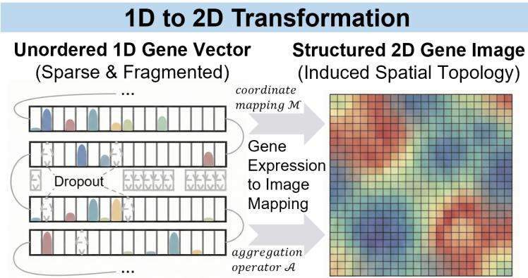  
Figure 1: Gene expression-to-image (GE2I). A coordinate mapping M and aggregation operator A convert gene expression vectors into 2D images for a CNN. Colored gene labels illustrate local neighborhoods in the layout.

Most GE2I methods place functionally related genes near one another because they assume that biological neighborhoods improve the representation. Many mapping algorithms are designed around this idea. However, a structured layout changes two things at once: it preserves some gene relationships and gives the data a smoother spatial pattern. It is therefore unclear which property accounts for better learning. We ask:

Which properties of gene expression images explain diferences in optimization and predictive performance across mappings?

We investigate this question on full-transcriptome data while holding the network and training conditions fixed. We measure image properties, track training behavior, and use beta regression to relate each property to prediction. The results show a trade-of between spatial smoothness and gene-level fidelity. A structured layout can produce patterns that a CNN learns quickly, but placing several genes in the same pixel merges their values and can remove useful diferences. Faster early optimization may therefore lead to little or no improvement in final prediction. We test this explanation by changing how genes are assigned to pixels, then use the results to guide image construction and the use of pretrained vision models. Our contributions are:

• Mechanistic analysis. Image measurements, training dynamics, and beta regression show how spatial smoothness and gene-level fidelity afect early optimization and final prediction diferently.

• Assignment interventions. We test one-to-one gene-to-pixel assignments and introduce a greedy allocation procedure. Prediction improves even when these changes make the images less smooth.

• Backbone evaluation and transfer guidelines. We compare assignment efects across visual backbones and test pretraining and augmentation. The results clarify when vision priors help with transcriptomic learning.

## 2 Related Work

## 2.1 Representation Learning in Single-Cell Genomics

Representation learning in single-cell genomics aims to capture biological variation in sparse, high-dimensional expression profiles. Variational autoencoder models, including scVI (Lopez et al., 2018) and scANVI (Xu et al., 2021), learn probabilistic cell representations, with scANVI additionally incorporating available cell-type annotations. More recently, foundation models such as scGPT (Cui et al., 2024), scBERT (Yang et al., 2022), and CellFM (Zeng et al., 2025) have used large-scale pretraining to learn representations for downstream singlecell analysis. These approaches model expression profiles without first assigning genes to a two-dimensional pixel grid. GE2I introduces this spatial representation before applying a visual model, making the arrangement of gene measurements an additional part of representation design.

## 2.2 The Gene Expression-to-Image (GE2I) Paradigm

GE2I maps gene expression values onto two-dimensional grids for CNNs (Sharma et al., 2019; Islam & Xing, 2023). Existing methods difer in how they construct these layouts. Projection-based approaches such as DeepInsight (Sharma et al., 2019) derive feature coordinates through dimensionality reduction, while MR-DeepInsight (Sharma et al., 2024) com bines multiple image representations. Fotomics (Zandavi et al., 2023) instead uses Fourier transforms to determine feature coordinates. Other methods optimize spatial arrangements according to feature relationships: REFINED (Bazgir et al., 2020) refines a low-dimensional embedding through local search, IGTD (Zhu et al., 2021) matches the rankings of feature distances and pixel distances, and Genomap (Islam & Xing, 2023) uses optimal transport to encode gene relationships in a spatial representation.

Pixel allocation and visual training choices have also been considered in prior work. IGTD assigns each feature to a distinct pixel while optimizing neighborhood structure (Zhu et al., 2021). MR-DeepInsight uses pretrained CNNs and examines conventional image augmentation (Sharma et al., 2024). These developments address how to construct and learn from gene images, but comparing final prediction scores alone does not explain how the construction choices afect learning.

Our work complements these methods by examining spatial smoothness and gene-level fidelity. We relate these properties to early optimization and final prediction under shared network and training conditions, with pixel-assignment interventions providing a way to test the explanations.

## 3 Analytical Framework

## 3.1 Problem Formulation

Let $\mathbf { x } \in \mathbb { R } ^ { G }$ be a gene expression vector. A coordinate-based GE2I transformation uses a mapping $\mathcal { M } : \{ 1 , \dotsc , G \}  \Omega$ onto an $H \times W$ grid and a permutation-invariant aggregation operator ${ \mathcal { A } } ,$ such as the mean. At each occupied pixel, $\mathbf { \tilde { I } } ( p ) = \mathcal { A } ( \{ x _ { i } \mid \mathcal { M } ( i ) = \overset { \sim } { p } \} )$ . The mapping is shared across cells. Here, “topology” refers to gene placement and neighborhood structure in the grid. Even when $H W \geq G$ , a layout may assign multiple genes to the same pixel, combining their expression values. We therefore examine both spatial organization and gene-level fidelity.

## 3.2 Spectral Descriptors (Quantifying Smoothness)

We characterize spatial structure in the frequency domain (Cao & Wu, 2022). Averaging the centered two-dimensional power spectrum within integer-radius rings gives a radial profile $\boldsymbol { \hat { r } } \in \mathbb { R } ^ { L }$ , where $L = \operatorname* { m i n } ( \lfloor \bar { W } / 2 \rfloor , \lfloor \bar { H } / 2 \rfloor )$ . We normalize this profile so that $\textstyle \sum _ { k } { \hat { r } } _ { k } = 1$

Spectral Entropy (SE) measures the spread of power across radial frequencies:

$$
\mathrm { S E } = - \sum _ { k } \hat { r } _ { k } \log ( \hat { r } _ { k } + \epsilon ) ,\tag{1}
$$

where ϵ ensures numerical stability. Higher SE indicates a broader frequency distribution.

Low-Frequency Energy Ratio (LFER) measures low-frequency concentration:

$$
\mathrm { L F E R } = \sum _ { k = 0 } ^ { \lfloor L / 4 \rfloor } { \hat { r } } _ { k } .\tag{2}
$$

Higher LFER indicates greater relative low-frequency power and smoother spatial patterns.

## 3.3 Information Fidelity (Quantifying Resolution)

We describe gene-level allocation using the occupied pixels $P _ { u s e d } \subseteq \Omega$ and the number of genes g(p) assigned to each pixel.

Average Pixels Per Gene (APPG) measures occupied pixels relative to gene count:

$$
\mathrm { A P P G } = \frac { | P _ { u s e d } | } { G } .\tag{3}
$$

For a single-view coordinate assignment, APPG = 1 means that each gene occupies a unique pixel.

Collision Rate (CR) measures the proportion of occupied pixels shared by multiple genes:

$$
\mathrm { C R } = \frac { | \{ p \in P _ { u s e d } : g ( p ) > 1 \} | } { | P _ { u s e d } | } .\tag{4}
$$

A value of zero indicates that no genes share a pixel. For Genomap’s soft transport coupling, uniform target marginals occupy all G transport targets $( \mathrm { A P P G } = 1 )$ , while entropic regularization gives each target contributions from multiple genes (CR = 1). Here, CR therefore denotes soft mixing rather than hard coordinate collisions. APPG and CR describe potential information loss through allocation, rather than directly measuring task-relevant information.

## 3.4 The Convolutional Probe

We use ResNet-18 as a common learner for cell-type annotation. Early loss reduction characterizes optimization, while accuracy and F1-Macro measure final prediction. We relate the four image descriptors jointly to these outcomes using beta regression (Ferrari & Cribari Neto, 2004). Each observation is a dataset–mapping–seed run within one input scope; Full and HVG inputs and the two prediction metrics are modeled separately:

$$
Y _ { d m s } \sim \mathrm { B e t a } ( \mu _ { d m s } \phi , ( 1 - \mu _ { d m s } ) \phi ) ,\tag{5}
$$

$$
\mathrm { l o g i t } ( \mu _ { d m s } ) = \alpha _ { d s } + \beta _ { 1 } \mathrm { A P P G } _ { d m s } + \beta _ { 2 } \mathrm { C R } _ { d m s } + \beta _ { 3 } \mathrm { L F E R } _ { d m s } + \beta _ { 4 } \mathrm { S E } _ { d m s } ,\tag{6}
$$

where $d , m ,$ , and s index dataset, mapping, and seed. The descriptors enter on their original scales, $\alpha _ { d s }$ denotes dataset-by-seed fixed efects, and ϕ is constant within each model. All outcomes lie strictly in (0, 1). Standard errors are clustered by dataset–method, and we report two-sided p-values together with Benjamini–Hochberg-adjusted q-values. Appendix G provides the inference, coverage, imputation, and diagnostic details. Pixel-assignment inter ventions then test whether changing allocation alters prediction.

## 4 Experimental Protocols

## 4.1 Datasets and Benchmarks

We evaluate cell-type classification on five datasets: Diabetic Kidney Disease (DKD) (Wilson et al., 2022), GTEx v9 (Eraslan et al., 2022), HypoMap (Steuernagel et al., 2022), Immune Cell Atlas (Domínguez Conde et al., 2022), and Tabula Sapiens (Consortium\* et al., 2022). These span disease-specific cohorts and cross-tissue atlases with varying class imbalance (Table 7). Our main analyses use full-transcriptome inputs, defined as all genes retained after preprocessing; complementary HVG evaluations are reported in the appendix. We also evaluate gene-to-protein prediction on NeurIPS 2021 CITE- $- S \mathrm { e q }$ (Stoeckius et al., 2017). Dataset specifications and evaluation protocols are provided in Appendix B.

## 4.2 Gene Expression-to-Image Transformation Strategies

The DeepInsight family (t-SNE, UMAP, PCA) (Sharma et al., 2019) and MR-DeepInsight (Sharma et al., 2024) project genes onto fixed grids and average expression values at shared pixels. Fotomics (Zandavi et al., 2023) uses FFT-based assignment with the same aggregation rule. Adaptive methods use grids with side length ⌈ G⌉: Genomap (Islam & Xing, 2023) constructs optimal transport-weighted pixel sums, whereas IGTD (Zhu et al., 2021) and REFINED (Bazgir et al., 2020) optimize one-to-one assignments. Random Mapping assigns genes to unique coordinates without using gene similarity and keeps these coordinates fixed across cells.

Spectral descriptors are computed on native images; CNN inputs are resized to 224 × 224.   
Appendix C.1 details preprocessing, mapping, and normalization.

## 4.3 Baseline Comparisons

External methods provide performance context rather than form part of the controlled GE2I comparison. We include XGBoost on PCA features (Chen, 2016), Seurat (Hao et al., 2021), scANVI with and without scArches (Lotfollahi et al., 2020), and the foundation models scGPT (Cui et al., 2024) and CellFM (Zeng et al., 2025). These models retain their respective input and training protocols; the foundation models are evaluated through zeroshot embeddings. A tuned MLP on raw expression vectors provides an additional non-image reference in the appendix. Implementation details appear in Appendix C.3.

## 4.4 Training Protocol

All main GE2I comparisons use the same ResNet-18 backbone (He et al., 2016) and training hyperparameters, without mapping-specific network tuning. We train with AdamW (Loshchilov & Hutter, 2017), linear warmup, and cosine annealing, and report means and standard deviations across three random seeds. Hyperparameters are provided in Appendix C.4. Mapping construction is timed separately with a six-hour fitting budget. Additional experiments assess assignment efects across visual backbones and examine ImageNet pretraining and image augmentation.

## 5 Results

We first evaluate prediction and mapping cost, then examine image properties and pixel assignment, and finally study visual backbones, pretraining, augmentation, and spatial interpretation.

## 5.1 How Well Do Gene Expression Images Support Cell-Type Prediction?

Gene expression images support competitive cell-type prediction. Under the shared ResNet-18 setting, several GE2I representations perform comparably to established latent-variable methods, including MR-DeepInsight on the Immune Cell Atlas (Table 1). Single-view mappings also provide useful predictions, although scGPT remains stronger on several HVG datasets. External methods retain their recommended protocols, so this comparison evalu ates the viability of GE2I rather than ranking fully optimized pipelines.

Full-transcriptome inputs make smoothness and gene-collision diferences more pronounced than HVG inputs. For the main mechanistic analysis, we use all genes retained after preprocessing, avoiding dependence on a particular HVG selection rule. Each mapping must organize more expression values while the downstream CNN and input resolution remain fixed, making some construction characteristics more pronounced. Figure 2 shows how spectral properties change with gene scope; complete measurements appear in Appendix Table 14.

Table 2 reports full-transcriptome prediction, and Figure 3 reports construction time. DeepInsight and Fotomics fit within minutes to hours; IGTD timed out on all datasets,

Table 1: Cell-type prediction in the HVG setting. GE2I methods use a shared ResNet-18 and training configuration. External methods follow their recommended implementations and settings. Entries report means and standard deviations over three seeds.
<table><tr><td rowspan="2">Method</td><td colspan="2">DKD</td><td colspan="2">GTEx v9</td><td colspan="2">HypoMap</td><td colspan="2">Immune Cell Atlas</td><td colspan="2">Tabula Sapiens</td></tr><tr><td>ACC</td><td>F1-M</td><td> $\operatorname { A C C } ^ { \infty } { \begin{array} { r l } \end{array} } \operatorname { F 1 - M }$ </td><td></td><td> $\operatorname { A C C } ^ { \infty ^ { 2 . . . , N ^ { . . . . . } } \Gamma 1 - \mathrm { M } }$ </td><td></td><td>ACC</td><td>F1-M</td><td>ACC</td><td>F1-M</td></tr><tr><td>XGBoost</td><td>0.8646±0.01</td><td>0.6860±0.01</td><td> $0 . 4 5 0 9 { \scriptstyle \pm 0 . 0 4 }$ </td><td> $0 . 1 2 4 9 _ { \pm 0 . 0 4 }$ </td><td>0.9661±0.00</td><td> $0 . 3 9 3 3 { \scriptstyle \pm 0 . 1 9 }$ </td><td> $0 . 6 0 4 0 { \scriptstyle \pm 0 . 0 3 }$ </td><td> $0 . 4 3 5 0 { \scriptstyle \pm 0 . 0 2 }$ </td><td> $0 . 2 3 8 7 { \scriptstyle \pm 0 . 0 8 }$ </td><td>0.0925±0.03</td></tr><tr><td>scANVI</td><td> $0 . 9 1 0 7 { \scriptstyle \pm 0 . 0 1 }$ </td><td> $0 . 8 0 8 2 { \scriptstyle \pm 0 . 0 3 }$ </td><td> $0 . 5 6 0 8 { \scriptstyle \pm 0 . 0 5 }$ </td><td>0.1694±0.06</td><td> $0 . 9 8 6 3 { \scriptstyle \pm 0 . 0 0 }$ </td><td> $0 . 5 0 6 1 { \scriptstyle \pm 0 . 2 3 }$ </td><td> $0 . 7 5 2 9 { \scriptstyle \pm 0 . 0 2 }$ </td><td> $0 . 6 2 0 7 { \scriptstyle \pm 0 . 0 2 }$ </td><td> $0 . 3 8 5 6 { \scriptstyle \pm 0 . 1 3 }$ </td><td> $0 . 1 4 8 4 { \scriptstyle \pm 0 . 0 6 }$ </td></tr><tr><td>scANVI (scArches)</td><td> $0 . 9 2 4 2 _ { \pm 0 . 0 0 } ^ { - }$ </td><td> $\mathbf { 0 . 8 4 2 4 { \scriptstyle \pm 0 . 0 2 } }$ </td><td> $0 . 5 6 9 1 _ { \pm 0 . 0 5 } ^ { - }$ </td><td> $0 . 1 5 3 9 { \scriptstyle \pm 0 . 0 3 }$ </td><td> $0 . 9 8 6 6 _ { \pm 0 . 0 0 } ^ { - }$ </td><td> $0 . 5 1 0 5 _ { \pm 0 . 2 3 } ^ { - }$ </td><td> $0 . 7 6 0 6 _ { \pm 0 . 0 2 } ^ { - }$ </td><td> $0 . 6 4 6 8 _ { \pm 0 . 0 1 } ^ { - }$ </td><td> $0 . 3 2 3 6 { \scriptstyle \pm 0 . 0 2 }$ </td><td> $0 . 1 5 9 4 _ { \pm 0 . 0 7 } ^ { - }$ </td></tr><tr><td>Seurat</td><td> $0 . 8 6 4 8 _ { \pm 0 . 0 0 } ^ { - \cdots }$ </td><td> $0 . 5 9 0 8 _ { \pm 0 . 0 3 } ^ { ^ { - } }$ </td><td> $0 . 5 3 0 8 _ { \pm 0 . 0 7 } ^ { - }$ </td><td>0.1305±0.05</td><td> $0 . 9 8 4 3 _ { \pm 0 . 0 0 } ^ { - }$ </td><td> $0 . 4 7 8 2 _ { \pm 0 . 2 3 } ^ { - }$ </td><td> $0 . 5 4 5 8 _ { \pm 0 . 0 2 } ^ { - }$ </td><td> $0 . 4 2 0 8 { \scriptstyle \pm 0 . 0 2 }$ </td><td> $0 . 3 1 5 4 _ { \pm 0 . 1 0 } ^ { - }$ </td><td> $0 . 1 2 8 7 { \scriptstyle \pm 0 . 0 5 }$ </td></tr><tr><td>scGPT</td><td>0.9421±0.01</td><td> $0 . 8 2 8 6 _ { \pm 0 . 0 2 }$ </td><td>0.7588±0.01</td><td> $\mathbf { 0 . 2 8 9 6 _ { \pm 0 . 0 7 } }$ </td><td></td><td> $\yen 123,456$ </td><td>0.7713±0.02</td><td> $\mathbf { 0 . 7 0 5 0 { \scriptstyle \pm 0 . 0 1 } }$ </td><td> $\mathbf { 0 . 4 1 9 2 _ { \pm 0 . 1 6 } }$ </td><td>0.2123±0.03</td></tr><tr><td>CellFM</td><td> $0 . 6 5 9 4 { \scriptstyle \pm 0 . 0 9 }$ </td><td> $0 . 3 7 4 4 { \scriptstyle \pm 0 . 0 3 }$ </td><td> $0 . 4 0 1 6 _ { \pm 0 . 1 2 }$ </td><td> $0 . 1 1 4 3 _ { \pm 0 . 0 5 }$ </td><td> $0 . 6 8 1 0 { \scriptstyle \pm 0 . 1 6 }$ </td><td> $0 . 0 8 5 2 { \scriptstyle \pm 0 . 0 0 }$ </td><td> $0 . 4 0 8 8 { \scriptstyle \pm 0 . 0 1 }$ </td><td> $0 . 2 1 0 1 { \scriptstyle \pm 0 . 0 1 }$ </td><td> $0 . 0 0 2 7 { \scriptstyle \pm 0 . 0 0 }$ </td><td> $0 . 0 0 1 1 { \scriptstyle \pm 0 . 0 0 }$ </td></tr><tr><td>Random (HVG)</td><td> $0 . 8 9 9 6 { \scriptstyle \pm 0 . 0 0 }$ </td><td> $0 . 7 7 3 4 { \scriptstyle \pm 0 . 0 1 }$ </td><td> $0 . 6 5 3 0 { \scriptstyle \pm 0 . 0 5 }$ </td><td> $0 . 2 1 0 6 { \scriptstyle \pm 0 . 0 1 }$ </td><td> $0 . 9 7 9 5 { \scriptstyle \pm 0 . 0 1 }$ </td><td> $0 . 5 5 7 1 { \scriptstyle \pm 0 . 2 8 }$ </td><td> $0 . 6 8 2 8 { \scriptstyle \pm 0 . 0 3 }$ </td><td> $0 . 4 8 4 2 _ { \pm 0 . 0 2 }$ </td><td> $0 . 3 8 3 7 { \scriptstyle \pm 0 . 0 8 }$ </td><td> $0 . 2 1 4 7 _ { \pm 0 . 0 7 }$ </td></tr><tr><td>DeepInsight (t-SNE) (HVG)</td><td> $0 . 8 9 2 4 _ { \pm 0 . 0 0 } ^ { - }$ </td><td> $0 . 7 4 2 4 { \scriptstyle \pm 0 . 0 1 }$ </td><td>0.6262±0.01</td><td>0.1943±0.01</td><td>0.9833±0.00</td><td>0.5720±0.22</td><td>0.6928±0.03</td><td> $0 . 5 0 4 0 _ { \pm 0 . 0 1 } ^ { - }$ </td><td>0.3711±0.08</td><td>0.1844±0.04</td></tr><tr><td>DeepInsight  $\mathbf { \dot { ( U M A P ) } } \mathbf { ( H V G ) }$ </td><td> $0 . 9 0 0 0 { \scriptstyle \pm 0 . 0 0 }$ </td><td> $0 . 7 5 8 7 { \scriptstyle \pm 0 . 0 2 }$ </td><td> $0 . 6 7 6 5 { \scriptstyle \pm 0 . 0 4 }$ </td><td> $0 . 2 2 0 9 { \scriptstyle \pm 0 . 0 1 }$ </td><td> $0 . 9 8 1 1 _ { \pm 0 . 0 1 } ^ { - }$ </td><td> $0 . 5 7 8 3 _ { \pm 0 . 2 5 } ^ { - }$ </td><td> $0 . 7 0 4 5 _ { + 0 . 0 9 }$ </td><td> $0 . 5 1 0 0 { \scriptstyle \pm 0 . 0 0 }$ </td><td> $0 . 3 9 1 9 _ { \pm 0 . 0 8 } ^ { - }$ </td><td> $0 . 1 9 6 7 { \scriptstyle \pm 0 . 0 6 }$ </td></tr><tr><td>DeepInsight (PCA) (HVG)</td><td> $0 . 9 0 2 9 _ { \pm 0 . 0 0 } ^ { - }$ </td><td> $0 . 7 8 0 8 _ { \pm 0 . 0 1 } ^ { - }$ </td><td> $0 . 6 2 3 0 _ { \pm 0 . 0 2 } ^ { - }$ </td><td> $0 . 1 7 5 9 _ { \pm 0 . 0 0 } ^ { - }$ </td><td> $0 . 9 8 3 3 _ { \pm 0 . 0 0 } ^ { - }$ </td><td> $0 . 5 7 2 3 _ { \pm 0 . 1 8 } ^ { - \cdots }$ </td><td> $0 . 6 8 5 8 _ { \pm 0 . 0 3 } ^ { - }$ </td><td> $0 . 4 8 1 0 { \scriptstyle \pm 0 . 0 1 }$ </td><td> $0 . 3 7 4 2 _ { \pm 0 . 0 6 } ^ { - \cdots }$ </td><td> $0 . 2 0 1 6 _ { \pm 0 . 0 7 } ^ { - }$ </td></tr><tr><td>GenoMAP (HVG)</td><td> $0 . 8 8 0 8 { \scriptstyle \pm 0 . 0 3 }$ </td><td> $0 . 7 7 1 7 { \scriptstyle \pm 0 . 0 2 }$ </td><td>0.6439±0.04</td><td> $0 . 2 0 7 3 { \scriptstyle \pm 0 . 0 2 }$ </td><td> $0 . 9 7 6 6 { \scriptstyle \pm 0 . 0 1 }$ </td><td> $\stackrel { 0 . 5 4 2 2 \pm 0 . 1 4 } { \sim }$ </td><td>0.6683±0.02</td><td> $0 . 4 7 3 8 { \scriptstyle \pm 0 . 0 0 }$ </td><td> $0 . 3 6 1 1 { \scriptstyle \pm 0 . 0 9 }$ </td><td> $0 . 2 0 9 7 { \scriptstyle \pm 0 . 0 7 }$ </td></tr><tr><td>IGTD (HVG)</td><td> $0 . 9 0 2 2 _ { \pm 0 . 0 0 } ^ { - }$ </td><td>0.7328±0.04</td><td> $0 . 6 6 6 0 _ { \pm 0 . 0 4 }$ </td><td> $0 . 2 1 1 2 _ { \pm 0 . 0 3 } ^ { - }$ </td><td> $0 . 9 8 3 6 _ { \pm 0 . 0 0 }$ </td><td>0.5390±0.21</td><td> $0 . 6 9 0 0 _ { \pm 0 . 0 2 } ^ { - }$ </td><td> $0 . 4 9 9 8 _ { \pm 0 . 0 1 }$ </td><td>0.3928±0.08</td><td>0.2067±0.06</td></tr><tr><td>Fotomics (HVG)</td><td> $0 . 9 0 1 5 _ { \pm 0 . 0 0 } ^ { - }$ </td><td> $0 . 7 4 2 4 _ { \pm 0 . 0 2 } ^ { - }$ </td><td> $0 . 6 5 7 7 { \scriptstyle \pm 0 . 0 2 }$ </td><td> $0 . 2 0 0 7 _ { \pm 0 . 0 0 } ^ { - }$ </td><td> $0 . 9 8 1 4 { \scriptstyle \pm 0 . 0 1 }$ </td><td> $0 . 5 2 0 0 _ { \pm 0 . 2 3 } ^ { - }$ </td><td> $0 . 7 0 7 0 _ { \pm 0 . 0 3 } ^ { - }$ </td><td> $0 . 5 1 0 4 _ { \pm 0 . 0 0 } ^ { - }$ </td><td> $0 . 3 8 3 0 { \scriptstyle \pm 0 . 0 8 }$ </td><td> $0 . 2 0 8 6 _ { \pm 0 . 0 7 } ^ { - }$ </td></tr><tr><td>Refined (HVG)</td><td> $0 . 9 0 2 3 { \scriptstyle \pm 0 . 0 1 }$ </td><td> $0 . 7 5 2 7 { \scriptstyle \pm 0 . 0 1 }$ </td><td> $0 . 6 3 6 9 { \scriptstyle \pm 0 . 0 7 }$ </td><td>0.1936±0.02</td><td> $0 . 9 8 1 0 _ { \pm 0 . 0 0 } ^ { - }$ </td><td> $0 . 5 5 9 5 { \scriptstyle \pm 0 . 1 8 }$ </td><td> $0 . 6 6 2 7 _ { \pm 0 . 0 0 } ^ { - }$ </td><td> $0 . 4 8 4 0 { \scriptstyle \pm 0 . 0 1 }$ </td><td> $0 . 3 7 2 5 { \scriptstyle \pm 0 . 0 5 }$ </td><td>0.2154±0.07</td></tr><tr><td>MR-DeepInsight (HVG)</td><td> $0 . 9 0 8 5 _ { \pm 0 . 0 1 } ^ { - }$ </td><td> $0 . 7 9 6 7 { \scriptstyle \pm 0 . 0 2 }$ </td><td> $0 . 6 8 4 2 _ { \pm 0 . 0 4 }$ </td><td> $0 . 1 9 8 9 { \scriptstyle \pm 0 . 0 5 }$ </td><td> $\mathbf { 0 . 9 9 2 2 _ { \pm 0 . 0 1 } }$ </td><td> $\mathbf { 0 . 5 9 3 2 } _ { \pm 0 . 2 4 } ^ { - }$ </td><td> $0 . 7 4 8 2 _ { \pm 0 . 0 2 } ^ { - }$ </td><td> $0 . 6 3 9 3 { \scriptstyle \pm 0 . 0 2 }$ </td><td> $0 . 3 8 7 2 _ { \pm 0 . 0 8 } ^ { - }$ </td><td> $0 . 2 0 9 7 { \scriptstyle \pm 0 . 1 0 }$ </td></tr></table>

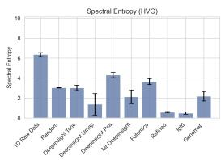

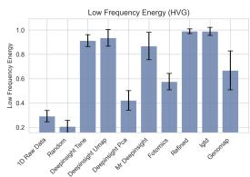

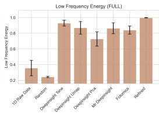

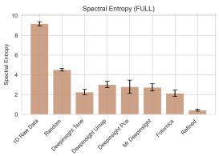  
Figure 2: Spectral properties of GE2I under HVG and full-transcriptome inputs. LFER and SE characterize the native images produced by each mapping. Several structured mappings concentrate more power at low spatial frequencies than Random Mapping.

Table 2: Full-transcriptome prediction. Absolute accuracy and F1-Macro are reported under the shared GE2I learning configuration. scGPT is an external reference; the raw-expression MLP is reported in Appendix Table 9. T/O denotes a fit exceeding the six-hour construction budget; dashes denote unreported results.
<table><tr><td rowspan="2">Method</td><td colspan="2">DKD</td><td colspan="2">GTEx v9</td><td colspan="2">HypoMap</td><td colspan="2">Immune Cell Atlas</td><td colspan="2">Tabula Sapiens</td></tr><tr><td>Acc</td><td>F1-M</td><td>Acc</td><td>F1-M</td><td>Acc</td><td>F1-M</td><td>Acc</td><td>F1-M</td><td>Acc</td><td>F1-M</td></tr><tr><td> $\overline { { \mathrm { s c G P T } } }$ </td><td> $0 . 9 4 6 2 _ { \pm 0 . 0 0 }$ </td><td> $0 . 8 5 5 3 { \scriptstyle \pm 0 . 0 2 }$ </td><td> $0 . 8 0 9 1 { \scriptstyle \pm 0 . 0 2 }$ </td><td> $0 . 3 4 1 5 { \scriptstyle \pm 0 . 0 9 }$ </td><td>=</td><td>-</td><td> $0 . 8 0 6 1 { \scriptstyle \pm 0 . 0 3 }$ </td><td> $0 . 7 4 6 2 _ { \pm 0 . 0 0 }$ </td><td> $0 . 3 9 3 0 { \scriptstyle \pm 0 . 1 5 }$ </td><td> $0 . 1 9 7 7 { \scriptstyle \pm 0 . 0 6 }$ </td></tr><tr><td>Random</td><td> $0 . 9 4 2 1 { \scriptstyle \pm 0 . 0 0 }$ </td><td> $0 . 8 0 5 3 { \scriptstyle \pm 0 . 0 1 }$ </td><td> $0 . 8 4 8 9 { \scriptstyle \pm 0 . 0 3 }$ </td><td> $0 . 4 6 0 1 { \scriptstyle \pm 0 . 0 3 }$ </td><td> $0 . 9 9 0 1 { \scriptstyle \pm 0 . 0 0 }$ </td><td> $0 . 6 5 5 3 { \scriptstyle \pm 0 . 2 3 }$ </td><td> $0 . 8 7 8 5 { \scriptstyle \pm 0 . 0 0 }$ </td><td> $0 . 7 3 0 5 { \scriptstyle \pm 0 . 0 1 }$ </td><td> $0 . 4 5 6 9 { \scriptstyle \pm 0 . 1 0 }$ </td><td> $\mathbf { 0 . 3 4 5 3 _ { \pm 0 . 1 1 } }$ </td></tr><tr><td>DeepInsight (t-SNE)</td><td>0.9537±0.00</td><td> $0 . 8 8 6 8 { \scriptstyle \pm 0 . 0 2 }$ </td><td> $0 . 8 5 4 8 { \scriptstyle \pm 0 . 0 4 }$ </td><td>0.5064</td><td>0.9918</td><td> $0 . 7 4 8 7 { \scriptstyle \pm 0 . 1 7 }$ </td><td>0.8766±0.01</td><td>0.7480±0.01</td><td>0.4270±0.13</td><td> $0 . 2 4 6 7 _ { \pm 0 . 0 2 } ^ { - }$ </td></tr><tr><td>DeepInsight (UMAP)</td><td> $0 . 9 5 7 2 _ { \pm 0 . 0 0 } ^ { - }$ </td><td> $0 . 8 9 2 4 { \scriptstyle \pm 0 . 0 0 }$ </td><td> $0 . 8 4 6 2 _ { \pm 0 . 0 4 }$ </td><td> $\begin{array} { l l } { { \bf 0 . 0 0 0 4 \pm 0 . 0 4 } } \\ { { \bf 0 . 4 8 8 5 \ w { \tt _ { \pm , 0 . 0 4 } } } } \end{array}$ </td><td> $\begin{array} { l } { { 0 . 9 9 1 0 \pm 0 . 0 0 } } \\ { { 0 . 9 9 3 5 \ldots } } \end{array}$ </td><td>0.7713±0.15</td><td> $0 . 8 8 2 0 _ { \pm 0 . 0 0 } ^ { - }$ </td><td> $0 . 7 6 2 5 _ { \pm 0 . 0 2 } ^ { - }$ </td><td> $0 . 4 2 7 5 _ { \pm 0 . 2 1 } ^ { - }$ </td><td>0.2672±0.06</td></tr><tr><td>DeepInsight (PCA)</td><td> $0 . 9 5 7 5 { \scriptstyle \pm 0 . 0 0 }$ </td><td> $0 . 8 4 5 8 _ { \pm 0 . 0 0 } ^ { - }$ </td><td> $0 . 8 4 1 6 _ { \pm 0 . 0 3 }$ </td><td> $0 . 4 4 1 5 _ { \pm 0 . 0 1 } ^ { - }$ </td><td> $0 . 9 9 2 6 _ { \pm 0 . 0 0 } ^ { - }$ </td><td> $0 . 7 2 7 6 { \scriptstyle \pm 0 . 1 9 }$ </td><td> $0 . 8 7 1 6 _ { \pm 0 . 0 1 } ^ { - }$ </td><td> $0 . 7 4 8 3 _ { \pm 0 . 0 3 } ^ { - }$ </td><td> $0 . 4 4 2 3 _ { \pm 0 . 0 9 } ^ { - - }$ </td><td> $0 . 3 0 5 4 { \scriptstyle \pm 0 . 1 1 }$ </td></tr><tr><td>MR-DeepInsight</td><td> $\mathbf { 0 . 9 7 0 0 } _ { \pm 0 . 0 0 } ^ { - }$ </td><td> $\mathbf { 0 . 9 2 7 1 { \scriptstyle \pm 0 . 0 1 } }$ </td><td> $\mathbf { 0 . 8 7 1 5 _ { \pm 0 . 0 4 } }$ </td><td> $0 . 3 6 5 6 { \scriptstyle \pm 0 . 0 5 }$ </td><td> $\mathbf { 0 . 9 9 9 4 } _ { \pm 0 . 0 0 }$ </td><td> $\mathbf { 0 . 8 0 2 1 } _ { \pm 0 . 1 3 } ^ { - }$ </td><td> $\mathbf { 0 . 8 9 9 0 } _ { \pm 0 . 0 1 } ^ { - }$ </td><td> $\mathbf { 0 . 8 2 2 4 _ { \pm 0 . 0 0 } }$ </td><td> $0 . 4 0 9 7 _ { \pm 0 . 1 6 }$ </td><td> $0 . 2 5 2 5 { \scriptstyle \pm 0 . 0 6 }$ </td></tr><tr><td>Fotomics</td><td> $0 . 9 5 4 3 { \scriptstyle \pm 0 . 0 0 }$ </td><td> $0 . 8 5 1 8 { \scriptstyle \pm 0 . 0 1 }$ </td><td>0.8327±0.03</td><td> $0 . 4 1 8 4 { \scriptstyle \pm 0 . 0 3 }$ </td><td>0.9913±0.00</td><td> $0 . 7 1 9 1 { \scriptstyle \pm 0 . 1 9 }$ </td><td> $0 . 8 6 1 3 _ { \pm 0 . 0 1 }$ </td><td> $0 . 7 1 9 5 { \scriptstyle \pm 0 . 0 1 }$ </td><td> $\mathbf { 0 . 4 6 0 1 } _ { \pm 0 . 1 3 }$ </td><td>0.2947±0.05</td></tr><tr><td>Refined</td><td> $0 . 9 5 6 6 _ { \pm 0 . 0 0 }$ </td><td> $0 . 8 7 0 4 { \scriptstyle \pm 0 . 0 2 }$ </td><td> $0 . 8 4 6 7 { \scriptstyle \pm 0 . 0 5 }$ </td><td> $0 . 4 8 7 5 { \scriptstyle \pm 0 . 0 4 }$ </td><td> $0 . 9 9 2 0 { \scriptstyle \pm 0 . 0 0 }$ </td><td> $0 . 7 2 7 4 { \scriptstyle \pm 0 . 1 8 }$ </td><td> $0 . 8 8 2 7 { \scriptstyle \pm 0 . 0 0 }$ </td><td> $0 . 7 3 0 2 _ { \pm 0 . 0 1 }$ </td><td> $\mathrm { T / O }$ </td><td> $\mathrm { T } / { \bar { \mathrm { O } } }$ </td></tr></table>

Genomap on all but DKD, and REFINED on Tabula Sapiens. Although the shared CNN processes images at the same resolution, mapping construction remains a separate computational constraint. We also evaluate GE2I on CITE-Seq gene-to-protein prediction (Appendix D).

No layout performs best across datasets. DeepInsight (t-SNE) outperforms Random Mapping in F1-Macro on GTEx v9, whereas Random Mapping achieves the highest mean F1- Macro among the reported GE2I methods on Tabula Sapiens. A tuned expression-space MLP is competitive on DKD and the Immune Cell Atlas, while structured GE2I methods achieve higher F1-Macro on GTEx v9 and HypoMap (Appendix Table 9). These diferences motivate examining image properties and their relation to learning, rather than inferring the value of spatial organization from final scores alone.

## 5.2 How Do Image Properties Relate to Optimization and Prediction?

Smoother images optimize faster, but preserving separate gene values is also important for final prediction. We characterize these two efects using LFER and SE for spatial structure and APPG and CR for gene-level allocation. Appendix Figures 6 and 7 show the resulting image patterns, and Appendix Table 14 provides the complete measurements.

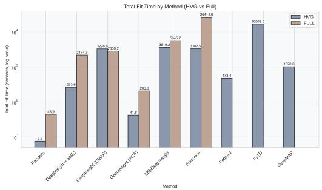

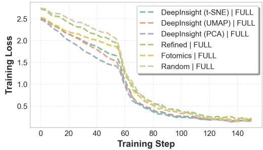  
Figure 3: Mapping construction cost. Runtime to fit M, aggregated across datasets for the plotted methods. Iterative strategies such as REFINED and Genomap are excluded from this summary because they exceeded the fitting budget on large benchmarks.  
Figure 4: Early optimization on fulltranscriptome DKD. Training-loss curves over the first 60 steps under the shared CNN. Structured mappings show faster early loss reduction than Random Mapping.

Structured mappings produce smoother, lower-frequency images than random placement. DeepInsight (t-SNE/UMAP) and REFINED have full-transcriptome LFER values of approximately 0.8–1.0, whereas Random Mapping remains near 0.24 (Figure 2). Placing similarly expressed genes nearby produces coherent regions with gradually varying intensity. Random placement yields more irregular neighboring values and a broader frequency distribution. The CNN’s local filters receive smoother patterns under structured layouts and more abrupt spatial changes under random placement.

Low-frequency structure accelerates early optimization but does not ensure better final prediction. On DKD, high-LFER mappings such as DeepInsight reduce loss faster over the first 60 training steps than Random Mapping (Figure 4). This is consistent with the preference for low-frequency patterns described in work on neural-network spectral bias (Rahaman et al., 2019). Spatial organization can therefore aid optimization by presenting expression values in a form the CNN learns more readily. However, early loss reduction does not establish final predictive performance, motivating analysis of how individual gene values are represented.

Joint regression links gene mixing to worse prediction and organized spatial structure to better prediction. We fit beta regressions relating APPG, CR, LFER, and SE jointly to accuracy and F1-Macro in the Full setting (Table 3). Dataset-by-seed fixed efects account for baseline performance diferences, while clustered standard errors account for repeated seeds within each dataset–method pair. Both outcomes show the same pattern: APPG and CR have negative coeficients, whereas LFER and SE have positive coeficients, with all eight associations remaining significant after multiple-testing adjustment. These results connect the two sides of the trade-of: gene mixing is associated with lower prediction quality, while organized spatial structure is associated with higher prediction quality, consistent with the representation-level mechanism derived in Appendix A.

More gene mixing is associated with worse prediction. For F1-Macro, CR has a coeficient of −3.349 (q = 0.001). When several genes share one pixel, their distinct expression values are replaced by a shared average, reducing gene-level separation.

Organized low-frequency structure is associated with better prediction. LFER has a coefficient of +5.334 $\bar { ( q \mathrm { ~ = ~ } 0 . 0 0 3 ) }$ , consistent with the smoother layouts and faster early optimization observed above. SE is also positive (+0.995, q = 0.003). Together, these results favor images that are spatially smooth but still contain variation across scales, rather than images that are irregular or nearly uniform.

Using more pixels alone does not guarantee better prediction. APPG has a coeficient of −0.966 (q = 0.041) after holding CR and spectral descriptors fixed. Performance depends on which genes share pixels and how the values are arranged. Accuracy shows the same directions. Coeficient magnitudes are on the logit-mean scale; Appendix G reports the HVG results and diagnostics.

Table 3: Beta regression on full-transcriptome performance. Descriptors enter jointly with dataset-by-seed fixed efects, and SE is clustered by dataset–method. The p-values use a t distribution with 34 degrees of freedom; q denotes the Benjamini–Hochberg-adjusted p-value across the 16 descriptor tests. Coeficients are on the logit-mean scale.
<table><tr><td>Target</td><td>Descriptor</td><td>Coef.</td><td>Cluster SE</td><td> $z ^ { * }$ </td><td>p</td><td>q</td></tr><tr><td rowspan="4">Accuracy</td><td>APPG</td><td>-1.044</td><td>0.358</td><td>-2.92</td><td>0.006</td><td>0.011</td></tr><tr><td>CR</td><td>-3.251</td><td>0.617</td><td>-5.27</td><td>&lt; 0.001</td><td>&lt; 0.001</td></tr><tr><td>LFER</td><td>4.954</td><td>1.367</td><td>3.62</td><td> $< 0 . 0 0 1$ </td><td>0.003</td></tr><tr><td>SE</td><td>0.933</td><td>0.265</td><td>3.52</td><td>0.001</td><td>0.003</td></tr><tr><td rowspan="4">F1-Macro</td><td>APPG</td><td>-0.966</td><td>0.414</td><td>-2.33</td><td>0.026</td><td>0.041</td></tr><tr><td>CR</td><td>-3.349</td><td>0.791</td><td>-4.23</td><td>&lt; 0.001</td><td>0.001</td></tr><tr><td>LFER</td><td>5.334</td><td>1.485</td><td>3.59</td><td>0.001</td><td>0.003</td></tr><tr><td>SE</td><td>0.995</td><td>0.282</td><td>3.53</td><td>0.001</td><td>0.003</td></tr></table>

Table 4: Image-size and pixel-assignment experiments on DKD. (a) Prediction and allocation descriptors across the reported image sizes. (b) LSA results, with superscripts indicating relative changes from the original assignment.

(a) Image-size ablation  
(b) Eficacy of linear sum assignment (LSA)
<table><tr><td>Size</td><td>Acc</td><td>F1-M</td><td>APPG</td><td>CR</td></tr><tr><td> $6 4 ^ { 2 }$ </td><td>0.9608</td><td>0.8990</td><td>0.480</td><td>0.493</td></tr><tr><td> $1 2 8 ^ { 2 }$ </td><td>0.9570</td><td>0.8913</td><td>0.489</td><td>0.481</td></tr><tr><td> $2 2 4 ^ { 2 }$ </td><td>0.9556</td><td>0.8915</td><td>0.486</td><td>0.485</td></tr><tr><td>3842</td><td>0.9597</td><td>0.9013</td><td>0.478</td><td>0.495</td></tr></table>

<table><tr><td>Method</td><td>LFER</td><td>CR</td><td> $\operatorname { A c c }$ </td><td>F1-M</td></tr><tr><td>DeepInsight (t-SNE)</td><td>0.90−4%</td><td>0.00−100%</td><td>0.97+1%</td><td> $0 . 9 1 ^ { + 3 \% }$ </td></tr><tr><td>DeepInsight (UMAP)</td><td>0.84-7%</td><td>0.00−100%</td><td>0.97+1%</td><td> $0 . 9 1 ^ { + 2 \% }$ </td></tr></table>

Random layouts can compete by preserving gene identity in separate pixels. Random Mapping forgoes similarity-based neighborhoods but preserves gene identity through fixed, separate pixels across cells. This helps explain its competitive performance against smoother mappings that merge expression values. Broader gene coverage accentuates this distinction: for DeepInsight (t-SNE) on HypoMap, CR rises from 0.198 with HVGs to 0.641 with fulltranscriptome inputs. IGTD and REFINED show that spatial organization and collision-free allocation can coexist. If aggregation limits a structured mapping’s benefit, separating genes should improve prediction even when the image becomes less smooth.

## 5.3 Can Changing Pixel Assignment Improve Prediction?

Yes. Assigning each gene to a unique pixel improves prediction even when image smoothness decreases. Across the tested DeepInsight mappings and datasets, removing collisions increases F1-Macro while LFER decreases. In contrast, simply enlarging the image leaves substantial gene overlap and provides little improvement.

Larger canvases neither remove gene collisions nor meaningfully improve prediction. In the DKD ablation (Table 4a), increasing image dimensions from $6 4 ^ { 2 }$ to $3 8 \bar { 4 } ^ { 2 }$ changes F1- Macro from 0.8990 to 0.9013, with lower scores at intermediate sizes. CR remains near 0.49 throughout. Larger images thus provide little improvement while substantial gene overlap persists, motivating a change to pixel allocation with the input genes and downstream learner fixed.

One-to-one assignment improves prediction despite reducing image smoothness. Linear sum assignment (LSA) (Burkard & Derigs, 1980) gives each gene a distinct pixel. On DKD, it eliminates native-image collisions and improves F1-Macro for DeepInsight (t-SNE) and DeepInsight (UMAP) by approximately 3% and 2%, respectively, while LFER decreases by 4–7% (Table 4b). Consistent with the prediction from Section 5.2, separating gene values improves prediction despite lower image smoothness: the benefit of revised allocation can outweigh reduced low-frequency concentration.

Greedy unique assignment removes collisions and improves all six mapping–dataset comparisons. We introduce a greedy assignment procedure that avoids a dense gene–pixel cost matrix. Genes are processed in a fixed order, each placed at the nearest available pixel to its rounded target coordinate, with an occupancy mask preventing reuse. This preserves projected coordinates as placement targets while enforcing distinct locations (Appendix C.2).

Table 5 reports reassignment results for DeepInsight (t-SNE) and DeepInsight (UMAP) on DKD, GTEx v9, and HypoMap. All six comparisons improve mean F1-Macro, with CR = 0 and APPG = 1 on reassigned native images. For example, DeepInsight (t-SNE) on GTEx v9 improves from approximately 0.506 to 0.556, while LFER falls from 0.867 to 0.756. LFER decreases in every comparison, so low-frequency concentration does not explain the gains.

These interventions support reducing unnecessary gene aggregation while using the projected layout to guide placement. Reassignment changes both gene separation and local spatial patterns, and this combination improves prediction despite lower smoothness across the tested mappings. We next examine whether the benefit extends beyond ResNet-18 and how other visual training choices interact with GE2I.

Table 5: Greedy unique assignment across datasets. Results use ResNet-18. Superscripts report relative changes from conventional binning for the corresponding dataset and mapping. The algorithm is described in Appendix C.2.
<table><tr><td>Dataset</td><td>Mapping</td><td>APPG</td><td>CR</td><td>LFER</td><td>SE</td><td>Acc</td><td>F1-M</td></tr><tr><td>DKD</td><td>DeepInsight (t-SNE)</td><td>1.0000+104.8 +104.8%</td><td>-100.0% 0.0000 ±0.00</td><td>15.0% 0.8021 ±0.00</td><td>2.3435 +19.7% ±0.00</td><td>0.9679 +1.5% ±0.00</td><td>0.9047 ±0.00 +2.0%</td></tr><tr><td>DKD</td><td>DeepInsight (UMAP)</td><td>1.0000 +84.8% ±0.00</td><td>0.0000 100.0% ±0.00</td><td>0.7811 13.5% ±0.00</td><td>2.4673 10.0% ±0.00</td><td>0.9667 +1.0% ±0.00</td><td>0.9006 +0.9% ±0.02</td></tr><tr><td>GTEx v9</td><td>DeepInsight (t-SNE)</td><td>1.0000 +142.0% ±0.00</td><td>0.0000 100.0% ±0.00</td><td>0.7560 ±0.04 12.8%</td><td>2.7173 +2.8% ±0.30</td><td>0.8630 +1.0% ±0.03</td><td>0.5557 +9.7% ±0.02</td></tr><tr><td>GTEx v9</td><td>DeepInsight (UMAP)</td><td>1.0000±071 +271.3%</td><td>0.0000 100.0% ±0.00</td><td>0.7374 8.0% ±0.05</td><td>2.8200 12.0% ±0.32</td><td>0.8495 +0.4% ±0.04</td><td>0.5357 +9.7% ±0.05</td></tr><tr><td>HypoMap</td><td>DeepInsight (t-SNE)</td><td>+229.2% 1.0000 ±0.00</td><td>0.0000 100.0% ±0.00</td><td>0.8602 9.4% 2±0.00</td><td>2.0356±0.07° 7.7%</td><td>0.9940 +0.2% ±0.00</td><td>0.7945 +6.1% ±0.13</td></tr><tr><td>HypoMap</td><td>DeepInsight (UMAP)</td><td>1.0000 +359.5% ±0.00</td><td>0.0000 100.0% ±0.00</td><td>0.8085 11.7% ±0.05</td><td>2.2516±0.34 21.8%</td><td>0.9938 +0.0% ±0.00</td><td>0.8137 +5.5% ±0.13</td></tr></table>

## 5.4 How Do Visual Backbones and Training Choices Afect GE2I?

Unique pixel assignment helps across backbones, whereas pretraining and augmentation depend on the architecture and mapping. On DKD, reassignment improves mean F1-Macro for ResNet-18, ResNet-50, ConvNeXt-Tiny, EficientNet-B0, and ViT-B/16 by 3.4%–7.0% (Appendix Table 10). The consistent gains across convolutional and transformer models show that the allocation benefit is not specific to ResNet-18. Appendix Table 11 provides the corresponding Random Mapping results.

ImageNet pretraining accelerates early ResNet-18 learning for structured images, but not for random layouts. ImageNet initialization (Deng et al., 2009) has diferent efects across mappings and architectures. In the ResNet-18 training curves on DKD, pretrained weights accelerate early learning for structured DeepInsight images, whereas Random Mapping shows no clear acceleration (Figure 5). This contrast is consistent with pretrained visual features being better suited to the smoother spatial patterns of structured layouts.

Final prediction depends on the backbone (Table 6). ImageNet pretraining improves mean F1-Macro for ViT-B/16 and ResNet-50 under both DeepInsight (t-SNE) and REFINED, whereas ResNet-18 performs better with random initialization. Thus, some learners benefit from pretraining even when the smaller CNN learns efectively from expression images alone. Together with the training curves, these results indicate architecture- and mappingdependent benefits; early acceleration alone does not establish a final predictive advantage.

Augmentation: geometry versus intensity. On DKD, geometric transformations lower mean F1-Macro for DeepInsight (t-SNE) and REFINED but improve Random Mapping (Appendix Table 12). Because these transformations change the locations associated with gene identities, their suitability depends on the mapping and cannot be inferred solely from their usefulness for natural images.

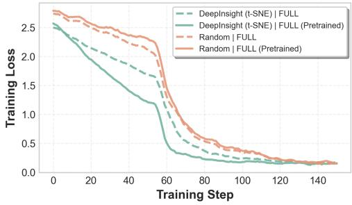  
Figure 5: ImageNet initialization and early learning on DKD. ResNet-18 training curves with and without pretrained weights. Structured DeepInsight images benefit in early optimization, whereas Random Mapping shows no clear acceleration.

Table 6: Backbones and pretraining on DKD. Accuracy and F1-Macro with ImageNet initialization and random initialization for two structured mappings.
<table><tr><td>Method</td><td>Backbone</td><td>Pretrained</td><td>ACC</td><td>F1-Macro</td></tr><tr><td rowspan="6">DeepInsight (t-SNE)</td><td rowspan="2">ResNet-18</td><td>Yes</td><td>0.9479±0.01</td><td> $0 . 8 7 6 7 { \scriptstyle \pm 0 . 0 1 }$ </td></tr><tr><td>No</td><td>0.9537±0.00</td><td>0.8868±0.02</td></tr><tr><td rowspan="2">ResNet-50</td><td>Yes</td><td>0.9512±0.00</td><td>0.8915±0.02</td></tr><tr><td>No</td><td>0.9457±0.01</td><td>0.8676±0.01</td></tr><tr><td rowspan="2">ViT-B/16</td><td>Yes</td><td>0.9510±0.00</td><td>0.8659±0.03</td></tr><tr><td>No</td><td>0.9401±0.01</td><td>0.8252±0.01</td></tr><tr><td rowspan="6">Refined</td><td rowspan="2">ResNet-18</td><td>Yes</td><td>0.9504±0.01</td><td>0.8392±0.02</td></tr><tr><td>No</td><td>0.9566±0.00</td><td>0.8704±0.03</td></tr><tr><td rowspan="2">ResNet-50</td><td>Yes</td><td>0.9452±0.01</td><td>0.8266±0.02</td></tr><tr><td>No</td><td>0.9468±0.00</td><td>0.8159±0.02</td></tr><tr><td rowspan="2">ViT-B/16</td><td>Yes</td><td>0.9529±0.00</td><td>0.8460±0.01</td></tr><tr><td>No</td><td>0.9505±0.01</td><td>0.8294±0.04</td></tr></table>

Intensity perturbations vary brightness and contrast without changing gene coordinates and improve mean F1-Macro for all three mappings. Stronger perturbation is not uniformly better: combining all augmentations lowers F1-Macro for DeepInsight (t-SNE) and REFINED to 0.3227 and 0.1941, respectively, whereas Random Mapping improves under every tested setting. Intensity perturbation is thus the most consistent choice in this comparison; geometric and combined augmentations require mapping-specific evaluation.

Spatial interpretation beyond prediction. Competitive prediction from random layouts does not make spatial organization irrelevant to interpretation. On DKD, DeepInsight (t-SNE) has a Grad-CAM marker hit ratio of 0.50, versus 0.25 for Random Mapping (Appendix Table 13). Its salient regions contain five of five listed markers for distal convoluted tubule cells and podocytes, versus two of five for Random Mapping (Appendix Figure 8). These more marker-aligned regions support gene-level inspection in this analysis.

## 6 Conclusion and Limitations

Under controlled training conditions, GE2I exhibits a trade-of between spatial smoothness and gene-level fidelity. Structured mappings produce smooth patterns that can ease early CNN optimization, but assigning multiple genes to the same pixel may obscure expression diferences and reduce final predictive performance. Our pixel-assignment experiments show that preserving gene-level information improves prediction even when the images become less smooth. Transcriptomic image design should therefore balance spatial organization with information preservation rather than treat smoothness or early optimization as a proxy for prediction quality.

Limitations and Future Directions. Our experiments focus mainly on cell-type prediction with a shared CNN and training protocol. This setting isolates representation-level efects but does not measure the best performance attainable through method-specific tuning. Our pixel-level descriptors also do not capture higher-order relationships among genes. Further work should learn adaptive allocations that balance spatial organization, gene-level fidelity, and interpretability, and evaluate them on larger multimodal datasets and with foundation models.

## AI Use Statement

Generative AI tools were used to support research ideation, literature discovery, manuscript drafting, and language polishing. AI-assisted suggestions were reviewed against the experimental results and relevant literature. All experiments, numerical results, and statistical analyses were conducted and verified by the authors. The authors take full responsibility for the final content of this work.

## Ethics Statement

This study uses previously released single-cell transcriptomic datasets and does not involve the collection of new human-subject data. The analyses are intended for computational genomics research rather than clinical diagnosis or treatment.

## Reproducibility Statement

Experimental settings, preprocessing procedures, mapping parameters, training configurations, statistical analyses, and pixel-assignment methods are described in the main text and appendix. Results are reported across three random seeds where applicable. Source code will be released upon publication.

## References

Omid Bazgir, Ruibo Zhang, Saugato Rahman Dhruba, Raziur Rahman, Souparno Ghosh, and Ranadip Pal. Representation of features as images with neighborhood dependencies for compatibility with convolutional neural networks. Nature communications, 11(1):4391, 2020.

Charlotte Bunne, Yusuf Roohani, Yanay Rosen, Ankit Gupta, Xikun Zhang, Marcel Roed, Theo Alexandrov, Mohammed AlQuraishi, Patricia Brennan, Daniel B Burkhardt, et al. How to build the virtual cell with artificial intelligence: Priorities and opportunities. Cell, 187(25):7045–7063, 2024.

Rainer E Burkard and Ulrich Derigs. The linear sum assignment problem. In Assignment and Matching Problems: Solution Methods with FORTRAN-Programs, pp. 1–15. Springer, 1980.

Yun-Hao Cao and Jianxin Wu. A random cnn sees objects: One inductive bias of cnn and its applications. In Proceedings Of The AAAI conference on artificial intelligence, volume 36, pp. 194–202, 2022.

Tianqi Chen. Xgboost: A scalable tree boosting system. Cornell University, 2016.

The Tabula Sapiens Consortium\*, Robert C Jones, Jim Karkanias, Mark A Krasnow, Angela Oliveira Pisco, Stephen R Quake, Julia Salzman, Nir Yosef, Bryan Bulthaup, Phillip Brown, et al. The tabula sapiens: A multiple-organ, single-cell transcriptomic atlas of humans. Science, 376(6594):eabl4896, 2022.

Haotian Cui, Chloe Wang, Hassaan Maan, Kuan Pang, Fengning Luo, Nan Duan, and Bo Wang. scgpt: toward building a foundation model for single-cell multi-omics using generative ai. Nature methods, 21(8):1470–1480, 2024.

Jia Deng, Wei Dong, Richard Socher, Li-Jia Li, Kai Li, and Li Fei-Fei. Imagenet: A large-scale hierarchical image database. In 2009 IEEE conference on computer vision and pattern recognition, pp. 248–255. Ieee, 2009.

C Domínguez Conde, Chao Xu, Louie B Jarvis, Daniel B Rainbow, Sara B Wells, Tamir Gomes, SK Howlett, O Suchanek, K Polanski, HW King, et al. Cross-tissue immune cell analysis reveals tissue-specific features in humans. Science, 376(6594):eabl5197, 2022.

Gökcen Eraslan, Eugene Drokhlyansky, Shankara Anand, Evgenij Fiskin, Ayshwarya Subramanian, Michal Slyper, Jiali Wang, Nicholas Van Wittenberghe, John M Rouhana, Julia Waldman, et al. Single-nucleus cross-tissue molecular reference maps toward understanding disease gene function. Science, 376(6594):eabl4290, 2022.

Silvia Ferrari and Francisco Cribari-Neto. Beta regression for modelling rates and proportions. Journal of applied statistics, 31(7):799–815, 2004.

Christopher Heje Grønbech, Maximillian Fornitz Vording, Pascal N Timshel, Casper Kaae Sønderby, Tune H Pers, and Ole Winther. scvae: variational auto-encoders for single-cell gene expression data. Bioinformatics, 36(16):4415–4422, 2020.

Ihuan Gunawan, Fatemeh Vafaee, Erik Meijering, and John George Lock. An introduction to representation learning for single-cell data analysis. Cell Reports Methods, 3(8), 2023.

Yuhan Hao, Stephanie Hao, Erica Andersen-Nissen, William M Mauck, Shiwei Zheng, Andrew Butler, Maddie J Lee, Aaron J Wilk, Charlotte Darby, Michael Zager, et al. Inte grated analysis of multimodal single-cell data. Cell, 184(13):3573–3587, 2021.

Kaiming He, Xiangyu Zhang, Shaoqing Ren, and Jian Sun. Deep residual learning for image recognition. In Proceedings of the IEEE conference on computer vision and pattern recognition, pp. 770–778, 2016.

Md Tauhidul Islam and Lei Xing. Cartography of genomic interactions enables deep analysis of single-cell expression data. Nature Communications, 14(1):679, 2023.

Diederik P Kingma and Max Welling. Auto-encoding variational bayes. arXiv preprint arXiv:1312.6114, 2013.

Romain Lopez, Jefrey Regier, Michael B Cole, Michael I Jordan, and Nir Yosef. Deep generative modeling for single-cell transcriptomics. Nature methods, 15(12):1053–1058, 2018.

Ilya Loshchilov and Frank Hutter. Decoupled weight decay regularization. arXiv preprint arXiv:1711.05101, 2017.

Mohammad Lotfollahi, Mohsen Naghipourfar, Malte D Luecken, Matin Khajavi, Maren Büttner, Ziga Avsec, Alexander V Misharin, and Fabian J Theis. Query to reference single-cell integration with transfer learning. bioRxiv, pp. 2020–07, 2020.

Malte D Luecken, Scott Gigante, Daniel B Burkhardt, Robrecht Cannoodt, Daniel C Strobl, Nikolay S Markov, Luke Zappia, Giovanni Palla, Wesley Lewis, Daniel Dimitrov, et al. Defining and benchmarking open problems in single-cell analysis. Nature Biotechnology, pp. 1–6, 2025.

Nasim Rahaman, Aristide Baratin, Devansh Arpit, Felix Draxler, Min Lin, Fred Hamprecht, Yoshua Bengio, and Aaron Courville. On the spectral bias of neural networks. In International conference on machine learning, pp. 5301–5310. PMLR, 2019.

Alok Sharma, Edwin Vans, Daichi Shigemizu, Keith A Boroevich, and Tatsuhiko Tsunoda. Deepinsight: A methodology to transform a non-image data to an image for convolution neural network architecture. Scientific reports, 9(1):11399, 2019.

Alok Sharma, Yosvany López, Shangru Jia, Artem Lysenko, Keith A Boroevich, and Tatsuhiko Tsunoda. Enhanced analysis of tabular data through multi-representation deepinsight. Scientific Reports, 14(1):12851, 2024.

Lukas Steuernagel, Brian YH Lam, Paul Klemm, Georgina KC Dowsett, Corinna A Bauder, John A Tadross, Tamara Sotelo Hitschfeld, Almudena del Rio Martin, Weiyi Chen, Alain J De Solis, et al. Hypomap—a unified single-cell gene expression atlas of the murine hypothalamus. Nature metabolism, 4(10):1402–1419, 2022.

Marlon Stoeckius, Christoph Hafemeister, William Stephenson, Brian Houck-Loomis, Pratip K Chattopadhyay, Harold Swerdlow, Rahul Satija, and Peter Smibert. Simultaneous epitope and transcriptome measurement in single cells. Nature methods, 14(9): 865–868, 2017.

Fuchou Tang, Catalin Barbacioru, Yangzhou Wang, Ellen Nordman, Clarence Lee, Nanlan Xu, Xiaohui Wang, John Bodeau, Brian B Tuch, Asim Siddiqui, et al. mrna-seq wholetranscriptome analysis of a single cell. Nature methods, 6(5):377–382, 2009.

Ashish Vaswani, Noam Shazeer, Niki Parmar, Jakob Uszkoreit, Llion Jones, Aidan N Gomez, Łukasz Kaiser, and Illia Polosukhin. Attention is all you need. Advances in neural information processing systems, 30, 2017.

Parker C Wilson, Yoshiharu Muto, Haojia Wu, Anil Karihaloo, Sushrut S Waikar, and Benjamin D Humphreys. Multimodal single cell sequencing implicates chromatin accessibility and genetic background in diabetic kidney disease progression. Nature communications, 13(1):5253, 2022.

Chenling Xu, Romain Lopez, Edouard Mehlman, Jefrey Regier, Michael I Jordan, and Nir Yosef. Probabilistic harmonization and annotation of single-cell transcriptomics data with deep generative models. Molecular systems biology, 17(1):e9620, 2021.

Fan Yang, Wenchuan Wang, Fang Wang, Yuan Fang, Duyu Tang, Junzhou Huang, Hui Lu, and Jianhua Yao. scbert as a large-scale pretrained deep language model for cell type annotation of single-cell rna-seq data. Nature Machine Intelligence, 4(10):852–866, 2022.

Seid Miad Zandavi, Derong Liu, Vera Chung, Ali Anaissi, and Fatemeh Vafaee. Fotomics: fourier transform-based omics imagification for deep learning-based cell-identity mapping using single-cell omics profiles. Artificial Intelligence Review, 56(7):7263–7278, 2023.

Yuansong Zeng, Jiancong Xie, Ningyuan Shangguan, Zhuoyi Wei, Wenbing Li, Yun Su, Shuangyu Yang, Chengyang Zhang, Jinbo Zhang, Nan Fang, et al. Cellfm: a large-scale foundation model pre-trained on transcriptomics of 100 million human cells. Nature Communications, 16(1):4679, 2025.

Yitan Zhu, Thomas Brettin, Fangfang Xia, Alexander Partin, Maulik Shukla, Hyunseung Yoo, Yvonne A Evrard, James H Doroshow, and Rick L Stevens. Converting tabular data into images for deep learning with convolutional neural networks. Scientific reports, 11 (1):11325, 2021.

## A A Theoretical View of the Smoothness–Fidelity Trade-of

The empirical analysis suggests that spatial smoothness can facilitate learning, while gene mixing can reduce predictive information. We illustrate how these two efects can arise from the same pixel-aggregation operation.

Consider a binary classification problem with $Y \in \{ - 1 , + 1 \}$ . For the $k _ { p }$ genes assigned to pixel $p ,$ let

$$
{ \bf X } _ { p } \mid Y = y = y { \pmb { \mu } } _ { p } + \varepsilon _ { p } , \qquad { \pmb { \varepsilon } } _ { p } \sim { \mathcal { N } } ( 0 , \sigma ^ { 2 } I _ { k _ { p } } ) ,\tag{7}
$$

where noise is independent across genes and pixels. Mean aggregation produces

$$
Z _ { p } = { \frac { 1 } { k _ { p } } } \mathbf { 1 } ^ { \top } \mathbf { X } _ { p } .\tag{8}
$$

Let $\bar { \mu } _ { p } = k _ { p } ^ { - 1 } \mathbf { 1 } ^ { \top } \pmb { \mu } _ { p }$

Proposition A.1 (Smoothness–fidelity efect of pixel aggregation). Mean aggregation has two simultaneous efects.

First, for neighboring pixels $p$ and $q _ { ; }$

$$
\operatorname { \mathbb { E } } { \bigl [ } ( Z _ { p } - Z _ { q } ) ^ { 2 } \mid Y { \bigr ] } = ( { \bar { \mu } } _ { p } - { \bar { \mu } } _ { q } ) ^ { 2 } + \sigma ^ { 2 } \left( { \frac { 1 } { k _ { p } } } + { \frac { 1 } { k _ { q } } } \right) .\tag{9}
$$

Thus, holding the underlying spatial signal fixed, averaging more genes suppresses noiseinduced local variation.

Second, let $D _ { X } ^ { 2 }$ and $D _ { Z } ^ { 2 }$ denote the squared Mahalanobis distances between the two classes before and after aggregation. Then

$$
D _ { X } ^ { 2 } = \frac { 4 } { \sigma ^ { 2 } } \sum _ { p } \| \pmb { \mu } _ { p } \| _ { 2 } ^ { 2 } ,\tag{10}
$$

$$
D _ { Z } ^ { 2 } = \frac { 4 } { \sigma ^ { 2 } } \sum _ { p } k _ { p } \bar { \mu } _ { p } ^ { 2 } ,\tag{11}
$$

and therefore

$$
D _ { X } ^ { 2 } - D _ { Z } ^ { 2 } = \frac { 4 } { \sigma ^ { 2 } } \sum _ { p } \left. \pmb { \mu _ { p } } - \bar { \mu } _ { p } \mathbf { 1 } \right. _ { 2 } ^ { 2 } \geq 0 .\tag{12}
$$

Aggregation therefore removes exactly the class-discriminative components that distinguish genes within the same pixel.

Proof. For each pixel,

$$
Z _ { p } = y \bar { \mu } _ { p } + \bar { \varepsilon } _ { p } , \qquad \mathrm { V a r } ( \bar { \varepsilon } _ { p } ) = \frac { \sigma ^ { 2 } } { k _ { p } } .
$$

Independence across pixels immediately gives $\operatorname { E q } .$ . (9).

Before aggregation, the two class means difer by $2 \mu _ { p }$ within pixel $p ,$ and the covariance is $\sigma ^ { 2 } I ,$ giving

$$
D _ { X } ^ { 2 } = \frac { 4 } { \sigma ^ { 2 } } \sum _ { p } \| \pmb { \mu } _ { p } \| _ { 2 } ^ { 2 } .
$$

After aggregation, the class means at pixel p difer by $2 \bar { \mu } _ { p }$ , while its variance is $\sigma ^ { 2 } / k _ { p }$ . Hence

$$
D _ { Z } ^ { 2 } = \frac { 4 } { \sigma ^ { 2 } } \sum _ { p } k _ { p } \bar { \mu } _ { p } ^ { 2 } .
$$

Finally, decompose

$$
{ \pmb \mu } _ { p } = \bar { \mu } _ { p } { \bf 1 } + { \pmb \mu } _ { p } ^ { \perp } , \qquad { \bf 1 } ^ { \top } { \pmb \mu } _ { p } ^ { \perp } = 0 .
$$

Orthogonality gives

$$
\begin{array} { r } { \| \pmb { \mu } _ { p } \| _ { 2 } ^ { 2 } = k _ { p } \bar { \mu } _ { p } ^ { 2 } + \| \pmb { \mu } _ { p } ^ { \perp } \| _ { 2 } ^ { 2 } , } \end{array}
$$

which yields $\operatorname { E q . }$ (12).

The proposition provides a simple explanation for the empirical smoothness–fidelity tradeof. Averaging reduces gene-specific fluctuations, thereby lowering local spatial variation. On a regular grid, the sum of neighboring squared diferences is the discrete Dirichlet energy, which penalizes rapidly varying spatial components and therefore connects this efect to the low-frequency structure measured in the main analysis. At the same time, averaging removes within-pixel gene contrasts that can carry class-discriminative information.

This also clarifies why the two properties need not be fundamentally incompatible. If genes grouped within a pixel have the same class-dependent signal, i.e., $\pmb { \mu } _ { p } = \bar { \mu } _ { p } \mathbf { 1 }$ , then Eq. (12) is zero even though averaging still reduces noise-induced spatial variation. More generally, spatial smoothness can also be obtained by placing similarly behaving genes nearby without merging their values.

The result corresponds directly to the two dominant efects observed in the joint regression analysis: greater low-frequency organization is associated with better prediction, whereas greater gene mixing is associated with worse prediction. The theory does not prescribe regression coeficients; rather, it shows how these opposite associations can arise from distinct consequences of the same image-construction process.

## B Datasets and Evaluation Benchmarks

All benchmarks use data from the OpenProblems in Single-Cell Analysis platform with standardized preprocessing (Luecken et al., 2025).

Table 7: Overview of single-cell datasets. Imbalance denotes the ratio between the majority and minority class sizes. The NeurIPS 2021 dataset is used for cross-modality prediction (regression), where the target dimension corresponds to the number of surface proteins.
<table><tr><td>Dataset</td><td>Samples</td><td>Genes</td><td>Classes/Targets</td><td>Batches</td><td>Imbalance</td></tr><tr><td colspan="6">Task 1: Cell Type Classification</td></tr><tr><td>Diabetic Kidney Disease</td><td>39,176</td><td>27,980</td><td>13</td><td>11</td><td>54.7</td></tr><tr><td>GTEx v9</td><td>209,126</td><td>28,094</td><td>53</td><td>16</td><td>956.0</td></tr><tr><td>Immune Cell Atlas</td><td>329,762</td><td>29,335</td><td>35</td><td>12</td><td>964.4</td></tr><tr><td>HypoMap</td><td>384,925</td><td>41,642</td><td>13</td><td>24</td><td>5,350.2</td></tr><tr><td>Tabula Sapiens</td><td>483,152</td><td>55,904</td><td>160</td><td>29</td><td>11,734.7</td></tr><tr><td colspan="6">Task 2: Cross-Modality Prediction (Gene-to-Protein)</td></tr><tr><td>NeurIPS 2021 CITE-Seq</td><td>8,617</td><td>36,280</td><td>13 (Proteins)</td><td>12</td><td>N/A</td></tr></table>

## B.1 Dataset Specifications

The Diabetic Kidney Disease (DKD) dataset (Wilson et al., 2022) profiles human kidney cortex from healthy and diabetic donors, including subtypes such as injured proximal tubule cells. GTEx v9 (Eraslan et al., 2022) contains 209,126 nuclei from eight tissues and 16 donors, with technical variability and donor-specific batch efects. The Immune Cell Atlas (ICA) (Domínguez Conde et al., 2022) covers immune cells across 16 tissues, including tissueresident and circulating populations. HypoMap (Steuernagel et al., 2022) provides a murine hypothalamus reference of approximately 385,000 cells with diverse neuronal subtypes. Tabula Sapiens (TS) (Consortium\* et al., 2022) contains nearly 500,000 cells from 24 organs. Its class-imbalance ratio exceeds 10, 000×, making rare-cell performance particularly important. Table 7 reports the ratio of the largest to smallest class for each dataset.

The NeurIPS 2021 CITE-Seq (GEX2ADT) dataset (Stoeckius et al., 2017) contains bone marrow mononuclear cells from 12 healthy donors. The task is to predict 13 surface-protein abundances from gene expression. Multiple collection sites per donor create a nested batch structure, requiring models to distinguish proteomic signal from technical variation.

Figures 6 and 7 compare DKD images by cell type (rows) and mapping (columns), using the viridis colormap for single-channel images. They show the smooth clusters of DeepInsight and the finer texture of Random Mapping examined in the spectral analysis.

## B.2 Evaluation Metrics

For cell-type annotation, we report accuracy and F1-Macro. We prioritize F1-Macro because it weights each cell type equally, whereas accuracy can be dominated by common classes in these imbalanced atlases.

For gene-to-protein regression, we report root mean squared error (RMSE), global Pearson correlation, and Spearman correlation. RMSE measures prediction error, Pearson correlation captures linear association, and Spearman correlation measures rank association. The rank-based metric complements Pearson correlation when expression scales are nonlinear or afected by extreme values.

## C Detailed Experimental Settings

We detail the mapping implementations, baseline configurations, and training protocol below.

## C.1 Gene Expression-to-Image (GE2I) Transformation Protocols

We adapt the oficial method implementations to a shared pipeline.

Preprocessing and Algorithm Hyperparameters.

Data preprocessing followed method-specific protocols to maintain consistency with original implementations. In general, gene expression counts were log-normalized $( \log ( 1 + x ) )$ and globally scaled to the [0, 1] interval. For the DeepInsight family, we followed the original DeepInsight-style preprocessing and used a MinMax scaler, which demonstrated greater stability for manifold projections.

For algorithm configurations, DeepInsight variants used perplexity=30 for t-SNE, the default setting for PCA, and n\_neighbors=15 with min\_dist=0.1 for UMAP, employing cosine metrics and mean-aggregation for pixel collisions. MR-DeepInsight applied identical parameters across parallel views (n\_jobs=8) with majority voting. Fotomics utilized a LogScaler and FFT-based assignment with mean-aggregation.

For adaptive approaches targeting square grids with side length $S ~ = ~ \lceil { \sqrt { G } } \rceil$ , Genomap applied Gromov-Wasserstein Optimal Transport with entropic regularization $( \epsilon ~ = ~ 0 . 1$ num\_iter=200) to generate weighted pixel superpositions. IGTD used the Error Reduction Repositioning (ERR) algorithm with max\_step=30,000 and Pearson correlation to enforce a strictly one-to-one mapping. REFINED employed MDS initialization followed by hill-climbing with nearest-neighbor slotting to resolve conflicts. Random Mapping provided a baseline one-to-one assignment on the adaptive grid without semantic priors.

Resolution Normalization and Spectral Analysis.

We compute SE and LFER on raw generator outputs at their native resolution $( S \times S$ for adaptive grids), before resizing. This avoids suppressing high-frequency structure, particularly in Random Mapping, through interpolation.

For CNN training, we resize maps to 224 × 224 using bilinear interpolation with antialiasing, then normalize each channel using training-set means and standard deviations. Spectral descriptors therefore characterize the native maps rather than the resized CNN inputs.

## C.2 Collision-Aware Unique Assignment

For mappings that produce continuous 2D coordinates, we replace conventional binning with a greedy assignment to distinct pixels. Let $\mathbf { z } _ { i } \in \mathbb { R } ^ { 2 }$ be the scaled coordinate of gene $i ,$ and

DKD HVG  
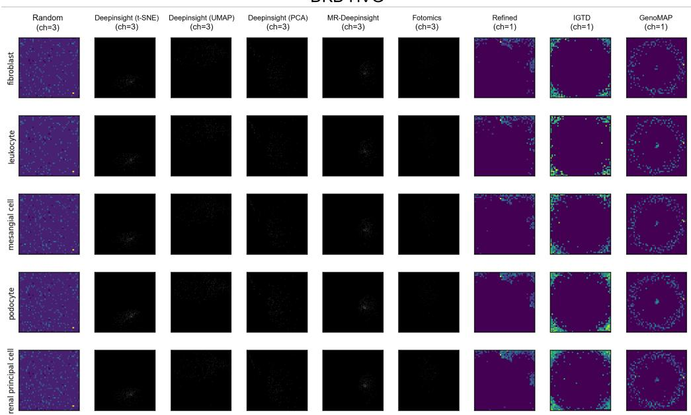  
Figure 6: Visual comparison of gene expression-to-image mappings on DKD highly variable genes. Each row represents a specific cell type, while each column corresponds to a mapping strategy.

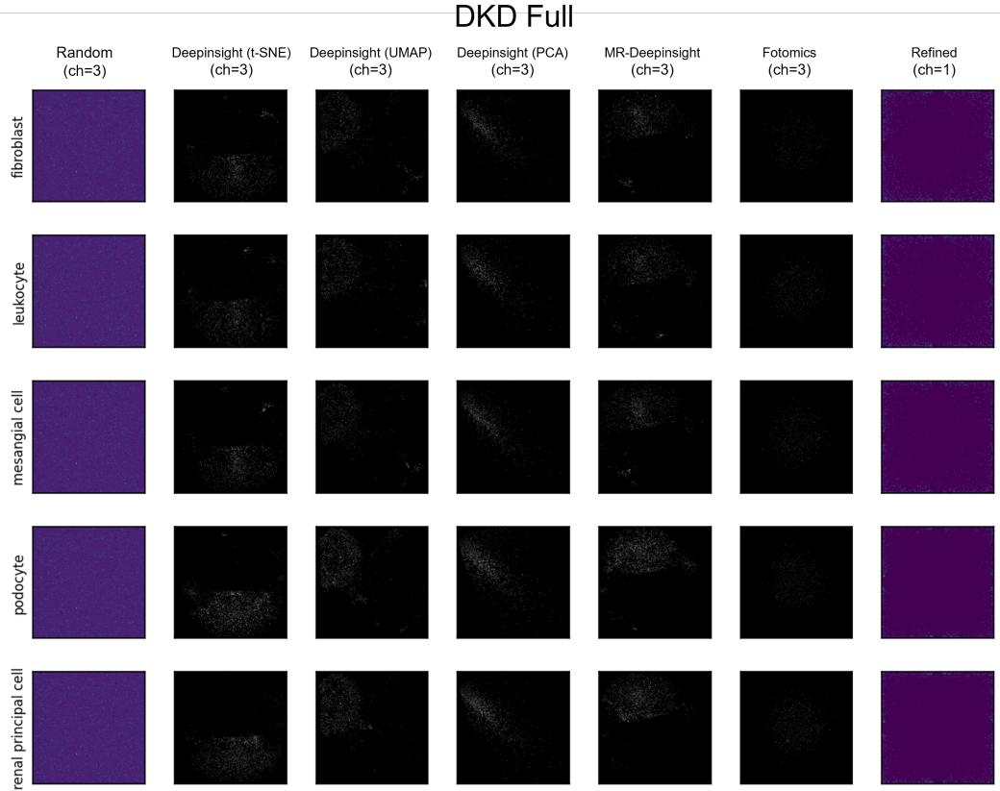  
Figure 7: Visual comparison of gene expression-to-image mappings on DKD full genomes. Each row represents a specific cell type, while each column corresponds to a mapping strategy.

assume that the canvas has suficient capacity, $| \Omega | = H W \geq G$ . Rounding and boundary clipping define its target pixel:

$$
\mathbf { t } _ { i } = \Pi _ { \Omega } \big ( \mathrm { r o u n d } ( \mathbf { z } _ { i } ) \big ) ,\tag{13}
$$

where $\Pi _ { \Omega }$ clips each coordinate to the valid grid range. The corresponding global assignment objective is

$$
\operatorname* { m i n } _ { \mathbf { a } _ { 1 } , \ldots , \mathbf { a } _ { G } \in \Omega } \sum _ { i = 1 } ^ { G } \| \mathbf { a } _ { i } - \mathbf { t } _ { i } \| _ { 2 } ^ { 2 } \quad \mathrm { s u b j e c t ~ t o } \quad \mathbf { a } _ { i } \neq \mathbf { a } _ { j } \quad \mathrm { f o r ~ a l l ~ } i \neq j .\tag{14}
$$

Rather than solve this objective jointly, we process genes in a fixed order. Starting with $A _ { 0 } = \varnothing$ , each gene is assigned to the nearest unoccupied pixel:

$$
\mathbf { a } _ { i } \in \underset { p \in \Omega \setminus A _ { i - 1 } } { \arg \operatorname* { m i n } } \ \| p - \mathbf { t } _ { i } \| _ { 2 } ^ { 2 } , \qquad A _ { i } = A _ { i - 1 } \cup \{ \mathbf { a } _ { i } \} .\tag{15}
$$

We build a cKDTree over the grid coordinates and maintain an occupancy mask. For each target, we query nearest neighbors with geometrically increasing candidate counts, $k = 1 , 2 , 4 , \dots$ capped at |Ω|. Occupied candidates are discarded; once free candidates are available, we select the closest one. If the adaptive search returns no valid candidate, an exhaustive search over the remaining free pixels provides a fallback. This avoids constructing a dense gene–pixel cost matrix, although searches can become expensive as the grid fills.

Provided $H W \geq G$ , the procedure guarantees an injective assignment and hence $C R =$ 0 and $A P P G = 1$ on the native single-view grid. It minimizes displacement from the rounded target at each step, conditional on earlier assignments; it does not guarantee a global optimum of Eq. 14 or preservation of the original neighborhoods. The result depends on gene order and tie-breaking. We use this heuristic as a collision-removal intervention distinct from exact LSA, with its cross-dataset results reported in Table 5.

## C.3 Baseline Model Configurations

We follow the hyperparameters and input protocols of OpenProblems (Luecken et al., 2025). XGBoost (Chen, 2016) uses precomputed PCA features, typically 50 components derived from HVGs, rather than raw counts. Seurat uses its default variable-selection, scaling, and classification workflow (Hao et al., 2021).

Generative and foundation models. For latent modeling, scANVI and its reference-mapping variant scANVI+scArches were configured with two hidden layers $( n _ { h i d d e n } = 1 2 8 )$ , a 30- dimensional latent space, and a dropout rate of 0.2 (Lotfollahi et al., 2020). Training was conducted for approximately 100 to 200 epochs with batch covariates enabled. We evaluate scGPT (Cui et al., 2024) and CellFM (Zeng et al., 2025) using zero-shot embeddings. The evaluation uses the pretrained scGPT\_human and scGPT\_80M checkpoints with a weighted KNN classifier $( k = 1 0 )$ on the embeddings.

## C.4 Standardized Training and Visualization

All GE2I representations use a shared ResNet-18 probe initialized with standard weights. We train with AdamW (initial learning rate $1 \times 1 0 ^ { - 3 }$ , weight decay 0.01), a 5-epoch linear warmup, and cosine annealing for up to 50 epochs. Early stopping uses a patience of 10 epochs.

## D Cross-Modality Gene-to-Protein Prediction

We evaluate GE2I on CITE-Seq gene-to-protein prediction (Stoeckius et al., 2017) using full-transcriptome inputs. Each cell’s gene expression profile is represented as an image and used to predict the abundances of 13 surface proteins. Dataset specifications and image-construction procedures are provided in Appendices B.1 and C.1, respectively. We report root mean squared error (RMSE), overall Pearson correlation (PCC), and overall Spearman correlation to assess prediction error, linear association, and rank agreement with the measured protein abundances.

Table 8: Gene-to-protein prediction on CITE-Seq using full-transcriptome inputs. Results are reported as mean ± standard deviation. Lower RMSE and higher correlations indicate better prediction.
<table><tr><td>Method</td><td>RMSE↓</td><td></td><td>Overall PCC ↑ Overall Spearman ↑</td></tr><tr><td>Random Mapping</td><td> $0 . 3 6 8 8 \pm 0 . 0 0$ </td><td> $0 . 7 9 9 6 \pm 0 . 0 0$ </td><td> $0 . 7 4 4 3 \pm 0 . 0 1$ </td></tr><tr><td>DeepInsight (t-SNE)</td><td> $0 . 3 6 6 7 \pm 0 . 0 0$ </td><td> $0 . 8 0 0 9 \pm 0 . 0 0$ </td><td> $0 . 7 4 5 1 \pm 0 . 0 1$ </td></tr><tr><td>DeepInsight (UMAP)</td><td> $0 . 4 3 9 7 \pm 0 . 0 5$ </td><td> $0 . 7 4 9 7 \pm 0 . 0 2$ </td><td> $0 . 7 2 6 6 \pm 0 . 0 2$ </td></tr><tr><td>DeepInsight (PCA)</td><td> $0 . 3 7 4 1 \pm 0 . 0 2$ </td><td> $0 . 7 9 9 5 \pm 0 . 0 1$ </td><td> $0 . 7 6 4 7 \pm 0 . 0 1$ </td></tr><tr><td>MR-DeepInsight</td><td> $0 . 3 4 7 9 \pm 0 . 0 0$ </td><td> $0 . 8 2 3 7 \pm 0 . 0 1$ </td><td> $0 . 7 7 9 7 \pm 0 . 0 0$ </td></tr><tr><td>Fotomics</td><td> $0 . 4 1 2 5 \pm 0 . 0 1$ </td><td> $0 . 7 4 0 4 \pm 0 . 0 1$ </td><td> $0 . 7 0 7 6 \pm 0 . 0 0$ </td></tr><tr><td>REFINED</td><td> $0 . 3 9 9 9 \pm 0 . 0 2$ </td><td> $0 . 7 7 2 6 \pm 0 . 0 1$ </td><td> $0 . 7 2 1 4 \pm 0 . 0 1$ </td></tr></table>

Table 8 reports the results for the evaluated image mappings. Both random and structured layouts produce predictions correlated with measured protein abundances. DeepInsight (t-SNE) and Random Mapping achieve similar overall PCC values of 0.8009 and 0.7996, with RMSE values of 0.3667 and 0.3688, respectively. This evaluation extends the use of gene expression images from predicting categorical cell identities to estimating continuous protein measurements.

## E Additional Ablations

This section collects supplementary result tables for the expression-space baseline and the visual training choices analyzed in the main text.

## E.1 Full-Genome MLP Ablation

Table 9: Tuned full-genome Simple MLP baseline on raw expression vectors. Results use the same splits as the GE2I classification benchmarks.
<table><tr><td>Metric</td><td>DKD</td><td>GTEx v9</td><td>HypoMap</td><td>ICA</td><td>TS</td></tr><tr><td>Acc</td><td> $0 . 9 6 6 0 _ { \pm 0 . 0 0 1 1 }$ </td><td> $0 . 9 0 7 8 { \scriptstyle \pm 0 . 0 0 2 5 }$ </td><td> $0 . 9 9 2 7 _ { \pm 0 . 0 0 2 7 }$ </td><td> $0 . 9 0 0 2 _ { \pm 0 . 0 0 1 7 }$ </td><td> $0 . 4 9 4 1 _ { \pm 0 . 1 4 0 6 }$ </td></tr><tr><td>F1-M</td><td> $0 . 9 3 1 2 _ { \pm 0 . 0 1 6 1 }$ </td><td> $0 . 3 6 2 4 { \scriptstyle \pm 0 . 0 2 3 9 }$ </td><td> $0 . 6 9 0 3 _ { \pm 0 . 2 0 3 6 }$ </td><td> $0 . 8 2 8 5 { \scriptstyle \pm 0 . 0 1 6 5 }$ </td><td> $0 . 3 0 4 4 _ { \pm 0 . 0 5 2 4 }$ </td></tr></table>

The tuned Simple MLP uses raw expression vectors and the same splits as GE2I. This comparison tests whether an image representation is necessary to benefit from the larger gene set. The MLP is competitive on DKD, ICA, and TS, but its F1-Macro is lower than that of the best structured GE2I methods on GTEx v9 and HypoMap. Raw information can therefore explain some full-genome gains, while projection provides useful inductive bias in other settings. The distinction between metrics is important: on GTEx v9, the MLP attains high accuracy despite weaker F1-Macro, so its aggregate correctness does not imply equally strong performance across cell types. This ablation supports a dataset-dependent role for projection rather than a general superiority of either representation family.

## E.2 Supplementary Visual-Training Results

The following tables provide the complete backbone and augmentation results discussed in Section 5.4.

## E.3 Interpretability Trade-of

DeepInsight (t-SNE) yields more concentrated Grad-CAM responses than Random Mapping: CAM entropy is lower (0.907 vs. 0.950), center mass higher (0.521 vs. 0.427), and mean radius smaller (0.201 vs. 0.227). Canonical-marker hit ratio increases from 0.25 to 0.50, and mean marker CAM percentile from 0.559 to 0.742. The structured layout recovers more canonical markers within hotspots for distal convoluted tubule cells, thick ascending limb cells, and podocytes.

Table 10: Collision-removal results for DeepInsight (t-SNE) across DKD backbones. Superscripts report relative performance changes.
<table><tr><td>Backbone</td><td>Acc</td><td>F1-M</td></tr><tr><td>ResNet-18</td><td> $0 . 9 6 4 0 _ { \pm 0 . 0 0 5 5 } ^ { + 1 . 2 \% }$ </td><td> $0 . 9 0 9 4 _ { + 0 . 0 4 1 0 } ^ { + 3 . 4 \% }$ </td></tr><tr><td>ResNet-50</td><td> $0 . 9 6 2 3 _ { \pm 0 . 0 0 6 5 } ^ { + 1 . 8 \% }$ </td><td> $0 . 9 0 7 1 _ { \pm 0 . 0 3 5 8 } ^ { + 4 . 6 \% }$ </td></tr><tr><td>ConvNeXt-Tiny</td><td> $0 . 9 5 7 3 _ { \pm 0 . 0 0 4 4 } ^ { + 0 . 3 \% }$ </td><td> $0 . 9 0 2 2 _ { \pm 0 . 0 3 7 1 } ^ { + 4 . 0 \% }$ </td></tr><tr><td>EfficientNet-B0</td><td> $0 . 9 6 5 4 _ { \pm 0 . 0 0 1 6 } ^ { + 1 . 1 \% }$ </td><td> $0 . 9 2 0 2 _ { \pm 0 . 0 3 6 9 } ^ { + 7 . 0 \% }$ </td></tr><tr><td>ViT-B/16</td><td> $0 . 9 5 1 2 _ { \pm 0 . 0 0 8 4 } ^ { + 1 . 2 \% }$ </td><td> $0 . 8 6 1 8 _ { \pm 0 . 0 0 7 4 } ^ { + 4 . 4 \% }$ </td></tr></table>

Table 11: Random mapping performance across backbones on DKD.
<table><tr><td>Backbone</td><td>Acc</td><td>F1-M</td></tr><tr><td>ResNet-18</td><td> $0 . 9 6 0 9 { \scriptstyle \pm 0 . 0 0 }$ </td><td> $0 . 8 6 3 5 { \scriptstyle \pm 0 . 0 2 }$ </td></tr><tr><td>ResNet-50</td><td> $0 . 9 6 0 5 { \scriptstyle \pm 0 . 0 0 }$ </td><td> $0 . 8 9 8 4 { \scriptstyle \pm 0 . 0 1 }$ </td></tr><tr><td>ConvNeXt-Tiny</td><td> $0 . 9 5 1 2 _ { \pm 0 . 0 1 }$ </td><td> $0 . 8 5 7 6 _ { \pm 0 . 0 2 }$ </td></tr><tr><td>EfficientNet-B0</td><td> $0 . 9 6 0 3 _ { \pm 0 . 0 0 }$ </td><td> $0 . 8 5 8 7 { \scriptstyle \pm 0 . 0 1 }$ </td></tr><tr><td>ViT-B/16</td><td> $0 . 9 2 7 1 { \scriptstyle \pm 0 . 0 0 }$ </td><td> $0 . 8 0 8 0 { \scriptstyle \pm 0 . 0 1 }$ </td></tr></table>

Table 12: Image augmentation on DKD. Each augmentation is evaluated relative to the same mapping without augmentation. All tested configurations, including their combination, are reported.
<table><tr><td>Method</td><td>Augmentation</td><td>ACC</td><td>F1-Macro</td></tr><tr><td rowspan="6">DeepInsight (t-SNE)</td><td>None</td><td> $0 . 9 5 3 7 { \scriptstyle \pm 0 . 0 0 }$ </td><td> $0 . 8 8 6 8 _ { \pm 0 . 0 2 }$ </td></tr><tr><td>Geometric</td><td> $0 . 9 5 3 2 _ { \pm 0 . 0 1 }$ </td><td> $0 . 8 8 1 9 _ { \pm 0 . 0 2 }$ </td></tr><tr><td>Bio. Cutout</td><td> $0 . 9 5 1 3 { \scriptstyle \pm 0 . 0 1 }$ </td><td> $0 . 8 5 4 0 { \scriptstyle \pm 0 . 0 4 }$ </td></tr><tr><td>Bio. Noise</td><td> $0 . 9 4 8 2 _ { \pm 0 . 0 1 }$ </td><td> $0 . 8 7 7 1 { \scriptstyle \pm 0 . 0 1 }$ </td></tr><tr><td>Bio. Intensity</td><td> $0 . 9 5 6 6 _ { \pm 0 . 0 0 }$ </td><td> $0 . 8 9 3 8 { \scriptstyle \pm 0 . 0 1 }$ </td></tr><tr><td>All</td><td> $0 . 4 6 8 9 { \scriptstyle \pm 0 . 3 1 }$ </td><td> $0 . 3 2 2 7 { \scriptstyle \pm 0 . 2 2 }$ </td></tr><tr><td rowspan="6">Random</td><td>None</td><td> $0 . 9 4 2 1 _ { \pm 0 . 0 0 }$ </td><td> $0 . 8 0 5 3 { \scriptstyle \pm 0 . 0 2 }$ </td></tr><tr><td>Geometric</td><td> $0 . 9 5 5 0 { \scriptstyle \pm 0 . 0 1 }$ </td><td> $0 . 8 4 1 6 _ { \pm 0 . 0 4 }$ </td></tr><tr><td>Bio. Cutout</td><td> $0 . 9 5 3 2 { \scriptstyle \pm 0 . 0 1 }$ </td><td> $0 . 8 3 1 9 _ { \pm 0 . 0 3 }$ </td></tr><tr><td>Bio. Noise</td><td> $0 . 9 5 7 8 _ { \pm 0 . 0 1 }$ </td><td> $0 . 8 6 6 8 _ { \pm 0 . 0 1 }$ </td></tr><tr><td>Bio. Intensity</td><td> $0 . 9 5 6 3 _ { \pm 0 . 0 1 }$ </td><td> $0 . 8 6 5 2 _ { \pm 0 . 0 3 }$ </td></tr><tr><td>All</td><td> $0 . 9 5 1 6 { \scriptstyle \pm 0 . 0 1 }$ </td><td> $0 . 8 5 3 4 { \scriptstyle \pm 0 . 0 1 }$ </td></tr><tr><td rowspan="6">Refined</td><td>None</td><td> $0 . 9 5 6 6 _ { \pm 0 . 0 0 }$ </td><td> $0 . 8 7 0 4 { \scriptstyle \pm 0 . 0 3 }$ </td></tr><tr><td>Geometric</td><td> $0 . 9 4 9 7 { \scriptstyle \pm 0 . 0 1 }$ </td><td> $0 . 8 2 6 3 { \scriptstyle \pm 0 . 0 1 }$ </td></tr><tr><td>Bio. Cutout</td><td> $0 . 9 5 5 2 { \scriptstyle \pm 0 . 0 0 }$ </td><td> $0 . 8 6 9 8 { \scriptstyle \pm 0 . 0 1 }$ </td></tr><tr><td>Bio. Noise</td><td> $0 . 2 9 2 6 _ { \pm 0 . 2 2 }$ </td><td> $0 . 0 9 3 2 _ { \pm 0 . 1 2 }$ </td></tr><tr><td>Bio. Intensity</td><td> $0 . 9 5 8 4 _ { \pm 0 . 0 0 }$ </td><td> $0 . 8 8 3 7 { \scriptstyle \pm 0 . 0 2 }$ </td></tr><tr><td>All</td><td> $0 . 5 4 4 4 { \scriptstyle \pm 0 . 2 5 }$ </td><td> $0 . 1 9 4 1 { \scriptstyle \pm 0 . 1 5 }$ </td></tr></table>

Table 13: Grad-CAM interpretability comparison on DKD. Canonical-marker coverage is measured as the number of established markers falling inside the salient region. Higher center mass and marker hit ratio are better; lower entropy and radius are better.
<table><tr><td>Setting</td><td>Random</td><td>DeepInsight (t-SNE)</td><td>Key evidence</td></tr><tr><td>CAM entropy ↓</td><td>0.950</td><td>0.907</td><td>more compact saliency</td></tr><tr><td>Center mass ↑</td><td>0.427</td><td>0.521</td><td>stronger spatial focus</td></tr><tr><td>Marker hit ratio ↑</td><td>0.25</td><td>0.50</td><td>better biological alignment</td></tr><tr><td>DCT marker coverage ↑</td><td>2/5</td><td>5/5</td><td>SLC12A3, PVALB, TRPM6, CALB1, FXYD2</td></tr><tr><td>TAL marker coverage ↑</td><td>2/5</td><td>4/5</td><td>UMOD, SLC12A1, KCNJ1, CLDN16</td></tr><tr><td>Podocyte marker coverage ↑</td><td>2/5</td><td>5/5</td><td>NPHS1, NPHS2, PODXL, WT1, SYNPO</td></tr></table>

Spatial concentration alone would not establish biological relevance, since the mapping itself afects the geometry of saliency regions. Marker recovery provides complementary evidence that the structured hotspots align with known cell-type features. These results concern the interpretability of the evaluated Grad-CAM maps, not causal validation of the identified genes, and should be read separately from the classification comparison.

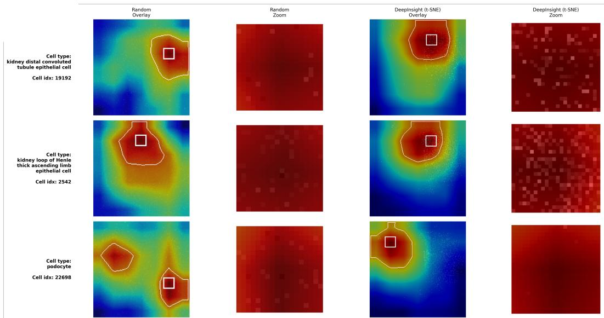  
Figure 8: Representative Grad-CAM examples for three cell types where DeepInsight-tSNE shows stronger biological alignment than the random mapping. In distal convoluted tubule, thick ascending limb, and podocytes, the structured mapping yields tighter saliency regions and substantially higher canonical-marker recovery within the hotspot.

## F Comprehensive Metric Breakdown

Table 14 reports spectral descriptors and performance for each method–dataset pair used in Section 5.2.

Full-transcriptome manifold layouts create more gene collisions than their HVG counterparts. CR increases with full-genome inputs; for DeepInsight (t-SNE) on HypoMap, it rises from 0.198 to 0.641. Compact gene clusters can thus reduce the number of expression values represented separately.

IGTD and REFINED achieve near-maximal smoothness without gene collisions. Both methods have CR = 0 and LFER near 1.0. Their layouts preserve separate gene assignments while concentrating spectral power at low frequencies. This distinguishes collision avoidance from texture preservation and motivates treating both as potential contributors to performance.

Table 14: Detailed metrics for spectral properties, information density, and performance across all datasets.
<table><tr><td>Method</td><td>Dataset</td><td>APPG CR</td><td></td><td>LFER SE</td><td></td><td>Acc</td><td>F1-M</td></tr><tr><td colspan="8">Highly Variable Genes (HVG)</td></tr><tr><td>Random</td><td>DKD</td><td>1.000</td><td>0.000</td><td>0.177</td><td>3.029</td><td>0.900</td><td>0.773</td></tr><tr><td>Random</td><td>GTEx</td><td>1.000</td><td></td><td>0.0000.198</td><td></td><td></td><td>3.033 0.653 0.211</td></tr></table>

Continued on next page

Table 14 – Continued from previous page
<table><tr><td rowspan=1 colspan=10>Method                Dataset         APPGCR  LFER SE  Acc F1-M</td></tr><tr><td rowspan=1 colspan=2>Random</td><td rowspan=1 colspan=4>HypoMAP     1.000  0.000</td><td rowspan=1 colspan=3>0.191 3.0300.980</td><td rowspan=1 colspan=1>0.557</td></tr><tr><td rowspan=1 colspan=2>Random</td><td rowspan=1 colspan=4>ICA            1.000 0.000</td><td rowspan=1 colspan=1>0.207</td><td rowspan=1 colspan=1>3.034</td><td rowspan=1 colspan=1>0.683</td><td rowspan=1 colspan=1>0.484</td></tr><tr><td rowspan=1 colspan=2>Random</td><td rowspan=1 colspan=4>Tabula Sapiens1.000 0.000</td><td rowspan=1 colspan=1>0.221</td><td rowspan=1 colspan=1>3.026</td><td rowspan=1 colspan=1>0.384</td><td rowspan=1 colspan=1>0.215</td></tr><tr><td rowspan=1 colspan=2>DeepInsight (t-SNE)</td><td rowspan=1 colspan=4>DKD           0.869 0.127</td><td rowspan=1 colspan=1>0.900</td><td rowspan=1 colspan=1>2.846</td><td rowspan=1 colspan=1>0.892</td><td rowspan=1 colspan=1>0.742</td></tr><tr><td rowspan=1 colspan=2>DeepInsight (t-SNE)</td><td rowspan=1 colspan=4>GTEx          0.831  0.170</td><td rowspan=1 colspan=1>0.823</td><td rowspan=1 colspan=1>3.520</td><td rowspan=1 colspan=1>0.626</td><td rowspan=1 colspan=1>0.194</td></tr><tr><td rowspan=1 colspan=2>DeepInsight (t-SNE)</td><td rowspan=1 colspan=4>HypoMAP     0.832 0.198</td><td rowspan=1 colspan=1>0.933</td><td rowspan=1 colspan=1>3.088</td><td rowspan=1 colspan=1>0.983</td><td rowspan=1 colspan=1>0.572</td></tr><tr><td rowspan=1 colspan=2>DeepInsight (t-SNE)</td><td rowspan=1 colspan=2>ICA</td><td rowspan=1 colspan=2>0.832 0.179</td><td rowspan=1 colspan=1>0.954</td><td rowspan=1 colspan=1>2.887</td><td rowspan=1 colspan=1>0.693</td><td rowspan=1 colspan=1>0.504</td></tr><tr><td rowspan=1 colspan=2>DeepInsight (t-SNE)</td><td rowspan=1 colspan=2>Tabula Sapiens</td><td rowspan=1 colspan=2>0.797  0.196</td><td rowspan=1 colspan=1>0.945</td><td rowspan=1 colspan=1>2.769</td><td rowspan=1 colspan=1>0.371</td><td rowspan=1 colspan=1>0.184</td></tr><tr><td rowspan=1 colspan=2>DeepInsight(UMAP</td><td></td><td rowspan=1 colspan=1>DKD</td><td rowspan=1 colspan=1>0.976</td><td rowspan=1 colspan=1>0.025</td><td rowspan=1 colspan=1>0.988</td><td rowspan=1 colspan=1>0.582</td><td rowspan=1 colspan=1>0.900</td><td rowspan=1 colspan=1>0.759</td></tr><tr><td rowspan=1 colspan=2>DeepInsight(UMAP)</td><td></td><td rowspan=1 colspan=1>GTEx</td><td rowspan=1 colspan=1>0.757</td><td rowspan=1 colspan=1>0.235</td><td rowspan=1 colspan=1>0.871</td><td rowspan=1 colspan=1>2.043</td><td rowspan=1 colspan=1>0.677</td><td rowspan=1 colspan=1>0.221</td></tr><tr><td rowspan=1 colspan=2>DeepInsight(UMAP)</td><td></td><td rowspan=1 colspan=1>HypoMAP</td><td rowspan=1 colspan=1>0.807</td><td rowspan=1 colspan=1>0.183</td><td rowspan=1 colspan=1>0.996</td><td rowspan=1 colspan=1>0.455</td><td rowspan=1 colspan=1>0.981</td><td rowspan=1 colspan=1>0.578</td></tr><tr><td rowspan=1 colspan=2>DeepInsight(UMAP)</td><td></td><td rowspan=1 colspan=1>ICA</td><td rowspan=1 colspan=1>0.778</td><td rowspan=1 colspan=1>0.205</td><td rowspan=1 colspan=1>0.953</td><td rowspan=1 colspan=1>1.254</td><td rowspan=1 colspan=1>0.705</td><td rowspan=1 colspan=1>0.510</td></tr><tr><td rowspan=1 colspan=2>DeepInsight(UMAP)</td><td></td><td rowspan=1 colspan=1>Tabula Sapiens</td><td rowspan=1 colspan=1>0.610</td><td rowspan=1 colspan=1>0.345</td><td rowspan=1 colspan=1>0.873</td><td rowspan=1 colspan=1>2.587</td><td rowspan=1 colspan=1>0.392</td><td rowspan=1 colspan=1>0.197</td></tr><tr><td rowspan=1 colspan=3>DeepInsight(PCA)</td><td rowspan=1 colspan=1>DKD</td><td rowspan=1 colspan=1>0.230</td><td rowspan=1 colspan=1>0.246</td><td rowspan=1 colspan=1>0.511</td><td rowspan=1 colspan=1>3.997</td><td rowspan=1 colspan=1>0.903</td><td rowspan=1 colspan=1>0.781</td></tr><tr><td rowspan=1 colspan=3>DeepInsight(PCA)</td><td rowspan=1 colspan=1>GTEx</td><td rowspan=1 colspan=1>0.159</td><td rowspan=1 colspan=1>0.293</td><td rowspan=1 colspan=1>0.401</td><td rowspan=1 colspan=1>4.408</td><td rowspan=1 colspan=1>0.623</td><td rowspan=1 colspan=1>0.176</td></tr><tr><td rowspan=1 colspan=3>DeepInsight(PCA)</td><td rowspan=1 colspan=1>HypoMAP</td><td rowspan=1 colspan=1>0.171</td><td rowspan=1 colspan=1>0.109</td><td rowspan=1 colspan=1>0.442</td><td rowspan=1 colspan=1>4.253</td><td rowspan=1 colspan=1>0.983</td><td rowspan=1 colspan=1>0.572</td></tr><tr><td rowspan=1 colspan=3>DeepInsight (PCA)</td><td rowspan=1 colspan=1>ICA</td><td rowspan=1 colspan=1>0.157</td><td rowspan=1 colspan=1>0.185</td><td rowspan=1 colspan=1>0.314</td><td rowspan=1 colspan=1>4.614</td><td rowspan=1 colspan=1>0.686</td><td rowspan=1 colspan=1>0.481</td></tr><tr><td rowspan=1 colspan=3>DeepInsight (PCA)</td><td rowspan=1 colspan=1>Tabula Sapiens</td><td rowspan=1 colspan=1>0.173</td><td rowspan=1 colspan=1>0.127</td><td rowspan=1 colspan=1>0.387</td><td rowspan=1 colspan=1>4.460</td><td rowspan=1 colspan=1>0.374</td><td rowspan=1 colspan=1>0.202</td></tr><tr><td rowspan=1 colspan=3>MR-DeepInsight</td><td rowspan=1 colspan=1>DKD</td><td rowspan=1 colspan=1>1.784</td><td rowspan=1 colspan=1>0.103</td><td rowspan=1 colspan=1>0.895</td><td rowspan=1 colspan=1>1.768</td><td rowspan=1 colspan=1>0.908</td><td rowspan=1 colspan=1>0.797</td></tr><tr><td rowspan=1 colspan=3>MR-DeepInsight</td><td rowspan=1 colspan=1>GTEx</td><td rowspan=1 colspan=1>1.656</td><td rowspan=1 colspan=1>0.165</td><td rowspan=1 colspan=1>0.832</td><td rowspan=1 colspan=1>2.558</td><td rowspan=1 colspan=1>0.684</td><td rowspan=1 colspan=1>0.199</td></tr><tr><td rowspan=1 colspan=3>MR-DeepInsight</td><td rowspan=1 colspan=1>HypoMAP</td><td rowspan=1 colspan=1>1.641</td><td rowspan=1 colspan=1>0.165</td><td rowspan=1 colspan=1>0.919</td><td rowspan=1 colspan=1>1.686</td><td rowspan=1 colspan=1>0.992</td><td rowspan=1 colspan=1>0.593</td></tr><tr><td rowspan=1 colspan=3>MR-DeepInsight</td><td rowspan=1 colspan=1>ICA</td><td rowspan=1 colspan=1>1.614</td><td rowspan=1 colspan=1>0.178</td><td rowspan=1 colspan=1>0.909</td><td rowspan=1 colspan=1>2.104</td><td rowspan=1 colspan=1>0.748</td><td rowspan=1 colspan=1>0.639</td></tr><tr><td rowspan=1 colspan=3>MR-DeepInsight</td><td rowspan=1 colspan=1>Tabula Sapiens</td><td rowspan=1 colspan=1>1.565</td><td rowspan=1 colspan=1>0.186</td><td rowspan=1 colspan=1>0.917</td><td rowspan=1 colspan=1>1.894</td><td rowspan=1 colspan=1>0.387</td><td rowspan=1 colspan=1>0.210</td></tr><tr><td rowspan=1 colspan=3>FOTOMICS</td><td rowspan=1 colspan=1>DKD</td><td rowspan=1 colspan=1>0.863</td><td rowspan=1 colspan=1>0.140</td><td rowspan=1 colspan=1>0.620</td><td rowspan=1 colspan=1>3.510</td><td rowspan=1 colspan=1>0.902</td><td rowspan=1 colspan=1>0.742</td></tr><tr><td rowspan=1 colspan=3>FOTOMICS</td><td rowspan=1 colspan=1>GTEx</td><td rowspan=1 colspan=1>0.919</td><td rowspan=1 colspan=1>0.086</td><td rowspan=1 colspan=1>0.450</td><td rowspan=1 colspan=1>4.189</td><td rowspan=1 colspan=1>0.658</td><td rowspan=1 colspan=1>0.201</td></tr><tr><td rowspan=1 colspan=3>FOTOMICS</td><td rowspan=1 colspan=1>HypoMAP</td><td rowspan=1 colspan=1>0.885</td><td rowspan=1 colspan=1>0.116</td><td rowspan=1 colspan=1>0.569</td><td rowspan=1 colspan=1>3.738</td><td rowspan=1 colspan=1>0.981</td><td rowspan=1 colspan=1>0.520</td></tr><tr><td rowspan=1 colspan=3>FOTOMICS</td><td rowspan=1 colspan=1>ICA</td><td rowspan=1 colspan=1>0.930</td><td rowspan=1 colspan=1>0.074</td><td rowspan=1 colspan=1>0.611</td><td rowspan=1 colspan=1>3.444</td><td rowspan=1 colspan=1>0.707</td><td rowspan=1 colspan=1>0.510</td></tr><tr><td rowspan=1 colspan=3>FOTOMICS</td><td rowspan=1 colspan=1>Tabula Sapiens</td><td rowspan=1 colspan=1>0.927</td><td rowspan=1 colspan=1>0.077</td><td rowspan=1 colspan=1>0.636</td><td rowspan=1 colspan=1>3.375</td><td rowspan=1 colspan=1>0.383</td><td rowspan=1 colspan=1>0.209</td></tr><tr><td rowspan=1 colspan=2>Refined</td><td rowspan=1 colspan=1></td><td rowspan=1 colspan=1>DKD</td><td rowspan=1 colspan=1>1.000</td><td rowspan=1 colspan=1>0.000</td><td rowspan=1 colspan=1>0.995</td><td rowspan=1 colspan=1>0.555</td><td rowspan=1 colspan=1>0.902</td><td rowspan=1 colspan=1>0.753</td></tr><tr><td rowspan=1 colspan=2>Refined</td><td rowspan=1 colspan=1></td><td rowspan=1 colspan=1>GTEx</td><td rowspan=1 colspan=1>1.000</td><td rowspan=1 colspan=1>0.000</td><td rowspan=1 colspan=1>0.991</td><td rowspan=1 colspan=1>0.545</td><td rowspan=1 colspan=1>0.637</td><td rowspan=1 colspan=1>0.194</td></tr><tr><td rowspan=1 colspan=3>Refined</td><td rowspan=1 colspan=1>HypoMAP</td><td rowspan=1 colspan=1>1.000</td><td rowspan=1 colspan=1>0.000</td><td rowspan=1 colspan=1>0.997</td><td rowspan=1 colspan=1>0.522</td><td rowspan=1 colspan=1>0.981</td><td rowspan=1 colspan=1>0.560</td></tr><tr><td rowspan=1 colspan=3>Refined</td><td rowspan=1 colspan=1>ICA</td><td rowspan=1 colspan=1>1.000</td><td rowspan=1 colspan=1>0.000</td><td rowspan=1 colspan=1>0.995</td><td rowspan=1 colspan=1>0.608</td><td rowspan=1 colspan=1>0.663</td><td rowspan=1 colspan=1>0.484</td></tr><tr><td rowspan=1 colspan=3>Refined</td><td rowspan=1 colspan=1>Tabula Sapiens</td><td rowspan=1 colspan=1>1.000</td><td rowspan=1 colspan=1>0.000</td><td rowspan=1 colspan=1>0.993</td><td rowspan=1 colspan=1>0.646</td><td rowspan=1 colspan=1>0.373</td><td rowspan=1 colspan=1>0.215</td></tr><tr><td rowspan=1 colspan=3>IGTD</td><td rowspan=1 colspan=1>DKD</td><td rowspan=1 colspan=1>1.000</td><td rowspan=1 colspan=1>0.000</td><td rowspan=1 colspan=1>0.996</td><td rowspan=1 colspan=1>0.467</td><td rowspan=1 colspan=1>0.902</td><td rowspan=1 colspan=1>0.733</td></tr><tr><td rowspan=1 colspan=2>IGTD</td><td rowspan=1 colspan=1></td><td rowspan=1 colspan=1>GTEx</td><td rowspan=1 colspan=1>1.000</td><td rowspan=1 colspan=1>0.000</td><td rowspan=1 colspan=1>0.994</td><td rowspan=1 colspan=1>0.481</td><td rowspan=1 colspan=1>0.666</td><td rowspan=1 colspan=1>0.211</td></tr><tr><td rowspan=1 colspan=2>IGTD</td><td rowspan=1 colspan=1></td><td rowspan=1 colspan=1>HypoMAP</td><td rowspan=1 colspan=1>1.000</td><td rowspan=1 colspan=1>0.000</td><td rowspan=1 colspan=1>1.000</td><td rowspan=1 colspan=1>0.422</td><td rowspan=1 colspan=1>0.984</td><td rowspan=1 colspan=1>0.539</td></tr><tr><td rowspan=1 colspan=2>IGTD</td><td rowspan=1 colspan=1></td><td rowspan=1 colspan=1>ICA</td><td rowspan=1 colspan=1>1.000</td><td rowspan=1 colspan=1>0.000</td><td rowspan=1 colspan=1>0.999</td><td rowspan=1 colspan=1>0.429</td><td rowspan=1 colspan=1>0.690</td><td rowspan=1 colspan=1>0.500</td></tr><tr><td rowspan=1 colspan=2>IGTD</td><td rowspan=1 colspan=1></td><td rowspan=1 colspan=1>Tabula Sapiens</td><td rowspan=1 colspan=1>1.000</td><td rowspan=1 colspan=1>0.000</td><td rowspan=1 colspan=1>0.996</td><td rowspan=1 colspan=1>0.463</td><td rowspan=1 colspan=1>0.393</td><td rowspan=1 colspan=1>0.207</td></tr><tr><td rowspan=1 colspan=2>Genomap</td><td rowspan=1 colspan=1></td><td rowspan=1 colspan=1>DKD</td><td rowspan=1 colspan=1>1.000</td><td rowspan=1 colspan=1>1.000</td><td rowspan=1 colspan=1>0.776</td><td rowspan=1 colspan=1>1.877</td><td rowspan=1 colspan=1>0.881</td><td rowspan=1 colspan=1>0.772</td></tr><tr><td rowspan=1 colspan=3>Genomap</td><td rowspan=1 colspan=1>GTEx</td><td rowspan=1 colspan=1>1.000</td><td rowspan=1 colspan=1>1.000</td><td rowspan=1 colspan=1>0.411</td><td rowspan=1 colspan=1>2.815</td><td rowspan=1 colspan=1>0.644</td><td rowspan=1 colspan=1>0.207</td></tr><tr><td rowspan=1 colspan=3>Genomap</td><td rowspan=1 colspan=1>HypoMAP</td><td rowspan=1 colspan=1>1.000</td><td rowspan=1 colspan=1>1.000</td><td rowspan=1 colspan=1>0.610</td><td rowspan=1 colspan=1>2.400</td><td rowspan=1 colspan=1>0.977</td><td rowspan=1 colspan=1>0.542</td></tr><tr><td rowspan=1 colspan=3>Genomap</td><td rowspan=1 colspan=1>ICA</td><td rowspan=1 colspan=1>1.000</td><td rowspan=1 colspan=1>1.000</td><td rowspan=1 colspan=1>0.712</td><td rowspan=1 colspan=1>2.221</td><td rowspan=1 colspan=1>0.668</td><td rowspan=1 colspan=1>0.474</td></tr><tr><td rowspan=1 colspan=4>Genomap             Tabula Sapiens</td><td rowspan=1 colspan=1>1.000</td><td rowspan=1 colspan=1>1.000</td><td rowspan=1 colspan=1>0.833</td><td rowspan=1 colspan=1>1.608</td><td rowspan=1 colspan=1>0.361</td><td rowspan=1 colspan=1>0.210</td></tr><tr><td rowspan=1 colspan=4>Full-Transcriptome</td><td rowspan=1 colspan=1></td><td rowspan=1 colspan=1></td><td rowspan=1 colspan=1></td><td rowspan=1 colspan=1></td><td rowspan=1 colspan=1></td><td rowspan=1 colspan=1></td></tr><tr><td rowspan=1 colspan=4>Random               DKD</td><td rowspan=1 colspan=1>1.000</td><td rowspan=1 colspan=1>0.00</td><td rowspan=1 colspan=1>0.2520</td><td rowspan=1 colspan=1>4.409</td><td rowspan=1 colspan=1>0.942</td><td rowspan=1 colspan=1>0.805</td></tr><tr><td rowspan=1 colspan=4>Random               GTEx</td><td rowspan=1 colspan=1>1.000</td><td rowspan=1 colspan=1>0.000</td><td rowspan=1 colspan=1>0.244</td><td rowspan=1 colspan=1>4.409</td><td rowspan=1 colspan=1>0.849</td><td rowspan=1 colspan=1>0.460</td></tr><tr><td rowspan=1 colspan=4>Random               HypoMAP</td><td rowspan=1 colspan=1>1.000</td><td rowspan=1 colspan=1>0.000</td><td rowspan=1 colspan=1>0.241</td><td rowspan=1 colspan=1>4.607</td><td rowspan=1 colspan=1>0.990</td><td rowspan=1 colspan=1>0.655</td></tr><tr><td rowspan=1 colspan=4>Random               ICA</td><td rowspan=1 colspan=1>1.000</td><td rowspan=1 colspan=1>0.000</td><td rowspan=1 colspan=1>0.233</td><td rowspan=1 colspan=1>4.433</td><td rowspan=1 colspan=1>0.879</td><td rowspan=1 colspan=1>0.731</td></tr><tr><td rowspan=1 colspan=4>Random               Tabula Sapiens</td><td rowspan=1 colspan=1>1.000</td><td rowspan=1 colspan=1>0.000</td><td rowspan=1 colspan=1>0.241</td><td rowspan=1 colspan=1>4.755</td><td rowspan=1 colspan=1>0.457</td><td rowspan=1 colspan=1>0.345</td></tr><tr><td rowspan=1 colspan=2>DeepInsight (t-SNE)</td><td rowspan=1 colspan=2>DKD</td><td rowspan=1 colspan=1>0.489</td><td rowspan=1 colspan=1>0.482</td><td rowspan=1 colspan=1>0.943</td><td rowspan=1 colspan=1>1.958</td><td rowspan=1 colspan=1>0.954</td><td rowspan=1 colspan=1>0.887</td></tr><tr><td rowspan=1 colspan=2>DeepInsight(t-SNE)</td><td rowspan=1 colspan=2>GTEx</td><td rowspan=1 colspan=1>0.446</td><td rowspan=1 colspan=1>0.504</td><td rowspan=1 colspan=1>0.867</td><td rowspan=1 colspan=2>2.6430.855</td><td rowspan=1 colspan=1>0.506</td></tr><tr><td rowspan=1 colspan=2>DeepInsight(t-SNE)</td><td rowspan=1 colspan=2>HypoMAP</td><td rowspan=1 colspan=1>0.293</td><td rowspan=1 colspan=1>0.641</td><td rowspan=1 colspan=1>0.950</td><td rowspan=1 colspan=2>2.2050.992</td><td rowspan=1 colspan=1>0.749</td></tr><tr><td rowspan=1 colspan=2>DeepInsight(t-SNE)</td><td rowspan=1 colspan=2>ICA</td><td rowspan=1 colspan=1>0.402</td><td rowspan=1 colspan=1>0.581</td><td rowspan=1 colspan=1>0.954</td><td rowspan=1 colspan=1>2.036</td><td rowspan=1 colspan=1>0.877</td><td rowspan=1 colspan=1>0.748</td></tr><tr><td rowspan=1 colspan=2>DeepInsight(t-SNE)</td><td rowspan=1 colspan=2>Tabula Sapiens</td><td rowspan=1 colspan=1>0.255</td><td rowspan=1 colspan=1>0.644</td><td rowspan=1 colspan=1>0.946</td><td rowspan=1 colspan=1>2.336</td><td rowspan=1 colspan=1>0.427</td><td rowspan=1 colspan=1>0.247</td></tr><tr><td rowspan=1 colspan=2>DeepInsight(UMA)</td><td rowspan=1 colspan=2>DKD</td><td rowspan=1 colspan=1>0.549</td><td rowspan=1 colspan=1>0.440</td><td rowspan=1 colspan=1>0.904</td><td rowspan=1 colspan=1>2.743</td><td rowspan=1 colspan=1>0.957</td><td rowspan=1 colspan=1>0.892</td></tr><tr><td rowspan=1 colspan=2>DeepInsight(UMAP)</td><td rowspan=1 colspan=2>GTEx</td><td rowspan=1 colspan=1>0.262</td><td rowspan=1 colspan=1>0.655</td><td rowspan=1 colspan=1>0.802</td><td rowspan=1 colspan=1>3.204</td><td rowspan=1 colspan=1>0.846</td><td rowspan=1 colspan=1>0.489</td></tr><tr><td rowspan=1 colspan=1>DeepInsig</td><td rowspan=1 colspan=1>ht(UMAP)</td><td></td><td rowspan=1 colspan=1>HypoMAP</td><td rowspan=1 colspan=1>0.190</td><td rowspan=1 colspan=1>0.766</td><td rowspan=1 colspan=1>0.916</td><td rowspan=1 colspan=1>2.878</td><td rowspan=1 colspan=1>0.994</td><td rowspan=1 colspan=1>0.771</td></tr><tr><td rowspan=1 colspan=1>DeepInsigh</td><td rowspan=1 colspan=1>t(UMAP)</td><td></td><td rowspan=1 colspan=1>ICA</td><td rowspan=1 colspan=2>0.358 0.635</td><td rowspan=1 colspan=1>0.818</td><td rowspan=1 colspan=1>3.172</td><td rowspan=1 colspan=1>0.882</td><td rowspan=1 colspan=1>0.763</td></tr><tr><td rowspan=1 colspan=1>DeepInsigh</td><td rowspan=1 colspan=1>t(UMAP)</td><td></td><td rowspan=1 colspan=3>Tabula Sapiens0.070  0.795</td><td rowspan=1 colspan=1>0.917</td><td rowspan=1 colspan=1>3.008</td><td rowspan=1 colspan=1>0.428</td><td rowspan=1 colspan=1>0.267</td></tr><tr><td rowspan=1 colspan=6>DeepInsight (PCA)   DKD           0.116  0.422</td><td rowspan=1 colspan=3>0.765 2.7910.95</td><td rowspan=1 colspan=1>0.8468</td></tr></table>

Continued on next page

Table 14 – Continued from previous page
<table><tr><td>Method</td><td>Dataset</td><td>APPG</td><td>CR</td><td>LFER</td><td>SE</td><td>Acc</td><td>F1-M</td></tr><tr><td>DeepInsight (PCA)</td><td>GTEx</td><td>0.080</td><td>0.480</td><td>0.650</td><td>3.228</td><td>0.842</td><td>0.442</td></tr><tr><td>DeepInsight (PCA)</td><td>HypoMAP</td><td>0.084</td><td>0.460</td><td>0.734</td><td>2.677</td><td>0.993</td><td>0.728</td></tr><tr><td>DeepInsight (PCA)</td><td>ICA</td><td>0.100</td><td>0.405</td><td>0.644</td><td>3.342</td><td>0.872</td><td>0.748</td></tr><tr><td>DeepInsight (PCA)</td><td>Tabula Sapiens</td><td>0.048</td><td>0.447</td><td>0.753</td><td>2.715</td><td>0.442</td><td>0.305</td></tr><tr><td>MR-DeepInsight</td><td>DKD</td><td>0.876</td><td>0.572</td><td>0.891</td><td>2.436</td><td>0.970</td><td>0.927</td></tr><tr><td>MR-DeepInsight</td><td>GTEx</td><td>0.714</td><td>0.548</td><td>0.785</td><td>3.186</td><td>0.871</td><td>0.366</td></tr><tr><td>MR-DeepInsight</td><td>HypoMAP</td><td>0.557</td><td>0.648</td><td>0.896</td><td>2.574</td><td>0.999</td><td>0.802</td></tr><tr><td>MR-DeepInsight</td><td>ICA</td><td>0.625</td><td>0.679</td><td>0.901</td><td>2.481</td><td>0.899</td><td>0.822</td></tr><tr><td>MR-DeepInsight</td><td>Tabula Sapiens</td><td>0.284</td><td>0.726</td><td>0.904</td><td>2.693</td><td>0.410</td><td>0.253</td></tr><tr><td>FOTOMICS</td><td>DKD</td><td>0.288</td><td>0.636</td><td>0.900</td><td>1.767</td><td>0.954</td><td>0.852</td></tr><tr><td>FOTOMICS</td><td>GTEx</td><td>0.195</td><td>0.696</td><td>0.798</td><td>2.547</td><td>0.833</td><td>0.418</td></tr><tr><td>FOTOMICS</td><td>HypoMAP</td><td>0.249</td><td>0.672</td><td>0.871</td><td>1.882</td><td>0.991</td><td>0.719</td></tr><tr><td>FOTOMICS</td><td>ICA</td><td>0.287</td><td>0.577</td><td>0.866</td><td>2.009</td><td>0.861</td><td>0.720</td></tr><tr><td>FOTOMICS</td><td>Tabula Sapiens</td><td>0.196</td><td>0.610</td><td>0.810</td><td>2.296</td><td>0.460</td><td>0.295</td></tr><tr><td>Refined</td><td>DKD</td><td>1.000</td><td>0.000</td><td>0.999</td><td>0.456</td><td>0.957</td><td>0.870</td></tr><tr><td>Refined</td><td>GTEx</td><td>1.000</td><td>0.000</td><td>0.995</td><td>0.523</td><td>0.847</td><td>0.488</td></tr><tr><td>Refined</td><td>HypoMAP</td><td>1.000</td><td>0.000</td><td>1.000</td><td>0.427</td><td>0.992</td><td>0.727</td></tr><tr><td>Refined</td><td>ICA</td><td>1.000</td><td>0.000</td><td>1.000</td><td>0.432</td><td>0.883</td><td>0.730</td></tr><tr><td>Genomap</td><td>DKD</td><td>1.000</td><td>1.000</td><td>1.000</td><td>1.004</td><td>0.408</td><td>0.092</td></tr></table>

## G Statistical Analysis Diagnostics

Clustered inference accounts for repeated seeds, but full-transcriptome coverage is uneven. A cluster is one dataset–method pair, and G denotes the number of such clusters. We compute CR1 cluster-robust standard errors across repeated seeds. The reported $z ^ { * }$ is the coeficient divided by its clustered standard error. Two-sided p-values use a t distribution with G−1 degrees of freedom, written $t _ { G - 1 } .$ 34 degrees for the 35 Full clusters and 44 degrees for the 45 HVG clusters. The q-values are Benjamini–Hochberg-adjusted p-values over the 16 descriptor tests across both outcomes and input scopes. This adjustment accounts for testing many coeficients simultaneously; $q < 0 . 0 5$ marks results that remain significant at a 5% false-discovery-rate threshold.

The Full and HVG models use 105 and 135 runs, respectively. Of 270 potential runs, 243 contain both outcomes and 240 also contain all four descriptors. Thirty Full and 40 HVG runs use APPG/CR values imputed by the observed-seed mean within the same dataset–method– scope group. Full coverage is uneven: Genomap contributes three DKD runs, REFINED contributes 12 runs, and IGTD has no complete records. The reported standard errors treat the supplied imputed values as fixed.

HVG conclusion: no descriptor reaches $q \ < \ 0 . 0 5$ for F1-Macro; for accuracy, APPG is positive and CR is negative. LFER and SE do not reach the adjusted threshold (Table 15). Compared with the Full results, the HVG pattern indicates that the observed descriptor– performance relationships depend on how many genes are represented.

Table 15: Beta regression in the HVG setting. Descriptors enter jointly with dataset-by-seed fixed efects, and SE is clustered by dataset–method. The p-values use a t distribution with 44 degrees of freedom; q is the Benjamini–Hochberg-adjusted $p \textmd { - }$ -value.
<table><tr><td>Target</td><td>Descriptor</td><td>Coef.</td><td>Cluster SE</td><td> $z ^ { * }$ </td><td>p</td><td>q</td></tr><tr><td>Accuracy</td><td>APPG</td><td>0.146</td><td>0.044</td><td>3.34</td><td>0.002</td><td>0.004</td></tr><tr><td></td><td>CR</td><td>-0.097</td><td>0.030</td><td>-3.26</td><td>0.002</td><td>0.004</td></tr><tr><td></td><td>LFER</td><td>0.061</td><td>0.061</td><td>1.00</td><td>0.320</td><td>0.394</td></tr><tr><td></td><td>SE</td><td>0.022</td><td>0.016</td><td>1.40</td><td>0.167</td><td>0.223</td></tr><tr><td>F1-Macro</td><td>APPG</td><td>0.172</td><td>0.091</td><td>1.88</td><td>0.066</td><td>0.096</td></tr><tr><td></td><td>CR</td><td>-0.020</td><td>0.053</td><td>-0.39</td><td>0.701</td><td>0.747</td></tr><tr><td></td><td>LFER</td><td>0.014</td><td>0.076</td><td>0.19</td><td>0.852</td><td>0.852</td></tr><tr><td></td><td>SE</td><td>0.016</td><td>0.022</td><td>0.72</td><td>0.473</td><td>0.541</td></tr></table>

Full-transcriptome spectral descriptors are collinear, but their positive associations survive key exclusions. After accounting for fixed efects, the Full VIFs for APPG, CR, LFER, and SE are 1.96, 3.41, 11.57, and 8.43; the HVG values are 1.27, 1.01, 2.22, and 2.47. The higher Full LFER and SE values show that the two spectral coeficients are best interpreted together. Their positive Full associations remain when using only directly measured descriptors or excluding Genomap. Allowing dataset-specific precision reduces the APPG and CR associations, while method fixed efects attenuate the spectral associations by focusing the comparison on variation within each method.