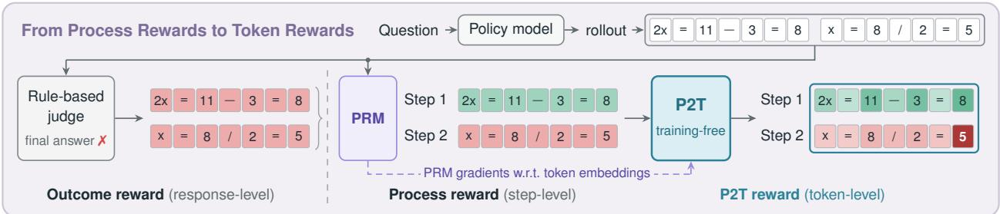
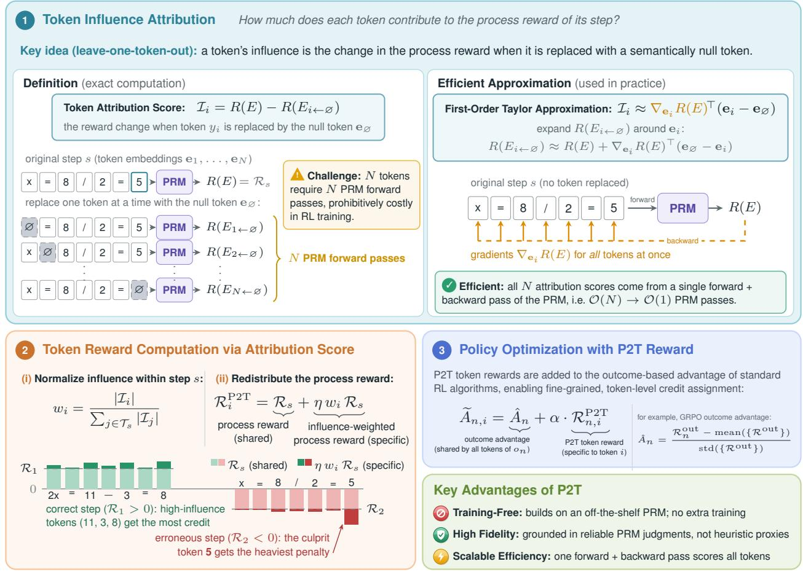
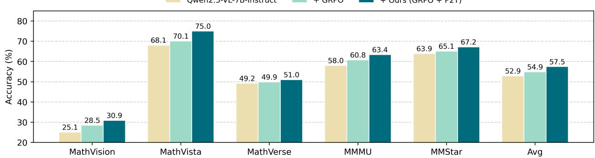
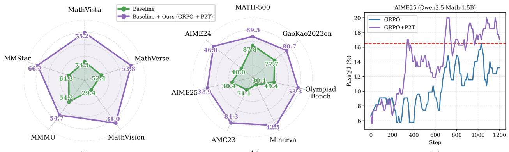
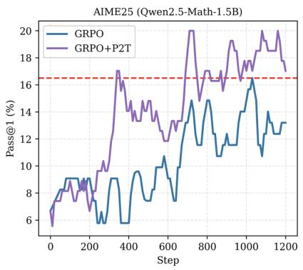

# Unlocking Token Rewards via Training-Free Reward Attribution

Sitong Wu1, Haoru Tan3,†, Bin Xia1, Xichen Zhang2, Jingyao Li1, Shaofeng Zhang, Xiaojuan Qi3, Bei Yu1, Jiaya Jia1,2,†

1Chinese University of Hong Kong, 2Hong Kong University of Science and Technology 3University of Hong Kong

In this paper, we propose an extremely eficient, training-free method to extract token-level reward signals directly from an existing deep reward model. Our core idea is to attribute the overall process reward to individual tokens by estimating each token’s influence. This influence is defined as the change in the final macroscopic reward (e.g., the process reward) when a token is replaced with a semantically null token. Naively calculating this influence is computationally infeasible, requiring N forward passes through the PRM for an N-token sequence. We overcome this bottleneck by proposing a highly eficient gradient-based estimator. Specifically, we use a first-order Taylor approximation, which simplifies the influence calculation to the inner product of the diference between the token embedding and the null token embedding, and the gradient of the reward with respect to the token embedding. This requires only a single forward and backward pass. The resulting token-level rewards enable standard RL algorithms to perform precise credit assignment without requiring additional reward model training. Experiments on challenging reasoning benchmarks demonstrate that our method substantially improves policy optimization eficiency and enhances the generalization of LLM reasoning capabilities. Our P2T outperforms the outcome reward by +4.9% on MathVista for Qwen2.5-VL-7B-Instruct, and +11.5% on AIME24 for Qwen2.5-Math-7B.

Conference: CVPR 2026 Last updated: October 14, 2026 Code: https://github.com/stonewst/P2T

## 1 Introduction

Reinforcement Fine-Tuning (RFT) has become a cornerstone paradigm for advancing the reasoning capabilities of Large Models [1–5]. The two most prevalent forms of supervision signals are the Outcome Reward (based on the final answer’s correctness) and the Process Reward. The latter typically requires training a dedicated Process Reward Model (PRM) to evaluate the quality of individual steps within a reasoning trajectory. However, both outcome and process rewards ultimately share the limitation of coarse-grained supervision. Even PRM step-level scores remain ambiguous across the hundreds or thousands of tokens in a single step.

In parallel, recent work attempts to decompose coarse rewards into fine-grained, token-level supervision. Existing methods fall into two categories: The first involves training a dedicated token-level reward model, often relying on weakly- or unsupervised methods [6, 7] to generate synthetic labels. However, this approach incurs substantial training costs while yielding reward models of uncertain reliability due to the high noise and low fidelity of the pseudo-labels. The second avenue employs cheap, heuristic proxy metrics, such as token entropy [8], as substitutes for true rewards. While computationally inexpensive, these proxies fundamentally lack semantic alignment with the actual token quality; they serve as mere heuristics only loosely correlated with a token’s contribution to the final reward, rather than principled reward estimators. Consequently, current token-level supervision is caught in a dilemma: either incur heavy costs for uncertain models or compromise optimization fidelity with inaccurate proxy signals. Crucially, training a truly fine-grained, token-level reward model is infeasible due to the prohibitive expense of acquiring large-scale human annotations. A critical open question emerges: How can we devise a method for token-level reward estimation that is simultaneously cost-efective, principled, and robust?

In this paper, we propose a principled, eficient, and robust solution, termed Process-to-Token (P2T) reward attribution. P2T directly decomposes the reward from any diferentiable coarse-grained reward model (like a PRM) into accurate token-level rewards. Our core idea is to attribute the influence of each token on the coarse-grained reward. Specifically, a token’s influence is defined as the change in the overall process reward if that token were replaced with a non-informative “null” token. However, a naive implementation of this approach would require N separate PRM inferences (one per token) for an N-token sequence, rendering it computationally expensive. To achieve eficient computation, we propose an approximation solver. This estimator allows us to obtain the token-level influence score for all tokens in the entire process simultaneously with only a single forward and backward pass. Conclusively, the contribution of any token to the whole process is approximated using a first-order Taylor expansion: the inner product between (a) the gradient of the process reward with respect to the token’s embedding, and (b) the diference between the token’s original embedding and the null token embedding. Subsequently, we normalize the calculated token influences and use them as weights to redistribute the coarse-grained process reward, yielding the final token-level reward for each token.

Our method ofers three key advantages: (1) Training-free. It builds on the powerful PRM while eliminating the significant cost of training dedicated token reward models. (2) High fidelity. The resulting token rewards are attributed based on reliable PRM outputs, significantly outperforming proxy metrics in both interpretability and accuracy. (3) Scalable efficiency. The gradient-based approximation enables the eficiency of our attribution computation. Extensive experiments demonstrate that our P2T significantly improves policy optimization stability and final reasoning accuracy across various benchmarks, outperforming both proxy-based and trainable token reward baselines. For example, P2T outperforms the outcome reward by +4.9% on MathVista for Qwen2.5-VL-7B-Instruct. For text-only LLMs, P2T still exhibits strong advantages of +11.5% on AIME24 over the outcome reward for Qwen2.5-Math-7B and +14.2% on MinervaMath for DeepSeek-R1-Distill-Qwen-1.5B. In addition, P2T improves training eficiency, reaching the best test accuracy of the outcome-reward counterpart with 3–4× fewer training steps. Our contributions are threefold:

• We propose a novel and principled algorithm to convert process-level rewards into token-level rewards in a completely training-free manner, efectively bridging the gap between coarse and fine-grained supervision for reinforcement learning.

• We propose a highly eficient approximation for token contribution attribution, reducing the complexity from O(N) to $\mathcal { O } ( 1 )$ ), ensuring its practical application to large-scale RL training.

• We empirically demonstrate that using the derived token-level rewards for RL training leads to significant improvements in the reasoning performance of LLMs compared to both sparse rewarding methods and other fine-grained rewarding methods.

## 2 Method

In this section, we describe our approach to converting the more macroscopic rewards provided by a reward model into token-level rewards in an eficient, training-free manner. The key idea is token attribution, that is, the marginal efect of each token on the overall reward. Then we will show how to estimate this using first-order gradient information, thereby enabling reinforcement fine-tuning with token-level credit assignment.

## 2.1 Definition of Token Attribution Score

The output of the policy model is treated as a sequence of tokens $Y = \left( y _ { 1 } , y _ { 2 } , \dots y _ { N } \right)$ , where each token $y _ { i }$ is associated with an embedding vector $\mathbf { e } _ { i } \in \mathbb { R } ^ { d }$ in the reward model. These vectors form the full sequence embedding $E = [ { \bf e } _ { 1 } , { \bf e } _ { 2 } , \ldots , { \bf e } _ { N } ]$ . A diferentiable reward model $R ( \cdot )$ then computes a scalar reward $R ( E ) \in \mathbb { R }$ for the entire sequence. We define the Token Attribution Score $\mathcal { T } _ { i }$ for a token $y _ { i }$ as the precise diference in the total reward when its embedding $\mathbf { e } _ { i }$ is replaced by a dedicated null token embedding $\mathbf { e } _ { \mathcal { D } }$ , without changing

  
Figure 1 Overview of Process-to-Token (P2T) reward attribution. P2T converts the process-level rewards provided by a Process Reward Model (PRM) into fine-grained token-level rewards. Specifically, P2T first evaluates the specific influence (attribution score) of each token on the overall process reward, and then normalizes these scores to serve as weights for redistributing the original process reward among the tokens. Consequently, highly influential tokens in a correct step receive the most credit, while the “culprit” tokens responsible for an erroneous step incur the heaviest penalty. Finally, these fine-grained token-level rewards are directly incorporated into standard RL algorithms to enable precise credit assignment.

## the sequence length:

$$
\begin{array} { r } { \mathcal { T } _ { i } = R ( E ) - R ( E _ { i  \emptyset } ) , } \end{array}\tag{1}
$$

where $E _ { i  \emptyset }$ denotes the modified sequence embedding where the i-th token’s embedding $\mathbf { e } _ { i }$ is substituted by $\mathbf { e } _ { \mathcal { O } } , R ( E )$ is the original reward, and $R ( E _ { i  \emptyset } )$ is the new reward after null-token replacement. This score provides a direct, localized measure of the marginal importance of token $y _ { i }$ to the final sequence reward. A positive score $( \mathcal { T } _ { i } > 0 )$ indicates that $y _ { i }$ was a positive contributor to the sequence’s high reward, as replacing it caused the reward to drop. Conversely, a negative score $( \mathcal { T } _ { i } < 0 )$ suggests $y _ { i }$ was a detrimental contributor that lowered the overall reward, and a score near zero signifies that $y _ { i }$ has a negligible marginal efect.

Choice of NULL Tokens. We select the padding token from the reward model’s existing vocabulary to serve as the null token $\mathbf { e } _ { \mathcal { D } }$ for calculating the Token Attribution Score $\mathcal { T } _ { i }$ . Although the padding token is not necessarily an untrained token $( e . g . , < |$ endoftext|> in Qwen-based models also marks document boundaries during pre-training), it virtually never appears within a reasoning response and therefore carries little content-level meaning in this context. Substituting the i-th token’s embedding $\mathbf { e } _ { i }$ with $\mathbf { e } _ { \mathcal { D } }$ thus approximates removing the content of token $y _ { i }$ , while keeping the input a real token embedding that the reward model is familiar with, rather than an artificial vector. The resulting attribution score ${ \mathcal { T } } _ { i } = R ( E ) - R ( E _ { i  \emptyset } )$ then quantifies the reward change incurred when the contribution of token $y _ { i }$ is removed. We compare alternative choices of the null token in Sec. 3.3.

## 2.2 Efficient Approximation

While conceptually simple and direct, this substitution method is computationally intensive, requiring N forward passes through the reward model to compute all token scores for a sequence of length $N$ , which motivates the search for eficient gradient-based approximations.

We approximate it via a first-order Taylor expansion around ${ \bf { e } } _ { i } \mathrm { { : } }$

$$
\begin{array} { r } { \mathcal { T } _ { i } \approx \nabla _ { \mathbf { e } _ { i } } R ( E ) ^ { \top } \left( \mathbf { e } _ { i } - \mathbf { e } _ { \mathcal { O } } \right) . } \end{array}\tag{2}
$$

Here, $\nabla _ { \mathbf { e } _ { i } } R ( E )$ is the gradient of the reward with respect to the embedding of token $y _ { i }$ . This approximation can be computed eficiently in a single backward pass, since gradients with respect to all token embeddings are obtained simultaneously. A positive value indicates that token $y _ { i }$ contributes positively to the reward, while a negative value suggests the opposite.

## 2.3 Process-to-Token Reward Attibution

Next, we will introduce some application details: how to calculate our P2T token reward in Sec. 2.3.1, and how to integrate it with popular RL algorithms in Sec. 2.3.2.

## 2.3.1 P2T Token Reward Calculation

The attribution score $\textstyle { \mathcal { T } } _ { i } ,$ , derived from the gradient-based approximation in Eq. (2), provides a fine-grained token influence score. In practice, a PRM evaluates a reasoning trajectory step by step. Let $\mathcal { T } _ { s }$ denote the set of tokens in the s-th reasoning step, and $E _ { \leq s }$ the embeddings of all tokens up to the end of this step. For brevity, we omit the index of the response in this subsection. Since the PRM is causal, the process reward of the s-th step is given by $\mathcal { R } _ { s } = R ( E _ { \leq s } )$ , and the attribution score $\mathcal { T } _ { i }$ of each token $y _ { i } \in \mathcal { T } _ { s }$ is computed by Eq. (2) with $R ( E )$ instantiated as $R ( E _ { \leq s } )$

Rather than using these scores directly as rewards, we normalize the calculated token influences within each step and use them as weights to redistribute the coarse-grained process reward $\mathcal { R } _ { s }$ , yielding the final token-level reward $\mathcal { R } _ { i } ^ { \mathrm { P 2 T } }$ for each token $y _ { i } \in \mathcal { T } _ { s }$

$$
\mathcal { R } _ { i } ^ { \mathrm { P 2 T } } = \mathcal { R } _ { s } + \eta \cdot w _ { i } \cdot \mathcal { R } _ { s } , \qquad w _ { i } = \frac { | \mathcal { Z } _ { i } | } { \sum _ { j \in \mathcal { T } _ { s } } | \mathcal { Z } _ { j } | } ,\tag{3}
$$

where $\eta$ controls the strength of the token-level redistribution. The magnitude $| { \mathcal { T } } _ { i } |$ measures how strongly token $y _ { i }$ afects the process reward, and the normalized weight $w _ { i }$ is its share of the total influence within the step. Hence, the most influential tokens of a correct step $\left( \mathcal { R } _ { s } > 0 \right)$ receive the largest rewards, while the most influential tokens of an erroneous step $( \mathcal { R } _ { s } < 0 )$ receive the heaviest penalties. This ensures that the reward $\mathcal { R } _ { s }$ is distributed according to the measured marginal contribution of each token, allowing the policy to accurately learn which specific actions (token generation) led to the high or low coarse-grained reward.

It is worth noting that we do not entirely discard the coarse-grained process reward $\mathcal { R } _ { s }$ in this framework. In the calculation of our final token-level reward $\mathcal { R } _ { i } ^ { \mathrm { P 2 T } }$ , we introduce $\mathcal { R } _ { s }$ as a baseline (the first term in the equation), and the estimated token-level influence scores, after normalization, are reweighted by a factor $\eta$ and added to this baseline to yield the final token reward. The coarse-grained process reward $\mathcal { R } _ { s }$ serves as a baseline, providing a stable reward signal to every token in the step. This is crucial because the attribution scores $\mathcal { T } _ { i } .$

often derived from approximate gradient calculations, can be inherently noisy or imprecise. Introducing $\mathcal { R } _ { s }$ as the baseline limits the disturbance that attribution errors can introduce to the final reward, preventing the policy from fluctuating too wildly or being dominated by a few noisy token rewards during the learning phase.

Magnitude vs. signed influence. Since the sign of $\mathcal { T } _ { i }$ indicates whether token $y _ { i }$ raises or lowers the process reward, a natural alternative is a signed redistribution that rewards the tokens pushing the step reward up and penalizes those pulling it down:

$$
\mathscr { R } _ { i } ^ { \mathrm { P 2 T - s i g n e d } } = \mathscr { R } _ { s } + \eta \cdot \mathrm { s i g n } ( \mathscr { T } _ { i } ) \cdot w _ { i } \cdot | \mathscr { R } _ { s } | .\tag{4}
$$

where sign(·) denotes the sign function, which returns 1, −1, and 0 for positive, negative, and zero inputs, respectively. However, we empirically find that this signed variant underperforms the magnitude-based reward in Eq. (3) (see Table 3(c)). One possible reason is that the positive and negative terms in Eq. (4) are generally imbalanced within a step. We therefore adopt Eq. (3) by default, and leave a more efective use of the sign information to future work.

## 2.3.2 GRPO with P2T Token Reward

The core step in applying token-level rewards to standard reinforcement learning algorithms is correctly calculating the advantage function at the token level. Taking GRPO [1] as an example, it is designed to be value-function-free and estimates the advantage by comparing the reward of a generated response to the average reward of other responses in the same group.

$$
\hat { A } _ { n } = \frac { \mathcal { R } _ { n } ^ { \mathrm { o u t } } - \mathrm { m e a n } ( \{ \mathcal { R } ^ { \mathrm { o u t } } \} ) } { \mathrm { s t d } ( \{ \mathcal { R } ^ { \mathrm { o u t } } \} ) } ,\tag{5}
$$

where $\mathcal { R } _ { n } ^ { \mathrm { o u t } }$ is the outcome reward of n-th response. For example, for math problems, it can be the correctness indicator of the final answer (1 for correct and −1 for wrong). When incorporating our P2T token-level rewards, the advantage will be

$$
\widetilde { A } _ { n , i } = \hat { A } _ { n } + \alpha \cdot \mathcal { R } _ { n , i } ^ { \mathrm { P 2 T } } ,\tag{6}
$$

where i is the token index, and $\mathcal { R } _ { n , i } ^ { \mathrm { P 2 T } }$ denotes the P2T reward for i-th token in n-th response. α is a weight to balance the contribution of the original outcome-derived advantage and our token-level guidance. By default, we set α = 1.0. When the PRM is less reliable, a smaller α, or a schedule that gradually increases α during training, can help stabilize optimization.

## 3 Experiments

## 3.1 Settings

Baseline Models. We conduct RL training on various multimodal and text-only models, encompassing a diverse range of models from the Qwen and LLaMA series with varying sizes (from 1.5B to 7B). For multimodal models, we utilize Qwen2.5-VL-7B-Instruct [9] for its popularity and strong performance. For text-only models, we consider both base models after pre-training (Qwen2.5-Math [10]), and instruction-tuned models from post-training with diferent reasoning paradigms: CoT model (LLaMA3.2-Instruct [11]), LongCoT models (DeepSeek-R1-Distill-Qwen [2], DeepScaleR-1.5B-Preview [12]), and hybrid-mode models (Qwen3 [13]). We additionally use Eurus-2-7B-SFT [6] for comparison with existing token-level rewards, Vision-R1-7B [14] and DeepScaleR-1.5B-Preview [12] for continued training, and Qwen2.5-Math-1.5B [10] for analyzing training dynamics, where Qwen2.5-Math-1.5B is trained under exactly the same setting as Qwen2.5-Math-7B.

Training Dataset. For multimodal LLMs, we employ a mixture of two data sources: VerMulti-65K [15] and Vision-R1-10K [14], ensuring a coverage of both general and math multimodal tasks. For text-only LLMs, the training data is specialized by diferent models and tasks. By default, we use the MATH [16] dataset for mathematical training. For recent models, like DeepScaleR-1.5B-Preview [12] and Qwen3 [13], we utilize the more challenging DeepScaleR-40K [12] as training data accordingly. For the Eurus-2-7B-SFT [6] model, we adopt the Eurus-2-RL-Data [6] as its training corpus, following prior works [6, 17] for a fair comparison.

Evaluation. All the multimodal LLMs are evaluated on three multimodal math benchmarks (MathVista [18], MathVerse [19], and MathVision [20]) and two general multimodal benchmarks (MMMU [21] and MMStar [22]). For text-only LLMs trained on math data, the evaluation is conducted on seven commonly-used challenging math benchmarks, including AIME24 [23], AIME25 [23], AMC23 [24], MATH-500 [16], MinervaMath [25], OlympiadBench [26], and GaoKao2023en [27]. Following [6, 17], for the experiments on Eurus-2-7B-SFT [6] model trained on a combination of math and code data, we perform evaluation on six benchmarks, including AMC23, MATH, OlympiadBench, K12, CodeForces [28], and CodeContests [29]. For each test problem, we sample 8 responses with a temperature of 0.6 and a top-p of 0.95, and report the average Pass@1.

Training Settings. The multimodal models are trained for 1 epoch with a global batch size of 128. The text-only models are trained for 500 ∼ 1000 steps with a global batch size of 256. We use a constant learning rate of $1 \times 1 0 ^ { - 6 }$ and weight decay of 0.01. For each training data, we generate 8 responses with temperature of 1.0 and topp of 1.0. The KL coeficient is set to 0.001.

Implementation Details in P2T. Our Process-to-Token (P2T) method relies on a Process Reward Model (PRM) to provide the process-level reward for each reasoning step. The choice of the PRM is critical and tailored to the domain. In our experiments, we use VisualPRM [30] to provide the process reward for multimodal models, due to the strength of VisualPRM in handling a diverse range of multimodal tasks, including both general multimodal understanding and domain-specific tasks such as multimodal mathematics reasoning. For text-only models, we obtain the process reward from ReasonFlux-PRM [31] as it ofers the crucial advantage of supporting and evaluating LongCoT reasoning trajectories, which is not well-supported in earlier PRMs. For the hyperparameter η in Eq. (3), we set η = 0.5 by default. For α in Eq. (6), we set α = 1.0 for all models.

Table 1 Comparison of LLMs trained with GRPO and GRPO+P2T on math reasoning data. Gains of GRPO+P2T over GRPO are highlighted in red. For Qwen3 model, the results are reported in the format: performance in “thinking mode” / “non-thinking mode”.
<table><tr><td>Model</td><td>AIME24</td><td>AIME25</td><td>AMC23</td><td>MATH-500</td><td>MinervaMath</td><td>OlympiadBench</td><td>GaoKao2023en</td><td>Avg</td></tr><tr><td>Qwen2.5-Math-7B</td><td>13.2</td><td>9.8</td><td>40.0</td><td>53.6</td><td>17.2</td><td>17.4</td><td>39.7</td><td>27.3</td></tr><tr><td>+ GRPO</td><td>28.8</td><td>14.1</td><td>67.3</td><td>81.8</td><td>36.1</td><td>41.9</td><td>65.9</td><td>48.0</td></tr><tr><td>+ GRPO + P2T</td><td>40.3 (+11.5)</td><td>20.0 (+5.9)</td><td>72.8 (+5.5)</td><td>84.5 (+2.7)</td><td>41.9 (+5.8)</td><td>45.6 (+3.7)</td><td>71.8 (+5.9)</td><td>53.8 (+5.8)</td></tr><tr><td>LLaMA3.2-3B-Instruct</td><td>3.3</td><td>0.2</td><td>22.5</td><td>48.0</td><td>16.5</td><td>14.5</td><td>33.7</td><td>19.8</td></tr><tr><td>+ GRPO</td><td>13.3</td><td>1.5</td><td>27.5</td><td>56.8</td><td>20.2</td><td>21.4</td><td>43.8</td><td>26.4</td></tr><tr><td>+ GRPO + P2T</td><td>21.7 (+8.4)</td><td>10.8 (+9.3)</td><td>46.5 (+19.0)</td><td>62.6 (+5.8)</td><td>27.9 (+7.7)</td><td>26.3 (+4.9)</td><td>54.5 (+10.7)</td><td>35.8 (+9.4)</td></tr><tr><td>DeepSeek-R1-Distill-Qwen-1.5B</td><td>28.9</td><td>22.8</td><td>62.9</td><td>83.9</td><td>26.5</td><td>43.3</td><td>73.1</td><td>48.8</td></tr><tr><td>+ GRPO</td><td>30.0</td><td>23.6</td><td>67.5</td><td>84.3</td><td>27.2</td><td>45.4</td><td>74.8</td><td>50.4</td></tr><tr><td>+ GRPO + P2T</td><td>37.8 (+7.8)</td><td>28.6 (+5.0)</td><td>76.5 (+9.0)</td><td>88.2 (+3.9)</td><td>41.4 (+14.2)</td><td>49.7 (+4.3)</td><td>78.4 (+3.6)</td><td>57.2 (+6.8)</td></tr><tr><td>Qwen3-1.7B</td><td>46.7 /13.4</td><td>35.4 /8.8</td><td>85.3 50.5</td><td>91.9 /73.0</td><td>49.2 32.6</td><td>56.4 / 39.2</td><td>78.3 /62.4</td><td>63.3 40.0</td></tr><tr><td>+ GRPO</td><td>53.7 23.5</td><td>42.5 19.5</td><td>88.7 63.1</td><td>92.8 83.5</td><td>50.7 40.6</td><td>58.0 40.3</td><td>80.5 63.9</td><td>66.7 47.8</td></tr><tr><td>+ GRPO + P2T</td><td>59.0 / / 31.9</td><td>47.0 30.1</td><td>90.9 70.4</td><td>93.4 86.9</td><td>52.0 44.2</td><td>59.3 41.8</td><td>82.9 65.6</td><td>69.2 53.0</td></tr><tr><td></td><td>(+5.3) (+8.4)</td><td>(+4.5) (+10.6)</td><td>(+2.2) (+7.3)</td><td>(+0.6) (+3.4)</td><td>(+1.3) (+3.6)</td><td>(+1.3) (+1.5)</td><td>(+2.4) (+1.7)</td><td>(+2.5) (+5.2)</td></tr></table>

  
Figure 2 Comparison of Qwen2.5-VL-7B-Instruct trained with GRPO and GRPO+P2T.

## 3.2 Main Results

## 3.2.1 Comparison with Outcome Reward RL

We first compare P2T with the standard outcome reward on both multimodal and text-only LLMs. For multimodal LLMs, we train Qwen2.5-VL-7B-Instruct and report the results in Figure 2. For text-only LLMs, we cover four reasoning paradigms: a base model (Qwen2.5-Math-7B), a CoT instruct model (LLaMA3.2- 3B-Instruct), a LongCoT model (DeepSeek-R1-Distill-Qwen-1.5B), and a hybrid-mode model (Qwen3-1.7B, evaluated in both thinking and non-thinking modes), with results in Table 1. For a fair comparison, for each model, GRPO [1] and GRPO+P2T are trained under identical settings, and the only diference lies in the reward: GRPO uses the outcome reward alone, while GRPO+P2T additionally incorporates our P2T token reward.

Consistent improvements across models, paradigms, and modalities. GRPO+P2T outperforms GRPO on every benchmark for every model: across the 40 model–benchmark pairs (5 for the multimodal model and 35 for the text-only settings), there is not a single exception. The average gains range from +2.5% to +9.4%, and the improvements hold for both the Qwen and LLaMA families, for model sizes from 1.5B to 7B, for base, CoT, LongCoT, and hybrid-mode models, and for both text-only and multimodal inputs. This suggests that the token-level credit derived from a PRM is broadly applicable, rather than tied to a particular model family, reasoning format, or modality.

Larger gains where outcome-based RL stalls. P2T is most helpful precisely where the outcome reward provides little learning signal. On DeepSeek-R1-Distill-Qwen-1.5B, GRPO improves the average accuracy by only +1.6% over the initial model, whereas GRPO+P2T improves it by +8.4%. Similarly, on MathVista, GRPO brings only +2.0% to Qwen2.5-VL-7B-Instruct, while GRPO+P2T brings +6.9%. An outcome reward assigns the same credit to every token of a trajectory, so correct and erroneous steps are reinforced or penalized together; once the easy gains are exhausted, this coarse signal makes little further progress. P2T breaks this tie by distinguishing the tokens that actually drive the reward from the rest.

Larger gains on harder benchmarks. The improvements from P2T are concentrated on competition-level problems. Averaged over AIME24, AIME25, and AMC23, GRPO+P2T improves over GRPO by +4.0% to +12.2% across the five text-only settings, roughly two to seven times its gain on MATH-500 (+0.6% to +5.8%). Harder problems require longer chains of multi-step reasoning, in which a single faulty step can invalidate the final answer, making precise credit assignment all the more valuable. Part of this gap may reflect that MATH-500 is close to saturation for most models. However, the gap persists for LLaMA3.2-3B-Instruct, whose MATH-500 accuracy (56.8% after GRPO) is far from saturated, suggesting that problem dificulty, rather than the remaining headroom alone, drives the larger gains.

Breaking the convergence bottleneck of outcome-based RL. P2T can further serve as a second-stage optimization that unlocks performance beyond what outcome-based RL converges to. We take Vision-R1-7B [14] and DeepScaleR-1.5B-Preview [12], two models that have already been fully trained with outcome-based RL, and continue to train them with GRPO+P2T on their original training data (i.e., Vision-R1-10K and DeepScaleR-40K, respectively). As shown in Figure 3 (a) and (b), both models improve on every benchmark, e.g., +6.8% on AIME24 and +12.1% on MinervaMath for DeepScaleR-1.5B-Preview. Since no new data is introduced, these gains can be largely attributed to the finer-grained credit assignment provided by P2T.

Higher training efficiency. Beyond the final accuracy, P2T also makes training more eficient. Figure 3 (c) tracks the AIME25 accuracy of Qwen2.5-Math-1.5B throughout training. GRPO+P2T surpasses the best accuracy of GRPO (dashed line) much earlier than GRPO itself reaches this level, i.e., P2T reaches the same test performance with 3–4× fewer training steps. Moreover, GRPO+P2T stays well above GRPO for the rest of training and ends with a clear margin.

## 3.2.2 Comparison with Existing Token-level Reward

We further compare P2T with two representative token-level reward methods: PRIME [6], which trains an implicit process reward model online alongside the policy and derives token-level rewards from it, and SPRO [17], which derives token-level rewards from the policy model itself via its log-probability ratio to the reference model. Following [6], all methods start from the same Eurus-2-7B-SFT model and are trained on Eurus-2-RL-Data. As shown in Table 2, P2T achieves the best result on all six benchmarks, improving the average accuracy over GRPO by +7.2%, over PRIME by +4.7%, and over SPRO by +2.3%.

(a)  
  
(b)

  
(c)  
Figure 3 P2T raises the performance ceiling and improves the training eficiency of outcome-based GRPO. (a, b) Results of further training two models that have already been trained to convergence with outcome-based RL, (a) Vision-R1-7B [14] and (b) DeepScaleR-1.5B-Preview [12], using GRPO+P2T on their original training data (i.e., Vision-R1-10K and DeepScaleR-40K, respectively). (c) AIME25 Pass@1 of Qwen2.5-Math-1.5B during training with GRPO and GRPO+P2T. The dashed line marks the best accuracy reached by GRPO.

Table 2 Comparison of diferent dense rewards for RL. All the experiments use the Eurus-2-7B-SFT [6] as the baseline model, which is finetuned from Qwen2.5-Math-7B-Base on math and code datasets. The training dataset for RL is Eurus-2-RL-Data [6].
<table><tr><td>Model</td><td>AMC23</td><td>MATH</td><td>OlympiadBench</td><td>K12</td><td>CodeForces</td><td>CodeContests</td><td>Avg</td></tr><tr><td>Eurus-2-7B-SFT</td><td>21.1</td><td>48.1</td><td>13.9</td><td>40.0</td><td>5.2</td><td>11.3</td><td>23.3</td></tr><tr><td>+ GRPO</td><td>23.6</td><td>51.8</td><td>20.5</td><td>48.6</td><td>28.6</td><td>28.1</td><td>33.5</td></tr><tr><td>+ PRIME</td><td>31.2</td><td>52.7</td><td>25.4</td><td>54.6</td><td>26.4</td><td>25.9</td><td>36.0</td></tr><tr><td>+ SPRO</td><td>31.9</td><td>53.6</td><td>28.2</td><td>55.0</td><td>29.4</td><td>32.1</td><td>38.4</td></tr><tr><td>+ GRPO + P2T</td><td>33.8 (+1.9)</td><td>55.4 (+1.8)</td><td>30.6 (+2.4)</td><td>56.1 (+1.1)</td><td>32.3 (+2.9)</td><td>35.8 (+3.7)</td><td>40.7 (+2.3)</td></tr></table>

These gains stem from how the token-level credit is obtained and what it measures. PRIME has to update its reward model during RL using only outcome labels, so the quality of its token-level credit depends on how well this model is learned on the fly. P2T instead extracts token-level credit from an of-the-shelf PRM without any additional training, and introduces no extra model to optimize during RL. SPRO avoids such a learned reward model, but its reward reflects how the policy deviates from the reference model, which is not a direct assessment of whether a reasoning step is correct. In contrast, P2T is derived from a PRM explicitly trained to judge the correctness of reasoning steps, so its token-level credit is grounded in step-level correctness.

## 3.3 Ablation Study

Table 3 examines the key design choices of P2T. Unless otherwise noted, all experiments follow the Qwen2.5- Math-7B setting of Table 1 and report the average Pass@1 over the seven math benchmarks; the default configuration (53.8) thus matches the GRPO+P2T result in Table 1. The exception is Table 3 (e), which follows the Qwen2.5-VL-7B-Instruct setting and reports the average over the five multimodal benchmarks of Figure 2. Each ablation varies a single factor while keeping all others at their defaults (shaded in gray).

Token-level redistribution is the main source of the gains. Table 3 (a) decomposes the gain of P2T. Adding the step-level process reward to the outcome reward, i.e., assigning each token the reward of its step (equivalent to η = 0 in Eq. (3)), raises the accuracy from 48.0 to 50.6. Redistributing this reward among the tokens of each step with P2T further increases it to 53.8. Thus, of the overall gain of +5.8%, +3.2% stems from within-step credit assignment rather than from the step-level scores themselves. The benefit of P2T therefore cannot be explained merely by the use of an additional reward model: the same PRM signal becomes substantially more useful once it is attributed to the tokens responsible for it.

Table 3 Ablation Study for key designs in our P2T reward calculation. The experimental setup is identical to the Qwen2.5-Math-7B, except for (e), which follows the Qwen2.5-VL-7B-Instruct setup.  
(a)
<table><tr><td rowspan=1 colspan=1>Reward</td><td rowspan=1 colspan=1>Outcome</td><td rowspan=1 colspan=1>+ ProcessReward</td><td rowspan=1 colspan=1>+ P2T TokenReward</td></tr><tr><td rowspan=1 colspan=1>Pass@1</td><td rowspan=1 colspan=1>48.0</td><td rowspan=1 colspan=1>50.6</td><td rowspan=1 colspan=1>53.8</td></tr></table>

(b)
<table><tr><td rowspan=1 colspan=1>η inEq. (3)</td><td rowspan=1 colspan=1>0.25</td><td rowspan=1 colspan=1>0.5</td><td rowspan=1 colspan=1>0.75</td><td rowspan=1 colspan=1>1.0</td></tr><tr><td rowspan=1 colspan=1>Pass@1</td><td rowspan=1 colspan=1>53.5</td><td rowspan=1 colspan=1>53.8</td><td rowspan=1 colspan=1>53.4</td><td rowspan=1 colspan=1>53.2</td></tr></table>

(c)
<table><tr><td rowspan=1 colspan=1>RewardForm</td><td rowspan=1 colspan=1>Signedin Eq. (4)</td><td rowspan=1 colspan=1>Magnitudein Eq. (3)</td></tr><tr><td rowspan=1 colspan=1>Pass@1</td><td rowspan=1 colspan=1>52.6</td><td rowspan=1 colspan=1>53.8</td></tr></table>

(d)
<table><tr><td rowspan=1 colspan=1>PRM(text-only)</td><td rowspan=1 colspan=1>ReasonFluxPRM-7B</td><td rowspan=1 colspan=1>Qwen2.5-MathPRM-7B</td><td rowspan=1 colspan=1>SkyworkPRM-7B</td></tr><tr><td rowspan=1 colspan=1>Pass@1</td><td rowspan=1 colspan=1>53.8</td><td rowspan=1 colspan=1>52.4</td><td rowspan=1 colspan=1>50.0</td></tr></table>

(e)
<table><tr><td rowspan=2 colspan=1>PRM(multimodal)</td><td rowspan=1 colspan=1>Visual</td><td rowspan=1 colspan=1>MM</td></tr><tr><td rowspan=1 colspan=1>PRM</td><td rowspan=1 colspan=1>PRM</td></tr><tr><td rowspan=1 colspan=1>Pass@1</td><td rowspan=1 colspan=1>57.5</td><td rowspan=1 colspan=1>55.3</td></tr></table>

(f)
<table><tr><td rowspan=1 colspan=1>NullToken</td><td rowspan=1 colspan=1>PadToken</td><td rowspan=1 colspan=1>EOSToken</td><td rowspan=1 colspan=1>ZeroEmbedding</td><td rowspan=1 colspan=1>VocabMean</td></tr><tr><td rowspan=1 colspan=1>Pass@1</td><td rowspan=1 colspan=1>53.8</td><td rowspan=1 colspan=1>50.3</td><td rowspan=1 colspan=1>51.4</td><td rowspan=1 colspan=1>52.5</td></tr></table>

P2T is robust to the redistribution strength η. As shown in Table 3 (b), the accuracy varies by at most 0.6% as η ranges from 0.25 to 1.0, and all settings remain well above the process reward baseline $( \eta = 0 , 5 0 . 6 )$ . The exact strength of the redistribution therefore matters little once it is enabled, and η requires no careful tuning. The slight decline for $\eta > 0 . 5$ is consistent with the role of Rs as a stabilizing baseline (Sec. 2.3.1): a larger η places more weight on the attribution scores and hence amplifies their noise.

Magnitude-based redistribution outperforms the signed variant. As shown in Table 3 (c), replacing the magnitudebased reward in Eq. (3) with its signed variant in Eq. (4) lowers the accuracy from 53.8 to 52.6, although the signed variant still outperforms the process reward baseline (50.6). As noted in Sec. 2.3.1, a possible reason is that the positive and negative terms in Eq. (4) are generally imbalanced within a step. Making better use of the sign information is left for future work.

Better PRMs yield better token rewards. Table 3 (d) and (e) compare diferent PRMs. Among text-only PRMs, ReasonFlux-PRM-7B [31] performs best (53.8), followed by Qwen2.5-Math-PRM-7B [32] (52.4) and Skywork o1-Open-PRM-Qwen-2.5-7B [33] (50.0). The same trend holds for multimodal PRMs, where VisualPRM [30] (57.5) outperforms MM-PRM [34] (55.3). With every PRM we tested, P2T improves over the outcome reward baseline (48.0 for the text-only model and 54.9 for the multimodal model), which shows that P2T works with a range of of-the-shelf PRMs and can directly benefit from stronger ones as they become available. At the same time, the gap between the best and worst text-only PRMs (3.8%) is comparable to the gain of P2T itself, indicating that PRM quality has a substantial impact on P2T. In practice, if training becomes unstable, we therefore recommend first verifying that the PRM is competent on the training data, e.g., that its step-level judgments are reliable for the target domain and response format.

The null token should be neutral within the response. Table 3 (f) compares diferent choices of the null token e . The PRM’s padding token <|endoftext|> performs best (53.8), followed by the mean embedding of the PRM’s vocabulary (52.5), the all-zero embedding (51.4), and the EOS token <|im\_end|> (50.3). We attribute these diferences to how neutral each baseline is with respect to the PRM’s judgment. Although <|endoftext|> is seen during pre-training, where it marks document boundaries, it almost never occurs within a reasoning response and thus carries little content-level meaning in this context. By contrast, <|im\_end|> marks the end of a response turn in the chat template and is closely tied to the completion of a response, which is precisely what the PRM is trained to judge. Substituting it for a token therefore injects an evaluation-related signal instead of removing information, resulting in the lowest accuracy. The all-zero embedding and the vocabulary mean carry no such signal, but both are artificial vectors that the PRM never encounters as inputs during training. Substituting them pushes the input of the training distribution, which may render the first-order estimate in Eq. (2) less reliable.

## 4 Related Work

Reinforcement fine-tuning (RFT) [1, 35] can substantially enhance the performance of large models [2–4, 9, 36], including their reasoning and generalization abilities [37]. The RFT paradigm generally relies on two key components. The first is the reinforcement learning algorithm, which uses these rewards to compute advantages and drive policy updates, progressively refining the model’s parameters to maximize expected performance under the given reward criteria. The second is the reward function or model, responsible for assessing the quality and alignment of the model’s outputs and providing the scalar feedback that guides learning. Next, we introduce the specific designs of the reward functions.

Outcome Reward. Initially, a series of works starting with DeepSeek-R1 [2] leveraged the simplest form of reward construction: a binary outcome reward that solely determines whether the model’s final output is correct. This outcome reward paradigm has proven highly efective on numerous reasoning tasks, such as code and mathematical reasoning [3, 4, 13, 38–40]. Recent work [41–44] involves using powerful Large Language Models (LLMs) as reward models. These LLMs are instructed to score the output of the model under training based on grammar, correctness relative to the truth, and preference. This score is then used as the reward. The advantage of this technique is its versatility, making it suitable for a wide range of unstructured tasks. Furthermore, several open-source reward models [10, 45], such as DeepSeek-GRM [45], are available and can be employed for reward modeling across a broad range of applications, including writing and mathematical proof. However, outcome rewards sufer from a severe limitation: reward sparsity. The vast majority of tokens and intermediate reasoning steps generated by the model do not receive customized reward signals. This often leads to training instability, where, for instance, incorrect early steps in an otherwise correct reasoning trajectory might still be inadvertently reinforced [46].

Process Reward. Due to the shortcomings of outcome rewards, research into process supervision [46–56], which provides a more fine-grained reward signal than the outcome alone, has gained significant attention. Training a Process Reward Model (PRM) requires extensive annotation of fine-grained data. OpenAI [57] utilized human labor to annotate a massive volume of step-level preference data specifically in the mathematics domain, which could then be used to train mathematics-focused PRMs. Math-Shepherd [50] proposed an automated pipeline for eficiently annotating step-wise reward data. Specifically, it generates multiple rollouts starting from an arbitrary existing step, calculates the accuracy of these rollouts, and uses this accuracy value as an efective proxy for the reward signal of that particular step. Some open-source works [1], such as qwen2.5-math-PRM [32], also provide options that can serve as PRMs for more general scenarios. Some recent works [30, 34, 58–60] have also explored constructing PRMs for multimodal settings. VisualPRM [30], for instance, compiles 400K reward samples for vision-language PRM training and shows promising results in both multimodal and text-only reward tasks. Similarly, URSA [59] collects over one million vision-language reward samples to train an 8B PRM, substantially boosting the capabilities of math-oriented VLLMs. Although process rewards are more fine-grained than outcome rewards, they remain relatively coarse, as each step still encompasses many tokens [61].

Token Reward. Constructing token-level rewards and appropriately assigning them to individual tokens can significantly improve both training efectiveness and eficiency [6, 7, 17, 62–65]. PRIME [6] proposes using the diference in log probabilities between the reward model and the reference model as the reward for each token. SPRO [17] assigns each token a reward based on the diference in log probabilities between the policy model and a reference model, without requiring any additional reward model. OREAL [7] trains a token-level reward model by reusing the policy network backbone to assign scalar scores to each token, ensuring that the average token score matches the trajectory’s final binary reward, and uses these scores to reweight the policy loss during training. CAPO [64] converts step-level rewards into token-level rewards by assigning each token the reward of its corresponding step, using a pre-existing LLM to identify incorrect reasoning steps and applying a penalty to tokens within those steps, without requiring a dedicated token-level reward model. TVM [65] trains a token-level reward model, built on the LLM architecture with an added scalar head, to predict each token’s probability of leading to a correct final answer, using sampled reasoning paths and minimizing the MSE between predicted scores and the true probabilities. T-SPMO [62] assigns each token a reward equal to its expected incremental contribution given the preceding prefix, computed as the diference between the average rewards of responses with the prefix and those with the prefix followed by the token, relying solely on binary outcome rewards without any additional model.

## 5 Conclusion

In this paper, we present P2T, a training-free method that converts the coarse-grained reward of an existing process reward model into token-level rewards. P2T measures the influence of each token as the change in the process reward when the token is replaced with a null token, and eficiently estimates this influence for all tokens with a first-order Taylor approximation, which requires only a single forward and backward pass. The resulting token-level rewards can be readily integrated into standard RL algorithms such as GRPO, without training any additional reward model. Extensive experiments show that P2T consistently outperforms the outcome reward across model families, reasoning paradigms, and modalities, with particularly large gains where outcome-based RL stalls and on harder benchmarks. P2T further improves models that have already converged under outcome-based RL, reaches the best accuracy of outcome-based RL with 3–4× fewer training steps, and outperforms existing token-level reward methods.

Limitations and future work. Since P2T derives its token-level rewards from a PRM, its efectiveness depends on the quality of the PRM, and a PRM that is unreliable on the target domain may limit its benefits. In future work, we will further explore how to exploit the sign of the token attribution scores, which indicates whether a token raises or lowers the process reward, to provide more informative token-level rewards.

## 6 Acknowledgements

This work was supported in part by the Research Grants Council under the Areas of Excellence scheme grant AoE/E-601/22-R. The work has been supported by Hong Kong Research Grant Council-General Research Fund Scheme (Grant No. 17202422, 17212923, 17215025), Theme-based Research (Grant No. T45-701/22-R), and Strategic Topics Grant (Grant No. STG3/E-605/25-N). Part of the described research work is conducted in the JC STEM Lab of Robotics for Soft Materials funded by The Hong Kong Jockey Club Charities Trust.

## References

[1] Zhihong Shao, Peiyi Wang, Qihao Zhu, Runxin Xu, Junxiao Song, Xiao Bi, Haowei Zhang, Mingchuan Zhang, YK Li, Y Wu, et al. Deepseekmath: Pushing the limits of mathematical reasoning in open language models. arXiv preprint arXiv:2402.03300, 2024.

[2] Daya Guo, Dejian Yang, Haowei Zhang, Junxiao Song, Ruoyu Zhang, Runxin Xu, Qihao Zhu, Shirong Ma, Peiyi Wang, Xiao Bi, et al. Deepseek-r1: Incentivizing reasoning capability in llms via reinforcement learning. arXiv preprint arXiv:2501.12948, 2025.

[3] Google DeepMind. Gemini 2.5 flash, 2025. URL https://deepmind.google/technologies/gemini/flash/.

[4] OpenAI. Learning to reason with llms, 2024. URL https://openai.com/index/ learning-to-reason-with-llms/.

[5] Jingcheng Hu, Yinmin Zhang, Qi Han, Daxin Jiang, Xiangyu Zhang, and Heung-Yeung Shum. Open-reasoner-zero: An open source approach to scaling up reinforcement learning on the base model. arXiv preprint arXiv:2503.24290, 2025.

[6] Ganqu Cui, Lifan Yuan, Zefan Wang, Hanbin Wang, Yuchen Zhang, Jiacheng Chen, Wendi Li, Bingxiang He, Yuchen Fan, Tianyu Yu, et al. Process reinforcement through implicit rewards. arXiv preprint arXiv:2502.01456, 2025.

[7] Chengqi Lyu, Songyang Gao, Yuzhe Gu, Wenwei Zhang, Jianfei Gao, Kuikun Liu, Ziyi Wang, Shuaibin Li, Qian Zhao, Haian Huang, et al. Exploring the limit of outcome reward for learning mathematical reasoning. arXiv preprint arXiv:2502.06781, 2025.

[8] Shivam Agarwal, Zimin Zhang, Lifan Yuan, Jiawei Han, and Hao Peng. The unreasonable efectiveness of entropy minimization in llm reasoning. arXiv preprint arXiv:2505.15134, 2025.

[9] Shuai Bai, Keqin Chen, Xuejing Liu, Jialin Wang, Wenbin Ge, Sibo Song, Kai Dang, Peng Wang, Shijie Wang, Jun Tang, et al. Qwen2.5-vl technical report. arXiv preprint arXiv:2502.13923, 2025.

[10] An Yang, Beichen Zhang, Binyuan Hui, Bofei Gao, Bowen Yu, Chengpeng Li, Dayiheng Liu, Jianhong Tu, Jingren Zhou, Junyang Lin, et al. Qwen2. 5-math technical report: Toward mathematical expert model via self-improvement. arXiv preprint arXiv:2409.12122, 2024.

[11] Abhimanyu Dubey, Abhinav Jauhri, Abhinav Pandey, Abhishek Kadian, Ahmad Al-Dahle, Aiesha Letman, Akhil Mathur, Alan Schelten, Amy Yang, Angela Fan, et al. The llama 3 herd of models. arXiv e-prints, pages arXiv–2407, 2024.

[12] Michael Luo, Sijun Tan, Justin Wong, Xiaoxiang Shi, William Y. Tang, Manan Roongta, Colin Cai, Jefrey Luo, Li Erran Li, Raluca Ada Popa, and Ion Stoica. Deepscaler: Surpassing o1-preview with a 1.5b model by scaling rl. https://pretty-radio-b75.notion.site/DeepScaleR-Surpassing-O1-Preview-with-a-1-5B-Model-by-Scaling-RL 19681902c1468005bed8ca303013a4e2, 2025. Notion Blog.

[13] An Yang, Anfeng Li, Baosong Yang, Beichen Zhang, Binyuan Hui, Bo Zheng, Bowen Yu, Chang Gao, Chengen Huang, Chenxu Lv, et al. Qwen3 technical report. arXiv preprint arXiv:2505.09388, 2025.

[14] Wenxuan Huang, Bohan Jia, Zijie Zhai, Shaosheng Cao, Zheyu Ye, Fei Zhao, Zhe Xu, Yao Hu, and Shaohui Lin. Vision-r1: Incentivizing reasoning capability in multimodal large language models. arXiv preprint arXiv:2503.06749, 2025.

[15] Yingzhe Peng, Gongrui Zhang, Miaosen Zhang, Zhiyuan You, Jie Liu, Qipeng Zhu, Kai Yang, Xingzhong Xu, Xin Geng, and Xu Yang. Lmm-r1: Empowering 3b lmms with strong reasoning abilities through two-stage rule-based rl. arXiv preprint arXiv:2503.07536, 2025.

[16] Dan Hendrycks, Collin Burns, Saurav Kadavath, Akul Arora, Steven Basart, Eric Tang, Dawn Song, and Jacob Steinhardt. Measuring mathematical problem solving with the math dataset. arXiv preprint arXiv:2103.03874, 2021.

[17] Wu Fei, Hao Kong, Shuxian Liang, Yang Lin, Yibo Yang, Jing Tang, Lei Chen, and Xiansheng Hua. Self-guided process reward optimization with redefined step-wise advantage for process reinforcement learning. arXiv e-prints, pages arXiv–2507, 2025.

[18] Pan Lu, Hritik Bansal, Tony Xia, Jiacheng Liu, Chunyuan Li, Hannaneh Hajishirzi, Hao Cheng, Kai-Wei Chang, Michel Galley, and Jianfeng Gao. Mathvista: Evaluating mathematical reasoning of foundation models in visual contexts. arXiv preprint arXiv:2310.02255, 2023.

[19] Renrui Zhang, Dongzhi Jiang, Yichi Zhang, Haokun Lin, Ziyu Guo, Pengshuo Qiu, Aojun Zhou, Pan Lu, Kai-Wei Chang, Yu Qiao, et al. Mathverse: Does your multi-modal llm truly see the diagrams in visual math problems? In European Conference on Computer Vision, pages 169–186. Springer, 2024.

[20] Ke Wang, Junting Pan, Weikang Shi, Zimu Lu, Houxing Ren, Aojun Zhou, Mingjie Zhan, and Hongsheng Li. Measuring multimodal mathematical reasoning with math-vision dataset. Advances in Neural Information Processing Systems, 37:95095–95169, 2024.

[21] Xiang Yue, Yuansheng Ni, Kai Zhang, Tianyu Zheng, Ruoqi Liu, Ge Zhang, Samuel Stevens, Dongfu Jiang, Weiming Ren, Yuxuan Sun, et al. Mmmu: A massive multi-discipline multimodal understanding and reasoning benchmark for expert agi. In Proceedings of the IEEE/CVF Conference on Computer Vision and Pattern Recognition, pages 9556–9567, 2024.

[22] Lin Chen, Jinsong Li, Xiaoyi Dong, Pan Zhang, Yuhang Zang, Zehui Chen, Haodong Duan, Jiaqi Wang, Yu Qiao, Dahua Lin, et al. Are we on the right way for evaluating large vision-language models? Advances in Neural Information Processing Systems, 37:27056–27087, 2024.

[23] AIME. American invitational mathematics examination, 2024. URL https://artofproblemsolving.com/wiki/ index.php/AIME\_Problems\_and\_Solutions.

[24] AMC. American mathematics competitions, 2023. URL https://artofproblemsolving.com/wiki/index.php/ 2023\_AMC\_12A.

[25] Aitor Lewkowycz, Anders Andreassen, David Dohan, Ethan Dyer, Henryk Michalewski, Vinay Ramasesh, Ambrose Slone, Cem Anil, Imanol Schlag, Theo Gutman-Solo, et al. Solving quantitative reasoning problems with language models. Advances in neural information processing systems, 35:3843–3857, 2022.

[26] Chaoqun He, Renjie Luo, Yuzhuo Bai, Shengding Hu, Zhen Leng Thai, Junhao Shen, Jinyi Hu, Xu Han, Yujie Huang, Yuxiang Zhang, et al. Olympiadbench: A challenging benchmark for promoting agi with olympiad-level bilingual multimodal scientific problems. arXiv preprint arXiv:2402.14008, 2024.

[27] Chinese GaoKao. Gaokao2023en, 2024. URL https://huggingface.co/datasets/MARIO-Math-Reasoning/ Gaokao2023-Math-En.

[28] Shanghaoran Quan, Jiaxi Yang, Bowen Yu, Bo Zheng, Dayiheng Liu, An Yang, Xuancheng Ren, Bofei Gao, Yibo Miao, Yunlong Feng, et al. Codeelo: Benchmarking competition-level code generation of llms with humancomparable elo ratings. arXiv preprint arXiv:2501.01257, 2025.

[29] Yujia Li, David Choi, Junyoung Chung, Nate Kushman, Julian Schrittwieser, Rémi Leblond, Tom Eccles, James Keeling, Felix Gimeno, Agustin Dal Lago, et al. Competition-level code generation with alphacode. Science, 378 (6624):1092–1097, 2022.

[30] Weiyun Wang, Zhangwei Gao, Lianjie Chen, Zhe Chen, Jinguo Zhu, Xiangyu Zhao, Yangzhou Liu, Yue Cao, Shenglong Ye, Xizhou Zhu, Lewei Lu, Haodong Duan, Yu Qiao, Jifeng Dai, and Wenhai Wang. VisualPRM: An efective process reward model for multimodal reasoning. arXiv preprint arXiv:2503.10291, 2025.

[31] Jiaru Zou, Ling Yang, Jingwen Gu, Jiahao Qiu, Ke Shen, Jingrui He, and Mengdi Wang. Reasonflux-prm: Trajectory-aware prms for long chain-of-thought reasoning in llms. arXiv preprint arXiv:2506.18896, 2025.

[32] Zhenru Zhang, Chujie Zheng, Yangzhen Wu, Beichen Zhang, Runji Lin, Bowen Yu, Dayiheng Liu, Jingren Zhou, and Junyang Lin. The lessons of developing process reward models in mathematical reasoning. arXiv preprint arXiv:2501.07301, 2025.

[33] Skywork o1 Team. Skywork-o1 open series. https://huggingface.co/Skywork/Skywork-o1-Open-PRM-Qwen-2. 5-7B, November 2024.

[34] Lingxiao Du, Fanqing Meng, Zongkai Liu, Zhixiang Zhou, Ping Luo, Qiaosheng Zhang, and Wenqi Shao. Mm-prm: Enhancing multimodal mathematical reasoning with scalable step-level supervision, 2025. URL https://arxiv.org/abs/2505.13427.

[35] John Schulman, Filip Wolski, Prafulla Dhariwal, Alec Radford, and Oleg Klimov. Proximal policy optimization algorithms. arXiv preprint arXiv:1707.06347, 2017.

[36] Qwen Team. Qwen3-vl: Sharper vision, deeper thought, broader action, 2025. URL https://qwen.ai/blog?id= 99f0335c4ad9ff6153e517418d48535ab6d8afef&from=research.latest-advancements-list/.

[37] Tianzhe Chu, Yuexiang Zhai, Jihan Yang, Shengbang Tong, Saining Xie, Dale Schuurmans, Quoc V. Le, Sergey Levine, and Yi Ma. Sft memorizes, rl generalizes: A comparative study of foundation model post-training, 2025. URL https://arxiv.org/abs/2501.17161.

[38] An Yang, Baosong Yang, Beichen Zhang, Binyuan Hui, Bo Zheng, Bowen Yu, Chengyuan Li, Dayiheng Liu, Fei Huang, Haoran Wei, et al. Qwen2. 5 technical report. arXiv preprint arXiv:2412.15115, 2024.

[39] Binyuan Hui, Jian Yang, Zeyu Cui, Jiaxi Yang, Dayiheng Liu, Lei Zhang, Tianyu Liu, Jiajun Zhang, Bowen Yu, Keming Lu, et al. Qwen2. 5-coder technical report. arXiv preprint arXiv:2409.12186, 2024.

[40] Open-R1 Team. Openr1-math-220k, 2025. URL https://huggingface.co/datasets/open-r1/ OpenR1-Math-220k.

[41] Tianlu Wang, Ilia Kulikov, Olga Golovneva, Ping Yu, Weizhe Yuan, Jane Dwivedi-Yu, Richard Yuanzhe Pang, Maryam Fazel-Zarandi, Jason Weston, and Xian Li. Self-taught evaluators, 2024. URL https://arxiv.org/abs/ 2408.02666.

[42] Junlong Li, Shichao Sun, Weizhe Yuan, Run-Ze Fan, Hai Zhao, and Pengfei Liu. Generative judge for evaluating alignment, 2023. URL https://arxiv.org/abs/2310.05470.

[43] Nat McAleese, Rai Michael Pokorny, Juan Felipe Ceron Uribe, Evgenia Nitishinskaya, Maja Trebacz, and Jan Leike. Llm critics help catch llm bugs, 2024. URL https://arxiv.org/abs/2407.00215.

[44] Lianmin Zheng, Wei-Lin Chiang, Ying Sheng, Siyuan Zhuang, Zhanghao Wu, Yonghao Zhuang, Zi Lin, Zhuohan Li, Dacheng Li, Eric P. Xing, Hao Zhang, Joseph E. Gonzalez, and Ion Stoica. Judging llm-as-a-judge with mt-bench and chatbot arena, 2023. URL https://arxiv.org/abs/2306.05685.

[45] Zijun Liu, Peiyi Wang, Runxin Xu, Shirong Ma, Chong Ruan, Peng Li, Yang Liu, and Yu Wu. Inference-time scaling for generalist reward modeling, 2025. URL https://arxiv.org/abs/2504.02495.

[46] Jonathan Uesato, Nate Kushman, Ramana Kumar, Francis Song, Noah Siegel, Lisa Wang, Antonia Creswell, Geofrey Irving, and Irina Higgins. Solving math word problems with process- and outcome-based feedback, 2022. URL https://arxiv.org/abs/2211.14275

[47] Yifei Li, Zeqi Lin, Shizhuo Zhang, Qiang Fu, Bei Chen, Jian-Guang Lou, and Weizhu Chen. Making large language models better reasoners with step-aware verifier, 2023. URL https://arxiv.org/abs/2206.02336.

[48] Qianli Ma, Haotian Zhou, Tingkai Liu, Jianbo Yuan, Pengfei Liu, Yang You, and Hongxia Yang. Let’s reward step by step: Step-level reward model as the navigators for reasoning, 2023. URL https://arxiv.org/abs/2310.10080.

[49] Sarah Pan, Vladislav Lialin, Sherin Muckatira, and Anna Rumshisky. Let’s reinforce step by step, 2023. URL https://arxiv.org/abs/2311.05821.

[50] Peiyi Wang, Lei Li, Zhihong Shao, R. X. Xu, Damai Dai, Yifei Li, Deli Chen, Y. Wu, and Zhifang Sui. Mathshepherd: Verify and reinforce llms step-by-step without human annotations, 2024. URL https://arxiv.org/ abs/2312.08935.

[51] Liangchen Luo, Yinxiao Liu, Rosanne Liu, Samrat Phatale, Meiqi Guo, Harsh Lara, Yunxuan Li, Lei Shu, Yun Zhu, Lei Meng, Jiao Sun, and Abhinav Rastogi. Improve mathematical reasoning in language models by automated process supervision, 2024. URL https://arxiv.org/abs/2406.06592.

[52] Jianqiao Lu, Zhiyang Dou, Hongru Wang, Zeyu Cao, Jianbo Dai, Yingjia Wan, and Zhijiang Guo. Autopsv: Automated process-supervised verifier, 2024. URL https://arxiv.org/abs/2405.16802.

[53] Wendi Li and Yixuan Li. Process reward model with q-value rankings, 2025. URL https://arxiv.org/abs/2410. 11287.

[54] Amrith Setlur, Chirag Nagpal, Adam Fisch, Xinyang Geng, Jacob Eisenstein, Rishabh Agarwal, Alekh Agarwal, Jonathan Berant, and Aviral Kumar. Rewarding progress: Scaling automated process verifiers for llm reasoning, 2024. URL https://arxiv.org/abs/2410.08146.

[55] Yuliang Liu, Junjie Lu, Zhaoling Chen, Chaofeng Qu, Jason Klein Liu, Chonghan Liu, Zefan Cai, Yunhui Xia, Li Zhao, Jiang Bian, Chuheng Zhang, Wei Shen, and Zhouhan Lin. Adaptivestep: Automatically dividing reasoning step through model confidence, 2025. URL https://arxiv.org/abs/2502.13943.

[56] Thomas Zeng, Shuibai Zhang, Shutong Wu, Christian Classen, Daewon Chae, Ethan Ewer, Minjae Lee, Heeju Kim, Wonjun Kang, Jackson Kunde, Ying Fan, Jungtaek Kim, Hyung Il Koo, Kannan Ramchandran, Dimitris Papailiopoulos, and Kangwook Lee. Versaprm: Multi-domain process reward model via synthetic reasoning data, 2025. URL https://arxiv.org/abs/2502.06737.

[57] Hunter Lightman, Vineet Kosaraju, Yura Burda, Harri Edwards, Bowen Baker, Teddy Lee, Jan Leike, John Schulman, Ilya Sutskever, and Karl Cobbe. Let’s verify step by step, 2023. URL https://arxiv.org/abs/2305. 20050.

[58] Jianghangfan Zhang, Yibo Yan, Kening Zheng, Xin Zou, Song Dai, and Xuming Hu. Gm-prm: A generative multimodal process reward model for multimodal mathematical reasoning, 2025. URL https://arxiv.org/abs/ 2508.04088

[59] Ruilin Luo, Zhuofan Zheng, Yifan Wang, Xinzhe Ni, Zicheng Lin, Songtao Jiang, Yiyao Yu, Chufan Shi, Lei Wang, Ruihang Chu, Jin Zeng, and Yujiu Yang. Unlocking multimodal mathematical reasoning via process reward model, 2025. URL https://arxiv.org/abs/2501.04686.

[60] Wei Liu, Junlong Li, Xiwen Zhang, Fan Zhou, Yu Cheng, and Junxian He. Diving into self-evolving training for multimodal reasoning, 2025. URL https://arxiv.org/abs/2412.17451.

[61] Qiying Yu, Zheng Zhang, Ruofei Zhu, Yufeng Yuan, Xiaochen Zuo, Yu Yue, Weinan Dai, Tiantian Fan, Gaohong Liu, Lingjun Liu, et al. Dapo: An open-source llm reinforcement learning system at scale. arXiv preprint arXiv:2503.14476, 2025.

[62] Alan Lee and Harry Tong. Token-eficient rl for llm reasoning. arXiv preprint arXiv:2504.20834, 2025.

[63] Meng Cao, Shuyuan Zhang, Xiao-Wen Chang, and Doina Precup. Scar: Shapley credit assignment for more eficient rlhf. arXiv preprint arXiv:2505.20417, 2025.

[64] Guofu Xie, Yunsheng Shi, Hongtao Tian, Ting Yao, and Xiao Zhang. Capo: Towards enhancing llm reasoning through verifiable generative credit assignment. arXiv e-prints, pages arXiv–2508, 2025.

[65] Jung Hyun Lee, June Yong Yang, Byeongho Heo, Dongyoon Han, Kyungsu Kim, Eunho Yang, and Kang Min Yoo. Token-supervised value models for enhancing mathematical problem-solving capabilities of large language models. arXiv preprint arXiv:2407.12863, 2024.