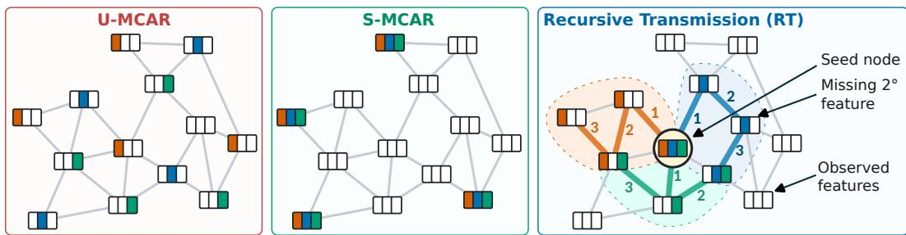
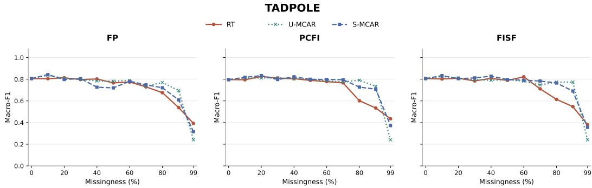
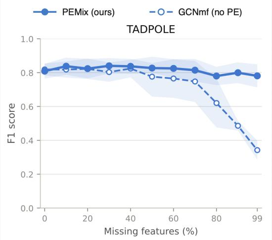

# WHEN MISSINGNESS FOLLOWS THE GRAPH: BEYOND FEATURE PROPAGATION FOR MISSING FEATURES

Enrico Chialà1, Francesco Ferrini2, Antonio Longa3, Bruno Lepri2, Filippo Maria Bianchi3, Manfred Jaeger4, Veronica Lachi3

1University of Trento 2Fondazione Bruno Kessler 3UiT, The Arctic University of Norway 4Aalborg University

## ABSTRACT

Graph Neural Networks (GNNs) commonly assume that node features are fully observed, despite missing features being pervasive in real-world applications. By leveraging the dependence between node features and graph structure, existing graph-specific methods handle missingness by propagating observed feature values along graph edges. However, these methods have mainly been evaluated in overly optimistic settings, where feature entries are removed independently and uniformly across the graph. This overlooks realistic scenarios in which missingness propagates among connected nodes, as can occur during localized sensing failures in sensor networks. We formalize this complementary notion as graph-structured mask dependence, where the joint distribution of missingness indicators is shaped by the graph, and introduce a controlled mechanism that instantiates this setting. We study propagation-based methods theoretically and empirically in this setting, showing that their effectiveness changes substantially compared with the uniformly random regime. Motivated by this limitation, we propose PEMix, designed to remain effective under challenging graph-structured missingness. Rather than propagating observed values, PEMix uses global structural representations to condition a probabilistic model of incomplete node features before message passing. Experiments under controlled graph-structured missingness and naturally occurring missingness show that PEMix remains robust across complex missingness regimes, with particularly strong performance as missingness becomes severe.

## 1 INTRODUCTION

Graph Neural Networks (GNNs) are commonly designed under the assumption that node features are fully observed (Kipf & Welling, 2017; Hamilton et al., 2017; Velickovic et al., 2018). In practice, this assumption is often violated. Sensors may fail to record part of their measurements (Braem et al., 2024; Faizin et al., 2019), while communication, acquisition, or infrastructure failures can also lead to missing observations.

Naive approaches rely on simple statistics to fill missing data, treating the feature matrix as tabular (Ferrini et al., 2026; Taguchi et al., 2021). Graph-specific methods instead leverage the graph topology to handle missingness more effectively. Most existing methods estimate missing features by propagating the observed values while minimizing a Dirichlet energy (Rossi et al., 2022). Methods such as PCFI and FISF extend this principle with confidence-based and iterative propagation schemes (Um et al., 2023; 2025) and achieve strong empirical performance on downstream node-level tasks.

However, performance is mostly evaluated on an oversimplified family of missingness patterns. The standard protocol removes feature entries independently under uniform Missing Completely At Random (MCAR) (Rubin, 1976). More recent work has considered feature- and label-dependent mechanisms, including Missing Not At Random (MNAR) settings (Ferrini et al., 2026), but these protocols still focus on how missingness depends on feature values or labels. They leave unexplored a different aspect of the problem: how missingness is conditioned by topology. The latter is particularly relevant in applications where failures propagate locally. In sensor networks or smart grids, physical or communication faults often cause entire connected regions of nodes to drop their measured features simultaneously (Marisca et al., 2024). Consequently, missingness indicators violate standard spatial independence assumptions, generating correlated missing patterns across adjacent nodes. Thus, the same global missingness rate can lead to very different levels of difficulty for graph-based methods depending on how missing entries are distributed over the graph. These patterns challenge propagation-based methods: when missing-feature nodes cluster together, there is too little observed information to propagate. We analyze this limitation theoretically and empirically and we propose PEMix, designed to remain effective under challenging graph-structured missingness.

  
Figure 1: Conceptual comparison of missingness mechanisms. Left (U-MCAR): Feature entries are dropped independently and uniformly across the graph. Middle (S-MCAR): Entire feature vectors are missing for randomly sampled nodes, independent of connectivity. Right (Recursive Transmission, RT): Missingness originates at a shared seed node and expands recursively along graph edges, forming spatially correlated missing regions that challenge propagation-based recovery.

Our contributions are as follows.

1. We distinguish the classical dependence of the missingness mask on the data from the dependence structure within the mask itself, formalize graph-structured mask dependence, and introduce Recursive Transmission (RT), a controlled graph-structured mechanism.

2. We establish a boundary bottleneck for standard feature propagation and show empirically that graph-localized missingness challenges more sophisticated propagation methods.

3. We propose PEMix to handle clustered missingness where propagation-based approaches fail. It conditions a probabilistic feature model on global structural representations prior to message passing, incorporating graph topology directly without relying on value propagation.

4. Across controlled graph-structured missingness and real-world datasets, we show that PEMix improves robustness over propagation baselines, achieving particularly strong gains as missingness severity increases.

## 2 LEARNING WITH MISSING NODE FEATURES

In this section, we follow the notation of Ferrini et al. (2026). We consider a connected attributed graph $G = ( V , E , { \bf X } , { \bf Y } )$ , where $V = \{ 1 , \ldots , n \}$ is the set of nodes, $E \subseteq V \times V$ is the set of edges represented by the adjacency matrix $\dot { \mathbf { A } } \in \{ 0 , \overset { \vartriangle } { 1 } \} ^ { n \times n } , \mathbf { X } \in \mathbb { R } ^ { n \times d }$ is the node feature matrix, with $X _ { i j }$ denoting feature $j$ of node i, and $\mathbf { Y } \in \{ \bar { 1 } , \ldots , K \} ^ { n }$ is the vector of node labels. Throughout the paper, A is a random variable in the probabilistic formulation and is fully observed. We condition on its realized value throughout learning and inference.

Let $\mathbf { M } \in \{ 0 , 1 \} ^ { n \times d }$ denote the missingness mask, where $M _ { i j } = 1$ iff $X _ { i j }$ is unobserved. We write $\mathbf { X } _ { \mathrm { o b s } }$ and $\mathbf { X } _ { \mathrm { m i s } }$ for the observed and missing entries induced by $\mathbf { M } .$ , respectively. The learner receives $( \mathbf { A } , \mathbf { X } _ { \mathrm { o b s } } , \mathbf { M } )$ together with the labels of the training nodes.

The complete-data distribution can be factorized as

$$
p _ { \theta , \gamma , \lambda } ( \mathbf { X } , \mathbf { Y } , \mathbf { M } \mid \mathbf { A } ) = p _ { \theta } ( \mathbf { X } \mid \mathbf { A } ) p _ { \gamma } ( \mathbf { Y } \mid \mathbf { X } , \mathbf { A } ) p _ { \lambda } ( \mathbf { M } \mid \mathbf { X } , \mathbf { Y } , \mathbf { A } ) ,\tag{1}
$$

where $p _ { \theta }$ models node features, $p _ { \gamma }$ the complete-data predictor, and $p _ { \lambda }$ the missingness mechanism.   
Conditioning on A makes explicit that the fixed graph structure can inform these distributions.

With incomplete node features, the predictive distribution is

$$
p ( { \mathbf { Y } } \mid { \mathbf { X } } _ { \mathrm { o b s } } , { \mathbf { M } } , { \mathbf { A } } ) = \int p ( { \mathbf { Y } } \mid { \mathbf { X } } , { \mathbf { M } } , { \mathbf { A } } ) p ( { \mathbf { X } } _ { \mathrm { m i s } } \mid { \mathbf { X } } _ { \mathrm { o b s } } , { \mathbf { M } } , { \mathbf { A } } ) d { \mathbf { X } } _ { \mathrm { m i s } } .\tag{2}
$$

A standard GNN parameterizes $p _ { \gamma } ( \mathbf { Y } \mid \mathbf { X } , \mathbf { A } )$ for complete X. It is, therefore, necessary to handle incomplete feature information before or during prediction.

Some methods handle missing node features without using topological information during feature recovery. They operate only on the incomplete feature matrix, typically by replacing missing entries in $\mathbf { X } _ { \mathrm { m i s } }$ with statistics computed from the observed values of the same feature in $\mathbf { X } _ { \mathrm { o b s } } .$ , such as the mean or median. For example, GCNmf models the feature distribution with a Gaussian mixture and uses the resulting conditional moments to handle missing coordinates (Taguchi et al., 2021). After filling missing entries with placeholders, GNN-MIM instead concatenates the missingness mask to the node features (Ferrini et al., 2026). In these approaches, the graph is still used by the downstream GNN, but missing features are not recovered using any topological information.

On the other hand, topology-aware approaches such as Feature Propagation (FP) (Rossi et al., 2022), estimates missing feature values by diffusing observed values across graph edges. For a feature channel $j ,$ , let $\mathbf { x } ^ { ( \bar { j } ) } = \mathbf { X } _ { : , j } , O _ { j } = \mathbf { \bar { \{ } }  i : M _ { i j } = 0 \mathbf  \bar   $ , and $\mathcal { M } _ { j } = \{ i : M _ { i j } = 1 \}$ denote the feature vector and the nodes where feature j is observed and missing, respectively. FP repeatedly updates feature values through $\widehat { \mathbf A }$ , the normalized adjacency matrix used for propagation, while restoring the observed entries after each step:

$$
x _ { i } ^ { ( j , t + 1 ) } = \left\{ \sum _ { u \in V } ^ { X _ { i j } , } \widehat { A } _ { i u } x _ { u } ^ { ( j , t ) } , \widehat { \iota } \in { \mathcal { M } } _ { j } . \right.\tag{3}
$$

PCFI extends this principle by assigning confidence scores based on the distance from observed features and combining channel-wise diffusion with inter-channel information (Um et al., 2023). FISF alternates propagation with repeated injection of the observed features (Um et al., 2025). Although these methods differ in their implementation, they all recover missing feature by propagating observed feature values through graph connections.

A crucial point often neglected in the literature is that the mechanisms used to describe the missingness are often orthogonal to how missingness is recovered. The latter is described by the missingness mechanism $p _ { \lambda }$ in equation 1. Following Rubin (Rubin, 1976), missingness mechanisms can be characterized through conditional dependencies between the mask and the data. Since A is fully observed and fixed in our setting, we express these conditions through A.

For node classification, a mechanism isfeature-MAR when

$$
p ( \mathbf { M } \mid \mathbf { X } _ { \mathrm { m i s } } , \mathbf { X } _ { \mathrm { o b s } } , \mathbf { A } ) = p ( \mathbf { M } \mid \mathbf { X } _ { \mathrm { o b s } } , \mathbf { A } ) ,\tag{4}
$$

i.e., the missingness only depends on the observed features. On the other hand, is label-MAR when

$$
p ( \mathbf { M } \mid \mathbf { X } , \mathbf { Y } , \mathbf { A } ) = p ( \mathbf { M } \mid \mathbf { X } , \mathbf { A } ) ,\tag{5}
$$

and Missing Completely At Random (MCAR) when

$$
p ( \mathbf { M } \mid \mathbf { X } , \mathbf { Y } , \mathbf { A } ) = p ( \mathbf { M } \mid \mathbf { A } ) .\tag{6}
$$

As in Ferrini et al. (2026) we treat the observed graph structure as fixed throughout learning and inference. Hence, MCAR refers to independence of the missingness mask from the random data variables X and $Y ,$ , conditional on the realized graph A. Since A is fixed, equation 6 is equivalent to the usual statement that the mask is independent of the data (X, Y). Missingness is MNAR when the mask depends on hidden feature values or labels. Under feature-MAR and label-MAR, the missingness mechanism is ignorable for prediction and equation 2 reduces to

$$
p ( \mathbf { Y } \mid \mathbf { X } _ { \mathrm { o b s } } , \mathbf { M } , \mathbf { A } ) = \int p _ { \gamma } ( \mathbf { Y } \mid \mathbf { X } , \mathbf { A } ) p _ { \theta } ( \mathbf { X } _ { \mathrm { m i s } } \mid \mathbf { X } _ { \mathrm { o b s } } , \mathbf { A } ) d \mathbf { X } _ { \mathrm { m i s } } .\tag{7}
$$

To assess robustness to missing features, existing methods are commonly evaluated by injecting missingness into complete graph datasets. The standard protocol assumes uniform MCAR (U-MCAR), where each feature entry is removed independently with a fixed probability $\mu , M _ { i j } \stackrel { \mathrm { i . i . d . } } { \sim }$ Bernoulli(µ). Another commonly used MCAR protocol removes the complete feature vectors of uniformly selected nodes; following Ferrini et al. (2026), we refer to this setting as Structural MCAR (S-MCAR).

The MCAR/MAR/MNAR taxonomy characterizes how M depends on the data, but not how the entries of M depend on one another. This distinction is crucial for graph-based recovery: two mechanisms can be equally MCAR and share the same global missingness rate, yet arrange missing entries according to the graph topology. This spatial arrangement directly affects propagation-based methods, as the configuration of observed entries determines the information available for diffusion. In the next section, we formalize this structural missingness when the graph shapes the mask.

## 3 GRAPH-STRUCTURED MISSINGNESS

To study how graph topology conditions missingness patterns, we first formalize the internal joint organization of the mask $\ddot { M } .$ Let $p ( \mathbf { M } \mid \mathbf { A } )$ denote the joint distribution of the missingness mask conditional on the observed adjacency matrix A. We say that the mask is internally dependent when its distribution does not factorize over individual entries:

$$
p ( \mathbf { M } \mid \mathbf { A } ) \neq \prod _ { i = 1 } ^ { n } \prod _ { j = 1 } ^ { d } p ( \mathbf { M } _ { i j } \mid \mathbf { A } ) .\tag{8}
$$

Equation 6 constrains the dependence between M and the data (X, Y), whereas Equation 8 concerns dependence among entries of M: for example, consider an MCAR mechanism that masks exactly m out of the $N =$ nd feature entries uniformly without replacement. For any two distinct entries $a = i j$ and $\begin{array} { r } { b = z k , \operatorname* { P r } ( \mathbf { M } _ { a } = 1 \mid \mathbf { A } ) = \frac { m } { N } } \end{array}$ , while $\begin{array} { r } { \operatorname* { P r } ( \mathbf { M } _ { b } \mathbf { \bar { \Pi } } = 1 \mathbf { \Omega } | \mathbf { \Lambda } \mathbf { M } _ { a } = 1 , \mathbf { A } \mathbf { \bar { \Pi } } ) = \frac { m - 1 } { N - 1 } \neq \frac { m } { N } } \end{array}$ . Thus, fixing the global missingness budget already induces dependence among mask entries and is a broad property. In this work, we are interested in a narrower case in which the graph itself shapes this dependence structure, which is a realistic and challenging scenario.

## 3.1 GRAPH-STRUCTURED DEPENDENCE WITHIN THE MISSINGNESS MASK

We characterize graph-structured dependence at the level of the joint mask distribution.

Definition 1 (Graph-structured mask dependence). Let $p ( \mathbf { M } \mid \mathbf { A } )$ denote the conditional mask distribution. The missing mechanism exhibits graph-structured mask dependence if

1. the internal dependency on the mask is conditional on A and

2. the joint mask distribution depends on graph structure, i.e., there exist possible adjacency matrices A and $\mathbf { A } ^ { \prime }$ on the same node set, each with positive probability, such that $p ( \mathbf { M } \mid \bar { \mathbf { A } } ) \neq p ( \mathbf { M } \mid \mathbf { A ^ { \prime } } )$ with all non-topological parameters of the mechanism held fixed.

This definition is broad enough to encompass the missingness mechanisms from the literature: U-MCAR without fixed budget is MCAR with internally independent mask; fixed-budget U-MCAR induces internally dependent masks without graph-structured dependence. Finally, S-MCAR also induces strong within-node dependence by masking complete feature vectors, but the masked nodes are sampled independently of A. These standard protocols do not model graph-structured dependencies among mask entries. In the following, we introduce a mechanism designed to account for such dependencies.

## 3.2 RECURSIVE-TRANSMISSION MCAR

Graph-structured mask dependence can be instantiated in many ways. We propose a mechanism for graph-structured missingness called Recursive Transmission (RT) that: i) is directly comparable with standard MCAR protocols at the same missingness rate; ii) generates a missingness mask that can challenge existing propagation-based methods; iii) captures a plausible class of localized failure patterns. For a target missingness rate $\mu ,$ , let $m = \lfloor \mu n d \rfloor$ be the total number of entries to mask. We distribute this budget as evenly as possible across each feature channel $j ,$ , obtaining budgets $m _ { j }$ such that $\begin{array} { r } { \sum _ { j = 1 } ^ { d } m _ { j } = m } \end{array}$ . RT starts from a source node $s \in V$ shared across feature channels and expands each feature-specific missing region only through graph edges. For feature $j$ with $m _ { j } > 0$ , initialize $C _ { j } ^ { ( 1 ) } = \{ s \}$ . At iteration $t ,$ define $\partial C _ { j } ^ { ( t ) } = \left\{ v \notin C _ { j } ^ { ( t ) } : \exists u \in C _ { j } ^ { ( t ) } \right.$ with $( u , v ) \in E \}$ , and, for each candidate $v \in \partial C _ { j } ^ { ( t ) } , a _ { j } ^ { ( t ) } ( v ) = \left| \mathcal { N } ( v ) \cap C _ { j } ^ { ( t ) } \right|$

The next node is chosen as $v _ { t + 1 } ^ { ( j ) } \in \arg \operatorname* { m a x } _ { v \in \partial C _ { i } ^ { ( t ) } } a _ { j } ^ { ( t ) } ( v )$ , with uniform random tie-breaking, independently across feature channels. We then set $C _ { j } ^ { ( t + 1 ) } = C _ { j } ^ { ( t ) } \cup \{ v _ { t + 1 } ^ { ( j ) } \}$ , and continue until $| C _ { j } | = m _ { j }$ . Finally, $\mathbf { M } _ { i j } = \mathbb { I } \{ i \in C _ { j } \}$ . The structural differences between missingness protocols are illustrated in Figure 1. While U-MCAR removes feature entries uniformly at random and S-MCAR drops complete feature vectors for independently selected nodes, RT models localized failures that originate from a shared source node and expand along graph edges, generating compact, spatially correlated missing regions. The construction is motivated by the three goals above. First, RT represents a localized failure with a common origin, as may occur in sensor, communication, power-grid, or acquisition systems, while feature-specific growth allows different measurements to be affected along different trajectories.

Among the possible instantiations of the mechanism, we focus on the challenging case in which the seeds of the missingness of each feature coincide with the same source node. In general, in RT one could assign a distinct seed s to each feature. However, on large graphs, especially at moderate missingness rates and with relatively few features, this would place feature-specific missing regions in different parts of the graph. Many affected nodes would then lose only one or a few measurements, while retaining most of their feature vector. While such masks still contain graphstructured dependence, they describe a missingness that is easier to recover for methods that can exploit nearby observations or even just information from the other feature channels. On the other hand, by using the same seed for all channels, RT creates partially overlapping missing regions and therefore areas in which several measurements are simultaneously unavailable. Independent tie-breaking still allows the regions to diverge, avoiding to always end up in the more restrictive case where the same complete set of features is missing at every affected node.

Finally, using a single global rate $\mu$ makes the severity of RT directly comparable with fixed-budget U-MCAR and S-MCAR. The mechanisms can therefore be matched in the total number of missing entries while differing in how those entries are arranged over the graph. RT is not intended as a generative model of all real-world missingness patterns. Rather, it is a controlled stress test that isolates the effect of graph-localized mask dependence while matching standard protocols in the total missingness budget. In our experimental setting, we therefore complement RT with experiments on naturally occurring missingness, for which no graph-structured mechanism is imposed.

Proposition 1 (RT is graph-structured MCAR). Ifsource selection and tie-breaking are independent ofX and Y conditional on A, then RT is MCAR and satisfies Definition 1.

A formal proof is provided in Appendix A. RT is thus a realistic graph-structured MCAR mechanism whose particular geometry is chosen to probe a failure mode of propagation-based methods. We make this connection precise next.

## 3.3 WHY GRAPH-STRUCTURED MISSINGNESS IS DIFFICULT FOR PROPAGATION

We now show why RT can be particularly challenging for methods that recover missing features through graph propagation. Consider one feature channel and omit the feature index for readability. Let O and M denote the observed and missing nodes for that feature, respectively. The FP update introduced in Equation 3 can be written in block form as

$$
\begin{array} { r } { x _ { M } ^ { ( t + 1 ) } = \widehat { \bf A } _ { M M } x _ { M } ^ { ( t ) } + \widehat { \bf A } _ { M O } x _ { O } . } \end{array}\tag{9}
$$

The first term propagates the current estimates within the missing set, while the second introduces observed values into it. Define the observed boundary of the missing region as

$$
\partial _ { O } M = \left\{ u \in O : \exists v \in M \mathrm { w i t h } ( u , v ) \in E \right\} .
$$

Only nodes in $\partial _ { O } M$ can directly inject observed information into the missing region.

  
Figure 2: TADPOLE macro-F1 under RT, U-MCAR, and S-MCAR for FP, PCFI, and FISF. Curves show the mean and shaded bands indicate one standard deviation over five seeds. Complete macro-F1 and AUROC results are reported in Appendix C.

Proposition 2 (Boundary bottleneck for feature propagation). Let $\rho ( \widehat { \mathbf { A } } _ { M M } )$ denote the spectral radius of $\widehat { \mathbf { A } } _ { M M }$ and assume $\rho ( \widehat { \mathbf { A } } _ { M M } ) < 1$ . Then the iteration in equation 9 converges to

$$
\widehat { \boldsymbol { x } } _ { M } = \mathbf { B } \boldsymbol { x } _ { O } , \qquad \mathbf { B } = \left( \mathbf { I } - \widehat { \mathbf { A } } _ { M M } \right) ^ { - 1 } \widehat { \mathbf { A } } _ { M O } .\tag{10}
$$

Moreover,

$$
\operatorname { r a n k } ( \mathbf { B } ) \leq | \partial _ { O } M | .\tag{11}
$$

The proof is given in Appendix A. Equation 11 makes the relevant property of the mask explicit. When many missing nodes form a compact connected region with a small observed boundary, all reconstructed values inside the region are determined by only a limited number of observed inputs. In contrast, the same number of missing entries scattered across the graph may be adjacent to many more observed nodes.

To ground the theory of RT, we consider TADPOLE, which was identified in Ferrini et al. (2026) as a suitable benchmark for evaluating robustness to missing node features. We compare RT with U-MCAR and S-MCAR, all with the same global missingness rate. S-MCAR controls for strong withinnode co-missingness while remaining independent of graph connectivity. Figure 2 shows that RT is more challenging for propagation-based methods. Averaging the macro-F1 AUC across FP, PCFI, and FISF gives 0.725 under RT, compared with 0.754 under U-MCAR and 0.751 under S-MCAR. Thus, graph-structured missingness reduces average propagation performance by approximately 4% relative to U-MCAR and 3.5% relative to S-MCAR.

## 4 PEMIX: STRUCTURE-CONDITIONED PROBABILISTIC IMPUTATION

The analysis in Section 3.3 shows that propagation-based methods can become less effective when missingness propagates through graph connections. The graph, however, remains fully observed and can still provide information about node attributes. PEMix exploits this information without using topology to propagate observed feature values into missing regions.

Let $\mathbf { P } = g ( \mathbf { A } ) \in \mathbb { R } ^ { n \times q }$ be a fixed structural representation of the graph, with $\mathbf { p } _ { i }$ denoting the representation of node i. In our experiments, g returns standardized non-trivial Laplacian eigenvectors. PEMix uses P to condition a probabilistic model of the incomplete node features, $\bf \bar { \Lambda } \mu ^ { \mathrm { { o } } } ( \bf X ^ { \mathrm { { m i s } } } )$ $\mathbf { X } ^ { \mathrm { o b s } } , \mathbf { A } ) \approx q _ { \eta } ( \mathbf { X } ^ { \mathrm { m i s } } \ | \ \mathbf { X } ^ { \mathrm { o b s } } , \mathbf { \tilde { P } } )$ . The positional encodings are computed once from the fully observed graph and are not learned by the mixture.

Structure-Conditioned Mixture For each node $i ,$ let $\mathbf { x } _ { i } = \mathbf { X } _ { i , : } \in \mathbb { R } ^ { d }$ denote its feature vector and let $c _ { i } \in \{ 1 , \ldots , K \}$ denote a latent mixture component, with $q ( c _ { i } = k ) = \pi _ { k }$ . Conditioned on $c _ { i }$ , PEMix models node features and structural position independently with diagonal Gaussian distributions, $q _ { \eta } ( \mathbf { x } _ { i } \mid c _ { i } = k ) = \mathcal { N } ( \mathbf { x } _ { i } \mid \mu _ { k } ^ { X }$ , diag((σX )2)) and $q _ { \eta } ( \mathbf { \bar { p } } _ { i } \mid c _ { i } = ^ { - } k ) = \mathcal { N } ( \mathbf { p } _ { i } $ $\mu _ { k } ^ { P } , \mathrm { d i a g } ( ( \pmb { \sigma } _ { k } ^ { P } ) ^ { \dot { 2 } } ) )$ .

Let $\Omega _ { i } = \{ j \in \{ 1 , \dots , d \} : M _ { i j } = 0 \}$ denote the observed coordinates of node i, and let $\bar { \Omega } _ { i } =$ $\left\{ 1 , \ldots , d \right\} \backslash \Omega _ { i }$ denote the missing ones. Conditioning jointly on the observed coordinates and on structural position gives

$$
\gamma _ { i k } \propto \pi _ { k } q _ { \eta } ( \mathbf { p } _ { i } \mid c _ { i } = k ) \prod _ { j \in \Omega _ { i } } \mathcal { N } \left( X _ { i j } \mid \mu _ { k j } ^ { X } , ( \sigma _ { k j } ^ { X } ) ^ { 2 } \right) ,\tag{12}
$$

with normalization over k. Equivalently, the structural term induces a node-dependent prior $\pi _ { k } ( { \bf p } _ { i } ) =$ $q _ { \eta } ( c _ { i } = k \mid \mathbf { p } _ { i } )$ , which is then updated using the observed feature coordinates. The distinction from a feature-only mixture is therefore in the component responsibilities. Without structural conditioning, every node starts from the same prior $\pi _ { k } ;$ in PEMix, structurally different nodes can have different component probabilities before their observed features are considered. This is particularly useful when only limited feature evidence remains. Under the diagonal covariance assumption, the conditional distribution of the missing coordinates is

$$
q _ { \eta } ( \mathbf { x } _ { i , \bar { \Omega } _ { i } } \mid \mathbf { x } _ { i , \Omega _ { i } } , \mathbf { p } _ { i } ) = \sum _ { k = 1 } ^ { K } \gamma _ { i k } \prod _ { j \in \bar { \Omega } _ { i } } \mathcal { N } \left( X _ { i j } \mid \mu _ { k j } ^ { X } , ( \sigma _ { k j } ^ { X } ) ^ { 2 } \right) .\tag{13}
$$

Thus, graph structure affects the distribution used to impute missing coordinates before message passing, rather than only determining how observed values are propagated between nodes.

End-to-End Prediction PEMix retains the conditional uncertainty in Equation 13 instead of committing to a single point estimate. Following Taguchi et al. (2021), the corresponding component-wise moments are marginalized analytically through the first message-passing layer, after which the remaining GNN layers are unchanged. The positional encodings affect only the mixture responsibilities in equation 12; they are not concatenated to the node representation passed to the downstream GNN. Following (Taguchi et al., 2021), who showed that jointly optimizing the mixture and downstream GNN can improve missing-feature reconstruction, we initialize the mixture parameters with EM and subsequently optimize them jointly with the GNN using the downstream task loss. We validate this design choice in Section F.3, where joint optimization consistently improves downstream performance compared with keeping the EM-initialized mixture fixed. Implementation details, including initialization, covariance parameterization, and positional-encoding dimension, are provided in Section E. Structural conditioning does not change the asymptotic cost of the probabilistic first layer: PEMix has the same per-epoch complexity as GCNmf, up to a dominated $O ( n K q )$ term and a one-off partial eigendecomposition per graph (Section E.1).

## 5 EXPERIMENTAL EVALUATION

We address three research questions:

• RQ1: Does PEMix improve robustness under challenging graph-structured missingness while remaining competitive under standard random missingness?

• RQ2: How does PEMix perform under naturally occurring missingness?

• RQ3: Are the gains of PEMix due simply to access to positional encodings, or specifically to using them to condition the missing-feature distribution?

Datasets and protocol. To answer RQ1, we consider four datasets with artificially injected missingness, namely TADPOLE (Zhu et al., 2019), GraphMSO, PEMS-BAY and Engrad (Marisca et al., 2024). Since these datasets are complete, the missingness mechanism and global missingness rate µ can be controlled directly. In particular we injected RT and U-MCAR with $\mu \in \{ 0 , 0 . 1 , \ldots , 0 . 9 , 0 . 9 9 \}$ For RQ2, we instead consider datasets where missingness is part of the original data. AQI, PV-US, and METR-LA are the air-quality, photovoltaic, and traffic datasets used by Marisca et al. (2024). We additionally evaluate PEMix in a different setting using RelBench (Robinson et al., 2024), a benchmark of relational databases with naturally incomplete features. For forecasting datasets, we convert each prediction time into an independent static graph sample using only past observations; the temporal windows, graph construction, and leakage-prevention protocol are detailed in Appendix B. The dataset overview is provided in Appendix B, Table 5. On the standard graph datasets, we compare against simple baseline with zero imputation (GNN-Zero), median imputation (GNN-Median) and mean imputation (GNN-MI), probabilistic and mask-aware approaches (GCNmf and GNN-MIM), and propagation methods (FP, PCFI, and FISF). RelBench requires a relational architecture and has substantially fewer missing-feature baselines. We therefore compare against the standard Relational Deep Learning model (RDL) (Robinson et al., 2024) and its missing-indicator extension RDL-MIM (Ferrini et al., 2026), and adapt PEMix to the same backbone, denoted RDL-PEMix. The datasets and evaluation regimes are summarized in Table 5.

Table 1: Performance under controlled RT and U-MCAR, reported as trapezoidal AUC over $\mu .$ Blue indicates the best model in each column, orange the second one, and green the third one. Full tables in Appendix D.
<table><tr><td rowspan="3">Model</td><td colspan="4">RT</td><td colspan="4">U-MCAR</td></tr><tr><td>TADPOLE Macro-F1 ↑</td><td>GraphMSO MAE↓</td><td>PEMS-BAY MAE↓</td><td>Engrad MAE↓</td><td>TADPOLE Macro-F1 ↑</td><td>GraphMSO MAE↓</td><td>PEMS-BAY MAE↓</td><td>Engrad MAE↓</td></tr><tr><td>GNN-Zero</td><td>0.7388</td><td>1.369627</td><td>4.294239</td><td>7.345723</td><td>0.7565</td><td>1.368397</td><td>4.059947</td><td>5.796827</td></tr><tr><td>GNN-Median</td><td>0.7015</td><td>1.369711</td><td>4.340867</td><td>7.317703</td><td>0.7398</td><td>1.368436</td><td>4.038923</td><td>5.859984</td></tr><tr><td>GNN-MI</td><td>0.7130</td><td>1.369657</td><td>4.251831</td><td>7.322302</td><td>0.7421</td><td>1.368595</td><td>4.079495</td><td>5.816402</td></tr><tr><td>FP</td><td>0.7254</td><td>1.371720</td><td>4.203665</td><td>6.515184</td><td>0.7473</td><td>1.370337</td><td>4.035542</td><td>5.504311</td></tr><tr><td>PCFI</td><td>0.7272</td><td>1.372185</td><td>4.308706</td><td>7.982851</td><td>0.7593</td><td>1.370070</td><td>4.115370</td><td>6.375060</td></tr><tr><td>FISF</td><td>0.7232</td><td>1.373884</td><td>4.237767</td><td>6.468120</td><td>0.7566</td><td>1.372575</td><td>4.071262</td><td>5.603992</td></tr><tr><td>GCNmf</td><td>0.7148</td><td>1.369023</td><td>3.921914</td><td>7.373967</td><td>0.7588</td><td>1.367092</td><td>3.393461</td><td>6.060386</td></tr><tr><td>GNN-MIM</td><td>0.7469</td><td>1.371282</td><td>4.193381</td><td>7.584628</td><td>0.7482</td><td>1.369593</td><td>3.909064</td><td>5.838703</td></tr><tr><td>PEMix</td><td>0.8243</td><td>1.368784</td><td>3.764460</td><td>7.206951</td><td>0.8094</td><td>1.366935</td><td>3.463835</td><td>5.753445</td></tr></table>

RQ1: PEMix gains most where graph-structured missingness is challenging, without sacrificing competitiveness under U-MCAR. For each controlled dataset, at each missingness rate, we evaluate all methods over five random seeds. The complete curves, including means and standard deviations at each rate, are reported in Section D. For compactness, in Table 1 we summarize each curve by its trapezoidal area under the curve (AUC) over the evaluated missingness rates. Higher AUC is better for macro-F1, while lower AUC is better for MAE. Under RT, the setting PEMix is explicitly designed to address, PEMix obtains the best AUC on three of the four datasets: TADPOLE, GraphMSO, and PEMS-BAY, while ranking third on Engrad. The gains are particularly pronounced on TADPOLE and PEMS-BAY, where PEMix improves substantially over the strongest competing baselines. This supports the intended role of structural conditioning when missing observations form graph-localized regions and local propagation becomes less informative. Under U-MCAR, in contrast, we would not necessarily expect PEMix to dominate, since missing entries are scattered independently and propagation-based or simpler recovery mechanisms are not exposed to the same structural bottleneck. Nevertheless, PEMix remains competitive: it ranks first on TADPOLE and GraphMSO, second on PEMS-BAY, and third on EngRAD. Thus, the benefit of PEMix is concentrated in the challenging graph-structured regime for which it was designed, while its use does not generally entail a loss of competitiveness when missingness is unstructured.

## RQ2: PEMix performs strongly under naturally occurring missingness.

Table 2: Performance with naturally occurring missingness (test MAE, mean ± std over five seeds; lower is better). Blue, orange, and green mark the three best models within each dataset.

Results on datasets with naturally occurring missingness are reported in Table 2. PEMix achieves the lowest MAE on two of the three benchmarks, AQI and METR-LA, while ranking second on PV-US. This pattern is consistent with the spatial organization of missingness in these datasets. We quantify this structure through the excess co-missingness of neighboring nodes: intuitively, we compare how often the two endpoints of an edge are simultaneously missing with how often this would occur under spatially independent missingness. Values above one therefore indicate that miss-

<table><tr><td>Model</td><td>AQI</td><td>PV-US</td><td>METR-LA</td></tr><tr><td>GNN-Zero</td><td> $2 0 . 1 8 9 5 \pm 0 . 2 2 0 3$ </td><td> $1 2 . 4 8 7 1 \pm 0 . 0 1 5 1$ </td><td> $6 . 5 1 9 9 \pm 0 . 0 4 6 5$ </td></tr><tr><td>GNN-Median</td><td> $1 9 . 7 3 1 7 \pm 0 . 2 5 9 5$ </td><td> $1 2 . 3 4 1 0 \pm 0 . 0 2 8 9$ </td><td> $6 . 6 1 1 7 \pm 0 . 0 7 6 0$ </td></tr><tr><td>GNN-MI</td><td> $1 9 . 9 7 3 0 \pm 0 . 1 7 1 2$ </td><td> $1 2 . 4 8 4 4 \pm 0 . 0 3 3 7$ </td><td> $6 . 5 1 9 7 \pm 0 . 0 5 7 6$ </td></tr><tr><td>FP</td><td> $1 8 . 9 4 5 0 \pm 0 . 0 4 0 9$ </td><td> $1 2 . 5 2 5 1 \pm 0 . 0 2 9 0$ </td><td> $6 . 5 9 4 5 \pm 0 . 0 4 8 7$ </td></tr><tr><td>PCFI</td><td> $1 9 . 5 3 8 4 \pm 0 . 0 7 0 7$ </td><td> $1 2 . 9 2 8 1 \pm 0 . 0 6 9 8$ </td><td> $6 . 6 4 8 4 \pm 0 . 0 9 5 7$ </td></tr><tr><td>FISF</td><td> $1 9 . 0 5 8 6 \pm 0 . 0 7 7 8$ </td><td> $1 2 . 5 7 4 6 \pm 0 . 0 2 0 3$ </td><td> $6 . 5 9 9 1 \pm 0 . 0 7 2 1$ </td></tr><tr><td>GCNmf</td><td> $1 8 . 9 0 7 1 \pm 0 . 0 4 6 0$ </td><td> ${ \bf 1 1 . 9 9 0 6 \pm 0 . 1 4 4 4 }$ </td><td> $6 . 5 1 7 0 \pm 0 . 0 1 8 2$ </td></tr><tr><td>GNN-MIM</td><td> $1 9 . 4 9 7 8 \pm 0 . 1 7 9 3$ </td><td> $1 2 . 2 3 0 2 \pm 0 . 0 1 3 5$ </td><td> $6 . 7 2 2 7 \pm 0 . 0 7 7 8$ </td></tr><tr><td>PEMix</td><td> ${ \bf 1 8 . 7 2 7 4 \pm 0 . 0 5 2 3 }$ </td><td> $1 2 . 0 2 2 5 \pm 0 . 0 3 9 2$ </td><td> $\mathbf { 6 . 4 5 1 1 \pm 0 . 0 1 0 5 }$ </td></tr></table>

ing observations cluster over the graph. The exact definition and dataset-level values are reported in Appendix B.1. All three datasets exhibit co-missingness above the range expected under spatially independent missingness. The effect is stronger on METR-LA, whose ratio reaches 4.03 over timestamos with partial missingness, compared with 1.16 on AQI and 1.21 on PV-US. PEMix achieves the best MAE on AQI and METR-LA, whereas on PV-US GCNmf performs best and PEMix remains a close second. The same trend extends beyond standard graph benchmarks: in the relational setting, RDL-PEMix obtains the best result on four of the six RelBench tasks reported in Table 3, suggesting that PEMix can be integrated into relational models as an effective strategy for handling missing features.

Table 3: RelBench results with naturally occurring missingness (mean ± std over three seeds; ten epochs). RDL-PEMix denotes the relational adaptation of PEMix, while RDL-MIM is the missingindicator adaptation of RDL. Bold marks the best mean within each task.
<table><tr><td>Dataset</td><td>Task</td><td>Metric</td><td>RDL</td><td>RDL-MIM</td><td>RDL-PEMix</td></tr><tr><td colspan="6">Node regression</td></tr><tr><td></td><td>REL-TRIAL study-adverse</td><td>MAE↓</td><td> $4 4 . 4 7 0 \pm 0 . 2 1 0$ </td><td> $4 3 . 1 1 5 \pm 0 . 1 5 5$ </td><td> $\mathbf { 4 2 . 8 4 0 \pm 0 . 6 8 0 }$ </td></tr><tr><td>REL-TRIAL</td><td>site-success</td><td>MAE↓</td><td> $0 . 4 0 0 \pm 0 . 0 2 0$ </td><td> $\mathbf { 0 . 3 7 5 \pm 0 . 0 1 7 }$ </td><td> $0 . 3 9 1 \pm 0 . 0 0 8$ </td></tr><tr><td>REL-F1</td><td>driver-position</td><td>MAE↓</td><td> $\mathbf { 4 . 0 2 2 \pm 0 . 1 2 0 }$ </td><td> $4 . 0 2 7 1 \pm 0 . 0 3 8 9$ </td><td> $4 . 2 0 8 \pm 0 . 0 9 0$ </td></tr><tr><td colspan="6">Node classification</td></tr><tr><td></td><td>REL-TRIAL study-outcome</td><td>AUC↑</td><td> $0 . 6 8 6 \pm 0 . 0 1 0$ </td><td> $0 . 6 7 9 4 \pm 0 . 0 0 5 1$ </td><td> $\mathbf { 0 . 7 0 6 \pm 0 . 0 1 0 }$ </td></tr><tr><td>REL-F1</td><td>driver-top3</td><td>AUC↑</td><td> $0 . 7 5 5 \pm 0 . 0 0 6$ </td><td> $0 . 7 6 8 \pm 0 . 0 0 4$ </td><td> $\mathbf { 0 . 7 7 3 \pm 0 . 0 1 0 }$ </td></tr><tr><td>REL-STACK</td><td>user-engagement</td><td>AUC↑</td><td> $0 . 9 0 6 2 \pm 0 . 0 0 0 2$ </td><td> $0 . 9 0 6 0 \pm 0 . 0 0 0 8$ </td><td> $\mathbf { 0 . 9 0 7 2 \pm 0 . 0 0 0 1 }$ </td></tr></table>

## RQ3: Structural conditioning, rather than access to PE alone, drives PEMix’s gains.

Table 4: Effect of PE on TADPOLE and PV-US. "Mechanism" denotes methods in which PE are used while handling missing features, whereas "Downstream" denotes variants where PE are concatenated only after missingfeature handling. We report macro-F1 AUC across missingness rates for TADPOLE (higher is better) and test MAE under natural missingness for PV-US (lower is better). PV-US results are means ± std over five seeds.

To isolate the role of positional encodings, we compare two alternatives. First, we provide the same PE to propagationbased methods inside their missingfeature mechanism. Second, we concatenate PE only after missing-feature handling, before the downstream predictor. We also include a PE-only control. We conducted this ablation on the Tadpole and PV-US dataset. As in RQ1, for the Tadpole dataset we summarize each missingness curve by its macro-F1 AUC; complete results with average and standard deviations over five seeds for each level of missingness µ are reported in Appendix F. For PV-US we report means and standard deviations over five seeds. Results are reported in Table 4. Simply providing positional encodings is not sufficient to reproduce PEMix’s performance. Adding the same PE to propagation-based missing-

<table><tr><td>PE usage</td><td>Model</td><td>TADPOLE Macro-F1 AUC ↑</td><td>PV-US MAE↓</td></tr><tr><td rowspan="4">Mechanism</td><td>PEMix</td><td>0.8243</td><td> $\mathbf { 1 2 . 0 2 2 5 \pm 0 . 0 3 9 2 }$ </td></tr><tr><td>FP + PE</td><td>0.7336</td><td> $1 2 . 4 6 4 2 \pm 0 . 0 2 2 1$ </td></tr><tr><td>PCFI + PE</td><td>0.7474</td><td> $1 2 . 8 6 4 3 \pm 0 . 0 4 5 4$ </td></tr><tr><td>FISF + PE</td><td>0.7573</td><td> $1 2 . 5 9 8 1 \pm 0 . 0 4 4 3$ </td></tr><tr><td rowspan="4">Downstream</td><td> $\mathrm { G C N m f + P E }$ </td><td>0.7211</td><td> $1 2 . 1 4 2 1 \pm 0 . 0 1 4 5$ </td></tr><tr><td>FP + PE</td><td>0.7754</td><td> $1 2 . 1 2 6 1 \pm 0 . 0 4 5 2$ </td></tr><tr><td> $\mathrm { P C F I } + \mathrm { P E }$ </td><td>0.7745</td><td> $1 2 . 6 9 7 9 \pm 0 . 0 7 9 0$ </td></tr><tr><td> $\mathrm { F I S F + P E }$ </td><td>0.7798</td><td> $1 2 . 2 3 6 4 \pm 0 . 0 6 4 9$ </td></tr><tr><td></td><td>PE only</td><td>0.2923</td><td> $1 6 . 5 5 2 6 \pm 0 . 0 4 0 1$ </td></tr></table>

feature mechanisms leaves a substantial gap, while using PE only downstream improves performance on TADPOLE but remains below PEMix. The PE-only control performs poorly on both datasets. These results suggest that PEMix benefits specifically from using structural information to condition the missing-feature distribution, rather than from access to positional encodings per se.

## 6 CONCLUSION

We studied missing node features when missingness itself is structured by the graph. We formalized graph-structured mask dependence and introduced RT, a controlled mechanism that exposes a boundary bottleneck of propagation-based method. Motivated by this limitation, we proposed PEMix, which conditions a probabilistic model of incomplete node features on global structural representations. Across controlled and naturally occurring missingness, PEMix is particularly effective when missing observations are graph-localized, while remaining competitive under standard missingness. Ablations further show that the gains arise from using structural information to condition the missing-feature distribution, rather than from access to positional encodings alone. These results highlight graph structure as a useful source of information not only for prediction, but also for modeling incomplete node features. Limitations: PEMix assumes diagonal mixture covariances and a fully observed graph, and our evaluation is limited to node classification and forecasting. Broader analyses of structural encodings, temporal modeling, and other downstream tasks are left for future work.

## ACKNOWLEDGMENTS

The work is partially funded by the Norwegian Research Council through RELAY: Relational Deep Learning for Energy Analytics (project 345017), and the Centre of Excellence Integreat - The Norwegian Centre for knowledge-driven machine learning (project 332645). The authors gratefully thank NVIDIA Corporation for donating the GPUs used in this project.

## REFERENCES

Carlijn I. R. Braem, Utku S. Yavuz, Hermie J. Hermens, and Peter H. Veltink. Missing data statistics provide causal insights into data loss in diabetes health monitoring by wearable sensors. Sensors, 24(5):1526, 2024. doi: 10.3390/S24051526. URL https://doi.org/10.3390/s24051526.

Rahmat Nur Faizin, Mardhani Riasetiawan, and Ahmad Ashari. A review of missing sensor data imputation methods. In 2019 5th International Conference on Science and Technology (ICST), volume 1, pp. 1–6, 2019. doi: 10.1109/ICST47872.2019.9166287.

Francesco Ferrini, Veronica Lachi, Antonio Longa, Bruno Lepri, Akiyoshi Matono, Andrea Passerini, Xin Liu, and Manfred Jaeger. Rethinking GNNs and missing features: Challenges, evaluation and a robust solution. In Forty-third International Conference on Machine Learning, 2026. URL https://openreview.net/forum?id=E4gftzjqoh.

William L. Hamilton, Zhitao Ying, and Jure Leskovec. Inductive representation learning on large graphs. In Isabelle Guyon, Ulrike von Luxburg, Samy Bengio, Hanna M. Wallach, Rob Fergus, S. V. N. Vishwanathan, and Roman Garnett (eds.), Advances in Neural Information Processing Systems 30: Annual Conference on Neural Information Processing Systems 2017, December 4-9, 2017, Long Beach, CA, USA, pp. 1024–1034, 2017. URL https://proceedings.neurips.cc/paper/2017/hash/ 5dd9db5e033da9c6fb5ba83c7a7ebea9-Abstract.html.

Thomas N. Kipf and Max Welling. Semi-supervised classification with graph convolutional networks. In 5th International Conference on Learning Representations, ICLR 2017, Toulon, France, April 24-26, 2017, Conference Track Proceedings. OpenReview.net, 2017. URL https://openreview.net/forum?id=SJU4ayYgl.

Ivan Marisca, Cesare Alippi, and Filippo Maria Bianchi. Graph-based forecasting with missing data through spatiotemporal downsampling. In Ruslan Salakhutdinov, Zico Kolter, Katherine A. Heller, Adrian Weller, Nuria Oliver, Jonathan Scarlett, and Felix Berkenkamp (eds.), Forty-first International Conference on Machine Learning, ICML 2024, Vienna, Austria, July 21-27, 2024, volume 235 of Proceedings ofMachine Learning Research, pp. 34846–34865. PMLR / OpenReview.net, 2024. URL https://proceedings.mlr.press/v235/marisca24a.html.

Joshua Robinson, Rishabh Ranjan, Weihua Hu, Kexin Huang, Jiaqi Han, Alejandro Dobles, Matthias Fey, Jan Eric Lenssen, Yiwen Yuan, Zecheng Zhang, Xinwei He, and Jure Leskovec. Relbench: A benchmark for deep learning on relational databases. In Amir Globersons, Lester Mackey, Danielle Belgrave, Angela Fan, Ulrich Paquet, Jakub M. Tomczak, and Cheng Zhang (eds.), Advances in Neural Information Processing Systems 37: Annual Conference on Neural Information Processing Systems 2024, NeurIPS 2024, Vancouver, BC, Canada, December 10 - 15, 2024, 2024. URL http://papers.nips.cc/paper\_files/paper/2024/hash/

25cd345233c65fac1fec0ce61d0f7836-Abstract-Datasets\_and\_ Benchmarks\_Track.html.

Emanuele Rossi, Henry Kenlay, Maria I. Gorinova, Benjamin Paul Chamberlain, Xiaowen Dong, and Michael M. Bronstein. On the unreasonable effectiveness of feature propagation in learning on graphs with missing node features. In Bastian Rieck and Razvan Pascanu (eds.), Learning on Graphs Conference, LoG 2022, 9-12 December 2022, Virtual Event, volume 198 of Proceedings of Machine Learning Research, pp. 11. PMLR, 2022. URL https://proceedings.mlr.press/v198/rossi22a.html.

Donald B. Rubin. Inference and missing data. Biometrika, 63(3):581–592, 1976.

Hibiki Taguchi, Xin Liu, and Tsuyoshi Murata. Graph convolutional networks for graphs containing missing features. Future Gener. Comput. Syst., 117:155–168, 2021. doi: 10.1016/J.FUTURE.2020.11.016. URL https://doi.org/10.1016/j.future.2020.11.016.

Daeho Um, Jiwoong Park, Seulki Park, and Jin Young Choi. Confidence-based feature imputation for graphs with partially known features. In The Eleventh International Conference on Learning Representations, ICLR 2023, Kigali, Rwanda, May 1-5, 2023. OpenReview.net, 2023. URL https://openreview.net/forum?id=YPKBIILy-Kt.

Daeho Um, Sunoh Kim, Jiwoong Park, Jongin Lim, Seong-Jin Ahn, and Seulki Park. Propagate and inject: Revisiting propagation-based feature imputation for graphs with partially observed features. In Aarti Singh, Maryam Fazel, Daniel Hsu, Simon Lacoste-Julien, Felix Berkenkamp, Tegan Maharaj, Kiri Wagstaff, and Jerry Zhu (eds.), Forty-second International Conference on Machine Learning, ICML 2025, Vancouver, BC, Canada, July 13-19, 2025, volume 267 of Proceedings of Machine Learning Research. PMLR / OpenReview.net, 2025. URL https://proceedings.mlr.press/v267/um25a.html.

Petar Velickovic, Guillem Cucurull, Arantxa Casanova, Adriana Romero, Pietro Liò, and Yoshua Bengio. Graph attention networks. In 6th International Conference on Learning Representations, ICLR 2018, Vancouver, BC, Canada, April 30 - May 3, 2018, Conference Track Proceedings. OpenReview.net, 2018. URL https://openreview.net/forum?id=rJXMpikCZ.

Qikui Zhu, Bo Du, and Pingkun Yan. Multi-hop convolutions on weighted graphs. CoRR, abs/1911.04978, 2019. URL http://arxiv.org/abs/1911.04978.

## A PROOFS

## A.1 RT IS GRAPH-STRUCTURED MCAR

Proposition 1 (RT is graph-structured MCAR), restated. If source selection and tie-breaking are independent of X and Y conditional on A, then RT is MCAR in the sense of equation 6. Under the non-degeneracy and graph-support conditions stated in Appendix A, it also satisfies Definition 1.

Proof. We work conditional on the realized adjacency matrix A and fixed feature budgets, as in the main text. For the graph-structured conclusion, we make the necessary non-degeneracy conditions explicit: the graph is connected and undirected, the source distribution has full support on V, and some channel has $2 \leq m _ { i } \leq n - 1$ . For the topology comparison below, the complete graph and the star on V are assumed to have positive probability under the distribution of A. In comparing graphs, the source law and all budgets are held fixed. These conditions are needed for that conclusion: at zero or full missingness the mask is deterministic, and if all budgets are at most one, no growth step need consult an edge. Thus independence from the data alone proves MCAR, while the graph-structured assertion is understood in this non-degenerate regime.

MCAR. Let U collect the source and all tie-breaking variables. The recursion is a deterministic map $\mathbf { M } = F ( \mathbf { A } , U )$ : each update uses only adjacency, the current region, and U. Since U is independent of $( \mathbf { X } , \mathbf { Y } )$ conditional on A, for every mask m,

$$
\operatorname* { P r } ( \mathbf { M } = m \mid \mathbf { X } , \mathbf { Y } , \mathbf { A } ) = \operatorname* { P r } ( F ( \mathbf { A } , U ) = m \mid \mathbf { A } ) = \operatorname* { P r } ( \mathbf { M } = m \mid \mathbf { A } ) .
$$

This is Equation 6; dependence within the mask does not affect this conditional independence from the data.

Internal dependence. Fix a channel with $2 \leq m _ { i } \leq n - 1$ . Every node has positive probability of being masked, since it can be the source. The fixed budget implies $\textstyle \sum _ { i } M _ { i j } = { \overline { { m _ { j } } } } < n$ almost surely, so at least one indicator also has positive probability of being zero. If the channel indicators were mutually independent, then

$$
0 = \mathrm { V a r } \left( \sum _ { i } M _ { i j } \mid \mathbf { A } \right) = \sum _ { i } \mathrm { V a r } ( M _ { i j } \mid \mathbf { A } ) > 0 ,
$$

which is impossible. Independence of every entry of the full mask would imply independence within this channel. The conditional distribution $\dot { p } ( \mathbf { M } \mid \mathbf { A } )$ therefore does not factorize.

Dependence on topology. Compare the complete graph with adjacency matrix A on the labeled set V with a star centered at a with adjacency matrix A′, holding the full-support source law, budgets, and uniform tie-breaking rule fixed. Choose $S \subseteq V \setminus \{ a \}$ with $| S | = m _ { j }$ . In the complete graph all boundary candidates have the same score. Starting in S and then selecting its remaining nodes has positive probability, so $\operatorname* { P r } ( C _ { j } = S \mid \mathbf { A } ) > 0$ . On the star every RT region is connected, because it starts with one node and grows by adding boundary nodes. A set of at least two leaves excluding the center is disconnected, so $\operatorname* { P r } ( C _ { i } ^ { \cdot } = S \mid \mathbf { \bar { A } } ^ { \prime } ) = 0$ . The conditional channel marginals, and hence the joint mask distributions $p ( \mathbf { M } \mid \mathbf { \bar { A } } )$ and $p ( \dot { \mathbf { M } } \mid \mathbf { A } ^ { \prime } )$ , differ. Together with internal dependence, this proves Definition 1 under the stated non-degeneracy conditions. □

## A.2 BOUNDARY BOTTLENECK FOR FEATURE PROPAGATION

Proposition 2 (Boundary bottleneck for feature propagation), restated. Let $\rho ( \widehat { \mathbf { A } } _ { M M } )$ denote the spectral radius of $\widehat { \mathbf { A } } _ { M M }$ and assume $\rho ( \widehat { \mathbf { A } } _ { M M } ) < 1$ . Then the iteration in equation 9 converges to

$$
\widehat { \ b { x } } _ { M } = \mathbf { B } \ b { x } _ { O } , \qquad \mathbf { B } = \left( \mathbf { I } - \widehat { \mathbf { A } } _ { M M } \right) ^ { - 1 } \widehat { \mathbf { A } } _ { M O } .
$$

Moreover,

$$
\operatorname { r a n k } ( \mathbf { B } ) \leq | \partial _ { O } M | .
$$

Proof. Conditional on the realized graph, the normalized adjacency is a fixed local propagation matrix: an off-diagonal entry can be nonzero only on a graph edge. Observations $x _ { O }$ remain clamped.

Set $T = \widehat { \mathbf { A } } _ { M M }$ and $C = \widehat { \mathbf { A } } _ { M O }$ . For every integer $t \geq 1$ , induction on the update gives

$$
x _ { M } ^ { ( t ) } = T ^ { t } x _ { M } ^ { ( 0 ) } + \sum _ { r = 0 } ^ { t - 1 } T ^ { r } C x _ { O } .
$$

Since $\rho ( T ) < 1$ , every Jordan block of $T ^ { t }$ tends to zero: its entries are finite sums of polynomial factors in t multiplied by powers of eigenvalues of modulus less than one (nilpotent blocks vanish after finitely many powers). Consequently $\overline { { T } } ^ { t }  0$ . Also $I - T$ is invertible, and the finite geometric-series identity gives

$$
\sum _ { r = 0 } ^ { t - 1 } T ^ { r } = ( I - T ) ^ { - 1 } ( I - T ^ { t } ) \longrightarrow ( I - T ) ^ { - 1 } .
$$

For any finite initial vector, the initial-condition term vanishes and the limit is $( I - T ) ^ { - 1 } C x _ { O } = \mathbf { B } x _ { O }$ Invertibility also makes this the unique fixed point.

If $u \in O \setminus \partial _ { O } M$ , there is no edge from a missing node to u, so locality gives $C _ { : , u } = 0$ . Left multiplication by $( I - T ) ^ { - 1 }$ preserves that zero column. Thus only observed boundary coordinates can influence the limit. Since C has at most $| \partial _ { O } M |$ nonzero columns,

$$
\mathrm { r a n k } ( \mathbf { B } ) = \mathrm { r a n k } ( C ) \leq | \partial _ { O } M | ,
$$

where the equality follows from invertibility of $I - T$

The result concerns fixed linear, channel-wise propagation. It does not automatically extend to nonlinear or cross-channel recovery, and a low-rank recovery map alone does not imply positive error for every graph signal.

## B DATASETS AND EVALUATION PROTOCOL

Static formulation of forecasting datasets. For AQI, PV-US, METR-LA, and GraphMSO, we convert each prediction time into an independent static graph sample. The graph topology is fixed over time and constructed from sensor locations, official distance files, or the GraphMSO generator, depending on the dataset; it never uses future observations. Node features contain only past sensor measurements, flattened over the input window, together with unmasked calendar covariates when available. Targets are the subsequent measurements. The input/output windows are 24/6 for AQI, 72/6 for PV-US, 24/12 for METR-LA, and 72/36 for GraphMSO. No temporal model is used: all methods operate on the resulting static graph samples with the same inputs. To prevent leakage, train/validation/test splits are chronological and windows are constructed so that each input–target pair lies entirely within one split. Standardization and imputation statistics are estimated from observed training values only. Artificial masks are generated on the raw series before windowing, so repeated occurrences of the same measurement share the same missingness state. Naturally missing values are preserved, and missing targets are excluded from both loss and evaluation. PEMix positional encodings depend only on the fixed graph and are computed once per dataset; propagation-based imputers operate only on sensor measurements, not on calendar covariates.

Table 5: Datasets used in the controlled and native-missingness experiments. Controlled datasets are originally complete and missingness is injected artificially. Native datasets contain missing values in the original data. For native datasets, we report the percentage of missing entries in the original data.
<table><tr><td>Regime</td><td>Dataset</td><td>Domain</td><td>Source</td><td>Missing (%)</td></tr><tr><td rowspan="4">Controlled</td><td>TADPOLE</td><td>clinical</td><td>Zhu et al. (2019)</td><td></td></tr><tr><td>GraphMSO</td><td>graph forecasting</td><td>Marisca et al. (2024)</td><td></td></tr><tr><td>PEMS-BAY</td><td>traffic forecasting</td><td>Marisca et al. (2024)</td><td></td></tr><tr><td>Engrad</td><td>forecasting</td><td>Marisca et al. (2024)</td><td></td></tr><tr><td rowspan="6">Native</td><td>AQI</td><td>air-quality forecasting</td><td>Marisca et al. (2024)</td><td>25.67</td></tr><tr><td>PV-US</td><td>photovoltaic forecasting</td><td>Marisca et al. (2024)</td><td>54.02</td></tr><tr><td>METR-LA</td><td>traffic forecasting</td><td>Marisca et al. (2024)</td><td>8.11</td></tr><tr><td>RelBench (rel-f1)</td><td>relational databases</td><td>Robinson et al. (2024)</td><td>9.42</td></tr><tr><td>RelBench (rel-trial)</td><td>relational databases</td><td>Robinson et al. (2024)</td><td>23.90</td></tr><tr><td>RelBench (rel-stack)</td><td>relational databases</td><td>Robinson et al. (2024)</td><td>19.13</td></tr></table>

Table 6: Co-missingness ratio $H C _ { \mathrm { m i s s } }$ on datasets with naturally occurring missingness. Values above 1 indicate that neighboring nodes are missing together more often than under spatially independent missingness. The permutation null is the central 95% range over 999 node permutations, computed over all timestamps.
<table><tr><td>Dataset</td><td>All timestamps</td><td>Partial timestamps</td><td>Permutation null (95%)</td></tr><tr><td>AQI</td><td>1.15</td><td>1.16</td><td>[0.902, 1.118]</td></tr><tr><td>PV-US</td><td>1.03</td><td>1.21</td><td>[0.999, 1.001]</td></tr><tr><td>METR-LA</td><td>1.04</td><td>4.03</td><td>[0.997, 1.003]</td></tr></table>

The controlled experiments comprise one classification dataset, namely TADPOLE, and three forecasting datasets (GraphMSO, PEMS-BAY, and Engrad). Native missingness is evaluated on AQI, PV-US, METR-LA, and the six RelBench tasks in Table 3.

Controlled curves are integrated with the trapezoidal rule over $\mu \in \{ 0 , 0 . 1 , \ldots , 0 . 9 , 0 . 9 9 \}$ , without division by 0.99. Classification results use five seeds (1, 43, 15, 118, 222), with the same splits for every model and missingness mechanism; forecasting uses five test seeds per point. Native forecasting uses five seeds, and RelBench uses three seeds and ten epochs. AUC differences are reported descriptively; we do not perform significance tests.

## B.1 SPATIAL ORGANIZATION OF MISSINGNESS IN REAL-WORLD DATASETS

We test whether naturally occurring missing values fall on neighboring nodes more often than they would if missingness were spatially independent.

Co-missingness ratio. Let $M _ { t i j } = 1$ if feature j of node i is missing at timestamp t. For each feature j and timestamp $t ,$ let

$$
p _ { t j } = \frac { 1 } { n } \sum _ { i = 1 } ^ { n } M _ { t i j } , \qquad h _ { t j } ^ { \mathrm { m i s s } } = \frac { 1 } { | E | } \sum _ { ( u , v ) \in E } \mathbb { I } [ M _ { t u j } = 1 \wedge M _ { t v j } = 1 ]
$$

denote the missingness rate and the fraction of edges whose two endpoints are both missing. If missingness were independent across nodes with the same rate $p _ { t j } .$ , the expected fraction of missing– missing edges would be $p _ { t j } ^ { 2 }$ . Over a set of timestamps $\tau$ , we therefore define

$$
H C _ { \mathrm { m i s s } } ( j ) = \frac { \sum _ { t \in \mathcal { T } } h _ { t j } ^ { \mathrm { m i s s } } } { \sum _ { t \in \mathcal { T } } p _ { t j } ^ { 2 } } ,
$$

a ratio of sums rather than an average of per-timestamp ratios. $H C _ { \mathrm { m i s s } } = 1$ corresponds to spatial independence, and values above 1 indicate excess co-missingness between neighboring nodes. Each dataset has a single measured channel (PM2.5 for AQI, power for PV-US, and speed for METR-LA), so the dataset-level value is that of its channel.

Evaluation subsets. We compute the ratio over all timestamps and over partial timestamps, those with $0 < p _ { t j } < 1$ . Completely observed and completely missing snapshots carry no spatial contrast. This distinction matters on METR-LA, where many missing values come from graph-wide outages.

Permutation control. To check that excess co-missingness reflects graph position rather than marginal missingness rates, we randomly permute the complete missingness trajectories of nodes across graph positions. This preserves temporal missingness patterns and the number of missing nodes at each timestamp, while breaking their association with the topology. We use 999 permutations over all timestamps and report the central 95% range of the resulting null distribution.

Results. Table 6 reports the results. On all three datasets, the observed ratio lies above its permutation null range, so co-missingness is associated with graph position. Over all timestamps the excess is largest on AQI; over partial timestamps it is largest on METR-LA (4.03), followed by PV-US (1.21) and AQI (1.16).

## C PROPAGATION CONTROLS ON TADPOLE

Tables 7–9 give the complete macro-F1 and classification AUROC results for Figure 2 (mean ± standard deviation over five seeds).

For a metric s(µ), we integrate its mean curve as $\begin{array} { r } { \sum _ { k } ( \mu _ { k + 1 } - \mu _ { k } ) [ s ( \mu _ { k } ) + s ( \mu _ { k + 1 } ) ] / 2 } \end{array}$ over [0, 0.99], without normalisation. Integrating the rounded table means gives average macro-F1 areas of 0.7252, 0.7543, and 0.7508 under RT, U-MCAR, and S-MCAR, respectively. The corresponding areas under the classification-AUROC curves are 0.8855, 0.8958, and 0.8963. These curve areas are distinct from the classification AUROC at a particular missingness rate.

## D COMPLETE RESULTS UNDER CONTROLLED MISSINGNESS

The following tables report macro-F1 for TADPOLE and MAE for GraphMSO, PEMS-BAY, and EngRAD. Each dataset is split across two tables (0–50% and 60–99%) for legibility. hading marks the three best trapezoidal AUC values within each dataset.

Table 7: Complete FP results on TADPOLE (five seeds). Higher macro-F1 and AUROC are better.
<table><tr><td rowspan="2"> $\mu \left( \% \right)$ </td><td colspan="3">Macro-F1</td><td colspan="3">AUROC</td></tr><tr><td>RT</td><td>U-MCAR</td><td>S-MCAR</td><td>RT</td><td>U-MCAR</td><td>S-MCAR</td></tr><tr><td>0</td><td> $0 . 8 0 6 \pm 0 . 0 6 5$ </td><td> $0 . 8 0 6 \pm 0 . 0 6 5$ </td><td> $0 . 8 0 6 \pm 0 . 0 6 5$ </td><td> $0 . 9 2 9 \pm 0 . 0 2 2$ </td><td> $0 . 9 2 9 \pm 0 . 0 2 2$ </td><td> $0 . 9 2 9 \pm 0 . 0 2 2$ </td></tr><tr><td>10</td><td> $0 . 8 0 5 \pm 0 . 0 2 2$ </td><td> $0 . 8 3 6 \pm 0 . 0 3 8$ </td><td> $0 . 8 4 2 \pm 0 . 0 2 8$ </td><td> $0 . 9 3 2 \pm 0 . 0 1 3$ </td><td> $0 . 9 3 9 \pm 0 . 0 1 6$ </td><td> $0 . 9 3 9 \pm 0 . 0 1 9$ </td></tr><tr><td>20</td><td> $0 . 8 1 3 \pm 0 . 0 3 5$ </td><td> $0 . 8 0 8 \pm 0 . 0 4 4$ </td><td> $0 . 7 9 7 \pm 0 . 0 3 8$ </td><td> $0 . 9 4 1 \pm 0 . 0 1 0$ </td><td> $0 . 9 3 4 \pm 0 . 0 2 1$ </td><td> $0 . 9 3 2 \pm 0 . 0 1 4$ </td></tr><tr><td>30</td><td> $0 . 7 9 7 \pm 0 . 0 3 4$ </td><td> $0 . 7 9 8 \pm 0 . 0 3 7$ </td><td> $0 . 8 0 6 \pm 0 . 0 6 5$ </td><td> $0 . 9 3 5 \pm 0 . 0 1 5$ </td><td> $0 . 9 2 8 \pm 0 . 0 1 6$ </td><td> $0 . 9 2 4 \pm 0 . 0 3 1$ </td></tr><tr><td>40</td><td> $0 . 8 0 2 \pm 0 . 0 5 4$ </td><td> $0 . 7 8 4 \pm 0 . 0 2 6$ </td><td> $0 . 7 2 6 \pm 0 . 0 8 6$ </td><td> $0 . 9 2 6 \pm 0 . 0 1 9$ </td><td> $0 . 9 2 4 \pm 0 . 0 1 3$ </td><td> $0 . 8 9 7 \pm 0 . 0 2 2$ </td></tr><tr><td>50</td><td> $0 . 7 6 6 \pm 0 . 0 6 0$ </td><td> $0 . 7 8 2 \pm 0 . 0 5 1$ </td><td> $0 . 7 2 0 \pm 0 . 1 1 6$ </td><td> $0 . 9 1 7 \pm 0 . 0 1 9$ </td><td> $0 . 9 2 5 \pm 0 . 0 2 7$ </td><td> $0 . 9 0 6 \pm 0 . 0 2 6$ </td></tr><tr><td>60</td><td> $0 . 7 7 4 \pm 0 . 0 7 5$ </td><td> $0 . 7 8 8 \pm 0 . 0 4 4$ </td><td> $0 . 7 8 1 \pm 0 . 0 4 0$ </td><td> $0 . 9 3 1 \pm 0 . 0 1 8$ </td><td> $0 . 9 2 1 \pm 0 . 0 3 1$ </td><td> $0 . 9 1 8 \pm 0 . 0 1 8$ </td></tr><tr><td>70</td><td> $0 . 7 2 9 \pm 0 . 1 4 4$ </td><td> $0 . 7 3 5 \pm 0 . 0 4 8$ </td><td> $0 . 7 4 8 \pm 0 . 0 6 4$ </td><td> $0 . 8 9 3 \pm 0 . 0 9 1$ </td><td> $0 . 8 9 7 \pm 0 . 0 1 0$ </td><td> $0 . 9 0 8 \pm 0 . 0 1 4$ </td></tr><tr><td>80</td><td> $0 . 6 7 6 \pm 0 . 1 2 0$ </td><td> $0 . 7 7 0 \pm 0 . 0 5 2$ </td><td> $0 . 7 2 1 \pm 0 . 0 6 6$ </td><td> $0 . 8 6 2 \pm 0 . 0 5 1$ </td><td> $0 . 9 1 5 \pm 0 . 0 2 8$ </td><td> $0 . 8 9 0 \pm 0 . 0 2 8$ </td></tr><tr><td>90</td><td> $0 . 5 3 8 \pm 0 . 0 7 8$ </td><td> $0 . 6 9 5 \pm 0 . 0 6 0$ </td><td> $0 . 6 0 9 \pm 0 . 1 1 8$ </td><td> $0 . 8 1 1 \pm 0 . 0 6 8$ </td><td> $0 . 9 0 4 \pm 0 . 0 3 0$ </td><td> $0 . 8 7 2 \pm 0 . 0 4 9$ </td></tr><tr><td>99</td><td> $0 . 3 9 2 \pm 0 . 0 7 4$ </td><td> $0 . 2 4 1 \pm 0 . 0 0 0$ </td><td> $0 . 3 1 6 \pm 0 . 1 0 3$ </td><td> $0 . 6 7 3 \pm 0 . 0 4 4$ </td><td> $0 . 4 9 2 \pm 0 . 0 2 7$ </td><td> $0 . 6 0 4 \pm 0 . 1 1 9$ </td></tr></table>

Table 8: Complete PCFI results on TADPOLE (five seeds). Higher macro-F1 and AUROC are better.
<table><tr><td rowspan="2"> $\mu \left( \% \right)$ </td><td colspan="3">Macro-F1</td><td colspan="3">AUROC</td></tr><tr><td>RT</td><td>U-MCAR</td><td> $\mathbf { S } \mathbf { - M } \mathbf { C } \mathbf { A } \mathbf { R }$ </td><td>RT</td><td>U-MCAR</td><td>S-MCAR</td></tr><tr><td>0</td><td> $0 . 7 9 6 \pm 0 . 0 5 4$ </td><td> $0 . 7 9 6 \pm 0 . 0 5 4$ </td><td> $0 . 7 9 6 \pm 0 . 0 5 4$ </td><td>0.927 ± 0.016</td><td> $0 . 9 2 7 \pm 0 . 0 1 6$ </td><td> $0 . 9 2 7 \pm 0 . 0 1 6$ </td></tr><tr><td>10</td><td> $0 . 7 9 5 \pm 0 . 0 2 0$ </td><td> $0 . 8 1 0 \pm 0 . 0 4 6$ </td><td> $0 . 8 1 8 \pm 0 . 0 3 8$ </td><td> $0 . 9 2 8 \pm 0 . 0 0 8$ </td><td> $0 . 9 3 6 \pm 0 . 0 2 3$ </td><td> $0 . 9 3 8 \pm 0 . 0 1 5$ </td></tr><tr><td>20</td><td> $0 . 8 2 5 \pm 0 . 0 3 2$ </td><td> $0 . 8 1 1 \pm 0 . 0 3 8$ </td><td> $0 . 8 3 3 \pm 0 . 0 2 1$ </td><td> $0 . 9 4 0 \pm 0 . 0 1 8$ </td><td> $0 . 9 3 8 \pm 0 . 0 2 0$ </td><td> $0 . 9 4 0 \pm 0 . 0 1 3$ </td></tr><tr><td>30</td><td> $0 . 8 1 0 \pm 0 . 0 1 9$ </td><td> $0 . 8 1 3 \pm 0 . 0 4 3$ </td><td> $0 . 7 9 7 \pm 0 . 0 3 6$ </td><td> $0 . 9 3 8 \pm 0 . 0 1 7$ </td><td> $0 . 9 3 4 \pm 0 . 0 2 1$ </td><td> $0 . 9 2 8 \pm 0 . 0 2 2$ </td></tr><tr><td>40</td><td> $0 . 8 0 5 \pm 0 . 0 4 7$ </td><td> $0 . 8 0 4 \pm 0 . 0 2 8$ </td><td> $0 . 8 2 2 \pm 0 . 0 4 7$ </td><td> $0 . 9 2 9 \pm 0 . 0 1 6$ </td><td> $0 . 9 3 3 \pm 0 . 0 1 1$ </td><td> $0 . 9 2 9 \pm 0 . 0 1 6$ </td></tr><tr><td>50</td><td> $0 . 7 8 9 \pm 0 . 0 5 9$ </td><td> $0 . 8 0 0 \pm 0 . 0 3 5$ </td><td> $0 . 7 9 9 \pm 0 . 0 2 3$ </td><td> $0 . 9 2 2 \pm 0 . 0 2 1$ </td><td> $0 . 9 2 7 \pm 0 . 0 2 0$ </td><td> $0 . 9 3 1 \pm 0 . 0 1 7$ </td></tr><tr><td>60</td><td> $0 . 7 7 8 \pm 0 . 0 7 8$ </td><td> $0 . 7 8 5 \pm 0 . 0 4 9$ </td><td> $0 . 7 9 8 \pm 0 . 0 1 6$ </td><td> $0 . 9 2 4 \pm 0 . 0 2 5$ </td><td> $0 . 9 2 2 \pm 0 . 0 2 4$ </td><td> $0 . 9 2 3 \pm 0 . 0 0 9$ </td></tr><tr><td>70</td><td> $0 . 7 6 6 \pm 0 . 0 9 3$ </td><td> $0 . 7 7 4 \pm 0 . 0 3 6$ </td><td> $0 . 7 9 5 \pm 0 . 0 3 9$ </td><td> $0 . 9 1 0 \pm 0 . 0 4 6$ </td><td> $0 . 9 1 7 \pm 0 . 0 1 1$ </td><td> $0 . 9 2 1 \pm 0 . 0 1 3$ </td></tr><tr><td>80</td><td> $0 . 6 0 1 \pm 0 . 1 6 6$ </td><td> $0 . 7 9 1 \pm 0 . 0 5 0$ </td><td> $0 . 7 2 7 \pm 0 . 1 1 7$ </td><td> $0 . 8 2 8 \pm 0 . 0 7 9$ </td><td> $0 . 9 2 6 \pm 0 . 0 2 4$ </td><td>0.899 ± 0.038</td></tr><tr><td></td><td>900.534 ± 0.173</td><td> $0 . 7 3 4 \pm 0 . 0 4 6$ </td><td> $0 . 7 0 8 \pm 0 . 1 1 3$ </td><td> $0 . 7 6 2 \pm 0 . 2 0 7$ </td><td> $0 . 9 1 1 \pm 0 . 0 2 8$ </td><td> $0 . 9 1 2 \pm 0 . 0 1 8$ </td></tr><tr><td>99</td><td> $0 . 4 3 5 \pm 0 . 0 6 7$ </td><td> $0 . 2 4 1 \pm 0 . 0 0 0$ </td><td> $0 . 3 7 2 \pm 0 . 1 2 5$ </td><td> $0 . 7 2 5 \pm 0 . 0 1 5$ </td><td> $0 . 4 8 7 \pm 0 . 1 0 5$ </td><td> $0 . 6 2 6 \pm 0 . 1 7 5$ </td></tr></table>

Table 9: Complete FISF results on TADPOLE (five seeds). Higher macro-F1 and AUROC are better.
<table><tr><td rowspan="2"></td><td colspan="3">Macro-F1</td><td colspan="3">AUROC</td></tr><tr><td> $\mu \left( \% \right)$  RT</td><td>U-MCAR</td><td> $\mathbf { S } \mathbf { - M } \mathbf { C } \mathbf { A } \mathbf { R }$ </td><td>RT</td><td>U-MCAR</td><td> $\mathbf { S } \mathbf { - M } \mathbf { C } \mathbf { A } \mathbf { R }$ </td></tr><tr><td>0</td><td> $0 . 8 0 6 \pm 0 . 0 4 0$ </td><td> $0 . 8 0 6 \pm 0 . 0 4 0$ </td><td> $0 . 8 0 6 \pm 0 . 0 4 0$ </td><td> $0 . 9 3 0 \pm 0 . 0 1 6$ </td><td> $0 . 9 3 0 \pm 0 . 0 1 6$ </td><td> $0 . 9 3 0 \pm 0 . 0 1 6$ </td></tr><tr><td>10</td><td> $0 . 8 0 2 \pm 0 . 0 1 3$ </td><td> $0 . 8 2 5 \pm 0 . 0 5 8$ </td><td> $0 . 8 3 3 \pm 0 . 0 2 1$ </td><td> $0 . 9 3 2 \pm 0 . 0 1 5$ </td><td> $0 . 9 3 9 \pm 0 . 0 1 9$ </td><td> $0 . 9 4 0 \pm 0 . 0 1 4$ </td></tr><tr><td>20</td><td> $0 . 8 0 9 \pm 0 . 0 4 1$ </td><td> $0 . 8 1 1 \pm 0 . 0 3 6$ </td><td> $0 . 8 0 5 \pm 0 . 0 4 2$ </td><td> $0 . 9 4 0 \pm 0 . 0 0 9$ </td><td> $0 . 9 3 2 \pm 0 . 0 1 7$ </td><td> $0 . 9 3 4 \pm 0 . 0 1 2$ </td></tr><tr><td>30</td><td> $0 . 7 8 4 \pm 0 . 0 5 5$ </td><td> $0 . 7 9 5 \pm 0 . 0 4 5$ </td><td> $0 . 8 1 2 \pm 0 . 0 6 9$ </td><td> $0 . 9 3 0 \pm 0 . 0 1 8$ </td><td> $0 . 9 3 0 \pm 0 . 0 1 6$ </td><td> $0 . 9 2 4 \pm 0 . 0 2 8$ </td></tr><tr><td>40</td><td> $0 . 8 0 8 \pm 0 . 0 4 9$ </td><td> $0 . 7 9 0 \pm 0 . 0 4 5$ </td><td> $0 . 8 2 8 \pm 0 . 0 3 2$ </td><td> $0 . 9 3 2 \pm 0 . 0 1 3$ </td><td> $0 . 9 3 3 \pm 0 . 0 1 4$ </td><td> $0 . 9 2 8 \pm 0 . 0 1 0$ </td></tr><tr><td>50</td><td> $0 . 7 8 9 \pm 0 . 0 4 0$ </td><td> $0 . 7 9 7 \pm 0 . 0 3 5$ </td><td> $0 . 7 9 7 \pm 0 . 0 3 7$ </td><td> $0 . 9 2 4 \pm 0 . 0 1 1$ </td><td> $0 . 9 3 4 \pm 0 . 0 2 2$ </td><td> $0 . 9 1 9 \pm 0 . 0 2 7$ </td></tr><tr><td>60</td><td> $0 . 8 2 2 \pm 0 . 0 4 4$ </td><td> $0 . 7 8 1 \pm 0 . 0 6 0$ </td><td> $0 . 7 9 1 \pm 0 . 0 4 2$ </td><td> $0 . 9 3 5 \pm 0 . 0 1 4$ </td><td> $0 . 9 1 5 \pm 0 . 0 2 3$ </td><td> $0 . 9 2 7 \pm 0 . 0 1 2$ </td></tr><tr><td>70</td><td> $0 . 7 1 1 \pm 0 . 1 4 6$ </td><td> $0 . 7 4 7 \pm 0 . 0 7 9$ </td><td> $0 . 7 8 3 \pm 0 . 0 4 5$ </td><td> $0 . 9 0 5 \pm 0 . 0 4 7$ </td><td> $0 . 9 0 7 \pm 0 . 0 2 2$ </td><td> $0 . 9 2 0 \pm 0 . 0 2 3$ </td></tr><tr><td>80</td><td> $0 . 6 1 4 \pm 0 . 1 4 5$ </td><td> $0 . 7 7 3 \pm 0 . 0 5 4$ </td><td> $0 . 7 6 5 \pm 0 . 0 4 5$ </td><td> $0 . 8 3 4 \pm 0 . 0 8 8$ </td><td> $0 . 9 2 5 \pm 0 . 0 2 1$ </td><td> $0 . 9 1 7 \pm 0 . 0 1 0$ </td></tr><tr><td>90</td><td> $0 . 5 4 7 \pm 0 . 1 4 5$ </td><td> $0 . 7 7 4 \pm 0 . 0 6 1$ </td><td> $0 . 6 9 1 \pm 0 . 0 9 8$ </td><td> $0 . 8 0 1 \pm 0 . 0 6 2$ </td><td> $0 . 9 1 7 \pm 0 . 0 2 7$ </td><td> $0 . 8 8 7 \pm 0 . 0 4 4$ </td></tr><tr><td>99</td><td> $0 . 3 8 0 \pm 0 . 1 3 7$ </td><td> $0 . 2 4 1 \pm 0 . 0 0 0$ </td><td> $0 . 3 5 6 \pm 0 . 1 5 8$ </td><td> $0 . 6 6 5 \pm 0 . 0 9 8$ </td><td> $0 . 4 7 6 \pm 0 . 0 6 6$ </td><td> $0 . 6 0 7 \pm 0 . 2 1 3$ </td></tr><tr><td>Model</td><td>0</td><td>10</td><td>20</td><td>30</td><td>40</td><td>50</td></tr><tr><td>GNN-Zero</td><td> $0 . 8 2 5 \pm 0 . 0 3 8$ </td><td> $0 . 8 2 4 \pm 0 . 0 3 3$ </td><td> $0 . 8 0 4 \pm 0 . 0 4 4$ </td><td> $0 . 8 0 4 \pm 0 . 0 2 7$ </td><td> $0 . 8 0 7 \pm 0 . 0 1 9$ </td><td> $0 . 7 7 1 \pm 0 . 0 4 5$ </td></tr><tr><td>GNN-Median</td><td> $0 . 8 2 5 \pm 0 . 0 3 8$ </td><td> $0 . 8 3 6 \pm 0 . 0 3 8$ </td><td> $0 . 7 9 1 \pm 0 . 0 3 0$ </td><td> $0 . 7 9 5 \pm 0 . 0 5 1$ </td><td> $0 . 8 0 1 \pm 0 . 0 4 0$ </td><td> $0 . 7 7 3 \pm 0 . 0 3 8$ </td></tr><tr><td>GNN-MI</td><td> $0 . 8 2 5 \pm 0 . 0 3 8$ </td><td> $0 . 8 2 1 \pm 0 . 0 3 5$ </td><td> $0 . 8 1 1 \pm 0 . 0 4 1$ </td><td> $0 . 7 9 8 \pm 0 . 0 3 2$ </td><td> $0 . 8 0 6 \pm 0 . 0 2 8$ </td><td> $0 . 7 6 3 \pm 0 . 0 3 4$ </td></tr><tr><td>FP</td><td> $0 . 8 0 6 \pm 0 . 0 6 5$ </td><td> $0 . 8 3 6 \pm 0 . 0 3 8$ </td><td> $0 . 8 0 8 \pm 0 . 0 4 4$ </td><td> $0 . 7 9 8 \pm 0 . 0 3 7$ </td><td> $0 . 7 8 4 \pm 0 . 0 2 6$ </td><td> $0 . 7 8 2 \pm 0 . 0 5 1$ </td></tr><tr><td>PCFI</td><td>0.796 ± 0.054</td><td> $0 . 8 1 0 \pm 0 . 0 4 6$ </td><td> $0 . 8 1 1 \pm 0 . 0 3 8$ </td><td> $0 . 8 1 3 \pm 0 . 0 4 3$ </td><td> $0 . 8 0 4 \pm 0 . 0 2 8$ </td><td> $0 . 8 0 0 \pm 0 . 0 3 5$ </td></tr><tr><td>FISF</td><td> $0 . 8 0 6 \pm 0 . 0 4 0$ </td><td> $0 . 8 2 5 \pm 0 . 0 5 8$ </td><td> $0 . 8 1 1 \pm 0 . 0 3 6$ </td><td> $0 . 7 9 5 \pm 0 . 0 4 5$ </td><td> $0 . 7 9 0 \pm 0 . 0 4 5$ </td><td> $0 . 7 9 7 \pm 0 . 0 3 5$ </td></tr><tr><td>GCNmf</td><td> $0 . 8 1 4 \pm 0 . 0 4 3$ </td><td> $0 . 8 3 1 \pm 0 . 0 5 8$ </td><td> $0 . 7 9 2 \pm 0 . 0 3 6$ </td><td> $0 . 8 0 6 \pm 0 . 0 4 2$ </td><td> $0 . 8 3 8 \pm 0 . 0 6 6$ </td><td> $0 . 8 1 2 \pm 0 . 0 1 9$ </td></tr><tr><td>GNN-MIM</td><td> $0 . 8 2 8 \pm 0 . 0 3 8$ </td><td> $0 . 8 3 8 \pm 0 . 0 4 4$ </td><td> $0 . 8 2 3 \pm 0 . 0 4 9$ </td><td> $0 . 8 0 6 \pm 0 . 0 2 8$ </td><td> $0 . 8 0 9 \pm 0 . 0 2 9$ </td><td> $0 . 7 7 9 \pm 0 . 0 5 8$ </td></tr><tr><td>PEMix</td><td> $0 . 8 2 8 \pm 0 . 0 4 2$ </td><td> $0 . 8 2 8 \pm 0 . 0 4 9$ </td><td> $0 . 8 1 9 \pm 0 . 0 1 1$ </td><td> $0 . 8 4 3 \pm 0 . 0 5 0$ </td><td> $0 . 8 5 8 \pm 0 . 0 3 4$ </td><td> $0 . 8 2 6 \pm 0 . 0 4 1$ </td></tr></table>

Table 10: TADPOLE: complete macro-F1 results under RT (mean ± standard deviation over five seeds). Missingness µ is in percent; rates 0–50%; AUC is reported in the continuation.
<table><tr><td>Model</td><td>0</td><td>10</td><td>20</td><td>30</td><td>40</td><td>50</td></tr><tr><td>GNN-Zero</td><td> $0 . 8 2 5 \pm 0 . 0 3 8$ </td><td> $0 . 8 1 1 \pm 0 . 0 2 6$ </td><td> $0 . 8 0 7 \pm 0 . 0 5 2$ </td><td> $0 . 8 0 4 \pm 0 . 0 3 9$ </td><td> $0 . 8 1 5 \pm 0 . 0 3 4$ </td><td> $0 . 7 6 1 \pm 0 . 0 6 6$ </td></tr><tr><td>GNN-Median</td><td> $0 . 8 2 5 \pm 0 . 0 3 8$ </td><td> $0 . 7 9 7 \pm 0 . 0 3 0$ </td><td> $0 . 8 0 0 \pm 0 . 0 3 8$ </td><td> $0 . 7 8 9 \pm 0 . 0 7 0$ </td><td> $0 . 8 0 2 \pm 0 . 0 4 5$ </td><td> $0 . 7 8 2 \pm 0 . 0 5 5$ </td></tr><tr><td>GNN-MI</td><td>0.825 ± 0.038</td><td> $0 . 8 0 5 \pm 0 . 0 3 3$ </td><td> $0 . 8 1 1 \pm 0 . 0 4 4$ </td><td> $0 . 8 0 6 \pm 0 . 0 3 3$ </td><td> $0 . 8 1 2 \pm 0 . 0 5 1$ </td><td> $0 . 7 7 7 \pm 0 . 0 3 5$ </td></tr><tr><td>FP</td><td> $0 . 8 0 6 \pm 0 . 0 6 5$ </td><td> $0 . 8 0 5 \pm 0 . 0 2 2$ </td><td> $0 . 8 1 3 \pm 0 . 0 3 5$ </td><td> $0 . 7 9 7 \pm 0 . 0 3 4$ </td><td> $0 . 8 0 2 \pm 0 . 0 5 4$ </td><td> $0 . 7 6 6 \pm 0 . 0 6 0$ </td></tr><tr><td>PCFI</td><td> $0 . 7 9 6 \pm 0 . 0 5 4$ </td><td> $0 . 7 9 5 \pm 0 . 0 2 0$ </td><td> $0 . 8 2 5 \pm 0 . 0 3 2$ </td><td> $0 . 8 1 0 \pm 0 . 0 1 9$ </td><td> $0 . 8 0 5 \pm 0 . 0 4 7$ </td><td> $0 . 7 8 9 \pm 0 . 0 5 9$ </td></tr><tr><td>FISF</td><td>0.806 ± 0.040</td><td> $0 . 8 0 2 \pm 0 . 0 1 3$ </td><td> $0 . 8 0 9 \pm 0 . 0 4 1$ </td><td> $0 . 7 8 4 \pm 0 . 0 5 5$ </td><td> $0 . 8 0 8 \pm 0 . 0 4 9$ </td><td> $0 . 7 8 9 \pm 0 . 0 4 0$ </td></tr><tr><td>GCNmf</td><td> $0 . 8 1 4 \pm 0 . 0 4 3$ </td><td> $0 . 8 0 7 \pm 0 . 0 5 1$ </td><td> $0 . 8 1 8 \pm 0 . 0 7 1$ </td><td> $0 . 7 9 6 \pm 0 . 0 7 0$ </td><td> $0 . 8 3 6 \pm 0 . 0 5 6$ </td><td> $0 . 7 7 0 \pm 0 . 1 5 4$ </td></tr><tr><td>GNN-MIM</td><td> $0 . 8 2 8 \pm 0 . 0 3 8$ </td><td> $0 . 8 0 1 \pm 0 . 0 5 2$ </td><td> $0 . 8 2 0 \pm 0 . 0 2 5$ </td><td> $0 . 7 9 7 \pm 0 . 0 5 4$ </td><td> $0 . 8 2 4 \pm 0 . 0 5 0$ </td><td> $0 . 7 9 8 \pm 0 . 0 5 7$ </td></tr><tr><td>PEMix</td><td> $0 . 8 2 8 \pm 0 . 0 4 2$ </td><td> $0 . 8 6 4 \pm 0 . 0 4 1$ </td><td> $0 . 8 4 6 \pm 0 . 0 5 0$ </td><td> $0 . 8 3 8 \pm 0 . 0 5 0$ </td><td> $0 . 8 4 4 \pm 0 . 0 5 4$ </td><td> $0 . 8 2 6 \pm 0 . 0 2 8$ </td></tr></table>

Table 11: TADPOLE: complete macro-F1 results under RT (mean ± standard deviation over five seeds). Missingness $\mu$ is in percent; rates 60–99% and trapezoidal AUC over $\mu \in [ 0 , 0 . 9 9 ]$ (higher is better).
<table><tr><td>Model</td><td>60</td><td>70</td><td>80</td><td>90</td><td>99</td><td>AUC</td></tr><tr><td>GNN-Zero</td><td> $0 . 8 0 8 \pm 0 . 0 4 9$ </td><td> $0 . 7 8 8 \pm 0 . 0 8 3$ </td><td> $0 . 6 8 0 \pm 0 . 1 0 0$ </td><td> $0 . 5 3 4 \pm 0 . 0 7 9$ </td><td> $0 . 4 2 9 \pm 0 . 0 4 9$ </td><td>0.7388</td></tr><tr><td>GNN-Median</td><td> $0 . 7 6 4 \pm 0 . 0 6 3$ </td><td> $0 . 7 1 4 \pm 0 . 1 3 8$ </td><td> $0 . 5 8 9 \pm 0 . 1 6 5$ </td><td> $0 . 4 7 0 \pm 0 . 0 7 6$ </td><td> $0 . 2 6 7 \pm 0 . 0 5 7$ </td><td>0.7015</td></tr><tr><td>GNN-MI</td><td> $0 . 7 8 5 \pm 0 . 0 4 1$ </td><td> $0 . 7 4 9 \pm 0 . 1 0 1$ </td><td> $0 . 6 1 6 \pm 0 . 1 1 3$ </td><td> $0 . 4 7 3 \pm 0 . 0 7 5$ </td><td> $0 . 2 4 1 \pm 0 . 0 0 0$ </td><td>0.7130</td></tr><tr><td>FP</td><td> $0 . 7 7 4 \pm 0 . 0 7 5$ </td><td> $0 . 7 2 9 \pm 0 . 1 4 4$ </td><td> $0 . 6 7 6 \pm 0 . 1 2 0$ </td><td> $0 . 5 3 8 \pm 0 . 0 7 8$ </td><td> $0 . 3 9 2 \pm 0 . 0 7 4$ </td><td>0.7254</td></tr><tr><td>PCFI</td><td> $0 . 7 7 8 \pm 0 . 0 7 8$ </td><td> $0 . 7 6 6 \pm 0 . 0 9 3$ </td><td> $0 . 6 0 1 \pm 0 . 1 6 6$ </td><td> $0 . 5 3 4 \pm 0 . 1 7 3$ </td><td> $0 . 4 3 5 \pm 0 . 0 6 7$ </td><td>0.7272</td></tr><tr><td>FISF</td><td> $0 . 8 2 2 \pm 0 . 0 4 4$ </td><td> $0 . 7 1 1 \pm 0 . 1 4 6$ </td><td> $0 . 6 1 4 \pm 0 . 1 4 5$ </td><td> $0 . 5 4 7 \pm 0 . 1 4 5$ </td><td> $0 . 3 8 0 \pm 0 . 1 3 7$ </td><td>0.7232</td></tr><tr><td>GCNmf</td><td> $0 . 7 7 6 \pm 0 . 1 4 8$ </td><td> $0 . 7 2 1 \pm 0 . 1 5 1$ </td><td> $0 . 6 0 1 \pm 0 . 1 4 9$ </td><td> $0 . 4 8 2 \pm 0 . 0 2 2$ </td><td> $0 . 3 5 4 \pm 0 . 0 6 4$ </td><td>0.7148</td></tr><tr><td>GNN-MIM</td><td> $0 . 8 2 3 \pm 0 . 0 4 5$ </td><td> $0 . 8 0 0 \pm 0 . 0 6 7$ </td><td> $0 . 6 9 5 \pm 0 . 0 8 7$ </td><td> $0 . 5 6 6 \pm 0 . 1 0 9$ </td><td> $0 . 3 5 4 \pm 0 . 0 6 6$ </td><td>0.7469</td></tr><tr><td>PEMix</td><td> $0 . 8 3 9 \pm 0 . 0 4 5$ </td><td> $0 . 8 4 4 \pm 0 . 0 3 9$ </td><td> $0 . 8 0 8 \pm 0 . 0 4 3$ </td><td> $0 . 7 9 1 \pm 0 . 0 6 7$ </td><td> $0 . 8 2 2 \pm 0 . 0 4 7$ </td><td>0.8243</td></tr></table>

Table 12: TADPOLE: complete macro-F1 results under U-MCAR (mean ± standard deviation over five seeds). Missingness $\mu$ is in percent; rates 0–50%; AUC is reported in the continuation.

Table 13: TADPOLE: complete macro-F1 results under U-MCAR (mean ± standard deviation over five seeds). Missingness $\mu$ is in percent; rates 60–99% and trapezoidal AUC over $\mu \in \left[ 0 , 0 . 9 9 \right]$ (higher is better).
<table><tr><td>Model</td><td>60</td><td>70</td><td>80</td><td>90</td><td>99</td><td>AUC</td></tr><tr><td>GNN-Zero</td><td> $0 . 7 5 8 \pm 0 . 0 5 0$ </td><td> $0 . 7 4 3 \pm 0 . 0 6 7$ </td><td> $0 . 7 2 3 \pm 0 . 0 7 0$ </td><td> $0 . 7 2 3 \pm 0 . 0 4 6$ </td><td> $0 . 5 1 5 \pm 0 . 2 5 0$ </td><td>0.7565</td></tr><tr><td>GNN-Median</td><td> $0 . 7 7 1 \pm 0 . 0 3 8$ </td><td> $0 . 7 6 1 \pm 0 . 0 4 5$ </td><td> $0 . 7 3 8 \pm 0 . 0 3 6$ </td><td> $0 . 6 4 4 \pm 0 . 0 7 3$ </td><td> $0 . 2 4 1 \pm 0 . 0 0 0$ </td><td>0.7398</td></tr><tr><td>GNN-MI</td><td> $0 . 7 7 9 \pm 0 . 0 4 9$ </td><td> $0 . 7 6 2 \pm 0 . 0 6 3$ </td><td> $0 . 7 4 4 \pm 0 . 0 7 2$ </td><td> $0 . 6 4 7 \pm 0 . 1 0 7$ </td><td> $0 . 2 4 5 \pm 0 . 0 0 8$ </td><td>0.7421</td></tr><tr><td>FP</td><td> $0 . 7 8 8 \pm 0 . 0 4 4$ </td><td> $0 . 7 3 5 \pm 0 . 0 4 8$ </td><td> $0 . 7 7 0 \pm 0 . 0 5 2$ </td><td> $0 . 6 9 5 \pm 0 . 0 6 0$ </td><td>0.241 ± 0.000</td><td>0.7473</td></tr><tr><td>PCFI</td><td> $0 . 7 8 5 \pm 0 . 0 4 9$ </td><td> $0 . 7 7 4 \pm 0 . 0 3 6$ </td><td> $0 . 7 9 1 \pm 0 . 0 5 0$ </td><td> $0 . 7 3 4 \pm 0 . 0 4 6$ </td><td> $0 . 2 4 1 \pm 0 . 0 0 0$ </td><td>0.7593</td></tr><tr><td>FISF</td><td> $0 . 7 8 1 \pm 0 . 0 6 0$ </td><td> $0 . 7 4 7 \pm 0 . 0 7 9$ </td><td> $0 . 7 7 3 \pm 0 . 0 5 4$ </td><td> $0 . 7 7 4 \pm 0 . 0 6 1$ </td><td> $0 . 2 4 1 \pm 0 . 0 0 0$ </td><td>0.7566</td></tr><tr><td>GCNmf</td><td> $0 . 7 8 0 \pm 0 . 0 1 6$ </td><td> $0 . 7 3 6 \pm 0 . 0 5 1$ </td><td> $0 . 7 9 8 \pm 0 . 0 5 3$ </td><td> $0 . 6 7 5 \pm 0 . 0 7 3$ </td><td> $0 . 3 2 6 \pm 0 . 0 5 7$ </td><td>0.7588</td></tr><tr><td>GNN-MIM</td><td> $0 . 7 6 1 \pm 0 . 0 6 7$ </td><td> $0 . 7 5 2 \pm 0 . 0 6 0$ </td><td> $0 . 7 3 1 \pm 0 . 0 5 8$ </td><td> $0 . 6 9 6 \pm 0 . 0 4 1$ </td><td> $0 . 2 4 1 \pm 0 . 0 0 0$ </td><td>0.7482</td></tr><tr><td>PEMix</td><td> $0 . 8 1 6 \pm 0 . 0 4 9$ </td><td> $0 . 7 9 6 \pm 0 . 0 4 1$ </td><td> $0 . 7 7 0 \pm 0 . 0 5 4$ </td><td> $0 . 8 1 7 \pm 0 . 0 1 7$ </td><td> $0 . 7 7 5 \pm 0 . 0 5 7$ </td><td>0.8094</td></tr></table>

Table 14: GraphMSO: complete MAE results under RT (five seeds). Missingness $\mu$ is in percent; Rates 0–50%; AUC is reported in the continuation. Lower is better.
<table><tr><td>Model</td><td>0</td><td>10</td><td>20</td><td>30</td><td>40</td><td>50</td></tr><tr><td>GNN-Zero</td><td> $1 . 3 6 3 7 \pm 0 . 0 0 0 9$ </td><td> $1 . 3 7 3 2 \pm 0 . 0 0 1 4$ </td><td> $1 . 3 7 7 5 \pm 0 . 0 0 1 6$ </td><td> $1 . 3 8 0 3 \pm 0 . 0 0 1 1$ </td><td> $1 . 3 8 3 5 \pm 0 . 0 0 1 3$ </td><td> $1 . 3 8 6 6 \pm 0 . 0 0 1 1$ </td></tr><tr><td>GNN-MI</td><td> $1 . 3 6 0 4 \pm 0 . 0 0 0 3$ </td><td> $1 . 3 7 3 1 \pm 0 . 0 0 1 4$ </td><td> $1 . 3 7 7 5 \pm 0 . 0 0 1 6$ </td><td> $1 . 3 8 0 1 \pm 0 . 0 0 0 7$ </td><td> $1 . 3 8 3 5 \pm 0 . 0 0 1 3$ </td><td> $1 . 3 8 5 9 \pm 0 . 0 0 1 3$ </td></tr><tr><td>GNN-Median</td><td> $1 . 3 6 0 6 \pm 0 . 0 0 0 8$ </td><td> $1 . 3 7 3 2 \pm 0 . 0 0 1 4$ </td><td> $1 . 3 7 7 4 \pm 0 . 0 0 1 4$ </td><td> $1 . 3 8 0 3 \pm 0 . 0 0 1 2$ </td><td> $1 . 3 8 3 6 \pm 0 . 0 0 1 3$ </td><td> $1 . 3 8 5 9 \pm 0 . 0 0 1 3$ </td></tr><tr><td>GNN-MIM</td><td> $1 . 3 6 0 2 \pm 0 . 0 0 0 7$ </td><td> $1 . 3 7 5 2 \pm 0 . 0 0 2 0$ </td><td> $1 . 3 7 9 1 \pm 0 . 0 0 1 7$ </td><td> $1 . 3 8 1 8 \pm 0 . 0 0 1 3$ </td><td> $1 . 3 8 5 0 \pm 0 . 0 0 1 8$ </td><td> $1 . 3 8 8 2 \pm 0 . 0 0 0 9$ </td></tr><tr><td>FP</td><td> $1 . 3 5 8 3 \pm 0 . 0 0 0 3$ </td><td> $1 . 3 7 4 2 \pm 0 . 0 0 1 2$ </td><td> $1 . 3 7 8 3 \pm 0 . 0 0 1 1$ </td><td> $1 . 3 8 1 4 \pm 0 . 0 0 0 7$ </td><td> $1 . 3 8 4 2 \pm 0 . 0 0 0 6$ </td><td> $1 . 3 8 6 7 \pm 0 . 0 0 1 1$ </td></tr><tr><td>PCFI</td><td> $1 . 3 5 8 2 \pm 0 . 0 0 0 5$ </td><td> $1 . 3 7 2 9 \pm 0 . 0 0 1 3$ </td><td> $1 . 3 7 7 5 \pm 0 . 0 0 1 1$ </td><td> $1 . 3 8 1 9 \pm 0 . 0 0 0 4$ </td><td> $1 . 3 8 5 3 \pm 0 . 0 0 1 0$ </td><td> $1 . 3 8 8 0 \pm 0 . 0 0 1 3$ </td></tr><tr><td>FISF</td><td> $1 . 3 6 3 2 \pm 0 . 0 0 0 6$ </td><td> $1 . 3 7 5 8 \pm 0 . 0 0 1 2$ </td><td> $1 . 3 8 0 4 \pm 0 . 0 0 1 3$ </td><td> $1 . 3 8 4 9 \pm 0 . 0 0 0 9$ </td><td> $1 . 3 9 0 1 \pm 0 . 0 0 1 3$ </td><td> $1 . 3 9 0 6 \pm 0 . 0 0 1 3$ </td></tr><tr><td>GCNmf</td><td> $1 . 3 5 8 3 \pm 0 . 0 0 0 6$ </td><td> $1 . 3 7 4 3 \pm 0 . 0 0 1 3$ </td><td> $1 . 3 7 6 0 \pm 0 . 0 0 0 9$ </td><td> $1 . 3 7 7 5 \pm 0 . 0 0 0 6$ </td><td> $1 . 3 8 0 4 \pm 0 . 0 0 1 2$ </td><td> $1 . 3 8 4 4 \pm 0 . 0 0 0 3$ </td></tr><tr><td>PEMix</td><td> $1 . 3 5 7 8 \pm 0 . 0 0 0 8$ </td><td> $1 . 3 7 1 5 \pm 0 . 0 0 1 0$ </td><td> $1 . 3 7 7 0 \pm 0 . 0 0 1 0$ </td><td> $1 . 3 7 8 5 \pm 0 . 0 0 0 5$ </td><td> $1 . 3 8 1 3 \pm 0 . 0 0 0 6$ </td><td> $1 . 3 8 4 3 \pm 0 . 0 0 1 3$ </td></tr></table>

Table 15: GraphMSO: complete MAE results under RT (five seeds). Missingness $\mu$ is in percent; Rates 60–99% and trapezoidal AUC over $\mu \in [ 0 , 0 . 9 9 ]$ (lower is better).
<table><tr><td>Model</td><td>60</td><td>70</td><td>80</td><td>90</td><td>99</td><td>AUC</td></tr><tr><td>GNN-Zero</td><td> $1 . 3 8 7 2 \pm 0 . 0 0 1 2$ </td><td>1.3893 ± 0.0008</td><td>3 1.3917 ± 0.0007</td><td> $1 . 3 9 4 1 \pm 0 . 0 0 1 1$ </td><td> $1 . 3 9 4 6 \pm 0 . 0 0 0 3$ </td><td>1.3696</td></tr><tr><td>GNN-MI</td><td> $1 . 3 8 7 2 \pm 0 . 0 0 1 1$ </td><td> $1 . 3 8 9 4 \pm 0 . 0 0 0 9$ </td><td> $1 . 3 9 1 8 \pm 0 . 0 0 0 6$ </td><td> $1 . 3 9 4 2 \pm 0 . 0 0 1 0$ </td><td> $1 . 3 9 4 9 \pm 0 . 0 0 0 2$ </td><td>1.3696</td></tr><tr><td>GNN-Median</td><td> $1 . 3 8 7 2 \pm 0 . 0 0 1 1$ </td><td> $1 . 3 8 9 5 \pm 0 . 0 0 0 8$ </td><td> $1 . 3 9 1 8 \pm 0 . 0 0 0 7$ </td><td> $1 . 3 9 4 2 \pm 0 . 0 0 0 9$ </td><td> $1 . 3 9 4 9 \pm 0 . 0 0 0 4$ </td><td>1.3697</td></tr><tr><td>GNN-MIM</td><td> $1 . 3 9 1 2 \pm 0 . 0 0 2 3$ </td><td> $1 . 3 9 0 7 \pm 0 . 0 0 0 7$ </td><td> $1 . 3 9 3 5 \pm 0 . 0 0 0 6$ </td><td> $1 . 3 9 4 6 \pm 0 . 0 0 0 5$ </td><td> $1 . 3 9 5 0 \pm 0 . 0 0 0 2$ </td><td>1.3712</td></tr><tr><td>FP</td><td> $1 . 3 8 9 4 \pm 0 . 0 0 1 0$ </td><td> $1 . 3 9 2 5 \pm 0 . 0 0 2 4$ </td><td> $1 . 3 9 4 8 \pm 0 . 0 0 0 9$ </td><td> $1 . 3 9 7 7 \pm 0 . 0 0 1 4$ </td><td> $1 . 3 9 6 4 \pm 0 . 0 0 0 6$ </td><td>1.3717</td></tr><tr><td>PCFI</td><td> $1 . 3 9 1 5 \pm 0 . 0 0 0 6$ </td><td> $1 . 3 9 6 0 \pm 0 . 0 0 1 1$ </td><td> $1 . 3 9 9 4 \pm 0 . 0 0 0 9$ </td><td> $1 . 4 0 3 1 \pm 0 . 0 0 1 9$ </td><td> $1 . 3 9 7 6 \pm 0 . 0 0 0 6$ </td><td>1.3722</td></tr><tr><td>FISF</td><td> $1 . 3 9 4 3 \pm 0 . 0 0 0 8$ </td><td> $1 . 3 9 7 5 \pm 0 . 0 0 2 1$ </td><td> $1 . 3 9 7 6 \pm 0 . 0 0 2 0$ </td><td> $1 . 3 9 8 1 \pm 0 . 0 0 1 0$ </td><td> $1 . 3 9 6 7 \pm 0 . 0 0 2 5$ </td><td>1.3738</td></tr><tr><td>GCNmf</td><td> $1 . 3 8 6 8 \pm 0 . 0 0 0 6$ </td><td> $1 . 3 8 8 9 \pm 0 . 0 0 0 4$ </td><td> $1 . 3 9 1 6 \pm 0 . 0 0 0 5$ </td><td> $1 . 3 9 3 6 \pm 0 . 0 0 1 2$ </td><td> $1 . 3 9 4 5 \pm 0 . 0 0 0 4$ </td><td>1.3690</td></tr><tr><td>PEMix</td><td> $1 . 3 8 6 7 \pm 0 . 0 0 0 7$ </td><td> $1 . 3 8 8 7 \pm 0 . 0 0 0 4$ </td><td> $1 . 3 9 1 9 \pm 0 . 0 0 0 6$ </td><td> $1 . 3 9 3 6 \pm 0 . 0 0 1 0$ </td><td> $1 . 3 9 4 4 \pm 0 . 0 0 0 3$ </td><td>1.3687</td></tr></table>

Table 16: EngRAD: complete MAE results under RT shared-seed missingness (five seeds, mean ± sample standard deviation). Missingness $\mu$ is in percent; rates 0–50%. AUC is reported in the continuation. Lower is better.
<table><tr><td>Model</td><td>0</td><td>10</td><td>20</td><td>30</td><td>40</td><td>50</td></tr><tr><td>GNN-Zero</td><td> $5 . 4 7 6 2 \pm 0 . 0 2 9 0$ </td><td> $5 . 8 9 6 0 \pm 0 . 0 7 0 9$ </td><td>6.3288 ± 0.0976</td><td> $6 . 7 1 5 0 \pm 0 . 0 9 8 2$ </td><td> $7 . 0 6 4 7 \pm 0 . 0 6 6 8$ </td><td> $7 . 4 6 7 3 \pm 0 . 0 7 0 1$ </td></tr><tr><td>GNN-MI</td><td> $5 . 4 3 6 4 \pm 0 . 0 5 2 8$ </td><td> $5 . 7 9 8 2 \pm 0 . 0 4 0 0$ </td><td> $6 . 3 3 6 5 \pm 0 . 0 5 9 6$ </td><td> $6 . 6 8 1 0 \pm 0 . 0 8 7 5$ </td><td> $7 . 0 6 3 1 \pm 0 . 0 9 6 3$ </td><td> $7 . 4 4 2 3 \pm 0 . 0 7 6 0$ </td></tr><tr><td>GNN-Median</td><td> $5 . 4 3 2 1 \pm 0 . 0 3 7 7$ </td><td> $5 . 7 9 9 8 \pm 0 . 0 4 8 3$ </td><td> $6 . 2 9 1 2 \pm 0 . 0 8 4 5$ </td><td> $6 . 7 2 8 4 \pm 0 . 1 0 5 8$ </td><td> $7 . 0 4 8 1 \pm 0 . 0 8 5 0$ </td><td> $7 . 3 8 6 6 \pm 0 . 0 9 7 9$ </td></tr><tr><td>GNN-MIM</td><td> $5 . 4 1 7 4 \pm 0 . 0 3 9 5$ </td><td> $5 . 8 9 9 1 \pm 0 . 0 4 0 7$ </td><td> $6 . 3 6 3 4 \pm 0 . 1 0 2 5$ </td><td> $6 . 8 7 7 0 \pm 0 . 1 4 7 1$ </td><td> $7 . 4 7 9 2 \pm 0 . 1 3 4 4$ </td><td> $7 . 8 0 6 1 \pm 0 . 0 9 0 7$ </td></tr><tr><td>FP</td><td> $5 . 4 1 8 1 \pm 0 . 0 2 0 7$ </td><td> $5 . 4 7 2 1 \pm 0 . 0 2 2 9$ </td><td>5.7357 ± 0.1045</td><td> $5 . 8 7 0 6 \pm 0 . 0 5 9 8$ </td><td> $6 . 2 5 4 3 \pm 0 . 1 5 5 5$ </td><td> $6 . 5 9 0 3 \pm 0 . 2 5 3 8$ </td></tr><tr><td>PCFI</td><td> $5 . 4 3 7 7 \pm 0 . 0 6 3 5$ </td><td> $5 . 8 2 6 8 \pm 0 . 1 6 5 3$ </td><td> $6 . 3 1 9 4 \pm 0 . 2 4 0 7$ </td><td> $7 . 0 3 6 5 \pm 0 . 1 4 6 4$ </td><td> $7 . 6 7 8 2 \pm 0 . 4 4 3 2$ </td><td> $8 . 4 6 1 0 \pm 0 . 4 9 4 3$ </td></tr><tr><td>FISF</td><td>5.4015 ± 0.0128</td><td> $5 . 5 0 0 8 \pm 0 . 0 2 8 1$ </td><td> $5 . 7 4 6 2 \pm 0 . 0 2 3 2$ </td><td> $5 . 8 5 1 6 \pm 0 . 0 8 1 9$ </td><td> $6 . 0 9 5 4 \pm 0 . 1 3 4 0$ </td><td> $6 . 3 2 5 5 \pm 0 . 1 3 5 7$ </td></tr><tr><td>GCNmf</td><td> $5 . 6 3 9 7 \pm 0 . 0 9 4 2$ </td><td> $5 . 9 4 9 3 \pm 0 . 1 1 3 6$ </td><td> $6 . 4 0 4 7 \pm 0 . 1 0 2 2$ </td><td> $6 . 7 6 1 8 \pm 0 . 0 7 1 5$ </td><td> $7 . 1 0 6 3 \pm 0 . 0 7 0 5$ </td><td> $7 . 5 7 5 7 \pm 0 . 1 3 7 2$ </td></tr><tr><td>PEMix</td><td> $5 . 3 7 3 6 \pm 0 . 0 1 9 4$ </td><td> $5 . 7 7 9 1 \pm 0 . 0 7 8 0$ </td><td> $6 . 1 7 5 1 \pm 0 . 0 6 3 5$ </td><td> $6 . 7 0 3 1 \pm 0 . 0 9 2 9$ </td><td> $7 . 0 1 0 1 \pm 0 . 0 7 0 3$ </td><td> $7 . 1 5 3 6 \pm 0 . 0 9 5 1$ </td></tr></table>

Table 17: EngRAD: complete MAE results under RT shared-seed missingness (five seeds, mean ± sample standard deviation). Missingness $\mu$ is in percent; rates 60–99%. Trapezoidal AUC is computed over $\mu \in [ 0 , 0 . 9 9 ]$ for each seed and reported as mean ± sample standard deviation. Lower is better.
<table><tr><td>Model</td><td>60</td><td>70</td><td>80</td><td>90</td><td>99</td><td>AUC</td></tr><tr><td>GNN-Zero</td><td> $7 . 8 6 4 8 \pm 0 . 1 0 5 9$ </td><td> $8 . 0 4 8 2 \pm 0 . 1 1 0 9$ </td><td> $8 . 4 4 1 7 \pm 0 . 0 6 3 0$ </td><td> $9 . 0 3 5 8 \pm 0 . 0 6 2 0$ </td><td> $9 . 5 7 4 7 \pm 0 . 0 5 3 4$ </td><td>7.345719 ± 0.036379</td></tr><tr><td>GNN-MI</td><td> $7 . 8 2 6 4 \pm 0 . 0 9 4 0$ </td><td> $8 . 0 5 4 7 \pm 0 . 1 0 0 6$ </td><td> $8 . 4 4 9 4 \pm 0 . 0 8 7 1$ </td><td> $9 . 0 0 4 5 \pm 0 . 0 7 4 3$ </td><td> $9 . 5 5 3 2 \pm 0 . 0 3 9 6$ </td><td> $7 . 3 2 2 2 9 5 \pm 0 . 0 3 4 5 3 7$ </td></tr><tr><td>GNN-Median</td><td> $7 . 8 0 6 2 \pm 0 . 1 1 0 6$ </td><td> $8 . 0 0 1 7 \pm 0 . 1 0 3 3$ </td><td>8.4592 ± 0.0601</td><td> $9 . 0 6 1 7 \pm 0 . 0 7 1 0$ </td><td> $9 . 6 2 4 8 \pm 0 . 0 3 9 2$ </td><td> $7 . 3 1 7 7 0 1 \pm 0 . 0 4 6 2 9 8$ </td></tr><tr><td>GNN-MIM</td><td> $8 . 1 0 9 0 \pm 0 . 0 8 7 6$ </td><td> $8 . 4 3 2 6 \pm 0 . 1 6 6 0$ </td><td> $8 . 9 2 1 9 \pm 0 . 0 6 8 0$ </td><td> $9 . 2 9 5 5 \pm 0 . 0 5 4 5$ </td><td> $9 . 8 1 9 0 \pm 0 . 1 0 7 0$ </td><td> $7 . 5 8 4 6 4 2 \pm 0 . 0 4 6 8 5 0$ </td></tr><tr><td>FP</td><td> $6 . 8 1 1 1 \pm 0 . 1 4 6 9$ </td><td> $6 . 9 4 2 1 \pm 0 . 1 4 3 0$ </td><td> $7 . 2 5 7 4 \pm 0 . 1 7 3 6$ </td><td> $7 . 6 9 9 2 \pm 0 . 1 1 7 7$ </td><td> $9 . 3 2 2 1 \pm 0 . 0 4 4 8$ </td><td> $6 . 5 1 5 1 9 1 \pm 0 . 0 9 7 7 1 0$ </td></tr><tr><td>PCFI</td><td> $8 . 9 7 8 2 \pm 0 . 6 7 0 2$ </td><td> $9 . 7 1 5 3 \pm 0 . 6 3 2 2$ </td><td> $1 0 . 0 9 0 8 \pm 0 . 4 3 4 8$ </td><td> $9 . 4 1 6 5 \pm 0 . 4 4 0 3$ </td><td> $9 . 0 1 7 3 \pm 0 . 0 8 3 6$ </td><td> $7 . 9 8 2 8 5 1 \pm 0 . 2 4 1 9 0 5$ </td></tr><tr><td>FISF</td><td> $6 . 6 2 2 2 \pm 0 . 1 1 3 0$ </td><td> $6 . 7 7 5 4 \pm 0 . 1 1 4 7$ </td><td> $7 . 1 7 2 3 \pm 0 . 1 3 5 1$ </td><td> $7 . 7 7 3 8 \pm 0 . 1 8 3 6$ </td><td> $1 0 . 0 1 3 2 \pm 0 . 3 9 4 7$ </td><td> $\mathbf { 6 . 4 6 8 1 2 0 \pm 0 . 0 7 4 7 6 1 }$ </td></tr><tr><td> $\operatorname { G C N m f }$ </td><td> $7 . 7 1 8 6 \pm 0 . 2 2 1 0$ </td><td> $8 . 0 1 9 5 \pm 0 . 1 6 8 4$ </td><td> $8 . 5 1 6 1 \pm 0 . 0 9 5 5$ </td><td> $8 . 9 4 6 4 \pm 0 . 0 4 1 2$ </td><td> $9 . 7 0 8 3 \pm 0 . 0 4 6 0$ </td><td> $7 . 3 7 3 9 6 7 \pm 0 . 0 4 3 1 8 2$ </td></tr><tr><td>PEMix</td><td> $7 . 6 0 8 1 \pm 0 . 2 0 2 2$ </td><td> $7 . 7 8 1 9 \pm 0 . 1 4 0 5$ </td><td> $8 . 3 7 2 2 \pm 0 . 0 8 4 4$ </td><td> $8 . 9 9 7 8 \pm 0 . 1 4 5 3$ </td><td> $9 . 4 4 7 9 \pm 0 . 0 5 7 8$ </td><td> $7 . 2 0 6 9 5 1 \pm 0 . 0 4 7 5 7 2$ </td></tr></table>

Table 18: PEMS-BAY: complete MAE results under RT (five seeds). Missingness µ is in percent; Rates 0–50%; AUC is reported in the continuation. Lower is better.
<table><tr><td>Model</td><td>0</td><td>10</td><td>20</td><td>30</td><td>40</td><td>50</td></tr><tr><td>GNN-Zero</td><td> $3 . 8 7 4 3 \pm 0 . 0 8 9 2$ </td><td> $3 . 8 7 8 6 \pm 0 . 0 5 9 4$ </td><td> $3 . 9 7 8 6 \pm 0 . 0 9 5 1$ </td><td> $4 . 0 9 6 2 \pm 0 . 1 0 4 5$ </td><td> $4 . 3 4 9 0 \pm 0 . 1 8 2 4$ </td><td> $4 . 3 8 5 8 \pm 0 . 3 2 8 9$ </td></tr><tr><td>GNN-MI</td><td> $3 . 9 2 7 0 \pm 0 . 1 1 8 1$ </td><td> $3 . 9 0 8 3 \pm 0 . 0 8 0 7$ </td><td> $3 . 9 2 5 5 \pm 0 . 0 6 9 0$ </td><td> $4 . 0 7 7 2 \pm 0 . 0 7 4 0$ </td><td> $4 . 3 8 5 2 \pm 0 . 1 9 3 6$ </td><td> $4 . 3 5 5 9 \pm 0 . 1 2 9 0$ </td></tr><tr><td>GNN-Median</td><td> $3 . 7 8 3 6 \pm 0 . 0 5 1 5$ </td><td> $3 . 8 9 3 7 \pm 0 . 0 6 9 1$ </td><td> $4 . 0 5 5 1 \pm 0 . 1 4 0 4$ </td><td> $4 . 0 4 2 7 \pm 0 . 0 7 5 6$ </td><td> $4 . 2 2 2 2 \pm 0 . 0 7 0 5$ </td><td> $4 . 6 7 9 4 \pm 0 . 4 1 2 3$ </td></tr><tr><td>GNN-MIM</td><td> $3 . 8 0 4 8 \pm 0 . 0 9 0 2$ </td><td> $3 . 7 7 7 6 \pm 0 . 0 3 3 5$ </td><td> $3 . 8 0 6 3 \pm 0 . 0 5 2 5$ </td><td> $3 . 9 6 7 6 \pm 0 . 0 9 6 3$ </td><td> $4 . 1 5 5 0 \pm 0 . 1 2 2 0$ </td><td> $4 . 4 2 9 9 \pm 0 . 2 1 7 1$ </td></tr><tr><td>FP</td><td> $3 . 7 9 3 5 \pm 0 . 0 7 2 6$ </td><td> $3 . 8 3 3 3 \pm 0 . 0 8 2 8$ </td><td> $3 . 9 3 0 4 \pm 0 . 1 1 1 2$ </td><td> $4 . 0 4 4 7 \pm 0 . 1 1 1 1$ </td><td> $4 . 0 8 7 5 \pm 0 . 1 5 6 2$ </td><td> $4 . 2 8 0 9 \pm 0 . 1 3 6 7$ </td></tr><tr><td>PCFI</td><td> $3 . 8 0 9 5 \pm 0 . 0 5 9 7$ </td><td> $3 . 9 1 2 7 \pm 0 . 0 7 4 5$ </td><td> $3 . 9 5 5 4 \pm 0 . 0 5 3 0$ </td><td> $4 . 1 1 7 0 \pm 0 . 0 4 4 2$ </td><td> $4 . 3 9 3 3 \pm 0 . 0 8 6 4$ </td><td> $4 . 4 9 1 7 \pm 0 . 0 7 3 4$ </td></tr><tr><td>FISF</td><td> $3 . 8 0 5 3 \pm 0 . 0 6 0 1$ </td><td> $3 . 8 3 3 0 \pm 0 . 0 3 2 4$ </td><td> $4 . 0 0 5 3 \pm 0 . 1 4 4 3$ </td><td> $4 . 0 0 5 5 \pm 0 . 1 0 8 6$ </td><td> $4 . 0 4 9 3 \pm 0 . 0 7 5 8$ </td><td> $4 . 3 5 4 0 \pm 0 . 2 1 4 8$ </td></tr><tr><td>GCNmf</td><td> $3 . 7 8 2 5 \pm 0 . 0 6 1 8$ </td><td> $3 . 7 0 7 0 \pm 0 . 0 6 0 4$ </td><td> $3 . 6 7 4 1 \pm 0 . 0 8 6 0$ </td><td> $3 . 7 0 4 5 \pm 0 . 0 9 7 1$ </td><td> $3 . 7 1 7 8 \pm 0 . 1 0 4 3$ </td><td> $3 . 8 2 7 2 \pm 0 . 1 8 1 1$ </td></tr><tr><td>PEMix</td><td> $3 . 7 5 4 0 \pm 0 . 0 1 4 5$ </td><td> $3 . 7 0 5 8 \pm 0 . 0 4 4 1$ </td><td> $3 . 6 9 3 3 \pm 0 . 0 4 8 4$ </td><td> $3 . 6 7 2 3 \pm 0 . 0 3 7 1$ </td><td> $3 . 6 4 2 5 \pm 0 . 0 4 7 4$ </td><td> $3 . 7 2 4 4 \pm 0 . 0 3 9 8$ </td></tr></table>

Table 19: PEMS-BAY: complete MAE results under RT (five seeds). Missingness $\mu$ is in percent; Rates 60–99% and trapezoidal AUC over $\mu \in [ 0 , 0 . 9 9 ]$ (lower is better).
<table><tr><td>Model</td><td>60</td><td>70</td><td>80</td><td>90</td><td>99</td><td>AUC</td></tr><tr><td>GNN-Zero</td><td> $4 . 5 3 0 5 \pm 0 . 1 2 8 4$ </td><td> $4 . 7 4 9 1 \pm 0 . 1 5 4 2$ </td><td> $4 . 6 5 4 3 \pm 0 . 1 9 1 0$ </td><td> $4 . 5 4 0 1 \pm 0 . 0 3 3 4$ </td><td> $4 . 6 0 0 1 \pm 0 . 0 2 0 8$ </td><td>4.2942</td></tr><tr><td>GNN-MI</td><td> $4 . 3 9 3 6 \pm 0 . 0 5 6 0$ </td><td> $4 . 5 6 3 2 \pm 0 . 1 4 3 2$ </td><td> $4 . 5 4 2 5 \pm 0 . 1 5 8 2$ </td><td> $4 . 5 5 2 2 \pm 0 . 0 4 4 5$ </td><td> $4 . 6 1 9 6 \pm 0 . 0 0 5 6$ </td><td>4.2518</td></tr><tr><td>GNN-Median</td><td> $4 . 5 5 3 2 \pm 0 . 1 1 9 0$ </td><td> $4 . 9 1 9 1 \pm 0 . 2 9 0 8$ </td><td> $4 . 6 6 5 4 \pm 0 . 1 5 6 3$ </td><td> $4 . 5 7 9 0 \pm 0 . 0 6 2 8$ </td><td> $4 . 7 4 6 7 \pm 0 . 2 8 9 3$ </td><td>4.3408</td></tr><tr><td>GNN-MIM</td><td> $4 . 4 8 7 1 \pm 0 . 1 9 1 7$ </td><td> $4 . 4 5 2 7 \pm 0 . 1 9 0 8$ </td><td> $4 . 5 7 8 7 \pm 0 . 0 7 7 1$ </td><td> $4 . 5 5 3 2 \pm 0 . 1 2 7 2$ </td><td> $4 . 5 5 7 7 \pm 0 . 0 2 9 8$ </td><td>4.1934</td></tr><tr><td>FP</td><td> $4 . 3 4 8 5 \pm 0 . 1 5 7 4$ </td><td> $4 . 5 1 8 7 \pm 0 . 2 1 4 1$ </td><td> $4 . 5 6 7 9 \pm 0 . 0 7 8 6$ </td><td> $4 . 6 8 6 0 \pm 0 . 1 4 3 9$ </td><td> $4 . 6 1 4 0 \pm 0 . 0 4 4 0$ </td><td>4.2037</td></tr><tr><td>PCFI</td><td> $4 . 5 4 1 0 \pm 0 . 1 1 6 6$ </td><td> $4 . 6 4 7 4 \pm 0 . 0 9 1 8$ </td><td> $4 . 5 4 0 3 \pm 0 . 0 5 0 2$ </td><td> $4 . 7 4 3 1 \pm 0 . 0 7 0 5$ </td><td> $4 . 6 1 6 8 \pm 0 . 0 2 2 4$ </td><td>4.3087</td></tr><tr><td>FISF</td><td> $4 . 4 9 9 9 \pm 0 . 0 9 6 0$ </td><td> $4 . 5 8 3 7 \pm 0 . 1 5 2 6$ </td><td> $4 . 6 4 7 9 \pm 0 . 0 7 9 0$ </td><td> $4 . 6 4 3 0 \pm 0 . 0 4 9 4$ </td><td> $4 . 6 3 4 6 \pm 0 . 0 6 3 9$ </td><td>4.2378</td></tr><tr><td>GCNmf</td><td> $3 . 8 7 0 3 \pm 0 . 1 3 3 8$ </td><td> $4 . 1 1 5 9 \pm 0 . 1 2 9 4$ </td><td> $4 . 3 2 2 1 \pm 0 . 1 1 6 0$ </td><td> $4 . 5 4 8 3 \pm 0 . 1 6 3 2$ </td><td> $4 . 5 9 5 8 \pm 0 . 0 5 6 2$ </td><td>3.9219</td></tr><tr><td>PEMix</td><td> $3 . 7 3 3 1 \pm 0 . 0 5 1 0$ </td><td> $3 . 8 0 7 4 \pm 0 . 0 4 3 0$ </td><td> $3 . 9 6 0 9 \pm 0 . 0 6 8 4$ </td><td> $4 . 0 7 7 7 \pm 0 . 1 3 6 8$ </td><td> $4 . 3 4 2 4 \pm 0 . 0 3 2 8$ </td><td>3.7645</td></tr></table>

Table 20: EngRAD: complete MAE results under U-MCAR (mean ± standard deviation over five seeds). Missingness µ is in percent; rates 0–50%; AUC is reported in the continuation. Lower is better.
<table><tr><td>Model</td><td>0</td><td>10</td><td>20</td><td>30</td><td>40</td><td>50</td></tr><tr><td>GNN-Zero</td><td> $5 . 4 6 2 \pm 0 . 0 3 8$ </td><td> $5 . 4 9 1 \pm 0 . 0 4 7$ </td><td> $5 . 5 6 0 \pm 0 . 0 5 1$ </td><td>5.610 ± 0.026</td><td> $5 . 6 8 6 \pm 0 . 0 5 0$ </td><td>5.721 ± 0.086</td></tr><tr><td>GNN-Median</td><td> $5 . 4 1 2 \pm 0 . 0 3 0$ </td><td> $5 . 4 9 6 \pm 0 . 0 3 0$ </td><td> $5 . 6 2 1 \pm 0 . 0 4 6$ </td><td> $5 . 6 6 8 \pm 0 . 0 6 6$ </td><td> $5 . 7 7 3 \pm 0 . 0 4 9$ </td><td> $5 . 8 4 0 \pm 0 . 0 3 6$ </td></tr><tr><td>GNN-MI</td><td> $5 . 3 9 5 \pm 0 . 0 3 7$ </td><td> $5 . 5 0 9 \pm 0 . 0 2 9$ </td><td> $5 . 5 8 9 \pm 0 . 0 5 5$ </td><td> $5 . 6 4 9 \pm 0 . 0 4 9$ </td><td> $5 . 6 7 5 \pm 0 . 0 4 6$ </td><td> $5 . 7 2 1 \pm 0 . 0 3 0$ </td></tr><tr><td>FP</td><td> $5 . 4 1 7 \pm 0 . 0 2 8$ </td><td> $5 . 4 0 4 \pm 0 . 0 2 3$ </td><td> $5 . 4 3 4 \pm 0 . 0 1 3$ </td><td> $5 . 4 4 4 \pm 0 . 0 2 1$ </td><td> $5 . 4 5 9 \pm 0 . 0 5 1$ </td><td> $5 . 4 2 9 \pm 0 . 0 2 2$ </td></tr><tr><td>PCFI</td><td> $5 . 4 1 6 \pm 0 . 0 2 9$ </td><td> $5 . 6 0 4 \pm 0 . 0 3 2$ </td><td> $5 . 7 7 1 \pm 0 . 0 2 6$ </td><td> $5 . 9 9 6 \pm 0 . 0 4 2$ </td><td> $6 . 0 6 2 \pm 0 . 1 2 4$ </td><td> $6 . 3 0 3 \pm 0 . 0 9 0$ </td></tr><tr><td>FISF</td><td> $5 . 4 3 9 \pm 0 . 0 5 3$ </td><td> $5 . 4 1 6 \pm 0 . 0 4 6$ </td><td> $5 . 4 5 3 \pm 0 . 0 4 9$ </td><td> $5 . 4 3 1 \pm 0 . 0 3 5$ </td><td> $5 . 4 7 3 \pm 0 . 0 4 9$ </td><td> $5 . 4 9 9 \pm 0 . 0 5 6$ </td></tr><tr><td>GCNmf</td><td> $5 . 6 1 6 \pm 0 . 0 4 0$ </td><td> $5 . 6 3 5 \pm 0 . 0 6 1$ </td><td> $5 . 8 9 5 \pm 0 . 0 5 9$ </td><td> $5 . 8 9 5 \pm 0 . 0 5 7$ </td><td> $5 . 9 9 4 \pm 0 . 0 4 1$ </td><td> $5 . 8 1 6 \pm 0 . 0 4 7$ </td></tr><tr><td>GNN-MIM</td><td> $5 . 4 1 9 \pm 0 . 0 4 9$ </td><td> $5 . 5 3 6 \pm 0 . 0 3 0$ </td><td> $5 . 6 0 7 \pm 0 . 0 5 1$ </td><td> $5 . 6 8 3 \pm 0 . 1 0 9$ </td><td> $5 . 7 2 3 \pm 0 . 0 5 6$ </td><td> $5 . 7 8 4 \pm 0 . 0 9 3$ </td></tr><tr><td>PEMix</td><td> $5 . 3 7 0 \pm 0 . 0 2 4$ </td><td> $5 . 5 0 7 \pm 0 . 0 4 6$ </td><td> $5 . 5 1 5 \pm 0 . 0 1 9$ </td><td> $5 . 5 6 4 \pm 0 . 0 3 5$ </td><td> $5 . 6 0 4 \pm 0 . 0 2 8$ </td><td> $5 . 6 6 2 \pm 0 . 0 3 4$ </td></tr></table>

Table 21: EngRAD: complete MAE results under U-MCAR (mean ± standard deviation over five seeds). Missingness µ is in percent; rates 60–99% and trapezoidal AUC over $\mu \in [ 0 , 0 . 9 9 ]$ (lower is better).
<table><tr><td>Model</td><td>60</td><td>70</td><td>80</td><td>90</td><td>99</td><td>AUC</td></tr><tr><td>GNN-Zero</td><td> $5 . 8 4 2 \pm 0 . 1 0 7$ </td><td> $5 . 9 1 0 \pm 0 . 0 3 6$ </td><td> $5 . 9 9 5 \pm 0 . 0 4 4$ </td><td> $6 . 2 7 7 \pm 0 . 0 1 7$ </td><td> $7 . 6 8 7 \pm 0 . 0 7 6$ </td><td>5.7968</td></tr><tr><td>GNN-Median</td><td> $5 . 9 0 4 \pm 0 . 0 4 6$ </td><td> $5 . 9 8 9 \pm 0 . 0 5 6$ </td><td> $6 . 0 9 5 \pm 0 . 0 4 0$ </td><td> $6 . 3 2 8 \pm 0 . 0 4 1$ </td><td> $7 . 7 6 9 \pm 0 . 0 4 6$ </td><td>5.8600</td></tr><tr><td>GNN-MI</td><td> $5 . 8 6 8 \pm 0 . 1 1 5$ </td><td> $5 . 9 2 9 \pm 0 . 0 2 3$ </td><td> $6 . 1 1 1 \pm 0 . 0 8 7$ </td><td> $6 . 2 6 5 \pm 0 . 0 2 5$ </td><td> $7 . 6 9 6 \pm 0 . 0 6 6$ </td><td>5.8164</td></tr><tr><td>FP</td><td> $5 . 4 7 2 \pm 0 . 0 2 8$ </td><td> $5 . 4 8 7 \pm 0 . 0 3 4$ </td><td> $5 . 5 4 5 \pm 0 . 0 3 1$ </td><td> $5 . 7 7 0 \pm 0 . 0 8 7$ </td><td> $7 . 0 6 5 \pm 0 . 1 7 6$ </td><td>5.5043</td></tr><tr><td>PCFI</td><td> $6 . 4 0 8 \pm 0 . 0 5 8$ </td><td> $6 . 6 4 5 \pm 0 . 0 7 9$ </td><td> $6 . 9 0 5 \pm 0 . 0 4 6$ </td><td> $7 . 4 0 7 \pm 0 . 0 8 0$ </td><td> $9 . 5 8 6 \pm 0 . 0 7 7$ </td><td>6.3751</td></tr><tr><td>FISF</td><td> $5 . 5 5 8 \pm 0 . 0 2 8$ </td><td> $5 . 6 3 7 \pm 0 . 0 6 2$ </td><td> $5 . 7 0 7 \pm 0 . 0 4 6$ </td><td> $6 . 1 1 3 \pm 0 . 0 7 7$ </td><td> $7 . 4 2 2 \pm 0 . 0 5 3$ </td><td>5.6040</td></tr><tr><td>GCNmf</td><td>6.142 ± 0.067</td><td> $6 . 1 0 7 \pm 0 . 0 7 9$ </td><td> $6 . 2 1 3 \pm 0 . 1 2 4$ </td><td> $6 . 7 8 6 \pm 0 . 1 1 4$ </td><td> $8 . 1 1 7 \pm 0 . 0 9 9$ </td><td>6.0604</td></tr><tr><td>GNN-MIM</td><td> $5 . 8 0 1 \pm 0 . 0 5 8$ </td><td> $5 . 9 1 9 \pm 0 . 2 0 0$ </td><td> $6 . 0 6 6 \pm 0 . 0 9 1$ </td><td> $6 . 3 3 4 \pm 0 . 1 2 6$ </td><td> $7 . 8 7 0 \pm 0 . 0 8 6$ </td><td>5.8387</td></tr><tr><td>PEMix</td><td> $5 . 7 7 2 \pm 0 . 0 5 5$ </td><td> $5 . 8 6 1 \pm 0 . 0 4 2$ </td><td> $5 . 9 8 0 \pm 0 . 0 3 6$ </td><td> $6 . 2 2 4 \pm 0 . 0 2 9$ </td><td> $7 . 7 1 4 \pm 0 . 1 6 4$ </td><td>5.7534</td></tr></table>

Table 22: GraphMSO: complete MAE results under U-MCAR (mean ± standard deviation over five seeds). Missingness $\mu$ is in percent; rates 0–50%; AUC is reported in the continuation. Lower is better.
<table><tr><td>Model</td><td>0</td><td>10</td><td>20</td><td>30</td><td>40</td><td>50</td></tr><tr><td>GNN-Zero</td><td> $1 . 3 6 0 \pm 0 . 0 0 0$ </td><td> $1 . 3 7 3 \pm 0 . 0 0 1$ </td><td> $1 . 3 7 7 \pm 0 . 0 0 1$ </td><td> $1 . 3 7 9 \pm 0 . 0 0 1$ </td><td> $1 . 3 8 1 \pm 0 . 0 0 1$ </td><td> $1 . 3 8 3 \pm 0 . 0 0 1$ </td></tr><tr><td>GNN-Median</td><td> $1 . 3 6 0 \pm 0 . 0 0 1$ </td><td> $1 . 3 7 3 \pm 0 . 0 0 1$ </td><td> $1 . 3 7 7 \pm 0 . 0 0 1$ </td><td> $1 . 3 7 9 \pm 0 . 0 0 1$ </td><td> $1 . 3 8 1 \pm 0 . 0 0 1$ </td><td> $1 . 3 8 3 \pm 0 . 0 0 1$ </td></tr><tr><td>GNN-MI</td><td> $1 . 3 6 3 \pm 0 . 0 0 1$ </td><td> $1 . 3 7 3 \pm 0 . 0 0 1$ </td><td> $1 . 3 7 7 \pm 0 . 0 0 1$ </td><td> $1 . 3 7 9 \pm 0 . 0 0 1$ </td><td> $1 . 3 8 1 \pm 0 . 0 0 1$ </td><td> $1 . 3 8 3 \pm 0 . 0 0 1$ </td></tr><tr><td>FP</td><td> $1 . 3 5 8 \pm 0 . 0 0 1$ </td><td> $1 . 3 7 4 \pm 0 . 0 0 1$ </td><td> $1 . 3 7 8 \pm 0 . 0 0 2$ </td><td> $1 . 3 8 0 \pm 0 . 0 0 1$ </td><td> $1 . 3 8 3 \pm 0 . 0 0 1$ </td><td> $1 . 3 8 5 \pm 0 . 0 0 1$ </td></tr><tr><td>PCFI</td><td>1.358 ± 0.001</td><td> $1 . 3 7 3 \pm 0 . 0 0 1$ </td><td> $1 . 3 7 7 \pm 0 . 0 0 1$ </td><td> $1 . 3 7 9 \pm 0 . 0 0 1$ </td><td> $1 . 3 8 2 \pm 0 . 0 0 1$ </td><td> $1 . 3 8 4 \pm 0 . 0 0 1$ </td></tr><tr><td>FISF</td><td> $1 . 3 6 3 \pm 0 . 0 0 1$ </td><td> $1 . 3 7 5 \pm 0 . 0 0 1$ </td><td> $1 . 3 7 9 \pm 0 . 0 0 1$ </td><td> $1 . 3 8 1 \pm 0 . 0 0 1$ </td><td> $1 . 3 8 4 \pm 0 . 0 0 1$ </td><td> $1 . 3 8 7 \pm 0 . 0 0 2$ </td></tr><tr><td>GCNmf</td><td> $1 . 3 5 8 \pm 0 . 0 0 1$ </td><td> $1 . 3 7 2 \pm 0 . 0 0 1$ </td><td> $1 . 3 7 4 \pm 0 . 0 0 1$ </td><td>1.376 ± 0.001</td><td> $1 . 3 7 9 \pm 0 . 0 0 1$ </td><td> $1 . 3 8 1 \pm 0 . 0 0 2$ </td></tr><tr><td>GNN-MIM</td><td> $1 . 3 6 1 \pm 0 . 0 0 1$ </td><td> $1 . 3 7 5 \pm 0 . 0 0 1$ </td><td> $1 . 3 7 8 \pm 0 . 0 0 1$ </td><td> $1 . 3 8 1 \pm 0 . 0 0 1$ </td><td> $1 . 3 8 3 \pm 0 . 0 0 1$ </td><td> $1 . 3 8 4 \pm 0 . 0 0 1$ </td></tr><tr><td>PEMix</td><td> $1 . 3 5 8 \pm 0 . 0 0 1$ </td><td> $1 . 3 7 1 \pm 0 . 0 0 2$ </td><td> $1 . 3 7 4 \pm 0 . 0 0 1$ </td><td> $1 . 3 7 6 \pm 0 . 0 0 2$ </td><td> $1 . 3 7 8 \pm 0 . 0 0 0$ </td><td> $1 . 3 8 2 \pm 0 . 0 0 1$ </td></tr></table>

Table 23: GraphMSO: complete MAE results under U-MCAR (mean ± standard deviation over five seeds). Missingness $\mu$ is in percent; rates 60–99% and trapezoidal AUC over $\mu \in [ 0 , 0 . 9 9 ]$ (lower is better).
<table><tr><td>Model</td><td>60</td><td>70</td><td>80</td><td>90</td><td>99</td><td>AUC</td></tr><tr><td>GNN-Zero</td><td> $1 . 3 8 5 \pm 0 . 0 0 1$ </td><td> $1 . 3 8 7 \pm 0 . 0 0 1$ </td><td> $1 . 3 8 9 \pm 0 . 0 0 1$ </td><td> $1 . 3 9 2 \pm 0 . 0 0 1$ </td><td> $1 . 3 9 6 \pm 0 . 0 0 0$ </td><td>1.3684</td></tr><tr><td>GNN-Median</td><td> $1 . 3 8 5 \pm 0 . 0 0 1$ </td><td> $1 . 3 8 7 \pm 0 . 0 0 1$ </td><td> $1 . 3 8 9 \pm 0 . 0 0 1$ </td><td> $1 . 3 9 2 \pm 0 . 0 0 1$ </td><td> $1 . 3 9 6 \pm 0 . 0 0 0$ </td><td>1.3684</td></tr><tr><td>GNN-MI</td><td> $1 . 3 8 5 \pm 0 . 0 0 1$ </td><td> $1 . 3 8 7 \pm 0 . 0 0 1$ </td><td> $1 . 3 8 9 \pm 0 . 0 0 1$ </td><td> $1 . 3 9 2 \pm 0 . 0 0 1$ </td><td> $1 . 3 9 6 \pm 0 . 0 0 1$ </td><td>1.3686</td></tr><tr><td>FP</td><td> $1 . 3 8 7 \pm 0 . 0 0 2$ </td><td> $1 . 3 8 9 \pm 0 . 0 0 1$ </td><td> $1 . 3 9 3 \pm 0 . 0 0 1$ </td><td> $1 . 3 9 5 \pm 0 . 0 0 2$ </td><td> $1 . 3 9 8 \pm 0 . 0 0 1$ </td><td>1.3703</td></tr><tr><td>PCFI</td><td> $1 . 3 8 6 \pm 0 . 0 0 2$ </td><td> $1 . 3 8 8 \pm 0 . 0 0 1$ </td><td> $1 . 3 9 3 \pm 0 . 0 0 2$ </td><td> $1 . 3 9 7 \pm 0 . 0 0 2$ </td><td> $1 . 4 0 6 \pm 0 . 0 0 2$ </td><td>1.3701</td></tr><tr><td>FISF</td><td> $1 . 3 8 8 \pm 0 . 0 0 2$ </td><td> $1 . 3 9 2 \pm 0 . 0 0 1$ </td><td> $1 . 3 9 6 \pm 0 . 0 0 2$ </td><td> $1 . 4 0 1 \pm 0 . 0 0 2$ </td><td> $1 . 4 0 3 \pm 0 . 0 0 2$ </td><td>1.3726</td></tr><tr><td>GCNmf</td><td> $1 . 3 8 4 \pm 0 . 0 0 1$ </td><td> $1 . 3 8 7 \pm 0 . 0 0 1$ </td><td> $1 . 3 8 9 \pm 0 . 0 0 1$ </td><td> $1 . 3 9 2 \pm 0 . 0 0 1$ </td><td> $1 . 3 9 5 \pm 0 . 0 0 0$ </td><td>1.3671</td></tr><tr><td>GNN-MIM</td><td>1.385 ± 0.002</td><td> $1 . 3 8 8 \pm 0 . 0 0 1$ </td><td> $1 . 3 9 0 \pm 0 . 0 0 0$ </td><td> $1 . 3 9 3 \pm 0 . 0 0 1$ </td><td> $1 . 3 9 6 \pm 0 . 0 0 0$ </td><td>1.3696</td></tr><tr><td>PEMix</td><td> $1 . 3 8 4 \pm 0 . 0 0 1$ </td><td> $1 . 3 8 6 \pm 0 . 0 0 1$ </td><td> $1 . 3 8 9 \pm 0 . 0 0 1$ </td><td> $1 . 3 9 2 \pm 0 . 0 0 1$ </td><td> $1 . 3 9 6 \pm 0 . 0 0 1$ </td><td>1.3669</td></tr></table>

Table 24: PEMS-BAY: complete MAE results under U-MCAR (mean ± standard deviation over five seeds). Missingness µ is in percent; rates 0–50%; AUC is reported in the continuation. Lower is better.

$$
3 . 8 5 2 \pm 0 . 0 7 4
$$

$$
3 . 8 3 2 \pm 0 . 0 4 9
$$

$$
3 . 9 0 1 \pm 0 . 0 7 0
$$

$$
3 . 8 3 3 \pm 0 . 0 4 5
$$

$$
3 . 8 8 2 \pm 0 . 0 5 8
$$

$$
4 . 0 6 0 \pm 0 . 1 3 2
$$

$$
3 . 9 0 7 \pm 0 . 0 3 4
$$

$$
4 . 1 8 4 \pm 0 . 1 9 4
$$

$$
3 . 8 9 5 \pm 0 . 0 9 5
$$

$$
3 . 9 3 7 \pm 0 . 0 4 2
$$

$$
4 . 0 8 1 \pm 0 . 0 3 7
$$

$$
3 . 8 0 1 \pm 0 . 0 3 1
$$

$$
4 . 0 3 0 \pm 0 . 1 2 3
$$

$$
3 . 7 9 9 \pm 0 . 0 7 9
$$

$$
3 . 9 1 4 \pm 0 . 1 4 1
$$

$$
4 . 0 6 8 \pm 0 . 0 8 4
$$

$$
3 . 8 6 2 \pm 0 . 0 2 4
$$

$$
4 . 2 6 2 \pm 0 . 0 7 4
$$

$$
4 . 0 8 8 \pm 0 . 0 6 2
$$

$$
3 . 9 6 8 \pm 0 . 0 4 0
$$

$$
3 . 9 2 5 \pm 0 . 0 4 9
$$

$$
3 . 9 7 5 \pm 0 . 0 5 4
$$

$$
3 . 9 8 2 \pm 0 . 0 3 5
$$

$$
3 . 7 9 7 \pm 0 . 0 7 5
$$

$$
3 . 9 0 5 \pm 0 . 0 9 3
$$

$$
3 . 9 8 1 \pm 0 . 0 9 6
$$

$$
4 . 0 2 1 \pm 0 . 1 4 1
$$

$$
4 . 0 5 3 \pm 0 . 0 6 5
$$

$$
4 . 0 8 9 \pm 0 . 0 4 1
$$

$$
3 . 8 1 4 \pm 0 . 0 5 3
$$

$$
3 . 8 0 4 \pm 0 . 0 2 0
$$

$$
3 . 9 2 2 \pm 0 . 0 2 4
$$

$$
3 . 8 5 7 \pm 0 . 0 2 1
$$

$$
3 . 9 6 9 \pm 0 . 0 3 7
$$

$$
3 . 7 7 6 \pm 0 . 0 6 8
$$

$$
3 . 3 1 6 \pm 0 . 0 5 8
$$

$$
3 . 2 7 8 \pm 0 . 0 2 7
$$

$$
3 . 2 6 6 \pm 0 . 0 2 6
$$

$$
3 . 2 7 9 \pm 0 . 0 2 5
$$

$$
3 . 8 3 0 \pm 0 . 0 6 5
$$

$$
3 . 2 9 4 \pm 0 . 0 3 4
$$

$$
3 . 8 1 5 \pm 0 . 0 7 3
$$

$$
3 . 8 9 4 \pm 0 . 1 0 3
$$

$$
3 . 7 5 3 \pm 0 . 0 1 0
$$

$$
3 . 4 2 4 \pm 0 . 0 2 7
$$

$$
3 . 3 9 5 \pm 0 . 0 2 1
$$

$$
3 . 9 2 8 \pm 0 . 0 2 9
$$

$$
3 . 8 4 9 \pm 0 . 0 4 1
$$

$$
3 . 3 5 7 \pm 0 . 0 2 1
$$

$$
3 . 9 3 3 \pm 0 . 0 4 6
$$

$$
3 . 3 9 0 \pm 0 . 0 2 4
$$

$$
3 . 4 3 5 \pm 0 . 0 5 1
$$

Table 25: PEMS-BAY: complete MAE results under U-MCAR (mean ± standard deviation over five seeds). Missingness $\mu$ is in percent; rates 60–99% and trapezoidal AUC over $\mu \in [ 0 , 0 . 9 9 ]$ (lower is better).
<table><tr><td>Model</td><td>60</td><td>70</td><td>80</td><td>90</td><td>99</td><td>AUC</td></tr><tr><td>GNN-Zero</td><td> $4 . 1 5 5 \pm 0 . 0 5 8$ </td><td> $4 . 1 0 4 \pm 0 . 1 3 5$ </td><td> $4 . 1 2 4 \pm 0 . 1 3 1$ </td><td> $4 . 2 1 5 \pm 0 . 1 6 6$ </td><td> $4 . 5 7 4 \pm 0 . 0 4 9$ </td><td>4.0600</td></tr><tr><td>GNN-Median</td><td> $4 . 2 4 8 \pm 0 . 1 1 5$ </td><td> $4 . 0 3 7 \pm 0 . 0 9 1$ </td><td> $4 . 2 2 0 \pm 0 . 0 8 7$ </td><td> $4 . 3 8 6 \pm 0 . 0 8 6$ </td><td> $4 . 4 7 4 \pm 0 . 0 6 8$ </td><td>4.0389</td></tr><tr><td>GNN-MI</td><td> $4 . 1 0 1 \pm 0 . 0 8 4$ </td><td> $4 . 3 0 0 \pm 0 . 0 5 6$ </td><td> $4 . 3 5 9 \pm 0 . 1 5 3$ </td><td> $4 . 1 3 8 \pm 0 . 1 2 0$ </td><td> $4 . 5 0 0 \pm 0 . 0 5 9$ </td><td>4.0795</td></tr><tr><td>FP</td><td> $4 . 1 0 8 \pm 0 . 1 0 2$ </td><td> $4 . 1 4 8 \pm 0 . 0 5 5$ </td><td> $4 . 2 9 0 \pm 0 . 0 7 8$ </td><td> $4 . 3 8 0 \pm 0 . 0 5 7$ </td><td> $4 . 5 2 7 \pm 0 . 0 1 2$ </td><td>4.0356</td></tr><tr><td>PCFI</td><td> $4 . 1 5 4 \pm 0 . 0 6 1$ </td><td> $4 . 2 6 0 \pm 0 . 0 9 7$ </td><td> $4 . 3 9 5 \pm 0 . 0 6 7$ </td><td> $4 . 5 1 8 \pm 0 . 1 0 8$ </td><td> $4 . 6 7 7 \pm 0 . 0 4 7$ </td><td>4.1154</td></tr><tr><td>FISF</td><td> $4 . 0 7 5 \pm 0 . 0 3 5$ </td><td> $4 . 2 2 8 \pm 0 . 0 6 4$ </td><td> $4 . 4 1 4 \pm 0 . 1 1 2$ </td><td> $4 . 6 0 8 \pm 0 . 1 6 7$ </td><td> $4 . 7 0 8 \pm 0 . 0 5 5$ </td><td>4.0713</td></tr><tr><td>GCNmf</td><td> $3 . 3 3 3 \pm 0 . 0 3 8$ </td><td> $3 . 3 7 5 \pm 0 . 0 1 1$ </td><td> $3 . 4 9 7 \pm 0 . 0 2 1$ </td><td> $3 . 6 5 6 \pm 0 . 0 3 8$ </td><td> $4 . 2 9 9 \pm 0 . 0 5 4$ </td><td>3.3935</td></tr><tr><td>GNN-MIM</td><td> $3 . 9 5 6 \pm 0 . 0 3 0$ </td><td> $3 . 9 7 7 \pm 0 . 0 4 8$ </td><td> $4 . 0 0 4 \pm 0 . 0 6 6$ </td><td> $4 . 0 4 7 \pm 0 . 0 2 0$ </td><td>4.386 ± 0.058</td><td>3.9091</td></tr><tr><td>PEMix</td><td> $3 . 4 3 7 \pm 0 . 0 2 9$ </td><td> $3 . 4 7 7 \pm 0 . 0 5 2$ </td><td> $3 . 5 6 4 \pm 0 . 0 7 6$ </td><td> $3 . 6 7 2 \pm 0 . 0 9 4$ </td><td> $3 . 9 8 8 \pm 0 . 0 4 6$ </td><td>3.4638</td></tr></table>

## E IMPLEMENTATION AND REPRODUCIBILITY DETAILS

This appendix records optimization, covariance assumptions, hyperparameter ranges, and computational complexity. These details are separated from the conceptual method in Section 4 so the main text follows the mechanism-to-model argument.

Fully-missing nodes. When ${ \mathcal { O } } _ { i } = \emptyset .$ the feature contribution to the responsibility vanishes, while the positional term remains active. Consequently, the imputation can remain node-specific when the PE-conditioned responsibilities distinguish nodes.

Learning the mixture. The mixture parameters $( \pi _ { k } , \mu _ { k } , \sigma _ { k } ^ { 2 } )$ are not fixed by a separate EM fit; they are trainable and optimised end-to-end with the GCN weights $W ^ { ( 1 ) } , W ^ { ( 2 ) }$ by minimising the cross-entropy of the node-classification loss. We initialise them with a few EM iterations on the mean-imputed extended matrix $Z = [ \widetilde { X } \mid \mathrm { P E } ]$ , which gives a sensible starting partition, and then let backpropagation refine them jointly with the classifier. The mixing weights are kept on the simplex by an unconstrained softmax re-parameterisation, and the variances are kept positive by optimising log $\sigma _ { k } ^ { 2 }$

Diagonal covariances. We use diagonal covariances diag $\left( \sigma _ { k } ^ { 2 } \right)$ throughout. This is what makes the marginalisation of the missing coordinates closed-form and the expected ReLU in the probabilistic first layer analytic; full covariances would couple observed and missing coordinates and require more expensive conditional-moment computations, although Gaussian conditioning and scalar expected ReLUs remain analytic. The diagonal assumption is the main modelling limitation of PEMIX.

Hyperparameters. For all competing methods, we follow the hyperparameter search spaces and model-selection procedures of Ferrini et al. (2026) and of the original methods, using the official implementations when available. Model selection is performed exclusively on the validation set, without access to test performance.

For the controlled-missingness experiments, hyperparameter selection is performed independently for RT and U-MCAR. Within each mechanism, candidate configurations are evaluated over the full missingness curve and selected according to validation AUC. The selected network and optimization hyperparameters are reported for TADPOLE, EngRAD, GraphMSO, and PEMS-BAY in Tables 26, 27, 28, and 29, respectively.

For datasets with naturally occurring missingness, no additional missingness is injected and hyperparameters are selected directly according to validation MAE. The selected configurations for AQI, PV-US, and METR-LA are reported in Tables 30, 31, and 32, respectively.

For PEMix and GCNmf, the GMM-specific hyperparameters are reported separately. In the TAD-POLE experiments, PEMix uses $K = 5$ mixture components and PE dimension $q = 8 ,$ , fixed across both missingness mechanisms and all missingness rates. For EngRAD, GraphMSO, and PEMS-BAY, the selected GMM configurations are reported in Tables 33, 34, and 35, respectively. The corresponding settings for AQI, PV-US, and METR-LA are reported in Tables 36, 37, and 38.

Table 26: Hyperparameter configurations selected for TADPOLE. Hyperparameters are selected separately for RT and U-MCAR using validation performance, and the selected configuration is then kept fixed across all missingness rates within each mechanism.
<table><tr><td>Mechanism</td><td>Method</td><td>Hidden</td><td>Dropout</td><td>LR</td><td>Weight decay</td><td>Max epochs</td><td>Patience</td></tr><tr><td>RT</td><td>GNN-Zero</td><td>128</td><td>0.5</td><td>0.01</td><td>0</td><td>500</td><td>50</td></tr><tr><td>RT</td><td>GNN-Median</td><td>128</td><td>0.5</td><td>0.01</td><td>0</td><td>500</td><td>50</td></tr><tr><td>RT</td><td>GNN-MI</td><td>128</td><td>0.5</td><td>0.01</td><td>0</td><td>500</td><td>50</td></tr><tr><td>RT</td><td>GNN-MIM</td><td>128</td><td>0.5</td><td>0.01</td><td>0</td><td>500</td><td>50</td></tr><tr><td>RT</td><td>FP</td><td>64</td><td>0.5</td><td>0.01</td><td>0</td><td>1000</td><td>40</td></tr><tr><td>RT</td><td>PCFI</td><td>64</td><td>0.5</td><td>0.01</td><td>0</td><td>1000</td><td>40</td></tr><tr><td>RT</td><td>FISF</td><td>64</td><td>0.5</td><td>0.01</td><td>0</td><td>1000</td><td>40</td></tr><tr><td>RT</td><td>GCNmf</td><td>16</td><td>0</td><td>0.01</td><td> $1 0 ^ { - 5 }$ </td><td>1000</td><td>40</td></tr><tr><td>RT</td><td>PEMix</td><td>16</td><td>0</td><td>0.005</td><td>0</td><td>500</td><td>50</td></tr><tr><td>U-MCAR</td><td>GNN-Zero</td><td>128</td><td>0.5</td><td>0.01</td><td>0</td><td>500</td><td>50</td></tr><tr><td>U-MCAR</td><td>GNN-Median</td><td>128</td><td>0.5</td><td>0.01</td><td>0</td><td>500</td><td>50</td></tr><tr><td>U-MCAR</td><td>GNN-MI</td><td>128</td><td>0.5</td><td>0.01</td><td>0</td><td>500</td><td>50</td></tr><tr><td>U-MCAR</td><td>GNN-MIM</td><td>128</td><td>0.5</td><td>0.01</td><td>0</td><td>500</td><td>50</td></tr><tr><td>U-MCAR</td><td>FP</td><td>64</td><td>0.5</td><td>0.01</td><td>0</td><td>1000</td><td>40</td></tr><tr><td>U-MCAR</td><td>PCFI</td><td>64</td><td>0.5</td><td>0.01</td><td>0</td><td>1000</td><td>40</td></tr><tr><td>U-MCAR</td><td>FISF</td><td>64</td><td>0.5</td><td>0.01</td><td>0</td><td>1000</td><td>40</td></tr><tr><td>U-MCAR</td><td>GCNmf</td><td>16</td><td>0</td><td>0.01</td><td> $1 0 ^ { - 5 }$ </td><td>1000</td><td>40</td></tr><tr><td>U-MCAR</td><td>PEMix</td><td>16</td><td>0</td><td>0.005</td><td>0</td><td>500</td><td>50</td></tr></table>

Table 27: Hyperparameter configurations selected for EngRAD. Hyperparameters are selected separately for RT and U-MCAR using validation performance, and the selected configuration is then kept fixed across all missingness rates within each mechanism.
<table><tr><td>Mechanism</td><td>Method</td><td>Hidden</td><td>Dropout</td><td>LR</td><td>Weight decay</td><td>Max epochs</td><td>Patience</td></tr><tr><td>RT</td><td>GNN-Zero</td><td>128</td><td>0.5</td><td>0.001</td><td>0</td><td>500</td><td>50</td></tr><tr><td>RT</td><td>GNN-Median</td><td>128</td><td>0.3</td><td>0.001</td><td>0</td><td>500</td><td>50</td></tr><tr><td>RT</td><td>GNN-MI</td><td>128</td><td>0.5</td><td>0.001</td><td>0</td><td>500</td><td>50</td></tr><tr><td>RT</td><td>GNN-MIM</td><td>128</td><td>0.3</td><td>0.001</td><td>0</td><td>500</td><td>50</td></tr><tr><td>RT</td><td>FP</td><td>64</td><td>0.3</td><td>0.001</td><td>0</td><td>1000</td><td>40</td></tr><tr><td>RT</td><td>PCFI</td><td>64</td><td>0.5</td><td>0.001</td><td>0</td><td>1000</td><td>40</td></tr><tr><td>RT</td><td>FISF</td><td>64</td><td>0.5</td><td>0.01</td><td>0</td><td>1000</td><td>40</td></tr><tr><td>RT</td><td>GCNmf</td><td>16</td><td>0.5</td><td>0.003</td><td>0</td><td>1000</td><td>40</td></tr><tr><td>RT</td><td>PEMix</td><td>32</td><td>0.3</td><td>0.001</td><td>0</td><td>500</td><td>50</td></tr><tr><td>U-MCAR</td><td>GNN-Zero</td><td>128</td><td>0.5</td><td>0.001</td><td>0</td><td>500</td><td>50</td></tr><tr><td>U-MCAR</td><td>GNN-Median</td><td>128</td><td>0.3</td><td>0.001</td><td>0</td><td>500</td><td>50</td></tr><tr><td>U-MCAR</td><td>GNN-MI</td><td>128</td><td>0.5</td><td>0.001</td><td>0</td><td>500</td><td>50</td></tr><tr><td>U-MCAR</td><td>GNN-MIM</td><td>128</td><td>0.1</td><td>0.001</td><td>0</td><td>500</td><td>50</td></tr><tr><td>U-MCAR</td><td>FP</td><td>64</td><td>0.5</td><td>0.003</td><td>0</td><td>1000</td><td>40</td></tr><tr><td>U-MCAR</td><td>PCFI</td><td>64</td><td>0.5</td><td>0.001</td><td>0</td><td>1000</td><td>40</td></tr><tr><td>U-MCAR</td><td>FISF</td><td>64</td><td>0.5</td><td>0.001</td><td>0</td><td>1000</td><td>40</td></tr><tr><td>U-MCAR</td><td>GCNmf</td><td>16</td><td>0.5</td><td>0.003</td><td>0</td><td>1000</td><td>40</td></tr><tr><td>U-MCAR</td><td>PEMix</td><td>16</td><td>0.5</td><td>0.001</td><td>0</td><td>500</td><td>50</td></tr></table>

Table 28: Hyperparameter configurations selected for GraphMSO. Hyperparameters are selected separately for RT and U-MCAR using validation performance, and the selected configuration is then kept fixed across all missingness rates within each mechanism.
<table><tr><td>Mechanism</td><td>Method</td><td>Hidden</td><td>Dropout</td><td>LR</td><td>Weight decay</td><td>Max epochs</td><td>Patience</td></tr><tr><td>RT</td><td>GNN-Zero</td><td>128</td><td>0.5</td><td>0.003</td><td>0</td><td>500</td><td>50</td></tr><tr><td>RT</td><td>GNN-Median</td><td>128</td><td>0.5</td><td>0.01</td><td>0</td><td>500</td><td>50</td></tr><tr><td>RT</td><td>GNN-MI</td><td>128</td><td>0.5</td><td>0.003</td><td>0</td><td>500</td><td>50</td></tr><tr><td>RT</td><td>GNN-MIM</td><td>128</td><td>0.1</td><td>0.003</td><td>0</td><td>500</td><td>50</td></tr><tr><td>RT</td><td>FP</td><td>64</td><td>0.5</td><td>0.01</td><td>0</td><td>1000</td><td>40</td></tr><tr><td>RT</td><td>PCFI</td><td>64</td><td>0.5</td><td>0.01</td><td>0</td><td>1000</td><td>40</td></tr><tr><td>RT</td><td>FISF</td><td>64</td><td>0.5</td><td>0.01</td><td>0</td><td>1000</td><td>40</td></tr><tr><td>RT</td><td>GCNmf</td><td>16</td><td>0.5</td><td>0.01</td><td>0</td><td>1000</td><td>40</td></tr><tr><td>RT</td><td>PEMix</td><td>16</td><td>0.5</td><td>0.01</td><td>0</td><td>500</td><td>50</td></tr><tr><td>U-MCAR</td><td>GNN-Zero</td><td>128</td><td>0.5</td><td>0.003</td><td>0</td><td>500</td><td>50</td></tr><tr><td>U-MCAR</td><td>GNN-Median</td><td>128</td><td>0.5</td><td>0.01</td><td>0</td><td>500</td><td>50</td></tr><tr><td>U-MCAR</td><td>GNN-MI</td><td>128</td><td>0.5</td><td>0.01</td><td>0</td><td>500</td><td>50</td></tr><tr><td>U-MCAR</td><td>GNN-MIM</td><td>128</td><td>0.3</td><td>0.003</td><td>0</td><td>500</td><td>50</td></tr><tr><td>U-MCAR</td><td>FP</td><td>64</td><td>0.5</td><td>0.01</td><td>0</td><td>1000</td><td>40</td></tr><tr><td>U-MCAR</td><td>PCFI</td><td>64</td><td>0.5</td><td>0.01</td><td>0</td><td>1000</td><td>40</td></tr><tr><td>U-MCAR</td><td>FISF</td><td>64</td><td>0.5</td><td>0.01</td><td>0</td><td>1000</td><td>40</td></tr><tr><td>U-MCAR</td><td>GCNmf</td><td>16</td><td>0</td><td>0.01</td><td>0</td><td>1000</td><td>40</td></tr><tr><td>U-MCAR</td><td>PEMix</td><td>16</td><td>0.5</td><td>0.01</td><td>0</td><td>500</td><td>50</td></tr></table>

Table 29: Hyperparameter configurations selected for PEMS-BAY. Hyperparameters are selected separately for RT and U-MCAR using validation performance, and the selected configuration is then kept fixed across all missingness rates within each mechanism.
<table><tr><td>Mechanism</td><td>Method</td><td>Hidden</td><td>Dropout</td><td>LR</td><td>Weight decay</td><td>Max epochs</td><td>Patience</td></tr><tr><td>RT</td><td>GNN-Zero</td><td>128</td><td>0</td><td>0.001</td><td>0</td><td>500</td><td>50</td></tr><tr><td>RT</td><td>GNN-Median</td><td>128</td><td>0</td><td>0.003</td><td>0</td><td>500</td><td>50</td></tr><tr><td>RT</td><td>GNN-MI</td><td>128</td><td>0.3</td><td>0.001</td><td>0</td><td>500</td><td>50</td></tr><tr><td>RT</td><td>GNN-MIM</td><td>128</td><td>0</td><td>0.001</td><td>0</td><td>500</td><td>50</td></tr><tr><td>RT</td><td>FP</td><td>64</td><td>0.3</td><td>0.003</td><td>0</td><td>1000</td><td>40</td></tr><tr><td>RT</td><td>PCFI</td><td>64</td><td>0.1</td><td>0.003</td><td>0</td><td>1000</td><td>40</td></tr><tr><td>RT</td><td>FISF</td><td>64</td><td>0.5</td><td>0.001</td><td>0</td><td>1000</td><td>40</td></tr><tr><td>RT</td><td>GCNmf</td><td>16</td><td>0</td><td>0.01</td><td>0</td><td>1000</td><td>40</td></tr><tr><td>RT</td><td>PEMix</td><td>16</td><td>0.5</td><td>0.01</td><td>0</td><td>500</td><td>50</td></tr><tr><td>U-MCAR</td><td>GNN-Zero</td><td>128</td><td>0.5</td><td>0.003</td><td>0</td><td>500</td><td>50</td></tr><tr><td>U-MCAR</td><td>GNN-Median</td><td>128</td><td>0.1</td><td>0.001</td><td>0</td><td>500</td><td>50</td></tr><tr><td>U-MCAR</td><td>GNN-MI</td><td>128</td><td>0.5</td><td>0.003</td><td>0</td><td>500</td><td>50</td></tr><tr><td>U-MCAR</td><td>GNN-MIM</td><td>128</td><td>0</td><td>0.001</td><td>0</td><td>500</td><td>50</td></tr><tr><td>U-MCAR</td><td>FP</td><td>64</td><td>0</td><td>0.003</td><td>0</td><td>1000</td><td>40</td></tr><tr><td>U-MCAR</td><td>PCFI</td><td>64</td><td>0.1</td><td>0.001</td><td>0</td><td>1000</td><td>40</td></tr><tr><td>U-MCAR</td><td>FISF</td><td>64</td><td>0.1</td><td>0.001</td><td>0</td><td>1000</td><td>40</td></tr><tr><td>U-MCAR</td><td>GCNmf</td><td>16</td><td>0</td><td>0.01</td><td>0</td><td>1000</td><td>40</td></tr><tr><td>U-MCAR</td><td>PEMix</td><td>16</td><td>0.5</td><td>0.001</td><td>0</td><td>500</td><td>50</td></tr></table>

Table 30: Hyperparameter configurations selected for AQI under natural missingness. Configurations are selected using validation $\mathrm { M A E } ;$ no additional missingness is injected. GMM settings are reported separately.
<table><tr><td>Method</td><td>Hidden</td><td>Dropout</td><td>LR</td><td>Weight decay</td><td>Max epochs</td><td>Patience</td></tr><tr><td>GNN-Zero</td><td>128</td><td>0.1</td><td>0.01</td><td>0</td><td>500</td><td>50</td></tr><tr><td>GNN-Median</td><td>128</td><td>0.3</td><td>0.01</td><td>0</td><td>500</td><td>50</td></tr><tr><td>GNN-MI</td><td>128</td><td>0.5</td><td>0.01</td><td>0</td><td>500</td><td>50</td></tr><tr><td>GNN-MIM</td><td>128</td><td>0.5</td><td>0.01</td><td>0</td><td>500</td><td>50</td></tr><tr><td>FP</td><td>64</td><td>0.3</td><td>0.001</td><td>0</td><td>1000</td><td>40</td></tr><tr><td>PCFI</td><td>64</td><td>0.5</td><td>0.003</td><td>0</td><td>1000</td><td>40</td></tr><tr><td>FISF</td><td>64</td><td>0.1</td><td>0.01</td><td>0</td><td>1000</td><td>40</td></tr><tr><td>GCNmf</td><td>16</td><td>0</td><td>0.01</td><td>0</td><td>1000</td><td>40</td></tr><tr><td>PEMix</td><td>16</td><td>0.5</td><td>0.003</td><td>0</td><td>500</td><td>50</td></tr></table>

Table 31: Hyperparameter configurations selected for PV-US under natural missingness. Configurations are selected using validation MAE; no additional missingness is injected. GMM settings are reported separately.
<table><tr><td>Method</td><td>Hidden</td><td>Dropout</td><td>LR</td><td>Weight decay</td><td>Max epochs</td><td>Patience</td></tr><tr><td>GNN-Zero</td><td>128</td><td>0.5</td><td>0.003</td><td>0</td><td>500</td><td>50</td></tr><tr><td>GNN-Median</td><td>128</td><td>0</td><td>0.003</td><td>0</td><td>500</td><td>50</td></tr><tr><td>GNN-MI</td><td>128</td><td>0.3</td><td>0.003</td><td>0</td><td>500</td><td>50</td></tr><tr><td>GNN-MIM</td><td>128</td><td>0.5</td><td>0.001</td><td>0</td><td>500</td><td>50</td></tr><tr><td>FP</td><td>64</td><td>0.3</td><td>0.003</td><td>0</td><td>1000</td><td>40</td></tr><tr><td>PCFI</td><td>64</td><td>0.5</td><td>0.003</td><td>0</td><td>1000</td><td>40</td></tr><tr><td>FISF</td><td>64</td><td>0.3</td><td>0.001</td><td>0</td><td>1000</td><td>40</td></tr><tr><td>GCNmf</td><td>16</td><td>0</td><td>0.01</td><td>0</td><td>1000</td><td>40</td></tr><tr><td>PEMix</td><td>16</td><td>0.5</td><td>0.01</td><td>0</td><td>500</td><td>50</td></tr></table>

Table 32: Hyperparameter configurations selected for METR-LA under natural missingness. Configurations are selected using validation MAE; no additional missingness is injected. GMM settings are reported separately.
<table><tr><td>Method</td><td>Hidden</td><td>Dropout</td><td>LR</td><td>Weight decay</td><td>Max epochs</td><td>Patience</td></tr><tr><td>GNN-Zero</td><td>128</td><td>0</td><td>0.001</td><td>0</td><td>500</td><td>50</td></tr><tr><td>GNN-Median</td><td>128</td><td>0.1</td><td>0.001</td><td>0</td><td>500</td><td>50</td></tr><tr><td>GNN-MI</td><td>128</td><td>0</td><td>0.001</td><td>0</td><td>500</td><td>50</td></tr><tr><td>GNN-MIM</td><td>128</td><td>0.3</td><td>0.003</td><td>0</td><td>500</td><td>50</td></tr><tr><td>FP</td><td>64</td><td>0</td><td>0.003</td><td>0</td><td>1000</td><td>40</td></tr><tr><td>PCFI</td><td>64</td><td>0</td><td>0.003</td><td>0</td><td>1000</td><td>40</td></tr><tr><td>FISF</td><td>64</td><td>0</td><td>0.003</td><td>0</td><td>1000</td><td>40</td></tr><tr><td>GCNmf</td><td>16</td><td>0</td><td>0.001</td><td>0</td><td>1000</td><td>40</td></tr><tr><td>PEMix</td><td>16</td><td>0.5</td><td>0.01</td><td>0</td><td>500</td><td>50</td></tr></table>

Table 33: GMM settings selected for EngRAD. K is the number of mixture components and $q$ is the PE dimension; GCNmf does not use PE $( q = 0 )$ .
<table><tr><td>Mechanism</td><td>Method</td><td> $K$ </td><td>q</td><td>Likelihood</td></tr><tr><td>RT RT</td><td>GCNmf PEMix</td><td>5 8</td><td>0 16</td><td>legacy gaussian</td></tr><tr><td>U-MCAR</td><td>GCNmf</td><td>5</td><td>0</td><td>legacy</td></tr><tr><td>U-MCAR</td><td>PEMix</td><td>5</td><td>8</td><td></td></tr><tr><td></td><td></td><td></td><td></td><td>gaussian</td></tr></table>

Table 34: GMM settings selected for GraphMSO. K is the number of mixture components and $q$ is the PE dimension; GCNmf does not use PE $( q = 0 )$ .
<table><tr><td>Mechanism</td><td>Method</td><td> $K$ </td><td> $q$ </td><td>Likelihood</td></tr><tr><td>RT</td><td>GCNmf</td><td>5</td><td>0</td><td>legacy</td></tr><tr><td>RT</td><td>PEMix</td><td>3</td><td>16</td><td>gaussian</td></tr><tr><td>U-MCAR</td><td>GCNmf</td><td>5</td><td>0</td><td>gaussian</td></tr><tr><td>U-MCAR</td><td>PEMix</td><td>2</td><td>8</td><td>gaussian</td></tr></table>

Table 35: GMM settings selected for PEMS-BAY. K is the number of mixture components and $q$ is the PE dimension; GCNmf does not use PE $( q = 0 )$ .
<table><tr><td>Mechanism</td><td>Method</td><td> $K$ </td><td> $q$ </td><td>Likelihood</td></tr><tr><td>RT RT</td><td>GCNmf PEMix</td><td>5</td><td>0</td><td>legacy</td></tr><tr><td>U-MCAR</td><td></td><td>5</td><td>16</td><td>gaussian</td></tr><tr><td>U-MCAR</td><td>GCNmf</td><td>5</td><td>0</td><td>legacy</td></tr><tr><td></td><td>PEMix</td><td>5</td><td>8</td><td>gaussian</td></tr></table>

Table 36: GMM settings selected for AQI. K is the number of mixture components and $q$ is the PE dimension; GCNmf does not use PE $( q = 0 )$
<table><tr><td>Method</td><td> $K$ </td><td>q</td><td>Likelihood</td></tr><tr><td>GCNmf</td><td>5</td><td>0</td><td>legacy</td></tr><tr><td>PEMix</td><td>5</td><td>8</td><td>gaussian</td></tr></table>

Table 37: GMM settings selected for PV-US. K is the number of mixture components and $q$ is the PE dimension; GCNmf does not use PE $( q = 0 )$
<table><tr><td>Method</td><td> $K$ </td><td> $q$ </td><td>Likelihood</td></tr><tr><td>GCNmf</td><td>5</td><td>0</td><td>gaussian</td></tr><tr><td>PEMix</td><td>3</td><td>4</td><td>gaussian</td></tr></table>

Table 38: GMM settings selected for METR-LA. K is the number of mixture components and $q$ i the PE dimension; GCNmf does not use PE $( q = 0 )$ ).
<table><tr><td>Method</td><td> $K$ </td><td> $q$ </td><td>Likelihood</td></tr><tr><td>GCNmf</td><td>5</td><td>0</td><td>gaussian</td></tr><tr><td>PEMix</td><td>5</td><td>16</td><td>gaussian</td></tr></table>

## E.1 COMPUTATIONAL COMPLEXITY

Notation and conventions. Let n be the number of nodes, $m = \mathrm { n n z } ( { \hat { \mathbf { A } } } ) \geq n$ the number of nonzeros of the propagation operator (both edge directions and self-loops), d the input dimension, h the hidden dimension, c the output dimension, K the number of mixture components, q the PE dimension, and R the number of training epochs. All costs refer to a single input graph with missingness mask M. All models share the same backbone. For a two-layer GCN that applies the linear map before propagation, one full-batch forward (and, up to a constant, backward) pass costs

$$
\mathcal { C } _ { \mathrm { B } } ( d ) = O ( n d h + m h + n h c + m c ) .\tag{14}
$$

We report separately (i) the cost of handling missing features, which for all baselines depends on M and must be recomputed whenever the mask changes, and (ii) the per-epoch cost of the learned model.

Imputation baselines. Zero, mean, and median imputation require one pass over the feature matrix, $O ( n d )$ (median via linear-time selection; sorting-based implementations cost $O ( n d \log n ) ) . { \mathrm { ~ G N N } } .$ MIM additionally concatenates the mask, so its first layer acts on 2d inputs and costs $O ( 2 n d h + m h )$ only the feature-transform term doubles. FP performs $T _ { \mathrm { F P } }$ sparse propagations, each followed by re-injection of the observed values, for $O ( T _ { \mathrm { F P } } d m )$ time and $O ( m + n d )$ memory. PCFI additionally computes channel-wise shortest-path distances to observed nodes $( O ( d m )$ via multi-source BFS), diffuses each channel with a channel-specific confidence-weighted operator $( O ( T _ { \mathrm { P C } } d m )$ time and $O ( d m )$ memory when the d operators are materialized), and applies one inter-channel step based on the $d \times$ d channel correlation matrix, which costs $O ( n d ^ { 2 } )$ ). FISF runs a pre-diffusion on all channels $( T _ { 1 }$ iterations), selects the $\rho d$ channels with the lowest variance, and re-diffuses them $( T _ { 2 }$ iterations) after recomputing their distances, giving $O ( ( T _ { 1 } + \rho T _ { 2 } ) d m )$ . After imputation, training costs $R \mathcal { C } _ { \mathrm { B } } ( d )$

Mixture-based models. GCNmf and PEMIX handle missing features inside every forward pass. For each component k, the first layer propagates the component-wise mean and variance matrices through $\hat { \bf A }$ and $\hat { \mathbf { A } } \odot \hat { \mathbf { A } }$ , evaluates the expected ReLU, and mixes the results with the responsibilities $\gamma _ { i k } .$ . The per-epoch cost is

$$
\begin{array} { r } { \mathcal { C } _ { \operatorname* { m i x } } = O \big ( K ( n d h + m h ) + n K ( d + q ) \big ) + O ( n h c + m c ) = O \big ( K ( n d h + m h ) + n K q \big ) + O ( n h c + m c ) , } \end{array}\tag{15}
$$

with $q = 0$ for GCNmf. The positional encodings enter only the responsibilities and are never propagated, so $\mathbf { W } ^ { ( 1 ) } \in \mathbb { R } ^ { d \times h }$ and the message-passing cost is identical to GCNmf. The additional term $\bar { O } ( n K q )$ is dominated by $O ( K n d h )$ whenever $q \leq d h$ , which holds in all our experiments; PEMIX therefore has the same per-epoch complexity as GCNmf. Both are approximately $K$ times more expensive than the backbone’s first layer and store $O ( K n h )$ first-layer activations for backpropagation. Mixture parameters are initialized by I EM iterations on $[ \tilde { \mathbf { X } } | | \mathbf { P } ]$ , costing $O ( I n K \bar { ( d + q ) } )$ for diagonal covariances.

Positional encodings. PEMIX computes the $q { + } 1$ smallest eigenpairs of the normalized Laplacian with a sparse iterative eigensolver. Each Lanczos/LOBPCG iteration costs $O ( m q + n q ^ { 2 } )$ , while the number of iterations depends on the tolerance and on the spectral gap, so we do not state a closed-form bound. This computation depends only on A: it is performed once per graph and shared across all missingness rates, seeds, and masks. In contrast, the preprocessing of the baselines is recomputed for every mask.

PEMIX additionally requires one sparse partial eigendecomposition per graph, independent of the mask.

Inference. For a fixed mask, imputation-based baselines reuse the completed matrix and require one backbone forward pass, whereas GCNmf and PEMIX require one mixture forward pass. When the mask changes at test time, the baselines must re-run their imputation, while the mixture models handle the new mask within the forward pass.

Summary. Structural conditioning comes at a small cost: PEMIX has the same per-epoch complexity as GCNmf, adding only a dominated $O ( n K q )$ term to the mixture responsibilities and a single sparse partial eigendecomposition per graph. Compared with imputation-based baselines, both mixture models incur a moderate constant-factor overhead per epoch, proportional to the small number of mixture components K used in our experiments”, because missing features are handled inside the forward pass. In exchange, they require no mask-dependent preprocessing, avoid the $O ( n d ^ { 2 } )$ inter-channel cost and $O ( d m )$ channel-specific operators of PCFI and FISF, and handle new missingness patterns without re-running imputation.

Table 39: Computational cost per input graph. Mask-dependent costs are recomputed for every missingness pattern. †: O(nd log n) with sorting. ‡: implementation-dependent (see text).
<table><tr><td>Method</td><td>Mask-dependent one-off Per epoch</td><td></td><td>Extra memory</td></tr><tr><td>GNN-Zero / Mean O(nd)</td><td></td><td> $\mathcal { C } _ { \mathrm { B } } ( d )$ </td><td></td></tr><tr><td>GNN-Median</td><td> $O ( n d ) ^ { \dagger }$ </td><td> $\mathcal { C } _ { \mathrm { B } } ( d )$ </td><td></td></tr><tr><td>GNN-MIM</td><td> $O \dot { ( } n d \dot { ) }$ </td><td> $\bar { \mathcal { C } _ { \mathrm { B } } } \dot { ( } d \dot { ) } + O ( n d h )$ </td><td> $O ( n d )$ </td></tr><tr><td>FP</td><td> $\dot { O ( T _ { \mathrm { F P } } d m ) }$ </td><td>CB(d)</td><td> $O \dot { ( } n d \dot { ) }$ </td></tr><tr><td>PCFI</td><td> $O ( T _ { \mathrm { P C } } d m + n d ^ { 2 } ) ^ { \ddag }$ </td><td> $\mathcal { C } _ { \mathrm { B } } ( d )$ </td><td> $O ( d m + d ^ { 2 } ) ^ { \ddag }$ </td></tr><tr><td>FISF</td><td> $O ( ( T _ { 1 } + \rho T _ { 2 } ) d m ) ^ { \ddag }$ </td><td> $\mathcal { C } _ { \mathrm { B } } ( d )$ </td><td> $O ( d m ) ^ { \frac { \dag } { \ d t } }$ </td></tr><tr><td>GCNmf</td><td> $O ( \dot { I } n K d )$ </td><td> $O ( \dot { K } ( n d h + m h ) ) + O ( n h c + m c )$ </td><td> $O ( K n h )$ </td></tr><tr><td>PEMIX</td><td> $O \dot { ( } I n K ( \dot { d } + q ) )$ </td><td> $\dot { O ( K ( n d h + m h ) ^ { . } + n \dot { K q } ) } + O ( n \dot { h } c + m c ) \dot { O ( } K n h ^ { . } + n q )$ </td><td></td></tr></table>

## F ABLATIONS

This appendix complements RQ3 (Table 4). We report a matched ablation that removes PE conditioning from PEMix, PE-only controls, the effect of jointly optimising the mixture, and the complete per-level results of the positional-encoding ablation on TADPOLE. We additionally include an MLP PE-only control to separate PE information from message passing

## F.1 MATCHED STRUCTURAL-CONDITIONING ABLATION

Most models in Table 4 differ from PEMix not only in how they use PE but also in their architecture and optimisation settings. To isolate the contribution of PE conditioning alone, we compare PEMix with the same model in which the positional encodings are set to zero, so that the mixture responsibilities receive no structural information. This variant is a GCNmf trained exactly as PEMix. The two models share masks, splits, optimisation settings, and the probabilistic first layer, and coincide exactly at $\mu = 0 ,$ , where no feature is missing. As shown in Figure 3, removing PE conditioning lowers the AUC from 0.8243 to 0.7330 on TADPOLE where the gap is largest at high missingness: from $\mu = 0 . 6$ onwards it grows steadily, reaching 0.49.

## F.2 PE-ONLY CONTROLS

On TADPOLE, the PE-only row in Table 4 is a two-layer GCN whose only node input is the PE, with the same depth, hidden width, dropout, and learning rate as PEMix. To separate the contribution of PE from that of message passing, we also train an MLP with the same depth, width, dropout, and learning rate on the PE alone, which ignores the graph. Since neither control receives the node features, its score does not depend on µ. The GCN control obtains $0 . 2 9 5 \pm 0 . 0 9 2$ macro-F1 and the MLP control $0 . 2 5 4 \pm 0 . 0 2 7$ , both well below PEMix at every missingness level, including $\mu = 0 . 9 9$ $( 0 . 8 2 2 \pm 0 . 0 4 7 )$

## F.3 EFFECT OF JOINT GMM OPTIMISATION

Following Taguchi et al. (2021), we initialise the mixture parameters with EM and subsequently optimise them jointly with the downstream prediction objective. To assess the effect of this design choice, we compare the full model against a frozen-GMM variant, in which the mixture means, variances, and weights are fixed after EM initialisation, while the GNN and prediction head remain trainable.

We evaluate both variants on EngRAD under RT at missing rates of 20%, 50%, and $8 0 \% ,$ using five seeds. As shown in Table 40, jointly optimising the mixture consistently improves downstream forecasting performance compared with keeping the EM-initialised mixture fixed.

  
Figure 3: Matched ablation between PEMix and the same probabilistic recovery model without PE conditioning, obtained by setting the positional encodings to zero. The models share masks, splits, optimization settings, and the probabilistic first layer; at $\mu = 0$ they coincide exactly. Mean ± standard deviation over five seeds.

Table 40: Effect of jointly optimising the GMM on EngRAD under RT. Values are mean ± standard deviation over five seeds. Lower is better.
<table><tr><td>Missing rate</td><td>Joint GMM</td><td>Frozen GMM</td></tr><tr><td>20%</td><td> $\mathbf { 6 . 1 7 5 1 \pm 0 . 0 6 3 5 }$ </td><td> $6 . 2 8 7 \pm 0 . 0 8 6$ </td></tr><tr><td>50%</td><td> $\mathbf { 7 . 1 5 3 6 \pm 0 . 0 9 5 1 }$ </td><td> $7 . 3 6 4 \pm 0 . 1 1 3$ </td></tr><tr><td>80%</td><td> $\mathbf { 8 . 3 7 2 2 \pm 0 . 0 8 4 4 }$ </td><td> $8 . 5 2 3 \pm 0 . 0 8 0$ </td></tr></table>

## F.4 POSITIONAL-ENCODING ABLATION: COMPLETE RESULTS ON TADPOLE

Tables 41 and 42 report, for every model in Table 4, TADPOLE macro-F1 (mean ± standard deviation over five seeds) at each missingness rate under RT. The last column gives the AUC reported in Table 4. GCNmf + PE (downstream) is a latent-fusion variant: the mixture is fitted on the node features alone, and PE are concatenated to the representation produced by the probabilistic first layer, so they cannot affect the mixture responsibilities.

Table 41: TADPOLE: positional-encoding ablation under RT, macro-F1 (mean ± standard deviation over five seeds). “Mechanism” uses PE while handling missing features; “Downstream” concatenates PE after missing-feature handling. Missingness $\mu$ is in percent; rates 0–50%; AUC is reported in the continuation.
<table><tr><td>PE usage</td><td>Model</td><td>0</td><td>10</td><td>20</td><td>30</td><td>40</td><td>50</td></tr><tr><td rowspan="4">Mechanism</td><td>PEMix</td><td> $0 . 8 2 8 \pm 0 . 0 4 2$ </td><td> $0 . 8 6 4 \pm 0 . 0 4 1$ </td><td> $0 . 8 4 6 \pm 0 . 0 5 0$ </td><td> $0 . 8 3 8 \pm 0 . 0 5 0$ </td><td> $0 . 8 4 4 \pm 0 . 0 5 4$ </td><td> $0 . 8 2 6 \pm 0 . 0 2 8$ </td></tr><tr><td> $\mathrm { F P + P E }$ </td><td> $0 . 8 0 6 \pm 0 . 0 6 5$ </td><td> $0 . 8 1 8 \pm 0 . 0 2 4$ </td><td> $0 . 8 0 5 \pm 0 . 0 3 6$ </td><td> $0 . 8 0 3 \pm 0 . 0 3 0$ </td><td> $0 . 8 1 2 \pm 0 . 0 5 5$ </td><td> $0 . 7 7 6 \pm 0 . 0 7 4$ </td></tr><tr><td> $\mathrm { P C F I } + \mathrm { P E }$ </td><td> $0 . 7 9 6 \pm 0 . 0 5 4$ </td><td> $0 . 7 9 0 \pm 0 . 0 4 7$ </td><td> $0 . 8 1 4 \pm 0 . 0 3 6$ </td><td> $0 . 8 1 7 \pm 0 . 0 4 0$ </td><td> $0 . 8 1 2 \pm 0 . 0 4 1$ </td><td> $0 . 8 1 8 \pm 0 . 0 2 6$ </td></tr><tr><td> $\mathrm { F I S F + P E }$ </td><td> $0 . 8 0 6 \pm 0 . 0 4 0$ </td><td> $0 . 8 1 2 \pm 0 . 0 2 6$ </td><td> $0 . 8 0 6 \pm 0 . 0 4 2$ </td><td> $0 . 8 1 5 \pm 0 . 0 4 7$ </td><td> $0 . 8 1 3 \pm 0 . 0 4 1$ </td><td> $0 . 8 0 3 \pm 0 . 0 4 8$ </td></tr><tr><td rowspan="4">Downstream</td><td> $\mathrm { G C N m f + P E }$ </td><td> $0 . 8 3 2 \pm 0 . 0 5 5$ </td><td> $0 . 8 1 9 \pm 0 . 0 5 3$ </td><td> $0 . 8 1 0 \pm 0 . 0 5 0$ </td><td> $0 . 8 1 2 \pm 0 . 0 4 6$ </td><td> $0 . 8 5 4 \pm 0 . 0 3 5$ </td><td> $0 . 8 1 6 \pm 0 . 0 3 7$ </td></tr><tr><td> $\mathrm { F P + P E }$ </td><td> $0 . 8 4 2 \pm 0 . 0 1 7$ </td><td> $0 . 8 2 4 \pm 0 . 0 2 6$ </td><td> $0 . 8 3 1 \pm 0 . 0 3 0$ </td><td> $0 . 7 8 5 \pm 0 . 0 4 7$ </td><td> $0 . 8 0 5 \pm 0 . 0 5 1$ </td><td> $0 . 7 8 0 \pm 0 . 0 5 4$ </td></tr><tr><td> $\mathrm { P C F I } + \mathrm { P E }$ </td><td> $0 . 8 4 1 \pm 0 . 0 2 4$ </td><td> $0 . 8 0 9 \pm 0 . 0 3 2$ </td><td> $0 . 8 1 5 \pm 0 . 0 3 4$ </td><td> $0 . 8 1 1 \pm 0 . 0 1 7$ </td><td> $0 . 8 0 7 \pm 0 . 0 3 6$ </td><td> $0 . 8 2 4 \pm 0 . 0 3 8$ </td></tr><tr><td> $\mathrm { F I S F + P E }$ </td><td> $0 . 8 3 5 \pm 0 . 0 1 6$ </td><td> $0 . 8 1 6 \pm 0 . 0 1 6$ </td><td> $0 . 8 1 0 \pm 0 . 0 5 5$ </td><td> $0 . 8 1 0 \pm 0 . 0 4 2$ </td><td> $0 . 8 4 5 \pm 0 . 0 3 3$ </td><td> $0 . 7 6 5 \pm 0 . 0 6 3$ </td></tr><tr><td></td><td>PE only</td><td> $0 . 2 9 5 \pm 0 . 0 9 2$ </td><td> $0 . 2 9 5 \pm 0 . 0 9 2$ </td><td> $0 . 2 9 5 \pm 0 . 0 9 2$ </td><td> $0 . 2 9 5 \pm 0 . 0 9 2$ </td><td> $0 . 2 9 5 \pm 0 . 0 9 2$ </td><td> $0 . 2 9 5 \pm 0 . 0 9 2$ </td></tr></table>

Table 42: TADPOLE: positional-encoding ablation under RT, macro-F1 (mean ± standard deviation over five seeds). “Mechanism” uses PE while handling missing features; $^ { \mathrm { 6 6 } } \mathrm { D o w n s t r e a m } ^ { \mathrm { 3 } }$ concatenates PE after missing-feature handling. Missingness $\mu$ is in percent; rates 60–99% and trapezoidal AUC over $\mu \in [ 0 , 0 . 9 9 ]$ (higher is better).
<table><tr><td>PE usage</td><td>Model</td><td>60</td><td>70</td><td>80</td><td>90</td><td>99</td><td>AUC</td></tr><tr><td rowspan="4">Mechanism</td><td>PEMix</td><td> $0 . 8 3 9 \pm 0 . 0 4 5$ </td><td> $0 . 8 4 4 \pm 0 . 0 3 9$ </td><td> $0 . 8 0 8 \pm 0 . 0 4 3$ </td><td> $0 . 7 9 1 \pm 0 . 0 6 7$ </td><td> $0 . 8 2 2 \pm 0 . 0 4 7$ </td><td>0.8243</td></tr><tr><td> $\mathrm { F P + P E }$ </td><td> $0 . 7 9 2 \pm 0 . 0 6 7$ </td><td> $0 . 7 2 2 \pm 0 . 1 4 6$ </td><td> $0 . 6 8 5 \pm 0 . 1 2 5$ </td><td> $0 . 5 6 2 \pm 0 . 0 8 2$ </td><td> $0 . 4 1 2 \pm 0 . 0 7 5$ </td><td>0.7336</td></tr><tr><td> $\mathrm { P C F I } + \mathrm { P E }$ </td><td> $0 . 8 1 8 \pm 0 . 0 2 9$ </td><td> $0 . 7 9 6 \pm 0 . 0 6 1$ </td><td> $0 . 6 7 0 \pm 0 . 1 1 9$ </td><td> $0 . 5 5 9 \pm 0 . 1 1 4$ </td><td> $0 . 4 6 4 \pm 0 . 0 7 6$ </td><td>0.7474</td></tr><tr><td> $\mathrm { F I S F + P E }$ </td><td> $0 . 8 2 2 \pm 0 . 0 4 6$ </td><td> $0 . 7 7 7 \pm 0 . 1 0 2$ </td><td> $0 . 7 0 1 \pm 0 . 0 4 1$ </td><td> $0 . 6 3 3 \pm 0 . 1 0 5$ </td><td> $0 . 4 9 1 \pm 0 . 0 5 7$ </td><td>0.7573</td></tr><tr><td rowspan="4">Downstream</td><td> $\mathrm { G C N m f + P }$ </td><td> $0 . 7 5 5 \pm 0 . 0 7 9$ </td><td> $0 . 7 3 4 \pm 0 . 1 6 3$ </td><td> $0 . 5 7 7 \pm 0 . 1 3 1$ </td><td> $0 . 4 9 0 \pm 0 . 0 3 5$ </td><td> $0 . 3 3 9 \pm 0 . 0 7 3$ </td><td>0.7211</td></tr><tr><td> $\mathrm { F P + P E }$ </td><td> $0 . 7 8 2 \pm 0 . 0 7 8$ </td><td> $0 . 7 7 5 \pm 0 . 0 4 8$ </td><td> $0 . 7 4 4 \pm 0 . 1 3 3$ </td><td> $0 . 7 6 2 \pm 0 . 0 5 4$ </td><td> $0 . 6 3 1 \pm 0 . 1 1 4$ </td><td>0.7754</td></tr><tr><td> $\mathrm { P C F I } + \mathrm { P E }$ </td><td> $0 . 7 6 3 \pm 0 . 0 9 9$ </td><td> $0 . 8 0 7 \pm 0 . 0 6 3$ </td><td> $0 . 7 1 9 \pm 0 . 1 2 6$ </td><td> $0 . 7 3 6 \pm 0 . 0 9 5$ </td><td> $0 . 6 0 0 \pm 0 . 0 6 9$ </td><td>0.7745</td></tr><tr><td> $\mathrm { F I S F + P E }$ </td><td> $0 . 8 2 5 \pm 0 . 0 5 2$ </td><td> $0 . 8 0 7 \pm 0 . 0 5 3$ </td><td> $0 . 7 3 1 \pm 0 . 1 5 3$ </td><td> $0 . 7 3 7 \pm 0 . 1 5 7$ </td><td> $0 . 6 0 3 \pm 0 . 0 9 2$ </td><td>0.7798</td></tr><tr><td></td><td>PE only</td><td> $0 . 2 9 5 \pm 0 . 0 9 2$ </td><td> $0 . 2 9 5 \pm 0 . 0 9 2$ </td><td> $0 . 2 9 5 \pm 0 . 0 9 2$ </td><td> $0 . 2 9 5 \pm 0 . 0 9 2$ </td><td> $0 . 2 9 5 \pm 0 . 0 9 2$ </td><td>0.2923</td></tr></table>