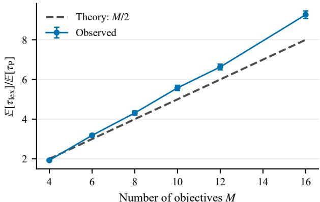
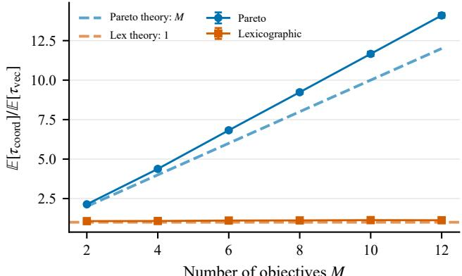
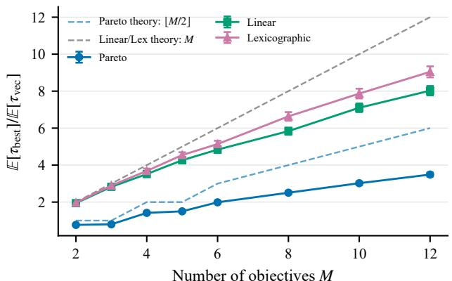
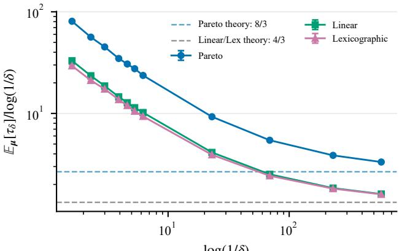
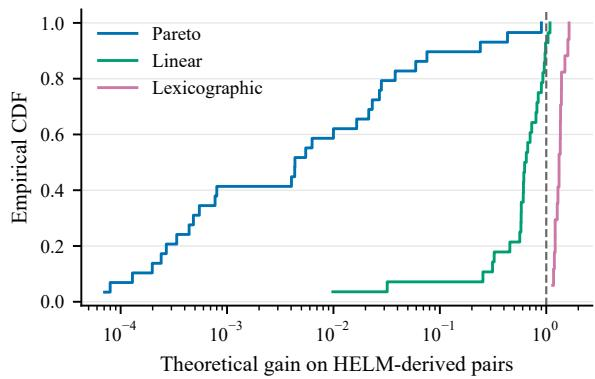
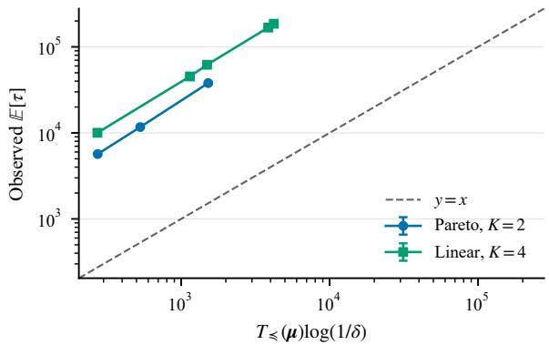

# When More Objectives Make Identification Easier: The Role of Preferences and Feedback

Bo Xue1 Ji Cheng2 Yuanyu Wan3 Shuang Qiu†4

October 14, 2026

## Abstract

Best-arm identification (BAI) aims to identify the optimal arm using as few samples as possible. While most existing work focuses on a single objective, many real-world applications involve multiple criteria, which motivates the study of BAI in multi-objective bandits. Intuitively, multi-objective identification seems harder, since the learner must identify optimal arms in a higher-dimensional reward space; however, the additional objectives also provide richer feedback that can reduce the required exploration. In this paper, we characterize when and why multiple objectives can make BAI easier. For Gaussian bandits, we establish a characteristic-time lower bound for fixed-confidence identification that holds uniformly across preference orders. Through explicit comparisons under Pareto, linear, and lexicographic preferences, we reveal three phenomena: (i) identifying a larger optimal set can require fewer samples than identifying a unique optimum; (ii) the advantage of vector feedback over coordinate feedback depends fundamentally on the preference order; and (iii) multi-objective identification can require fewer samples than even the easiest corresponding single-objective problem. Finally, we propose Order-Aware Track-and-Stop (OATS), an algorithm that is correct at any prescribed confidence level and asymptotically matches the lower bound.

## 1 Introduction

Best-arm identification (BAI) is a fundamental pure-exploration problem that aims to identify the optimal arm using as few samples as possible [Even-Dar et al., 2006, Bubeck et al., 2009, Garivier and Kaufmann, 2016]. Classical BAI considers scalar rewards and defines the optimal arm as the one with the largest mean reward [Audibert et al., 2010, Gabillon et al., 2012, Karnin et al., 2013, Kaufmann et al., 2016]. However, many applications involve multiple and potentially conflicting criteria, such as accuracy, cost, and latency in LLM evaluation [Liang et al., 2023, Chang et al., 2024]. This motivates multi-objective BAI, in which each arm yields a reward vector and optimality is determined by a preference relation [Roijers et al., 2013, Auer et al., 2016, Ararat and Tekin, 2023, Shukla and Basu, 2024]. For example, linear scalarization compares weighted rewards [Drugan and Nowe, 2013], lexicographic preferences rank objectives by priority [Hüyük and Tekin, 2021], and Pareto dominance may admit multiple maximal arms [Auer et al., 2016]. Multi-objective BAI therefore comprises distinct identification tasks whose complexity depends on the preference relation.

Multi-objective identification may appear harder than its scalar counterpart, as its complexity depends not only on reward gaps but also on the geometry of the reward vectors [Karagözlü et al., 2024]. Under Pareto preferences, the learner may even need to identify the entire set of nondominated arms [Kone et al., 2023]. On the other hand, multiple objectives also provide richer feedback: each arm pull typically reveals all reward coordinates, and evidence accumulated across objectives can reduce the required exploration [Xue et al., 2026d]. This tension motivates our central question: When do multiple objectives make best-arm identification harder, and when can they make it easier?

Existing studies provide algorithms and complexity guarantees for Pareto identification [Auer et al., 2016], preference-cone identification [Das et al., 2025], cost-aware Pareto identification [Xue et al., 2026c], and lexicographic identification with cross-objective constraints [Xue et al., 2026d]. However, these results are derived under diferent answer maps, model classes, and feedback models, which makes direct comparisons dificult. A unified analysis should therefore disentangle three factors: the preference order, which determines how arms are compared and hence what must be identified; the model structure, which specifies how rewards may vary across arms and objectives; and the feedback model, which determines what each sample reveals [Garivier and Kaufmann, 2016, Fiez et al., 2019, Degenne et al., 2020, Du et al., 2021]. Their interaction, rather than the number of objectives alone, determines the sample complexity.

To address this gap, we adopt the characteristic time as a common measure of identification dificulty [Garivier and Kaufmann, 2016, Degenne and Koolen, 2019]. For Gaussian bandits, it is governed by the optimal rate at which sampling can distinguish the true instance from feasible alternatives with a diferent correct answer. We construct matched comparisons in which only one of the three factors (preference order, model structure, or feedback model) varies at a time. This allows us to isolate the efect of each factor on sample complexity and to quantify when, and by how much, multiple objectives facilitate identification. Our main contributions are as follows.

• We establish a characteristic-time lower bound for fixed-confidence multi-objective BAI under general preference-induced answer maps. This provides a unified information-theoretic basis for comparing identification tasks across preference orders, model structures, and feedback models.

• Through explicit comparisons under Pareto and lexicographic preferences, we construct instances in which identifying multiple optimal arms is easier than identifying a unique optimum, as well as instances in which the reverse holds. Hence, neither the preference order nor the number of returned arms alone determines identification dificulty.

• We characterize the advantage of vector feedback over coordinate feedback and establish conditions under which multi-objective identification requires fewer samples than the best corresponding single-objective benchmark. These results clarify when observations of multiple objectives accumulate into useful evidence rather than being redundant.

• We propose Order-Aware Track-and-Stop (OATS) and prove its fixed-confidence correctness and asymptotic optimality. Hence, the information-theoretic gains revealed by our comparisons are achievable by an adaptive sampling algorithm.

## 2 Related Work

We review two closely related lines of research: best-arm identification and multi-objective bandits.

Best-arm identification. BAI is a pure-exploration problem studied in both the fixed-budget and the fixed-confidence settings. Early work developed elimination- and confidence-based methods with gap-dependent guarantees for identifying the best arm [Even-Dar et al., 2006, Bubeck et al., 2009, Audibert et al., 2010, Kalyanakrishnan et al., 2012, Gabillon et al., 2012, Karnin et al., 2013, Jamieson et al., 2014]. A complementary information-theoretic line characterizes instance dificulty through alternative models with diferent correct answers, which yields fundamental lower bounds and asymptotically optimal frequentist or Bayesian sampling rules [Kaufmann et al., 2016, Garivier and Kaufmann, 2016, Russo, 2020]. This framework has been extended to problems with multiple valid answers and general answer maps, where the optimal allocation of samples can be formulated as a sequential game [Degenne and Koolen, 2019, Degenne et al., 2019]. Work on combinatorial, linear, and transductive pure exploration further exploits structural dependencies and shared observations through optimization oracles and experimental-design principles [Chen et al., 2014, Soare et al., 2014, Fiez et al., 2019, Degenne et al., 2020].

Multi-objective bandits. Multi-objective bandits associate each arm with a reward vector and define desirable decisions through a preference relation. Early regret-minimization studies considered Pareto dominance and scalarized utilities, and developed methods that learn nondominated arms or optimize aggregate objectives [Drugan and Nowe, 2013, Busa-Fekete et al., 2017]. Subsequent work extended multi-objective regret analysis to contextual, adversarial, and structured linear settings, including dominant-objective and mixed Pareto–lexicographic preferences [Turğay et al., 2018, Tekin and Turğay, 2018, Xu and Klabjan, 2023, Cheng et al., 2024]. Within lexicographic bandits, regret guarantees have been developed for Lipschitz, adversarially corrupted, and structured low-rank models [Xue et al., 2025a,b, 2026a]; hierarchical preferences have also been incorporated into safe multi-objective linear bandits [Xue et al., 2026b]. A complementary pure-exploration line studies Pareto-set identification, with confidence-region, adaptive-sampling, and elimination methods for approximate, relaxed, fixed-budget, and exact fixed-confidence recovery [Auer et al., 2016, Kone et al., 2023, 2024, Crépon et al., 2024]. Recent cost-aware formulations additionally study Pareto identification when vector observations have heterogeneous evaluation costs [Xue et al., 2026c]. More general formulations replace coordinatewise dominance with cone-induced, hierarchical, or lexicographic orders, and characterize how preference geometry and structural relations shape identification complexity [Ararat and Tekin, 2023, Karagözlü et al., 2024, Shukla and Basu, 2024, Das et al., 2025, Xue et al., 2026d].

Most existing studies analyze a single preference relation under a fixed feedback model. In contrast, we compare Pareto, linear, and lexicographic identification within a common characteristictime framework and determine when multi-objective feedback reduces the required exploration.

## 3 Preliminaries

Notation. For any integer $K \geq 1$ , let $[ K ] = \{ 1 , 2 , \dots , K \}$ and $\Delta _ { K } = \{ w \in \mathbb { R } _ { + } ^ { K } : \textstyle \sum _ { i = 1 } ^ { K } w _ { i } = 1 \}$ denote the probability simplex. For any matrix $\pmb { x } \in \mathbb { R } ^ { K \times M }$ with rows $x _ { 1 } , \ldots , x _ { K }$ , its squared Frobenius norm is $\begin{array} { r } { \| \pmb { x } \| _ { F } ^ { 2 } = \sum _ { i = 1 } ^ { K } \| \boldsymbol { x } _ { i } \| _ { 2 } ^ { 2 } } \end{array}$ . For any set $S \subseteq \mathbb { R } ^ { M }$ , the distance from $\boldsymbol { x } \in \mathbb { R } ^ { M }$ to S is dist $\begin{array} { r } { ( x , S ) = \operatorname* { i n f } _ { z \in S } \| x - z \| _ { 2 } } \end{array}$

We consider a stochastic multi-armed bandit with $K \geq 2$ arms and $M \geq 1$ objectives, where larger rewards are preferred. Each arm $i \in [ K ]$ is associated with an unknown mean vector $\mu _ { i } \in \mathbb { R } ^ { M }$ and the bandit instance is denoted by $\pmb { \mu } = ( \mu _ { 1 } , \dots , \mu _ { K } ) \in \mathbb { R } ^ { K \times M }$ . At round $t ,$ the learner selects an arm $I _ { t }$ based on the observations collected so far and observes

$$
X _ { t } = \mu _ { I _ { t } } + \varepsilon _ { t } , \qquad \varepsilon _ { t } \sim \mathcal { N } ( 0 , I _ { M } ) ,
$$

where the noise vectors are independent across rounds. Accordingly, sample complexity counts vector observations (i.e., arm pulls) rather than individual scalar measurements.

The identification target is determined by a known preference relation $\preceq \mathrm { o n } \mathbb { R } ^ { M }$ , with strict part denoted by ≺. We consider three representative orders:

$$
\begin{array} { r l r l } & { x \prec _ { \mathsf { P } } y \iff x _ { m } \leq y _ { m } \mathrm { ~ f o r ~ e v e r y ~ } m \mathrm { ~ a n d ~ } x _ { m } < y _ { m } \mathrm { ~ f o r ~ s o m e ~ } m , } & & { \mathrm { ( P a r e t o ) } , } \\ & { x \prec _ { v } y \iff v ^ { \mathsf { T } } x < v ^ { \mathsf { T } } y , \quad v \in \mathbb { R } _ { + } ^ { M } \setminus \{ \mathsf { 0 } \} , } & & { \mathrm { ( l i n e a r ~ s c a l a r i z a t i o n ) } , } \\ & { x \prec _ { \mathsf { i e x } } y \iff x _ { r ( x , y ) } < y _ { r ( x , y ) } , \quad r ( x , y ) = \operatorname* { m i n } \{ m : x _ { m } \neq y _ { m } \} , } & & { \mathrm { ( l e x i c o g r a p h i c ) } . } \end{array}
$$

For an instance $\mu ,$ the prescribed answer is the complete set of maximal arms:

$$
A _ { \preceq } ( \mu ) = \{ i \in [ K ] : \exists j \in [ K ] \ \mathrm { s u c h \ t h a t \ } \mu _ { i } \prec \mu _ { j } \} .\tag{1}
$$

Under linear scalarization or lexicographic preferences, this set is typically a singleton, whereas Pareto dominance may admit multiple maximal arms. Importantly, $A _ { \preceq } ( \pmb { \mu } )$ is a single set-valued answer: the learner must recover the entire set in Eq. (1), rather than return any one of several valid answers as in multiple-answer identification [Degenne and Koolen, 2019]. More generally, our analysis applies to any prescribed answer map with a finite range.

Fixed-confidence identification. For $\delta \in ( 0 , 1 / 2 )$ , a fixed-confidence algorithm adaptively selects arms based on past observations, stops at a data-dependent time $\tau _ { \delta } ,$ , and outputs a recommendation ${ \widehat { A } } _ { \delta } \subseteq [ K ]$ . It is δ-correct on a model class $\Theta \subseteq \mathbb { R } ^ { K \times M }$ if, for every $\pmb { \mu } \in \Theta$ 2

$$
\mathbb { P } _ { \mu } \left( \tau _ { \delta } < \infty \right) = 1 , \qquad \mathbb { P } _ { \mu } \left( \widehat { A } _ { \delta } = A _ { \preceq } ( \mu ) \right) \geq 1 - \delta .
$$

Performance is measured by the expected stopping time $\mathbb { E } _ { \mu } [ \tau _ { \delta } ]$ , which we aim to minimize subject to δ-correctness. The dificulty of this problem depends on how close $\pmb { \mu }$ is to instances in $\Theta$ with a diferent answer: the closer these alternatives are, the more samples are needed to rule them out.

In classical BAI, a standard assumption is that the best arm is unique [Kaufmann et al., 2016, Garivier and Kaufmann, 2016]. With finitely many arms, this implies a strictly positive gap between the best and second-best arms, so the best arm is preserved under suficiently small perturbations of the means. We impose the analogous condition on the general, possibly set-valued, answer map $A _ { \preceq }$

Assumption 1 (Local stability). The true instance $\pmb { \mu } \in \Theta$ is locally stable with respect to the answer map: there exists $r _ { \mu } > 0$ such that

$$
A _ { \preceq } ( \pmb { \nu } ) = A _ { \preceq } ( \pmb { \mu } ) \quad f o r \ e v e r y \ \pmb { \nu } \in \Theta \ s a t i s f y i n g \ \| \pmb { \nu } - \pmb { \mu } \| _ { F } < r _ { \mu } .\tag{2}
$$

Assumption 1 requires the answer $A _ { \preceq } ( \pmb { \mu } )$ to remain unchanged under suficiently small feasible perturbations. Equivalently, $\pmb { \mu }$ lies in the interior of the set of instances sharing its answer.

## 4 A Unified Lower Bound for Identification

In this section, we derive a characteristic-time lower bound that holds uniformly across preference relations. We first describe the answer-changing alternatives that any algorithm must rule out. For an instance $\pmb { \mu } \in \Theta$ , define its set of feasible alternatives as

$$
{ \mathrm { A l t } } { \underset {  } {  } } ( \pmb \mu ) = \{ \pmb { \nu } \in \Theta : A _ { \preceq } ( \pmb { \nu } ) \neq A _ { \preceq } ( \pmb \mu ) \} .\tag{3}
$$

A δ-correct algorithm must distinguish $\pmb { \mu }$ from every instance in $\mathrm { A l t } _ { \preceq } ( \mu )$ . Under the Gaussian observation model, each sample from arm i contributes a KL divergence of $\lVert \mu _ { i } - \nu _ { i } \rVert _ { 2 } ^ { 2 } / 2$ between $\pmb { \mu }$ and ν. Hence, under an allocation $w \in \Delta _ { K }$ , the information rate against ν is

$$
\mathcal { T } ( \mu , \nu ; w ) = \frac { 1 } { 2 } \sum _ { i = 1 } ^ { K } w _ { i } \| \mu _ { i } - \nu _ { i } \| _ { 2 } ^ { 2 } .
$$

Optimizing the allocation against the worst-case feasible alternative yields the characteristic information rate, whose reciprocal is the characteristic time:

$$
\mathcal { Z } _ { \preceq } ^ { * } ( \mu ) = \operatorname* { s u p } _ { w \in \Delta _ { K } } \operatorname* { i n f } _ { \nu \in \mathrm { A l t } _ { \preceq } ( \mu ) } \mathcal { T } ( \mu , \nu ; w ) , \qquad T _ { \preceq } ( \mu ) = \frac { 1 } { \mathcal { T } _ { \preceq } ^ { * } ( \mu ) } .\tag{4}
$$

We restrict attention to instances with nonempty alternative sets. Together with local stability (Assumption 1), this guarantees $0 < \mathcal { T } _ { \prec } ^ { * } ( \mu ) < \infty$

Theorem 1 (Unified characteristic-time lower bound). For any $\delta \in ( 0 , 1 / 2 )$ , any algorithm that is δ-correct on Θ, and any $\pmb { \mu } \in \Theta$ 2

$$
\mathbb { E } _ { \mu } [ \tau _ { \delta } ] \geq T _ { \preceq } ( \mu ) \mathrm { k l } ( 1 - \delta , \delta ) \quad \Rightarrow \quad \operatorname* { l i m i n f } _ { \delta \downarrow 0 } \frac { \mathbb { E } _ { \mu } [ \tau _ { \delta } ] } { \log ( 1 / \delta ) } \geq T _ { \preceq } ( \mu ) ,\tag{5}
$$

where $\mathrm { k l } ( p , q ) = p \log ( p / q ) + ( 1 - p ) \log ( ( 1 - p ) / ( 1 - q ) )$ is the binary relative entropy.

Theorem 1 applies uniformly to all preference relations because the order enters only through the answer-changing set $\mathrm { A l t } _ { \preceq } ( \mu )$ and the resulting characteristic time $T _ { \preceq } ( \pmb { \mu } )$ . By a standard change-of-measure argument, any δ-correct algorithm must accumulate an expected divergence of at least $\operatorname { k l } ( 1 - \delta , \delta )$ between $\pmb { \mu }$ and every answer-changing alternative [Kaufmann et al., 2016, Garivier and Kaufmann, 2016]. Under any sampling allocation, the worst-case information gained per sample is at most $\smash { \mathcal { T } _ { - } ^ { * } ( \pmb { \mu } ) }$ . Therefore, at least $T _ { \preceq } ( \pmb { \mu } ) \operatorname { k l } ( 1 - \delta , \delta )$ samples are needed in expectation, which yields Eq. (5). The asymptotic statement follows from $\operatorname { k l } ( 1 - \delta , \delta ) \sim \log ( 1 / \delta )$ as $\delta \downarrow 0$

Two-arm geometry. For $K = 2 .$ , suppose that both Θ and the answer depend only on the diference between the two arm means. Define the set of feasible diferences as

$$
\mathcal { D } = \{ \mu _ { 1 } - \mu _ { 2 } : \pmb { \mu } = ( \mu _ { 1 } , \mu _ { 2 } ) \in \Theta \} \subseteq \mathbb { R } ^ { M } .
$$

For a fixed instance $\pmb { \mu } = ( \mu _ { 1 } , \mu _ { 2 } ) \in \Theta$ , let $d = \mu _ { 1 } - \mu _ { 2 } \in \mathcal { D }$ . With a slight abuse of notation, define

$$
T _ { \preceq } ( d ) = T _ { \preceq } ( \mu ) , \qquad \mathrm { A l t } _ { \preceq } ( d ) = \{ \nu _ { 1 } - \nu _ { 2 } : \nu = ( \nu _ { 1 } , \nu _ { 2 } ) \in \mathrm { A l t } _ { \preceq } ( \mu ) \} \subseteq \mathcal { D } .
$$

Both quantities are well defined and invariant under a common translation of the two arm means.

Lemma 1 (Two-arm distance formula). $H d \in { \mathcal { D } }$ and $0 < \mathrm { d i s t } ( d , \mathrm { A l t } _ { \preceq } ( d ) ) < \infty$ , then

$$
T _ { \preceq } ( d ) = { \frac { 8 } { \mathrm { d i s t } ^ { 2 } ( d , { \mathrm { A l t } } _ { \preceq } ( d ) ) } } .\tag{6}
$$

Lemma 1 gives a geometric interpretation: identification complexity is determined by the distance from d to the nearest answer-changing diference. When several objectives must be perturbed to change the answer, their contributions add up in the squared distance, reducing the characteristic time. We next use this formula to compare preference relations.

## 5 Multi-Objective Identification Gains

In this section, we use the characteristic time to determine when multiple objectives facilitate identification. Specifically, we address three questions: (i) Can a larger optimal set be easier to identify? (ii) How much can vector feedback reduce the complexity of a fixed identification task? (iii) When can a multi-objective task be easier than the best corresponding single-objective benchmark?

## 5.1 Larger Optimal Sets Can Be Easier to Identify

We first compare Pareto and lexicographic identification on the same two-arm instances. The following result shows that identification dificulty is not determined by the size of the optimal set.

Proposition 1 (A larger optimal set can be easier to identify). Consider the unrestricted two-arm model (Appendix D). Let $M \geq 4$ be even and $\Delta > 0$ . For $d = \left( \Delta \mathbf { 1 } _ { M / 2 } , - \Delta \mathbf { 1 } _ { M / 2 } \right)$ , the Pareto-optimal set is {1, 2} and the lexicographic optimum is {1}. Nevertheless,

$$
T _ { \mathrm { P } } ( d ) = \frac { 1 6 } { M \Delta ^ { 2 } } , \qquad T _ { \mathrm { l e x } } ( d ) = \frac { 8 } { \Delta ^ { 2 } } \quad \Rightarrow \quad \frac { T _ { \mathrm { l e x } } ( d ) } { T _ { \mathrm { P } } ( d ) } = \frac { M } { 2 } .\tag{7}
$$

Conversely, for $d = ( 1 , \ldots , 1 , \epsilon )$ with $0 < \epsilon < 1$ , both preferences identify arm 1 as optimal, but

$$
T _ { \mathrm { P } } ( d ) = \frac { 8 } { \epsilon ^ { 2 } } , \qquad T _ { \mathrm { l e x } } ( d ) = 8 \quad \Rightarrow \quad \frac { T _ { \mathrm { l e x } } ( d ) } { T _ { \mathrm { P } } ( d ) } = \epsilon ^ { 2 } .\tag{8}
$$

In the first instance, Eq. (7), each arm outperforms the other on half of the objectives. Under Pareto dominance, changing the answer requires removing one arm from the Pareto-optimal set, which in turn requires closing all $M / 2$ coordinate gaps on which that arm is superior. Hence, the nearest Pareto alternative lies at squared distance $M \Delta ^ { 2 } / 2$ . By contrast, the lexicographic answer is determined solely by the first coordinate, so the nearest alternative lies at squared distance $\Delta ^ { 2 }$ Lemma 1 therefore yields the factor- $M / 2$ separation in Eq. (7).

The second instance, Eq. (8), shows that this ordering does not hold uniformly. Although both preferences identify arm 1 as optimal, the Pareto answer changes as soon as the smallest coordinate gap ϵ is reversed, whereas the lexicographic answer depends only on the fixed gap in the first coordinate. Consequently, $T _ { \mathrm { l e x } } ( d ) / T _ { \mathrm { P } } ( d ) = \epsilon ^ { 2 }$ , which can be made arbitrarily small as $\epsilon \downarrow 0$ Together, these two constructions show that neither preference relation is uniformly easier than the other, and that identification complexity cannot be inferred from the size of the optimal set alone.

## 5.2 The Value of Feedback Depends on the Preference Order

We next compare vector and coordinate feedback for a fixed identification task. The following result shows that the gain from vector feedback can range from none to a factor of M.

Under vector feedback, sampling an arm reveals all M objectives, whereas coordinate feedback reveals only one chosen objective of one chosen arm. For an allocation $q \in \Delta _ { K M }$ over arm–objective pairs, define the coordinate-feedback information rate against an alternative ν as

$$
{ \mathcal { T } } ^ { \mathrm { c o } } ( \pmb { \mu } , \pmb { \nu } ; q ) = \frac { 1 } { 2 } \sum _ { i = 1 } ^ { K } \sum _ { m = 1 } ^ { M } q _ { i , m } ( \mu _ { i , m } - \nu _ { i , m } ) ^ { 2 } .
$$

The coordinate-feedback characteristic time $T _ { \preceq } ^ { \mathrm { c o } }$ is defined analogously to (4), with $q$ and $\mathcal { T } ^ { \mathrm { c o } }$ replacing w and $\mathcal { T } ,$ respectively.

Proposition 2 (The value of feedback depends on the preference order). Every instance µ with $\operatorname { A l t } _ { \preceq } ( \mu ) \neq \emptyset$ satisfies

$$
T _ { \preceq } ( { \pmb \mu } ) \leq T _ { \preceq } ^ { \mathrm { c o } } ( { \pmb \mu } ) \leq M T _ { \preceq } ( { \pmb \mu } ) .\tag{9}
$$

In the unrestricted two-arm model with $d = \Delta \mathbf { 1 } _ { M }$ and $\Delta > 0$ , the lexicographic and Pareto orders attain the lower and upper endpoints, respectively:

$$
T _ { \mathrm { l e x } } ( d ) = T _ { \mathrm { P } } ( d ) = { \frac { 8 } { \Delta ^ { 2 } } } , \qquad T _ { \mathrm { l e x } } ^ { \mathrm { c o } } ( d ) = { \frac { 8 } { \Delta ^ { 2 } } } , \qquad T _ { \mathrm { P } } ^ { \mathrm { c o } } ( d ) = { \frac { 8 M } { \Delta ^ { 2 } } } .\tag{10}
$$

Proposition 2 shows that the benefit of vector feedback depends fundamentally on the preference order, ranging from no gain to an M-fold reduction in characteristic time. Under Pareto dominance, every objective can change the optimal set, so coordinate feedback must spread samples across all M objectives, whereas vector feedback observes them simultaneously and achieves the full factor-M improvement. Under the lexicographic order, only the first objective matters, so coordinate feedback can concentrate entirely on that objective and match vector feedback. Hence, richer feedback helps only when the preference order makes multiple objectives informative for identification.

## 5.3 When Multiple Objectives Outperform Single-Objective Benchmarks

We now compare multi-objective identification with the best single-objective benchmark. Each objective, considered alone, defines a scalar BAI problem, and we ask whether multi-objective identification can require fewer samples than even the easiest of these scalar problems.

For the two-arm gap vector $d = \mu _ { 1 } - \mu _ { 2 } \in \mathbb { R } ^ { M }$ , assume that $d _ { m } \neq 0$ for all $m .$ . Objective m alone then has characteristic time $8 / d _ { m } ^ { 2 }$ . With $\Delta _ { \operatorname* { m a x } } ( d ) = \operatorname* { m a x } _ { m \in [ M ] } | d _ { m } |$ , we define the best single-objective benchmark and the corresponding multi-objective gain as

$$
T _ { \mathrm { b e s t } } ( d ) = \operatorname* { m i n } _ { m \in [ M ] } \frac { 8 } { d _ { m } ^ { 2 } } = \frac { 8 } { \Delta _ { \mathrm { m a x } } ^ { 2 } ( d ) } , \quad \mathsf { G a i n } _ { \preceq } ( d ) = \frac { T _ { \mathrm { b e s t } } ( d ) } { T _ { \preceq } ( d ) } .
$$

A gain greater than one means that the multi-objective task has a smaller characteristic time than every single-objective task. Since the multi-objective and single-objective tasks may have diferent answers, this is a comparison between tasks, not between feedback models for the same task.

Proposition 3 (Acceleration under three preference orders). Let $d \in \mathbb { R } ^ { M }$ have no zero coordinates, and define $\begin{array} { r } { S _ { + } ( d ) = \sum _ { m : d _ { m } > 0 } d _ { m } ^ { 2 } } \end{array}$ and $\begin{array} { r } { S _ { - } ( d ) = \sum _ { m : d _ { m } < 0 } d _ { m } ^ { 2 } } \end{array}$ . Under vector feedback, strict improvement over the best single-objective benchmark occurs in the following regimes:

$$
\mathsf { G a i n } _ { \mathrm { P } } ( d ) = \frac { \operatorname* { m i n } \{ S _ { + } ( d ) , S _ { - } ( d ) \} } { \Delta _ { \operatorname* { m a x } } ^ { 2 } ( d ) } > 1 , \quad i f \operatorname* { m i n } \{ S _ { + } ( d ) , S _ { - } ( d ) \} > \Delta _ { \operatorname* { m a x } } ^ { 2 } ( d ) ,
$$

$$
\mathsf { G a i n } _ { v } ( d ) = \frac { ( v ^ { \top } d ) ^ { 2 } } { \| v \| _ { 2 } ^ { 2 } \Delta _ { \operatorname* { m a x } } ^ { 2 } ( d ) } > 1 , \qquad i f | v ^ { \top } d | > \| v \| _ { 2 } \Delta _ { \operatorname* { m a x } } ( d ) ,\tag{11}
$$

$$
\mathsf { G a i n } _ { \mathrm { l e x } } ( d ) = \frac { \| d \| _ { 2 } ^ { 2 } } { \Delta _ { \operatorname* { m a x } } ^ { 2 } ( d ) } > 1 , \qquad i f d \in \mathcal { D } = \mathbb { R } _ { + + } ^ { M } \cup ( - \mathbb { R } _ { + + } ^ { M } ) , \ M \geq 2 .
$$

Proposition 3 shows that multi-objective acceleration arises when changing the answer requires coordinated changes across several objectives, so that their information contributions accumulate under vector feedback. Under Pareto dominance, this occurs when the two arms are incomparable and both sign groups have suficiently large aggregate gaps, i.e., min $\{ S _ { + } ( d ) , S _ { - } ( d ) \} > \Delta _ { \operatorname* { m a x } } ^ { 2 } ( d )$ . The gain is largest when the positive and negative gaps are well balanced across objectives, and it can reach $\lfloor M / 2 \rfloor$ . Under linear scalarization, acceleration occurs when the weighted gaps reinforce one another, i.e., $| v ^ { \top } d | > \| v \| _ { 2 } \Delta _ { \operatorname* { m a x } } ( d )$ . Thus, aligned gaps promote acceleration, whereas cancellation across objectives reduces or eliminates it; the maximum gain is M.

Algorithm 1 OATS: Order-Aware Track-and-Stop   
Input: Preference relation $\preceq ,$ model class Θ, confidence $\delta$   
1: Pull each arm once; set $t  K$ and $S  \mathbf { 1 } _ { K }$   
2: while true do   
3: Compute the empirical mean matrix $\widehat { \pmb { \mu } } _ { t }$   
4: Fit the candidate answer $\widehat { A } _ { t }$ using Eq. (12)   
5: Evaluate the evidence $Z _ { t }$ against competing answers using Eq. (13)   
6: if $Z _ { t } > \beta ( t , \delta )$ then   
7: return $\hat { A } _ { t }$   
8: end if   
9: Compute the most informative allocation: $w _ { t } \in \arg \operatorname* { m a x } _ { w \in \Delta _ { K } } g _ { \widehat { A } _ { t } } ( \widehat { \pmb { \mu } } _ { t } , w )$   
10: Mix with forced exploration: $q _ { t } \gets ( 1 - t ^ { - 1 / 2 } ) w _ { t } + t ^ { - 1 / 2 } \mathbf { 1 } _ { K } / K$   
11: Update the cumulative target: $S \gets S + q _ { t }$   
12: Select the arm with the largest deficit: $I _ { t + 1 } \gets \arg \operatorname* { m a x } _ { i \in [ K ] } \{ S _ { i } - N _ { i } ( t ) \}$   
13: Pull $I _ { t + 1 }$ and update the counts and empirical means   
14: $t \gets t + 1$   
15: end while

Under lexicographic preferences, acceleration stems from the common-ranking constraint $\mathcal { D } =$ $\mathbb { R } _ { + + } ^ { M } \cup ( - \mathbb { R } _ { + + } ^ { M } )$ . This constraint forces every answer-changing alternative to reverse the ordering on all objectives simultaneously, so the relevant separation scales with $\| d \| _ { 2 } ^ { 2 }$ . Consequently, strict acceleration occurs for every $M \ \geq \ 2 .$ , and the gain reaches M when all coordinate gaps have equal magnitude. Without this constraint, reversing the first objective alone sufices to change the lexicographic answer, and the multi-objective acceleration disappears (Appendix G).

## 6 Attaining the Characteristic Time

In this section, we show that the characteristic-time lower bound in Theorem 1 can be attained asymptotically. Building on the Track-and-Stop framework [Garivier and Kaufmann, 2016, Degenne and Koolen, 2019], we propose OATS, an order-aware procedure that repeatedly estimates the current answer, allocates samples to distinguish it from its closest alternatives, and stops once suficient evidence has been collected. The complete procedure is given in Algorithm 1.

We first introduce some notation. Let $\mathcal { A } = \{ A _ { \preceq } ( \pmb { \mu } ) : \pmb { \mu } \in \Theta \}$ denote the set of possible answers, and let $\Theta _ { A } = \{ \pmb { \nu } \in \Theta : A _ { \prec } ( \pmb { \nu } ) = A \}$ denote the region of instances with answer A. For any estimate $\widehat { \pmb { \mu } } = ( \widehat { \mu } _ { 1 } , \dots , \widehat { \mu } _ { K } ) \in \mathbb { R } ^ { K \times \overline { { M } } }$ and allocation $w \in \Delta _ { K }$ , define

$$
g _ { A } ( \widehat { \pmb { \mu } } , \pmb { w } ) = \operatorname* { i n f } _ { \pmb { \nu } \in \Theta \backslash \Theta _ { A } } \mathbb { Z } ( \widehat { \pmb { \mu } } , \pmb { \nu } ; \pmb { w } ) = \operatorname* { i n f } _ { \pmb { \nu } \in \Theta \backslash \Theta _ { A } } \frac { 1 } { 2 } \sum _ { i = 1 } ^ { K } w _ { i } \Vert \widehat { \pmb { \mu } } _ { i } - \nu _ { i } \Vert _ { 2 } ^ { 2 } ,
$$

which is the smallest information rate that w provides against instances with a diferent answer.

Given a confidence level $\delta \in ( 0 , 1 ) , \mathrm { O A T S }$ first samples every arm once. At each round $t ,$ it computes the empirical mean matrix $\widehat { \pmb { \mu } } _ { t }$ and selects the answer whose region is closest to this estimate:

$$
\widehat { A } _ { t } \in \mathop { \mathrm { a r g } } \operatorname* { m i n } _ { A \in \mathcal { A } } \operatorname* { i n f } _ { \nu \in \Theta _ { A } } \| \widehat { \pmb { \mu } } _ { t } - \pmb { \nu } \| _ { F } ^ { 2 } .\tag{12}
$$

Let $\begin{array} { r } { N _ { i } ( t ) = \sum _ { s = 1 } ^ { t } \mathbb { I } \{ I _ { s } = i \} } \end{array}$ denote the number of pulls of arm $i \in [ K ]$ up to round $t ,$ and let $N ( t ) = ( N _ { 1 } ( t ) , \ldots , N _ { K } ( t ) )$ . OATS then evaluates the evidence in favor of $\widehat { A } _ { t }$ through

$$
Z _ { t } = t \times g _ { \widehat { A } _ { t } } \left( \widehat { \mu } _ { t } , \frac { N ( t ) } { t } \right) = \operatorname* { i n f } _ { \nu \in \Theta \backslash \Theta _ { \widehat { A } _ { t } } } \frac { 1 } { 2 } \sum _ { i = 1 } ^ { K } N _ { i } ( t ) \| \widehat { \mu } _ { i } ( t ) - \nu _ { i } \| _ { 2 } ^ { 2 } .\tag{13}
$$

Thus, $Z _ { t }$ measures the information accumulated against the closest instance with a diferent answer. We use the stopping threshold

$$
\beta ( t , \delta ) = \frac { K M } { 2 } + \sqrt { K M \log \frac { 2 ( t + 1 ) ^ { K + 2 } } { \delta } } + \log \frac { 2 ( t + 1 ) ^ { K + 2 } } { \delta } ,\tag{14}
$$

which controls the estimation error uniformly over time and over all possible sample-count vectors. If $Z _ { t } > \beta ( t , \delta )$ , the algorithm stops and returns $\widehat { A } _ { t }$ . Otherwise, OATS computes the most informative allocation

$$
w _ { t } \in \mathop { \mathrm { a r g } \operatorname* { m a x } } _ { w \in \Delta _ { K } } g _ { \widehat { A } _ { t } } ( \widehat { \pmb { \mu } } _ { t } , w ) ,\tag{15}
$$

which maximizes the estimated information rate against alternatives to the current answer. To ensure suficient exploration, it then sets

$$
q _ { t } = ( 1 - t ^ { - 1 / 2 } ) w _ { t } + t ^ { - 1 / 2 } \frac { { \bf 1 } _ { K } } { K } .
$$

The uniform component vanishes asymptotically but guarantees that every arm receives $\Omega ( { \sqrt { t } } )$ observations. Next, OATS updates the cumulative target and selects the arm with the largest deficit:

$$
S \gets S + q _ { t } , \qquad I _ { t + 1 } \in \underset { i \in [ K ] } { \arg \operatorname* { m a x } } \{ S _ { i } - N _ { i } ( t ) \} .
$$

Since $S _ { i } - N _ { i } ( t )$ is the sampling deficit of arm i relative to its cumulative target, this tracking rule keeps the realized sample counts within a bounded distance of their targets. Finally, OATS pulls arm $I _ { t + 1 }$ and updates the counts and empirical means.

The following theorem establishes the correctness and asymptotic optimality of OATS.

Theorem 2 (Asymptotic optimality of OATS). Suppose every instance in Θ satisfies Assumption 1   
and has a nonempty alternative set. Then OATS is δ-correct, and for every $\pmb { \mu } \in \Theta$ 2

$$
\operatorname* { l i m } _ { \delta \downarrow 0 } \frac { \mathbb { E } _ { \pmb { \mu } } [ \tau _ { \delta } ] } { \log ( 1 / \delta ) } = T _ { \preceq } ( \pmb { \mu } ) .\tag{16}
$$

Theorem 2 shows that OATS is not only δ-correct but also asymptotically instance-optimal: for any fixed instance, its expected stopping time matches the characteristic-time lower bound of Theorem 1 to first order as $\delta \downarrow 0 .$ . This extends classical Track-and-Stop for scalar BAI [Garivier and Kaufmann, 2016] to preference-induced, possibly set-valued identification problems. Whereas previous extensions have considered multiple valid answers [Degenne and Koolen, 2019] or specific multi-objective targets such as Pareto-front identification [Crépon et al., 2024], OATS handles diferent preference orders and model structures through a single answer-changing formulation. Consequently, the three phenomena of Section 5 are attained by an adaptive procedure and are not mere properties of the lower bound. In particular, whenever the preference relation or structural constraints enlarge the information distance to the nearest answer-changing alternative, OATS asymptotically exploits this additional information. Applying the same analysis to a single known coordinate also shows that the oracle single-objective benchmark is attainable.

  
(a) Larger optimal sets can be easier

  
(b) Feedback value (matched threshold)

  
(c) Multi-objective acceleration

  
(d) Asymptotic optimality of OATS  
Figure 1: Synthetic results for Propositions 1–3 and Theorem 2. (a) The ratio $\mathbb { E } [ \tau _ { \mathrm { l e x } } ] / \mathbb { E } [ \tau _ { \mathrm { P } } ]$ grows with M: Pareto-set identification becomes increasingly easier than lexicographic identification. (b) The feedback gain $\mathbb { E } [ \tau _ { \mathrm { c o o r d } } ] / \mathbb { E } [ \tau _ { \mathrm { v e c } } ]$ grows with M under the Pareto order but remains near one under the lexicographic order. (c) The gain $\mathbb { E } [ \tau _ { \mathrm { b e s t } } ] / \mathbb { E } [ \tau _ { \mathrm { v e c } } ]$ increases with M under all three orders and stays above one, confirming multi-objective acceleration. (d) The normalized stopping time $\mathbb { E } _ { \pmb { \mu } } [ \tau _ { \delta } ] / \log ( 1 / \delta )$ decreases toward the corresponding characteristic time as δ decreases. Markers show empirical means with 95% confidence intervals, and dashed lines show theoretical predictions.

## 7 Experiments

In this section, we run synthetic experiments to test whether OATS exhibits the identification phenomena of Propositions 1–3 and the asymptotic optimality of Theorem 2. Appendix A reports supplementary results on instances derived from the HELM Instruct ratings [Zhang et al., 2024].

Experimental setup. All experiments use independent observations $X _ { i , t } \sim \mathcal { N } ( \mu _ { i } , I _ { M } )$ . For two-arm instances, we set $\mu _ { 1 } = d / 2$ and $\mu _ { 2 } = - d / 2$ . Unless otherwise specified, we use $\Delta = 1$ and $\delta = 0 . 0 5$ . Each configuration is evaluated over 500 independent repetitions with deterministic seeds.

Figure 1(a) evaluates Proposition 1 for even $M \in \{ 4 , 6 , 8 , 1 0 , 1 2 , 1 6 \}$ under the mixed-sign gap $d = \left( \mathbf { 1 } _ { M / 2 } , - \mathbf { 1 } _ { M / 2 } \right)$ , for which the proposition predicts $T _ { \mathrm { l e x } } / T _ { \mathrm { P } } = M / 2$ . The empirical stopping-time ratio grows approximately linearly in M and closely tracks this prediction, lying slightly above it for larger M. These results confirm that the advantage of Pareto-set identification over lexicographic identification scales linearly with the number of objectives.

Figure 1(b) validates Proposition 2 with $d = \mathbf { 1 } _ { M }$ and $M \in \{ 2 , 4 , 6 , 8 , 1 0 , 1 2 \}$ , comparing vector and coordinate feedback under the Pareto and lexicographic orders. The proposition predicts coordinate-to-vector characteristic-time ratios of M and 1, respectively. The observed Pareto ratio grows approximately linearly in M, whereas the lexicographic ratio stays close to one. Both trends closely follow the predictions, up to a modest finite-confidence gap. These results confirm that the benefit of vector feedback depends critically on the preference order.

Figure 1(c) tests Proposition 3 for $M \in \{ 2 , 3 , 4 , 5 , 6 , 8 , 1 0 , 1 2 \}$ by comparing vector-feedback identification with a scalar oracle that knows $m ^ { * } \in \arg \operatorname* { m a x } _ { m } \left| d _ { m } \right|$ . We use $d = \left( \mathbf { 1 } _ { M / 2 } , - \mathbf { 1 } _ { M / 2 } \right)$ for the Pareto order and $d = \mathbf { 1 } _ { M }$ for the linear and common-ranking lexicographic orders, with $v = \mathbf { 1 } _ { M } / \sqrt { M }$ for linear scalarization. The stopping-time gain $\mathbb { E } [ \tau _ { \mathrm { b e s t } } ] / \mathbb { E } [ \tau _ { \mathrm { v e c } } ]$ grows nearly linearly in M for the linear and lexicographic orders and more slowly for the Pareto order, consistent with the theory. At finite confidence, the empirical gains remain below the characteristic-time predictions, particularly for larger M, because the thresholds in Eq. (14) for the scalar and vector procedures use diferent dimensions, namely $K M = 2$ and $K M = 2 M$ , respectively.

Figure 1(d) evaluates the asymptotic optimality of OATS established in Theorem 2. We use $M = 6$ , with $d = ( 1 , 1 , 1 , - 1 , - 1 , - 1 )$ for the Pareto order and $d = \mathbf { 1 } _ { 6 }$ for the linear and lexicographic orders. We plot the normalized stopping time $\mathbb { E } _ { \pmb { \mu } } [ \tau _ { \delta } ] / \log ( 1 / \delta )$ for confidence levels δ ranging from 0.2 down to $1 0 ^ { - 2 5 0 }$ . The theorem predicts that this quantity converges to $T _ { \preceq } ( \pmb { \mu } ) = 8 / 3$ for Pareto identification and to $T _ { \preceq } ( \pmb { \mu } ) = 4 / 3$ for both linear and lexicographic identification. Consistent with this prediction, all three curves decrease monotonically toward their respective limits as $\log ( 1 / \delta )$ grows. The linear and lexicographic curves nearly coincide and approach their common limit of $4 / 3 ,$ whereas the Pareto curve converges to the higher limit of $8 / 3$ . The empirical results thus agree with the asymptotic characterization in Theorem 2.

Summary. Overall, the synthetic experiments confirm that larger optimal sets can be easier to identify, the benefit of vector feedback depends on the preference order, and multiple objectives can accelerate identification; moreover, the normalized stopping time of OATS approaches the characteristic time. Appendix A complements these synthetic results with implementation details, HELM-derived Gaussian instances, allocation baselines against uniform sampling and Oracle-Track, and additional robustness and scaling checks.

## 8 Conclusion and Future Work

In this paper, we studied when multiple objectives make fixed-confidence identification easier rather than harder. By casting diferent preference orders in a common characteristic-time framework, we disentangled the efects of the preference relation, the feasible model class, and the feedback model on identification complexity. Our results show that identification dificulty is governed by the geometry of answer-changing alternatives rather than by the number of objectives or the size of the optimal set alone. In particular, Pareto and lexicographic identification admit no universa hardness ordering, the benefit of vector feedback ranges from no gain to an M-fold improvement, and multi-objective identification can be strictly easier than the best corresponding single-objective problem. We further proposed OATS, which asymptotically matches the lower bound and thereby shows that these gains are achievable.

Future directions include extending the analysis beyond Gaussian observations to more general reward and feedback models, such as heavy-tailed noise or partially observed objectives, and developing scalable approximations of the optimal allocation for problems with many arms or objectives.

## Appendix

## A Experimental Details and Additional Results

Implementation and numerical checks. We implement OATS following Algorithm 1, including the empirical answer, the stopping statistic, the forced-exploration mixture, and the cumulativedeficit tracking rule. For two-arm experiments under vector feedback, Lemma 1 and its proof reduce the closest-alternative problem to (18), which yields the balanced allocation $w = ( 1 / 2 , 1 / 2 )$ ; the corresponding Pareto, linear, and lexicographic distances are derived in Proposition 4 and its proof. For coordinate feedback, we use the information formulas and optimal allocations derived in the proof of Proposition 2. For linear identification with general K, we project each mean vector onto $v / \| v \| _ { 2 }$ , which reduces the allocation problem to scalar Gaussian best-arm identification. For a candidate singleton answer $A = \{ i _ { A } \}$ , let $c _ { j } = ( v ^ { \top } ( \mu _ { i _ { A } } - \mu _ { j } ) ) ^ { 2 } / ( 2 \| v \| _ { 2 } ^ { 2 } )$ for $j \neq i _ { A }$ , so that

$$
g _ { A } ( \pmb { \mu } , \pmb { w } ) = \operatorname* { m i n } _ { j \neq i _ { A } } c _ { j } \frac { w _ { i _ { A } } w _ { j } } { w _ { i _ { A } } + w _ { j } } .
$$

The maximizing weights satisfy $w _ { j } = w _ { i _ { A } } \lambda / ( c _ { j } - \lambda )$ for $j \neq i _ { A }$ , where $\lambda \in ( 0 , \operatorname* { m i n } _ { j \neq i _ { A } } c _ { j } )$ is the unique solution of $\begin{array} { r } { \sum _ { j \neq i _ { A } } ( \lambda / ( c _ { j } - \hat { \lambda } ) ) ^ { 2 } = 1 } \end{array}$ , and $w _ { i _ { A } }$ is then determined by the normalization $\textstyle \sum _ { k } w _ { k } = 1$ . Since the left-hand side is strictly increasing in $\lambda ,$ we solve this equation by bisection on $( 0 , \operatorname* { m i n } _ { j \neq i _ { A } } c _ { j } )$ [Boyd and Vandenberghe, 2004, Section 4.2.5]; after 45 iterations, the bracketing interval has width at most $2 ^ { - 4 5 } \operatorname* { m i n } _ { j \neq i _ { A } } c _ { j }$ . We cross-check the resulting allocation and information value against a constrained epigraph formulation solved by sequential quadratic programming [Nocedal and Wright, 2006, Chapter 18], and the two solutions agree to seven decimal places on all test instances. We further verify numerically the two-arm distance formulas, the scalar-acceleration gains, the vector- and coordinate-feedback endpoints, and the predicted scaling laws, and we confirm that instances outside the common-ranking model are correctly rejected. Every simulated trial stopped before reaching the prescribed sample cap, so all reported stopping times are finite.

Seeds, intervals, and baselines. For reproducibility, each experimental condition is assigned a fixed base seed, from which independent per-trial seeds are derived. We report 95% confidence intervals for mean stopping times as the sample mean ±1.96 standard errors, intervals for ratios of mean stopping times via the delta method for independent samples, and intervals for error rates via the exact two-sided Clopper–Pearson method. The three allocation rules (OATS, Uniform, and Oracle-Track) difer only in their target allocations; they share the same observations, candidate answer, evidence statistic, and stopping threshold. Oracle-Track computes its target allocation from the true mean matrix; it is therefore not implementable in practice and serves only as a reference. In the two-arm vector-feedback setting, all three rules target the same allocation $( 1 / 2 , 1 / 2 )$ , so any observed diferences among them are due solely to Monte Carlo variability.

Stopping threshold and coordinate-feedback ablation. All simulations stop as soon as $Z _ { t }$ exceeds the threshold

$$
\beta ( t , \delta ) = \frac { D } { 2 } + \sqrt { D \log ( 2 ( t + 1 ) ^ { K _ { \mathrm { e x p } } + 2 } / \delta ) } + \log ( 2 ( t + 1 ) ^ { K _ { \mathrm { e x p } } + 2 } / \delta ) ,
$$

where $K _ { \exp }$ is the number of selectable experiments and D is the total dimension of their mean parameters. The values dictated by our proofs are $( K _ { \mathrm { e x p } } , D ) = ( K , K M )$ for vector feedback

and $( K M , K M )$ for coordinate feedback, and we use them throughout, with one exception. In Figure 1(b), we also set $K _ { \mathrm { e x p } } = K$ for coordinate feedback, so that both feedback models use the same threshold and the comparison isolates the efect of the feedback model itself.

## A.1 HELM-Derived Model Evaluation

Data and Gaussian construction. We use the publicly released GPT-4 evaluator ratings from CRFM HELM Instruct v1.0.0 [Zhang et al., 2024]. In the HELM-derived Gaussian instances, each arm corresponds to a language model and each reward vector contains $M = 5$ objectives. Pairwise comparisons use $K = 2$ arms, and the linear experiments use all K = 4 models. HELM groups prompts into evaluation scenarios, each corresponding to a fixed prompt source or task family. For each scenario $s ,$ model $i ,$ and objective $m ,$ , we let $\widehat { \mu } _ { i , m } ^ { ( s ) }$ denote the average released rating on objective m over the prompts shared by all four models in that scenario, and we collect these five averages into the mean vector $\widehat { \mu } _ { i } ^ { ( s ) } \in \mathbb { R } ^ { 5 }$ . We also construct a pooled instance by averaging each model’s ratings over all 678 prompts retained across the seven scenarios.

To place these means on the scale of the unit-covariance Gaussian model assumed in our theory, we compute all six model-pair Euclidean gaps within each of the seven scenarios and within the pooled instance, giving 48 gaps in total. Let $d _ { \mathrm { m e d } }$ denote the median of the nonzero gaps. For the released ratings,

$$
d _ { \mathrm { m e d } } = \operatorname * { m e d i a n } _ { \substack { s , i < j : \| \widehat { \mu } _ { i } ^ { ( s ) } - \widehat { \mu } _ { j } ^ { ( s ) } \| _ { 2 } > 0 } } \| \widehat { \mu } _ { i } ^ { ( s ) } - \widehat { \mu } _ { j } ^ { ( s ) } \| _ { 2 } \approx 0 . 7 5 6 1 .
$$

We use the single global multiplier

$$
\widetilde { \mu } _ { i } ^ { ( s ) } = \gamma \widehat { \mu } _ { i } ^ { ( s ) } , \qquad \gamma = d _ { \mathrm { m e d } } ^ { - 1 } \approx 1 . 3 2 3 ,
$$

so that the median model-pair separation is one after rescaling. This provides a representative signal scale relative to the identity-covariance Gaussian noise, while the median is less sensitive than the mean to unusually large or small model gaps. The simulations use the unrounded data-derived value of $\gamma$ . We then generate fresh observations $X _ { i , t } \sim \mathcal { N } ( \widetilde { \mu } _ { i } ^ { ( s ) } , I _ { 5 } )$ . Because $\gamma > 0$ is applied uniformly to every model and objective, it preserves all Pareto, linear, and lexicographic comparisons; it changes only the absolute signal-to-noise ratio, and hence the dificulty of the Gaussian instances.

Across the seven scenarios and the pooled instance, the six model pairs yield 48 two-arm instances with $M = 5$ . Figure 2(a) shows the empirical distribution of the theoretical gain over the pairs to which each notion applies, namely Pareto, linear, and common-ranking lexicographic pairs. Most Pareto and linear gains fall below one, whereas the lexicographic distribution is shifted to the right. The large accelerations in our synthetic examples are therefore not typical of HELM mean gaps. Real model pairs rarely exhibit the balanced, mixed-sign gap structure that favors Pareto identification, while common-ranking lexicographic pairs can still aggregate evidence across objectives. Figure 2(b) examines whether the characteristic time predicts stopping times on HELM-derived instances. We fix $\delta = 0 . 0 5$ and consider the eligible two-arm Pareto instances and the four-arm linear instances. Observed stopping times increase with $T _ { \preceq } ( \pmb { \mu } ) \log ( 1 / \delta )$ , indicating that $T _ { \preceq } ( \pmb { \mu } )$ remains a reliable indicator of relative instance dificulty. The points lie well above the $y = x$ reference line because, at this practical confidence level, the finite-confidence threshold is conservative and its lower-order terms are not negligible.

Allocation baselines. We compare three allocation rules on a four-arm linear HELM instance. OATS estimates the answer and tracks the allocation returned by Eq. (15). Uniform samples all arms equally with the same stopping rule. Oracle-Track, an unattainable reference, computes the optimal allocation from the true mean matrix with the same observations and stopping rule.

  
(a) Gain distributions

  
(b) Stopping-time scaling  
Figure 2: HELM-derived Gaussian instances. (a) Empirical CDF of the theoretical gain across within-scenario model pairs; a gain above 1 indicates a multi-objective speedup over the best scalar benchmark. (b) Observed stopping time versus $T _ { \preceq } ( \pmb { \mu } ) \log ( 1 / \delta )$ for eligible Pareto and linear instances, showing that $T _ { \preceq } ( \pmb { \mu } )$ captures instance dificulty on HELM-derived geometries.

Table 1: A four-arm HELM-derived linear instance (Best ChatGPT Prompts scenario, $\delta = 0 . 0 5 )$ All methods share the same evidence statistic and stopping threshold. We report the mean stopping time, its 95% confidence interval, and the number of incorrect answers over 500 trials. Oracle-Track uses the true mean matrix and is not implementable.
<table><tr><td>Allocation</td><td>Mean  $\tau$ </td><td>95% CI</td><td>Errors</td></tr><tr><td>OATS</td><td>61,797</td><td>[61,119,62,474]</td><td>0/500</td></tr><tr><td>Uniform</td><td>87,600</td><td>[86,663, 88,538]</td><td>0/500</td></tr><tr><td>Oracle-Track</td><td>61,938</td><td>[61,289, 62,588]</td><td>0/500</td></tr></table>

As shown in Table 1, OATS reduces the mean stopping time by about 29.5% relative to uniform allocation. Its performance is statistically indistinguishable from Oracle-Track, as the two 95% confidence intervals overlap. All three methods return the correct answer in every trial.

## A.2 Additional Synthetic Experiments

This subsection reports two additional sets of synthetic experiments. The first varies the gap size, the scalarization weights, and the balance of Pareto coordinates. The second extends linear identification to more than two arms. Unless otherwise stated, all settings follow those of the main experiments.

Table 2 confirms that empirical stopping times respond to the instance geometry in the same direction as the characteristic time. First, each doubling of the gap scale $\Delta$ divides $T _ { \preceq } ( \pmb { \mu } )$ by four, consistent with its inverse-square dependence on the gap. The mean stopping time decreases by a similar factor of about 4.7, with the diference attributable to lower-order terms in the threshold. Second, with unequal linear weights, increasing the number of objectives enlarges the projected gap and hence reduces both the characteristic time and the stopping time. Third, for Pareto identification with $M = 8$ objectives split into sign groups of sizes $p$ and $8 - p ,$ , making the two groups more balanced increases the distance to the closest alternative. As a result, $T _ { \preceq } ( \pmb { \mu } )$ scales as $1 / \operatorname* { m i n } \{ p , 8 - p \}$ and the stopping time decreases accordingly.

Table 3 extends linear identification beyond two arms. For $K \in \{ 5 , 1 0 , 2 0 \}$ and $M \in \{ 3 , 5 , 8 \}$ we generate instances with a unique best arm after projection and a fixed projected gap between the best arm and its closest competitor, which avoids near-ties. This comparison isolates the value of adaptive allocation. Uniform uses the same stopping rule but samples all arms equally, whereas Oracle-Track tracks the true optimal allocation and is not implementable. For fixed $K , T _ { \preceq } ( \mu )$ does not depend on M because the projected gaps are held fixed. The increase in stopping time with M instead comes from the threshold, whose dimension term $D = K M$ grows with M. OATS performs on par with Oracle-Track in every setting and is faster than uniform allocation. Its advantage grows with the number of arms, from roughly 1.3× at K = 5 to 2.0× at K = 10 and about 3.4× at $K = 2 0$

Table 2: Additional two-arm synthetic checks (δ = 0.05, 500 repetitions).
<table><tr><td>Check</td><td>Setting</td><td> $T _ { \preceq } ( \pmb { \mu } )$ </td><td>Mean τ</td></tr><tr><td>Gap scaling</td><td> $\Delta = 0 . 5$ </td><td>10.667</td><td>631.2</td></tr><tr><td>Gap scaling</td><td> $\Delta = 1$ </td><td>2.667</td><td>133.4</td></tr><tr><td>Gap scaling</td><td> $\Delta = 2$ </td><td>0.667</td><td>28.3</td></tr><tr><td>Unequal linear weights</td><td> $M = 4$ </td><td>2.400</td><td>94.5</td></tr><tr><td>Unequal linear weights</td><td> $M = 8$ </td><td>1.259</td><td>58.3</td></tr><tr><td>Unequal linear weights</td><td> $M = 1 2$ </td><td>0.855</td><td>45.3</td></tr><tr><td>Pareto imbalance</td><td> $p = 1$ </td><td>8.000</td><td>447.1</td></tr><tr><td>Pareto imbalance</td><td> $p = 2$ </td><td>4.000</td><td>208.5</td></tr><tr><td>Pareto imbalance</td><td> $p = 3$ </td><td>2.667</td><td>131.0</td></tr><tr><td>Pareto imbalance</td><td> $p = 4$ </td><td>2.000</td><td>106.7</td></tr></table>

Table 3: Linear identification with larger K $( \delta = 0 . 0 5$ , 500 repetitions). The last three columns report empirical mean stopping times. Oracle-Track uses the true instance and is not implementable.
<table><tr><td> $K$ </td><td>M</td><td> $T _ { \preceq } ( \pmb { \mu } )$ </td><td>OATS</td><td>Uniform</td><td>Oracle-Track</td></tr><tr><td>5</td><td>3</td><td>3.568</td><td>302</td><td>397</td><td>312</td></tr><tr><td>5</td><td>5</td><td>3.568</td><td>354</td><td>470</td><td>367</td></tr><tr><td>5</td><td>8</td><td>3.568</td><td>420</td><td>561</td><td>438</td></tr><tr><td>10</td><td>3</td><td>4.765</td><td>792</td><td>1586</td><td>813</td></tr><tr><td>10</td><td>5</td><td>4.765</td><td>933</td><td>1876</td><td>958</td></tr><tr><td>10</td><td>8</td><td>4.765</td><td>1118</td><td>2250</td><td>1127</td></tr><tr><td>20</td><td>3</td><td>5.792</td><td>1941</td><td>6726</td><td>1967</td></tr><tr><td>20</td><td>5</td><td>5.792</td><td>2283</td><td>7801</td><td>2298</td></tr><tr><td>20</td><td>8</td><td>5.792</td><td>2712</td><td>9287</td><td>2736</td></tr></table>

## B Proof of Theorem 1

Proof. Fix $\pmb { \mu } \in \Theta$ . The claim is trivial if $\mathbb { E } _ { \mu } [ \tau _ { \delta } ] = \infty$ , so assume that this expectation is finite. For any $\pmb { \nu } \in \mathrm { A l t } _ { \preceq } ( \pmb { \mu } )$ , consider the event

$$
E = \{ \widehat { A } _ { \delta } = A _ { \preceq } ( \pmb { \mu } ) \} .
$$

Since the algorithm is δ-correct on the entire model class and $A _ { \preceq } ( \nu ) \neq A _ { \preceq } ( \mu )$ 2

$$
\mathbb { P } _ { \pmb { \mu } } ( E ) \geq 1 - \delta , \qquad \mathbb { P } _ { \pmb { \nu } } ( E ) \leq \delta .
$$

Applying the change-of-measure inequality [Kaufmann et al., 2016, Lemma 1] to the stopped history gives

$$
\sum _ { i = 1 } ^ { K } \mathbb { E } _ { \mu } [ N _ { i } ( \tau _ { \delta } ) ] \frac { \| \mu _ { i } - \nu _ { i } \| _ { 2 } ^ { 2 } } { 2 } \ge \mathrm { k l } \big ( \mathbb { P } _ { \mu } ( E ) , \mathbb { P } _ { \nu } ( E ) \big ) \ge \mathrm { k l } ( 1 - \delta , \delta ) .\tag{17}
$$

For completeness, the first inequality follows from the data-processing inequality applied to the indicator of E in the stopped history. The relative entropy of that history equals the left-hand side, because the sampling rule is the same under both instances and each observation from arm i contributes the Gaussian divergence $\lVert \mu _ { i } - \nu _ { i } \rVert _ { 2 } ^ { 2 } / 2$ . This identity is justified by first stopping at $\tau _ { \delta } \wedge n$ and then using the integrability of the stopped Gaussian log-likelihood increments when $\mathbb { E } _ { \mu } [ \tau _ { \delta } ] < \infty$ . The second inequality uses the monotonicity of the binary relative entropy $\operatorname { k l } ( p , q )$ for $p \geq 1 - \delta > \delta \geq q .$

Define the expected sampling proportions as

$$
\overline { { \boldsymbol { w } } } _ { i } = \frac { \mathbb { E } _ { \pmb { \mu } } [ N _ { i } ( \tau _ { \delta } ) ] } { \mathbb { E } _ { \pmb { \mu } } [ \tau _ { \delta } ] } .
$$

The denominator is positive by Eq. (17), and $\begin{array} { r } { \sum _ { i } N _ { i } ( \tau _ { \delta } ) = \tau _ { \delta } } \end{array}$ implies $\overline { { w } } \in \Delta _ { K }$ . Taking the infimum of Eq. (17) over $\pmb { \nu } \in \mathrm { A l t } _ { \preceq } ( \pmb { \mu } )$ yields

$$
\begin{array} { r l } & { \mathrm { k l } ( 1 - \delta , \delta ) \leq \mathbb { E } _ { \pmb { \mu } } [ \tau _ { \delta } ] \operatorname* { i n f } _ { \pmb { \nu } \in \mathrm { A l t } _ { \preceq } ( \pmb { \mu } ) } \mathcal { I } ( \pmb { \mu } , \pmb { \nu } ; \overline { { w } } ) } \\ & { \qquad \leq \mathbb { E } _ { \pmb { \mu } } [ \tau _ { \delta } ] \mathcal { T } _ { \preceq } ^ { * } ( \pmb { \mu } ) . } \end{array}
$$

Using $T _ { \preceq } ( \mu ) = 1 / \mathcal { T } _ { \prec } ^ { * } ( \mu )$ proves Eq. (5). Finally,

$$
\mathrm { k l } ( 1 - \delta , \delta ) = ( 1 - 2 \delta ) \log \frac { 1 - \delta } { \delta } , \qquad \frac { \mathrm { k l } ( 1 - \delta , \delta ) } { \log ( 1 / \delta ) } \longrightarrow 1 ,
$$

which proves the asymptotic lower bound.

## C Proof of Lemma 1

For a feasible-diference set $\mathcal { D } \subseteq \mathbb { R } ^ { M }$ , write

$$
\begin{array} { r } { \Theta ( \mathcal { D } ) = \{ ( \mu _ { 1 } , \mu _ { 2 } ) \in \mathbb { R } ^ { 2 \times M } : \mu _ { 1 } - \mu _ { 2 } \in \mathcal { D } \} . } \end{array}
$$

The assumption of the lemma that the model depends only on the mean diference means precisely that $\Theta = \Theta ( \mathcal { D } )$ ; in particular, the common location of the two means is unrestricted.

Proof. Fix an allocation $( \alpha , 1 - \alpha ) \in \Delta _ { 2 }$ and an alternative diference $z \in \operatorname { A l t } _ { \preceq } ( d )$ . Since the model $\Theta ( \mathcal { D } )$ leaves the common location of the means unrestricted, every pair with diference z is feasible. Writing $a = \mu _ { 1 } - \nu _ { 1 }$ and $b = \mu _ { 2 } - \nu _ { 2 }$ , the constraint is $a - b = d - z$ . The identity

$$
\alpha \| a \| _ { 2 } ^ { 2 } + ( 1 - \alpha ) \| b \| _ { 2 } ^ { 2 } = \alpha ( 1 - \alpha ) \| a - b \| _ { 2 } ^ { 2 } + \| \alpha a + ( 1 - \alpha ) b \| _ { 2 } ^ { 2 }
$$

therefore gives

$$
\operatorname* { i n f } _ { \nu _ { 1 } - \nu _ { 2 } = z } \mathcal { T } ( \pmb { \mu } , \pmb { \nu } ; ( \alpha , 1 - \alpha ) ) = \frac { \alpha ( 1 - \alpha ) } { 2 } \| d - z \| _ { 2 } ^ { 2 } .\tag{18}
$$

The infimum is attained at $a = ( 1 - \alpha ) ( d - z )$ and $b = - \alpha ( d - z )$ , including when $\alpha \in \{ 0 , 1 \}$ Consequently,

$$
{ \mathcal { Z } } _ { \preceq } ^ { * } ( d ) = \operatorname* { m a x } _ { \alpha \in [ 0 , 1 ] } { \frac { \alpha ( 1 - \alpha ) } { 2 } } \operatorname { d i s t } ^ { 2 } ( d , { \mathrm { A l t } } _ { \preceq } ( d ) ) = { \frac { 1 } { 8 } } \operatorname { d i s t } ^ { 2 } ( d , { \mathrm { A l t } } _ { \preceq } ( d ) ) .
$$

Taking reciprocals proves Eq. (6).

## D Auxiliary Results for the Two-Arm Comparisons

We now specify the feasible-diference sets used in the two-arm comparisons. Define

$$
\begin{array} { r l } & { \mathcal { D } _ { \mathrm { f r e e } } = ( \mathbb { R } \setminus \{ 0 \} ) ^ { M } , } \\ & { \quad \mathcal { D } _ { v } = \{ z \in \mathcal { D } _ { \mathrm { f r e e } } : v ^ { \top } z \neq 0 \} , } \\ & { \mathcal { D } _ { \mathrm { c m p } } = \mathbb { R } _ { + + } ^ { M } \cup ( - \mathbb { R } _ { + + } ^ { M } ) . } \end{array}\tag{19}
$$

The unrestricted Pareto and lexicographic comparisons use $\Theta ( \mathcal { D } _ { \mathrm { f r e e } } )$ , and linear scalarization uses $\Theta ( \mathcal { D } _ { v } )$ . Excluding ties ensures local stability and does not change the distances to the decision boundaries computed below. In the common-ranking comparison in Proposition 3, the feasiblediference set D is $\mathcal { D } _ { \mathrm { c m p } }$ and the model is $\Theta ( \mathcal { D } _ { \mathrm { c m p } } )$ . This restriction is known to the learner and applies to the entire model, i.e., to both the true instance and every feasible alternative in Eq. (3).

Proposition 4 (Two-arm characteristic times). Let d $\in \mathcal { D } _ { \mathrm { f r e e } }$ , and define

$$
\begin{array} { r l } { { P ( d ) = \{ m : d _ { m } > 0 \} , } } & { { \quad N ( d ) = \{ m : d _ { m } < 0 \} , } } \\ { { S _ { + } ( d ) = \displaystyle \sum _ { m \in P ( d ) } d _ { m } ^ { 2 } , \quad } } & { { S _ { - } ( d ) = \displaystyle \sum _ { m \in N ( d ) } d _ { m } ^ { 2 } . } } \end{array}
$$

Under vector feedback, Pareto identification on $\Theta ( \mathcal { D } _ { \mathrm { f r e e } } )$ has characteristic time

$$
T _ { \mathrm { P } } ( d ) = \left\{ \begin{array} { l l } { \displaystyle \frac { 8 } { \operatorname* { m i n } _ { m \in [ M ] } d _ { m } ^ { 2 } } , } & { P ( d ) = \emptyset \ o r \ N ( d ) = \emptyset , } \\ { \displaystyle \frac { 8 } { \operatorname* { m i n } \{ S _ { + } ( d ) , S _ { - } ( d ) \} } , } & { P ( d ) \neq \emptyset \ a n d \ N ( d ) \neq \emptyset . } \end{array} \right.\tag{20}
$$

For $v \in \mathbb { R } _ { + } ^ { M } \setminus \{ 0 \}$ and $d \in \mathcal { D } _ { v }$ , linear scalarization on $\Theta ( \mathcal { D } _ { v } )$ satisfies

$$
T _ { v } ( d ) = \frac { 8 \| v \| _ { 2 } ^ { 2 } } { ( v ^ { \top } d ) ^ { 2 } } .\tag{21}
$$

For lexicographic identification, distinguish the two model classes by writing

$$
T _ { \mathrm { l e x } } ^ { \mathrm { f r e e } } ( d ) = \frac { 8 } { d _ { 1 } ^ { 2 } } \quad ( d \in \mathcal { D } _ { \mathrm { f r e e } } ) , \qquad T _ { \mathrm { l e x } } ^ { \mathrm { c m p } } ( d ) = \frac { 8 } { \| d \| _ { 2 } ^ { 2 } } \quad ( d \in \mathcal { D } _ { \mathrm { c m p } } ) .\tag{22}
$$

The superscripts in $E q . \ ( { \mathcal { Q } } { \mathcal { Q } } )$ indicate the model class, not the feedback model.

Proof. By Lemma 1, it sufices to compute the squared distance from d to the corresponding set of feasible answer-changing diferences. We use dist $( d , S ) = \mathrm { d i s t } ( d , \overline { { S } } )$ , so boundary points need not belong to the model to determine this infimum.

Pareto preferences. Suppose first that $d \in \mathbb { R } _ { + + } ^ { M }$ . The prescribed answer is {1}. Any alternative in $\mathcal { D } _ { \mathrm { f r e e } }$ must have a negative coordinate, so its squared distance from d is at least $\operatorname* { m i n } _ { m } d _ { m } ^ { 2 }$ Conversely, choose $j \in \arg \operatorname* { m i n } _ { m } d _ { m } ^ { 2 }$ and replace $d _ { j } \ \mathrm { b y } \ - \eta$ , leaving the other coordinates unchanged. This yields a feasible answer-changing diference for every $\eta > 0$ , and letting $\eta \downarrow 0$ shows that the squared distance equals $\operatorname* { m i n } _ { m } d _ { m } ^ { 2 }$ . The case $d \in - \mathbb { R } _ { + + } ^ { M }$ is symmetric.

If $P ( d )$ and $N ( d )$ are both nonempty, neither arm dominates the other, and the answer is {1, 2}. An alternative changes this answer if and only if one arm dominates the other. Since no coordinate is zero in $\mathcal { D } _ { \mathrm { f r e e } }$ , this is equivalent to all coordinate diferences having the same sign. Hence

$$
\overline { { \mathrm { A l t } _ { \mathrm { P } } ( d ) } } = \mathbb { R } _ { + } ^ { M } \cup ( - \mathbb { R } _ { + } ^ { M } ) .
$$

Coordinatewise projection gives

$$
\begin{array} { r } { \operatorname { d i s t } ^ { 2 } ( d , \mathbb { R } _ { + } ^ { M } ) = S _ { - } ( d ) , \qquad \operatorname { d i s t } ^ { 2 } ( d , - \mathbb { R } _ { + } ^ { M } ) = S _ { + } ( d ) . } \end{array}
$$

Both projections can be approached by strictly positive or strictly negative diferences, respectively.   
Therefore, the squared distance to the alternative set is min $\{ S _ { + } ( d ) , S _ { - } ( d ) \}$ , which proves Eq. (20).

Linear scalarization. Write $a = v ^ { \top } d \neq 0$ . The closure of the answer-changing diferences is the halfspace

$$
H _ { a } = \{ z \in \mathbb { R } ^ { M } : a v ^ { \top } z \leq 0 \} .
$$

Indeed, diferences whose scalarized gap has the opposite sign are answer-changing, and excluding coordinate ties does not afect the closure of this open halfspace. For any $z \in H _ { a }$ , Cauchy–Schwarz implies

$$
\| d - z \| _ { 2 } \geq \frac { | v ^ { \top } ( d - z ) | } { \| v \| _ { 2 } } \geq \frac { | a | } { \| v \| _ { 2 } } .
$$

The projection

$$
z ^ { * } = d - \frac { a } { \| v \| _ { 2 } ^ { 2 } } v
$$

attains this distance to $H _ { a }$ . To approach $z ^ { * }$ by feasible alternatives, take $z ^ { * } - \eta \mathrm { s i g n } ( a ) v$ with $\eta > 0$ and, if necessary, apply an additional perturbation of norm $o ( \eta )$ to avoid coordinate ties. Such perturbations preserve the strictly opposite sign of the scalarized gap. Thus,

$$
\mathrm { d i s t ^ { 2 } } ( d , \mathrm { A l t } _ { v } ( d ) ) = \frac { ( v ^ { \top } d ) ^ { 2 } } { \Vert v \Vert _ { 2 } ^ { 2 } } ,
$$

which proves Eq. (21).

Unrestricted lexicographic preferences. Suppose $d _ { 1 } > 0$ . Every answer-changing diference in $\mathcal { D } _ { \mathrm { f r e e } }$ has a negative first coordinate, so its squared distance from d is at least $d _ { 1 } ^ { 2 }$ . Replacing only $d _ { 1 }$ by $- \eta$ gives feasible alternatives approaching this lower bound as $\eta \downarrow 0$ . Exchanging the arms covers $d _ { 1 } < 0$ and proves the first identity in Eq. (22).

Lexicographic preferences under common ranking. Suppose $d \in \mathbb { R } _ { + + } ^ { M }$ . The answer is $\{ 1 \}$ and the feasible answer-changing diferences are exactly $- \mathbb { R } _ { + + } ^ { M }$ . Consequently,

$$
\operatorname* { i n f } _ { z \in - \mathbb { R } _ { + + } ^ { M } } \| d - z \| _ { 2 } ^ { 2 } = \sum _ { m = 1 } ^ { M } d _ { m } ^ { 2 } .
$$

For the lower bound, each summand $( d _ { m } - z _ { m } ) ^ { 2 }$ is at least $d _ { m } ^ { 2 }$ . For the upper bound, set $z = - \eta \mathbf { 1 } _ { M }$ and let $\eta \downarrow 0 .$ . The case $d \in - \mathbb { R } _ { + } ^ { M }$ is symmetric. The second identity in Eq. (22) now follows from Lemma 1. □

The role of the feasible model. Both lexicographic identities can be evaluated at the same gap vector with strictly same-sign coordinates, but they refer to diferent sets of feasible alternatives. Merely observing that the true diference has a common sign does not justify $T _ { \mathrm { l e x } } ^ { \mathrm { c m p } } ( d )$ : the learner must know that all feasible instances obey the common-ranking restriction. This distinction explains why the unrestricted lexicographic examples in Propositions 1 and 2 are consistent with the common-ranking acceleration in Proposition 3.

## E Proof of Proposition 1

Proof. Both orders are evaluated on $\Theta ( \mathcal { D } _ { \mathrm { f r e e } } )$ . For $d = ( \Delta \mathbf { 1 } _ { M / 2 } , - \Delta \mathbf { 1 } _ { M / 2 } )$ , the Pareto answer is $\{ 1 , 2 \}$ , whereas the lexicographic answer is {1}. Since

$$
S _ { + } ( d ) = S _ { - } ( d ) = \frac { M } { 2 } \Delta ^ { 2 } , \qquad d _ { 1 } ^ { 2 } = \Delta ^ { 2 } ,
$$

Proposition 4 gives

$$
T _ { \mathrm { P } } ( d ) = \frac { 1 6 } { M \Delta ^ { 2 } } , \qquad T _ { \mathrm { l e x } } ( d ) = \frac { 8 } { \Delta ^ { 2 } } , \qquad \frac { T _ { \mathrm { l e x } } ( d ) } { T _ { \mathrm { P } } ( d ) } = \frac { M } { 2 } .
$$

This proves $\mathrm { E q . ~ } ( 7 )$

For $d = ( 1 , \ldots , 1 , \epsilon )$ with $0 < \epsilon < 1$ , both orders identify arm 1. Now minm $d _ { m } ^ { 2 } = \epsilon ^ { 2 }$ and $d _ { 1 } ^ { 2 } = 1$ ， so the same proposition yields

$$
T _ { \mathrm { P } } ( d ) = \frac { 8 } { \epsilon ^ { 2 } } , \qquad T _ { \mathrm { l e x } } ( d ) = 8 , \qquad \frac { T _ { \mathrm { l e x } } ( d ) } { T _ { \mathrm { P } } ( d ) } = \epsilon ^ { 2 } .
$$

This proves Eq. (8).

## F Proof of Proposition 2

Proof. For coordinate feedback, write $q = ( q _ { i , m } ) \in \Delta _ { K M }$ for the sampling proportions and define

$$
\mathcal { Z } _ { \preceq } ^ { \star , \mathrm { c o } } ( \pmb { \mu } ) = \operatorname* { s u p } _ { q \in \Delta _ { K M } } \operatorname* { i n f } _ { \nu \in \mathrm { A l t } _ { \preceq } ( \pmb { \mu } ) } \frac { 1 } { 2 } \sum _ { i = 1 } ^ { K } \sum _ { m = 1 } ^ { M } q _ { i , m } ( \mu _ { i , m } - \nu _ { i , m } ) ^ { 2 } .\tag{23}
$$

Its reciprocal is $T _ { \preceq } ^ { \mathrm { c o } } ( \mu )$

General feedback bounds. For any $q \in \Delta _ { K M }$ , define $\begin{array} { r } { w _ { i } = \sum _ { m } q _ { i , m } } \end{array}$ . Then $w \in \Delta _ { K }$ and, against every feasible alternative,

$$
\frac { 1 } { 2 } \sum _ { i , m } w _ { i } ( \mu _ { i , m } - \nu _ { i , m } ) ^ { 2 } \geq \frac { 1 } { 2 } \sum _ { i , m } q _ { i , m } ( \mu _ { i , m } - \nu _ { i , m } ) ^ { 2 } .
$$

Taking infima over alternatives and optimizing over allocations shows that the characteristic information under vector feedback is at least that under coordinate feedback. Conversely, any vector allocation w induces the coordinate allocation $q _ { i , m } = w _ { i } / M$ , which collects exactly a $1 / M$ fraction of its information against every alternative. Thus,

$$
\frac { 1 } { M } \mathcal { T } _ { \preceq } ^ { * } ( \pmb { \mu } ) \leq \mathcal { T } _ { \preceq } ^ { * , \mathrm { c o } } ( \pmb { \mu } ) \leq \mathcal { T } _ { \preceq } ^ { * } ( \pmb { \mu } ) .
$$

Local stability and a nonempty alternative set ensure that the vector-feedback characteristic information is positive and finite, so taking reciprocals proves Eq. (9). We next verify the two endpoint examples on $\Theta ( \mathcal { D } _ { \mathrm { f r e e } } )$

Information for one coordinate comparison. For two arms, let $p _ { m } = q _ { 1 , m } + q _ { 2 , m }$ . When $d _ { m } > 0$ , the minimal information needed to reverse the comparison on coordinate m is

$$
c _ { m } ( q ) = \operatorname* { i n f } _ { a \leq b } \left\{ \frac { q _ { 1 , m } } { 2 } ( \mu _ { 1 , m } - a ) ^ { 2 } + \frac { q _ { 2 , m } } { 2 } ( \mu _ { 2 , m } - b ) ^ { 2 } \right\} = \frac { q _ { 1 , m } q _ { 2 , m } } { 2 p _ { m } } d _ { m } ^ { 2 } ,
$$

where the right-hand side is defined as zero if $p _ { m } = 0$ . If both weights are positive, the minimizing values coincide at $( q _ { 1 , m } \mu _ { 1 , m } + q _ { 2 , m } \mu _ { 2 , m } ) / p _ { m }$ . If a weight vanishes, the corresponding arm mean can be moved at no cost, which gives the same formula. Strict reversals approach this infimum. Since $q _ { 1 , m } q _ { 2 , m } \leq p _ { m } ^ { 2 } / 4$

$$
c _ { m } ( q ) \leq \frac { p _ { m } d _ { m } ^ { 2 } } { 8 } ,\tag{24}
$$

with equality at $q _ { 1 , m } = q _ { 2 , m } = p _ { m } / 2$ . Balancing the arms within each coordinate achieves these equalities simultaneously without changing p.

Pareto identification. At $d = \Delta \mathbf { 1 } _ { M }$ , the answer is {1}. Every alternative reverses at least one coordinate (in the closure), and reversing a single coordinate sufices to change the answer. Hence, for fixed q, the information infimum is min $\iota _ { m } c _ { m } ( q )$ . Using Eq. (24),

$$
{ \cal T } _ { \mathrm { P } } ^ { * , \mathrm { c o } } ( d ) = \frac { \Delta ^ { 2 } } { 8 } \operatorname* { m a x } _ { p \in \Delta _ { M } } \operatorname* { m i n } _ { m } p _ { m } = \frac { \Delta ^ { 2 } } { 8 M } .
$$

The last equality follows from minm $p _ { m } \leq 1 / M$ , with equality at the uniform allocation. Thus, $T _ { \mathrm { P } } ^ { \mathrm { c o } } ( d ) = 8 M / \Delta ^ { 2 }$

Lexicographic identification. An answer-changing diference must have $z _ { 1 } \leq 0$ , and a strict reversal of the first coordinate alone is feasible. The information infimum is therefore $c _ { 1 } ( q )$ , giving

$$
\mathcal { T } _ { \mathrm { l e x } } ^ { \ast , \mathrm { c o } } ( d ) = \frac { \Delta ^ { 2 } } { 8 } \operatorname* { m a x } _ { p \in \Delta _ { M } } p _ { 1 } = \frac { \Delta ^ { 2 } } { 8 } .
$$

This value is attained by assigning mass $1 / 2$ to each of the two first-coordinate experiments. Hence, $T _ { \mathrm { l e x } } ^ { \mathrm { c o } } ( d ) = 8 / \Delta ^ { 2 }$

Vector feedback and endpoint attainment. At $d = \Delta \mathbf { 1 } _ { M }$ , Proposition 4 gives $T _ { \mathrm { P } } ( d ) =$ $T _ { \mathrm { l e x } } ( d ) = 8 / \Delta ^ { 2 }$ on $\Theta ( \mathcal { D } _ { \mathrm { f r e e } } )$ . Combining these identities with the coordinate-feedback characteristic times proves Eq. (10) and shows that both bounds in Eq. (9) are attained. □

## G Proof of Proposition 3

Proof. We use the model-specific characteristic times from Proposition 4. In particular, the third line of Eq. (11) uses the common-ranking model $\Theta ( \mathcal { D } _ { \mathrm { c m p } } )$ specified in Eq. (19). The scalar benchmark is

$$
T _ { \mathrm { b e s t } } ( d ) = \frac { 8 } { \Delta _ { \mathrm { m a x } } ^ { 2 } ( d ) } .
$$

Together with Lemma 1, this gives the identity

$$
\mathsf { G a i n } _ { \preceq } ( d ) = \frac { \mathrm { d i s t } ^ { 2 } ( d , \mathrm { A l t } _ { \preceq } ( d ) ) } { \Delta _ { \operatorname* { m a x } } ^ { 2 } ( d ) } ,
$$

where the alternative set is taken in the relevant model.

Pareto preferences. The condition min $\{ S _ { + } ( d ) , S _ { - } ( d ) \} > \Delta _ { \operatorname* { m a x } } ^ { 2 } ( d )$ implies that both $P ( d )$ and $N ( d )$ are nonempty. Equation (20) therefore yields

$$
\mathsf { G a i n } _ { \mathrm { P } } ( d ) = \frac { 8 / \Delta _ { \operatorname* { m a x } } ^ { 2 } ( d ) } { 8 / \operatorname* { m i n } \{ S _ { + } ( d ) , S _ { - } ( d ) \} } = \frac { \operatorname* { m i n } \{ S _ { + } ( d ) , S _ { - } ( d ) \} } { \Delta _ { \operatorname* { m a x } } ^ { 2 } ( d ) } > 1 .
$$

This proves the first line of Eq. (11). For incomparable arms, $d _ { m } ^ { 2 } \leq \Delta _ { \operatorname* { m a x } } ^ { 2 } ( d )$ gives

$$
{ \sf G a i n } _ { \mathrm { P } } ( d ) \leq \operatorname* { m i n } \{ | P ( d ) | , | N ( d ) | \} \leq \left\lfloor \frac { M } { 2 } \right\rfloor .
$$

The upper bound is attained by $d = \Delta ( { \bf 1 } _ { \lfloor M / 2 \rfloor } , - { \bf 1 } _ { \lceil M / 2 \rceil } )$ for any $\Delta > 0$ and $M \geq 2$ . For comparable arms, Eq. (20) instead gives

$$
\mathsf { G a i n } _ { \mathrm { P } } ( d ) = \frac { \operatorname* { m i n } _ { m } d _ { m } ^ { 2 } } { \Delta _ { \operatorname* { m a x } } ^ { 2 } ( d ) } \leq 1 .
$$

Hence, the condition in the proposition characterizes strict Pareto acceleration on the unrestricted comparison model, and such acceleration requires $M \geq 4$

Linear scalarization. The condition $| v ^ { \top } d | > \| v \| _ { 2 } \Delta _ { \operatorname* { m a x } } ( d )$ implies $v ^ { \top } d \neq 0$ . Equation (21) gives

$$
\mathsf { G a i n } _ { v } ( d ) = \frac { 8 / \Delta _ { \operatorname* { m a x } } ^ { 2 } ( d ) } { 8 \| v \| _ { 2 } ^ { 2 } / ( v ^ { \top } d ) ^ { 2 } } = \frac { ( v ^ { \top } d ) ^ { 2 } } { \| v \| _ { 2 } ^ { 2 } \Delta _ { \operatorname* { m a x } } ^ { 2 } ( d ) } > 1 ,
$$

proving the second line of Eq. (11). Moreover, since $v \geq 0$

$$
| v ^ { \top } d | \leq \| v \| _ { 1 } \Delta _ { \operatorname* { m a x } } ( d ) , \qquad \mathsf { G a i n } _ { v } ( d ) \leq \frac { \| v \| _ { 1 } ^ { 2 } } { \| v \| _ { 2 } ^ { 2 } } \leq M .
$$

For a fixed $v ,$ the first bound is attained at $d = \Delta \mathbf { 1 } _ { M } ;$ if, in addition, the weights are equal and positive, the gain equals M. Thus, the maximum gain for a fixed weight vector is $\| v \| _ { 1 } ^ { 2 } / \| v \| _ { 2 } ^ { 2 }$ , and the global factor-M bound is attainable.

Lexicographic preferences under common ranking. For $d \in \mathcal { D } _ { \mathrm { c m p } }$ , the second identity in Eq. (22) yields

$$
\mathsf { G a i n } _ { \mathrm { l e x } } ( d ) = \frac { 8 / \Delta _ { \operatorname* { m a x } } ^ { 2 } ( d ) } { 8 / \| d \| _ { 2 } ^ { 2 } } = \frac { \| d \| _ { 2 } ^ { 2 } } { \Delta _ { \operatorname* { m a x } } ^ { 2 } ( d ) } .
$$

All coordinates are nonzero, so for $M \geq 2$

$$
1 < \frac { \| d \| _ { 2 } ^ { 2 } } { \Delta _ { \operatorname* { m a x } } ^ { 2 } ( d ) } \leq M .
$$

The upper bound is attained when all coordinate gaps have the same magnitude. This proves the third line of Eq. (11) and the stated factor-M gain. By contrast, the first identity in Eq. (22) gives $\mathsf { G a i n } _ { \mathrm { l e x } } ( d ) = d _ { 1 } ^ { 2 } / \Delta _ { \mathrm { m a x } } ^ { 2 } ( d ) \leq 1$ on the unrestricted model. Thus, the lexicographic acceleration is a consequence of the common-ranking constraint on feasible alternatives, not merely of the signs of the true gaps.

Finally, the common-ranking restriction does not change the single-coordinate benchmark: every two-arm scalar mean pair with a nonzero gap can be extended to an instance in $\Theta ( \mathcal { D } _ { \mathrm { c m p } } )$ . Hence, for each objective, the induced scalar model remains unrestricted apart from the exclusion of ties. The minimum in $T _ { \mathrm { b e s t } } ( d )$ is an instance-wise oracle benchmark; we do not claim that an unknown easiest coordinate can be selected without additional sampling. □

## H Proof of Theorem 2

Proof. Fix $\pmb { \mu } \in \Theta$ , and write $A ^ { * } = A _ { \preceq } ( \mu ) , g = g _ { A ^ { * } }$ , and $\Gamma = \underline { { \tau } } _ { \preceq } ^ { * } ( \pmb { \mu } )$ . We analyze the sampling process continued indefinitely, ignoring the stopping rule; for each confidence level, the actual algorithm coincides with this process up to its first threshold crossing. We use the exact allocation maximizer in Algorithm 1 and resolve all ties by fixed measurable rules that do not depend on $\delta ,$ so that the confidence level enters only through the stopping threshold. Local stability is used in the metric form of Eq. (2).

Step 1: continuity and positivity of the information. Let $S \subseteq \mathbb { R } ^ { K \times M }$ be a fixed nonempty set, and define

$$
h ( \pmb { x } , \pmb { w } ) = \operatorname* { i n f } _ { \pmb { \nu } \in S } \frac { 1 } { 2 } \sum _ { i } w _ { i } \| \ b { x } _ { i } - \pmb { \nu } _ { i } \| _ { 2 } ^ { 2 } , \qquad \pmb { x } \in \mathbb { R } ^ { K \times M } , \quad \pmb { w } \in \Delta _ { K } .
$$

This function is nonnegative and finit ${ \mathrm { , e , } }$ since it is bounded above by the cost of any fixed $\nu ^ { 0 } \in S$ . It is concave in $w ,$ as an infimum of linear functions.

For fixed ${ \mathbf { } } ^ { \mathbf { } } \mathbf { { \mathbf { { x } } } } ,$ it is upper semicontinuous in w, as an infimum of continuous linear functions. To prove lower semicontinuity, let $w ^ { ( n ) } \to w$ and set

$$
\eta _ { n } = \operatorname* { m a x } _ { i : w _ { i } > 0 } \left( 1 - \frac { w _ { i } ^ { ( n ) } } { w _ { i } } \right) _ { + } .
$$

Then $\eta _ { n }  0$ , and $w _ { i } ^ { ( n ) } \geq ( 1 - \eta _ { n } ) w _ { i }$ for all i, including those with $w _ { i } = 0$ . Since each per-arm cost is nonnegative,

$$
h ( \pmb { x } , \pmb { w } ^ { ( n ) } ) \geq ( 1 - \eta _ { n } ) h ( \pmb { x } , \pmb { w } ) .
$$

Thus, $h ( { \pmb x } , \cdot )$ is continuous on the closed simplex. Moreover, the weighted seminorm $\| z \| _ { w } =$ $\begin{array} { r } { ( \sum _ { i } w _ { i } \| z _ { i } \| _ { 2 } ^ { 2 } ) ^ { 1 / 2 } } \end{array}$ and the triangle inequality give

$$
\left| \sqrt { 2 h ( \pmb { x } , \pmb { w } ) } - \sqrt { 2 h ( \pmb { y } , \pmb { w } ) } \right| \leq \| \pmb { x } - \pmb { y } \| _ { w } \leq \| \pmb { x } - \pmb { y } \| _ { F } .
$$

Combining this uniform bound with continuity in w yields joint continuity in $( \boldsymbol { x } , \boldsymbol { w } )$ . Note that no closedness, convexity, or boundedness of $S$ is required. For any $A \in { \mathcal { A } }$ , take $S = \Theta \setminus \Theta _ { A }$ and write the answer-specific information as

$$
g _ { A } ( \pmb { x } , w ) = \operatorname* { i n f } _ { \nu \in \Theta \backslash \Theta _ { A } } \frac { 1 } { 2 } \sum _ { i } w _ { i } \| x _ { i } - \nu _ { i } \| _ { 2 } ^ { 2 } .
$$

At the empirical input $\pmb { x } = \widehat { \pmb { \mu } } _ { t }$ , its ith row is $x _ { i } = \widehat { \mu } _ { i } ( t )$ . The preceding argument establishes the required continuity and concavity of $g _ { A }$ , so its maximum over the compact simplex is attained. Each answer-region distance is also continuous in x, so the minimization over the finitely many answers is well defined. Consequently, fixed measurable selectors can be used for both optimization steps.

Local stability and the nonempty alternative set give

$$
\rho = \operatorname* { i n f } _ { \pmb { \nu } \in \Theta \backslash \Theta _ { A ^ { \ast } } } \| \pmb { \mu } - \pmb { \nu } \| _ { F } \in ( 0 , \infty ) .
$$

Evaluating the information at the uniform allocation, and at any fixed alternative $\nu ^ { 0 }$ , gives

$$
0 < \frac { \rho ^ { 2 } } { 2 K } \leq \Gamma \leq \frac { 1 } { 2 } \operatorname* { m a x } _ { i } { \| \mu _ { i } - \nu _ { i } ^ { 0 } \| _ { 2 } ^ { 2 } } < \infty .
$$

Step 2: a confidence event valid under adaptive sampling. For each arm $i ,$ we represent its observations by an independent infinite sequence of potential observations, and let $\widehat { \mu } _ { i } [ n ]$ denote the mean of the first n of them. For any deterministic count vector $n = ( n _ { 1 } , \ldots , n _ { K } )$ with $n _ { i } \geq 1$ ，

$$
Q ( n ) = \frac { 1 } { 2 } \sum _ { i } n _ { i } \| \widehat { \mu } _ { i } [ n _ { i } ] - \mu _ { i } \| _ { 2 } ^ { 2 } \sim \frac { 1 } { 2 } \chi _ { D } ^ { 2 } , \qquad D = K M .
$$

For $0 < \lambda < 1$

$$
\log \mathbb { E } \exp \{ \lambda ( Q ( n ) - D / 2 ) \} = \frac { D } { 2 } \big [ - \log ( 1 - \lambda ) - \lambda \big ] \leq \frac { D \lambda ^ { 2 } } { 4 ( 1 - \lambda ) } .
$$

Chernof’s inequality with $\lambda = 2 \sqrt { x } / ( \sqrt { D } + 2 \sqrt { x } )$ then gives

$$
\mathbb { P } \left( Q ( n ) > { \frac { D } { 2 } } + { \sqrt { D x } } + x \right) \leq e ^ { - x } , \qquad x > 0 .\tag{25}
$$

At time t, there are at most $( t + 1 ) ^ { K }$ possible count vectors. Applying Eq. (25) with $x =$ $\log ( 2 ( t + 1 ) ^ { K + 2 } / \delta )$ to each of them, before the adaptive count vector is selected, and taking a union bound over count vectors and times gives

$$
\begin{array} { l } { \displaystyle \mathbb { P } _ { \mu } \left( \exists t \geq K : \frac { 1 } { 2 } \sum _ { i } N _ { i } ( t ) \| \widehat { \mu } _ { i } ( t ) - \mu _ { i } \| _ { 2 } ^ { 2 } > \beta ( t , \delta ) \right) } \\ { \displaystyle \quad \leq \frac { \delta } { 2 } \sum _ { t \geq K } ( t + 1 ) ^ { - 2 } \leq \delta . } \end{array}\tag{26}
$$

This argument does not require the empirical means to remain Gaussian after conditioning on the adaptively chosen counts.

If $\widehat { A } _ { t } \neq A ^ { * }$ , the true instance belongs to $\Theta \setminus \Theta _ { \widehat { A } _ { t } }$ , so

$$
Z _ { t } \le \frac { 1 } { 2 } \sum _ { i } N _ { i } ( t ) \| \widehat { \mu } _ { i } ( t ) - \mu _ { i } \| _ { 2 } ^ { 2 } .
$$

Therefore, an incorrect recommendation at a threshold crossing can occur only outside the confidence event in Eq. (26), so the probability of an incorrect stop is at most δ. Almost-sure stopping is established in Step 6.

Step 3: bounded tracking discrepancy and forced exploration. Let

$$
S _ { i } ( t ) = 1 + \sum _ { s = K } ^ { t - 1 } q _ { s , i } , \qquad b _ { i } ( t ) = S _ { i } ( t ) - N _ { i } ( t ) .
$$

We have $b _ { i } ( K ) = 0$ and $\begin{array} { r } { \sum _ { i } b _ { i } ( t ) = 0 } \end{array}$ . Before the pull at time $t + 1$ , the deficits are $b _ { i } ( t ) + q _ { t , i }$ and sum to one, so the selected deficit is at least $1 / K$ before it is reduced by one, while every unselected deficit can only increase. By induction, $b _ { i } ( t ) > - 1$ for all i and $t ;$ since the deficits sum to zero, also $b _ { i } ( t ) < K - 1$ . Thus,

$$
| N _ { i } ( t ) - S _ { i } ( t ) | \leq K - 1 , \qquad \left\| { \frac { N ( t ) } { t } } - { \frac { S ( t ) } { t } } \right\| _ { 1 } \leq { \frac { K ( K - 1 ) } { t } } .\tag{27}
$$

The exploration mixture satisfies $q _ { s , i } \ge s ^ { - 1 / 2 } / K$ , whence

$$
N _ { i } ( t ) \geq 1 + \frac { 1 } { K } \sum _ { s = K } ^ { t - 1 } s ^ { - 1 / 2 } - ( K - 1 ) .\tag{28}
$$

Consequently, there exist deterministic constants $c _ { 0 } > 0$ and $t _ { 0 } \geq K$ , depending only on $K$ , such that $N _ { i } ( t ) \geq c _ { 0 } \sqrt { t }$ for all i and all $t \geq t _ { 0 }$

Step 4: an integrable time after which the estimates remain accurate. Fix $r > 0$ If $\| \widehat { \pmb { \mu } } _ { t } - { \pmb { \mu } } \| _ { F } > r$ , then at least one scalar coordinate has error greater than $r / \sqrt { K M }$ . For a deterministic sample size $n ,$ the Gaussian tail bound gives

$$
\mathbb { P } _ { \mu } \left( \left| \widehat { \mu } _ { i , m } [ n ] - \mu _ { i , m } \right| > \frac { r } { \sqrt { K M } } \right) \leq 2 \exp \left( - \frac { n r ^ { 2 } } { 2 K M } \right) .
$$

Using Eq. (28) and a union bound over all possible counts yields constants $C _ { r } , c _ { r } > 0$ such that

$$
\begin{array} { r l r } {  { \mathbb { P } _ { \mu } ( \| \widehat { \pmb { \mu } } _ { t } - \pmb { \mu } \| _ { F } > r ) \le 2 K M \sum _ { n \ge \lceil c _ { 0 } \sqrt { t } \rceil } \exp ( - \frac { n r ^ { 2 } } { 2 K M } ) } } \\ & { } & { \le C _ { r } e ^ { - c _ { r } \sqrt { t } } , \qquad t \ge t _ { 0 } . } \end{array}
$$

Let $L _ { r }$ be one plus the last integer $t \geq t _ { 0 }$ at which this error exceeds $r ,$ with $L _ { r } = t _ { 0 }$ if no such time exists. Then

$$
\mathbb { P } _ { \mu } ( L _ { r } > u ) \le \sum _ { t \ge u } C _ { r } e ^ { - c _ { r } \sqrt { t } } \quad ( u \ge t _ { 0 } ) ,
$$

and

$$
\mathbb { E } _ { \mu } [ L _ { r } ] \le t _ { 0 } + \sum _ { { t \ge t _ { 0 } } } ( t + 1 ) C _ { r } e ^ { - c _ { r } \sqrt { t } } < \infty .
$$

For $r < \rho / 3$ , an estimate within distance $r$ of $\pmb { \mu }$ is at distance at most $r$ from $\Theta _ { A ^ { * } }$ and at distance at least $\rho - r > r$ from every other answer region. Hence, the exact answer-region fit in Eq. (12) selects $\widehat { A } _ { t } = A ^ { * }$ for all $t \geq L _ { r }$ . This argument also covers estimates outside $\Theta$

Step 5: information accumulation after an integrable time. Fix $\varepsilon \in ( 0 , \Gamma )$ . By joint continuity (Step 1) and compactness of the simplex, we can choose $r \in ( 0 , \rho / 3 )$ such that

$$
\operatorname* { s u p } _ { \boldsymbol { w } \in \Delta _ { K } } \left| g ( \boldsymbol { x } , \boldsymbol { w } ) - g ( \boldsymbol { \mu } , \boldsymbol { w } ) \right| \leq \frac { \varepsilon } { 8 } \quad \mathrm { w h e n e v e r ~ } \| \boldsymbol { x } - \boldsymbol { \mu } \| _ { F } \leq r .
$$

Choose a deterministic $t _ { 1 } \geq t _ { 0 }$ such that $t ^ { - 1 / 2 } \Gamma \le \varepsilon / 8$ for all $t \geq t _ { 1 }$ , and let $L = \operatorname* { m a x } \{ L _ { r } , t _ { 1 } \}$ . Then $\mathbb { E } _ { \mu } [ L ] < \infty$ . For $t \geq L$ , the candidate answer is $A ^ { * }$ , and the exact allocation rule gives

$$
\begin{array} { l } { g ( { \pmb \mu } , { \boldsymbol w } _ { t } ) \geq g ( \widehat { \pmb \mu } _ { t } , { \boldsymbol w } _ { t } ) - \displaystyle \frac { \varepsilon } { 8 } } \\ { = \displaystyle \operatorname* { m a x } _ { { \boldsymbol w } \in \Delta _ { K } } g ( \widehat { \pmb \mu } _ { t } , { \boldsymbol w } ) - \displaystyle \frac { \varepsilon } { 8 } } \\ { \geq \Gamma - \displaystyle \frac { \varepsilon } { 4 } . } \end{array}
$$

Let $u _ { K } = \mathbf { 1 } _ { K } / K$ . By concavity and nonnegativity,

$$
g ( \pmb { \mu } , q _ { t } ) \geq ( 1 - t ^ { - 1 / 2 } ) g ( \pmb { \mu } , w _ { t } ) + t ^ { - 1 / 2 } g ( \pmb { \mu } , u _ { K } ) \geq \Gamma - \frac { 3 \varepsilon } { 8 } .
$$

Since $\begin{array} { r } { S ( t ) / t = ( K / t ) u _ { K } + t ^ { - 1 } \sum _ { s = K } ^ { t - 1 } q _ { s } } \end{array}$ , another application of concavity gives

$$
g \left( \pmb { \mu } , \frac { \pmb { S } ( t ) } { t } \right) \geq \frac { 1 } { t } \sum _ { s = L } ^ { t - 1 } g ( \pmb { \mu } , q _ { s } ) \geq \left( 1 - \frac { L } { t } \right) \left( \Gamma - \frac { 3 \varepsilon } { 8 } \right) .
$$

For $t \geq 8 \Gamma L / \varepsilon .$ , this is at least $\Gamma - \varepsilon / 2$ . By Eq. (27) and the uniform continuity of $g ( \pmb { \mu } , \cdot )$ on the simplex, there exists a deterministic $t _ { 2 } \geq t _ { 0 }$ such that

$$
\left| g \left( \pmb { \mu } , \frac { N ( t ) } { t } \right) - g \left( \pmb { \mu } , \frac { S ( t ) } { t } \right) \right| \leq \frac { \varepsilon } { 8 } \qquad ( t \geq t _ { 2 } ) .
$$

Define

$$
H _ { \varepsilon } = \operatorname* { m a x } \left\{ t _ { 2 } , \left\lceil \frac { 8 \Gamma L } { \varepsilon } \right\rceil \right\} .
$$

Then $H _ { \varepsilon } \geq L , \mathbb { E } _ { \mu } [ H _ { \varepsilon } ] < \infty$ , and for all $t \geq H _ { \varepsilon }$ 2

$$
\frac { Z _ { t } } { t } = g \left( \widehat { \mu } _ { t } , \frac { N ( t ) } { t } \right) \geq \Gamma - \frac { \varepsilon } { 2 } - \frac { \varepsilon } { 8 } - \frac { \varepsilon } { 8 } \geq \Gamma - \varepsilon .\tag{29}
$$

The random time $H _ { \varepsilon }$ does not depend on $\delta .$ This argument relies on the average information value of the allocations rather than on the convergence of individual maximizers, and therefore does not require a unique optimal allocation.

Step 6: finite expectation and the asymptotic upper bound. For fixed $\delta ,$ the threshold satisfies $\beta ( t , \delta ) / t \to 0$ , so there exists a deterministic $b _ { \delta } \geq K$ such that $\beta ( t , \delta ) < ( \Gamma - \varepsilon ) t$ for every integer $t \geq b _ { \delta }$ . Equation (29) gives

$$
\tau _ { \delta } \leq \operatorname* { m a x } \{ H _ { \varepsilon } , b _ { \delta } \} .
$$

This proves that the algorithm stops almost surely and has a finite expected stopping time. Together with Step 2, this establishes δ-correctness.

To obtain the leading constant, set $\ell _ { \delta } = \log ( 1 / \delta )$ , fix $\zeta > 0$ , and define

$$
n _ { \delta } = \left\lceil \frac { ( 1 + \zeta ) \ell _ { \delta } } { \Gamma - \varepsilon } \right\rceil .
$$

For fixed K, M,

$$
\log \frac { 2 ( n _ { \delta } + 1 ) ^ { K + 2 } } { \delta } = \ell _ { \delta } + O ( \log \ell _ { \delta } ) , \qquad \beta ( n _ { \delta } , \delta ) = \ell _ { \delta } + o ( \ell _ { \delta } ) .
$$

Hence, $\beta ( n _ { \delta } , \delta ) < ( \Gamma - \varepsilon ) n _ { \delta }$ for suficiently small $\delta ,$ and this inequality continues to hold for every $t \geq n _ { \delta }$ . Indeed, extending the threshold to real $t \geq K$ 2

$$
\begin{array} { c } { { t \partial _ { t } \beta ( t , \delta ) \leq ( K + 2 ) \left( 1 + \displaystyle \frac { \sqrt { D } } { 2 \sqrt { \log \frac { 2 ( t + 1 ) ^ { K + 2 } } { \delta } } } \right) , } } \\ { { \beta ( t , \delta ) \geq \log \displaystyle \frac { 2 ( t + 1 ) ^ { K + 2 } } { \delta } \geq \ell _ { \delta } . } } \end{array}
$$

For suficiently small $\delta ,$ the second quantity exceeds the first uniformly in $t ,$ so $\beta ( t , \delta ) / t$ is decreasing in t. Combining this with Eq. (29) gives

$$
\tau _ { \delta } \leq \operatorname* { m a x } \{ H _ { \varepsilon } , n _ { \delta } \} , \qquad { \mathbb E } _ { \mu } [ \tau _ { \delta } ] \leq n _ { \delta } + { \mathbb E } _ { \mu } [ H _ { \varepsilon } ] .
$$

It follows that

$$
\operatorname* { l i m } _ { \delta \downarrow 0 } \operatorname* { l i m } _ { \log ( 1 / \delta ) } \leq \frac { 1 + \zeta } { \Gamma - \varepsilon } .
$$

Letting $\zeta \downarrow 0$ and then $\varepsilon \downarrow 0$ yields the upper bound $1 / \Gamma = T _ { \preceq } ( \pmb { \mu } )$ . Theorem 1 provides the matching lower bound, which establishes Eq. (16).

## References

Çağın Ararat and Cem Tekin. Vector optimization with stochastic bandit feedback. In Proceedings of the 26th International Conference on Artificial Intelligence and Statistics, pages 2165–2190, 2023.

Jean-Yves Audibert, Sébastien Bubeck, and Rémi Munos. Best arm identification in multi-armed bandits. In Proceedings of the 23rd Conference on Learning Theory, pages 41–53, 2010.

Peter Auer, Chao-Kai Chiang, Ronald Ortner, and Madalina Drugan. Pareto front identification from stochastic bandit feedback. In Proceedings of the 19th International Conference on Artificial Intelligence and Statistics, pages 939–947, 2016.

Stephen Boyd and Lieven Vandenberghe. Convex optimization. Cambridge university press, 2004.

Sébastien Bubeck, Rémi Munos, and Gilles Stoltz. Pure exploration in multi-armed bandits problems. In Algorithmic Learning Theory, pages 23–37, 2009.

Róbert Busa-Fekete, Balázs Szörényi, Paul Weng, and Shie Mannor. Multi-objective bandits: Optimizing the generalized Gini index. In Proceedings of the 34th International Conference on Machine Learning, pages 625–634, 2017.

Yupeng Chang, Xu Wang, Jindong Wang, Yuan Wu, Linyi Yang, Kaijie Zhu, Hao Chen, Xiaoyuan Yi, Cunxiang Wang, Yidong Wang, Wei Ye, Yue Zhang, Yi Chang, Philip S. Yu, Qiang Yang, and Xing Xie. A survey on evaluation of large language models. ACM Transactions on Intelligent Systems and Technology, 15(3):1–45, 2024.

Shouyuan Chen, Tian Lin, Irwin King, Michael R. Lyu, and Wei Chen. Combinatorial pure exploration of multi-armed bandits. In Advances in Neural Information Processing Systems 27, pages 379–387, 2014.

Ji Cheng, Bo Xue, Jiaxiang Yi, and Qingfu Zhang. Hierarchize Pareto dominance in multi-objective stochastic linear bandits. In Proceedings of the 38th AAAI Conference on Artificial Intelligence, pages 11489–11497, 2024.

Elise Crépon, Aurélien Garivier, and Wouter M. Koolen. Sequential learning of the Pareto front for multi-objective bandits. In Proceedings of the 27th International Conference on Artificial Intelligence and Statistics, pages 3583–3591, 2024.

Udvas Das, Apurv Shukla, and Debabrota Basu. FraPPE: Fast and eficient preference-based pure exploration. In Advances in Neural Information Processing Systems 38, pages 10190–10236, 2025.

Rémy Degenne and Wouter M. Koolen. Pure exploration with multiple correct answers. In Advances in Neural Information Processing Systems 32, pages 14564–14573, 2019.

Rémy Degenne, Wouter M. Koolen, and Pierre Ménard. Non-asymptotic pure exploration by solving games. In Advances in Neural Information Processing Systems 32, pages 14465–14474, 2019.

Rémy Degenne, Pierre Ménard, Xuedong Shang, and Michal Valko. Gamification of pure exploration for linear bandits. In Proceedings of the 37th International Conference on Machine Learning, pages 2432–2442, 2020.

Madalina Drugan and Ann Nowe. Designing multi-objective multi-armed bandits algorithms: A study. In The 2013 International Joint Conference on Neural Networks, pages 1–8, 2013.

Yihan Du, Yuko Kuroki, and Wei Chen. Combinatorial pure exploration with full-bandit or partial linear feedback. In Proceedings of the 35th AAAI Conference on Artificial Intelligence, pages 7262–7270, 2021.

Eyal Even-Dar, Shie Mannor, and Yishay Mansour. Action elimination and stopping conditions for the multi-armed bandit and reinforcement learning problems. Journal of Machine Learning Research, 7(39):1079–1105, 2006.

Tanner Fiez, Lalit Jain, Kevin G. Jamieson, and Lillian Ratlif. Sequential experimental design for transductive linear bandits. In Advances in Neural Information Processing Systems 32, pages 10666–10676, 2019.

Victor Gabillon, Mohammad Ghavamzadeh, and Alessandro Lazaric. Best arm identification: A unified approach to fixed budget and fixed confidence. In Advances in Neural Information Processing Systems 25, pages 3212–3220, 2012.

Aurélien Garivier and Emilie Kaufmann. Optimal best arm identification with fixed confidence. In Proceedings of the 29th Conference on Learning Theory, pages 998–1027, 2016.

Alihan Hüyük and Cem Tekin. Multi-objective multi-armed bandit with lexicographically ordered and satisficing objectives. Machine Learning, 110:1233–1266, 2021.

Kevin Jamieson, Matthew Malloy, Robert Nowak, and Sébastien Bubeck. lil’ UCB: An optimal exploration algorithm for multi-armed bandits. In Proceedings of the 27th Conference on Learning Theory, pages 423–439, 2014.

Shivaram Kalyanakrishnan, Ambuj Tewari, Peter Auer, and Peter Stone. PAC subset selection in stochastic multi-armed bandits. In Proceedings of the 29th International Conference on Machine Learning, pages 655–662, 2012.

Efe Mert Karagözlü, Yaşar Cahit Yıldırım, Çağın Ararat, and Cem Tekin. Learning the Pareto set under incomplete preferences: Pure exploration in vector bandits. In Proceedings of the 27th International Conference on Artificial Intelligence and Statistics, pages 3070–3078, 2024.

Zohar Karnin, Tomer Koren, and Oren Somekh. Almost optimal exploration in multi-armed bandits. In Proceedings of the 30th International Conference on Machine Learning, pages 1238–1246, 2013.

Emilie Kaufmann, Olivier Cappé, and Aurélien Garivier. On the complexity of best-arm identification in multi-armed bandit models. Journal of Machine Learning Research, 17(1):1–42, 2016.

Cyrille Kone, Emilie Kaufmann, and Laura Richert. Adaptive algorithms for relaxed pareto set identification. In Advances in Neural Information Processing Systems 36, pages 35190–35201, 2023.

Cyrille Kone, Emilie Kaufmann, and Laura Richert. Bandit Pareto set identification: The fixedbudget setting. In Proceedings of the 27th International Conference on Artificial Intelligence and Statistics, pages 2548–2556, 2024.

Percy Liang, Rishi Bommasani, Tony Lee, Dimitris Tsipras, Dilara Soylu, Michihiro Yasunaga, Yian Zhang, Deepak Narayanan, Yuhuai Wu, Ananya Kumar, et al. Holistic evaluation of language models. Transactions on Machine Learning Research, 2023.

Jorge Nocedal and Stephen J. Wright. Numerical Optimization. Springer, 2 edition, 2006.

Diederik M. Roijers, Peter Vamplew, Shimon Whiteson, and Richard Dazeley. A survey of multiobjective sequential decision-making. Journal of Artificial Intelligence Research, 48(1):67–113, 2013.

Daniel Russo. Simple bayesian algorithms for best-arm identification. Operations Research, 68(6): 1625–1647, 2020.

Apurv Shukla and Debabrota Basu. Preference-based pure exploration. In Advances in Neural Information Processing Systems 37, pages 17313–17347, 2024.

Marta Soare, Alessandro Lazaric, and Rémi Munos. Best-arm identification in linear bandits. In Advances in Neural Information Processing Systems 27, pages 828–836, 2014.

Cem Tekin and Eralp Turğay. Multi-objective contextual multi-armed bandit with a dominant objective. IEEE Transactions on Signal Processing, 66(14):3799–3813, 2018.

Eralp Turğay, Doruk Öner, and Cem Tekin. Multi-objective contextual bandit problem with similarity information. In Proceedings of the 21st International Conference on Artificial Intelligence and Statistics, pages 1673–1681, 2018.

Mengfan Xu and Diego Klabjan. Pareto regret analyses in multi-objective multi-armed bandit. In Proceedings of the 40th International Conference on Machine Learning, pages 38499–38517, 2023.

Bo Xue, Ji Cheng, Fei Liu, Yimu Wang, Lijun Zhang, and Qingfu Zhang. Lexicographic lipschitz bandits: New algorithms and a lower bound. Journal of Machine Learning Research, 26(223): 1–56, 2025a.

Bo Xue, Xi Lin, Yuanyu Wan, and Qingfu Zhang. Problem-dependent regret for lexicographic multi-armed bandits with adversarial corruptions. In Proceedings of the 34th International Joint Conference on Artificial Intelligence, pages 6776–6784, 2025b.

Bo Xue, Ji Cheng, Haodong Jing, Hongzong Li, and Shuang Qiu. Eficient online lexicographic generalized low-rank matrix bandits. arXiv preprint arXiv:2608.04324, 2026a.

Bo Xue, Mengxia He, Yilu Liu, Ji Cheng, Zhe Zhao, and Qingfu Zhang. Safe multi-objective linear bandits with hierarchical preferences. In Proceedings of the 35th International Joint Conference on Artificial Intelligence, pages 2418–2426, 2026b.

Bo Xue, Zhi Hong, Jiayi Li, Yuanyu Wan, Ji Cheng, and Shuang Qiu. Cost-aware multi-objective bandits: Theory and application to budgeted llm configuration evaluation. arXiv preprint arXiv:2608.04333, 2026c.

Bo Xue, Yuanyu Wan, Zhichao Lu, and Qingfu Zhang. Beyond the lower bound: Bridging regret minimization and best arm identification in lexicographic bandits. In Proceedings of the 40th AAAI Conference on Artificial Intelligence, pages 27414–27422, 2026d.

Yian Zhang, Yifan Mai, Josselin Somerville Roberts, Rishi Bommasani, Yann Dubois, and Percy Liang. Helm instruct: A multidimensional instruction following evaluation framework with absolute ratings, February 2024. URL https://crfm.stanford.edu/2024/02/18/helm-instruct.html.