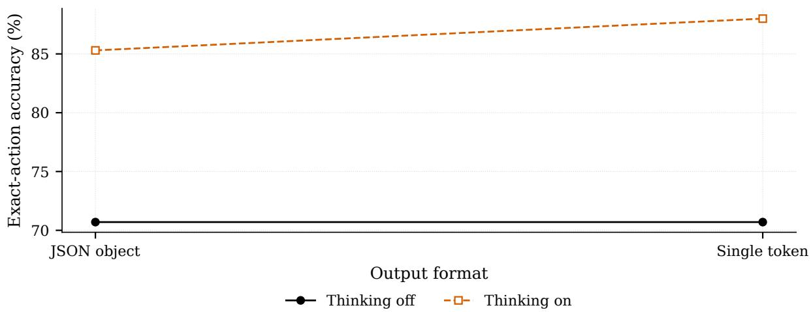
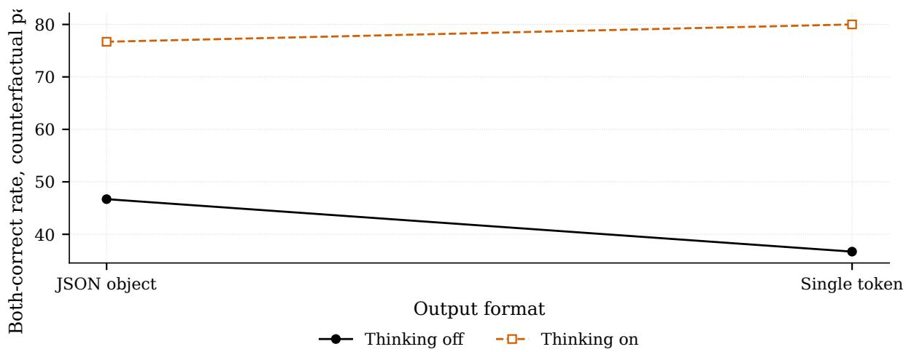
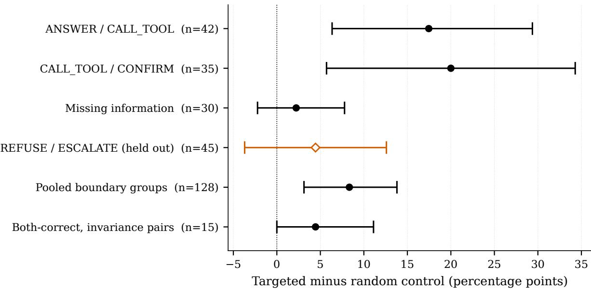
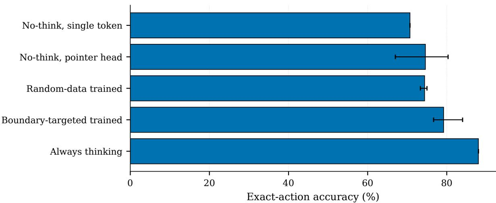
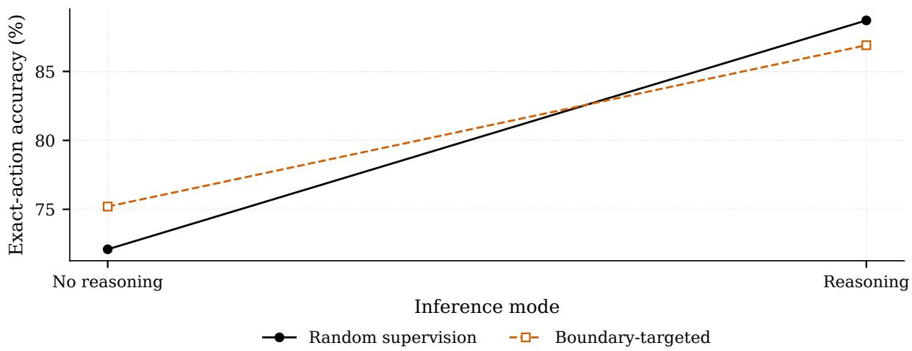
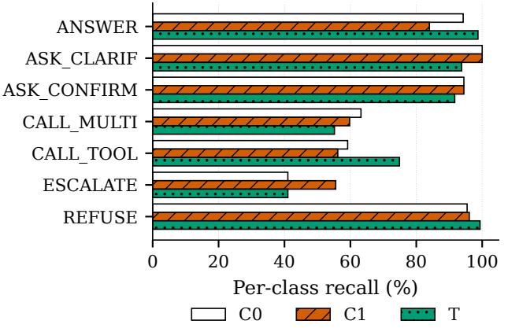
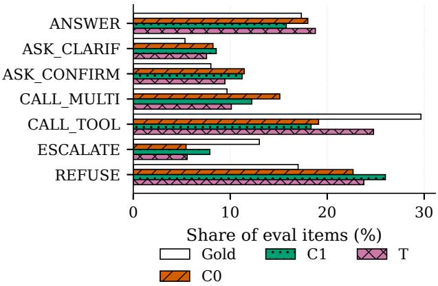
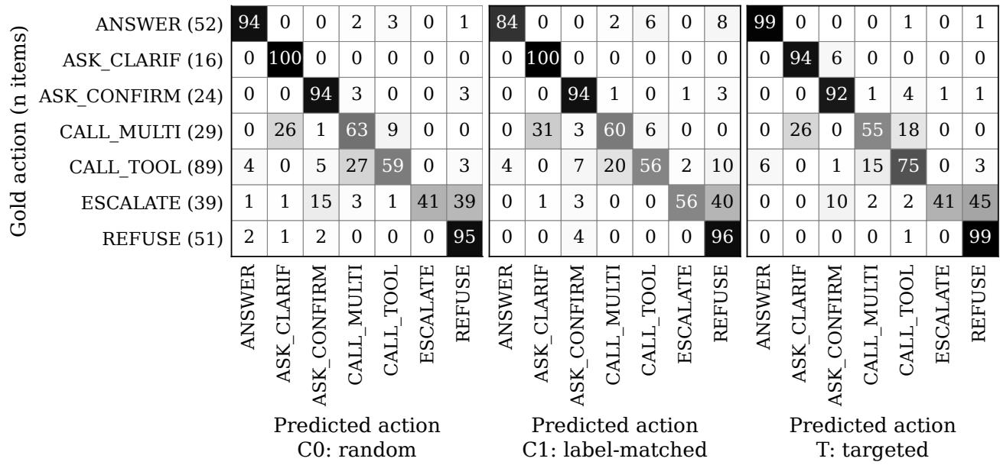

# When Should Enterprise Policy Decisions Be Learned, and When Should They Be Reasoned?

Hyojung Han1,† Ryangkyung Kang1 Youngeun Kim2 Seung-Hun Jeon1

1ThakiCloud 2Korea University

†Corresponding author: hyojung.han@thakicloud.com

2026-10-02

## Abstract

An enterprise agent that answers under a written policy has to choose an action before it says anything: answer from the policy, ask for a missing fact, ask the user to confirm a side efect, call one tool, call several, escalate to a human, or refuse. We ask what that choice actually needs. Holding one 27B Korean enterprise model fixed, we first study two factors: whether the decision is produced by generating a JSON object or by reading a single constrained token, and whether the model is allowed to reason before deciding. On one 27B Korean enterprise model, we did not detect an accuracy diference between the two operational paths on the indistribution split (93.46 % against 94.14 % on 2800 items), while the two paths difer by two orders of magnitude in latency and by roughly tenfold in the restart-to-restart action-flip rate (3.00 % of actions flip against 0.29 %). We are careful about what that second comparison licenses: the two paths difer in reasoning behaviour as well as in output format, emitting a median of 542 and 1 tokens respectively, so we report it as an operational comparison and not as the cost of emitting the action. That result does not survive contact with policies the model has not seen. On a sealed benchmark of 300 items whose labels were computed by a hidden executable policy rather than written by anyone, a two-by-two separates the two factors: in the single-token column reasoning is worth +17.3 pp [+12.3, +23.0] on exact action (+14.7 pp in the generated-JSON column). In the reasoning-of row the estimated exact-action diference between the two interfaces was 0.0 pp [−4.3, +4.0]; this is a failure to detect an advantage for either interface, not an equivalence result. With reasoning on, the two arms do not share a reasoning prompt, so the format contrast there (+2.7 pp [−0.7, +6.0]) is unresolved, and the one secondary endpoint on which format mattered, a single-token advantage on CALL TOOL only recall, did not reproduce under an independent re-rendering of the same scenarios. We then ask whether the reasoning requirement is really a supervision gap. Against a control trained on the same token budget of random in-domain data, boundary-targeted supervision moves the two boundaries it explicitly covers by +17.5 and +20.0 pp, raises any-tool recall by +9.9 pp, and does not detectably move an untouched held-out boundary ([−3.7, +12.6] pp). Completing that design as a training × reasoning factorial over both arms and 3 seeds, on the sealed rendering for this model the interaction is negative and consistent with partial substitution: reasoning is worth +11.7 pp on the targeted arm against +16.6 pp on the random one, an interaction of −4.9 pp [−8.1, −1.7] with the same sign in every seed pair. Targeted data earns its keep where reasoning cannot be aforded, not on top of it; the two are partial substitutes rather than independent sources of accuracy. In the cleanly controlled reasoning-of condition we did not detect a benefit from emitting the action as a generated object, and a post-hoc attempt to isolate that interface with reasoning on failed because the output contract changed the reasoning trace itself by a factor of 3.4. All of this supervision was Korean; applied with no English training to independently rendered English versions of the same executable scenarios, English is 0.82 pp lower [−2.68, +0.93] with reasoning on, the same order as re-rendering the scenarios again in

Korean. The reasoning-of gain from targeted supervision has similar point estimates in the two languages (+3.03 in Korean, +2.91 pp in English), but under item-clustered intervals it is not stable in either, so we do not claim that it carries over. The original rendering stays private as the confirmatory benchmark. We re-rendered the same executable scenarios with open models after these results were known and repeated every analysis: the reasoning efect and the English transfer verdict reproduced; the training-by-reasoning interaction, stable on the sealed set, kept its sign but did not replicate under item-clustered intervals. We release the model and that open re-rendering with its gold labels and proofs; the training corpus remains internal.

## 1 Introduction

A deployed enterprise assistant is usually judged on what it says. Before it says anything, though, it has already made the decision that matters: whether this request can be answered from the policy document at all, whether a fact is missing, whether a side efect needs confirmation, whether a tool has to run, whether a human has to be involved, or whether the request must be refused. If that choice is wrong, fluent text makes it worse rather than better.

Current practice answers that choice by generating it. The model emits a JSON object naming an action and its arguments, and a downstream system executes it. Generation is how we get structure, so generation is what we pay for, in latency and in run-to-run variability. It is worth asking what the payment buys.

This paper separates two things that are usually bundled together. The first is the output interface: does the decision come out as a generated object, or as a single token read from a constrained vocabulary? The second is test-time reasoning: is the model allowed to think before it decides? Both are commonly removed together when a team optimizes an agent for cost, and when quality drops the loss is attributed to whichever one the team happened to be thinking about.

We find that the two behave completely diferently, and that which one matters depends on whether the policy is one the model has seen.

## Contributions.

1. On in-distribution enterprise policies, we did not detect an accuracy diference between the single-token path and the deployed reasoning-plus-JSON path, which the single-token path achieves at a fraction of the cost and with roughly 90.3 % less restart-to-restart instability. We report this as a comparison of two operational paths, and we quantify the confound that stops it from being a clean estimate of what emitting the action costs (Section 3).

2. We build a sealed decision benchmark whose gold labels are computed, not written. A hidden executable policy maps latent factors to exactly one correct action and emits a proof; naturallanguage renderings are produced separately and are never allowed to see the label. No human and no language model ever supplied a gold answer (Section 4).

3. On that benchmark a two-by-two shows that reasoning drives the exact-action generalisation gap, and that with reasoning of we detect no efect of the output format on exact-action or pooled-boundary accuracy — a failure to detect, not an equivalence result — reversing the ordering an in-distribution evaluation would have suggested. With reasoning on, the format contrast is confounded by the reasoning prompt and remains unresolved (Section 5).

4. In a pre-registered comparison against a token-budget-matched random control, boundarytargeted supervision improves decisions on the boundaries it explicitly covers, and we detect no transfer to an untouched boundary (Section 6).

5. Completing the training × reasoning factorial on one harness, we estimate the interaction directly and find it negative and stable on the sealed rendering: supervision and test-time reasoning substitute (Section 7). On the open re-rendering it keeps its sign but is not stable under item-clustered intervals (Section 10), so this finding rests on the sealed set alone.

6. With no English supervision, we re-render the same latent scenarios in English and find no English degradation at the resolution of a pre-registered audit; the point estimates of the targeted-supervision gain without reasoning, and of its disappearance with reasoning, are similar in English, but the reasoning-of gain is not stable in either language (Section 9).

## 2 The decision task and three interfaces

The model sees a written policy, a list of callable tools with their signatures, whatever the system has already established about the current session, and a user turn. It must choose exactly one of seven actions: answer, ask clarification, ask confirmation, call tool, call multiple tools, escalate, refuse.

The base model is a 27B Korean enterprise assistant fine-tuned for this setting. Sections 3–5 hold that checkpoint fixed and change only how the decision leaves the model and whether reasoning is enabled; from Section 6 onward the comparisons involve separately trained checkpoints, and each section says which.

JSON generation. The model autoregressively emits an object naming the action. This is the deployed baseline.

Constrained single token. The action vocabulary is mapped to seven single tokens and the decision is the argmax over that restricted set at one position. No action tokens are emitted; whether reasoning tokens precede the decision is a separate switch that we vary deliberately.

LoRA pointer head. A rank-16 adapter plus a small head reads a hidden state and scores the seven actions directly.

All three receive the same task content. Their output contracts difer, and under reasoning-on those contracts induce diferent reasoning prompts and traces. The first two share all weights; the third adds parameters.

Two diferent things are called “generation” in this literature and we keep them apart throughout. Action-output generation is emitting the action object itself, token by token. Reasoning generation is emitting tokens before the decision that are never shown to the downstream system. Our claim concerns the first, and it is narrower than “unnecessary”: in the one condition we can control cleanly — reasoning of — action-output generation brings no advantage we can measure. The second is the one that turns out to matter, and conflating them is how we nearly drew the wrong conclusion twice (Sections 3 and 5). They are also not as separable as this paragraph makes them sound; Section 13 reports the experiment in which we tried to separate them and could not.

## 3 In distribution, we detect no accuracy diference between the cheap and deployed paths

We first measure on the held-out split of the distribution the model was trained for: 2800 labelled items, of which 2414 survive a strict cleanliness filter. We serve the model several separate times and evaluate after each restart, which lets us separate accuracy from stability.

<table><tr><td>Operational path</td><td>Clean</td><td>Full</td><td>Restarts</td><td>Pairs</td><td>Flip mean</td><td>Flip range</td></tr><tr><td>Reasoning + JSON action</td><td>96.86%</td><td>93.46%</td><td>5</td><td>10</td><td>3.00%</td><td>2.54-3.36%</td></tr><tr><td>No reasoning, single token</td><td>96.75%</td><td>94.14%</td><td>4</td><td>6</td><td>0.29%</td><td>0.18-0.50%</td></tr></table>

Table 1: Two operational paths on the in-distribution split. Clean is the 2414-item strict split, Full the 2800-item split. Flip is the fraction of items whose chosen action difers between two restarts of the same checkpoint on the same hardware, as the mean and range over restart pairs; pairs share restarts and are not independent, so no pooled interval is given. The two paths difer in reasoning as well as in output format, so these rows compare deployments, not output interfaces.

What we are comparing here is two operational paths, not two output formats. The deployed path reasons and then emits a JSON action object. The cheap path does neither: reasoning is of and the decision is one constrained token. The gap in work done is not subtle — the deployed path emits a median of 542 tokens per item (95th percentile 1750), and the cheap path emits exactly 1. Any diference we see below is the diference between those two paths, and we are explicit throughout about what that does and does not license.

We did not detect an accuracy diference between them. The deployed path reaches 96.86 % on the clean split and 93.46 % on the full split; the cheap path reaches 96.75 % and 94.14 %. That is the operationally interesting result on its own: on policies the model was trained for, we did not detect an accuracy benefit from several hundred tokens of reasoning and a generated action object over a single constrained token. We ran no paired equivalence test, and the two splits disagree in the sign of the small diference (Appendix C), so this is a failure to detect a diference, not evidence that the two paths are equally accurate.

Stability does separate them, and strongly. Across restart pairs of the same checkpoint on the same hardware, the deployed path changes its decision on 3.00 % of items on average (2.54–3.36 % over 10 pairs from 5 restarts), while the cheap path changes on 0.29 % (0.18–0.50 % over 6 pairs from 4 restarts). The two ranges do not overlap. We report the distribution over pairs rather than a pooled interval over items on purpose: pairs drawn from the same restart are not independent, and pooling them would manufacture precision the design does not support.

Latency separates them by about two orders of magnitude: moving from the deployed path to the cheap one cuts end-to-end p50 by up to 99.1 % and p95 by up to 99.3 %. In absolute terms, at concurrency one on a cold prefix, the deployed path takes 8.89 s at p50 and 27.43 s at p95 and generates a median of 538 tokens on the latency sample, against 85 and 168 ms and one token for the single-token path (medians over 4 restarts of a 40-item sample; Table 16). We state the percentages as upper bounds because they are end-to-end measurements of our own serving setup, and a diferent deployment would place the two paths diferently.

What this does not show. It is tempting to read the stability and latency rows as the cost of generating the action, and we initially did. They are not. Both diferences are consistent with being driven entirely by the 542 reasoning tokens rather than by the handful of action tokens, and this design cannot separate the two. An experiment that fixed reasoning and varied only the output format would settle it. Section 5 gets half of that: with reasoning of it isolates the output format cleanly, and there we did not detect a format contribution to the exact-action diference (point estimate 0.0 pp, [−4.3, +4.0]; not an equivalence result). With reasoning on it does not, because the two arms do not share a reasoning prompt. Section 13 reports what happened when we tried to close that half directly, by freezing one reasoning trace and branching only the output interface: the attempt failed, and the reason it failed is that the output instruction changes the trace. We also did not repeat the restart measurement under matched reasoning, so the decomposition of the stability gap remains open.

What this section does establish is narrower and still useful to a practitioner: for policies the model has been trained on, we did not detect the expensive deployed path buying accuracy, and the cheap path is markedly more reproducible across restarts. It says nothing about a policy the model has never seen, which is the situation every enterprise deployment is in on its second customer.

## 4 A benchmark nobody labelled

To ask the out-of-distribution question we needed a benchmark that is genuinely unseen and whose labels we can defend. Two earlier attempts failed in ways worth recording.

We first tried to label items drawn from a pool built on real statutes and internal policy text by cross-vendor adjudication: two diferent commercial models labelled each item independently. Agreement between them was poor on both pools we tried $( \kappa = 0 . 4 7$ on 1,193 items and κ = 0.40 on 853). Both runs also left roughly 30 % of items abstained and neither completed its challenger stage, so we treat these numbers as evidence that the approach was not converging rather than as a clean reliability estimate.

The more telling signal was what the adjudicators chose. On the items meant to probe the answer-versus-call-a-tool boundary, they chose call tool on 3 of 348, against answer on 182. Layering tools and principles onto real legal text does not put the intended boundary into the text. The boundary existed in our heads and in our selection criteria, not in the item.

So we stopped writing items and started computing them. A hidden policy is represented as a set of latent factors — whether live state is needed, whether a required fact is missing and whether the user can supply it, whether a side efect requires confirmation, whether the request is prohibited and whether escalation would make it permissible, whether human review is required, how many tools are implicated, and whether the request is answerable from static policy alone. A deterministic executor maps a factor assignment to exactly one action under a fixed priority order, and emits a proof: the rule that fired and the factors that made it fire. We enumerated the full factor space, kept the assignments for which exactly one action is derivable, and sampled from those.

Natural-language renderings were then produced from the factor assignment by models outside the evaluated family, and never saw the gold label. Machine gates check that the rendering does not leak the answer, that no reference is left unresolved, that counterfactual pairs difer in exactly one generating condition and flip the gold action, and that invariance pairs difer only in surface dialect and keep it. Two further gates check rendering fidelity with models outside both the evaluated family and the renderer’s vendor. In the recovery gate, two independent LLM extractors read only the rendered item and recover its decision factors; a mismatch with the generating assignment on any decision factor rejects the item. In the challenge gate, a challenger model looks for an alternative reading of the item under which a diferent action would be correct; an upheld challenge rejects it. Items were selected using structural dificulty metadata only — exception depth, number of conditions, noise level, distractor count, tool count — and never using any model’s performance on them.

Figure 1 walks one scenario of the public re-rendering through this pipeline: the hidden factors, the executor’s derivation, the gold action with its proof, an excerpt of the rendered item, and the counterfactual twin in which one generating condition is flipped and the gold action changes from call tool to answer. The executor proves the action implied by the latent specification; it does not by itself prove that the natural-language rendering faithfully expresses that specification.

Rendering fidelity is checked separately by the recovery and challenge gates described above.

The result is 300 items across seven layers, including 30 counterfactual pairs and 15 invariance pairs, sealed by content hash (090fedfed3660b34. . . ) before any evaluated model was run against it. A twelve-item mechanical checklist verifies all of the above and is re-run from the sealed artifact rather than trusting the generator’s own records.

Shortcut diagnostics, including the two that failed. A benchmark whose items are constructed invites the question of whether a model can win without reading the policy. We ran lexical probes on the final 300 items: a majority-class baseline, a classifier given only the request, one given only the policy, and one given both. Majority alone scores 29.7 % overall, and per layer it ranges from 26.7 % to 60.0 % (the most frequent gold action is CALL TOOL), which is the floor every number in this paper should be read against.

Five of the 7 layers come in under their own ceiling on every probe. Two do not. On the dialect layer, a request-only probe reaches 73.3 % against a ceiling of 41.7 %, and policy-only and full-lexical probes also clear it; on the missing-information layer a request-only probe reaches 53.3 % against a ceiling of 51.7 %. We report this rather than bury it, and it has a direct consequence: all 15 invariance pairs live inside the dialect layer, so the invariance endpoint is computed entirely within a slice where a lexical shortcut exists. That is a second reason, alongside its resolution, not to rest anything on it.

These probes ran after selection and were not fed back into it, which is a weakness of the pipeline rather than of this particular set. The twelve-item checklist in the seal covers leakage of the answer into the prompt; it does not cover lexical shortcuts, and a future version should gate on both before sealing.

We stress what this does and does not buy. It buys a label we can defend without appealing to anyone’s judgement, and a counterfactual design in which the single changed variable is known by construction rather than asserted. It does not buy ecological validity: these are constructed policies, and a model could be good at them while being bad at a real company’s documents.

Public re-rendering. The rendering described here, written by two commercial models, remains private and is the confirmatory benchmark for every primary analysis. For release we re-rendered the same latent scenarios and gold labels with open-weight models after these results were known; Section 10 describes that re-rendering and repeats the analysis on it.

## 5 On unseen boundaries, reasoning drives the generalisation gap

Our first run on the sealed set compared the three interfaces of Section 2 and produced an apparent reversal: generated JSON reached 85.3 %, the pointer head 74.6 % (a 3-seed mean, sd 6.8 pp across seeds), and the constrained single token 70.7 %. The generated and single-token numbers are single runs; the pointer head is the only multi-seed entry, and it is not part of Table 2, whose cells are all single runs of one checkpoint. Read naively this says the generated object matters after all, and matters by about fifteen points.

It says no such thing. The generated arm had test-time reasoning enabled and the constrained arm did not. The comparison confounded the two factors we set out to separate, and we would have published the wrong cause.

We therefore ran the full two-by-two: reasoning on or of, crossed with generated JSON or constrained single token, on the same sealed items (Table 2, Figure 2).

  
Figure 1: One scenario of the public open re-rendering, end to end. (a) Hidden factors of item b3-coun-00083-cf; the executor checks its rules in a fixed priority order and the first that holds, call tool, is the gold action, with a proof naming the rule and the factors it read. Below: three rendered Korean lines, each followed by the independently rendered English line. (b) Its counterfactual twin: one generating condition is flipped, the dependent factors follow, the executor fires answer, and exactly one rendered line difers. Long lines wrap with an indent.

<table><tr><td>Metric</td><td>Reasoning</td><td>JSON object</td><td>Single token</td></tr><tr><td>Exact action</td><td>off</td><td>70.7%</td><td>70.7%</td></tr><tr><td rowspan="3">Both-correct (CF pairs) off</td><td>on</td><td>85.3%</td><td>88.0%</td></tr><tr><td></td><td>46.7%</td><td>36.7%</td></tr><tr><td>on</td><td>76.7%</td><td>80.0%</td></tr></table>

Table 2: Reasoning crossed with output format on the sealed benchmark (n = 300; 30 counterfactual pairs). Each cell is a single run of the same checkpoint. Reasoning moves both metrics by a wide margin. With reasoning of, we did not detect an output-format efect on exact action on this sample (a failure to detect a diference, not an equivalence result); with reasoning on, the two arms do not share a reasoning prompt, so the format contrast in that row is unresolved. On the counterfactual endpoint the format efect is not identically zero, and the one secondary endpoint where it is clearly non-zero favours the single token on this rendering only (see text and Section 10).

The benchmark’s scoring harness declares three primary endpoints — pooled boundary accuracy, both-correct on counterfactual pairs, and both-correct on invariance pairs — with overal exact action and call tool-only recall (n = 89 items whose gold action is exactly call tool) as secondary. We report all five, because the one we would most have liked to leave out is the one that disagrees with us.

Reasoning moves the two endpoints with enough resolution to move. Holding the output format at a single token, it is worth +17.3 pp [+12.3, +23.0] on exact action, +14.8 pp [+7.0, +23.4] on pooled boundary accuracy, and +43.3 pp [+23.3, +63.3] on counterfactual pairs. Holding it at JSON instead, exact action gives +14.7 pp [+10.0, +19.7] and pooled boundary accuracy +16.4 pp $[ + 8 . 6 , + 2 4 . 2 ]$ . We give both columns rather than the larger one.

On invariance pairs we did not detect a reasoning efect. In the single-token column the efect is exactly 0.0 pp, with an interval of $[ - 2 0 . 0 , + 2 0 . 0 ] ;$ ; in the JSON column it is +6.7 pp, also containing zero. With 15 pairs one pair is worth 6.7 pp, so this endpoint cannot resolve anything smaller than a large efect, and we read it as uninformative rather than as evidence of no efect. We flag it because it is a declared primary endpoint and omitting it would make the separation look cleaner than it is.

For the output format, exact action with reasoning of gives 0.0 pp [−4.3, +4.0] and with reasoning on $+ 2 . 7 \mathrm { p p } \left[ - 0 . 7 , + 6 . 0 \right]$ . On pooled boundary accuracy we did not detect a format diference in the reasoning-of row (its interval contains zero). The reasoning-on interval also contains zero, but that row is confounded by the unshared reasoning prompt (below), so we read it as unresolved, not as a null. On counterfactual pairs with reasoning of the single token is −10.0 pp relative to generated JSON, with an interval of [−20.0, −0.0] that touches zero, and on invariance pairs with reasoning on it is −6.7 pp. (Throughout, a format efect is written as single token minus JSON.) So the honest summary is that we did not detect an output-format efect on exact action or pooled boundary accuracy in the reasoning-of row — the estimated exact-action diference is $0 . 0 \mathrm { p p } \ [ - 4 . 3 , + 4 . 0 ]$ , a failure to detect an advantage for either interface rather than an equivalence result — while on the two pair-based endpoints the point estimates favour JSON by amounts smaller than this benchmark can resolve. We draw no conclusion from those two.

The reasoning-on row is diferent in kind. There the two arms reason under diferent instructions: the single-token arm reasons under the single-token sufix, the JSON arm under the JSON contract (Section 11). The post-hoc control of Section 13, which tried to freeze one trace and branch only the output interface, did not resolve this, because the output instruction changed the trace itself. We therefore mark the reasoning-on format efect as unresolved; only the reasoning-of format contrast is cleanly identified.

  
Figure 2: Exact-action accuracy on the sealed benchmark. The vertical gap between the two lines is test-time reasoning; the horizontal slope of either line is the output format. The reasoning-of horizontal contrast isolates the output format cleanly; the reasoning-on horizontal contrast retains the prompt confound described in the text, because those two arms do not share a reasoning prompt. Holding format fixed, reasoning is worth +17.3 pp [+12.3, +23.0]. Holding reasoning of, changing the format is worth $0 . 0 \mathrm { p p } \left[ - 4 . 3 , + 4 . 0 \right]$ ; holding it $\mathrm { o n , + 2 . 7 p p \ [ - 0 . 7 , + 6 . 0 ] }$ . Format efects are written as single token minus JSON. Intervals are paired item-resampling bootstraps over the 300 items.

The one place a format efect clearly excludes zero on this rendering is call tool-only recall $( n = 8 9 )$ with reasoning of, and there it favours the single token: 62.9 % of required tool calls against 50.6 % for generated JSON, a diference of +12.4 pp [+4.5, +20.2] on the 89 items whose gold action is exactly call tool. With reasoning on, both formats sit above 93.3 % and we did not detect a diference. This efect did not survive re-rendering: on the open rendering of the same scenarios it is $+ 2 . 6 \mathrm { p p } \left[ - 5 . 3 , + 1 0 . 5 \right]$ , while the original rendering restricted to the same items keeps it (Section 10). We therefore report it as a property of this rendering, not as a format efect.

Two properties of the harness bound how far the absolute numbers in the reasoning row can be pushed. The on-row JSON arm failed to produce a parseable action on 9 of 300 items, which we scored as errors; removing them would close most of the format gap in that row. And in the reasoning-plus- single-token arm, all seven action codes appeared in the top-20 logits for only 62 of 300 items, so the remaining decisions were an argmax over a visible subset. Both apply equally across the comparisons we draw from this table, but they mean the cell values should not be carried over to settings with a diferent harness.

So the in-distribution conclusion and the out-of-distribution conclusion are both true and they are about diferent things. Only the reasoning-of row cleanly identifies the output-format contrast. In the other regimes we observed no accuracy advantage for generation, but those comparisons remain confounded and are not interpreted as format efects. Test-time reasoning, by contrast, has no efect we could detect in one regime and is decisive in the other.

A natural next move is to spend reasoning only where it is needed. A confidence router that sends low-confidence items to the reasoning path, with the threshold chosen on in-distribution data before the sealed set was opened $( \tau = 0 . 9 7 8 )$ , reaches 85.7 % while reasoning on 50 % of items, against 88.0 % for always reasoning and 70.7 % for never reasoning. The saving is real but modest, and the reason is visible in the failure mode: on unseen boundaries the non-reasoning model is frequently confident and wrong, which is precisely the regime in which a confidence signal cannot help.

  
Figure 3: The same two-by-two scored on counterfactual pairs, where an item counts only if the model gets both members right. The efect of reasoning is larger here $( + 4 3 . 3 \mathrm { p p \ } [ + 2 3 . 3 , + 6 3 . 3 ] )$ ) because getting both members right requires responding to the one latent variable that changed rather than to the surface of either item. Unlike exact action, the format efect here is not identically zero (−10.0 pp with reasoning of, interval $[ - 2 0 . 0 , - 0 . 0 ] )$ , so we report it as inconclusive. This is a diferent quantity from Figure 2 and is therefore plotted on its own axis.

## 6 Is the reasoning requirement a supervision gap?

The two-by-two shows that reasoning is needed. It does not show why. Two explanations are compatible with it. The boundaries may require serial computation that a single forward pass cannot perform. Or the model may simply never have been taught these boundaries, in which case targeted supervision should close the gap and reasoning would be a workaround for missing training data, not a computational necessity.

We pre-registered a test before scoring the sealed set. The treatment arm adds boundarytargeted training records — contrastive pairs that difer in one decision-relevant factor across three boundaries: answer versus call a tool, call a tool versus ask for confirmation, and missing information. The control arm adds the same number of tokens of randomly sampled in-domain data. Everything else — recipe, schedule, seeds — is identical, so data is the only independent variable. Each arm is trained with 3 seeds. The held-out boundary, refuse versus escalate, appears in neither arm’s added data.

The pre-registered decision rule asked for an absolute gain of at least 8 pp or a relative error reduction of at least 20 % on at least one primary endpoint, with a paired interval excluding zero, together with non-regression in distribution. One endpoint met it: any-tool recall (n = 118 items whose gold action is call tool or call multiple tools) rose from 60.2 % to 70.1 %, a 24.8 % relative error reduction with a lower bound of +4.24 pp. The seed pairs behind that single passing endpoint are +22.9, +5.9 and +0.8 pp: all positive, but one pair carries most of the efect and another is within a single item of nothing. The pre-registered bar was written on the pooled estimate, and it was met; we print the spread so the reader can see that the result rests on three runs, not on a stable margin. Overall accuracy rose by +4.8 pp with a lower bound of +2.00 pp — consistent and positive across all three seed pairs (+9.0, +2.0, +3.3 pp), but below both preregistered efect-size thresholds. Counterfactual both-correct rose +8.9 pp with a lower bound of −1.11 pp; across seeds the paired deltas were +20.0, +0.0, +6.7 pp, so we report it as positive but inconclusive. In distribution the registered non-regression check passed; the treatment arm was in fact better than the reference by +1.37 pp on the clean split and +3.12 pp on the full split.

<table><tr><td></td><td>n</td><td>Random</td><td>Targeted</td><td>∆</td><td>95% CI</td></tr><tr><td>Pre-registered primary endpoints</td><td></td><td></td><td></td><td></td><td></td></tr><tr><td>Exact action</td><td>300</td><td>74.4%</td><td>79.2%</td><td>+4.8</td><td>lower = +2.00 pp</td></tr><tr><td>Both-correct (CF pairs)</td><td>30</td><td>46.7%</td><td>55.6%</td><td>+8.9</td><td>lower = −1.11 pp</td></tr><tr><td>Any-tool recall</td><td>118</td><td>60.2%</td><td>70.1%</td><td>+9.9</td><td>lower = +4.24 pp</td></tr><tr><td>Per boundary (reporting only)</td><td></td><td></td><td></td><td></td><td></td></tr><tr><td>ANSWER/CALL_TOOL</td><td>42</td><td>64.3%</td><td>81.7%</td><td>+17.5</td><td>[+6.3, +29.4]</td></tr><tr><td>CALL_TOOL /CONFIRM</td><td>35</td><td>55.2%</td><td>75.2%</td><td>+20.0</td><td>[+5.7, +34.3]</td></tr><tr><td>Missing information</td><td>30</td><td>80.0%</td><td>82.2%</td><td>+2.2</td><td>[−2.2, +7.8]</td></tr><tr><td>REFUSE /ESCALATE (held out)</td><td>45</td><td>66.7%</td><td>71.1%</td><td>+4.4</td><td>[-3.7, +12.6]</td></tr><tr><td>Pooled boundary groups (union)</td><td>128</td><td>70.6%</td><td>78.9%</td><td>+8.3</td><td>[+3.1, +13.8]</td></tr><tr><td>Both-correct (invariance pairs)</td><td>15</td><td>88.9%</td><td>93.3%</td><td>+4.4</td><td>[+0.0, +11.1]</td></tr></table>

Table 3: Boundary-targeted supervision against a token-budget-matched random control, 3 seeds per arm, evaluated on the sealed benchmark. Note that n difers by endpoint: 300 items overall, 30 counterfactual pairs, 118 items where a tool call is required (this endpoint’s ledger counts call multiple tools as tool-requiring; the two-by-two ledger of Section 5 does not, and reports 89). Primary endpoints were fixed before the benchmark was scored; per-boundary rows are reporting only. Every interval, including the pre-registered lower bounds, is the item-clustered bootstrap used throughout the paper: items (or counterfactual pairs) are resampled with replacement, the 3 seeds of an item move together, the statistic is the seed-averaged paired diference $( B = 1 0 , 0 0 0$ seed 12345, 95% percentile). The registered gate reads only the lower end of that interval, so the primary rows print the lower bound alone. The intervals carry evaluation sampling uncertainty for these 3 trained seed pairs, not retraining uncertainty, which we report separately as per-seed deltas in the text. The same exact-action contrast appears as T − C0 in Table 9 with the same interval. The held-out row is a boundary that neither arm’s added data covers. Pooled boundary groups is item accuracy over the union of the four per-boundary rows above it (each item counted once, held-out boundary included; n = 128), averaged over seeds. It is not the “boundary layers” column of Table 9, which is defined diferently.

The per-boundary picture is the more informative one, and it is deliberately reported as secondary. The two covered boundaries with headroom moved decisively: answer versus call a tool by +17.5 pp [+6.3, +29.4] and call a tool versus ask for confirmation by +20.0 pp [+5.7, +34.3]. The third covered boundary, missing information, moved by +2.2 pp with an interval containing zero; its control arm was already near the top of its range, so we read this as a headroom limit rather than a failure, and we flag that reading as an interpretation we did not pre-register.

The held-out boundary did not move in a way we can defend: +4.4 pp [−3.7, +12.6], an interval that contains zero. On the evidence we have, boundary-targeted supervision improves decisions on the boundaries it is given and we cannot claim it transfers to one it is not given.

  
Figure 4: Boundary-targeted supervision minus the token-budget-matched random control, per boundary, with 95% item-clustered bootstrap intervals (the method of Table 3) over the 3 trained seed pairs. The two covered boundaries with headroom clear zero; the held-out boundary (hollow diamond) does not. Missing information barely moves: its control arm already sits at 80.0 % on 30 items, leaving little headroom. This is consistent with limited headroom rather than a failure of the supervision, but the resolution here does not establish that on its own, and we do not interpret the +2.2 pp estimate.

## 7 Learned or reasoned

Putting the configurations side by side shows where the division of labour falls (Figure 5, Table 4). Without reasoning, a constrained decision reaches 70.7 %. A trained pointer head reaches 74.6 %. A token-budget-matched helping of random in-domain data reaches 74.4 %. Boundary-targeted pairs instead of that random data reach 79.2 %. The base model allowed to reason reaches 88.0 %.

We filled in the two missing cells, and supervision and reasoning turn out to substitute. The previous version of this section said the comparison between 79.2 % and 88.0 % was between two diferent checkpoints, so the within-checkpoint value of reasoning after targeted supervision was unknown. We then measured it. Both trained arms, all 3 seeds each, were evaluated twice on the sealed benchmark — reasoning of and reasoning on — through one serving harness, with the weights as the only thing that difered (Table 5, Figure 6). The estimands, their intervals and the rule for calling a result stable were fixed before the first of these twelve evaluations ran.

With reasoning of, boundary-targeted supervision is ahead, as Section 6 found on a diferent harness. With reasoning on, the two arms are level or the random arm is slightly ahead. Turning reasoning on is worth +11.7 pp on the targeted arm and +16.6 pp on the random arm, and the difference between those two gains — the interaction — is −4.9 pp with a 95 % interval of [−8.1, −1.7] and the same sign in all 3 seed pairs $( - 7 . 7 , - 2 . 0 , - 5 . 0 )$ . By the rule we registered, that is stable.

So boundary supervision and test-time reasoning are partial substitutes rather than independent sources of accuracy; the ledger’s verdict for this factorial is substitution. Stated at the resolution the factorial actually measures: the marginal value of reasoning is smaller after boundarytargeted supervision than under the random-supervision control. This is an arm-level estimate over the whole benchmark, not a per-boundary one, so we do not say that reasoning is worth less on the particular boundaries the supervision covered — that would be a mechanism the design does not resolve. Targeted boundary data earns its keep in a deployment that cannot aford to think; it does not stack on top of reasoning. The reading we were careful not to assert before — “supervision and reasoning might be complementary” — is the one the data do not support.

  
Figure 5: Alternative configurations of data and test-time compute, scored on the sealed benchmark. These are competing options, not a cumulative progression: the pointer head and the random-data checkpoint are diferent artefacts, not one built on the other. The first four spend a single forward pass; the last spends test-time reasoning. The three trained rows — the pointer head (3 seeds, 67.0– 80.3 %) and the two supervision arms (3 seeds each) — are seed means and carry a bar spanning their seed minimum and maximum; the other two are single runs and carry no bar, because they have no spread to show rather than a small one. The trained bars overlap, which is the point of Section 6’s pre-registered reading: only any-tool recall cleared its bar. Two harnesses share this axis: the first and last bars are the vLLM constrained-token probe of Section 5 on the base checkpoint, the three trained bars the pointer-head harness of Section 6.

A ceiling would explain at most part of this. The obvious alternative to substitution is a ceiling: if the benchmark admits no more than roughly 88.7 % on exact action for this model, then both reasoning-on cells are pressed against the same wall and the negative interaction is an artefact of compression rather than a statement about the two levers. The suspicion is reasonable — no configuration we measured anywhere in this paper exceeds 88.7 % on exact action — and the design cannot rule it out, because establishing the ceiling would need a stronger arm we do not have.

What we can do is bound how much of the efect a ceiling could account for. Pure compression toward a common ceiling leaves the better arm no worse than the other, so it can shrink the reasoning-of gap of +3.1 pp toward zero but cannot drive it negative. A ceiling can therefore account for at most 3.1 pp of the interaction’s 4.9 pp magnitude, under a simple common-ceiling compression model; a saturation that acts diferently on the two arms is not covered by that bound. The remaining −1.8 pp requires the targeted arm to be genuinely worse once reasoning is on, which is $E _ { 3 } \mathrm { ~ - ~ }$ and $E _ { 3 }$ is indeterminate by our own rule. So the honest accounting is that a ceiling explains at most 3.1 of the $4 . 9 \mathrm { p p }$ , the residue points away from a ceiling, and we cannot establish the residue. We therefore read “partial substitutes” as a description of the joint behaviour of the two budgets in this operating range, not as a mechanism, and we say so again in Section 11.

<table><tr><td>Configuration</td><td>Exact action</td></tr><tr><td>No thinking, constrained single token</td><td>70.7%</td></tr><tr><td>No thinking, LoRA pointer head</td><td>74.6%</td></tr><tr><td>Trained on random in-domain data</td><td>74.4%</td></tr><tr><td>Trained on boundary-targeted data</td><td>79.2%</td></tr><tr><td>Always thinking, constrained single token</td><td>88.0%</td></tr></table>

Table 4: The same configurations as numbers. Rows above the rule are single-pass; the row below spends test-time reasoning. The pointer-head row is a 3-seed mean (sd 6.8 pp) and the two supervision rows are 3-seed means; the constrained-token and always-thinking rows are single runs. The rows come from two harnesses: the first and last rows from the vLLM constrained-token probe of Section 5 on the base checkpoint, the middle three from the pointer-head harness of Section 6. They are competing configurations measured by diferent decision mechanisms, not diferences of one another.  
  
Figure 6: The same four cells. The vertical gap within a line is what reasoning buys; the gap between the lines is what the supervision buys. The lines are not parallel, and they cross: that non-parallelism is the interaction, and its sign says the two levers substitute.

One caveat this does not remove. These four cells come from the serving harness and its constrained probe. Section 6’s 74.4 % and 79.2 % come from a diferent decision mechanism, a trained pointer head, which cannot reason at all — that is why the missing cells could not simply be read of the earlier table. The two sets of numbers are therefore not interchangeable, and we do not subtract across them. Within this table the comparison is clean; across tables it is not.

What we can say. Supervision works on the boundaries you can name in advance and build contrastive data for. On the boundary we deliberately withheld, we did not detect a gain. And no single-pass configuration we tried reached the always-reasoning reference without reasoning — the targeted arm sits 8.8 pp below it. But the factorial above says the two budgets are not additive: where reasoning is available it absorbs most of what targeted supervision buys. The operational reading is therefore narrower than “spend on both”. Spend the data budget on boundaries you can name when the deployment must answer in a single pass, and spend the compute budget when it can aford to think. In this operating range, reasoning adds less after boundary-targeted supervision than after the random-supervision control.

<table><tr><td rowspan="3" colspan="2"></td><td>Added supervision</td><td>No reasoning</td><td>Reasoning</td><td></td></tr><tr><td rowspan="2">Random, budget-matched</td><td>72.1%</td><td>88.7%</td><td></td></tr><tr><td>75.2%</td><td>86.9%</td><td></td></tr><tr><td colspan="2">Estimand</td><td> $\Delta _ { \mathrm { \ell } } ( \mathrm { p p } )$ </td><td>95% CI</td><td>Per seed</td><td>Verdict</td></tr><tr><td colspan="2"> $E _ { 1 }$  Reasoning gain, targeted arm</td><td>+11.7</td><td>[8.1, 15.4]</td><td> $+ 9 . 0 , + 1 3 . 0 , + 1 3 . 0$ </td><td>stable</td></tr><tr><td colspan="2"> $E _ { 2 }$  Reasoning gain, random arm</td><td>+16.6</td><td>[12.1, 21.0]</td><td> $+ 1 6 . 7 , + 1 5 . 0 , + 1 8 . 0$ </td><td>stable</td></tr><tr><td colspan="2"> $E _ { 3 }$  Targeted – random, reasoning on</td><td>-1.8</td><td>[-3.6, -0.1]</td><td> $- 4 . 0 , + 2 . 3 , - 3 . 7$ </td><td>indeterminate</td></tr><tr><td colspan="2"> $E _ { 4 }$  Interaction</td><td>-4.9</td><td>[-8.1, -1.7]</td><td> $- 7 . 7 , - 2 . 0 , - 5 . 0$ </td><td>stable</td></tr></table>

Table 5: Training × reasoning, all four cells measured on one harness, 3 seeds per arm, 300 sealed items. Lower panel: the pre-registered estimands. “Stable” requires both that the 3 seed-paired diferences share a sign and that the item-resampling interval excludes zero; $E _ { 3 } { } ^ { : }$ ’s interval excludes zero but its seed signs do not agree, so the rule calls it indeterminate rather than letting us claim it. These cells use the vLLM LoRA serving harness with its constrained-token probe, a diferent harness from the pointer head of Table 3; the reasoning-of cells here are therefore not the numbers of Table 3 and should not be compared with them.

## 8 Two robustness checks that need no new runs

Both checks below recompute from predictions we had already stored. Neither is a new measurement and neither is pre-registered; they exist to show how much the numbers above depend on two choices a reader cannot see from a table.

One metric name, three denominators. “call tool recall” admits three defensible readings, and we have used more than one of them. Counting only items whose gold action is exactly call tool and requiring an exact match gives +15.7 pp for targeted over random supervision. Widening the denominator to every tool-requiring item, including call multiple tools, while still requiring the exact action gives +9.9 pp — this is the definition our pre-registration gate actually scored. Widening further so that any tool call counts as correct on a tool-requiring item gives +2.8 pp. The same efect is therefore anywhere from +2.8 to +15.7 pp, a factor of 5.6, depending only on how the metric is named. We now write call tool-only recall $( n = 8 9 )$ and any-tool recall (n = 118) and give both, because the one endpoint that cleared our bar is the one this choice moves most.

Dropping the two layers where a lexical shortcut exists. Section 4 reports that two of the 7 layers can be beaten from the request alone. Recomputing every main efect on the 5 layers that passed, 240 items, gives Table 6. Nothing we claim gets weaker: the reasoning efect grows from +17.3 to +20.8 pp and the supervision efect from +4.8 to +5.4 pp. One number does change character — the reasoning-of format efect moves from exactly 0.0 to −0.8 pp, so on the clean subset generated JSON is nominally ahead rather than exactly level. Both values are far below what this sample can resolve, which is the point: that cell was never evidence of a direction, and the clean subset makes that visible instead of hiding it behind a tidy zero.

<table><tr><td>Effect (pp)</td><td>All 300 items</td><td>Shortcut-clean 240</td></tr><tr><td>Reasoning effect (single token)</td><td>+17.3</td><td>+20.8</td></tr><tr><td>Format effect, reasoning off</td><td>0.0</td><td>-0.8</td></tr><tr><td>Format effect, reasoning on</td><td>+2.7</td><td>+4.2</td></tr><tr><td>Targeted - random, exact action</td><td>+4.8</td><td>+5.4</td></tr><tr><td>Targeted - random, CALL_TOOL-only recall</td><td>+15.7</td><td>+17.8</td></tr><tr><td>Targeted - random, any-tool recall</td><td>+9.9</td><td>+11.7</td></tr></table>

Table 6: Every main efect recomputed on the 5 layers whose lexical shortcut probes stayed under their ceiling. Recomputed from stored predictions; no new runs, and not pre-registered. Positive favours reasoning on, the single token, or targeted supervision respectively.

## 9 Zero-shot transfer across policy languages

Every enterprise and boundary-targeted record this model was trained on is Korean. We asked whether the decision behaviour measured above depends on that, and pre-registered the audit, its gates and its stopping rule before rendering a single English item.

Design. The benchmark’s labels are computed from latent factors rather than read of text, so the same 300 latent scenarios can be rendered again in another language without touching a single label. We did not translate the Korean items, which would have carried Korean surface cues into English; each scenario was rendered afresh in English from its fact specification, by the same renderer that produced its Korean twin, with amounts, identifiers and proper nouns left verbatim so that only the language of the prose changes. English items pass the same gate axes as Korean ones — leakage, external references, withheld and required values, factor recovery by two independent extractors, and an adversarial challenge. We crossed the language of the policy document with the language of the surrounding instructions, and rendered every scenario a second time in Korean to measure how much a fresh draw of the renderer moves accuracy on its own. All renderings, both reasoning settings and both arms of Section 7 were evaluated on one server in one run, over the 286 items that passed the gates in every rendering.

That common subset is easier than the full benchmark: the Korean rendering scores +2.2 pp higher without reasoning and +1.5 pp higher with it than it does on all 300 items. The absolute accuracies in Table 7 are therefore not comparable with the main tables; only the contrasts within it are.

No English degradation at this resolution. With reasoning on, the English rendering scores 88.34 % against 89.16 % for Korean, a diference of −0.82 pp [−2.68, +0.93] that passed the preregistered retention gate (no worse than −5 pp, interval above −8 pp). Without reasoning the diference is +0.35 pp. Re-rendering the same scenarios in Korean moves accuracy by −0.47 pp with reasoning and −1.28 pp without, so the magnitude of the observed language diference is comparable to the variation introduced by re-rendering the same latent scenarios in Korean. Our pre-registered rule for calling a language efect at all asks for twice that floor, and it is not met. We therefore read the result as no detectable English degradation within this audit, not as evidence that the two languages are equivalent. Nor is the small gap an artefact of ofsetting errors: on the same items the two renderings lead to the same action 93.9 % of the time and are both correct on 86.1 %.

Crossing frame and document language decomposes the small gap descriptively. Holding the frame fixed, English documents score −0.82 pp [−2.68, +0.93] under a Korean frame and −1.28 pp $[ - 3 . 1 5 , + 0 . 3 5 ]$ under an English one; holding the document fixed, an English frame moves the score by +0.47 pp on Korean documents and by 0.00 pp on English ones. What gap there is sits with the document rather than the instructions, and none of these intervals excludes zero. These contrasts were not pre-registered. Among the unplanned contrasts one does exclude zero — an English frame on English documents without reasoning, +1.51 pp [+0.12, +3.03] — and with several such contrasts examined we do not read it as an efect.

Does the decision behaviour transfer? Similar accuracy alone would be consistent with English ability simply having survived Korean fine-tuning. The factorial of Section 7 gives a sharper test, because it has a signature: targeted supervision helps when the model cannot reason, and that help disappears when it can. Without reasoning, targeted over budget-matched supervision is worth +3.03 pp [0.00, +6.18] in Korean and +2.91 pp [+0.58, +5.36] in English; with reasoning it is −0.93 and 0.00 pp, neither interval excluding zero. By the registered stability rule the reasoningof gain is indeterminate in Korean (its item-clustered interval reaches zero) and indeterminate in English (one seed pair changes sign, +5.2, -0.3, +3.9 pp). The point estimates have the same shape in both languages, but we did not detect a stable targeted-supervision gain in either, so we do not claim that this signature transferred; what the audit supports is the absence of a detectable English degradation.

Gates. The retention gate and the reasoning-of non-regression gate passed. The per-boundary gate failed. All 4 of its 4 magnitude conditions held, but the rule also required the seed-paired sign to agree within each boundary, and a diference near zero is expected to change sign across seeds. We regard that requirement as a design error in a non-regression gate and do not alter the gate after the fact; the claim of this section rests on the retention gate alone.

## 10 An open re-rendering as a robustness check

The benchmark’s surface text was written by two commercial models (Section 4). We cannot redistribute that text without carrying their providers’ terms with it, so the original rendering stays private and remains the confirmatory benchmark for every primary analysis in this paper. For public release we re-rendered the same latent scenarios, with the same executable gold labels and proofs, using two open-weight models, Qwen3.6-27B and Gemma-4-31B. A hash of the scenario assigned the renderer, so counterfactual twins and the two languages of a scenario always share one. The same gates were applied, with commercial models acting only as judges: factor recovery by two extractors and a challenger. Items that failed received one retry with the same renderer. The five rendering configurations of the cross-lingual audit — Korean, English, the two mixed frame/document variants, and the second Korean rendering — were then sealed on their common intersection of 248 items, and every analysis was repeated on them without changing a character of the sealed text.

One fact limits what this can show. The re-rendering was generated after the results on the original rendering were known. No model under evaluation took part in rendering or selection, and the gates never see predictions, but the benchmark surface is still a post-hoc object. We therefore read it as a robustness check on the original findings, not as an independent confirmation of them.

<table><tr><td>Frame</td><td>Document</td><td>No reasoning</td><td>Reasoning</td></tr><tr><td>Korean</td><td>Korean</td><td>77.51%</td><td>89.16%</td></tr><tr><td>Korean</td><td>English</td><td>76.34%</td><td>88.34%</td></tr><tr><td>English</td><td>Korean</td><td>76.81%</td><td>89.63%</td></tr><tr><td>English</td><td>English</td><td>77.86%</td><td>88.34%</td></tr><tr><td>Korean</td><td>Korean, re-rendered</td><td>76.22%</td><td>88.69%</td></tr><tr><td colspan="4"></td></tr><tr><td>Contrast (pp)</td><td></td><td>No reasoning</td><td>Reasoning</td></tr><tr><td>English - Korean</td><td></td><td>+0.35 [−2.45, 3.03]</td><td>-0.82 [-2.68, 0.93]</td></tr><tr><td>Korean re-render – Korean</td><td></td><td>-1.28 [-3.38, 0.82]</td><td>-0.47 [-1.63, 0.58]</td></tr><tr><td>Targeted – random, Korean Targeted – random, English</td><td></td><td>+3.03 [0.00, 6.18] +2.91 [0.58, 5.36]</td><td>-0.93 [−2.45, 0.58] 0.00 [-1.63, 1.63]</td></tr></table>

Table 7: Zero-shot transfer to English. All cells use the 286 items valid in every rendering; this subset is 1.5–2.2 pp easier than the full benchmark, so absolute accuracies are not comparable with other tables. Top: exact action under each combination of instruction-frame and policydocument language, and a second independent Korean rendering. Bottom: paired contrasts with item-bootstrap 95% intervals, means over 3 training seeds of the boundary-targeted arm (first two rows) or the targeted and budget-matched arms (last two). No English data was used in training.

The selection is not neutral in dificulty. The gates rejected 52 of the 300 scenarios in at least one rendering, and they did so unevenly: only 38 % of multi-tool scenarios and 69 % of clarification scenarios survived, against roughly nine in ten elsewhere. Measured with the original rendering’s own predictions — a post-hoc diagnostic, never an input to selection — the rejected scenarios are harder by 22.4 pp [11.7, 33.3], and the retained 248 are 3.9 pp easier than the full sealed set (2.6 to 5.2 pp across sixteen cells). Absolute accuracies on the two renderings are therefore not comparable, and we compare only paired contrasts measured within each rendering. Latency is excluded too: the re-measurement shared servers across cells, so its queueing conditions difer from those of Section 3.

The grades in Table 8 are a post-hoc, descriptive taxonomy, not pre-registered endpoints. Each finding is graded by a rule written in code: replicated when both renderings resolve the efect in the same direction, null replicated when neither resolves it, directionally consistent when only one resolves it and the directions agree, and did not replicate otherwise; a categorical verdict whose literal label difers is reported as such and not graded as a replication. We revised the rule once after a first pass, so that the factorial and label-matched estimands use the stability criterion their preregistration defines (same sign in every seed and an interval excluding zero) rather than the interval alone, and so that a null that became an efect is not counted as consistent. The revision changed four rows. Three became stricter: the two label-matched contrasts moved from “replicated” to “directionally consistent”, and the reasoning-of English contrast from “directionally consistent” to “did not replicate”. One became more lenient: $E _ { 3 }$ moved from “did not replicate” to “null replicated”, because its seeds disagree in sign on the original rendering, which is why Section 7 already reported it as indeterminate. Of the 27 graded findings, of which Table 8 shows the main ones, the first-pass rule gave 15 replicated, 5 null replicated, 4 directionally consistent and 3 not replicated; the final rule gives 12, 6, 5 and 3, with 1 verdict whose literal label changed. We report

both so that the revision can be checked.

Three findings replicated. On the open rendering, the reasoning efect in the single-token column is +21.8 pp [+16.1, +27.8]; the English transfer verdict and all four of its gates are unchanged; and the matched-format branches collapsed again. The training-by-reasoning interaction, which is stable on the sealed set (Section 7), did not replicate under item-clustered intervals: on the open rendering it is −3.4 pp [−6.8, +0.1], which the registered rule calls indeterminate and Table 8 grades “Did not replicate”. The point estimate keeps the negative sign, but the interval reaches zero. The literal pre-registered verdict of Section 7 did not replicate: the rule returns “reasoning covers the supervision gap” rather than “substitution”. The diference arose from decision-rule precedence. On the open rendering the two reasoning-on arms land within one point of each other, and the rule checks that condition before it checks the interaction. So neither the literal verdict nor the stability of the interaction that our C4 interpretation rests on replicated; C4 rests on the sealed rendering alone.

Two further findings did not replicate. The single-token advantage on call tool-only recall (n = 89) with reasoning of (Section 5) falls from +12.4 to +2.6 pp [−5.3, +10.5]. The subset does not explain it: restricting the original rendering to the same 248 items leaves the efect at +10.5 pp [+2.6, +18.4]. It belonged to the surface text. The reasoning-of format contrast on exact action moved the other way, to −4.8 pp [−10.1, +0.4], still an interval that includes zero. Read together, they give C2’s qualifier its stronger form: we find no stable evidence that the action-output format changes decision accuracy, and the one format efect we resolved was a property of one rendering. The other non-replication is the English-minus-Korean contrast with reasoning of, which became +4.6 pp. The re-rendering noise floor moved with it. English against the second Korean rendering is +2.5 pp [−0.7, +5.7], an interval that includes zero, so we do not read it as an English advantage; the pre-registered transfer gate is judged as originally defined.

The shortcut probes of Section 4 were themselves sensitive to the rendering. The dialect shortcut persisted and grew stronger: on the open rendering, the policy text or the request alone recovers every dialect item. The missing-information shortcut disappeared, leaving six clean layers instead of five. The label-matched control of Section 13 became seed-consistent on the open rendering; because that rendering came after the original result, we do not use it to strengthen C3’s qualifier.

## 11 Limitations

Five limitations bound every claim in this paper. The remaining caveats, which matter for auditing particular numbers rather than for reading the claims, are collected in Appendix C.

One model and one constructed policy family. Every result comes from one 27B Korean enterprise model and one family of constructed policies. The sealed benchmark is computed rather than harvested, which is what makes its labels defensible and also what limits its ecological validity: a model could do well on these policies and badly on a real company’s documents. Evaluation on real enterprise policies, with labels their owners can defend, is the most important next validation, and this paper does not provide it.

The reasoning-on output-format comparison is confounded. The reasoning prompt of the single-token arm is not that of the JSON arm: the first design put only the deployed instruction in stage one and no action code appeared in the top-20 logits, so stage one was changed to carry the same user content plus the single-token sufix. The reasoning in the single-token arm is therefore not the same reasoning as under the JSON contract, and the reasoning row of the two-by-two carries a prompt diference alongside the format diference. The post-hoc control of Section 13 tried to remove it and did not, because the output instruction changed the reasoning trace itself, and a pre-registered matched-state diagnostic that froze the trace was void because its positive control failed (Appendix C.1). The reasoning-on format efect is therefore unresolved; only the reasoning-of format contrast is cleanly identified. The in-distribution comparison of Section 3 has the same problem, since its two paths difer in reasoning as well as format, and we did not repeat its restart measurement under matched reasoning.

The targeted-versus-random comparison shifts the class prior. The treatment and contro arms were matched on token budget, not on label distribution. The added treatment records contain call tool in 37.8 % of cases against 11.1 % for the control — a factor of 3.4 — and the benchmark’s own gold distribution puts tool-requiring items at 39.3 % of the set. The single endpoint that cleared the pre-registered bar is any-tool recall. A class-prior shift is therefore a live alternative explanation for that result and for part of the overall gain, and our design does not exclude it: the pre-registered analysis reported neither the treatment arm’s predicted action distribution nor its call tool precision, and the pre-registered design did not include a labelmatched third arm. Both gaps are filled only post hoc. Section 13 adds the label-matched arm; it argues against the class prior as a suficient explanation without conclusively rejecting it. The same section recomputes per-class precision, recall and the predicted action distribution from the stored predictions (Table 10, Figure 7). It shows the targeted arm’s recall and predicted call tool rate rising together at roughly constant precision, which cannot separate better boundary detection from a shift toward predicting call tool.

Seed and retraining uncertainty is not in the intervals. The boundary-targeted comparison’s intervals resample items while holding the 3 trained seed pairs fixed, so they do not carry retraining uncertainty. The per-seed deltas are wide enough that this matters — overall +9.0, +2.0, +3.3 pp, counterfactual +20.0, +0.0, +6.7 pp, any-tool recall +22.9, +5.9, +0.8 pp — and we report them alongside every interval rather than asking the reader to infer them. With 3 seeds we do not think a hierarchical interval would be stable enough to be worth quoting. The two-by-two cells are single runs. Reasoning with a generated action object is not reproducible at temperature zero in our setting — a rerun changed a measurable fraction of the 300 decisions — so those cells carry run-level noise that the intervals, which resample items, do not capture. The cell that reasons and then reads one token is in the same position for the same reason: its reasoning phase is autoregressive, and we did not establish whether it shares the restart variability we measured for the deployed path. Only the no-reasoning cells are free of this.

The public re-rendering is post hoc and selected. The public re-rendering (Section 10) was generated after the original results were known, so it is a robustness check rather than an independent confirmation. Its gates also removed hard multi-tool and clarification scenarios disproportionately: the benchmark we release is easier than the one our primary claims rest on, by 3.9 pp on the original rendering’s own predictions.

## 12 Related work

Generating structure versus constraining it. Making a language model emit a well-formed structure is usually treated as a decoding problem: finite-state or grammar-constrained decoding masks the vocabulary so that only valid continuations remain [Willard and Louf, 2023, Geng et al.,

2023]. The line runs from incremental parsing for formal languages [Scholak et al., 2021] through grammar- and schema-constrained decoding at production scale [Dong et al., 2025, Geng et al., 2025], and recently to evidence that structural constraints can change task accuracy rather than only syntactic validity [Schall and de Melo, 2025]. These works ask how to generate a valid structure eficiently. Our question is upstream of that. When the structure to be produced is one of seven known actions, the generation step is not merely constrainable, it is removable, and Section 3 measures what removing it costs and saves.

Task-oriented dialogue. It is tempting to read our in-distribution result as a return to modular intent-and-slot pipelines, and that reading would be wrong. The field moved the other way for good reasons: a single generative model over belief state, action and response outperformed modular pipelines on multi-domain benchmarks [Hosseini-Asl et al., 2020, Peng et al., 2021]. Our claim is narrower than a reversal. We hold the model and its training fixed and remove only the autoregressive emission of the action symbol, in a setting where a downstream system executes the action; the generation step is not what produces the accuracy there.

Reasoning before action. Chain-of-thought prompting and self-consistency established that explicit intermediate computation can materially improve a final decision [Wei et al., 2022, Wang et al., 2023], and ReAct interleaves that reasoning with actions taken in an external environment [Yao et al., 2023]. More recent reasoning models and test-time scaling methods make inference compute an explicit budget [Snell et al., 2025, Muennighof et al., 2025, Guo et al., 2025]. Our factorial difers in treating training supervision and test-time reasoning as two separately measurable resources spent on the same bounded policy decision.

Learning versus reasoning. STaR and work descended from it convert generated rationales into training signal, moving computation from inference time back into the weights [Zelikman et al., 2022]; test-time scaling asks the opposite question of how much computation to spend after training is over [Snell et al., 2025]. Our training × reasoning factorial places those two budgets in one controlled decision task and estimates their interaction, rather than evaluating either resource on its own.

Tool use and policy-governed agents. Tool selection and API invocation are by now core language-model capabilities [Schick et al., 2023, Patil et al., 2024, Qin et al., 2024, Li et al., 2023]. More recent benchmarks move from isolated function calls toward stateful, policy-governed interaction: BFCL evaluates abstention alongside serial and parallel calls [Patil et al., 2025], Tool-Sandbox adds state dependencies and deliberately insuficient information [Lu et al., 2025], and τ-bench evaluates agents that must use domain APIs while obeying written policy rules in conversation with a user [Yao et al., 2025]. WorkArena supplies the complementary enterprise-software setting [Drouin et al., 2024]. Our seven-way decision isolates the action-selection boundary that these systems normally leave embedded inside a longer trajectory.

Deciding after reasoning rather than generating the decision. Reading a decision of a hidden state after a reasoning pass, rather than generating it, has recently appeared in deployed systems: Jeeves-9B attaches a pointer head to a 9B model and reports a gain from no-think to think of a similar shape to our reasoning efect [Waltz, 2026]. Relatedly, the final answer of a reasoning model is decodable from intermediate activations well before the trace ends, which supports probebased early exit [Boppana et al., 2026]. Our pointer-head arm is a diagnostic rather than a proposed method, and we report it as such, including its calibration cost.

When to spend test-time computation. Adaptive-computation work asks the complementary question of whether to reason at all, through reinforcement learning over a think/no-think choice [Zhang et al., 2025, Tu et al., 2025], over discrete budget modes [Kassenaar et al., 2026], and through stopping criteria computed from the trace itself [Li et al., 2026a]. A finding we reproduce in a diferent setting is that a single confidence-like signal does not map cleanly onto whether more computation would help; Li et al. [2026b] show the same signal can predict both benefit and harm depending on the environment, and recommend learning the direction rather than assuming it. Our confidence router hits the same wall from the other side: on unseen boundaries the non-reasoning model is often confident and wrong.

Benchmarks whose labels are computed. Building evaluation sets whose ground truth comes from a simulator or a seeded script, with language models restricted to producing surface text, has been used for insider-threat detection [Flynt, 2026] and for agent memory [Spencer, 2026]. The same principle underlies WebArena and SWE-bench, where success is read from environment state or from executable tests rather than from an evaluator’s free-form judgement [Zhou et al., 2024, Jimenez et al., 2024], and τ-bench and ToolSandbox apply it to tool-using interaction [Yao et al., 2025, Lu et al., 2025]. Section 4 applies the same discipline to policy decisions, and adds two things that our failure modes forced on us: a proof emitted alongside each label, and counterfactual pairs in which the single changed variable is known by construction rather than asserted after the fact.

Cross-lingual instruction transfer. Instruction-following transfers across languages to a substantial degree without per-language supervision, through multitask finetuning over multilingual pretrained representations [Muennighof et al., 2023], in instruction tuning specifically [Chirkova and Nikoulina, 2024], from only a small fraction of multilingual data [Shaham et al., 2024], and at scale [Ust¨un et al., 2024]. Our English audit is narrower than any of these. It does not estab-¨ lish multilingual capability; it tests whether one decision behaviour, learned entirely from Korean enterprise supervision, survives an independent English rendering of the same executable policy scenarios.

What we believe is new. The closest prior work evaluates tool selection, policy adherence, structured generation or adaptive reasoning separately. We are not aware of work that factorially separates the action-output interface from test-time reasoning for a bounded enterprise-policy decision, and then measures the interaction between boundary-targeted supervision and test-time reasoning on the same sealed, executable benchmark.

## 13 Two post-hoc experiments, one of which failed

Neither experiment below is pre-registered. Both were designed after we had seen the sealed benchmark, and we name them post-hoc so that no reader mistakes them for confirmatory evidence. Section 6’s pre-registered status is unchanged by either.

A label-matched control: matching the class prior does not eliminate the average gain. The sharpest objection to Section 6 is that the treatment arm did not merely receive better boundary examples, it received call tool at 3.4× the control’s rate. We therefore built a second control, C1, whose 7-action histogram matches the treatment arm exactly and which contains no counterfactual pairing or boundary contrast — the same labels in the same proportions, learned from data that never puts two decisions side by side. Three seeds, same recipe, same schedule (Table 9).

Matching the prior did not absorb the efect in two of the three seeds. The targeted arm’s advantage over the label-matched control, +5.8 pp averaged over seeds, is if anything larger than its advantage over the original control, +4.8 pp, and the label-matched control did not beat the original one (−1.0 pp). That argues against the class prior as a suficient explanation of Section 6. It does not reject the class-prior hypothesis outright: the third seed $( + 9 . 7 , + 8 . 3 , - 0 . 7 )$ is the case in which matching the prior did absorb the advantage, and one seed out of three is not a result we can wave away.

It also does not establish the alternative. One of the three seed pairs flips sign (+9.7, +8.3, −0.7), so by the stability rule we fixed before looking, T − C1 is indeterminate. The label-matched arm is also markedly noisier across seeds, a 8.7 pp range against the original control’s 1.7. Two statements have to be kept apart here, and neither is fully settled. Matching the control arm’s action-labe distribution did not eliminate the targeted arm’s advantage on average, which argues against the class prior as a suficient explanation of Section 6 — but seed-level instability stops that from being a conclusive rejection of the class-prior hypothesis. And the same instability prevents us from isolating contrastive boundary construction itself as the causal mechanism. That is weaker than we hoped for and stronger than the objection.

Per-class view of the targeted advantage. To see whether the targeted arm’s advantage is a call tool prior efect, we recomputed per-class metrics from the stored pointer-head predictions of C0, C1 and T (3 seeds each, 300 items, 89 with gold call tool; Table 10, Figure 7). This is a post-hoc recomputation and was not pre-registered. The full confusion matrices and per-action precision and recall for all seven actions are in Figure 8 and Table 11. Seed-mean call tool precision was 91.9 % for C0, 91.2 % for C1 and 89.9 % for T, so T did not gain precision, and its seed-level precision diferences were mixed in sign $\mathrm { ( T \mathrm { - } C O \mathrm { : } ~ + 0 . 6 , ~ - 9 . 0 , ~ + 2 . 5 \mathrm { p p } ; ~ T \mathrm { - } C 1 \mathrm { : } ~ - 7 . 0 , }$ −1.0, +4.2 pp). The gain was in call tool-only recall (n = 89), 59.2, 56.2 and 74.9 % (seed-level T−C0: +30.3, +9.0, +7.9 pp; T−C1: +38.2, +19.1, −1.1 pp), and in the predicted call tool rate, 19.1, 18.3 and 24.8 % against a gold rate of 29.7 %. C1, whose training labels matched T’s action histogram, predicted call tool no more often than C0, so we did not detect label-histogram absorption as the mechanism for T’s higher predicted rate. Macro-F1 over the seven actions was 72.8, 72.9 and 76.1 %; T exceeded C0 in every seed (+6.6, +1.6, +1.8 pp) but C1 in only two of three $( + 6 . 8 , + 4 . 6 , - 1 . 8 \mathrm { p p } )$ , consistent with the indeterminate T − C1 contrast of Table 9. Because T’s recall and predicted rate rose together at roughly constant precision, these data cannot separate better boundary detection from a shift toward predicting call tool more often; the analysis rests on three seeds and establishes neither reading.

A matched-reasoning format experiment we could not factor. Section 5 leaves a confound we wanted to remove: in the reasoning-on row the two output interfaces do not share a reasoning prompt. The obvious fix is to generate the reasoning once, freeze it, and branch only the output interface. We tried that, in three wirings, and it does not work — for a reason worth reporting.

The output instruction changes how long the model reasons. Asked for a single action name, it reasons for a median of 280 tokens; given a neutral prompt with no output instruction, 964, a factor of 3.4. The constrained single-token readout then fails, because after a 964-token trace the seven action codes are no longer in the top twenty logits at the decision point — 291 of 300 items returned no code at all. Each wiring works for exactly one interface and collapses for the other: with the instruction present the single token reaches 91.0 % and generated JSON 0.0 %; with it absent, JSON reaches 87.0 % and the single token 1.0 %.

  
Figure 7: Per-class recall (left) and the marginal predicted-action distribution against the gold distribution (right) for C0, C1 and T, seed means over 3 seeds on the 300 sealed items. The right panel is a marginal, not a confusion matrix; the full matrix is Figure 8. T’s call tool recall and predicted call tool share rise together; its call tool precision does not (Table 10). The two panels are separate figures and assign colours to arms independently; read each against its own legend.

So we could not run the experiment. Changing only the requested output contract changed the reasoning trajectory itself, and we report that as a failure to construct the control rather than as a finding about reasoning models. The mechanism is mundane — an autoregressive model conditioned on a diferent instruction generates a diferent trace, which is ordinary prompt sensitivity, and a more patient prompt-engineering efort might yet find a wiring in which the trace length matches across branches. What it cost us is concrete: within this harness the reasoning state and the output interface could not be varied independently, so the format efect in the reasoning-on row of Section 5 keeps the prompt confound we declared there. Nor are these numbers a performance comparison — two of the three wirings collapsed outright, and neither 0.0 % nor 1.0 % can be read as what that interface is worth. A collapse gate refused all three wirings, which is the only reason they are in this paragraph rather than in Section 5 as a format efect.

A pre-registered matched-state diagnostic, also void. In response to review we ran a second attempt, pre-registered before submission to the GPU. It froze one reasoning trace per item (the deployed JSON arm’s own trace) and read the seven actions from that fixed state in two ways: the single-token code from the full-vocabulary logits, and the JSON action strings from teacher-forced log-probabilities, with no top-k truncation, so the readout failure above could not recur. It is void. Its positive control failed: when we planted a wrong concluding sentence at the end of the trace, the readouts followed the planted action in only 10.3 % (single token) and 50.0 % (JSON) of items, against a registered threshold of 90 %; the model overrode the planted conclusion and re-derived its own action. A readout that does not track the state it is given cannot attribute a diference to the interface, so we report the failing gate (Appendix C.1) and no format efect. The reasoning-on

  
Figure 8: Full 7×7 confusion matrices for C0, C1 and T on the 300 sealed items (post-hoc, stored pointer-head predictions). Rows are the gold action with its item count, columns the predicted action. Each cell is the seed-mean count over 3 seeds divided by the row’s gold count, in %; the grey level encodes the same number, which is printed so the figure reads without colour. Rows sum to 100 up to rounding. Per-action precision and recall are in Table 11.

format efect remains unresolved.

## 14 What we claim

We state the five claims this paper supports, with the qualifier each one needs, so that a reader can check them one at a time rather than inferring them from the sections.

C1. On familiar policies, on one 27B Korean enterprise model, we did not detect an accuracy diference between the cheap single-token operational path and the deployed reasoning-plus-JSON path (94.14 % against 93.46 % on the full split), and the cheap path is an order of magnitude steadier across restarts (0.29 % of decisions change against 3.00 %). Qualifier: this is a failure to detect a diference, not an equivalence result, and we ran no paired equivalence test; the comparison does not isolate the output format from reasoning, because the two paths difer in both; and the two splits disagree in sign on accuracy (Section 3).

C2. On unseen policy boundaries, reasoning is decisive. Turning reasoning on moves exact action from 70.7 % to 88.0 %. In the reasoning-of condition the estimated exact-action diference between the two output formats was 0.0 pp [−4.3, +4.0]; this is a failure to detect an advantage for either interface, not an equivalence result (Section 5). Qualifier: the reasoning-on row’s two arms do not share a reasoning prompt, and the post-hoc control of Section 13 did not remove that confound, so the reasoning-on format efect is unresolved. The one format efect this benchmark resolved, on call tool-only recall (n = 89), did not reproduce on an open re-rendering of the same scenarios (Section 10).

C3. Boundary-targeted supervision improves decisions on the boundaries it covers beyond a tokenmatched random control — +17.5 pp and +20.0 pp on the two covered boundaries with headroom — and we detect no transfer to a boundary we deliberately withheld ([−3.7, +12.6] pp, an interval that spans zero). Qualifier: the treatment arm also received call tool at 3.4× the control’s rate, and a post-hoc label-matched control (Section 13) argues against the class prior as a suficient explanation — but with one seed flipping sign it neither conclusively rejects the class prior nor establishes the construction efect. The size of the one endpoint that cleared the bar, any-tool recall, also ranges over a factor of 5.6 depending on how the metric is named (Sections 6, 8 and 13).

C4. Boundary supervision and test-time reasoning are partial substitutes rather than independent sources of accuracy (ledger verdict: substitution). Measured as a factorial on one harness, reasoning is worth +11.7 pp on the targeted arm against +16.6 pp on the random arm; the interaction is −4.9 pp [−8.1, −1.7] with the same sign in every seed pair (Section 7). Qualifier : this describes the joint behaviour of the two budgets in this operating range, not a mechanism — a common ceiling remains a partial alternative explanation, accounting for up to 3.1 of the 4.9 pp under a simple compression model. It is also the one place we can speak about within-checkpoint reasoning value, and it does not carry across harnesses — and on the open re-rendering the interaction keeps its sign but is not stable (Section 10). The pointer-head numbers of Table 3 and of the trained rows of Table 4 (Sections 6 and 7) come from a diferent decision mechanism, not a comparable cell.

C5. With Korean supervision only, we detect no degradation on English renderings of the same latent policy scenarios: with reasoning on, English is −0.82 pp [−2.68, +0.93] from Korean, the same order as re-rendering in Korean (−0.47 pp) (Section 9). Qualifier: the reasoning-of gain from targeted supervision has similar point estimates in the two languages (+3.03 and +2.91 pp) but is not stable in either under item-clustered intervals, so we do not claim that it transfers. No English degradation was detected; this is not a claim of equivalence, it is measured on a common subset that is easier than the full benchmark, and it does not cover English-authored enterprise policies or locate where in the lineage the ability survived.

Everything else in this paper is a measurement we report, a diagnostic we ran, or a limitation we found. It is not a claim.

## 15 Conclusion

An enterprise agent has to pick an action before it says anything, and we asked what that pick needs. On one 27B Korean enterprise model and one constructed policy family, the answer, with the scope and qualifier of each claim, is stated in Section 14; we do not restate it here.

Two things would most change this picture. The first is evaluation on real enterprise policies rather than constructed ones, which is the validation this paper most needs and does not provide. The second is a comparison of output interfaces under matched reasoning, which our harness could not construct; until it exists, the efect of the output format with reasoning on remains unresolved.

We deliberately do not propose an adaptive controller here. Our own exploration of one used the sealed benchmark, which converts it into a development set; the signals that look most promising on it — disagreement among cheap non-reasoning comparators discriminates whether reasoning will help with an AUC of 0.922, against 0.743 for model confidence — are reported in the preregistration of a separate experiment rather than claimed here. That experiment requires a second sealed benchmark, disjoint in template and vocabulary, and a decision rule fixed before it is opened.

## Artifacts

The original rendering of the sealed benchmark — the text two commercial models wrote, on which every primary analysis rests — is not redistributed, because we do not have suficiently clear redistribution rights to release that generated text under the benchmark’s public licence. Its content hash is released, so its identity as the confirmatory set remains verifiable. To keep the denominators apart: the original sealed rendering (text private) has 300 items in the main analyses and 286 in the common subset of the cross-lingual audit; the open re-rendering (text public) has 248 common items. What is released is the open re-rendering of Section 10: its 248 common items in all five audit configurations (Korean, English, the two mixed frame/document variants and the second Korean rendering), the latent scenario definitions, the executable gold labels and per-item proofs for all 300 scenarios, the seals of both renderings (the original by hash only), the generator, a standalone twelve-check verifier that depends on none of the code that produced it, and the aggregate measurement ledgers behind every number in this paper:

https://huggingface.co/datasets/ThakiCloud/EnterpriseOps-Blind-A

The same repository carries the English audit of Section 9: the 286 common item identifiers, the seals of the original renderings it used, the pre-registration and its addendum, the ledger behind Table 7, and the open renderings of every audit configuration (English, Korean frame with English documents, English frame with Korean documents, and the second Korean rendering). The English items are independent renderings of the latent scenarios, not translations, and their gold labels and proofs are those of the Korean set. Having been used for the claims in this paper, they are no more a blind test set than the Korean items; future cross-lingual claims need a freshly sealed benchmark.

The base enterprise decision model used for every arm (Qwen3.8-27B-Human-KO-Enterprise-v0.1) and the boundary-targeted checkpoint of Section 6 are both on the same organisation page:

https://huggingface.co/ThakiCloud/Qwen3.8-27B-Human-KO-Enterprise-Boundary

The boundary checkpoint ships as merged full weights with its pointer head rather than as an adapter, and it keeps the base architecture intact: the merge is applied at the tensor-file level to the 496 targeted text-tower tensors, leaving the vision tower and the rest byte-identical. The released boundary checkpoint is the seed selected on the in-distribution evaluation set (n = 5,608); it is not selected on the sealed benchmark, although it happens also to be the best of the three seeds there, and we state that so the selection rule is checkable rather than merely asserted.

The training corpus is not released. It derives from internal and licensed sources we are not in a position to redistribute. The released renderings were produced with open-weight models (Qwen3.6-27B and Gemma-4-31B); commercial models acted only as gate judges and wrote none of the released text.

Releasing the benchmark makes this paper checkable and makes the benchmark contaminable. We think that trade is correct here because we have already used it to develop an adaptive method, which disqualifies it as a test set for our own future claims regardless of whether we publish it. The decision rule and the second sealed benchmark that adaptive work will be judged on are pre-registered separately, before that benchmark exists.

## References

Siddharth Boppana, Annabel Ma, Max Loefler, Raphael Sarfati, Eric Bigelow, Atticus Geiger, Owen Lewis, and Jack Merullo. Reasoning theater: Disentangling model beliefs from chain-ofthought. arXiv preprint arXiv:2603.05488, 2026.

Nadezhda Chirkova and Vassilina Nikoulina. Zero-shot cross-lingual transfer in instruction tuning of large language models. In Proceedings of the 17th International Natural Language Generation Conference (INLG), pages 695–708, 2024. arXiv:2402.14778.

Yixin Dong, Charlie F. Ruan, Yaxing Cai, Ruihang Lai, Ziyi Xu, Yilong Zhao, and Tianqi Chen. XGrammar: Flexible and eficient structured generation engine for large language models. In Proceedings of Machine Learning and Systems (MLSys), 2025. arXiv:2411.15100.

Alexandre Drouin, Maxime Gasse, Massimo Caccia, Issam H. Laradji, Manuel Del Verme, Tom Marty, David Vazquez, Nicolas Chapados, and Alexandre Lacoste. WorkArena: How capable are web agents at solving common knowledge work tasks? In Proceedings of the 41st International Conference on Machine Learning (ICML), volume 235 of PMLR, pages 11642–11662, 2024. arXiv:2403.07718.

Jefrey Flynt. OrgForge-IT: A verifiable synthetic benchmark for LLM-based insider threat detection. arXiv preprint arXiv:2603.22499, 2026.

Saibo Geng, Martin Josifoski, Maxime Peyrard, and Robert West. Grammar-constrained decoding for structured NLP tasks without finetuning. In Proceedings of the 2023 Conference on Empirical Methods in Natural Language Processing (EMNLP), 2023. arXiv:2305.13971.

Saibo Geng, Hudson Cooper, Micha l Moskal, Samuel Jenkins, Julian Berman, Nathan Ranchin, Robert West, Eric Horvitz, and Harsha Nori. JSONSchemaBench: A rigorous benchmark of structured outputs for language models. arXiv preprint arXiv:2501.10868, 2025.

Daya Guo et al. DeepSeek-R1 incentivizes reasoning in LLMs through reinforcement learning. Nature, 645:633–638, 2025. arXiv:2501.12948.

Ehsan Hosseini-Asl, Bryan McCann, Chien-Sheng Wu, Semih Yavuz, and Richard Socher. A simple language model for task-oriented dialogue. In Advances in Neural Information Processing Systems (NeurIPS), 2020. arXiv:2005.00796.

Carlos E. Jimenez, John Yang, Alexander Wettig, Shunyu Yao, Kexin Pei, Ofir Press, and Karthik Narasimhan. SWE-bench: Can language models resolve real-world GitHub issues? In International Conference on Learning Representations (ICLR), 2024. arXiv:2310.06770.

Gijs Kassenaar, Zhao Yang, and Vincent Fran¸cois-Lavet. Learning when to think: Adaptive reasoning for test-time compute allocation. arXiv preprint arXiv:2608.20256, 2026.

Jiakun Li, Xingwei He, Kefan Li, Hongzheng Chai, Hongyue Yu, and Yuan Yuan. Eficient test-time scaling via temporal reasoning aggregation. In Findings of the Association for Computational Linguistics: ACL 2026, 2026a. arXiv:2604.17304.

Minghao Li, Yingxiu Zhao, Bowen Yu, Feifan Song, Hangyu Li, Haiyang Yu, Zhoujun Li, Fei Huang, and Yongbin Li. API-Bank: A comprehensive benchmark for tool-augmented LLMs. In Proceedings of the 2023 Conference on Empirical Methods in Natural Language Processing (EMNLP), 2023. arXiv:2304.08244.

Ziming Li, Jiatan Huang, Xiaoguang Guo, Guilin Wang, and Chuxu Zhang. Same signal, opposite meaning: Direction-informed adaptive learning for LLM agents. arXiv preprint arXiv:2605.06908, 2026b.

Jiarui Lu, Thomas Holleis, Yizhe Zhang, Bernhard Aumayer, Feng Nan, Haoping Bai, Shuang Ma, Shen Ma, Mengyu Li, Guoli Yin, Zirui Wang, and Ruoming Pang. ToolSandbox: A stateful, conversational, interactive evaluation benchmark for LLM tool use capabilities. In Findings of the Association for Computational Linguistics: NAACL 2025, 2025. arXiv:2408.04682.

Niklas Muennighof, Thomas Wang, Lintang Sutawika, Adam Roberts, Stella Biderman, Teven Le Scao, M Saiful Bari, Sheng Shen, Zheng Xin Yong, Hailey Schoelkopf, Xiangru Tang, Dragomir Radev, Alham Fikri Aji, Khalid Almubarak, Samuel Albanie, Zaid Alyafeai, Albert Webson, Edward Raf, and Colin Rafel. Crosslingual generalization through multitask finetuning. In Proceedings of the 61st Annual Meeting of the Association for Computational Linguistics (ACL), pages 15991–16111, 2023. arXiv:2211.01786.

Niklas Muennighof, Zitong Yang, Weijia Shi, Xiang Lisa Li, Li Fei-Fei, Hannaneh Hajishirzi, Luke Zettlemoyer, Percy Liang, Emmanuel Cand\`es, and Tatsunori Hashimoto. s1: Simple testtime scaling. In Proceedings of the 2025 Conference on Empirical Methods in Natural Language Processing (EMNLP), pages 20275–20321, 2025. arXiv:2501.19393.

Shishir G. Patil, Tianjun Zhang, Xin Wang, and Joseph E. Gonzalez. Gorilla: Large language model connected with massive APIs. In Advances in Neural Information Processing Systems (NeurIPS), 2024. arXiv:2305.15334.

Shishir G. Patil, Huanzhi Mao, Fanjia Yan, Charlie Cheng-Jie Ji, Vishnu Suresh, Ion Stoica, and Joseph E. Gonzalez. The Berkeley function calling leaderboard (BFCL): From tool use to agentic evaluation of large language models. In Proceedings of the 42nd International Conference on Machine Learning (ICML), volume 267 of PMLR, 2025.

Baolin Peng, Chunyuan Li, Jinchao Li, Shahin Shayandeh, Lars Liden, and Jianfeng Gao. SOLOIST: Building task bots at scale with transfer learning and machine teaching. Transactions of the Association for Computational Linguistics, 2021. arXiv:2005.05298.

Yujia Qin, Shihao Liang, Yining Ye, Kunlun Zhu, Lan Yan, Yaxi Lu, Yankai Lin, Xin Cong, Xiangru Tang, Bill Qian, Sihan Zhao, Lauren Hong, Runchu Tian, Ruobing Xie, Jie Zhou, Mark Gerstein, Dahai Li, Zhiyuan Liu, and Maosong Sun. ToolLLM: Facilitating large language models to master 16000+ real-world APIs. In International Conference on Learning Representations (ICLR), 2024. arXiv:2307.16789.

Maximilian Schall and Gerard de Melo. The hidden cost of structure: How constrained decoding afects language model performance. In Proceedings of the 15th International Conference on Recent Advances in Natural Language Processing (RANLP), pages 1074–1084, 2025.

Timo Schick, Jane Dwivedi-Yu, Roberto Dess\`ı, Roberta Raileanu, Maria Lomeli, Eric Hambro, Luke Zettlemoyer, Nicola Cancedda, and Thomas Scialom. Toolformer: Language models can teach themselves to use tools. In Advances in Neural Information Processing Systems (NeurIPS), 2023. arXiv:2302.04761.

Torsten Scholak, Nathan Schucher, and Dzmitry Bahdanau. PICARD: Parsing incrementally for constrained auto-regressive decoding from language models. In Proceedings of the 2021 Conference on Empirical Methods in Natural Language Processing (EMNLP), 2021. arXiv:2109.05093.

Uri Shaham, Jonathan Herzig, Roee Aharoni, Idan Szpektor, Reut Tsarfaty, and Matan Eyal. Multilingual instruction tuning with just a pinch of multilinguality. In Findings of the Association for Computational Linguistics: ACL 2024, pages 2304–2317, 2024. arXiv:2401.01854.

Charlie Snell, Jaehoon Lee, Kelvin Xu, and Aviral Kumar. Scaling LLM test-time compute optimally can be more efective than scaling model parameters. In International Conference on Learning Representations (ICLR), 2025. arXiv:2408.03314.

Quentin Spencer. Ground truth first: A longitudinal evaluation instrument for agent memory, and the tenure crossover in memory-architecture rankings. arXiv preprint arXiv:2607.21962, 2026.

Songjun Tu, Jiahao Lin, Qichao Zhang, Xiangyu Tian, Linjing Li, Xiangyuan Lan, and Dongbin Zhao. Learning when to think: Shaping adaptive reasoning in R1-style models via multi-stage RL. In Advances in Neural Information Processing Systems (NeurIPS), 2025. arXiv:2505.10832.

Ahmet Ust¨un, Viraat Aryabumi, Zheng-Xin Yong, Wei-Yin Ko, Daniel D’souza, Gbemileke ¨ Onilude, Neel Bhandari, Shivalika Singh, Hui-Lee Ooi, Amr Kayid, Freddie Vargus, Phil Blunsom, Shayne Longpre, Niklas Muennighof, Marzieh Fadaee, Julia Kreutzer, and Sara Hooker. Aya model: An instruction finetuned open-access multilingual language model. In Proceedings of the 62nd Annual Meeting of the Association for Computational Linguistics (ACL), pages 15894– 15939, 2024. arXiv:2402.07827.

Nicholas P. Waltz. Jeeves: Reasoning improves Jev-like decisions. Model release, PostHog. https: //huggingface.co/PostHog/jeeves, 2026. Code: https://github.com/PostHog/jeeves.

Xuezhi Wang, Jason Wei, Dale Schuurmans, Quoc Le, Ed Chi, Sharan Narang, Aakanksha Chowdhery, and Denny Zhou. Self-consistency improves chain of thought reasoning in language models. In International Conference on Learning Representations (ICLR), 2023. arXiv:2203.11171.

Jason Wei, Xuezhi Wang, Dale Schuurmans, Maarten Bosma, Brian Ichter, Fei Xia, Ed Chi, Quoc Le, and Denny Zhou. Chain-of-thought prompting elicits reasoning in large language models. In Advances in Neural Information Processing Systems (NeurIPS), 2022. arXiv:2201.11903.

Brandon T. Willard and R´emi Louf. Eficient guided generation for large language models. arXiv preprint arXiv:2307.09702, 2023.

Shunyu Yao, Jefrey Zhao, Dian Yu, Nan Du, Izhak Shafran, Karthik Narasimhan, and Yuan Cao. ReAct: Synergizing reasoning and acting in language models. In International Conference on Learning Representations (ICLR), 2023. arXiv:2210.03629.

Shunyu Yao, Noah Shinn, Pedram Razavi, and Karthik Narasimhan. τ-bench: A benchmark for tool-agent-user interaction in real-world domains. In International Conference on Learning Representations (ICLR), 2025. arXiv:2406.12045.

Eric Zelikman, Yuhuai Wu, Jesse Mu, and Noah D. Goodman. STaR: Bootstrapping reasoning with reasoning. In Advances in Neural Information Processing Systems (NeurIPS), 2022. arXiv:2203.14465.

Jiajie Zhang, Nianyi Lin, Lei Hou, Ling Feng, and Juanzi Li. AdaptThink: Reasoning models can learn when to think. arXiv preprint arXiv:2505.13417, 2025.

Shuyan Zhou, Frank F. Xu, Hao Zhu, Xuhui Zhou, Robert Lo, Abishek Sridhar, Xianyi Cheng, Tianyue Ou, Yonatan Bisk, Daniel Fried, Uri Alon, and Graham Neubig. WebArena: A realistic web environment for building autonomous agents. In International Conference on Learning Representations (ICLR), 2024. arXiv:2307.13854.

## A Measurement index

Every result table and figure in the main text, with the checkpoint and interface it measures, its sample size and denominator, the number of runs or seeds, how its uncertainty was computed, and the harness that produced it. The table is generated from drafts/measurement index.json, which reads its values from the measurement ledgers. All paired confidence intervals for seed-averaged comparisons are 95% percentile intervals from an item-clustered bootstrap: items (or counterfactual pairs, for pair metrics) are resampled with replacement and all three seeds of a resampled item move together, the statistic is the seed-averaged paired diference, B = 10,000, seed 12345. Single-run tables (Table 2) use a paired item-resampling bootstrap over the one run, as listed.

<table><tr><td colspan="17" rowspan="1">Result             Checkpoint /         n           Runs / seeds     Denominator        Uncertainty        Harnessinterface</td></tr><tr><td colspan="17" rowspan="1">Tab. 1             Qwen3.8-27B-         clean       json restarts 5;  accuracy: strict      none pooled;        Section 3 harness</td></tr><tr><td colspan="17" rowspan="8">Reasoning+JSON Human-KO-           2414; full   json pairs 10;    clean split 2414/    mean/min/max     (pace/r0, vLLMvs no-reasoning   Enterprise-v0.1 (no   2800        constrained      full 2800 items;      over restart pairs   v0.28.0, H200single token,      adapter)                            restarts 4;        flip: same two        (pairs share         x1); NOT theSection 6between two                              harnessused 2,3,4,5seeds; restartsof the sameservingcheckpoint(temperature0)paired item         Section 5 serving</td></tr><tr><td colspan="9" rowspan="1"></td></tr><tr><td colspan="7" rowspan="1"></td><td colspan="2" rowspan="1">pointer-head</td></tr><tr><td colspan="9" rowspan="1"></td></tr><tr><td colspan="3" rowspan="4"></td><td colspan="4" rowspan="1"></td><td colspan="2" rowspan="1"></td></tr><tr><td colspan="6" rowspan="1"></td></tr><tr><td colspan="2" rowspan="1"></td><td colspan="4" rowspan="1"></td></tr><tr><td colspan="1" rowspan="1">items</td><td colspan="1" rowspan="1">1 run per cell</td><td colspan="4" rowspan="1">exact action: all</td></tr><tr><td colspan="2" rowspan="1">Fig. 3             adapter)</td><td colspan="1" rowspan="1">300; cf</td><td colspan="1" rowspan="1">single run per</td><td colspan="1" rowspan="1">300 items;</td><td colspan="12" rowspan="2">bootstrap,          harnessn_boot=2000,       pace/race/race_2x</td></tr><tr><td colspan="2" rowspan="1">Reasoning x      {reasoning on/off}</td><td colspan="1" rowspan="1">pairs 30;</td><td colspan="1" rowspan="1">cell (no seeds);</td><td colspan="10" rowspan="1">both-correct: 30</td></tr><tr><td colspan="2" rowspan="1">output format     x {JSON object,</td><td colspan="1" rowspan="1">invariance</td><td colspan="1" rowspan="1">temperature 0</td><td colspan="1" rowspan="1">CF pairs (pair is</td><td colspan="12" rowspan="1">fixed seed           (vLLM v0.28.0,</td></tr><tr><td colspan="2" rowspan="1">2x2 on sealed      single token}</td><td colspan="1" rowspan="1">pairs 15</td><td colspan="1" rowspan="1"></td><td colspan="1" rowspan="1">the unit);</td><td colspan="12" rowspan="1">20261001;          B200 x1,</td></tr><tr><td colspan="2" rowspan="4">Blind-A</td><td colspan="1" rowspan="1"></td><td colspan="1" rowspan="1"></td><td colspan="1" rowspan="1">call_tool_recall</td><td colspan="2" rowspan="1">pair-level</td><td colspan="10" rowspan="1">concurrency 16)</td></tr><tr><td colspan="1" rowspan="1"></td><td colspan="1" rowspan="1"></td><td colspan="1" rowspan="1">(secondary): 89</td><td colspan="3" rowspan="4">pair metricsitem-clustered      Section 6</td><td colspan="9" rowspan="1">resampling for</td></tr><tr><td colspan="1" rowspan="1"></td><td colspan="1" rowspan="1"></td><td colspan="10" rowspan="1">ČALL_TOOL-only</td></tr><tr><td colspan="1" rowspan="1"></td><td colspan="1" rowspan="1"></td><td colspan="10" rowspan="1">items</td></tr><tr><td colspan="2" rowspan="1">Tab. 3, Fig. 4     v0.1 + LoRA r=16</td><td colspan="1" rowspan="1">items</td><td colspan="1" rowspan="1">3 seeds x 2</td><td colspan="10" rowspan="1">Recall endpoint</td></tr><tr><td colspan="2" rowspan="1">Boundary-        + pointer head, 3</td><td colspan="1" rowspan="1">300; cf</td><td colspan="1" rowspan="1">arms</td><td colspan="1" rowspan="1">here =</td><td colspan="12" rowspan="1">bootstrap          pointer-head</td></tr><tr><td colspan="2" rowspan="1">targeted (T) vs    seeds per arm</td><td colspan="1" rowspan="1">pairs 30;</td><td colspan="1" rowspan="1">1,2,3 (T_i vs</td><td colspan="1" rowspan="1">ANY-tool-required</td><td colspan="12" rowspan="2">(item_clustered_bootstaapess (:kevunits with          eval_kev.py,</td></tr><tr><td colspan="2" rowspan="1">token-budget-     trained pointer head</td><td colspan="1" rowspan="1">any tool</td><td colspan="1" rowspan="1">C_i</td><td colspan="10" rowspan="1">items n=118</td></tr><tr><td colspan="2" rowspan="1">matched           (argmax over 7</td><td colspan="1" rowspan="1">required</td><td colspan="1" rowspan="1">seed-paired)</td><td colspan="1" rowspan="1">(CALL_TOOL +</td><td colspan="12" rowspan="1">replacement; all    LocalPredictor +</td></tr><tr><td colspan="2" rowspan="1">random (C)        options), no</td><td colspan="1" rowspan="1">118;</td><td colspan="1" rowspan="1"></td><td colspan="1" rowspan="1">CALL_MULTIPLE_T</td><td colspan="12" rowspan="1">@@S)f a unit      head.pt); trained</td></tr><tr><td colspan="2" rowspan="1">supervision       generation, no</td><td colspan="1" rowspan="1">boundary</td><td colspan="1" rowspan="1"></td><td colspan="1" rowspan="1">the 2x2 ledger</td><td colspan="12" rowspan="1">stay together;      T-s1/C-s1/T-</td></tr><tr><td colspan="2" rowspan="1">reasoning</td><td colspan="1" rowspan="1">pooled</td><td colspan="1" rowspan="1"></td><td colspan="1" rowspan="1">CALL_TOOL-only</td><td colspan="12" rowspan="1">B=10000, seed     s3/C-s3 on H200</td></tr><tr><td colspan="2" rowspan="2"></td><td colspan="2" rowspan="1">128;</td><td colspan="1" rowspan="1">n=89</td><td colspan="12" rowspan="1">12345; stable =     NVL, T-s2/C-s2</td></tr><tr><td colspan="15" rowspan="7">unchanged         on B200registereddefinition:per-seed signsagree(len({di0})==1)AND CI excludes0</td></tr><tr><td colspan="2" rowspan="1"></td><td colspan="7" rowspan="1"></td></tr><tr><td colspan="2" rowspan="1"></td><td colspan="7" rowspan="1"></td></tr><tr><td colspan="10" rowspan="1"></td></tr><tr><td colspan="10" rowspan="1"></td></tr><tr><td colspan="10" rowspan="1"></td></tr><tr><td colspan="10" rowspan="1"></td></tr><tr><td colspan="10" rowspan="2">mixed: v0.1 base      items 300   row1 1; row2     exact action over    no intervals in      MIXED: rows 1,5</td></tr><tr><td colspan="1" rowspan="1">Tab. 4, Fig. 5</td></tr><tr><td colspan="1" rowspan="1">Configuration</td><td colspan="3" rowspan="1">(rows 1,5), R1b</td><td></td><td colspan="5" rowspan="1">3; row3-4 3;     300                  the table; bars =   = Section 5</td></tr><tr><td colspan="1" rowspan="1">ladder</td><td colspan="9" rowspan="3">row51                                 seed min/max in   vLLM probe2), R3 C and T                     rows 2-4 seed                           figure               (B200); rowsadapters (rows 3,4)                 means (3                                                     2,3,4 = Section 6</td></tr><tr><td colspan="1" rowspan="1">(competing</td></tr><tr><td colspan="1" rowspan="1">options)</td></tr><tr><td colspan="1" rowspan="1"></td><td colspan="9" rowspan="6">row1 vLLM                         each); rows 1,5                                               pointer-headharnessrow2-4 pointerhead; row5 vLLMreasoning-on singletoken</td></tr><tr><td colspan="1" rowspan="1"></td><td colspan="7" rowspan="1"></td></tr><tr><td colspan="1" rowspan="1"></td></tr><tr><td colspan="1" rowspan="1"></td></tr><tr><td colspan="1" rowspan="1"></td></tr><tr><td colspan="1" rowspan="1"></td><td colspan="1" rowspan="1"></td></tr><tr><td colspan="1" rowspan="1">Tab. 5, Fig. 6</td><td colspan="1" rowspan="1">v0.1 + LoRA r=16</td><td colspan="3" rowspan="1">items 300</td><td colspan="1" rowspan="1">12 cells (6</td><td colspan="1" rowspan="1">exact action over</td><td colspan="2" rowspan="1">item-clustered</td><td colspan="1" rowspan="1">Section 7 serving</td></tr><tr><td colspan="2" rowspan="1">Training x        (R3 adapters,</td><td colspan="3" rowspan="1"></td><td colspan="1" rowspan="1">adapters x 2</td><td colspan="1" rowspan="1">300; recalls</td><td colspan="2" rowspan="1">bootstrap</td><td colspan="1" rowspan="1">harness (one</td></tr><tr><td colspan="2" rowspan="1">reasoning, 4       pointer head</td><td colspan="3" rowspan="1"></td><td colspan="1" rowspan="1">reasoning</td><td colspan="1" rowspan="1">secondary</td><td colspan="3" rowspan="2">(item_clustered_bootstapMv0.28.0server,</td></tr><tr><td colspan="2" rowspan="1">cells, one          unused), 3 seeds per</td><td colspan="3" rowspan="1"></td><td colspan="1" rowspan="1">states)</td><td colspan="1" rowspan="1">(CALL_TOOL-</td><td colspan="2" rowspan="1">units with</td></tr><tr><td colspan="1" rowspan="1">harness</td><td colspan="1" rowspan="1">arm, key-fixed for</td><td colspan="3" rowspan="1"></td><td colspan="1" rowspan="1">[1, 2, 3]</td><td colspan="1" rowspan="1">only 89 / any-tool</td><td colspan="2" rowspan="1">replacement; all</td><td colspan="1" rowspan="1">-enable-lora,</td></tr><tr><td colspan="1" rowspan="1"></td><td colspan="1" rowspan="1">vLLM</td><td colspan="3" rowspan="1"></td><td colspan="1" rowspan="1"></td><td colspan="1" rowspan="1">118)</td><td colspan="2" rowspan="1">seeds of a unit</td><td colspan="1" rowspan="1">H200 x1 per r6en</td></tr><tr><td colspan="1" rowspan="1"></td><td colspan="1" rowspan="1">vLLM LoRA</td><td colspan="3" rowspan="1"></td><td colspan="1" rowspan="1"></td><td colspan="1" rowspan="1"></td><td colspan="2" rowspan="1">stay together;</td><td colspan="1" rowspan="1">ledger reproduc-</td></tr><tr><td colspan="1" rowspan="1"></td><td colspan="1" rowspan="1">serving; no-think =</td><td colspan="3" rowspan="1"></td><td colspan="1" rowspan="1"></td><td colspan="1" rowspan="1"></td><td colspan="2" rowspan="1">B=10000, seed</td><td colspan="1" rowspan="1">tion_check.note;</td></tr><tr><td colspan="1" rowspan="1"></td><td colspan="1" rowspan="1">en-</td><td colspan="3" rowspan="1"></td><td colspan="1" rowspan="1"></td><td colspan="1" rowspan="1"></td><td colspan="2" rowspan="1">12345; stable =</td><td colspan="1" rowspan="1">spec</td></tr><tr><td colspan="1" rowspan="1"></td><td colspan="1" rowspan="1">able_thinking=false</td><td colspan="3" rowspan="1"></td><td colspan="1" rowspan="1"></td><td colspan="1" rowspan="1"></td><td colspan="2" rowspan="1">unchanged</td><td colspan="1" rowspan="1">pace/r4/job/pace-</td></tr><tr><td colspan="1" rowspan="1"></td><td colspan="1" rowspan="1">1-token; think =</td><td colspan="1" rowspan="1"></td><td colspan="2" rowspan="1"></td><td colspan="1" rowspan="1"></td><td colspan="1" rowspan="1"></td><td colspan="2" rowspan="1">registered</td><td colspan="1" rowspan="1">r4-serve-</td></tr><tr><td colspan="1" rowspan="1"></td><td colspan="2" rowspan="1">on_1tok two-stage</td><td colspan="2" rowspan="1"></td><td colspan="1" rowspan="1"></td><td colspan="1" rowspan="1"></td><td colspan="2" rowspan="1">definition:</td><td colspan="1" rowspan="1">h200.json)</td></tr><tr><td colspan="1" rowspan="6"></td><td colspan="4" rowspan="6"></td><td colspan="1" rowspan="1"></td><td colspan="1" rowspan="1"></td><td colspan="2" rowspan="1"></td><td colspan="1" rowspan="1">per-seed signs</td></tr><tr><td colspan="1" rowspan="1"></td><td colspan="1" rowspan="1"></td><td colspan="2" rowspan="1">agree</td><td></td></tr><tr><td colspan="1" rowspan="4"></td><td></td><td></td><td></td><td></td></tr><tr><td colspan="1" rowspan="1"></td><td colspan="1" rowspan="1"></td><td colspan="2" rowspan="1">(len({di0})==1)</td><td></td></tr><tr><td colspan="1" rowspan="1"></td><td colspan="2" rowspan="1">AND CI excludes</td><td></td></tr><tr><td colspan="1" rowspan="1"></td><td colspan="2" rowspan="1">0</td><td></td></tr><tr><td colspan="1" rowspan="1">Tab. 6</td><td colspan="2" rowspan="1">as in Tables 2,3</td><td colspan="2" rowspan="1">all 300;</td><td colspan="1" rowspan="1">reuses Table</td><td colspan="1" rowspan="1">CALL_TOOL-only</td><td colspan="2" rowspan="1">point estimates</td><td></td></tr><tr><td colspan="1" rowspan="1">Denominator</td><td colspan="2" rowspan="1">as in Tables 2,3</td><td colspan="2" rowspan="1">shortcut</td><td colspan="1" rowspan="1">2/3 predictions</td><td colspan="1" rowspan="1">n=89 vs any-tool</td><td colspan="2" rowspan="1">only (P2 ledger</td><td colspan="1" rowspan="1">effects = Section</td></tr><tr><td colspan="1" rowspan="1">and shortcut</td><td colspan="2" rowspan="1"></td><td colspan="2" rowspan="1">clean 240;</td><td colspan="1" rowspan="1">as source</td><td colspan="1" rowspan="1">n=118; clean</td><td colspan="2" rowspan="1">has no CI)</td><td colspan="1" rowspan="1">5 serving; T-C =</td></tr><tr><td colspan="1" rowspan="1">sensitivity</td><td colspan="2" rowspan="1"></td><td colspan="2" rowspan="1">call tool</td><td colspan="1" rowspan="1"></td><td colspan="1" rowspan="1">layers = 5 of 7</td><td colspan="2" rowspan="1"></td><td colspan="1" rowspan="1">Section 6 pointer</td></tr><tr><td colspan="1" rowspan="1">(recompute</td><td colspan="2" rowspan="1"></td><td colspan="2" rowspan="1">only 89;</td><td colspan="1" rowspan="1"></td><td colspan="1" rowspan="1">(dialect_noisy,</td><td colspan="2" rowspan="1"></td><td colspan="1" rowspan="4">head</td></tr><tr><td colspan="1" rowspan="1">only)</td><td colspan="2" rowspan="1"></td><td colspan="2" rowspan="1">any tool</td><td colspan="1" rowspan="1"></td><td colspan="1" rowspan="1">miss-</td><td colspan="2" rowspan="3"></td></tr><tr><td colspan="1" rowspan="2"></td><td colspan="2" rowspan="1"></td><td colspan="2" rowspan="1">118</td><td colspan="1" rowspan="1"></td><td colspan="1" rowspan="1">ing_information</td></tr><tr><td colspan="2" rowspan="1"></td><td colspan="3" rowspan="1"></td><td colspan="1" rowspan="1">dropped)</td></tr><tr><td colspan="1" rowspan="1">Tab. 7</td><td colspan="2" rowspan="1">v0.1 + R3-T LoRA</td><td colspan="3" rowspan="1">items       5 sets x 2</td><td colspan="1" rowspan="1">286 items common</td><td colspan="2" rowspan="1">item-clustered</td><td colspan="1" rowspan="1">Section 7 serving</td></tr><tr><td colspan="1" rowspan="1">Zero-shot</td><td colspan="2" rowspan="1">(3 seeds) for</td><td colspan="3" rowspan="1">286; note   reasoning x 3</td><td colspan="1" rowspan="1">to</td><td colspan="2" rowspan="1">bootstrap</td><td colspan="1" rowspan="3">harness (R6en,ko/en/endoc/enframe(kt_clustered_bootsB200wl):specunits with          pace/r6en/job/pad</td></tr><tr><td colspan="1" rowspan="1">English transfer</td><td colspan="2" rowspan="1">Korean/English</td><td colspan="3" rowspan="1">common    seeds</td><td colspan="1" rowspan="1">ko/en/endoc/enframe</td><td colspan="2" rowspan="1">ktom_clustered_boo</td></tr><tr><td colspan="1" rowspan="1">(frame x</td><td colspan="2" rowspan="1">cells; Table also T</td><td colspan="3" rowspan="1">intersec-    [1, 2, 3]</td><td colspan="1" rowspan="1"></td><td></td><td></td></tr><tr><td colspan="1" rowspan="1">document</td><td colspan="2" rowspan="1">vs C contrasts</td><td colspan="3" rowspan="1">tion of 4</td><td colspan="1" rowspan="1"></td><td colspan="3" rowspan="1">replacement; all    r6en-serve-</td></tr><tr><td colspan="1" rowspan="1">language)</td><td colspan="9" rowspan="11">seeds of a unit     b200.json)1-token, reasoning                                                            stay together;on/off                                                                        B=10000, seed12345; stable =unchangedregistered(selec-                                                definition:per-seed signsagree(len({di0})==1)AND CI excludes0</td></tr><tr><td colspan="1" rowspan="1"></td><td colspan="2" rowspan="1">1-token, reasoning</td><td colspan="3" rowspan="1"></td><td colspan="1" rowspan="1"></td></tr><tr><td colspan="1" rowspan="1"></td><td colspan="2" rowspan="1"></td><td colspan="1" rowspan="1">n=300</td><td colspan="2" rowspan="1"></td><td colspan="1" rowspan="1"></td></tr><tr><td></td><td colspan="2" rowspan="1"></td><td colspan="1" rowspan="1">reported</td><td colspan="2" rowspan="1"></td><td colspan="1" rowspan="1"></td></tr><tr><td></td><td colspan="2" rowspan="1"></td><td colspan="1" rowspan="1">sepa-</td><td colspan="2" rowspan="1"></td></tr><tr><td></td><td colspan="2" rowspan="1"></td><td colspan="3" rowspan="1"></td><td colspan="1" rowspan="1"></td></tr><tr><td></td><td colspan="2" rowspan="1"></td><td colspan="3" rowspan="1"></td><td colspan="1" rowspan="1"></td></tr><tr><td></td><td colspan="2" rowspan="1"></td><td colspan="3" rowspan="1">tion_effect)</td><td colspan="1" rowspan="1"></td></tr><tr><td></td><td colspan="3" rowspan="2"></td><td colspan="1" rowspan="1"></td></tr><tr><td></td><td colspan="1" rowspan="1"></td></tr><tr><td></td><td colspan="4" rowspan="1"></td></tr></table>

<table><tr><td rowspan=1 colspan=4>Result             Checkpoint/          n           Runs / seeds     Denominator        Uncertainty        Harnessinterface</td></tr><tr><td rowspan=1 colspan=4>Tab.8            same as Tables       open        re-scoring of     248 common         item-clustered      Section 5/6/7</td></tr><tr><td rowspan=1 colspan=4>Open             2-5,9                  common    existing          intersection items;   bootstrap          harnesses re-runre-rendering       same                  248;        checkpoints on   original restricted    (item_clustered_bootstnaperdèringreplication                                original     open rendering  rows exist for        units with          &#x27;inhouse’(B200</td></tr><tr><td rowspan=1 colspan=4>(post-seal                                 full 300     same as source  subset control       replacement; all    evalr-1..4,</td></tr><tr><td rowspan=7 colspan=3>robustness)                                             tables</td><td rowspan=1 colspan=1>seeds of a unit     ptr-a/b)</td></tr><tr><td rowspan=1 colspan=2></td><td rowspan=1 colspan=1>stay together;B=10000, seed</td></tr><tr><td rowspan=1 colspan=1></td><td rowspan=1 colspan=1>12345; stable =</td></tr><tr><td rowspan=1 colspan=1></td><td rowspan=2 colspan=1>unchangedregistereddefinition:</td></tr><tr><td rowspan=1 colspan=1></td></tr><tr><td rowspan=1 colspan=1>per-seed signsagree(len({di0})==1)</td></tr><tr><td rowspan=2 colspan=1>AND CI excludes0item-clustered      Section 6</td></tr><tr><td rowspan=1 colspan=2>Tab. 9             v0.1 + LoRA r=16   items 300;  3 seeds x 3</td><td rowspan=1 colspan=1>boundary layers =</td></tr><tr><td rowspan=1 colspan=2>Label-matched    + pointer head; C1   boundary   arms (T, C0</td><td rowspan=1 colspan=1>3 layers</td><td rowspan=1 colspan=1>bootstrap           pointer-head</td></tr><tr><td rowspan=1 colspan=3>random control   = 3 new trained      layers n    reused from      (call_tool_boundary,</td><td rowspan=2 colspan=1>(item_clustered_bootstaapesl):units with</td></tr><tr><td rowspan=1 colspan=2>(C1)              seeds (H200 NVL)    120;        R3, C1 new)</td><td rowspan=1 colspan=1>con-</td></tr><tr><td rowspan=1 colspan=2>pointer head (same   boundary   1,2,3</td><td rowspan=1 colspan=1>firm_refuse_boundary,</td><td rowspan=1 colspan=1>replacement; all</td></tr><tr><td rowspan=10 colspan=4>as Table 3)           layers 3CALL_TOOL-onlyrecall n=890</td></tr><tr><td rowspan=1 colspan=1>ing-information)</td><td rowspan=1 colspan=1></td></tr><tr><td rowspan=1 colspan=1>n=120 − NOT the</td><td rowspan=1 colspan=1>B=10000, seed</td></tr><tr><td rowspan=1 colspan=1>128 pooled</td><td rowspan=1 colspan=1>12345; stable =</td></tr><tr><td rowspan=1 colspan=1>boundary groups</td><td rowspan=2 colspan=1></td></tr><tr><td rowspan=1 colspan=1>of Table 3;</td></tr><tr><td rowspan=4 colspan=1></td></tr><tr><td rowspan=1 colspan=1></td></tr><tr><td rowspan=1 colspan=1></td></tr><tr><td rowspan=1 colspan=1></td></tr></table>

## B Reproducibility details

Models and data. Every arm starts from Qwen3.8-27B-Human-KO-Enterprise-v0.1 in bf16. The sealed benchmark is identified by its content hash (090fedfed3660b34. . . ); the Korean configuration of the open re-rendering by 48763eb3b50febaf. . . over its 248 items.

Prompts. No system message is sent on any path; the whole prompt is one user message. For the JSON arms it is the contract of Figure 9(a) followed by the item text (policy, tools, session notes and request). The single-token arms append the sufix of Figure 9(b). Both are reproduced verbatim from the source that built the requests. The English-frame cells of Table 7 use the English contract and sufix below, which translate the Korean ones line for line and leave the action names untranslated.

Read the policy and the request below and output \*\*exactly one JSON object\*\*. No explanation, no   
,→ code fences.   
Format: {"action": "<value>", "tool": "<tool name>", "arguments": {<arguments>},   
,→ "needs\_confirmation": <true|false>}   
- "action" is always included.   
- "tool" and "arguments" are included when action is CALL\_TOOL. They are omitted for every   
,→ other action.

아래 정책과 요청을 읽고 \*\*JSON 한 개만\*\* 출력한다. 설명·코드펜스 금지.  
형식: {"action": "<값>", "tool": "<도구명>", "arguments": {<인자>}, "needs\_confirmation": <true|false>}  
- "action" 은 항상 넣는다.  
- "tool" 과 "arguments" 는 action 이 CALL\_TOOL 일 때 넣는다. 그 외 action 에서는 생략한다.  
- "needs\_confirmation" 은 action 이 ASK\_CONFIRMATION 일 때 true 로 넣는다.  
허용되는 action: ANSWER, ASK\_CLARIFICATION, ASK\_CONFIRMATION, CALL\_TOOL, CALL\_MULTIPLE\_TOOLS, ESCALATE,  
REFUSE  
행동 정의:  
- ANSWER: 도구 호출이나 실행 없이, 정책·사실 정보로 고객 질문에 답한다  
- ASK\_CLARIFICATION: 처리에 필요한 정보가 빠져 있어 고객에게 되묻는다.  
- ASK\_CONFIRMATION: 실행 전에 고객의 명시적 확인(동의)을 먼저 받는다  
- CALL\_TOOL: 도구 하나를 호출해 요청을 실행하거나 조회한다.  
- CALL\_MULTIPLE\_TOOLS: 둘 이상의 도구를 차례로 호출해 처리한다.  
- ESCALATE: 자동 처리를 멈추고 사람 상담사에게 넘긴다.  
- REFUSE: 요청을 이행하지 않기로 결정하고, 그 결정(거절·불가)과 사유를 고객에게 통지한다.  
<item prompt>

(b) Sufix appended after the item prompt in single-token arms (two leading newlines omitted)

[출력 형식 변경] 위의 JSON 형식 지시는 무시한다. 아래 코드 중 정답 행동에 해당하는 \*\*코드 한 글자만\*\* 출력한다.  
설명·공백·따옴표 금지.  
코드: A=ANSWER, B=ASK\_CLARIFICATION, C=ASK\_CONFIRMATION, D=CALL\_TOOL, E=CALL\_MULTIPLE\_TOOLS,  
F=ESCALATE, G=REFUSE

Figure 9: Verbatim Korean prompt contract (a) and single-token sufix (b), rendered from the code that built the requests. Lines too long for the page are wrapped with an indent; no other change is made.

- "needs\_confirmation" is included as true when action is ASK\_CONFIRMATION.   
AlloWed actionS: ANSWER, ASK CLARIFICATION, ASK CONFIRMATION. CALL TOOL. CALL MULTIPLE TOOLS.   
,→ ESCALATE, REFUSE   
Action definitions:   
- ANSWER: answer the customer's question from policy and known facts, with no tool call and no   
,→ execution.   
- ASK\_CLARIFICATION: information needed to proceed is missing, so ask the customer back.   
- ASK\_CONFIRMATION: obtain the customer's explicit confirmation (agreement) before executing.   
- CALL\_TOOL: call one tool to execute or look up the request.   
- CALL\_MULTIPLE\_TOOLS: call two or more tools in turn to handle it.   
- ESCALATE: stop automatic handling and hand it to a human agent.   
- REFUSE: decide not to carry out the request, and tell the customer that decision (refusal,   
,→ not possible) and the reason.   
<item prompt>

Single-token sufix (appended after the item prompt in single-token arms; leading blank lines shown   
as-is):   
[Output format change] Ignore the JSON format instruction above. Output \*\*only the single letter   
code\*\* among the codes below that corresponds to the correct action. No explanation, no,→   
whitespace, no quotes.,→   
Codes: A=ANSWER, B=ASK\_CLARIFICATION, C=ASK\_CONFIRMATION, D=CALL\_TOOL, E=CALL\_MULTIPLE\_TOOLS,   
,→ F=ESCALATE, G=REFUSE

Requests set only temperature 0; top p, seed and stop are unset, and max tokens is unset for generation and one for single-token reads. Reasoning is switched per request through chat template kwargs.enable thinking. A single-token decision is the argmax over the action codes present among the top-20 logprobs at the first position. With reasoning on, the single-token arm runs in two stages: a chat request produces the reasoning, and a completion request then reads one token after the reasoning and a closing think tag; an over-long trace is cut token-wise to fit the context. The pointer head generates nothing: a trained head scores the seven actions from the encoded state and the argmax is taken.

Action codes. Action names are not single tokens, and two of them share their first token, so the constrained arms use one-letter codes (Table 13). The decision is read by exact match of the logprob token string to the code.

Training. The boundary-targeted, budget-matched random and label-matched arms share one set of training arguments (Table 14); only the data difer.

Serving. All vLLM measurements use the engine configuration of Table 15, read back from the running server. The LoRA cells of Tables 5 and 7 add LoRA serving with all six adapters loaded on one server. The adapter keys had to be rewritten for vLLM: in a first attempt no module matched and the output was identical to the base model, so that attempt measured the base checkpoint and was discarded.

Hardware. The in-distribution measurements of Section 3 ran on one H200; the two-by-two and the race of Section 5, the cross-lingual audit and the open re-rendering on one B200; the factorial of Section 7 on one H200; the label-matched control on one H200 NVL. The supervision arms of Section 6 trained on H200 NVL for seeds 1 and 3 and on B200 for seed 2, always with both arms of a seed pair on the same hardware. Absolute latencies are therefore not comparable across sections.

Latency. Table 16 gives absolute latencies and generated tokens. The in-distribution rows are medians over restarts of the cold-prefix cells; the sealed-benchmark rows are wall-clock per request at concurrency 16 and include queueing. The percentage cuts quoted in Section 3 are computed by the measurement script from these cells.

Not recorded. We did not record: the rendered generation-prompt tail with reasoning on; a hash of the chat template; the latency of the pointer-head path; the GPU type of two of the pointer-baseline seeds; the node that ran the post-hoc matched-format experiment; and scores for space-prefixed letter codes.

## C Measurement caveats and audit trail

These caveats do not change the claims of Section 14, but each matters for checking a particular number.

The English audit of Section 9 inherits the Korean-first construction of the benchmark (Section 4). The latent fact specifications from which both languages were rendered were authored in Korean. Because no English enterprise supervision was used, this gives the model no direct English label-memorisation path, but it may under-represent English-specific policy formulations and discourse conventions — Anglophone compliance terminology, contract register, jurisdictionspecific wording, culturally specific escalation language — none of which this benchmark measures. The audit also stopped where its pre-registration said it would: because the retention gate passed, we did not evaluate the base model or the intermediate Korean checkpoint in English, and so we cannot say at which stage of the lineage English decision ability was preserved. It shows that the released checkpoint transfers, not why.

The interaction we call partial substitution cannot be separated from a ceiling. Both reasoningon cells sit near 88.7 %, which is the highest exact-action figure anywhere in this paper, and a ceiling at that level would compress the two arms together and produce a negative interaction on its own. Section 7 bounds how much of the efect that could account for — at most 3.1 of 4.9 pp, the share that pure compression can remove — but bounding is not excluding. Establishing a ceiling would require an arm that clears it, and we do not have one. “Partial substitutes” is therefore a description of how the two budgets behave together in this operating range, not an identified mechanism.

Two endpoints in Table 3 report diferences smaller than the data can resolve. One counterfactual pair is worth 3.3 pp and one invariance pair 6.7 pp, so the +2.2 pp on missing information and the +4.4 pp on invariance pairs are each below a single unit. We report them for completeness and do not interpret them; the ceiling reading we ofer for missing information in Section 6 is an interpretation we did not pre-register and that the resolution does not support on its own.

We report no in-distribution accuracy diference without having run a paired test, and the two splits disagree in sign: on the full split the single token is ahead by 0.68 pp (19 items), on the clean split generated JSON is ahead by 0.11 pp. Neither direction is established.

The pre-registered kill switch guarded against a diferent failure (constant refuse on the policyversus-principle slice) and would not have fired on this one. Record counts and optimiser steps also difer slightly between arms (6,588 against 6,666 records, 412 against 417 steps); only the token budget was matched, to within 0.26 %.

The two paths were also not evaluated over the same restart set. The deployed path was measured across 5 restarts including the first boot, the single-token path across 4 later ones, because the first single-token cycle was pre-empted. A first-boot efect would therefore land on one arm only.

One of our pre-registered gates could not fire. We asked, before training, that per-arm seed noise land in a 1.5–3.0 pp band, as a check that the runs were neither suspiciously identical nor wildly unstable. Observed noise ranges from 1.0 to 13.5 pp, so 0 of 3 endpoints fell in the band and all of them fell above it. A two-sided band on a quantity we had no prior for was the wrong shape: the question we actually wanted answered is whether noise exceeds a ceiling, and a band that every arm overshoots carries no information. We leave the gate as registered rather than re-fitting it after seeing the data, and record the correct form here for the next registration.

Two of our own ledgers compute call tool recall over diferent denominators. The two-bytwo ledger counts the 89 items whose gold action is exactly call tool; the boundary-supervision ledger counts 118, folding in call multiple tools. Both are defensible readings of “a tool call is required” and neither is wrong, but they share a metric name, so the two numbers are not comparable across sections and an inattentive reader — or an inattentive author — will compare them. We caught this only while making every number in this paper regenerate from its ledger, and we state it because the endpoint it afects is the one endpoint that passed.

The counterfactual endpoint rests on 30 pairs, and its seed-to-seed spread in the supervision experiment is large. We report it, we do not rest a claim on it.

The pointer head’s single-pair restart measurement is not a stability claim: that pair was bitidentical, and we could not separate deterministic kernels from caching with one pair.

Finally, every number here is the version of the system we measured. The measurement ledgers backing each figure and table are released with the paper so that a disagreement can be a disagreement about data rather than about recall.

The flip statistics of Section 3 use all 5 JSON restarts, while its accuracy means and latencies use only the later restarts. The latency sample is 40 items per restart, so its p95 is a noisy estimate. The headline percentage cuts come from the measurement script’s decode-share estimate; the plain ratio of the cells in Table 16 gives the same values after rounding at p50 and difers slightly at p95.

## C.1 Matched-state diagnostic (pre-registered, void)

Design. For each of the 300 sealed items we generated one reasoning trace under the deployed JSON contract (reasoning on, greedy) and froze its tokens. From that fixed state we read the seven actions twice, after a follow-up user turn that difered only in the requested output form: the single-token code by argmax over the full-vocabulary logits at the next position, and the JSON action by the summed teacher-forced log-probability of each of the seven {"action": ...} strings. Four states were scored: the item’s own trace (real); the trace with an appended sentence stating the gold action (planted correct) or a randomly chosen wrong action (planted wrong), as positive controls; and the trace of a diferent item (shufled), as a negative control. The registered primary contrast was the paired single-token minus JSON accuracy on the real state, with five gates fixed before the run (Table 17); a failure of G1, G2 or G4 voids the run.

Outcome. Void: G1 failed. The registered primary diference was −0.3 pp [−1.0, 0.0]; under the pre-registered decision rule it is not interpretable, and we do not cite it as a format efect or as evidence of equivalence. A readout that does not follow a planted conclusion cannot show that two interfaces read the same state the same way.

Post-hoc observation (descriptive only, not a registered endpoint). Under the planted-wrong state the two readouts followed the planted action at diferent rates, 10.3 % for the single token and 50.0 % for JSON, while under the real state they were close (85.7 % and 86.0 %). This suggests that the two readouts are not equally sensitive to the frozen state, which is itself a reason a matched-state comparison of them would be hard to interpret.

Threats. Keeping the reasoning of an earlier turn in the history is unnatural input: the chat template normally removes it, and the positive control only partly protects against the two readouts being afected diferently. Teacher-forced scoring also removes the parse failures of free generation, so even a valid run would have compared choices from a fixed state, not deployed generation.

## D Changes in v2

• Claim wording: the in-distribution comparison and the reasoning-of format contrast are stated as failures to detect a diference, not as equivalence (Abstract, Contributions, Sections 3 and 5, C1, C2). Other statements of absence in the body are worded the same way (“we did not detect”), and the confounded reasoning-on row is described as unresolved rather than as a null.

• The reasoning-on output-format efect is marked unresolved: its two arms do not share a reasoning prompt, the post-hoc control did not resolve it, and a new pre-registered matchedstate diagnostic (Section 13, Appendix C.1) was void because its positive control failed; its primary diference is reported in the appendix only and is not interpreted.

• The training-by-reasoning interaction is stated as stable on the sealed rendering only, in the Contributions as in the Abstract and C4.

• New worked benchmark example (Figure 1), an explicit statement of what the executor does and does not prove, and a definition of the recovery and challenge gates where they are first

used (Section 4).

• New per-class analysis of the targeted, random and label-matched arms: call tool precision, recall and predicted rate with seed-level diferences (Table 10), the marginal predictedaction distribution (Figure 7), the full 7×7 confusion matrices (Figure 8) and per-action precision and recall for all seven actions (Table 11). The Limitations section now points to this post-hoc analysis instead of saying these quantities were not available.

• Confidence intervals for every seed-averaged paired comparison, including the pre-registered lower bounds of Table 3 and the per-boundary intervals of Figure 4, now use one itemclustered bootstrap with items in a fixed order; earlier versions treated each item as three independent draws for some tables, and resampled the boundary-supervision endpoints with diferent bootstrap parameters. The same contrast now carries the same interval in every table (the exact-action T − C0 contrast of Tables 3, 8 and 9), and the build checks this. The preregistered verdict of Section 6 is unchanged. Two conclusions are weakened: the reasoning-of targeted-supervision gain in the cross-lingual audit is no longer stable in Korean or English, and the training-by-reasoning interaction no longer replicates on the open re-rendering (it remains stable on the sealed set).

• New measurement index (Appendix A) and reproducibility appendix (Appendix B) with verbatim prompts, the action–token mapping, training configuration of all three supervision arms, serving configuration, hardware and absolute latency; absolute latency is also given in Section 3.

• Limitations reduced to five core items; the other caveats moved to Appendix C. The Conclusion points to Section 14 instead of restating the claims.

• Label fixes: every recall over the n = 89 items whose gold action is exactly call tool is called call tool-only recall, and every recall over the n = 118 tool-requiring items is called any-tool recall, in the text and in Tables 9 and 8; the pointer-head figure in Section 5 is marked as a 3-seed mean; the captions of Tables 4 and 5 name their harnesses; a wrong section reference in C4 and a count in Section 10 were corrected.

<table><tr><td>Finding (pp)</td><td>Original (sealed)</td><td>Open re-rendering</td><td>Grade</td></tr><tr><td>Reasoning, single-token column</td><td>+17.3 [12.3, 23.0]</td><td>+21.8 [16.1, 27.8]</td><td>Replicated</td></tr><tr><td>Format, reasoning off</td><td>+0.0 [−4.3, 4.0]</td><td>-4.8 [−10.1, 0.4]</td><td>Null replicated</td></tr><tr><td>Format, reasoning off, CALL_TOOL-only recall</td><td>+12.4 [4.5, 20.2]</td><td>+2.6 [−5.3, 10.5]</td><td>Did not replicate</td></tr><tr><td>(n = 89) Format, reasoning on</td><td>+2.7 [−0.7, 6.0]</td><td>+2.4 [0.0, 4.8]</td><td>Null replicated</td></tr><tr><td>Targeted – random, exact action</td><td>+4.8 (lo +2.0)</td><td>+7.7 (lo +4.7)</td><td>Replicated</td></tr><tr><td>Targeted – random, CF</td><td>+8.9 (lo −1.1)</td><td>+13.9 (lo +2.8)</td><td>Directionally</td></tr><tr><td>both-correct Targeted – random,</td><td>+9.9 (1o +4.2)</td><td>+14.9 (lo +8.8)</td><td>consistent Replicated</td></tr><tr><td>any-tool recall (n = 118)  $E _ { 1 }$  reasoning gain, targeted</td><td>+11.7 [8.1, 15.4]</td><td>+14.1 [9.8, 18.6]</td><td>Replicated</td></tr><tr><td> $E _ { 2 }$  reasoning gain, random</td><td>+16.6 [12.1, 21.0]</td><td>+17.5 [12.5, 22.7]</td><td>Replicated</td></tr><tr><td> $E _ { 3 }$  targeted – random,</td><td>-1.8 [−3.6, −0.1]</td><td>−0.4 [−1.8, 1.1]</td><td>Null replicated</td></tr><tr><td>reasoning on  $E _ { 4 }$  interaction</td><td>-4.9 [−8.1, −1.7]</td><td>-3.4 [−6.8, 0.1]</td><td>Did not replicate</td></tr><tr><td>Targeted - label-matched (C1)</td><td>+5.8 [2.7, 8.9]</td><td>+8.3 [4.6, 12.2]</td><td>Directionally</td></tr><tr><td>Single token – pointer,</td><td>-3.9 [−7.6, −0.2]</td><td>-7.0 [−11.3, -3.1]</td><td>consistent Replicated</td></tr><tr><td>reasoning off English – Korean,</td><td>-0.8 [−2.7, 0.9]</td><td>-0.3 [−1.8, 1.1]</td><td>Null replicated</td></tr><tr><td>reasoning on English – Korean,</td><td>+0.3 [−2.5, 3.0]</td><td>+4.6 [1.5, 7.7]</td><td>Did not replicate</td></tr><tr><td>reasoning off R4 pre-registered verdict</td><td></td><td></td><td>(null → effect) Literal label</td></tr><tr><td>(literal) R6 transfer verdict, four</td><td>substitution</td><td>covers supervision gap</td><td>changed</td></tr><tr><td>gates Matched-format branches</td><td>transfers collapsed</td><td>transfers, same gates collapsed</td><td>Replicated Replicated</td></tr></table>

Table 8: Replication on the open re-rendering. Original: the sealed, private rendering on which every primary analysis rests (n = 300; 286 for the English rows). Open: the public re-rendering of the same latent scenarios and gold labels with open-weight models, sealed on 248 common items and generated after the original results were known. Paired contrasts in pp with item-bootstrap 95% intervals (lower bound only for the pre-registered endpoints of Section 6); format contrasts are single token minus JSON. Grades use the post-hoc robustness taxonomy of Section 10; they are descriptive, assigned by code from the ledger, and are not pre-registered endpoints. R4 and C1 rows use the pre-registered stability rule.

<table><tr><td>Added supervision</td><td>Exact action</td><td>Boundary layers (n = 120)</td><td>CALL_TOOL-only</td></tr><tr><td>Random, budget-matched (C0)</td><td>74.4%</td><td>73.6%</td><td>59.2%</td></tr><tr><td>Random, label-matched (C1)</td><td>73.4%</td><td>73.1%</td><td>56.2%</td></tr><tr><td>Boundary-targeted (T)</td><td>79.2%</td><td>79.4%</td><td>74.9%</td></tr><tr><td>T - C1 exact action</td><td>+5.8</td><td>[2.7, 8.9]</td><td>indeterminate</td></tr><tr><td>T – C1 boundary layers</td><td>+6.4</td><td>[0.6, 12.5]</td><td>indeterminate</td></tr><tr><td>T - C0 exact action</td><td>+4.8</td><td>[2.0, 7.7]</td><td>stable</td></tr><tr><td>C1 - C0 exact action</td><td>-1.0</td><td>[−3.1, 1.1]</td><td>indeterminate</td></tr></table>

Table 9: The label-matched control (post-hoc, not pre-registered). Upper panel: arm means over 3 seeds on the sealed benchmark. C0 is the same checkpoints as the random arm of Table 3, so its exact-action value matches that table. Boundary layers is item accuracy over all n = 120 items of the 3 boundary-constructed layers (answer versus tool, confirm versus refuse, missing information), whatever their gold action, averaged over seeds; it excludes the policy-versus-principle layer. It is therefore not the pooled boundary groups of Table 3 (n = 128), which select items by layer and gold-action pair and include the held-out boundary in both of its layers. Lower panel: contrasts, their item-resampling intervals, and the stability verdict. C1 matches the treatment arm’s actioncount histogram exactly — the builder asserts equality and refuses otherwise — and withholds the contrastive pairing. The separate token budget lands within 0.26 % overall, with two actions short of their per-label token target because the factory pool contains no records long enough; the counts are exact, the token totals are not. The last column of the upper panel is call tool-only recall over the n = 89 items whose gold action is call tool, not the any-tool recall of Table 3 (n = 118).

<table><tr><td></td><td colspan="4">CALL_TOOL</td><td></td></tr><tr><td>Arm</td><td>P</td><td>R</td><td>F1</td><td>Pred. rate</td><td>Macro-F1</td></tr><tr><td>Gold (n=300)</td><td></td><td></td><td></td><td>29.7</td><td></td></tr><tr><td>Random, budget-matched (C0)</td><td>91.9</td><td>59.2</td><td>72.0</td><td>19.1</td><td>72.8</td></tr><tr><td>Random, label-matched (C1)</td><td>91.2</td><td>56.2</td><td>69.2</td><td>18.3</td><td>72.9</td></tr><tr><td>Boundary-targeted (T)</td><td>89.9</td><td>74.9</td><td>81.3</td><td>24.8</td><td>76.1</td></tr><tr><td>T − C0, mean (pp)</td><td>-2.0</td><td>+15.7</td><td>+9.3</td><td>+5.7</td><td>+3.3</td></tr><tr><td>seed signs</td><td>+/-/+</td><td>+/+/+</td><td>+/+/+</td><td>+/+/+</td><td>+/+/+</td></tr><tr><td>T − C1, mean (pp)</td><td>-1.3</td><td>+18.7</td><td>+12.1</td><td>+6.4</td><td>+3.2</td></tr><tr><td>seed signs</td><td>-/-/+</td><td>+/+/-</td><td>+/+/+</td><td>+/+/-</td><td>+/+/-</td></tr></table>

Table 10: Per-class view of the C0, C1 and T arms of Table 9 (post-hoc, recomputed from stored pointer-head predictions; 3 seeds per arm, 300 items, 89 gold call tool). Precision, recall, F1 and predicted rate are for call tool only; macro-F1 averages the seven actions. Seed-mean rows are in %; contrast rows give the seed-mean diference in pp and the sign of each seed-paired diference.

<table><tr><td rowspan="3">Gold action</td><td rowspan="3"></td><td colspan="2">CO</td><td colspan="2">C1</td><td colspan="2">T</td></tr><tr><td>P</td><td>R</td><td>P</td><td>R</td><td>P</td><td>R</td></tr><tr><td>ANSWER</td><td>52</td><td>91.9</td><td>94.2</td><td>93.3</td><td>84.0</td><td>91.2</td><td>98.7</td></tr><tr><td>ASK_CLARIFICATION</td><td>16</td><td>65.3</td><td>100.0</td><td>62.4</td><td>100.0</td><td>66.5</td><td>93.8</td></tr><tr><td>ASK_CONFIRMATION</td><td>24</td><td>66.2</td><td>94.4</td><td>67.5</td><td>94.4</td><td>78.4</td><td>91.7</td></tr><tr><td>CALL_MULTIPLE_TOOLS</td><td>29</td><td>40.3</td><td>63.2</td><td>47.4</td><td>59.8</td><td>58.0</td><td>55.2</td></tr><tr><td>CALL_TOOL</td><td>89</td><td>91.9</td><td>59.2</td><td>91.2</td><td>56.2</td><td>89.9</td><td>74.9</td></tr><tr><td>ESCALATE</td><td>39</td><td>98.5</td><td>41.0</td><td>91.8</td><td>55.6</td><td>96.8</td><td>41.0</td></tr><tr><td>REFUSE</td><td>51</td><td>71.6</td><td>95.4</td><td>64.0</td><td>96.1</td><td>71.2</td><td>99.3</td></tr><tr><td>Macro-F1</td><td colspan="3">72.8</td><td colspan="2">72.9</td><td colspan="2">76.1</td></tr></table>

Table 11: Per-action precision (P) and recall (R) for all seven actions, C0, C1 and T, in %, each the mean of the 3 per-seed values (post-hoc, recomputed from stored pointer-head predictions on the 300 sealed items; n is the gold count). Precision is taken as 0 for a seed that never predicts the action. Macro-F1 averages the seven per-action F1 scores. The call tool row is the one summarised in Table 10.

<table><tr><td>Action</td><td>Code</td><td>Token id</td><td>Tokens in action name</td></tr><tr><td>ANSWER</td><td>A</td><td>32</td><td>2</td></tr><tr><td>ASK_CLARIFICATION</td><td>B</td><td>33</td><td>4</td></tr><tr><td>ASK_CONFIRMATION</td><td>C</td><td>34</td><td>3</td></tr><tr><td>CALL_TOOL</td><td>D</td><td>35</td><td>2</td></tr><tr><td>CALL_MULTIPLE_TOOLS</td><td>E</td><td>36</td><td>5</td></tr><tr><td>ESCALATE</td><td>F</td><td>37</td><td>3</td></tr><tr><td>REFUSE</td><td>G</td><td>38</td><td>2</td></tr></table>

Table 13: Action, letter code and token id in the Qwen3.8 tokenizer, with the number of tokens in each action name. The same mapping was used on every restart.

<table><tr><td>Item</td><td>Value</td></tr><tr><td>Base checkpoint</td><td>Qwen3.8-27B, revision 1d4bf0f2</td></tr><tr><td>Adapter</td><td>LoRA rank 16, alpha 32, dropout 0.05, bias none</td></tr><tr><td>LoRA targets</td><td>down-proj, gate_proj, in_proj-a, in-proj_b, in-proj-qkv, in-proj-z, k-proj, o-proj, out_proj, q-proj, up-proj, v-proj</td></tr><tr><td>Pointer head</td><td>hidden dim 256, trained from scratch</td></tr><tr><td>Trainable parameters</td><td>119,349,760</td></tr><tr><td>Learning rate</td><td>LoRA 5e-5, head 1e-3</td></tr><tr><td>Epochs / batch</td><td>1 epoch; batch 4 × accumulation 4 = 16 records per step</td></tr><tr><td>Optimizer steps</td><td>targeted 412, random 417, label-matched 412</td></tr><tr><td>Training records</td><td>targeted 6,588, random 6,666, label-matched 6,588 (base 3,988)</td></tr><tr><td>Added tokens</td><td>targeted 1,141,753, random 1,138,741 (-0.26%), label-matched 1,124,979 (-1.47%)</td></tr><tr><td>Max state length</td><td>1024 tokens</td></tr><tr><td>Precision</td><td>bf16 compute, bf16 frozen weights, gradient checkpointing on</td></tr><tr><td>Peak device memory</td><td>56.7–56.9 GB over the 9 runs</td></tr><tr><td>Seeds</td><td>1, 2, 3 per arm, seed-paired across arms</td></tr></table>

Table 14: Training configuration of the three supervision arms (boundary-targeted, budget-matched random, and the post-hoc label-matched arm of Section 13), read from each arm’s job specification, its token-budget record, the adapter configuration and the per-run training metrics. The build asserts that all nine job specifications share these training arguments and base revision and that the adapters match.

<table><tr><td>Flag</td><td>Value</td></tr><tr><td>Engine image</td><td>vllm/vllm-openai:v0.28.0</td></tr><tr><td>dtype</td><td>bfloat16</td></tr><tr><td>max-model-len</td><td>8192</td></tr><tr><td>max-num-seqs</td><td>256</td></tr><tr><td>gpu-memory-utilization</td><td>0.9</td></tr><tr><td>kv-cache-dtype</td><td>fp8</td></tr><tr><td>enable-prefix-caching</td><td>true</td></tr><tr><td>reasoning-parser</td><td>qwen3</td></tr><tr><td>tensor-parallel-size</td><td>1</td></tr><tr><td>TORCH_COMPILE_DISABLE</td><td>0</td></tr></table>

Table 15: vLLM engine configuration, identical across the in-distribution and sealed-benchmark harnesses (checked against both readbacks).

<table><tr><td>Setting</td><td>Path</td><td>p50 (s)</td><td>p95 (s)</td><td>Median gen. tokens</td></tr><tr><td>In-distribution, c = 1</td><td>Reasoning + JSON (cold prefix)</td><td>8.89</td><td>27.43</td><td>538</td></tr><tr><td></td><td>No reasoning, single token (cold prefix)</td><td>0.085</td><td>0.168</td><td>1</td></tr><tr><td>In-distribution,  $c = 8$ </td><td>Reasoning + JSON (cold prefix)</td><td>10.68</td><td>27.71</td><td>568</td></tr><tr><td></td><td>No reasoning, single token (cold prefix)</td><td>0.107</td><td>0.173</td><td>1</td></tr><tr><td>Sealed benchmark,  $c = 1 6$ </td><td>Reasoning on, JSON</td><td>12.55</td><td>68.27</td><td>972</td></tr><tr><td></td><td>Reasoning on, single token (both stages)</td><td>4.19</td><td>41.25</td><td>255</td></tr><tr><td></td><td>Reasoning off, JSON</td><td>0.62</td><td>2.11</td><td>14</td></tr><tr><td></td><td>Reasoning off, single token</td><td>0.61</td><td>0.74</td><td>1</td></tr></table>

Table 16: Absolute latency and median generated tokens (reasoning included). In distribution: 40-item sample, 4 restarts. Sealed benchmark: all 300 items, one run per path; the reasoning-on JSON latency comes from a rerun, while its accuracy in Table 2 comes from the original run.

<table><tr><td>Gate</td><td>Criterion</td><td>Value</td><td>Pass</td></tr><tr><td>G1 positive control, planted cor- rect</td><td>both readouts ≥ 90 % follow the planted action</td><td>93.0 / 97.7</td><td>yes</td></tr><tr><td>G1 positive control, planted</td><td>both readouts  $\geq \quad 9 0 \%$  follow the</td><td>10.3 / 50.0</td><td>no</td></tr><tr><td>wrong G2 no collapse (real)</td><td>planted action both readouts  $\geq 4 0 \%$ </td><td>85.7 / 86.0</td><td>yes</td></tr><tr><td>G3 trace sensitivity</td><td>real - shuffled  $\geq 3$  pp in either readout</td><td>67.7 / 66.3 pp</td><td>yes</td></tr><tr><td>G4 determinism</td><td>re-scored argmax agreement  $\geq 9 5 \%$ </td><td>100.0</td><td>yes</td></tr><tr><td>G5 truncation</td><td>truncated traces  $\leq 5 \%$ </td><td>3.3</td><td>yes</td></tr></table>

Table 17: Gates of the matched-state diagnostic (generated from the measurement ledger). Paired values are single token / JSON, in % of 300 items; for the planted conditions the value is the share of items whose readout equals the planted action. G4 re-scores a subset of the real items. G1 fails on the planted-wrong condition, so the run is void.