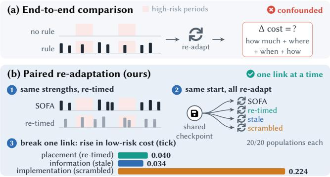
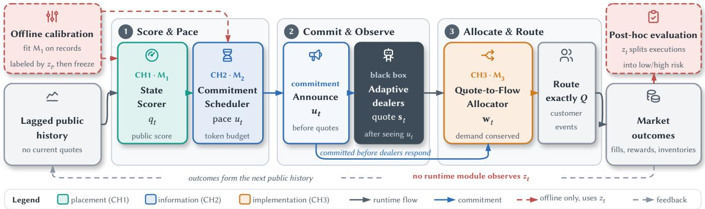
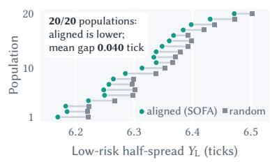
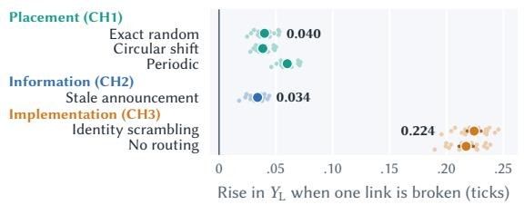
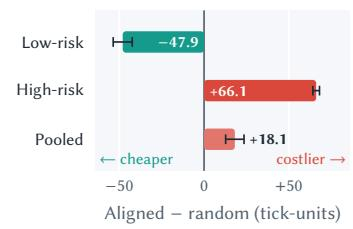
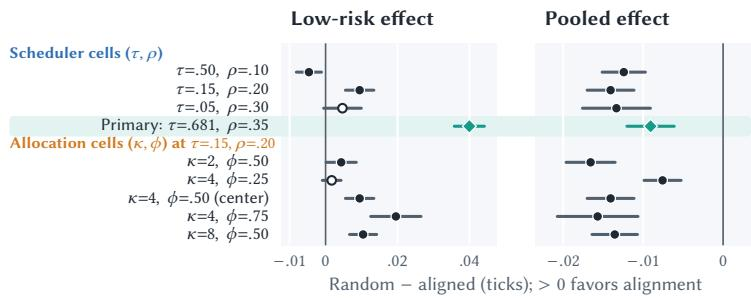
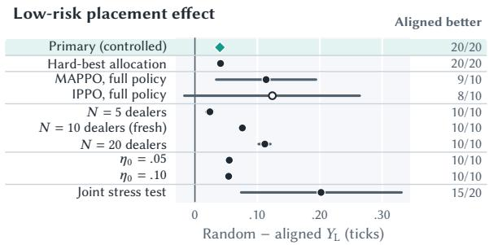
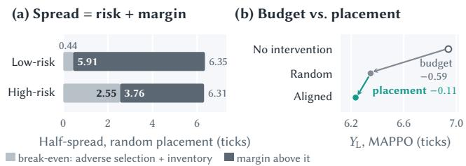

reinforcement-learning agents can sustain high prices in repeatedpricing settings [8, 23], and learning-based dealer models can likewise settle into persistently wide quotes [10, 12, 31]. Yet a wide spread is not, by itself, evidence of strategic behavior: it can also reflect volatility, adverse selection (trading against better-informed counterparties), or inventory risk (holding risky positions) [3, 15]. A venue that intervenes whenever spreads widen can suppress legitimate risk compensation as readily as strategic margins.

# When and How Order-Flow Interventions Work After Dealers Adapt∗

Guanghao Wu†   
University of Technology Sydney Sydney, NSW, Australia   
guanghao.wu@student.uts.edu.au

Zhidong Li University of Technology Sydney Sydney, NSW, Australia zhidong.li@uts.edu.au

Zhuo Cai† University of Technology Sydney Sydney, NSW, Australia zhuo.cai@student.uts.edu.au

Shoujin Wang‡ University of Technology Sydney Sydney, NSW, Australia shoujin.wang@uts.edu.au

## Abstract

Learning dealer agents can settle on persistently wide quotes, raising what customers pay to trade. A venue can route more orders to tighter quotes, but a wide quote may reflect real risk, and once dealers adapt, an end-to-end comparison cannot show why a rule works: because it intervenes more, picks better moments, is announced in advance, or rewards the right quote. We propose SOFA (State-aligned Order-Flow Allocation), a public order-flow contract with three parts: a State Scorer ranks market states from lagged public data, a Commitment Scheduler announces a budgeted intervention strength before dealers quote, and a Quote-to-Flow Allocator shifts a bounded share of fixed customer demand toward tighter quotes. Our paired re-adaptation protocol gives competing rules the same intervention strengths, only re-timed, lets dealers re-adapt to each rule from a shared checkpoint, and breaks one link at a time. Across 20 independently trained dealer populations in an ABIDES market, concentrating the intervention in states that the score ranks as low-risk lowers low-risk execution cost relative to random timing in every population, by 0.040 tick on average, while a stale announcement or a broken quote-to-flow link raises this cost. In the primary setting the gain comes at the expense of highrisk trades, whose costs rise, so state alignment pays of only for a venue that weighs low-risk costs more than 1.38 times as heavily as high-risk costs. Our code is available at https://github.com/ moderncavemann/state-aligned-order-flow-contracts.

## CCS Concepts

• Computing methodologies Multi-agent reinforcement learning; • Applied computing Economics.

## Keywords

multi-agent reinforcement learning, market making, market design, order flow, agent-based simulation, mechanism evaluation

## 1 Introduction

In dealer markets, market makers (dealers) quote the prices at which they stand ready to buy and sell, and the gap between the two— the bid–ask spread—is what customers pay to trade. Independent

  
Figure 1: Judging a rule after dealers adapt. (a) End-to-end comparisons change how much, where, when, and how the venue intervenes at once; (b) paired re-adaptation fixes the strengths, re-adapts every arm from one checkpoint, and breaks one link per control (sizes also reflect how disruptive each control is).

We ask what such a venue can actually do. It cannot inspect dealer objectives, parameters, or learning updates: to the venue, dealers are black boxes that keep learning. What the venue does control is how customer orders reach dealers: it observes lagged public market data, announces allocation terms before dealers quote, and executes those terms after quotes arrive while keeping total customer demand fixed. This is a black-box multi-agent reinforcement learning (MARL) governance problem: the venue can change how learning agents earn customer flow, but not how they learn. We call such a rule a contract in this implementation sense—a public commitment made before dealers quote and enforced mechanically— rather than a bilateral legal contract or an equilibrium guarantee.

Designing such a contract raises three challenges. CH1 (where): risk-confounded opportunity. From lagged public data alone, the venue must find the states in which wide spreads are least explained by risk; a rule that simply reacts to wide spreads is confounded, because spreads also widen when risk rises. CH2 (when and how much): budgeted commitment before quoting. Opportunities are scarce, continuous intervention inflates dealers inventory penalties (Section 5.4), and terms announced after quoting cannot shape the quote. CH3 (how): demand-conserving implementation. Unlike an incentive designer, the venue cannot transfer rewards; it must keep total demand fixed while tying the promised flow advantage to the quote that earned it. The challenges are linked: well-placed intervention is wasted if dealers cannot see the current commitment, and an announcement is wasted if the allocation ignores each dealer’s own quote.

Evaluating such a contract raises a fourth challenge. CH4 (how to judge): identification after adaptation. Once dealers adapt to a new rule, which part of the rule caused the change? An end-toend comparison changes at once how much and where the venue intervenes, what dealers know before quoting, and how quotes map to flow (Figure 1a). A standard ablation that removes a component also changes how much the venue intervenes, mixing the amount of intervention with the mechanism, while a test with frozen dealer policies captures only the mechanical efect before dealers adapt. The question is therefore not whether a favorable final outcome occurs, but which links still matter after dealers have adapted. An swering it requires a design that fixes the amount of intervention, lets every compared rule re-adapt, and changes one link at a time.

We address CH1–CH3 with SOFA (State-aligned Order-Flow Allocation), a public order-flow contract whose three components map one-to-one onto the design challenges. The State Scorer turns lagged public volatility and absolute returns into a frozen score that ranks states by how little risk would explain a wide spread (CH1). The Commitment Scheduler converts the score into a paced intervention strength and announces it before dealers quote (CH2). The Quote-to-Flow Allocator then shifts a bounded share of the fixed customer demand toward tighter quotes, so the promised advantage goes to the quote that earns it (CH3).

We address CH4 with a paired re-adaptation protocol (Figure 1b). On common market paths, SOFA and its placement controls (each complete rule under comparison is an arm) receive exactly the same set of intervention strengths, placed at diferent times, and every arm re-adapts from the same trained checkpoint with the same training budget. Targeted controls then break one link at a time: a stale announcement changes what dealers see before quoting, and identity scrambling gives each dealer the flow earned by another dealer’s quote. We repeat the protocol on 20 independently trained dealer populations, so each conclusion rests on population-level evidence rather than on a single training run.

The paper makes three contributions:

(1) A paired re-adaptation protocol that holds the set of an nounced strengths fixed on every path and re-adapts every arm from a shared checkpoint, so outcome diferences can be attributed to placement, information, or implementation rather than to intervening more or to dealers that have not yet adapted.

(2) SOFA, a traceable order-flow contract that needs no access to dealer rewards or gradients and logs a replayable chain from state to score, announcement, quote, allocation, and outcome.

(3) Evidence on what works after adaptation, and at whose cost: a consistent gain from state-aligned placement, an advantage of current over stale announcements, the largest tested loss when the quote-to-flow link is broken, the limits of transfer across learners and market settings, and an account of who pays for the targeted gain and when the trade is worth making.

## 2 Related Work

Algorithmic coordination and dealer risk. Algorithmic-pricing research asks whether learning agents sustain supracompetitive prices, through which punishment-style strategies, and under which learning dynamics [5, 8, 19, 23]. Dealer microstructure instead explains wide spreads as compensation for inventory risk and adverse selection [3, 15], and recent models join the two views [10, 13, 31]. Because a wide spread may reflect strategy or risk, we target a conditional intervention rather than a collusion label.

Market making and order allocation. Market-making research derives dealer quotes from inventory and transaction risk and optimizes them with deep or adversarial reinforcement learning [17, 18, 21, 30], while multi-agent dealer models let competition among dealers emerge from learning itself [12, 14, 31]. Optimalorder-placement work asks how a trader should route orders against a given market [11]. We take the opposite, venue-side view: the venue commits how a fixed customer flow responds to public state and submitted quotes, and dealers adapt to that rule; our contribution is an evaluation design for such rules, not a new dealer objective or quoting algorithm.

Steering adaptive agents. Platform rules and learned buyer commitments can reshape seller responses [4, 6, 22], and MARL incentive designers can transfer rewards directly [32]. Our venue cannot transfer rewards; it can only commit an allocation rule before dealers quote, which we freeze and test link by link after every arm re-adapts.

Financial MARL evaluation. ABIDES supports message-level counterfactuals [7], ABIDES-MARL studies strategic learning [9], and JaxMARL-HFT emphasizes GPU-scale historical-data learning [24]. These frameworks make large-scale training feasible but do not attribute an outcome change to one link of a fixed intervention after agents adapt, which we do on common ABIDES event paths. MAPPO and IPPO provide distinct learners [27, 33], and MARL evaluation guidance [1, 16] motivates our inference across independently trained populations.

## 3 Problem Formulation

## 3.1 Market Model

Let $N = \{ 1 , . . . , N \}$ denote the dealer set and $\mathcal { T } = \{ 1 , . . . , T \}$ the sequence of market decisions. At decision $t \in \mathcal { T } , m _ { t }$ is the public pre-shock reference price. Dealer � submits a symmetric halfspread $s _ { i , t } \in S$ —the distance of its quotes from the reference price, so a larger half-spread means customers trade at worse prices— and $\mathbf { \boldsymbol { s } } _ { t } = \left( s _ { 1 , t } , \ldots , s _ { N , t } \right)$ denotes the submitted quote profile. The venue routes a fixed customer quantity � using allocation weights $\mathbf { w } _ { t } = \left( w _ { 1 , t } , \ldots , w _ { N , t } \right)$ satisfying $w _ { i , t } \geq 0$ and $\begin{array} { r } { \sum _ { i } w _ { i , t } = 1 } \end{array}$

The public reference evolves as $m _ { t + 1 } = m _ { t } + \epsilon _ { t } . \mathrm { ~ A ~ }$ simulatorinternal regime $z _ { t } ~ \in ~ \{ \mathrm { L } , \mathrm { H } \}$ changes the conditional scale of $\epsilon _ { t } ,$ while the informed-arrival probability remains fixed. The regime therefore changes the magnitude of adverse selection, not the frequency of informed flow. It drives the simulator, labels the ofline calibration data, and defines the post-hoc evaluation subgroups, but is unavailable to the venue at runtime.

For dealer $i , C _ { i , t }$ and $I _ { i , t }$ denote cash and inventory, and $W _ { i , t } =$ $C _ { i , t } + I _ { i , t } m _ { t }$ is wealth marked to the reference price. Each dealer’s learning reward penalizes inventory:

$$
r _ { i , t } = W _ { i , t + 1 } - W _ { i , t } - \lambda _ { I } I _ { i , t + 1 } ^ { 2 } .\tag{1}
$$

The venue’s runtime information is the lagged public history $\mathcal { H } _ { t - 1 } ^ { \mathrm { p u b } }$ It computes a public-state score $q _ { t } ,$ , converts it into an announced strength $u _ { t }$ using scheduler state $B _ { t - 1 }$ , and allocates customer flow after observing the current quote profile:

$$
q _ { t } = M _ { 1 } ( \mathcal { H } _ { t - 1 } ^ { \mathrm { p u b } } ) , \qquad u _ { t } = M _ { 2 } ( q _ { t } , B _ { t - 1 } ) , \qquad \mathbf { w } _ { t } = M _ { 3 } ( u _ { t } , s _ { t } ) .\tag{2}
$$

Thus the State Scorer $( M _ { 1 } )$ has no latent-state or current-quote input, dealers observe �� before choosing $\mathbf { s } _ { t } ,$ , and the Quote-to-Flow Allocator (�3) uses only $u _ { t }$ and the submitted quotes.

## 3.2 Venue Objective

The venue targets customer execution in states where wide spreads are less justified by shock-magnitude risk. Let $\mathcal { E } _ { t }$ be the set of customer executions at decision �; for execution $e \in { \mathcal { E } } _ { t } ,$ , let $q _ { e } , p _ { e } ,$ and $m _ { t }$ denote filled quantity, execution price, and contemporaneous reference price. The prespecified primary endpoint, which we call the low-risk execution cost, is the quantity-weighted customer execution half-spread in the low-risk regime:

$$
Y _ { \mathrm { L } } = \frac { \sum _ { t } { { \bf 1 } \left[ { { z } _ { t } } = \mathrm { L } \right] \sum _ { e \in { \mathcal E } _ { t } } { q _ { e } } \left| { { p } _ { e } } - { m } _ { t } \right| } } { \sum _ { t } { { \bf 1 } \left[ { { z } _ { t } } = \mathrm { L } \right] \sum _ { e \in { \mathcal E } _ { t } } { q _ { e } } } } .\tag{3}
$$

Lower $Y _ { \mathrm { L } }$ means cheaper customer execution; spreads, and all spread efects below, are measured in ticks, the minimum price increment. We also report where the cost falls and how the market responds—high-risk and pooled $( Y _ { \mathrm { a l l } } )$ execution cost, total customer cost in tick-units (the per-path sum of $q _ { e } | p _ { e } - m _ { t } | )$ , dealer reward, inventory dispersion, routing intensity, and flow concentration— rather than collapsing them into a single welfare number; targeting $Y _ { \mathrm { L } }$ is a choice of venue objective, not a welfare claim (Section 5.7). The task is to test whether, under an identical set of strengths on each path, giving the stronger interventions to higher-scored states lowers �L after dealers adapt.

## 3.3 Evaluation Targets

Let $\mathbf { u } = ( u _ { 1 } , \ldots , u _ { T } )$ denote the realized pathwise strength schedule. State-aligned, exact-random, circular-shift, and periodic schedules preserve the complete multiset of entries in u. They consequently preserve the activation count and cumulative strength,

$$
A ( \mathbf { u } ) = \sum _ { t } \mathbf { 1 } [ u _ { t } > 0 ] , \qquad S ( \mathbf { u } ) = \sum _ { t } u _ { t } ,\tag{4}
$$

as well as every individual nonzero strength.

For population $k ,$ each outcome is first averaged over its $R$ common evaluation paths. The three primary contrasts are

$$
\begin{array} { r l } & { \Delta _ { \mathrm { p l a c e } } = \mathbb { E } _ { k } [ \bar { Y } _ { k , \mathrm { L } } ^ { \mathrm { r a n d o m } } - \bar { Y } _ { k , \mathrm { L } } ^ { \mathrm { a l i g n e d } } ] , } \\ & { \quad \Delta _ { \mathrm { i n f o } } = \mathbb { E } _ { k } [ \bar { Y } _ { k , \mathrm { L } } ^ { \mathrm { s t a l e } } - \bar { Y } _ { k , \mathrm { L } } ^ { \mathrm { c u r r e n t } } ] , } \\ & { \quad \Delta _ { \mathrm { i m p l } } = \mathbb { E } _ { k } [ \bar { Y } _ { k , \mathrm { L } } ^ { \mathrm { s c r a m b l e d } } - \bar { Y } _ { k , \mathrm { L } } ^ { \mathrm { q u o t e - a l i g n e d } } ] . } \end{array}\tag{5}
$$

Positive values favor state alignment, the current announcement, and quote-aligned allocation, respectively; paired arms difer in exactly one link. Every arm re-adapts independently from the same population checkpoint, so these are total learned contrasts under a fixed simulator, learner, and training budget.

## 4 Methodology

## 4.1 Overview

Our method has two layers. The intervention layer (Sections 4.2–4.4, Figure 2, Algorithm 1) specifies what the venue does at each decision and answers CH1–CH3: the State Scorer decides where to intervene, the Commitment Scheduler decides when and how strongly, and the Quote-to-Flow Allocator decides how the promised advantage reaches quotes. The evaluation layer (Section 4.5, Figure 1b) tests which of these parts still works after dealers adapt and answers CH4. All three runtime modules use only public or venue-side information, and every quantity they produce is logged.

## 4.2 State Scorer: Where to Intervene

The State Scorer asks, from recent public data alone, whether this is a moment in which a wide spread would be hard to justify by risk. It maps lagged public history to a bounded score that ranks states before current quotes exist, using ten-step public volatility $v _ { t }$ and the absolute lagged return $a _ { t } \colon$

$$
\begin{array} { r l r l } { q _ { t } = \sigma \big ( b + \beta ^ { \top } D ^ { - 1 } \left( [ v _ { t } , a _ { t } ] ^ { \top } - \mu \right) \big ) , } & { { } \quad } & { q _ { t } \in [ 0 , 1 ] . } \end{array}\tag{6}
$$

The model is deliberately simple, which keeps the study focused on the intervention rather than on representation learning. It is fitted once on records without intervention, with the simulator’s regime as the training label, and frozen before any evaluation; at runtime it reads neither the latent regime, current quotes, dealer identities, nor future outcomes. The score is therefore a public control index, not a live collusion probability. On held-out records it ranks the two regimes well (Table 1); it is not calibrated as a probability, which ranking does not require.

## 4.3 Commitment Scheduler: When to Intervene

The Commitment Scheduler turns the score into a commitment that is limited by a token budget and visible before dealers quote:

$$
\begin{array} { r l } & { \widetilde { u } _ { t } = q _ { t } \mathbf { 1 } \big [ q _ { t } \geq \tau \big ] , \quad B _ { t } ^ { + } = \operatorname* { m i n } \{ B _ { \operatorname* { m a x } } , B _ { t - 1 } + \rho \} , } \\ & { u _ { t } = \widetilde { u } _ { t } \mathbf { 1 } \big [ B _ { t } ^ { + } \geq 1 \big ] , \quad B _ { t } = B _ { t } ^ { + } - \mathbf { 1 } \big [ u _ { t } > 0 \big ] . } \end{array}\tag{7}
$$

Pacing prevents continuous intervention, and announcing the strength before quoting lets dealers respond to the current commitment. In the primary setting the scheduler intervenes in about one decision in five. For a fixed set of strengths, giving the larger strengths to the states with the larger benefits is the static benchmark—the best arrangement if dealers did not react; the paired experiment tests whether the ordering still helps after dealers adapt to it.

## 4.4 Quote-to-Flow Allocator: How to Route Flow

The Quote-to-Flow Allocator makes the announced advantage reach whichever dealer quotes tightest, without changing how much customers trade in total. After dealers submit $\mathbf { s } _ { t } ,$ , it converts

  
Figure 2: SOFA at one market decision. (1) The State Scorer scores lagged public history and the Commitment Scheduler paces a token budget; (2) the strength $u _ { t }$ is announced before dealers quote; (3) the Quote-to-Flow Allocator applies the committed $u _ { t }$ to the submitted quotes. Colors mark the three links (CH1–CH3); the legend explains the line styles. The latent regime $z _ { t }$ is used only ofline.

Algorithm 1 Runtime of the SOFA contract on one market path   
Require: frozen $M _ { 1 } ;$ scheduler parameters $\tau , \rho , B _ { \mathrm { m a x } } ;$ allocator   
parameters $\kappa ,$ �; fixed customer demand �   
1: $B _ { 0 } \gets 0$   
2: for $t = 1 , \ldots , T$ do   
3: Observe the lagged public history $\mathcal { H } _ { t - 1 } ^ { \mathrm { p u b } }$   
4: Score the state: $q _ { t } \gets M _ { 1 } ( \mathcal { H } _ { t - 1 } ^ { \mathrm { p u b } } )$ Eq. (6)   
5: Pace the budget: $( u _ { t } , B _ { t } ) \gets M _ { 2 } ( q _ { t } , B _ { t - 1 } )$ Eq. (7)   
6: Announce $u _ { t }$ before dealers quote   
7: Receive the quote profile $\mathbf { s } _ { t }$   
8: Allocate: $\mathbf { w } _ { t } \gets M _ { 3 } ( u _ { t } , \mathbf { s } _ { t } )$ Eq. (8)   
9: Route the $Q$ customer events by $\mathbf { w } _ { t }$ and log the trace   
10: end for

quote competitiveness into a soft allocation target,

$$
\pi _ { i , t } = \frac { \exp [ - \kappa ( s _ { i , t } - s _ { t } ^ { \operatorname* { m i n } } ) ] } { \sum _ { j } \exp [ - \kappa ( s _ { j , t } - s _ { t } ^ { \operatorname* { m i n } } ) ] } , \quad w _ { i , t } = ( 1 - \phi u _ { t } ) \frac { 1 } { N } + \phi u _ { t } \pi _ { i , t } .\tag{8}
$$

At most a fraction $\phi u _ { t }$ of customer flow follows quotes, and $\textstyle \sum _ { i } w _ { i , t } \ = \ 1$ keeps total demand fixed. In the primary setting, a dealer that undercuts nine rivals by three ticks during an intervention receives roughly half of the flow instead of one tenth; without intervention, allocation is uniform. Transfer cells add an incumbent quote-responsive share $\eta _ { 0 } ,$ a fraction of flow that follows quotes even without intervention,

$$
w _ { i , t } ^ { ( \eta _ { 0 } ) } = \frac { 1 - \eta _ { 0 } - \phi u _ { t } } { N } + ( \eta _ { 0 } + \phi u _ { t } ) \pi _ { i , t } , \qquad 0 \leq \eta _ { 0 } + \phi u _ { t } \leq 1 .\tag{9}
$$

The primary setting uses $\eta _ { 0 } = 0 ,$ so without intervention a tighter quote earns no extra flow; this isolates the allocation channel but weakens ordinary price competition by construction, an assumption Section 5.5 relaxes with $\eta _ { 0 } > 0$ . Two further variants change only the implementation: no routing keeps the announcement but allocates uniformly, and hard-best allocation sends all quote-responsive flow to the single tightest quote, testing whether the placement gain depends on the soft allocation rule.

## 4.5 Evaluation Protocol

The paired re-adaptation protocol evaluates each link after dealers adapt. On each common market path, the placement arms receive the same score-derived strength sequence, and a fixed permutation changes only its timing (Figure 1b). Any diference between placement arms therefore reflects where the strengths land, not how many or how strong they are. Every arm then starts from the same population checkpoint and re-adapts independently with the same training budget; common market paths and random numbers reduce evaluation noise. Matching fixes the announced amount of intervention but not the realized routing shift, which also depends on learned quotes, so we report routing intensity (routing total variation) as a diagnostic.

The stale-announcement control shows dealers $u _ { t - 1 }$ while the venue applies $u _ { t } ,$ testing whether it matters that dealers see the current commitment. The identity-scrambling control reassigns the quote-derived weights across dealers with a fixed non-identity permutation: the set of weights, targeted quantity, maximum share, routing intensity, and total demand are unchanged, but a dealer’s flow no longer follows its own quote. Because each arm induces a diferent learned response, the efects are informative but not additive. Every quantity from market state to outcome is logged, so each comparison can be recomputed from the traces.

## 5 Experiments

## 5.1 Experimental Setup

We evaluate four questions. RQ1: State placement (CH1). Does giving the same set of strengths to higher-scored states lower lowrisk execution cost after dealers adapt? RQ2: Pre-quote information (CH2). Does seeing the current, rather than the previous, announcement before quoting help? RQ3: Quote-to-flow implementation (CH3). Does it matter that the flow advantage follows the dealer’s own quote? RQ4: Robustness. How sensitive are these efects to pacing, allocation, the choice of learner, dealer count, and incumbent quote responsiveness?

We implement the study in ABIDES, an event-driven, message-Qulevel market simulator with reinforcement-learning interfaces [2,

Table 1: Experimental settings, frozen before outcome evaluation. Primary setting: $K = 2 0$ populations, $R = 1 0$ common paths.
<table><tr><td colspan="2">A Market environment</td><td colspan="2">C Learners</td></tr><tr><td>Market</td><td>N = 10 dealers, T = 100 decisions, Q = 20 unit events per decision; half-spreads  $S = \{ 1 , . . . , 7 \}$  ticks</td><td>Controlled response</td><td>Shared 2 × 64 tanh actor, dealer-specific heads, linear response adapter, centralized critic</td></tr><tr><td>Risk process</td><td>Shock scales σ1  $. / \sigma _ { \mathrm { H } } = 0 . 7 5 / 4 . 0 ( $  ); transitions  $\bar { p } _ { \mathrm { L H } } / \bar { p } _ { \mathrm { H L } } = 0 . 0 4 / 0 . 1 0 ; \bar { p } _ { \mathrm { H } } ^ { 0 } = 0 . 3 0$ </td><td>Controlled PPO</td><td>Learning rate  $3 \times 1 0 ^ { - 4 } .$  entropy 0.02,  $\gamma = 0 . 9 6 , \mathrm { G A E }$   $\lambda = 0 . 9 \bar { 5 } , \mathrm { c l i p } 0 . 2 0 , \cdot$  4 epochs, batch 512</td></tr><tr><td>Order flow</td><td>Informed probability 0.80; inventory penalty 0.002</td><td>Full-policy learners</td><td>Recurrent  ${ \mathrm { M A P P O / I P P O } } ,$  hidden size 64, complete actor-critic updates; learning rate  $5 \times { 1 0 } ^ { - 4 }$  entropy 0.01,  $\gamma = 0 . 9 9 , { \mathrm { G A E } } \lambda = 0 . 9 5 ,$  clip 0.20, 10 epochs</td></tr><tr><td colspan="4">B Primary contract State Scorer (M1)</td></tr><tr><td></td><td>10-step volatility and absolute return, fit on 1,000 untreated records (validation AUC 0.83 on 1,000 more)</td><td>Episodes</td><td>384 untreated, then 96 arm-specific response episodes; primary  $K = 2 0 , R = 1 0 ;$  transfer cells K = 10 (hard-best, stress test  $K = 2 0 ) , R = 1 0$ </td></tr><tr><td>Scheduler (M2)</td><td>Threshold  $\tau = 0 . 6 8 1$  pacing  $\rho = 0 . 3 5 , B _ { \mathrm { m a x } } = 2$ </td><td>Inference</td><td>Student-t intervals across populations (primary), exact sign tests, paired two-way bootstrap; Holm-adjusted link contrasts</td></tr><tr><td>Allocator (M3)</td><td colspan="3">Quote-aligned allocation,  $\kappa = 4 , \phi = 0 . 5 0 , \eta _ { 0 } = 0$ </td></tr></table>

7, 9]; dealer reward follows inventory-aware market-making formulations [3, 17, 21, 30]. We use PPO with generalized advantage estimation [28, 29], with recurrent MAPPO and IPPO as centralized and independent learners [27, 33].

The comparison arms map to these questions: exact random, circular-shift, and periodic schedules are budget-matched placement controls (RQ1); the one-step-stale announcement is the information control (RQ2); identity scrambling and no routing are implementation controls (RQ3); and hard-best allocation, MAPPO and IPPO learners, other dealer counts, nonzero $\eta _ { 0 } ,$ and a wideraction stress test probe robustness (RQ4). No intervention and a calibrated lagged-spread trigger serve as practical reference points. Frozen adaptations of a Brero-style buy-box rule and a Banerjeestyle commitment rule [4, 6] did not pass the prespecified gate on stability, activation, and routing intensity, so they are not ranked against these controls.

Because deep-RL and MARL results are seed-sensitive [1, 16, 20, 25, 26], independently trained populations, not repeated evaluation paths, are the unit of inference. The primary setting has 20 populations, each evaluated on 10 common paths, and paired path diferences are averaged within each population. We report two-sided 95% Student-� intervals across populations, check them with exact sign tests and a paired population/path bootstrap, and Holm-adjust the link contrasts. Table 1 lists the frozen settings.

For each population, one checkpoint is first trained without intervention. Every arm starts from this checkpoint, freezes the base policy, and trains a zero-initialized, dealer-specific response adapter with a centralized critic for a fixed number of episodes; dealers observe the current $u _ { t } ,$ or $u _ { t - 1 }$ in the stale arm. We call this restricted learner the controlled response: dealers adjust their quotes to each rule while their base policy stays fixed. Full-policy learners (MAPPO and IPPO) instead update complete recurrent policies and critics under each arm. Arms of a population therefore share initialization, evaluation paths, and training budget, and difer only in the intervention rule that they face.

## 5.2 Main Results

Table 2 and Figure 3 answer RQ1. With the same intervention strengths, state alignment lowers low-risk execution cost relative to exact random placement by 0.040 tick, and all 20 populations favor alignment (Figure 3a); the population-level interval, the exact sign test, and the bootstrap all rule out a zero efect. Pairing is what makes this margin visible: the level of low-risk execution cost has a cross-population standard deviation about twice the efect, yet every paired diference is positive. The mechanism is visible in where commitments land: alignment places about half as many announced interventions in high-risk states as the budget-matched controls (Table 2, Panel A). Circular-shift and periodic placement also do worse than alignment, so neither temporal clustering nor a clock-like schedule explains the placement gain.

The margin is small per trade, under one percent of the low-risk execution cost, but it comes purely from re-timing a fixed budget rather than from intervening more. Section 5.7 compares it with the part of the spread that risk does not explain. At a fixed budget, placement moves cost between states.

Panels B–C of Table 2 show this shift. Relative to exact random placement, alignment lowers the total cost paid by customers in low-risk states but raises it by more in high-risk states, so pooled customer cost rises slightly; because tick-units weight each state by its executed quantity, the two state changes add up to the pooled change. Dealer reward rises, inventory dispersion falls, flow concentration does not increase, and routing intensity is slightly lower, so the gain does not come from routing more flow. These guardrails matter: a rule that lowered customer cost by squeezing dealer profits or concentrating flow in one dealer would be fragile. The opposite signs are a central finding: a pooled endpoint alone would hide the targeted improvement, and a target-only endpoint would hide the high-risk cost. Section 5.7 asks when this trade is worth making.

## 5.3 Ablation Study

Table 3 answers RQ2 and RQ3. A one-step-stale announcement raises low-risk execution cost by 0.034 tick, so in the tested setting customers pay less when dealers quote against the current commitment; dropping the first decision, at which both arms see a zero strength, leaves this unchanged. Because the stale arm still announces and enforces its terms, this contrast values current information but does not separately identify a commitment efect. Identity scrambling raises the cost by 0.224 tick, the largest tested degradation; with routing intensity fixed by construction, the manipulation check in Table 4 confirms that the quote-to-flow link is broken. Both contrasts remain significant after Holm adjustment.

(a) Every population favors alignment  

(b) Breaking one link at a time  

(c) Who pays  
  
Figure 3: Primary results across �=20 populations. (a) One row per population; alignment wins in all 20. (b) Small dots: populations; large: means with 95% CIs, colored by link. (c) Low-risk customer cost falls; high-risk and pooled costs rise.

Table 2: State alignment improves the targeted state but shifts customer cost toward high-risk states: low-risk cost falls in 20/20 populations, high-risk and pooled costs rise (Panel B), and neither flow concentration nor routing intensity increases (Panel C).
<table><tr><td>A Budget-matched schedules</td><td colspan="2">YL (ticks) ↓</td><td colspan="2"> $\overline { { Y _ { \mathrm { a l l } } \left( \mathrm { t i c k s } \right) \downarrow } }$ </td><td colspan="2">High-risk share (%) ↓</td><td>Increase vs. aligned</td><td>Aligned better</td></tr><tr><td colspan="3">State-aligned (ours)</td><td colspan="2">6.307 6.351</td><td colspan="2">9.42</td><td></td><td></td></tr><tr><td colspan="3">Exact random</td><td colspan="2">6.347</td><td>6.342</td><td colspan="2">19.44  $+ 0 . 0 4 0 \pm 0 . 0 0 4$ </td><td>20/20</td></tr><tr><td colspan="3">Circular shift</td><td colspan="2">6.346</td><td>6.341</td><td colspan="2">21.54</td><td> $+ 0 . 0 3 9 \pm 0 . 0 0 3$  20/20</td></tr><tr><td colspan="3">Periodic placement</td><td colspan="2">6.367</td><td>21.61</td><td colspan="2"> $+ 0 . 0 6 0 \pm 0 . 0 0 3$ </td><td>20/20</td></tr><tr><td colspan="4">B State incidence</td><td colspan="2">6.347</td><td colspan="2">Customer cost (tick-units) ↓</td><td></td></tr><tr><td>State</td><td colspan="3">Execution half-spread (ticks) ↓ Random</td><td colspan="2"></td><td colspan="2">Random</td><td></td></tr><tr><td>Low-risk (target)</td><td>Aligned 6.307</td><td>6.347</td><td>Change  $- 0 . 0 4 0 \pm 0 . 0 0 4$ </td><td>Aligned 9148.97</td><td>9196.89</td><td></td><td>Change</td><td>Aligned better</td></tr><tr><td>High-risk</td><td>6.440</td><td>6.309</td><td> $+ 0 . 1 3 1 \pm 0 . 0 0 7$ </td><td>3553.14</td><td>3487.08</td><td></td><td> $- 4 7 . 9 2 \pm 5 . 6 1$   $+ 6 6 . 0 6 \pm 1 . 9 6$ </td><td>20/20</td></tr><tr><td>Pooled</td><td>6.351</td><td>6.342</td><td> $+ 0 . 0 0 9 \pm 0 . 0 0 3$ </td><td>12702.11</td><td>12683.97</td><td></td><td> $+ 1 8 . 1 4 \pm 5 . 4 2$ </td><td>0/20 2/20</td></tr><tr><td colspan="2">C Dealer and market-structure guardrails</td><td></td><td>Aligned</td><td></td><td></td><td colspan="2">Change</td><td></td></tr><tr><td colspan="2"></td><td></td><td colspan="2">9.378</td><td>Random 9.339</td><td colspan="2"></td><td>Aligned better</td></tr><tr><td colspan="2">Aggregate dealer reward (×10³units)</td><td></td><td>8.897</td><td></td><td></td><td colspan="2"> $+ 0 . 0 3 9 \pm 0 . 0 0 7$ </td><td>20/20</td></tr><tr><td colspan="2">Inventory dispersion (units) ↓</td><td></td><td colspan="2">0.0622</td><td>9.422 0.0629</td><td colspan="2"> $- 0 . 5 2 5 \pm 0 . 0 9 2$   $- 0 . 0 0 0 7 \pm 0 . 0 0 0 5$ </td><td>20/20</td></tr><tr><td colspan="2">Routing intensity (TV)</td><td colspan="2"></td><td></td><td colspan="3"></td><td></td></tr><tr><td colspan="2">Normalized realized-flow HHI ↓ Maximum realized flow share ↓</td><td colspan="2">0.0689 0.2509</td><td>0.0713 0.2541</td><td colspan="3"> $- 0 . 0 0 2 4 \pm 0 . 0 0 0 3$   $- 0 . 0 0 3 2 \pm 0 . 0 0 0 5$ </td><td>20/20 20/20</td></tr></table>

Means over � = 20 populations; is the half-width of the 95% Student-� interval. Panel A reports each control minus the aligned arm; Panels B–C report aligned minus random. High-risk share: fraction of announced interventions that fall in high-risk states. Across populations, the Panel A levels have $\mathrm { S D ~ 0 . 0 8 0 - 0 . 0 8 4 }$ tick. Bold: best in column.

Table 3: Link ablations at a matched amount of intervention: every tested change raises the low-risk execution cost in every population, most under identity scrambling, the most disruptive control. Efects are total learned responses, not additive shares or a general ranking.
<table><tr><td>Variant</td><td>What is removed or changed</td><td>Increase in YL (ticks)</td><td>SOFA better</td></tr><tr><td colspan="4">Placement (CH1)State Scorer (M1) replacements and re-timed schedules</td></tr><tr><td>Volatility-only score</td><td>Absolute-return feature and the two-feature score (validation AUC 0.76)</td><td> $0 . 0 3 6 \pm 0 . 0 0 3$ </td><td>20/20</td></tr><tr><td>Absolute-return-only score</td><td>Volatility feature and the two-feature score (validation AUC 0.80)</td><td> $0 . 0 6 8 \pm 0 . 0 0 4$ </td><td>20/20</td></tr><tr><td>Lagged-spread trigger</td><td>Public-state score replaced by an outcome-linked trigger</td><td> $0 . 0 2 3 \pm 0 . 0 0 4$ </td><td>10/10</td></tr><tr><td>Exact random placement</td><td>State alignment removed; exact strength multiset retained</td><td> $0 . 0 4 0 \pm 0 . 0 0 4$ </td><td>20/20</td></tr><tr><td>Circular shift</td><td>State alignment removed; temporal clustering retained</td><td> $0 . 0 3 9 \pm 0 . 0 0 3$ </td><td>20/20</td></tr><tr><td>Periodic placement</td><td>State-dependent timing replaced by fixed cadence</td><td> $0 . 0 6 0 \pm 0 . 0 0 3$ </td><td>20/20</td></tr><tr><td colspan="4">Information (CH2) Commitment Scheduler (M2) announcement before quoting</td></tr><tr><td>One-step-stale announcement</td><td>Current information removed before quoting</td><td> $0 . 0 3 4 \pm 0 . 0 0 3$ </td><td>20/20</td></tr><tr><td>Implementation (CH3)Quote-to-Flow Allocator (M3) quote-to-flow link</td><td></td><td></td><td></td></tr><tr><td>Identity-scrambled allocation</td><td>Quote-derived weights reassigned across dealers each step; weight multiset retained</td><td> $0 . 2 2 4 \pm 0 . 0 0 6$ </td><td>20/20</td></tr></table>

Mean half-width of the 95% Student-� interval across populations. Positive values indicate degradation from the full contract; score replacements are calibrated separately and are not exact-strength feature attributions; the lagged-spread row comes from a separate ten-population comparison.

The State Scorer comparisons favor the two-feature score over the single-feature and lagged-spread alternatives. The laggedspread trigger was calibrated to a comparable activation rate and routing intensity, so it competes on placement rather than on the amount of intervention. Because each replacement is calibrated separately, these rows compare complete scores rather than single features, and a better regime classifier does not necessarily place interventions better. Each row is the total learned response to one change, so the efects are not additive, and their sizes also reflect how disruptive each control is; they do not rank the links importance in general.

  
Figure 4: Placement gains are local: very low pacing reverses them, two cells are unresolved (hollow: CI includes 0), and pooled costs stay higher.

## 5.4 Sensitivity Analysis

Figure 4 addresses the first part of RQ4. The placement gain is local rather than monotone: very low pacing reverses it, weak quote responsiveness and the loosest scheduler cell leave it statistically unresolved, and the primary pacing and moderate-to-strong allocation cells keep it positive. The cost side is stable across this local sweep: alignment raises high-risk and pooled costs in every tested cell while flow concentration falls slightly, so the amount of intervention cannot be chosen from the targeted metric alone. The scheduler rows change the threshold and the pacing together, and the allocation rows vary one parameter at a time around a non-primary center cell, so neither group is a full factorial sweep.

A separate check on pacing points the same way: a spreadthreshold controller and always-on routing inflate dealers’ inventory penalties far beyond those under the paced rule (Table 4), so the evidence favors budgeted over continuous intervention.

## 5.5 Robustness to Learners and Market Settings

Figure 5 and Table 5 address the second part of RQ4. Under fullpolicy MAPPO, all three link efects stay positive, with larger means but wider intervals than under the controlled response, and the stale-announcement and scrambling contrasts remain significant after Holm adjustment. IPPO is positive on average but statistically unresolved. Hard-best allocation, all three dealer counts (the tendealer cell uses freshly trained populations at the primary dealer count), and both nonzero incumbent shares keep positive placement intervals. The direction therefore transfers across the tested cells, but the results establish neither a common efect size nor a monotone scaling law. In the dealer-count and incumbent-share cells, aligned and random arms have nearly identical routing intensity, so the realized amount of intervention stays nearly fixed in these transfers too.

Full-policy learners start closer to the edge of the action grid: without intervention, they quote the widest half-spread far more often than controlled-response dealers do. A prespecified joint stress test trains fresh full-policy MAPPO populations with twice as many actions and a nonzero incumbent share. It retains a positive place ment efect, with most populations favoring alignment, and its learned actions reach the edges of the action grid less often than in the primary setting. Because the wider grid and the incumbent share change together, the test does not attribute robustness to either factor alone.

  
Figure 5: Transfer: the placement direction holds in every transfer cell; only IPPO is statistically unresolved.

Table 4: Behavioral diagnostics: scrambling breaks the quote-to-flow link, forced undercuts reveal no detectable continuation punishment, and unpaced intervention inflates inventory penalties.
<table><tr><td>Diagnostic</td><td>Estimate (± 95% CI)</td></tr><tr><td>Manipulation check correlation of w with -s</td><td></td></tr><tr><td>Quote-aligned allocation</td><td>0.893</td></tr><tr><td>Identity-scrambled allocation</td><td>-0.028</td></tr><tr><td>Forced undercut400 paired paths</td><td></td></tr><tr><td>High-spread recovery by  $H = 1 0$ </td><td> $0 . 9 6 2 5 \pm 0 . 0 1 8 4$ </td></tr><tr><td>Continuation flow loss</td><td> $0 . 0 0 0 0 \pm 0 . 0 0 0 0$ </td></tr><tr><td>Continuation reward loss</td><td> $0 . 0 2 7 5 \pm 0 . 0 2 8 9$ </td></tr><tr><td>Rival spread compression</td><td> $0 . 0 0 0 0 8 \pm 0 . 0 0 0 1 0$ </td></tr><tr><td>Added inventory penalty  $\times 1 0 ^ { 2 } ,$ </td><td>versus the paced rule</td></tr><tr><td>35% spread-threshold controller</td><td> $0 . 9 9 8 \pm 0 . 1 2 7$ </td></tr><tr><td>Always-on routing</td><td> $2 . 6 5 3 \pm 0 . 1 8 8$ </td></tr></table>

Table 5: Rise in $Y _ { \mathrm { L } }$ (ticks; mean 95% CI) when one link is broken (exact random, stale, scrambled). Under full-policy MAPPO all three mean efects stay positive; sizes do not rank links.
<table><tr><td rowspan="2">Link broken</td><td colspan="2">Controlled response  $\scriptstyle ( K = 2 0 )$ </td><td colspan="2">Full-policy MAPPO (K=10)</td></tr><tr><td>Rise</td><td>SOFA better</td><td>Rise</td><td>SOFA better</td></tr><tr><td>Placement</td><td> $0 . 0 4 0 \pm 0 . 0 0 4$ </td><td>20/20</td><td> $\overline { { 0 . 1 1 4 \pm 0 . 0 8 0 } }$ </td><td>9/10</td></tr><tr><td>Information</td><td> $0 . 0 3 4 \pm 0 . 0 0 3$ </td><td>20/20</td><td> $0 . 1 9 3 \pm 0 . 1 7 3$ </td><td>7/10</td></tr><tr><td>Implementation</td><td> $0 . 2 2 4 \pm 0 . 0 0 6$ </td><td>20/20</td><td> $0 . 6 2 5 \pm 0 . 2 9 2$ </td><td>8/10</td></tr></table>

## 5.6 Behavioral Analysis

The behavioral tests in Table 4 separate the immediate allocation channel from punishment-based interpretations. In each forcedundercut path, one dealer is forced to quote below prevailing spreads for a short window, and flow, rewards, and rival quotes are then tracked. Dealers usually return to wide spreads within ten decisions, but the undercutting dealer loses no continuation flow, and the intervals for its continuation reward loss and for rival spread compression include zero. Over the tested horizon, the evidence supports an immediate quote-to-flow response and does not detect the continuation punishment that a punishment-supported interpretation would require.

## 5.7 Economic Interpretation

In the primary setting, alignment moves customer cost between states rather than lowering it (Section 5.2), so adopting it is a choice of venue objective. A venue that weights a tick-unit of customer cost by �L in low-risk and �H in high-risk states prefers alignment only $\mathrm { 1 / \omega _ { L } / \omega _ { H } > 1 . 3 8 }$ , the ratio of the high-risk cost increase to the low-risk saving (Table 2, Panel B). Equal weights, which treat every tick-unit alike, reject it. A venue whose concern grows quadratically with the part of the spread that risk does not explain accepts it. Under random placement, the excess over the break-even half-spread, which would just cover realized adverse-selection and inventory costs, is larger in low-risk than in high-risk states (Figure 6a), and a quadratic penalty on this excess gives $\omega _ { \mathrm { L } } / \omega _ { \mathrm { H } } \approx 1 . 5 7$ . Dealer reward and inventory dispersion act as participation and stability constraints rather than objectives—a rule that squeezed dealer reward or raised inventory risk would erode dealers’ willingness to quote—and neither deteriorates here (Table 2, Panel C), although part of the higher reward is the higher pooled customer cost.

  
Figure 6: Context for the placement margin. (a) The low-risk spread is almost all margin above break-even, whereas about 40% of the high-risk spread is break-even. (b) Under full-policy MAPPO, the paced budget does most of the work.

Table 6: State incidence beyond the primary setting: change in halfspread under alignment (aligned  random, ticks; mean  95% CI). The low-risk gain holds in every population of every cell and the high-risk cost rises in every cell, but the sign of the pooled change difers across cells.
<table><tr><td>Cell</td><td>Low-risk</td><td>High-risk</td><td>Pooled</td></tr><tr><td>Primary (K=20)</td><td> $- 0 . 0 4 0 \pm 0 . 0 0 4$ </td><td> $+ 0 . 1 3 1 \pm 0 . 0 0 7$ </td><td> $+ 0 . 0 0 9 \pm 0 . 0 0 3$ </td></tr><tr><td>5 dealers</td><td> $- 0 . 0 2 4 \pm 0 . 0 0 6$ </td><td>+0.076</td><td> $+ 0 . 0 0 5 \pm 0 . 0 0 5$ </td></tr><tr><td>10 dealers (fresh)</td><td> $- 0 . 0 7 6 \pm 0 . 0 0 5$ </td><td>+0.218</td><td> $- 0 . 0 0 6 \pm 0 . 0 0 4$ </td></tr><tr><td>20 dealers</td><td> $- 0 . 1 1 2 \pm 0 . 0 1 0$ </td><td> $+ 0 . 1 5 5$ </td><td> $- 0 . 0 1 8 \pm 0 . 0 0 6$ </td></tr><tr><td> $\eta _ { 0 } = 0 . 0 5$ </td><td> $- 0 . 0 5 5 \pm 0 . 0 0 5$ </td><td> $+ 0 . 1 2 9 \pm 0 . 0 1 2$ </td><td> $- 0 . 0 0 9 \pm 0 . 0 0 3$ </td></tr><tr><td> $\eta _ { 0 } = 0 . 1 0$ </td><td> $- 0 . 0 5 4 \pm 0 . 0 0 4$ </td><td> $+ 0 . 1 3 7 \pm 0 . 0 0 9$ </td><td> $- 0 . 0 0 6 \pm 0 . 0 0 2$ </td></tr></table>

Transfer cells: $K = 1 0$ populations each; the ten-dealer cell uses fresh populations at the primary dealer count. Dealer-count cells report no high-risk intervals.

Two further comparisons put the trade in context. Against no intervention, available only under full-policy MAPPO, the paced budget itself accounts for most of the drop in low-risk execution cost, and alignment adds a smaller further drop (Figure 6b), so placement refines what a paced budget already achieves. Across transfer cells, the incidence is not fixed (Table 6): high-risk cost rises in every cell, but with ten (fresh) or twenty dealers, or with a nonzero incumbent share, the low-risk gain outweighs it and pooled cost falls, so even equal weights would accept alignment there; with five dealers the pooled change is unresolved. Because the fresh ten-dealer cell reverses the pooled sign of the primary setting at the same dealer count, the net incidence varies across cells rather than with dealer count alone. A low-risk classification alone does not show that the targeted margins are strategic, however: we detect no punishment (Section $5 . 6 ) ,$ and the break-even level covers only the risks that the simulator models.

## 6 Limitations

Our evidence comes from a stylized ABIDES market and a specific re-adaptation procedure. Dealers are homogeneous and quote symmetric half-spreads on a coarse price grid, customer demand is fixed, price and risk paths are exogenous, and there are no strategic background traders; with elastic demand, the targeted gain could grow while liquidity in high-risk states thins. Incumbent quotefollowing was tested only at small shares, so venues where most flow already follows the best quote are untested. The State Scorer is trained on the simulator’s regime labels, whereas a deployed venue would have to rely on noisier labels observed after the fact, such as realized volatility. The main results use a frozen base policy with a briefly trained response adapter; full-policy MAPPO agrees, with wider intervals, while IPPO remains unresolved, and we did not trace longer training or learning curves. Finally, the sensitivity analysis is local, and the efect can vanish or reverse outside the tested parameter region.

## 7 Conclusion

We studied when and how a venue-side order-flow intervention works after dealers adapt, using SOFA and a paired re-adaptation protocol that separates placement, information, and implementation at a fixed amount of intervention. In the tested market, state alignment yields a consistent low-risk benefit, current announcements outperform stale ones, and breaking the quote-to-flow link causes the largest tested degradation. In the primary setting the benefit shifts customer cost toward high-risk states rather than lowering it overall, although pooled cost falls in four of the five transfer cells of Table 6. For a venue that prioritizes low-risk execution, the results favor announcing a budgeted, state-dependent flow advantage that follows each dealer’s own quote. More broadly, interventions for learning agents should be judged at a fixed amount of intervention, after re-adaptation, one link at a time; this turns a comparison of final outcomes into an account of why an intervention works and where its costs fall. We therefore see the protocol, more than SOFA’s efect size, as the reusable contribution: freeze a public score, match intervention strengths, start every rule from a common checkpoint, re-adapt, break one link at a time, and infer across independently trained populations. Applying this recipe to other venue interventions, and to an externally validated public risk score, is the next test of generality.

## References

[1] Rishabh Agarwal, Max Schwarzer, Pablo Samuel Castro, Aaron C Courville, and Marc Bellemare. 2021. Deep reinforcement learning at the edge of the statistical precipice. Advances in Neural Information Processing Systems 34 (2021), 29304–29320.

[2] Selim Amrouni, Aymeric Moulin, Jared Vann, Svitlana Vyetrenko, Tucker Balch, and Manuela Veloso. 2021. ABIDES-Gym: Gym environments for multi-agent discrete event simulation and application to financial markets. In Proceedings of the Second ACM International Conference on AI in Finance. 1–9.

[3] Marco Avellaneda and Sasha Stoikov. 2008. High-frequency trading in a limit order book. Quantitative Finance 8, 3 (2008), 217–224.

[4] Soumen Banerjee. 2026. Interpreting and Countering Collusion in Deep-Learning Pricing Algorithms. arXiv:2303.02576 [econ.TH]

[5] Martin Bichler and Jan-Sebastian Hoehener. 2026. Convergence of Stochastic First-Order Algorithms in Bertrand Competition Under Incomplete Information. arXiv preprint arXiv:2605.17607 (2026).

[6] Gianluca Brero, Eric Mibuari, Nicolas Lepore, and David C Parkes. 2022. Learning to mitigate AI collusion on economic platforms. Advances in Neural Information Processing Systems 35 (2022), 37892–37904.

[7] David Byrd, Maria Hybinette, and Tucker Hybinette Balch. 2020. ABIDES: Towards high-fidelity multi-agent market simulation. In Proceedings ofthe 2020 ACM SIGSIM Conference on Principles ofAdvanced Discrete Simulation. 11–22.

[8] Emilio Calvano, Giacomo Calzolari, Vincenzo Denicolo, and Sergio Pastorello. 2020. Artificial intelligence, algorithmic pricing, and collusion. American Economic Review 110, 10 (2020), 3267–3297.

[9] Patrick Cheridito, Jean-Loup Dupret, and Zhexin Wu. 2025. ABIDES-MARL: A multi-agent reinforcement learning environment for endogenous price formation and execution in a limit order book. arXiv preprint arXiv:2511.02016 (2025)

[10] Jean-Edouard Colliard, Thierry Foucault, and Stefano Lovo. 2026. Algorithmic pricing and liquidity in securities markets. The Review of Financial Studies (2026). doi:10.1093/rfs/hhag010

[11] Rama Cont and Arseniy Kukanov. 2017. Optimal order placement in limit order markets. Quantitative Finance 17, 1 (2017), 21–39.

[12] Rama Cont and Wei Xiong. 2024. Dynamics of market making algorithms in dealer markets: Learning and tacit collusion. Mathematical Finance 34, 2 (2024), 467–521.

[13] Rama Cont and Wei Xiong. 2024. A study of algorithmic collusion in multidealer-to-client platforms. Available at SSRN 5463594 (2024)

[14] Sumitra Ganesh, Nelson Vadori, Mengda Xu, Hua Zheng, Prashant Reddy, and Manuela Veloso. 2019. Reinforcement learning for market making in a multi agent dealer market. arXiv preprint arXiv:1911.05892 (2019).

[15] Lawrence R Glosten and Paul R Milgrom. 1985. Bid, ask and transaction prices in a specialist market with heterogeneously informed traders. Journal of Financial Economics 14, 1 (1985), 71–100.

[16] Rihab Gorsane, Omayma Mahjoub, Ruan John de Kock, Roland Dubb, Siddarth Singh, and Arnu Pretorius. 2022. Towards a standardised performance evaluation protocol for cooperative MARL. Advances in Neural Information Processing Systems 35 (2022), 5510–5521.

[17] Olivier Guéant, Charles-Albert Lehalle, and Joaquin Fernandez-Tapia. 2013. Deal ing with the inventory risk: a solution to the market making problem. Mathematics and Financial Economics 7, 4 (2013), 477–507.

[18] Olivier Guéant and Iuliia Manziuk. 2019. Deep reinforcement learning for market making in corporate bonds: beating the curse of dimensionality. Applied Mathematical Finance 26, 5 (2019), 387–452.

[19] Jason D Hartline, Chang Wang, and Chenhao Zhang. 2025. Regulation of algorithmic collusion, refined: Testing pessimistic calibrated regret. In Proceedings of the 2025 Symposium on Computer Science and Law. 108–120.

[20] Peter Henderson, Riashat Islam, Philip Bachman, Joelle Pineau, Doina Precup, and David Meger. 2018. Deep reinforcement learning that matters. In Proceedings ofthe AAAI Conference on Artificial Intelligence, Vol. 32.

[21] Thomas Ho and Hans R Stoll. 1981. Optimal dealer pricing under transactions and return uncertainty. Journal ofFinancial Economics 9, 1 (1981), 47–73.

[22] Justin P Johnson, Andrew Rhodes, and Matthijs Wildenbeest. 2023. Platform design when sellers use pricing algorithms. Econometrica 91, 5 (2023), 1841–1879.

[23] Timo Klein. 2021. Autonomous algorithmic collusion: Q-learning under sequential pricing. The RAND Journal ofEconomics 52, 3 (2021), 538–558.

[24] Valentin Mohl, Sascha Frey, Reuben Leyland, Kang Li, George Nigmatulin, Mihai Cucuringu, Stefan Zohren, Jakob Foerster, and Anisoara Calinescu. 2025. JaxMARL-HFT: GPU-accelerated large-scale multi-agent reinforcement learning for high-frequency trading. In Proceedings of the 6th ACM International Conference on AI in Finance. 18–26.

[25] Georgios Papoudakis, Filippos Christianos, Lukas Schäfer, and Stefano V Albrecht. 2021. Benchmarking multi-agent deep reinforcement learning algorithms in cooperative tasks. In Proceedings ofthe Neural Information Processing Systems Track on Datasets and Benchmarks.

[26] Andrew Patterson, Samuel Neumann, Martha White, and Adam White. 2024. Empirical design in reinforcement learning. Journal ofMachine Learning Research 25, 318 (2024), 1–63.

[27] Christian Schroeder de Witt, Tarun Gupta, Denys Makoviichuk, Viktor Makoviychuk, Philip HS Torr, Mingfei Sun, and Shimon Whiteson. 2020. Is independent learning all you need in the StarCraft multi-agent challenge? arXiv preprint arXiv:2011.09533 (2020).

[28] John Schulman, Philipp Moritz, Sergey Levine, Michael Jordan, and Pieter Abbeel. 2016. High-dimensional continuous control using generalized advantage estimation. In Proceedings of the 4th International Conference on Learning Representations (ICLR).

[29] John Schulman, Filip Wolski, Prafulla Dhariwal, Alec Radford, and Oleg Klimov. 2017. Proximal policy optimization algorithms. arXiv preprint arXiv:1707.06347 (2017).

[30] Thomas Spooner and Rahul Savani. 2020. Robust market making via adversarial reinforcement learning. In Proceedings ofthe Twenty-Ninth International Joint

Conference on Artificial Intelligence (IJCAI). 4590–4596. doi:10.24963/ijcai.2020/ 633

[31] Ziyi Wang, Carmine Ventre, and Maria Polukarov. 2025. Multi-agent reinforcement learning for market making: Competition without collusion. In Proceedings ofthe 6th ACM International Conference on AI in Finance. 814–822.

[32] Jiachen Yang, Ang Li, Mehrdad Farajtabar, Peter Sunehag, Edward Hughes, and Hongyuan Zha. 2020. Learning to incentivize other learning agents. Advances in Neural Information Processing Systems 33 (2020), 15208–15219.

[33] Chao Yu, Akash Velu, Eugene Vinitsky, Jiaxuan Gao, Yu Wang, Alexandre Bayen, and Yi Wu. 2022. The surprising efectiveness of PPO in cooperative multi-agent games. Advances in Neural Information Processing Systems 35 (2022), 24611– 24624.