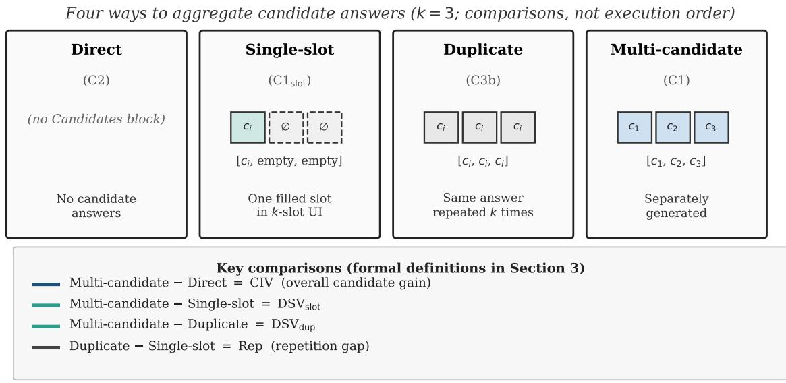
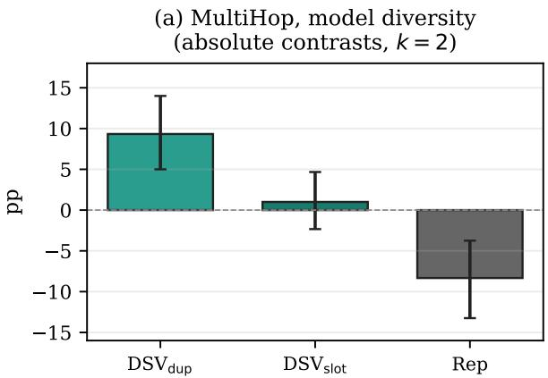
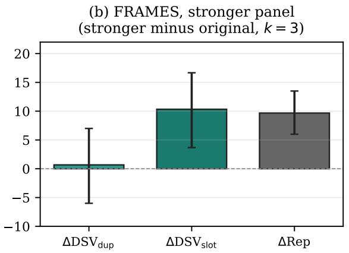
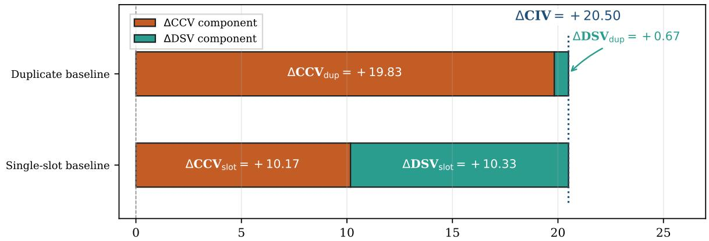
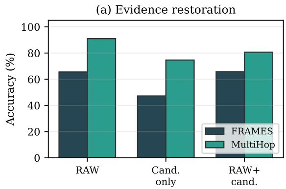
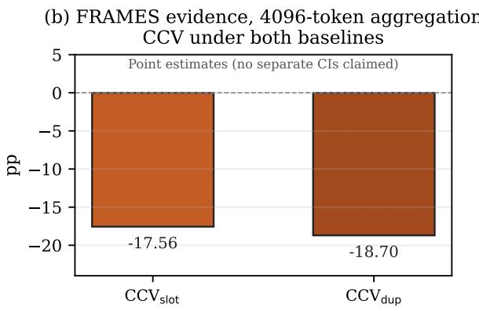
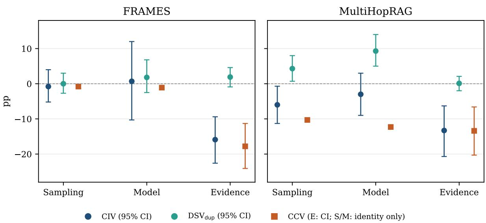
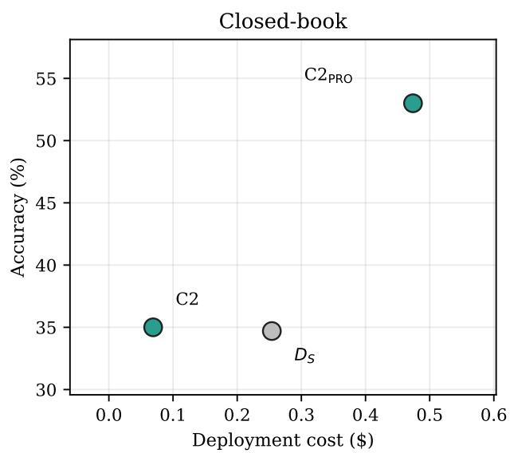
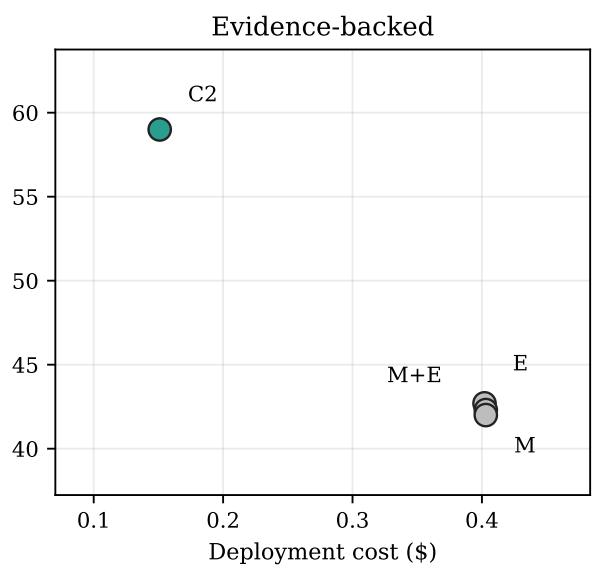

# Where Do LLM Ensemble Gains Come From? Decomposing Candidate Value, Diversity, and Aggregation

Donghwan Kim Independent Researcher

## Abstract

LLM ensemble gains are often measured against a single baseline, but the value attributed to additional candidates can change with the comparison used. We study an LLM aggregator under four matched conditions: Direct (no candidates), Single-slot (one candidate in a multi-slot interface), Duplicate (one candidate repeated), and Multi-candidate (separately generated candidates). Under either nondiverse control, overall candidate gain (CIV) splits algebraically into an additional-candidate contrast (DSV) and a candidate-context contrast (CCV); the split, but not CIV, depends on the chosen control. On MultiHopRAG model diversity (k=2), the repetition gap Rep = −8.33 pp [−13.25, −3.75] quantifies the difference between gains measured against Duplicate and Single-slot. On a matched FRAMES stronger-panel extension (n=200, k=3, aggregator output limit 4096), paired ∆Rep = +9.67 pp [+6.00, +13.50]; within panels, Rep changes sign (original −6.33; stronger +3.33). In FRAMES evidence aggregation, candidatecontext contrasts remain strongly negative under both non-diverse controls. Our results show why ensemble evaluations should state the reference control before attributing gains to additional candidates.

## 1 Introduction

Work on LLM ensembles usually asks whether more samples, models, or evidence raise final accuracy (Wang et al., 2023; Du et al., 2023; Wang et al., 2024; Li et al., 2024). Beyond majority voting, Universal Self-Consistency uses an LLM to select among free-form candidate answers (Chen et al., 2023), while LLM-Blender ranks and fuses outputs from different models (Jiang et al., 2023). These methods show that combining candidates involves a decision about how their information is used. Adding models is not always beneficial (Li et al., 2025; Kim et al., 2026). Multi-agent debate also does not consistently outperform simpler selfconsistency or ensembling methods (Smit et al., 2024). This makes it important to distinguish the value of additional candidates from the behavior of the system that combines them. A separate audit finds that common diversity metrics often reexpress capability, and that latent complementarity rarely becomes majority-vote gain (Kim, 2026a). In tool-mediated industrial diagnosis, specialist information likewise need not turn into a matching gain for an LLM integrator (Kim, 2026c).

Overall accuracy alone does not reveal why an ensemble succeeds or fails. This is a longstanding issue in ensemble learning. Classical work relates ensemble error to diversity among predictors (Krogh and Vedelsby, 1994; Brown et al., 2005). More recently, Choi et al. (2025) separate the effects of voting and debate, while Ali (2026) decomposes majority-vote gains into rescued and damaged predictions. These studies show why aggregate performance can hide important differences between ensemble mechanisms. We do not claim to be the first decomposition of ensemble gains. Our contribution is a matched set of answer-level controls for an LLM aggregator that can generate a new answer rather than only selecting a member prediction. We test whether Duplicate and Singleslot, two plausible non-diverse controls, yield the same attribution of candidate value; they do not, and their accuracy gap changes sign between the evaluated candidate-generation configurations.

We organize the measurement around four questions:

1. Does a Multi-candidate panel help relative to Direct solving (no candidate answers)?

2. How does Multi-candidate compare with Singleslot, which places one candidate in the same multi-slot interface?

3. How does that comparison change when the baseline is Duplicate, which repeats one candi-

date across slots?

4. What does the gap between Duplicate and Single-slot reveal about the attributed value of additional candidates?

The central empirical finding is that the value attributed to additional candidates depends on the non-diverse control.

Two settings make the dependence concrete. On MultiHopRAG model diversity (k=2), gain over Duplicate is large $\mathrm { ( D S V _ { d u p } ~ = ~ + 9 . 3 p p }$ $[ + 5 . 0 , + 1 4 . 0 ] )$ while overall candidate gain over Direct is $- 3 . 0 \mathrm { p p }$ (CI includes zero). Under Single-slot, the same panel yields only $\mathrm { \Delta D S V _ { s l o t } = }$ $+ 1 . 0 0 \mathrm { p p } \left[ - 2 . 3 3 , + 4 . 6 7 \right]$ , matching a negative repetition gap $\left( \mathrm { R e p } \ : = \ : - 8 . 3 3 \mathrm { p p } \ : \left[ - 1 3 . 2 5 , - 3 . 7 5 \right] \right)$ On FRAMES, a matched stronger-candidate extension (n=200) raises total candidate gain by about +20.5 pp while changing the estimated gain of additional candidates by +10.3 pp under Single-slot but only +0.7 pp under Duplicate; within panels, Rep changes sign (original −6.33; stronger +3.33), with paired $\Delta \mathrm { R e p } = + 9 . 6 7 \mathrm { p p } \ [ + 6 . 0 0 , + 1 3 . 5 0 ]$ Separately, evidence-mediated candidate context remains strongly negative under both controls at a 4096-token aggregator ceiling.

## Contributions.

1. Controlled decomposition. Matched Direct / Single-slot / Duplicate / Multi-candidate conditions (experiment IDs $\mathrm { C } 2 / \mathrm { C l } _ { \mathrm { s l o t } }$ / C3b / C1) separate overall candidate gain (CIV), baseline-specific diversity contrasts (DSVdup, $\mathrm { D S V _ { s l o t } ) }$ , candidate-context contrasts (CCV), and the repetition gap (Rep), with elementary identities $\mathrm { C I V } = \mathrm { D S V } + \mathrm { C C V } { \mathrm { ~ a n d ~ D S V } } _ { \mathrm { d u p } } =$ $\mathrm { D S V _ { s l o t } - R e p }$ . The accounting is algebraic; the contribution is the empirical controls and their interpretation.

2. Control dependence with a matched stress test. On MultiHop model diversity and on a matched FRAMES stronger-panel extension (n=200, 4096-token aggregation), the estimated value of additional candidates changes with the non-diverse control. We do not claim Singleslot is uniquely neutral or isolates a pure causal diversity effect.

3. Effects beyond baseline choice. Evidence $\mathrm { C C V _ { s l o t } }$ and $\mathrm { C C V _ { d u p } }$ remain strongly negative under both controls; raw-evidence restoration and aggregator-configuration comparisons identify losses that are not explained by choosing

Duplicate versus Single-slot.

## 2 Related Work

Self-consistency, Universal Self-Consistency, multi-agent debate, generative fusion, samplingand-voting, and mixture-of-agents all combine multiple generations (Wang et al., 2023; Chen et al., 2023; Du et al., 2023; Jiang et al., 2023; Li et al., 2024; Wang et al., 2024). Self-MoA and related work ask whether mixing models helps when proposer quality varies (Li et al., 2025; Abdulaal et al., 2025). Multi-agent debate does not reliably beat simpler ensembling unless carefully tuned (Smit et al., 2024), and voting can account for much of the gain attributed to debate (Choi et al., 2025; Kaesberg et al., 2025).

Classical ensemble theory relates accuracy to disagreement among predictors (Krogh and Vedelsby, 1994; Brown et al., 2005; Kuncheva and Whitaker, 2003); recent LLM work likewise finds that diversity measures need not predict ensemble accuracy (Kim, 2026a; Ali, 2026; Chen, 2026). Kim (2026a) examines diversity metrics as predictors of majority-vote gain, whereas we study how non-diverse aggregation controls affect the attribution of candidate value. We do not claim the same bias-variance-covariance algebra for LLM answer accuracy; we use those results only as motivation for separating mechanism-level contrasts from a single aggregate gain.

Selector quality can matter more than diversity in generate-then-select pipelines (Maryanskyy et al., 2026). Other work studies trace-level synthesis in mixture-of-agents settings (Fadnavis et al., 2026). LLM-as-a-judge is widely used (Zheng et al., 2023), but producing candidates and selecting among them remain distinct capabilities. Prior work has also documented limitations of judge scores as optimization signals in a separate table-recognition setting (Kim, 2026b). Designed evidence asymmetry can help when deliberation is built for it (Li et al., 2026); long-context work shows that available information need not be used (Liu et al., 2024). In RAG-style aggregation of multiple evidence documents, models can favor repeated paraphrases and presentation order over independent support (Naphade, 2026). That line of work studies how models weight repeated evidence. We instead measure how candidate-level value attribution changes under matched Duplicate and Single-slot answer controls. We add a matched

Direct / Single-slot / Duplicate / Multi-candidate contrast that separates candidate-mediated context from baseline-specific diversity increments.

## 3 Decomposing Ensemble Value

## 3.1 Four aggregation conditions

Fix one question, a panel of size k, and an aggregator A. Figure 1 shows four matched input constructions (reader-facing names first; experiment IDs in parentheses):

• Direct (C2): A solves the question with no candidate answers. In sampling/model settings the prompt is closed-book; in evidence settings the frozen primary Direct condition is a matched evidence-conditioned direct solve.

• Single-slot $( \mathrm { C l } _ { \mathrm { s l o t } } ) { : }$ the same k-slot candidate interface with one filled candidate and $k { - } 1$ empty slots. For $k { = } 3 .$ , the primary construction is [ci, empty, empty] with the first slot filled and placeholder “(No answer was provided for this slot.)”. Reported accuracy averages over candidate index i, not over slot position (position and placeholder wording are later sensitivities).

• Duplicate (C3b): k constructed copies of one candidate, $[ c _ { i } , c _ { i } , c _ { i } ]$ for $k { = } 3$ , averaged over candidate index i.

• Multi-candidate (C1): k separately generated candidate blocks. Final answer strings may still coincide.

Aggregator prompts for Single-slot, Duplicate, and Multi-candidate are candidate-only: raw evidence is not reinjected into those arms. Sampling, evidence, and the matched stronger-candidate extension use $k { = } 3$ . The MultiHop and FRAMES modeldiversity results we highlight use a pairwise $\left( k { = } 2 \right)$ unit.

## 3.2 Overall candidate gain

CIV (candidate-information value) is Multicandidate minus Direct:

$$
\mathrm { C I V } = \mathrm { A c c } ( \mathrm { C 1 } ) - \mathrm { A c c } ( \mathrm { C 2 } ) .\tag{1}
$$

It is the accuracy difference relative to the matched Direct condition. The difference can be positive, near zero, or negative; negative CIV means the Multi-candidate setup underperforms Direct on that unit.

## 3.3 Gains over alternative non-diverse controls

$\mathbf { D S V } _ { \mathrm { s l o t } }$ is Multi-candidate minus Single-slot:

$$
\mathrm { D S V } _ { \mathrm { s l o t } } = \mathrm { A c c } ( \mathrm { C 1 } ) - \mathrm { A c c } ( \mathrm { C 1 } _ { \mathrm { s l o t } } ) .\tag{2}
$$

It asks how much accuracy changes when separately generated candidates replace one filled slot in the same interface. Adding candidates also changes how much candidate text is present, so this is not a pure causal diversity estimand.

$\mathbf { D S V } _ { \mathrm { d u p } }$ is Multi-candidate minus Duplicate:

$$
\mathrm { D S V _ { d u p } = A c c ( C 1 ) - A c c ( C 3 b ) . }\tag{3}
$$

It asks how much accuracy changes when separately generated candidates replace constructed repetitions of one answer. The two baselines answer different questions; both are useful, and neither is uniquely “the” diversity effect. In historical primary tables, bare “DSV” means $\mathrm { D S V _ { d u p } }$

## 3.4 The repetition gap

Rep is Duplicate minus Single-slot:

$$
\mathrm { R e p = A c c ( C 3 b ) - A c c ( C 1 _ { s l o t } ) } .\tag{4}
$$

In plain language, the repetition gap measures how much accuracy changes when one candidate is repeated instead of shown once in the multi-slot interface. Negative Rep means Duplicate underperforms Single-slot; positive Rep means Duplicate outperforms Single-slot. The baseline dependence of the two diversity contrasts is explicit in the identity

$$
\mathrm { { D S V } _ { \mathrm { { s l o t } } } - \mathrm { { D S V } _ { \mathrm { { d u p } } } = \mathrm { { R e p } , } } }\tag{5}
$$

equivalently $\mathrm { D S V _ { d u p } = D S V _ { s l o t } - R e p . }$

## 3.5 Candidate-context values

After the comparisons above, we define candidatecontext contrasts versus Direct:

$$
\mathrm { C C V _ { s l o t } = A c c ( C 1 _ { s l o t } ) - A c c ( C 2 ) , }\tag{6}
$$

$$
\mathrm { C C V _ { d u p } = A c c ( C 3 b ) - A c c ( C 2 ) } .\tag{7}
$$

Accounting identities then split the same CIV under either baseline:

$$
\mathrm { C I V } = \mathrm { D S V } _ { \mathrm { d u p } } + \mathrm { C C V } _ { \mathrm { d u p } } = \mathrm { D S V } _ { \mathrm { s l o t } } + \mathrm { C C V } _ { \mathrm { s l o t } } .\tag{8}
$$

CIV itself does not depend on choosing Duplicate versus Single-slot; what changes is the DSV/CCV split. We call these terms candidate-context value because they mix candidate quality, text presence, repetition or interface structure, and aggregator reaction. They are accounting contrasts, not pure causal mediators.

  
Figure 1: Four aggregation conditions for panel size k=3 (comparisons, not an execution order). Reader-facing names are primary; experiment IDs appear in parentheses. Single-slot and Duplicate accuracies are averaged over candidate index i; Single-slot does not average over slot position in the primary Acc. Separately generated Multicandidate answers may coincide. Neither non-diverse control identifies pure causal diversity. Formal estimands are defined in Section 3.

## 3.6 What the measures do not identify

Repetition changes the input interface and can influence aggregator behavior. Single-slot changes candidate amount and coverage relative to Multicandidate. Separately generated candidates can differ in quality, correctness, and content. Neither DSV contrast alone identifies pure causal diversity.

## 4 Experimental Setup

Benchmarks and units. FRAMES (Krishna et al., 2025) (sampling n=200; evidence n=180) and MultiHopRAG (Tang and Yang, 2024) (replication n=100). FRAMES model diversity uses a pairwise analysis covering 30 distinct items, not the generic FRAMES n=200 pool. MultiHop model diversity averages three fixed k=2 model-pair comparisons within each of n=100 items.

Sources and aggregator. Sampling (S), model (M), and evidence (E) diversify candidates. Sampling diversity uses three samples per generator, averaged across three generators. For evidence diversity on both benchmarks, candidates come from a fixed Qwen3.8-Flash generator, and the Direct reference is the matched evidence-conditioned Direct, rather than union-evidence or closed-book Direct. The main aggregator (“Luna”) sees parsed final answers. Many confirmatory runs use a 1024-token output limit; later checks and the matched strongercandidate extension use 4096. A Qwen3-32B extension keeps candidate content fixed and swaps the aggregator configuration (model plus decoding and reasoning settings), not a model-only intervention with equal decoding. Verified model labels, decoding settings, and prompt locations appear in Appendix M. Table 4 (Appendix B) summarizes datasets, panel sizes, token ceilings, and analysis status.

Scoring and analysis status. We use exact/normalized string match, then a frozen semantic judge (Zheng et al., 2023). Unless noted, we report paired complete-case estimates with bootstrap 95% CIs (B=2000, seed 2026 where specified); no p-values. Historical primary analyses, later controlled extensions, and exploratory diagnostics are distinguished in Appendix C (Table 5); model settings and prompt sources appear in Appendix M. The historical primary S/M/E analyses use $\mathrm { D S V } = \mathrm { D S V _ { d u p } }$ . We do not relabel all later results as confirmatory.

Human audit. We audited a late-stage stratified sample of n=60 judged responses (seed 2026; twelve cases from each of five strata), not a simple random sample of the completed judged universe. Two independent raters adjudicated eight disagreements. Versus final human labels, the judge agreed on 50/60 (83.3%; κ=0.645). False rejections on this packet are mostly paraphrase or alias mismatches on FRAMES aggregator answers. The audit does not support a CIV/DSV/CCV correction (Appendix E; Tables 7 and 8).

## 5 Control-Dependent Ensemble Value

Table 1 reports the historical Duplicate-relative decomposition (plotted in Appendix A), motivating the matched Single-slot and repetition-gap analyses that follow. Evidence CIV (Multi-candidate minus Direct) is strongly negative on both benchmarks, while evidence $\mathrm { D S V _ { d u p } }$ is near zero: most of the loss is candidate-context value, not a baselinespecific diversity increment. This differs from settings where designed evidence asymmetry is intended to help deliberation (Li et al., 2026). On MultiHop models, $\mathrm { D S V _ { d u p } = + 9 . 3 p p }$ while CIV is −3.0 pp: a positive gain over Duplicate does not imply a positive candidate gain over Direct. Sampling effects are smaller and task-dependent (near zero CIV on FRAMES; negative CIV on MultiHop). We therefore first test whether the Duplicate baseline itself can depress accuracy, then test whether the pattern changes under a matched stronger-candidate extension.

Control dependence. Under the same Multi-Hop model panel $( n { = } 1 0 0 )$ , gain over Singleslot is only $\mathrm { D S V _ { s l o t } = + 1 . 0 0 p p ~ [ - 2 . 3 3 , + 4 . 6 7 ] }$ while the repetition gap is $\mathrm { R e p } \ = \ - 8 . 3 3 \mathrm { p p }$ $[ - 1 3 . 2 5 , - 3 . 7 5 ]$ , so $\mathrm { D S V _ { d u p } = D S V _ { s l o t } - R e p r e } -$ covers +9.33 pp (Figure 2a). Under negative Rep, $\mathrm { D S V _ { d u p } }$ exceeds $\mathrm { D S V _ { s l o t } }$ by −Rep. This does not make $\mathrm { D S V _ { d u p } }$ wrong; it measures a different contrast. A CI that includes zero means the contrast is unresolved at this precision, not that the effect is zero. The MultiHop model-diversity result is control-sensitive: $\mathrm { D S V _ { d u p } }$ and $\mathrm { D S V _ { s l o t } }$ tell different stories. We next ask whether the same control dependence appears when the candidate-generation configuration is strengthened on FRAMES.

Stronger candidates under two controls. Is a small Duplicate-relative DSV only a symptom of weak candidates? A weak panel can make both total CIV and diversity-related increments look small for uninteresting reasons. We therefore ask whether raising candidate quality changes the picture when the aggregator and item set stay matched. We compare an original candidate panel with a higherperforming panel generated using different models and generation settings. We hold the questions, panel size (k=3), aggregator (Luna), and aggregator output limit (4096 tokens) fixed, on n=200 FRAMES items (the original 95-item cohort plus a completed nonoverlapping 105-item complement). The original panel uses Solar Mini4, Qwen3.8- Flash, and Haiku 4.5 with temperature 0.0 and a 1024-token candidate-output limit (no explicit reasoning effort set). The stronger panel uses Gemini 3.8 Flash, Grok 4.7, and Sonnet 5.5 with temperature 0.0, reasoning effort high, and a 65536- token candidate-output limit. The 4096-token aggregation limit is distinct from these candidategeneration limits. The resulting contrast measures the value of replacing the candidate-generation configuration, not the isolated effect of model identity under equal candidate-generation compute.

Contrasts are stronger minus original (paired bootstrap, $scriptstyle B = 2 0 0 0 .$ , seed 2026). Improving the candidate-generation configuration raises CIV by $+ 2 0 . 5 0 \mathrm { p p } \ [ + 1 4 . 0 0 , + 2 7 . 0 0 ]$ . Table 2 reports the absolute arm accuracies, which clarify the withinpanel signs. Table 3 reports the matched changes. On the matched FRAMES items, the original Multicandidate panel is below Direct (41.5% versus 46.5%; CIV $\approx ~ - 5 . 0 \mathrm { p p } )$ , whereas the stronger panel is above Direct (62.0% versus 46.5%; CIV ≈ $+ 1 5 . 5 \mathrm { p p } )$ . This reversal corresponds to the paired $\Delta \mathrm { C I V } = + 2 0 . 5 0 \mathrm { p p }$ , while the attributed additional-candidate contrast changes by +0.67 pp under Duplicate versus +10.33 pp under Singleslot. The key paired contrast is $\Delta \mathrm { R e p } = + 9 . 6 7 \mathrm { p p }$ $[ + 6 . 0 0 , + 1 3 . 5 0 ]$ : it directly shows that the two diversity attributions differ, rather than relying on one ∆DSV CI excluding zero and another including zero (Figure 2b; Figure 3). On the original panel, $\mathrm { R e p } \ = \ - 6 . 3 3 \mathrm { p p } \ [ - 9 . 3 3 , - 3 . 6 7 ]$ (Duplicate worse than Single-slot). On the stronger panel, $\mathrm { R e p } = + 3 . 3 3 \mathrm { p p } \left[ + 0 . 8 3 , + 5 . 8 3 \right]$ (Duplicate better than Single-slot). Thus $\Delta \mathrm { D S V _ { s l o t } = + 1 0 . 3 3 p p }$ and $\Delta \mathrm { D S V } _ { \mathrm { d u p } } = + 0 . 6 7$ pp are different splits of the same $\Delta { \mathrm { C I V } } ,$ linked by $\Delta \mathrm { R e p }$ . Context shifts are $\Delta \mathrm { C C V } _ { \mathrm { d u p } } ~ = ~ + 1 9 . 8 3 \mathrm { p p ~ } [ + 1 5 . 1 7 , + 2 4 . 6 7 ]$ and $\Delta \mathrm { C C V } _ { \mathrm { s l o t } } = + 1 0 . 1 7 \mathrm { p p } [ + 6 . 3 3 , + 1 4 . 1 7 ]$

Answer-count sensitivity. A separate controlled intervention on eligible mixed-answer cases finds that changing answer multiplicity changes aggregation accuracy by $+ 8 . 1 2 \mathrm { p p \ [ + 4 . 9 9 , + 1 1 . 4 2 ] }$ $\scriptstyle ( n = 1 9 7 )$ This supports sensitivity to answer counts but does not establish the mechanism behind the repetition-gap differences observed across candidate-generation configurations.

Table 1: Main Luna breakdown (pp, 95% CIs). DSV is gain over Duplicate $\mathrm { ( D S V _ { d u p } ; }$ C3b control). FRAMES M uses a pairwise k=2 unit (30 distinct items), not FRAMES $n { = } 2 0 0 .$ . Evidence CCV uses mean-duplicate C3b.
<table><tr><td>Bench.</td><td> $\operatorname { s r c } .$ </td><td>CIV</td><td> $\mathrm { D S V _ { d u p } }$ </td><td> $\mathrm { C C V } _ { E }$ </td></tr><tr><td>FRAMES</td><td>S</td><td> $- 0 . 8 \left[ - 5 . 2 , 4 . 0 \right]$ </td><td> $0 . 0 \ [ - 2 . 7 , 3 . 0 ]$ </td><td>n/a</td></tr><tr><td>FRAMES</td><td>M</td><td> $+ 0 . 7 \ : [ - 1 0 . 3 , 1 2 . 0 ]$ </td><td> $+ 1 . 8 [ - 2 . 5 , 6 . 8 ]$ </td><td>n/a</td></tr><tr><td>FRAMES</td><td>E</td><td> $- 1 5 . 9 \left[ - 2 2 . 6 , - 9 . 4 \right]$ </td><td> $+ 1 . 9 \left[ - 0 . 9 , 4 . 6 \right]$ </td><td> $- 1 7 . 8 [ - 2 4 . 1 , - 1 1 . 3 ]$ </td></tr><tr><td>MultiHop</td><td>S</td><td> $- 6 . 0 \left[ - 1 1 . 3 , - 0 . 7 \right]$ </td><td> $+ 4 . 3 [ 0 . 7 , 8 . 0 ]$ </td><td>n/a</td></tr><tr><td>MultiHop</td><td>M</td><td> $- 3 . 0 \left[ - 9 . 0 , 3 . 0 \right]$ </td><td> $+ 9 . 3 \ : [ 5 . 0 , 1 4 . 0 ]$ </td><td>n/a</td></tr><tr><td>MultiHop</td><td>E</td><td> $- 1 3 . 3 [ - 2 0 . 7 , - 6 . 3 ]$ </td><td> $+ 0 . 1 \left[ - 2 . 0 , 2 . 1 \right]$ </td><td> $- 1 3 . 4 \ : [ - 2 0 . 3 , - 6 . 6 ]$ </td></tr></table>

The $\scriptstyle n = 9 5 / n = 1 0 5$ rows are same-protocol diagnostics, not independent benchmarks (Appendix D, Table 6). The MultiHop model-diversity contrast used pairwise $k { = } 2 ;$ the matched FRAMES extension uses $k { = } 3$ , so they are not independent replications of one intervention. Earlier standalonecandidate evaluations used a different stack and are reported separately in Appendix H; their estimates are not pooled with the matched comparison. An exploratory candidate-conditioned breakdown suggests that repetition effects vary with candidate correctness; all four correctness-by-panel cells are reported in Appendix L. Correctness is post-generation and is not a causal mediator. Slotprompt position and placeholder variants on an n=60 subset keep positive $\Delta \mathrm { D S V _ { s l o t } }$ point estimates while variant-minus-primary CIs include zero (Appendix K). The Single-slot contrast measures incremental value over a single-filled-slot control, not pure causal diversity.

Table 2: Absolute arm accuracies (%) and Rep (pp) on matched FRAMES n=200 (aggregator output limit 4096). Direct (C2) is shared across panels. Columns: Direct / Single-slot / Duplicate / Multi-candidate (experiment IDs $\mathrm { C } 2 / \mathrm { C } 1 _ { \mathrm { s l o t } } / \mathrm { C } 3 \mathrm { b } / \mathrm { C } 1 )$ . Rep = Duplicate − Single-slot. Absolute accuracies are rounded to one decimal; Rep uses the unrounded matched contrast. Rep CIs are item-paired bootstrap (B=2000, seed 2026).
<table><tr><td>Panel</td><td></td><td></td><td></td><td>Direct Single-slot Duplicate Multi-cand.</td><td>Rep</td></tr><tr><td>Original</td><td>46.5</td><td>45.2</td><td>38.8</td><td>41.5</td><td> $- 6 . 3 3 [ - 9 . 3 3 , - 3 . 6 7 ]$ </td></tr><tr><td>Stronger</td><td>46.5</td><td>55.3</td><td>58.7</td><td>62.0</td><td> $+ 3 . 3 3 [ + 0 . 8 3 , + 5 . 8 3 ]$ </td></tr></table>

## 6 Information Loss Beyond Baseline Choice

Lost information through candidates. Making information available is not the same as extracting it into candidate answers, and extracting it is not the same as the aggregator using it (Liu et al., 2024). On FRAMES, candidates-only accuracy (47.2%) is far below RAW (65.6%), and RAW+candidates (65.7%) returns almost to RAW. On MultiHop, recovery is only +6.0 pp (91.0 / 74.7 / 80.7), so candidate context can still hurt (Figure 4a). We do not claim a position-bias mechanism.

Output-limit check. Re-running FRAMES evidence aggregation at 4096 tokens (n=180) lowers Multi-candidate evidence truncation from 20.4% to 1.7%, but $\mathrm { C I V } _ { E }$ moves from −15.9 pp $\mathrm { t o ~ - 1 8 . 3 3 p p ~ \left[ - 2 4 . 2 6 , - 1 2 . 0 3 \right] } .$ $\mathrm { \ C C V _ { \mathrm { { s l o t } } } } ~ \approx$ −17.56 pp and $\mathrm { C C V _ { d u p } ~ \approx ~ - 1 8 . 7 0 }$ pp remain strongly negative under both baselines (Figure 4b). CIV itself is unchanged by the choice of nondiverse baseline; the empirical finding is that both candidate-context contrasts stay strongly negative. Short outputs do not explain the evidence gap. On robustness subsets, a second aggregator family shows the same qualitative pattern: evidence CIV stays strongly negative with near-zero evidence DSV, while model DSV can be positive (Appendix G, Table 9).

Control robustness. The remaining evidence checks distinguish information preserved in raw evidence, extracted into candidates, and used by the aggregator. The corresponding evidence repetition gap is small at the observed point estimate, Rep $\approx - 1 . 1 5 \mathrm { p p \ } [ - 4 . 2 3 , + 2 . 0 1 ]$ (Appendix J). This interval does not establish that Duplicate and Single-slot are equivalent.

Additional checks. Visible full explanations do not clearly raise $\mathrm { D S V _ { d u p } }$ in our checks (FRAMES −0.67; MultiHop −2.33; both CIs include zero); a compact-rationale follow-up is similarly unresolved (Appendix I, Table 11). Trace-level synthesis is methodologically different from our answerlevel checks (Fadnavis et al., 2026). These secondary checks are reported in the appendix and do not change the evidence-loss result.

Table 3: Matched FRAMES stronger-minus-original effects (pp; k=3, aggregator output limit 4096). Pooled n=200 is primary. $\Delta \mathrm { C C V } _ { \mathrm { d u p } } = + 1 9 . 8 3 \ [ + 1 5 . 1 7 , + 2 4 . 6 7 ]$ and $\Delta \mathrm { C C V } _ { \mathrm { s l o t } } = + 1 0 . 1 7 \ : [ + 6 . 3 3 , + 1 4 . 1 7 ]$ are stated in text and Figure 3. Cohort diagnostics are in Appendix D.
<table><tr><td></td><td>∆CIV</td><td> $\Delta \mathrm { D S V _ { d u p } }$ </td><td> $\Delta \mathrm { D S V } _ { \mathrm { s l o t } }$ </td><td>∆Rep</td></tr><tr><td rowspan="2">Pooled n=200</td><td>+20.50</td><td>+0.67</td><td>+10.33</td><td>+9.67</td></tr><tr><td> $[ 1 4 . 0 0 , 2 7 . 0 0 ]$ </td><td> $[ - 6 . 0 0 , 7 . 0 0 ]$ </td><td> $[ 3 . 6 7 , 1 6 . 6 7 ]$ </td><td>[6.00, 13.50]</td></tr></table>

Figure 2: Left: absolute MultiHop model-diversity contrasts (gain over Duplicate, gain over Single-slot, and Rep). Right: matched FRAMES stronger-minus-original changes (n=200, 4096-token aggregation). Both panels show paired 95% CIs.  
  
Percentage points (stronger minus original), FRAMES matched n = 200, 4096-token aggregation  
Figure 3: Accounting split of the same ∆CIV under Duplicate and Single-slot (not a causal path diagram). Duplicate: $\Delta \mathrm { C C V } _ { \mathrm { d u p } } = + 1 9 . 8 3 , \Delta \mathrm { D S V } _ { \mathrm { d u p } } = + 0 . 6 7 ;$ Single-slot: $\Delta \mathrm { C C V } _ { \mathrm { s l o t } } = + 1 0 . 1 7 , \Delta \mathrm { D S V } _ { \mathrm { s l o t } } = + 1 0 . 3 3$ . Both sum to $\Delta \mathrm { C I V } { = } + 2 0 . 5 0 ; \Delta \mathrm { R e p } { = } + 9 . 6 7$ links the DSV values. Paired CIs are in Table 3.

## 7 Discussion and Conclusion

The results imply several practices for ensemble evaluation and design.

Always report the baseline. A diversity-related gain should state whether it is measured over Single-slot or Duplicate. On MultiHop model diversity (k=2) and the matched FRAMES strongerpanel extension $( k { = } 3 ) , \mathrm { D S V _ { d u p } }$ and $\mathrm { D S V _ { s l o t } }$ tell different design stories. If gain over Duplicate is large while gain over Single-slot is not, adding more models is not automatically justified by the Duplicate-relative number alone.

Do not assume repetition is neutral. Matched FRAMES results show that Rep can change sign between candidate-generation configurations. This does not establish a universal causal mechanism for the sign change.

Candidate quality and diversity attribution are separate questions. Improving the candidategeneration configuration can raise CIV without producing the same increase under every diversityrelated contrast.

  
Figure 4: Left: restoring raw evidence beside candidates (accuracy %). Right: FRAMES evidence candidate-context contrasts under Single-slot and Duplicate at 4096 tokens (point estimates). CIV (Multi-candidate − Direct) does not change between those two baselines by definition.

Restoring raw evidence recovers most of the FRAMES gap. Evidence can be lost through candidate answers or aggregation; on FRAMES, restoring RAW beside candidates recovers most of the observed gap. MultiHop recovery is only partial.

Aggregator configuration is a distinct design variable. Holding candidate content fixed, the Luna-versus-Qwen3-32B evidence CIV gap is +12.59 pp [+4.07, +21.11] on FRAMES and +11.0 pp [+4.67, +17.67] on MultiHop. These observed configuration differences show that generating candidates and realizing their information with an aggregator are distinct design questions. They are not equal-decoding/equal-reasoning modelonly interventions, do not establish Qwen Rep, and do not imply a universal ordering.

Cost–accuracy implications. Figure 6 (Appendix F) compares the plotted deployment cost and accuracy of the observed policies. In its evidence-backed panel, Direct has higher plotted accuracy at lower plotted cost than the displayed M, E, and M+E candidate-based policies, illustrating why a diversity-related DSV contrast alone does not establish that extra candidate-generation and aggregation calls are worthwhile compared with Direct. These are descriptive within-panel comparisons: policies use different token limits, and ${ \mathrm { C } } 2 _ { \mathrm { P R O } }$ also changes model setup, so Figure 6 does not establish a general cost-optimal or equalreasoning-budget policy.

Conclusion. For LLM ensembles, evaluation should state which counterfactual defines the measured gain, how much candidate information survives the interface, and which effects persist across controls. Reporting CIV, baseline-specific DSV/CCV, and Rep makes those distinctions visible.

## 8 Limitations

We use selected short-answer benchmarks and mainly answer-level aggregation. Visibleexplanation checks do not cover hidden traces. Single-slot $( \mathrm { C l _ { s l o t } } )$ changes coverage as well as distinctness; Duplicate (C3b) changes repetition; neither is a pure causal diversity estimand. The matched stronger-versus-original contrast changes candidate models and generation settings together, so it is not a model-only effect at equal candidategeneration compute. Evidence-diversity findings use a single fixed candidate generator on both benchmarks, so their transfer to other generators is untested.

Headline tests primarily use one aggregator (Luna); Qwen CIV gaps do not establish Qwen Rep. The human audit is a stratified n=60 packet and does not demonstrate absence of arm-differential judge error on the matched Single-slot/Duplicate cells; we do not numerically correct main effects. Aggregation truncation was tracked, and the frozen inclusion policy was retained rather than switching to success-only accuracy. We do not claim a complete candidate-generation empty/parse-failure comparison between panels beyond the disclosed generation-config differences and aggregation-arm health checks.

Candidate-conditioned Rep analyses are exploratory and condition on a post-generation variable. Slot position/placeholder variants (n=60) do not prove equivalence of prompt forms. Later extensions were motivated by earlier findings; they are not all confirmatory. Public OpenRouter slugs and decoding settings appear in Appendix M; vendor-internal build IDs remain unresolved.

## References

Ahmed Abdulaal, Chen Jin, Nina Montaña-Brown, Aryo Pradipta Gema, Daniel C. Castro, Daniel C. Alexander, Philip Alexander Teare, Tom Diethe, Dino Oglic, and Amrutha Saseendran. 2025. Balancing act: Diversity and consistency in large language model ensembles. In International Conference on Learning Representations (ICLR).

Junade Ali. 2026. Quantifying diversity of thought: A predictive law of weighted LLM ensemble lift. arXiv preprint arXiv:2607.17384.

Gavin Brown, Jeremy L. Wyatt, and Peter Tino. 2005.ˇ Managing diversity in regression ensembles. Journal ofMachine Learning Research, 6:1621–1650.

Josef Chen. 2026. When does combining language models help? a co-failure ceiling on routing, voting, and mixture-of-agents across 67 frontier models. arXiv preprint arXiv:2606.27288.

Xinyun Chen, Renat Aksitov, Uri Alon, Jie Ren, Kefan Xiao, Pengcheng Yin, Sushant Prakash, Charles Sutton, Xuezhi Wang, and Denny Zhou. 2023. Universal self-consistency for large language model generation. arXiv preprint arXiv:2311.17311.

Hyeong Kyu Choi, Xiaojin Zhu, and Sharon Li. 2025. Debate or vote: Which yields better decisions in multi-agent large language models? In Advances in Neural Information Processing Systems.

Yilun Du, Shuang Li, Antonio Torralba, Joshua B. Tenenbaum, and Igor Mordatch. 2023. Improving factuality and reasoning in language models through multiagent debate. arXiv preprint arXiv:2305.14325.

Shreyas Fadnavis, Praitayini Kanakaraj, and Felix Wyss. 2026. Beyond consensus: Trace-level synthesis in mixture of agents. arXiv preprint arXiv:2605.29116.

Dongfu Jiang, Xiang Ren, and Bill Yuchen Lin. 2023. LLM-blender: Ensembling large language models with pairwise ranking and generative fusion. In Proceedings ofthe 61st Annual Meeting ofthe Association for Computational Linguistics (Volume 1: Long Papers).

Lars Benedikt Kaesberg, Jonas Becker, Jan Philip Wahle, Terry Ruas, and Bela Gipp. 2025. Voting or consensus? decision-making in multi-agent debate. In Findings of the Association for Computational

Linguistics: ACL 2025, pages 11640–11671, Vienna, Austria. Association for Computational Linguistics.

Donghwan Kim. 2026a. Are diversity metrics measuring diversity? a capability-controlled audit of majority-vote gain in LLM ensembles. arXiv preprint arXiv:2607.20768.

Donghwan Kim. 2026b. LLM-as-a-judge scores are unreliable optimization signals in closed-loop table recognition. arXiv preprint arXiv:2607.13347.

Donghwan Kim. 2026c. When LLMs sit above diagnostic tools: Unrealized complementarity in industrial fault diagnosis. arXiv preprint arXiv:2610.05031.

Yubin Kim, Ken Gu, Chanwoo Park, Chunjong Park, Samuel Schmidgall, A. Ali Heydari, Yao Yan, Zhihan Zhang, Yuchen Zhuang, Yun Liu, Mark Malhotra, Paul Pu Liang, Hae Won Park, Yuzhe Yang, Xuhai Xu, Yilun Du, Shwetak Patel, Tim Althoff, Daniel McDuff, and Xin Liu. 2026. Capable language models can outgrow the benefits of collaboration. Nature Machine Intelligence, 8:1157–1172.

Satyapriya Krishna, Kalpesh Krishna, Anhad Mohananey, Steven Schwarcz, Adam Stambler, Shyam Upadhyay, and Manaal Faruqui. 2025. Fact, fetch, and reason: A unified evaluation of retrievalaugmented generation. In Proceedings of the 2025 Conference of the Nations of the Americas Chapter ofthe Associationfor Computational Linguistics: Human Language Technologies (Volume 1: Long Papers), pages 4745–4759, Albuquerque, New Mexico. Association for Computational Linguistics.

Anders Krogh and Jesper Vedelsby. 1994. Neural network ensembles, cross validation, and active learning. In Advances in Neural Information Processing Systems, volume 7, pages 231–238. MIT Press. NIPS 1994.

Ludmila I. Kuncheva and Christopher J. Whitaker. 2003. Measures of diversity in classifier ensembles and their relationship with the ensemble accuracy. Machine Learning, 51(2):181–207.

Junyou Li, Qin Zhang, Yangbin Yu, Qiang Fu, and Deheng Ye. 2024. More agents is all you need. Transactions on Machine Learning Research.

Wenzhe Li, Yong Lin, Mengzhou Xia, and Chi Jin. 2025. Rethinking mixture-of-agents: Is mixing different large language models beneficial? arXiv preprint arXiv:2502.00674.

Yuante Li, Yicheng Tao, Kate Zhang, Taozhi Wang, Gefei Gu, and Yaxin Zhou. 2026. Diverse evidence, better forecasts: Multi-agent deliberation under information asymmetry. arXiv preprint arXiv:2607.01661.

Nelson F. Liu, Kevin Lin, John Hewitt, Ashwin Paranjape, Michele Bevilacqua, Fabio Petroni, and Percy Liang. 2024. Lost in the middle: How language models use long contexts. Transactions of the Association for Computational Linguistics, 12:157–173.

Artem Maryanskyy, Dmitry Budnikov, and Alibek T. Kaliyev. 2026. When agents disagree: The selection bottleneck in multi-agent LLM pipelines. Applied Sciences, 16(10).

Atharv Naphade. 2026. Rational synthesizers or heuristic followers? analyzing LLMs in RAG-based question-answering. In Findings ofthe Association for Computational Linguistics: ACL 2026, pages 40293–40311, San Diego, California, United States. Association for Computational Linguistics.

Andries Petrus Smit, Nathan Grinsztajn, Paul Duckworth, Thomas D Barrett, and Arnu Pretorius. 2024. Should we be going MAD? A look at multi-agent debate strategies for LLMs. In Proceedings of the 41st International Conference on Machine Learning, volume 235 of Proceedings of Machine Learning Research, pages 45883–45905. PMLR.

Yixuan Tang and Yi Yang. 2024. MultiHop-RAG: Benchmarking retrieval-augmented generation for multi-hop queries. In Conference on Language Modeling (COLM).

Junlin Wang, Jue Wang, Ben Athiwaratkun, Ce Zhang, and James Zou. 2024. Mixture-of-agents enhances large language model capabilities. arXiv preprint arXiv:2406.04692.

Xuezhi Wang, Jason Wei, Dale Schuurmans, Quoc V Le, Ed H. Chi, Sharan Narang, Aakanksha Chowdhery, and Denny Zhou. 2023. Self-consistency improves chain of thought reasoning in language models. In International Conference on Learning Representations (ICLR).

Lianmin Zheng, Wei-Lin Chiang, Ying Sheng, Siyuan Zhuang, Zhanghao Wu, Yonghao Zhuang, Zi Lin, Zhuohan Li, Dacheng Li, Eric P. Xing, Hao Zhang, Joseph E. Gonzalez, and Ion Stoica. 2023. Judging LLM-as-a-judge with MT-bench and chatbot arena. In Advances in Neural Information Processing Systems (NeurIPS).

## A Historical Primary Split Figure

Figure 5 visualizes the historical primary S/M/E split summarized in Table 1. It provides a crosssource view of CIV, $\mathrm { D S V _ { d u p } }$ , and evidence CCV; Table 1 remains the source of the reported estimates.

## B Experiment Design Summary

<table><tr><td>Dataset</td><td>Source</td><td>n k</td><td>Tokens</td><td>Unit</td><td>Status</td></tr><tr><td>FRAMES S</td><td></td><td>200 3</td><td>1024</td><td>item</td><td>Primary (A)</td></tr><tr><td>FRAMES M</td><td></td><td>30 2</td><td>1024</td><td>pairwise</td><td>Primary (A)</td></tr><tr><td>FRAMES E</td><td></td><td>180 3</td><td>1024</td><td>item</td><td>Primary (A)</td></tr><tr><td>MultiHop S/M/E</td><td></td><td>100 2/3</td><td>1024</td><td>item/pair</td><td>Primary (A)</td></tr><tr><td>FRAMES stronger 200</td><td></td><td>3</td><td>4096</td><td>item</td><td>Extension (B)</td></tr></table>

Table 4: Core experiment design (verified against frozen configs). FRAMES M uses 30 distinct items with pairwise comparison/averaging, not the generic FRAMES n=200 pool. The matched stronger-candidate row combines the original 95-item cohort and a nonoverlapping 105-item complement; it is a later controlled extension, not two independent benchmarks.

For FRAMES evidence, the frozen 180-item panel assigns three per-item budget-matched Wikipedia evidence packets using source-disjoint allocation where feasible; each candidate is generated from one packet, whereas matched Direct receives their deterministic interleaving.

## C Analysis-Status Transparency

<table><tr><td>Analysis</td><td>Status</td><td>Notes</td></tr><tr><td>S/M/E: CIV, DSVdup, CCV</td><td>Confirmatory (A)</td><td>Historical pri- mary</td></tr><tr><td>4096 checks; RAW+candidates; stronger-panel extension; MultiHop Rep/slot; controlled answer-</td><td>Extension (B)</td><td>Fixed before out- comes</td></tr><tr><td>multiplicity; Qwen; explanations Slot n=60; compact rationale</td><td>Diagnostic (C)</td><td>Not primary</td></tr><tr><td>Human audit n=60</td><td>Completed (B)</td><td>Stratified; no re- calibration</td></tr></table>

Table 5: Analysis hierarchy.

## D Matched Cohort Diagnostics

<table><tr><td>Cohort</td><td>∆CIV</td><td> $\Delta \mathrm { D S V _ { d u p } }$ </td><td>∆DSVslot</td><td>∆Rep</td></tr><tr><td>Original cohort n=95</td><td>+17.89</td><td>-1.05</td><td>+10.53</td><td>+11.58</td></tr><tr><td></td><td></td><td></td><td>[9.47, 26.32] [−10.18, 8.42] [1.75, 20.00] [6.67, 16.84]</td><td></td></tr><tr><td>Compl. n=105</td><td>+22.86</td><td>+2.22</td><td>+10.16</td><td>+7.94</td></tr><tr><td></td><td></td><td>[13.33, 31.43] [−6.67, 10.48] [0.95, 18.73] [2.86, 13.33]</td><td></td><td></td></tr></table>

Table 6: Matched FRAMES stronger-minus-original cohort diagnostics (pp). Same protocol cohorts, not independent benchmarks.

The complement completion recorded 13 truncations; scoring retains the matched denominator.

## E Human Audit Details

Late-stage stratified sample: twelve cases from each of five judged strata (standard S/M/E, factorial evidence-layout manipulation, MultiHop replication, Kimi robustness, and alternate Direct configuration C2-Pro; seed 2026), drawn from the thenavailable judged universe and not redrawn after later call completion. Two raters labeled Correct / Incorrect / Ambiguous, blinded to judge decisions; eight disagreements were adjudicated.

<table><tr><td>Quantity</td><td>Value</td></tr><tr><td>Rater agreement (3-class)</td><td> $5 2 / 6 0 { = } 8 6 . 7 \% ; \kappa { = } 0 . 7 4 6$ </td></tr><tr><td>Human vs. judge agree- ment</td><td> $5 0 / 6 0 { = } 8 3 . 3 \% ; \kappa { = } 0 . 6 4 5$ </td></tr><tr><td>TP / FP / TN / FN</td><td> $1 6 / 0 / 3 4 / 1 0$ </td></tr></table>

Table 7: Human audit summary (stratified n=60).
<table><tr><td></td><td>Human Correct</td><td>Human Incorrect</td></tr><tr><td>Judge Correct</td><td>TP=16</td><td>FP=0</td></tr><tr><td>Judge Incorrect</td><td>FN=10</td><td>TN=34</td></tr></table>

Table 8: Confusion matrix (positive = judge Correct; reference = final human).

All ten FN cases on this packet are FRAMES aggregator paraphrase, alias, or unit-equivalent mismatches. One FRAMES audit case (A05) was flagged for external AI assistance during labeling; excluding it gives human–judge agreement 49/59 (vs. 50/60 overall), with specificity unchanged. We do not invent additional assistance flags or recalibrate experimental contrasts.

## F Cost Summary

Figure 6 presents the cost–accuracy view for the evaluated policies. It summarizes the historical primary policy evaluations, not the matched strongercandidate extension. It is descriptive because policies use different token limits and ${ \mathrm { C } } 2 _ { \mathrm { P R O } }$ also changes the model setup.

## G Kimi Robustness (Selective)

<table><tr><td>Bench.</td><td>Estimand</td><td>Est. (pp)</td><td>95% CI</td></tr><tr><td>FRAMES</td><td> $\mathrm { C I V } _ { E }$ </td><td>-15.7</td><td> $[ - 2 8 . 7 , - 2 . 8 ]$ </td></tr><tr><td>FRAMES</td><td> $\mathrm { D S V } _ { E }$ </td><td>+1.5</td><td> $[ - 3 . 7 , + 7 . 4 ]$ </td></tr><tr><td>FRAMES</td><td> $\mathrm { D S V } _ { M }$ </td><td>+6.7</td><td>[0.0, +13.3]</td></tr><tr><td>MultiHop</td><td> $\mathrm { C I V } _ { E }$ </td><td>-15.0</td><td> $[ - 2 7 . 2 , - 3 . 9 ]$ </td></tr><tr><td>MultiHop</td><td> $\mathrm { D S V } _ { E }$ </td><td>+0.2</td><td> $[ - 2 . 4 , + 2 . 6 ]$ </td></tr><tr><td>MultiHop</td><td> $\mathrm { D S V } _ { M }$ </td><td>+5.6</td><td> $[ + 0 . 6 , + 1 0 . 6 ]$ </td></tr></table>

Table 9: Kimi robustness subsets (not the main Luna confirmatory panel).

  
Figure 5: Appendix A. Historical primary split figure. $\mathrm { D S V } = \mathrm { D S V } _ { \mathrm { d u p } } .$ CIV and $\mathrm { D S V _ { d u p } }$ show paired 95% CIs. Evidence CCV has a CI; sampling/model CCV markers are identity points without separate CIs. Moved from the main text because Table 1 already carries the primary numbers.

  
Figure 6: Appendix F. Cost summary. Accuracy versus deployment dollar cost. Costs are total deployment costs (USD) on a 100-item FRAMES overlap subset of the historical panels; judge costs are excluded. Because policy construction and model averaging differ from Table 1, these accuracies are not directly comparable to Table 1 estimates. Here $D _ { S }$ denotes sampling diversity: three samples per generator, averaged across the three generators. Filled markers are non-dominated within each panel. Policies use different token limits; ${ \mathrm { C } } 2 _ { \mathrm { P R O } }$ also changes model setup.

## H Task-wise Stronger-Candidate Accuracies

<table><tr><td>Bench.</td><td>Candidate configuration</td><td>Acc.</td><td>vs. Luna Direct (C2)</td></tr><tr><td>FRAMES</td><td>Luna Direct (C2)</td><td>44.5%</td><td>n/a</td></tr><tr><td>FRAMES</td><td>Gemini High</td><td>61.5%</td><td>higher</td></tr><tr><td>FRAMES</td><td>Grok High</td><td>52.0%</td><td>higher</td></tr><tr><td>FRAMES</td><td>Sonnet High</td><td>50.0%</td><td>higher</td></tr><tr><td>MultiHop</td><td>Luna Direct (C2)</td><td>87.0%</td><td>n/a</td></tr><tr><td>MultiHop</td><td>Gemini High</td><td>95.0%</td><td>higher</td></tr><tr><td>MultiHop</td><td>Grok High</td><td>85.0%</td><td>lower</td></tr><tr><td>MultiHop</td><td>Sonnet High</td><td>72.0%</td><td>lower</td></tr></table>

Table 10: Standalone task accuracy vs. Luna Direct (C2) on the earlier standalone-candidate evaluation stack (FRAMES Luna $\mathrm { D i r e c t } = 4 4 . 5 \% )$ This is not the matched stronger-panel Direct (C2) in Table 2 (46.5% at aggregator output limit 4096).

## I Compact Rationale (Exploratory)

Answer-only (A0) places only the parsed answer in each candidate slot. Compact visible rationale (R1) appends a sentence-boundary-respecting prefix of the visible explanation, truncated to K=200 tokens with o200k\_base; Full visible explanation (R2) appends the complete visible explanation. This exploratory comparison reuses stored stronger-panel candidate responses and their visible explanations, without new candidate generation or model-based summarization. The original candidate panel fell below the frozen 95% visible-explanation coverage requirement (FRAMES 29%; MultiHopRAG 47%) and was excluded. Here DSV is Duplicate-relative, $\mathrm { D S V } _ { \mathrm { d u p } } = \mathrm { A c c } ( \mathrm { C 1 } ) - \mathrm { m e a n } _ { i } \mathrm { A c c } ( \mathrm { C 3 b } _ { i } )$ , so the rows are changes in that contrast between representations; K is rationale-prefix length, not panel size k.

<table><tr><td>Contrast</td><td>FRAMES</td><td>MultiHop</td></tr><tr><td></td><td>R1-A0 DSV -1.50[-8.17, +5.00]</td><td> $+ 2 . 3 3 \ [ - 4 . 0 0 , + 8 . 6 7 ]$ </td></tr><tr><td></td><td>R2-R1 DSV +0.83[-5.17, +6.67] -4.67[-10.67, +0.67]</td><td></td></tr></table>

Table 11: Post-hoc exploratory compact-rationale contrasts (K=200). Defined after the full-explanation results; does not change primary verdicts.

## J Repetition Gaps Across Settings

Table 2 reports within-panel accuracies on the matched FRAMES stack. Across settings with matched C3b and $\mathrm { C l _ { s l o t } }$ , Rep varies in sign and magnitude: MultiHop model diversity Rep = −8.33 pp [−13.25, −3.75] (k=2); FRAMES evidence Rep ≈ −1.15 pp [−4.23, +2.01] at aggregator output limit 4096 (CI includes zero). These rows differ in task, k, and panel, so they illustrate sensitivity rather than a universal law.

## K Slot-Prompt Sensitivity

On a frozen n=60 subset of the matched FRAMES stack, primary $\Delta \mathrm { D S V _ { s l o t } = + 7 . 5 0 p p }$ $[ - 2 . 2 2 , + 1 7 . 5 0 ]$ Filling the last slot instead yields $+ 3 . 8 9 \mathrm { p p \ [ - 6 . 6 7 , + 1 3 . 8 9 ] } \colon$ ; an alternate placeholder “[EMPTY SLOT]” yields $+ 5 . 0 0 \mathrm { p p \ [ - 3 . 9 0 , + 1 4 . 4 4 ] }$ Paired differences versus primary include zero (pos2−primary $- 3 . 6 1 \ \left[ - 1 1 . 6 7 , + 4 . 1 7 \right]$ ; altph−primary −2.50 $[ - 1 0 . 2 8 , + 5 . 5 6 ] )$ . Directional estimates remain positive; this does not establish equivalence, so $\mathrm { C l _ { s l o t } }$ is not uniquely neutral.

## L Exploratory Candidate-Conditioned Rep

Using frozen candidate correctness labels on the matched FRAMES panels, define candidate-wise $r _ { i } = \mathrm { C o r r e c t } ( \mathrm { C 3 } \mathrm { b } _ { i } ) - \mathrm { C o r r e c t } ( \mathrm { C 1 } _ { \mathrm { s l o t } , i } )$ . Itemclustered means (pp; B=2000, seed 2026; CI withheld if fewer than 20 items): original correct $+ 2 . 3 8 \ [ 0 . 0 0 , + 7 . 5 3 ]$ (73 items / 126 obs); original incorrect −8.65 [−13.30, −5.74] (183 / 474); stronger correct +5.81 [+2.28, +10.84] (146 / 327); stronger incorrect $+ 0 . 3 7 \ [ - 2 . 8 4 , + 6 . 0 5 ]$ (135 / 273). Correct-candidate counts also shift between panels (original mass on 0 correct; stronger mass on 2–3). These patterns are descriptive associations under a post-generation covariate, not an identified mediator.

## M Reproducibility Notes

Verified from recorded configurations and execution artifacts (no new API calls). Public Open-Router slugs are listed below; vendor-internal build IDs are not exposed by the provider.

## Primary aggregator (Luna)

openai/gpt-5.6-luna; OpenAI pin via OpenRouter; temperature 0.0; max\_tokens 1024 (primary) / 4096 (matched extensions); seed 2026 where specified; request reasoning=null (effort not explicitly set; not claimed disabled).

## Qwen aggregator

qwen/qwen3-32b; DeepInfra route; thinking ON; temperature 0.6; topp 0.95; topk 20; max\_tokens 8192 in the wire specification; candidate content fixed.

## Semantic judge

qwen/qwen3-32b as a separate role; temperature 0.0; max\_tokens 256; seed 2026; YES/NO prompt; not the Qwen aggregator configuration.

## Original candidates

upstage/solar-mini4, qwen/qwen3.8-flash, anthropic/claude-haiku-4.5; temperature 0.0;

max\_tokens 1024; sample seeds 2026–2028 where applicable; no explicit reasoning-effort override.

## Stronger candidates

google/gemini-3.8-flash, x-ai/grok-4.7, anthropic/claude-sonnet-5.5; temperature 0.0; reasoning effort high; max\_tokens 65536; seed 2026; frozen provider routing.

## Additional verified details:

• Panel sizes: k=3 for sampling/evidence/matched stronger aggregation; pairwise k=2 for highlighted model-diversity tables.

• Aggregation ceilings: 1024 for many primary runs; 4096 for the evidence ceiling check and matched stronger-panel extension (aggregation stage, not stronger candidate generation).

• Slot placeholder (primary): “(No answer was provided for this slot.)”; a sensitivity uses “[EMPTY SLOT]” and an alternate fill position.

• All candidate-aware aggregation conditions share one fixed aggregator template; only the candidateslot contents differ.

• Bootstrap: paired complete-case, B=2000, seed 2026 where specified.

• Scoring: exact/normalized match, then frozen semantic judge; human audit stratified n=60 as above. Truncation finish-reason and tokenceiling flags are retained; the matched stronger complement recorded truncations but kept the matched denominator. Remaining unresolved: provider-default reasoning behavior when effort is unspecified and prospective provider pins never set on some original candidate calls.