# Where Small Mistakes Matter: Quantifying State Criticality for Imitation Learning

Yusuf Umut Ciftci University of Southern California Stanford University

Joonwon Kang Georgia Institute of Technology Stanford University

Ajay Suresha Sathya DIENS, Inria Paris, PSL University Stanford University

Somil Bansal Stanford University

Abstract: Imitation learning typically treats every demonstration state as equally important, optimizing a behavior-cloning objective uniformly across the dataset. Yet not all states are created equal: in a small number of critical states, even a slight deviation from the expert action can lead to a failure, while in many other states such errors are recoverable and inconsequential. We formalize state criticality in imitation learning as the worst-case degradation in downstream value induced by a bounded perturbation of the expert action at a given state. We then propose SCRIM, a practical State CRIticality Measure that estimates this quantity by training an adversarial disturbance policy and a value critic around a fixed imitation policy. SCRIM assigns each demonstration state a score reflecting how vulnerable the task outcome is to small, policy-relevant action errors. We show that these scores can be used to reweight behavior-cloning losses, improving imitation at consequential states and increasing overall task performance. We further show that SCRIM enables data curation by selecting compact, high-value subsets of demonstrations that preserve performance while substantially reducing the amount of training data. We evaluate SCRIM across various simulated and realworld robotic manipulation tasks, and demonstrate that SCRIM improves policy training, enables efficient data selection, and provides interpretable insights into which moments in a demonstration are most critical for task success. Project website: https://sia-lab-git.github.io/SCRIM/

Keywords: Data Quality, Imitation Learning, Robotic Manipulation

## 1 Introduction

A simple and widespread Imitation learning (IL) approach, behavior cloning (BC), trains a policy to match the expert action at each demonstrated state. Recent advances in compute, large-scale robot datasets [1, 2], visuomotor policy architectures [3], and foundation models [4, 5, 6] have substantially expanded the capabilities of BC policies, enabling robots to perform increasingly complex manipulation tasks. IL is especially attractive for manipulation, where contact-rich, nonsmooth dynamics [7] and sparse task feedback make reinforcement learning (RL) difficult, even when an appropriate reward function is available.

Despite advances, BC remain brittle when it encounters states not well-covered by the demonstrations [8]. Improving robustness typically requires collecting more demonstrations, which is expensive. Moreover, useful recovery data often requires expert demonstrators to manually anticipate critical moments, and demonstrate how to recover from them. Residual RL offers an alternative by learning a corrective policy on top of a BC policy [9, 10, 11]. However, residual RL remains challenging in sparse-reward manipulation settings due to high sample complexity, often requiring prohibitively many environment interactions or a carefully engineered simulation environment.

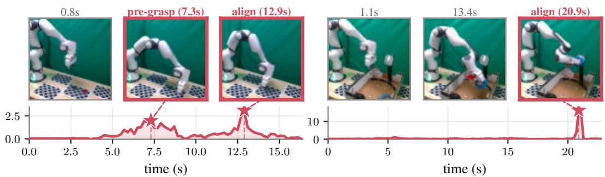  
Figure 1: Our state criticality measure, SCRIM, along a successful demonstration of cube stacking (left) and tape hanging (right), with a filmstrip of the rollout. SCRIM peaks at semantically critical moments where small action errors are likely to derail the task, such as aligning with the cube before grasp, aligning the cube for placement, and aligning the tape with the hook.

This paper investigates a complementary approach to improving BC policies: identifying where accurate imitation matters most. Standard BC objectives treat all demonstrated states equally, yet manipulation tasks contain a small number of critical states where a small deviation from the expert action can derail the episode, while most others are forgiving. For example, in cube-stacking, the alignment phases immediately before grasping or placing the cube are critical even though they appear uneventful: a small action error can prevent a stable grasp or lead to an unstable placement. Errors of similar magnitude during earlier reaching motions, by contrast, are often recoverable in subsequent steps. Robust imitation therefore requires a state criticality measure that quantifies which states are most consequential for task success. A reliable criticality measure could support targeted policy improvement. During training, it can reweight the BC objective to prioritize states where errors are most likely to cause failure. During data curation, it can identify high-criticality demonstrations, enabling smaller subsets to match or exceed full-dataset performance while reducing training and storage cost [12].

Systematically quantifying state criticality for IL is nontrivial [13]. A useful measure should not flag merely states with large actions, contact forces, or proximity to objects, but states where small, policy-relevant action errors substantially degrade task performance. We formalize this as the worstcase increase in task failure under a bounded adversarial perturbation of the intended action, and propose SCRIM, a State Criticality Measure that learns it by training an adversarial residual policy and critic around a fixed BC policy. SCRIM produces per-state scores identifying where the policy is most vulnerable to small action errors. We evaluate SCRIM on six manipulation tasks. Qualitatively, it identifies semantically meaningful critical phases—grasp alignment, contact timing—that geometric and value-based baselines miss (Fig. 1). Quantitatively, SCRIM-guided data selection and loss reweighting significantly improve BC over standard training and alternative criticality measures.

Concretely, this paper’s contributions are as follows: (1) introducing a formal notion of state criticality for imitation learning; (2) proposing SCRIM, a practical algorithm for estimating state criticality; (3) showing that SCRIM identifies semantically meaningful critical states in real-robot and simulated manipulation demonstrations; (4) demonstrating that SCRIM can improve imitation learning through criticality-aware loss reweighting and data curation, leading to stronger BC policies than standard training and baseline criticality measures.

## 2 Related Work

Imitation learning and demonstration data. Data is the key ingredient in imitation learning. A policy can only be as good as the demonstrations it is trained on and it’s ability to stick to the demonstrations. Both the quality and the composition of a dataset strongly shape downstream performance [8]. This has motivated a large body of work on data curation, which selects or reweights existing demonstrations based on task distribution [14, 15], surrogate models [16, 17], quality labels or estimates [18, 19, 20], or by shaping the data at collection time [21, 22, 23]. While others [24, 25, 23] improved robustness to deviations from the demonstrations. Underlying these efforts are the important of small deviations from expert actions and a recurring observation that not all states are equally important. Huang et al. [13] argue that the essence of a policy is captured by a few critical states where taking the right action is essential. We, formalize the importance of each state with a criticality score and use this single measure both to curate demonstrations and to reweight the imitation objective toward the states where small mistakes matter most.

Residual RL. Residual RL trains a corrective policy on top of a fixed base controller and has become a popular recipe for refining imitation policies [9, 11, 10, 26, 27] for improved task success. We, however, aim to create a tool for increased understanding of imitation learning alongside performance improvement. Moreover, although more sample efficient than full fine tuning of the base policy learning, such corrections still demand many environment interactions, especially under the sparse rewards typical of manipulation. We adopt the same residual formulation but invert its objective. Rather than learning to correct the base policy, we train an adversarial residual that degrades it. Because actions that break a task are more abundant than the corrective actions, this adversaria residual is an easier exploration problem—an advantage confirm empirically (Section 5).

## 3 Background and Problem Formulation

We consider discrete-time sequential decision-making problems modeled as a Markov decision process $( \mathrm { M D P } ) , \mathcal { M } = ( S , \mathcal { A } , P , r , \rho _ { 0 } , \gamma )$ , where $s$ is the state space, $\mathcal { A }$ is the action space, $P ( s ^ { \prime } \mid s , a )$ is the transition kernel, $r : \mathcal { S } \times \mathcal { A } $ R is the reward function, $\rho _ { 0 }$ is the distribution over initial states, and $\gamma \in [ 0 , 1 )$ is the discount factor. A (stationary) policy $\pi ( a \mid s )$ maps states to a distribution over actions; when the policy is deterministic, we write $a = \pi ( s )$

Imitation learning. Given a demonstration dataset $\mathcal { D } = \{ ( s _ { i } , a _ { i } ) \} _ { i = 1 } ^ { N }$ collected by an expert policy $\pi _ { E }$ , where $a _ { i } \sim \pi _ { E } ( \cdot \mid s _ { i } )$ , behavior cloning (BC) casts imitation learning as supervised learning, fitting a parameterized policy $\pi _ { \theta }$ to reproduce expert actions by minimizing the loss,

$$
\begin{array} { r } { \mathcal { L } _ { \mathrm { B C } } ( \theta ) = \mathbb { E } _ { ( s , a ) \sim \mathcal { D } } \big [ \ell \big ( \pi _ { \theta } ( s ) , a \big ) \big ] , } \end{array}\tag{1}
$$

where ℓ is an action-prediction loss, e.g. the squared error $\lVert \pi _ { \theta } ( s ) - a \rVert _ { 2 } ^ { 2 }$ . This objective weights all demonstration states equally. However, action errors are not equally consequential across states: in some states, a small deviation from the expert action may be easily recoverable, while in others it may lead to task failure.

Reinforcement learning. Our analysis borrows the value-function machinery of reinforcement learning (RL), though imitation itself uses no reward signal. RL seeks a policy maximizing the expected discounted return $J ( \pi ) = \mathbb { E } _ { \tau \sim \pi } \left\lceil \sum _ { t = 0 } ^ { \infty } \gamma ^ { t } r ( s _ { t } , a _ { t } ) \right\rceil$ over trajectories ${ \boldsymbol \tau } = ( s _ { 0 } , a _ { 0 } , s _ { 1 } , \dots )$ with $s _ { 0 } \sim \rho _ { 0 } , a _ { t } \sim \pi ( \cdot \mid s _ { t } )$ , and $s _ { t + 1 } \sim P ( \cdot \mid s _ { t } , a _ { t } )$ . For a fixed $\pi .$ , the $Q \mathrm { - }$ function conditions this return on the first state and action,

$$
Q ^ { \pi } ( s , a ) = \mathbb { E } _ { \tau \sim \pi } \left[ \sum _ { t = 0 } ^ { \infty } \gamma ^ { t } r ( s _ { t } , a _ { t } ) \Bigg | s _ { 0 } = s , a _ { 0 } = a \right] ,\tag{2}
$$

and satisfies the Bellman equation $Q ^ { \pi } ( s , a ) = r ( s , a ) + \gamma \mathbb { E } _ { s ^ { \prime } \sim P ( \cdot \vert s , a ) , a ^ { \prime } \sim \pi ( \cdot \vert s ^ { \prime } ) } \bigl [ Q ^ { \pi } ( s ^ { \prime } , a ^ { \prime } ) \bigr ]$ . We will use $Q ^ { \pi }$ to assess how sensitive task performance is to the action at a given state.

Problem statement. Our goal is to quantify the criticality of a demonstration state for an imitation policy π. Intuitively, a state is critical if the success of the task is highly sensitive to the action selected at that state. Equivalently, critical states are those in which small action errors can substantially degrade downstream performance or cause task failure. In contrast, non-critical states admit a larger set of actions from which the policy can still recover and complete the task.

Given a learned imitation policy π and access to rollouts of this policy, we seek to learn a statedependent criticality measure that identifies where precise action selection matters most. Such a measure can be used to diagnose weaknesses of an imitation policy, prioritize data collection or policy improvement, and trigger targeted intervention during deployment.

## 4 Method

Our goal is to identify states in which small action errors can have large downstream consequences. To do so, we treat a learned imitation policy π as a fixed base controller and ask how much an adversarial, bounded perturbation to its action can degrade task outcome. This leads to a residual MDP in which the only decision variable is the perturbation applied around the base action.

Adversarial residual MDP. At each state, we decompose the executed action into the action proposed by the base policy and a bounded residual disturbance:

$$
a = \pi ( s ) + \delta , \quad \quad \delta \in \Delta _ { \epsilon } : = \{ \delta \in \mathcal { A } : | \delta _ { j } | \leq \epsilon _ { j } \forall j \} ,\tag{3}
$$

where $\epsilon \in \mathbb { R } _ { \geq 0 } ^ { d }$ defines a per-coordinate perturbation budget and $d \ = \ \dim ( { \mathcal { A } } )$ This budget models the magnitude of the small action errors that an imitation policy might make at a state. Freezing π and treating the residual δ as the only decision variable induces a residual MDP $\widetilde { \mathcal { M } } _ { \pi } ^ { \epsilon } = ( S , \Delta _ { \epsilon } , \widetilde { P } _ { \pi } , \widetilde { r } _ { \pi } , \rho _ { 0 } , \gamma )$ , whose transition kernel and reward are those of M evaluated at the disturbed action,

$$
\widetilde { P } _ { \pi } ( s ^ { \prime } \mid s , \delta ) = P \bigl ( s ^ { \prime } \mid s , \pi ( s ) + \delta \bigr ) , \qquad \widetilde { r } _ { \pi } ( s , \delta ) = r \bigl ( s , \pi ( s ) + \delta \bigr ) .\tag{4}
$$

The state space, initial-state distribution, and discount factor are inherited from the original MDP M. A disturbance policy $\nu ( \delta \mid s )$ acts only through the residual action space $\Delta _ { \epsilon } ;$ setting $\nu \equiv 0$ recovers the unperturbed execution of the base policy π.

Critic. We instantiate the residual MDP reward (Eq. 4) with a sparse, outcome-based signal. A rollout receives a reward $r = - 1$ if it succeeds and $r = 0$ otherwise. Under the standard maximizereturn objective $J ( \pi )$ , successful trajectories therefore have lower, more negative value, while failed or non-successful trajectories have value closer to zero. Consequently, larger values correspond to worse outcomes.

Next, we train an adversarial disturbance policy on this reward in the residual MDP and retain its converged critic $\bar { Q } ( s , a )$ . Q¯ is always queried on the combined action executed by the environment, $a = \pi ( s ) + \delta$ . Therefore, an increase in $\bar { Q } ( s , a )$ indicates that the disturbance has made the trajectory more failure-prone.

State CRIticality Measure (SCRIM). We are now ready to define criticality: a state s is critical if some in-budget disturbance $\delta \in \Delta _ { \epsilon }$ applied at s substantially degrades the task outcome relative to faithfully following π. Conversely, s is forgiving if no admissible disturbance at s changes the outcome appreciably, compared to unperturbed execution. Thus, the criticality of a state is the worst-case degradation in outcome value induced by a small action disturbance.

SCRIM precisely measures this worst-case degradation in the outcome value. Since we evaluate criticality on demonstration states, we define the ideal score relative to the expert action $\pi _ { E } ( s )$

$$
C _ { \epsilon } ( s ) = \operatorname* { m a x } _ { \delta \in \Delta _ { \epsilon } } \bar { Q } \bigl ( s , \pi _ { E } ( s ) + \delta \bigr ) - \bar { Q } \bigl ( s , \pi _ { E } ( s ) \bigr ) \ \geq \ 0 .\tag{5}
$$

The first term is the worst outcome value attainable by an admissible perturbation of the expert action, while the second term is the outcome value of executing the expert action itself. Because larger Q¯ corresponds to worse outcomes under our reward convention, $C _ { \epsilon } ( s )$ is large when a small admissible action error can make failure substantially more likely, and close to zero when the state is forgiving.

In practice, we estimate (5) with an adversary $\delta _ { \pi } ( s )$ learned jointly with the critic. Both the critic Q¯ and the adversary are trained in the residual MDP induced by the learned imitation policy π as the base controller. At evaluation time, however, we compute the criticality score around the expert action $\pi _ { E } ( s )$ on demonstration states:

$$
\Delta Q ( s ) = { \bar { Q } } { \left( s , \pi _ { E } ( s ) + \delta _ { \pi } ( s ) \right) } - { \bar { Q } } { \left( s , \pi _ { E } ( s ) \right) } .\tag{6}
$$

This evaluation asks whether a small prediction error around the demonstrated action would substantially increase the likelihood of downstream failure. A state is critical when $\Delta Q ( s )$ is large: a small disturbance drives the value toward 0, flipping a likely success into a likely failure, so the task is sensitive to exactly how the action is executed there. A state is forgiving when $\Delta Q ( s ) \approx 0 $ , i.e. no admissible disturbance appreciably changes the downstream outcome.

Learning the adversary. The adversary policy is a network $\mu _ { \theta }$ that maps a state to a disturbance, $\delta _ { \theta } ( s ) = \epsilon \odot \operatorname { t a n h } \left( \mu _ { \theta } ( s ) \right)$ , where the tanh bounds each coordinate in $[ - 1 , 1 ]$ and ϵ rescales the output to the per-coordinate budget. Thus, $\delta _ { \theta } ( s ) \in \Delta _ { \epsilon }$ for every state. We train $\mu _ { \theta }$ jointly with the critic using soft actor-critic (SAC) in the residual MDP. The disturbance actor maximizes $\bar { Q } ( s , \pi ( s ) +$ $\delta _ { \theta } ( s ) )$ , i.e. it seeks the most failure-prone admissible disturbance, and at convergence it provides the $\delta _ { \pi } ( s )$ used in Eq. (6). See Algorithm 1 (Appendix A.1).

The critic is implemented as a clipped double-Q pair and trained using temporal-difference targets with Polyak-averaged target networks. We denote the conservative critic used for scoring by $\bar { Q } ( s , a ) = \operatorname * { m i n } _ { i } Q _ { \bar { \phi } _ { i } } ( s , a )$ . The actor is entropy-regularized with an automatically tuned temperature. During training, transitions $( s , \delta , r , s ^ { \prime } )$ are collected by executing the disturbed action $a = \mathrm { c l i p } _ { \mathcal { A } } \left( \pi ( s ) + \delta _ { \pi } ( s ) \right)$ in the environment and storing the resulting transition in a replay buffer. This ensures that the adversary is trained on the same clipped physical actions that critic evaluates.

Sampling-distribution calibration Both downstream uses of SCRIM (Section 5) first turn the perstate criticality scores into a sampling distribution over the demonstration states through a single, measure-agnostic pipeline. Specifically, we z-score standardize the criticality scores $\mathbf { t o } \ z _ { i }$ and map them to the temperature-T softmax $p _ { i } ( T ) \propto \exp ( z _ { i } / T )$ . We choose the temperature T so that the resulting distribution reaches a common target sharpness, measured by its fractional effective sample size ESS%. We defer the standardization procedure, the definition of ESS, and the temperatureselection details to Appendix A.3. The calibrated criticality scores can then be used for policy improvement, e.g., by upweighing critical samples.

## 5 Experiments

The experiments are designed to answer four questions: (i) does SCRIM identify intuitive critical states in a manipulation task, and more reliably than existing criticality heuristics?, (ii) does weighting behavior cloning by SCRIM improve policy performance?, (iii) can SCRIM curate a small subset of demonstrations that retains, or improves on, full-data performance? (iv) can SCRIM be feasibly evaluated on hardware via real world RL, and does it improve a real-world VLA policy? We study (i)–(iii) in simulation (Section 5.1) and validate (iv) on hardware (Section 5.2).

## 5.1 Simulation Results

We consider four diverse manipulation tasks spanning a range of difficulty levels and requiring precise contact-rich interaction making them suitable for studying state criticality: stacking cubes, faucet turning, nail hammering and peg insertion. The tasks are spread across two benchmark environments: Hammer is the MetaWorld [28] task (grasp a hammer and drive in a nail), with 84×84 RGB and a 4-dim proprioceptive vector as observations and a 4-dim end-effector action; its BC policy is a deterministic CNN+MLP trained on 20 expert demonstrations. StackCube, PegInsertion and TurnFaucet are ManiSkill2 [29] tasks with state observations and a Behavior Transformer [30] BC policy with 20 time-steps of history; trained on 974, 986 and 1008 demonstrations across 10 faucet models, respectively. All actions are normalized to $[ - 1 , 1 ] ^ { d _ { a } }$

To estimate criticality we freeze π and train the SAC adversary against it (Section 4) with a sparse success reward and a small in-budget disturbance bound (0.20 per axis for MetaWorld task, 0.005 for the ManiSkill2 tasks). To facilitate comparison, every criticality measure—ours and the baselines— is mapped to a sampling distribution by the same pipeline, calibrated for every measure to the same ESS, effective sample size, so that the distributions are similarly peaked, differing only in which states they emphasize. We report task success rate and defer per-environment details to Appendix A.2.

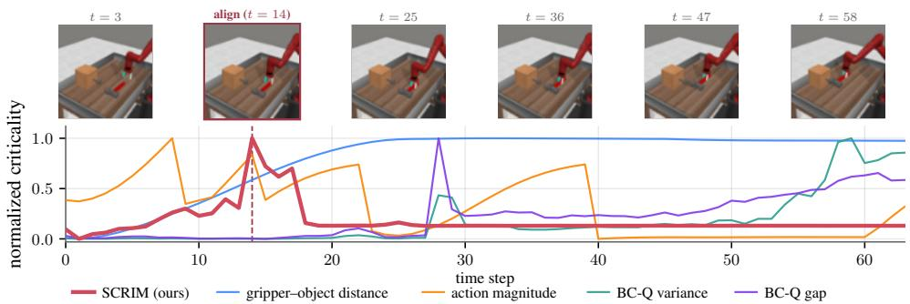  
Figure 2: Per-method criticality along Hammer (MetaWorld) task demonstration. All measures min–max normalized to a common scale.

Baselines. SCRIM is compared against the following five baselines, each of which assigns a scalar criticality score to state s usable for both data weighting and data selection similarly to SCRIM: (i) uniform sampling, the standard i.i.d. imitation-learning baseline that treats every state as equally important; (ii) distance to object ofinterest, a geometric heuristic that scores states by the (negative) end-effector–object distance and requires a known target pose; (iii) action magnitude, which scores states by $- \| a \|$ on the premise that intricate, contact-rich manipulation uses smaller commanded actions than coarse free-space motion; (iv) policy Q-function variance [31], the empirical variance $\operatorname { V a r } _ { a \sim \mathcal { U } ( A ) } \left[ Q ^ { \pi _ { b } } ( s , a ) \right]$ of the base policy’s Q-value over actions sampled uniformly from A; and (v) Q-value discrepancy [13], the gap max $\begin{array} { r } { Q ^ { \pi } ( s , a ) - \frac { 1 } { | \mathcal { A } | } \sum Q ^ { \pi } ( s , a ) } \end{array}$ between the best and average a   
a   
Q-value at a state. More detailed baseline descriptions are presented in the appendix in Sec. A.4.

Criticality estimates. To qualitatively analyze the criticality measures, Fig. 2 plots each score along a single hammer demonstration. SCRIM rises as the gripper approaches the hammer immediately before the grasp, identifying the alignment over the handle as the most critical phase. This state is not obviously critical from task progress alone: the gripper has not yet contacted the object, but a small action error can prevent a stable grasp of the handle, causing the hammer to fall and derailing the episode. In contrast, with good alignment, the grasp itself and the states far from the alignment phase are forgiving, with action errors recoverable in subsequent steps.

By contrast, the baselines peak away from this alignment phase. Distance to object rises as the gripper nears the hammer but is flat afterward, failing to separate the post-grasp states; action magnitude spikes at every phase transition, but there are several such transitions and not necessarily critical. The value-based baselines, Q-function variance and Q-value discrepancy, miss the alignment phase, peaking narrowly during contact-rich phases where the learned Q-function is most sensitive to action variation. However, sensitivity across arbitrary actions is not necessarily the same as vulnerability to small, policy-relevant action errors. SCRIM directly targets the latter by measuring the worst-case degradation induced by bounded perturbations around the demonstrated action. Additionally, the value-based baselines aggregate expectations or vari-

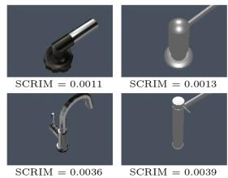  
Figure 3: Faucet models ordered by mean SCRIM over the demonstrations, from the two easiest (top) to the two hardest (bottom).

ances across all actions, requiring an accurate Q-function everywhere. In contrast, SCRIM only requires reliable value estimates in the local neighborhood of the policy actions explored by the adversary, focusing the estimate on the perturbations most relevant to imitation errors.

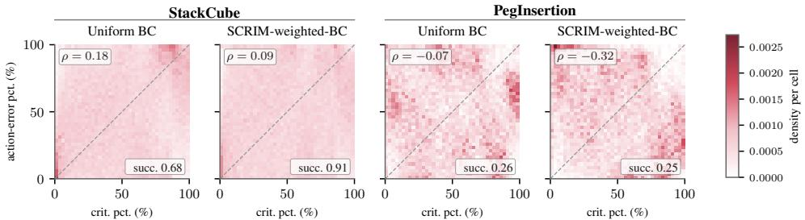  
Figure 4: Action error vs. state criticality. Histograms of BC action-error percentile against SCRIM- percentile on two tasks, each under Uniform BC and SCRIM-weighted BC. Each panel is annotated with its Spearman correlation ρ and success rate.

Table 1: Weighted training. Success rates (%) over 100 rollouts. Each criticality measure is used to weight the sampling of states during training (Section 5.1). Best per task in bold.
<table><tr><td>Method</td><td>StackCube</td><td>TurnFaucet</td><td>PegInsertion</td><td>Hammer</td><td>Average</td></tr><tr><td>Uniform sampling (BC)</td><td>68.0</td><td>39.0</td><td>26.0</td><td>61.0</td><td>48.5</td></tr><tr><td>Distance to object</td><td>4.0</td><td>4.0</td><td>0.0</td><td>0.0</td><td>2.0</td></tr><tr><td>Action magnitude</td><td>41.0</td><td>21.0</td><td>5.0</td><td>69.0</td><td>34.0</td></tr><tr><td>Q-function variance</td><td>77.0</td><td>44.6</td><td>10.0</td><td>65.0</td><td>49.2</td></tr><tr><td>Q-value discrepancy [13]</td><td>74.0</td><td>33.0</td><td>10.0</td><td>67.0</td><td>46.0</td></tr><tr><td>Öurs</td><td>91.0</td><td>47.0</td><td>25.0</td><td>83.0</td><td>61.5</td></tr></table>

SCRIM as a measure of task difficulty. Because SCRIM is computed from a single critic trained across demonstrations of the same task, its scores are comparable across trajectories and task variations and appears to be an effective proxy for the relative task difficulty. We illustrate this on the TurnFaucet task, where different faucet geometries induce different levels of manipulation difficulty. Ordering faucet models by their SCRIM yields an intuitive easy-to-hard ranking (Fig. 3): models with broad, forgiving handles have low mean SCRIM, whereas models requiring precise grasping and turning have higher mean SCRIM.

Weighted imitation. Demonstration datasets are dominated by non-critical states, with easily recoverable free-space motions heavily outnumbering the few critical states where a small action error can cause failure. Uniform BC spreads its capacity uniformly across samples, decreasing the imitation accuracy in these decisive states, which can now be addressed using SCRIM. Taking the calibrated distribution p from Section 4 (Eq. 7 in Appendix A.3), we form mean-one per-sample weights $w _ { i } = N p _ { i }$ and train a fresh policy by minimizing the BC objective (Eq. 1) reweighted by wi, equivalently sampling each minibatch from p with replacement so the policy sees the decisive states more often during training.

Table 1 reports the success rates for SCRIM-weighted BC and the various baselines. SCRIM weighting improves the average success rate over uniform BC, gaining on three of the four tasks and essentially matching it on PegInsertion. It also outperforms the other baseline weights: the strongest, Q-function variance, lands barely above uniform BC, while the geometric heuristics fare poorly because their weighting underweights genuinely critical states. This policy improvement provides strong evidence that SCRIM is a more effective criticality measure than the baselines.

Figure 4 analyzes more closely the distribution of action-error percentile vs SCRIM percentile and its influence on policy improvement. For uniform BC on StackCube demonstrations, the action error rank-correlates positively with criticality, with the distribution more heavily concentrated in regions with higher criticality and higher action-error. SCRIM-weighting flattens this relationship reducing error precisely at these states and raising the success rate. Conversely, SCRIM weighting appears to improve base policy success rates only when the base policy exhibits higher action errors at critical states, as seen for the PegInsertion task. This reveals a limitation of policy improvement using SCRIM: due to lack of RL-style exploration for new behaviors, it cannot improve overall performance beyond demonstration data if the base policy is already accurate at critical states.

Residual policy to improve performance. A natural alternative for policy improvement is to train a residual RL policy that corrects the base policy rather than SCRIM’s adversarial RL approach. Our intuition is actions that break a task are more abundant than corrective actions that improve a policy, thereby making adversarial RL a fundamentally easier problem due to RL’s sampling-based exploration. To validate this intuition, we also trained a residual-RL baseline [11]

Table 2: Matched interaction. Success (%) of residual RL [11] and Ours. Match: extra interaction residual RL needs to reach Ours.
<table><tr><td>Task</td><td>Budget Res. RL</td><td>Ours</td><td>Match</td></tr><tr><td>StackCube</td><td>100k</td><td>0.0 85.0</td><td>7.5×</td></tr><tr><td>TurnFaucet</td><td>200k</td><td>16.0</td><td>52.0 1.5×</td></tr><tr><td>PegInsertion</td><td>500k</td><td>0.0 18.0</td><td>5.8×</td></tr><tr><td>Hammer</td><td>100k</td><td>79.0</td><td>74.0</td></tr></table>

using SAC, where a residual actor learns a bounded corrective delta on the frozen base. Under a matched interaction budget, residual RL falls below the base policy it is meant to correct on all three ManiSkill tasks, while SCRIM-weighted BC already improves on it for StackCube and TurnFaucet; residual RL needs several times more interaction to catch up (Table 2). Hammer is the exception: residual RL improves the base policy readily and leads early, although SCRIM reaches the same peak success within 500k interactions. SCRIM’s interaction efficiency is therefore task-dependent, and the two approaches are complementary.

Curation of datasets that amplify critical signals We next investigate SCRIM for data curation: selecting an informative subset of demonstrations under a data budget. Using the same softmax conversion of the criticality scores as in training, we sample without replacement to retain 25% of the dataset and then train standard BC on this subset (Table 3). SCRIM attains the best average success rate and wins on three of the four tasks, with uniform selection narrowly ahead on PegInsertion. With only a quarter of the data, SCRIM-selected subsets match or exceed uniform BC trained on the full dataset, indicating its effectiveness for task-relevant data curation.

Table 3: Data selection. Success rates (%) over 100 rollouts. Each criticality measure is converted into a sampling distribution over demonstration states, from which 25% of the states are drawn without replacement; standard i.i.d. behavior cloning is then trained on this subset (Section 5.1). For reference, the top panel reports behavior cloning and Ours trained on the full (100%) dataset. Best per column among the 25% methods in bold. † Ours at 100% is our criticality-weighted training of Table 1, included here as reference.
<table><tr><td>Data</td><td>Method</td><td>StackCube</td><td>TurnFaucet</td><td>PegInsertion</td><td>Hammer</td><td>Average</td></tr><tr><td>100%</td><td>Uniform (BC)</td><td>68.0</td><td>39.0</td><td>26.0</td><td>61.0</td><td>48.5</td></tr><tr><td></td><td>Ours† Uniform sampling</td><td>91.0 73.0</td><td>47.0</td><td>25.0</td><td>83.0</td><td>61.5</td></tr><tr><td>Subt %)</td><td></td><td></td><td>41.0</td><td>14.0</td><td>60.0</td><td>47.0</td></tr><tr><td></td><td>Distance to object</td><td>9.0</td><td>1.0</td><td>0.0</td><td>0.0</td><td>2.5</td></tr><tr><td></td><td>Action magnitude</td><td>39.0</td><td>12.0</td><td>7.0</td><td>60.0</td><td>29.5</td></tr><tr><td></td><td>Q-function variance</td><td>76.0</td><td>37.0</td><td>8.0</td><td>70.0</td><td>47.8</td></tr><tr><td></td><td>Q-value discrepancy [13]</td><td>81.0</td><td>29.0</td><td>11.0</td><td>73.0</td><td>48.5</td></tr><tr><td></td><td>Òurs</td><td>83.0</td><td>43.0</td><td>13.0</td><td>77.0</td><td>54.0</td></tr></table>

## 5.2 Hardware

We further validated SCRIM on hardware, demonstrating that it can be feasibly learned through limited real-world interaction. The study investigated two tasks using Franka Panda manipulator for which demonstration data was collected via teleoperation: StackCube (stack the red cube on the green cube; 70 demonstrations) and TapeHang (hang the tape on a hook; 100 demonstrations). The base policy for each task was obtained by finetuning π [6], a vision-language-action model. The adversarial residual RL agent is trained with SAC [32] directly on the robot, adding a bounded disturbance δ to the base-policy action (implementation details in Appendix A.5). Adversarial training was found to be effective with only 50 rollouts for StackCube and 150 for TapeHang, indicating our method’s effectiveness for real-world RL.

Weighted imitation and curation on hardware. We repeat the weighting and 25% curation studies with the hardware SCRIM scores, re-finetuning $\pi _ { 0 . 5 }$ on each resulting dataset and evaluating 25 rollouts per task–policy pair (Table 4). SCRIM-weighted training raises success from 56% to 76% on StackCube and from 56% to 88% on TapeHang. Residual RL [11] given the same number of real-world episodes as the adversary barely improves StackCube

Table 4: Hardware. Success (%) of the finetuned $\pi _ { 0 . 5 }$ over 25 rollouts. Residual-RL training episodes in parentheses.
<table><tr><td>Data</td><td>Method</td><td></td><td>StackCube TapeHang</td></tr><tr><td rowspan="3"></td><td>Uniform (BC)</td><td>56.0</td><td>56.0</td></tr><tr><td>100% Residual RL [11]</td><td>60.0 (50)</td><td>4.0 (150)</td></tr><tr><td>Ours</td><td>76.0</td><td>88.0</td></tr><tr><td rowspan="2">25%</td><td>Uniform sampling</td><td>52.0</td><td>48.0</td></tr><tr><td>Ours</td><td>68.0</td><td>60.0</td></tr></table>

and severely degrades TapeHang, mirroring the matched-interaction results in simulation (Table 2). With a 25% subset, SCRIM selection again outperforms uniform selection on both tasks, showing that SCRIM’s benefits carry over from state-based simulated policies to a real-world VLA.

Mean trajectory criticality flags fragile demonstrations. Because criticality is comparable across task trajectories, a demonstration’s mean SCRIM grades its quality. A high mean value indicates a fragile success that a small execution error would have turned into a failure, while a low mean marks a robust one. Fig. 5 shows two such cube-stacking demonstrations: the high-mean one places the cube on the edge of the support, where it barely balances and a slight deviation would topple it, whereas the low-mean one sets it down centered and stable.

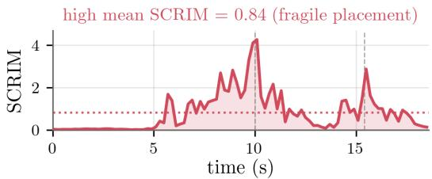

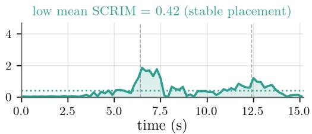

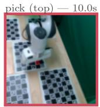

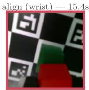

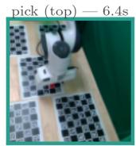

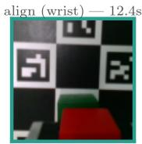  
Figure 5: SCRIM distinguishes a brittle (left) from a robust (right) cube-stacking demonstration.

## 6 Limitations and Future Work

SCRIM estimates criticality without requiring expert supervision, but it still requires interaction with the environment. Although this is more targeted than training a full residual RL policy, it may still be difficult in real-world settings where failures are costly. Future work could address this by learning criticality in simulation, using real-to-sim reconstruction from demonstration, or from logged failure data with offline RL. SCRIM also improves imitation only within the support of the available demonstrations. It can identify and emphasize consequential states, but it cannot discover missing strategies or recovery behaviors absent from the dataset. An important direction is to use criticality to guide exploration or targeted data collection, focusing interactions near highcriticality states. Finally, learning language-conditioned critics that generalize across objects, tasks, and embodiments is an exciting direction. Our faucet and hardware experiments suggest this may be feasible, since SCRIM can already be trained across task variations and with task instructions included in the observation.

## Acknowledgments

We gratefully acknowledge research support from the NSF CAREER program (2240163) and the NASA ULI program. Ajay Suresha Sathya was supported by the European Union’s Horizon Europe research and innovation programme through a Marie Skłodowska-Curie Postdoctoral Fellowship (101211945 — ExTRAORDiNary).

## References

[1] A. O’Neill, A. Rehman, A. Maddukuri, A. Gupta, A. Padalkar, A. Lee, A. Pooley, A. Gupta, A. Mandlekar, A. Jain, et al. Open X-Embodiment: Robotic learning datasets and RT-X models. In 2024 IEEE International Conference on Robotics and Automation (ICRA), pages 6892– 6903. IEEE, 2024.

[2] A. Khazatsky, K. Pertsch, S. Nair, A. Balakrishna, S. Dasari, S. Karamcheti, S. Nasiriany, M. K. Srirama, L. Y. Chen, K. Ellis, P. D. Fagan, J. Hejna, M. Itkina, M. Lepert, Y. J. Ma, P. T. Miller, J. Wu, S. Belkhale, S. Dass, H. Ha, A. Jain, A. Lee, Y. Lee, M. Memmel, S. Park, I. Radosavovic, K. Wang, A. Zhan, K. Black, C. Chi, K. B. Hatch, S. Lin, J. Lu, J. Mercat, A. Rehman, P. R. Sanketi, A. Sharma, C. Simpson, Q. Vuong, H. R. Walke, B. Wulfe, T. Xiao, J. H. Yang, A. Yavary, T. Z. Zhao, C. Agia, R. Baijal, M. G. Castro, D. Chen, Q. Chen, T. Chung, J. Drake, E. P. Foster, J. Gao, D. A. Herrera, M. Heo, K. Hsu, J. Hu, D. Jackson, C. Le, Y. Li, R. Lin, Z. Ma, A. Maddukuri, S. Mirchandani, D. Morton, T. Nguyen, A. O’Neill, R. Scalise, D. Seale, V. Son, S. Tian, E. Tran, A. E. Wang, Y. Wu, A. Xie, J. Yang, P. Yin, Y. Zhang, O. Bastani, G. Berseth, J. Bohg, K. Goldberg, A. Gupta, A. Gupta, D. Jayaraman, J. J. Lim, J. Malik, R. Mart´ın-Mart´ın, S. Ramamoorthy, D. Sadigh, S. Song, J. Wu, M. C. Yip, Y. Zhu, T. Kollar, S. Levine, and C. Finn. DROID: A Large-Scale In-The-Wild Robot Manipulation Dataset. In Proceedings of Robotics: Science and Systems, Delft, Netherlands, July 2024. doi:10.15607/RSS.2024.XX.120.

[3] C. Chi, S. Feng, Y. Du, Z. Xu, E. Cousineau, B. C. Burchfiel, and S. Song. Diffusion Policy: Visuomotor Policy Learning via Action Diffusion. In Proceedings of Robotics: Science and Systems, Daegu, Republic of Korea, July 2023. doi:10.15607/RSS.2023.XIX.026.

[4] B. Zitkovich, T. Yu, S. Xu, P. Xu, T. Xiao, F. Xia, J. Wu, P. Wohlhart, S. Welker, A. Wahid, Q. Vuong, V. Vanhoucke, H. Tran, R. Soricut, A. Singh, J. Singh, P. Sermanet, P. R. Sanketi, G. Salazar, M. S. Ryoo, K. Reymann, K. Rao, K. Pertsch, I. Mordatch, H. Michalewski, Y. Lu, S. Levine, L. Lee, T.-W. E. Lee, I. Leal, Y. Kuang, D. Kalashnikov, R. Julian, N. J. Joshi, A. Irpan, B. Ichter, J. Hsu, A. Herzog, K. Hausman, K. Gopalakrishnan, C. Fu, P. Florence, C. Finn, K. A. Dubey, D. Driess, T. Ding, K. M. Choromanski, X. Chen, Y. Chebotar, J. Carbajal, N. Brown, A. Brohan, M. G. Arenas, and K. Han. Rt-2: Vision-languageaction models transfer web knowledge to robotic control. In J. Tan, M. Toussaint, and K. Darvish, editors, Proceedings of The 7th Conference on Robot Learning, volume 229 of Proceedings ofMachine Learning Research, pages 2165–2183. PMLR, 06–09 Nov 2023. URL https://proceedings.mlr.press/v229/zitkovich23a.html.

[5] T. Z. Zhao, V. Kumar, S. Levine, and C. Finn. Learning Fine-Grained Bimanual Manipulation with Low-Cost Hardware. In Proceedings ofRobotics: Science and Systems, Daegu, Republic of Korea, July 2023. doi:10.15607/RSS.2023.XIX.016.

[6] K. Black, N. Brown, J. Darpinian, K. Dhabalia, D. Driess, A. Esmail, M. Equi, C. Finn, N. Fusai, et al. $\pi _ { 0 . 5 } { : }$ a vision-language-action model with open-world generalization. In Proceedings of The 9th Conference on Robot Learning, volume 305 of Proceedings of Machine Learning Research, pages 17–40. PMLR, 2025.

[7] B. Brogliato. Nonsmooth impact mechanics: models, dynamics and control. Springer, 1996.

[8] S. Belkhale, Y. Cui, and D. Sadigh. Data quality in imitation learning. In A. Oh, T. Naumann, A. Globerson, K. Saenko, M. Hardt, and S. Levine, editors, Advances in Neural Information Processing Systems, volume 36, pages 80375–80395. Curran Associates, Inc., 2023. URL https://proceedings.neurips.cc/paper\_files/paper/ 2023/file/fe692980c5d9732cf153ce27947653a7-Paper-Conference.pdf.

[9] T. Johannink, S. Bahl, A. Nair, J. Luo, A. Kumar, M. Loskyll, J. A. Ojea, E. Solowjow, and S. Levine. Residual reinforcement learning for robot control. In 2019 international conference on robotics and automation (ICRA), pages 6023–6029. IEEE, 2019.

[10] L. Ankile, Z. Jiang, R. Duan, G. Shi, P. Abbeel, and A. Nagabandi. Residual off-policy RL for finetuning behavior cloning policies. arXiv preprint arXiv:2509.19301, 2025.

[11] X. Yuan, T. Mu, S. Tao, Y. Fang, M. Zhang, and H. Su. Policy decorator: Model-agnostic online refinement for large policy model. In International Conference on Learning Representations (ICLR), 2025.

[12] W. Ding, S. Veer, K. Leung, Y. Cao, and M. Pavone. Surprise potential as a measure of interactivity in driving scenarios. arXiv preprint arXiv:2502.05677, 2025.

[13] S. H. Huang, K. Bhatia, P. Abbeel, and A. D. Dragan. Establishing appropriate trust via critical states. In 2018 IEEE/RSJ International Conference on Intelligent Robots and Systems (IROS), pages 3929–3936, 2018. doi:10.1109/IROS.2018.8593649.

[14] J. Hejna, C. A. Bhateja, Y. Jiang, K. Pertsch, and D. Sadigh. Remix: Optimizing data mixtures for large scale imitation learning. In P. Agrawal, O. Kroemer, and W. Burgard, editors, Proceedings of The 8th Conference on Robot Learning, volume 270 of Proceedings of Machine Learning Research, pages 145–164. PMLR, 06–09 Nov 2025. URL https: //proceedings.mlr.press/v270/hejna25a.html.

[15] S. Parekh, H. Nemlekar, and D. P. Losey. Towards balanced behavior cloning from imbalanced datasets. Autonomous Robots, 50(1), 2026. doi:10.1007/s10514-025-10237-0.

[16] C. Agia, R. Sinha, J. Yang, R. Antonova, M. Pavone, H. Nishimura, M. Itkina, and J. Bohg. CUPID: Curating data your robot loves with influence functions. In Proceedings of The 9th Conference on Robot Learning, volume 305 of Proceedings of Machine Learning Research, pages 2907–2932. PMLR, 2025.

[17] S. Dass, A. Khaddaj, L. Engstrom, A. Madry, A. Ilyas, and R. Mart´ın-Mart´ın. DataMIL: Selecting data for robot imitation learning with datamodels. In The Fourteenth International Conference on Learning Representations (ICLR), 2026.

[18] S. Kuhar, S. Cheng, S. Chopra, M. Bronars, and D. Xu. Learning to discern: Imitating heterogeneous human demonstrations with preference and representation learning. In J. Tan, M. Toussaint, and K. Darvish, editors, Proceedings ofThe 7th Conference on Robot Learning, volume 229 of Proceedings ofMachine Learning Research, pages 1437–1449. PMLR, 06–09 Nov 2023. URL https://proceedings.mlr.press/v229/kuhar23a.html.

[19] J. Hejna, S. Mirchandani, A. Balakrishna, A. Xie, A. Wahid, J. Tompson, P. R. Sanketi, D. Shah, C. Devin, and D. Sadigh. Robot data curation with mutual information estimators. In Proceedings ofRobotics: Science and Systems, 2025. doi:10.15607/RSS.2025.XXI.023.

[20] A. S. Chen, A. M. Lessing, Y. Liu, and C. Finn. Curating demonstrations using online experience. In Proceedings ofRobotics: Science and Systems, 2025. doi:10.15607/RSS.2025.XXI. 071.

[21] Y. U. Ciftci, D. Chiu, Z. Feng, G. S. Sukhatme, and S. Bansal. SAFE-GIL: SAFEty guided imitation learning for robotic systems. In 2025 IEEE International Conference on Robotics and Automation (ICRA), pages 3559–3566, 2025. doi:10.1109/ICRA55743.2025.11128298.

[22] L. Qiu, Y. U. Ciftci, and S. Bansal. Safety-aware imitation learning via MPC-guided disturbance injection. IEEE Robotics and Automation Letters, 11(6):7222–7229, 2026. doi: 10.1109/LRA.2026.3685942.

[23] D. Brandfonbrener, S. Tu, A. Singh, S. Welker, C. Boodoo, N. Matni, and J. Varley. Visual backtracking teleoperation: A data collection protocol for offline image-based reinforcement learning. In 2023 IEEE International Conference on Robotics and Automation (ICRA), pages 11336–11342, 2023. doi:10.1109/ICRA48891.2023.10161096.

[24] V. Sindhwani, S. Tu, and M. Khansari. Learning contracting vector fields for stable imitation learning. ArXiv, abs/1804.04878, 2018. URL https://api.semanticscholar.org/ CorpusID:4861590.

[25] S. A. Mehta, Y. U. Ciftci, B. Ramachandran, S. Bansal, and D. P. Losey. Stable-BC: Controlling covariate shift with stable behavior cloning. IEEE Robotics and Automation Letters, 10 (2):1952–1959, 2025. doi:10.1109/LRA.2025.3526439.

[26] W. Xiao, H. Lin, A. Peng, H. Xue, T. He, Z. Luo, Y. Xie, F. Hu, L. Fan, G. Shi, and Y. Zhu. Self-improving vision-language-action models with data generation via residual RL. In The Fourteenth International Conference on Learning Representations (ICLR), 2026. URL https: //openreview.net/forum?id=eUGoqrZ6Ea.

[27] L. Ankile, A. Simeonov, I. Shenfeld, M. Torne, and P. Agrawal. From imitation to refinement – residual RL for precise assembly. In 2025 IEEE International Conference on Robotics and Automation (ICRA), 2025. doi:10.1109/ICRA55743.2025.11127442.

[28] T. Yu, D. Quillen, Z. He, R. Julian, K. Hausman, C. Finn, and S. Levine. Meta-world: A benchmark and evaluation for multi-task and meta reinforcement learning. In Conference on robot learning, pages 1094–1100. PMLR, 2020.

[29] J. Gu, F. Xiang, X. Li, Z. Ling, X. Liu, T. Mu, Y. Tang, S. Tao, X. Wei, Y. Yao, et al. ManiSkill2: A unified benchmark for generalizable manipulation skills. In The Eleventh International Conference on Learning Representations (ICLR), 2023.

[30] N. M. Shafiullah, Z. Cui, A. A. Altanzaya, and L. Pinto. Behavior transformers: Cloning k modes with one stone. In Advances in Neural Information Processing Systems, volume 35, pages 22955–22968, 2022.

[31] I. Karino, Y. Ohmura, and Y. Kuniyoshi. Identifying critical states by the action-based vari ance of expected return. In Artificial Neural Networks and Machine Learning – ICANN 2020, volume 12396 of Lecture Notes in Computer Science, pages 366–378. Springer, 2020. doi: 10.1007/978-3-030-61609-0 29.

[32] T. Haarnoja, A. Zhou, P. Abbeel, and S. Levine. Soft actor-critic: Off-policy maximum entropy deep reinforcement learning with a stochastic actor. In J. Dy and A. Krause, editors, Proceedings of the 35th International Conference on Machine Learning, volume 80 of Proceedings of Machine Learning Research, pages 1861–1870. PMLR, 10–15 Jul 2018. URL https://proceedings.mlr.press/v80/haarnoja18b.html.

## A Appendix

## A.1 SCRIM algorithm

Algorithm 1 summarizes SCRIM end to end. Phase 1 trains an adversarial disturbance policy µθ and a value critic in the residual MDP $\widetilde { \mathcal { M } } _ { \pi } ^ { \epsilon }$ with soft actor-critic (SAC) [32]; Phase 2 uses the converged conservative critic $\bar { Q }$ and the deterministic adversary $\delta _ { \pi }$ to score every demonstration state with the criticality estimator $\Delta Q ( s ) \ ( \mathrm { E q . \ 6 } )$ . The diffusion/visual base policy, action chunking, and exploration-scheduling details of any particular instantiation are abstracted away; the base controller is simply the frozen imitation policy $\pi .$ The returned scores feed the sampling-distribution calibration of Appendix A.3.

Algorithm 1 SCRIM (State CRIticality Measure)   
Require: base imitation policy π, per-coordinate budget $\epsilon ,$ demonstrations $\mathcal { D } = \{ ( s , \pi _ { E } ( s ) ) \}$ , dis  
count $\gamma ,$ Polyak rate $\tau$   
Ensure: criticality scores $\{ \Delta Q ( s ) \} _ { s \in \mathcal { D } }$   
// Phase 1: train adversary and critic in $\widetilde { \mathscr { M } } _ { \pi } ^ { \epsilon }$ with SAC   
1: initialize twin critics $Q _ { \phi _ { 1 } } , Q _ { \phi _ { 2 } }$ , targets $\phi _ { i }  \phi _ { i }$ , adversary $\mu _ { \theta }$ , temperature $\alpha ,$ replay buffer B   
with disturbance policy $\dot { \pi } _ { \mathrm { a d v } } ( \cdot \mid s )$ , mean $\delta _ { \theta } ( s ) = \epsilon \odot \operatorname { t a n h } ( \bar { \mu _ { \theta } } ( s ) ) \in \Delta .$   
2: repeat   
3: sample $\delta \sim \mu _ { \theta } ( \cdot \mid s ) ;$ ; execute $a = \mathrm { c l i p } _ { \mathcal { A } } \left( \pi ( s ) + \delta \right)$ ; observe next state $s ^ { \prime }$   
4: reward $r \gets - 1$ if the rollout succeeds, else 0; store $( s , \delta , r , s ^ { \prime } , d )$ in $\boldsymbol { B }$   
5: sample a minibatch from $\begin{array} { r } { B ; { } } \end{array}$ draw $\delta ^ { \prime } \sim \mu _ { \theta } ( \cdot \mid \mathit { s } ^ { \prime } )$   
6: $y  r + \gamma ( 1 - d ) [ \quad $ min $Q _ { \bar { \phi _ { i } } } \left( s ^ { \prime } , \pi ( s ^ { \prime } ) + \delta ^ { \prime } \right) - \alpha$ log $\pi _ { \mathrm { a d v } } ( \delta ^ { \prime } \mid s ^ { \prime } ) \big ]$   
i   
7: update critics: minimize $\begin{array} { r l r } { \sum _ { i } \left( Q _ { \phi _ { i } } \left( s , \pi ( s ) + \delta \right) - y \right) ^ { 2 } } \end{array}$   
8: update adversary µθ: maximize min ${ Q } _ { \phi _ { i } } \bigl ( s , \pi ( s ) + \delta _ { \theta } ( s ) \bigr ) - \alpha$ log $\pi _ { \mathrm { a d v } } ( \delta _ { \boldsymbol { \theta } } ( s ) \mid s )$   
i   
9: update temperature α toward the target entropy   
10: Polyak update targets: $\bar { \phi _ { i } }  \tau \phi _ { i } + \overline { { ( 1 - \tau ) \bar { \phi _ { i } } } }$   
11: until converged   
12: set conservative critic $\bar { Q }  \operatorname* { m i n } _ { i } Q _ { \bar { \phi } _ { i } }$ and deterministic adversary $\delta _ { \pi } ( s )  \epsilon \odot$ tanh $\rho _ { \theta } ( s ) )$   
// Phase 2: score demonstration states around the expert action   
13: for each $( s , \pi _ { E } ( s ) ) \in \mathcal { D }$ do   
14: $\Delta Q ( s )  { \hat { Q } } { \bar { ( s , \pi _ { E } ( s ) + \delta _ { \pi } ( s ) ) } } - { \bar { Q } } { \bar { ( s , \pi _ { E } ( s ) ) } }$ ▷ Eq. 6   
15: end for   
16: return $\{ \Delta Q ( s ) \}$

## A.2 Simulation setup and per-environment details

All actions are normalized to $[ - 1 , 1 ] ^ { d _ { a } }$ . MetaWorld (Hammer). Observations are 84×84 RGB images and a 4-dimensional proprioceptive vector, and the action is a 4-dimensional end-effector command. The base policy is a deterministic CNN+MLP trained on 20 expert demonstrations. The SAC adversary is trained for $\mathrm { 5 \times 1 0 ^ { 5 } }$ steps with a disturbance bound of 0.20 per axis. ManiSkill2 (Stack Cube, Turn Faucet, PegInsertion). These tasks use state observations and a Behavior Transformer [30] base policy with 20 time-steps of history. StackCube, TurnFaucet, and PegInsertion are trained on 974, 1008, and 986 demonstrations respectively (Turn Faucet spanning 10 faucet models). Table 5 lists the disturbance bound and the interaction budgets of each task.

## A.3 Sampling-distribution calibration

This expands the calibration pipeline summarized in Section 4. Denote by $g _ { i }$ the criticality score at transition i. Each score is z-score standardized, $z _ { i } = ( g _ { i } - \mathrm { m e a n } ( g ) ) / ( \mathrm { s t d } ( g ) + \xi )$ with a small

Table 5: Disturbance bounds and interaction budgets. Environment interactions used to train the SCRIM adversary behind Table 1 baselines.
<table><tr><td></td><td>StackCube</td><td>TurnFaucet</td><td>PegInsertion</td><td>Hammer</td></tr><tr><td>Disturbance bound € (per axis)</td><td>0.005</td><td>0.005</td><td>0.002</td><td>0.20</td></tr><tr><td>SCRIM adversary</td><td>200k</td><td>100k</td><td>1M</td><td>500k</td></tr></table>

$\xi > 0$ for numerical stability, and mapped to a distribution at temperature $T ,$

$$
p _ { i } ( T ) = \frac { \exp ( z _ { i } / T ) } { \sum _ { j = 1 } ^ { N } \exp ( z _ { j } / T ) } .\tag{7}
$$

Because the softmax is shift and scale invariant, standardization only fixes a common temperature scale across measures whose raw scores have very different magnitudes.

We set T through the sharpness of $\mid p ,$ measured by its fractional effective sample size,

$$
\operatorname { E S S } ( T ) = \frac { \big ( \sum _ { i } p _ { i } \big ) ^ { 2 } } { \sum _ { i } p _ { i } ^ { 2 } } = \frac { 1 } { \sum _ { i } p _ { i } ^ { 2 } } , \qquad \operatorname { E S S } ^ { \mathcal { G } _ { 0 } } ( T ) = \frac { 1 0 0 } { N } \operatorname { E S S } ( T ) \in ( 0 , 1 0 0 ] ,\tag{8}
$$

which equals 100% for the uniform distribution and decreases as mass concentrates on a few transitions. Since ESS%(T) increases monotonically in $T ,$ , we select the temperature $T ^ { \star }$ that attains a target $\mathrm { E S S \% } = \tau$ by bisection and use $p \equiv p ( T ^ { \star } )$ . The target τ is a hyperparameter.

Table 6 lists the selected target and the resulting temperature for SCRIM on each task, and the success rate of SCRIM-weighted BC across targets. Performance is robust to the choice of target across the tested targets, above uniform BC throughout.

Table 6: Sampling target. Top: selected ESS% target τ and resulting temperature $T ^ { \star }$ for SCRIM. Bottom: success rate (%) of SCRIM-weighted BC across ESS% targets.
<table><tr><td></td><td>StackCube</td><td>TurnFaucet</td><td>PegInsertion</td><td>Hammer</td></tr><tr><td>ESS% target τ</td><td>44.7</td><td>40.6</td><td>69.7</td><td>50.0</td></tr><tr><td>Temperature  $T ^ { \star }$ </td><td>1.97</td><td>1.72</td><td>3.75</td><td>5.62</td></tr><tr><td></td><td colspan="4">StackCube (uniform BC 68.0)</td></tr><tr><td>ESS%</td><td colspan="4">25.2</td></tr><tr><td>Success (%)</td><td colspan="4">8.7</td></tr><tr><td></td><td>87.0 84.0</td><td>91.0</td><td>87.0</td><td></td></tr><tr><td></td><td colspan="4">TurnFaucet (uniform BC 39.0)</td></tr><tr><td>ESS%</td><td>10.0</td><td>19.8 40.6</td><td>75.0</td><td></td></tr><tr><td>Success (%)</td><td>46.0</td><td>43.0 47.0</td><td>43.0</td><td></td></tr></table>

## A.4 Baseline details

Uniform sampling (i.i.d. setting) Uniform sampling treats every state as equally important, sampling uniformly from the dataset during training and selecting a subset of the data with equal probability for each state. This is the standard approach in imitation learning and serves as a natural baseline for our method.

Distance to object of interest A purely geometric heuristic that uses the distance between the endeffector and the object of interest as a proxy for criticality: states close to the object are deemed critical and states far from it are not. This baseline relies only on the scene geometry and ignores both the expert action and the value function. Also, it can only be applied when we have the information about the target object’s position.

Action magnitude We observe that the critical states that can be derailed by a small error are often those requiring intricate manipulation (e.g. grasping or insertion), which involve smaller commanded actions than the coarse movements such as reaching that exhibit larger action magnitudes. This baseline therefore scores criticality by the (negative) magnitude of the expert action, −∥a∥, treating low-magnitude actions as more critical.

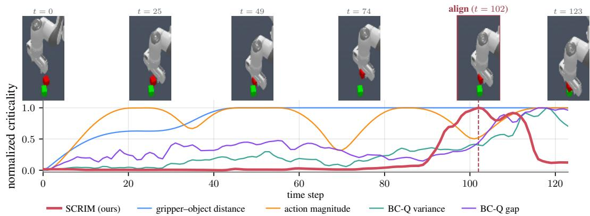  
Figure 6: Per-method criticality along StackCube (ManiSkill) task demonstration.All measures min–max normalized to a common scale.

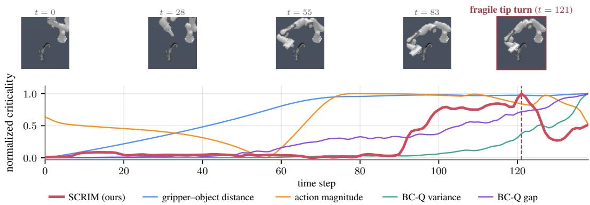  
Figure 7: Per-method criticality along TurnFaucet (ManiSkill) task demonstration.All measures min–max normalized to a common scale.

Policy Q-function variance We use the spread of the base BC policy’s Q function $Q ^ { \pi _ { b } }$ across actions as a measure of criticality, following Karino et al. [31]. Concretely, we sample M actions uniformly from the action space and score a state by the empirical variance $\operatorname { V a r } _ { a \sim \mathcal { U } ( A ) } \left[ Q ^ { \pi _ { b } } ( s , a ) \right]$ High variance indicates that $Q ^ { \pi _ { b } }$ varies strongly with the action choice and the state is sensitive to action errors, whereas low variance indicates the value is similar across many actions and the state is relatively forgiving.

Q-value discrepancy Huang et al. [13] propose the gap between the best achievable Q-value at a state and the expected value over all actions, $\operatorname* { m a x } _ { a } Q ^ { \pi _ { b } } ( s , a ) - \frac { 1 } { \left| A \right| } \sum _ { a } Q ^ { \pi _ { b } } ( s , a )$ , as a measure of criticality. A large discrepancy means that a random action yields a substantially worse long-term return than the optimal action, marking the state as highly critical, whereas a small discrepancy means that most actions yield comparable value.

For the last two baselines, $Q ^ { \pi _ { b } }$ is trained independently of SCRIM by fitted Q evaluation. The frozen base policy is rolled out in the environment with the sparse success reward, episodes ending on success, and $\gamma = 0 . 9 7$ . A twin-Q critic is regressed onto the targets $r + \gamma \operatorname* { m i n } _ { i } \bar { Q } _ { \bar { \phi } _ { i } } ( s ^ { \prime } , \pi _ { b } ( s ^ { \prime } ) )$ with Polyak-averaged target networks and no actor.

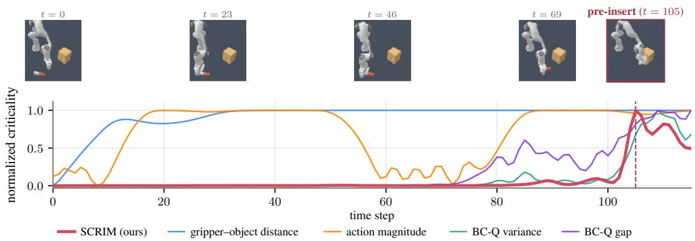  
Figure 8: Per-method criticality along PegInsertionSide (ManiSkill) task demonstration.All measures min–max normalized to a common scale.

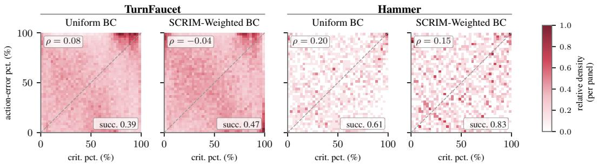  
Figure 9: Action error vs. state criticality. Histograms of BC action-error percentile against SCRIM- percentile on two tasks, each under Uniform BC and SCRIM-weighted BC.

## A.5 Hardware setup and adversary details

Base policy. Each task’s $\pi _ { 0 . 5 }$ base policy was finetuned for 30k training steps with an actionchunk horizon of $^ { 1 6 , }$ and is served at 15 Hz with replanning every 4 steps. The policy observes three 256×256 camera views (top, wrist, and side), an 8-dimensional proprioceptive vector, and the task language prompt, and acts in a 7-dimensional delta end-effector pose with gripper.

Adversary. Each policy query returns an action chunk together with the mean-pooled VLM prefix embedding, a 2048-dimensional summary of the images, proprioception, and prompt. This embedding is sent as the observation to the adversarial residual RL agent, trained with SAC [32] directly on the robot. The adversary acts on the 4-step executed chunk, so its action has dimension $2 8 = 7 \times 4$ Its tanh-squashed output is scaled by a task-specific residual envelope $\rho$ and added to the basepolicy chunk before clipping to the robot safety limits. The translation residual scale is 0.007 m for both tasks; the gripper scale is 0.4; the rotation scales are 0.015 rad on all axes for StackCube and (0.0275, 0.0131, 0.0216) rad for TapeHang. The critic networks use layer normalization, and the replay buffer is warm-started from the demonstration dataset.

Real-world SCRIM computation. For each demonstration chunk we replay the frozen $\pi _ { 0 . 5 }$ policy to obtain the base chunk $a _ { \mathrm { b a s e } }$ and encode the demonstrated expert chunk as $\delta _ { \mathrm { d e m o } } = \mathrm { c l i p } ( ( a _ { \mathrm { e x p e r t } } -$ $a _ { \mathrm { b a s e } } ) / \rho , - 1 , 1 \ r )$ . Let $\delta ^ { \star }$ denote the deterministic adversary output at the same state embedding. The hardware criticality score used in Fig. 1 and Fig. 5 is

$$
\Delta Q _ { \mathrm { d e m o } } = \bar { Q } \bigl ( s , a _ { \mathrm { b a s e } } + \rho \odot \bigl ( \delta _ { \mathrm { d e m o } } + \delta ^ { \star } \bigr ) \bigr ) - \bar { Q } \bigl ( s , a _ { \mathrm { b a s e } } + \rho \odot \delta _ { \mathrm { d e m o } } \bigr ) .\tag{9}
$$

This is the same failure-value increase as Eq. 6, evaluated around the demonstrated action in the chunked real-robot action space. For plotting, each chunk-level value is held constant over its corresponding control ticks.

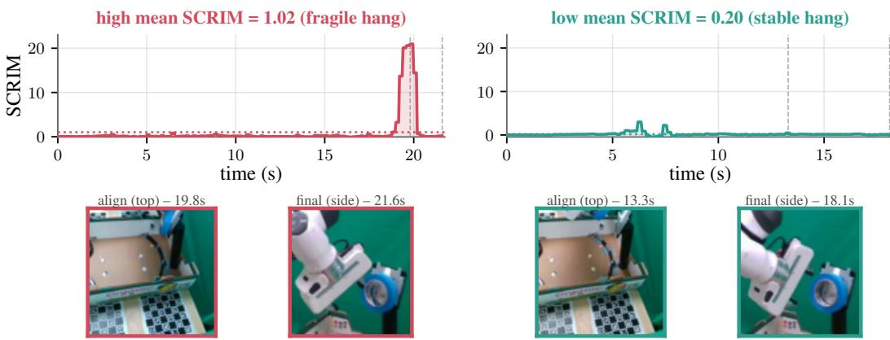  
Figure 10: SCRIM distinguishes a brittle (left) from a robust (right) tape-hang demonstration.

## A.6 Learning SCRIM without physical interaction via real2sim

The interaction SCRIM requires need not take place on the physical system. To test this, we reconstructed our hardware StackCube demonstrations in simulation via real2sim, trained a visionbased diffusion policy on the reconstructed data, and trained the SCRIM adversary and critic entirely in simulation against this policy. Despite the real2sim gap, the simulation-derived SCRIM scores correlate with the scores obtained from hardware interaction and recover the same critical phases, peaking around grasping and placement. Using these scores for SCRIM-weighted training improves the policy’s success rate in simulation from 40% to 66%. This suggests that SCRIM’s interaction can be shifted to a suitable surrogate environment, and that approximate criticality estimates obtained under model mismatch remain useful for downstream policy improvement. Whether this simulated policy improvement transfers back to the physical robot (sim2real) remains to be verified, and we leave this investigation to future work.

## A.7 Choosing the perturbation bound

The perturbation bound is shared across action coordinates $( \epsilon _ { j } = \epsilon \mathrm { i n } \mathrm { E q } . 3 )$ . We choose it by rolling out the frozen base policy with uniform random residuals $a \overset { \cdot } { = } \pi ( s ) + \epsilon u , u \sim \mathcal { U } [ - 1 , 1 ] ^ { d }$ , resampled at every step (50 episodes per ϵ; Table 7). If random residuals leave success unchanged, ϵ is too small for any disturbance to matter; if they already collapse success, every state appears critical and ∆Q stops discriminating between states. Table 8 reports SCRIM-weighted BC across ϵ at a fixed ESS% target.

Table 7: Random-residual calibration (StackCube). Success rate (%) of the frozen base policy under uniform random residuals of size ϵ.
<table><tr><td>€</td><td>0</td><td>0.001</td><td>0.003</td><td>0.005</td><td>0.01</td><td>0.02</td><td>0.05</td></tr><tr><td>Success (%)</td><td>72.0</td><td>64.0</td><td>42.0</td><td>24.0</td><td>14.0</td><td>0.0</td><td>0.0</td></tr></table>

As shown in Table 8, SCRIM is nevertheless robust over a broad range of bounds.

Table 8: Sensitivity to the perturbation bound. Success rate (%) of SCRIM-weighted BC for each ϵ at a fixed ESS% target.
<table><tr><td>0.003 €</td><td>0.005 0.01</td><td>0.02</td><td>0.05</td></tr><tr><td>StackCube (uniform BC 68.0) Success (%) 83.0</td><td>91.0 73.0</td><td>77.0</td><td>73.0</td></tr><tr><td>TurnFaucet (uniform BC 39.0)</td><td></td><td></td><td></td></tr><tr><td>Success (%)</td><td>42.0 47.0 37.0</td><td>42.0</td><td>42.0</td></tr></table>

## A.8 Causal validation of SCRIM

We test whether SCRIM predicts where action errors matter by perturbing the base policy at only a fraction k of steps. At every step, SCRIM is computed around the base action, $\bar { Q } ( s , \pi ( s ) + \delta _ { \pi } ( s ) ) -$ $\bar { Q } ( s , \pi ( s ) )$ ), and the disturbance is applied when the score exceeds its $( 1 - k )$ percentile over 25 clean rollouts. As a control, the same fraction of steps is selected at random. The disturbance is either the trained ϵ-bounded adversary $\delta _ { \pi } ( s )$ or uniform ϵ-noise $\boldsymbol { \mathcal { U } } [ - \epsilon , \epsilon ] ^ { d }$ (100 episodes per condition; Table 9).

Table 9: Score-gated disturbance. Drop in success rate (percentage points) relative to clean rollouts when the disturbance is applied at a fraction k of steps.
<table><tr><td></td><td>StackCube</td><td>TurnFaucet</td><td>PegInsertion</td><td>Hammer</td></tr><tr><td>Gated fraction k</td><td>5%</td><td>5%</td><td>30%</td><td>10%</td></tr><tr><td>Clean success (%)</td><td>69.0</td><td>29.0</td><td>13.0</td><td>66.0</td></tr><tr><td>Adversary at high-SCRIM states</td><td>13.0</td><td>13.0</td><td>13.0</td><td>20.0</td></tr><tr><td>Adversary at random states</td><td>6.0</td><td>4.0</td><td>6.0</td><td>1.0</td></tr><tr><td>Uniform €-noise at high-SCRIM states</td><td>1.0</td><td>0.0</td><td>0.0</td><td>3.0</td></tr></table>

Applied at high-SCRIM states, the adversary degrades success at least twice as much as at the same fraction of random states, while the uniform ϵ-noise at the same states barely changes success. SCRIM therefore captures vulnerability to specific failure-inducing directions, not generic sensitivity to random noise.

## A.9 Robustness to critic error

We corrupt every critic query inside the SCRIM score of Appendix A.8 with independent Gaussian noise $\mathcal N ( 0 , \sigma ^ { 2 } ) , \sigma = c \cdot \operatorname { s t d } ( Q )$ , where std(Q) is the standard deviation of $\bar { Q } ( s , \pi ( s ) )$ over clean rollouts. Gating thresholds are recomputed under the noise, so the gated fraction stays at k. The score SNR is $\mathrm { s t d } ( \Delta Q ) / ( \sqrt { 2 } \sigma )$ . We also gate and attack with the adversary and critic checkpoint saved halfway through training (Table 10).

Table 10: Degraded critics. Drop in success rate (percentage points) from the adversary at high SCRIM states, with the score SNR in parentheses, at the gated fractions of Table 9.
<table><tr><td></td><td>StackCube</td><td>TurnFaucet</td><td>PegInsertion</td><td>Hammer</td></tr><tr><td>Noise scale c = 0</td><td>13.0</td><td>13.0</td><td>13.0</td><td>20.0</td></tr><tr><td> $c = 0 . 0 0 3$ </td><td>16.0 (14.3)</td><td>12.0 (4.1)</td><td>13.0 (12.2)</td><td>20.0 (18.4)</td></tr><tr><td> $c = 0 . 0 1$ </td><td>14.0 (4.3)</td><td>9.0 (1.2)</td><td>8.0 (3.7)</td><td>19.0 (5.5)</td></tr><tr><td> $c = 1$ </td><td>3.0 (0.04)</td><td>-1.0 (0.01)</td><td>5.0 (0.04)</td><td>2.0 (0.06)</td></tr><tr><td>Halfway checkpoint</td><td>4.0</td><td>1.0</td><td>5.0</td><td>23.0</td></tr><tr><td>Random states (reference)</td><td>6.0</td><td>4.0</td><td>6.0</td><td>1.0</td></tr></table>

At c = 0.003 (SNR 4.1–18.4), the drops remain comparable to the noise-free values, and at $c = 0 . 0 1$ they remain 8–19 points. Once the noise approaches the local $\Delta Q$ scale (SNR ≤ 1), the effect becomes task-dependent, and at c = 1 the drops collapse to −1 to 5 points. SCRIM therefore tolerates moderate zero-mean query noise only while the local value gap remains resolvable. Undertraining has a task-dependent effect: on Hammer, the halfway checkpoint is as effective as the final one, whereas on the ManiSkill tasks its drops fall to at most 5 points, no more than random gating. We therefore do not claim general robustness to critic undertraining.