# Which Optimizer Leaks Most? Optimizer Implicit Bias as a Training-Data Privacy Controller

Sagi Habani∗ Ben-Gurion University sagihab@post.bgu.ac.il

Yehonathan Refael∗ Tel Aviv University refaelkalim@mail.tau.ac.il

Ofir Lindenbaum Bar Ilan University ofir.lindenbaum@biu.ac.il

## Abstract

Releasing a neural network checkpoint can leak information about its training data, and existing reconstruction results rely on gradient-descent training (Haim et al., 2022). We ask whether the choice of optimizer affects the ability to recover the training data. Extending work connecting Karush–Kuhn– Tucker conditions to training-data reconstruction, we show that the implicit biases of popular optimizers (SGD, Adam, Muon) leave very diferent fingerprints of the training data. We argue that the key distinction is the weight-specificity of these implicit biases, namely how much continuous information about the final weights the optimizerdependent target of the stationarity conditions encodes. The limiting stationarity conditions for models trained with SGD and Muon retain enough weight-specific information to reconstruct training examples in practice. For Adam in the $\ell _ { \infty }$ implicitbias regime, the optimizer-dependent part of these conditions encodes only a discrete pattern of maximal coordinates and their signs, and at nondegenerate KKT points the conditions are too few to identify the training set to first order. Experiments on MNIST and CIFAR-10 support these claims: models trained with Muon can yield stronger reconstructions at much lower training cost than models trained with SGD, although this advantage depends on the training regime and architecture, and models trained with Adam appear consistently more resistant to the evaluated attacks.

## 1 INTRODUCTION

Over-parameterized networks can perform well while memorizing training examples (Zhang et al., 2017), and good generalization may require memorizing atypical examples (Feldman, 2020), raising a privacy concern: how much memorized data can be recovered? Recently, Haim et al. (2022); Buzaglo et al. (2023) demonstrated the ability to reconstruct a large frac tion of the training images used to train a classifier, using only the parameters of the trained classifier (without query access or other data). They achieve this by optimizing the input to satisfy a stationarity condition that relates the weights of the neural network to the training data. Merely sharing a trained model (a checkpoint) may therefore leak its training data.

This attack exploits the implicit bias of gradient descent (GD): for a homogeneous network trained with an exponentially tailed loss, the parameter direction converges, under suitable conditions, to that of a KKT point of the maximum-margin problem minθ $\begin{array} { r } { \frac { 1 } { 2 } \| \pmb { \theta } \| _ { 2 } ^ { 2 } , } \end{array}$ s.t. $y _ { i } f ( \mathbf { x } _ { i } ; \pmb { \theta } ) \geq 1$ for all i (Lyu and Li, 2020; Ji and Telgarsky, 2020). Its stationarity condition expresses the weights as a nonnegative combination of the signed gradients $y _ { i } \nabla _ { \pmb { \theta } } f ( \mathbf { x } _ { i } ; \pmb { \theta } )$ , and Haim et al. (2022) invert it by solving for inputs $\mathbf { x } _ { i }$ with the weights fixed: the optimizer’s bias gives the attacker a system of equations relating the public weights to the training data.

Other optimizers induce other margin geometries: under suitable assumptions for smooth homogeneous models, Muon Jordan et al. (2024) maximizes a maxspectral-norm margin and Adam (Kingma and Ba, 2015), with a negligible stability constant, an $\ell _ { \infty }$ margin (Gronich and Vardi, 2026). Diferent optimizers therefore induce diferent stationarity equations; we analyze how these diferences afect data reconstruction and whether the choice of optimizer can reduce this risk.

We generalize the objective of Haim et al. (2022) to the margin geometry of the chosen optimizer (Section 3). A direct extension replaces its Euclidean stationarity term with a condition on the subdiferential of the mar gin norm. When applied naively, however, a formulation based on a single leading singular-vector pair may fail when the top singular value is repeated (a property encouraged by Muon) or when the relative block scales it fixes difer from those realized at a KKT point. It also breaks the rescaling symmetry of the KKT system, so it can be lowered by sending the multipliers to zero rather than by aligning the candidates with the data (Lemma A.7). To avoid this problem, we derive a scale-invariant penalty that enforces equality in the dual-norm inequality and use the layerwise Euler identity to show that no cross-block coupling term is needed.

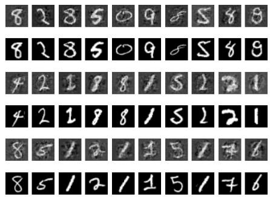  
(a) Muon

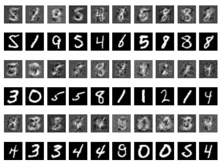  
(b) SGD

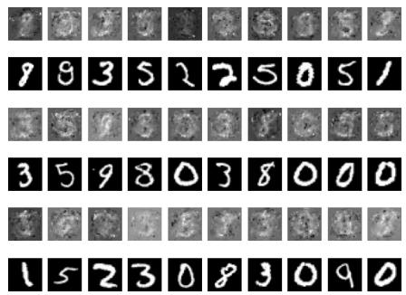  
(c) Adam

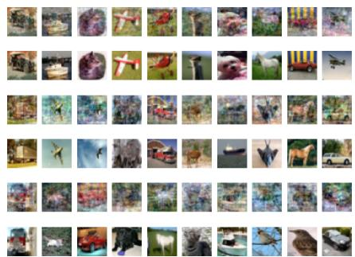  
(d) Muon

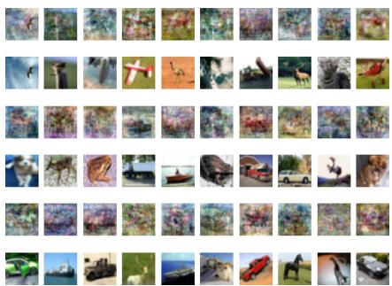  
(e) SGD

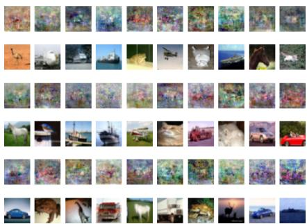  
(f) Adam  
Figure 1: Training-data reconstructions from networks trained with Muon, SGD and Adam, without an image prior $( n = 5 0 0 )$ . The top row is binary MNIST and the bottom row binary CIFAR-10. In each panel, odd rows show reconstructions and the row directly below shows their nearest training images under the one-toone matching of Section 5. Muon reconstructions are visually closest to their matches, SGD recovers coarser structure, and Adam reconstructions are largely unrecognizable.

Our analysis (Section 4) identifies two properties that help explain why the attack works. The first is weightspecificity – the number of independent continuous functionals of θ that the optimizer-dependent stationarity target determines. Equation counting at a generic weight vector does not distinguish the three geometries (there the target set has codimension $\Theta ( p )$ in all three, where p is the parameter count), but specificity does. At a KKT direction, where every block is active (Corollary A.2), and with simple top singular values $( \rho _ { k } ~ = ~ 1 )$ , S has the values $S _ { \ell _ { 2 } } ~ =$ p−1, $\begin{array} { r } { S _ { \mathrm { s p e c t r a l } } = \sum _ { k } ( m _ { k } + n _ { k } - 2 ) } \end{array}$ $S _ { \ell _ { \infty } } = 0$ , where block k has dimensions $m _ { k } \times n _ { k }$ , so each spectral block contributes a number of functionals proportional to its width. For the $\ell _ { \infty }$ margin, the optimizer-dependent target depends only on the locations and signs of the coordinates of θ with maximum absolute value, regardless of the multiplicity of the maximum. Moreover, at nondegenerate KKT points, the stationarity constraints impose at most as many equations as there are on-margin examples, far fewer than the unknowns, so the training set is not identifiable from them to first order.

The second property is reachability - the speed of convergence to the limiting parameter direction of the optimizer. Combining the two, we find the practical leakage ordering Muon ≻ SGD ≻ Adam in our main experiments, where ≻ denotes greater reconstruction leakage (Section 5). The Muon comparison depends on the training budget, sample size, and architecture (SGD becomes comparable to Muon at small sample sizes and matches or exceeds it in some architectures), while Adam remains the most resistant to the evaluated attacks; we do not, however, provide a formal

privacy guarantee.

Our contributions are: (i) a reconstruction attack that depends on the optimizer’s margin norm, recovers the objective of Haim et al. (2022) in the Euclidean case up to the multiplier scale, and corrects two failure modes of the naive extension (Section 3); (ii) a theory of weight-specificity under which Adam’s $\ell _ { \infty }$ target has zero specificity at every multiplicity of the maximum and its nondegenerate KKT points fail regu lar first-order identifiability (Section 4); (iii) an analysis combining specificity and reachability that explains the ordering Muon ≻ SGD ≻ Adam in our main experiments, with experiments showing that the Muon comparison depends on the training regime while Adam remains the most resistant to the evaluated attacks (Section 5).

## 2 RELATED WORK

Reconstruction among privacy attacks. Haim et al. (2022) reconstruct training samples from homogeneous classifiers by inverting the ℓ2-margin KKT conditions; follow-up work extends this to the multiclass setting, weight decay and general losses (Buzaglo et al., 2023), to transfer learning (Oz et al., 2024), and to membership inference (Golbari et al., 2025), and examines the specific reliance of reconstruction attacks on inductive image priors (Refael et al., 2026b). All use the $\ell _ { 2 }$ implicit bias of gradient descent; we extend the formulation to other margin geometries and study how the optimizer afects the attack.

Implicit bias, and the geometry of Adam and Muon. Adam has a GD-like implicit bias when its stability constant dominates (Wang et al., 2021) and an $\ell _ { \infty }$ margin bias when it is absent (Zhang et al., 2024); spectral descent and Muon have been analyzed in the multiclass linear setting (Fan et al., 2025). Under suitable assumptions, Gronich and Vardi (2026) extend these results to smooth homogeneous networks, relating idealized Muon to normalized momen tum steepest descent under the max-spectral norm and Adam to the global $\ell _ { \infty }$ margin, and leave open whether KKT-based reconstruction extends to these optimizers. We derive attacks for both geometries: reconstruction succeeds for Muon, while our analysis iden tifies a first-order identifiability limitation of Adam’s stationarity constraints, consistent with its greater resistance in our experiments.

## 2.1 Preliminaries: notation and threat model

Notation. We write $[ n ] ~ : = ~ \{ 1 , \ldots , n \} , ~ ( a ) _ { + } ~ : =$ max $\{ a , 0 \} , { \bf e } _ { j }$ for the $j \mathrm { - t h }$ standard basis vector, and

$S ^ { d - 1 }$ for the unit sphere in $\mathbb { R } ^ { d }$ . We denote the convex, afine, and conic hulls of a set X by conv $X ,$ , af $X ,$ and cone $X ,$ respectively. For a matrix A, $\sigma _ { 1 } ( A ) \geq$ $\sigma _ { 2 } ( A ) \geq \cdots$ are its singular values, $A \succeq 0$ means that A is positive semidefinite, and $\{ M \succeq 0 : \mathrm { t r } M = 1 \}$ is a spectrahedron. We write $S ^ { \circ } : = S \setminus \{ 0 \}$

Parameters, blocks and norms. The network has parameters $\pmb \theta = \left( W _ { 1 } , \ldots , W _ { K } \right)$ , where $W _ { k } \in \mathbb { R }$ mk×nk and each weight matrix is a block. We identify θ with the concatenated vector in $\mathbb { R } ^ { p }$ , where $\begin{array} { r } { p = \sum _ { k } m _ { k } n _ { k } } \end{array}$ We write $\theta _ { j }$ for its j-th coordinate and $\mathbf { u } _ { W _ { k } }$ for the k-th block of any $\mathbf { u } \in \mathbb { R } ^ { p }$ , and use the Euclidean inner product $\begin{array} { r } { \langle \mathbf { u } , \mathbf { v } \rangle = \sum _ { k } \mathrm { t r } \big ( \mathbf { u } _ { W _ { k } } ^ { \top } \mathbf { v } _ { W _ { k } } \big ) } \end{array}$ . For each block, we use the Frobenius, spectral, and nuclear norms $\| W \| _ { F } , \ \| W \| _ { \mathrm { s p } } = \sigma _ { 1 } ( W )$ , and $\begin{array} { r } { \| W \| _ { \mathrm { n u c } } = \sum _ { i } \sigma _ { i } ( W ) } \end{array}$ respectively. On the full parameter vector, we use $\begin{array} { r } { \| \pmb { \theta } \| _ { 1 } , \| \pmb { \theta } \| _ { 2 } = ( \sum _ { k } \| W _ { k } \| _ { F } ^ { 2 } ) ^ { 1 / 2 } , \| \pmb { \theta } \| _ { \infty } = \operatorname* { m a x } _ { j } | \theta _ { j } | , } \end{array}$ and the max-spectral norm $\| \pmb \theta \| _ { \mathrm { m s p } } = \operatorname* { m a x } _ { k } \| W _ { k } \| _ { \mathrm { s p } }$ of Gronich and Vardi (2026). An unadorned $\| \cdot \|$ denotes the margin norm of the optimizer under discussion $\left( \mathrm { E q . ~ ( P ) } \right)$ , and $\| \cdot \| _ { \star }$ denotes its dual norm, $\| \mathbf { u } \| _ { \star } = \operatorname* { s u p } \{ \langle \mathbf { u } , \mathbf { v } \rangle : \| \mathbf { v } \| \leq 1 \}$ . These norms satisfy $\langle \mathbf { u } , \mathbf { v } \rangle \leq \| \mathbf { u } \| _ { \star } \| \mathbf { v } \|$ , which we refer to as the generalized Cauchy–Schwarz inequality.

Alignment, gauge, strata. We write $\partial g ( \pmb \theta )$ for the subdiferential of a convex function g at θ. Where g is diferentiable, this is the singleton $\{ \nabla g ( \pmb \theta ) \}$ }. For a norm, $\partial \| \pmb \theta \| = \{ \mathbf { u } : \| \mathbf { u } \| _ { \star } \leq 1 , \mathbf { \nabla } \langle \mathbf { u } , \pmb \theta \rangle \overset { \cdot } { = } \| \pmb \theta \| \}$ . We say that u is dual-aligned with θ when equality holds in generalized Cauchy–Schwarz:

$$
\begin{array} { r l } { \langle \mathbf { u } , \pmb { \theta } \rangle = \| \mathbf { u } \| _ { \star } \| \pmb { \theta } \| , } & { } \\ { \mathrm { e q u i v a l e n t l y ~ } \mathbf { u } / \| \mathbf { u } \| _ { \star } \in \partial \| \pmb { \theta } \| } & { ( \mathbf { u } \neq \mathbf { 0 } ) . } \end{array}\tag{1}
$$

A gauge is a group of transformations of the unknowns that preserves the constraint system and maps solutions to solutions. Since the constraints cannot distinguish such solutions, we make our objective invariant along gauge directions.

Finally, we divide parameter space into strata on which the structural type of $\partial \lVert \pmb { \theta } \rVert$ is constant (Appendix F.1).

Blockwise homogeneity. Our structural results use homogeneity layer by layer.

Assumption 2.1 (Blockwise homogeneity). For each block k there is $\begin{array} { r l r l } { d _ { k } } & { { } > } & { 0 } \end{array}$ such that $\begin{array} { l l l } { f ( { \bf x } ; W _ { 1 } , \ldots , \alpha W _ { k } , \ldots , W _ { K } ) } & { = } & { \alpha ^ { d _ { k } } f ( { \bf x } ; \pmb { \theta } ) } \end{array}$ for all $\alpha > 0$ , and $f ( \mathbf { x } ; \cdot )$ is diferentiable at the points considered. Then f is L-homogeneous with $L = \sum _ { k } d _ { k }$

Optimizer implicit bias. Homogeneous networks trained with logistic or exponential loss converge in direction to a KKT point of a maximum-margin problem; this implicit bias is the key phenomenon underlying the attacks we study. For gradient flow, this follows from Theorem F.1 in Appendix F.3. Under the assumptions of Gronich and Vardi (2026), Adam and Muon converge to KKT directions of (P), with the optimizer-dependent margin norm given in (2).

$$
\operatorname* { m i n } _ { \pmb { \theta } } \ \frac { 1 } { 2 } \| \pmb { \theta } \| ^ { 2 } \ \mathrm { s . t . } \quad y _ { i } \Phi ( \mathbf { x } _ { i } ; \pmb { \theta } ) \geq 1 \forall i \in [ n ] .\tag{P}
$$

Since every count below depends on how that norm aggregates across blocks, we fix it explicitly:

$$
\begin{array} { r l } & { \| \pmb { \theta } \| _ { \mathrm { S G D } } = \Big ( \sum _ { k } \| W _ { k } \| _ { F } ^ { 2 } \Big ) ^ { 1 / 2 } , } \\ & { \| \pmb { \theta } \| _ { \mathrm { M u o n } } = \displaystyle \operatorname* { m a x } _ { k } \frac { \| W _ { k } \| _ { \mathrm { s p } } } { c _ { k } } , } \\ & { \| \pmb { \theta } \| _ { \mathrm { A d a m } } = \| \pmb { \theta } \| _ { \infty } . } \end{array}\tag{2}
$$

with duals $\begin{array} { r } { \ell _ { 2 } , \sum _ { k } c _ { k } \| \cdot \| _ { \mathrm { n u c } } } \end{array}$ and $\ell _ { 1 }$ . For $c _ { k } \equiv 1$ , the Muon form is ∥·∥msp used by Gronich and Vardi (2026) (their Corollary 3.3); general $c _ { k } > 0$ are the per-block weights induced by practical Muon’s per-block step sizes (their Theorem 3.6). All our statements for Muon hold for arbitrary $c _ { k } .$ , and the objective we construct does not depend on them. The Adam $\ell _ { \infty }$ norm is global over all $p$ coordinates rather than per tensor. This margin norm is the only property of the optimizer the attack uses, and the only axis along which our three optimizers difer in the analysis.

Threat model. Following Haim et al. (2022), the adversary observes the final parameters θ and the architecture and knows the optimizer family, hence $\| \cdot \| ;$ it observes neither the training inputs nor their labels or count n, nor any intermediate iterate. In particular θ is fixed and given: the attacker may not rescale it (Section 3). As is standard, the attacker posits m candidates (we use $m = 2 n$ following Haim et al. (2022), as an upper bound on n sufices) with fixed balanced labels and recovers a subset corresponding to true samples.

The gradient-descent attack (Haim et $\mathbf { a l . , }$ 2022). For $\ell _ { 2 } , \partial ( \frac { 1 } { 2 } \| \pmb { \theta } \| _ { 2 } ^ { 2 } ) = \{ \pmb { \theta } \}$ , so stationarity reads $\begin{array} { r } { \pmb { \theta } = \sum _ { i } \lambda _ { i } y _ { i } \nabla _ { \pmb { \theta } } \Phi ( \mathbf { { x } } _ { i } ; \pmb { \theta } ) } \end{array}$ with $\lambda _ { i } \geq 0 .$ , and complementary slackness forces $\lambda _ { i } = 0$ of the margin. With θ known and the inputs unknown, Haim et al. (2022) minimize over candidate inputs and multipliers

$$
\begin{array} { r } { L _ { \mathrm { r e c } } = \underbrace { \Big \| \pmb { \theta } - \sum _ { i } \lambda _ { i } y _ { i } \nabla _ { \pmb { \theta } } \Phi ( \mathbf { x } _ { i } ; \pmb { \theta } ) \Big \| _ { 2 } ^ { 2 } } _ { L _ { \mathrm { s t a t } } } } \\ { + a _ { 2 } \underbrace { \sum _ { i } ( - \lambda _ { i } ) _ { + } } _ { L _ { \lambda } } + a _ { 3 } L _ { \mathrm { p r i o r } } , } \end{array}\tag{3}
$$

where $L _ { \lambda }$ enforces $\lambda _ { i } \geq 0$ and $L _ { \mathrm { p r i o r } }$ is a weak input prior such as a pixel-range penalty. Only $L _ { \mathrm { s t a t } }$ depends on the optimizer, and only through $\begin{array} { r } { \partial \big ( \frac { 1 } { 2 } \| \pmb { \theta } \| ^ { 2 } \big ) } \end{array}$ . That is the starting point of the next section.

## 3 A NORM-PARAMETERIZED RECONSTRUCTION OBJECTIVE

We build the attack in three steps: the stationarity condition of (P) for a general margin norm (§3.1); removal of a non-informative degree of freedom, which yields an alignment condition and our loss (§3.2); and its instantiation for Muon (§3.3) and Adam (§3.4). Throughout, the trained θ is fixed, the unknowns are $z : = ( \{ \mathbf { x } _ { i } \} _ { i = 1 } ^ { m } , \{ \lambda _ { i } \} _ { i = 1 } ^ { m } )$ , and the residual is

$$
r ( z ) : = \sum _ { i = 1 } ^ { m } \lambda _ { i } y _ { i } \nabla _ { \theta } \Phi ( \mathbf { x } _ { i } ; \pmb { \theta } ) .\tag{4}
$$

## 3.1 Stationarity for a general norm

For (S)GD the margin norm is Euclidean, $\frac { 1 } { 2 } \lVert \pmb { \theta } \rVert _ { 2 } ^ { 2 }$ has gradient θ, and the stationarity term of (3) vanishes if $\mathrm { ~ \bf ~ r ~ } = \mathrm { ~ \bf \nabla \theta ~ }$ . For Muon and Adam, $\scriptstyle { \frac { 1 } { 2 } } \| \theta \| ^ { 2 }$ is not differentiable, so we replace the gradient with the subdiferential; by the chain rule $\begin{array} { r } { \mathbf { \mathcal { \partial } } \partial ( \frac { 1 } { 2 } \| \pmb { \theta } \| ^ { 2 } ) = \| \pmb { \theta } \| \partial \| \pmb { \theta } \| } \end{array}$ (Lemma B.1), and the stationarity condition for (P) is

$$
\begin{array} { r } { \mathbf { r } ( z ) \in \partial \big ( \frac { 1 } { 2 } \| \pmb { \theta } \| ^ { 2 } \big ) , \qquad \lambda _ { i } \geq 0 . } \end{array}\tag{5}
$$

To obtain a tractable loss, the following lemma characterizes this set-membership condition in terms of two scalar inequalities.

Lemma 3.1 (Membership rule). For $\theta \ \ne \ 0 , \ \textbf { r } \in$ $\begin{array} { r } { \partial \big ( \frac { 1 } { 2 } \| \pmb { \theta } \| ^ { 2 } \big ) } \end{array}$ if and only $\left. \lvert \mathbf { r } \right. _ { \star } \leq \left. \boldsymbol { \theta } \right.$ and $\langle \mathbf { r } , { \pmb \theta } \rangle \geq \| { \pmb \theta } \| ^ { 2 }$

Lemma 3.1 splits (5) into a magnitude and an alignment condition (generalizing (1)). Both $\| \mathbf { r } ( z ) \| .$ ⋆ and $\langle \mathbf { r } ( z ) , \theta \rangle$ are computable and almost everywhere diferentiable in z, and both inequalities hold with equality for feasible r (see the proof), so (5) can be enforced by penalizing $\left\| \mathbf { r } \right\| _ { \star } = \left\| \pmb \theta \right\|$ and $\langle \mathbf { r } , \pmb \theta \rangle = \| \pmb \theta \| ^ { 2 }$ . As we show next, all information about $\{ { \bf { x } } _ { i } \}$ lies in the alignment requirement.

## 3.2 Two scale freedoms, and why only one may be discarded

The magnitude bound of Lemma 3.1 constrains the multipliers but says nothing about the candidate inputs, because the multipliers are themselves free unknowns.

Lemma 3.2 (The multiplier scale is a gauge). The residual $\mathbf { r } ( \cdot )$ is positively homogeneous of degree one in $\lambda ,$ and the constraint $\lambda \geq 0$ is preserved by $\lambda \mapsto$ cλ for $c > 0$ . Hence for any z with $\mathbf { r } ( z ) \neq \mathbf { 0 }$ there is a unique $c > 0$ whose rescaled multipliers satisfy $\| \mathbf { r } \| _ { \star } = \| \pmb { \theta } \|$ exactly. The magnitude bound therefore restricts no $\{ { \bf { x } } _ { i } \}$ , and (5) is equivalent, modulo this one-dimensional gauge, to the cone membership

$$
\begin{array} { r l } & { \mathbf { r } ( z ) \in C ( \pmb { \theta } ) : = \mathrm { c o n e } \left( \partial ( \frac { 1 } { 2 } \| \pmb { \theta } \| ^ { 2 } ) \right) } \\ & { \qquad = \{ t \mathbf { k } : \mathbf { k } \in \partial ( \frac { 1 } { 2 } \| \pmb { \theta } \| ^ { 2 } ) , t \geq 0 \} . } \end{array}\tag{6}
$$

Thus the magnitude of r is a scale convention, not a property of the data: everything the stationarity condition says about the training set is carried by the direction of r, i.e. by the cone $C ( \pmb \theta )$ , the central object of Section 4. A reconstruction loss should therefore be invariant under $\lambda \mapsto c \lambda ;$ otherwise the attack can lower the loss merely by rescaling the multipliers (Lemma A.7). The second rescaling, $\theta \mapsto c \theta$ , must be treated diferently because the attacker cannot rescale the given θ (Lemma A.1, Appendix A).

A layerwise Euler identity. Blockwise homogeneity ties every residual block to one shared scalar, for any candidate and not only at solutions.

Lemma 3.3 (Layerwise Euler identity). Under Assumption 2.1, for every z and every block k,

$$
\langle \mathbf { r } _ { W _ { k } } ( z ) , W _ { k } \rangle = d _ { k } \Gamma ( z ) , \qquad \Gamma ( z ) : = \sum _ { i = 1 } ^ { m } \lambda _ { i } y _ { i } f ( \mathbf { x } _ { i } ; \pmb { \theta } ) .\tag{7}
$$

If moreover $\mathbf { r } ( z ) \in C ^ { \circ } ( \pmb { \theta } )$ , then $\Gamma ( z ) = \langle \mathbf { r } ( z ) , \pmb { \theta } \rangle / L >$ 0, hence $\mathbf { r } _ { W _ { k } } ( z ) \neq \mathbf { 0 }$ and $W _ { k } \neq { \bf 0 }$ for every k; for a solution of $( 5 ) , \Gamma ( z ) = \| \pmb { \theta } \| ^ { 2 } / L$

For the max-type norms of Muon and Adam, this identity implies that every block is active at a KKT direction (Corollary A.2, Appendix A).

From cone membership to a loss. Membership in $C ( \pmb \theta )$ is equivalent to tightness in the generalized Cauchy–Schwarz inequality (1), so we penalize the relative Cauchy–Schwarz gap block by block, with block norms $\| \cdot \| _ { ( k ) }$ and their duals,

$$
L _ { \mathrm { a l i g n } } = \sum _ { k = 1 } ^ { K } { \Big ( } 1 - { \frac { \langle \mathbf { r } _ { W _ { k } } , W _ { k } \rangle } { \| \mathbf { r } _ { W _ { k } } \| _ { ( k ) , \star } \| W _ { k } \| _ { ( k ) } } } { \Big ) } ^ { 2 } ,\tag{8}
$$

Each term lies in [0, 4] and vanishes if $\mathbf { r } _ { W _ { k } }$ is dualaligned with $W _ { k }$ , i.e. $\mathbf { r } _ { W _ { k } } \in \mathsf { \Gamma } C _ { k } ( \pmb { \theta } ) \setminus \{ \mathbf { 0 } \}$ , where $C _ { k } ( \pmb { \theta } ) : = \mathrm { c o n e } \partial \| W _ { k } \| _ { ( k ) }$ . The numerator and denominator are positively homogeneous of degree one in each argument, so the loss is invariant under the gauge of Lemma 3.2 and requires no choice of singular vectors. By Lemma 3.3, $\mathbf { r } _ { W _ { k } } \neq \mathbf { 0 }$ in every block for any conefeasible $z ,$ so this restriction discards no valid solution (for numerical stability we add a small ϵ to the denom inator). Plugging in the appropriate $\| \cdot \| _ { ( k ) }$ covers all three attacks with one formulation.

Proposition 3.4 (Per-block alignment is exact). Let Assumption 2.1 hold, let $\| \cdot \|$ be one of the norms in (2) (Muon with arbitrary $c _ { k } > 0 )$ , and let (5) have a solution at θ. Then

$$
\begin{array} { c } { { \{ z : ~ \mathbf { r } ( z ) \in C ^ { \circ } ( \pmb { \theta } ) \} = \{ z : ~ \mathbf { r } _ { W _ { k } } ( z ) \in C _ { k } ( \pmb { \theta } ) \setminus \{ \mathbf { 0 } \} } } \\ { { = \{ z : ~ L _ { \mathrm { a l i g n } } ( z ) = 0 \} . } } \end{array}\tag{∀k}}
$$

In particular, the zero set of $L _ { \mathrm { a l i g n } }$ does not depend on the Muon weights $c _ { k }$

Hence no cross-block coupling term is needed (Remark A.3, Appendix A).

To mount the attack we set $L _ { \mathrm { s t a t } } : = L _ { \mathrm { a l i g n } }$ in (3), keeping $L _ { \lambda }$ and $L _ { \mathrm { p r i o r } }$ unchanged. For $\ell _ { 2 } .$ , Proposition 3.4 gives $L _ { \mathrm { s t a t } } = 0 { \mathrm { ~ i f f ~ } } \mathbf { r } = c \theta$ for a shared $c > 0$ , so up to the gauge of Lemma 3.2 the Euclidean case recovers the objective of Haim et al. (2022).

## 3.3 The Muon (spectral) objective

Muon performs steepest descent under the spectral norm: for each block $W , \| \cdot \| = \| \cdot \| _ { \mathrm { s p } } = \sigma _ { 1 } ( \cdot )$ , with dual $\| \cdot \| _ { \mathrm { n u c } }$ . Its subdiferential is a spectrahedron rather than a point: if the top singular value has multiplicity $\rho ,$ with left and right singular subspaces spanned by the columns of $U _ { 1 } \in \mathbb { R } ^ { m \times \rho }$ and $V _ { 1 } \in \mathbb { R } ^ { n \times \rho }$ , then

$$
\partial \| \boldsymbol { W } \| _ { \mathrm { s p } } = \{ U _ { 1 } M V _ { 1 } ^ { \top } : ~ M \succeq 0 , ~ \mathrm { t r } M = 1 \} ,\tag{9}
$$

which reduces to the rank-one $\mathbf { p q } ^ { \top }$ only when $\rho = 1$ A natural first instinct is to keep the template of (3) with a spectral target, minimizing the “single-target” loss $\| \mathbf { k } ^ { \star } - \mathbf { r } _ { W } \| _ { 2 } ^ { 2 }$ for $\mathbf { k ^ { \star } } = \nabla \bigl ( { \textstyle \frac { 1 } { 2 } } \| W \| _ { \mathrm { s p } } ^ { 2 } \bigr ) = \sigma _ { 1 } \mathbf { p q } ^ { \top }$ This breaks down for two reasons: within a block, a repeated top singular value makes the target basisdependent, and across blocks, the relative block scales it fixes need not match those realized at a KKT point (Lemma A.7, Appendix A.8). The Muon instance of (8), in which $c _ { k }$ cancels, reads

$$
L _ { \mathrm { a l i g n } } ^ { \mathrm { M u o n } } = \sum _ { k } { \left( 1 - \frac { \left. \mathbf { r } _ { W _ { k } } , W _ { k } \right. } { \left\| \mathbf { r } _ { W _ { k } } \right\| _ { \mathrm { n u c } } \left\| W _ { k } \right\| _ { \mathrm { s p } } } \right) } ^ { 2 } .\tag{10}
$$

Since every block attains the maximum at a KKT direction (Corollary A.2), the extra tightness condition of the max-type norm is vacuous (Lemma B.3) and (10) is exact for arbitrary per-block weights (Proposition 3.4): no balancing assumption is needed, and every layer carries information.

## 3.4 The Adam $( \ell _ { \infty } )$ objective

Adam with a negligible stability constant maximizes the global $\ell _ { \infty }$ margin, so $\| \pmb \theta \| = \| \pmb \theta \| _ { \infty }$ with dual $\| \cdot \| _ { 1 }$

With A = arg max $| \theta _ { j } |$ and $s = | A |$ , H¨older tightness holds if $\mathbf { r } _ { j } = 0$ for $j \not \in A$ and $\mathbf { r } _ { j } \theta _ { j } \geq 0$ for $j \in A$ with $\mathbf { r } \neq 0 :$ the candidate gradient combination must be supported on the largest-magnitude weights with matching signs, and nothing else is asked of it. We use the single global term

$$
( 1 - \langle \mathbf { r } , \pmb { \theta } \rangle / ( \| \mathbf { r } \| _ { 1 } \| \pmb { \theta } \| _ { \infty } ) ) ^ { 2 }\tag{11}
$$

(a per-tensor variant is discussed in Appendix A.11). Why this target is substantially less weight-specific is the subject of the next section.

## 4 HOW MUCH DO THE OPTIMIZERS LEAK? A SPECIFICITY ANALYSIS

The attack seeks z whose residual lies in $C ^ { \circ } ( \pmb \theta )$ , and succeeds to the extent that this forces the candidates to be the training set. Counting the scalar equations that $\mathbf { r } \in C ( \pmb \theta )$ imposes at a generic θ gives $\Theta ( p )$ for all three geometries and cannot explain the ordering (Appendix A.4); we instead ask how much of θ the optimizer-dependent target $C ( \pmb \theta )$ encodes.

## 4.1 Weight-specificity and target-cone variability

Counting tells us how many equations there are, not how much they say about the weights. The constraint references the weights through the residual map $z \mapsto$ $\mathbf { r } ( z ; \pmb { \theta } )$ , fixed by the architecture and θ, and through the target $C ( \pmb \theta )$ , the only place where the optimizer enters.

Definition 4.1 (Weight-specificity). For a margin norm ∥ · ∥ and a stratum $\Sigma ,$ the weight-specificity $S _ { \Sigma } ( \mathbb { | \cdot | } )$ is the dimension of the image $o f { \pmb \theta } \mapsto C ( { \pmb \theta } )$ restricted to the points of Σ at which all blocks are active, $i . e .$ . the number of independent continuous functionals of θ that the stationarity target determines.

Specificity is a property of the geometry and the stratum, not of a dataset: it counts the continuous degrees of freedom through which the target cone varies with the weights, and is not by itself an informationtheoretic bound on input identifiability.

Lemma 4.2 (Specificity of the three geometries). On the stratum with multiplicities $\rho _ { k }$ and arg-max set A, at points where all blocks are active,

$$
S = \left\{ \begin{array} { l l } { p - 1 , } & { \ell _ { 2 } , } \\ { \sum _ { k } S _ { k } ( \rho _ { k } ) , } & { s p e c t r a l , } \\ { 0 , } & { \ell _ { \infty } , } \end{array} \right.\tag{12}
$$

since $C$ is the ray through θ, determined by $\theta / \lVert \pmb { \theta } \rVert _ { 2 }$ $( \ell _ { 2 } ) ; \ C _ { k } \ = \ \{ U _ { 1 , k } M V _ { 1 , k } ^ { \top } \ : \ M \ \succeq \ 0 \}$ , determined by

$U _ { 1 , k } V _ { 1 , k } ^ { \top }$ (spectral); and $C ~ = ~ \{ \mathbf { r } ~ : ~ \mathbf { r } _ { j } ~ = ~ 0 ~ f o r ~ j ~ \notin$ $A , \bar { \bf r } _ { j } \ddot { \theta _ { j } } \ge 0 f o r j \in A \} ( \ell _ { \infty } )$ Here $S _ { k } ( \rho ) : =$ $\rho ( m _ { k } + n _ { k } - \rho ) \ : - \ : \rho ( \rho + 1 ) / 2$ is the dimension of the manifold of rank-ρ partial isometries in $\mathbb { R } ^ { m _ { k } \times n _ { k } } ;$ $S _ { k } ( 1 ) = m _ { k } + n _ { k } - 2$ . In the $\ell _ { \infty }$ case C depends on $\pmb \theta \neq \mathbf 0$ only through the discrete data (A, sign $\theta | _ { A } )$ , for every multiplicity $s = | A |$

## 4.2 Consequences, and why Adam resists

For SGD the cone is the ray through θ, so the constraint encodes the full direction $\theta / | | \theta | | _ { 2 } ;$ the candidate gradients must reproduce the entire weight vector up to one scalar. This is the maximally specific geometry, and the regime in which Haim et al. (2022) reconstruct. For Muon, $C _ { k }$ encodes the top singular structure $U _ { 1 , k } V _ { 1 , k } ^ { \top }$ of every block (all are active at a KKT direction), i.e. $S _ { k } ( \rho _ { k } )$ numbers per layer, at least $\Theta ( m _ { k } + n _ { k } )$ (Appendix A.9). That is far less than $\ell _ { 2 }$ , but the constraint stays tight: by Lemma A.4 many of each block’s equations survive at any multiplicity in ordinary matrix-block regimes, and it is attached to a weight-specific template that grows with width, so Muon both constrains candidates sharply and carries a genuine data fingerprint. For Adam, with $A = \arg \operatorname* { m a x } _ { l } | \theta _ { l } |$

$$
\begin{array} { r } { \partial \big ( \frac 1 2 \| \pmb \theta \| _ { \infty } ^ { 2 } \big ) = \| \pmb \theta \| _ { \infty } \ \mathrm { c o n v } \{ \mathrm { s i g n } ( \theta _ { j } ) \mathbf { e } _ { j } : \ j \in A \} , } \end{array}\tag{13}
$$

an (s−1)-simplex whose interior directions are unconstrained: the condition pins the support and admissible signs of r but never the relative magnitudes of θ. Hence $S = 0$ (cf. Remark A.8).

For networks the residual map carries θ-dependence of its own, but the polyhedral geometry has a second consequence that does extend: minimizing $\| \pmb \theta \| _ { \infty }$ under margin constraints drives θ onto a large face of the $\ell _ { \infty }$ ball, where the constraint has few normal equations. Under a first-order nondegeneracy condition (Assumption A.9), Theorem A.10 (Appendix A.10) shows that codim $C ( { \pmb \theta } ) \ = \ p - \ s \ \le \ n _ { I }$ , where $n _ { I }$ is the number of on-margin examples. Adam’s stationarity system thus has at most nI normal equations for $n _ { I } ( d + 1 )$ unknowns and, when $n _ { I } d \ge 2$ , fails regular first-order identifiability; under additional constantrank and relative-interior conditions, the stationarity consistent perturbations of the on-margin candidates form a $C ^ { 1 }$ manifold of dimension at least $n _ { I } d .$ The result concerns the idealized $\ell _ { \infty }$ bias (Adam with a negligible stability constant) and this stationarity-only attack family only, so it is not a diferential-privacystyle guarantee (Abadi et al., 2016).

## 4.3 Two axes, and the vulnerability ordering

Specificity concerns a converged model, but the attack inverts a condition that holds only in the limit, so a second axis matters: reachability, how quickly an optimizer’s parameter direction approaches the KKT direction of its own margin problem. Muon is high on both axes: its specificity is at least Θ(width) in every Muon-trained layer, and per-block orthogonalization escapes the small-initialization stall that traps gradient descent. SGD has the highest specificity, $p - 1$ , but the slowest reachability (Haim et al., 2022 train ${ \sim } 1 0 ^ { 6 }$ iterations): vulnerable in principle, expensive in practice. Adam has fast reachability but zero continuous target specificity and, at nondegenerate KKT points, too few equations for regular first-order identification (Theorem A.10). Folding in cost, the practical ordering is

$$
\bf \nabla \bf { M u o n } \succ \bf { S G D } \succ \bf { A d a m } .
$$

The Muon order is a prediction from reachability, not a theorem: that $\mathrm { g a p }$ is about training cost and should narrow wherever SGD has budget to converge, while the Adam gap reflects weaker continuous target dependence and regular underdetermination (summary in Table 3, Appendix B).

## 5 EXPERIMENTS

We evaluate the attack of Section 3 on networks trained with SGD, Adam, and Muon and test the predictions of Section 4. Implementation details are in Appendix D and full results in Appendix E.

Setup. Unless stated otherwise, we use $n = 5 0 0 ~ \mathrm { e x } -$ amples from binary MNIST LeCun et al. (2010) parity, binary CIFAR-10 Krizhevsky et al. (2009) vehicles versus animals, and 10-class CIFAR-10. Models are fully connected ReLU networks $d - 1 0 0 0 - 1 0 0 0 - C \ ( C = 1 $ binary, $C = 1 0$ multiclass), with only a first-layer bias, absorbed into $W _ { 1 }$ , so Assumption 2.1 holds. SGD and Adam update all layers; Muon applies five-step Newton–Schulz Muon (Jordan et al., 2024) to hiddento-hidden matrices and SGD to the input and output layers. We use the binary SGD models of Haim et al. (2022). Models trained by Adam and Muon reach training loss $O ( 1 0 ^ { - 7 } )$ within $1 0 ^ { 4 }$ iterations, whereas to reach the same order of training loss, SGD requires $1 0 ^ { 6 }$ iterations (Table 4, Appendix D).

Attack and evaluation. The attack uses the $\mathrm { E u - }$ clidean loss (3) for SGD, and the global $\ell _ { \infty }$ alignment loss (§3.4) for Adam, and a smooth relaxation of (10) for Muon. It optimizes $m = 2 n$ candidates with fixed balanced labels and their multipliers; the multiclass extension is described in Appendix D. Unless stated otherwise, no image prior is used. Reconstructions are matched one-to-one to training images by the Hungarian algorithm on centered, normalized $\ell _ { 2 }$ distance (more details in Appendix D). We evaluate SSIM@30 as our primary leakage metric. All-pairs averages can favor Adam because its candidates are generic images; @30 measures whether individual samples are recovered. We report SSIM, PSNR, and $\ell _ { 1 }$ and $\ell _ { 2 }$ distances over all pairs and the best 30 pairs (@30); $\mathrm { S S I M } > 0 . 4$ is considered visually recognizable.

## 5.1 Main Results

Muon-trained models are the most vulnerable. Muon leads to the best reconstructions on every metric and task as visually illustrated for the binary classification setup in Figure 1. Its SSIM@30 is 0.431 on MNIST, 0.551 on binary CIFAR-10 and 0.534 on 10- class CIFAR-10, against 0.346, 0.229 and 0.383 for SGD (the 10-class $\mathrm { g a p }$ is discussed in Appendix E). The gap is largest on binary CIFAR-10, where Muon more than doubles the SGD score. Since no prior is used, these reconstructions come from the stationarity condition alone, consistent with the fact that the spectral objective (10) inverts the Muon condition and that the per-layer spectral template of Lemma 4.2 is exploitable, with two orders of magnitude fewer training iterations than SGD. This is confirmed by the sorted SSIM curves without priors across both CIFAR-10 and MNIST (Figure 6).

Adam-trained models are the most resistant. Adam has the lowest SSIM@30 on every task without a prior, at most 0.249, well below the 0.4 recognizability level, consistent with the analysis of §4.2 : Adam’s $\ell _ { \infty }$ target carries no continuous information about the weight magnitudes, leaving the stationarity system too weakly constrained to identify individual samples.

Ablation Studies: The efect of image priors. We add five regularizers to the attack objective: a range prior penalizing pixel values outside [0, 1], total variation (TV), an $\ell _ { 1 }$ penalty favoring low-energy backgrounds, $\mathrm { T V } { + } \ell _ { 1 } .$ and all three combined. As the only optimizer-independent component of the objective, the prior’s marginal efect measures how much of a reconstruction does not come from the weights (Table $1 ;$ full results in Tables 5-7), consistent with recent findings on how priors can dominate checkpoint reconstruction fidelity Refael et al. (2026b). Qualitative comparisons showing reconstructions with and without priors are provided in Figure 3 for MNIST and Figure 5 for CIFAR-10.

Priors do not change the leading optimizer: Muon is best under every prior (SSIM@30 between 0.431 and

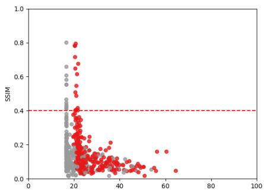  
(a) Muon, binary

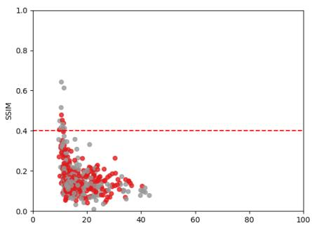  
(b) SGD, binary

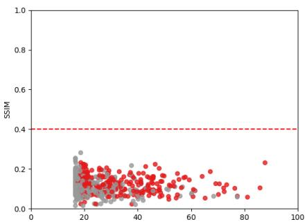  
(c) Adam, binary  
Figure 2: Per-sample SSIM versus training margin $\gamma _ { i }$ on CIFAR-10 (n = 500, range prior), for binary models. Each point is a training sample, colored by class; the dashed line marks SSIM = 0.4. Recognizable reconstructions occur near the minimal margin of their class. Muon produces most of them, and Adam essentially none.

Table 1: SSIM@30 (↑) under diferent image priors $( n = 5 0 0 )$ Best per task and prior in bold, second best underlined. Muon is best in all 18 settings, and in all 144 entries of the full tables (Appendix E).
<table><tr><td rowspan="2">Prior</td><td colspan="3">MNIST (binary)</td><td colspan="3">CIFAR-10 (binary)</td><td colspan="3">CIFAR-10 (10-class)</td></tr><tr><td>SGD</td><td>Adam</td><td>Muon</td><td>SGD</td><td>Adam</td><td>Muon</td><td>SGD</td><td>Adam</td><td>Muon</td></tr><tr><td>None</td><td>0.3463</td><td>0.2487</td><td>0.4310</td><td>0.2287</td><td>0.1379</td><td>0.5508</td><td>0.3827</td><td>0.2066</td><td>0.5339</td></tr><tr><td>Range</td><td>0.4057</td><td>0.2994</td><td>0.6371</td><td>0.2336</td><td>0.1367</td><td>0.6130</td><td>0.4515</td><td>0.1771</td><td>0.5315</td></tr><tr><td>TV</td><td>0.3768</td><td>0.2882</td><td>0.5808</td><td>0.2574</td><td>0.2115</td><td>0.6132</td><td>0.4332</td><td>0.3442</td><td>0.5481</td></tr><tr><td>l1</td><td>0.3614</td><td>0.1752</td><td>0.5302</td><td>0.2375</td><td>0.2112</td><td>0.5598</td><td>0.4141</td><td>0.2739</td><td>0.5371</td></tr><tr><td>TV+l1</td><td>0.3977</td><td>0.2311</td><td>0.6211</td><td>0.2440</td><td>0.2369</td><td>0.6286</td><td>0.4343</td><td>0.3050</td><td>0.5890</td></tr><tr><td>All</td><td>0.4511</td><td>0.2655</td><td>0.6599</td><td>0.2536</td><td>0.2377</td><td>0.6189</td><td>0.4343</td><td>0.2603</td><td>0.5795</td></tr></table>

0.660), while Adam never exceeds 0.344. On MNIST, combining all priors raises SSIM@30 by 0.229 for Muon and 0.105 for SGD but only 0.017 for Adam: priors sharpen reconstructions when the stationarity condi tion already constrains them. On binary CIFAR-10, smoothness priors help Adam most (from 0.138 to 0.238 with all priors). We attribute this to smoothness priors making generic natural-image candidates more similar to the training set, rather than to identification of specific samples, and to SGD not having reached its limiting direction on this task (Table 4).

Efect of sample size and architecture. To remove the training-budget asymmetry, we retrain all models on binary CIFAR-10 to a training loss below $1 0 ^ { - 8 }$ , varying $n \in \{ 5 0 , 1 0 0 , 5 0 0 , 1 0 0 0 \}$ or the hidden widths, and attack them with the range prior (Table 2).

Across sample sizes, Muon is best on every metric and Adam has the lowest SSIM@30. Once SGD is trained to convergence, however, it becomes competitive at small n: at $n ~ = ~ 1 0 0$ its SSIM@30 is 0.623 against 0.698 for Muon, compared with 0.234 against 0.613 at $n = 5 0 0$ . The Muon gap is therefore partly a gap in training cost, as predicted by the reachability argument of §4.3.

Adam is worst on every metric for every architecture, with SSIM@30 below half that of the better optimizer. The Adam separation is thus robust and the Muon comparison regime-dependent, as the theory suggests: Adam’s weakness follows from the structure of the $\ell _ { \infty }$ target cone, whereas the comparison between the $\ell _ { 2 }$ and spectral geometries depends on the residual map and the training budget.

Table 2: Efect of sample size (top, 1000−1000 hidden units) and architecture (bottom, $n = 5 0 0 )$ on binary CIFAR-10. All models are trained to a training loss below $1 0 ^ { - 8 } $ ; the attack uses the range prior. Best per configuration in bold.
<table><tr><td>Configuration</td><td>Optimizer</td><td>SSIM↑</td><td>SSIM@30↑</td><td>PSNR↑</td><td>PSNR@30↑</td><td>l1 ↓</td><td>l1@30↓</td><td>l2 ↓</td><td>l2@30↓</td></tr><tr><td rowspan="3">n = 50</td><td>SGD</td><td>0.3024</td><td>0.4486</td><td>13.188</td><td>15.066</td><td>0.1586</td><td>0.1250</td><td>0.2191</td><td>0.1765</td></tr><tr><td>Adam</td><td>0.1452</td><td>0.1809</td><td>11.733</td><td>12.663</td><td>0.1989</td><td>0.1808</td><td>0.2590</td><td>0.2327</td></tr><tr><td>Muon</td><td>0.4070</td><td>0.5848</td><td>14.409</td><td>17.390</td><td>0.1353</td><td>0.0954</td><td>0.1904</td><td>0.1351</td></tr><tr><td rowspan="3">n = 100</td><td>SGD</td><td>0.2949</td><td>0.6232</td><td>13.499</td><td>18.765</td><td>0.1554</td><td>0.0828</td><td>0.2114</td><td>0.1153</td></tr><tr><td>Adam</td><td>0.0976</td><td>0.1488</td><td>11.214</td><td>12.570</td><td>0.2087</td><td>0.1775</td><td>0.2750</td><td>0.2352</td></tr><tr><td>Muon</td><td>0.3501</td><td>0.6984</td><td>14.257</td><td>21.465</td><td>0.1404</td><td>0.0639</td><td>0.1937</td><td>0.0845</td></tr><tr><td rowspan="3">n = 500</td><td>SGD</td><td>0.0994</td><td>0.2336</td><td>11.665</td><td>13.435</td><td>0.2027</td><td>0.1634</td><td>0.2611</td><td>0.2129</td></tr><tr><td>Adam</td><td>0.1299</td><td>0.1367</td><td>12.334</td><td>13.441</td><td>0.1863</td><td>0.1624</td><td>0.2417</td><td>0.2128</td></tr><tr><td>Muon</td><td>0.1921</td><td>0.613</td><td>12.8084</td><td>19.1901</td><td>0.175</td><td>0.0825</td><td>0.2289</td><td>0.1098</td></tr><tr><td rowspan="3">n = 1000</td><td>SGD</td><td>0.0942</td><td>0.3001</td><td>11.537</td><td>14.168</td><td>0.2059</td><td>0.1476</td><td>0.2650</td><td>0.1957</td></tr><tr><td>Adam</td><td>0.0783</td><td>0.1202</td><td>11.150</td><td>11.956</td><td>0.2149</td><td>0.1968</td><td>0.2770</td><td>0.2525</td></tr><tr><td>Muon</td><td>0.1442</td><td>0.4186</td><td>12.203</td><td>15.559</td><td>0.1895</td><td>0.1252</td><td>0.2454</td><td>0.1667</td></tr><tr><td rowspan="3">100-100</td><td>SGD</td><td>0.1132</td><td>0.1754</td><td>11.878</td><td>13.373</td><td>0.1975</td><td>0.1634</td><td>0.2547</td><td>0.2145</td></tr><tr><td>Adam</td><td>0.0569</td><td>0.0836</td><td>10.795</td><td>12.129</td><td>0.2242</td><td>0.1912</td><td>0.2886</td><td>0.2475</td></tr><tr><td>Muon</td><td>0.1195</td><td>0.1826</td><td>11.921</td><td>14.001</td><td>0.1957</td><td>0.1598</td><td>0.2535</td><td>0.2039</td></tr><tr><td rowspan="3">1000-500-100</td><td>SGD</td><td>0.1654</td><td>0.4170</td><td>12.577</td><td>15.990</td><td>0.1808</td><td>0.1197</td><td>0.2351</td><td>0.1587</td></tr><tr><td>Adam</td><td>0.0927</td><td>0.1226</td><td>11.489</td><td>12.318</td><td>0.2065</td><td>0.1836</td><td>0.2664</td><td>0.2422</td></tr><tr><td>Muon</td><td>0.1689</td><td>0.4234</td><td>12.832</td><td>16.182</td><td>0.1719</td><td>0.1170</td><td>0.2263</td><td>0.1552</td></tr><tr><td rowspan="3">1000-500-100-50</td><td>SGD</td><td>0.1617</td><td>0.3944</td><td>12.594</td><td>15.882</td><td>0.1804</td><td>0.1196</td><td>0.2346</td><td>0.1607</td></tr><tr><td>Adam</td><td>0.1181</td><td>0.1546</td><td>11.944</td><td>12.736</td><td>0.1950</td><td>0.1741</td><td>0.2528</td><td>0.2308</td></tr><tr><td>Muon</td><td>0.1896</td><td>0.4236</td><td>13.5685</td><td>17.962</td><td>0.1622</td><td>0.1085</td><td>0.2192</td><td>0.1396</td></tr></table>

Which Samples Are Reconstructed? By complementary slackness, only samples on the margin carry positive multipliers and enter the stationarity condition. Figure 2 tests this by plotting, for each training sample, the SSIM of its matched reconstruction against its margin $\gamma _ { i }$ . In both the binary and multiclass settings $( { \mathrm { F i g u r e } } 4 )$ , recognizable reconstructions occur, for every optimizer, only for samples at or near the minimal margin, and samples well inside the margin are never recovered. Muon produces by far the most samples above the threshold, many concentrated at the minimal margin (a narrow vertical band); SGD produces a handful and Adam essentially none. Being on the margin is necessary for recovery under every geometry, but it is suficient only when the stationarity condition carries weight-specific information, which the $\ell _ { \infty }$ condition does not.

## 6 DISCUSSION

Our results identify optimizer implicit bias as an overlooked axis of training-data privacy. Even with identical architectures, data, and interpolation behavior, optimizers leave distinct geometric fingerprints: Muon’s spectral bias tightly constrains candidate inputs and yields the strongest reconstructions, SGD leaks less, and Adam is most resistant. This theoretically predicted ordering—driven by the specificity and reachability of stationarity constraints—shows that optimizer choice can serve as a practical privacy control, not merely an optimization decision. Although our checkpoint-only, stationarity-based analysis provides no formal privacy guarantee, it demonstrates that eval uating model privacy independently of the training algorithm can overlook a consequential source of leakage.

Finally, while our study focuses on standard implementations of SGD, Adam, and Muon, modern training pipelines increasingly adopt memory-eficient, lowrank, and orthogonalized optimizers. Extending geometric implicit-bias analyses to methods such as AdaRankGrad Refael et al. (2025b), SUMO Refael et al. (2025a), Refael et al. (2026a), and Svirsky et al. (2026) presents a promising direction to understand how adaptive rank reduction and subspace orthogonalization govern training-data leakage.

## AI use statement

In this work, we used generative AI tools for text polishing and obtaining suggestions on document organization and section structure. We have not used generative AI tools for research idea generation, code development, mathematical derivations, or experimental data generation/analysis, and all other disclosure categories are not applicable to this work. We have reviewed all AI-assisted work. Specifically, all AIsuggested structural edits and polished text were thoroughly examined, manually refined, and verified for technical accuracy and consistency by the authors. We take responsibility for the final content of this work, including text, claims, or artifacts produced with the aid of generative AI.

## References

Abadi, M., Chu, A., Goodfellow, I., McMahan, H. B., Mironov, I., Talwar, K., and Zhang, L. (2016). Deep learning with diferential privacy. In ACM SIGSAC

Conference on Computer and Communications Security (CCS).

Battash, B., Wolf, L., and Lindenbaum, O. (2024). Revisiting the noise model of stochastic gradient descent. In International Conference on Artificial Intelligence and Statistics, pages 4780–4788. PMLR.

Buzaglo, G., Haim, N., Yehudai, G., Vardi, G., Oz, Y., Nikankin, Y., and Irani, M. (2023). Deconstructing data reconstruction. In Advances in Neural Information Processing Systems (NeurIPS).

Cortes, C. and Vapnik, V. (1995). Support-vector networks. Machine Learning, 20(3):273–297.

Fan, C., Schmidt, M., and Thrampoulidis, C. (2025). Implicit bias of spectral descent and muon on multiclass separable data.

Feldman, V. (2020). Does learning require memorization? a short tale about a long tail. In ACM Symposium on Theory of Computing (STOC).

Fredrikson, M., Jha, S., and Ristenpart, T. (2015). Model inversion attacks that exploit confidence information and basic countermeasures. In ACM SIGSAC Conference on Computer and Communications Security (CCS).

Golbari, Y., Wasserman, N., Vardi, G., and Irani, M. (2025). Impmia: Leveraging implicit bias for membership inference attack.

Gronich, E. and Vardi, G. (2026). The implicit bias of adam and muon on smooth homogeneous neural networks. In International Conference on Machine Learning (ICML).

Gunasekar, S., Lee, J., Soudry, D., and Srebro, N. (2018). Characterizing implicit bias in terms of optimization geometry. In International Conference on Machine Learning (ICML).

Haim, N., Vardi, G., Yehudai, G., Shamir, O., and Irani, M. (2022). Reconstructing training data from trained neural networks. In Advances in Neural Information Processing Systems (NeurIPS).

He, K., Zhang, X., Ren, S., and Sun, J. (2015). Delving deep into rectifiers: Surpassing human-level performance on imagenet classification.

Ji, Z. and Telgarsky, M. (2020). Directional convergence and alignment in deep learning. In Larochelle, H., Ranzato, M., Hadsell, R., Balcan, M., and Lin, H., editors, Advances in Neural Information Processing Systems, volume 33, pages 17176–17186. Curran Associates, Inc.

Jordan, K. et al. (2024). Muon: An optimizer for hidden layers in neural networks.

Kingma, D. P. and Ba, J. (2015). Adam: A method for stochastic optimization. In International Conference on Learning Representations (ICLR).

Krizhevsky, A., Nair, V., and Hinton, G. (2009). Learning multiple layers of features from tiny images. Technical report, University of Toronto.

LeCun, Y., Cortes, C., and Burges, C. (2010). Mnist handwritten digit database. ATT Labs [Online], 2.

Lyu, K. and Li, J. (2020). Gradient descent maximizes the margin of homogeneous neural networks. In International Conference on Learning Representations.

Oz, Y., Yehudai, G., Vardi, G., Antebi, I., Irani, M., and Haim, N. (2024). Reconstructing training data from real-world models trained with transfer learning.

Refael, Y., Arbel, I., Lindenbaum, O., and Tirer, T. (2026a). Lorenza: Enhancing generalization in low-rank gradient LLM training via eficient zerothorder adaptive SAM. Transactions on Machine Learning Research.

Refael, Y., Smorodinsky, G., Lindenbaum, O., and Safran, I. (2026b). No prior, no leakage: Revisiting reconstruction attacks in trained neural networks. In The Fourteenth International Conference on Learning Representations.

Refael, Y., Smorodinsky, G., Tirer, T., and Lindenbaum, O. (2025a). SUMO: Subspace-aware momentorthogonalization for accelerating memory-eficient LLM training. In The Thirty-ninth Annual Conference on Neural Information Processing Systems.

Refael, Y., Svirsky, J., Shustin, B., Huleihel, W., and Lindenbaum, O. (2025b). Adarankgrad: Adaptive gradient rank and moments for memory-eficient LLMs training and fine-tuning. In The Thirteenth International Conference on Learning Representations.

Shokri, R., Stronati, M., Song, C., and Shmatikov, V. (2017). Membership inference attacks against machine learning models. In IEEE Symposium on Security and Privacy (S&P).

Soudry, D., Hofer, E., Nacson, M. S., Gunasekar, S., and Srebro, N. (2018). The implicit bias of gradient descent on separable data. Journal of Machine Learning Research (JMLR).

Svirsky, J., Refael, Y., and Lindenbaum, O. (2026). Train less, infer faster: Eficient model finetuning and compression via structured sparsity. In The 29th International Conference on Artificial Intelligence and Statistics.

Vardi, G. (2023). On the implicit bias in deep-learning algorithms. Communications of the ACM, 66(6).

Wang, B., Meng, Q., Chen, W., and Liu, T.-Y. (2021). The implicit bias for adaptive optimization algo-

rithms on homogeneous neural networks. In International Conference on Machine Learning (ICML).

Watson, G. A. (1992). Characterization of the subdifferential of some matrix norms. Linear Algebra and its Applications, 170:33–45.

Zhang, C., Bengio, S., Hardt, M., Recht, B., and Vinyals, O. (2017). Understanding deep learning requires rethinking generalization. In International Conference on Learning Representations (ICLR).

Zhang, C., Zou, D., and Cao, Y. (2024). The implicit bias of adam on separable data. In Advances in Neural Information Processing Systems (NeurIPS).

Zhu, L., Liu, Z., and Han, S. (2019). Deep leakage from gradients. In Advances in Neural Information Processing Systems (NeurIPS).

## A ADDITIONAL ANALYSIS OF RECONSTRUCTION OBJECTIVES AND PRIVACY LEAKAGE

## A.1 Scale covariance in the trained weights (from §3.2)

Besides the multiplier gauge of Lemma 3.2, there is another rescaling invariance, on the weights, that should be treated diferently.

Lemma A.1 (Scale covariance in θ). $I f \ z \ = \ ( \{ { \bf x } _ { i } \} , \{ \lambda _ { i } \} )$ satisfies (5) at θ, then for every $c > 0$ the pair $( \{ \mathbf { x } _ { i } \} , \{ c ^ { 2 - L } \lambda _ { i } \} )$ satisfies it at $c \pmb \theta$

In line with Haim et al. (2022), Lemma A.1 justifies disregarding the norm of θ in the homogeneous stationarity equation: every θ on the ray remains a valid stationary point up to a rescaling of the multipliers. Importantly, this invariance does not preserve primal feasibility or complementary slackness under the rigid margin constraint $\geq 1 ^ { \mathfrak { s } }$ in (P).

## A.2 Every block is active (from §3.2)

For the max-type norms governing Muon and Adam, the Euler identity (Lemma 3.3) enforces a direct structural constraint.

Corollary A.2 (Every block is active at a KKT direction). Let Assumption 2.1 hold and let (5) have a solution at θ. (a) For the Muon norm of (2), every block attains the maximum: $\| W _ { k } \| _ { \mathrm { s p } } / c _ { k } = \| \pmb \theta \|$ for all k. (b) For the Adam norm, every block contains a globally maximal coordinate: $A \cap W _ { k } \neq \emptyset$ and $\| W _ { k } \| _ { \infty } = \| \pmb \theta \| _ { \infty } f o r$ all k, where $A = \arg \operatorname* { m a x } _ { j } | \theta _ { j } |$

## A.3 Why per-block alignment loses nothing (from §3.2)

At first glance, optimizing a per-block loss appears to relax the global condition. Under an $\ell _ { 2 }$ norm, for example, it permits $\mathbf { r } _ { W _ { k } } = t _ { k } W _ { k }$ using a distinct scalar $t _ { k } > 0$ for each block. For max-type norms, it seemingly overlooks which specific blocks actually attain the maximum. However, the Euler identity proves that at the exact weights an attacker encounters in a real scenario, this per-block approach remains completely exact (Proposition 3.4).

Remark A.3 (No coupling term is needed). One might add $L _ { \mathrm { c o u p l e } } = \mathrm { V a r } _ { k } \left\lceil \log ( \| \mathbf { r } _ { W _ { k } } \| _ { ( k ) , \star } / \| W _ { k } \| _ { ( k ) } ) \right\rceil$ to restore the relative block scales that a per-block loss seems to drop. On the zero set of $L _ { \mathrm { a l i g n } } , ( \bar { 7 } )$ gives $\| \mathbf { r } _ { W _ { k } } \| _ { ( k ) , \star } \| W _ { k } \| _ { ( k ) } = \langle \mathbf { r } _ { W _ { k } } , W _ { k } \rangle = d _ { k } \Gamma ( z )$ , so $L _ { \mathrm { c o u p l e } } = \mathrm { V a r } _ { k } \left[ \log ( d _ { k } / \| W _ { k } \| _ { ( k ) } ^ { 2 } ) \right]$ is a function of $\pmb { \theta }$ alone. It therefore cannot discriminate between candidates satisfying $L _ { \mathrm { a l i g n } } = 0$ , and we do not use it.

## A.4 Equation counting at a generic weight vector does not separate the geometries

The constraint $\mathbf { r } \in C ( \pmb \theta )$ imposes codim $C ( \pmb \theta )$ scalar equalities, plus sign constraints. By Lemma B.4 and Corollary A.2, at a KKT direction on the stratum of $\theta _ { ; }$ ,

$$
\operatorname { c o d i m } C ( \pmb \theta ) = \left\{ \begin{array} { l l } { p - 1 , } & { \ell _ { 2 } \mathrm { ~ ( } C = \mathrm { r a y ~ t h r o u g h ~ } \pmb \theta ) , } \\ { \sum _ { k } \big ( m _ { k } n _ { k } - \rho _ { k } ( \rho _ { k } + 1 ) / 2 \big ) , } & { \mathrm { s p e c t r a l ~ } \big ( C = \prod _ { k } \{ U _ { 1 , k } M V _ { 1 , k } ^ { \top } : M \succeq 0 \} \big ) , } \\ { p - s , } & { \ell _ { \infty } \mathrm { ~ ( } C = \mathrm { s i m p l i c i a l ~ c o n e ~ o n ~ } A , ~ s = | A | ) . } \end{array} \right.\tag{14}
$$

At a generic $\theta \ ( \rho _ { k } = 1 , s = 1 )$ these are $p - 1 , p - K$ and $p - 1$ , all $\Theta ( p )$ in the usual nontrivial matrix-block regime, so counting at a generic weight vector explains no ordering. But KKT points are not generic, and the geometries respond very diferently to degeneracy. For the spectral norm, higher multiplicity costs few equations:

Lemma A.4 (The spectral constraint cannot collapse). For every θ and all multiplicities, with $r _ { k } = \operatorname* { m i n } ( m _ { k } , n _ { k } )$ ，

$$
\begin{array} { r } { \sum _ { k } \big ( m _ { k } n _ { k } - \rho _ { k } ( \rho _ { k } + 1 ) / 2 \big ) \ \geq \ \frac 1 2 \big ( p - \sum _ { k } r _ { k } \big ) . } \end{array}
$$

For $\ell _ { \infty }$ , in contrast, $p - s$ can be as small as 0, and §4.2 shows that at the KKT points Adam reaches it is at most the number of on-margin examples. The relevant comparison is with the unknowns. Each on-margin candidate contributes $d { \pm } 1$ of them (input and multiplier), and the true data can satisfy the regular first-order identifiability criterion only if codim $C ( \pmb { \theta } ) \geq n _ { I } ( d + 1 ) - 1$ , where $n _ { I }$ is the number of on-margin examples (Lemma C.2). This is necessary, not suficient: of-margin candidates contribute nothing $( \lambda _ { i } = 0 )$ , the prior and $\lambda \geq 0$ add restrictions, and recovering a subset of the points needs no unique global solution. The $\ell _ { 2 }$ and spectral geometries meet it with room to spare in the over-parameterized regime $p \gg n d ,$ and it is exactly what fails for $\ell _ { \infty }$

## A.5 Target-cone suficiency for linear-in-parameter models (from §4.1)

When the residual map does not depend on $\theta ,$ the checkpoint afects the stationarity-feasible set only through the target cone. This occurs for models linear in their parameters, $f ( \mathbf { x } ; \pmb { \theta } ) = \langle \pmb { \theta } , \phi ( \mathbf { x } ) \rangle$ for a fixed feature map ϕ (random-feature, kernel and linearized-network models), where $\begin{array} { r } { \mathbf { r } ( z ) = \sum _ { i } \lambda _ { i } y _ { i } \phi ( \mathbf { x } _ { i } ) } \end{array}$

Lemma A.5 (Target-cone suficiency for linear-in-parameter models). Let $f ( \mathbf { x } ; \pmb { \theta } ) = \langle \pmb { \theta } , \phi ( \mathbf { x } ) \rangle . \ I f C ( \pmb { \theta } ) = C ( \pmb { \theta } ^ { \prime } )$ then the stationarity-feasible sets

$$
\left\{ z : \mathbf { r } ( z ) \in C ^ { \circ } ( { \pmb \theta } ) \right\} \quad a n d \quad \left\{ z : \mathbf { r } ( z ) \in C ^ { \circ } ( { \pmb \theta } ^ { \prime } ) \right\}
$$

coincide, as do the zero sets of the corresponding global alignment losses. Hence, within the stationarity-only formulation, the checkpoint afects feasibility only through $C ( \pmb \theta )$ . On each stratum these cones vary in an $S _ { - }$ dimensional continuous family. This invariance does not alone imply non-identifiability of the inputs, which also depends on the residual map ϕ and on the codimension of the cone.

For such models $C ( \pmb \theta )$ is a suficient statistic of the weights for this stationarity-only formulation. For networks, $\begin{array} { r } { \mathbf { r } ( z ; \pmb { \theta } ) = \sum _ { i } \lambda _ { i } y _ { i } \nabla _ { \pmb { \theta } } f ( \mathbf { x } _ { i } ; \pmb { \theta } ) } \end{array}$ depends on θ as well, so two networks with equal cones but diferent weights have diferent residual maps and $C ( \pmb \theta )$ is no longer suficient. Specificity then measures only the part of the constraint that the optimizer controls; the network-level regular first-order result is Theorem A.10. Attackers with extra information (checkpoints, query access, a strong generative prior) are outside the scope of either.

## A.6 Stratum invariance under $\ell _ { \infty }$ (from §4.2)

Proposition A.6 (Stratum invariance under $\ell _ { \infty } )$ . Let $f ( \mathbf { x } ; \pmb { \theta } ) = \langle \pmb { \theta } , \phi ( \mathbf { x } ) \rangle$ . The stationarity-feasible set for the Adam geometry depends on θ only through (A, sign $\pmb \theta | _ { A } )$ . Consequently, checkpoints sharing this arg-max/sign pattern induce exactly the same stationarity equations and the same feasible candidate datasets. Thus the target contributes no continuous dependence on the weight magnitudes within a fixed stratum. This invariance does not by itself imply non-identifiability of the inputs, since the equations $\mathbf { r } ( z ) \in C ( \pmb { \theta } )$ may still constrain or identify z through the feature map $\phi .$

For these models Adam’s target cone transmits an $O ( p )$ -bit combinatorial arg-max/sign pattern but no continuous information about the weight magnitudes within a fixed stratum. This makes the target less weight-specific, although the resulting stationarity equations may still constrain the inputs through the feature map.

## A.7 Discussion of Theorem A.10 (from §4.2)

On Assumption A.9: The span condition says that θ is first-order isolated given its active set: no direction moves θ while preserving all tied maxima and all active margins to first order. For linear-in-parameter models it holds whenever the $\ell _ { \infty }$ max-margin linear program has a unique solution, since a unique $\mathrm { L P }$ solution is a vertex (Remark B.5). It is checkable on a trained model through its consequence $s \geq p - n _ { I }$

Thus, under Assumption A.9, Adam’s stationarity system has at most $n _ { I }$ normal equations for $n _ { I } ( d { + } 1 )$ unknowns and fails regular first-order identifiability. Under the additional constant-rank and relative-interior hypotheses of part (iii), this first-order deficiency becomes an actual positive-dimensional family of stationarity-consistent candidates, whose input projection has dimension at least $n _ { I } ( d - 1 )$ . Without those additional hypotheses, the rank count alone does not exclude an isolated solution. These conclusions concern the stationarity-only attack, not the full KKT system or other reconstruction attacks. The $\ell _ { 2 }$ and spectral constraints have many more normal equations in ordinary over-parameterized matrix-block regimes (Lemma A.4). Three caveats remain. The results concern the idealized $\ell _ { \infty }$ bias, i.e. Adam with a negligible stability constant. The network statement rests on Assumption A.9, a property of the trained model, and actual local ambiguity additionally rests on the hypotheses of Theorem A.10 (iii). Finally, they cover this attack family only, so they are not a diferential-privacy-style guarantee (Abadi et al., 2016).

Specificity and Theorem A.10 explain why Adam is less exposed to this stationarity-only attack, but they do not show that $\ell _ { 2 }$ or spectral geometry succeeds. Regular first-order well-posedness in the attacker’s variables is formalized in Appendix C as a rank condition on the Jacobian of the constrained residual at $z ^ { \star }$ . Of the resulting Conjecture C.4, the Adam failure of regular first-order identifiability follows from Theorem A.10 (Proposition C.3); for the positive half we prove only the necessary condition codim $C ( \pmb \theta ) \geq n _ { I } ( d + 1 ) - 1$ , which the $\ell _ { 2 }$ and spectral geometries satisfy in the stated over-parameterized regime.

## A.8 Set-valued target and collapse (from §3.3)

Degeneracy within blocks: spectral-margin maximization drives blocks toward repeated top singular values, and then p, q are defined only up to rotation within the corresponding top singular subspaces $U _ { 1 } , V _ { 1 }$ . Thus the single-target construction is basis-dependent and is not selected by the KKT condition.

Degeneracy across blocks: by Corollary A.2 every block attains the maximum at a KKT direction, so $\begin{array} { r l } { \partial ( \frac { 1 } { 2 } \| \pmb { \theta } \| ^ { 2 } ) } \end{array}$ is set-valued even when every $\rho _ { k } = 1$ . It contains a (K − 1)-simplex of relative block weights, and the element that solutions actually realize is singled out only through the Euler identity, with relative block scales that depend on the weights $c _ { k }$ and the degrees $d _ { k }$

Lemma A.7 (Set-valued target and collapse). Let Assumption 2.1 hold and let (5) have a solution at θ for the Muon norm with weights $c _ { k }$ . Then:

(a) Each term of (10) is invariant under $\mathbf { r } _ { W _ { k } } \mapsto a _ { k } \mathbf { r } _ { W _ { k } }$ and $W _ { k } \mapsto b _ { k } W _ { k }$ for all $a _ { k } , b _ { k } > 0 ,$ (b) $\begin{array} { r } { \partial ( \frac 1 2 \| \pmb { \theta } \| ^ { 2 } ) = \{ ( \| \pmb { \theta } \| \mu _ { k } c _ { k } ^ { - 1 } G _ { k } ) _ { k } : ~ \mu \in \Delta _ { K } , ~ G _ { k } \in \partial \| \tilde { W } _ { k } \| _ { \mathrm { s p } } \} } \end{array}$ , a convex set of dimension $\begin{array} { r } { ( K - 1 ) + \sum _ { k } ( \rho _ { k } ( \rho _ { k } +  } \end{array}$ $1 ) / 2 - 1 )$ , where ∆K is the probability simplex. Every solution of (5) has $\mathbf { r } _ { W _ { k } } = { \bigl ( } d _ { k } \sigma _ { 1 } ( W _ { k } ) / ( L c _ { k } ^ { 2 } ) { \bigr ) } G _ { k }$ with $G _ { k } \in \partial \dot { \| } W _ { k } \| _ { \mathrm { s p } }$ . Hence if all $\rho _ { k } = 1$ , solutions realize a single point $\mathbf { k } ^ { \circ }$ , which is a positive multiple of the naive target k⋆ if $d _ { k } / c _ { k } ^ { 2 }$ is constant in k; if some $\rho _ { k } > 1$ , the KKT condition selects no unique point target. Although $U _ { 1 , k } V _ { 1 , k } ^ { \top } / \rho _ { k }$ is a canonical basis-independent choice, imposing it would add a restriction not implied by stationarity;

(c) for any fixed target k and direction s, on the ray $\mathbf { r } = t \mathbf { s } , t \geq 0$ , the fixed-target loss $\| \mathbf { k } - t \mathbf { s } \| ^ { 2 }$ is minimized at $t ^ { \star } = ( \langle \mathbf { k } , \mathbf { s } \rangle ) _ { + } / \| \mathbf { s } \| ^ { 2 }$ . So $i f \left. \mathbf { k } , \mathbf { s } \right. \leq 0$ the minimizer is $\mathbf { r } = \mathbf { 0 }$ , and otherwise the minimum is $\| \mathbf { k } \| ^ { 2 } \sin ^ { 2 } \angle ( \mathbf { k } , \mathbf { s } )$ zero if s is a positive multiple of k. Each term of (10) is constant along the ray.

Part (a) shows that the alignment loss is blind to both per-block scales, so by Proposition 3.4 its zero set is the exact solution set, up to the gauge, for any $c _ { k }$ , which the attacker need not know. Part (b) identifies what the naive loss gets wrong. Within a block with $\rho _ { k } > 1$ it must select one element of a spectrahedron, even though stationarity does not specify which element the true residual realizes. Across blocks its relative scales are correct only when $d _ { k } / c _ { k } ^ { 2 }$ is constant; otherwise $L _ { \mathrm { s i n g l e } } = 0$ has no solution at all, even for the true data. Part (c) is a landscape property shared by every fixed-target loss, including the Euclidean (3): when the residual is negatively correlated with the target, the cheapest descent is to send the multipliers to zero, switching the candidates of rather than aligning them with data. The alignment loss is constant along multiplier rays and has no such incentive. Being restricted to one ray, (c) is a mechanism rather than a proof of failure on the full domain.

## A.9 Remarks on Lemma 4.2 (from §4.1)

Since $S _ { k }$ is concave in $\rho , \ S _ { k } ( \rho _ { k } ) \ \geq \ \operatorname* { m i n } \{ S _ { k } ( 1 ) , S _ { k } ( r _ { k } ) \}$ , and $S _ { k } ( r _ { k } ) \ge r _ { k } ( r _ { k } - 1 ) / 2$ . In particular $S _ { k } ( \rho ) \geq$ $m _ { k } + n _ { k } - 2$ for every ρ whenever $r _ { k } \geq 4 \mathrm { : }$ higher multiplicity never erases Muon’s template. Specificity thus separates the continuous target-cone variability of the geometries where generic counting could not. It is also consistent with §3: the magnitudes $\sigma _ { 1 } ( W _ { k } )$ are absent from (12) because the cone is scale-free, the same fact that makes the block scales of a fixed target a nuisance (Lemma $\mathrm { A . 7 ( b ) }$ . A loss cannot recover continuous target information the constraint does not contain, although the fixed cone can still constrain inputs through

the residual map.

Remark A.8 (Linear-in-parameter models). For $f ( \mathbf { x } ; \pmb { \theta } ) = \langle \pmb { \theta } , \phi ( \mathbf { x } ) \rangle$ the residual map does not depend on $\theta ,$ so the checkpoint afects the stationarity-feasible set only through $C ( \pmb \theta )$ (Lemma A.5); under the Adam geometry this set depends on θ only through (A, sign $\pmb \theta | _ { A } )$ (Proposition $\mathrm { A . 6 } )$ . Neither statement alone implies non-identifiability of the inputs (Appendix A).

## A.10 Collapse of the $\ell _ { \infty }$ constraint (from §4.2)

For networks the residual map carries θ-dependence of its own. The polyhedral geometry, however, has a second consequence that does extend. Minimizing $\| \pmb \theta \| _ { \infty }$ under margin constraints drives θ onto a large face of the $\ell _ { \infty }$ ball $( \mathrm { f o r } ~ a ^ { \top } \pmb \theta \geq 1$ with all $a _ { j } \neq 0$ , the solution sign $\iota ( a ) / \| a \| _ { 1 }$ has every coordinate maximal), and on such a face the constraint has few normal equations. We make this precise under a first-order nondegeneracy condition. Let $z ^ { \star }$ be the true solution, $I = \{ i : \lambda _ { i } ^ { \star } > 0 \}$ and $n _ { I } = | I |$

Assumption A.9 (Nondegenerate $\ell _ { \infty }$ KKT point). Strict complementarity holds (the examples with ${ \lambda } _ { i } ^ { \star } > 0$ are exactly those on the margin), and the vectors $\left\{ \mathbf { e } _ { j } : ~ j \in A \right\} \cup \left\{ \nabla _ { \theta } f ( \mathbf { x } _ { i } ^ { \star } ; \pmb { \theta } ) : ~ i \in I \right\}$ span $\mathbb { R } ^ { p } .$

Theorem A.10 (Collapse of the $\ell _ { \infty }$ constraint). Under Assumption A.9, with r continuously diferentiable in z near $z ^ { \star } :$

(i) $s \geq p - n _ { I }$ , hence codim $C ( { \pmb \theta } ) = p - s \le n _ { I } ;$

(ii) let $z _ { I } = ( \{ \mathbf { x } _ { i } \} , \{ \lambda _ { i } \} ) _ { i \in I } \in \mathbb { R } ^ { n _ { I } ( d + 1 ) }$ , the remaining candidates being held at $z ^ { \star }$ , and $\Phi ( z _ { I } ) : = P _ { N } \mathbf { r } ( z )$ with $P _ { N }$ the projection onto the coordinates outside A. Then rank $D \Phi ( z _ { I } ^ { \star } ) \le n _ { I } $ ; if $n _ { I } d \ge 2$ , this is less than ${ n _ { I } ( d + 1 ) - 1 , s o \ z ^ { \star } }$ is not regularly first-order identifiable (Definition C.1);

(iii) if moreover DΦ has constant rank near $z _ { I } ^ { \star }$ and ${ \bf r } _ { j } ( z ^ { \star } ) \neq 0 \ f o r \ j \in A$ , the set of $z _ { I }$ near $z _ { I } ^ { \star }$ with $\lambda _ { i } > 0$ and $\mathbf { r } ( z ) \in C ^ { \circ } ( \pmb { \theta } )$ is a $C ^ { 1 }$ manifold through $z _ { I } ^ { \star }$ of dimension at least $n _ { I } d .$ Arbitrarily close to $z _ { I } ^ { \star }$ , its projection onto the input coordinates contains $C ^ { 1 }$ manifolds of dimension at least $n _ { I } ( d - 1 )$ ).

See Appendix A.7 for a discussion of the assumption and of the result.

## A.11 Per-tensor form of the Adam objective (from §3.4)

Besides the single global term, we also evaluate the $p e r \_$ tensor form (8) with $\| \cdot \| _ { ( k ) }$ the $\ell _ { \infty }$ norm on block k. For general θ the per-tensor form is a strict relaxation, since it permits a nonzero residual in tensors containing no globally maximal coordinate. At a KKT direction every tensor contains one (Corollary A.2(b)), and the two forms have the same zero set (Proposition 3.4).

## B PROOFS

Throughout, ∥ · ∥ is the optimizer’s implicit-bias (margin) norm, ∥ · ∥⋆ its dual, and $\begin{array} { r } { h ( \theta ) = \frac { 1 } { 2 } \lVert \theta \rVert ^ { 2 } } \end{array}$ . We collect two elementary lemmas (§B.1), then prove the membership test (§B.2), the scale statements and the Euler identity (§B.3), exactness of per-block alignment (§B.4), the set-valued-target lemma (§B.5), the block decomposition (§B.6), and the specificity and collapse results (§B.7).

Table 3: Summary. The cone $C ( \pmb \theta )$ is the optimizer-dependent part of the constraint and, for linear-in-parameter models, is the part through which the checkpoint afects stationarity feasibility (Lemma A.5). Codimensions are at a KKT direction on the stratum of $\theta ;$ at a generic θ all three are $\Theta ( p )$ in the usual nontrivial matrix-block regime and separate nothing. $S _ { k } ( \rho ) = \rho ( m _ { k } + n _ { k } - \rho ) - \rho ( \rho + 1 ) / 2 , r _ { k } = \operatorname* { m i n } ( m _ { k } , n _ { k } )$
<table><tr><td>optimizer</td><td>cone  $C ( \pmb \theta )$ </td><td>codim at KKT stratum</td><td>specificity S</td><td>reachability</td></tr><tr><td>SGD</td><td>ray through θ</td><td> $p - 1$ </td><td> $p - 1$ </td><td>slow</td></tr><tr><td>Muon</td><td> $\begin{array} { r } { \dot { \prod _ { k } } \{ U _ { 1 , k } \bar { M } V _ { 1 , k } ^ { \top } : M \succeq 0 \} } \end{array}$ </td><td> $\begin{array} { r } { \geq \frac { 1 } { 2 } ( p - \sum _ { k } r _ { k } ) } \end{array}$ </td><td> $\textstyle \sum _ { k } S _ { k } ( \rho _ { k } )$ </td><td>fast</td></tr><tr><td>Adam</td><td>simplicial cone on  $A ,$  signs of  $\pmb \theta | _ { A }$ </td><td> $p \bar { - } s \leq \bar { n _ { I } } \mathrm { { ' } ( T h m . \ A . 1 0 ) }$ </td><td>0 (combinatorial only)</td><td>fast</td></tr></table>

## B.1 Two helper lemmas

Lemma B.1 (Subdiferential of a squared norm). For any norm $\| \cdot \|$ with dual $\| \cdot \| ,$ ⋆ and any θ,

$$
\partial h ( \pmb \theta ) = \| \pmb \theta \| \partial \| \pmb \theta \| , \qquad \partial \| \pmb \theta \| = \{ \mathbf { u } : \| \mathbf { u } \| _ { \star } \leq 1 , \ \langle \mathbf { u } , \pmb \theta \rangle = \| \pmb \theta \| \} .
$$

Moreover $\partial \| \cdot \|$ is 0-homogeneous, so $\partial \| c \pmb { \theta } \| = \partial \| \pmb { \theta } \|$ and $\partial h ( c \pmb \theta ) = c \partial h ( \pmb \theta )$ for every $c > 0$

Proof. Write $h = g \circ N$ with $N = \| \cdot \|$ and $\begin{array} { r } { g ( t ) = \frac { 1 } { 2 } t ^ { 2 } } \end{array}$ . The outer function g is convex, diferentiable and nondecreasing on $[ 0 , \infty ) \supseteq$ range(N), so the convex chain rule gives $\partial h ( \pmb \theta ) = g ^ { \prime } ( N ( \pmb \theta ) ) \partial N ( \pmb \theta ) = N ( \pmb \theta ) \partial N ( \pmb \theta )$ The displayed form of ∂N is standard, from $N ( \pmb \theta ) = \operatorname* { s u p } _ { \| \mathbf { u } \| _ { \star } < 1 } \langle \mathbf { u } , \pmb \theta \rangle$ . For $c > 0 , \mathbf { u } \in \partial \Vert c \pmb \theta \Vert \ \mathrm { i f f } \ \Vert \mathbf { u } \Vert _ { \star } \leq 1$ and $\langle \mathbf { u } , c \pmb \theta \rangle = \| c \pmb \theta \| = c \| \pmb \theta \|$ , i.e. if $\mathbf { u } \in \partial \| \pmb \theta \|$ . Hence $\partial h ( c \pmb \theta ) = c \| \pmb \theta \| \bar { \partial } \| \pmb \theta \| = c \partial h ( \pmb \theta )$ □

Lemma B.2 (Gradient homogeneity). $I f \ f ( \mathbf { x } ; \cdot )$ is L-homogeneous and diferentiable in θ, then $\nabla _ { \pmb { \theta } } f ( \mathbf { x } ; \alpha \pmb { \theta } ) =$ $\alpha ^ { L - 1 } \nabla _ { \pmb { \theta } } f ( \mathbf { x } ; \pmb { \theta } )$ for all $\alpha > 0$

Proof. Diferentiate $f ( \mathbf { x } ; \alpha \pmb { \theta } ) = \alpha ^ { L } f ( \mathbf { x } ; \pmb { \theta } )$ with respect to θ: the left-hand side is α $\nabla _ { \pmb { \theta } } f ( \mathbf { x } ; \alpha \pmb { \theta } )$ and the righthand side $\alpha ^ { L } \nabla _ { \pmb { \theta } } f ( \mathbf { x } ; \pmb { \theta } )$ ; divide by $\alpha > 0$ . For ReLU networks the identity holds wherever the gradient exists, and everywhere for the smooth surrogate used in the attack. □

## B.2 Membership test (Lemma 3.1)

Proof. (⇐) The two hypotheses and the generalized Cauchy–Schwarz inequality $\langle \mathbf { r } , \pmb \theta \rangle \leq \| \mathbf { r } \| _ { \star } \| \pmb \theta \|$ chain into $\| \pmb \theta \| ^ { 2 } \leq \langle \mathbf { r } , \pmb \theta \rangle \leq \| \mathbf { r } \| _ { \star } \| \pmb \theta \| \leq \| \pmb \theta \| ^ { 2 }$ , which forces all three to be equalities. Thus $\| \mathbf { r } \| _ { \star } = \| \pmb \theta \|$ and $\langle \mathbf { r } , \pmb \theta \rangle = \| \pmb \theta \| ^ { 2 }$ , so $\mathbf { v } : = \mathbf { r } / \lVert \pmb { \theta } \rVert$ satisfies $\| \mathbf { v } \| _ { \star } = 1$ and $\langle \mathbf { v } , { \pmb \theta } \rangle = \| { \pmb \theta } \|$ , that is $\mathbf { v } \in \partial \| \pmb \theta \|$ and $\mathbf { r } = \| \pmb { \theta } \| \mathbf { v } \in \| \pmb { \theta } \| \partial \| \pmb { \theta } \|$ by Lemma $\mathrm { { B . 1 . ~ ( \Rightarrow ) } }$ is immediate from the same two defining properties of $\partial \lVert \pmb { \theta } \rVert$ □

## B.3 Scale statements and the Euler identity

Proof of Lemma 3.2. The residual $\begin{array} { r } { \mathbf r ( z ) = \sum _ { i } \lambda _ { i } y _ { i } \nabla _ { \pmb \theta } f ( \mathbf x _ { i } ; \pmb \theta ) } \end{array}$ is linear in $\lambda ,$ so replacing $\lambda \mapsto c \lambda$ with $c > 0$ gives $\mathbf { r } \mapsto c \mathbf { r }$ and preserves $\lambda \geq 0 ; \mathrm { i f } \ \mathbf { r } \neq \mathbf { 0 } .$ , the choice $c : = \| \pmb { \theta } \| / \| \mathbf { r } \|$ ⋆ achieves $\| c \mathbf { r } \| _ { \star } = \| \pmb { \theta } \|$ , and it is the only one. For the equivalence, fix the inputs. $( \Rightarrow ) \mathrm { ~ I f ~ } \mathbf { r } \in \partial h ( \pmb { \theta } )$ then $\mathbf { r } \in C ( \pmb \theta )$ , and $\mathbf { r } \neq \mathbf { 0 }$ because $\langle \mathbf { r } , \pmb \theta \rangle = \| \pmb \theta \| ^ { 2 } > 0$ by Lemma 3.1. $( \Leftarrow ) \mathrm { ~ I f ~ } \mathbf { r } \in C ^ { \circ } ( \pmb { \theta } )$ then $\mathbf { r } = t \mathbf { k }$ with $t > 0$ and $\mathbf { k } \in \partial h ( \pmb \theta )$ ; replacing λ by $\lambda / t \geq 0$ turns the residual into k, a solution of (5). No homogeneity of $f$ is used. □

Proof of Lemma A.1. Fix $c > 0$ and set $\lambda _ { i } ^ { \prime } = c ^ { 2 - L } \lambda _ { i } \geq 0$ . By Lemma B.2 with $\alpha = c .$

$$
\mathbf { r } ^ { \prime } = \sum _ { i } \lambda _ { i } ^ { \prime } y _ { i } \nabla _ { \theta } f ( \mathbf { x } _ { i } ; c \pmb { \theta } ) = \sum _ { i } c ^ { 2 - L } \lambda _ { i } y _ { i } c ^ { L - 1 } \nabla _ { \theta } f ( \mathbf { x } _ { i } ; \pmb { \theta } ) = c \mathbf { r } .
$$

By hypothesis $\mathbf { r } \in \partial h ( \pmb { \theta } )$ , and by Lemma B.1 $\partial h ( c \pmb \theta ) = c \partial h ( \pmb \theta )$ ; hence $\mathbf { r } ^ { \prime } \in \partial h ( c \pmb \theta )$ , which together with $\lambda _ { i } ^ { \prime } \geq 0$ is (5) at $c \pmb { \theta }$ . This proves covariance of stationarity; primal feasibility and complementary slackness for the fixed unit margin are not asserted. □

Proof of Lemma 3.3. Fix x and k. Diferentiating $\alpha \mapsto f ( \mathbf { x } ; W _ { 1 } , \ldots , \alpha W _ { k } , \ldots , W _ { K } ) = \alpha ^ { d _ { k } } f ( \mathbf { x } ; \pmb { \theta } )$ at $\alpha = 1$ gives Euler’s identity $\langle \nabla _ { W _ { k } } f ( { \bf { x } } ; \pmb { \theta } ) , W _ { k } \rangle = d _ { k } f ( { \bf { x } } ; \pmb { \theta } )$ . Multiplying by $\lambda _ { i } y _ { i }$ at $\mathbf { x } = \mathbf { x } _ { i }$ and summing over i gives (7). Summing (7) over k gives $\langle \mathbf { r } ( z ) , \pmb { \theta } \rangle = L \Gamma ( z )$ . If $\mathbf { r } ( z ) \in C ^ { \circ } ( \theta )$ , write $\mathbf { r } = t \mathbf { k }$ with $t > 0$ and $\mathbf { k } \in \partial h ( \pmb \theta )$ ; then $\langle \mathbf { r } , \pmb \theta \rangle = t \| \pmb \theta \| ^ { 2 } > 0$ by Lemma 3.1, so $\Gamma ( z ) > 0$ and $\langle \mathbf { r } _ { W _ { k } } , W _ { k } \rangle = d _ { k } \Gamma ( z ) > 0$ for every $k ,$ which forces $\mathbf { r } _ { W _ { k } } \neq \mathbf { 0 }$ and $W _ { k } \neq \mathbf 0$ . For a solution of $( 5 ) , t = 1$ and $\Gamma = \| \pmb \theta \| ^ { 2 } / L$ □

Proof of Corollary A.2. Let z solve (5); by Lemma 3.3, $\mathbf { r } _ { W _ { k } } ( z ) \neq \mathbf { 0 }$ for all k. (a) Lemma B.3(b) requires $\mathbf { r } _ { W _ { k } } = \mathbf { 0 }$ for every block outside arg $\operatorname* { m a x } _ { j } \| W _ { j } \| _ { \mathrm { s p } } / c _ { j } .$ so every block is in the arg-max. (b) By Lemma B.4(ii), every element of $C ( \pmb \theta )$ is supported on $A ;$ since $\mathbf { r } _ { W _ { k } } \neq \mathbf { 0 } .$ , block k meets $A ,$ , so $\| W _ { k } \| _ { \infty } = \| \pmb { \theta } \| _ { \infty }$ □

## B.4 Exactness of per-block alignment

Proof of Proposition $\ 3 . 4 \cdot$ . The second equality holds for any θ. A summand of (8) vanishes if $\langle \mathbf { r } _ { W _ { k } } , W _ { k } \rangle =$ $\| \mathbf { r } _ { W _ { k } } \| _ { ( k ) , \star } \| W _ { k } \| _ { ( k ) }$ with $\mathbf { r } _ { W _ { k } } \neq \mathbf { 0 } , \mathrm { ~ i ~ }$ .e. by (1) applied to the block norm, if $\mathbf { r } _ { W _ { k } } / \lVert \mathbf { r } _ { W _ { k } } \rVert _ { ( k ) , \star } \in \partial \lVert W _ { k } \rVert _ { ( k ) }$ , i.e. if $\mathbf { r } _ { W _ { k } } \in C _ { k } ( \pmb \theta ) \setminus \{ \mathbf 0 \}$ . For Muon, $\partial ( \| \cdot \| _ { \mathrm { s p } } / c _ { k } ) = c _ { k } ^ { - 1 } \partial \| \cdot \| _ { \mathrm { s p } } ,$ , so $C _ { k }$ and the summand do not depend on $c _ { k }$

Max-type norms (Muon, Adam). Write $\| \pmb \theta \| = \operatorname* { m a x } _ { k } N _ { k } ( W _ { k } )$ with $N _ { k } = \parallel \cdot \parallel _ { ( k ) }$ . By Corollary A.2 all blocks attain the maximum, so the subdiferential of a pointwise maximum of convex functions is the convex hull of the active subdiferentials: $\begin{array} { r } { \partial \| \pmb { \theta } \| = \mathrm { c o n v } \bigcup _ { k } \{ \iota _ { k } \mathbf { g } : \mathbf { g } \in \partial N _ { k } ( W _ { k } ) \} } \end{array}$ , with $\iota _ { k }$ the embedding of block k. Since $\| \pmb \theta \| > 0$ C(θ) = cone $\partial \| \pmb { \theta } \| = \{ \sum _ { k }$ tkιkgk : tk ≥ 0, $\begin{array} { r } { \mathbf { g } _ { k } \in \partial N _ { k } ( W _ { k } ) \} = \prod _ { k } C _ { k } ( \pmb { \theta } ) } \end{array}$ . Hence if $\mathbf { r } \in C ^ { \circ } ( \pmb { \theta } )$ then $\mathbf { r } _ { W _ { k } } \in C _ { k } ( \pmb { \theta } )$ for all $k ,$ and $\mathbf { r } _ { W _ { k } } \neq \mathbf { 0 }$ by Lemma 3.3. Conversely, if $\mathbf { r } _ { W _ { k } } \in C _ { k } ( \pmb { \theta } ) \backslash \{ \mathbf { 0 } \}$ for all $k ,$ then $\begin{array} { r } { \mathbf { r } \in \prod _ { k } C _ { k } ( \pmb { \theta } ) = C ( \pmb { \theta } ) } \end{array}$ and $\mathbf { r } \neq \mathbf { 0 }$

$\ell _ { 2 }$ . Here $C ( \pmb \theta ) = \{ t \pmb \theta : t \geq 0 \}$ and $C _ { k } ( \pmb \theta ) = \{ t W _ { k } : t \geq 0 \}$ . Let $z ^ { \star }$ solve (5), i.e. $\mathbf { r } ( z ^ { \star } ) = \theta ;$ by Lemma 3.3, $\| W _ { k } \| _ { F } ^ { 2 } = \langle \mathbf { r } _ { W _ { k } } ( z ^ { \star } ) , W _ { k } \rangle = d _ { k } \Gamma ^ { \star }$ with $\Gamma ^ { \star } = \| \pmb { \theta } \| ^ { 2 } / L > 0 . \ \left( \subseteq \right)$ If $\mathbf { r } = t { \pmb \theta }$ with $t > 0 ,$ , then $\mathbf { r } _ { W _ { k } } = t W _ { k } \neq \mathbf { 0 } . \ ( \supseteq )$ If $\mathbf { r } _ { W _ { k } } = t _ { k } W _ { k }$ with $t _ { k } > 0$ for all $k ,$ then (7) gives $t _ { k } \| W _ { k } \| _ { F } ^ { 2 } = d _ { k } \Gamma ( z )$ , hence $t _ { k } = \Gamma ( z ) / \Gamma ^ { \star }$ for every $k ,$ and $\mathbf { r } = t { \pmb \theta }$ with $t = \Gamma ( z ) / \Gamma ^ { \star } > 0$ □

Verification of Remark A.3. On the zero set of $L _ { \mathrm { a l i g n } }$ , every block is tight, so $\| \mathbf { r } _ { W _ { k } } \| _ { ( k ) , \star } \| W _ { k } \| _ { ( k ) } = \langle \mathbf { r } _ { W _ { k } } , W _ { k } \rangle =$ $d _ { k } \Gamma ( z )$ by (7). Hence $\log ( \| \mathbf { r } _ { W _ { k } } \| _ { ( k ) , \star } / \| W _ { k } \| _ { ( k ) } ) = \log \Gamma ( z ) + \log ( d _ { k } / \| W _ { k } \| _ { ( k ) } ^ { 2 } )$ , and the variance over k removes the k-independent term log Γ(z). □

## B.5 Set-valued target and collapse

Proof of Lemma A.7. (a) Numerator and denominator are positively 1-homogeneous in each argument: $\langle a _ { k } \mathbf { r } _ { W _ { k } } , b _ { k } W _ { k } \rangle = a _ { k } b _ { k } \langle \mathbf { r } _ { W _ { k } } , W _ { k } \rangle , \| a _ { k } \mathbf { r } _ { W _ { k } } \| _ { \mathrm { n u c } } = a _ { k } \| \mathbf { r } _ { W _ { k } } \| _ { \mathrm { n u c } }$ and $\| b _ { k } W _ { k } \| _ { \mathrm { s p } } = b _ { k } \| W _ { k } \| _ { \mathrm { s p } } ,$ , so the ratio is unchanged.

(b) By Corollary A.2 all blocks are active, and as in the proof of Proposition 3.4, $\partial \| \pmb \theta \| = \{ ( \mu _ { k } c _ { k } ^ { - 1 } G _ { k } ) _ { k } : \mu \in$ $\Delta _ { K } , \ G _ { k } \in \partial \Vert W _ { k } \Vert _ { \mathrm { s p } } \}$ ; multiplying by ∥θ∥ gives $\partial h ( \pmb \theta )$ . On the relative interior $( \mu _ { k } > 0 )$ the parametrization is injective, since $\| G _ { k } \| _ { \mathrm { n u c } } = \operatorname { t r } M = 1$ recovers $\mu _ { k } = c _ { k } \| \mathbf { u } _ { W _ { k } } \| _ { \operatorname { n u c } } / \| \pmb \theta \|$ from an element u and then $G _ { k }$ . Each $\partial \| W _ { k } \| _ { \mathrm { s p } }$ is a spectrahedron of dimension $\rho _ { k } ( \rho _ { k } + 1 ) / 2 - 1 \ \mathrm { ( L e m m a \ B . 4 ) }$ , which gives the stated dimension. For a solution, $\mathbf { r } _ { W _ { k } } = \| \pmb { \theta } \| \mu _ { k } c _ { k } ^ { - 1 } G _ { k }$ , and since $\langle G _ { k } , W _ { k } \rangle = \sigma _ { 1 } ( W _ { k } ) = c _ { k } \| \pmb { \theta } \|$ , Lemma 3.3 gives $\| \pmb \theta \| ^ { 2 } \mu _ { k } = \langle \mathbf { r } _ { W _ { k } } , W _ { k } \rangle =$ $d _ { k } \lVert \pmb { \theta } \rVert ^ { 2 } / L$ , i.e. $\mu _ { k } = d _ { k } / L$ Hence $\mathbf { r } _ { W _ { k } } = \| \pmb \theta \| d _ { k } G _ { k } / ( L c _ { k } ) = d _ { k } \sigma _ { 1 } ( W _ { k } ) G _ { k } / ( L c _ { k } ^ { 2 } )$ , using $\| \pmb \theta \| = \sigma _ { 1 } ( W _ { k } ) / c _ { k }$ . If $\rho _ { k } = 1 , G _ { k } = \mathbf { p } _ { k } \mathbf { q } _ { k } ^ { \intercal }$ is unique, so $\mathbf { k } _ { W _ { k } } ^ { \circ } = ( d _ { k } / ( L c _ { k } ^ { 2 } ) ) \mathbf { k } _ { W _ { k } } ^ { \star }$ , which is a common positive multiple of $\mathbf { k } ^ { \star }$ if $d _ { k } / c _ { k } ^ { 2 }$ is constant. $\mathrm { I f } \ \rho _ { k } > 1 , G _ { k }$ ranges over a spectrahedron of positive dimension, so stationarity does not select a unique point. The barycentric choice $G _ { k } = U _ { 1 , k } V _ { 1 , k } ^ { \top } / \rho _ { k }$ is basis-independent, but selecting it adds a condition not implied by stationarity.

$( c ) \| \mathbf { k } - t \mathbf { s } \| ^ { 2 } = \| \mathbf { k } \| ^ { 2 } - 2 t \langle \mathbf { k } , \mathbf { s } \rangle + t ^ { 2 } \| \mathbf { s } \| ^ { 2 }$ is a convex quadratic with unconstrained minimizer $\langle \mathbf { k } , \mathbf { s } \rangle / \| \mathbf { s } \| ^ { 2 } ;$ projecting onto $t \geq 0$ gives $t ^ { \star } = ( \langle \mathbf { k } , \mathbf { s } \rangle ) _ { + } / \| \mathbf { s } \| ^ { 2 }$ . If $\langle \mathbf { k } , \mathbf { s } \rangle \leq 0$ then $t ^ { \star } = 0$ . Otherwise the minimum is $\| \mathbf { k } \| ^ { 2 } ( 1 - \cos ^ { 2 } \angle ( \mathbf { k } , \mathbf { s } ) )$ 2 which vanishes if s is a positive multiple of k. Each term of (10) is invariant under $\mathbf { r } \mapsto t \mathbf { r } , t > 0$ , by (a).

## B.6 Per-block versus global tightness for Muon

Lemma B.3 (Block decomposition of tightness). With $\| \pmb \theta \| = \operatorname* { m a x } _ { k } \| W _ { k } \| _ { \mathrm { s p } } / c _ { k }$ and $\begin{array} { r } { \| \cdot \| _ { \star } = \sum _ { k } c _ { k } \| \cdot \| _ { \mathrm { n u c } } } \end{array}$ , global tightness $\langle \mathbf { r } , \pmb { \theta } \rangle = \| \mathbf { r } \| _ { \star } \| \pmb { \theta } \|$ holds if and only if $\mathrm { ( a ) } \ \langle \mathbf { r } _ { W _ { k } } , W _ { k } \rangle = \| \mathbf { r } _ { W _ { k } } \| _ { \mathrm { n u c } } \| W _ { k } \| _ { \mathrm { s p } }$ for every k with $\mathbf { r } _ { W _ { k } } \neq 0$ , and (b) ${ \bf r } _ { W _ { k } } = 0$ unless k ∈ arg max $_ \mathrm { : } \parallel W _ { j } \parallel _ { \mathrm { s p } } / c _ { j }$

Proof. $\begin{array} { r } { \langle \mathbf { r } , \theta \rangle = \sum _ { k } \langle \mathbf { r } _ { W _ { k } } , W _ { k } \rangle \leq \sum _ { k } \| \mathbf { r } _ { W _ { k } } \| _ { \operatorname { n u c } } \| W _ { k } \| _ { \operatorname { s p } } = \sum _ { k } \left( c _ { k } \| \mathbf { r } _ { W _ { k } } \| _ { \operatorname { n u c } } \right) \left( \| W _ { k } \| _ { \operatorname { s p } } / c _ { k } \right) \leq \left( \sum _ { k } c _ { k } \| \mathbf { r } _ { W _ { k } } \| _ { \operatorname { n u c } } \right) \| \theta \| } \end{array}$ Equality in the first inequality is (a); equality in the second requires $c _ { k } \| \mathbf { r } _ { W _ { k } } \| _ { \mathrm { n u c } } \big ( \| \pmb { \theta } \| - \| W _ { k } \| _ { \mathrm { s p } } / c _ { k } \big ) = 0$ for all k, which is (b). □

Condition (a) is what (10) enforces. Condition (b) would be a severe additional requirement if some block failed to attain the maximum, but by Corollary A.2 none does at a KKT direction of a blockwise-homogeneous network, so (b) is vacuous there and (10) is exact (Proposition 3.4).

## B.7 Specificity and collapse

Lemma B.4 (Exact KKT targets). For $\theta ~ \neq ~ { \bf 0 } \cdot \mathrm { ( i ) } ~ \ell _ { 2 } \colon \partial \bigl ( \frac 1 2 \| \theta \| _ { 2 } ^ { 2 } \bigr ) ~ = ~ \{ \theta \}$ ; (ii) $\begin{array} { r l } { \ell _ { \infty } \colon } & { { } \partial \bigl ( \frac 1 2 \| \pmb \theta \| _ { \infty } ^ { 2 } \bigr ) = } \end{array}$ $\| \pmb \theta \| _ { \infty } \mathrm { c o n v } \{ \mathrm { s i g n } ( \theta _ { j } ) \mathbf { e } _ { j } ~ : ~ j ~ \in ~ A \}$ with $A \ =$ arg $\operatorname* { m a x } _ { l } \left| \theta _ { l } \right|$ , a simplex of dimension $| A | - 1$ , whose cone is $\{ \mathbf { r } : \mathbf { r } _ { j } = 0 \ f o r \ j \ \notin \ A , \ \mathbf { r } _ { j } \theta _ { j } \ \geq \ 0$ for $j ~ \in ~ A \} ; ~ ( \operatorname { i i i } )$ spectral, for $W \neq 0$ whose top singular value has multiplicity $\rho \colon \partial \big ( \textstyle { \frac { 1 } { 2 } } \| W \| _ { \mathrm { s p } } ^ { 2 } \big ) = \sigma _ { 1 } \{ U _ { 1 } M V _ { 1 } ^ { \top } : M \succeq 0$ , tr $M = 1 \}$ , a spectrahedron of dimension $\rho ( \rho + 1 ) / 2 - 1$ , which for $\rho = 1$ is the singleton $\{ \sigma _ { 1 } \mathbf { p } \mathbf { q } ^ { \intercal } \}$

Proof. By Lemma B.1, $\partial ( { \textstyle { \frac { 1 } { 2 } } } \| \cdot \| ^ { 2 } ) = \| \cdot \| \partial \| \cdot \|$ in each case. $( i ) \parallel \cdot \parallel _ { 2 }$ is diferentiable at $\pmb \theta \neq 0$ with $\partial \lVert \pmb { \theta } \rVert _ { 2 } =$ $\begin{array} { r } { \{ \pmb \theta / \| \pmb \theta \| _ { 2 } \} . ~ ( i i ) ~ \| \pmb \theta \| _ { \infty } = \mathrm { m a x } _ { j , \epsilon \in \{ \pm 1 \} } \epsilon \theta _ { j } } \end{array}$ is a maximum of linear functions, so Danskin’s theorem gives $\partial \| \pmb { \theta } \| _ { \infty } =$ conv $\{ \operatorname { s i g n } ( \theta _ { j } ) \mathbf { e } _ { j } : j \in A \}$ ; nonnegative combinations of these vectors are exactly the vectors supported on A whose nonzero coordinates have matching signs, equivalently $\mathbf { r } _ { j } \theta _ { j } \geq 0$ on A. (iii) is the classical spectral-norm subFor $\rho = 1$ ntial (Watson, 1992); the map , Danskin’s theorem applied t $M \mapsto U _ { 1 } M V _ { 1 } ^ { \top }$ $\| W \| _ { \mathrm { s p } } = \operatorname* { m a x } _ { \| \mathbf { u } \| = \| \mathbf { v } \| = 1 }$ , so the dimeu⊤Wv gives $\partial \| W \| _ { \mathrm { s p } } = \{ \mathbf { p } \mathbf { \dot { q } } ^ { \top } \}$ $\{ M \succeq 0 , \mathrm { t r } M = 1 \}$

Proof of Lemma $A . 4 .$ Since $\rho _ { k } \le r _ { k } , m _ { k } n _ { k } - \rho _ { k } ( \rho _ { k } + 1 ) / 2 \ge m _ { k } n _ { k } - r _ { k } ( r _ { k } + 1 ) / 2$ , and $m _ { k } n _ { k } - r _ { k } ( r _ { k } + 1 ) / 2 -$ $\begin{array} { r } { \frac 1 2 ( m _ { k } n _ { k } - r _ { k } ) = \frac 1 2 ( m _ { k } n _ { k } - r _ { k } ^ { 2 } ) \geq 0 } \end{array}$ . Sum over k. □

Proof of Lemma A.5. For $f ( \mathbf { x } ; \pmb { \theta } ) = \langle \pmb { \theta } , \phi ( \mathbf { x } ) \rangle , \nabla _ { \pmb { \theta } } f ( \mathbf { x } ; \pmb { \theta } ) = \phi ( \mathbf { x } )$ , so $\begin{array} { r } { \mathbf { r } ( z ) = \sum _ { i } \lambda _ { i } y _ { i } \phi ( \mathbf { x } _ { i } ) } \end{array}$ does not depend on θ. The stationarity-feasible set $\{ z : \mathbf { r } ( z ) \in C ^ { \circ } ( \pmb { \theta } ) \}$ therefore depends on θ only through $C ( \pmb \theta )$ , and the global alignment loss vanishes if $\mathbf { r } ( z ) \in C ^ { \circ } ( \pmb { \theta } )$ by (1). Hence $C ( { \pmb \theta } ) = C ( { \pmb \theta } ^ { \prime } )$ implies that the feasible sets and zero sets coincide. Thus the dependence of this stationarity-only formulation on the checkpoint factors through $C ( \pmb \theta )$ whose image has dimension $S$ on the stratum by Definition 4.1. No input non-identifiability conclusion follows from this factorization alone. □

Proof of Lemma $4 . 2 . \ \ell _ { 2 }$ . By Lemma $\mathrm { B } . 4 ( \mathrm { i } ) , C ( \pmb \theta ) = \{ t \pmb \theta : t \geq 0 \}$ , which is determined exactly by the direction $\pmb \theta / \lVert \pmb \theta \rVert _ { 2 } \in S ^ { p - 1 }$ , and distinct directions give distinct cones; hence $S = p - 1$

Spectral. With all blocks active, $\begin{array} { r } { C ( \pmb { \theta } ) = \prod _ { k } C _ { k } } \end{array}$ with $C _ { k } = \{ U _ { 1 , k } M V _ { 1 , k } ^ { \top } : M \succeq 0 \}$ (proof of Proposition 3.4 and Lemma $\mathrm { B } . 4 ( \mathrm { i i i } ) ) ; \sigma _ { 1 } ( W _ { k } )$ does not enter. $C _ { k }$ determines the partial isometry $P _ { k } : = U _ { 1 , k } V _ { 1 , k } ^ { \top } \colon$ the elements of $C _ { k }$ have singular values equal to the eigenvalues of M, so up to positive scale $P _ { k }$ is the unique element of rank $\rho _ { k }$ with all nonzero singular values equal $( M = c I )$ . Conversely, $P _ { k }$ determines $C _ { k }$ , because any two factorizations of $P _ { k }$ difer by $( U _ { 1 } , V _ { 1 } ) \mapsto ( U _ { 1 } Q , V _ { 1 } Q )$ with Q orthogonal, which leaves $\{ U _ { 1 } M V _ { 1 } ^ { \top } : M \succeq 0 \}$ unchanged. The image of $\theta \mapsto C ( \theta )$ on the stratum is therefore the image of $\pmb \theta \mapsto ( P _ { k } ) _ { k }$ . This image is open in the product of the manifolds $\mathcal { P } _ { k }$ of rank- $- \rho _ { k }$ partial isometries: given $P _ { k } ^ { \prime }$ near $P _ { k } .$ write $P _ { k } ^ { \prime } = Q _ { k } P _ { k } \bar { Q } _ { k } ^ { \prime \top }$ with orthogonal $Q _ { k } , Q _ { k } ^ { \prime }$ near the identity, and replace $W _ { k }$ by $Q _ { k } W _ { k } Q _ { k } ^ { \prime \top }$ , which keeps all singular values, hence the stratum and activity of every block. Finally, dim $\mathcal { P } _ { k } = S _ { k } ( { \rho } _ { k } )$ : the polar decomposition $B = P ( B ^ { \top } B ) ^ { 1 / 2 }$ identifies the manifold of rank-ρ matrices, of dimension $\rho ( m + n - \rho )$ , with pairs of a rank-ρ partial isometry and a positive definite operator on its ρ-dimensional row space, of dimension $\rho ( \rho + 1 ) / 2$ . For $\rho = 1 , S _ { k } = m _ { k } + n _ { k } - 2 .$

$\ell _ { \infty }$ . By Lemma B.4(ii), C(θ) is a function of $( A , \sin \theta | _ { A } )$ alone, which is discrete data; no continuous functional of θ is determined, so $S = 0 .$ , for every $| A | = s$ □

Proof of the multiplicity bound in Appendix A.9. $\begin{array} { r } { S _ { k } ( \rho ) = \rho ( m + n ) - \frac { 3 } { 2 } \rho ^ { 2 } - \frac { 1 } { 2 } \rho } \end{array}$ is concave, so on $[ 1 , r ]$ it is at least min $\{ S _ { k } ( 1 ) , S _ { k } ( r ) \}$ . With $r = n \leq m , S _ { k } ( r ) = n m - n ( n + 1 ) / 2 \bar { \geq _ { \textstyle n } } ( n - \bar { 1 } ) / 2$ , and $S _ { k } ( r ) - ( m + n - 2 ) =$ $m ( n - 1 ) - n ( n + 3 ) / 2 + 2 \geq n ( n - 1 ) - n ( n + 3 ) / 2 + 2 = ( n - 1 ) ( n - 4 ) / 2 \geq 0 { \mathrm { ~ f o r ~ } } n \geq 4 .$ □

Proof of Proposition A.6. By Lemma B.4(ii), C(θ) depends only on $( A , \sin \theta | _ { A } )$ The conclusion about stationarity-feasible sets follows from Lemma $\mathrm { { A . 5 . } }$ The final qualification is necessary: even a cone that is constant on a stratum can impose equations on $\mathbf { r } ( z )$ that identify z for a particular feature map. □

Remark B.5 (Nondegeneracy for linear-in-parameter models). For $f = \langle \pmb { \theta } , \phi ( \mathbf { x } ) \rangle$ , the $\ell _ { \infty }$ max-margin problem is the linear program min t s.t. $t - \theta _ { j } \geq 0 , t + \theta _ { j } \geq 0 , y _ { i } \langle \pmb \theta , \phi ( \mathbf x _ { i } ) \rangle \geq 1$ , in the variables $( \pmb \theta , t ) \in \mathbb { R } ^ { p + 1 }$ . If its solution is unique it is a vertex, so the normals of the active constraints, namely $( - \mathrm { s i g n } ( \theta _ { j } ) \mathbf { e } _ { j } , 1 )$ for $j \in A$ and $( y _ { i } \phi ( \mathbf { x } _ { i } ) , 0 )$ for the active margins, span $\mathbb { R } ^ { p + 1 }$ , and their θ-components span $\mathbb { R } ^ { p } .$ . Under strict complementarity the active margins are exactly I, which is the span condition of Assumption A.9.

Proof of Theorem A.10. (i) The spanning set of Assumption A.9 has at most $s + n _ { I }$ elements, so $p \leq s + n _ { I }$ . By Lemma $\mathrm { B } . 4 ( \mathrm { i i } ) , C ( \pmb { \theta } )$ is a full-dimensional cone in span $\{ \mathbf { e } _ { j } : j \in A \}$ , so codim $C ( { \pmb \theta } ) = p - s .$

$( i i )$ af $C ( \pmb \theta ) = \operatorname { s p a n } \{ \mathbf { e } _ { j } : j \in A \}$ , so $P _ { N }$ is the coordinate projection onto the $p - s$ coordinates outside A, and Φ takes values in $\mathbb { R } ^ { p - s }$ . Hence rank $D \Phi ( z _ { I } ^ { \star } ) \le p - s \le n _ { I }$ . If $n _ { I } d \ge 2$ then $n _ { I } < n _ { I } ( d + 1 ) - 1 = \dim z _ { I } - \dim \mathcal { G }$ , so the rank condition of Definition C.1 fails.

(iii) By the constant-rank theorem, $\Phi ^ { - 1 } ( \mathbf { 0 } )$ is, near $z _ { I } ^ { \star } , \mathrm { ~ a ~ } C ^ { 1 }$ manifold M of dimension $n _ { I } ( d { + } 1 ) { - } \mathrm { r a n k } D \Phi \geq n _ { I } d _ { \mathbf { \cdot } }$ and it contains $z _ { I } ^ { \star }$ because $\mathbf { r } ( z ^ { \star } ) \in C ( \pmb { \theta } )$ . On M the coordinates of r outside A vanish. The coordinates $\mathbf { r } _ { j } , j \in A$ are continuous and nonzero with sign sign $\theta _ { j }$ at $z ^ { \star }$ , hence keep that sign nearby, and $\lambda _ { i } > 0$ persists nearby; so $\mathbf { r } ( z ) \in C ^ { \circ } ( \pmb { \theta } )$ on a neighbourhood of $z _ { I } ^ { \star }$ in $\mathcal { M } .$ . For the projection π onto the input coordinates, ker $( D \pi | _ { T \mathcal { M } } )$ lies in the $n _ { I }$ multiplier coordinates, so rank $D ( \pi | _ { \mathcal { M } } ) \geq n _ { I } d - n _ { I }$ everywhere. Its maximal value is attained on an open set accumulating at $z _ { I } ^ { \star }$ , and there the constant-rank theorem makes the image a $C ^ { 1 }$ manifold of dimension at least $n _ { I } ( d - 1 )$ ). □

Remark B.6 (Codimensions in (14)). The cone C has dimension 1 for $\begin{array} { r } { \ell _ { 2 } ; \sum _ { k } \rho _ { k } ( \rho _ { k } + 1 ) / 2 } \end{array}$ for the spectral norm (a product of per-block spectrahedral cones, all blocks active), which is K when all $\rho _ { k } = 1 ;$ ; and s for $\ell _ { \infty }$ . The codimensions in (14) follow.

## C LOCAL IDENTIFIABILITY

Specificity measures the continuous variability of the optimizer-dependent target cone (Lemma A.5). The complementary question, whether the true data is regularly isolated among stationarity-consistent candidates, is one of well-posedness in the attacker’s own variables. Only candidates with positive multipliers enter the loca residual analysis, so we restrict to them.

Definition C.1 (Regular first-order identifiability). Let $z ^ { \star }$ be the true solution, $I = \{ i : \lambda _ { i } ^ { \star } > 0 \} , n _ { I } = | I |$ and $z _ { I } = ( \{ \mathbf { x } _ { i } \} , \{ \lambda _ { i } \} ) _ { i \in I } \in \mathbb { R } ^ { n _ { I } ( d + 1 ) }$ , the remaining candidates being held at $z ^ { \star }$ . Let $P _ { N ( \pmb { \theta } ) }$ be the orthogonal projection onto the orthogonal complement of af $C ( \pmb \theta )$ and $J = \partial _ { z _ { I } } \left[ P _ { N ( \pmb { \theta } ) } \mathbf { r } ( z ) \right]$ at $z ^ { \star }$ $C a l l \ z ^ { \star }$ regularly firstorder identifiable $i f$ rank J = dim zI − dim $\mathcal { G } = n _ { I } ( d + 1 ) - 1$ , where G is the one-dimensional multiplier gauge λ 7→ cλ of the cone formulation (6). Discrete symmetries (permutations of candidates) do not afect the rank.

The multiplier gauge always lies in ker J: along $( 0 , \lambda _ { I } ^ { \star } )$ the derivative of $P _ { N ( \pmb { \theta } ) } \mathbf { r }$ is $P _ { N ( \pmb { \theta } ) } \mathbf { r } \big ( z ^ { \star } \big ) = \mathbf { 0 }$ . Maximal rank rules out every infinitesimal ambiguity except this gauge and is a suficient regularity condition for local isolation modulo gauge. Its failure does not, by itself, prove set-theoretic non-identifiability, because a rank-deficient nonlinear equation can still have an isolated zero.

Lemma C.2 (A necessary condition). rank $J \leq \cos \mathrm { { i m } } C ( \pmb { \theta } )$ . Hence regular first-order identifiability requires codim $C ( \pmb \theta ) \geq n _ { I } ( d + 1 ) - 1$

Proof. $C ( \pmb \theta )$ is a cone containing 0, so af $C ( \pmb \theta ) = \operatorname { s p a n } C ( \pmb \theta )$ has dimension dim $C ( \pmb \theta )$ , and $P _ { N ( \pmb { \theta } ) } \mathbf { r }$ takes values in a space of dimension $p - \dim C ( \theta ) = \operatorname { c o d i m } C ( \theta )$ □

By (14) and Lemma A.4, the necessary condition holds for $\ell _ { 2 }$ and for the spectral norm whenever $p { - } 1$ , respectively $\begin{array} { r } { \frac { 1 } { 2 } \big ( p - \sum _ { k } r _ { k } \big ) } \end{array}$ , is at least $n _ { I } ( d + 1 ) - 1$ , which is the over-parameterized regime. For $\ell _ { \infty }$ it fails at nondegenerate KKT points:

Proposition C.3 (Failure of regular first-order identifiability). Under Assumption A.9 and $n _ { I } d \geq 2 , \ z ^ { \star }$ is not regularly first-order identifiable for $\ell _ { \infty }$ , at any width. Under the additional hypotheses of Theorem $A . 1 0 ( i i i )$ , it belongs to a positive-dimensional local family of stationarity-consistent candidates.

Proof. Theorem A.10(ii)–(iii).

Conjecture C.4. For $\ell _ { 2 } .$ , and for the spectral norm, $z ^ { \star }$ is regularly first-order identifiable for suficiently over parameterized blockwise-homogeneous $f .$

We prove Adam’s failure of regular first-order identifiability (Proposition C.3) and, under the additional hypotheses of Theorem A.10(iii), actual positive-dimensional local ambiguity. For the positive $\ell _ { 2 }$ and spectral direction we prove only the necessary condition of Lemma C.2. The conjectured positive half says that high specificity and high codimension are not merely necessary but suficient for regular first-order well-posedness. It is directly measurable, requiring one singular value decomposition of J at a recovered solution.

8 3 8 5 0 9 5 ≤ 8 8   
8 3 8 509 ≤ 8 9   
4 2 1 8 8 / 5 2 2 1   
42188ノS221   
857211517 6   
8512115176   
(a) Muon   
8888258928   
898 82 5 8 9 28   
1266848122   
1366848122   
S53114F77   
SS3//47/70   
(d) Muon, range prior

S 2 0 5 4 8 5 8 8 8 ≤/ 9 5 4 6 5 8 8 8 3 0E8Z12 y 3558274 8 3 8 4 4 9 0 0 3 4 43344900S4 (b) SGD   
9≤659 88228 9 ≤ 6 5 9 8 8 2 2 S 188永4里包努58 1 8 5 2 4 8 8 8 5 8 55 3JE 039 7 5531704391 (e) SGD, range prior

892526952   
9835325051   
35980 3865 5   
3598038000   
3557367   
1523083090   
(c) Adam   
2 5 9 80 3 55 5 4   
2598035\$24   
573 9 5 3 5 858   
3/39315832   
535303583   
835S303583   
(f) Adam, range prior

Figure 3: Reconstructions on binary MNIST (n = 500) without a prior (top) and with the range prior (bottom). In each panel, odd rows show reconstructions and the row below shows the matched training images. Muon recovers sharp digit structure even without a prior.

## D EXPERIMENTAL DETAILS

Multiclass residual. For multiclass models the residual uses one multiplier per sample and competing class, $\begin{array} { r } { \sum _ { i } \sum _ { j \neq y _ { i } } \lambda _ { i j } \nabla _ { \pmb { \theta } } [ \Phi _ { y _ { i } } ( \mathbf { x } _ { i } ; \pmb { \theta } ) - \Phi _ { j } ( \mathbf { x } _ { i } ; \pmb { \theta } ) ] } \end{array}$ (Buzaglo et al., 2023).

Test data. For 10-class CIFAR-10 we evaluate on a class-balanced test subset of 1,000 images (100 per class).

Initialization. Following Haim et al. (2022), the first layer is initialized with variance $1 0 ^ { - 4 }$ and the remaining layers with Kaiming normal initialization (He et al., 2015).

Trained models & hardware. Table 4 summarizes the trained model configurations used in Section 5. All networks were trained using PyTorch on a single NVIDIA GeForce GTX 1080 Ti GPU. Training required fewer than 2 minutes for 10, 000 iterations over $N = 5 0 0$ training samples with learning rate $1 0 ^ { - 2 }$ . For the binary classification setup, 250 samples per class were used; for the 10-class multiclass setup, 50 samples per class were used. Code and reproduction scripts will be made publicly available.

Muon geometry. In our setup, Muon is applied exclusively to internal 2D weight matrices $( \mathrm { e . g . }$ , hidden-tohidden layer $W _ { 2 } )$ , whereas standard SGD (Battash et al., 2024) is used for both the input layer $( W _ { 1 } )$ and the final output layer $( W _ { L } )$ . Consequently, the overall implicit bias is spectral norm, with nuclear dual norm on the internal blocks and Euclidean $\left( L _ { 2 } \right)$ on the first and last layers.

Data reconstruction attack implementation. Data reconstruction was executed by solving the KKT stationarity conditions corresponding to SGD, Adam, and Muon. Specifically, for layers optimized using SGD, the stationarity loss is defined by the stationarity term in Equation ${ 3 ; }$ for layers utilizing the Adam optimizer, the stationarity loss follows Equation 11; and for Muon optimizer layers, it is given by Equation 10.

Table 4: Trained models $( n = 5 0 0 )$ . All models interpolate the training set. Because the network is homogeneous, an unnormalized margin depends on the parameter scale and is not comparable across optimizers.
<table><tr><td>Task</td><td>Optimizer Test acc. (%)</td><td>Test loss</td><td>Min. margin</td></tr><tr><td rowspan="3">MNIST (binary)</td><td>SGD</td><td>90.0 0.790 91.0</td><td>9.21</td></tr><tr><td>Adam</td><td>0.753</td><td>16.64</td></tr><tr><td>Muon</td><td>92.0 0.853</td><td>16.65</td></tr><tr><td rowspan="3">CIFAR-10 (binary)</td><td>SGD</td><td>77.0 2.25</td><td>9.56</td></tr><tr><td>Adam</td><td>79.0 3.41 79.0</td><td>16.64</td></tr><tr><td>Muon</td><td>2.57</td><td>16.63</td></tr><tr><td rowspan="3">CIFAR-10 (10-class)</td><td>SGD</td><td>28.0 7.97</td><td>13.75</td></tr><tr><td>Adam</td><td>26.0 13.5</td><td>14.11</td></tr><tr><td>Muon</td><td>29.0 7.09</td><td>15.46</td></tr></table>

To facilitate gradient-based optimization during reconstruction without altering forward behavior, we adopted a modified backward pass for the ReLU activation function $y = \operatorname* { m a x } ( 0 , x )$ following Haim et al. (2022). Specifically, while the forward pass remains exact ReLU, the backward gradient is modified as:

$$
{ \widetilde { \frac { \partial L } { \partial x } } } = { \frac { \partial L } { \partial y } } \sigma ( \alpha x ) , \quad { \mathrm { w h e r e ~ } } \sigma ( z ) = { \frac { 1 } { 1 + e ^ { - z } } }\tag{15}
$$

Here, α acts as a hyperparameter interpolating between a scaled linear backward pass function $( \alpha  0 )$ and the standard ReLU derivative $( \alpha \to \infty )$ .

Dual variables (Lagrange multipliers associated with stationarity conditions) and reconstructed input samples $x _ { i }$ were optimized. For the attack optimization (applied across all three attacks), we followed Haim et al. (2022) using SGD with a momentum of 0.9 over 100, 000 iterations.

Hyperparameter search. We selected reconstruction hyperparameters through a random search maximizing SSIM@30:

• Reconstruction learning rate: Log-uniform sampling in $[ 1 0 ^ { - 4 } , 1 0 ^ { - 2 } ]$

• Initialization scale $( \sigma _ { x } )$ : Log-uniform sampling in $[ 1 0 ^ { - 3 } , 1 ]$ for the initial scale of $x _ { i }$

• Modified ReLU parameter (α): Uniform sampling in [10, 500].

Post-processing & matching. To evaluate fidelity, reconstructed samples were matched one-to-one to ground-truth training samples using the Hungarian algorithm on centered, normalized $\ell _ { 2 }$ distance. The best matched instances (such as the top 30 pairs) were selected for qualitative and quantitative reporting.

## E ADDITIONAL EXPERIMENTAL RESULTS

To complement the qualitative visual comparisons presented in the main text, Tables 5–7 report the complete quantitative reconstruction results across all experimental configurations. We evaluate performance across both binary and multiclass tasks on MNIST and CIFAR-10 under multiple prior regimes: without prior constraints, under range prior constraints [0, 1], and with additional regularized variants including Total Variation (TV) and $L _ { 1 }$ sparsity priors. Reconstruction fidelity is evaluated using standard pixel-level and structural metrics, specifically Peak Signal-to-Noise Ratio (PSNR), Structural Similarity Index (SSIM), $L _ { 1 }$ distance, and $L _ { 2 }$ distance.

Across all datasets, and prior configurations, Muon consistently achieves the superior value in every single metric entry, outperforming both standard SGD and Adam. Remarkably, even in the completely unconstrained setting (without prior), Muon retains significantly higher structural fidelity, highlighting the high specificity of reconstructions driven by its implicit bias.

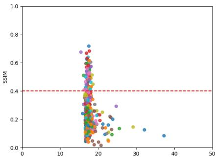  
(a) Muon, 10-class

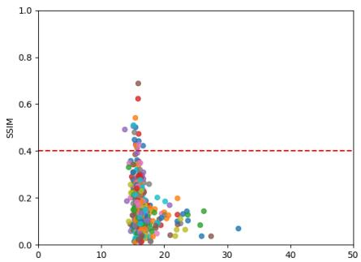  
(b) SGD, 10-class

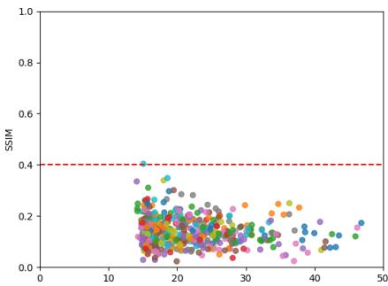  
(c) Adam, 10-class  
Figure 4: Per-sample SSIM versus training margin $\gamma _ { i }$ on CIFAR-10 $( n = 5 0 0$ , range prior), for multiclass models. Each point is a training sample, colored by class; the dashed line marks $\mathrm { S S I M } = 0 . 4$ . Recognizable reconstructions occur only near the minimal margin. Muon produces the most of them and Adam essentially none.

Multiclass training dynamics. While the overall performance ordering (Muon > SGD > Adam) is largely maintained in the 10-class setting, the quantitative gap between Muon and SGD narrows compared to the binary regime. Specifically, Muon exhibits a higher concentration of samples exceeding the 0.4 recognizability threshold compared to SGD, as illustrated in Figure 4.

Comparing across sample sizes (Table 2). Evaluating reconstruction fidelity across varying dataset sizes n reveals that SSIM@30 peaks at $n = 1 0 0$ and decreases substantially for $n \geq 5 0 0$ . Although selecting the top 30 instances from a larger candidate pool $( m = 2 n )$ represents a more selective subset, the observed drop in performance indicates that the underlying inverse problem becomes fundamentally harder to invert accurately as the scale n increases.

Computational complexity. Let q be the number of reconstruction candidates, p the number of model parameters, and d the input dimension. Each attack iteration performs work equivalent to $q$ diferentiable parameter-gradient evaluations plus $O ( p )$ residual aggregation. The SGD and Adam alignment terms require $O ( p )$ additional work, while Muon’s dual-norm term additionally requires blockwise singular-value computations. Excluding model activations and automatic-diferentiation workspace, the explicit attack state requires $O ( q d + p )$ memory. We study the empirical dependence on training-set size in Section 5 and Table 2.

## F FURTHER MATERIAL

## F.1 Notation details (from §2.1)

For nonzero u and $\theta ,$ alignment means that u is a positive multiple of θ in the $\ell _ { 2 }$ geometry. For a single spectral-norm block, it means that $\mathbf { u } = U _ { 1 } M V _ { 1 } ^ { \top }$ for some positive semidefinite M, where $U _ { 1 }$ and $V _ { 1 }$ span the corresponding top singular subspaces of θ. For the max-spectral norm, aligned blocks can be nonzero only at blocks attaining the maximum spectral norm. For $\ell _ { \infty }$ , u is supported on the largest-magnitude coordinates of $\theta ,$ with matching signs wherever u is nonzero.

On strata: For $\ell _ { \infty }$ , this type is determined by the set A of coordinates attaining the maximum absolute value and their signs. For the spectral norm, it is determined by the multiplicity $\rho$ of the top singular value; for the max-spectral norm, it also depends on which blocks attain the maximum. By “on the generic stratum,” we mean away from ties and other degeneracies: top singular values are simple, the $\ell _ { \infty }$ maximum is unique, and the relevant active sets are locally constant. Unless stated otherwise, dimension counts are taken on this stratum.

On Assumption 2.1: A first-layer bias is absorbed by appending a constant 1 to the input, so that $[ W _ { 1 } \ \mathbf { b } _ { 1 } ]$ is a single block (and Muon is understood to act on it). Diferentiability holds at almost every θ for ReLU networks, as used by Haim et al. (2022), and everywhere for the smooth homogeneous models covered by the guarantees

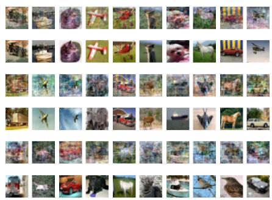  
(a) Muon

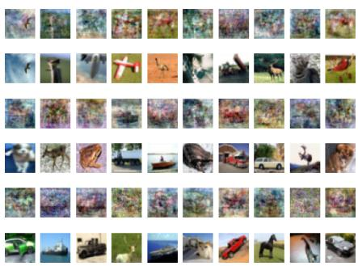  
(b) SGD

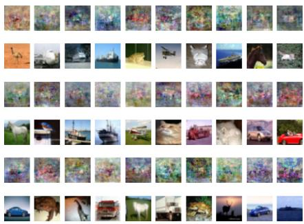  
(c) Adam

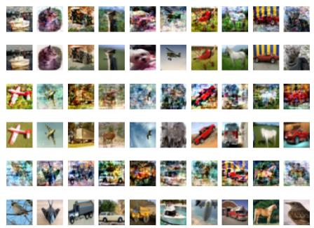  
(d) Muon, range prior

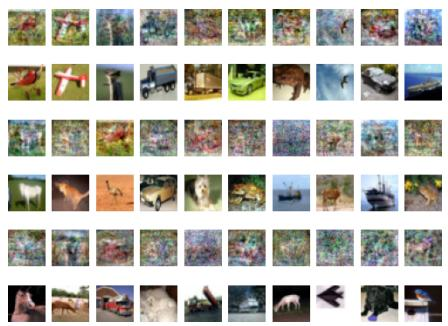  
(e) SGD, range prior

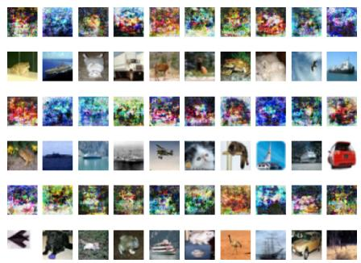  
(f) Adam, range prior  
Figure 5: Reconstructions on binary CIFAR-10 (n = 500), in the layout of Figure 3. Muon reconstructions best preserve object shape and color.

of Gronich and Vardi (2026).

On the generalized Cauchy–Schwarz inequality: The three geometries considered here give familiar instances of this inequality: Cauchy–Schwarz for the $( \ell _ { 2 } , \ell _ { 2 } )$ pair, H¨older for $( \ell _ { \infty } , \ell _ { 1 } )$ , and a bound obtained from von Neumann’s trace inequality for the max-spectral norm and its dual, the sum-nuclear norm $\sum _ { k } \| \mathbf { u } _ { W _ { k } }$ ∥nuc.

## F.2 Other privacy attacks (from §2)

Other privacy attacks difer in their goals and requirements. Membership inference determines whether an example belongs to the training set (Shokri et al., 2017), model inversion can recover class-representative inputs (Fredrikson et al., 2015), and gradient leakage reconstructs data from shared gradients (Zhu et al., 2019). KKTbased reconstruction attacks use only the final weights of the trained model. Diferentially private training (Abadi et al., 2016) provides a formal guarantee limiting the influence of individual training examples, potentially at a utility cost. Optimizer choice provides another way to afect reconstruction leakage, but does not provide the same guarantee.

## F.3 Implicit bias of gradient flow (from §2.1)

Theorem F.1 (paraphrased version of Lyu and Li (2020), Ji and Telgarsky (2020)). Let $\Phi ( \pmb \theta ; \mathbf x )$ be a normalized homogeneous1 ReLU neural network. Consider minimizing the logistic $( z \mapsto \log ( 1 { + } e ^ { - z } ) )$ or the exponential $( z \mapsto$ $e ^ { - z } )$ loss using gradient flow (which is a continuous-time analog of gradient descent) over a binary classification set $\{ ( \mathbf { x } _ { i } , y _ { i } ) \} _ { i = 1 } ^ { n } \subseteq \mathbb { R } ^ { d } \times \{ - 1 , 1 \}$ . Assume that there is a time t where $L ( \theta ( t _ { 0 } ) ) ~ < ~ \frac { 1 } { n }$ Then, gradient flow converges in direction2 to a first order stationary point (KKT point (Cortes and Vapnik, 1995)) of the maximummargin problem (P).

A KKT point of (P) is characterized by the following set of conditions:

Table 5: Reconstruction on binary MNIST (n = 500). Best per prior in bold.
<table><tr><td>Prior</td><td>Optimizer</td><td>SSIM↑</td><td>SSIM@30↑</td><td>PSNR↑</td><td>PSNR@30↑</td><td>l1 ↓</td><td>l1@30↓</td><td>l2 ↓</td><td>l2@30↓</td></tr><tr><td rowspan="3">None</td><td>SGD</td><td>0.1661</td><td>0.3463</td><td>10.857</td><td>14.867</td><td>0.2059</td><td>0.1260</td><td>0.2865</td><td>0.1806</td></tr><tr><td>Adam</td><td>0.1527</td><td>0.2487</td><td>10.345</td><td>10.903</td><td>0.2077</td><td>0.1926</td><td>0.3039</td><td>0.2850</td></tr><tr><td>Muon</td><td>0.2350</td><td>0.4310</td><td>11.495</td><td>16.997</td><td>0.1718</td><td>0.0935</td><td>0.2662</td><td>0.1413</td></tr><tr><td rowspan="3">Range</td><td>SGD</td><td>0.2007</td><td>0.4057</td><td>11.186</td><td>15.464</td><td>0.1700</td><td>0.1008</td><td>0.2759</td><td>0.1686</td></tr><tr><td>Adam</td><td>0.1898</td><td>0.2994</td><td>10.640</td><td>11.933</td><td>0.1958</td><td>0.1415</td><td>0.2938</td><td>0.2531</td></tr><tr><td>Muon</td><td>0.3242</td><td>0.6371</td><td>12.115</td><td>20.154</td><td>0.1339</td><td>0.0517</td><td>0.2479</td><td>0.0982</td></tr><tr><td rowspan="3">TV</td><td>SGD</td><td>0.1811</td><td>0.3768</td><td>11.042</td><td>14.948</td><td>0.1964</td><td>0.1209</td><td>0.2805</td><td>0.1789</td></tr><tr><td>Adam</td><td>0.1739</td><td>0.2882</td><td>10.593</td><td>11.270</td><td>0.1986</td><td>0.1801</td><td>0.2954</td><td>0.2732</td></tr><tr><td>Muon</td><td>0.3288</td><td>0.5808</td><td>11.781</td><td>17.699</td><td>0.1550</td><td>0.0783</td><td>0.2576</td><td>0.1303</td></tr><tr><td rowspan="3"> $\ell _ { 1 }$ </td><td>SGD</td><td>0.1688</td><td>0.3614</td><td>10.894</td><td>14.845</td><td>0.2007</td><td>0.1227</td><td>0.2853</td><td>0.1810</td></tr><tr><td>Adam</td><td>0.1445</td><td>0.1752</td><td>10.340</td><td>11.985</td><td>0.1829</td><td>0.1433</td><td>0.3041</td><td>0.2516</td></tr><tr><td>Muon</td><td>0.2849</td><td>0.5302</td><td>11.610</td><td>17.291</td><td>0.1563</td><td>0.0819</td><td>0.2627</td><td>0.1366</td></tr><tr><td rowspan="3">TV+l1</td><td>SGD</td><td>0.1848</td><td>0.3977</td><td>11.086</td><td>15.423</td><td>0.1908</td><td>0.1120</td><td>0.2791</td><td>0.1694</td></tr><tr><td>Adam</td><td>0.1606</td><td>0.2311</td><td>10.538</td><td>12.028</td><td>0.1825</td><td>0.1487</td><td>0.2972</td><td>0.2504</td></tr><tr><td>Muon</td><td>0.3299</td><td>0.6211</td><td>11.831</td><td>18.002</td><td>0.1489</td><td>0.0728</td><td>0.2561</td><td>0.1259</td></tr><tr><td rowspan="3">All</td><td>SGD</td><td>0.2289</td><td>0.4511</td><td>11.345</td><td>15.657</td><td>0.1641</td><td>0.0961</td><td>0.2709</td><td>0.1649</td></tr><tr><td>Adam</td><td>0.1758</td><td>0.2655</td><td>10.834</td><td>13.006</td><td>0.1663</td><td>0.1215</td><td>0.2873</td><td>0.2237</td></tr><tr><td>Muon</td><td>0.3400</td><td>0.6599</td><td>11.996</td><td>20.126</td><td>0.1361</td><td>0.0520</td><td>0.2513</td><td>0.0986</td></tr></table>

• Stationarity: $\begin{array} { r } { \pmb { \theta } = \sum _ { i = 1 } ^ { n } \lambda _ { i } \nabla _ { \pmb { \theta } } \left[ y _ { i } \Phi \left( \pmb { \theta } ; \mathbf { x } _ { i } \right) \right] } \end{array}$  
• Primal feasibility: $y _ { i } \Phi \left( \pmb \theta ; \mathbf x _ { i } \right) \ge 1 , \quad \forall i \in [ n ]$  
• Dual feasibility: $\lambda _ { i } \ge 0 , \quad \forall i \in [ n ]$

• Comp. slackness: $\lambda _ { i } = 0 \mathrm { ~ i f ~ } y _ { i } \Phi \left( \pmb { \theta } ; \mathbf { x } _ { i } \right) \neq 1 , \quad \forall i \in [ n ] .$

## F.4 Implicit-bias background (from §2)

The reconstruction attack relies on characterizing which interpolating solution an optimizer selects. For separable linear models, GD converges in direction to the ℓ maximum-margin solution (Soudry et al., 2018). Related results establish convergence towards KKT directions of margin problems for homogeneous networks (Lyu and Li, 2020; Ji and Telgarsky, 2020), and connect steepest descent under other norms to the corresponding margin geometry (Gunasekar et al., 2018); see Vardi (2023) for a survey. These results allow us to study optimizer choice through its associated margin geometry.

Table 6: Reconstruction on binary CIFAR-10 (n = 500). Best per prior in bold.
<table><tr><td>Prior</td><td>Optimizer</td><td>SSIM↑</td><td>SSIM@30↑</td><td>PSNR↑</td><td>PSNR@30↑</td><td> $\ell _ { 1 } \downarrow$ </td><td> $\ell _ { 1 } @ 3 0 \downarrow$ </td><td>l2 ↓</td><td> $\ell _ { 2 } @ 3 0 \downarrow$ </td></tr><tr><td rowspan="3">None</td><td>SGD</td><td>0.0986</td><td>0.2287</td><td>11.671</td><td>13.523</td><td>0.2027</td><td>0.1623</td><td>0.2609</td><td>0.2108</td></tr><tr><td>Adam</td><td>0.1365</td><td>0.1379</td><td>12.422</td><td>12.902</td><td>0.1849</td><td>0.1743</td><td>0.2393</td><td>0.2264</td></tr><tr><td>Muon</td><td>0.1771</td><td>0.5508</td><td>12.567</td><td>17.802</td><td>0.1807</td><td>0.0974</td><td>0.2353</td><td>0.1288</td></tr><tr><td rowspan="3">Range</td><td>SGD</td><td>0.0994</td><td>0.2336</td><td>11.665</td><td>13.435</td><td>0.2027</td><td>0.1634</td><td>0.2611</td><td>0.2129</td></tr><tr><td>Adam</td><td>0.1299</td><td>0.1367</td><td>12.334</td><td>13.441</td><td>0.1863</td><td>0.1624</td><td>0.2417</td><td>0.2128</td></tr><tr><td>Muon</td><td>0.1921</td><td>0.6130</td><td>12.808</td><td>19.190</td><td>0.1750</td><td>0.0825</td><td>0.2289</td><td>0.1098</td></tr><tr><td rowspan="3"> $\mathrm { T V }$ </td><td>SGD</td><td>0.1106</td><td>0.2574</td><td>11.857</td><td>14.099</td><td>0.1975</td><td>0.1517</td><td>0.2554</td><td>0.1973</td></tr><tr><td>Adam</td><td>0.0958</td><td>0.2115</td><td>11.2531</td><td>13.5265</td><td>0.2122</td><td>0.1789</td><td>0.2656</td><td>0.2001</td></tr><tr><td>Muon</td><td>0.2310</td><td>0.6132</td><td>13.202</td><td>18.974</td><td>0.1672</td><td>0.0852</td><td>0.2187</td><td>0.1125</td></tr><tr><td rowspan="3"> $\ell _ { 1 }$ </td><td>SGD</td><td>0.0984</td><td>0.2375</td><td>11.668</td><td>13.995</td><td>0.2026</td><td>0.1528</td><td>0.2610</td><td>0.1996</td></tr><tr><td>Adam</td><td>0.0977</td><td>0.2112</td><td>10.2658</td><td>13.2568</td><td>0.2471</td><td>0.1793</td><td>0.2787</td><td>0.2323</td></tr><tr><td>Muon</td><td>0.1933</td><td>0.5598</td><td>12.798</td><td>18.109</td><td>0.1750</td><td>0.0936</td><td>0.2291</td><td>0.1243</td></tr><tr><td rowspan="3"> $\mathrm { T V } { + \ell _ { 1 } }$ </td><td>SGD</td><td>0.1113</td><td>0.2440</td><td>11.872</td><td>13.748</td><td>0.1973</td><td>0.1581</td><td>0.2549</td><td>0.2054</td></tr><tr><td>Adam</td><td>0.1218</td><td>0.2369</td><td>11.2451</td><td>13.1178</td><td>0.2284</td><td>0.1955</td><td>0.2854</td><td>0.2323</td></tr><tr><td>Muon</td><td>0.2305</td><td>0.6286</td><td>13.216</td><td>19.185</td><td>0.1667</td><td>0.0832</td><td>0.2184</td><td>0.1098</td></tr><tr><td rowspan="3">All</td><td>SGD</td><td>0.1122</td><td>0.2536</td><td>11.865</td><td>14.194</td><td>0.1975</td><td>0.1502</td><td>0.2551</td><td>0.1951</td></tr><tr><td>Adam</td><td>0.1827</td><td>0.2377</td><td>12.727</td><td>14.462</td><td>0.1768</td><td>0.1407</td><td>0.2310</td><td>0.1892</td></tr><tr><td>Muon</td><td>0.2196</td><td>0.6189</td><td>13.138</td><td>18.848</td><td>0.1683</td><td>0.0852</td><td>0.2203</td><td>0.1142</td></tr></table>

Table 7: Reconstruction on 10-class CIFAR-10 (n = 500). Best per prior in bold.
<table><tr><td>Prior</td><td>Optimizer</td><td>SSIM↑</td><td>SSIM@30↑</td><td>PSNR↑</td><td>PSNR@30↑</td><td> $\ell _ { 1 } \downarrow$ </td><td> $\ell _ { 1 } @ 3 0 \downarrow$ </td><td> $\ell _ { 2 } \downarrow$ </td><td> $\ell _ { 2 } @ 3 0 \downarrow$ </td></tr><tr><td rowspan="3">None</td><td>SGD</td><td>0.2031</td><td>0.3827</td><td>11.264</td><td>13.435</td><td>0.1912</td><td>0.1657</td><td>0.2535</td><td>0.1906</td></tr><tr><td>Adam</td><td>0.1530</td><td>0.2066</td><td>12.254</td><td>12.740</td><td>0.1856</td><td>0.1758</td><td>0.2440</td><td>0.2307</td></tr><tr><td>Muon</td><td>0.2446</td><td>0.5339</td><td>13.284</td><td>18.826</td><td>0.1651</td><td>0.0884</td><td>0.2167</td><td>0.1145</td></tr><tr><td rowspan="3">Range</td><td>SGD</td><td>0.2157</td><td>0.4515</td><td>12.999</td><td>16.445</td><td>0.1722</td><td>0.1158</td><td>0.2239</td><td>0.1506</td></tr><tr><td>Adam</td><td>0.1423</td><td>0.1771</td><td>12.250</td><td>13.238</td><td>0.1874</td><td>0.1653</td><td>0.2441</td><td>0.2178</td></tr><tr><td>Muon</td><td>0.2445</td><td>0.5315</td><td>13.278</td><td>18.987</td><td>0.1651</td><td>0.0863</td><td>0.2168</td><td>0.1124</td></tr><tr><td rowspan="3"> $\mathrm { T V }$ </td><td>SGD</td><td>0.2112</td><td>0.4332</td><td>12.977</td><td>16.134</td><td>0.1729</td><td>0.1198</td><td>0.2245</td><td>0.1561</td></tr><tr><td>Adam</td><td>0.2310</td><td>0.3442</td><td>13.520</td><td>15.774</td><td>0.1603</td><td>0.1224</td><td>0.2109</td><td>0.1627</td></tr><tr><td>Muon</td><td>0.2761</td><td>0.5481</td><td>13.880</td><td>19.199</td><td>0.1537</td><td>0.0848</td><td>0.2023</td><td>0.1097</td></tr><tr><td rowspan="3"> $\ell _ { 1 }$ </td><td>SGD</td><td>0.2081</td><td>0.4141</td><td>12.952</td><td>16.344</td><td>0.1731</td><td>0.1147</td><td>0.2251</td><td>0.1523</td></tr><tr><td>Adam</td><td>0.1382</td><td>0.2739</td><td>11.940</td><td>14.062</td><td>0.1913</td><td>0.1491</td><td>0.2529</td><td>0.1981</td></tr><tr><td>Muon</td><td>0.2529</td><td>0.5371</td><td>13.436</td><td>18.686</td><td>0.1615</td><td>0.0900</td><td>0.2129</td><td>0.1163</td></tr><tr><td rowspan="3"> $\mathrm { T V } { + \ell _ { 1 } }$ </td><td>SGD</td><td>0.2110</td><td>0.4343</td><td>13.009</td><td>16.085</td><td>0.1721</td><td>0.1197</td><td>0.2236</td><td>0.1569</td></tr><tr><td>Adam</td><td>0.1946</td><td>0.3050</td><td>12.742</td><td>14.106</td><td>0.1756</td><td>0.1499</td><td>0.2306</td><td>0.1971</td></tr><tr><td>Muon</td><td>0.2806</td><td>0.5890</td><td>13.791</td><td>19.408</td><td>0.1547</td><td>0.0821</td><td>0.2044</td><td>0.1071</td></tr><tr><td rowspan="3"> $\mathrm { A l l }$ </td><td>SGD</td><td>0.2110</td><td>0.4343</td><td>13.009</td><td>16.085</td><td>0.1721</td><td>0.1197</td><td>0.2236</td><td>0.1569</td></tr><tr><td>Adam</td><td>0.1598</td><td>0.2603</td><td>12.491</td><td>13.821</td><td>0.1809</td><td>0.1571</td><td>0.2374</td><td>0.2037</td></tr><tr><td>Muon</td><td>0.2814</td><td>0.5795</td><td>13.780</td><td>19.279</td><td>0.1549</td><td>0.0837</td><td>0.2046</td><td>0.1087</td></tr></table>

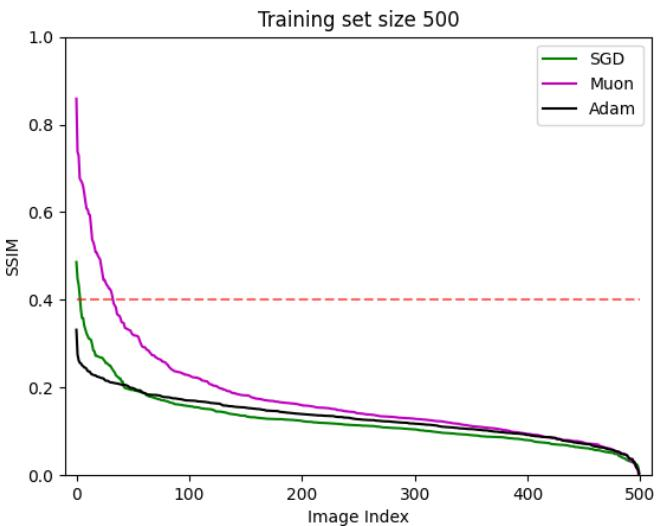  
(a) CIFAR-10 (N = 500, No Prior)

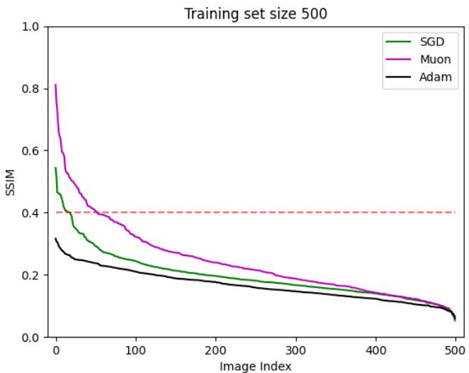  
(b) MNIST (N = 500, No Prior)  
Figure 6: Sorted image-level SSIM values (from highest to lowest) for reconstructed samples on CIFAR-10 and MNIST without prior constraints $( n = 5 0 0 )$ . The dashed horizontal reference line at $\mathrm { S S I M } = 0 . 4$ indicates a threshold for acceptable visual reconstruction quality. Reconstructions under Muon consistently achieve higher SSIM scores, resulting in a substantially larger fraction of images reconstructed above 0.4 compared to SGD and Adam $\mathrm { ( M u o n > S G D > A d a m ) }$