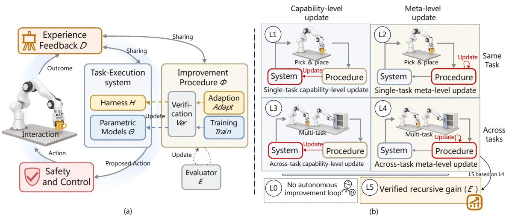
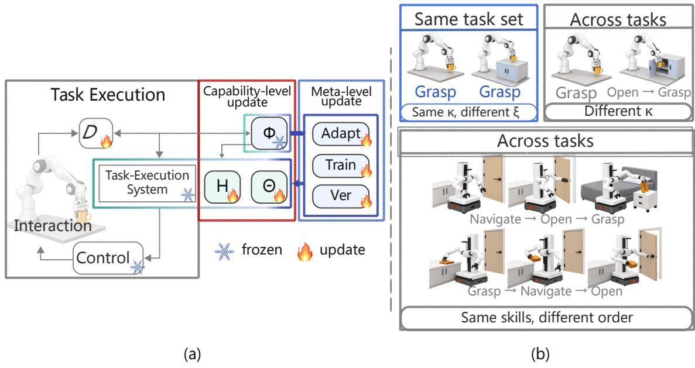
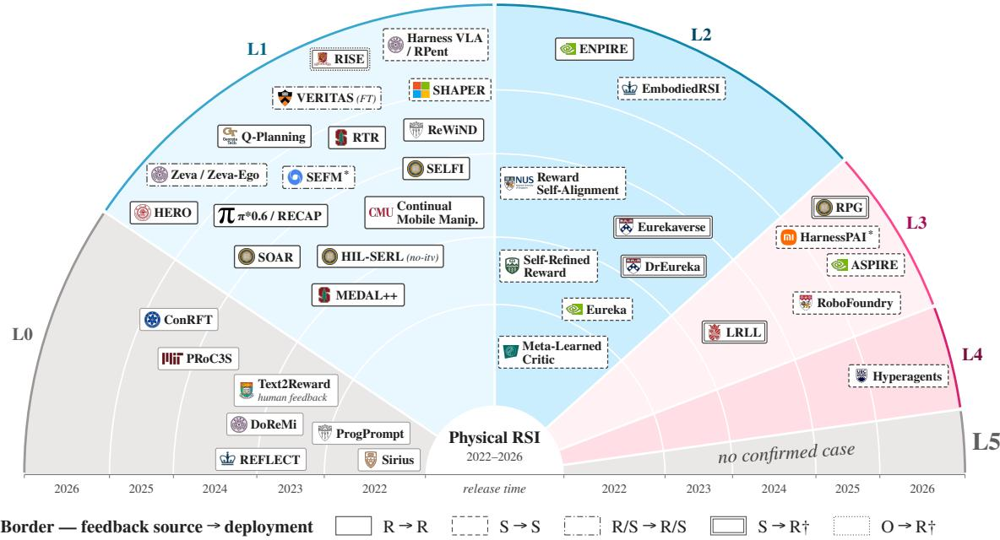
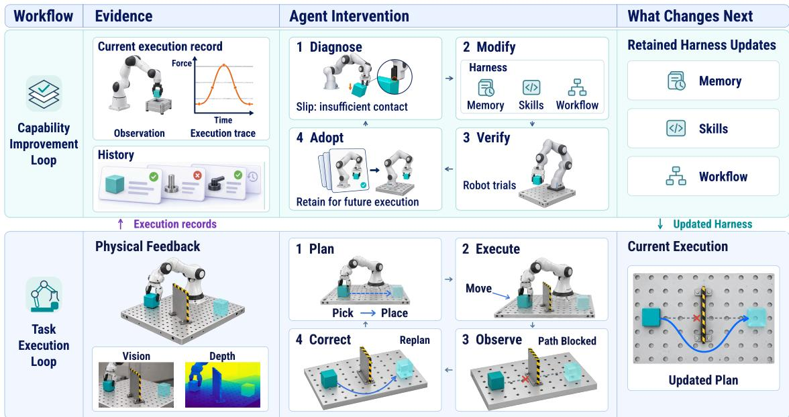
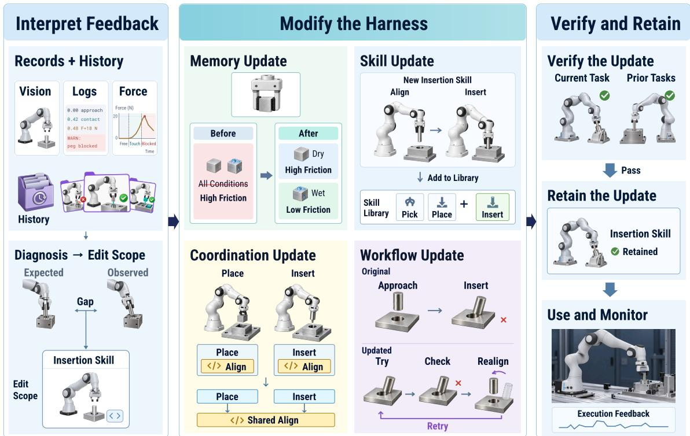
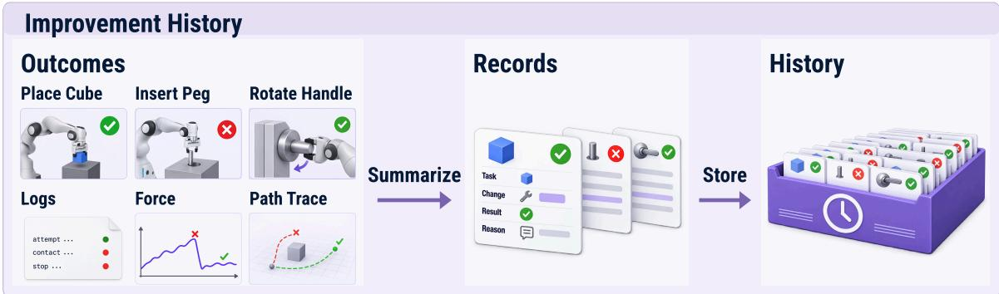
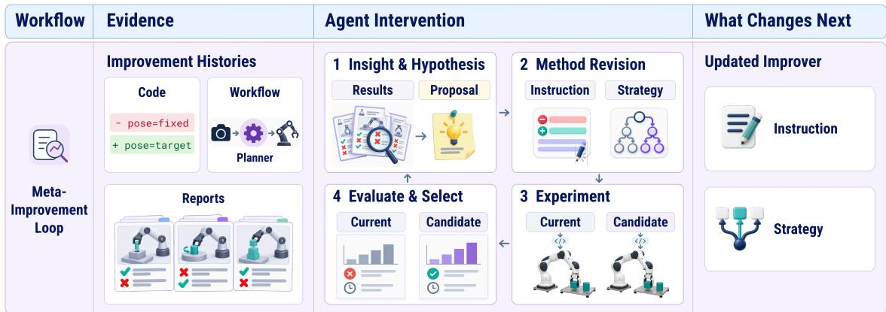
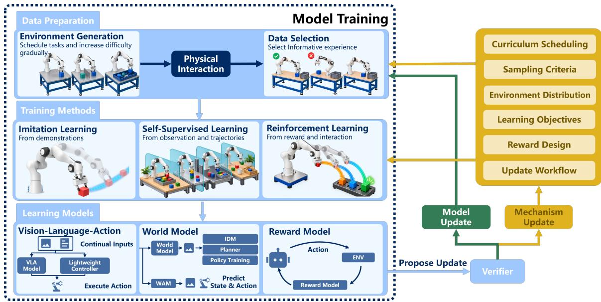
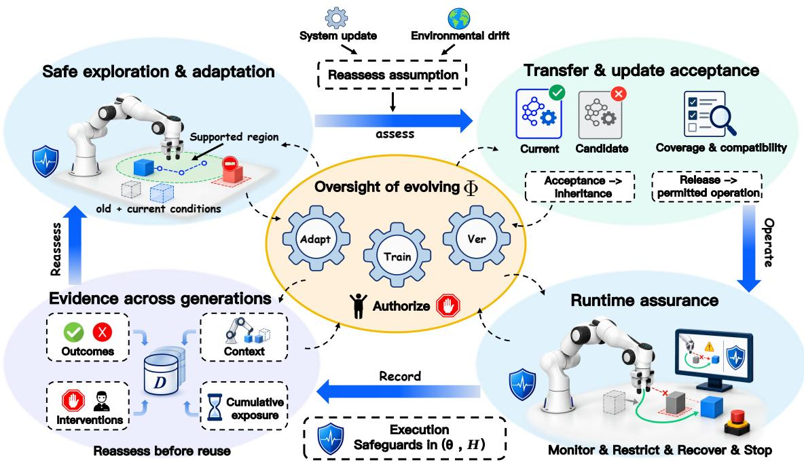
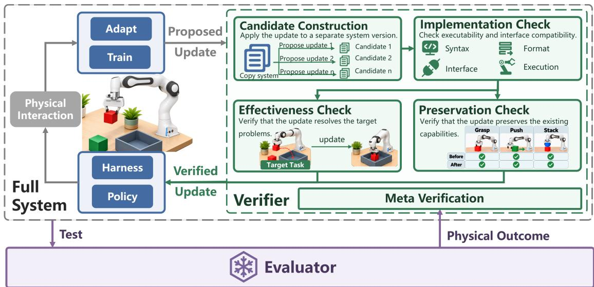

# Who Improves the Robot? Toward Physical Recursive Self-Improvement

Hai Zhou1,∗,†, Fan Yang1,∗, Zeyi Chen1,∗, Lejun Zhang1,∗, Chenyang Fu1,∗,†, Jianping Li2, Jiayi Zhu1, Xianyang Liu1, Yingxuan Yang1, Lili Meng2, Lu Wang3, Xinyang   
Han4, Jiankai Sun5, Weirui Ye6, Guanchu Wang7, Wanhua Li8, Ming Zhou7, Boyi Li9, Ming Jin10, Kun Shao11, Muhao Chen12, Guang Chen13, Lei Ma14, Joey Tianyi   
Zhou15, Costas Spanos4, Xia Hu7, Mac Schwager5, Weinan Zhang1,B, Qian Feng16,B, Shangding Gu1,4,B   
1Shanghai Jiao Tong University   
2Google 3Microsoft   
4University of California, Berkeley   
5Stanford University   
6Massachusetts Institute of Technology   
7Shanghai Artificial Intelligence Laboratory   
8Nanyang Technological University   
9Nvidia 10Virginia Tech 11Xiaomi   
12University of California, Davis   
13Tongji University   
14University of Tokyo   
15Singapore Management University   
16Technical University of Munich

## Abstract

Robots are increasingly autonomous in task execution, yet their improvement remains largely human-driven. This study investigates Physical Recursive Self-Improvement (Physical RSI), in which physical experience guides lasting updates to both a robot’s capabilities and its improvement procedure, making sub sequent improvement more efective across tasks. Physical RSI faces challenges from noisy observations, continuous dynamics, costly trials, and irreversible consequences. We present an L0–L5 framework that diferentiates capability-level from meta-level updates and within-task from across-task gains, reserving L5 for independently verified recursive gain. We study existing methods around harness adaptation and model training, alongside safety and control mechanisms that govern execution and successive updates. Our analysis reveals that, despite substantial progress in self-improvement, the surveyed literature does not yet demonstrate Physical RSI as defined by our framework. We identify research priorities in reliable feedback, causal attribution, safety preservation, and benchmarking, outlining a path toward robots that autonomously improve how they learn while ensuring safety. The GitHub repository for Physical RSI is available at https://github.com/SAIL-Research-Lab/Physical-RSI.

Keywords: Recursive Self-Improvement, Physical Artificial Intelligence, Agentic Systems, Robot Learning.

## Contents

1 Introduction 3   
2 Foundations of Physical Recursive Self-Improvement 5   
2.1 Definition and Scope of Physical RSI 5   
2.2 System Architecture and Improvement Loops 8   
2.3 The L0–L5 Framework . 9   
3 Harness Adaptation of Physical RSI 12   
3.1 Feedback Interpretation and Update Target Identification 13   
3.2 Memory, Skill, and Workflow Adaptation 13   
3.3 Adoption and Improvement History 15   
3.4 Meta-Improvement of Harness Adaptation 16   
4 Model Training of Physical RSI 17   
4.1 Data Preparation 18   
4.2 Training Methods 18   
4.3 Learning Models 19   
4.4 Knowledge Transfer and Training Procedure Improvement 20   
5 Safety and Control of Physical RSI 21   
5.1 Safe Exploration and Continual Adaptation 21   
5.2 Safe Transfer and Update Acceptance 22   
5.3 Runtime Assurance under Environmental Drift 23   
5.4 Oversight of an Evolving Improvement Procedure 24   
5.5 Safety Evidence across Generations . 25   
6 Verification and Evaluation of Physical RSI 27   
6.1 Verification of Candidate Updates 27   
6.2 Evaluation of Improvement Outcomes 27   
6.3 Benchmarks and Evaluation Resources 28   
7 Challenges and Future Directions 29   
8 Conclusion 30

## 1 Introduction

Advances in robotics have enabled machines to carry out an expanding range of tasks on their own, from sorting parcels in logistics centers to performing routine chores at home (Zeng et al., 2018; Fu et al., 2025). Yet behind this execution autonomy lies a reliance on human support. In data preparation, robots do not have data as abundant as the internet data available to language models. Their data is generated through thousands of physical interactions, and humans are needed to collect and review it (Collaboration et al., 2023; Khazatsky et al., 2024). In deployment, when a robot meets an unfamiliar failure, recovery largely depends on humans to diagnose the problem or demonstrate a fix (Liu et al., 2023b). In training and optimization, most systems rely on training pipelines designed by humans, and the final choice of which update to adopt remains a human decision (Zhu et al., 2020a). Consequently, even highly capable robots lack improvement autonomy, meaning the ability to improve themselves without humans driving the loop.

Recent work has begun to narrow this gap by letting systems improve themselves. One line of work lets language model agents rewrite code or scafolding, and keep the changes that score better under automated evaluation (Zelikman et al., 2023; Yin et al., 2025; Zhang et al., 2026d; Novikov et al., 2025). Another line improves the model itself, training it on data and feedback that the system or another language model generates (Yuan et al., 2024b; Zweiger et al., 2025; Ghasemipour et al., 2025; Ma et al., 2024a; Wang et al., 2024d). Most of this work achieves self-improvement, in that the system raises its own task performance by changing what it uses when it performs a task. The procedure that produces and selects these changes usually stays fixed, so what the system can gain is limited by how efective that procedure is. Recursive self-improvement goes further. It updates the improvement procedure itself. Recursive gain is established when the revised procedure produces better subsequent improvements than its predecessor under matched conditions. Few works however update the procedure, and fewer show that doing so yields recursive gain.

Moreover, recursive self-improvement is harder for robots in the real world than in simulated or digital environments. The physical world cannot be monitored as exhaustively as digital environments. A robot observes only partial and noisy traces of what actually happened, which makes failures hard to diagnose and improvements hard to verify (Dulac-Arnold et al., 2019). Outcomes are also less deterministic than in digital environments, and the robot must act through continuous dynamics under real-time constraints (Dulac-Arnold et al., 2019). Evaluating any change therefore requires repeated trials under noisy conditions, which is time-consuming on real robots (Zhou et al., 2025c). Finally, resetting a physical system is expensive, hardware can fail, and many interactions risk irreversible outcomes, including harm to people who share the workspace, so the cheap trial and error on which self-improvement in digital environments relies becomes costly and risky (Eysenbach et al., 2018; Zhu et al., 2020a). These constraints make it particularly hard on real robots to update and to verify the changes. Physical robots therefore call for a recursive self-improvement framework of their own, rather than one carried over from digital settings.

We build this framework around Physical Recursive Self-Improvement (Physical RSI). We say that a robot performs Physical RSI when it uses evidence from its physical interaction to persistently update both its task-execution system and its improvement procedure, such that its subsequent improvement becomes more efective over successive rounds. Here the task-execution system is the models and harness that the robot uses to perform tasks, and the improvement procedure is the part that can update the task-execution system and itself. An independent evaluator assesses the gains of the updated system. Our long-term vision is for robots to operate and evolve autonomously in real-world physical environments, addressing diverse and unforeseen challenges without human intervention.

Based on this definition, we introduce six levels, L0 to L5, to describe how much of it a system meets, as shown in Figure 1. L0 covers systems that make no retained change on their own, either because they adjust only within a run or because humans still drive the loop. L1 to L4 vary along two axes. Capability-level updates change the task-execution system, whereas meta-level updates change the improvement procedure. The second axis is scope. A gain on a single task may be specific to that task, whereas a gain across multiple tasks shows that the update generalizes. L1 makes capability-level updates on a single task with the improvement procedure fixed, and L2 adds meta-level updates on the same task. L3 and L4 extend L1 and L2, respectively, to multiple tasks. L5 builds on L4 and requires evidence, from an independent evaluator under the same controlled conditions, that each update yields a larger gain than the previous one. The formal definition and the detailed criteria are given in Section 2.

  
Figure 1: Overview of Physical Recursive Self-Improvement. (a) The task-execution system, consisting of the harness H and the parametric models Θ, proposes actions that pass through safety and control before acting on the physical world. The outcomes are stored as experience and feedback D, which is shared by the task-execution system and the improvement procedure Φ. Using D, Φ updates H through Adapt and Θ through Train, while Ver decides which changes are kept. Φ can also update its own stages. An independent evaluator E evaluates the task-execution system and thereby judges the updates made by Φ. (b) L1–L4 distinguish capability-level updates to the task-execution system from meta-level updates to the improvement procedure, within a single task or across tasks. L0 denotes systems that make no retained change on their own. L5 builds on L4 and requires independent, controlled evidence that subsequent improvement becomes more efective over successive rounds.

Existing surveys cover complementary parts of this framework. Surveys centered on components and experience examine how agents change their models, prompts, memory, tools, and workflows (Gao et al., 2026; Fang et al., 2025; Ren et al., 2026; Jiang et al., 2026a). RSI-oriented accounts ask whether the mechanisms that generate, evaluate, and select updates can themselves change (Liu et al., 2026c; Duan et al., 2026; Chen et al., 2026c; Wang et al., 2026b), and address safety through governance, independent evaluation, and the preservation of safeguards across updates (Liu et al., 2026c; Wang et al., 2026b; Gong et al., 2026). For humanoids, Nguyen et al. (2026) formulate admissible evolution through layered safety mechanisms. Such safeguards carry more weight in the physical world, where a failed trial cannot simply be rerun or rolled back (Duan et al., 2026; Nguyen et al., 2026). We therefore make safety and control explicit in our system framework and dedicate a section to how they constrain physical interaction and autonomous improvement. And existing accounts characterize the scope of improvement in diferent ways. Liu et al. (2026c) reserve a higher level for broad transfer, Wang et al. (2026b) treat transfer as a separate empirical question, and Wu et al. (2026b) separately record improvement targets and held-out transfer while cautioning against collapsing independent dimensions into a single autonomy ladder. For robots, generalization remains uneven across changes in objects, embodiment, and deployment conditions (Hou et al., 2026b). We therefore cross two criteria in L0–L5, namely, whether an update changes the taskexecution system or the improvement procedure, and whether its demonstrated efects remain within one task or extend across tasks. Finally, the task-execution system and the improvement procedure play diferent roles, but both involve models, harnesses, and associated improvement procedures (Liu et al., 2026c; Ren et al., 2026; Wu et al., 2026b). We therefore organize methods into harness adaptation and model learning. This groups methods that operate on similar components while preserving the distinction between what the robot can do and how it improves.

This study makes three contributions. First, we propose Physical RSI as a concept and give it a graded framework from L0 to L5. The framework treats what is updated and how far an update reaches as orthogonal criteria to define L1–L4. Second, we investigate existing methods along two implementation paths, harness adaptation and model learning, each covering both the task-execution system and the improvement procedure, together with the safety and control mechanisms that bound both, and the verification that decides which updates are kept. Third, we review how existing systems are evaluated, set out a protocol for independently evaluating improvement procedures, and identify the evidence gaps that separate current work from higher levels.

The remainder of the study is organized as follows. Section 2 formalizes the framework, including the definition, the system architecture, the L0–L5 levels, and the boundaries of evidence. Section 3 surveys harness adaptation, and Section 4 surveys model learning. Section 5 addresses safety and control, and Section 6 examines how Physical RSI is evaluated. Section 7 discusses open problems, and Section 8 concludes.

## 2 Foundations of Physical Recursive Self-Improvement

This section establishes the foundations for analyzing Physical RSI. Section 2.1 defines the system components and the conditions for physical self-improvement and Physical RSI, and relates them to neighboring research paradigms. Section 2.2 describes the execution, capability-level update, and meta-level update loops. Section 2.3 specifies task identity and the criteria for assigning levels L0–L5. This framework also provides a shared terminology for the analysis throughout the study.

## 2.1 Definition and Scope of Physical RSI

We describe an improving robot by its task-execution system and improvement procedure (Figure 1(a)), together with two properties of its updates, physical grounding and inheritance.

Task-execution system The task-execution system is the pipeline through which the robot turns a task into action. It has two parts. The harness H comprises the components outside the learned models, such as prompts, memory, skills and tools, task decomposition and recovery logic, and interface and controller code. The parametric models are the learned models used during execution, such as a planner, a vision-language-action policy, or a value function or world model, and we denote their weights by Θ. Capability can reside in either part, so we track both. Anything used only in the improvement procedure and not during task execution belongs to Φ rather than to the task-execution system (Section 2.3).

Improvement procedure The improvement procedure Φ is responsible for improving the whole system, including the task-execution system and the procedure itself. It has three stages. An adaptation stage Adapt updates H. A training stage Train selects experience and optimizes Θ. A verification stage Ver judges each candidate change proposed by Adapt or Train and decides whether to keep it. Φ can also improve itself by changing these stages, with an update to Adapt or Train judged by Ver and an update to Ver judged by the independent evaluator E introduced below. This matters because an improvement procedure is designed around particular tasks. When new tasks arrive, a fixed procedure usually has to be re-engineered by people, whereas one that can update itself adapts without them. We call changes to the task-execution system capability-level updates and changes to the improvement procedure meta-level updates, and Section 2.2 describes how each is carried out.

Physical grounding The improvement procedure draws its changes from experience, which it keeps in an experience and feedback store D. D stores the records of task execution, together with the records of improvement. Memory in H holds what Adapt has distilled from D for use in H. Experience may come from the real world, from a physics simulator, from a learned world model, from humans, or from signals inside the system. Among these sources, only the real world shows how the robot’s actions actually play out. A physics simulator reproduces contact and dynamics only approximately. A learned world model, humans, or internal signals can propose candidates or supply additional data, but a change drawn only from them is not physically grounded. We therefore call a change physically grounded when it depends on what happened as the robot acted, either in the real world or in a physics simulator.

Inheritance A change becomes the starting point of later behavior only if it is inherited. We call the state retained after k rounds of execution and improvement the k-th generation $S _ { k }$

$$
{ \mathcal { S } } _ { k } = ( \Theta _ { k } , \ H _ { k } , \ \Phi _ { k } , \ D _ { k } ) , \qquad \Phi _ { k } = ( { \mathsf { A d a p t } } _ { k } , \ \mathsf { T r a i n } _ { k } , \ \mathsf { V e r } _ { k } ) ,
$$

in which $\Theta _ { k }$ and $H _ { k }$ form the task-execution system, $\mathsf { A d a p t } _ { k }$ , Traink, and $\mathsf { V e r } _ { k }$ form the improvement procedure, and $D _ { k }$ is the experience and feedback store. Processes outside the robot, such as a training server or a language-model agent that edits code, belong to the system when a stage of Φ invokes them and they write into $S _ { k }$ . In round $k + 1$ , generation k executes tasks, its trajectories are added to $D _ { k }$ to give $D _ { k + 1 }$ , and the improvement procedure $\Phi _ { k } .$ , applied as the map defined by its three stages, produces the next generation,

$$
\left( \Theta _ { k + 1 } , H _ { k + 1 } , \Phi _ { k + 1 } \right) = \Phi _ { k } \left( \Theta _ { k } , H _ { k } , \Phi _ { k } ; D _ { k + 1 } \right) .\tag{1}
$$

The initial generation $S _ { 0 }$ is the state at the start of the period over which improvement is claimed. A change is inherited when Φ keeps it on evidence in D and it persists beyond the episode in which it was made, so that later generations start from it unless a later update changes it. Since $\Phi _ { k }$ is one of its own arguments in Eq. (1), an inherited change may reach the improvement procedure, including Ver itself. A change to Ver cannot be judged by Ver alone, which is why the framework also needs a judge E outside Φ.

Verification and evaluation Ver and the independent evaluator E both judge changes, but they stand in diferent positions and serve diferent purposes. Ver is a stage of Φ. It acts within every round, deciding which candidate changes proposed by Adapt or Train are kept, and because it belongs to Φ, it can itself be changed. E is a set of tasks with a scoring criterion Q that Φ cannot read, train on, or modify, and it stands outside the system. It has two roles. It judges changes to ${ \mathsf { V e r } } .$ since a Ver that judged its own changes could learn to satisfy its own standard without becoming better. It also scores the task-execution system $( \Theta _ { k } , H _ { k } )$ once an update is complete, because it is this part that acts on the environment, while the improvement procedure is evaluated indirectly, by scoring the systems it produces. We write $J _ { Q } ( \Theta _ { k } , H _ { k } )$ for the score of generation k on E under Q. E is extended from outside the system as it meets new tasks. Once E is extended, earlier scores no longer measure the same thing, so earlier generations are either re-evaluated on the updated E or compared on an anchor subset held fixed throughout the comparison. Section 6 describes how E is built and used.

Definitions Building on the task-execution system, the improvement procedure, physical grounding, inheritance, and the independent evaluator, we now define two notions of self-improvement. Definition 1 asks whether the robot has become better through changes that it made and kept on its own, and Definition 2 asks, more strictly, whether the way it becomes better has also become better.

Definition 1 (Physical self-improvement). A system performs physical self-improvement over rounds $1 , \ldots , K$ if the following conditions hold.

(i) Capability-level self-inheritance. At least one change to Θ or H is produced by stages of Φ and inherited. Changes to Φ may also be inherited but are not required. No human writes into Θ, H, or Φ.

(ii) Physical grounding. The inherited changes on which the retained gain depends are physically grounded, whether in a physics simulator or in the real world.

(iii) Retained gain. $J _ { Q } ( \Theta _ { K } , H _ { K } ) > J _ { Q } ( \Theta _ { 0 } , H _ { 0 } )$

Definition 2 (Physical recursive self-improvement). Physical self-improvement is recursive if the following conditions hold, where (i) and (iii) strengthen the corresponding conditions of Definition 1.

(i) Meta-level self-inheritance. In addition to condition (i) of Definition 1, Φ is able to update its own stages, so that changes to Φ produced by Φ can be inherited and used by later rounds.

(ii) Physical grounding. The inherited changes on which the gain depends are physically grounded, whether in a physics simulator or in the real world.

(iii) Recursive gain across tasks. Starting from the same generation and experience, and under the same budget, the system produced by each updated $\Phi _ { k }$ scores a higher JQ than the system produced by $\Phi _ { k - 1 }$ , with the gain measured across tasks.

Relation to continual learning, AutoML, and RSI Table 1 compares the two definitions with three neighboring lines of work. Continual learning updates Θ from a sequence of tasks while limiting forgetting (Parisi et al., 2019; Wang et al., 2024b), including on robots (Lesort et al., 2020; Liu et al., 2026b), and so supplies the retention that physical self-improvement requires. Its task sequence and update rule are fixed by the designer, however, so Φ does not change. Automated machine learning searches over pipeline, model and training configurations for each problem (Hutter et al., 2019; He et al., 2021), which in our terms is mostly a search over the settings of Train. Some systems meta-learn from earlier problems to warm-start later searches (Feurer et al., 2022), which updates the procedure in part, but the system found for one problem is not carried over to the next, so changes are not inherited. General RSI frameworks describe an agent by its foundation model, harness, data system, trainer, and improvement mechanism (Liu et al., 2026c), which map onto Θ, H, D, and Φ, and allow all of them to change (Tang et al., 2026a; Chen et al., 2026d). Such frameworks, however, mostly consider digital environments and do not require changes to be physically grounded.

Table 1: Continual learning, AutoML, and general RSI frameworks compared with the two definitions on six properties. ✓ typically met, (✓) met in part or by some works, × not met, – not required or not addressed.
<table><tr><td>Line of work</td><td>Made by the system</td><td>Inherits changes</td><td>Updates Θ, H</td><td>Updates Φ Recursive</td><td>gain</td><td>Physical grounding</td></tr><tr><td>Continual learning</td><td>√</td><td>√</td><td>√</td><td>×</td><td>X</td><td></td></tr><tr><td>Automated machine learning</td><td>√</td><td>×</td><td>√</td><td>(√)</td><td>×</td><td></td></tr><tr><td>General RSI frameworks</td><td>√</td><td>√</td><td>√</td><td>√</td><td>√</td><td></td></tr><tr><td>Physical self-improvement</td><td>√</td><td>√</td><td>√</td><td>(√)</td><td></td><td>√</td></tr><tr><td>Physical RSI</td><td>√</td><td>√</td><td>√</td><td>√</td><td>√</td><td>√</td></tr></table>

Physical RSI requires real-world grounding, which separates it from RSI in digital environments in four ways.

1. Continuous, real-time interaction. The robot acts through continuous dynamics under real-time constraints, and a task counts as done only when it is completed physically, whereas digital environments can often be paused and replayed.

2. Costly and irreversible trials. Resets are expensive and some actions cannot be undone, whereas a digital environment can be restored to an earlier state.

3. Partial, noisy observation. The robot sees only local, noisy traces of what happened, whereas digital environments can often expose the full state. Outcomes are therefore uncertain, failures are hard to attribute, and evidence from simulation does not fully carry over to the real robot (the sim-to-real gap).

4. Safety of people and hardware. Robots often work alongside people, and the hardware itself can fail or be damaged, so safety constraints, and human oversight where people are involved, need to bound the loops.

These diferences are also why our framework requires physical grounding for Physical RSI.

## 2.2 System Architecture and Improvement Loops

Section 2.1 defined the elements of an improving robot. This section shows how they work together within a round of Eq. (1). A round runs three loops that difer in what they change (Figure 2(a)), as Table 2 summarizes.

Table 2: What each loop uses and changes. U, used by the loop; W, written by the loop; –, untouched. The independent evaluator E and the other protected constraints (defined under Safety below) are not listed. E scores the updated task-execution system and judges updates to Ver from outside.
<table><tr><td></td><td colspan="2">Task-execution system</td><td colspan="3">Improvement procedure</td><td></td><td></td></tr><tr><td>Loop</td><td>H</td><td>Θ</td><td>Adapt</td><td>Train</td><td>Ver</td><td>D</td><td>Effect seen in</td></tr><tr><td>Execution loop</td><td>U</td><td>U</td><td></td><td></td><td></td><td>W</td><td>The current episode</td></tr><tr><td>Capability-level update</td><td>W</td><td>W</td><td>U</td><td>U</td><td>U</td><td>U, W</td><td>Later tasks</td></tr><tr><td>loop Meta-level update loop</td><td>U</td><td>U</td><td>U, W</td><td>U, W</td><td>U, W</td><td>U, W</td><td>Changes of later rounds</td></tr></table>

Three loops In the execution loop, the task-execution system uses H and Θ to turn observations and the episode context into actions, and adds the trajectory to D. Behavior that improves within an episode, for example through replanning, ends with the episode and is not evidence of improvement.

In the capability-level update loop, Φ reads D and changes H and Θ, the parts the robot uses when it executes tasks. Adapt may turn a successful trajectory into a reusable skill or store a lesson from a failure in memory, and Train may fine-tune a policy on its own successful trajectories or update a world model with observed transitions. The changes that Ver accepts are inherited, so their efect shows on later tasks, where E measures the gain (Section 2.1).

In the meta-level update loop, Φ changes one of its own stages, which the robot does not use while executing tasks but which produces or judges its later changes. An updated Adapt may learn, for instance, to locate the failing module before rewriting a prompt. An updated Train may switch from imitation learning to reinforcement learning with a reward derived from real outcomes when imitation stops improving a skill. An updated Ver applies a diferent standard for accepting candidates, such as other tests, success checks, or thresholds. Ver can accept an update to Adapt or Train by trying the updated stage and judging the changes it produces, whereas an update to Ver is judged by E.

Two pathways: H with Adapt, Θ with Train Updates follow two pathways, each pairing a part of the task-execution system with the stage of Φ that updates it. The harness pathway pairs H with

  
Figure 2: Update targets and task identity in the L0–L5 framework. (a) Task execution uses the harness H and learned weights Θ. Capability-level updates change H or Θ, whereas meta-level updates change the improvement procedure Φ. D denotes the experience and feedback store. (b) Tasks are distinguished by their required skill sequence κ. Grasping a cup from a table and from a cabinet top belongs to the same task set: κ remains unchanged, and only the instance parameters ξ difer. Retrieving a cup from an initially closed cabinet adds opening to κ and therefore belongs to a diferent task set. The two long-horizon examples share the same skill set $\kappa _ { \mathrm { s e t } }$ but execute the skills in diferent orders. Their skill sequences κ therefore difer, so they belong to diferent task sets.

Adapt and is reviewed in Section 3, and the training pathway pairs Θ with Train and is reviewed in Section 4. Both run through the capability level and the meta level. The pathways interact. Skills and recovery routines added to H change which trajectories enter D for training, and an updated Θ changes which harness edits are worth proposing. Updates to Ver lie on neither pathway and are covered under evaluation (Section 6).

Feedback and safety Feedback is the information that reaches later updates through D. It comes from task execution, which supplies outcomes, internal signals, and human corrections, and from updates, which leave a record of what was changed and how Ver or E judged it. Errors in feedback travel the same route. A misdetected success can lead Ver to accept a harmful change, and a misattributed failure can send Adapt to edit the wrong module. For safety, it constrains all three loops rather than being checked once after training, because physical trials can be irreversible and robots often share space with people (Section 2.1). During execution, action filters and human takeover keep trials safe, and Ver rejects updates that violate safety requirements or degrade earlier capability. Since an updated Ver might relax these tests, the safety rules are kept out of reach of Φ and, together with $E ,$ , form the protected constraints (Section 5).

## 2.3 The L0–L5 Framework

Figure 1(b) and Section 1 introduced the levels. This section states when a workflow meets each of them. The answer depends on what is changed, what counts as a task, and how far the gain extends beyond it. Figure 2 illustrates the update targets and the distinction between same-task and across-task evaluation.

Where a component sits We assign each component to H, Θ, or Φ by whether the task-execution system uses it. A component used to carry out a task belongs to H or Θ. LRLL (Tziafas and Kasaei, 2024) keeps a library of executable skills that the policy code calls during task execution, so the library is part of H. ASPIRE (Lu et al., 2026) keeps a library of guidance that the coding agent reads when it writes the program for a new task, so this library is part of H as well. VERITAS (Zhang and Shah, 2026) uses a VLM to generate a visual trace and a geometric verifier to score candidate actions during execution. The VLM weights belong to Θ, whereas the trace representation and geometric scoring logic belong to H.

A component used only to produce or judge retained changes belongs to Φ. This covers procedures that run only during improvement, such as the reward code of Eureka (Ma et al., 2024a), the training and algorithm code of ENPIRE (Xiao et al., 2026), and the diagnosis, admission, and search procedures with which ASPIRE builds its library. It also covers learned components that only improvement uses. One kind is the reward model or success detector, as in the reward classifier of $\mathrm { M E D A L + + }$ (Sharma et al., 2023a) and the success classifiers of HIL-SERL (Luo et al., 2025a) and ConRFT (Chen et al., 2025b). Another is a world model that only serves as the training environment, as in RISE (Yang et al., 2026a), whereas a world model used for planning during task execution belongs to Θ. Changes to H and Θ are capability-level updates. But not every change to a component in Φ constitutes a meta-level update. During online policy training, critics and reward classifiers may be repeatedly fitted according to a fixed training procedure. Their estimates change as training proceeds, but the procedure itself remains unchanged. These updates are part of running the existing improvement mechanism. A meta-level update changes the mechanism itself, such as its objective, update rule, training configuration, curriculum, or selection criterion, and retains that change for subsequent improvement. Such a change may be implemented in code or learned parameters.

Tasks A task is what the experimenter asks the robot to accomplish, such as lifting a cup or placing it in the sink. We describe it by two factors. The skill sequence κ is the sequence of skills required to accomplish the task, such as walking to an object, opening a door, grasping, and pouring. The instance parameters ξ are the variation that leaves κ unchanged, such as the poses of objects, their arrangement, and the dificulty of a scene as long as the same skills still sufice. This follows the distinction in Meta-World (Yu et al., 2020). Whether the scene is simulated or real is recorded as the source of evidence and does not change the task.

Whether a task has changed depends on its κ, which can change in two ways (Figure 2(b)). The first is that κ gains a new skill. Lifting a cup that stands in front of the robot and walking to a table before lifting it are diferent tasks, because only the second requires navigation. Walking to a table before lifting a cup and walking to a kitchen counter before lifting it are the same task, because both require only navigation and grasping. The second is that κ is a new combination of skills that the system already has, which is what a long-horizon task usually is. Going from the kitchen to the bedroom and fetching a pair of socks runs navigation, opening the door, and grasping, whereas picking up a piece of clothing in the kitchen and carrying it into the bedroom runs grasping, navigation, and opening the door. The skills are the same but the order difers, so the two are diferent tasks. This matches the hardest level of GemBench (Garcia et al., 2025), where the robot must compose several skills learned during training.

We apply this distinction to evaluation protocols from seven surveyed systems. Five of these protocols do not establish across-task improvement. HIL-SERL (Luo et al., 2025b) trains and tests a policy on USB grasp-insertion, with variation in the initial USB placement. The required skill sequence remains grasping followed by insertion, so only ξ changes. In the pin-insertion experiment considered here, ENPIRE (Xiao et al., 2026) trains and evaluates on the same task. ReWiND (Zhang et al., 2025d) fine-tunes on a task variation new to the pretrained model but evaluates on that same variation. Eureka (Ma et al., 2024a) separately optimizes a reward for each of 29 tasks and evaluates the resulting policy on the corresponding task. In these four cases, improvement and evaluation concern the same κ. Eurekaverse (Liang et al., 2025) trains on diverse generated parkour courses and evaluates on held-out courses, including combinations of familiar skills. However, the reported protocol does not establish whether the required skill sequences in these test courses were already covered during training. We therefore cannot determine whether the tests change only ξ or also κ, and conservatively do not treat these results as evidence of across-task improvement. The other two are evaluated across tasks, because κ changes. ASPIRE (Lu et al., 2026) constructs its skill library from LIBERO-90 (Liu et al., 2023a), whose tasks are short-horizon, and applies the library zero-shot to held-out long-horizon tasks from LIBERO-Pro Long, which require composing these skills into longer sequences. LRLL (Tziafas and Kasaei, 2024) is tested on unseen compositions of tasks from the current and earlier learning cycles. In both, the test tasks are new combinations of skills the system already has, which is the second way in which κ can change.

  
L0 baseline — human-directed or execution feedback R real robot · S simulator · O model imagination

Figure 3: Selected systems by level, year, and evidence source. Each system sits in the sector of its level, and its distance from the centre gives its release year, from 2022 near the centre to 2026 at the rim. The border of each card gives the source of the feedback behind the update followed by the setting of deployment. R, real; S, simulation; O, model imagination, meaning a learned world model. A dagger marks a deployment that gave no feedback to the marked improvement loop: the update is driven by simulated (S) or imagined (O) feedback and the system is then deployed or validated on a real robot, which does not mean that the paper used no real data. L0 cards form a baseline of systems directed by humans or by execution feedback, and parenthetical labels name the branch evaluated. An asterisk is an afiliation note: SEFM\* shows the afiliation at the time of the work rather than the first author’s current one, and HarnessPAI\*, which is credited to a team, shows the afiliation of its first core contributor.

Evaluation scope and evidence sources A system is scored on the independent evaluator E of Section 2.1, and which tasks of E count depends on the claim. A same-task claim is scored on the tasks of E that have the same κ as the tasks used for improvement, and an across-task claim on the tasks of $E$ with a diferent $\kappa .$ An across-task claim also requires that a change retained from improvement on the source tasks is used on the target tasks and contributes to their performance. We write $J _ { Q } ^ { \sigma }$ for the resulting score under $Q ,$ with σ either same task or across tasks. Section 6 describes this measurement in detail. For each system, we also record the source of the feedback driving the update and the setting in which the updated system is deployed, each as real, simulated, or imagined.

Levels We assign a level by four questions. The first is whether Φ produces a retained change from the system’s own experience. Changes inside a task execution are not improvement (Section 2.2), so a workflow with no such retained change is L0. We also place at L0, as a reference group, workflows whose retained changes depend on people intervening or labeling during improvement, so that L1 to L5 credit only autonomous improvement. The second is what the retained change updates, H or Θ at the capability level, or a stage of Φ at the meta level (Section 2.2). The third is the scope of the gain, which is measured on the same task or across tasks, judged by κ as above. The fourth is whether the retained changes give a gain, meaning that the final system scores higher than the initial one on $J _ { Q } ^ { \sigma } .$ . A workflow with a gain is placed by its second and third answers, giving L1 to L4 as in Figure 1(b). L5 is an L4 workflow that also shows recursive gain. Starting from the same generation and under the same budget, the system produced by each updatedWorkflow Evidence A ent Intervention $\Phi _ { k }$ scores higher thanat Chan es Next the one produced by $\Phi _ { k - 1 } .$ and the changes it relies on are physically grounded. Figure 3 organizes selected systems by these levels, together with their year, update feedback source, and deployment setting.

## 3 Harness Adaptation of Physical RSIImprovement

  
Figure 4: Task execution and capability improvement. Execution records inform persistent updates, and adopted harness updates support subsequent execution. The harness pathway changes task resources and execution procedures.

The task execution loop connects planning, execution, observation, and correction (Figure. 4). Robot skills and controllers carry out planned actions, while physical feedback informs adjustments to the current behavior or remaining plan. The harness supports this loop through memory, executable skills, and workflows.

Memory supplies decision context through environmental representations and retained experience, as illustrated by object localization in DynaMem (Liu et al., 2025a) and the retrieval of corrective guidance in DROC (Zha et al., 2024). Skills expose robot capabilities through callable programs and interfaces. Code as Policies (Liang et al., 2023) composes perception outputs and control primitives in executable code, while SkiROS2 (Mayr et al., 2023) organizes parameterized skills with explicit execution conditions, exposing program logic, skill parameters, and interfaces as potential modification targets. Workflows govern capability selection and coordination through mechanisms such as feasibility-based selection in SayCan (Ahn et al., 2022) and sequencing and fallback in behavior trees (Colledanchise and Ögren, 2018). Together, these components support adjustments to the current execution, including revised action choices, corrected motion, and updated plans.

The capability improvement loop uses execution feedback and prior modification history to produce persistent updates to memory, skills, and workflows. Feedback interpretation identifies modification targets and scope, guiding the construction of candidate changes. Adopted updates become available for subsequent execution, while attempted changes and their outcomes accumulate as improvement history to inform future updates.

## 3.1 Feedback Interpretation and Update Target Identification

Execution records and improvement histories support diagnosis by relating observed deviations to the actions, conditions, and previous interventions associated with them. In simulated robot tasks, primitive-level traces in ASPIRE (Lu et al., 2026), workflow-node diagnostics in HarnessPAI (Wang et al., 2026c), and visual keyframes in Act-Observe-Rewrite (Kumar, 2026) connect execution outcomes to specific operations and observations. Comparisons across attempts provide additiona grounds for interpreting these deviations. In digital agent studies, ExpeL (Zhao et al., 2024) contrasts successful and failed attempts, while AutoGuide (Fu et al., 2024) relates their diferences to the contexts in which corrective guidance applies. Modification histories in WikiSkill (Tang et al., 2026b) and language corrections in DROC (Zha et al., 2024) supplement these comparisons with evidence from previous edits and clarification of task requirements. Together, these sources support hypotheses about the causes of observed failures and the conditions under which they recur.

Selecting a modification target requires determining which harness component should change in response to the diagnosis. When failures concern the use of guidance, AutoManual (Chen et al., 2024) and EmbodiSkill (Ju et al., 2026) distinguish defective instructions from failures to follow valid instructions, directing intervention toward the instructions themselves or reminders of their use. Dynamo (Sun et al., 2026) distinguishes reasoning from perceptual gaps to target textual skills or perception tools. These judgments must then be grounded in editable implementations. HarnessFix (Chen et al., 2026b) links failed trajectory steps to harness code, while RACaP (Li et al., 2026e) identifies interventions involving interfaces, exposed parameters, reporting, routing, or memory. Once the component is identified, the proposal must delimit both the extent of the change and its intended applicability. Self-Harness (Zhang et al., 2026b) favors bounded changes, and SkillAdam (Li et al., 2026a) uses prior editing outcomes to regulate their scope, while Robo-Foundry (Liang et al., 2026b) distinguishes task-specific repairs from changes intended for broader reuse. With the diagnosed problem linked to a concrete implementation and a defined scope, the next step is to construct a modification that addresses it within these bounds.

## 3.2 Memory, Skill, and Workflow Adaptation

Execution memory updates add experiential guidance, organize its application, and revise outdated content (Figure. 5). In digital agent tasks, Reflexion (Shinn et al., 2023) retains feedback-derived reflections, while ExpeL (Zhao et al., 2024) extracts reusable insights across attempts. These additions can be organized into context-specific guidance, as in AutoGuide (Fu et al., 2024), or maintained as editable rule collections, as in AutoManual (Chen et al., 2024). Related execution guidance can also be maintained through tool documentation. ContDA (Wu et al., 2026a) revises tool documentation, usage preferences, and fallback guidance as toolsets evolve. In robotics, memory revision additionally concerns the physical explanations underlying action selection. PhysMem (Li et al., 2026b) develops interaction-derived hypotheses and tests their applicability, while KnowBody (Lou et al., 2026) revises action-relevant body relations and rechecks dependent knowledge. Together, these mechanisms update what subsequent execution can draw on and the conditions under which it applies.

Individual capabilities can be updated through changes to their implementation or interface, or supplemented by newly constructed skills and tools. CREATOR (Qian et al., 2023) uses execution errors to guide tool-code correction, while ASPIRE (Lu et al., 2026) repairs robot task programs using feedback associated with primitive calls. Act-Observe-Rewrite (Kumar, 2026) generates replacement perception and controller code between simulated manipulation trials, changing the computations that interpret observations and produce actions. Other adaptations concern how an existing capability is exposed. RACaP (Li et al., 2026e) includes API and parameter-exposure changes among its candidate modifications. New capabilities can instead be constructed directly or abstracted from task solutions. LATM (Cai et al., 2024) separates tool construction from subsequent invocation, allowing generated functions to serve repeated requests. ViReSkill (Kagaya et al., 2025) stores successful robot plans and control code for later reuse. CRAFT (Yuan et al., 2024a) and SkillWeaver (Zheng et al., 2025) construct parameterized tools and reusable web APIs, respectively, while Playful Agentic Robot Learning (Zhang et al., 2026f) extracts reusable helpers from successful robot programs in simulation. Such changes concern individual capabilities, but shared implementations and callers can require coordinated modification.

  
Figure 5: Harness adaptation from execution feedback to retained updates. Diagnosis identifies edit targets, memory, skill, and workflow changes modify the harness, and verification and subsequent execution inform adoption and continued use.

Coordinated updates change related capabilities together when they share functionality or depend on common interfaces. ReGAL (Stengel-Eskin et al., 2024) couples the introduction of helper functions with refactoring of the programs that use them, linking library construction to changes in callers. In simulation with human demonstrations and hints, Lifelong Robot Library Learning (Tziafas and Kasaei, 2024) groups robot programs by structural similarity, extracts parameterized skills, and rewrites existing examples to use the resulting library. In both cases, introducing an abstraction is accompanied by changes to existing programs that previously implemented the functionality separately. Coordination also concerns the maintenance of these shared structures. ReGAL edits or prunes abstractions that perform poorly on their associated tests. Playful (Zhang et al., 2026f) extends library-level modification through periodic consolidation of redundant helpers, with dependencies recorded in library entries. The relevant unit of change therefore includes shared functionality and its dependent programs, rather than a collection of independently modified skills.

Execution workflows govern when these capabilities are invoked and how their outputs advance or redirect the task. Harness VLA (Zhang et al., 2026h) explores staging, action ordering, and invocation timing, retaining successful execution experience to guide later attempts. BATON (Xu et al., 2026a) makes the conditions connecting successive capabilities explicit through invocation, handof, and lookahead memories. These records guide when a frozen policy can be invoked, what entry state a subsequent subtask requires, and which execution strategy leaves a suitable state for its successor. Changes can also afect the mechanisms that track and advance task progress. RoboFoundry (Liang et al., 2026b) persistently modifies stage processing, active-subgoal construction, and replanning cadence, allowing subsequent executions to use updated procedures for continuing unfinished work. In simulation, RACaP (Li et al., 2026e) evolves its ReAct harness before deployment, then freezes the implementation while retaining observation-dependent action selection, recovery, and stopping decisions. Recovery procedures can likewise be represented as explicit editable rules. In text-agent and simulated object-centric tasks, Kintsugi (Cao et al., 2026) updates policy schemas, monitors, and recovery entries between rollouts. In digital interaction tasks, Living-Harness (Du et al., 2026) converts completed-episode feedback into persistent trigger–recovery records and state-conditioned transitions. Across these representations, updates alter capability invocation, task progression, and recovery in subsequent executions.

## 3.3 Adoption and Improvement History

Candidate harness updates are checked for their intended efects and their impact on existing capabilities. ASPIRE (Lu et al., 2026) validates repairs through re-execution, while ReGAL (Stengel-Eskin et al., 2024) uses tests of afected programs to assess changes to shared functions and their callers. These checks inform candidate acceptance, with verification methods discussed further in Section 6.1. Accepted updates become resources available to subsequent execution, including reusable robot plans and control code in ViReSkill (Kagaya et al., 2025) and persistent library helpers in Playful Agentic Robot Learning (Zhang et al., 2026f). Continued execution provides evidence for reassessing adopted resources. In PhysMem (Li et al., 2026b), subsequent interactions strengthen or weaken confidence in retained explanations. In KnowBody (Lou et al., 2026), changes to body estimates prompt renewed checks of dependent rules, linking continued use to the validity of their underlying assumptions. Adoption thus connects candidate updates to subsequent execution, whose feedback informs continued retention, renewed verification, or further modification.

  
Figure 6: Improvement history. Outcomes and execution evidence from diferent tasks are summarized into modification records and stored for later diagnosis and improvement. Successful and unsuccessful attempts both contribute to the history.

Improvement history links modification attempts to their execution evidence, outcomes, and supporting rationale (Figure 6). ASPIRE (Lu et al., 2026) records experiments, attempted fixes, skill updates, and observed results, while KnowBody (Lou et al., 2026) preserves original observations and actions alongside outcome assessments, allowing later interpretations to remain traceable to physical evidence. Structured records connect this evidence to specific changes. In digital and simulated tasks, WikiSkill (Tang et al., 2026b) records target skills, edit diferences, validation scores, and acceptance decisions, while EvoSkill (Alzubi et al., 2026) accumulates proposals, their rationale, and performance changes, retaining feedback even when candidates are discarded. Across attempts, SkillAdam (Li et al., 2026a) organizes modifications and outcomes by issue, preserving resolution histories and reopening issues when failures recur. Records can also associate update methods with their products, as in MCE (Ye et al., 2026), which stores context-engineering strategies, generated functions, and evaluation metrics together. These practices turn individual attempts into a persistent history for subsequent diagnosis and proposal selection, while making the methods behind those attempts available for further improvement.

## 3.4 Meta-Improvement of Harness Adaptation

  
Figure 7: The meta-improvement loop. Improvement histories inform hypotheses and method changes. Current and candidate adaptation methods are compared through the subsequent harness updates they produce under matched budgets. Evaluation of subsequent gains and costs supports adoption, further revision, or rejection of the candidate method. Adopted methods govern future improvement.

Meta-improvement modifies Adapt, the method that generates subsequent harness updates, using evidence accumulated across improvement attempts. Capability improvement can change retained resources and execution procedures under a fixed adaptation method, whereas meta-improvement changes the method itself (Figure 7). Gödel Machines (Schmidhuber, 2006) establish a formal precedent for self-modification, while STOP (Zelikman et al., 2023) and Hyperagents (Zhang et al., 2026e) implement editable improvement procedures in digital systems. For Physical RSI, experiment latency and resource constraints, discussed more broadly in From AGI to ASI (Genewein et al., 2026), motivate improving the quality of updates produced within limited interaction budgets.

Editing experience, dificult cases, and prior evaluations provide diferent grounds for revising the guidance, resource-construction operations, and programs used by Adapt. At the guidance level, SkillOpt (Yang et al., 2026d) consolidates editing experience into an optimizer-side meta skill, while Promptbreeder (Fernando et al., 2024) evolves mutation prompts according to the performance of the task prompts they generate. Dificult cases can expose limitations in resource construction, while evaluations of previous designs guide the search for alternatives. MemSkill (Zhang et al., 2026c) uses dificult cases to refine or extend memory-construction skills, MCE (Ye et al., 2026) evolves context-building strategies from previous strategies and evaluations, and ALMA (Xiong et al., 2026) searches designs containing memory-update functions using prior designs and interaction results. These approaches modify the operations constructing retained context or memory rather than merely adding stored content. At the program level, VERSE (Wang et al., 2026f) modifies optimizer-side diagnostic tools and calls to existing checks, while STOP (Zelikman et al., 2023) and Hyperagents (Zhang et al., 2026e) make the update-generating procedure itself editable.

The value of a modified adaptation method depends on the efectiveness and cost of the subsequent updates it produces. STOP (Zelikman et al., 2023) evaluates improvers through the downstream utility of generated programs, while Hyperagents (Zhang et al., 2026e) and SelfSearch (Yang et al.,

  
Figure 8: Model-learning workflow in physical RSI. Environment generation and data selection organize experience from physical interactions for training policies, world models, and reward models through imitation, self-supervised, or reinforcement learning. Candidate updates undergo verification before adoption: model updates shape subsequent execution and learning, while mechanism updates revise how data are prepared and models are trained in later rounds.

2026b) use fixed-improver comparisons to examine the contribution of method evolution. Attribution becomes less direct when adaptation methods and runtime components change together, as in MemEvolve (Zhang et al., 2025b) and ALMA (Xiong et al., 2026), and VERSE (Wang et al., 2026f) reports that method evolution does not yield gains in every setting. Evaluation must also distinguish useful improvements from exploitation of the measurement process. Huang et al. (2026) document this risk in digital research tasks, motivating independently checked evidence when eval uating autonomous method changes. For Physical RSI, comparisons under matched initial systems, experience, and budgets should establish whether a candidate method improves later adaptation, with detailed protocols addressed in Section 6.2.

Evaluation outcomes determine whether a candidate method is adopted, revised, or rejected. Adoption requires the changed procedure to govern subsequent improvement attempts. HSI (Zhou, 2026) explicitly executes revised evolution strategies in later rounds, while VERSE (Wang et al., 2026f) conditions optimizer replacement on code checks and a test run, retaining the previous implementation when these checks fail. In Physical RSI, the inherited Adapt must produce harness updates that undergo verification and subsequent physical execution. Their outcomes extend the improvement history, providing evidence for retaining the method or targeting further changes to its guidance, operations, or program. This closes the method-level feedback loop, although recursive gains require evidence that successive inherited revisions improve later adaptation, as specified in Definition 2.

## 4 Model Training of Physical RSI

As illustrated in Figure 1, model learning provides another pathway for improvement alongside adaptation of the model-external harness. Physical experience can support updates to policies, reward models, and world models. A frozen foundation model may assist with failure analysis and training decisions. Figure 8 zooms into this pathway and shows how model learning can form a continuous improvement loop: Physical interaction provides experience for training, and the resulting model updates shape subsequent interactions, forming a feedback loop that may eventually extend to the training procedure itself. This distinction between improving a learnable model and modifying the process that produces future model updates parallels the L0–L5 distinction between task-level improvement and adaptation of the improvement mechanism. Section 6 examines the reliability of the feedback on which both pathways depend.

## 4.1 Data Preparation

Data preparation couples experience generation with selection for learning. Physical practice prioritizes weak capabilities under scene and reset constraints (Sharma et al., 2023c; Fang et al., 2026b). Simulation generators construct tasks, scenes, rewards, and demonstrations (Wang et al., 2024a; Hua et al., 2024; Ryu et al., 2024; Wang et al., 2024e), expanding coverage and adjusting dificulty to learner performance (Choi et al., 2026; Kang et al., 2026). Real2Sim2Real workflows further connect environment preparation to deployment by reconstructing observed scenes in simulation and using the resulting spatial context for physical execution. HomeBody illustrates this route: a foundationmodel agent builds a digital twin from robot observations and SLAM geometry to support reasoning and skill execution (Huh et al., 2026). Selection determines how this experience is used. Shared control, active querying, and correction memory provide human guidance (Liu et al., 2023b; Luo et al., 2025a; Hoque et al., 2021; Wang et al., 2026a), while recovery demonstrations cover failure states (Ge et al., 2026); dependence on essential human corrective judgments places these workflows at L0. Autonomous selection admits verified successes for imitation and uses failures for value learning or recovery (Zhou et al., 2024; Hao et al., 2026); prioritizing failure-prone states focuses scarce trials on weak behavior (He et al., 2026a). Data preparation contributes to mechanism improvement when a data sampler, curriculum generator, or selection model is revised and reused in subsequent learning (Chebotar et al., 2019; Muratore et al., 2021; 2022; Sekar et al., 2020).

## 4.2 Training Methods

Model training typically begins with pretraining on diverse data to establish behavioral, visual, or dynamics priors, followed by post-training with task-specific experience or feedback (Kawaharazuka et al., 2025). Across pretraining and post-training, we review three learning paradigms: imitation learning (IL), self-supervised learning (SSL), and reinforcement learning (RL).

Imitation learning (IL) learns behavior from demonstrations or teacher-generated targets; selected self-generated experience can also supervise later updates (Bousmalis et al., 2023). Behavior cloning can fit continuous actions by regression or predict discrete action tokens autoregressively (Mandlekar et al., 2021b; Kim et al., 2024; Pertsch et al., 2025). Generative imitation instead fits an action distribution: difusion learns iterative denoising, while flow matching learns a velocity field that transforms noise toward action samples (Chi et al., 2024; Black et al., 2026). Policy distillation instead transfers a teacher’s behavior to a student (Wang et al., 2024f). And adversarial distribution matching provides another route to imitation (Ho and Ermon, 2016). The learning objective can also be the improvement target (Yu et al., 2018), which provides a methodological basis. But evidence of physically grounded, persistent adaptation of IL mechanisms remains limited.

Self-supervised learning (SSL) derives training targets from observations and trajectories by delving into their internal structure and relationships. Reconstruction and latent-action objectives learn visual or motion representations without expert action labels, although mapping them to robot control may require supervised adaptation (Radosavovic et al., 2022; Ye et al., 2025). Predictive learning extends this approach to environmental dynamics (Mendonca et al., 2023). In a physical improvement loop, robot trajectories provide self-supervised targets for updating a predictive model, which then generates imagined experience for subsequent policy training (Wu et al., 2023; Guo et al., 2026a). Self-supervised updates can also adapt policy memory during execution: RoboTTT updates fast weights to incorporate incoming observations into the context used for subsequent actions (Jiang et al., 2026b). At the mechanism level, AutoSSL searches combinations and weights of self-supervised objectives, but does not incorporate a physical robot learning loop (Jin et al., 2022).

Reinforcement learning (RL) enables robots to improve through repeated interaction: execution outcomes guide policy or value updates, which influence subsequent actions and learning (Hirose et al., 2025; Stachowicz et al., 2025; Mendonca et al., 2025; Wang et al., 2026e). Ofline data and demonstrations provide a starting point, while online interaction and human corrections support later updates (Nakamoto et al., 2024; Chen et al., 2025c; Amin et al., 2025). The learned component may be the base policy or a steering policy around a frozen behavioral prior (Ren et al., 2024; Wagenmaker et al., 2025). In the improvement loop, the reward signal can be adjusted through online reward-model updates or iterative reward-code revision (Zhang et al., 2026g; Huang et al., 2024a). Mechanism-level improvement further targets how learning updates or rewards are generated: DiscoRL learns the rules for updating policies and predictions, while DERL uses policy validation performance to train the meta-optimizer that generates future rewards (Oh et al., 2025; Cheng et al., 2026).

## 4.3 Learning Models

The learning methods above apply to diverse models used in robot policies and their training. This section focuses on VLA models, world models, and reward models, which have a strong influence on continual improvement by shaping execution and subsequent learning. VLA updates change actions and collected experience; world-model updates change predictions used for planning or imagined training; reward-model updates change the rewards or value estimates guiding subsequent policy learning.

Vision-language-action (VLA) models generate robot commands from visual observations, language instructions, and optional sensory inputs (Kawaharazuka et al., 2025). Continual adaptation incorporates demonstrations, corrective interventions, and deployment trajectories into IL or RL updates (Chen et al., 2025c; Amin et al., 2025). One route updates internal components, including action heads, adapters, backbone layers, or the full model (Kim et al., 2024). Action heads map multimodal representations to discrete tokens or action chunks (Zitkovich et al., 2023; Black et al., 2026); continuous generators include difusion heads and difusion Transformers (Ghosh et al., 2024; Liu et al., 2025b). Updating these components changes action generation, while backbone adaptation can also change visual and instruction grounding. Knowledge Insulation controls this coupling by adapting the backbone through discrete-action supervision while blocking gradients from the continuous-action expert (Driess et al., 2025). Within hierarchical VLAs, internal adaptation may target task interpretation, action generation, or both (Belkhale et al., 2024; Shi et al., 2025; NVIDIA et al., 2025). A second route keeps a frozen VLA and learns a lightweight controller from physical experience. FIND learns residual corrections using outcome assessment and human assistance for scene recovery (Fang et al., 2026b). RLT instead trains a lightweight actor critic on an RL token from the frozen VLA, refining action chunks while anchoring the actor to VLA recommendations (Xu et al., 2026b). Here, improved behavior is carried by the controller instead of the VLA weights.

World models learn action-conditioned predictions of future observations, latent states, or object relations (Hou et al., 2026a). Robot interaction can adapt predictive priors learned from human video to the deployment environment (Mendonca et al., 2023). Their role in continuing improvement depends on whether these predictions remain fixed or are updated with new experience. A fixed world model can support repeated policy optimization through imagined rollouts (Yang et al., 2026a). Alternatively, new policy rollouts update the world model, which then provides predictions for subsequent policy training (Liu et al., 2026d). The predictor then becomes an evolving source of training experience. Updated predictions can change the actions inferred through inverse dynamics (Du et al., 2023), the ranking of plans or candidate behaviors (Hansen et al., 2024; Li et al., 2025b), and the synthetic experience used for policy training (Yang et al., 2024). These uses require accurate predictions of action outcomes, beyond visually realistic observations (Guo et al., 2026b). In WAMs, prediction and action generation are integrated within a single model, so world-model adaptation can also afect control (Bi et al., 2026; Qian et al., 2026).

Reward models learn to score task progress, success, or relative behavior quality from videos, outcome labels, and trajectory comparisons (Ma et al., 2023; Lee et al., 2026; Liang et al., 2026a). They support continuing improvement through two distinct paths. A fixed evaluator supplies rewards for successive policy updates, with dense progress estimates complementing sparse task outcomes (Chen et al., 2026e; Fang et al., 2026a; Tan et al., 2025). Alternatively, the evaluator itself learns from new feedback. Reward-model updates can alternate with policy learning, requiring stored experience to be rescored as the learned rewards change (Lee et al., 2021). In physical deployment, reward models can be adapted by human confirmed success used for subsequent policy training (Zhang et al., 2026g). Adaptation to new preferences can be confined to low-rank modules, reducing interference with earlier reward knowledge while keeping the base reward-model weights fixed (Marta et al., 2025). Critic updates provide another form of evaluator adaptation: new successful and failed rollouts refine expected-return estimates used to select actions. This can improve value-guided action selection while the underlying action-generating policy remains frozen (Giridhar et al., 2026).

## 4.4 Knowledge Transfer and Training Procedure Improvement

Across learning rounds, accumulated knowledge can support new tasks, while feedback from training and execution can inform how subsequent models are trained. We review these routes through crosstask transfer from learned capabilities, followed by feedback-driven improvements to data preparation and training methods.

Cross task transfer uses knowledge acquired on source tasks to support target task learning, while preserving the previously acquired capabilities. Policy initialization starts target task training from a multi-task generalist or a source task policy selected using predicted zero shot success (Bousmalis et al., 2023; Guo et al., 2025). Skill and module reuse instead incorporates learned skill policies or temporal action representations into the target policy, with learning focused on their selection, composition, or adaptation (Zhang et al., 2025c; Zheng et al., 2024a). To adapt these reusable components to a target task, learning can focus on skill selection, expert routing (Wan et al., 2024; Wang et al., 2024c), or controller composition (Feng et al., 2025). Throughout updates, replay, modular adaptation, and parameter merging help preserve earlier knowledge while incorporating target-task experience (He et al., 2026b; Yadav et al., 2026; Liu et al., 2026a; Zhu et al., 2026).

Data preparation improvement uses learning and execution outcomes to revise what experience is prepared for subsequent training. Successful demonstrations do not guarantee robots can reliably learn the demonstrated behaviors. Feedback from policy learning and execution can help identify suitable demonstrations for subsequent training (Chen et al., 2025a; Agia et al., 2025a; Dass et al., 2026). Learning feedback can also guide how data from diferent sources are mixed for subsequent policy training (Hejna et al., 2024) and informs future experience generation: real-world policy returns guide simulation distributions, while fresh rollouts update predictors that direct collection toward current failure regions (Muratore et al., 2021; He et al., 2026a). These approaches connect data decisions to learner performance. Extending this feedback to autonomous strategy revision, RSIBench-Data evaluates agents that use training and evaluation results to revise data sources, coverage, trajectory representations, and curation strategies in digital tasks (Meng et al., 2026a).

Training method improvement changes training methods for later learning, including revisions to reward code, the training distribution, the update rule, or the organization of training experiments (Ma et al., 2024b; Chebotar et al., 2019; Oh et al., 2025; Chen et al., 2026a). Robot rollout results can guide revisions to training code and recipes (Xiao et al., 2026), while records of earlier tuning attempts can guide later training decisions (Li et al., 2026d). These changes enter the self-improvement loop when the system retains and uses them to train subsequent models. Physical RSI additionally requires training-mechanism revisions to be physically grounded: feedback from the robot’s interaction with its environment must inform how the training method changes. Retaining and reusing such a revision can support L2 on the same task or L4 across tasks. L5 further requires showing that the revised mechanism yields better subsequent improvements than its predecessor under matched starting capabilities and resources. Section 6 describes how to test this gain.

  
Figure 9: Safety and control in Physical RSI. System updates and environmental drift require reassessment of exploration, transfer, and runtime safeguards. Records in D inform later revisions of Φ. Acceptance determines inheritance, while release specifies permitted physical operation. Oversight of the evolving procedure spans the cycle.

## 5 Safety and Control of Physical RSI

Physical RSI must preserve safety as both the task-execution system M = (Θ, H) and the improvement procedure Φ evolve. System updates can change which states the system visits and alter its hazard estimates and action interfaces. Environmental drift can change the dynamics and available control responses. Revisions to Φ can further change how trials are chosen and updates are accepted, allowing errors in safety assessment to influence later generations.

The reviewed literature mainly provides component results, with limited evidence on safety across inherited revisions of Φ. Following Section 2.2, safety constrains the execution, capability-level update, and meta-level update loops. Safety requirements and the independent evaluator E with its scoring criterion Q remain protected from Φ even when safeguard implementations change. Under these constraints, control includes restricting actions and trials, specifying permitted operating conditions, and retaining the ability to interrupt execution or improvement. The question throughout this section is which safety evidence remains valid after a change and what must be checked before further physical operation (Figure 9).

## 5.1 Safe Exploration and Continual Adaptation

Safety during learning. A policy that is safe after training may still cause harm while collecting experience. Safe reinforcement learning (RL) therefore distinguishes the constrained quantity, the stage at which it is constrained, and the supporting evidence (Gu et al., 2024b; 2023). In a constrained Markov decision process, rewards measure task performance and costs represent safety violations. Constrained Policy Optimization approximately maintains expected-cost limits during policy updates (Achiam et al., 2017). SafeVLA applies constrained learning to unsafe behaviors of vision-language-action models (Zhang et al., 2025a). Other methods address conflicts between reward and safety gradients (Gu et al., 2024a), balance multiple objectives under safety constraints (Gu et al., 2025c), or incorporate risk measures into safety bounds (Gu et al., 2025b). Expected-cost limits can still permit individual violations, and their meaning depends on whether the cost captures the physical hazard.

Retaining safety while adapting. Safe Continual Domain Adaptation (SCDA) combines safe RL with a penalty on changes to important policy parameters after pretraining across varied simulated conditions (Josifovski et al., 2025). Its robot experiments show adaptation with reduced forgetting and controlled average costs under the tested conditions. The penalty constrains the policy, while learned estimates of reward and safety cost continue adapting. Fitting these estimators to prescribed targets does not by itself establish a meta-level update, even when their parameters persist across rounds (Section 2.3).

Retaining task performance does not necessarily retain safety. In simulated non-stationary benchmarks, Coursey et al. (2026) find that reducing forgetting does not reliably preserve safety performance, while stronger cost penalties can reduce task success. Post-update evaluation should therefore cover both previous and current operating conditions. Historical safety labels should also be reassessed against current dynamics and sensing conditions.

Exploration within a supported region. Gaussian-process controller optimization restricts quadrotor trials to settings predicted to meet a safety threshold (Berkenkamp et al., 2016). Sequential safe exploration additionally checks reachability and return paths (Turchetta et al., 2016). Stability certificates support joint improvement of a controller and its estimated safe region under regularity and uncertainty assumptions (Berkenkamp et al., 2017).

These results rely on assumptions that may no longer hold after an update to M or Φ, or a change in the environment. Before further exploration, the afected cost estimates, uncertainty bounds, and return paths must therefore be checked against current physical conditions. The supported region may need to shrink under drift. If no available trial supports safe continuation under these assumptions, physical exploration must pause.

## 5.2 Safe Transfer and Update Acceptance

What transfers with a policy. Transfer of capability does not establish that safety evidence transfers with it. Sim-to-Lab-to-Real combines a learned backup policy with restrictions on unsafe actions and statistical bounds on expected performance and safety (Hsu et al., 2023). Its generalization argument assumes that laboratory and deployment environments follow the same distribution. Robust safe transfer instead uses a guide policy whose tolerance to uncertainty covers the target environment (Zubia et al., 2025). Its expected-cost guarantee requires compatible action spaces and a state mapping that preserves safety conditions.

These assumptions concern the system and environment together. A new encoder can invalidate the state mapping, while an interface change can invalidate the guide’s actions. Neither change necessarily alters the required skill sequence κ, so safety reassessment also applies within a task as defined in Section 2.3.

Evidence for accepting an update. Under Sections 2.2 and 6.1, Ver internally judges changes to M and to Adapt or Train. The independent evaluator E, using the protected criterion Q, measures gains in the updated task-execution system and assesses revisions to Ver by evaluating the systems retained under each verifier. Acceptance determines inheritance. Establishing improvement requires independent outcome evaluation (Section 6.2). Release is the separate authorization for physical operation under specified conditions and safeguards, including restricted trials used to collect evidence.

High Confidence Policy Improvement bounds the probability of accepting a policy below a return threshold (Thomas et al., 2015). The Seldonian framework tests specified behavioral constraints and can return no solution when evidence is insuficient (Thomas et al., 2019). Constrained ofline learning and risk-sensitive objectives account for costs and severe outcomes beyond average return (Lee et al., 2022; Chow et al., 2015). Logged data can support policy evaluation and limit policy changes where evidence is sparse (Jiang and Li, 2016; Laroche et al., 2019). The validity of these guarantees and estimates depends on data coverage and estimation assumptions, which must be reconsidered under non-stationarity (Chandak et al., 2020). A gain over an unsafe baseline alone is insuficient.

Releasing a compatible system. The policy, observation processing, action interface, monitor, and backup controller should be assessed together. Harness changes require checks of skill preconditions, invocation timing, and handover states (Sections 3.2 and 3.3). Changes to execution models require checks of compatibility with the retained harness (Section 4.2). Hardware checks include sensing errors, actuator limits, and control timing. Safety filters can account for bounded sensing errors, as demonstrated by measurement-robust barrier functions in camera-based Segway control (Cosner et al., 2021).

Definitions 1 and 2 allow physical grounding through interaction in a physics simulator or the real world. This grounding condition is distinct from evidence that a particular hardware deployment is safe. Learned world-model predictions can help screen candidates but cannot supply physical grounding on their own. Simulation evidence alone does not establish hardware safety, which requires assessment of the deployed system under its intended physical conditions.

After a system or procedure update, release requires evidence covering the intended conditions and the complete component combination. Improving the score on E does not supply this evidence by itself. The assessed conditions must remain explicit so that runtime monitoring can detect when they no longer hold.

## 5.3 Runtime Assurance under Environmental Drift

Preserving a feasible response. Runtime assurance restricts actions or invokes a backup controller when continued execution threatens safety. Safeguards used during task execution belong to M: learned model weights are part of Θ, while filter, switching, and controller code belong to H. Components used only within the improvement procedure belong to Φ, while the independent evaluator E remains outside it (Section 2.1).

Control barrier functions preserve a safe region under model and control-feasibility assumptions (Ames et al., 2017). Action filters can incorporate learned dynamics and uncertainty estimates (Dalal et al., 2018; Cheng et al., 2019). Reachability methods account for modeled disturbances (Fisac et al., 2019), while predictive filters check future constraints and safe continuation (Wabersich and Zeilinger, 2021; Tearle et al., 2021). Shielding restricts actions to satisfy logical specifications, including checks that those specifications can be met with the available controls (Alshiekh et al., 2018; Kim et al., 2025). Removing a filter after training removes its direct runtime enforcement (Yang et al., 2026c). Logs must distinguish proposed and executed actions, since frequent corrections can conceal an unsafe policy.

Detecting failure and invalid evidence. Failure prediction supplies warning signals but does not itself enforce physical constraints. Visual predictors can bound false alarms and missed failures for defined outcomes (Farid et al., 2022). Uncertainty in language-model judgments can support deferring uncertain decisions (Zheng et al., 2024b). Sentinel checks execution consistency and progress (Agia et al., 2025b). SAFE detects task failures from VLA features. Under the exchangeability assumption, its conformal calibration bounds false alarms on successful trajectories, but does not guarantee detection of failures or the safety of intervention (Gu et al., 2025a).

DoReMi and Code-as-Monitor connect execution deviations to replanning or geometric checks (Guo et al., 2024; Zhou et al., 2025a). Other detectors distinguish unusual observations from likely failures (Römer et al., 2025; Rolland et al., 2026). Policy and encoder updates can change both the visited states and the features used by these detectors. Recalibration needs evidence from the updated system. Raising alarm thresholds merely to reduce interventions can conceal declining safety.

Recovery after change. SOTER and Neural Simplex combine switching rules with backup control (Desai et al., 2019; Phan et al., 2020). Recovery RL learns recovery behavior from estimates of future violations (Thananjeyan et al., 2021). Such methods require a recoverable state and an efective controller. Restoring an earlier policy cannot reverse a mechanical fault or changed friction. Learned resetting and return behaviors support autonomous practice but also require physical trials and can fail (Eysenbach et al., 2018; Sharma et al., 2022; 2023b). In shared workspaces, coordinated control must remain feasible when other robots change their behavior (Wang et al., 2017).

Changes to a policy, monitor, or backup controller require joint checks of detection errors, response delays, and recovery feasibility. Revisions to Φ must carry these checks into subsequent updates. Monitoring must track the physical assumptions as well as task failures, and restrictions must act before recovery becomes infeasible. Abrupt changes outside the assumed disturbance bounds remain outside the guarantee.

## 5.4 Oversight of an Evolving Improvement Procedure

Constraining how successors are produced. Changes to Adapt, Train, or Ver afect the trials used to develop later systems and the decisions that retain them. Omitting intervention records from D can make assisted task success appear to show that a policy is safe on its own. Procedure assessment must therefore include the physical trials and subsequent systems it produces, rather than only the final policy’s performance.

Formal guarantees cover some structured updates. Fulton and Platzer (2019) revise models, control logic, and associated proofs, then eliminate inconsistent models during operation. Their safety result requires an accurate model to remain in the candidate set. This supports the specified model and controller updates, not arbitrary revisions of Φ.

Preserving requirements and evaluation. A revised cost estimator must still measure the hazards specified by the protected requirements. If one learned model both proposes actions and assesses their safety, shared prediction errors can afect both decisions. A verifier can also drift toward accepting updates that pass its local checks while increasing physical risk. Changes to Ver therefore require assessment through protected E, Q and evidence from the systems retained under the competing verifier versions (Section 6.1). The safety criteria for accepting a revision of Ver should be specified before testing and protected from modification by the candidate verifier. Passing these safety checks does not by itself establish downstream recursive gain, which requires the controlled comparisons of Section 6.2.

Instructions embedded in external content can redirect an agent (Greshake et al., 2023). When Φ reads logs or edits code, this content must not acquire permission to change protected requirements or disable stopping mechanisms.

Human control and autonomous inheritance. Human demonstrations and corrections may enter D under the system description in Section 2.1. Their use must nevertheless be distinguished from the autonomy required for a level claim. Section 2.3 assigns workflows whose retained changes depend on human intervention or labeling during improvement to L0. Direct human edits to Θ, H, or Φ also violate the self-inheritance condition, and human selection of retained updates replaces autonomous retention. Authorization for physical operation is a separate safety decision. Its role, and any interventions that contribute to learning or update selection, must be recorded explicitly (Section 6.2).

Human interventions provide experience for policy learning (Kelly et al., 2019; Liu et al., 2023b; Luo et al., 2025b; Chen et al., 2025b), although uncertain or suboptimal guidance needs additional care (Zhao et al., 2025). Emergency stops should remain distinguishable from demonstrations of successful behavior. Methods for allocating human attention and requesting clarification can reduce supervision demands (Hoque et al., 2022; 2023; Ren et al., 2023), but do not ensure help arrives before danger. AutoRT and SOP provide supervision and intervention infrastructure (Ahn et al., 2024; Pan et al., 2026). Work on interruptible learning and the Of-Switch Game addresses incentives around interruption (Orseau and Armstrong, 2016; Hadfield-Menell et al., 2017). Physical intervention also depends on sensing, communication, actuation, and response time.

Table 3: Safety evidence and reassessment under system and environment changes.
<table><tr><td>Change and examples</td><td>Evidence and limits</td><td>Checks before reuse</td></tr><tr><td>Policy adaptation SCDA (Josifovski et al., 2025)</td><td>Empirical cost control and reduced forgetting in tested conditions.</td><td>Costs in old and current conditions, including adaptation trials</td></tr><tr><td>Domain transfer (Hsu et al., 2023; Zubia et al., 2025)</td><td>Statistical or expected-cost bounds under transfer assumptions.</td><td>Target coverage, state mappings, and action compatibility.</td></tr><tr><td>Dynamics or interfaces Barrier functions (Ames et al., 2017)</td><td>Safe-region preservation under valid models and feasible control.</td><td>Sensing, actuator limits, control timing, and handover state.</td></tr><tr><td>Monitors and recovery (Gu et al., 2025a; Thananjeyan et al., 2021)</td><td>False-alarm calibration or learned recovery estimates. Intervention can still fail.</td><td>Feature validity, missed hazards, response delays, and recovery feasibility.</td></tr><tr><td>Structured updates (Fulton and Platzer, 2019)</td><td>Proof-preserving model and controller updates within a specified</td><td>Protected rules and the trials and systems produced by the</td></tr><tr><td>Repeated selection (Dwork et al., 2015)</td><td>family. Statistical validity depends on controlling adaptive reuse of feedback.</td><td>revision. Statistical error control across rounds, with physical exposure accounted for separately.</td></tr></table>

Checks are our synthesis. The cited results do not establish safety for arbitrary revisions of Φ.

Before inheriting a revision of Φ, assessment must check how it changes trial selection, interpretation of interventions, and update acceptance. Protected requirements and efective stopping mechanisms must persist through the change. Replacing a safeguard additionally requires compatible controllers and a recoverable physical state at handover. Human involvement in operational safety and in inheritance decisions must be recorded separately.

## 5.5 Safety Evidence across Generations

Each generation needs records linking its system and procedure versions to the physical conditions, interventions, and outcomes behind its safety assessment. These records allow later changes to be checked against the assumptions on which earlier decisions relied. Table 3 summarizes the evidence available for diferent changes and the checks needed before reuse.

Risk across rounds. A bound for one round does not establish a lifetime guarantee. If $V _ { k }$ denotes a physical violation in round k and valid bounds $\Pr ( V _ { k } ) \leq \delta _ { k }$ hold for the adaptive process, then

$$
\operatorname* { P r } \left( \bigcup _ { k = 1 } ^ { K } V _ { k } \right) \leq \sum _ { k = 1 } ^ { K } \delta _ { k } .
$$

This union bound needs no independence, but its per-round bounds must remain valid for the adaptive process. Estimates from obsolete models cannot supply them. Physical risk accumulates during rejected trials, recovery, and resetting, while hardware wear can alter the assumptions used in later assessments. Risk incurred while developing a revision of Φ should be recorded separately from risk during its subsequent use, alongside the resource accounting discussed in Section 6.2.

False acceptance of an update is distinct from physical harm. Repeated selection needs statistical error control, and adaptive reuse of test feedback requires fresh evidence or a correction for the resulting dependence (Dwork et al., 2015). In the architecture of Section 2.2, judgments from Ver or E are recorded in D. If external judgments influence later proposals or candidate acceptance, the associated evidence cannot also serve as untouched final evaluation. Records must distinguish feedback used during improvement from evidence reserved for independent assessment (Section 6.2). Protecting evaluation tasks and Q from direct access or modification does not by itself remove adaptive selection efects.

  
Figure 10: Verification and evaluation in physical RSI. Proposed updates are applied to separate candidate system versions after harness adaptation and model training. Verification checks implementation validity, repair efectiveness, and capability preservation before updates are adopted. An independent evaluator assesses the updated system under external test conditions and scoring criteria, providing physical outcome evidence for meta-verification when the verifier itself is revised.

Evaluation after change. Safety evaluation should cover adaptation, rejected trials, resets, and recovery, reporting violation frequency and severity, near misses, missed failures, intervention delays, and recovery success. Tests immediately after updates reveal failures hidden by final-policy averages. Revisiting previous conditions tests safety retention. Comparing fixed and updated systems under both stable and drifting conditions helps distinguish environmental efects from update efects.

Safe operation and recursive gain require distinct evidence. For L5, each assessed revision of Φ must be autonomously inherited and produce better subsequent improvements across tasks than its predecessor. The matched comparison and independent evaluation requirements are specified in Definition 2 and Section 6.2.

For safety, these comparisons must also match safety rules, stopping and reset conditions, and the arrangements for human oversight and authorization for physical operation. Actual interventions and deviations from these conditions must be recorded, together with risk incurred during adaptation and recovery. Repeated trials under matched operating conditions help account for physical variability.

Safety evidence can be reused only while the relevant assumptions and statistical bounds remain valid. Each inherited change must therefore be linked to checks of the afected safeguards and to the physical risk incurred in producing and using it. These checks support assessment under stated conditions, not a guarantee for arbitrary environmental drift or unrestricted Physical RSI.

## 6 Verification and Evaluation of Physical RSI

Evaluating Physical RSI requires assessing both whether candidate updates pass verification and whether their subsequent use improves task performance or the improvement procedure. Following Section 2.1, verification within the improvement procedure Φ examines whether proposed updates should be accepted and inherited, while independent evaluation uses an external E and criterion Q to assess the updated task-execution system $M = ( \Theta , H )$ . Passing internal verification does not by itself establish subsequent improvement, which requires independent evaluation. As illustrated in Figure 10, this section reviews verification practices for candidate updates (Section 6.1), evaluation of improvement outcomes (Section 6.2), and related benchmarks (Section 6.3).

## 6.1 Verification of Candidate Updates

Verification checks whether a candidate update is ready for adoption by examining its implementation, its efect on the target problem, and its impact on existing capabilities. Following Section 2.1, Ver is part of the improvement procedure Φ = (Adapt, Train, Ver) and informs which updates to $M = ( \Theta , H )$ or to the improvement procedure are accepted and inherited. These internal checks use development evidence, instead of replacing the protected external evaluation E under criterion $Q .$

Implementation Validity. Implementation checks examine whether a candidate can run correctly within the system, including syntax, interfaces, formats, and execution outputs. Checks at stage boundaries or before task execution identify implementation errors before more costly task tests, as illustrated by HARBOR and HarnessPAI (Li et al., 2026d; Wang et al., 2026c). Passing these checks establishes that the candidate can be tested; its task efect still requires execution evidence.

Repair Efectiveness. Repair checks assess whether a modification resolves the targeted problem. Re-execution on failed cases and comparison with preceding versions on matched task instances provide evidence through outcomes and execution traces (Lu et al., 2026; Elmaaroufi et al., 2026). These tests connect the proposed correction to its measured efect within tested conditions. Applying an update to other tasks requires evidence of its efectiveness beyond the original case: RoboFoundry checks general updates by generating repair proposals from other pre-repair records and assessing them against previously successful repair updates and their execution outcomes (Liang et al., 2026b).

Capability Preservation. Preservation checks revisit successful tasks or conditions to detect losses caused by a shared modification. Acceptance criteria may require previously successful tasks to remain successful or restrict performance losses on individual tasks. RPG and HarnessPAI retest the updated systems before accepting changes to check that previously successful tasks remain successful (Wang et al., 2026d;c). Preserving existing capabilities also requires checking whether previously learned knowledge remains valid after an update: KnowBody suspends rules that depend on revised body estimates until they are revalidated (Lou et al., 2026).

Meta-verification. When Ver itself is revised, its acceptance rules become part of the object under examination. This evaluation matters because verification mechanisms used to assess candidate updates can themselves make incorrect judgments, as documented by FailBench and No Free Checker (Navasardyan et al., 2026; Wan et al., 2026). VERSE provides a digital example of developing verification-related tools around fixed checking primitives (Wang et al., 2026f). Such revisions cannot be judged solely by their own acceptance standards: accepting more updates does not establish that a revised verifier is better. Independent evaluation should therefore compare the subsequent performance of systems produced under the original and revised verification procedures, using a common external evaluation set E and scoring criterion $Q .$

## 6.2 Evaluation of Improvement Outcomes

Whereas verification determines which candidate updates are accepted, independent evaluation uses the protected evaluator E and scoring criterion Q (Section 2.1) to assess the efects of changes retained in later task-execution systems $M = ( \Theta , H )$ . Revisions to the improvement procedure

Φ are assessed indirectly through the subsequent systems they produce. We review how existing studies assess performance across improvement rounds, identify the contributions and transferability of updates, and report resource costs and human involvement.

Performance and Retention. Existing evaluations examine both the gains from a single learning update and how performance evolves across successive improvement rounds. Before–after comparisons measure changes in task success (Zhou et al., 2024; Yu et al., 2026). Multi-round evaluations extend this comparison to successive policy checkpoints or updated agent systems, tracking whether gains accumulate, persist, or temporarily decline (Lang et al., 2026; Wang et al., 2026d). To assess these changes independently, updated systems are evaluated under initial conditions that were not used for debugging or selecting candidate updates (Lu et al., 2026; Wang et al., 2026d).

Attribution and Transfer. Controlled comparisons identify which changes contribute to improvement, while transfer tests examine their usefulness beyond single tasks. EmbodiRSI compares adaptive and static collection with matched trajectory counts, initial data, policy architectures, and training recipes (Lang et al., 2026). RPG ablates diagnostic inputs and separately compares skilllibrary versions with the runtime model, prompt, perception, and execution budgets fixed (Wang et al., 2026d). ASPIRE evaluates library snapshots accumulated from diferent numbers of source tasks, including an empty-library baseline on unseen tasks; it also tests simulation-discovered skills on a diferent physical embodiment (Lu et al., 2026). These evaluations connect gains to specific changes and assess whether their benefits can be reused beyond the original tasks and embodiments.

Eficiency and Autonomy. Several studies report the resources behind improvement and distinguish autonomous execution from assistance during development. ENPIRE measures robot and GPU utilization, token consumption, and time and tokens needed to reach success, exposing trade-ofs between faster improvement and resource eficiency (Xiao et al., 2026). KnowBody reports planner rounds alongside task completion and tracks decision efort during continual interaction (Lou et al., 2026). F4R compares methods under matched data-preparation time budgets and itemizes reconstruction, collection, and training costs (Yu et al., 2026). Autonomy is assessed through explicit execution conditions: EmbodiRSI disables human correction and agent takeover during policy evaluation, while RPG distinguishes autonomous practice updates from human setup and hardware adaptation, then evaluates frozen physical systems without human assistance (Lang et al., 2026; Wang et al., 2026d). These reports relate improvements to resource use and human involvement.

## 6.3 Benchmarks and Evaluation Resources

Table 4 organizes existing resources into embodied and RSI-related benchmarks according to their primary evaluation focus. The resources include task suites, benchmark protocols, and supporting evaluation frameworks; a resource may support more than one focus.

Embodied benchmarks. Task-oriented benchmarks assess task learning, performance, and generalization (Liu et al., 2023a), as well as robustness and physical-world performance (Zhou et al., 2025b; Atreya et al., 2025). Alongside task-level evaluations, supporting resources examine the reliability of success and reward judgments (Navasardyan et al., 2026; Lee et al., 2026) and world-model-based policy assessment (Tseng et al., 2026). Evaluation also extends to the development process, assessing robot programming and policy-training workflows (Fu et al., 2026; Lei et al., 2026).

RSI-related benchmarks (primarily digital). Recent resources examine agent-driven method development and iterative improvement in digital settings. AI4AI-Bench and RSIBench-Data assess changes to training algorithms and data strategies through subsequent model performance (Chi et al., 2026; Meng et al., 2026a). RSI-Exam and HarnessDev evaluate executable method or harness revisions (RSI-Exam Team, 2026; Wu et al., 2026c), while PAST-Bench examines the contribution of accumulated experience to later agent performance (Xue et al., 2026). However, a benchmark jointly evaluating the Physical RSI methods remains an open need.

Table 4: Embodied and RSI-related benchmark resources grouped by primary evaluation focus.
<table><tr><td>Evaluation focus</td><td>Representative resources</td></tr><tr><td colspan="2">Embodied benchmarks</td></tr><tr><td>Task Learning, Performance &amp; Generalization</td><td>Meta-World (Yu et al., 2020), RLBench (James et al., 2019), robosuite (Zhu et al., 2020b), robomimic (Mandlekar et al., 2021a), CALVIN (Mees et al., 2022), LIBERO (Liu et al., 2023a), VIMA-Bench (Jiang et al., 2023), BEHAVIOR-1K (Li et al., 2024a), ManiSkill3 (Tao et al., 2025), VLABench (Zhang et al., 2025e), RoboTwin (Mu et al., 2025), EmbodiedBench (Yang et al., 2025),</td></tr><tr><td>Robustness &amp; Physical-World Evaluation</td><td>RoboCasa365 (Nasiriany et al., 2026). SIMPLER (Li et al., 2024b), THE COLOSSEUM (Pumacay et al., 2024), LIBERO-PRO (Zhou et al., 2025b), LIBERO-Plus (Fei et al., 2025), REALM (Sedlacek et al., 2025), RoboArena (Atreya et al., 2025), RoboDojo (Chen et al., 2026f), VLA-Arena (Zhang et al., 2026a),</td></tr><tr><td>Feedback &amp; Evaluation Reliability</td><td>RoboTwin 2.0 (Chen et al., 2026g). WorldEval (Li et al., 2025a), FailBench (Navasardyan et al., 2026), RoboRewardBench (Lee et al., 2026), dWorldEval (Li et al., 2026c),</td></tr><tr><td>Robot Engineering &amp;</td><td>SC3-Eval (Tseng et al., 2026), RBM-EVAL (Liang et al., 2026a).</td></tr><tr><td>Development</td><td>CaP-Bench (CaP-X) (Fu et al., 2026), RoboCoach-Bench (Lei et al., 2026), RLE-Bench (Ma et al., 2026).</td></tr><tr><td colspan="2">RSI-related benchmarks (primarily digital)</td></tr><tr><td></td><td>MLAgentBench (Huang et al., 2024b), MLGym-Bench (Nathani et al., 2025), MLRC-Bench (Zhang et al., 2025f), RE-Bench (Wijk et al., 2025), AI4AI-Bench (Chi et al., 2026), RSIBench-Data (Meng et al., 2026a), RSI-Exam (RSI-Exam Team, 2026), RSIGym (Meng et al., 2026b),</td></tr></table>

## 7 Challenges and Future Directions

Learning from uncertain physical experience. Physical interaction provides data and learning signals for robot training, but partial observability, sensor noise, and stochastic outcomes make it dificult to distinguish informative feedback from misleading signals. In Physical RSI, when the system uses uncertain feedback to revise its own training procedure, it may carry misguided updates into later rounds and repeatedly reinforce them through subsequent learning. How to derive reliable learning signals from physical experience so that inherited procedure changes improve subsequent learning without compounding feedback errors remains an open challenge.

Causal attribution across harness components. Execution feedback does not uniquely identify the harness components responsible for failure. Dependencies among memory, skills, and workflows allow errors to propagate, so observed deviations may reflect upstream defects or interactions among otherwise valid components. Concurrent updates further confound attribution, as performance changes cannot be assigned to individual modifications without controlled comparisons. Partial observability and limited physical trial budgets restrict such comparisons, leaving both the source of failure and the efect of intervention uncertain. Efective harness adaptation therefore depends on distinguishing causal dependencies from observed associations and isolating the efects of modifications suficiently to justify their targets and scope.

Non-stationarity in the improvement loop. Evidence supporting a retained update is conditional on the system configuration and physical conditions under which it was obtained. Subsequent component revisions can alter dependencies and invalidate compatibility assumptions, while environmental changes can shift the conditions governing an update’s efectiveness. Historical outcomes consequently provide uneven support for current adoption decisions. The same dependence applies to improvement strategies, whose measured efectiveness may change with the capabilities and experience available to the system. Sustained improvement requires tracking these dependencies and reassessing evidence as its underlying conditions change, while limiting the physical cost of revalidation.

Reward hacking and evaluation leakage. Improvement procedures in Physical RSI rely on success detectors, learned rewards, and model-based judgments that may not faithfully reflect physical task outcomes. Benchmarks of robotic outcome assessment expose errors in these signals (Navasardyan et al., 2026; Wan et al., 2026), while reward hacking in digital research agents illustrates how optimization can exploit an imperfect evaluation target (Huang et al., 2026). As Φ evolves, changes to Train or Ver may amplify such biases across subsequent updates. Moreover, even when the external evaluator E and criterion $Q$ are protected from direct access, repeated use of evaluation results for candidate selection can compromise their statistical independence (Dwork et al., 2015). A central direction is therefore to combine independently checked physical outcomes with controlled disclosure of evaluation feedback and fresh or statistically corrected final tests, so that higher scores reflect actual capability gains rather than exploitation of the measurement process.

Safety across recursive updates. Maintaining safety becomes harder as Φ evolves, particularly when drift in Ver favors updates that pass local checks while increasing physical risk. Existing guarantees remain limited: the proof-preserving methods reviewed in Section 5 cover structured model and controller revisions (Fulton and Platzer, 2019). Extending these guarantees to inherited changes in Φ remains open. Exhaustive revalidation after every update can exceed physical trial budgets and itself incur harm. A concrete direction is selective reassessment: identifying assumptions invalidated by an update or environmental drift, reusing evidence that remains valid, and concentrating new trials on unresolved safety claims. Such reassessment requires per-round risk bounds to remain valid as verification and data collection adapt, while preserving protected requirements and efective interruption. Comparisons of successive procedures from matched starting systems and experience, under equal budgets, fixed safety rules, and protected E, Q, would test whether recursive gain can be established across tasks without relaxing constraints or concealing physical risk incurred during rejected trials, resets, and recovery.

Benchmarking verified recursive gain. Existing robot benchmarks assess task performance, feedback reliability, and agent-driven program or training development (Navasardyan et al., 2026; Fu et al., 2026; Lei et al., 2026), but do not directly establish whether revisions to the improvement procedure Φ make subsequent improvement more efective. Higher successor performance may result from accumulated experience or stronger starting systems rather than a better improvement mechanism. The central challenge is to evaluate mechanism-level recursive gain under comparable conditions. Future benchmarks should track autonomous revisions, inheritance, and subsequent use of Φ, and compare $\Phi _ { k }$ with $\Phi _ { k - 1 }$ from the same starting generation and experience, under matched tasks and resource budgets.

## 8 Conclusion

This study introduces a unified framework for Physical Recursive Self-Improvement, extending robot autonomy from task execution to improving both capabilities and the procedures that produce them. The L0–L5 framework classifies systems according to their update targets, task scope, and evidence of recursive gain. Guided by this framework, we investigate existing methods around harness adaptation and model training, alongside the safety, control, and evaluation mechanisms that support successive updates. Our analysis highlights a key gap: improved task performance alone does not establish that the improvement procedure itself has become more efective. Demonstrating Physical RSI therefore requires independent comparisons of successive procedures under matched starting conditions and resource budgets, with gains demonstrated across tasks. Future progress depends on reliable physical feedback, clearer attribution of gains to procedure changes, and safety assessments that remain valid as systems and environments evolve. Addressing these challenges would pave the way for robots that autonomously improve both what they can do and how they learn, while ensuring safety. The ultimate goal of Physical RSI is for robots to become increasingly capable of improving themselves as they encounter new tasks and challenges in the physical world.

## References

Joshua Achiam, David Held, Aviv Tamar, and Pieter Abbeel. Constrained Policy Optimization. In Proceedings of the 34th International Conference on Machine Learning, 2017. URL https: //proceedings.mlr.press/v70/achiam17a.html.

Christopher Agia, Rohan Sinha, Jingyun Yang, Rika Antonova, Marco Pavone, Haruki Nishimura, Masha Itkina, and Jeannette Bohg. Cupid: Curating data your robot loves with influence functions, 2025a. URL https://arxiv.org/abs/2506.19121.

Christopher Agia, Rohan Sinha, Jingyun Yang, Ziang Cao, Rika Antonova, Marco Pavone, and Jeannette Bohg. Unpacking Failure Modes of Generative Policies: Runtime Monitoring of Consistency and Progress. In Conference on Robot Learning, 2025b. URL https://proceedings.mlr.press/ v270/agia25a.html.

Michael Ahn, Anthony Brohan, Noah Brown, Yevgen Chebotar, Omar Cortes, Byron David, Chelsea Finn, Chuyuan Fu, Keerthana Gopalakrishnan, Karol Hausman, Alex Herzog, Daniel Ho, Jasmine Hsu, Julian Ibarz, Brian Ichter, Alex Irpan, Eric Jang, Rosario Jauregui Ruano, Kyle Jefrey, Sally Jesmonth, Nikhil J Joshi, Ryan Julian, Dmitry Kalashnikov, Yuheng Kuang, Kuang-Huei Lee, Sergey Levine, Yao Lu, Linda Luu, Carolina Parada, Peter Pastor, Jornell Quiambao, Kanishka Rao, Jarek Rettinghouse, Diego Reyes, Pierre Sermanet, Nicolas Sievers, Clayton Tan, Alexander Toshev, Vincent Vanhoucke, Fei Xia, Ted Xiao, Peng Xu, Sichun Xu, Mengyuan Yan, and Andy Zeng. Do As I Can, Not As I Say: Grounding Language in Robotic Afordances. arXiv preprint arXiv:2204.01691v2, 2022. URL https://arxiv.org/abs/2204.01691v2. Conference version: CoRL 2022, PMLR 205 (2023), pp. 287–318.

Michael Ahn, Debidatta Dwibedi, Chelsea Finn, Montse Gonzalez Arenas, Keerthana Gopalakrishnan, Karol Hausman, Brian Ichter, Alex Irpan, Nikhil Joshi, Ryan Julian, Sean Kirmani, Isabel Leal, Edward Lee, Sergey Levine, Yao Lu, Sharath Maddineni, Kanishka Rao, Dorsa Sadigh, Pannag Sanketi, Pierre Sermanet, Quan Vuong, Stefan Welker, Fei Xia, Ted Xiao, Peng Xu, Steve Xu, and Zhuo Xu. AutoRT: Embodied Foundation Models for Large Scale Orchestration of Robotic Agents, 2024. URL https://arxiv.org/abs/2401.12963.

Mohammed Alshiekh, Roderick Bloem, Ruediger Ehlers, Bettina Könighofer, Scott Niekum, and Ufuk Topcu. Safe reinforcement learning via shielding. In Proceedings of the AAAI Conference on Artificial Intelligence, volume 32, 2018. doi:10.1609/aaai.v32i1.11797. URL https://doi.org/ 10.1609/aaai.v32i1.11797.

Salaheddin Alzubi, Noah Provenzano, Jaydon Bingham, Weiyuan Chen, and Tu Vu. EvoSkill: Automated Skill Discovery for Multi-Agent Systems. arXiv preprint arXiv:2603.02766v1, 2026. URL https://arxiv.org/abs/2603.02766v1.

Aaron D. Ames, Xiangru Xu, Jessy W. Grizzle, and Paulo Tabuada. Control Barrier Function Based Quadratic Programs for Safety Critical Systems. IEEE Transactions on Automatic Control, 2017. doi:10.1109/TAC.2016.2638961. URL https://doi.org/10.1109/TAC.2016.2638961.

Ali Amin, Raichelle Aniceto, Ashwin Balakrishna, Kevin Black, Ken Conley, Grace Connors, James Darpinian, Karan Dhabalia, Jared DiCarlo, Danny Driess, Michael Equi, Adnan Esmail, Yunhao Fang, Chelsea Finn, Catherine Glossop, Thomas Godden, Ivan Goryachev, Lachy Groom, Hunter Hancock, Karol Hausman, Gashon Hussein, Brian Ichter, Szymon Jakubczak, Rowan Jen, Tim Jones, Ben Katz, Liyiming Ke, Chandra Kuchi, Marinda Lamb, Devin LeBlanc, Sergey Levine, Adrian Li-Bell, Yao Lu, Vishnu Mano, Mohith Mothukuri, Suraj Nair, Karl Pertsch, Allen Z. Ren, Charvi Sharma, Lucy Xiaoyang Shi, Laura Smith, Jost Tobias Springenberg, Kyle Stachowicz, Will Stoeckle, Alex Swerdlow, James Tanner, Marcel Torne, Quan Vuong, Anna Walling, Haohuan

Wang, Blake Williams, Sukwon Yoo, Lili Yu, Ury Zhilinsky, and Zhiyuan Zhou. $\pi _ { 0 . 6 } ^ { * } \colon$ a vla that learns from experience, 2025. URL https://arxiv.org/abs/2511.14759.

Pranav Atreya, Karl Pertsch, Tony Lee, Moo Jin Kim, Arhan Jain, Artur Kuramshin, Cyrus Neary, Edward S. Hu, Kanav Arora, Kirsty Ellis, et al. Roboarena: Distributed real-world evaluation of generalist robot policies, 2025. URL https://proceedings.mlr.press/v305/atreya25a.html.

Suneel Belkhale, Tianli Ding, Ted Xiao, Pierre Sermanet, Quan Vuong, Jonathan Tompson, Yevgen Chebotar, Debidatta Dwibedi, and Dorsa Sadigh. RT-H: Action Hierarchies using Language. In Proceedings of Robotics: Science and Systems, Delft, Netherlands, July 2024. doi:10.15607/RSS.2024.XX.049.

Felix Berkenkamp, Angela P. Schoellig, and Andreas Krause. Safe Controller Optimization for Quadrotors with Gaussian Processes. In IEEE International Conference on Robotics and Automation, 2016. doi:10.1109/ICRA.2016.7487170. URL https://doi.org/10.1109/ ICRA.2016.7487170.

Felix Berkenkamp, Matteo Turchetta, Angela P. Schoellig, and Andreas Krause. Safe Modelbased Reinforcement Learning with Stability Guarantees. In Advances in Neural Information Processing Systems, 2017. URL https://papers.nips.cc/paper\_files/paper/2017/hash 766ebcd59621e305170616ba3d3dac32-Abstract.html.

Hongzhe Bi, Zihao Zhou, Yihang Tang, Jingrui Pang, Shuhe Huang, Haitian Liu, Runqing Wang, Shuai Huang, Yichen Wang, Yiming Cheng, Ruowen Zhao, Zhenghua Li, Hengkai Tan, Xiaolong Liu, Jinhui Wan, Jiabao Liu, Min Zhao, Fan Bao, and Jun Zhu. Motus2: A self-evolving general world model for dexterous manipulation. arXiv preprint arXiv:2608.30237, 2026. URL https: //arxiv.org/abs/2608.30237.

Kevin Black, Noah Brown, Danny Driess, Adnan Esmail, Michael Equi, Chelsea Finn, Niccolo Fusai, Lachy Groom, Karol Hausman, Brian Ichter, Szymon Jakubczak, Tim Jones, Liyiming Ke, Sergey Levine, Adrian Li-Bell, Mohith Mothukuri, Suraj Nair, Karl Pertsch, Lucy Xiaoyang Shi, James Tanner, Quan Vuong, Anna Walling, Haohuan Wang, and Ury Zhilinsky. π0: A vision-languageaction flow model for general robot control, 2026. URL https://arxiv.org/abs/2410.24164.

Konstantinos Bousmalis, Giulia Vezzani, Dushyant Rao, Coline Manon Devin, Alex X. Lee, Maria Bauza Villalonga, Todor Davchev, Yuxiang Zhou, Agrim Gupta, Akhil Raju, Antoine Laurens, Claudio Fantacci, Valentin Dalibard, Martina Zambelli, Murilo Fernandes Martins, Rugile Pevceviciute, Michiel Blokzijl, Misha Denil, Nathan Batchelor, Thomas Lampe, Emilio Parisotto, Konrad Zolna, Scott Reed, Sergio Gomez Colmenarejo, Jonathan Scholz, Abbas Abdolmaleki, Oliver Groth, Jean-Baptiste Regli, Oleg Sushkov, Thomas Rothorl, Jose Enrique Chen, Yusuf Aytar, David Barker, Joy Ortiz, Martin Riedmiller, Jost Tobias Springenberg, Raia Hadsell, Francesco Nori, and Nicolas Heess. RoboCat: A self-improving generalist agent for robotic manipulation. Transactions on Machine Learning Research, 2023. URL https://openreview.net/forum?id= vsDnJ2WR4x.

Tianle Cai, Xuezhi Wang, Tengyu Ma, Xinyun Chen, and Denny Zhou. Large Language Models as Tool Makers. In International Conference on Learning Representations, volume 2024, pages 54067–54089, 2024. URL https://proceedings.iclr.cc/paper\_files/paper/2024/ file/ed91353f700d113e5d848c7e04a858b0-Paper-Conference.pdf.

Teng Cao, Yu Deng, Hikaru Shindo, Quentin Delfosse, Lanxi Wen, Suli Wang, Jannis Blüml, Christopher Tauchmann, and Kristian Kersting. Kintsugi: Learning Policies by Repairing Executable Knowledge Bases. arXiv preprint arXiv:2605.09487v1, 2026. URL https://arxiv.org/abs/ 2605.09487v1.

Yash Chandak, Scott Jordan, Georgios Theocharous, Martha White, and Philip S. Thomas. Towards Safe Policy Improvement for Non-Stationary MDPs. In Advances in Neural Information Processing Systems, 2020. URL https://proceedings.neurips.cc/paper/2020/hash/ 680390c55bbd9ce416d1d69a9ab4760d-Abstract.html.

Yevgen Chebotar, Ankur Handa, Viktor Makoviychuk, Miles Macklin, Jan Issac, Nathan Ratlif, and Dieter Fox. Closing the sim-to-real loop: Adapting simulation randomization with real world experience, 2019. URL https://arxiv.org/abs/1810.05687.

Annie S. Chen, Alec M. Lessing, Yuejiang Liu, and Chelsea Finn. Curating demonstrations using online experience, 2025a. URL https://arxiv.org/abs/2503.03707.

Guhong Chen, Yingcheng Shi, Yongbin Li, Binhua Li, Xander Xu, Hu Wei, Shiwen Ni, Min Yang, and Jieping Ye. EvoTrainer: Co-Evolving LLM Policies and Training Harnesses for Autonomous Agentic Reinforcement Learning, 2026a. URL https://arxiv.org/abs/2606.03108.

Mengzhuo Chen, Junjie Wang, Zhe Liu, Yawen Wang, Haiming Zheng, and Qing Wang. From Failed Trajectories to Reliable LLM Agents: Diagnosing and Repairing Harness Flaws. arXiv preprint arXiv:2606.06324v2, 2026b. URL https://arxiv.org/abs/2606.06324v2.

Mingguang Chen, Licheng Wang, and Bo Qu. Recursive self-improvement in AI: From bounded self-refinement to autonomous research loops. arXiv preprint arXiv:2607.07663, 2026c. URL https://arxiv.org/abs/2607.07663.

Mingguang Chen, Licheng Wang, and Bo Qu. Recursive self-improvement in AI: From bounded self-refinement to autonomous research loops, 2026d. URL https://arxiv.org/abs/2607.07663.

Minghao Chen, Yihang Li, Yanting Yang, Shiyu Yu, Binbin Lin, and Xiaofei He. AutoManual: Constructing Instruction Manuals by LLM Agents via Interactive Environmental Learning. In Advances in Neural Information Processing Systems, volume 37, pages 589–631. Curran Associates, Inc., 2024. doi:10.52202/079017-0019. URL https://proceedings.neurips.cc/paper\_files/ paper/2024/file/0142921fad7ef9192bd87229cdafa9d4-Paper-Conference.pdf.

Qianzhong Chen, Hau Zheng, Justin Yu, Suning Huang, Jiankai Sun, Ken Goldberg, Chuan Wen, Pieter Abbeel, Yide Shentu, Philipp Wu, and Mac Schwager. SARM2: Multi-task stage aware reward modeling for self improving robotic manipulation. arXiv preprint arXiv:2606.10305, 2026e. URL https://arxiv.org/abs/2606.10305.

Tianxing Chen, Yue Chen, Zixuan Li, Junyuan Tang, Kailun Su, Haoran Lu, Weijie Wan, Baijun Chen, Songling Liu, Haowen Yan, Honghao Su, Zhiyang Dou, Kaixuan Wang, Dandan Zhang, Yunze Liu, Yan Qin, Qiwei Liang, Qiwei Wu, Zijian Lin, Wenwei Lin, Yuran Wang, Minghua He, Tianshu Wu, Ruihai Wu, Jingquan Zhou, Kai-Chong Lei, Haibao Yu, Yuanfeng Ji, Weiyang Jin, Guanyu Lin, Xiaofan Li, Qi Xiong, Renjing Xu, Zhongyu Li, Wenhao Chai, Enze Xie, Ziwei Wang, Yao Mu, Hao Dong, Wojciech Matusik, Mingyu Ding, Wenbo Ding, Ping Luo, and Masayoshi Tomizuka. Robodojo: A unified sim-and-real benchmark for comprehensive evaluation of generalist robot manipulation policies, 2026f. URL https://arxiv.org/abs/2607.04434.

Tianxing Chen, Zanxin Chen, Baijun Chen, Zijian Cai, Yibin Liu, Zixuan Li, Qiwei Liang, Xianliang Lin, Yiheng Ge, Zhenyu Gu, et al. Robotwin 2.0: A scalable data generator and benchmark with strong domain randomization for robust bimanual robotic manipulation, 2026g. URL https: //proceedings.mlr.press/v306/chen26j.html.

Yuhui Chen, Shuai Tian, Shugao Liu, Yingting Zhou, Haoran Li, and Dongbin Zhao. ConRFT: A Reinforced Fine-tuning Method for VLA Models via Consistency Policy. In Robotics: Science and Systems, 2025b. URL https://www.roboticsproceedings.org/rss21/p019.html.

Yuhui Chen, Shuai Tian, Shugao Liu, Yingting Zhou, Haoran Li, and Dongbin Zhao. ConRFT: A Reinforced Fine-tuning Method for VLA Models via Consistency Policy. arXiv preprint arXiv:2502.05450, 2025c. URL https://arxiv.org/abs/2502.05450.

Richard Cheng, Gábor Orosz, Richard M. Murray, and Joel W. Burdick. End-to-End Safe Reinforcement Learning through Barrier Functions for Safety-Critical Continuous Control Tasks. In Proceedings of the AAAI Conference on Artificial Intelligence, 2019. URL https://ojs.aaai.org/ index.php/AAAI/article/view/4213.

Sitao Cheng, Tianle Li, Xuhan Huang, Xunjian Yin, and Difan Zou. Diferentiable evolutionary reinforcement learning, 2026. URL https://arxiv.org/abs/2512.13399.

Cheng Chi, Zhenjia Xu, Siyuan Feng, Eric Cousineau, Yilun Du, Benjamin Burchfiel, Russ Tedrake, and Shuran Song. Difusion policy: Visuomotor policy learning via action difusion, 2024. URL https://arxiv.org/abs/2303.04137.

Yizhe Chi, Wenyi Li, Deyao Hong, Xiaoqiu Wang, Mingju Gao, Kaisen Yang, Bingxiang He, Youjie Zheng, Calvin Xiao, and Qinhuai Na. Ai4ai-bench: Benchmarking llm agents in algorithmic design for recursive self-improvement. arXiv preprint arXiv:2608.20318, 2026.

Andrew Choi, Xinjie Wang, Zhizhong Su, and Wei Xu. Scaling sim-to-real vla reinforcement learning with generative 3d worlds, 2026. URL https://arxiv.org/abs/2603.18532.

Yinlam Chow, Aviv Tamar, Shie Mannor, and Marco Pavone. Risk-Sensitive and Robust Decision-Making: a CVaR Optimization Approach. In Advances in Neural Information Processing Systems, 2015. URL https://proceedings.neurips.cc/paper/2015/hash/ 64223ccf70bbb65a3a4aceac37e21016-Abstract.html.

Open X-Embodiment Collaboration, Abby O’Neill, Abdul Rehman, Abhinav Gupta, Abhiram Maddukuri, Abhishek Gupta, Abhishek Padalkar, Abraham Lee, Acorn Pooley, Agrim Gupta, Ajay Mandlekar, Ajinkya Jain, Albert Tung, Alex Bewley, Alex Herzog, Alex Irpan, Alexander Khazatsky, Anant Rai, Anchit Gupta, Andrew Wang, Andrey Kolobov, Anikait Singh, Animesh Garg, Aniruddha Kembhavi, Annie Xie, Anthony Brohan, Antonin Rafin, Archit Sharma, Arefeh Yavary, Arhan Jain, Ashwin Balakrishna, Ayzaan Wahid, Ben Burgess-Limerick, Beomjoon Kim, Bernhard Schölkopf, Blake Wulfe, Brian Ichter, Cewu Lu, Charles Xu, Charlotte Le, Chelsea Finn, Chen Wang, Chenfeng Xu, Cheng Chi, Chenguang Huang, Christine Chan, Christopher Agia, Chuer Pan, Chuyuan Fu, Coline Devin, Danfei Xu, Daniel Morton, Danny Driess, Daphne Chen, Deepak Pathak, Dhruv Shah, Dieter Büchler, Dinesh Jayaraman, Dmitry Kalashnikov, Dorsa Sadigh, Edward Johns, Ethan Foster, Fangchen Liu, Federico Ceola, Fei Xia, Feiyu Zhao, Felipe Vieira Frujeri, Freek Stulp, Gaoyue Zhou, Gaurav S. Sukhatme, Gautam Salhotra, Ge Yan, Gilbert Feng, Giulio Schiavi, Glen Berseth, Gregory Kahn, Guangwen Yang, Guanzhi Wang, Hao Su, Hao-Shu Fang, Haochen Shi, Henghui Bao, Heni Ben Amor, Henrik I Christensen, Hiroki Furuta, Homanga Bharadhwaj, Homer Walke, Hongjie Fang, Huy Ha, Igor Mordatch, Ilija Radosavovic, Isabel Leal, Jacky Liang, Jad Abou-Chakra, Jaehyung Kim, Jaimyn Drake, Jan Peters, Jan Schneider, Jasmine Hsu, Jay Vakil, Jeannette Bohg, Jefrey Bingham, Jefrey Wu, Jensen Gao, Jiaheng Hu, Jiajun Wu, Jialin Wu, Jiankai Sun, Jianlan Luo, Jiayuan Gu, Jie Tan, Jihoon Oh, Jimmy Wu, Jingpei Lu, Jingyun Yang, Jitendra Malik, João Silvério, Joey Hejna, Jonathan Booher, Jonathan Tompson, Jonathan Yang, Jordi Salvador, Joseph J. Lim, Junhyek Han, Kaiyuan Wang, Kanishka Rao, Karl Pertsch, Karol Hausman, Keegan Go, Keerthana Gopalakrishnan, Ken Goldberg, Kendra Byrne, Kenneth Oslund, Kento Kawaharazuka, Kevin Black, Kevin Lin, Kevin Zhang, Kiana Ehsani, Kiran Lekkala, Kirsty Ellis, Krishan Rana, Krishnan Srinivasan, Kuan Fang, Kunal Pratap Singh, Kuo-Hao Zeng, Kyle Hatch, Kyle Hsu, Laurent Itti, Lawrence Yunliang Chen, Lerrel Pinto, Li Fei-Fei, Liam Tan, Linxi "Jim" Fan, Lionel Ott, Lisa Lee, Luca Weihs, Magnum Chen, Marion Lepert, Marius Memmel, Masayoshi Tomizuka, Masha Itkina, Mateo Guaman Castro, Max Spero, Maximilian Du, Michael Ahn, Michael C. Yip, Mingtong Zhang, Mingyu Ding, Minho Heo, Mohan Kumar Srirama, Mohit Sharma, Moo Jin Kim, Muhammad Zubair Irshad, Naoaki Kanazawa, Nicklas Hansen, Nicolas Heess, Nikhil J Joshi, Niko Suenderhauf, Ning Liu, Norman Di Palo, Nur Muhammad Mahi Shafiullah, Oier Mees, Oliver Kroemer, Osbert Bastani, Pannag R Sanketi, Patrick "Tree" Miller, Patrick Yin, Paul Wohlhart, Peng Xu, Peter David Fagan, Peter Mitrano, Pierre Sermanet, Pieter Abbeel, Priya Sundaresan, Qiuyu Chen, Quan Vuong, Rafael Rafailov, Ran Tian, Ria Doshi, Roberto Mart’in-Mart’in, Rohan Baijal, Rosario Scalise, Rose Hendrix, Roy Lin, Runjia Qian, Ruohan Zhang, Russell Mendonca, Rutav Shah, Ryan Hoque, Ryan Julian, Samuel Bustamante, Sean Kirmani, Sergey Levine, Shan Lin, Sherry Moore, Shikhar Bahl, Shivin Dass, Shubham Sonawani, Shubham Tulsiani, Shuran Song, Sichun Xu, Siddhant Haldar, Siddharth Karamcheti, Simeon Adebola, Simon

Guist, Soroush Nasiriany, Stefan Schaal, Stefan Welker, Stephen Tian, Subramanian Ramamoorthy, Sudeep Dasari, Suneel Belkhale, Sungjae Park, Suraj Nair, Suvir Mirchandani, Takayuki Osa, Tanmay Gupta, Tatsuya Harada, Tatsuya Matsushima, Ted Xiao, Thomas Kollar, Tianhe Yu, Tianli Ding, Todor Davchev, Tony Z. Zhao, Travis Armstrong, Trevor Darrell, Trinity Chung, Vidhi Jain, Vikash Kumar, Vincent Vanhoucke, Vitor Guizilini, Wei Zhan, Wenxuan Zhou, Wolfram Burgard, Xi Chen, Xiangyu Chen, Xiaolong Wang, Xinghao Zhu, Xinyang Geng, Xiyuan Liu, Xu Liangwei, Xuanlin Li, Yansong Pang, Yao Lu, Yecheng Jason Ma, Yejin Kim, Yevgen Chebo tar, Yifan Zhou, Yifeng Zhu, Yilin Wu, Ying Xu, Yixuan Wang, Yonatan Bisk, Yongqiang Dou, Yoonyoung Cho, Youngwoon Lee, Yuchen Cui, Yue Cao, Yueh-Hua Wu, Yujin Tang, Yuke Zhu, Yunchu Zhang, Yunfan Jiang, Yunshuang Li, Yunzhu Li, Yusuke Iwasawa, Yutaka Matsuo, Zehan Ma, Zhuo Xu, Zichen Jef Cui, Zichen Zhang, Zipeng Fu, and Zipeng Lin. Open X-Embodiment: Robotic learning datasets and RT-X models. https://arxiv.org/abs/2310.08864, 2023.

Michele Colledanchise and Petter Ögren. Behavior Trees in Robotics and AI: An Introduction. CRC Press, 1st edition, 2018. doi:10.1201/9780429489105. URL https://doi.org/10.1201/ 9780429489105.

Ryan K. Cosner, Andrew W. Singletary, Andrew J. Taylor, Tamas G. Molnar, Katherine L. Bouman, and Aaron D. Ames. Measurement-Robust Control Barrier Functions: Certainty in Safety with Uncertainty in State. In 2021 IEEE/RSJ International Conference on Intelligent Robots and Systems (IROS), pages 6286–6291, 2021. URL https://arxiv.org/abs/2104.14030.

Austin Coursey, Abel Diaz-Gonzalez, Marcos Quinones-Grueiro, and Gautam Biswas. Safe Continual Reinforcement Learning in Non-stationary Environments, 2026. URL https://arxiv.org/abs/ 2604.19737.

Gal Dalal, Krishnamurthy Dvijotham, Matej Vecerik, Todd Hester, Cosmin Paduraru, and Yuval Tassa. Safe Exploration in Continuous Action Spaces, 2018. URL https://arxiv.org/abs/ 1801.08757.

Shivin Dass, Alaa Khaddaj, Logan Engstrom, Aleksander Madry, Andrew Ilyas, and Roberto Martín-Martín. Datamil: Selecting data for robot imitation learning with datamodels, 2026. URL https: //arxiv.org/abs/2505.09603.

Ankush Desai, Shromona Ghosh, Sanjit A. Seshia, Natarajan Shankar, and Ashish Tiwari. SOTER: A Runtime Assurance Framework for Programming Safe Robotics Systems. In IEEE/IFIP International Conference on Dependable Systems and Networks, 2019. URL https: //escholarship.org/uc/item/78g5j78r.

Danny Driess, Jost Springenberg, Brian Ichter, LILI YU, Adrian Li-Bell, Karl Pertsch, Allen Ren, Homer Walke, Quan Vuong, Lucy Xiaoyang Shi, and Sergey Levine. Knowledge insulating visionlanguage-action models: Train fast, run fast, generalize better. In D. Belgrave, C. Zhang, H. Lin, R. Pascanu, P. Koniusz, M. Ghassemi, and N. Chen, editors, Advances in Neural Information Processing Systems, volume 38, Main Conference, pages 102867–102888. Curran Associates, Inc., 2025. doi:10.52202/085713-3439.

Yilun Du, Mengjiao Yang, Bo Dai, Hanjun Dai, Ofir Nachum, Joshua B. Tenenbaum, Dale Schuurmans, and Pieter Abbeel. Learning universal policies via text-guided video generation, 2023. URL https://arxiv.org/abs/2302.00111.

Yuetian Du, Yucheng Wang, He Xu, Jiexu Xu, Shanwen Tan, Bing Zhao, Boyu Yang, Zhijie Xu, Ming Kong, Hu Wei, Jie Liu, and Qiang Zhu. Living-Harness Is an Interactive-Agent Evolver. arXiv preprint arXiv:2607.26598v2, 2026. URL https://arxiv.org/abs/2607.26598v2.

Yi Duan, Ying Liu, Zirui Tang, Haodong Chen, Jun Zhou, Yumou Liu, Bangrui Xu, Yukai Wu, Sidi Chen, Yuhan Zhou, Haoyu Wang, Xiaoyou Yu, Shaokun Han, Xuzhou Zhu, Le Zhou, Bolin Lu, Wei Zhou, Jiachen Liu, Nuozhou Fang, Jiaxin Tian, Ruoyu Chen, Yuxuan Li, Kai Zuo, Kaiyan Zhang, Qianyu Yang, Zijie Wang, Jiantao Qiu, Conghui He, Guoliang Li, Bowen Zhou,

Zhiyuan Liu, Zhoufutu Wen, Jihua Kang, Xuanhe Zhou, and Fan Wu. The last AI built by humans: Toward genuine recursive self-improvement. arXiv preprint arXiv:2609.11873, 2026. URL https://arxiv.org/abs/2609.11873.

Gabriel Dulac-Arnold, Daniel Mankowitz, and Todd Hester. Challenges of real-world reinforcement learning. In ICML Workshop on Reinforcement Learning for Real Life, 2019. URL https: //openreview.net/pdf?id=S1xtR52NjN.

Cynthia Dwork, Vitaly Feldman, Moritz Hardt, Toni Pitassi, Omer Reingold, and Aaron Roth. Generalization in Adaptive Data Analysis and Holdout Reuse. In Advances in Neural Information Processing Systems, volume 28, 2015. URL https://proceedings.neurips.cc/paper/2015/ hash/bad5f33780c42f2588878a9d07405083-Abstract.html.

Karim Elmaaroufi, Justin Svegliato, Sarunas Kalade, Graham Schelle, Sanjit A. Seshia, and Matei Zaharia. RHO: Your Coding Agent is Secretly a Roboticist. arXiv preprint arXiv:2606.16458, 2026. URL https://arxiv.org/abs/2606.16458.

Benjamin Eysenbach, Shixiang Gu, Julian Ibarz, and Sergey Levine. Leave no trace: Learning to reset for safe and autonomous reinforcement learning. In International Conference on Learning Representations, 2018. URL https://openreview.net/forum?id=S1vuO-bCW.

Jinyuan Fang, Yanwen Peng, Xi Zhang, Yingxu Wang, Xinhao Yi, Guibin Zhang, Yi Xu, Bin Wu, Siwei Liu, Zihao Li, Zhaochun Ren, Nikos Aletras, Xi Wang, Han Zhou, and Zaiqiao Meng. A comprehensive survey of self-evolving AI agents: A new paradigm bridging foundation models and lifelong agentic systems. arXiv preprint arXiv:2508.07407, 2025. URL https://arxiv.org/abs/ 2508.07407. Version 2, August 2025.

Yu Fang, Wanxi Dong, Jiaqi Liu, Yue Yang, Mingxiao Huo, Yao Mu, Huaxiu Yao, Li Erran Li, Daniel Szafir, and Mingyu Ding. Densereward: Dense reward learning via failure synthesis for robotic manipulation, 2026a. URL https://arxiv.org/abs/2607.13033.

Yuan Fang, Zechu Li, Haolei Tong, Puze Liu, and Georgia Chalvatzaki. Find Something You Can’t Do: Agentic Real-World Reinforcement Learning for Self-Improving VLA Models, 2026b. URL https://arxiv.org/abs/2609.32069v1.

Alec Farid, David Snyder, Allen Z. Ren, and Anirudha Majumdar. Failure Prediction with Statistical Guarantees for Vision-Based Robot Control. In Robotics: Science and Systems, 2022. URL https://www.roboticsproceedings.org/rss18/p042.pdf.

Senyu Fei, Siyin Wang, Junhao Shi, Zihao Dai, Jikun Cai, Pengfang Qian, Li Ji, Xinzhe He, Shiduo Zhang, Zhaoye Fei, Jinlan Fu, Jingjing Gong, and Xipeng Qiu. Libero-plus: In-depth robustness analysis of vision-language-action models, 2025. URL https://arxiv.org/abs/2510.13626.

Fu Feng, Ruixiao Shi, Yucheng Xie, Jianlu Shen, Jing Wang, and Xin Geng. Knowledge diversion for eficient morphology control and policy transfer, 2025. URL https://arxiv.org/abs/2512.09796.

Chrisantha Fernando, Dylan Sunil Banarse, Henryk Michalewski, Simon Osindero, and Tim Rocktäschel. Promptbreeder: Self-Referential Self-Improvement via Prompt Evolution. In Proceedings of the 41st International Conference on Machine Learning, volume 235 of Proceedings of Machine Learning Research, pages 13481–13544. PMLR, 21–27 Jul 2024. URL https: //proceedings.mlr.press/v235/fernando24a.html.

Matthias Feurer, Katharina Eggensperger, Stefan Falkner, Marius Lindauer, and Frank Hutter. Auto-sklearn 2.0: Hands-free AutoML via meta-learning. Journal of Machine Learning Research, 23(261):1–61, 2022. URL https://jmlr.org/papers/v23/21-0992.html.

Jaime F. Fisac, Anayo K. Akametalu, Melanie N. Zeilinger, Shahab Kaynama, Jeremy Gillula, and Claire J. Tomlin. A General Safety Framework for Learning-Based Control in Uncertain Robotic Systems. IEEE Transactions on Automatic Control, 2019. doi:10.1109/TAC.2018.2876389. URL https://doi.org/10.1109/TAC.2018.2876389.

Letian Fu, Justin Yu, Karim El-Refai, Ethan Kou, Haoru Xue, Huang Huang, Wenli Xiao, Li Fei-Fei, Guanya Shi, Jiajun Wu, S. Shankar Sastry, Yuke Zhu, Ken Goldberg, and Linxi Fan. CaP-X: A framework for benchmarking and improving coding agents for robot manipulation. In Proceedings of the 43rd International Conference on Machine Learning, volume 306 of Proceedings of Machine Learning Research, pages 32155–32212. PMLR, 2026. URL https://proceedings.mlr.press/ v306/fu26u.html.

Yao Fu, Dong-Ki Kim, Jaekyeom Kim, Sungryull Sohn, Lajanugen Logeswaran, Kyunghoon Bae, and Honglak Lee. AutoGuide: Automated Generation and Selection of Context Aware Guidelines for Large Language Model Agents. In Advances in Neural Information Processing Systems, volume 37, pages 119919–119948. Curran Associates, Inc., 2024. doi:10.52202/079017-3811. URL https://proceedings.neurips.cc/paper\_files/paper/2024/ file/d8efbb5dd415974eb095c3f06bff1f48-Paper-Conference.pdf.

Zipeng Fu, Tony Z. Zhao, and Chelsea Finn. Mobile ALOHA: Learning bimanual mobile manipulation using low-cost whole-body teleoperation. In Proceedings of The 8th Conference on Robot Learning, volume 270 of Proceedings of Machine Learning Research, pages 4066–4083. PMLR, 2025. URL https://proceedings.mlr.press/v270/fu25b.html.

Nathan Fulton and André Platzer. Verifiably Safe Of-Model Reinforcement Learning. In Tools and Algorithms for the Construction and Analysis of Systems, volume 11427 of Lecture Notes in Computer Science, pages 413–430. Springer, 2019. doi:10.1007/978-3-030-17462-0\_28. URL https://doi.org/10.1007/978-3-030-17462-0\_28.

Huan-ang Gao, Jiayi Geng, Wenyue Hua, Mengkang Hu, Xinzhe Juan, Hongzhang Liu, Shilong Liu, Jiahao Qiu, Xuan Qi, Qihan Ren, Yiran Wu, Hongru Wang, Han Xiao, Yuhang Zhou, Shaokun Zhang, Jiayi Zhang, Jinyu Xiang, Yixiong Fang, Qiwen Zhao, Dongrui Liu, Cheng Qian, Zhenhailong Wang, Minda Hu, Huazheng Wang, Qingyun Wu, Heng Ji, and Mengdi Wang. A survey of self-evolving agents: What, when, how, and where to evolve on the path to artificial super intelligence. Transactions on Machine Learning Research, 2026. URL https://openreview.net/ forum?id=CTr3bovS5F.

Ricardo Garcia, Shizhe Chen, and Cordelia Schmid. Towards generalizable vision-language robotic manipulation: A benchmark and LLM-guided 3D policy. In IEEE International Conference on Robotics and Automation (ICRA), 2025. URL https://www.di.ens.fr/willow/research/ gembench/. arXiv:2410.01345.

Zuhao Ge, Yuchen Zhou, Weitao Zhou, Minglei Li, Xinyu Li, Chao Wu, Hanwen Zhao, Haotian Wang, Zuxuan Wu, Xiaosong Jia, and Yu-Gang Jiang. Egorecovery: Acquiring failure recovery ability through human recovery demonstration, 2026. URL https://arxiv.org/abs/2607.19745.

Tim Genewein, Matija Franklin, Alexander Lerchner, Laurent Orseau, Samuel Albanie, Adam Bales, Cole Wyeth, Stephanie Chan, Iason Gabriel, Joel Z. Leibo, Allan Dafoe, Marcus Hutter, Thore Graepel, and Shane Legg. From AGI to ASI. arXiv preprint arXiv:2606.12683v2, 2026. URL https://arxiv.org/abs/2606.12683v2.

Seyed Kamyar Seyed Ghasemipour, Ayzaan Wahid, Jonathan J. Tompson, Pannag Sanketi, and Igor Mordatch. Self-improving embodied foundation models. In Advances in Neural Information Processing Systems, volume 38, 2025. doi:10.52202/085713-3762. URL https: //papers.neurips.cc/paper\_files/paper/2025/hash/a3ac59dc0bf607fa35535f546110fc34- Abstract-Conference.html.

Dibya Ghosh, Homer Rich Walke, Karl Pertsch, Kevin Black, Oier Mees, Sudeep Dasari, Joey Hejna, Tobias Kreiman, Charles Xu, Jianlan Luo, You Liang Tan, Lawrence Yunliang Chen, Quan Vuong, Ted Xiao, Pannag R Sanketi, Dorsa Sadigh, Chelsea Finn, and Sergey Levine. Octo: An Open-Source Generalist Robot Policy. In Proceedings of Robotics: Science and Systems, Delft, Netherlands, July 2024. doi:10.15607/RSS.2024.XX.090.

Varun Giridhar, Anant Khandelwal, Jeremy A. Collins, Ignat Georgiev, and Animesh Garg. Beyond imitation: Self-improving robot policies via of-policy q-planning, 2026. URL https://arxiv.org/ abs/2608.21204.

Chang Gong, Jingping Bi, Di Yao, Xinjian Liang, Chao Xiang, and Ruijie Guo. Evolutionary safety of recursive self-improving AI: Taxonomy, risk discovery, and evaluation. arXiv preprint arXiv:2609.31186, 2026. URL https://arxiv.org/abs/2609.31186.

Kai Greshake, Sahar Abdelnabi, Shailesh Mishra, Christoph Endres, Thorsten Holz, and Mario Fritz. Not What You’ve Signed Up For: Compromising Real-World LLM-Integrated Applications with Indirect Prompt Injection, 2023. URL https://arxiv.org/abs/2302.12173.

Qiao Gu, Yuanliang Ju, Shengxiang Sun, Igor Gilitschenski, Haruki Nishimura, Masha Itkina, and Florian Shkurti. SAFE: Multitask failure detection for vision-languageaction models. In Advances in Neural Information Processing Systems, volume 38, 2025a. URL https : / / proceedings.neurips.cc / paper\_files / paper / 2025 / hash / 392d0d05e2f514063e6ce6f8b370834c-Abstract-Conference.html.

Shangding Gu, Jakub Grudzien Kuba, Yuanpei Chen, Yali Du, Long Yang, Alois Knoll, and Yaodong Yang. Safe multi-agent reinforcement learning for multi-robot control. Artificial Intelligence, 319: 103905, 2023.

Shangding Gu, Bilgehan Sel, Yuhao Ding, Lu Wang, Qingwei Lin, Ming Jin, and Alois Knoll. Balance Reward and Safety Optimization for Safe Reinforcement Learning: A Perspective of Gradient Manipulation. In Proceedings of the AAAI Conference on Artificial Intelligence, volume 38, pages 21099–21106, 2024a. doi:10.1609/aaai.v38i19.30102. URL https://ojs.aaai.org/index.php/ AAAI/article/view/30102.

Shangding Gu, Long Yang, Yali Du, Guang Chen, Florian Walter, Jun Wang, and Alois Knoll. A Review of Safe Reinforcement Learning: Methods, Theories, and Applications. IEEE Transactions on Pattern Analysis and Machine Intelligence, 2024b. doi:10.1109/TPAMI.2024.3457538. URL https://doi.org/10.1109/TPAMI.2024.3457538.

Shangding Gu, Puze Liu, Alap Kshirsagar, Guang Chen, Jan Peters, and Alois Knoll. ROSCOM: Robust Safe Reinforcement Learning on Stochastic Constraint Manifolds. IEEE Transactions on Automation Science and Engineering, 22:5841–5851, 2025b. doi:10.1109/TASE.2024.3431530. URL https://doi.org/10.1109/TASE.2024.3431530.

Shangding Gu, Bilgehan Sel, Yuhao Ding, Lu Wang, Qingwei Lin, Alois Knoll, and Ming Jin. Safe and balanced: A framework for constrained multi-objective reinforcement learning. IEEE Transactions on Pattern Analysis and Machine Intelligence, 47(5):3322–3331, 2025c.

Yanjiang Guo, Yen-Jen Wang, Lihan Zha, and Jianyu Chen. DoReMi: Grounding language model by detecting and recovering from plan-execution misalignment. In 2024 IEEE/RSJ International Conference on Intelligent Robots and Systems (IROS), 2024. URL https://sites.google.com/ view/doremi-paper.

Yanjiang Guo, Tony Lee, Lucy Xiaoyang Shi, Jianyu Chen, Percy Liang, and Chelsea Finn. Vlaw: Iterative co-improvement of vision-language-action policy and world model, 2026a. URL https: //arxiv.org/abs/2602.12063.

Yanjiang Guo, Lucy Xiaoyang Shi, Jianyu Chen, and Chelsea Finn. Ctrl-world: A controllable generative world model for robot manipulation, 2026b. URL https://arxiv.org/abs/2510.10125.

Yijie Guo, Bingjie Tang, Iretiayo Akinola, Dieter Fox, Abhishek Gupta, and Yashraj Narang. Srsa: Skill retrieval and adaptation for robotic assembly tasks, 2025. URL https://arxiv.org/abs/ 2503.04538.

Dylan Hadfield-Menell, Anca Dragan, Pieter Abbeel, and Stuart Russell. The Of-Switch Game. In International Joint Conference on Artificial Intelligence, 2017. URL https://www.ijcai.org/ Proceedings/2017/0032.

Nicklas Hansen, Hao Su, and Xiaolong Wang. Td-mpc2: Scalable, robust world models for continuous control, 2024. URL https://arxiv.org/abs/2310.16828.

Haoran Hao, Shahram Najam Syed, Jefrey Ichnowski, and Jef Schneider. FAR: Failure-aware retry for test-time recovery and continual policy improvement. arXiv preprint arXiv:2607.01111, 2026. URL https://arxiv.org/abs/2607.01111.

Linxuan He, Yuying Tian, Lingxiang Fan, Jiaqi Pi, Yinqiao Lu, Shang Su, Mengkai Shi, and Shuo Feng. Self-evolving learning for embodied ai with criticality model, 2026a. URL https: //arxiv.org/abs/2607.28251.

Xin He, Kaiyong Zhao, and Xiaowen Chu. AutoML: A survey of the state-of-the-art. Knowledge-Based Systems, 212:106622, 2021. doi:10.1016/j.knosys.2020.106622. URL https: //researchportal.hkust.edu.hk/en/publications/automl- a- survey- of- the- state- ofthe-art/.

Yao He, Gan Sun, Wenqi Liang, Fazeng Li, and Yang Cong. Towards human-like physical intelligence: Lifelong vision-language-action learning for robotic manipulation, 2026b. URL https://arxiv.org/abs/2607.14852.

Joey Hejna, Chethan Bhateja, Yichen Jiang, Karl Pertsch, and Dorsa Sadigh. Re-mix: Optimizing data mixtures for large scale imitation learning, 2024. URL https://arxiv.org/abs/2408.14037.

Noriaki Hirose, Dhruv Shah, Kyle Stachowicz, Ajay Sridhar, and Sergey Levine. SELFI: Autonomous self-improvement with RL for vision-based navigation around people. In Proceedings of the 8th Conference on Robot Learning, volume 270 of Proceedings of Machine Learning Research, pages 97–116. PMLR, 2025. URL https://proceedings.mlr.press/v270/hirose25a.html.

Jonathan Ho and Stefano Ermon. Generative adversarial imitation learning, 2016. URL https: //arxiv.org/abs/1606.03476.

Ryan Hoque, Ashwin Balakrishna, Ellen Novoseller, Albert Wilcox, Daniel S. Brown, and Ken Goldberg. Thriftydagger: Budget-aware novelty and risk gating for interactive imitation learning, 2021. URL https://arxiv.org/abs/2109.08273.

Ryan Hoque, Ashwin Balakrishna, Ellen Novoseller, Albert Wilcox, Daniel S. Brown, and Ken Goldberg. ThriftyDAgger: Budget-Aware Novelty and Risk Gating for Interactive Imitation Learning. In Proceedings of the 5th Conference on Robot Learning, volume 164 of Proceedings of Machine Learning Research, pages 598–608. PMLR, 2022. URL https://proceedings.mlr.press/v164/ hoque22a.html.

Ryan Hoque, Lawrence Yunliang Chen, Satvik Sharma, Karthik Dharmarajan, Brijen Thananjeyan, Pieter Abbeel, and Ken Goldberg. Fleet-DAgger: Interactive Robot Fleet Learning with Scalable Human Supervision. In Proceedings of the 6th Conference on Robot Learning, 2023. URL https: //proceedings.mlr.press/v205/hoque23a.html.

Bohan Hou, Gen Li, Jindou Jia, Tuo An, Xinying Guo, Sicong Leng, Haoran Geng, Yanjie Ze, Tatsuya Harada, Philip Torr, Oier Mees, Marc Pollefeys, Zhuang Liu, Jiajun Wu, Pieter Abbeel, Jitendra Malik, Yilun Du, and Jianfei Yang. World model for robot learning: A comprehensive survey, 2026a. URL https://arxiv.org/abs/2605.00080.

Liyu Hou, Linyuan Gao, Yuan Wu, and Yi Chang. A survey on evaluation of embodied AI. Preprints.org preprint, September 2026b. URL https : / / doi.org / 10.20944 / preprints202608.2328.v2.

Kai-Chieh Hsu, Allen Z. Ren, Duy P. Nguyen, Anirudha Majumdar, and Jaime F. Fisac. Sim-to-Labto-Real: Safe Reinforcement Learning with Shielding and Generalization Guarantees. Artificial Intelligence, 314:103811, 2023. doi:10.1016/j.artint.2022.103811. URL https://doi.org/10.1016/ j.artint.2022.103811.

Pu Hua, Minghuan Liu, Annabella Macaluso, Yunfeng Lin, Weinan Zhang, Huazhe Xu, and Lirui Wang. GenSim2: Scaling Robot Data Generation with Multi-modal and Reasoning LLMs, 2024. URL https://arxiv.org/abs/2410.03645.

Changxin Huang, Yanbin Chang, Junfan Lin, Junyang Liang, Runhao Zeng, and Jianqiang Li. Eficient Language-instructed Skill Acquisition via Reward-Policy Co-Evolution. arXiv preprint arXiv:2412.13492, 2024a. URL https://arxiv.org/abs/2412.13492.

Qian Huang, Jian Vora, Percy Liang, and Jure Leskovec. Mlagentbench: Evaluating language agents on machine learning experimentation, 2024b. URL https://proceedings.mlr.press/ v235/huang24y.html.

Yue Huang, Zhangchen Xu, Yuchen Ma, Wenjie Wang, Zheyuan Liu, Ziwei Xu, Pin-Yu Chen, Michel Galley, Zinan Lin, Stefan Feuerriegel, Radha Poovendran, Misha Sra, Alex Pentland, Xiangliang Zhang, and Zichen Chen. Reward Hacking Challenges Oversight of Autonomous Research Agents. arXiv preprint arXiv:2609.28614v1, 2026. URL https://arxiv.org/abs/2609.28614v1.

Gio Huh, Cayden Gu, Takara E. Truong, C. Karen Liu, and Guy Tevet. HomeBody: A humanoid that explores, remembers, and acts on its own, 2026. URL https://tml.stanford.edu/ homebody/.

Frank Hutter, Lars Kotthof, and Joaquin Vanschoren, editors. Automated Machine Learning: Methods, Systems, Challenges. The Springer Series on Challenges in Machine Learning. Springer, Cham, 2019. ISBN 978-3-030-05318-5. doi:10.1007/978-3-030-05318-5. URL https://link.springer.com/book/10.1007/978-3-030-05318-5.

Stephen James, Zicong Ma, David Rovick Arrojo, and Andrew J. Davison. Rlbench: The robot learning benchmark & learning environment, 2019. URL https://arxiv.org/abs/1909.12271.

Che Jiang, Jincheng Zhong, Yu Fu, Kai Tian, Junlin Yang, Kaikai Zhao, Yuchong Wang, Tianwei Luo, Weizhi Wang, Yuxin Zuo, Guoli Jia, Xingtai Lv, Dianqiao Lei, Sihang Zeng, Yuru Wang, Zhenzhao Yuan, Xinwei Long, Ermo Hua, Can Ren, Xin Jiang, Shulei Xie, Yuanchun Zheng, Youbang Sun, Biqing Qi, Ning Ding, Kaiyan Zhang, and Bowen Zhou. Self-improving agents in the era of experience: A survey of self- to meta-evolution. OpenReview preprint, 2026a. URL https://openreview.net/pdf?id=IUltZSgLMm.

Nan Jiang and Lihong Li. Doubly Robust Of-policy Value Evaluation for Reinforcement Learning. In Proceedings of the 33rd International Conference on Machine Learning, 2016. URL https: //proceedings.mlr.press/v48/jiang16.html.

Yunfan Jiang, Agrim Gupta, Zichen Zhang, Guanzhi Wang, Yongqiang Dou, Yanjun Chen, Li Fei-Fei, Anima Anandkumar, Yuke Zhu, and Linxi Fan. Vima: Robot manipulation with multimodal prompts, 2023. URL https://proceedings.mlr.press/v202/jiang23b.html.

Yunfan Jiang, Yevgen Chebotar, Ruijie Zheng, Fengyuan Hu, Yunhao Ge, Jimmy Wu, Tianyuan Dai, Scott Reed, Li Fei-Fei, Yuke Zhu, and Linxi "Jim" Fan. Robottt: Context scaling for robot policies, 2026b. URL https://arxiv.org/abs/2607.15275.

Wei Jin, Xiaorui Liu, Xiangyu Zhao, Yao Ma, Neil Shah, and Jiliang Tang. Automated selfsupervised learning for graphs, 2022. URL https://arxiv.org/abs/2106.05470.

Josip Josifovski, Shangding Gu, Mohammadhossein Malmir, Haoliang Huang, Sayantan Auddy, Nicolás Navarro-Guerrero, Costas Spanos, and Alois Knoll. Safe Continual Domain Adaptation after Sim2Real Transfer of Reinforcement Learning Policies in Robotics, 2025. URL https: //arxiv.org/abs/2503.10949.

Ruofei Ju, Xinrui Wang, Xin Ding, Yifan Yang, Hao Wu, Shiqi Jiang, Qianxi Zhang, Hao Wen, Xiangyu Li, Weijun Wang, Kun Li, Yunxin Liu, Haipeng Dai, Wei Wang, and Ting Cao. EmbodiSkill: Skill-Aware Reflection for Self-Evolving Embodied Agents. arXiv preprint arXiv:2605.10332v2, 2026. URL https://arxiv.org/abs/2605.10332v2.

Tomoyuki Kagaya, Subramanian Lakshmi, Anbang Ye, Thong Jing Yuan, Jayashree Karlekar, Sugiri Pranata, Natsuki Murakami, Akira Kinose, and Yang You. ViReSkill: Vision-Grounded Replanning with Skill Memory for LLM-Based Planning in Lifelong Robot Learning. arXiv preprint arXiv:2509.24219v1, 2025. URL https://arxiv.org/abs/2509.24219v1.

Haoqiang Kang, Xiaokang Ye, Yuhan Liu, Siddhant Hitesh Mantri, Lingjun Mao, James Fleming, Drishti Regmi, and Lianhui Qin. Simworld studio: Automatic environment generation with evolving coding agent for embodied agent learning. arXiv preprint arXiv:2605.09423, 2026. URL https://arxiv.org/abs/2605.09423.

Kento Kawaharazuka, Jihoon Oh, Jun Yamada, Ingmar Posner, and Yuke Zhu. Vision-languageaction models for robotics: A review towards real-world applications. IEEE Access, 13: 162467–162504, 2025. ISSN 2169-3536. doi:10.1109/access.2025.3609980. URL http:// dx.doi.org/10.1109/ACCESS.2025.3609980.

Michael Kelly, Chelsea Sidrane, Katherine Driggs-Campbell, and Mykel J. Kochenderfer. HG-DAgger: Interactive Imitation Learning with Human Experts. In IEEE International Conference on Robotics and Automation, 2019. URL https://arxiv.org/abs/1810.02890.

Alexander Khazatsky, Karl Pertsch, Suraj Nair, Ashwin Balakrishna, Sudeep Dasari, Siddharth Karamcheti, Soroush Nasiriany, Mohan Kumar Srirama, Lawrence Yunliang Chen, Kirsty Ellis, Peter David Fagan, Joey Hejna, Masha Itkina, Marion Lepert, Yecheng Jason Ma, Patrick Tree Miller, Jimmy Wu, Suneel Belkhale, Shivin Dass, Huy Ha, Arhan Jain, Abraham Lee, Youngwoon Lee, Marius Memmel, Sungjae Park, Ilija Radosavovic, Kaiyuan Wang, Albert Zhan, Kevin Black, Cheng Chi, Kyle Beltran Hatch, Shan Lin, Jingpei Lu, Jean Mercat, Abdul Rehman, Pannag R. Sanketi, Archit Sharma, Cody Simpson, Quan Vuong, Homer Rich Walke, Blake Wulfe, Ted Xiao, Jonathan Heewon Yang, Arefeh Yavary, Tony Z. Zhao, Christopher Agia, Rohan Baijal, Mateo Guaman Castro, Daphne Chen, Qiuyu Chen, Trinity Chung, Jaimyn Drake, Ethan Paul Foster, Jensen Gao, David Antonio Herrera, Minho Heo, Kyle Hsu, Jiaheng Hu, Donovon Jackson, Charlotte Le, Yunshuang Li, Roy Lin, Zehan Ma, Abhiram Maddukuri, Suvir Mirchandani, Daniel Morton, Tony Nguyen, Abigail O’Neill, Rosario Scalise, Derick Seale, Victor Son, Stephen Tian, Emi Tran, Andrew E. Wang, Yilin Wu, Annie Xie, Jingyun Yang, Patrick Yin, Yunchu Zhang, Osbert Bastani, Glen Berseth, Jeannette Bohg, Ken Goldberg, Abhinav Gupta, Abhishek Gupta, Dinesh Jayaraman, Joseph J. Lim, Jitendra Malik, Roberto Martín-Martín, Subramanian Ramamoorthy, Dorsa Sadigh, Shuran Song, Jiajun Wu, Michael C. Yip, Yuke Zhu, Thomas Kollar, Sergey Levine, and Chelsea Finn. DROID: A large-scale in-the-wild robot manipulation dataset. In Proceedings of Robotics: Science and Systems, Delft, Netherlands, July 2024. doi:10.15607/RSS.2024.XX.120. URL https://www.roboticsproceedings.org/rss20/p120.html.

Kyungmin Kim, Davide Corsi, Andoni Rodríguez, Jb Lanier, Benjami Parellada, Pierre Baldi, César Sánchez, and Roy Fox. Realizable Continuous-Space Shields for Safe Reinforcement Learning. In Proceedings of the 7th Annual Learning for Dynamics & Control Conference, volume 283 of Proceedings of Machine Learning Research, pages 932–945. PMLR, 2025. URL https://proceedings.mlr.press/v283/kim25c.html.

Moo Jin Kim, Karl Pertsch, Siddharth Karamcheti, Ted Xiao, Ashwin Balakrishna, Suraj Nair, Rafael Rafailov, Ethan Foster, Grace Lam, Pannag Sanketi, Quan Vuong, Thomas Kollar, Benjamin Burchfiel, Russ Tedrake, Dorsa Sadigh, Sergey Levine, Percy Liang, and Chelsea Finn. Openvla: An open-source vision-language-action model, 2024. URL https://arxiv.org/abs/ 2406.09246.

Vaishak Kumar. Act-Observe-Rewrite: Multimodal Coding Agents as In-Context Policy Learners for Robot Manipulation. arXiv preprint arXiv:2603.04466v1, 2026. URL https://arxiv.org/ abs/2603.04466v1.

Haoran Lang, Haotao Lu, Shiyu Sang, Haoyang Luo, Guo Chen, Qun Li, Jingyi Yu, Ye Shi, and Jingya Wang. EmbodiRSI: Recursive self-improvement for data-eficient robot adaptation, 2026. URL https://arxiv.org/abs/2609.38905.

Romain Laroche, Paul Trichelair, and Rémi Tachet des Combes. Safe Policy Improvement with Baseline Bootstrapping. In Proceedings of the 36th International Conference on Machine Learning, 2019. URL https://proceedings.mlr.press/v97/laroche19a.html.

Jongmin Lee, Cosmin Paduraru, Daniel J. Mankowitz, Nicolas Heess, Doina Precup, Kee-Eung Kim, and Arthur Guez. COptiDICE: Ofline Constrained Reinforcement Learning via Stationary Distribution Correction Estimation. In International Conference on Learning Representations, 2022. URL https://openreview.net/forum?id=FLA55mBee6Q.

Kimin Lee, Laura Smith, and Pieter Abbeel. Pebble: Feedback-eficient interactive reinforcement learning via relabeling experience and unsupervised pre-training, 2021. URL https://arxiv.org/ abs/2106.05091.

Tony Lee, Andrew Wagenmaker, Karl Pertsch, Percy Liang, Sergey Levine, and Chelsea Finn. Roboreward: General-purpose vision-language reward models for robotics. arXiv preprint arXiv:2601.00675, 2026. URL https://arxiv.org/abs/2601.00675.

Zixing Lei, Genjia Liu, Yuanshuo Zhang, Qipeng Liu, Yuzhu Cai, Sixiang Chen, Jixian Wu, Yunhong Wang, Weixin Li, Chuan Wen, Bo Zhao, Shanghang Zhang, Wenzhao Lian, and Siheng Chen. From digital to physical: Digital agents as autonomous coaches for physical intelligence, 2026. URL https://arxiv.org/abs/2601.21570.

Timothée Lesort, Vincenzo Lomonaco, Andrei Stoian, Davide Maltoni, David Filliat, and Natalia Díaz-Rodríguez. Continual learning for robotics: Definition, framework, learning strategies, opportunities and challenges. Information Fusion, 58:52–68, 2020. doi:10.1016/j.infus.2019.12.004. URL https://researchportal.ip-paris.fr/en/publications/continual-learning-forrobotics-definition-framework-learning-str/.

Chengshu Li et al. BEHAVIOR-1K: A human-centered, embodied AI benchmark with 1,000 everyday activities and realistic simulation. In Proceedings of the Conference on Robot Learning, 2024a. URL https://arxiv.org/abs/2403.09227.

Gaoyuan Li, Meihao Fan, Yizhe Liu, Shaolei Zhang, Ju Fan, Siyi Wang, Jiaheng Hou, Xudong Weng, Honghan Tian, and Zang Li. SkillAdam: Stable and Eficient Skill Evolution for Agents. arXiv preprint arXiv:2609.08944v1, 2026a. URL https://arxiv.org/abs/2609.08944v1.

Haoyang Li, Yang You, Hao Su, and Leonidas Guibas. PhysMem: Scaling Test-Time Memory for Embodied Physical Reasoning. arXiv preprint arXiv:2602.20323v6, 2026b. URL https: //arxiv.org/abs/2602.20323v6.

Xuanlin Li, Kyle Hsu, Jiayuan Gu, Karl Pertsch, Oier Mees, Homer Rich Walke, Chuyuan Fu, Ishikaa Lunawat, Isabel Sieh, Sean Kirmani, Sergey Levine, Jiajun Wu, Chelsea Finn, Hao Su, Quan Vuong, and Ted Xiao. Evaluating Real-World Robot Manipulation Policies in Simulation. arXiv preprint arXiv:2405.05941, 2024b. URL https://arxiv.org/abs/2405.05941.

Yaxuan Li, Yichen Zhu, Junjie Wen, Chaomin Shen, and Yi Xu. Worldeval: World model as real-world robot policies evaluator, 2025a. URL https://arxiv.org/abs/2505.19017.

Yaxuan Li, Yichen Zhu, Junjie Wen, Chaomin Shen, and Yi Xu. WorldEval: World Model as Real-World Robot Policies Evaluator. arXiv preprint arXiv:2505.19017, 2025b. URL https: //arxiv.org/abs/2505.19017.

Yaxuan Li, Zhongyi Zhou, Yefei Chen, Yaokai Xue, and Yichen Zhu. dworldeval: Scalable robotic policy evaluation via discrete difusion world model, 2026c. URL https://arxiv.org/abs/ 2604.22152.

Zechu Li, Yufeng Jin, Xiaoyang Liu, Puze Liu, Vignesh Prasad, Carlo D’Eramo, and Georgia Chalvatzaki. HARBOR: A Harness Framework for Agentic Robot Reinforcement Learning, 2026d. URL https://arxiv.org/abs/2606.08610.

Zexi Li, Yehang Zhang, Haojian Huang, Bohan Zhou, Wenqian Li, Chenxu Wang, Yifan Chang, Yangkai Wei, Tianyi Zhang, Ying-Cong Chen, Kaiwen Zhou, Yinchuan Li, and James Cheng. RACaP: Agentic Reasoning, Acting, and Coding as Policies for Evolvable Robot Learning. arXiv preprint arXiv:2609.29394v1, 2026e. URL https://arxiv.org/abs/2609.29394v1.

Anthony Liang, Yigit Korkmaz, Jiahui Zhang, Minyoung Hwang, Abrar Anwar, Sidhant Kaushik, Aditya Shah, Alex S. Huang, Luke Zettlemoyer, Dieter Fox, Yu Xiang, Anqi Li, Andreea Bobu, Abhishek Gupta, Stephen Tu, Erdem Biyik, and Jesse Zhang. Robometer: Scaling general-purpose robotic reward models via trajectory comparisons. In Robotics: Science and Systems, 2026a. URL https://arxiv.org/abs/2603.02115.

Jacky Liang, Wenlong Huang, Fei Xia, Peng Xu, Karol Hausman, Brian Ichter, Pete Florence, and Andy Zeng. Code as Policies: Language Model Programs for Embodied Control. In 2023 IEEE International Conference on Robotics and Automation (ICRA), pages 9493–9500, 2023. doi:10.1109/ICRA48891.2023.10160591. URL https://arxiv.org/abs/2209.07753v4. Author version consulted: arXiv:2209.07753v4.

Jingsong Liang, Shuhao Liao, Shizhe Zhang, Diyuan Hou, Yuxin Cai, Xinjian Deng, Chengyang He, Wenhui Huang, Runjia Tan, Zhidong Wang, Lan Yu, Xuesong Tian, Guillaume Sartoretti, Jie Luo, Yao Mu, Wenjun Wu, Wanhua Li, and Chen Lv. RoboFoundry: System-as-Policy Evolution for Self-Learning Embodied Agents. arXiv preprint arXiv:2609.32862v1, 2026b. URL https://arxiv.org/abs/2609.32862v1.

William Liang, Sam Wang, Hung-Ju Wang, Osbert Bastani, Dinesh Jayaraman, and Yecheng Jason Ma. Environment curriculum generation via large language models. In Proceedings of The 8th Conference on Robot Learning, volume 270 of Proceedings of Machine Learning Research, pages 433–454. PMLR, 2025. URL https://proceedings.mlr.press/v270/liang25a.html.

Bo Liu, Yifeng Zhu, Chongkai Gao, Yihao Feng, Qiang Liu, Yuke Zhu, and Peter Stone. Libero: Benchmarking knowledge transfer for lifelong robot learning. In Advances in Neural Information Processing Systems, volume 36, pages 44776–44791, 2023a. URL https://arxiv.org/abs/ 2306.03310.

Huihan Liu, Soroush Nasiriany, Lance Zhang, Zhiyao Bao, and Yuke Zhu. Robot learning on the job: Human-in-the-loop autonomy and learning during deployment, 2023b. URL https://arxiv.org/ abs/2211.08416.

Huihan Liu, Changyeon Kim, Bo Liu, Minghuan Liu, and Yuke Zhu. Pretrained vision-languageaction models are surprisingly resistant to forgetting in continual learning, 2026a. URL https: //arxiv.org/abs/2603.03818.

Huihan Liu, Changyeon Kim, Bo Liu, Minghuan Liu, and Yuke Zhu. Pretrained vision-languageaction models are surprisingly resistant to forgetting in continual learning, 2026b. URL https: //arxiv.org/abs/2603.03818.

Peiqi Liu, Zhanqiu Guo, Mohit Warke, Soumith Chintala, Chris Paxton, Nur Muhammad Mahi Shafiullah, and Lerrel Pinto. Dynamem: Online Dynamic Spatio-Semantic Memory for Open World Mobile Manipulation. In 2025 IEEE International Conference on Robotics and Automation (ICRA), pages 13346–13355, 2025a. doi:10.1109/ICRA55743.2025.11127619. URL https://arxiv.org/abs/2411.04999v2. Author version consulted: arXiv:2411.04999v2.

Shuaiqi Liu, Zhengkai Lin, Yuxiang Zhang, Yuanyi Ren, Yue Wu, Yongbin Li, Zheng Wang, Zhihang Fu, and Jieping Ye. The path to recursive self-improving agents: Foundation, framework, and future directions. Preprints.org preprint, August 2026c. URL https://doi.org/10.20944/ preprints202608.0051.v1.

Songming Liu, Lingxuan Wu, Bangguo Li, Hengkai Tan, Huayu Chen, Zhengyi Wang, Ke Xu, Hang Su, and Jun Zhu. Rdt-1b: a difusion foundation model for bimanual manipulation, 2025b. URL https://arxiv.org/abs/2410.07864.

Xiaokang Liu, Zechen Bai, Hai Ci, Kevin Yuchen Ma, and Mike Zheng Shou. World-vla-loop: Closed-loop learning of video world model and vla policy, 2026d. URL https://arxiv.org/abs/ 2602.06508.

Zeyu Lou, Yanhong Zeng, Yong Wang, and Chenyang Si. Know Your Body: A Harness for Direct and Self-Improving Robot Control with VLMs. arXiv preprint arXiv:2609.28530v1, 2026. URL https://arxiv.org/abs/2609.28530v1.

Runyu Lu, Yubo Wu, Ethan Kou, Letian Fu, Wenli Xiao, Ajay Mandlekar, Yinzhen Xu, Guanya Shi, Ken Goldberg, Ang Chen, Mosharaf Chowdhury, Yuke Zhu, Linxi "Jim" Fan, and Guanzhi Wang. ASPIRE: Agentic skills discovery for robotics, 2026. URL https://arxiv.org/abs/2607.00272.

Jianlan Luo, Charles Xu, Jefrey Wu, and Sergey Levine. Precise and dexterous robotic manipulation via human-in-the-loop reinforcement learning, 2025a. URL https://arxiv.org/abs/2410.21845.

Jianlan Luo, Charles Xu, Jefrey Wu, and Sergey Levine. Precise and Dexterous Robotic Manipulation via Human-in-the-Loop Reinforcement Learning. Science Robotics, 2025b. URL https://arxiv.org/abs/2410.21845.

Haitong Ma, Chenxiao Gao, Rushi Qiang, Na Li, and Bo Dai. Rle-bench: A qualifying exam for coding agents as robot learning engineers, 2026. URL https://arxiv.org/abs/2609.34210.

Yecheng Jason Ma, William Liang, Vaidehi Som, Vikash Kumar, Amy Zhang, Osbert Bastani, and Dinesh Jayaraman. Liv: Language-image representations and rewards for robotic control, 2023. URL https://arxiv.org/abs/2306.00958.

Yecheng Jason Ma, William Liang, Guanzhi Wang, De-An Huang, Osbert Bastani, Dinesh Jayaraman, Yuke Zhu, Linxi Fan, and Anima Anandkumar. Eureka: Human-level reward design via coding large language models. In International Conference on Learning Representations, 2024a. URL https://arxiv.org/abs/2310.12931.

Yecheng Jason Ma, William Liang, Guanzhi Wang, De-An Huang, Osbert Bastani, Dinesh Jayaraman, Yuke Zhu, Linxi Fan, and Anima Anandkumar. Eureka: Human-Level Reward Design via Coding Large Language Models. arXiv preprint arXiv:2310.12931, 2024b. URL https://arxiv.org/abs/2310.12931.

Ajay Mandlekar, Danfei Xu, Josiah Wong, Soroush Nasiriany, Chen Wang, Rohun Kulkarni, Li Fei-Fei, Silvio Savarese, Yuke Zhu, and Roberto Martin-Martin. What matters in learning from ofline human demonstrations for robot manipulation, 2021a. URL https://arxiv.org/abs/2108.03298.

Ajay Mandlekar, Danfei Xu, Josiah Wong, Soroush Nasiriany, Chen Wang, Rohun Kulkarni, Li Fei-Fei, Silvio Savarese, Yuke Zhu, and Roberto Martín-Martín. What matters in learning from ofline human demonstrations for robot manipulation, 2021b. URL https://arxiv.org/abs/ 2108.03298.

Daniel Marta, Simon Holk, Miguel Vasco, Jens Lundell, Timon Homberger, Finn Busch, Olov Andersson, Danica Kragic, and Iolanda Leite. Flora: Sample-eficient preference-based rl via low-rank style adaptation of reward functions. In 2025 IEEE International Conference on Robotics and Automation (ICRA), pages 4789–4796, 2025. doi:10.1109/ICRA55743.2025.11127633.

Matthias Mayr, Francesco Rovida, and Volker Krueger. SkiROS2: A Skill-Based Robot Control Platform for ROS. In 2023 IEEE/RSJ International Conference on Intelligent Robots and Systems (IROS), pages 6273–6280, 2023. doi:10.1109/IROS55552.2023.10342216. URL https://arxiv.org/abs/2306.17030v1. Author version consulted: arXiv:2306.17030v1.

Oier Mees, Lukas Hermann, Erick Rosete-Beas, and Wolfram Burgard. Calvin: A benchmark for language-conditioned policy learning for long-horizon robot manipulation tasks. IEEE Robotics and Automation Letters, 7(3):7327–7334, 2022. doi:10.1109/LRA.2022.3180108.

Russell Mendonca, Shikhar Bahl, and Deepak Pathak. Structured world models from human videos, 2023. URL https://arxiv.org/abs/2308.10901.

Russell Mendonca, Evgenii Panov, Bernadette Bucher, Ji Wang, and Deepak Pathak. Continuously improving mobile manipulation with autonomous real-world rl. In Proceedings of the 8th Conference on Robot Learning, volume 270 of Proceedings of Machine Learning Research, pages 5204–5219, 2025. URL https://proceedings.mlr.press/v270/mendonca25a.html.

Fanqing Meng, Lingxiao Du, Qiguang Chen, Ziqi Zhao, Haocheng Lu, Mengkang Hu, and Michael Qizhe Shieh. RSIBench-Data: Benchmarking data-centric research for recursive selfimprovement. arXiv preprint arXiv:2607.25886, 2026a. URL https : / / arxiv.org / abs / 2607.25886.

Fanqing Meng, Lingxiao Du, Haocheng Lu, Qiguang Chen, Ziqi Zhao, Zijian Wu, Jiayuan Zhuo, Mengkang Hu, and Michael Qizhe Shieh. Rsigym: A flexible environment for recursive selfimprovement, 2026b. URL https://arxiv.org/abs/2610.10310.

Yao Mu, Tianxing Chen, Zanxin Chen, Shijia Peng, Zhiqian Lan, Zeyu Gao, Zhixuan Liang, Qiaojun Yu, Yude Zou, Mingkun Xu, Lunkai Lin, Zhiqiang Xie, Mingyu Ding, and Ping Luo. RoboTwin: Dual-arm robot benchmark with generative digital twins, 2025. URL https://arxiv.org/abs/ 2504.13059.

Fabio Muratore, Christian Eilers, Michael Gienger, and Jan Peters. Data-eficient domain randomization with bayesian optimization. IEEE Robotics and Automation Letters, 6(2):911–918, 2021. doi:10.1109/LRA.2021.3052391.

Fabio Muratore, Theo Gruner, Florian Wiese, Boris Belousov, Michael Gienger, and Jan Peters. Neural posterior domain randomization. In Aleksandra Faust, David Hsu, and Gerhard Neumann, editors, Proceedings of the 5th Conference on Robot Learning, volume 164 of Proceedings of Machine Learning Research, pages 1532–1542. PMLR, 08–11 Nov 2022. URL https://proceedings.mlr.press/v164/muratore22a.html.

Mitsuhiko Nakamoto, Yuexiang Zhai, Anikait Singh, Max Sobol Mark, Yi Ma, Chelsea Finn, Aviral Kumar, and Sergey Levine. Cal-ql: Calibrated ofline rl pre-training for eficient online fine-tuning, 2024. URL https://arxiv.org/abs/2303.05479.

Soroush Nasiriany, Sepehr Nasiriany, Abhiram Maddukuri, and Yuke Zhu. RoboCasa365: A largescale simulation framework for training and benchmarking generalist robots, 2026. URL https: //arxiv.org/abs/2603.04356.

Deepak Nathani, Lovish Madaan, Nicholas Roberts, Nikolay Bashlykov, Ajay Menon, Vincent Moens, Amar Budhiraja, et al. Mlgym: A new framework and benchmark for advancing ai research agents, 2025. URL https://arxiv.org/abs/2502.14499.

Zaruhi Navasardyan, Tatul Danielyan, and Hrant Davtyan. FailBench: How Reliable are VLMs at Judging Robot Task Success?, 2026. URL https://arxiv.org/abs/2609.03611v1.

Loc X. Nguyen, Avi Deb Raha, Huy Q. Le, Eui-Nam Huh, Dusit Niyato, and Choong Seon Hong. Self-evolving AI for humanoids: Mechanisms, safety, and evaluation of post-deployment selfimprovement. arXiv preprint arXiv:2609.13236, 2026. URL https://arxiv.org/abs/2609.13236.

Alexander Novikov, Ngân V˜u, Marvin Eisenberger, Emilien Dupont, Po-Sen Huang, Adam Zsolt Wagner, Sergey Shirobokov, Borislav Kozlovskii, Francisco J. R. Ruiz, Abbas Mehrabian, M. Pawan Kumar, Abigail See, Swarat Chaudhuri, George Holland, Alex Davies, Sebastian Nowozin, Pushmeet Kohli, and Matej Balog. AlphaEvolve: A coding agent for scientific and algorithmic discovery. arXiv preprint arXiv:2506.13131, 2025. URL https://arxiv.org/abs/ 2506.13131.

NVIDIA, :, Johan Bjorck, Fernando Castañeda, Nikita Cherniadev, Xingye Da, Runyu Ding, Linxi "Jim" Fan, Yu Fang, Dieter Fox, Fengyuan Hu, Spencer Huang, Joel Jang, Zhenyu Jiang, Jan Kautz, Kaushil Kundalia, Lawrence Lao, Zhiqi Li, Zongyu Lin, Kevin Lin, Guilin Liu, Edith Llontop, Loic Magne, Ajay Mandlekar, Avnish Narayan, Soroush Nasiriany, Scott Reed, You Liang Tan, Guanzhi Wang, Zu Wang, Jing Wang, Qi Wang, Jiannan Xiang, Yuqi Xie, Yinzhen Xu, Zhenjia Xu, Seonghyeon Ye, Zhiding Yu, Ao Zhang, Hao Zhang, Yizhou Zhao, Ruijie Zheng, and Yuke Zhu. Gr00t n1: An open foundation model for generalist humanoid robots, 2025. URL https://arxiv.org/abs/2503.14734.

Junhyuk Oh, Gregory Farquhar, Iurii Kemaev, Dan A. Calian, Matteo Hessel, Luisa Zintgraf, Satinder Singh, Hado van Hasselt, and David Silver. Discovering state-of-the-art reinforcement learning algorithms. Nature, 648(8093):312–319, December 2025. ISSN 1476-4687. doi:10.1038/s41586-025- 09761-x.

OpenRSI Foundation. OpenRSI Index. Online benchmark resource, 2026. URL https:// index.openrsi.foundation/. Preview v0.1; accessed October 12, 2026.

Laurent Orseau and Stuart Armstrong. Safely Interruptible Agents. In Conference on Uncertainty in Artificial Intelligence, 2016. URL https://auai.org/uai2016/proceedings/papers/68.pdf.

Mingjie Pan, Siyuan Feng, Qinglin Zhang, Xinchen Li, Jianheng Song, Chendi Qu, Yi Wang, Chuankang Li, Ziyu Xiong, Zhi Chen, Yi Liu, and Jianlan Luo. SOP: A Scalable Online Post-Training System for Vision-Language-Action Models, 2026. URL https://arxiv.org/abs/ 2601.03044v1.

German I. Parisi, Ronald Kemker, Jose L. Part, Christopher Kanan, and Stefan Wermter. Continual lifelong learning with neural networks: A review. Neural Networks, 113:54–71, 2019. doi:10.1016/j.neunet.2019.01.012.

Karl Pertsch, Kyle Stachowicz, Brian Ichter, Danny Driess, Suraj Nair, Quan Vuong, Oier Mees, Chelsea Finn, and Sergey Levine. Fast: Eficient action tokenization for vision-language-action models, 2025. URL https://arxiv.org/abs/2501.09747.

Dung T. Phan, Radu Grosu, Nils Jansen, Nicola Paoletti, Scott A. Smolka, and Scott D. Stoller. Neural Simplex Architecture. In NASA Formal Methods, 2020. URL https:// www3.cs.stonybrook.edu/\~stoller/papers/nfm2020.pdf.

Wilbert Pumacay, Ishika Singh, Jiafei Duan, Ranjay Krishna, Jesse Thomason, and Dieter Fox. The colosseum: A benchmark for evaluating generalization for robotic manipulation, 2024. URL https://arxiv.org/abs/2402.08191.

Cheng Qian, Chi Han, Yi R. Fung, Yujia Qin, Zhiyuan Liu, and Heng Ji. CREATOR: Tool Creation for Disentangling Abstract and Concrete Reasoning of Large Language Models. In Findings of the Association for Computational Linguistics: EMNLP 2023, pages 6922–6939, Singapore, December 2023. Association for Computational Linguistics. doi:10.18653/v1/2023.findings-emnlp.462. URL https://aclanthology.org/2023.findings-emnlp.462/.

Zezhong Qian, Xiaowei Chi, Yu Qi, Haozhan Li, Zhi Yang Chen, and Shanghang Zhang. Wam-rl: World-action model reinforcement learning with reconstruction rewards and online video sft, 2026. URL https://arxiv.org/abs/2606.17906.

Ilija Radosavovic, Tete Xiao, Stephen James, Pieter Abbeel, Jitendra Malik, and Trevor Darrell. Real-world robot learning with masked visual pre-training, 2022. URL https://arxiv.org/abs/ 2210.03109.

Allen Z. Ren, Anushri Dixit, Alexandra Bodrova, Sumeet Singh, Stephen Tu, Noah Brown, Peng Xu, Leila Takayama, Fei Xia, Jake Varley, Zhenjia Xu, Dorsa Sadigh, Andy Zeng, and Anirudha Majumdar. Robots That Ask For Help: Uncertainty Alignment for Large Language Model Planners. In Proceedings of the 7th Conference on Robot Learning, 2023. URL https://proceedings.mlr.press/v229/ren23a.html.

Allen Z. Ren, Justin Lidard, Lars L. Ankile, Anthony Simeonov, Pulkit Agrawal, Anirudha Majumdar, Benjamin Burchfiel, Hongkai Dai, and Max Simchowitz. Difusion policy policy optimization, 2024. URL https://arxiv.org/abs/2409.00588.

Zhe Ren, Yimeng Chen, Dandan Guo, Guowei Rong, Tonghui Li, R. B. Xiong, Qingfeng Lan, Wenyi Wang, Nanbo Li, Yibo Yang, Mingchen Zhuge, and Jürgen Schmidhuber. Self-improvements in modern agentic systems: A survey. arXiv preprint arXiv:2607.13104, 2026. URL https: //arxiv.org/abs/2607.13104.

Quentin Rolland, Fabrice Mayran de Chamisso, and Jean-Baptiste Mouret. Failure Identification in Imitation Learning Via Statistical and Semantic Filtering. In IEEE International Conference on Robotics and Automation, 2026. URL https://arxiv.org/abs/2604.13788v1.

Ralf Römer, Adrian Kobras, Luca Worbis, and Angela P. Schoellig. Failure Prediction at Runtime for Generative Robot Policies. In Advances in Neural Information Processing Systems, 2025. URL https://arxiv.org/abs/2510.09459.

RSI-Exam Team. RSI-Exam: Benchmarking recursive self-improvement through executable research, 2026. URL https://github.com/aiming-lab/RSI-Exam.

Kanghyun Ryu, Qiayuan Liao, Zhongyu Li, Payam Delgosha, Koushil Sreenath, and Negar Mehr. CurricuLLM: Automatic Task Curricula Design for Learning Complex Robot Skills using Large Language Models, 2024. URL https://arxiv.org/abs/2409.18382.

Jürgen Schmidhuber. Goedel Machines: Self-Referential Universal Problem Solvers Making Provably Optimal Self-Improvements. arXiv preprint arXiv:cs/0309048v5, 2006. URL https://arxiv.org/ abs/cs/0309048v5.

Martin Sedlacek, Pavlo Yefanov, Georgy Ponimatkin, Jai Bardhan, Simon Pilc, Mederic Fourmy, Evangelos Kazakos, Cees G. M. Snoek, Josef Sivic, and Vladimir Petrik. Realm: A real-to-sim validated benchmark for generalization in robotic manipulation, 2025. URL https://arxiv.org/ abs/2512.19562.

Ramanan Sekar, Oleh Rybkin, Kostas Daniilidis, Pieter Abbeel, Danijar Hafner, and Deepak Pathak. Planning to explore via self-supervised world models, 2020. URL https://arxiv.org/abs/ 2005.05960.

Archit Sharma, Rehaan Ahmad, and Chelsea Finn. A State-Distribution Matching Approach to Non-Episodic Reinforcement Learning. In International Conference on Machine Learning, 2022. URL https://proceedings.mlr.press/v162/sharma22a.html.

Archit Sharma, Ahmed M. Ahmed, Rehaan Ahmad, and Chelsea Finn. Self-improving robots: Endto-end autonomous visuomotor reinforcement learning. In Proceedings of The 7th Conference on Robot Learning, volume 229 of Proceedings of Machine Learning Research, pages 3292–3308. PMLR, 2023a. URL https://proceedings.mlr.press/v229/sharma23b.html.

Archit Sharma, Ahmed M. Ahmed, Rehaan Ahmad, and Chelsea Finn. Self-Improving Robots: Endto-End Autonomous Visuomotor Reinforcement Learning. In Proceedings of the 7th Conference on Robot Learning, volume 229 of Proceedings of Machine Learning Research, pages 3292–3308. PMLR, 2023b. URL https://proceedings.mlr.press/v229/sharma23b.html.

Archit Sharma, Ahmed M. Ahmed, Rehaan Ahmad, and Chelsea Finn. Self-improving robots: End-to-end autonomous visuomotor reinforcement learning. In Proceedings of the 7th Conference on Robot Learning, volume 229 of Proceedings of Machine Learning Research, pages 3292–3308. PMLR, 2023c. URL https://proceedings.mlr.press/v229/sharma23b.html.

Lucy Xiaoyang Shi, Brian Ichter, Michael Equi, Liyiming Ke, Karl Pertsch, Quan Vuong, James Tanner, Anna Walling, Haohuan Wang, Niccolo Fusai, Adrian Li-Bell, Danny Driess, Lachy Groom, Sergey Levine, and Chelsea Finn. Hi robot: Open-ended instruction following with hierarchica vision-language-action models, 2025. URL https://arxiv.org/abs/2502.19417.

Noah Shinn, Federico Cassano, Edward Berman, Ashwin Gopinath, Karthik Narasimhan, and Shunyu Yao. Reflexion: Language Agents with Verbal Reinforcement Learning. arXiv preprint arXiv:2303.11366v4, 2023. URL https://arxiv.org/abs/2303.11366v4. Conference version: NeurIPS 2023, volume 36, pp. 8634–8652.

Kyle Stachowicz, Lydia Ignatova, and Sergey Levine. Lifelong autonomous improvement of navigation foundation models in the wild. In Pulkit Agrawal, Oliver Kroemer, and Wolfram Burgard, editors, Proceedings of The 8th Conference on Robot Learning, volume 270 of Proceedings of Machine Learning Research, pages 1035–1047. PMLR, 06–09 Nov 2025. URL https: //proceedings.mlr.press/v270/stachowicz25a.html.

Elias Stengel-Eskin, Archiki Prasad, and Mohit Bansal. ReGAL: Refactoring Programs to Discover Generalizable Abstractions. In Proceedings of the 41st International Conference on Machine Learning, volume 235 of Proceedings of Machine Learning Research, pages 46605–46624. PMLR, 21–27 Jul 2024. URL https://proceedings.mlr.press/v235/stengel-eskin24a.html.

Yutao Sun, Yanting Miao, Hao-Xuan Ma, Mengyu Zhou, Mingshuai Chen, Tiancheng Zhao, Dexin Wang, Lei Lv, Li Xu, Xiaoxi Jiang, and Guanjun Jiang. Dynamo: Dynamic Skill-Tool Evolution for Vision-Language Agents. arXiv preprint arXiv:2606.30185v1, 2026. URL https://arxiv.org/ abs/2606.30185v1.

Huajie Tan, Sixiang Chen, Yijie Xu, Zixiao Wang, Yuheng Ji, Cheng Chi, Yaoxu Lyu, Zhongxia Zhao, Xiansheng Chen, Peterson Co, Shaoxuan Xie, Guocai Yao, Pengwei Wang, Zhongyuan Wang, and Shanghang Zhang. Robo-Dopamine: General Process Reward Modeling for High-Precision Robotic Manipulation. arXiv preprint arXiv:2512.23703, 2025. URL https://arxiv.org/abs/ 2512.23703.

Hongyao Tang, Yi Ma, Pengyi Li, and Yifu Yuan. Generalized agent iteration: One formal framework for iterative policy improvement and recursive self-improvement, 2026a. URL https://arxiv.org/abs/2609.13406.

Liyan Tang, Cyrus Rashtchian, Chun-Sung Ferng, Andrew Tomkins, Da-Cheng Juan, and Tu Vu. WikiSkill: Compiling Agent Experience into Persistent Knowledge for Skill Evolution. arXiv preprint arXiv:2608.27454v1, 2026b. URL https://arxiv.org/abs/2608.27454v1.

Stone Tao, Fanbo Xiang, Arth Shukla, Yuzhe Qin, Xander Hinrichsen, Xiaodi Yuan, Chen Bao, Xinsong Lin, Yulin Liu, Tse-kai Chan, Yuan Gao, Xuanlin Li, Tongzhou Mu, Nan Xiao, Arnav Gurha, Viswesh Nagaswamy Rajesh, Yong Woo Choi, Yen-Ru Chen, Zhiao Huang, Roberto Calandra, Rui Chen, Shan Luo, and Hao Su. ManiSkill3: GPU parallelized robotics simulation and rendering for generalizable embodied AI, 2025. URL https://arxiv.org/abs/2410.00425.

Ben Tearle, Kim Peter Wabersich, Andrea Carron, and Melanie N. Zeilinger. A Predictive Safety Filter for Learning-Based Racing Control. IEEE Robotics and Automation Letters, 2021. doi:10.1109/LRA.2021.3097073. URL https://doi.org/10.1109/LRA.2021.3097073.

Brijen Thananjeyan, Ashwin Balakrishna, Suraj Nair, Michael Luo, Krishnan Srinivasan, Minho Hwang, Joseph E. Gonzalez, Julian Ibarz, Chelsea Finn, and Ken Goldberg. Recovery RL: Safe Reinforcement Learning With Learned Recovery Zones. IEEE Robotics and Automation Letters, 2021. URL https://ieeexplore.ieee.org/document/9392290/.

Philip S. Thomas, Georgios Theocharous, and Mohammad Ghavamzadeh. High Confidence Policy Improvement. In Proceedings of the 32nd International Conference on Machine Learning, 2015. URL https://proceedings.mlr.press/v37/thomas15.html.

Philip S. Thomas, Bruno Castro da Silva, Andrew G. Barto, Stephen Giguere, Yuriy Brun, and Emma Brunskill. Preventing undesirable behavior of intelligent machines. Science, 2019. doi:10.1126/science.aag3311. URL https://doi.org/10.1126/science.aag3311.

Wei-Cheng Tseng, Gashon Hussein, Yuzhu Dong, Allen Z. Ren, Lucy X. Shi, XuDong Wang, Sergey Levine, Zhaoshuo Li, Jinwei Gu, Florian Shkurti, Ming-Yu Liu, and Quan Vuong. SC3- Eval: Evaluating robot foundation models via self-consistent video generation. arXiv preprint arXiv:2606.18610, 2026. URL https://arxiv.org/abs/2606.18610.

Matteo Turchetta, Felix Berkenkamp, and Andreas Krause. Safe Exploration in Finite Markov Decision Processes with Gaussian Processes. In Advances in Neural Information Processing Systems, 2016. URL https://papers.nips.cc/paper\_files/paper/2016/hash/ 9a49a25d845a483fae4be7e341368e36-Abstract.html.

Georgios Tziafas and Hamidreza Kasaei. Lifelong robot library learning: Bootstrapping composable and generalizable skills for embodied control with language models. In 2024 IEEE International Conference on Robotics and Automation (ICRA), pages 515–522. IEEE, 2024. doi:10.1109/ICRA57147.2024.10611448. URL https : / / doi.org / 10.1109 / ICRA57147.2024.10611448.

Kim Peter Wabersich and Melanie N. Zeilinger. A predictive safety filter for learning-based control of constrained nonlinear dynamical systems. Automatica, 2021. doi:10.1016/j.automatica.2021.109597. URL https : / / doi.org / 10.1016 / j.automatica.2021.109597.

Andrew Wagenmaker, Mitsuhiko Nakamoto, Yunchu Zhang, Seohong Park, Waleed Yagoub, Anusha Nagabandi, Abhishek Gupta, and Sergey Levine. Steering your difusion policy with latent space reinforcement learning, 2025. URL https://arxiv.org/abs/2506.15799.

Weikang Wan, Yifeng Zhu, Rutav Shah, and Yuke Zhu. Lotus: Continual imitation learning for robot manipulation through unsupervised skill discovery, 2024. URL https://arxiv.org/abs/ 2311.02058.

Yang Wan, Xihang Yue, Zhirui Liu, Ziyuan Chu, Shuxun Wang, Yuhan Chen, Xiaonan Jiang, Xukun Zhu, Yubo Dong, and Linchao Zhu. No Free Checker: A Survey of Verifiers for Robot Policies. arXiv preprint arXiv:2609.09250, 2026. URL https://arxiv.org/abs/2609.09250.

Boyuan Wang, Zhenyuan Zhang, Zhiqin Yang, Peijun Gu, Shuya Wang, Xiaofeng Wang, Xianghui Ze, Yifan Chang, Guosheng Zhao, Jiangnan Shao, Guan Huang, Hengyu Liu, Yonggang Zhang, Wei Xue, Chunyuan Guan, Chenglin Pu, Yike Guo, Xingang Wang, and Zheng Zhu. Zero2Skill: Bootstrapping Robot Skills through Autonomous Data Collection, Training, and Deployment, 2026a. URL https://arxiv.org/abs/2607.14047v3.

Kaiqi Wang, Wenjin Hou, Yuchen Yan, Hongrui Jia, Zhisheng Zhong, Botao Ren, Yifei Chen, Songyang Zhang, Yongliang Shen, Jun Xiao, Yi Yang, Yueting Zhuang, and Hehe Fan. Diving into reliable self-evolving agents: A survey. Preprints.org preprint, September 2026b. URL https: //www.preprints.org/manuscript/202609.0913.

Li Wang, Aaron D. Ames, and Magnus Egerstedt. Safety Barrier Certificates for Collisions-Free Multirobot Systems. IEEE Transactions on Robotics, 33(3):661–674, 2017. doi:10.1109/TRO.2017.2659727. URL https://doi.org/10.1109/TRO.2017.2659727.

Lirui Wang, Yiyang Ling, Zhecheng Yuan, Mohit Shridhar, Chen Bao, Yuzhe Qin, Bailin Wang, Huazhe Xu, and Xiaolong Wang. Gensim: Generating robotic simulation tasks via large language models, 2024a. URL https://arxiv.org/abs/2310.01361.

Liyuan Wang, Xingxing Zhang, Hang Su, and Jun Zhu. A comprehensive survey of continual learning: Theory, method and application. IEEE Transactions on Pattern Analysis and Machine Intelligence, 46(8):5362–5383, 2024b. doi:10.1109/TPAMI.2024.3367329. URL https: //arxiv.org/abs/2302.00487.

Xin Wang, Wenhao Wu, Menghao Zhang, Zhi Wang, Kun Shao, Jian Luan, Yang Li, Qing Li, Shangding Gu, Huichi Zhou, Shuqing Shi, Fei Ni, Shuo Lu, Weicheng Meng, Kang Li, Jin Wu, Kang Zhao, Shangmin Guo, Gen Li, Yongqiang Tang, Zhizhong Zhang, Yuan Xie, and Heng Qu. HarnessPAI: An Evolving Harness for Physical AI. arXiv preprint arXiv:2609.29166v1, 2026c. URL https://arxiv.org/abs/2609.29166v1.

Yen-Jen Wang, Haozhe Jiang, Shuying Deng, Haoru Xue, Weirui Ye, Rocky Duan, Nika Haghtalab, S. Shankar Sastry, Pieter Abbeel, and Haozhi Qi. Reconstruct, practice, go real: Guided selfimprovement for embodied agents, 2026d. URL https://arxiv.org/abs/2610.02204.

Yi Wang, Xinchen Li, Pengwei Xie, Pu Yang, Buqing Nie, Yunuo Cai, Qinglin Zhang, Chendi Qu, Jefrey Wu, Jianheng Song, Xinlin Ren, Jingshun Huang, Mingjie Pan, Siyuan Feng, Zhi Chen, and Jianlan Luo. Learning while deploying: Fleet-scale reinforcement learning for generalist robot policies, 2026e. URL https://arxiv.org/abs/2605.00416.

Yixiao Wang, Yifei Zhang, Mingxiao Huo, Ran Tian, Xiang Zhang, Yichen Xie, Chenfeng Xu, Pengliang Ji, Wei Zhan, Mingyu Ding, and Masayoshi Tomizuka. Sparse difusion policy: A sparse, reusable, and flexible policy for robot learning, 2024c. URL https://arxiv.org/abs/2407.01531.

Yufei Wang, Zhou Xian, Feng Chen, Tsun-Hsuan Wang, Yian Wang, Katerina Fragkiadaki, Zackory Erickson, David Held, and Chuang Gan. RoboGen: Towards unleashing infinite data for automated robot learning via generative simulation. In Proceedings of the 41st International Conference on Machine Learning, volume 235 of Proceedings of Machine Learning Research, pages 51936–51983. PMLR, 2024d. URL https://proceedings.mlr.press/v235/wang24cc.html.

Yufei Wang, Zhou Xian, Feng Chen, Tsun-Hsuan Wang, Yian Wang, Katerina Fragkiadaki, Zack ory Erickson, David Held, and Chuang Gan. RoboGen: Towards Unleashing Infinite Data for Automated Robot Learning via Generative Simulation, 2024e. URL https://arxiv.org/abs/ 2311.01455.

Zekai Wang, Yingqiang Ge, Zekun Wang, Hai Wang, Yuhui Xu, Joshua Frandsen, Shancong Fu, Ashia C. Wilson, and Chandan K. Reddy. VERSE: Verified Self-Evolving Optimizer for Agent Harnesses. arXiv preprint arXiv:2610.02616v1, 2026f. URL https://arxiv.org/abs/2610.02616v1.

Zhendong Wang, Zhaoshuo Li, Ajay Mandlekar, Zhenjia Xu, Jiaojiao Fan, Yashraj Narang, Linxi Fan, Yuke Zhu, Yogesh Balaji, Mingyuan Zhou, Ming-Yu Liu, and Yu Zeng. One-step difusion policy: Fast visuomotor policies via difusion distillation, 2024f. URL https://arxiv.org/abs/ 2410.21257.

Hjalmar Wijk, Tao Roa Lin, Joel Becker, Sami Jawhar, Neev Parikh, Thomas Broadley, Lawrence Chan, Michael Chen, Joshua Clymer, Jai Dhyani, et al. Re-bench: Evaluating frontier ai r&d capabilities of language model agents against human experts, 2025. URL https:// proceedings.mlr.press/v267/wijk25a.html.

Bin Wu, Edgar Meij, and Emine Yilmaz. Beyond Static Toolsets: Self-Evolving LLM Tool Agents via Continual Documentation Adaptation. In Findings of the Association for Computational Linguistics: ACL 2026, pages 21519–21539, San Diego, California, United States, July 2026a. Association for Computational Linguistics. ISBN 979-8-89176-395-1. doi:10.18653/v1/2026.findings-acl.1082. URL https://aclanthology.org/2026.findings-acl.1082/.

Kai Wu, Hao Lyu, Zhen Luo, Chaofan Wang, Siyu Ye, Jinghao Lin, Xiaozhong Ji, Boyuan Jiang, Shengzhi Wang, Zihan Wang, Yiwen Ye, Hao Wang, Zimu Wang, Wenzhe Liu, Ruobing Wang, Kai Cai, Mingliang Xiong, Wen Fang, Mingqing Liu, Yifan Zhang, Lei Yang, Xiaobin Hu, and Qingwen

Liu. AI4AI survey: From long-horizon agents to recursive self-improvement—definitions, reliable horizons, and open problems. Preprints.org preprint, August 2026b. URL https://doi.org/ 10.20944/preprints202608.2108.v1.

Philipp Wu, Alejandro Escontrela, Danijar Hafner, Pieter Abbeel, and Ken Goldberg. Daydreamer: World models for physical robot learning. In Karen Liu, Dana Kulic, and Jef Ichnowski, editors, Proceedings of The 6th Conference on Robot Learning, volume 205 of Proceedings of Machine Learning Research, pages 2226–2240. PMLR, 14–18 Dec 2023. URL https: //proceedings.mlr.press/v205/wu23c.html.

Yuhao Wu, Jingyuan Zhang, Jiajun Shi, Xinping Lei, Qingshui Gu, Yuxuan Zhang, Zexuan Wang, Chen He, Chen Huang, Maojia Song, Zhiyuan Zeng, Shaowen Wang, Jinkai Liu, Yunfeng Shi, Jiaheng Liu, Shen Yan, Wenhao Huang, Ge Zhang, and Wenxuan Zhang. Harnessdev: Can llms create and evolve their own agent harness?, 2026c. URL https://arxiv.org/abs/2609.01437.

Wenli Xiao, Jia Xie, Tonghe Zhang, Haotian Lin, Letian "Max" Fu, Haoru Xue, Jalen Lu, Yi Yang, Cunxi Dai, Zi Wang, Jimmy Wu, Guanzhi Wang, S. Shankar Sastry, Ken Goldberg, Linxi "Jim" Fan, Yuke Zhu, and Guanya Shi. ENPIRE: Agentic robot policy self-improvement in the real world, 2026. URL https://arxiv.org/abs/2606.19980.

Yiming Xiong, Shengran Hu, and Jef Clune. Learning to Continually Learn via Meta-learning Agentic Memory Designs. arXiv preprint arXiv:2602.07755v1, 2026. URL https://arxiv.org/ abs/2602.07755v1.

Bingxin Xu, Yuzhang Shang, and Emilio Ferrara. Don’t Drop the BATON: Long-Horizon Robot Manipulation via Agentic Subtask Exploration and Transition-aware Memory. arXiv preprint arXiv:2608.16889v3, 2026a. URL https://arxiv.org/abs/2608.16889v3.

Charles Xu, Jost Tobias Springenberg, Michael Equi, Ali Amin, Adnan Esmail, Sergey Levine, and Liyiming Ke. Rl token: Bootstrapping online rl with vision-language-action models, 2026b. URL https://arxiv.org/abs/2604.23073.

Shuhan Xue, Zixin Ding, Yichen Shen, Yinjie Wang, Zhenfei Yin, Yingcheng Wu, Yuxin Chen, Mengdi Wang, and Ling Yang. PAST-Bench: Benchmarking the foundations of recursive self-improvement in personal agents. arXiv preprint arXiv:2608.04003, 2026. URL https: //arxiv.org/abs/2608.04003.

Yajat Yadav, Zhiyuan Zhou, Andrew Wagenmaker, Karl Pertsch, and Sergey Levine. Robust Finetuning of Vision-Language-Action Robot Policies via Parameter Merging. arXiv preprint arXiv:2512.08333, 2026. URL https://arxiv.org/abs/2512.08333.

Jiazhi Yang, Kunyang Lin, Jinwei Li, Wencong Zhang, Tianwei Lin, Longyan Wu, Zhizhong Su, Hao Zhao, Ya-Qin Zhang, Li Chen, Ping Luo, Xiangyu Yue, and Hongyang Li. Selfimproving robot policy with compositional world model. In Robotics: Science and Systems, 2026a. doi:10.15607/RSS.2026.XXII.012. URL https://www.roboticsproceedings.org/rss22/ p012.html.

Jungwoo Yang, Injin Kong, and Yohan Jo. SelfSearch: Reward-Free Search for Self-Improving Agents. arXiv preprint arXiv:2609.37968v2, 2026b. URL https://arxiv.org/abs/2609.37968v2.

Lizhi Yang, Blake Werner, Massimiliano de Sa, and Aaron D. Ames. CBF-RL: Safety Filtering Reinforcement Learning in Training with Control Barrier Functions. In IEEE International Conference on Robotics and Automation, 2026c. URL https://arxiv.org/abs/2510.14959.

Rui Yang, Hanyang Chen, Junyu Zhang, Mark Zhao, Cheng Qian, Kangrui Wang, Qineng Wang, Teja Venkat Koripella, Marziyeh Movahedi, Manling Li, Heng Ji, Huan Zhang, and Tong Zhang. Embodiedbench: Comprehensive benchmarking multi-modal large language models for visiondriven embodied agents, 2025. URL https://proceedings.mlr.press/v267/yang25f.html.

Sherry Yang, Yilun Du, Kamyar Ghasemipour, Jonathan Tompson, Leslie Kaelbling, Dale Schuurmans, and Pieter Abbeel. Learning interactive real-world simulators, 2024. URL https: //arxiv.org/abs/2310.06114.

Yifan Yang, Ziyang Gong, Weiquan Huang, Qihao Yang, Ziwei Zhou, Zisu Huang, Yan Li, Xuemei Gao, Qi Dai, Bei Liu, Kai Qiu, Yuqing Yang, Dongdong Chen, Xue Yang, and Chong Luo. SkillOpt: Executive Strategy for Self-Evolving Agent Skills. arXiv preprint arXiv:2605.23904v2, 2026d. URL https://arxiv.org/abs/2605.23904v2.

Haoran Ye, Xuning He, Vincent Arak, Haonan Dong, and Guojie Song. Meta Context Engineering via Agentic Skill Evolution. arXiv preprint arXiv:2601.21557v2, 2026. URL https://arxiv.org/ abs/2601.21557v2.

Seonghyeon Ye, Joel Jang, Byeongguk Jeon, Sejune Joo, Jianwei Yang, Baolin Peng, Ajay Mandlekar, Reuben Tan, Yu-Wei Chao, Bill Yuchen Lin, Lars Liden, Kimin Lee, Jianfeng Gao, Luke Zettlemoyer, Dieter Fox, and Minjoon Seo. Latent action pretraining from videos, 2025. URL https://arxiv.org/abs/2410.11758.

Xunjian Yin, Xinyi Wang, Liangming Pan, Li Lin, Xiaojun Wan, and William Yang Wang. Gödel Agent: A self-referential agent framework for recursively self-improvement. In Proceedings of the 63rd Annual Meeting of the Association for Computational Linguistics (Volume 1: Long Papers), pages 27890–27913, Vienna, Austria, July 2025. Association for Computational Linguistics. doi:10.18653/v1/2025.acl-long.1354. URL https://aclanthology.org/2025.acl-long.1354/.

Tianhe Yu, Chelsea Finn, Annie Xie, Sudeep Dasari, Tianhao Zhang, Pieter Abbeel, and Sergey Levine. One-shot imitation from observing humans via domain-adaptive meta-learning, 2018. URL https://arxiv.org/abs/1802.01557.

Tianhe Yu, Deirdre Quillen, Zhanpeng He, Ryan Julian, Karol Hausman, Chelsea Finn, and Sergey Levine. Meta-World: A benchmark and evaluation for multi-task and meta reinforcement learning. In Proceedings of the Conference on Robot Learning, volume 100 of Proceedings of Machine Learning Research, pages 1094–1100. PMLR, 2020. URL https://proceedings.mlr.press/v100/ yu20a.html.

Zhuoyuan Yu, Jiacheng Wang, Tianle Liu, Yihua Ren, Peng Yu, Chen Bai, Ziheng Zhang, Yufei Jia, Jindou Jia, Yuhang Zhang, Xinrui Zhang, Shang Yujing, Yuxiang Chen, Chuhao Zhou, Tiancai Wang, and Jianfei Yang. F4R: Failure-Driven Recognition, Reconstruction, Refinement, and Redeployment for Continual Robot Self-Improvement, 2026. URL https://arxiv.org/abs/ 2609.35575v2.

Lifan Yuan, Yangyi Chen, Xingyao Wang, Yi Fung, Hao Peng, and Heng Ji. CRAFT: Customizing LLMs by Creating and Retrieving from Specialized Toolsets. In International Conference on Learning Representations, volume 2024, pages 40097–40125, 2024a. URL https:// proceedings.iclr.cc/paper\_files/paper/2024/file/af31604708f3e44b4de9fdfa6dcaa9d1- Paper-Conference.pdf.

Weizhe Yuan, Richard Yuanzhe Pang, Kyunghyun Cho, Xian Li, Sainbayar Sukhbaatar, Jing Xu, and Jason E. Weston. Self-rewarding language models. In Proceedings of the 41st International Conference on Machine Learning, volume 235 of Proceedings of Machine Learning Research, pages 57905–57923. PMLR, 2024b. URL https://proceedings.mlr.press/v235/yuan24d.html.

Eric Zelikman, Eliana Lorch, Lester Mackey, and Adam Tauman Kalai. Self-taught optimizer (STOP): Recursively self-improving code generation, 2023.

Andy Zeng, Shuran Song, Kuan-Ting Yu, Elliott Donlon, Francois R. Hogan, Maria Bauza, Daolin Ma, Orion Taylor, Melody Liu, Eudald Romo, Nima Fazeli, Ferran Alet, Nikhil Chavan Dafle, Rachel Holladay, Isabella Morona, Prem Qu Nair, Druck Green, Ian Taylor, Weber Liu, Thomas Funkhouser, and Alberto Rodriguez. Robotic pick-and-place of novel objects in clutter with

multi-afordance grasping and cross-domain image matching. In IEEE International Conference on Robotics and Automation (ICRA), pages 3750–3757. IEEE, 2018. doi:10.1109/ICRA.2018.8461044. URL https://doi.org/10.1109/ICRA.2018.8461044.

Lihan Zha, Yuchen Cui, Li-Heng Lin, Minae Kwon, Montserrat Gonzalez Arenas, Andy Zeng, Fei Xia, and Dorsa Sadigh. Distilling and Retrieving Generalizable Knowledge for Robot Manipulation via Language Corrections. In 2024 IEEE International Conference on Robotics and Automation (ICRA), pages 15172–15179, 2024. doi:10.1109/ICRA57147.2024.10610455. URL https://arxiv.org/abs/2311.10678v2. Author version consulted: arXiv:2311.10678v2.

Borong Zhang, Yuhao Zhang, Jiaming Ji, Yingshan Lei, Juntao Dai, Yuanpei Chen, and Yaodong Yang. SafeVLA: Towards Safety Alignment of Vision-Language-Action Model via Constrained Learning. In Advances in Neural Information Processing Systems, 2025a. URL https://proceedings.neurips.cc/paper\_files/paper/2025/hash/ e185c7be603426028c32ae1003a59d78-Abstract-Conference.html.

Borong Zhang, Jiahao Li, Jiachen Shen, Yuhao Zhang, Yishuai Cai, Yuanpei Chen, Juntao Dai, Jiaming Ji, and Yaodong Yang. Vla-arena: An open-source framework for benchmarking vision language-action models, 2026a. URL https://proceedings.mlr.press/v306/zhang26cp.html.

Guibin Zhang, Haotian Ren, Chong Zhan, Zhenhong Zhou, Junhao Wang, He Zhu, Wangchunshu Zhou, and Shuicheng Yan. MemEvolve: Meta-Evolution of Agent Memory Systems. arXiv preprint arXiv:2512.18746v1, 2025b. URL https://arxiv.org/abs/2512.18746v1.

Hangfan Zhang, Shao Zhang, Kangcong Li, Chen Zhang, Yang Chen, Yiqun Zhang, Lei Bai, and Shuyue Hu. Self-Harness: Harnesses That Improve Themselves. arXiv preprint arXiv:2606.09498v3, 2026b. URL https://arxiv.org/abs/2606.09498v3.

Haozhen Zhang, Quanyu Long, Jianzhu Bao, Tao Feng, Weizhi Zhang, Haodong Yue, and Wenya Wang. MemSkill: Learning and Evolving Memory Skills for Self-Evolving Agents. arXiv preprint arXiv:2602.02474v2, 2026c. URL https://arxiv.org/abs/2602.02474v2.

Jenny Zhang, Shengran Hu, Cong Lu, Robert Lange, and Jef Clune. Darwin Gödel Machine: Openended evolution of self-improving agents. In The Fourteenth International Conference on Learning Representations, 2026d. URL https://openreview.net/forum?id=pUpzQZTvGY.

Jenny Zhang, Bingchen Zhao, Wannan Yang, Jakob Foerster, Jef Clune, Minqi Jiang, Sam Devlin, and Tatiana Shavrina. Hyperagents. arXiv preprint arXiv:2603.19461, 2026e. URL https: //arxiv.org/abs/2603.19461.

Jesse Zhang, Minho Heo, Zuxin Liu, Erdem Biyik, Joseph J Lim, Yao Liu, and Rasool Fakoor. Extract: Eficient policy learning by extracting transferable robot skills from ofline data. In Pulkit Agrawal, Oliver Kroemer, and Wolfram Burgard, editors, Proceedings ofThe 8th Conference on Robot Learning, volume 270 of Proceedings of Machine Learning Research, pages 1148–1172. PMLR, 06–09 Nov 2025c. URL https://proceedings.mlr.press/v270/zhang25c.html.

Jiahui Zhang, Yusen Luo, Abrar Anwar, Sumedh Anand Sontakke, Joseph J Lim, Jesse Thomason, Erdem Biyik, and Jesse Zhang. ReWiND: Language-guided rewards teach robot policies without new demonstrations. In Proceedings of The 9th Conference on Robot Learning, volume 305 of Proceedings of Machine Learning Research, pages 460–488. PMLR, 2025d. URL https://proceedings.mlr.press/v305/zhang25a.html.

Junyi Zhang, Jiaxin Ge, Hanjun Yoo, Letian Fu, Zihan Yang, Yaowei Liu, Raj Saravanan, Shaofeng Yin, Justin Yu, Dantong Niu, Zirui Wang, Roei Herzig, Ken Goldberg, Yutong Bai, David M. Chan, Ion Stoica, Angjoo Kanazawa, Jiahui Lei, Haiwen Feng, and Trevor Darrell. Playful Agentic Robot Learning. arXiv preprint arXiv:2606.19419v1, 2026f. URL https://arxiv.org/abs/ 2606.19419v1.

Mingtong Zhang and Dhruv Shah. Visual verification enables inference-time steering and autonomous policy improvement. arXiv preprint arXiv:2606.18247, 2026. URL https://arxiv.org/ abs/2606.18247.

Shiduo Zhang, Zhe Xu, Peiju Liu, Xiaopeng Yu, Yuan Li, Qinghui Gao, Zhaoye Fei, Zhangyue Yin, Zuxuan Wu, Yu-Gang Jiang, and Xipeng Qiu. Vlabench: A large-scale benchmark for language-conditioned robotics manipulation with long-horizon reasoning tasks, 2025e. URL https : / / openaccess.thecvf.com / content / ICCV2025 / html / Zhang\_VLABench\_A\_Large - Scale\_Benchmark\_for\_Language Conditioned\_Robotics\_Manipulation\_with\_Long Horizon\_ICCV\_2025\_paper.html.

Shuoqin Zhang, Tongtong Cheng, Xiru Gao, Jinzhuo Peng, Bin Zheng, Jiahao Tu, Ke Wang, Jia Pan, Zhe Hu, and Kai Liu. Evohil: Self-evolving reward and flow-matched policy optimization for robust human-in-the-loop reinforcement learning, 2026g. URL https://arxiv.org/abs/2608.03872.

Yixian Zhang, Huanming Zhang, Feng Gao, Xiao Li, Zhihao Liu, Yi Nie, Chunyang Zhu, Jiaxing Qiu, Yuchen Yan, Jiyuan Liu, Wenhao Tang, Jiaji Rao, Zhengru Fang, Changxu Wei, Yu Wang, Wenbo Ding, and Chao Yu. Harness VLA: Steering Frozen VLAs into Reliable Manipulation Primitives via Memory-Guided Agents. arXiv preprint arXiv:2607.08448v5, 2026h. URL https: //arxiv.org/abs/2607.08448v5.

Yunxiang Zhang, Muhammad Khalifa, Shitanshu Bhushan, Grant D Murphy, Lajanugen Logeswaran, Jaekyeom Kim, Moontae Lee, Honglak Lee, and Lu Wang. Mlrc-bench: Can language agents solve machine learning research challenges?, 2025f. URL https://arxiv.org/abs/ 2504.09702.

Andrew Zhao, Daniel Huang, Quentin Xu, Matthieu Lin, Yong-Jin Liu, and Gao Huang. ExpeL: LLM Agents Are Experiential Learners. Proceedings of the AAAI Conference on Artificial Intelligence, 38(17):19632–19642, 2024. doi:10.1609/aaai.v38i17.29936. URL https: //ojs.aaai.org/index.php/AAAI/article/view/29936.

Yinuo Zhao, Huiqian Jin, Lechun Jiang, Xinyi Zhang, Kun Wu, Pei Ren, Zhiyuan Xu, Zhengping Che, Lei Sun, Dapeng Wu, Chi Harold Liu, and Jian Tang. Real-world Reinforcement Learning from Suboptimal Interventions, 2025. URL https://arxiv.org/abs/2512.24288v1.

Boyuan Zheng, Michael Y. Fatemi, Xiaolong Jin, Zora Zhiruo Wang, Apurva Gandhi, Yueqi Song, Yu Gu, Jayanth Srinivasa, Gaowen Liu, Graham Neubig, and Yu Su. SkillWeaver: Web Agents can Self-Improve by Discovering and Honing Skills. arXiv preprint arXiv:2504.07079v1, 2025. URL https://arxiv.org/abs/2504.07079v1.

Ruijie Zheng, Ching-An Cheng, Hal Daumé III, Furong Huang, and Andrey Kolobov. Prise: Llmstyle sequence compression for learning temporal action abstractions in control, 2024a. URL https://arxiv.org/abs/2402.10450.

Zhi Zheng, Qian Feng, Hang Li, Alois Knoll, and Jianxiang Feng. Evaluating uncertainty-based failure detection for closed-loop LLM planners, 2024b. URL https://arxiv.org/abs/2406.00430. Accepted at the ICRA 2024 Workshop on Back to the Future: Robot Learning Going Probabilistic.

Enshen Zhou, Qi Su, Cheng Chi, Zhizheng Zhang, Zhongyuan Wang, Tiejun Huang, Lu Sheng, and He Wang. Code-as-Monitor: Constraint-aware Visual Programming for Reactive and Proactive Robotic Failure Detection. In IEEE/CVF Conference on Computer Vision and Pattern Recognition, 2025a. URL https : / / openaccess.thecvf.com / content / CVPR2025 / html / Zhou\_Code - as - Monitor\_Constraint - aware\_Visual\_Programming\_for\_Reactive\_and\_Proactive\_Robotic\_Failure\_CVPR\_2025\_paper.html.

Tailin Zhou. Hierarchical Self-Improvement: A Framework for Task-Specific Evolvable Agent Harnesses. arXiv preprint arXiv:2608.08466v1, 2026. URL https://arxiv.org/abs/2608.08466v1.

X. Zhou et al. Libero-pro: Towards robust and fair evaluation of vision-language-action models beyond memorization, 2025b. URL https://arxiv.org/abs/2510.03827.

Zhiyuan Zhou, Pranav Atreya, Abraham Lee, Homer Walke, Oier Mees, and Sergey Levine. Autonomous Improvement of Instruction Following Skills via Foundation Models, 2024. URL https://arxiv.org/abs/2407.20635.

Zhiyuan Zhou, Pranav Atreya, You Liang Tan, Karl Pertsch, and Sergey Levine. AutoEval: Autonomous Evaluation of Generalist Robot Manipulation Policies in the Real World, 2025c. URL https://arxiv.org/abs/2503.24278v1.

Henry Zhu, Justin Yu, Abhishek Gupta, Dhruv Shah, Kristian Hartikainen, Avi Singh, Vikash Kumar, and Sergey Levine. The ingredients of real-world robotic reinforcement learning. In International Conference on Learning Representations, 2020a. URL https://openreview.net/ forum?id=rJe2syrtvS.

Jiarun Zhu, Yijun Hong, Xiaoquan Sun, Zetian Xu, Qijun He, Haijier Chen, Zhiyong Wang, Mingqi Yuan, Wenjun Zeng, and Jiayu Chen. Can vision-language-action models learn from real-world data continually without forgetting?, 2026. URL https://arxiv.org/abs/2605.26820.

Yuke Zhu, Josiah Wong, Ajay Mandlekar, Roberto Martin-Martin, Abhishek Joshi, Kevin Lin, Abhiram Maddukuri, Soroush Nasiriany, and Yifeng Zhu. robosuite: A modular simulation framework and benchmark for robot learning, 2020b. URL https://arxiv.org/abs/2009.12293.

Brianna Zitkovich, Tianhe Yu, Sichun Xu, Peng Xu, Ted Xiao, Fei Xia, Jialin Wu, Paul Wohlhart, Stefan Welker, Ayzaan Wahid, Quan Vuong, Vincent Vanhoucke, Huong Tran, Radu Soricut, Anikait Singh, Jaspiar Singh, Pierre Sermanet, Pannag R. Sanketi, Grecia Salazar, Michael S. Ryoo, Krista Reymann, Kanishka Rao, Karl Pertsch, Igor Mordatch, Henryk Michalewski, Yao Lu, Sergey Levine, Lisa Lee, Tsang-Wei Edward Lee, Isabel Leal, Yuheng Kuang, Dmitry Kalashnikov, Ryan Julian, Nikhil J. Joshi, Alex Irpan, Brian Ichter, Jasmine Hsu, Alexander Herzog, Karol Hausman, Keerthana Gopalakrishnan, Chuyuan Fu, Pete Florence, Chelsea Finn, Kumar Avinava Dubey, Danny Driess, Tianli Ding, Krzysztof Marcin Choromanski, Xi Chen, Yevgen Chebotar, Justice Carbajal, Noah Brown, Anthony Brohan, Montserrat Gonzalez Arenas, and Kehang Han. RT-2: Vision-language-action models transfer web knowledge to robotic control. In Proceedings of the 7th Conference on Robot Learning, volume 229 of Proceedings of Machine Learning Research, pages 2165–2183. PMLR, 2023. URL https://proceedings.mlr.press/v229/ zitkovich23a.html.

Markel Zubia, Thiago D. Simão, and Nils Jansen. Robust Transfer of Safety-Constrained Reinforcement Learning Agents. In The Thirteenth International Conference on Learning Representations, 2025. URL https://proceedings.iclr.cc/paper\_files/paper/2025/file/ e59bf9a9077c361ed57180fc79c5b8d8-Paper-Conference.pdf.

Adam Zweiger, Jyo Pari, Han Guo, Yoon Kim, and Pulkit Agrawal. Self-adapting language models. In Advances in Neural Information Processing Systems, volume 38, 2025. doi:10.52202/085713-2483. URL https://papers.neurips.cc/paper\_files/paper/2025/hash/ 6b41e04c41726e2a60e456d0a2b961ab-Abstract-Conference.html.