# zPocket: Better Pocket Finding with Frozen Co-Folding Features

Tally Portnoi1 Allison M Keys2 Benjamin R DiFrancesco2 Nate Gruver2 1MIT 2Genesis Molecular AI

## Abstract

Identifying protein-ligand binding sites (pockets) is important for understanding protein function and developing drugs. However, no public method has leveraged co-folding models for novel pocket prediction; furthermore, this task lacks a suitable benchmark as existing benchmarks are within the training distribution of co-folding models. We therefore developed PocketWatch, a curated dataset of biologically relevant ligand pockets. The PocketWatch test set consists of unseen pockets stratified by sequence similarity, structural similarity, and crypticity to enable evaluation of generalization to novel and challenging pockets. Using this dataset, we develop zPocket, a method that trains pocket-prediction heads on top of frozen features from co-folding models. We show that zPocket heads outperform baseline methods across all stratifications. Our best zPocket model achieves overall per-target AUPRC of 0.745 compared to 0.598 and 0.595 for the strongest baselines, VN-EGNN and UniSite-1D retrained on the PocketWatch split (0.559 and 0.531 when using the published weights); the widely used P2Rank reaches 0.477. We further show that zPocket can be used to outperform baseline methods on top-N+2 recall of predicted pocket centroids through clustering per-residue predictions or using zPocket to rescore centroids proposed by other models. Finally, we explore two applications of zPocket: crystallographic fragment screens and a proteome-scale scan for uncharacterized pockets on human proteins. Together these results suggest that zPocket heads built on co-folding trunk features can greatly advance ligand binding site prediction.

Code: https://github.com/genesistherapeutics/zpocket Model weights: https://huggingface.co/genesisml/zPocket Dataset: https://huggingface.co/datasets/genesisml/PocketWatch

## 1 Introduction

Identifying ligand binding sites (pockets) is a foundational problem in structure-based drug design. Classical approaches used geometric cavity detection, evolutionary conservation, and energy-based scoring, and more recent methods apply deep learning with increasing sophistication. However, most methods are still limited by their dependence on input structures. Recent advances in molecular structure prediction provide an opportunity to leverage the rich representations learned by co-folding models to directly predict pockets for a given protein sequence. AF2Bind [12] showed that the trunk features from AlphaFold2 can be used to predict binding sites, and labs building AF3-era co-folding models also claim impressive results on the blind pocket prediction task [15, 2]. However, the field lacks open benchmarks to test these claims, as existing benchmarks predate the training cutoffs of AF3-era co-folding models.

This work addresses this benchmark gap and evaluates two leading co-folding models for this task. First, we build PocketWatch, a new temporal-split dataset of ligand binding sites. PocketWatch is a curated, per-UniProt consolidation of biologically relevant pockets whose test set contains unseen pockets with no pre-cutoff record, stratified by sequence similarity and structural similarity to cofolding model training data so we can separate generalization from memorization. We further stratify by crypticity, since cryptic pockets are particularly challenging for structure-based pocket prediction.

A. zPocket Method OverviewA. zPocket Method Overview

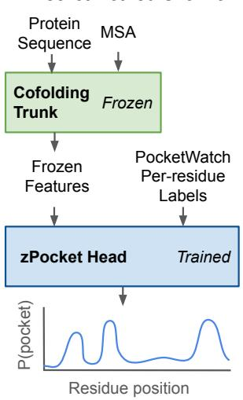

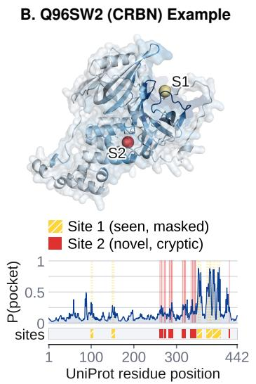  
ket vs. Baselines on differC. zPocket vs. Baselines on strata of PocketWatch

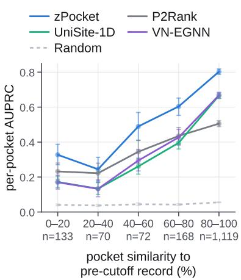  
Figure 1: zPocket predicts pocket residues from frozen co-folding features and beats baselines across different stratifications of the PocketWatch test set. (A) Method. A sequence is folded by a frozen trunk and its frozen trunk features are cached. A head is trained on these features and per-residue labels from the PocketWatch dataset, emitting a pocket probability for every residue. (B) One test target, cereblon (UniProt Q96SW2), with the predicted per-residue score painted on the fold and plotted along the canonical UniProt sequence; spheres mark each annotated site’s ligand centroid. Site $S _ { 1 }$ is already in the pre-cutoff record, so its residues are masked and not scored; $S _ { 2 }$ is novel and cryptic, first appearing after the cutoff, and is scored in full. For more details on this visualization, see Appendix B.6. (C) zPocket (ESMFold2 pairformer2) against P2Rank, UniSite-1D, and VN-EGNN scored by per-pocket AUPRC against max\_qcov, the largest fraction of a held-out pocket’s residues covered by a pre-cutoff pocket. UniSite-1D and VN-EGNN are both retrained on PocketWatch; Table 1 also gives their published weights. zPocket leads every baseline in every bin. Bin sizes are printed on the axis and bars are bootstrap 95% intervals.

Second, we develop zPocket, a set of per-residue pocket prediction heads over the trunk features of Protenix [37] and ESMFold2 [5]. Both models had open weights when we ran our experiments, but the Protenix-v2 weights have since moved to a proprietary license. The main text therefore reports ESMFold2 heads, whose trunk remains open-weight, with every structure-reading baseline run on ESMFold2 folds; the two trunks are compared at matched architectures in Table A5, where Protenix-v2 scores slightly higher. We benchmark against P2Rank [19], a widely used competitive baseline [31], alongside two learned detectors evaluated using the published weights as well as retrained on PocketWatch: UniSite [11], which reads sequence alone, and VN-EGNN [27], which reads a structure graph. We find that zPocket outperforms these baselines in every stratum. Figure 1 summarizes the method, provides an illustration of zPocket outputs as well as the per-residue masking the temporal split rests on, and the headline stratified comparison.

## 2 Related work

Binding site prediction. Classical pocket finders score surface geometry [8, 14], evolutionary conservation [6], or interaction energetics [13, 20]. Since fpocket [21] made cavity enumeration cheap, much of the progress has come from learning to rank cavities rather than to find them: P2Rank [19] trains a random forest to score solvent-accessible surface points from local physicochemical descriptors and clusters the high-scoring points into ranked pockets, while DeepPocket [1] leaves fpocket’s proposals untouched and re-ranks them with a 3D CNN over a grid centered on each cavity. Other deep learning methods predict pockets directly from a voxel grid (DeepSite, 16) or a protein graph (VN-EGNN, 27). Despite increased sophistication, reliance on predefined features and explicit geometric inputs still limits these methods. A recent method, Lacuna, detects pockets across a generated conformational ensemble rather than on the input structure alone [23].

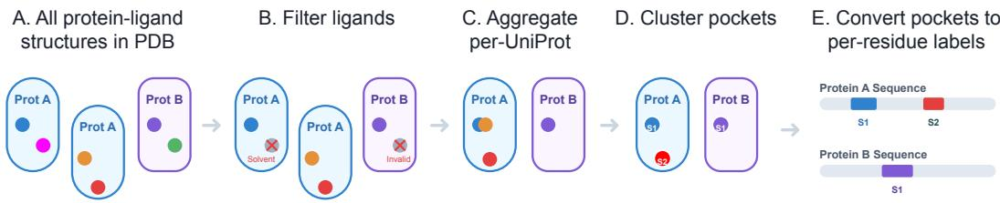  
Figure 2: PocketWatch Construction Overview (A) We start with every protein–small-molecule structure in the PDB released prior to January 2, 2026. (B) We filter to only include ligands that are biologically relevant per BioLiP2 [36] and pass our size filter; more details in Appendix A.1. (C) Surviving pocket instances (one receptor chain paired with one ligand occurrence) are aggregated per canonical UniProt sequence, so a protein carries every pocket ever observed on it rather than one per structure. (D) Instances are placed in a common frame on a predicted fold and single-linkage clustered by ligand centroid into discrete pocket sites. (E) Sites become a per-residue binary label vector indexed by canonical UniProt position, which is what the heads are trained and scored on.

Pocket-finding benchmarks. UniSite [11] and LIGYSIS [31] curate pocket datasets along lines similar to ours, but neither provides a temporal split allowing for evaluation of AF3-era co-folding models. PocketWatch extends the record of ligand binding sites found in the RCSB through the end of 2025 to allow for the identification of more novel pockets. Following Runs N’ Poses [29], which showed that co-folding accuracy collapses on ligand pockets far from the training set, we stratify our test set by structural similarity to better evaluate generalization. Because a binding site open in a ligand-bound structure can be absent from the unbound form, identifying ligand sites from static structures can be challenging. The term “cryptic” is used to describe such pockets, and CryptoBench [28] formalizes this with an apo–holo pocket RMSD criterion over quality-controlled experimental pairs, and IsoDDE [15] additionally conditions crypticity on what its co-folding model saw during training. We borrow from both definitions when stratifying our test set.

Structure predictors as feature extractors. AF2Bind [12] read binding sites out of AlphaFold2 trunk features, but had to do so indirectly: AF2 takes no ligand input, so AF2Bind appends twenty “bait” amino acids as small-molecule surrogates and classifies the pair representation between them and the target. Using light heads trained on frozen trunk features is a commonly used recipe for other tasks, such as affinity prediction in Boltz-2 [26].

## 3 Methods

## 3.1 PocketWatch dataset

Figure 2 provides an overview of PocketWatch dataset construction. We aggregate ligand-contacting residues (“pocket instances”) from the RCSB on a per-UniProt basis and cluster them into pocket sites. For each canonical UniProt sequence in our dataset (a “chain”), we generate a per-residue binary mask based on whether that residue participates in any pocket sites. We then generate a temporal split by assigning each chain to train, validation, or test based on the release date of its earliest member pocket instance. A chain is assigned to test when any of its sites first appeared on or after 2024-01-01, and to validation when any first appeared after 2021-09-30. More details are in Appendix A.1.

Test set stratification. We stratify the test set three ways. Test chains are binned by sequence identity to anything the models have already seen, computed with MMseqs2 [30]. Test pockets are binned by structural similarity using PLINDER-style maximum pocket coverage (max\_qcov) [10]. Finally, we label crypticity following CryptoBench [28] and IsoDDE [15], with additional annotation of nominally cryptic pockets for which the predicted fold and ground truth pocket are actually close in RMSD. Details are in Appendix A.1.1.

## 3.2 zPocket: trunk-feature-based pocket prediction

Training zPocket per-residue heads. Each protein is featurized once by folding its sequence with two (frozen) co-folding models: s and z features are retained for Protenix-v2 [37] and last-layer ESMC-6B embeddings and z are retained for ESMFold2 [5].

We train architectures of increasing expressivity on these frozen features to locate where the pocket signal lives. Every z-based head maps a protein’s pair representation z to per-residue pocket logits through a common pooling: each residue is represented by the concatenation of its row mean, column mean and self-pair diagonal, which a LayerNorm and a small MLP then reduce to a scalar. The z-based heads differ in how much pair mixing precedes that pooling. pooled applies it directly, with no mixing. axial projects z to a narrow width and applies a row-then-column self-attention block. pairformerK applies K AlphaFold-style triangular pair blocks [17], which let a residue’s score depend on geometry it does not directly contact. We also train single heads, which apply that readout MLP directly to a per-residue representation (Protenix s or last-layer ESMC-6B embeddings). Heads are trained with per-residue binary cross-entropy loss and we select the checkpoint with the best per-target validation AUPRC. Further details are in Appendix A.2.

Decoding to pocket centroids. Ligand binding site prediction is often evaluated using predicted pocket centroids. We obtain pocket centroids from our per-residue predictions in two ways: clustering and re-ranking centroids from other pocket predictors. The clustering decoder takes residues scoring above a threshold to seed a weighted mean shift over their Cα coordinates, and each resulting density mode is reported as one pocket. The re-ranking decoder instead keeps another method’s proposals and re-orders them, following the division of labor in DeepPocket [1] but with the zPocket head in place of its 3D-CNN: each proposed centroid is scored by aggregating the head’s probabilities over its lining residues. We also evaluate “hybrid” decoders, where we combine the zPocket centroid proposals with the base method’s centroid proposals before re-ranking. All decoders, and the hyper-parameters chosen on validation, are detailed in Appendix A.2.

## 3.3 Baselines

We compare against five pocket finders, all run on the same ESMFold2-predicted folds as zPocket: the geometric detectors fpocket [21] and P2Rank [19] (alphafold configuration), two variants of the ensemble detector Lacuna [23], which detects pockets across a generated conformational ensemble rather than on the input fold alone and ranks them with its own fitted model, the graph-based detector VN-EGNN [27], and the set predictor UniSite-1D [11], of which we run the sequence-only 1D model. We run the baseline methods using predicted folds rather than experimental structures; in Appendix B.4 we show that this has no significant effect on P2Rank’s per-target performance.

We additionally retrain VN-EGNN and UniSite-1D from scratch with the PocketWatch train/val split and report the re-trained versions (PW) alongside their published weights (pub); fpocket, P2Rank and Lacuna appear as published only. Since the published weights are fitted to a different dataset with different ligand policies and contact thresholds, the retrained models allow us to measure the value of the PocketWatch dataset itself. Retraining required no new annotation; both models’ supervision signals — per-residue ligandability, and one centroid per pocket for VN-EGNN’s position loss — are already carried by our labels. The published and re-trained VN-EGNN models differ slightly in input features, since the authors’ current graph builder adds a residue-type one-hot the published checkpoint lacks. Neither VN-EGNN nor UniSite-1D emits per-residue scores natively — VN-EGNN emits ranked points and UniSite-1D a set of scored masks — so both are reduced to a per-residue field as described in Appendix A.3, which also gives retraining protocols, versions and settings for every baseline.

## 3.4 Evaluation

We evaluate two tasks: per-residue prediction and pocket-centroid prediction. The per-residue task ranks a chain’s residues by predicted pocket probability. We score it both per target, treating all of a protein’s pocket residues as positives, and per pocket, taking one pocket’s residues as the positives and masking out every other pocket. We report average precision (AUPRC) as the headline, alongside AUROC and R-precision. The pocket-centroid task scores a ranked list of predicted centroids. Following the top-N+2 recall proposed by Utgés and Barton [31], we cut the list at the protein’s own site count plus two and report $\mathbf { D C C } _ { N + 2 } \mathrm { : }$ the fraction of ground-truth sites with a kept centroid within 4 Å of their ligand centroid. A budgeted recall says nothing about what a method emits beyond the budget, so we also report AP over the whole list and the ceiling, the same DCC rate with no budget. Full definitions are in Appendix A.4.

Which pockets are scored is decided once, at the site level, and both tables read the same decision. We mask “seen” pocket sites, those with a member pocket instance predating the test cutoff; “interfaceonly” pockets, those every one of whose member pockets involves more than one chain, so that P2Rank and the other single-chain methods are not charged for contacts a monomer fold cannot express; and the few novel sites whose residues lie entirely inside an already-public pocket. A pocket observed at an interface in some structures and on a single chain in others is not interface-only: it is scored, on its monomer-expressible residues alone. Masked pockets are neither credited nor charged — their residues are excluded from every other pocket’s negatives, and a predicted centroid landing on one is dropped from the ranked list rather than counted as a false positive. Of 1,577 test pockets surviving the first two rules, 1,573 are scored over 1,279 chains; the tables report 1,562 over 1,275, restricted to the proteins every method returned a prediction for.

## 4 Results

## 4.1 zPocket beats all baselines on per-residue pocket prediction

Table 1 reports zPocket head architectures on ESMFold2 trunk features against baselines run on ESMFold2 folds; Table A5 adds the same heads on the Protenix trunk. Every z-based zPocket head on every trunk beats the published and re-trained baselines by a wide margin. The architecture ordering pairformer2 > pairformer1 > axial > pooled is identical on both trunks and on nearly every metric: pair mixing before the pooled readout buys real signal, but much of the signal can be read directly off z as shown by pooled. The best model, ESMFold2 pairformer2, reaches 0.745 per-target AUPRC against 0.477–0.598 for the baselines. Table A5 shows that the two trunks are close to interchangeable at matched architectures, with Protenix slightly but consistently beating ESMFold2. Performance mostly saturates after one pairformer block, the second buying +0.008. AUROC spans 0.924–0.951 across the four z heads against 0.837–0.898 for the baselines; at a 4.86% positive rate it is dominated by easy negatives and does not really separate the heads.

The pair tensor is where the signal lives. The single row in Table 1 applies the same readout to ESMFold2’s final-layer ESMC-6B embedding. Despite receiving no structural input whatsoever, it scores 0.611 and clears every baseline, including VN-EGNN (PW) at 0.598, yet still falls short of the pooled row’s 0.639. The ESMC embedding is a much stronger per-residue representation than the s features from Protenix-v2 (Table A5): the s-feature-based head for Protenix-v2 scores 0.474 against its pooled row’s 0.669, so most of its pocket signal sits in z rather than s, and it is the one zPocket configuration that does not beat P2Rank on the same folds (0.503).

Retraining on PocketWatch improves baselines. VN-EGNN gains +0.039 per-target AUPRC over its published weights (0.559 to 0.598) and UniSite-1D +0.064 (0.531 to 0.595). This suggests that the PocketWatch benchmark is worth training on rather than only scoring against, and it holds for both a graph network reading structure and a transformer reading sequence. Both retrained baselines still fall short of every z-based zPocket head, so the trunk representation may still buy something the retraining does not. However, we acknowledge that some differences in training procedures (Appendix A.3) may also affect results, so it’s not possible to entirely attribute the gains to the new data without further ablations. We also note that the PocketWatch training set is more closely matched to the PocketWatch test set than the training distributions of published methods, which is another mechanism by which retraining can improve performance.

Table 1: Per-residue results on PocketWatch, for zPocket heads on the ESMFold2 trunk against both published and re-trained baselines, scored on the 1,562 test pockets of 1,275 targets in the effective test set. All baselines are run on ESMFold2’s predicted folds when structure is needed. Table A5 compares results from both ESMFold2 and Protenix. The single row reads the final-layer ESMC-6B embedding. $\mathrm { R p } = \mathrm { R } .$ -precision. Per-target metrics are computed once per target from that target’s residue ranking, then averaged over targets with equal weight. Per-pocket metrics are computed once per pocket, with positives from other pockets masked out, and averaged over pockets with equal weight. The last two columns split $\mathrm { A U P R C } _ { p }$ by the number of scored pockets for each protein. (pub) is the published weights; (PW) is the same architecture retrained on PocketWatch. UniSite-1D (PW) is the mean of three seeds; every other row is a single model. Bold = best per column.
<table><tr><td rowspan="2">Method</td><td rowspan="2">Variant</td><td colspan="3">per target</td><td colspan="3">per pocket</td><td colspan="2"> $\mathrm { { A U P R C } } _ { p }$  by multiplicity</td></tr><tr><td>AUPRCt AUROCt</td><td></td><td> $\mathrm { R p } _ { t }$ </td><td> $\mathrm { { A U P R C } } _ { p }$ </td><td> $\mathbf { A U R O C } _ { p }$ </td><td> $\mathsf { R p } _ { p }$ </td><td>1 pocket</td><td>&gt;1</td></tr><tr><td>Baselines</td><td>P2Rank</td><td>0.477</td><td>0.859</td><td>0.449</td><td>0.455</td><td>0.855</td><td>0.425</td><td>0.466</td><td>0.430</td></tr><tr><td></td><td>VN-EGNN (pub)</td><td>0.559</td><td>0.862</td><td>0.513</td><td>0.516</td><td>0.846</td><td>0.472</td><td>0.567</td><td>0.409</td></tr><tr><td></td><td>UniSite-1D (pub)</td><td>0.531</td><td>0.878</td><td>0.507</td><td>0.497</td><td>0.870</td><td>0.474</td><td>0.533</td><td>0.421</td></tr><tr><td>Retrained</td><td>PocketWatch VN-EGNN (PW)</td><td>0.598</td><td>0.837</td><td>0.567</td><td>0.559</td><td>0.819</td><td>0.530</td><td>0.605</td><td>0.463</td></tr><tr><td></td><td>UniSite-1D (PW)</td><td>0.595</td><td>0.898</td><td>0.568</td><td>0.552</td><td>0.883</td><td>0.529</td><td>0.598</td><td>0.458</td></tr><tr><td rowspan="5">zPocket</td><td>single (ESMC)</td><td>0.611</td><td>0.918</td><td>0.564</td><td>0.574</td><td>0.906</td><td>0.528</td><td>0.610</td><td>0.499</td></tr><tr><td>pooled</td><td>0.639</td><td>0.924</td><td>0.589</td><td>0.600</td><td>0.913</td><td>0.551</td><td>0.640</td><td>0.516</td></tr><tr><td>axial</td><td>0.716</td><td>0.945</td><td>0.652</td><td>0.675</td><td>0.934</td><td>0.613</td><td>0.719</td><td>0.584</td></tr><tr><td>pairformer1</td><td>0.737</td><td>0.950</td><td>0.677</td><td>0.695</td><td>0.941</td><td>0.637</td><td>0.741</td><td>0.600</td></tr><tr><td>pairformer2</td><td>0.745</td><td>0.951</td><td>0.682</td><td>0.702</td><td>0.941</td><td>0.639</td><td>0.751</td><td>0.599</td></tr><tr><td>random</td><td></td><td>0.049</td><td>0.500</td><td>0.049</td><td>0.051</td><td>0.500</td><td>0.051</td><td>0.053</td><td>0.048</td></tr></table>

Multi-pocket proteins are harder. The last two columns in Table 1 split per-pocket AUPRC by how many scored pockets a chain holds. Every z head does worse on chains holding more than one, with pairformer2 falling from 0.751 to 0.599.

Pocket prediction drops for unfamiliar pockets. To test whether zPocket is re-identifying pockets from co-folding training data, we stratify the test set by max\_qcov, the largest fraction of a held-out pocket’s residues covered by a pre-cutoff pocket. Per-pocket AUPRC falls from 0.803 in the mostcovered bin to 0.327 below 20% coverage (Fig. 1C), and 1,119 of 1,562 scored pockets — 71.6% — sit in that top bin, so the aggregate in Table 1 is dominated by familiar pockets. Structural similarity is the more informative leakage axis compared to sequence similarity: per-target AUPRC is roughly flat across sequence identity until the ≥95% bin, where it falls (Fig. A1). We read that fall as an artifact of seen pockets being masked, leaving only harder pockets. Despite lower results on unfamiliar pockets, zPocket pairformer2 still leads baselines in every similarity stratum. In Figure 3, we compare results across the crypticity stratification, once again observing that zPocket beats the baseline methods in every stratum, but we note the small number of cryptic pockets. Appendix B.5 crosses crypticity with predicted-fold accuracy and shows that most of the apparent effect is the fold’s, not the pocket’s.

## 4.2 The pocket signal is not specific to one trunk

To test whether the pocket signal in z is particular to ESMFold2 and Protenix-v2, we trained z-pocket heads on features from 5 more co-folding trunks with openly released weights: Protenix-v1 [4], OpenFold3-preview [25], Boltz-1 [35], Chai-1 [7] and RF3 [9] using the procedure described in

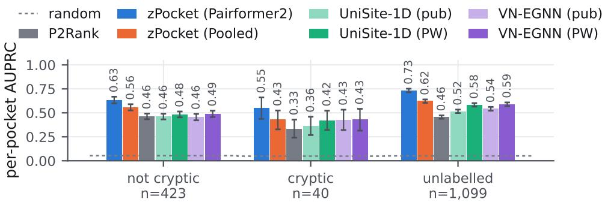  
pocket crypticity (apo evidence)  
Figure 3: Per-pocket AUPRC by crypticity label. Cryptic pockets are those that an experimental apo structure shows closed; not cryptic are those an experimental apo structure shows open; unlabeled those with no admissible experimental apo structure, which is 70% of the test set and not a neutral remainder; a crypticity label requires a deposited apo structure, which makes the labeled subset a harder, biased sample. Bars are bootstrap 95% intervals; the cryptic column holds 40 pockets and its intervals are wide accordingly. Appendix B.5 crosses this with predicted-fold accuracy.

Table 2: Per-target AUPRC of zPocket heads trained with one recipe on seven frozen co-folding trunks, scored on the 1,562 test pockets of 1,275 targets as in Table 1. $c _ { z }$ is the trunk’s pair width. Brackets are 95% bootstrap intervals over targets. The Protenix-v2 and ESMFold2 rows repeat Table A5. Each row is a single training run. Below the double rule, ensembles average the per-residue logits of those pairformer2 heads with equal weight; nothing is fitted. Bold = best single trunk per column. Details in Appendix A.5.
<table><tr><td>Trunk</td><td> $c _ { z }$ </td><td>pooled</td><td>pairformer2</td></tr><tr><td>Protenix-v2</td><td>256</td><td>0.669 [0.653, 0.684]</td><td>0.757 [0.741, 0.772]</td></tr><tr><td>Chai-1</td><td>256</td><td>0.668 [0.652, 0.683]</td><td>0.746 [0.729, 0.762]</td></tr><tr><td>ESMFold2</td><td>256</td><td>0.639 [0.623, 0.655]</td><td>0.745 [0.729, 0.761]</td></tr><tr><td>Protenix-v1</td><td>128</td><td>0.650 [0.634, 0.665]</td><td>0.742 [0.725, 0.758]</td></tr><tr><td>OpenFold3-preview</td><td>128</td><td>0.619 [0.604, 0.634]</td><td>0.742 [0.726, 0.758]</td></tr><tr><td>RF3</td><td>128</td><td>0.631 [0.615, 0.646]</td><td>0.741 [0.725, 0.757]</td></tr><tr><td>Boltz-1</td><td>128</td><td>0.638 [0.622, 0.653]</td><td>0.733 [0.716, 0.749]</td></tr><tr><td>Protenix-v2 + ESMFold2</td><td></td><td></td><td>0.773 [0.757, 0.788]</td></tr><tr><td>All seven trunks</td><td></td><td></td><td>0.777 [0.762, 0.793]</td></tr></table>

Section 3.2. Every checkpoint’s experimental training structures predate the PocketWatch validation and test periods. Featurization and training details are in Appendix A.5.

All of the co-folding trunks carry the pocket signal (Table 2): each pairformer2 head scores between 0.733 and 0.757, well clear of the strongest baseline in Table 1 (0.598). The head architecture matters more than the trunk: pairformer2 beats pooled by 0.08–0.12 on every trunk. The seven trunks span 0.024 under pairformer2, half their 0.050 spread under pooled, suggesting that pair mixing recovers signal some trunks do not expose to a pooled readout. OpenFold3-preview is the clearest case, last with pooled and level with ESMFold2 with pairformer2. Protenix-v2 scores highest with both heads, +0.015 over its predecessor Protenix-v1 with pairformer2 (paired 95% CI [+0.007, +0.023]), though Chai-1 ties it with pooled (−0.001 [−0.006, +0.004]). Ensembling trunks helps with no tuning: averaging the pairformer2 heads’ logits, Protenix-v2 with ESMFold2 reaches 0.773 (+0.016 [+0.011, +0.021] over Protenix-v2 alone) and all seven trunks 0.777 (+0.021 $[ + 0 . 0 1 5 , + 0 . 0 2 7 ] )$ . As each head is a single seed, part of this gain may come from averaging independent training runs rather than from the trunks’ diversity.

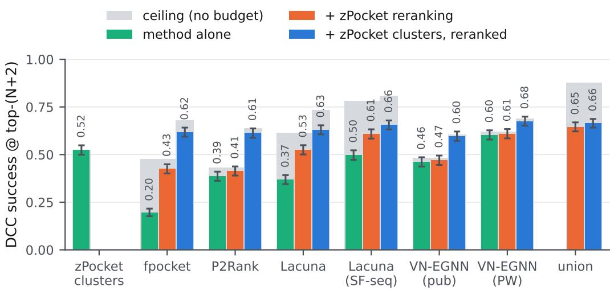  
Figure 4: Pocket centroid prediction on PocketWatch. $\mathrm { D C C } _ { N + 2 }$ over 1,562 pockets of 1,275 targets, at 4 Å. Green is each method’s own proposals under its own ranking; orange re-ranks those same proposals with the zPocket head; blue adds the zPocket cluster proposals to them before re-ranking with the zPocket head. Behind each bar in gray is that bar’s own ceiling — the total number of true pockets detected among all of the proposals. A bar close to its ceiling is limited by what was proposed; a short bar under a tall ceiling is limited by the ranking. union pools every method’s cavities (other than zPocket clusters), so it has no ranking of its own. Error bars are 95% percentile bootstrap intervals over pockets and are unpaired: two bars whose intervals overlap can still differ significantly once the comparison is paired. By a paired 95% bootstrap over the same pockets, re-ranking lifts every method except for the PocketWatch-retrained variant of VN-EGNN (PW), and combining the zPocket clusters with any other method’s proposals then re-ranking lifts $\mathrm { D C C } _ { N + 2 }$ further.

## 4.3 Pocket centroids

In Figure 4, we compare different pocket proposal and pocket ranker combinations in terms of $\mathrm { D C C } _ { N + 2 }$ , the fraction of true pocket centroids detected among the top ranked $N + 2$ predicted centroids, where N is the number of true pockets for a given protein; we also show the ceiling, which is the total percentage of true pocket centroids detected among all pocket proposals, and therefore the upper bound on $\mathrm { D C C } _ { N + 2 }$ . Table A7 gives the same results numerically along with average precision, precision, and emission rate for each method.

zPocket’s clustering is precise but limited. The zPocket clustering decoder emits only 1.1 pockets per protein on average, so cannot reach a protein’s second site and its ceiling is 0.524. It is the most precise method by a wide margin — 60% of what it emits lands on a real site, against 18% for retrained VN-EGNN and 4% for P2Rank — but its recall is limited by its low emission rate. Despite this limitation, the zPocket clustering decoder is competitive with the other methods in terms of $\mathrm { D C C } _ { N + 2 }$ , beating all published baselines using their published rankers, and only falling short of the PocketWatch-retrained VN-EGNN method.

Re-ranking with zPocket improves ranked pocket recall. Re-ranking a method’s pocket proposals with zPocket significantly improved each $\mathrm { D C C } _ { N + 2 }$ for each published baseline (comparing orange bars to green bars), and only failed to improve the PocketWatch-retrained VN-EGNN method. Reranking increased $\mathrm { D C C } _ { N + 2 }$ by an average of 0.090 across these 6 methods, with the biggest gains for fpocket and the two Lacuna variants.

zPocket contributes proposals, not just ranking. We see further improvements when we combine the zPocket clustering proposals with each method’s own proposals and then re-rank the union with the zPocket head (blue bars). In fact, every method, even VN-EGNN (PW), sees significant improvement in $\mathrm { D C C } _ { N + 2 }$ when combined with zPocket proposals, though we note this is not the case for $\mathrm { D C C } _ { N }$ (Table A7). Across these six methods and the union method, the average $\mathrm { D C C } _ { N + 2 }$ gain from adding zPocket proposals and re-ranking is 0.108. We note that the highest-scoring method is the re-trained VN-EGNN method combined with zPocket proposals, which reaches 0.675. We note that even though the union of proposals had a higher ceiling, we were not able to improve $\mathrm { D C C } _ { N + 2 }$ beyond this through ranking.

Pocket detection deteriorates on less familiar pockets, and ranking gets harder. In Appendix B.3, we split this comparison by max\_qcov, and observe that the ceiling and $\mathrm { D C C } _ { N + 2 }$ both drop for less-familiar pockets; In the ≥80% bin the best configurations reach $\mathrm { D C C } _ { N + 2 }$ of about 0.81, while below 80% coverage no configuration exceeds 0.37. Furthermore, the gap between the ceiling and the ranked $\mathrm { D C C } _ { N + 2 }$ is larger for less-familiar pockets, indicating that ranking is also more difficult.

## 5 Applications

## 5.1 In-Silico Fragment Screening

Evaluation dataset. Fragment screening campaigns are used to find preliminary hits against a protein target and characterize possible pockets. The protein is screened against a library of several hundred fragments and a structure is solved for every hit. This process is time consuming and expensive, and ML pocket predictors hold promise in reducing costs through narrower screening of fragments or progressing directly to hit ID. To simulate a fragment screening scenario, we assembled a test set from eleven XChem campaigns released through Fragalysis together with four fragmentscreen group depositions in the PDB (details in Appendix C). A fragment is counted once per distinct SMILES, and sites are single-linkage clusters as in PocketWatch. We score a site only if at least three distinct fragments support it, its hits are not dominated by crystal contacts (median symmetry-contact fraction below 0.25), and its lining residues map onto the predicted fold with a Cα fit below 2 Å. Since that last check is run against a predicted structure, we require it to pass on both Protenix-v2’s and ESMFold2’s folds, so that the two are scored on identical labels. Sites whose lining residues overlap with a pocket in the zPocket heads’ training split are dropped. This leaves 12 proteins with 35 scored sites.

The per-residue ordering holds, but re-ranking helps unevenly. On per-residue scores the PocketWatch ordering holds: zPocket reaches 0.494 AUPRC against 0.459 for P2Rank, 0.438 for VN-EGNN and 0.385 for UniSite-1D, all far above the 0.212 a random score reaches (Figure 5a). Turning those scores into centroids is harder, and the gain from re-ranking varies by detector. Reranking fpocket’s cavities with the zPocket head lifts it from 0.259 to 0.391, the best configuration measured (Figure 5b); pooling the head’s own cluster proposals in before re-ranking adds nothing further, since on this trunk the clusters reach no site fpocket’s cavities do not. Re-ranking leaves P2Rank and VN-EGNN mostly unchanged, though adding the zPocket cluster proposals gives both a slight boost. Lacuna drifts down under both treatments, 0.263 to 0.246 re-ranked and to 0.225 pooled. On the Protenix-v2 trunk the zPocket cluster centroids do add sites the detectors miss, and pooling them in lifts both fpocket and Lacuna (Appendix B.7). With twelve proteins the intervals are wide (fpocket re-ranked spans [0.16, 0.65]), so no pair of configurations here separates; we read this set as corroborating the PocketWatch comparison rather than ranking methods on its own.

Qualitative differences from PocketWatch. Two effects may explain why $\mathrm { D C C } _ { N + 2 }$ on the fragment screening set is lower than on the PocketWatch test set. At the 4 Å radius PocketWatch is scored at, the best configuration here reaches 0.391 $\mathrm { D C C } _ { N + 2 }$ , while on the PocketWatch test set it reaches 0.68. The first is site multiplicity: a fragment-screened protein carries 2.9 scored sites on average against PocketWatch’s 1.23, and a decoder emitting about one pocket per protein cannot reach a third or a fifth site. However, restricting each protein to its dominant site (the site with the most fragments) lifts 0.391 only to 0.417. Perfect ranking also does not close the gap, since the best proposal set reaches a ceiling of 0.529 with no budget at all (Figure 5b), well short of the 0.879 ceiling on the PocketWatch test set. The second, and perhaps more important factor, is that fragment-screening pockets are different from drug-like pockets, as fragments are often smaller and can have much lower affinity than true binders. Therefore, it is possible that fragment soaking and zPocket offer complementary information for identifying pockets.

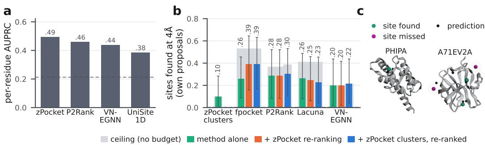  
Figure 5: Pocket prediction on crystallographic fragment screens. (a) Per-residue AUPRC over the 35 fragment-soak sites of 12 proteins, for the zPocket head on ESMFold2 folds against three baselines, also using ESMFold2 folds when needed; the dashed line is chance. (b) The same proteins scored as in Figure 4: each detector’s own proposals under its own ranking, those proposals re-ranked by the zPocket head, and those proposals pooled with the head’s cluster proposals before re-ranking. A site counts as found when a prediction in the top N + 2 lies within 4 Å of its centroid, N being that protein’s scored-site count. Behind each bar in gray is that bar’s own ceiling, the rate with no budget at all. Error bars are 95% percentile bootstrap intervals over proteins, and they are wide: twelve proteins separate none of these methods. (c) Two targets scored by fpocket’s cavities pooled with zPocket clusters and re-ranked. Spheres mark each scored site’s centroid, drawn at the 4 Å success radius; the small black spheres are the predicted centroids inside the budget. PHIPA carries one scored site and it is found; A71EV2A carries four and two are found. Figure A5 repeats (a) and (b) using the Protenix-v2-based head and folds.

## 5.2 Novel pocket hypotheses

Searching for novel pockets. Strong pocket predictors can also be used to generate new ideas in target selection by surfacing high-confidence, but previously unexplored, pockets on proteins with therapeutic potential. As a proof-of-concept, zPocket was run across the ∼20,000 reviewed human proteins of UniProt proteome UP000005640, yielding ∼22,000 predicted pockets. Unlike the rest of the main text, this scan uses the Protenix-v2 pairformer2 head on Protenix-v2 folds; it was run while the Protenix-v2 weights were openly licensed and has not been repeated on ESMFold2. The resulting pockets were then filtered for basic geometric plausibility (size and buriedness) and novelty. Novelty was determined using both sequence-level UniProt annotations and Q-BioLiP structural annotations. These annotations were used to check the input protein directly (first degree) and analogous proteins (second degree), as judged by shared structural motifs (Folddisco) or shared phylogeny. A pocket that survives these filters is one that would be very unlikely to be found by traditional tools or a database lookup. We describe the full set of novelty filters in Appendix D.

Candidate pocket examples. Of ∼22,000 predicted pockets, 359 pockets on 358 proteins survived novelty and plausibility filters if polymer interface sites are not removed, which accommodates, for example, peptide binding pockets. Discarding these leads to 155 on 154 proteins. Two survivors illustrate possible ideas resulting from large-scale screening and filtering (Appendix E): DET1, a substrate-adaptor subunit of a cullin-RING ligase whose pocket is a candidate degrader-recruiter site supported by twelve deposited structures, and COP1, which the filter flags as a known peptidebinding interface, and which no geometric detector proposes at all, yet whose predicted pocket covers fourteen of the fifteen residues contacting the bound degron peptide. In this case, zPocket re-identified a peptide-binding site, despite not being trained with peptide ligands. This pocket is not a completely novel pocket but modality-novel, as there is no known small ligand binder despite zPocket’s high-confidence prediction. In discovery, there is an obvious tension between novelty and tractability. Predicted pockets on well-characterized proteins are rarely novel, especially on the reference human proteome. This was a first pass with conservative filters, and future work could refine the filtering criteria used, or focus on particular targets. Future work could also extend to screening variants and proteomes for animal models or microbes.

## 6 Discussion

Together these results show that modern co-folding models offer a promising foundation for blind binding site prediction. zPocket heads outperform every baseline we ran on per-residue pocket prediction, and improve the rankings of pockets proposed by other methods. PocketWatch fills a benchmark gap, allowing direct comparison of pocket finders on pockets that postdate what co-folding models have seen; its training split is also useful in its own right, lifting both baselines we retrained on it. We hope PocketWatch will be a valuable resource for developers and evaluators of pocket finding methods.

However, challenges remain. As shown by our stratifications, the number of truly novel pockets in the test set is low, and the aggregate performance is dominated by pockets with a close structural precedent; we expect the number of novel pockets available for evaluation to increase as more structures are deposited and PocketWatch is extended. We evaluate monomer pockets only, and extending to interfaces is natural future work, particularly since interface-adjacent sites are where several of our candidate pockets sit.

Finally, we also note that predicted sites may not be functional sites. However, we think this matters less than it once did and may actually be an asset: as degraders, molecular glues, and radioligand conjugates make non-orthosteric sites therapeutically actionable, the useful question shifts from where a protein does its chemistry to where a small molecule can bind at all.

## References

[1] Rishal Aggarwal, Akash Gupta, Vineeth Chelur, C. V. Jawahar, and U. Deva Priyakumar. DeepPocket: Ligand binding site detection and segmentation using 3D convolutional neural networks. Journal ofChemical Information and Modeling, 62(21):5069–5079, 2022.

[2] Anew Labs Team. AnewDDE: An agentic drug discovery engine for biomolecular interaction modelling and closed-loop design. Technical report, Anew Labs, September 2026. URL https: //anewbt.com/news/anewdde-agentic-drug-discovery-engine. PDF: https:// anewlabs-research.tos-cn-beijing.volces.com/anewdde-tech-report.pdf. Accessed 2026-09-24.

[3] Helen M. Berman, John Westbrook, Zukang Feng, Gary Gilliland, T. N. Bhat, Helge Weissig, Ilya N. Shindyalov, and Philip E. Bourne. The Protein Data Bank. Nucleic Acids Research, 28 (1):235–242, 2000.

[4] ByteDance AML AI4Science Team. Protenix: Advancing structure prediction through a comprehensive AlphaFold3 reproduction. bioRxiv, 2025.

[5] Salvatore Candido, Thomas Hayes, Alexander Derry, Roshan Rao, Zeming Lin, Robert Verkuil, Bryan Z. Wu, Jin Sub Lee, Elise S. Bruguera, Tom Sercu, and Alexander Rives. Language modeling materializes a world model of protein biology. bioRxiv, 2026. doi: 10.64898/2026.06. 03.729735.

[6] John A. Capra, Roman A. Laskowski, Janet M. Thornton, Mona Singh, and Thomas A. Funkhouser. Predicting protein ligand binding sites by combining evolutionary sequence

conservation and 3D structure. PLoS Computational Biology, 5(12):e1000585, 2009. doi: 10.1371/journal.pcbi.1000585.

[7] Chai Discovery. Chai-1: Decoding the molecular interactions of life. bioRxiv, 2024. doi: 10.1101/2024.10.10.615955.

[8] Michael L. Connolly. Analytical molecular surface calculation. Journal of Applied Crystallography, 16(5):548–558, 1983. doi: 10.1107/S0021889883010985.

[9] Nathaniel Corley, Simon Mathis, Rohith Krishna, et al. Accelerating biomolecular modeling with AtomWorks and RF3. bioRxiv, 2025. doi: 10.1101/2025.08.14.670328.

[10] Janani Durairaj, Yusuf Adeshina, Zhonglin Cao, Xuejin Zhang, Vladas Oleinikovas, Thomas Duignan, Zachary McClure, Xavier Robin, Emine Kucukbenli, Torsten Schwede, and Luca Naef. PLINDER: the protein–ligand interactions dataset and evaluation resource. bioRxiv, 2024. doi: 10.1101/2024.07.17.603955.

[11] Jigang Fan, Quanlin Wu, Shengjie Luo, and Liwei Wang. UniSite: The first cross-structure dataset and learning framework for end-to-end ligand binding site detection. arXiv preprint arXiv:2506.03237, 2025.

[12] Artem Gazizov, Anna Lian, Casper Goverde, Jody Mou, Sergey Ovchinnikov, and Nicholas F. Polizzi. AF2BIND: predicting small-molecule binding sites using the pair representation of AlphaFold2. Nature Methods, 23:626–635, 2026. doi: 10.1038/s41592-026-03011-2.

[13] Peter J. Goodford. A computational procedure for determining energetically favorable binding sites on biologically important macromolecules. Journal of Medicinal Chemistry, 28(7):849– 857, 1985. doi: 10.1021/jm00145a002.

[14] M. Hendlich, F. Rippmann, and G. Barnickel. LIGSITE: automatic and efficient detection of potential small molecule-binding sites in proteins. Journal of Molecular Graphics and Modelling, 15(6):359–363, 1997. doi: 10.1016/s1093-3263(98)00002-3.

[15] Isomorphic Labs Team. Accurate predictions of novel biomolecular interactions with IsoDDE. Technical report, Isomorphic Labs, February 2026.

[16] J. Jiménez, S. Doerr, G. Martínez-Rosell, A. S. Rose, and G. De Fabritiis. DeepSite: proteinbinding site predictor using 3D-convolutional neural networks. Bioinformatics, 33(19):3036– 3042, 2017. doi: 10.1093/bioinformatics/btx350.

[17] John Jumper, Richard Evans, Alexander Pritzel, Tim Green, Michael Figurnov, Olaf Ronneberger, Kathryn Tunyasuvunakool, Russ Bates, Augustin Žídek, Anna Potapenko, Alex Bridgland, Clemens Meyer, Simon A. A. Kohl, Andrew J. Ballard, Andrew Cowie, Bernardino Romera-Paredes, Stanislav Nikolov, Rishub Jain, Jonas Adler, Trevor Back, Stig Petersen, David Reiman, Ellen Clancy, Michal Zielinski, Martin Steinegger, Michalina Pacholska, Tamas Berghammer, Sebastian Bodenstein, David Silver, Oriol Vinyals, Andrew W. Senior, Koray Kavukcuoglu, Pushmeet Kohli, and Demis Hassabis. Highly accurate protein structure prediction with AlphaFold. Nature, 596(7873):583–589, 2021.

[18] Diederik P. Kingma and Jimmy Ba. Adam: A method for stochastic optimization. In International Conference on Learning Representations (ICLR), 2015.

[19] Radoslav Krivák and David Hoksza. P2Rank: machine learning based tool for rapid and accurate prediction of ligand binding sites from protein structure. Journal of Cheminformatics, 10(1):39, 2018.

[20] Alasdair T. R. Laurie and Richard M. Jackson. Q-SiteFinder: an energy-based method for the prediction of protein–ligand binding sites. Bioinformatics, 21(9):1908–1916, 2005. doi: 10.1093/bioinformatics/bti315.

[21] Vincent Le Guilloux, Peter Schmidtke, and Pierre Tuffery. Fpocket: An open source platform for ligand pocket detection. BMC Bioinformatics, 10:168, 2009.

[22] Tsung-Yi Lin, Priya Goyal, Ross Girshick, Kaiming He, and Piotr Dollár. Focal loss for dense object detection. In IEEE International Conference on Computer Vision (ICCV), pages 2980–2988, 2017.

[23] Clayton W. Moore. Lacuna: Cryptic binding pocket discovery via conformational ensemble analysis. bioRxiv, 2026. doi: 10.64898/2026.08.14.744956.

[24] Jochem Nelen, Omeir Khan, Ellen Adams, Jasmin C. Aschenbrenner, Warren Thompson, Ali Ebrahim, Eda Capkin, Charlotte Vallee, OpenBind, Elizabeth J. Shotton, Edward J. Griffen, John D. Chodera, Charlotte M. Deane, Frank von Delft, Mohammed AlQuraishi, and Fergus Im rie. The first OpenBind release: an open experimental structure–affinity dataset and benchmark for structure-based AI. bioRxiv, 2026. doi: 10.64898/2026.08.27.747600.

[25] OpenFold Consortium. OpenFold3-preview technical report. https://portal.openfold. omsf.io/reports/of3p2\_technical\_report.pdf, 2025.

[26] Saro Passaro, Gabriele Corso, Jeremy Wohlwend, Mateo Reveiz, Stephan Thaler, Vignesh Ram Somnath, Noah Getz, Tally Portnoi, Julien Roy, Hannes Stark, David Kwabi-Addo, Dominique Beaini, Tommi Jaakkola, and Regina Barzilay. Boltz-2: Towards accurate and efficient binding affinity prediction. bioRxiv, 2025. doi: 10.1101/2025.06.14.659707.

[27] Florian Sestak, Lisa Schneckenreiter, Johannes Brandstetter, Sepp Hochreiter, Andreas Mayr, and Günter Klambauer. VN-EGNN: E(3)-equivariant graph neural networks with virtual nodes enhance protein binding site identification. arXiv preprint arXiv:2404.07194, 2024. doi: 10.48550/arXiv.2404.07194.

[28] Vít Škrhák, Marian Novotný, and David Hoksza. CryptoBench: cryptic protein–ligand binding sites dataset and benchmark. Bioinformatics, 2025.

[29] Peter Škrinjar, Jerome Eberhardt, Gerardo Tauriello, Torsten Schwede, and Janani Durairaj. Have protein-ligand cofolding methods moved beyond memorisation? bioRxiv, 2025. doi: 10.1101/2025.02.03.636309.

[30] Martin Steinegger and Johannes Söding. MMseqs2 enables sensitive protein sequence searching for the analysis of massive data sets. Nature Biotechnology, 35(11):1026–1028, 2017.

[31] Javier S. Utgés and Geoffrey J. Barton. Comparative evaluation of methods for the prediction of protein–ligand binding sites. Journal ofCheminformatics, 16, 2024.

[32] Michel van Kempen, Stephanie S. Kim, Charlotte Tumescheit, Milot Mirdita, Jeongjae Lee, Cameron L. M. Gilchrist, Johannes Söding, and Martin Steinegger. Fast and accurate protein structure search with Foldseek. Nature Biotechnology, 42:243–246, 2024.

[33] Sameer Velankar, José M. Dana, Julius Jacobsen, Glen van Ginkel, Paul J. Gane, Jie Luo, Thomas J. Oldfield, Claire O’Donovan, Maria-Jesus Martin, and Gerard J. Kleywegt. SIFTS: Structure Integration with Function, Taxonomy and Sequences resource. Nucleic Acids Research, 41(D1):D483–D489, 2013.

[34] Hong Wei, Wenkai Wang, Zhenling Peng, and Jianyi Yang. Q-BioLiP: A comprehensive resource for quaternary structure-based protein–ligand interactions. Genomics, Proteomics & Bioinformatics, 22(1), 2024.

[35] Jeremy Wohlwend, Gabriele Corso, Saro Passaro, Noah Getz, Mateo Reveiz, Ken Leidal, Wojtek Swiderski, Liam Atkinson, Tally Portnoi, Itamar Chinn, Jacob Silterra, Tommi Jaakkola, and Regina Barzilay. Boltz-1: Democratizing biomolecular interaction modeling. bioRxiv, 2024. doi: 10.1101/2024.11.19.624167.

[36] Chengxin Zhang, Xi Zhang, Peter L. Freddolino, and Yang Zhang. BioLiP2: an updated structure database for biologically relevant ligand–protein interactions. Nucleic Acids Research, 52(D1):D404–D412, 2024.

[37] Yuxuan Zhang, Chengyue Gong, Jinyuan Sun, Jiaqi Guan, Milong Ren, Song Xue, Hanyu Zhang, Wenzhi Ma, Zhenyu Liu, Xinshi Chen, and Wenzhi Xiao. Protenix-v2: Broadening the reach of structure prediction and biomolecular design. ByteDance Seed technical report, 2026.

## A Detailed methods

This section mirrors Section 3: one subsection per methods subsection, in the same order.

## A.1 PocketWatch dataset

Initial curation Following LIGYSIS [31], we limit our set of ligand interactions to those defined “biologically relevant” per BioLiP2 [36]. We started from the Q-BioLiP [34] dataset, as it provided the most up-to-date snapshot at the time of writing (annotations through 2026-01-02) and also provides annotations for the number of neighboring chains, making it easy to restrict pockets to those formed by single chains. We match ligand pocket rows from Q-BioLiP to their corresponding RCSB ligand pockets, which lets us map each contacting residue onto its underlying UniProt sequence through SIFTS and annotate every residue with a heavy atom within 5 Å of the ligand.

Following IsoDDE [15], we make further curation decisions to restrict our set of pockets to highquality “drug-like” pockets. We define a pocket instance as one receptor chain paired with one ligand occurrence. Its residues are those with a heavy atom within 5 Å of a ligand heavy atom, computed from the deposited coordinates; we also support taking Q-BioLiP’s own published contact set instead, which is the stricter of the two, but every number in this paper uses the 5 Å definition. We retain instances whose ligand has 10–50 resolved heavy atoms (slightly stricter than IsoDDE’s 6–50 range), whose chain has ≥10 contact residues with >80% SIFTS [33] coverage, and which map to exactly one UniProt accession of canonical length 40–1200. We then further remove crystallization additives, metal clusters and metallo-cofactors, tetrapyrroles, lipids and terpenoids, small metabolites, and free amino acids, while retaining organic cofactors, saccharides, and nucleotides. We recognize that curating such a dataset involves a long series of decisions on inclusion/exclusion criteria, contactresidue definition, and pocket clustering protocol; we have parameterized each of these decisions to enable different PocketWatch constructions in the future; here we present results on a first iteration of PocketWatch.

Structural pocket-site clustering. A single binding site can be observed many times with different ligands, so we cluster the resulting set of pocket instances into discrete pocket sites. Following IsoDDE, we place each pocket in a common frame by fitting contact-residue Cα atoms onto the corresponding positions of a single Protenix-predicted structure of the canonical UniProt sequence, then carrying that pocket’s observed ligand centroid through the same rigid transform. We then join pocket instances whose centroids lie within 5 Å through single-linkage clustering. Each pocket site is left with a labeled centroid in the frame of the Protenix fold, and a set of contact residues which is the union of its members’ contact residues. Sites were clustered in this Protenix-fold frame and the clustering was not repeated for ESMFold2, so site membership is identical for both trunks. For evaluation on ESMFold2, each site’s centroid was re-projected onto the ESMFold2 fold of the same sequence by the same procedure: every member instance’s contact-residue Cα atoms are fitted onto the ESMFold2 fold and its ligand centroid carried through that transform, and the site centroid is the mean over members.

Per-residue labels. We emit a per-residue label vector per protein, indexed by canonical UniProt position. A residue is positive if it is part of one of its protein’s ligand binding sites, and negative otherwise. Additionally, we provide a per-residue mask; masked residues are neither positive nor negative at training and evaluation time, and are dropped from the loss and from every metric.

Table A1: PocketWatch statistics. Splits are temporal and assigned per protein. The parenthesized numbers show the number of surviving chains/pockets/residues when both the seen and multi-chain only pockets are masked. Effective test set is the set every number in this paper is computed on; it applies two further exclusions. First we mask 4 pockets that are novel by centroid but whose residues lie entirely inside an already-public pocket, leaving 1,279 chains / 1,573 pockets. Second we drop the 11 pockets on four proteins that VN-EGNN did not support due to unknown residues.
<table><tr><td>Split</td><td>Chains</td><td>Pockets</td><td>Residues</td><td>Positive Residue %</td></tr><tr><td>Train</td><td>11,016 (9,362)</td><td>14,331 (11,850)</td><td>4,628,164 (4,037,795)</td><td>6.32% (6.18%)</td></tr><tr><td>Validation</td><td>1,553 (1,266)</td><td>2,165 (1,508)</td><td>724,783 (585,943)</td><td>5.75% (5.12%)</td></tr><tr><td>Test</td><td>1,566 (1,283)</td><td>2,301 (1,577)</td><td>766,340 (629,524)</td><td>5.73% (4.85%)</td></tr><tr><td>Effective test set</td><td>1,275</td><td>1,562</td><td>625,883</td><td>4.86%</td></tr><tr><td>Total</td><td>14,135 (11,911)</td><td>18,797 (14,935)</td><td>6,119,287 (5,253,262)</td><td>6.18% (5.90%)</td></tr></table>

Some ligand pockets involve multiple contacting chains. Where every member pocket instance of a site does, we call that site “interface-only”. Whether these count as pockets is a policy choice, but we choose to mask them at evaluation time to enable fair comparison to P2Rank and other baselines, which cannot see the neighboring chains when run on single-chain folds. Table A1 summarizes the resulting splits, with and without interface-only pockets.

## A.1.1 Test set stratification

Sequence-similarity stratification. We use MMseqs2 [30] to stratify test chains based on similarity to the union of the trunk’s pretraining sequences and the PocketWatch training and validation sequences. Validation sequences are included in the reference set because a split used for model selection is not unseen. A hit counts when it spans at least 50 aligned residues and covers half of either sequence, because a pretraining record may be just a single domain; identity is taken as the larger of the alignment-length figure and one normalized by the shorter sequence, since gap columns otherwise penalize a structure with missing unresolved loops. Independently, we flag any protein whose deposited structure appears in the pretraining index outright. Both measures err toward reporting more leakage. Only 16% of scored test proteins fall below 30% identity to anything the model has seen, while 45% sit at or above 70% and 32% at or above 95%, so a single averaged number over this test set would substantially overstate generalization.

Pocket-similarity stratification. A temporal cutoff guarantees that a held-out site is novel by date, not by structure: a site whose observations are all recent may sit on a fold whose homologues were observed with a bound ligand before the cutoff. Writing P for the residues lining a held-out site’s ligand and Q for the residues lining a ligand in a pre-cutoff structure T,

$$
\operatorname { q c o v } ( P , T ) ~ = ~ { \frac { \mid \{ p \in P : p { \mathrm { ~ a l i g n s ~ o n t o ~ s o m e ~ } } q \in Q \} \mid } { | P | } } ,\tag{1}
$$

where the alignment is a structural alignment of the query chains onto T’s chains, and a site’s value is the maximum over all pre-cutoff structures as well as over its own member pocket instances. Equation (1) is the pocket-coverage term of the PLINDER [10] similarity suite. It’s the protein half of the Runs N’ Poses [29] train–test metric; we deliberately drop the Runs N’ Poses ligand-shape term, since we ask whether a site has been seen with a ligand at all rather than whether a specific ligand was seen.

Our setting differs from PLINDER’s in one structural respect and three parameters. PLINDER scores a fixed pair of systems whose chains are already in correspondence, whereas we search a database and must therefore choose one. We assign correspondence using a maximum-weight bipartite matching, so that each pocket chain is mapped to at most one target chain and vice versa, so a homomeric target cannot accumulate coverage by matching one query chain against several copies of itself. We take P (the query) as a 5 Å heavy-atom shell, matching the contact definition the PocketWatch labels are built at, and keep PLINDER’s 6 Å for Q (the target): the query radius sets the denominator and so belongs to the label definition, whereas the target radius decides what counts as a binding site, so this choice is conservative in that a wider target shell can only surface more precedent, never less. We consider only Q residues contacting a non-water, non-polymer ligand of at least six heavy atoms that is not, following PLINDER, on their ion-and-artifact exclusion list. Finally, we impose no sequence-identity floor on hits, unlike the 0.2 used by Runs N’ Poses [29], since a remote homologue holding a ligand in the same site is exactly the precedent we mean to count.

The reference set is a Foldseek [32] database over all RCSB [3] biological-assembly mmCIFs, restricted at build time to entries whose initial release date falls on or before 2021-09-30 (182,401 of 246,905 entries), so every hit is admissible by construction. Foldseek retains at most 300 hits per query chain, and scoring reads at most 250 candidate targets per query. We re-scored every read-limited member with that cap effectively removed and re-searched at 5,000 hits per chain every member of a site below the 0.8 threshold whose query chain was truncated; a site already above the threshold can only rise within its own bin. Afterwards 48 sites still retain a chain truncated even at 5,000, so at most 48 further sites could belong at qcov ≥ 0.8. We acknowledge that despite conservative choices max\_qcov remains a lower bound on the precedent that exists; the novel tail of our test set should therefore be read as an upper bound on how novel it is, and the metric could be tightened in future iterations of PocketWatch.

Crypticity. A site is cryptic when no ligand-free experimental structure presents the pocket in a conformation resembling its ligand-bound form. For each site we exhaustively enumerate PDB chains mapping to its UniProt accession, keep those where the site itself is unoccupied, map residues through SIFTS, superpose each apo chain on each holo chain over pocket Cα atoms, and take the minimum all-atom and backbone pocket RMSD. Following CryptoBench [28] we require a pair to observe the same pocket residues and both structures to be ≤2.5 Å, with a 2 Å threshold; following IsoDDE [15] we combine a resolution-independent criterion with one restricting apo evidence to structures predating the predictor’s training cutoff.

Because any filter that drops apo–holo pairs can only raise a minimum, filtering can only push a site toward cryptic. We therefore make missing evidence explicit: each criterion is cryptic, refuted, or unknown, and sites without sufficient evidence are reported as unknown rather than defaulted into either class. Of the 1,562 scored test sites, 463 carry a label — 40 cryptic, 423 not cryptic.

The cryptic label describes experimental structures and says nothing about the predicted structure our models consume. Interestingly, we noticed that the predicted apo fold often reproduces the holo pocket to within 2 Å all-atom even for supposedly “cryptic” pockets; furthermore, some sites labeled “not cryptic” had predicted folds with greater than 2 Å all-atom RMSD. This is why we cross the cryptic label with whether the predicted pocket lies within 2 Å all-atom of the experimental holo pocket (Fig. A3, which carries the per-stratum counts). We observe fold accuracy better explains model performance than the cryptic label itself (Appendix B.5). Only 17 scored sites are both cryptic and not already open in the ESMFold2 predicted fold, too few for a stable AUPRC, so we treat them as a case-study. We note that the previously reported results on cryptic pockets by Isomorphic Labs Team [15] and Anew Labs Team [2] do not report the size of the cryptic subset, and followed similar procedures to ours, so it is possible that their reported results are also based on a small number of cryptic pockets.

## A.2 zPocket: trunk-feature-based pocket prediction

Featurization. Each protein is featurized once by folding its sequence with two structure predictors, Protenix-v2 [37] and ESMFold2 [5], each with MSAs, and persisting the frozen trunk’s internal representations rather than only the predicted coordinates. Protenix-v2 is run with 10 recycling cycles. ESMFold2 is run with num\_loops= 10, which passes the recurrent trunk 11 times before the pair readout. Per sequence we store, in half precision, the pairwise representation $z \in \mathbb { R } ^ { L \times L \times 2 5 6 }$ and the raw distogram logits $\in \mathbb { R } ^ { L \times L \times 6 4 }$ , together with a per-residue single representation s (the pairformer single track, $\mathbb { R } ^ { L \times 3 8 4 }$ , for Protenix; the input single embedding, $\mathbb { R } ^ { L \times 4 5 1 }$ , for ESMFold2) and, for ESMFold2, the final-layer ESMC-6B language-model embedding $\in \mathbb { R } ^ { L \times 2 5 6 0 }$ . These precomputed features are keyed by sequence hash and consumed by the pocket-prediction heads with the trunks held frozen, so the structure models are run only once and never fine-tuned.

Table A2: zPocket head architectures. All heads share a common readout and differ only in the mixing applied to z beforehand. Parameter counts are for pair width $C = 2 5 6$ and exclude the frozen trunk.
<table><tr><td>Head</td><td>Mixing before readout</td><td>Width</td><td>Params</td></tr><tr><td>pooled</td><td>none</td><td></td><td>264,449</td></tr><tr><td>axial</td><td>1 row+column self-attention block</td><td>32</td><td>29,537</td></tr><tr><td>pairformer1</td><td>1 triangular pair block</td><td>64</td><td>231,233</td></tr><tr><td>pairformer2</td><td>2 triangular pair blocks</td><td>64</td><td>330,177</td></tr></table>

Head architectures. Table A2 contains the details of parameter counts for the heads described in Section 3.2.

Training. Heads are trained with a masked per-residue binary cross-entropy loss,

$$
\begin{array} { r } { \begin{array} { l } { \displaystyle \mathcal { L } = \frac { \sum _ { i } m _ { i } \ell _ { i } } { \sum _ { i } m _ { i } } , \ell _ { i } = \mathrm { B C E } _ { w , \gamma } \big ( \hat { y } _ { i } , y _ { i } \big ) , } \\ { \displaystyle } \\ { \mathrm { B C E } _ { w , \gamma } \big ( \hat { y } , y \big ) = - \Big [ w ( 1 - \hat { y } ) ^ { \gamma } y \log \hat { y } + \hat { y } ^ { \gamma } ( 1 - y ) \log ( 1 - \hat { y } ) \Big ] . } \end{array} } \end{array}\tag{2}
$$

Here $y _ { i }$ is the residue’s label, $\hat { y } _ { i }$ the head’s predicted probability, $m _ { i } \in \{ 0 , 1 \}$ the mask of Section 3.1, w the positive-class weight and $\gamma$ the focal exponent [22]; $\mathrm { B C E _ { 1 , 0 } }$ is plain unweighted binary crossentropy. For the initial version, we did not mask any pockets during training, but in the future we could use it to mask low-confidence pockets. Our reported models use $w = 1$ and $\gamma = 0$ , as selected on the validation set.

The trunk is frozen throughout, so only head parameters are updated and each protein is featurized exactly once. Because lengths vary there is nothing to stack into a batch: we take one protein per forward pass and accumulate gradients over 8 proteins per optimizer step. We train for 20 epochs with Adam [18] at a learning rate of $2 \times 1 0 ^ { - 3 }$ (40 epochs for the single heads, which converge later), evaluate every 2 epochs, and select the checkpoint with the best per-target validation AUPRC, which is then scored once on the held-out test split. We mask “seen” pockets in the validation set when computing metrics.

Clustering decoder. To obtain pocket centroids we group the residues the head is confident about by position and take each group as one pocket. Residues scoring at or above a threshold τ seed a weighted mean shift over their Cα coordinates, each residue weighted by its predicted probability; modes closer than half the bandwidth are merged, groups smaller than m residues are discarded as noise, and each surviving group is reported at the probability-weighted centroid of its residues’ heavy atoms, ranked by summed residue score. The three free parameters — τ, the bandwidth, and $m -$ are chosen by a grid search on validation scored by DCC top-N at 4 Å and frozen before test is read; the selected setting is $\tau = 0 . 3$ , bandwidth 14 $\mathring { \mathbf { A } } , m = 3$ . Two further constants are set rather than tuned: convergence is declared at 0.05 $\mathring \mathrm { A }$ or 100 iterations, and a protein whose residues all fall below τ falls back to its ten highest-scoring residues so that every target receives a prediction. Clustering per-residue predictions into discrete pockets is challenging [11], and we plan to explore different clustering approaches in future iterations of zPocket work.

Table A3: Re-ranking configurations selected on validation. The grid spans seven aggregates (mean, max, sum, and the mean of the k highest for $k \in \{ 4 , 8 , 1 6 , 3 2 \} ,$ ) and four linings (the cavity’s stored residue list, or a 5, 8 or 10 Å heavy-atom shell around its centroid), giving 28 configurations per detector. stored list is the detector’s own lining where it publishes one — fpocket’s alphasphere contacts, P2Rank’s surface-point residues, Lacuna’s reported residues — and, for VN-EGNN, which emits points rather than cavities, an 8 Å shell computed around each virtual-node centroid at detection time. Configurations are determined separately for each trunk’s head; the main text uses the ESMFold2 configurations.
<table><tr><td rowspan="2">Proposals</td><td colspan="2">ESMFold2</td><td colspan="2">Protenix</td></tr><tr><td>Aggregate</td><td>Lining</td><td>Aggregate</td><td>Lining</td></tr><tr><td>fpocket</td><td>mean of top 16</td><td>5Å shell</td><td>mean of top 32</td><td>8Å shell</td></tr><tr><td>P2Rank</td><td>mean</td><td>8Å shell</td><td>mean</td><td>8Å shell</td></tr><tr><td>Lacuna</td><td>mean</td><td>8Å shell</td><td>mean</td><td>8Å shell</td></tr><tr><td>Lacuna (SF-seq)</td><td>mean</td><td>stored list</td><td>mean</td><td>stored list</td></tr><tr><td>VN-EGNN (PW)</td><td>mean</td><td>8Å shell</td><td>mean of top 16</td><td>10 Å shell</td></tr><tr><td>union</td><td>mean</td><td>stored list</td><td>mean</td><td>stored list</td></tr></table>

Re-ranking decoder. Some cavity detectors have high recall and poor ranking. DeepPocket [1] exploits this by keeping fpocket’s proposals and re-ranking them with a learned 3D-CNN scored on a grid around each cavity centroid. We follow the same division of labor with the per-residue head in place of the CNN: each cavity is scored by aggregating the head’s probabilities over the residues lining it, and the cavities are re-ordered by that aggregate. The lining is either the detector’s own residue list or every residue with a heavy atom within a radius of the cavity, and the aggregate is a mean, a max, a sum, or the mean of the k highest — all chosen on validation. We apply this to all five detectors — fpocket, P2Rank [19], Lacuna, and VN-EGNN [27] as published and retrained. We also apply this to union, the pool of every detector’s cavities (other than zPocket), deduplicated at 2 Å so that two centroids on one cavity cannot spend two ranks. Since union has no ranking of its own, it only appears re-ranked by zPocket. In the “hybrid” decoder, the zPocket cluster centroids are added to the union list and re-ranked using zPocket. The re-ranking hyper-parameters selected on the validation set are reported in Table A3.

## A.3 Baselines

VN-EGNN. We compare against both the released VN-EGNN checkpoint and a retrained version; however these two versions are run on different code paths and so are not directly comparable. The released checkpoint is the authors’ own, but it runs on an older version of the code that only supported one site per protein by construction. The newly released training code supports multiple sites per protein, so we use that version to retrain as the PocketWatch dataset carries multiple sites per protein. The new code path further adds a residue-type one-hot to the graph representation in addition to the ESM-2 embeddings, so the model features are also different from the released version (1301 input dimension against 1280), which may also contribute to the performance difference. We trained for 300 epochs over the training proteins which survive featurization (32 out of 11,016 were dropped), keeping the checkpoint with the best validation DCC (checkpoint 269 on ESMFold2 folds, 274 on Protenix folds, from two otherwise identical runs). While the repo default is 1500 epochs, we found that the validation DCC had plateaued by 100 epochs and so we stopped early. We trained a single model using seed 42.

One forward pass produces both of VN-EGNN’s outputs: the ranked centroid proposals used for the pocket-centroid tables and the per-residue logits used for the per-residue comparison. The pocket centroid proposals are where VN-EGNN’s virtual nodes settle, and they are ranked by the confidence head. To get per-residue scores, we read the logits from the segmentation head which produces a per-residue logit that is trained with a Dice loss. To enable consistent comparison against other methods, we dropped the 4 proteins from our test set that contained UNK residues as these were not supported by either the released or re-trained version of VN-EGNN; however it may be possible to patch this issue in future iterations.

UniSite-1D. The released repository ships inference and evaluation only, so we supply the optimization loop, the loss weighting and a dataset that serves our labels as set-prediction targets, adopting the Mask2Former conventions (classification 2, mask 5, Dice 5). Our retrained model is therefore UniSite’s architecture and loss under hyperparameters we chose, not a reproduction of the authors’ recipe, and should be read as a lower bound on what retraining this architecture on PocketWatch can reach. We train from scratch using batch size 8, for 30 epochs over the entire training set, selecting on validation per-residue AUPRC; we report the mean of three seeds, whose spread is 0.0025 SD on per-target AUPRC.

UniSite-1D emits a set of scored masks, so for the per-residue tables we take, for each residue, the maximum over queries of the query’s objectness times its mask probability there. Ranking by mask probability produces worse results (0.567 to 0.296), because many queries place confident mass on the wrong region and are separated only by their objectness scores. We use the model’s continuous mask probabilities rather than the binary masks its post-processing returns. We use this same method to get per-residue scores for both the published and re-trained variants of the model. We note that the frozen model is partly leaked: 216 of our test proteins (13.8%) appear in UniSite-DS, but we report it on the full test set regardless.

Lacuna. We used lacuna-pockets 1.2.0, invoked per fold as lacuna discover with --conformers 20, reading the same ESMFold2-predicted fold that the other baselines read. ESM-Fold2 folds carry no per-atom occupancy, which Lacuna requires, so the copy of each fold Lacuna reads has occupancy set to 1.0. We report two variants: the default detector and ranker (--detector alpha, --rank-by learned), and surface fusion (--detector surface-fusion), which pools the geometric and learned-surface detectors and selects its own matching ranker (learned-fused); its sequence pass requires the optional plm extra and ESM-2 650M. Lacuna truncates its report to the ten best pockets by default, which would cap recall and every ceiling we report, so we removed the cap by raising it to 1,000. The most any test protein produced was 243 cavities under surface fusion and 232 under the default detector (171 and 162 on Protenix folds).

## A.4 Evaluation

Residue-level metrics. Pocket finding is a heavily imbalanced per-residue retrieval problem, so we report threshold-free ranking metrics and their exact random expectations. Our headline metric is per-target AUPRC: average precision computed within each protein and then averaged over proteins, which prevents large proteins from dominating. We report AUROC for comparability with prior work and R-precision (precision among the top-k residues, where k is that target’s number of pocket residues). Because a protein’s pockets are pooled into a single ranking by any per-target metric, we additionally evaluate each pocket in isolation: its residues are the positives, the chain’s non-pocket residues the negatives, and every other pocket is masked out. We then average over pockets, assigning equal weight. Every metric is computed only over unmasked residues.

Pocket-centroid metrics. A method emits a ranked list of pocket centroids, scored by distance to real ligands. DCC is the distance from a predicted centroid to a site’s ground-truth ligand centroid, and a prediction succeeds if it is within 4 Å, a common criterion in this literature. Following Utgés and Barton [31], we report the top-N+2 recall metric: we cut the predicted centroid list based on the protein’s own site count plus two $( \mathrm { D C C } _ { N + 2 } )$ and report the fraction of ground-truth sites found, testing each site against every kept prediction independently. A budgeted recall says nothing about what a method emits outside the budget, so we also report average precision (AP) over the whole ranked list, which charges for every false positive ranked above a hit and requires one-to-one matching (a centroid between two sites is one true positive, not two), together with pooled precision and the mean list length ¯k. Finally we report the ceiling: the same DCC rate with no budget at all. The ceiling helps separate a detection failure from a ranking failure.

## A.5 Additional co-folding trunks

Section 4.2 compares zPocket heads on seven frozen trunks. This section gives how the five added trunks were featurized and trained; Protenix-v2 and ESMFold2 are featurized as in Appendix A.2.

Checkpoints. Table A4 lists the checkpoint and inference settings for each added trunk. We pin checkpoints whose experimental training structures were all deposited before 2021-09-30, the start of the PocketWatch validation period (Section 3.1), so no trunk has seen a validation or test pocket; later releases of OpenFold3 and some Protenix checkpoints use later cutoffs and were not used. For RF3 we use the September 2021 preprint checkpoint rather than the package’s default, which is trained on structures deposited before January 2024 and so has seen the validation period. Undated distillation sets of predicted structures are not covered by this check.

Table A4: Inference settings for the added trunks. Cutoff is the latest deposition date of the checkpoint’s experimental training structures. z readfrom is where the pair representation is captured: in every case after the last recycle and before the diffusion module. †Structures released before September 2021, as stated in the RF3 preprint [9]; the exact day is not given.
<table><tr><td>Trunk</td><td>Checkpoint</td><td>Cutoff</td><td></td><td>Recycles z read from</td></tr><tr><td>Protenix-v1</td><td>base_default_v1.0.0 2021-09-30</td><td></td><td>10</td><td>distogram-head input</td></tr><tr><td>OpenFold3-preview of3-p2-155k</td><td></td><td>2021-09-30</td><td>3</td><td>latent pair output</td></tr><tr><td>Boltz-1</td><td>Boltz-1</td><td>2021-09-30</td><td>3</td><td>trunk embedding</td></tr><tr><td>Chai-1</td><td>chai-lab 0.6.1</td><td>2021-01-12</td><td>3</td><td>trunk output</td></tr><tr><td>RF3</td><td>09_21_preprint</td><td>Sep. 2021†</td><td>10</td><td>recycler output</td></tr></table>

Featurization. Each trunk folds the same proteins as the main-text trunks, with MSAs read from one shared per-sequence cache, no templates and a fixed seed, and with the confidence heads switched off where the model allows. The heads read only z, so no structure-reading baseline is rerun on these trunks. Protenix-v1’s inference-time dropout is disabled, and Chai-1 also reads ESM2-3B language-model embeddings, as in its default configuration. As for the main-text trunks, z is stored in half precision. Non-standard residues (selenocysteine, pyrrolysine and ambiguous codes) are input as unknown (X); RF3 represents such a residue with one token per atom, and the head’s loader averages those tokens back to one per residue (42 of the 14,135 proteins). Protenix-v1, OpenFold3-preview and Boltz-1 were folded mostly on RTX PRO 6000 GPUs, on which Protenix-v1 is not bit-reproducible above roughly 800 residues (run-to-run correlation of $z \ge 0 . 9 9 7 )$ ; Chai-1 and RF3 were folded mostly on H100 and A100 GPUs.

Heads and training. We train only pooled and pairformer2, the simplest and the best z head, with the recipe of Appendix A.2 unchanged, on one training seed. Because pooled reads z at full width, its size scales with cz: 165,377 parameters on the 128-wide trunks against 264,449 on the 256-wide ones (Table A2). pairformer2 projects z to width 64 first, so it is nearly the same size on every trunk (321,985 against 330,177), which makes it the cleaner trunk comparison. Head capacity alone does not explain the pooled ordering, since 128-wide Protenix-v1 beats 256-wide ESMFold2. The selected epochs are 17 (Protenix-v1), 13 (OpenFold3-preview), 7 (Boltz-1), 15 (Chai-1) and 15 (RF3) for pairformer2, and 17, 17, 15, 19 and 15 for pooled; Chai-1’s pooled, like the Protenix-v2 and ESMFold2 pooled heads, peaks at the last evaluated epoch. Boltz-1’s pairformer2 peaks early: its validation AUPRC plateaus after epoch 7 while training loss keeps falling, the same mild overfitting as Protenix-v2’s pairformer2 (best epoch 11).

Scoring. Heads are scored exactly as in Table 1: the same targets, masks and site policy. Intervals are percentile bootstraps over targets (4,000 resamples), and paired differences resample the per-target difference between two heads of the same type.

Table A5: Protenix against ESMFold2 as a frozen trunk. Per-residue results on PocketWatch for every zPocket head trained on each of the two trunks, scored on the 1,562 pockets of 1,275 targets in the effective test set. Protenix leads on every matched head, but the margin is small compared to the choice of head architecture. The ranking across zPocket head architectures is the same for both trunks. The single rows are not a matched pair: Protenix uses the trunk single representation s, while ESMFold2 uses the final-layer ESMC-6B embedding. P2Rank, run on each co-folding model’s own predicted folds, is included as a structure-dependent reference point on the same folds the heads are compared over. Columns: $\mathrm { R p } = \mathrm { R }$ -precision. Per-target metrics are computed once per target from that target’s residue ranking, then averaged over targets with equal weight. Per-pocket metrics are computed once per pocket, with positives from other pockets masked out, and averaged over pockets with equal weight. The last two columns split $\mathrm { \ A U P R C } _ { p }$ by the number of scored pockets for each protein. Bold = best per column.
<table><tr><td colspan="2"></td><td colspan="3">per target</td><td colspan="3">per pocket</td><td> $\mathbf { A U P R C } _ { p }$ </td><td>by multiplicity</td></tr><tr><td>Trunk</td><td>Head</td><td>AUPRCt</td><td>AUROCt</td><td> $\mathrm { R p } _ { t }$ </td><td> $\mathrm { { A U P R C } } _ { p }$ </td><td> $\mathbf { A U R O C } _ { p }$ </td><td> ${ \mathrm { R p } } _ { p }$ </td><td>1 pocket</td><td>&gt;1</td></tr><tr><td>Protenix</td><td>single (s)</td><td>0.474</td><td>0.874</td><td>0.444</td><td>0.442</td><td>0.863</td><td>0.413</td><td>0.468</td><td>0.390</td></tr><tr><td></td><td>pooled</td><td>0.669</td><td>0.938</td><td>0.614</td><td>0.633</td><td>0.927</td><td>0.579</td><td>0.667</td><td>0.560</td></tr><tr><td></td><td>axial</td><td>0.724</td><td>0.950</td><td>0.658</td><td>0.683</td><td>0.941</td><td>0.620</td><td>0.726</td><td>0.594</td></tr><tr><td></td><td>pairformer1</td><td>0.746</td><td>0.956</td><td>0.680</td><td>0.702</td><td>0.946</td><td>0.637</td><td>0.750</td><td>0.602</td></tr><tr><td></td><td>pairformer2</td><td>0.757</td><td>0.958</td><td>0.692</td><td>0.714</td><td>0.948</td><td>0.650</td><td>0.761</td><td>0.617</td></tr><tr><td></td><td>ESMFold2 single (ESMC)</td><td>0.611</td><td>0.918</td><td>0.564</td><td>0.574</td><td>0.906</td><td>0.528</td><td>0.610</td><td>0.499</td></tr><tr><td></td><td>pooled</td><td>0.639</td><td>0.924</td><td>0.589</td><td>0.600</td><td>0.913</td><td>0.551</td><td>0.640</td><td>0.516</td></tr><tr><td></td><td>axial</td><td>0.716</td><td>0.945</td><td>0.652</td><td>0.675</td><td>0.934</td><td>0.613</td><td>0.719</td><td>0.584</td></tr><tr><td></td><td>pairformer1</td><td>0.737</td><td>0.950</td><td>0.677</td><td>0.695</td><td>0.941</td><td>0.637</td><td>0.741</td><td>0.600</td></tr><tr><td></td><td>pairformer2</td><td>0.745</td><td>0.951</td><td>0.682</td><td>0.702</td><td>0.941</td><td>0.639</td><td>0.751</td><td>0.599</td></tr><tr><td colspan="2">P2Rank (Protenix folds)</td><td>0.503</td><td>0.869</td><td>0.473</td><td>0.479</td><td>0.864</td><td>0.447</td><td>0.495</td><td>0.444</td></tr><tr><td colspan="2">P2Rank (ESMFold2 folds)</td><td>0.477</td><td>0.859</td><td>0.449</td><td>0.455</td><td>0.855</td><td>0.425</td><td>0.466</td><td>0.430</td></tr><tr><td colspan="2">random</td><td>0.049</td><td>0.500</td><td>0.049</td><td>0.051</td><td>0.500</td><td>0.051</td><td>0.053</td><td>0.048</td></tr></table>

## B Supplementary results

## B.1 Additional per-residue results

Table A5 extends the full per-residue comparison in Table 1 with a trunk comparison: every zPocket head on the ESMFold2 trunk alongside the same head on the Protenix trunk, with P2Rank on each trunk’s own predicted folds as a reference. The learned baselines are left to Table 1. Figure A1 breaks per-target AUPRC down by sequence identity to anything the model has already seen.

## B.2 Additional results for additional co-folding trunks

Table A6 gives the full comparison between different co-folding trunks.

## B.3 Additional pocket centroid results

Table A7 gives the numbers behind Figure 4 — DCC at both budgets, the ceiling, average precision, precision and the emission rate — for every proposal and ranker combination. Figure A2 repeats the same comparison split by max\_qcov (Section A.1.1), the largest share of a test pocket’s residues covered by a pocket that was already public before the cutoff.

## B.4 How do predicted structures affect P2Rank?

Every number in this paper is computed on a predicted structure. It is possible that pocket prediction tools like P2Rank, which can work on either predicted or experimental structures, might perform differently depending on the input. To check this, we ran P2Rank on a set of experimental apo structures and compared the results to those obtained from the predicted folds.

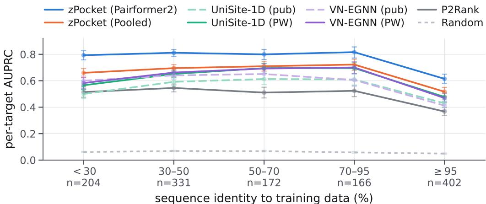  
Figure A1: Per-target AUPRC against sequence identity to anything the model has already seen — the trunk’s pretraining sequences plus the PocketWatch training and validation sequences. Performance is roughly flat from novel through close and falls only in the near-identical (≥95%) bin. We suspect that this fall is an artifact of the seen-pocket mask rather than a generalization effect: a protein with pockets deposited before the cutoff has most of its familiar pockets masked, leaving the harder remainder to be scored. Bin sizes are printed on the axis and bars are bootstrap 95% intervals. zPocket outperforms all baselines.

Table A6: Per-target results for every trunk and head, as in Table 2 with AUROC, R-precision (Rp) and paired differences in AUPRC against the two main-text trunks (head minus reference, same head type, 95% CI over 4000 bootstrap samples). Each row is a single training run.
<table><tr><td>Trunk</td><td>AUPRCt</td><td>AUROCt</td><td>Rpt</td><td></td><td>∆ vs ESMFold2</td><td>∆ vs Protenix-v2</td><td></td></tr><tr><td>pairformer2</td><td></td><td></td><td></td><td></td><td></td><td></td><td></td></tr><tr><td>Protenix-v2</td><td>0.757</td><td>0.958</td><td></td><td></td><td>0.692 +0.011 [+0.003, +0.020]</td><td></td><td></td></tr><tr><td>Chai-1</td><td>0.746</td><td>0.955</td><td></td><td></td><td>0.680 +0.000 [−0.008, +0.008]</td><td></td><td>-0.011 [-0.020, -0.003]</td></tr><tr><td>ESMFold2</td><td>0.745</td><td>0.951</td><td>0.682</td><td></td><td></td><td></td><td>-0.011 [-0.020, -0.003]</td></tr><tr><td>Protenix-v1</td><td>0.742</td><td>0.953</td><td>0.677</td><td></td><td>-0.004 [−0.012, +0.004]</td><td></td><td>-0.015 [-0.023, -0.007]</td></tr><tr><td>OpenFold3-preview</td><td>0.742</td><td>0.952</td><td>0.680</td><td></td><td>-0.003 [−0.010, +0.004]</td><td></td><td>−0.015 [−0.022, −0.007]</td></tr><tr><td>RF3</td><td>0.741</td><td>0.950</td><td>0.676</td><td></td><td>−0.004 [−0.012, +0.003]</td><td></td><td>−0.016 [−0.024, −0.008]</td></tr><tr><td>Boltz-1</td><td>0.733</td><td>0.949</td><td>0.665</td><td></td><td>−0.012 [−0.021, -0.004]</td><td></td><td>-0.024 [−0.032, -0.015]</td></tr><tr><td>pooled</td><td></td><td></td><td></td><td></td><td></td><td></td><td></td></tr><tr><td>Protenix-v2</td><td>0.669</td><td>0.938</td><td></td><td></td><td>0.614 +0.030 [+0.024, +0.035]</td><td></td><td></td></tr><tr><td>Chai-1</td><td>0.668</td><td>0.935</td><td></td><td></td><td>0.612 +0.029 [+0.023, +0.034]</td><td></td><td>-0.001 [-0.006, +0.004]</td></tr><tr><td>ESMFold2</td><td>0.639</td><td>0.924</td><td>0.589</td><td></td><td></td><td></td><td>-0.030 [-0.035, -0.024]</td></tr><tr><td>Protenix-v1</td><td>0.650</td><td>0.931</td><td></td><td></td><td>0.595 +0.011 [+0.005, +0.017]</td><td></td><td>-0.019 [-0.023, -0.014]</td></tr><tr><td>OpenFold3-preview</td><td>0.619</td><td>0.922</td><td>0.566</td><td></td><td>−0.020 [−0.026, −0.014]</td><td></td><td>-0.050 [−0.055, −0.044]</td></tr><tr><td>RF3</td><td>0.631</td><td>0.927</td><td>0.576</td><td></td><td>-0.008 [-0.014, -0.002]</td><td></td><td>-0.038 [-0.043, -0.033]</td></tr><tr><td>Boltz-1</td><td>0.638</td><td>0.929</td><td>0.585</td><td></td><td>5 −0.001 [−0.007, +0.005]</td><td></td><td>-0.031 [−0.036, -0.026]</td></tr></table>

For every test target with a deposited apo chain we selected one experimental structure and ran the same P2Rank configuration on it. A chain was admitted only if it was ligand-free at every scored pocket residue (no non-polymer component within 5 Å, ignoring crystallization additives and anything under five heavy atoms), contained all annotated pockets, and came from a structure at 2.5 Å or better; among admissible chains we took the best resolution. We then ran P2Rank on this experimental apo structure and compared its results to those obtained from the predicted fold of the same target, only considering the canonical positions the experimental chain observes (sometimes the experimental chain is a subset of the full UniProt sequence). This procedure gave us an evaluation set with 433 targets and 537 pockets (398 X-ray, 35 cryo-EM; median resolution 1.85 Å).

Table A7: Discrete pocket prediction on PocketWatch with the ESMFold2 pairformer2 head and every detector run on ESMFold2 folds: how close a ranked list of predicted centroids lands to the real ligand centroids, over the same 1,562 pockets of 1,275 targets. A prediction succeeds within 4 Å of a ground-truth centroid. DCC N keeps each protein’s own pocket count as the budget and N+2 allows two more; ceiling is the rate with no budget at all, which the proposals fix and no ranking can exceed; prec. is the share of everything emitted that claimed a pocket, and ¯k how many centroids were emitted per protein. Every decoder is the winner of a validation sweep restricted to ranking by a single scorer, so no row mixes the head’s score with a detector’s own. union pools every detector’s cavities, folded most-selective first and deduplicated, so it has no ranking of its own to report – only a pool for the head to rank. Bold = best per column.
<table><tr><td colspan="2"></td><td colspan="2">DCC success</td><td colspan="4"></td></tr><tr><td rowspan="2">Section</td><td rowspan="2">Proposals</td><td rowspan="2">Ranker</td><td colspan="2">N</td><td rowspan="2">N+2 ceil.</td><td rowspan="2">AP prec.</td><td rowspan="2">k</td></tr><tr><td></td><td></td></tr><tr><td rowspan="6">Base methods</td><td>fpocket</td><td>fpocket</td><td>0.139</td><td>0.197</td><td>0.476 0.195 0.01441.3</td><td></td><td></td></tr><tr><td>P2Rank</td><td>P2Rank</td><td></td><td></td><td>0.3240.3860.431 0.371 0.04411.8</td><td></td><td></td></tr><tr><td>Lacuna</td><td>Lacuna</td><td></td><td></td><td>0.209 0.3690.616 0.310 0.013 57.5</td><td></td><td></td></tr><tr><td>Lacuna (SF-seq)</td><td>Lacuna (SF-seq)</td><td></td><td></td><td>0.2730.4970.780 0.417 0.01564.9</td><td></td><td></td></tr><tr><td>VN-EGNN (pub) VN-EGNN (PW)</td><td></td><td></td><td></td><td>VN-EGNN (pub) 0.4170.461 0.483 0.482 0.124 VN-EGNN (PW) 0.533 0.602 0.620 0.606 0.179</td><td></td><td>4.8</td></tr><tr><td>zPocket clusters</td><td>zPocket</td><td></td><td></td><td>0.5150.5240.524 0.570 0.599</td><td></td><td>4.2 1.1</td></tr><tr><td colspan="2">Rescoring with zPocket fpocket</td><td></td><td></td><td></td><td></td><td></td><td></td></tr><tr><td rowspan="6"></td><td>P2Rank</td><td>zPocket zPocket</td><td>0.371</td><td></td><td>0.4260.476 0.426 0.01441.3</td><td></td><td></td></tr><tr><td>Lacuna</td><td></td><td></td><td></td><td>0.3860.4140.431 0.420 0.04411.8</td><td></td><td></td></tr><tr><td>Lacuna (SF-seq)</td><td>zPocket</td><td></td><td></td><td>0.3990.5250.616 0.489 0.013 57.5</td><td></td><td></td></tr><tr><td>VN-EGNN (pub)</td><td>zPocket zPocket</td><td></td><td></td><td>0.4050.608 0.780 0.539 0.015 64.9</td><td></td><td></td></tr><tr><td>VN-EGNN (PW)</td><td>zPocket</td><td></td><td></td><td>0.4400.4700.483 0.498 0.1244.8 0.5380.6090.620 0.612 0.179 4.2</td><td></td><td></td></tr><tr><td>union</td><td>zPocket</td><td>0.497</td><td>0.645</td><td>0.879 0.6270.009114.4</td><td></td><td></td></tr><tr><td rowspan="6">Hybrid</td><td>zPocket + fpocket</td><td>zPocket</td><td></td><td></td><td>0.5340.6170.680 0.621 0.020</td><td></td><td></td></tr><tr><td>zPocket + P2Rank</td><td>zPocket</td><td></td><td></td><td>0.5420.6140.639 0.615 0.061 12.7</td><td></td><td>42.3</td></tr><tr><td>zPocket + Lacuna</td><td>zPocket</td><td></td><td></td><td>0.5370.6290.734 0.631 0.01558.4</td><td></td><td></td></tr><tr><td>zPocket + Lacuna (SF-seq) zPocket</td><td></td><td></td><td></td><td>0.5380.6560.808 0.647 0.01565.7</td><td></td><td></td></tr><tr><td>zPocket + VN-EGNN (pub) zPocket</td><td></td><td></td><td></td><td>0.532 0.597 0.606 0.609 0.210 3.5</td><td></td><td></td></tr><tr><td>zPocket + VN-EGNN (PW) zPocket</td><td></td><td></td><td></td><td>0.5440.6750.690 0.648 0.213 4.0</td><td></td><td></td></tr><tr><td colspan="2">zPocket + union</td><td>zPocket</td><td></td><td></td><td>0.5420.6640.879 0.659 0.009113.6</td><td></td><td></td></tr></table>

We found that P2Rank performs similarly on both structure sources. Per-target AUPRC is 0.518 on the experimental apo structure against 0.505 on the ESMFold2 fold of the same target, a paired difference of +0.013 (95% percentile bootstrap CI over targets, [−0.003, +0.030]); per pocket, 0.489 against 0.473 (+0.016, [+0.000, +0.032]. The gap is larger than on the Protenix fold, where the same comparison gives 0.514 and a paired difference of +0.004 ([−0.013, +0.022]), and it comes almost entirely from the 49 targets whose apo chain observes fewer than half of the scored residues. The intervals exclude an advantage for the experimental structure larger than about 0.03 AUPRC, an order of magnitude smaller than zPocket’s margin over P2Rank in Table A5. We therefore read the fold-based numbers throughout as a fair proxy for what these methods would reach on experimental input.

## B.5 Crypticity versus predicted-fold accuracy

Since cryptic sites might be difficult to predict from a single conformation of an unbound protein, we were eager to evaluate whether a method like zPocket, which does not depend on coordinates, would predict these pockets better than methods that do. In the course of our investigation, we found that the predicted folds often come close to the ground-truth pocket even for sites labeled cryptic per our definition, and that some sites labeled not cryptic had predicted folds more than 2 Å away, so we decided to stratify our results by fold accuracy as well as by the cryptic label. We think this is a useful finding about the “cryptic” definition used by IsoDDE and CryptoBench: it is a property of the experimental structures, not of the predicted structure, and a predicted apo fold can reproduce a holo pocket even if the model has never seen that holo conformation for this particular protein, perhaps by learning it from homologues.

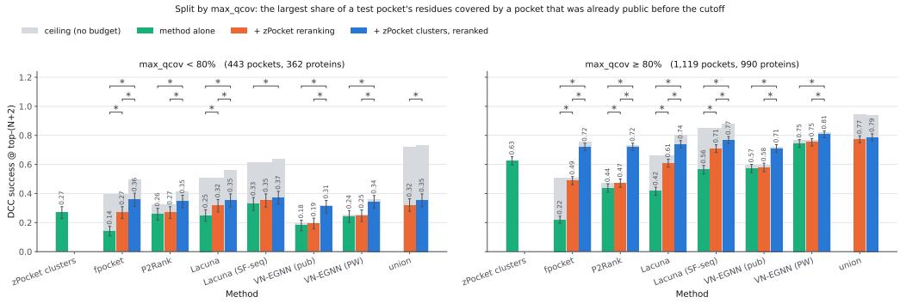  
Figure A2: Pocket centroid prediction split by pocket familiarity. The comparison of Figure 4, $\mathrm { D C C } _ { N + 2 }$ at $4 \mathring \mathrm { A } ,$ computed separately on unfamiliar pockets (max\_qcov below 80%: 443 pockets of 362 proteins) and familiar ones (max\_qcov at or above 80%: 1,119 pockets of 990 proteins). Colors, gray ceilings and error bars are as in Figure 4: green is each method’s own proposals under its own ranking, orange re-ranks those proposals with the zPocket head, blue adds the zPocket cluster proposals before re-ranking, an asterisk marks a paired 95% bootstrap excluding zero, and the intervals on the bars themselves are unpaired. Every method degrades sharply on unfamiliar pockets, and the gap between each bar and its own ceiling widens, but adding the zPocket proposal and re-ranking still lifts $\mathrm { D C C } _ { N + 2 }$ significantly for most methods in both similarity bins.

Fold accuracy is more predictive of binding prediction performance than crypticity: when the predicted fold comes within 2 Å of the ground-truth pocket, both zPocket and P2Rank score higher regardless of crypticity label, and when it does not, every method degrades (Fig. A3). Within the “fold within $2 \mathring \mathrm { A }$ of ground-truth pocket” bucket, P2Rank shows a small dip for cryptic pockets (0.451 against 0.472), while zPocket scores higher on them (0.713 against 0.644), but three of the five buckets hold only 33, 23 and 17 pockets, so it is hard to draw conclusions from any of them. Keeping in mind these small numbers, we note that zPocket still outperforms baselines across every stratification.

## B.6 Calibration and the main-text case-study figure

Panel (B) of Figure 1 is rendered from a head trained with a weighted focal loss $( w = 5 , \gamma = 2 )$ rather than the plain unweighted BCE $( w = 1 , \gamma = 0 )$ of Eq. 2 that produces every quantitative result in this paper. The two heads are otherwise identical. We show this variant because its higher positive weight and flatter calibration make $S _ { 2 }$ easier to visualize, and we report the plain-BCE head because it scores higher on the validation set (0.766 against 0.757 AUPRC on ESMFold2; 0.774 against 0.766 on Protenix). In fact, even though the weighted-focal head makes $S _ { 2 }$ easier to see, the plain-BCE head actually ranks the residues of $S _ { 2 }$ higher, with a per-pocket AUPRC of 0.403 compared to 0.247 for the weighted-focal head. So the main text does not flatter the case study by showing the weighted-focal variant. We show the same target scored by the reported model in Figure A4.

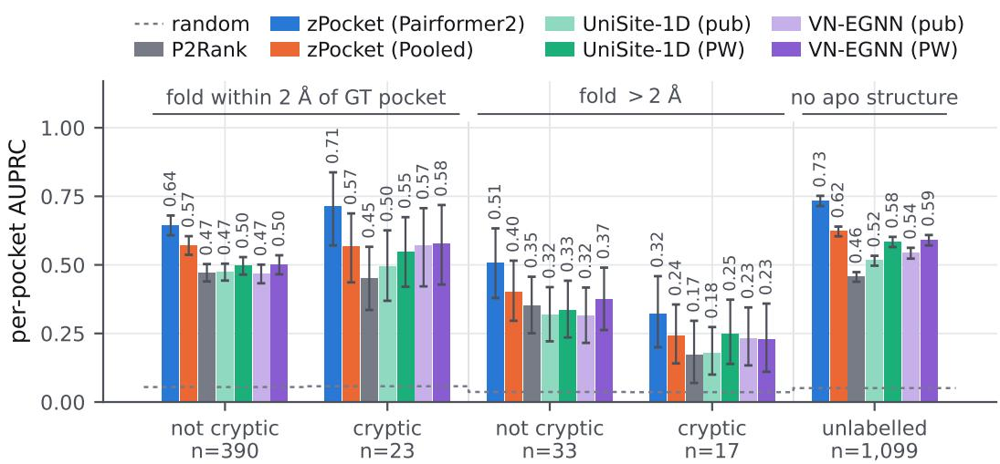  
pocket crypticity, split by whether the predicted fold reaches the pocket

Figure A3: Per-pocket AUPRC by crypticity label, crossed with whether the ESMFold2 predicted structure comes within 2 Å of the ground-truth pocket. zPocket heads against P2Rank and both baselines, each as published (pub) and retrained on PocketWatch (PW). Bucket sizes are printed beneath each group; bars are bootstrap 95% intervals and the dashed line is the random expectation, computed per bucket from its own positive rate.  
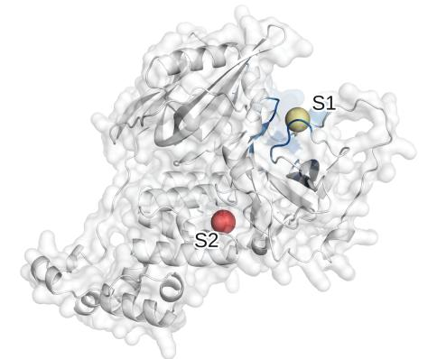

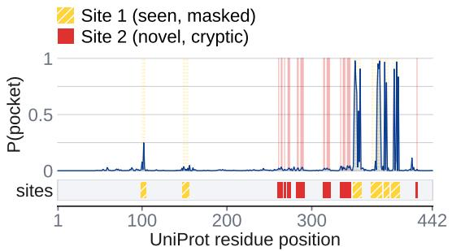  
Figure A4: The main-text case study rendered from the reported model. The same target and annotated sites as Figure 1(B), scored by the plain unweighted BCE head $( w = 1 , \gamma = 0 )$ used throughout the paper. Site coloring and seen-pocket masking follow Figure 1(B). The cartoon’s color ramp spans scores 0–1 here and 0–0.4 in Figure 1(B), where the weighted-focal head’s scores are compressed.

a

## B.7 Fragment screens on the Protenix-v2 trunk

Figure 5 reports the fragment screens on ESMFold2 folds, the trunk the main text uses throughout. Figure A5 repeats its panels (a) and (b) on Protenix-v2, over the same 35 sites of 12 proteins: the label-transfer check is required to pass on both trunks, so the two are scored on identical labels. The worked examples of Figure 5c are not repeated, being drawn on ESMFold2 folds.

Per-residue scores barely move between the trunks — 0.518 AUPRC against 0.494 — but the decoded centroids do, and the ceilings say why, though which detector the zPocket clusters help differs by trunk. Pooling them into fpocket’s or Lacuna’s cavities adds nothing on ESMFold2, leaving both ceilings where they were, while on Protenix-v2 it lifts fpocket’s from 0.438 to 0.542 and Lacuna’s from 0.306 to 0.410, and both arms gain with them (0.273 to 0.382 and 0.247 to 0.352): the clusters propose sites those two detectors miss on this trunk and not on the other. P2Rank runs the other way, its ceiling rising from 0.368 to 0.385 on ESMFold2 and its arm with it (0.285 to 0.301), while on Protenix-v2 it sits on its ceiling (0.297). The published VN-EGNN gains the same small margin on either trunk (0.199 to 0.216), and the zPocket clustering decoder sits on its own ceiling throughout (0.100 on ESMFold2, 0.204 on Protenix-v2).

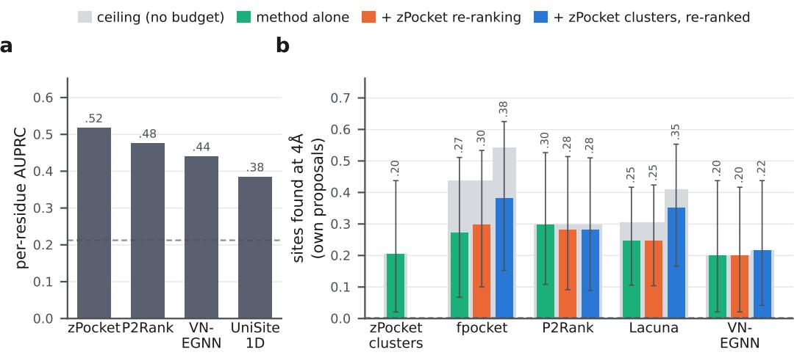  
Figure A5: Figure 5 on the Protenix-v2 trunk. Panels (a) and (b) of Figure 5, with the Protenix-v2 pairformer2 head and every detector run on Protenix-v2 folds, over the same 35 sites of 12 proteins. Colors, ceilings, budget, success radius and error bars as in Figure 5.

## C Sourcing and curation of the fragment-soak test set

Fragment screens were taken from Diamond Light Source’s XChem programme through Fragalysis, downloaded on 2026-09-20/21 from the legacy host (per-target archives) and from the production and staging hosts of the current stack (an unauthenticated REST interface), giving 61 distinct campaigns; one of them, the EV-A71 2A protease campaign, is the first OpenBind release [24]. Campaigns were selected before any prediction was run, on two independent leakage axes computed for all 61. On the head axis a campaign is discarded when its accession sits in the head’s training split, or when a training-split protein exceeds 50% identity to the construct. The rest are retained, whether the accession is absent from the label table, sits in its validation or test split, or has a training relative below that bar; the closest training relative among the campaigns kept is 44%. On the trunk axis we count PDB entities at ≥ 70% identity released before the co-folding trunk’s 2021-09-30 cutoff, and discard a campaign carrying more than fifteen. Raw counts mislead in both directions, so the selection also recorded the two quantities behind them. The fraction of a protein’s entities that predate the cutoff separates campaigns the trunk merely glimpsed from campaigns it knows as well as it ever will: A71EV2A and SOS3ATA both look sparse at 6 and 3 pre-cutoff entities, but A71EV2A has 480 entities in total while all three of SOS3ATA’s predate the cutoff, so the second was dropped and the first kept. The count of pre-cutoff relatives at 30% identity separates a sparsely sampled protein from a densely sampled fold: CAMK1DA has ten pre-cutoff relatives at 70% identity but 1,079 at 30%, because it is a kinase, and a per-residue head reading a trunk representation is likelier to transfer at fold level than an identity tier implies, so it too was dropped. The screens excluded this way include the SARS-CoV-2 main protease and nsp13 campaigns, which are trunk-saturated, and the human NUDT, BRD and PTP1B campaigns, whose accessions are in the head’s training split. Eleven campaigns survived.

The Fragalysis campaigns are extended with fragment screens deposited straight into the PDB as group depositions, which the Fragalysis release does not carry. Every group deposition whose entries were released after the trunk’s 2021-09-30 cutoff was collected (132 campaigns) and screened on the same two leakage axes, leaving 16 clean on both. Nine of those sixteen are proteins the Fragalysis set already holds, in one case through a close homolog: four are the Coxsackievirus A16 2A protease, a homolog of the EV-A71 2A protease already scored, and five are repeat screens of nsp14, the chikungunya nsp3 macrodomain, the plant thioesterase FatA and the Porphyromonas gingivalis dipeptidyl-peptidase. All nine are dropped so that no protein is scored twice. Of the seven that remain, FabF is discarded on the head axis, its closest training relative being at 66% identity, leaving six new campaigns: TRIM21 (109 entries), ARHGEF2 (56), the SARS-CoV-2 nucleoprotein (51), ORF9b (51), the de novo designed protein ABLE (43) and MYLIP (29).

A site can only be scored on a structure the folding model is confident in, so every construct in the test set, from either source, is required to reach a mean pLDDT of 85 on the fold it is scored on — near the top of the conventional confident band (70–90) and just below the very high boundary at 90. Two of the group depositions fall far short and are dropped without being scored: ORF9b, whose MSA carries only 39 sequences, reaches 41.7, and MYLIP 69.5. Every remaining construct clears the gate, spanning 85.5 to 97.5.

Within a campaign, a hit is the soaked compound’s own coordinate file rather than a HETATM record, because the deposited complexes also carry acetate, DMSO and ethylene glycol that were never in the library; a fragment is counted once per distinct canonical SMILES however many crystals it appears in. Every bound structure was checked to sit already in its campaign’s apo reference frame (Cα deviation below 1.5 Å) and ligand coordinates were used as deposited. Where a second protein chain is present it is either a crystallographic copy of the modeled chain or a genuine partner, and the two demand opposite treatment: ligands on a copy are carried onto the modeled chain by superposition, while ligands at a partner interface (nsp16/nsp10, NXF1/NXT1) are dropped and flagged. The two cases are told apart by sequence identity to the modeled chain and never by chain label, since a campaign’s template chain letter frequently disagrees with its bound files. One campaign needs a further distinction: the 925 site observations released for A71EV2A are 113 fragment-screen events followed by 812 lead-like compounds from the optimization phase that followed, and treating all

Table A8: Pocket filtering funnel over the reviewed human proteome, grouped by how evidence of a known site is propagated to the query: not at all, by sequence homology to Pfam family and clan relatives, or by structural-motif similarity irrespective of homology. Geometric requirements are independent of all three. Counts are pockets remaining after each successive filter; proteins are the distinct accessions those pockets lie on. Filters are conjunctive, so the survivor count is independent of their order; per-row removals are not.
<table><tr><td>Filter</td><td>Pockets</td><td>Removed</td><td>Proteins</td></tr><tr><td>All predicted pockets</td><td>21,646</td><td></td><td>17,527</td></tr><tr><td colspan="4">Direct: evidence on the query accession</td></tr><tr><td>Known ligand site on this protein</td><td>18,908</td><td>2,738</td><td>15,254</td></tr><tr><td>UniProt ACT_SITE, BINDING or SITE</td><td>15,557</td><td>3,351</td><td>12,468</td></tr><tr><td>Polymer interface in its own assemblies</td><td>12,480</td><td>3,077</td><td>9,995</td></tr><tr><td colspan="4">Homology-propagated: transferred from Pfam family and clan relatives</td></tr><tr><td>Transferred ligand site</td><td>9,038</td><td>3,442</td><td>7,268</td></tr><tr><td>Transferred active site</td><td>7,044</td><td>1,994</td><td>5,709</td></tr><tr><td>Transferred interface (family only)</td><td>4,489</td><td>2,555</td><td>3,590</td></tr><tr><td>Catalytic site localized, if an enzyme</td><td>4,456</td><td>33</td><td>3,564</td></tr><tr><td colspan="4">Geometry</td></tr><tr><td>9–30 lining residues</td><td>1,024</td><td>3,432</td><td>1,017</td></tr><tr><td>Burial  $\geq 3 9 . 9$  heavy atoms</td><td>765</td><td>259</td><td>758</td></tr><tr><td>Mean  $\mathrm { p L D D T } \geq 8 0$ </td><td>612</td><td>153</td><td>606</td></tr><tr><td>Mean head confidence ≥ 0.70</td><td>306</td><td>306</td><td>303</td></tr><tr><td colspan="4">Motif-propagated: structural similarity, no homology required</td></tr><tr><td>Motif holds no ligand elsewhere in the PDB</td><td>155</td><td>151</td><td>154</td></tr></table>

925 as fragments saturates the active site and inflates the positive base rate to most of the accessible surface, so only the fragment-screen subset is used. Sites are then single-linkage clusters of ligand centroids at 5 Å in the apo frame, the rule PocketWatch already uses. Across both sources this produces 155 sites, of which 117 are masked by rules applied uniformly to every campaign: 83 carry fewer than three distinct fragments, 20 are crystal-packing artifacts (a median symmetry-mate contact fraction ≥ 0.25 over the site’s fragments), 10 have fewer than three lining residues that map onto the predicted fold, 2 sit at a partner interface, and 2 reach a predicted fold only through a lining-Cα fit above 2 Å. A site is masked as well when its lining overlaps a pocket the head saw in training, though with no retained accession in the training split that rule now removes none: a validation or test pocket is a pocket the head was never shown, and is scored. The transfer check is the one rule that depends on which structure is being scored, so it is required to pass on both trunks’ folds and the two are then scored on identical labels; three NXT1-NXF2 sites transfer cleanly onto the ESMFold2 fold but not onto the Protenix-v2 one, whose model of that construct is 7.9 Å from the crystal template against ESMFold2’s 2.0 Å. This leaves the 35 scored sites over 12 proteins that the main text reports, 29 of them from Fragalysis and 6 from the group depositions, with one Fragalysis campaign retaining none.

## D Pocket novelty filters

The proteome scan, and every count, threshold and candidate in this appendix and Appendix $\mathrm { E , }$ uses the Protenix-v2 pairformer2 head and Protenix-v2 predicted folds. It was run while the Protenix-v2 weights were openly licensed and has not been repeated on ESMFold2.

Table A9: The funnel with all interface evidence removed, for comparison with Table A8. Geometric and motif requirements are unchanged. The surviving set is a strict superset of the 155 reported there.
<table><tr><td>Filter</td><td>Pockets</td><td>Removed</td><td>Proteins</td></tr><tr><td>All predicted pockets</td><td>21,646</td><td></td><td>17,527</td></tr><tr><td>Direct</td><td></td><td></td><td></td></tr><tr><td>Known ligand site on this protein</td><td>18,908</td><td>2,738</td><td>15,254</td></tr><tr><td>UniProt functional site, interactions excluded</td><td>15,602</td><td>3,306</td><td>12,501</td></tr><tr><td>Homology-propagated</td><td></td><td></td><td></td></tr><tr><td>Transferred ligand site</td><td>11,297</td><td>4,305</td><td>9,110</td></tr><tr><td>Transferred active site</td><td>8,956</td><td>2,341</td><td>7,268</td></tr><tr><td>Catalytic site localised, if an enzyme</td><td>8,914</td><td>42</td><td>7,235</td></tr><tr><td>Geometry</td><td></td><td></td><td></td></tr><tr><td>9–30 lining residues</td><td>2,381</td><td>6,533</td><td>2,366</td></tr><tr><td>Burial ≥ 39.9 heavy atoms</td><td>1,828</td><td>553</td><td>1,816</td></tr><tr><td>Mean pLDDT ≥ 80</td><td>1,579</td><td>249</td><td>1,568</td></tr><tr><td>Mean head confidence ≥ 0.70</td><td>754</td><td>825</td><td>750</td></tr><tr><td>Motif-propagated</td><td></td><td></td><td></td></tr><tr><td>Motif holds no ligand elsewhere in the PDB</td><td>359</td><td>395</td><td>358</td></tr></table>

## D.1 Why known sites are resolved by homology

A filter that asks whether a pocket coincides with a known binding site on its own protein cannot distinguish two outcomes: the site was tested and is clear, or nothing was ever known about that protein. Keyed on the query accession, our annotation reached only 2,444 of the 20,092 scanned proteins, so 87% of pockets cleared that gate without any evidence being brought to bear. An earlier revision of this pipeline produced a shortlist of four leads on that basis; independent review established that every one was a known functional site invisible to the gate, in each case because no experimental structure of the human protein exists. The filters described below resolve known sites through homologues, and report per gate whether evidence was available at all (§D.7).

## D.2 The ligand-site annotation

Ligand-contact evidence throughout — both for the direct gate and as the donor pool for homology transfer — comes from a curated structural annotation derived from Q-BioLiP, in which every ligand binding residue of every deposited structure is resolved to a canonical UniProt position through per-residue SIFTS. Contacts are admitted under a fixed policy: a literal 5 Å heavy-atom contact definition; at least 10 contacting residues per chain; ligands of 5–50 heavy atoms; at least 80% SIFTS coverage of the chain with at most a 0.2 mismatch fraction; a single primary accession per chain; and a UniProt length of 40–1,200 residues.

Two properties of this policy propagate into the results. First, the annotation contains nonpolymer ligands only — no peptide, nucleic-acid or protein partners — which is why polymer interfaces are computed separately from PDB biological assemblies rather than read from the same table. Second, the 10-residue minimum censors the pocket-size distribution from below. The length cap is also the reason the direct gate reaches only 2,444 of the 20,092 scanned proteins: our scan admits chains up to 2,560 residues, so large proteins are annotated in the reference set only where a shorter construct exists.

## D.3 Donor construction

Three classes of site were assembled for all organisms, keyed by UniProt accession. Ligand contacts were taken from a cross-species structural annotation of nonpolymer ligands: 19,203 accessions, 322,466 ligand pockets and 6,122,832 contact residues, at a literal 5 Å contact definition. Annotated sites were UniProt ACT\_SITE and BINDING features, excluding range features spanning more than 30 residues, which are deletions rather than point annotations. Interface residues were inter-chain contacts computed from PDB biological assemblies and mapped to canonical numbering through per-residue SIFTS, covering 11,999 accessions. Donors carrying at least one site of any class number 275,471, spanning 11,231 Pfam families.

## D.4 Transfer procedure

Each scanned protein was resolved to its Pfam families and, through Pfam-A.clans, to its clans. Donors sharing a family were ranked first, then donors sharing only a clan, with ties broken by agreement of the three-level EC number and then by site count; the top 60 candidates were aligned. Alignment used global Needleman–Wunsch (parasail, BLOSUM62, gap open 11, extend 1), discarding alignments below 25% identity over aligned columns, and the 12 highest-identity donors were retained. Donor site positions were mapped to query numbering through the alignment, and a pocket was discarded if any lining residue lay within 5 Å of a transferred position in the predicted fold.

Two restrictions apply to clan-level transfer. First, a clan is not always a functional family: CL0015 (MFS) shares a substrate cavity across its members, whereas CL0196 (DSRM) shares only a small structural motif between otherwise unrelated proteins. Clan-level transfers therefore require corroboration by at least two independent donors, which suppresses single spurious alignments without weakening transfer within genuine fold families. Second, interface transfers are restricted to family level throughout: a binding cavity is conserved across a clan, but a protein’s interaction partners are not. With these settings the gate reaches 16,754 of 20,092 proteins.

## D.5 Geometric thresholds

Thresholds were calibrated against 78,370 experimentally determined pocket instances measured on the same predicted folds. Burial (39.9 protein heavy atoms within 8 Å of a lining-residue centroid, excluding the pocket’s own atoms) and the upper size bound of 30 residues are the 10th and 95th percentiles of that reference set. The lower size bound is not a percentile. The reference distribution is censored near ten residues by the minimum\_contact\_residues\_per\_chain policy of the annotation that produced it, so it carries no information about smaller pockets and cannot justify a floor in that range. Lowering the bound without compensation admits low-confidence output — pockets of 3–5 residues have a median head confidence of 0.29 against 0.82 for those of 16–30 — which shows that the size cut had been acting as an implicit confidence filter. We therefore set the size floor at 9 and impose an explicit confidence floor of 0.70, which together retain a set of comparable size to the previous thresholds but at higher median confidence.

Per-residue pLDDT is the mean B-factor over all atoms of a residue in the predicted structure, and a pocket’s pLDDT is the mean over its lining residues. Residues without a value are excluded from that mean; pockets on proteins for which no per-residue values had been extracted were previously discarded by the pLDDT gate as missing rather than poor, affecting 3,834 pockets, and were backfilled.

## D.6 Motif-propagated evidence

Neither direct nor homology-propagated evidence can reach a pocket that is uncharacterized on its own protein and across its family, yet recurs as a ligand-binding structural motif in proteins with no detectable evolutionary relationship to it. Each survivor’s lining residues were submitted as a motif to Folddisco against 233,054 PDB structures. Matched target residues were resolved to chain and residue identifiers and intersected with the ligand-contact annotation of §D.2; a motif with any matched residue that is a ligand contact in a deposited structure was discarded. A second rule, flagging sub-ångström matches to a target chain of the same family or EC class, fired on a single pocket and is not load-bearing: most matched target chains carry no annotation to compare against, so this route is under-powered and the ligand-contact rule carries the filter.

## D.7 Evidence coverage

Each gate reports one of three states — the site is hit, the site is clear, or no evidence was available — and each pocket carries the number of gates that had evidence. Of the 155 survivors, 1 cleared three gates on evidence, 11 cleared two, 54 cleared one and 89 cleared none. The majority of the output is therefore untested rather than tested and clear, and should be read as such; homology resolution reduces this fraction (from 87% to 57%) but does not eliminate it, because a protein whose Pfam family contains no annotated member remains unreachable by any transfer.

## D.8 Alternative pocket proposals

To test whether the head’s own decoder limits recall, pocket proposals from fpocket, P2Rank and Lacuna were generated for all scanned proteins (1,797,462 candidates) and scored by the same head. Of those clearing the confidence and size thresholds, 735 on 346 proteins passed the direct and homology-propagated filters. Every one overlapped a pocket the head had already proposed; none was a site at a location the head had not itself identified, and none of the proteins for which the head predicted no pocket was rescued. The proposal stage is therefore not the binding constraint on this pipeline.

## E Candidate Pockets

Two pockets are described in the main text. They are not the two highest-scoring pockets; they are the ones for which a mechanistic hypothesis exists, and they were selected after the filters rather than by them. Each is reported with the evidence against it, and with the extent to which conventional cavity detectors agree that the site is a pocket at all.

## E.1 Agreement with geometric cavity detectors

fpocket, P2Rank and Lacuna were run natively on the same predicted structures, and each tool’s own score order was used — not a re-ranking by the head. Table A10 reports the rank at which each tool first proposes a pocket overlapping ours.

Table A10: Agreement of geometric cavity detectors with the predicted site. Each tool was run natively and its own score order used. Entries give the rank of the tool’s best-overlapping proposal, out of the number it made on that protein, with the Jaccard overlap in parentheses. A dash means no proposal reached a Jaccard of 0.25, so the tool does not propose this site at any rank.
<table><tr><td></td><td>zPocket</td><td>P2Rank</td><td>fpocket</td><td>Lacuna</td></tr><tr><td>DET1</td><td>1</td><td>4 / 17 (0.71)</td><td>39 / 40 (0.70)</td><td>1 / 50 (0.42)</td></tr><tr><td>COP1</td><td>1</td><td>(0.06) 一</td><td>(0.16) 一</td><td>24 / 52 (0.42)</td></tr></table>

The two cases differ. For DET1 the classical detectors disagree with each other: P2Rank ranks the site fourth of seventeen and fpocket thirty-ninth of forty, while Lacuna, itself a learned method, ranks it first. The site is thus found by all three, but a user relying on fpocket’s ordering would never reach it. For COP1 no geometric detector proposes the site at all. P2Rank returns only four proposals on the entire 731-residue protein, of which the highest-scoring is a 40-residue region sharing three residues with the predicted pocket; the remaining three share none. Only Lacuna proposes a comparable site, at rank 24 of 52. This is consistent with the site being a shallow peptide groove, which cavity-geometry methods are least able to score, and it is the case where the head’s proposal is not reproduced by an existing tool.

## E.2 DET1

DET1 (UniProt Q7L5Y6, 550 residues) is a substrate-adaptor subunit of the DCX(DET1–COP1) cullin–RING ligase, with RBX1, DDB1, CUL4A and COP1. The predicted pocket comprises 17 residues drawn from five sequence-distant segments spanning the chain (57–63, 142–143, 218, 478– 479, 517–539), with a mean head confidence of 0.831, burial of 43.8 heavy atoms and mean pLDDT of 90.1. Because DET1 carries no RING domain and is not the catalytic subunit, a ligand at this site cannot inhibit the ligase; it can only alter substrate recognition, which is the architecture exploited by molecular glues. Twelve experimental structures of DET1 are deposited, and across the 16 DET1 chains they contain, no partner atom approaches within 6 Å of any lining residue; the nearest partner contact is 14.9 Å. The pocket also avoids the E2-binding region and the DDB1-anchoring segment.

Limitations. The site is not a pre-formed cavity. Across all 16 experimental copies the lining is solvent-exposed, with a mean relative SASA of 0.295 and no fully buried lining residue, and fpocket ranks the overlapping groove in the bottom half of its own list. This measurement requires care: computed on holo structures with the ligand deleted, the same statistic rejects apo cereblon, which scores worse than DET1 — every validated site appears enclosed once a ligand has opened it. Measured against genuinely apo references the result is that DET1’s site is not pre-formed, not that it is unligandable, and the lining is mildly more mobile than the protein average (1.31 Å side-chain spread against 1.09 Å).

## E.3 COP1

COP1 (Q8NHY2, 731 residues) is the substrate receptor of the same ligase complex as DET1, degrading JUN, p53 and the ETV1/4/5 transcription factors. The predicted pocket comprises 15 residues, all 15 inside annotated WD40 repeats and spanning five of the seven blades — the top face of the β-propeller. Superposition on the COP1–TRIB1 complex shows that 14 of the 15 are within 4.5 Å of the bound degron peptide, and that the three-residue Val–Pro anchor of that peptide engages ten COP1 residues, all ten of which are in the predicted pocket. The site is therefore not merely the degron surface but specifically its hot-spot subsite, which is the configuration that makes a protein–protein interface tractable to small molecules.

Limitations. Occupancy blocks substrate recognition, so a ligand is first an inhibitor, and a cereblonstyle glue is not available at this pocket. Direction of effect is substrate-dependent and cannot be separated chemically, since p53, C/EBPα and ETV4/5 all dock through the same slot. The site has been attacked: an affinity-selection campaign reported six COP1-binding peptides at potencies comparable to the native motif, and no small molecule is known; ChEMBL contains no COP1 target record at all. The experimental literature describes the VP pocket as shallow.