# VASPO: Self-Distillation with Privileged Value Estimation

Fei Wu1, Zhenrong Zhang2, Jianshu Zhang2, Jun Du1 1University of Science and Technology of China 2IFLYTEK Research

## Abstract

On-policy self-distillation provides dense supervision for reasoning models via a privileged self-teacher. However, this supervision reflects local token preferences rather than the expected return of an unguided student continuation. Recent methods combine this signal with GRPO. They use GRPO for update directions and the teacher for sig nal scaling. However, we demonstrate a more effective integration within PPO. Specif ically, we identify complementary positional dynamics: privileged information enhances a critic’s value-prediction accuracy toward the response’s end, whereas self-teacher guidance is strong initially, drops mid-generation, and rebounds finally. These insights motivate Value-Augmented Self-Distillation Policy Optimization (VASPO), wherein a self-teacher and critic evaluate identical privileged information at student-generated prefixes. The critic computes token-level PPO advantages from predicted continuation returns, while the selfteacher modulates selected positive advantages via bounded probability ratios. Across six mathematical reasoning benchmarks, VASPO improves mean accuracy over PPO by 2.59 and 1.81 percentage points on Qwen3-4B and OLMo3-7B variants, respectively, and achieves the highest mean accuracy among evaluated methods on Knights and Knaves. Our code is available at https://github.com/cii030/ VASPO.

## 1 Introduction

Training reasoning models from verified final answers requires assigning credit to intermediate decisions. Reinforcement learning with verifiable rewards (RLVR) supplies a reliable outcome but does not identify which tokens contributed to it (Guo et al., 2025; Xiao et al., 2026). Group Relative Policy Optimization (GRPO) compares several responses to the same problem and broadcasts each response’s advantage across its tokens (Shao et al., 2024). Proximal Policy Optimization (PPO) instead learns a value model, or critic, to turn the outcome into advantages (Schulman et al., 2017). Both approaches must learn from a reward that arrives only after the response is complete.

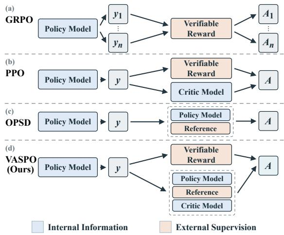  
Figure 1: Training signals in GRPO, PPO, OPSD, and VASPO. VASPO shares privileged information for token guidance and value estimation.

On-policy self-distillation (OPSD) supplies a denser, token-level signal at student-generated prefixes. The self-teacher reads privileged information, such as a worked solution or a ground-truth answer, and scores the sampled tokens (Zhao et al., 2026). This guidance can distinguish tokens within a response, but its preferences conditioned on privileged information are not verifier-grounded measures of the student’s eventual success. Privileged context can shift the signal toward style rather than task content (Pan et al., 2026), suppress deliberation in reasoning models (Kaur et al., 2026), or yield unreliable targets at some prefixes (Liu et al., 2026a). These observations motivate combining token guidance with outcome feedback while measuring when that guidance is useful.

Recent combinations use verifier outcomes to anchor or route privileged teacher guidance. RLSD modulates group-relative advantages with teacher– student signals (Yang et al., 2026a); SSPO applies step-level weights to GRPO in deep search (Wu et al., 2026b). SRPO routes correct and failed responses between GRPO and self-distillation (Li et al., 2026). These methods use privileged information in the teacher branch. None uses the same privileged information to train a PPO-style prefix-value estimator for clean student returns. This leaves a separate use of that information unexplored: estimating the student’s continuation return before assigning token credit.

Prior work has demonstrated the effectiveness of providing reference answers as input to the critic (Zhang et al., 2026c). Teacher preferences and continuation values serve fundamentally distinct roles at the same student prefix. While the teacher evaluates immediate token choices using privileged information, the critic predicts the expected success rate of the student’s unguided continuation. Thus, a token highly rated by the privileged teacher does not guarantee that the student can successfully navigate the remaining complex steps independently. We posit that a reference solution helps the critic accurately align incomplete responses, improving PPO value estimation beyond standard token-level supervision by bridging the gap between local step correctness and global trajectory success.

We observe different signal profiles for the two readers across response positions: the critic’s prediction benefit grows toward the end, while selfteacher divergence is high near the beginning, falls through the middle, and rebounds in the final position bin. This pattern motivates using the same privileged information for both token guidance and continuation-value estimation.

Therefore, we introduce Value-Augmented Self-Distillation Policy Optimization (VASPO) to leverage shared privileged information for both signals (Figure 1). In this framework, the actor generates responses conditioned solely on the standard problem prompt. Concurrently, a self-teacher and a critic access the fixed privileged information at the student’s sampled prefixes. The critic’s value estimates and verifier rewards are used to compute GAE advantages, while clipped teacher–student probability ratios scale selected positive advantages prior to the PPO update. This design effectively integrates privileged information into both the tokenguidance and value-estimation paths, all while preserving an autonomous student continuation as the critic’s true prediction target.

We evaluate VASPO on mathematical reasoning with Qwen3-4B-Instruct-2507 and OLMo3- 7B-Instruct-DPO and on Knights and Knaves with Qwen3 only. Across these settings, VASPO achieves higher average accuracy than the evaluated baselines. Further controlled evaluations examine the contribution of privileged value estimation and the roles of the two signals across response positions. Our contributions are threefold:

• We characterize the positional profiles of privileged information: critic prediction benefits grow toward the end, while self-teacher divergence is high early, lower in the middle, and rebounds at the end.

• We propose VASPO, which shares privileged information between a self-teacher and a critic to combine token guidance with continuationvalue estimation. Critic-derived PPO advantages are modulated by bounded teacher preferences, while the actor remains prompt-only.

• We demonstrate improved mathematical and logical reasoning. Across six mathematical benchmarks, VASPO improves the mean score over PPO by 2.59 percentage points on Qwen3 and 1.81 points on OLMo3. On Knights and Knaves with Qwen3, it also achieves the highest average accuracy among the evaluated methods.

## 2 Preliminaries

In this section, we review the two training paradigms that form the basis of our formulation. RLVR provides an outcome-grounded policygradient objective, while OPSD offers a privileged token-level signal on the same on-policy prefixes. Finally, we examine how the contribution of privileged information to these two signals evolves across different stages of a generated response.

## 2.1 Reinforcement Learning with Verifiable Rewards

Reinforcement learning with verifiable rewards (RLVR) optimizes a language model against task outcomes that can be checked automatically, commonly using PPO-style objectives or group-relative variants such as GRPO (Schulman et al., 2017; Shao et al., 2024). Given a prompt $x \sim \mathcal { D } _ { X }$ where ${ \mathcal { D } } _ { X }$ is the training prompt distribution, a policy πθ generates an autoregressive response $y = ( y _ { 1 } , \dots , y _ { T } )$

$$
y \sim \pi _ { \boldsymbol { \theta } } ( . \cdot \mid x ) , \qquad h _ { t } = ( x , y _ { < t } ) .\tag{1}
$$

A task verifier assigns a scalar terminal reward $\mathcal { R } ( x , y )$ . We write $r _ { T } ~ = ~ \mathcal { R } ( x , y )$ and $r _ { t } ~ = ~ 0$ for $t ~ < ~ T$ , which gives the discounted return $\begin{array} { r } { G _ { t } = \sum _ { k = t } ^ { T } \gamma ^ { k - t } r _ { k } } \end{array}$ for $\gamma \in ( 0 , 1 ]$ . We optimize the expected terminal reward

$$
J ( \theta ) = \mathbb { E } _ { x \sim \mathcal { D } _ { X } , y \sim \pi _ { \theta } ( \cdot | x ) } \big [ \mathcal { R } ( x , y ) \big ] .\tag{2}
$$

PPO estimates token-level credit using a value function $V _ { \phi }$ and generalized advantage estimation (GAE). With $V _ { \phi } ( h _ { T + 1 } ) = 0$ , the temporaldifference residual and advantage are

$$
\begin{array} { c } { \displaystyle \delta _ { t } = r _ { t } + \gamma V _ { \phi } ( h _ { t + 1 } ) - V _ { \phi } ( h _ { t } ) , } \\ { \displaystyle } \\ { \displaystyle A _ { t } ^ { \mathrm { P P O } } = \sum _ { \ell = 0 } ^ { T - t } ( \gamma \lambda _ { \mathrm { G A E } } ) ^ { \ell } \delta _ { t + \ell } , } \end{array}\tag{3}
$$

where $\lambda _ { \mathrm { G A E } } \in \ [ 0 , 1 ]$ controls the bias–variance trade-off. Let $\pi _ { \theta _ { \mathrm { o l d } } }$ be the behavior policy used to collect y and define $\rho _ { t } ( \theta ) = \pi _ { \theta } ( y _ { t } \mid h _ { t } ) / \pi _ { \theta _ { \mathrm { o l d } } } ( y _ { t } \mid$ $h _ { t } )$ . Write $\rho _ { t } ^ { \mathrm { c l i p } } ( \theta )$ for this ratio clipped to $[ 1 -$ $\epsilon _ { \mathrm { c l i p } } , 1 + \epsilon _ { \mathrm { c l i p } } ]$ . The clipped actor loss is

$$
\begin{array} { r l } & { \mathcal { L } _ { \mathrm { R L V R } } ( \theta ) } \\ & { = - \mathbb { E } _ { x , y , t } \Big [ \operatorname* { m i n } \Big ( \rho _ { t } ( \theta ) A _ { t } ^ { \mathrm { P P O } } , \rho _ { t } ^ { \mathrm { c l i p } } ( \theta ) A _ { t } ^ { \mathrm { P P O } } \Big ) \Big ] . } \end{array}\tag{4}
$$

The expectation averages over training prompts, collected responses, and valid token positions. Here the verifier determines the realized outcome, while the value function provides a prefixdependent baseline for assigning token-level credit.

## 2.2 On-Policy Self-Distillation

On-policy self-distillation (OPSD) uses privileged information to obtain token-level supervision without introducing a separate, larger teacher model (Zhao et al., 2026). Specifically, let D be a training distribution over pairs (x, z), whose prompt marginal is $\mathcal { D } _ { X }$ and where z denotes privileged information available during training. The policy samples y as in equation 1. At each resulting prefix $h _ { t } .$ , OPSD evaluates a student distribution and a detached privileged self-teacher distribution:

$$
p _ { \theta , t } = \pi _ { \theta } ( \cdot \mid h _ { t } ) , q _ { \bar { \theta } , t } ^ { z } = \mathrm { s g } [ \pi _ { \bar { \theta } } ( \cdot \mid h _ { t } , z ) ]\tag{5}
$$

where sg denotes stop-gradient and ¯θ denotes the parameters of the self-teacher copy. Standard OPSD trains the policy by minimizing a token-wise divergence along its own trajectories:

$$
\begin{array} { r l } {  { \mathcal { L } _ { \mathrm { O P S D } } ( \theta ) } } \\ & { = \mathbb { E } _ { ( x , z ) \sim \mathcal { D } } [ \frac { 1 } { T } \sum _ { t = 1 } ^ { T } D \Big ( q _ { \bar { \theta } , t } ^ { z } \lVert p _ { \theta , t } \Big ) ] , } \end{array}\tag{6}
$$

where D is a distributional divergence and gradients propagate only through pθ,t. RLVR and OPSD thus evaluate the same prefixes using complementary signals: a verifier-grounded return and a privileged next-token distribution, respectively.

## 2.3 The Positional Divide of Supervision

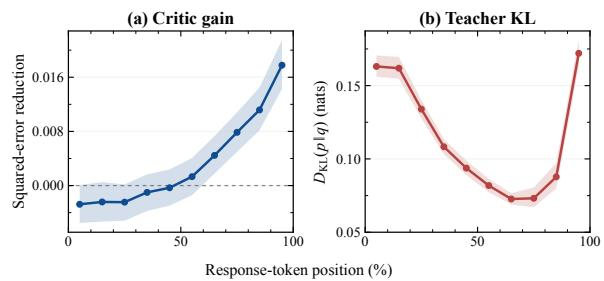  
Figure 2: Privileged signals by relative response position. All responses: (a) solution-induced reduction in critic squared error (positive is better); (b) $D _ { \mathrm { K L } } ( p \vert \vert q )$ between the clean actor and privileged self-teacher. Shading shows 95% confidence intervals.

We compare ordinary and solution-conditioned critics on the same fixed responses, alongside the actor acting as its own solution-conditioned teacher. Appendix G.1 provides the experimental details.

Figure 2 shows different positional profiles: critic prediction benefits grow toward the end, while teacher divergence is high early, falls through the middle, and rebounds at the end. These profiles motivate using privileged information in both readers: the critic forms outcome-grounded advantages, and the self-teacher modulates token updates.

## 3 Methodology

## 3.1 Overview of VASPO

VASPO leverages shared privileged information for both value estimation and self-distillation, while ensuring the student model operates solely on the standard prompt during training and inference. As illustrated in Figure 3, the framework retains the clipped actor update of PPO but introduces two privileged readers with distinct roles. The privileged critic estimates the expected return of an autonomous student continuation, supplying the values required to compute token-level GAE advantages. Concurrently, the self-teacher evaluates the student’s sampled tokens using the same privileged context; its preferences are transformed into bounded coefficients that scale selected positive advantages. This privileged information is established prior to rollout and accessed by both readers at identical student-generated prefixes. The remainder of this section is organized as follows: Section 3.2 formalizes the shared privileged information and student rollouts, Section 3.3 details the privileged value estimation, and Section 3.4 presents the teacher-guided reweighting alongside the actor update. Algorithm 1 summarizes the complete VASPO training procedure.

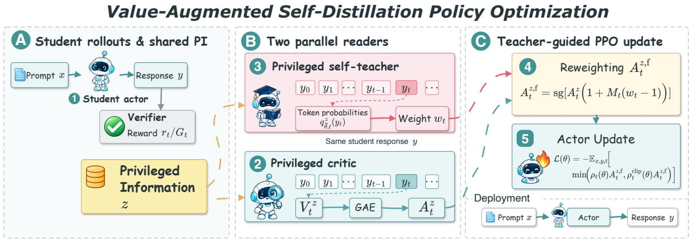  
Figure 3: Overview of VASPO training and deployment. Shared privileged information (PI) supplies critic values for GAE and teacher weights for advantage modulation. The actor remains prompt-only.

## 3.2 Shared Privileged Information

The privileged information is shared by the teacher and critic, while the student learns from its own responses. For a prompt x, we select privileged information z before rollout and keep it fixed. The student samples y from $\pi _ { \theta _ { \mathrm { o l d } } } ( \cdot \mid x )$ . At each prefix $h _ { t } = ( x , y _ { < t } )$ , both readers receive the same z and prefix; the student receives no privileged information during either rollout or deployment.

## 3.3 Privileged Value Estimation

Continuation-value prediction. The critic uses the privileged information to estimate the return of a continuation generated by the student without privileged input. A worked solution may help it relate an unfinished response to the steps the task requires. Its input is the prefix $h _ { t }$ and privileged information z, and its prediction target is

$$
V _ { \phi } ^ { z } ( h _ { t } , z ) \approx \mathbb { E } _ { \pi _ { \theta _ { \mathrm { o l d } } } } [ G _ { t } \mid h _ { t } , z ] .\tag{7}
$$

The expectation is over continuations from the student that collected the rollout. For binary success rewards without discounting, this is the probability that the student will complete correctly. The critic does not observe the current token or the continuation it is predicting. The privileged information supplies task information; the student’s observed return supplies the training target.

Critic pre-update. We update the critic on each newly collected rollout batch before computing the advantages used by the actor. With the student held fixed at $\pi _ { \theta _ { \mathrm { o l d } } }$ , the verifier supplies the terminal return $G _ { i } = \mathcal { R } ( x _ { i } , y _ { i } )$ for response i. We use $\gamma = 1$ , so every valid token in this response has the same return target $G _ { i }$ . This update fits the value estimator to the latest student trajectories before its predictions determine token credit. The privileged information enters the critic input, while supervision remains the student’s observed return.

PPO clipped value loss. Let $v _ { i , t } ^ { z } = V _ { \phi } ^ { z } ( h _ { i , t } , z _ { i } )$ be the current value prediction and $v _ { i , t } ^ { z , \mathrm { o l d } }$ the prediction stored before the critic pre-update. With value clip range $\epsilon _ { v } ,$ we define

$$
\bar { v } _ { i , t } ^ { z } = \mathrm { c l i p } \Big ( v _ { i , t } ^ { z } , v _ { i , t } ^ { z , \mathrm { o l d } } - \epsilon _ { v } , v _ { i , t } ^ { z , \mathrm { o l d } } + \epsilon _ { v } \Big ) .\tag{8}
$$

The critic minimizes the PPO clipped value loss

$$
\mathcal { L } _ { V } ( \phi ) = \frac { 1 } { 2 } \mathrm { A g g } _ { m } \Big [ \operatorname* { m a x } \big ( ( v _ { i , t } ^ { z } - G _ { i } ) ^ { 2 } ,\tag{9}
$$

where $\mathrm { A g g } _ { m }$ aggregates over valid response tokens under mask m. Both the return targets and the stored predictions are detached and fixed throughout this critic update phase. We perform one such phase per rollout batch and denote the resulting parameters by $\phi ^ { + }$

Advantages from refreshed values. After the pre-update, we evaluate the same prefixes again with $V _ { \phi ^ { + } } ^ { z }$ and recompute $A _ { t } ^ { z }$ using the GAE definition in equation 3, with the refreshed privileged critic as the value function. With $V _ { \phi ^ { + } } ^ { z } ( h _ { T + 1 } , z ) =$ 0, terminal-only rewards, and $\gamma = \lambda _ { \mathrm { G A E } } = 1$ , the GAE sum telescopes, yielding

$$
A _ { i , t } ^ { z } = G _ { i } - v _ { i , t } ^ { z , + } , \qquad v _ { i , t } ^ { z , + } = V _ { \phi ^ { + } } ^ { z } ( h _ { i , t } , z _ { i } ) .\tag{10}
$$

Although $G _ { i }$ is shared across the response, the refreshed baseline varies with the prefix, retaining PPO’s token-level credit structure. We detach these advantages and hold them fixed during the subsequent actor update. There is no second critic update on this batch. This privileged-critic advantage combines the verifier outcome with a prefix-dependent value informed by privileged information, before any teacher reweighting.

## 3.4 Teacher-Guided PPO Update

From teacher scores to token weights. The self-teacher evaluates the same tokens sampled by the student, using the distribution conditioned on privileged information $q _ { \bar { \theta } , : } ^ { z }$ t from equation 5. Let $p _ { \mathrm { o l d } , t } \ = \ \pi _ { \theta _ { \mathrm { o l d } } } ( \cdot \ | \ h _ { t } )$ be the student’s behavior distribution. We compute the detached student– teacher gap on the same sampled token $y _ { t } .$

$$
d _ { t } = \mathrm { s g } \Big [ \log q _ { \bar { \theta } , t } ^ { z } ( y _ { t } ) - \log p _ { \mathrm { o l d } , t } ( y _ { t } ) \Big ] .\tag{11}
$$

We clip the corresponding probability ratio to obtain a weight:

$$
w _ { t } = \mathrm { c l i p } \Big ( e ^ { d _ { t } } , 1 - \epsilon _ { w } , 1 + \epsilon _ { w } \Big ) .\tag{12}
$$

Here $0 < \epsilon _ { w } < 1$ bounds the reweighting. A token assigned more probability by the teacher receives a weight above one; a token assigned less receives a weight below one. Clipping bounds how much this preference can change the critic-derived credit.

Token-level mask. Teacher modulation is restricted to tokens with positive GAE advantages and a sufficiently large teacher–student gap. The advantage gate selects tokens that the outcomegrounded update already encourages; the gap gate leaves near-agreement tokens at their original weight. For each valid response token, we define

Algorithm 1 VASPO Training Pipeline   
Require: Data D, student π , EMA teacher $\pi _ { \bar { \theta } } ,$ critic $V _ { \phi } ^ { z } .$   
verifier R   
1: for each training iteration do   
2: Set $\theta _ { \mathrm { o l d } }  \overline { { \theta } } .$   
3: Sample $\{ ( x _ { i } , z _ { i } ) \} _ { i = 1 } ^ { B } \sim \mathcal { D } ;$ generate yi $\sim \pi _ { \theta _ { \mathrm { o l d } } } ( \cdot \ |$   
$x _ { i } )$ and obtain returns $G _ { i } = \mathcal { R } ( x _ { i } , y _ { i } )$   
4: Store $v _ { i , t } ^ { z , \mathrm { o l d } } ;$ pre-update the critic to $\phi ^ { + }$ using Eq. 9.   
5: Re-score $V _ { \phi ^ { + } } ^ { z } \hat { } _ { } ^ { }$ ; recompute $A _ { i , t } ^ { z }$ via Eq. 10.   
6: Compute teacher weights $w _ { i , t }$ and token masks $M _ { i , t }$   
using Eqs. 11–13.   
7: Form $A _ { i , t } ^ { z , \mathrm { f } }$ using Eq. 14.   
8: Update πθ with fixed $A _ { i , t } ^ { z , \mathrm { f } }$ using Eq. 4.   
9: Set $\phi  \phi ^ { + }$ for the next iteration.   
10: end for

$$
M _ { t } = \mathbf { 1 } [ A _ { t } ^ { z } > 0 ] \mathbf { 1 } [ | \operatorname { t a n h } ( d _ { t } / \tau ) | > \delta ] .\tag{13}
$$

The sign test uses the raw, unwhitened $A _ { t } ^ { z }$ recomputed after the critic pre-update. It is applied at each token position, without directly checking whether the complete response is correct. Prompt and padding positions are excluded by the validresponse-token mask. Thus, $M _ { t }$ controls where teacher guidance changes the actor advantage; it does not select the examples used to train the critic.

Reweighting the advantage. We denote the fused advantage by $A _ { t } ^ { z , \mathrm { f } }$ , where f indicates teacher fusion, and combine the refreshed GAE advantage, token mask, and teacher weight as

$$
A _ { t } ^ { z , \mathrm { f } } = \mathrm { s g } \big [ A _ { t } ^ { z } \big ( 1 + M _ { t } ( w _ { t } - 1 ) \big ) \big ] .\tag{14}
$$

For selected tokens this gives $A _ { t } ^ { z , \mathrm { f } } = A _ { t } ^ { z } w _ { t } ;$ for all other tokens it gives $A _ { t } ^ { z , \mathrm { f } } = A _ { t } ^ { z }$ . The teacher therefore strengthens or attenuates selected positive updates, while negative advantages and unselected tokens retain their original credit. The positive weight preserves the sign of $A _ { t } ^ { z }$ . We use the detached $\hat { A } _ { t } ^ { z , \mathrm { f } }$ in the clipped PPO loss equation 4 over all valid response tokens. Algorithm 1 summarizes the training procedure.

## 4 Experiments

## 4.1 Experimental Setup

Models and Datasets. We conduct experiments on Qwen3-4B-Instruct-2507 (Yang et al., 2025) and OLMo3-7B-Instruct-DPO (Olmo Team et al., 2025) for mathematical reasoning, and on Qwen3- 4B-Instruct-2507 for logical reasoning. We train on the full DeepMath-103K dataset (He et al., 2026)

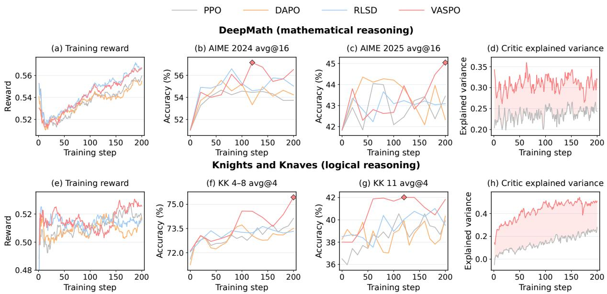  
Figure 4: Training dynamics of Qwen3-4B-Instruct-2507. Top: DeepMath training reward, AIME 2024 and AIME 2025 avg@16 accuracy, and critic explained variance. Bottom: KK training reward, 4–8-role and 11-role avg@4 accuracy, and critic explained variance.

for mathematics and Knights and Knaves (KK) (Xie et al., 2025) puzzles with 4–8 roles for logic. Privileged information consists of the solutions and answers provided in the datasets.

Baselines and Evaluation. We compare VASPO with Vanilla (the initial checkpoint), DAPO, PPO (Schulman et al., 2017), OPSD (Zhao et al., 2026), and RLSD (Yang et al., 2026a). For mathematics, we report avg@32 on AIME24, AIME25, and AIME26 (Mathematical Association of America, n.d.) and HMMT25, and avg@8 on Minerva Math (Lewkowycz et al., 2022) and OlympiadBench (He et al., 2024). For KK, we report avg@16 on heldout 4–8-role puzzles and out-of-distribution tests with 9, 10, and 11 roles. Avg@K denotes mean correctness over K sampled responses per problem. We assess critic quality using explained variance (EV), which measures how much return variation is explained by its value predictions:

$$
\mathrm { E V } = 1 - \frac { \operatorname { V a r } _ { \mathcal { M } } ( G _ { t } - V _ { t } ) } { \operatorname { V a r } _ { \mathcal { M } } ( G _ { t } ) + \varepsilon _ { \mathrm { E V } } } ,\tag{15}
$$

where M contains valid response-token positions, $V _ { t }$ is the raw critic prediction, $G _ { t }$ is the clean student’s verifier-return target, and $\varepsilon _ { \mathrm { E V } } > 0$ ensures numerical stability. Higher EV indicates lower residual variance relative to return variance.

Implementation Details. We implement VASPO in verl (Sheng et al., 2025), using full-parameter training with AdamW and actor/critic learning rates of 10 $\bar { - 6 } / 5 \times 1 0 ^ { - 6 }$ . The global batch size is 128 and the mini-batch size is 32, with eight responses sampled per prompt. We use $\gamma = 1 , \lambda _ { \mathrm { G A E } } = 1$ , PPO clipping $\epsilon _ { \mathrm { c l i p } } = 0 . 2$ , reweighting clip $\epsilon _ { w } = 0 . 2 .$ and selection parameters $\tau = \delta = 0 . 0 2$ . Training and evaluation use temperatures of 1.0 and 0.6, respectively, with top-p 0.95 and top-k 20. The maximum response length is 8,192 tokens for both training and evaluation. Critic pretraining, evaluation, and training settings are provided in Appendices C, D.2, and D.4, respectively. For Qwen3-4B-Instruct-2507, student rollout is the most time-consuming component, averaging 191.97 s per step over 200 training steps (Appendix D.5).

## 4.2 Main Results

Mathematical reasoning. VASPO surpasses all baselines across the mathematical benchmarks on both Qwen3 and OLMo3 (Table 1). The performance gains hold across various tasks and architectures. DAPO and RLSD serve as the strongest average baselines on Qwen3 and OLMo3, respectively, while OPSD universally declines. This indicates that raw access to privileged information is insufficient for better reasoning.

Logical reasoning and transfer. Furthermore, VASPO sets the highest average performance on the KK dataset, improving both in-domain reasoning and out-of-distribution transfer to larger puzzles (Table 2). It leads the training-range split and the largest out-of-distribution splits, though RLSD edges it out on 9-role puzzles. Overall, the margin of improvement is smaller than in mathematics, and all methods suffer performance drops as puzzle size scales.

(b) AIME 2025 avg@16
<table><tr><td rowspan="2">Method</td><td>AIME24</td><td>AIME25</td><td>AIME26</td><td>HMMT25</td><td>Minerva</td><td>Olympiad</td><td rowspan="2">Avg.</td></tr><tr><td colspan="3">avg@32</td><td colspan="3">avg@8</td></tr><tr><td>Qwen3-4B-Instruct-2507</td><td></td><td></td><td></td><td></td><td></td><td></td><td></td></tr><tr><td>Vanilla</td><td>51.04</td><td>40.83</td><td>48.85</td><td>25.83</td><td>60.43</td><td>71.55</td><td>49.76</td></tr><tr><td>DAPO</td><td>53.85</td><td>42.08</td><td>49.90</td><td>28.33</td><td>62.59</td><td>72.81</td><td>51.59</td></tr><tr><td>PPO</td><td>51.67</td><td>42.71</td><td>48.65</td><td>26.35</td><td>63.14</td><td>70.96</td><td>50.58</td></tr><tr><td>OPSD</td><td>29.58</td><td>26.46</td><td>31.77</td><td>12.29</td><td>54.14</td><td>54.56</td><td>34.80</td></tr><tr><td>RLSD</td><td>54.17</td><td>42.60</td><td>49.17</td><td>27.08</td><td>60.11</td><td>72.14</td><td>50.88</td></tr><tr><td>VASPO</td><td>56.87</td><td>43.96</td><td>51.15</td><td>29.17</td><td>64.75</td><td>73.12</td><td>53.17</td></tr><tr><td>OLMo3-7B-Instruct-DPO</td><td></td><td></td><td></td><td></td><td></td><td></td><td></td></tr><tr><td>Vanilla</td><td>24.17</td><td>20.62</td><td>21.15</td><td>11.35</td><td>45.36</td><td>56.21</td><td>29.81</td></tr><tr><td>DAPO</td><td>27.92</td><td>23.13</td><td>23.23</td><td>13.65</td><td>47.01</td><td>58.64</td><td>32.26</td></tr><tr><td>PPO</td><td>25.10</td><td>24.38</td><td>22.40</td><td>12.71</td><td>47.06</td><td>58.01</td><td>31.61</td></tr><tr><td>OPSD</td><td>18.33</td><td>16.15</td><td>15.31</td><td>10.52</td><td>35.11</td><td>46.61</td><td>23.67</td></tr><tr><td>RLSD</td><td>28.44</td><td>23.65</td><td>22.71</td><td>14.69</td><td>47.08</td><td>58.25</td><td>32.47</td></tr><tr><td>VASPO</td><td>29.58</td><td>24.58</td><td>24.90</td><td>14.90</td><td>47.75</td><td>58.83</td><td>33.42</td></tr></table>

Table 1: Mathematical reasoning accuracy (%). Bold/underlined: best/second-best available scores per backbone.

<table><tr><td rowspan="2">Method</td><td rowspan="2">ID</td><td colspan="3">OOD</td><td rowspan="2">Avg.</td></tr><tr><td>4–8 Roles 9 Roles</td><td>10 Roles</td><td>11 Roles</td></tr><tr><td>Vanilla</td><td>72.99</td><td>67.94</td><td>54.44</td><td>37.81</td><td>58.30</td></tr><tr><td>DAPO</td><td>73.71</td><td>68.81</td><td>57.00</td><td>40.00</td><td>59.88</td></tr><tr><td>PPO</td><td>74.33</td><td>65.59</td><td>57.69</td><td>39.14</td><td>59.19</td></tr><tr><td>RLSD</td><td>73.54</td><td>70.19</td><td>57.50</td><td>40.12</td><td>60.34</td></tr><tr><td>VASPO</td><td>75.31</td><td>69.25</td><td>58.06</td><td>40.62</td><td>60.81</td></tr></table>

Table 2: Knights and Knaves accuracy (avg@16, %) on Qwen3-4B-Instruct-2507. Avg.: mean across the four role groups. Bold/underlined: best/second-best.

Training dynamics. VASPO’s higher held-out accuracy is accompanied by better critic predictions despite similar training rewards (Figure 4). It finishes above PPO, DAPO, and RLSD on the AIME benchmarks and KK splits shown, while its critic attains higher explained variance than PPO. The separation in held-out performance is therefore more pronounced than in training reward. This pattern is consistent with the hypothesis that privileged value estimation supports policy learning; the component ablations and value diagnostics below examine this explanation more directly.

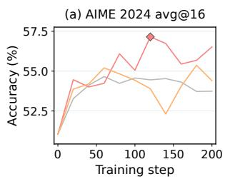

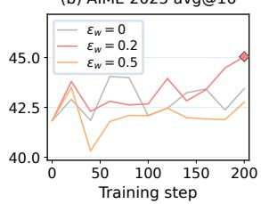  
Figure 5: Fusion strength on Qwen3-4B-Instuct-2507. AIME 2024 and AIME 2025 avg@16 accuracy over DeepMath training steps. The probability-ratio clip width $\epsilon _ { w } = 0$ disables teacher modulation.

## 4.3 Ablation Study

Contributions of the teacher and critic. VASPO yields the highest average accuracy among all variants in both mathematics and KK (Table 3). The privileged critic alone improves performance over PPO, and adding self-teacher modulation provides further gains. Across all benchmarks, the full method matches or outperforms the criticonly variant. The variant without the privileged critic removes the entire critic component , leaving OPSD as the training objective. Its lower accuracy supports retaining the critic-based reinforcementlearning path alongside self-teacher guidance.

Ablation on token-level mask. Selective teacher modulation consistently improves performance (Table 3). Removing the token-level mask in equation 13 degrades accuracy across every benchmark and role group in both domains.

<table><tr><td></td><td colspan="5">Mathematical Reasoning</td><td colspan="5">Logical Reasoning: Knights and Knaves</td></tr><tr><td>Method</td><td>AIME2024</td><td>AIME2025</td><td>AIME2026</td><td>Olympiad</td><td> $\operatorname { A v g } .$ </td><td>4–8 Roles</td><td>9 Roles</td><td>10 Roles</td><td>11 Roles</td><td>Avg.</td></tr><tr><td>VASPO (full)</td><td>56.87</td><td>43.96</td><td>51.15</td><td>73.12</td><td>56.28</td><td>75.31</td><td>69.25</td><td>58.06</td><td>40.62</td><td>60.81</td></tr><tr><td>privileged critic</td><td>29.58</td><td>26.46</td><td>31.77</td><td>54.56</td><td>35.59</td><td>47.20</td><td>25.19</td><td>15.06</td><td>5.75</td><td>23.30</td></tr><tr><td>self-teacher modulation</td><td>55.73</td><td>43.44</td><td>50.73</td><td>73.07</td><td>55.74</td><td>73.95</td><td>69.25</td><td>56.13</td><td>39.25</td><td>59.65</td></tr><tr><td>both reader components</td><td>51.67</td><td>42.71</td><td>48.65</td><td>70.96</td><td>53.50</td><td>74.33</td><td>65.59</td><td>57.69</td><td>39.14</td><td>59.19</td></tr><tr><td>token-level mask</td><td>55.41</td><td>41.56</td><td>50.42</td><td>72.40</td><td>54.95</td><td>74.84</td><td>67.19</td><td>56.94</td><td>39.44</td><td>59.60</td></tr><tr><td>solution derivation (answer only)</td><td>54.90</td><td>41.88</td><td>49.48</td><td>72.11</td><td>54.59</td><td>73.46</td><td>66.75</td><td>56.69</td><td>38.75</td><td>58.91</td></tr><tr><td>critic pre-update</td><td>55.52</td><td>42.71</td><td>49.17</td><td>72.59</td><td>55.00</td><td>74.35</td><td>67.00</td><td>55.31</td><td>38.69</td><td>58.84</td></tr><tr><td>+ advantage whiten</td><td>54.17</td><td>42.50</td><td>48.44</td><td>72.53</td><td>54.41</td><td>73.84</td><td>66.19</td><td>54.63</td><td>38.31</td><td>58.24</td></tr></table>

Table 3: Ablation of critic, self-teacher and privileged-information content in VASPO (Qwen3-4B-Instruct-2507; accuracy, %). Rows denote changes relative to the full method. Mathematics uses avg@32 on AIME2024/2025/2026 and avg@8 on OlympiadBench; KK uses avg@16, with 4–8 roles and 9/10/11 roles.

Ablation on fusion strength. Stronger teacher modulation does not guarantee better performance (Figure 5). Modulated by the probability-ratio clip width $\epsilon _ { w }$ in equation 12, the default $\epsilon _ { w } ~ = ~ 0 . 2$ achieves higher final AIME accuracy than either disabling it (zero) or widening it to 0.5.

Ablation on privileged-information content. Replacing the solution-plus-answer input with an answer-only variant lowers accuracy across all evaluated benchmarks and role groups (Table 3). Both readers receive the modified input, while the actor remains conditioned on the standard prompt.

Critic pre-update. Removing the critic preupdate incurs a consistent accuracy drop across all mathematical benchmarks and KK role groups (Table 3). Because self-teacher advantage modulation can amplify actor updates, it risks exacerbating the distribution shift between the evolving policy and a critic fitted to outdated rollouts. Updating the critic on the latest actor trajectories prior to computing advantages enables it to align with the current policy before the subsequent actor update. This timely adaptation enhances value-prediction accuracy and yields more reliable token-level credit, effectively explaining the observed performance gains.

Advantage whitening. Applying global whitening after teacher modulation degrades performance across all mathematical benchmarks and KK role groups (Table 3). Although strictly positive teacher weights preserve the signs of the raw advantages, the subsequent subtraction of a batch-wide mean can inadvertently invert the signs of some fused advantages. Consequently, tokens initially encouraged by the outcome-grounded signal might receive penalizing updates, or vice versa, severely distorting the intended optimization directions. This phenomenon accounts for the observed degradation and strongly advocates for utilizing the fused advantages without any subsequent global whitening.

## 4.4 Analysis

Does privileged information improve value prediction? Conditioning on reference solutions improves value prediction point estimates but does not aid calibration (Figure 9). Evaluated on fixed continuations from a frozen Qwen3 actor, the privileged solution critic yields the highest explained variance and lowest Brier error across the three checkpoints, whereas the baseline critic maintains the lowest ECE. The point-estimate rankings alone do not establish a strict overall advantage.

Where do the two signals help? The critic’s benefit varies significantly by prefix position and source-response correctness. Aggregate diagnostics indicate that solution conditioning degrades accuracy at early prefixes but improves it at late prefixes, with mixed results in the middle. Paired positional contrasts confirm this trend, highlighting that late-stage gains are largest for incorrect source responses. While length controls validate this pattern for medium and long responses, the late gain remains uncertain in the long-response group (Appendix G.3). Conversely, the self-teacher follows a different trajectory: its divergence from the baseline actor is high initially, falls through the middle, and rebounds at the final position (Figure 2). These complementary signal profiles motivate employing the two readers for distinct roles in the update.

## 5 Conclusion

We presented VASPO, a PPO framework leveraging shared reference solutions for continuationvalue estimation and token guidance. By combining privileged critic credit and bounded self-teacher modulation, VASPO trains actors using solely standard prompts. Empirically, it achieves top average accuracy across Qwen3 and OLMo3 mathematical and logical reasoning benchmarks. Analyses show privileged conditioning trades higher early-prefix error and worse calibration for improved late-prefix value prediction. Lastly, ablations confirm that full solution derivations and selective, moderate teacher modulation are crucial.

## Limitations

Extending VASPO to interactive tasks requires careful consideration of when newly observed information becomes available to the value estimator. Specifically, under the current protocol, environmental feedback obtained at the completion of a response cannot be retroactively used as privileged context for earlier prefixes of that same trajectory.

Furthermore, the framework’s efficacy is constrained by evidence quality and computational overhead. Privileged reference solutions, even when yielding a verified final answer, may still harbor flawed intermediate reasoning steps that could introduce noisy supervision. Additionally, conditioning the readers on full solutions expands the context window for both the teacher and the critic, thereby increasing training costs.

Finally, VASPO is currently designed for singleturn generation. Its application to multi-turn dialogue—where conversational history and available privileged evidence dynamically evolve across successive turns—remains an open direction for future work.

## References

Rishabh Agarwal, Nino Vieillard, Yongchao Zhou, Piotr Stanczyk, Sabela Ramos Garea, Matthieu Geist, and Olivier Bachem. 2024. On-policy distillation of language models: Learning from self-generated mistakes. In The Twelfth International Conference on Learning Representations.

Mohammad Sadegh Akhondzadeh, Vijay Lingam, Atula Tejaswi, Chanakya Ekbote, Sujay Sanghavi, and Aleksandar Bojchevski. 2026. Reward-gated onpolicy distillation. Preprint, arXiv:2607.04037.

Yifan Ding, Xincheng Wei, Yoshua Y. Li, Ziheng Li, Yuquan Lu, Siyu Zhang, Dongsheng Ma, Rongxiang Weng, Xunliang Cai, and Yun Chen. 2026. SAF-OPD: Stable advantage fusion for on-policy distillation. Preprint, arXiv:2607.29209.

Yuxian Gu, Li Dong, Furu Wei, and Minlie Huang. 2024. MiniLLM: Knowledge distillation of large language

models. In The Twelfth International Conference on Learning Representations.

Daya Guo, Dejian Yang, Haowei Zhang, Junxiao Song, Peiyi Wang, Qihao Zhu, Runxin Xu, Ruoyu Zhang, Shirong Ma, Xiao Bi, Xiaokang Zhang, Xingkai Yu, Yu Wu, Z. F. Wu, Zhibin Gou, Zhihong Shao, Zhuoshu Li, Ziyi Gao, Aixin Liu, and 175 others. 2025. DeepSeek-R1 incentivizes reasoning in LLMs through reinforcement learning. Nature, 645(8081):633–638.

Chaoqun He, Renjie Luo, Yuzhuo Bai, Shengding Hu, Zhen Leng Thai, Junhao Shen, Jinyi Hu, Xu Han, Yujie Huang, Yuxiang Zhang, Jie Liu, Lei Qi, Zhiyuan Liu, and Maosong Sun. 2024. OlympiadBench: A challenging benchmark for promoting AGI with olympiad-level bilingual multimodal scientific problems. In Proceedings of the 62nd Annual Meeting of the Associationfor Computational Linguistics (Volume 1: Long Papers), pages 3828–3850, Bangkok, Thailand. Association for Computational Linguistics.

Zhiwei He, Tian Liang, Jiahao Xu, Qiuzhi Liu, Xingyu Chen, Yue Wang, Linfeng Song, Dian Yu, Zhenwen Liang, Wenxuan Wang, Zhuosheng Zhang, Rui Wang, Zhaopeng Tu, Haitao Mi, and Dong Yu. 2026. DeepMath-103K: A large-scale, challenging, decontaminated, and verifiable mathematical dataset for advancing reasoning. In The Fourteenth International Conference on Learning Representations.

Jonas Hübotter, Frederike Lübeck, Lejs Deen Behric, Anton Baumann, Marco Bagatella, Daniel Marta, Ido Hakimi, Idan Shenfeld, Thomas Kleine Buening, Carlos Guestrin, and Andreas Krause. 2026. Reinforcement learning via self-distillation. In Proceedings of the 43rd International Conference on Machine Learning, volume 306 of Proceedings of Machine Learning Research, pages 48677–48721. PMLR.

Simran Kaur, Narutatsu Ri, Yinghui He, Liam Fowl, and Sanjeev Arora. 2026. Rethinking on-policy self-distillation for thinking models. Preprint, arXiv:2607.05184.

Aitor Lewkowycz, Anders Andreassen, David Dohan, Ethan Dyer, Henryk Michalewski, Vinay Ramasesh, Ambrose Slone, Cem Anil, Imanol Schlag, Theo Gutman-Solo, Yuhuai Wu, Behnam Neyshabur, Guy Gur-Ari, and Vedant Misra. 2022. Solving quantitative reasoning problems with language models. In Advances in Neural Information Processing Systems, volume 35, pages 3843–3857. Curran Associates, Inc.

Gengsheng Li, Tianyu Yang, Junfeng Fang, Mingyang Song, Mao Zheng, Haiyun Guo, Dan Zhang, Jinqiao Wang, and Tat-Seng Chua. 2026. Unifying grouprelative and self-distillation policy optimization via sample routing. Preprint, arXiv:2604.02288.

Hunter Lightman, Vineet Kosaraju, Yuri Burda, Harrison Edwards, Bowen Baker, Teddy Lee, Jan Leike, John Schulman, Ilya Sutskever, and Karl Cobbe.

2024. Let’s verify step by step. In The Twelfth International Conference on Learning Representations.

Xiaogeng Liu, Xinyan Wang, Yingzi Ma, Yechao Zhang, and Chaowei Xiao. 2026a. When are teacher tokens reliable? position-weighted on-policy self-distillation for reasoning. Preprint, arXiv:2605.21606.

Yifeng Liu, Shiyuan Zhang, Yifan Zhang, and Quanquan Gu. 2026b. Self-distilled policy gradient. Preprint, arXiv:2606.04036.

David Lopez-Paz, Léon Bottou, Bernhard Schölkopf, and Vladimir Vapnik. 2016. Unifying distillation and privileged information. In International Conference on Learning Representations.

Mathematical Association of America. n.d. MAA invitational competitions. Accessed October 10, 2026.

Minjae Oh, Sangjun Song, Gyubin Choi, Yunho Choi, and Yohan Jo. 2026. KL for a KL: On-policy distillation with control variate baseline. Preprint, arXiv:2605.07865.

Olmo Team, Allyson Ettinger, Amanda Bertsch, Bailey Kuehl, David Graham, David Heineman, Dirk Groeneveld, Faeze Brahman, Finbarr Timbers, Hamish Ivison, Jacob Morrison, Jake Poznanski, Kyle Lo, Luca Soldaini, Matt Jordan, Mayee Chen, Michael Noukhovitch, Nathan Lambert, Pete Walsh, and 49 others. 2025. Olmo 3. Preprint, arXiv:2512.13961.

Leyi Pan, Shuchang Tao, Yunpeng Zhai, Lingzhe Zhang, Zhaoyang Liu, Bolin Ding, Aiwei Liu, and Lijie Wen. 2026. RLCSD: Reinforcement learning with contrastive on-policy self-distillation. Preprint, arXiv:2606.11709.

John Schulman, Filip Wolski, Prafulla Dhariwal, Alec Radford, and Oleg Klimov. 2017. Proximal policy optimization algorithms. Preprint, arXiv:1707.06347.

Zikang Shan, Han Zhong, Liwei Wang, and Li Zhao. 2026. Bringing value models back: Generative critics for value modeling in LLM reinforcement learning. Preprint, arXiv:2604.10701.

Zhihong Shao, Peiyi Wang, Qihao Zhu, Runxin Xu, Junxiao Song, Xiao Bi, Haowei Zhang, Mingchuan Zhang, Y. K. Li, Y. Wu, and Daya Guo. 2024. DeepSeekMath: Pushing the limits of mathematical reasoning in open language models. Preprint, arXiv:2402.03300.

Guangming Sheng, Chi Zhang, Zilingfeng Ye, Xibin Wu, Wang Zhang, Ru Zhang, Yanghua Peng, Haibin Lin, and Chuan Wu. 2025. HybridFlow: A flexible and efficient RLHF framework. In Proceedings of the Twentieth European Conference on Computer Systems, pages 1279–1297. Association for Computing Machinery.

Vladimir Vapnik and Akshay Vashist. 2009. A new learning paradigm: Learning using privileged information. Neural Networks, 22(5–6):544–557.

Fei Wu, Zhenrong Zhang, Qikai Chang, Jianshu Zhang, Quan Liu, and Jun Du. 2026a. Step potential advantage estimation: Harnessing intermediate confidence and correctness for efficient mathematical reasoning. In Findings ofthe Associationfor Computational Linguistics: ACL 2026, pages 6361–6379, San Diego, California, United States. Association for Computational Linguistics.

Haoze Wu, Chuqiao Kuang, Tianyi Zhuang, and Xiaoguang Li. 2026b. Beyond outcome rewards: Steplevel self-distilled policy optimization for deep search agents. Preprint, arXiv:2608.12764.

Bangjun Xiao, Bingquan Xia, Bo Yang, Bofei Gao, Bowen Shen, Chen Zhang, Chenhong He, Chiheng Lou, Fuli Luo, Gang Wang, Gang Xie, Hailin Zhang, Hanglong Lv, Hanyu Li, Heyu Chen, Hongshen Xu, Houbin Zhang, Huaqiu Liu, Jiangshan Duo, and 106 others. 2026. MiMo-V2-Flash technical report. Preprint, arXiv:2601.02780.

Tian Xie, Zitian Gao, Qingnan Ren, Haoming Luo, Yuqian Hong, Bryan Dai, Joey Zhou, Kai Qiu, Zhirong Wu, and Chong Luo. 2025. Logic-RL: Unleashing LLM reasoning with rule-based reinforcement learning. Preprint, arXiv:2502.14768.

An Yang, Anfeng Li, Baosong Yang, Beichen Zhang, Binyuan Hui, Bo Zheng, Bowen Yu, Chang Gao, Chengen Huang, Chenxu Lv, Chujie Zheng, Dayiheng Liu, Fan Zhou, Fei Huang, Feng Hu, Hao Ge, Haoran Wei, Huan Lin, Jialong Tang, and 41 others. 2025. Qwen3 technical report. Preprint, arXiv:2505.09388.

Chenxu Yang, Chuanyu Qin, Qingyi Si, Minghui Chen, Naibin Gu, Dingyu Yao, Zheng Lin, Weiping Wang, Jiaqi Wang, and Nan Duan. 2026a. Self-distilled RLVR. Preprint, arXiv:2604.03128.

Wenkai Yang, Weijie Liu, Ruobing Xie, Kai Yang, Saiyong Yang, and Yankai Lin. 2026b. Learning beyond teacher: Generalized on-policy distillation with reward extrapolation. Preprint, arXiv:2602.12125.

Yufeng Yuan, Yu Yue, Ruofei Zhu, Tiantian Fan, and Lin Yan. 2025. What’s behind PPO’s collapse in long-CoT? value optimization holds the secret. Preprint, arXiv:2503.01491.

Yu Yue, Yufeng Yuan, Qiying Yu, Xiaochen Zuo, Ruofei Zhu, Wenyuan Xu, Jiaze Chen, Chengyi Wang, TianTian Fan, Zhengyin Du, Xiangpeng Wei, Xiangyu Yu, Gaohong Liu, Juncai Liu, Lingjun Liu, Haibin Lin, Zhiqi Lin, Bole Ma, Chi Zhang, and 8 others. 2025. VAPO: Efficient and reliable reinforcement learning for advanced reasoning tasks. Preprint, arXiv:2504.05118.

Qianchi Zhang, Hainan Zhang, Liang Pang, Yongxin Tong, Hongwei Zheng, and Zhiming Zheng. 2026a. Less is more: Compact clue selection for efficient retrieval-augmented generation reasoning. In Proceedings of the ACM Web Conference 2026, pages 1971–1982. Association for Computing Machinery.

Qianchi Zhang, Hainan Zhang, Liang Pang, Hong-Wei Zheng, and Zhiming Zheng. 2026b. Stable-RAG: Mitigating retrieval-permutation-induced hallucinations in retrieval-augmented generation. In Proceedings ofthe 64th Annual Meeting ofthe Associationfor Computational Linguistics (Volume 1: Long Papers), pages 25907–25926, San Diego, California, United States. Association for Computational Linguistics.

Zhenrong Zhang, Fei Wu, Jun Du, Jianshu Zhang, and Si Wei. 2026c. ReDiPPO: Reference-guided value calibration and discrepancy-aware token reweighting for mathematical reasoning. Preprint, arXiv:2607.27631.

Siyan Zhao, Zhihui Xie, Mengchen Liu, Jing Huang, Guan Pang, Feiyu Chen, and Aditya Grover. 2026. Self-distilled reasoner: On-policy self-distillation for large language models. In Proceedings of the 43rd International Conference on Machine Learning, volume 306 of Proceedings of Machine Learning Research, pages 162433–162448. PMLR.

Siqi Zhu, Xuyan Ye, Hongyu Lu, Weiye Shi, and Ge Liu. 2026. The many faces of on-policy distillation: Pitfalls, mechanisms, and fixes. Preprint, arXiv:2605.11182.

## A LLM Usage

We used LLMs only to polish grammar and improve the clarity of the manuscript. All research ideas, experiments, and analyses were conducted by the authors.

## B Related Work

## B.1 RLVR and Value-Based Credit Assignment

Verifiable outcomes provide a scalable training signal for reasoning, while the policy optimizer determines how that signal is assigned to sampled tokens. DeepSeekMath introduced GRPO, which compares rewards within a group of responses to estimate advantages without a learned critic (Shao et al., 2024); DeepSeek-R1 further demonstrated the potential of outcome-based reinforcement learning for reasoning (Guo et al., 2025). In outcomeonly GRPO, a response-level advantage is shared across token positions. PPO instead uses a learned value function to construct prefix-dependent advantages (Schulman et al., 2017). Process supervision provides another route to finer-grained feedback by learning from intermediate-step correctness labels (Lightman et al., 2024). Step-potential advantage estimation similarly derives step-level credit from intermediate confidence and correctness signals (Wu et al., 2026a). VASPO retains terminal verification as the source of rewards and value targets, and uses training-time evidence to inform the two readers that construct token-level updates.

Recent actor–critic methods study value estimation for long reasoning trajectories. VC-PPO pretrains the critic with Monte Carlo returns and decouples the GAE parameters used for value and policy updates (Yuan et al., 2025). VAPO builds on these techniques and adds length-adaptive advantage estimation to address heterogeneous response lengths (Yue et al., 2025). GenAC replaces a scalar value head with a generative critic that reasons about a prefix before predicting its value (Shan et al., 2026). ReDiPPO instead calibrates value estimates with reference-model guidance and reweights tokens according to policy–reference discrepancy (Zhang et al., 2026c). In OPD, Oh et al. (2026) derive a closed-form reverse-KL controlvariate baseline to reduce gradient variance without an additional critic. That baseline belongs to the distillation objective; VASPO’s learned critic predicts verifier returns from clean student continuations. VASPO studies the critic’s input choice: conditioning this return estimate on the evidence already supplied to a self-teacher.

## B.2 On-Policy Distillation and Self-Teaching

On-policy distillation supplies teacher feedback on the states that the student actually visits. GKD trains on student-generated sequences and studies several distribution-matching objectives (Agarwal et al., 2024), while MiniLLM uses a reverse-KL objective optimized through policy gradients (Gu et al., 2024). More recent work also considers objectives that relax strict imitation: ExOPD scales the teacher-derived implicit reward within a KLconstrained formulation (Yang et al., 2026b). These methods establish student-generated prefixes as the interface for dense teacher supervision.

Self-distillation obtains a better-informed teacher by changing its context rather than requiring a separate, larger model. Retrieval-augmented generation conditions a model on external evidence in a similar spirit: Stable-RAG shows that permuting the retrieved clues can by itself induce hallucinations (Zhang et al., 2026b), while compact clue selection reduces such evidence to an informative subset for efficient reasoning (Zhang et al., 2026a). This use of training-only context connects self-teaching to learning using privileged information and generalized distillation (Vapnik and Vashist, 2009; Lopez-Paz et al., 2016). OPSD conditions a detached self-teacher on worked solutions and matches its distributions along clean student rollouts (Zhao et al., 2026). SDPO constructs self-teaching contexts from rich environment feedback and successful attempts, allowing the policy to learn from information revealed during interaction (Hübotter et al., 2026). Studies of privileged OP(S)D identify failure modes for thinking models, instance-specific privileged information, and unreliable teacher targets at some student prefixes (Kaur et al., 2026; Zhu et al., 2026; Liu et al., 2026a). These findings concern the teacher signal and its downstream effect on the actor. VASPO uses the privileged information for sampled-token assessment and additionally tests its effect on continuation-value estimation. This second role constrains evidence timing: the shared bank is fixed before rollout, whereas feedback from the current completed response can inform a retrospective teacher without being an admissible input to VASPO’s critic for that same response.

## B.3 Combining Distillation with Verifiable Rewards

Several methods combine dense distillation with outcome optimization through an additive objective or advantage. MiMo-V2-Flash adds teacher– student log-probability gaps to outcome-derived advantages in its multi-teacher distillation pipeline (Xiao et al., 2026). SDPG combines a verifierbased policy-gradient objective with an exact full-vocabulary self-distillation loss and referencepolicy KL regularization (Liu et al., 2026b). SAF-OPD studies the relative magnitude and training schedule of the two signals, using sparsification and bounded compression together with warm-up and annealing for the external-teacher OPD branch (Ding et al., 2026). These designs show that the granularity, scale, and timing of teacher supervision are separate choices in the fusion interface.

Other methods select where to apply each signal. Sample-Routed Policy Optimization (SRPO) routes failed responses with available teacher information to self-distillation and the remaining responses to GRPO (Li et al., 2026). Reward-Gated OPD instead retains trajectories for distillation according to agreement between the verifier-derived advantage and a sequence-level teacher–student likelihood gap (Akhondzadeh et al., 2026). Its verifier thus controls a distillation gate, rather than contributing an additive reward term. VASPO uses a learned prefix value to construct its advantage and applies teacher modulation within that actor–critic update.

The closest group-relative interfaces use the teacher to refine verifier-grounded credit. Self-Distilled RLVR (RLSD) preserves the sign of the outcome advantage while a detached teacher– student evidence ratio changes token-level update magnitudes (Yang et al., 2026a). RLCSD contrasts correct and incorrect privileged contexts to suppress correctness-independent style shifts in the teacher signal (Pan et al., 2026). SSPO applies teacher–student disagreement as step-level advantage weights on incorrect deep-search trajectories (Wu et al., 2026b). Their group-relative outcome advantages are shared across positions before teacher modulation; they do not learn a value conditioned on privileged information for each student prefix. VASPO uses the privileged information in a learned PPO critic as well as the teacher, so its outcome-grounded advantages can vary across prefixes before modulation. The bounded fusion preserves the sign of the raw privileged-critic advantage (Section 3.4).

## C Critic Pretraining

Pretraining Data. For each task and policy backbone, we use the initial policy checkpoint to sample eight responses per training prompt. The actor observes only the standard problem prompt, without the privileged solution or answer. Each response receives a binary correctness label from the task verifier described in Appendix D.2. We upsample incorrect response trajectories to obtain an approximately balanced ratio of correct and incorrect examples. The same sampled trajectories and return labels are used to pretrain the clean and privileged critic variants.

Pretraining Protocol. Each critic is initialized from its corresponding policy backbone with a scalar value head and pretrained for two epochs before RL, following the value-pretraining protocol of VAPO (Yue et al., 2025). Pretraining minimizes the mean squared error between each token-level prediction and the response’s terminal verifier return. With $\gamma = 1$ , every valid response-token state has the same binary target. The clean critic reads the prompt and preceding response tokens; the privileged critic additionally reads the fixed dataset solution and answer. Neither critic observes the current token or subsequent response tokens. PPO and the critic-based reader ablations use the same initialization, pretraining trajectories, targets, and epoch count; the input conditioning changes with the ablation. Offline pretraining initializes the critic, while the per-rollout pre-update in Appendix F adapts it during RL.

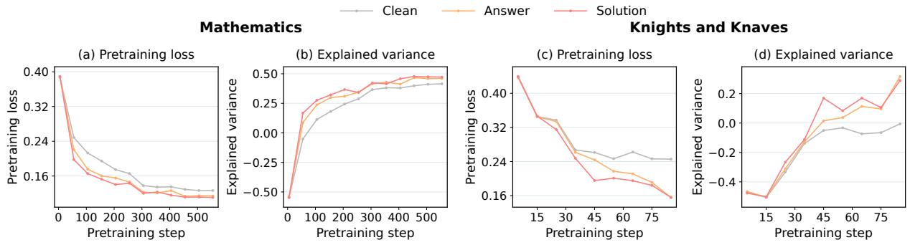  
Figure 6: Critic pretraining dynamics. Logged loss and explained variance for clean, answer-conditioned, and solution-conditioned critics. Panels (a)–(b): mathematics, with 12 recorded checkpoints from step 5 to 555. Panels (c)–(d): KK, with nine recorded checkpoints from step 5 to 85. Points show recorded values, and solid lines connect consecutive observations without additional smoothing.

Pretraining Dynamics. Figure 6 shows the recorded loss and explained variance under clean, answer, and solution conditioning. In mathematics, loss decreases overall and explained variance increases for all three variants. At the last recorded checkpoint in each task, the answer- and solutionconditioned critics have lower loss and higher explained variance than the clean critic.

## D Additional Experimental Details

## D.1 Datasets and Models

Mathematical reasoning uses Qwen3-4B-Instruct-2507 and OLMo3-7B-Instruct-DPO, while logical reasoning uses Qwen3-4B-Instruct-2507. We train mathematical models on the full DeepMath-103K dataset (He et al., 2026), using all 103,022 problems without filtering or reserving a development subset from this dataset. Logical reasoning uses the complete 5,000-problem training split of Knights and Knaves (KK) puzzles with 4–8 roles (Xie et al., 2025). The solutions and answers provided by each dataset form the privileged information shared by the teacher and critic. All compared methods use the same task-specific training data within each backbone.

We evaluate mathematical reasoning on AIME 2024, AIME 2025, AIME 2026, HMMT 2025, Minerva Math, and OlympiadBench. Olympiad-Bench evaluation uses all 674 problems, with none skipped. KK evaluation uses 500 held-out 4–8-role puzzles in total and 100 out-of-distribution puzzles for each of the 9-, 10-, and 11-role settings. Table 4 lists the dataset and model sources, licenses, and available question counts.

Qwen uses its native non-thinking Instruct template, and OLMo its native instruction template.

## D.2 Evaluation Details

Training Stage. For mathematical reasoning, we use math-verify1 to compare each generated answer with its reference answer, producing a binary terminal reward in {0, 1}. This supports the noninteger answers present in the full DeepMath training set. For KK, the task verifier checks the complete knight/knave assignment against the reference assignment; a response is correct only when every role is correct. These verifier outcomes also provide the critic-pretraining labels and RL return targets.

Test Stage. For all six mathematical benchmarks, we use a two-stage verification procedure. We first evaluate every predicted answer with math-verify. Responses judged correct are accepted directly, while those judged incorrect are sent to CompassVerifier-3B for a second verification pass. For these responses, the second-stage judgment determines the final correctness label. KK evaluation uses the complete-assignment verifier described above.

Sampling and Metrics. Evaluation uses temperature 0.6, top-p 0.95, top-k 20, and a maximum response length of 8,192 tokens for both backbones. We use K = 32 samples per problem for AIME24, AIME25, AIME26, and HMMT25, K = 8 for Minerva Math and OlympiadBench, and K = 16 for KK. For a benchmark with N problems, the reported percentage is

<table><tr><td>Category</td><td>Asset</td><td>URL</td><td>License</td><td>Questions</td></tr><tr><td>Dataset</td><td>DeepMath-103K</td><td>https://huggingface.co/datasets/zwhe99/ DeepMath-103K</td><td>MIT</td><td>103,022</td></tr><tr><td>Dataset</td><td>Knights and Knaves (KK)</td><td>https://github.com/Unakar/Logic-RL</td><td>CC BY-NC-SA 4.0</td><td>6900</td></tr><tr><td>Dataset</td><td>AIME 2024</td><td>https://huggingface.co/datasets/math-ai/ Apache-2.0 aime24</td><td></td><td>30</td></tr><tr><td>Dataset</td><td>AIME 2025</td><td>https://huggingface.co/datasets/math-ai/ Apache-2.0 aime25</td><td></td><td>30</td></tr><tr><td>Dataset</td><td>AIME 2026</td><td>https://huggingface.co/datasets/math-ai/ Apache-2.0 aime26</td><td></td><td>30</td></tr><tr><td>Dataset</td><td>HMMT 2025</td><td>https://huggingface.co/datasets/ FlagEval/HMMT_2025</td><td>CC BY-NC-SA 4.0</td><td>30</td></tr><tr><td>Dataset</td><td>Minerva Math</td><td>https://huggingface.co/datasets/math-ai/ Not specified minervamath</td><td></td><td>272</td></tr><tr><td>Dataset</td><td>OlympiadBench</td><td>https://huggingface.co/datasets/math-ai/ Not specified olympiadbench</td><td></td><td>674</td></tr><tr><td>Model</td><td>Qwen3-4B-Instruct-2507</td><td>https://huggingface.co/Qwen/ Qwen3-4B-Instruct-2507</td><td>Apache-2.0</td><td></td></tr><tr><td>Model</td><td>OLMo3-7B-Instruct-DPO</td><td>https://huggingface.co/allenai/ Olmo-3-7B-Instruct-DPO</td><td>Apache-2.0</td><td></td></tr><tr><td>Model</td><td>CompassVerifier-3B</td><td>https://huggingface.co/opencompass/ CompassVerifier-3B</td><td>Apache-2.0</td><td></td></tr></table>

Table 4: Dataset and model assets. Licenses and question counts describe the linked distributions. “Not specified” means that the linked distribution does not state a license.

$$
\operatorname { a v g @ } K = \frac { 1 0 0 } { K N } \sum _ { j = 1 } ^ { N } \sum _ { k = 1 } ^ { K } { \mathcal { R } } ( x _ { j } , y _ { j , k } ) .\tag{16}
$$

This metric estimates single-sample correctness from repeated draws. Math Average weights the six benchmarks equally; KK Average weights the indistribution score and the three out-of-distribution scores equally, despite their different problem counts. All methods use the same decoding and verification procedure within each backbone. Trained methods use the last checkpoint at the fixed rollout budget; test scores are excluded from checkpoint and hyperparameter selection. Problem-bootstrap intervals keep all responses from a problem together.

Critic Explained Variance. EV is defined in equation 15. Controlled critic comparisons score the same clean-student responses at the same valid token positions. Groups with zero return variance are reported as undefined.

## D.3 Baselines

We compare VASPO with three groups of baselines. Vanilla reports the initial policy checkpoint without RL. DAPO is the critic-free RLVR baseline, while PPO uses a clean critic and the same valuepretraining protocol as VASPO. OPSD (Zhao et al., 2026) and RLSD (Yang et al., 2026a) compare against privileged self-distillation and its combination with verifiable rewards. External baselines retain their documented objectives.

For the reader-component comparisons, the variant without the privileged critic removes the entire privileged critic and its associated PPO/GAE update path, and trains with the OPSD objective. The variant without self-teacher modulation retains the privileged critic and PPO update, while removing both reader components yields PPO with a clean critic. PPO, Critic-only, and VASPO share critic architecture, initialization, pretraining, value targets, data order, and optimization settings within each seed. These three conditions also share normalization, critic pre-update schedule, rollout correction, reference-policy KL settings, and actor loss reduction. Each condition generates its own on-policy responses.

## D.4 Training Details

Optimization Settings. We implement VASPO in verl (Sheng et al., 2025) and update all model parameters with AdamW. The global batch size is 128, the PPO mini-batch size is 32, and the actor and critic learning rates are $1 \times 1 0 ^ { - 6 }$ and $5 \times 1 0 ^ { - 6 }$ respectively. We set $\gamma = \lambda _ { \mathrm { G A E } } = 1$ and use PPO clipping $\epsilon _ { \mathrm { c l i p } } ~ = ~ 0 . 2$ . VASPO uses full clipped probability-ratio reweighting with $\epsilon _ { w } = 0 . 2$ and token-selection parameters $\tau = \delta = 0 . 0 2$ , without advantage normalization. The self-teacher uses EMA decay 0.95 after each actor optimizer step.

Actor: system instruction   
Please reason step by step, and put your   
final answer within \boxed{}.

Rollout Settings. We sample eight responses per prompt at temperature 1.0, top-p 0.95, and top-k 20. The maximum response length is 8,192 tokens for both backbones. The clean actor prompt limit is 2,048 tokens, including its chat template. Privileged reader inputs have a separate context budget: the complete solution and answer, reader wrapper, problem, and response prefix must fit the reader’s context window. Oversized or invalid privileged inputs are handled before the common training manifest is frozen, with excluded counts recorded. Evaluation retains every test problem and logs tokenlimit termination and answer-extraction failures. Prompt templates are listed in Appendix D.6.

Hyperparameter Record. Table 5 summarizes training and decoding settings; Table 6 records reader and update settings. The working configuration includes 50-step linear warmup followed by a constant learning rate, weight decay 0.01, one PPO epoch per batch, and a budget of 200 rollout-batch updates. We set the reference-policy KL coefficient to 0. The launcher defaults include no entropy bonus, value-loss coefficient 0.5, and token-level rollout importance weighting.

## D.5 Training-time Analysis

Figure 7 reports mean timer values for Qwen3- 4B-Instruct-2507 over 200 training steps. The recorded end-to-end step time is 412.28 s. Student rollout has the largest component timer at 191.97 s, while reward verification and student logprobability computation take 2.68 s and 20.72 s, respectively. The privileged self-teacher scores the sampled student tokens in 22.29 s per step.

The critic schedule includes value inference both before and after its pre-update, taking 18.11 s and 18.34 s, respectively; the critic update takes 66.05 s. Actor training takes 60.89 s. The timer for advantage computation and teacher fusion records 91.37 s, measuring these operations jointly rather than isolating the fusion overhead.

The component timer means sum to 492.42 s, exceeding the separately recorded step time. We therefore report the timers individually rather than treating them as an additive partition of end-to-end time.

<table><tr><td>Parameter</td><td>Value</td></tr><tr><td>Training framework</td><td>verl</td></tr><tr><td>Training hardware</td><td>8× H200 GPUs</td></tr><tr><td>Parameter updates</td><td>Full-parameter</td></tr><tr><td>Optimizer</td><td>AdamW</td></tr><tr><td>Weight decay</td><td>0.01</td></tr><tr><td>Critic pretraining epochs</td><td>2</td></tr><tr><td>Actor learning rate</td><td> $1 \times 1 0 ^ { - 6 }$ </td></tr><tr><td>Critic learning rate</td><td> $5 \times 1 0 ^ { - 6 }$ </td></tr><tr><td>Learning-rate schedule</td><td>constant</td></tr><tr><td>Global batch size</td><td>128</td></tr><tr><td>PPO mini-batch size</td><td>32</td></tr><tr><td>Full-run rollout updates</td><td>200</td></tr><tr><td>PPO epochs per batch</td><td>1</td></tr><tr><td>Discount factor γ</td><td>1.0</td></tr><tr><td>GAE parameter λGAE</td><td>1.0</td></tr><tr><td>PPO clipping €clip</td><td>0.2</td></tr><tr><td>PPO clipping (higher)</td><td>0.28</td></tr><tr><td>Value-loss coefficient cy</td><td>0.5</td></tr><tr><td>Reference-policy KL coefficient</td><td>0</td></tr><tr><td>Entropy-loss coefficient</td><td>0</td></tr><tr><td>Responses per prompt</td><td>8</td></tr><tr><td>Rollout / evaluation temperature</td><td>1.0 / 0.6</td></tr><tr><td>Top-p / top-k</td><td>0.95 / 20</td></tr><tr><td>Maximum response length</td><td>8,192 tokens</td></tr><tr><td>Clean actor prompt limit</td><td>2,048 tokens</td></tr><tr><td>Main checkpoint</td><td>Last at fixed rollout</td></tr><tr><td></td><td>budget</td></tr></table>

Table 5: Training and decoding configuration for VASPO and matched reader ablations.

## D.6 Prompts

We list the actor instruction and the two privilegedinput templates for each reader. Braced fields denote per-example substitutions: {problem} is the problem text, {answer} is the reference final answer, and {solution} is the reference worked solution. In the critic templates, {actor user message} denotes the complete original actor user message, including any rollout instruction. The boxes show message content before the tokenizer’s native chat template is applied. Line wrapping is for readability; paragraph breaks follow the templates.

Actor instruction. The actor receives the problem without privileged information. The datapreprocessing script places the following instruction in a system message, followed by the problem in a user message.

The self-distillation rollout formatter instead includes the same instruction in a single user message: Problem: {problem}, a blank line, and the instruction above for training; its evaluation format omits the Problem: header. Thus, the instruction text is shared, while its message role depends on the input-construction path.

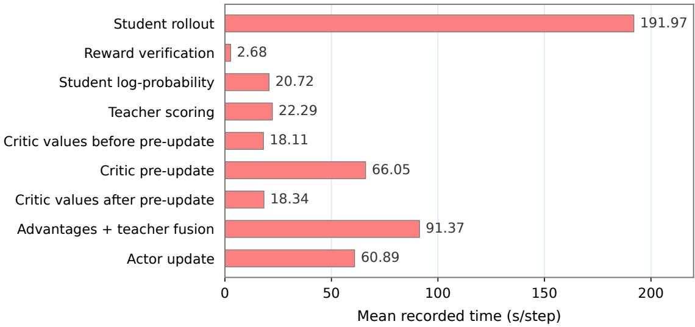  
Figure 7: Training-time profile of VASPO with Qwen3-4B-Instruct-2507. Mean recorded time in seconds per step over 200 training steps. Bars show individual component timers; the separately recorded end-to-end step time is 412.28 s. The component timers are not an additive decomposition of this total.

Self-teacher: solution and answer. The solution-and-answer template uses the following user message. The worked solution precedes the explicit final answer, and both lie inside the reference-solution block. This template adds no system message.

Self-teacher: solution and answer   
Problem: {problem}   
Here is a reference solution to this   
problem:   
=== Reference Solution Begin ===   
{solution}   
Correct final answer: {answer}   
=== Reference Solution End ===   
After reading the reference solution above,   
make sure you understand the reasoning   
behind each step.   
Please reason step by step, and put your   
final answer within \boxed{}.

Self-teacher: answer only. The answer-only template uses the following user message. It provides the final answer as a verified target and asks the teacher to preserve valid reasoning from the current prefix. This template also adds no system message.

Self-teacher: answer only   
Problem: {problem}   
=== Verified Target Begin ===   
Final answer: {answer}   
=== Verified Target End ===   
Use the verified target only to check the   
correctness of the reasoning.   
The target does not specify a unique   
solution path.   
Continue from the current reasoning prefix   
and preserve any valid approach.   
Do not mention, quote, or refer to the   
verified target or its existence.   
Please reason step by step, and put your   
final answer within \boxed{}.

Critic: answer only. The privileged critic preserves the original actor messages, including any system message, and appends the following answer suffix to the last user message. A single space separates the original user content and the suffix. The clean critic uses the original actor messages without this addition.

Critic: answer only (user message)   
{actor user message} The ground truth answer   
is {answer}.

Critic: solution and answer. When solution conditioning is enabled, the critic additionally appends a blank line and the reference solution after the answer suffix. The answer therefore precedes the solution in the critic input.

Critic: solution and answer (user message)   
{actor user message} The ground truth answer   
is {answer}.   
A reference solution:   
{solution}

After chat-template formatting, both privileged readers are evaluated on the actor’s sampled response tokens. The self-teacher scores those tokens, and the critic estimates prefix values; neither reader generates a separate response in these scoring passes.

## E Additional Method Details

Value regression and advantage computation. The critic regresses to student-rollout returns using equation 9. The training driver first evaluates values and constructs return targets. These initial predictions remain the fixed clipping centers during the critic pre-update. The driver then re-evaluates values and recomputes the actor advantages. Under terminal-only rewards and $\gamma = \lambda _ { \mathrm { G A E } } = 1$ , the target is $G _ { i }$ at every valid token, and the refreshed advantage is $G _ { i } - v _ { i , t } ^ { z , + }$ as in equation 10. Only these recomputed advantages enter token selection and teacher fusion. Their critic snapshot is $\phi ^ { + }$ , with terminal value $V _ { \phi ^ { + } } ^ { z } ( h _ { T + 1 } , z ) = 0$ . The privileged information remains fixed throughout the response, and the critic’s input excludes the current token and subsequent continuation. When $z = f ( x )$ is deterministic, conditioning on privileged information changes the critic’s representation without adding information beyond the prompt; the question is whether this explicit representation helps a finite critic predict student returns.

Effect of reweighting. For $A _ { t } ^ { z } \neq 0 ,$ , equation 14 satisfies

$$
1 - \epsilon _ { w } \leq \frac { A _ { t } ^ { z , \mathrm { f } } } { A _ { t } ^ { z } } \leq 1 + \epsilon _ { w } .\tag{17}
$$

Selected tokens receive the clipped ratio, while unselected tokens have unit weight. This bound preserves the sign of the raw privileged-critic advantage. Changing the critic can still change that advantage relative to a critic without privileged input. Algorithm 1 summarizes the signal flow; the teacher-update schedule and auxiliary training settings are specified in Appendix F.

## F Complete Implementation Details

This section records the experimental realization of the method, including teacher updates, token selection, loss reduction, and optional variants.

Critic update schedule. The critic is updated before computing the actor advantages for each rollout batch. We first construct the critic’s return targets and store its value predictions as fixed clipping centers, run the PPO clipped value update, and repeat value inference and GAE on the same rollout batch. Teacher fusion is applied only after this second pass. The ordinary later critic-update call is skipped, so the schedule changes when the critic is trained without adding a second update phase. This is a per-batch operation, distinct from the offline initialization in Appendix C.

Teacher parameters and score caching. The self-teacher uses an exponential moving average of student parameters, initialized with $\bar { \theta } _ { 0 } = \theta _ { 0 }$ . After each actor optimizer step,

$$
\bar { \theta } _ { k + 1 } = \beta _ { \mathrm { E M A } } \bar { \theta } _ { k } + ( 1 - \beta _ { \mathrm { E M A } } ) \theta _ { k + 1 } .\tag{18}
$$

The decay is listed in Table 6. Teacher probabilities are evaluated and cached once per rollout batch, before the actor update. They remain fixed within that batch even as the EMA parameters change.

Token selection and reweighting. The implementation computes the detached gap in equation 11 and selects valid response tokens with equation 13. Table 6 gives the temperature, threshold, and clipping width. The tanh transform only selects tokens; their weight is the clipped ratio $e ^ { d _ { t } }$ from equation 12. Selected advantages are multiplied directly by this clipped ratio. Negative and zero raw advantages, and positive advantages below the signal threshold, retain their GAE values.

Behavior versus current student probabilities. The main formulation uses $p _ { \mathrm { o l d } , t } ( y _ { t } )$ , keeping the weights, selection mask, and fused advantages fixed during the batch update. A supported variant replaces this denominator with $p _ { \theta , t } ( y _ { t } )$ and recomputes the gap, mask, and fusion at each actor forward pass. Teacher probabilities remain cached in either case. The recomputed fusion is still detached, so gradients do not pass through its denominator. PPO’s update ratio always compares the current actor with the behavior policy. Recomputing teacher scores during actor updates is a separate option, disabled in the default configuration.

<table><tr><td>Setting</td><td>Value or procedure</td></tr><tr><td>Critic architecture</td><td>Actor backbone with a scalar value head; matched initialization across clean and privileged variants</td></tr><tr><td>Critic regression</td><td>Monte Carlo terminal return; PPO clipped value loss</td></tr><tr><td>Critic update schedule</td><td>Pre-update once per rollout batch, then re-score values and recompute GAE before fusion</td></tr><tr><td>Fusion</td><td>Full clipped probability-ratio reweighting;  $\epsilon _ { w } = 0 . 2$ </td></tr><tr><td>Token selection</td><td>Raw  $A _ { t } ^ { z } > 0$  and | tanh  $( d _ { t } / \tau ) | > \delta ; \tau = \delta = 0 . 0 2$ </td></tr><tr><td>Student probability source</td><td>Behavior policy</td></tr><tr><td>Advantage normalization</td><td>None before or after fusion</td></tr><tr><td>Teacher update</td><td>EMA decay  $\beta _ { \mathrm { E M A } } = 0 . 9 5$  after each actor optimizer step</td></tr><tr><td>Teacher score caching</td><td>Once per rollout batch, before actor updates</td></tr><tr><td>Actor loss reduction</td><td>Mean over valid tokens per response, then over responses</td></tr><tr><td>Rollout correction</td><td>Token-level importance weighting (launcher default)</td></tr></table>

Table 6: Critic, teacher, and policy-update settings for VASPO. Matched controls retain the applicable settings when a reader is disabled. Optional implementation variants are described in Appendix F.

Advantage normalization. The default uses raw GAE advantages for selection and fusion, with no whitening before or after fusion. If post-fusion whitening is enabled, let M contain every valid token position in the rollout batch:

$$
\widehat { A } _ { i , t } = \frac { A _ { i , t } ^ { z , \mathrm { f } } - \mu _ { \mathscr { M } } } { \sqrt { \sigma _ { \mathscr { M } } ^ { 2 } + 1 0 ^ { - 8 } } } .\tag{19}
$$

The mean and variance include selected and unselected tokens. Both loss paths use these same statistics, and the selection mask is not recomputed. Centering can change advantage signs, so equation 17 describes the fusion before whitening. With raw GAE input, this normalization option requires the behavior-policy denominator and cached teacher scores; the current-policy variant uses no post-fusion whitening.

Loss reduction and auxiliary settings. Let B be the number of responses and $T _ { i }$ their valid-token counts. Write $\hat { A _ { i , t } } = A _ { i , t } ^ { z , \mathrm { f } }$ by default, or use equation 19 when whitening is enabled. The core actor loss averages tokens within each response and then averages responses:

$$
\begin{array} { c } { \displaystyle \mathcal { L } _ { \mathrm { a c t o r } } ( \theta ) = - \frac { 1 } { B } \sum _ { i = 1 } ^ { B } \frac { 1 } { T _ { i } } \sum _ { t = 1 } ^ { T _ { i } } } \\ { \displaystyle \operatorname* { m i n } \Bigl ( \rho _ { i , t } ( \theta ) \widehat { A } _ { i , t } , \rho _ { i , t } ^ { \mathrm { c l i p } } ( \theta ) \widehat { A } _ { i , t } \Bigr ) . } \end{array}\tag{20}
$$

Selected and unselected contributions share the valid-token denominator and have equal branch weights. The PPO ratio and its clipping are defined in Section 2.1; the probability-ratio clip $\epsilon _ { w }$ instead bounds advantage reweighting. The launcher additionally applies token-level rollout importance weights to this surrogate. The reference-policy KL coefficient is 0, as listed in Table 5. The critic uses the regression loss in equation 9.

## G Additional Experiments

We trace the positional pattern in Section 2.3 from saved responses to independent continuations, then ask which response groups account for it. The evidence identifies where critic predictions improve; teacher utility and training interaction require separate tests.

## G.1 Signal Profiles on Fixed Responses

To separate the pooled trend from its contributing groups, we score ordinary and solution-conditioned critics and the self-teacher on identical saved response tokens. The 1,024 problems contribute 8,288 responses, split by correctness; one problem can appear in both groups. With realized outcome R, the critic signal is

$$
\Delta _ { t } ^ { V } = ( v _ { t } ^ { 0 } - R ) ^ { 2 } - ( v _ { t } ^ { z } - R ) ^ { 2 } ,\tag{21}
$$

and the teacher signal is conditional $D _ { \mathrm { K L } } ( p _ { \theta , t } \Vert q _ { \theta , t } ^ { z } )$ Values are read before the current token. Tokens are assigned to ten bins using $( t - \frac { 1 } { 2 } ) / T$ without rescaling after exclusions.

Figure 8 reveals two different critic profiles: errors decrease throughout incorrect responses, whereas correct responses incur an early cost and benefit only near the end. Teacher KL falls toward the middle and rebounds at the end in both groups. Thus, the pooled curve hides outcome-dependent critic behavior, and teacher change is not confined to the beginning. Since each response supplies only one realized outcome, we next check critic predictions against independently sampled continuations.

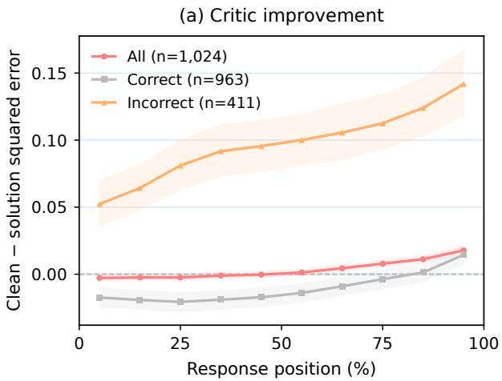

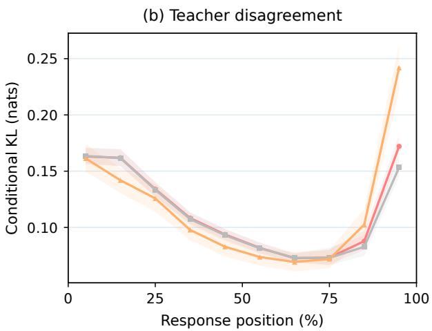  
Figure 8: A pooled trend hides different response groups. Saved-response critic error reduction (left) and teacher KL (right). Shading shows pointwise 95% problem-bootstrap intervals; n counts problems, which can occur in both correctness groups. There are 6,659 correct and 1,629 incorrect responses (8,288 total). Positive critic values favor solution conditioning; teacher KL measures disagreement, not useful guidance.

## G.2 Prediction Quality under Independent Continuations

We freeze Qwen3-4B-Instruct-2507 and compare three existing critics given the clean prefix, the prefix with an answer, or the prefix with an answer and first reference solution. On 128 evaluation problems, we sample eight clean-actor continuations from each of three prefixes at relative positions 0.2, 0.5, and 0.8. All critics predict the same continuation outcomes.

Figure 9 shows the highest EV and lowest Brier point estimates for solution conditioning, but the clean critic has the lowest ECE. Better prediction error therefore does not imply better calibration. These point-estimate rankings alone do not establish a paired overall advantage. Fullresponse rescoring confirms every evaluation label (Appendix G.4).

## G.3 Where the Critic Improvement Occurs

Aggregate errors can hide offsetting gains and costs. We therefore compare clean-minus-solution Brier improvement $\Delta ( r )$ at each sampled position $r ,$ then form the within-problem contrast

$$
C = \frac { \Delta ( 0 . 5 ) + \Delta ( 0 . 8 ) } { 2 } - \Delta ( 0 . 2 ) .\tag{22}
$$

This compares three discrete positions, not continuous trajectory regions.

Figure 10(a,c) shows an early cost and a late benefit in the pooled group, with an uncertain middleposition effect. The late gain is much larger for incorrect source responses; the correct source group’s late interval includes zero. Both groups have positive positional contrasts. The relevant distinction is thus where prediction improves within a response, rather than a uniform gain at every prefix.

Length controls refine this finding (Figure 10b,d). The positional contrast is supported in medium and long responses but uncertain in short ones. Yet the long-response late-gain interval includes zero: its positive contrast can also reflect the pronounced early cost. A positive positional contrast therefore does not establish a significant late gain in every length stratum. Final-answer and terminal-region exclusions are unavailable because these regions were not marked.

## G.4 Diagnostic Protocol

Samples and models. The continuation study contains 256 problems (768 prefixes, 6,144 continuations). A separate 128-problem fit split supplies length-tertile thresholds, computed by linearly interpolated percentiles. Short responses have $T \leq 1 { , } 0 0 8 ;$ medium responses have $1 , 0 0 8 < T \le$ 1,779.333 . . .; longer responses form the long stratum. The critics are not refitted on this split. The evaluation split has 101 correct and 27 incorrect source responses, and 34 short, 45 medium, and 49 long responses. Its 3,072 continuation returns contain 2,517 successes and 555 failures. Each scalar-headed Qwen3 critic was trained on 577,140 balanced examples from the DeepMath training source for two epochs, at learning rate $5 \times 1 0 ^ { - 6 }$ with 256-step gradient accumulation, bfloat16, and ZeRO-1 on eight GPUs.

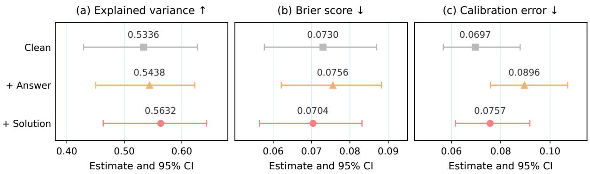  
Figure 9: Prediction accuracy and calibration need not improve together. Three existing critics evaluated on the same 128 problems, 384 prefixes, and 3,072 independent continuations. Markers and bars show estimates and pointwise 95% problem-bootstrap intervals. Suffix labels agree with full-response rescoring for all 3,072 continuations. Arrows indicate the better direction.

Targets and metrics. The verifier compares the last boxed answer with the ground truth. Original labels scored the new suffix; rescoring all 3,072 evaluation continuations after prefix concatenation changes none of them (1,024 checked at each position, none unrecoverable). Separate and joint token decoding agree, including for the 17 prefixes that already contain boxed expressions. There were no verifier execution failures. The evaluation split contains 96 truncated continuations, out of 192 across both splits. For predictions $p _ { h }$ and binary outcomes yhk,

$$
\mathrm { B r i e r } _ { h } = ( p _ { h } - { \bar { y } } _ { h } ) ^ { 2 } + \frac { 1 } { K _ { h } } \sum _ { k } ( y _ { h k } - { \bar { y } } _ { h } ) ^ { 2 } .\tag{23}
$$

The shared variance term cancels in paired critic differences, so we plot Brier improvement without a redundant MSE-improvement panel. EV uses pooled weighted moments,

$$
\mathrm { E V } = 1 - \frac { \mathbb { E } _ { w } [ ( y - p ) ^ { 2 } ] - \mathbb { E } _ { w } [ y - p ] ^ { 2 } } { \mathbb { E } _ { w } [ y ^ { 2 } ] - \mathbb { E } _ { w } [ y ] ^ { 2 } } ,\tag{24}
$$

with NaN for return variance below $1 0 ^ { - 1 2 } { \ ; }$ negative EV is retained. ECE uses ten equal-width probability bins.

Aggregation and uncertainty. Both diagnostics weight problems equally. Within a problem, savedresponse curves average tokens within a response bin, then responses; continuation curves average outcomes within a prefix, then prefixes. The pooled group is recomputed from all records. Intervals use 2,000 whole-problem percentile bootstrap replicates; continuation comparisons share sampled indices (seed 20261010), recomputing EV and ECE each time. Intervals are pointwise, without multiplicity correction. The original fixed-response protocol retrieves the first solution by exact problem matching, uses the solution-and-answer teacher template in Appendix D.6, and excludes overlength inputs as complete paired records.

(a) Source-response correctness  
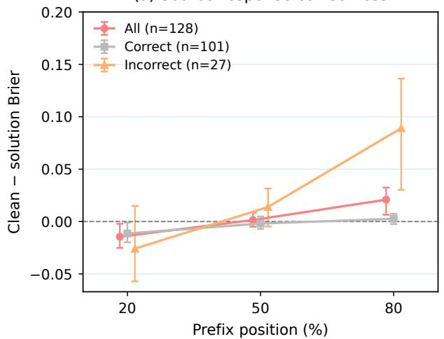  
(c) Contrast by correctness

(b) Source-response length  
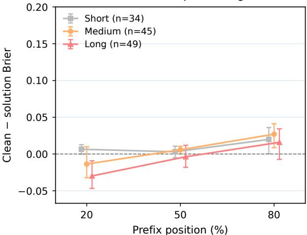  
(d) Contrast by length

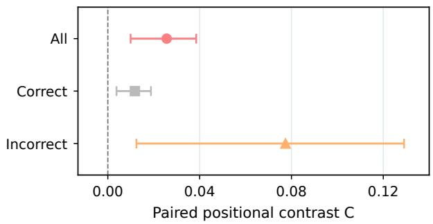

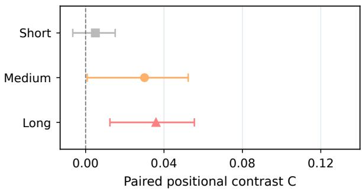  
Figure 10: Later critic gains depend on the source response. Clean-minus-solution Brier improvement by source correctness (a) and length (b), with paired positional contrasts C in (c,d). Positive values favor the solution critic. Bars are pointwise 95% problem-bootstrap intervals; n counts problems. Horizontal offsets in (a,b) separate overlapping points; the sampled positions are 20%, 50%, and 80%. Each row shares axis limits. Length strata use fit-split tertiles (1,008 and 1,779.33 tokens, upper bounds included). All evaluation labels agree with full-response rescoring.