# VideoHarness-SRSI: Structured Recursive Self-Improvement fo Video Understanding Harness

Zihao Lin1,5,∗, Haoyu Dong2, Haobo Xu3, Chi-Chih Chang4, Xuying Ning3, Yinglong Xia5, Shuang Yang5, Zhuokai Zhao5, Xinying Song5, Dongfang Liu6, Lifu Huang1, Yang Song5, Qifan Wang5

1University of California, Davis, 2Duke University, 3University of Illinois at Urbana-Champaign, 4Cornell University, 5Meta MRS Research, 6Purdue University

∗Work done at Meta

LLM system capabilities depend not only on model parameters but also on the executable harnesses that organize information acquisition, tool use, reasoning, and memory. Recursive harness evolution can automate their design, but how it can reliably discover generalizable systems from limited, noisy, and repeatedly reused feedback remains unclear. We study this question in agentic video understanding, where rich multimodal evidence and coupled mechanisms make harness optimization challenging. We first introduce VideoHarness-BRSI, a recursive self-improvement framework that evolves video harnesses around a frozen vision–language model. Analyzing over 4,000 evolved candidates, we find it competitive with hand-engineered systems but identify three interconnected failure modes: validation overfitting, search-budget dilution, and the early-experience trap. We trace all three to a common root: the same imperfect validation evidence drives both harness revisions and the proposer’s search strategy. We therefore propose VideoHarness-SRSI, an evidence-governed framework in which every search decision rests on evidence that is transferable, suficient, and gathered before the search commits. It restricts the proposer to content-free feedback, informs exploration with instrumented warm-up experiments, and develops mechanisms in isolated probe–race branches before factorial composition and joint refinement. Across four video-understanding benchmarks, VideoHarness-SRSI improves the equally weighted mean held-out score by 6.2% relative to VideoHarness-BRSI and reduces the mean validation–test gap by 37.9%. Reliable harness evolution thus depends on how search is organized and informed, not only on how well it optimizes validation performance.

Date: October 15, 2026 Project Page: https://zihaolinqz.github.io/VideoHarness-SRSI/

∞Meta

## 1 Introduction

An agentic system is shaped not only by its foundation model but by its harness: the executable code around the frozen model that decides what the model observes, which tools run, and how intermediate outputs become an answer (Ning et al., 2026). A well-designed harness can substantially improve performance (Lee et al., 2026), but designing one is hard, since each mechanism admits many implementations whose efectiveness hinges on other components. Automated agent design and recursive harness evolution replace manual engineering with an LLM proposer that iteratively generates, evaluates, and refines harnesses from accumulated feedback (Hu et al., 2025; Shang et al., 2025; Lee et al., 2026). Yet, as harnesses become more complex, a fundamental question arises: How can recursive evolution reliably discover generalizable designs when experimental evidence is limited, noisy, and repeatedly reused, and the search space contains many interacting mechanisms?

We study this question through agentic video understanding, a particularly demanding setting for harness optimization where a video harness must organize extensive, heterogeneous visual evidence via frame selection, retrieval, perception tools, multi-turn reasoning, reflection, memory, and multi-agent collaboration. These mechanisms are interdependent—retrieving more frames may recover missing evidence but also add distractors— so no mechanism can be judged in isolation. Moreover, evolution must infer useful changes from repeated evaluations on finite video–question pairs, whose rich content invites the proposer to specialize to seen examples. Video thus couples two challenges: learning reliable lessons from complex feedback, and eficiently exploring a combinatorial space of interacting mechanisms (Wang et al., 2025; Long et al., 2025a; Liang et al., 2025).

To study these challenges, we first build VideoHarness-BRSI (Baseline Recursive Self-Improvement), in which a multimodal LLM coding proposer iteratively revises the executable harness around a frozen vision– language model, guided by accumulated multimodal evidence and execution feedback. Evolution discovers competitive harnesses: for example, in a Video-MME (Fu et al., 2025) run evolving only retrieval, the evolved harness matches the held-out accuracy (68.4%) of a manually designed Adaptive Keyframe Sampling (AKS) variant (Tang et al., 2025) with 38.7% fewer frames. Yet across 4,000+ evolved candidates, validation success does not reliably translate into generalization. We trace this gap to a single source: the loop learns only from validation verdicts—score changes on a finite, repeatedly reused validation set—which mix transferable improvements with instance-specific fit and noise, yet decide both which harness is kept and where the proposer searches next. This evidence misleads evolution in three ways. (1) Validation Overfitting concerns what a verdict measures: instance-level multimodal feedback lets the proposer fit observed examples, so verdicts reward non-transferable gains. (2) Search-Budget Dilution concerns how much evidence a verdict rests on: joint evolution spreads a limited budget over many mechanism combinations, and coupled edits change many answers at once, so each configuration is evaluated too rarely and noisily to attribute its gains. (3) Early-Experience Trap concerns how verdicts are acted on: a single noisy early outcome persists as a judgment in the proposer’s memory, so the proposer abandons useful mechanisms prematurely and over-explores early successes.

Motivated by these findings, we further propose VideoHarness-SRSI (Structured Recursive Self-Improvement), an evidence-governed framework built on one principle: every search decision should rest on evidence that reflects transferable quality, sufices for the decision, and is gathered before search commits. The proposer sees only aggregate scores and content-free execution statistics, never the validation videos, questions, or answers, letting it diagnose harness behavior without tailoring revisions to seen data. Evolution then proceeds in stages: a warm-up complements free proposals with controlled experiments that ablate a mechanism or vary its intensity, measuring its contribution while keeping under-tested mechanisms open. This evidence seeds mechanism-specific branches, each evolved in isolation from a shared starting harness under a probe–race budget that tries every mechanism before focusing on the most promising. Finally, factorial composition tests whether branch improvements transfer and how they interact, before joint refinement co-optimizes them. Each stage thus supplies the evidence the next acts on.

We evaluate on four video question answering and temporal grounding benchmarks: Video-MME (Fu et al., 2025), LongVideoBench (Wu et al., 2024), OVO-Bench (Niu et al., 2025), and MomentSeeker (Yuan et al., 2026). VideoHarness-SRSI yields stronger, better-generalizing harnesses than VideoHarness-BRSI, raising the equally weighted mean held-out score by 6.2% relative and cutting the mean validation–test gap by 37.9%; ablations validate its design. These findings suggest that the organization and evidence quality of evolution matter beyond validation optimization.

Our main contributions are:

• Diagnosis. An empirical investigation of recursive harness evolution in agentic video understanding shows that it discovers competitive harnesses and characterizes three failure modes rooted in shared imperfect validation evidence.

• Framework. We propose VideoHarness-SRSI, an evidence-governed framework combining content-free proposer feedback, instrumented warm-up experiments, and isolated mechanism development before joint refinement.

• Evaluation. On four benchmarks, VideoHarness-SRSI improves mean held-out score by 6.2% relative and cuts the mean validation–test gap by 37.9% over VideoHarness-BRSI.

## 2 Related Work

Recursive self-improvement for harnesses. Automated optimization around frozen language models has progressed from prompts (Fernando et al., 2023; Yang et al., 2024; Pryzant et al., 2023; Yuksekgonul et al., 2024) to multi-stage programs (Khattab et al., 2023; Opsahl-Ong et al., 2024), reflective prompt evolution (Agrawal et al., 2026), and executable workflows and agent architectures (Hu et al., 2025; Zhang et al., 2025b,a; Novikov et al., 2025; Zhang et al., 2026a). Recent work evolves complete harnesses from past code, scores, and traces (Lee et al., 2026), searches modular design spaces (Shang et al., 2025; Wu et al., 2026), regularizes edits against overfitting (Xia et al., 2026), and studies harness updating (Lin et al., 2026), continual adaptation (Liu et al., 2026), and skill compilation (Wei et al., 2026). These methods refine how harnesses are proposed but take the validation signal that selects them as given. We instead make this signal the object of study: we show that it misleads evolution in three systematic ways and derive each component of VideoHarness-SRSI from one of them. Rather than regularizing edits, we control what information reaches the proposer; rather than modularizing search for eficiency, we factorize it so that each mechanism accumulates suficient evidence and factorial composition tests whether gains transfer; and we counter the path dependence of noisy early verdicts, which prior methods leave unaddressed, with instrumented warm-up experiments.

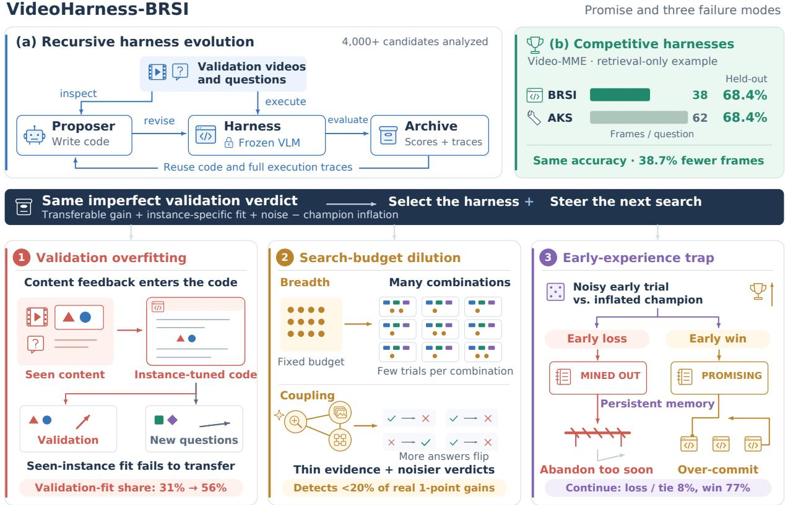  
Figure 1 Overview of VideoHarness-BRSI. (a) The evolution loop: a coding proposer inspects the validation videos and questions, revises the harness around a frozen VLM, and archives each candidate’s validation scores and execution traces, which later iterations reuse. (b) In a retrieval-only run on Video-MME, the evolved harness matches the held-out accuracy of the strongest hand-designed AKS variant with 38.7% fewer frames (Section 3.1). Bottom: the same validation verdict both selects the harness and steers the next search; it mixes the true gain with validation fit, noise, and champion inflation, which gives rise to the three failure modes of Section 3.2.

Video understanding harnesses. Hand-designed video harnesses make long videos tractable through compression (Shen et al., 2024), keyframe selection (Tang et al., 2025), hierarchical representation (Wang et al., 2025), and evidence retrieval (Luo et al., 2025), while agentic systems coordinate retrieval, tools, and memory (Wang et al., 2024; Zhang et al., 2026b; Yeo et al., 2026; Long et al., 2025b). Each commits to one design; we treat these mechanisms as a search space in which multimodal feedback invites specialization to validation instances and a mechanism’s value hinges on its context.

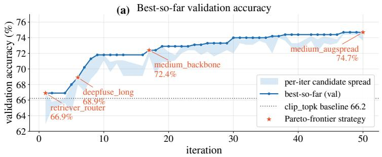

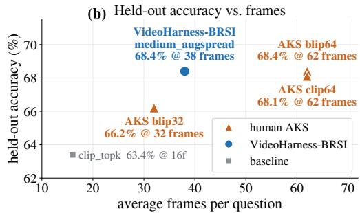  
Figure 2 Evolving the retrieval strategy with VideoHarness-BRSI on Video-MME. (a) Best validation accuracy found so far over 50 iterations (line) and the range of the candidates proposed in each iteration (shaded), starting from the clip\_topk seed (dotted). Stars mark the strategies on the Pareto frontier; the red labels are their names, chosen autonomously by VideoHarness-BRSI. (b) Held-out accuracy on 2,250 questions never seen during evolution against the mean number of frames per question, for the deployed evolved harness, three variants of the hand-designed AKS method, and the seed.

## 3 Investigation of Video Understanding Harness Evolution

Building on prior work in recursive harness self-improvement and hand-designed video understanding harnesses, we first introduce VideoHarness-BRSI, a baseline recursive self-improvement framework for agentic video understanding, to understand how harness evolution behaves in this more complex setting. As shown in Figure 1(a), an agentic coding proposer $P$ evolves executable harnesses around a frozen VLM M and directly accesses the multimodal evidence behind each outcome: the validation videos and questions $\mathcal { T } _ { \mathrm { v a l } }$ , prior implementations, and execution traces. This full access deliberately extends the design of Meta-Harness (Lee et al., 2026) to video understanding. The loop is a simple propose–evaluate–accumulate cycle: starting from an archive $\mathcal { D } _ { 0 }$ of seed harnesses, iteration t proposes candidates $H _ { t , j } \sim P ( \cdot \mid \mathcal { D } _ { t - 1 } , \mathcal { T } _ { \mathrm { v a l } } )$ , evaluates each on the validation set $ { S _ { \mathrm { v a l } } }$ to obtain a record $\mathcal { E } _ { t , j }$ of scores, frame counts, and traces, and adds $( H _ { t , j } , \mathcal { E } _ { t , j } )$ to the archive $\mathcal { D } _ { t }$ . Unless otherwise specified, M is Qwen3-VL-8B-Instruct (Bai et al., 2025) and $P$ is Claude Opus 5 (Anthropic, 2026). VideoHarness-BRSI is specified in Appendix B.

## 3.1 Can VideoHarness-BRSI Evolve Effective Video Harnesses?

We first examine whether recursive evolution can discover harness designs competitive with expert-engineered alternatives. A fair test needs a strong hand-designed reference for the same mechanism, so we evolve only the retrieval strategy and compare with Adaptive Keyframe Sampling (AKS) (Tang et al., 2025), a state-of-the-art retrieval method; evolved and manual harnesses then difer only in how that mechanism is designed. We run on Video-MME (Fu et al., 2025), a widely used benchmark on which AKS was evaluated. We use 450 questions for validation and the remaining 2,250 for held-out evaluation.

Finding 1: Recursive evolution discovers harnesses competitive with manual designs. Evolution steadily improves the harness. Figure 2(a) tracks the best validation accuracy found so far. Starting from the clip\_topk seed at 66.2%, VideoHarness-BRSI improves it in several distinct steps rather than a single lucky jump: to 66.9% in the first iteration, 68.9% around iteration 6, 72.4% around iteration 17, and finally 74.7% at iteration 50 with medium\_augspread, 8.5 points above the seed. Validation accuracy thus keeps rising throughout the 50 iterations. The evolved harness rivals manual design on held-out data. Figure 2(b) compares the deployed harness with the seed and three AKS variants on the 2,250 held-out questions, which evolution never sees. medium\_augspread reaches 68.4% with 38 frames per question: 5.0 points above its seed, 2.2 points above AKS-BLIP with 32 frames, and on par with the two strongest AKS variants (68.4% and 68.1%), which need 62 frames. It thus matches the best hand-designed method with 38.7% fewer frames. Evolution also improves other mechanism families and works on other benchmarks. The setting, the seed harnesses (Table 9), and these additional experiments are detailed in Appendix C.

Recursive evolution discovers video harnesses that rival expert designs. Starting from a simple retrieval seed, VideoHarness-BRSI raises validation accuracy by 8.5 points and deploys a harness that matches the strongest AKS variant on held-out data (68.4%) with 38.7% fewer frames.

## 3.2 Diagnosing VideoHarness-BRSI in Video Understanding

Despite these gains, VideoHarness-BRSI shows three systematic failure modes, as shown in Figure 3. Since our baseline shares the core logic of prior harness evolution—propose new candidates from past ones and their scores, then keep those that win on validation (Hu et al., 2025; Zhang et al., 2025b; Lee et al., 2026)—these failures expose limitations of this general strategy rather than of our baseline. We explain all three through the one signal the evolution loop learns from, the validation verdict $\hat { \delta } = V ( H ) - \bar { V } ( H ^ { \mathrm { i n c } } )$ : how much a candidate $H \mathrm { { s } }$ validation accuracy exceeds that of the current champion $H ^ { \mathrm { i n c } }$ . This verdict decides both what is kept and where the proposer searches next. What we actually want to improve, however, is accuracy on unseen questions, so the quantity that matters is the candidate’s true gain $\Delta { : }$ how much more accurate it is than the champion on new questions. Evolution works only as far as the verdict $\hat { \delta }$ reflects the true gain $\Delta .$ To make the relation between the two explicit, we write each validation score as the sum of three parts, $V ( H ) = \mu ( H ) + S ( H ) + e ( H )$ : the accuracy $\mu ( H )$ the harness would reach on new questions, a fit $S ( H )$ that helps only on the validation questions (zero for harnesses written without seeing them), and a zero-mean noise $e ( H )$ , the chance deviation of its accuracy on this particular set of validation questions from $\mu ( H )$ . The true gain is then $\Delta = \mu ( H ) - \mu ( H ^ { \mathrm { i n c } } )$ . Subtracting the two scores would recover $\Delta$ up to the fit and noise terms, if the champion’s noise were zero on average; but it is not, because the champion is not a random harness: it is the candidate with the highest validation score so far. Among many candidates of similar quality, the highest score tends to belong to one whose noise happened to be positive, so the champion’s noise is positive on average: $\mathbb { E } [ e ( H ^ { \mathrm { i n c } } ) ] = \omega > 0$ . We call ω the champion inflation; it is the same as the selection bias known as the optimizer’s curse (Smith and Winkler, 2006), here arising because the champion is selected by its validation score. Every new candidate is compared against this inflated score, so its verdict is shifted down by ω. Separating this bias from the noise diference, i.e., writing $e ( H ) - e ( H ^ { \mathrm { i n c } } ) = - \omega + \varepsilon$ with the zero-mean remainder ε, splits the verdict into four terms:

$$
\hat { \delta } = \underbrace { \mu ( H ) - \mu ( H ^ { \mathrm { i n c } } ) } _ { \Delta \colon \mathrm { t r u e ~ g a i n } } + \underbrace { S ( H ) - S ( H ^ { \mathrm { i n c } } ) } _ { S \colon \mathrm { v a l i d a t i o n ~ f i t } } - \underbrace { \omega } _ { \mathrm { c h a m p i o n ~ i n f l a t i o n } } + \underbrace { \varepsilon } _ { \mathrm { n o i s e } } .\tag{1}
$$

Only the true gain $\Delta$ carries over to held-out data; the other three terms are errors that make the verdict misstate it. The zero-mean noise ε has a standard deviation σ that grows with the number of answers the candidate changes. Evolution therefore goes wrong whenever one of the three error terms outweighs $\Delta ,$ and each failure mode makes a diferent one do so: validation overfitting inflates S (Section 3.2.1), search-budget dilution inflates ε (Section 3.2.2), and the early-experience trap lets ε and ω decide irreversible choices (Section 3.2.3). Appendix D derives this model.

## 3.2.1 Validation Overfitting

We start with the validation fit S in Eq. (1). A harness is written by the proposer, so it can fit the validation questions only through what the proposer learns about them. VideoHarness-BRSI, following Meta-Harness, lets the proposer inspect the validation videos, questions, and execution traces directly. If this access drives the fit, the gap between validation and held-out accuracy should grow with how much the proposer observes. We therefore keep the evolution loop fixed and vary only what the proposer sees, in three nested arms from least to most: Blindfolded sees only outcomes, i.e., whether each question was answered correctly, plus behavioral counters such as frames and tool calls; Trace additionally sees question text, answer options, and interaction traces; and Multimodal additionally sees video frames, which recovers the full access of VideoHarness-BRSI. We run this study on LongVideoBench (Wu et al., 2024), whose questions refer to specific moments in long videos, so seeing a question reveals much about what it needs. Each arm runs three seeds at each of three validation fractions (33%, 50%, 75%), so the efect does not hinge on one split size.

(c) One verdict, two fates

Validation overfitting

Early-experience trap  
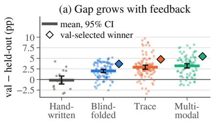

Search-budget dilution  
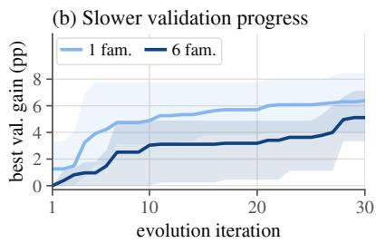

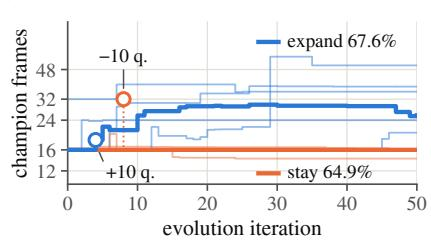

(d) Why: fit is instance-specific  
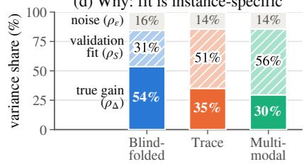

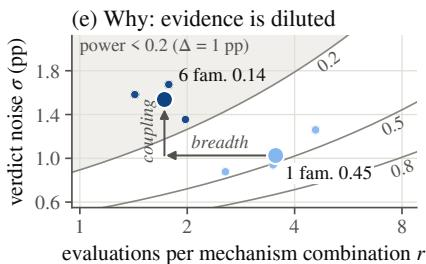

(f) Why: step policy, flat evidence  
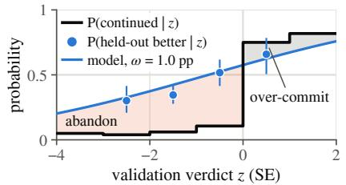  
Figure 3 Three failure modes of VideoHarness-BRSI: what happens (top) and why (bottom). (a) Validation minus held-out accuracy of hand-written baselines and of harnesses evolved under the three feedback arms on LongVideoBench; each dot is a harness, bars show means with 95% intervals, and diamonds mark each arm’s validation-selected winner. (b) Best validation gain over the seeds on Video-MME when evolving retrieval only (one family) or the full harness (six families); lines are means and bands span the three runs. (c) Champion frame count of retrieval runs on Video-MME. Thick lines are the two runs discussed in the text, with their frame-raising probes circled (+10 and −10 validation questions); the labels give the mean held-out accuracy of runs that expand the frame budget and of runs that stay near 16 frames. (d) Shares of the spread in validation scores due to true gain $\left( \rho _ { \Delta } \right)$ , validation fit $( \rho _ { S } )$ , and noise $\left( \rho _ { \varepsilon } \right)$ in each feedback arm. (e) Each run placed by its evaluations per mechanism combination $r$ and verdict noise $\sigma ;$ small and large dots are runs and search-space means, and contours mark equal power to detect a 1-point gain, shaded below 0.2. (f) Against the verdict z (in standard errors), the probability that later proposals build on a candidate (black) and that the candidate beats the champion on held-out data (blue dots, with the model curve); shading marks abandoned candidates that were likely better (red) and continued ones that were likely worse (gray).

Finding 2: Richer feedback widens the validation–test gap by letting harnesses fit the validation questions. We call a harness’s validation accuracy minus its held-out accuracy its gap. As shown in Figure $\mathrm { 3 ( a ) }$ , the more the proposer sees, the larger the gap: it grows from 2.0 points (Blindfolded) to 3.2 points (Multimodal) on average, whereas hand-written baselines, which are written without seeing validation data, show none. The gap alone, however, does not tell how much of the validation progress is real. We therefore look at all evolved harnesses of a run together. By Eq. (1), their validation scores difer for three reasons: true gain $( \Delta )$ , validation fit (S), and noise (ε); ω plays no role here, since all of them face the same champion. Only the true gain also shows up on held-out data, so we can attribute the spread of validation scores to the three sources. The true-gain share $\rho _ { \Delta }$ is how much of a validation diference reappears on held-out data: a harness one point higher on validation is, on average, $\rho _ { \Delta }$ points higher on held-out data. The noise share $\rho _ { \varepsilon }$ is measured by scoring each harness on two random halves of the validation set, which difer only by noise. The rest is the validation-fit share $\rho _ { S }$ . As shown in Figure 3(d), $\rho _ { \Delta }$ falls from 54% (Blindfolded) to 35% (Trace) and 30% (Multimodal), while $\rho _ { \varepsilon }$ stays at 14–16%, so the loss goes entirely to $\rho _ { S } .$ , which rises from 31% to 56%. Richer feedback thus does not make the validation score noisier; it makes it reward fitting the validation questions rather than real improvement. The fit is also visible in the code itself: proposers that see question text quote validation questions in their harnesses more often than chance, mostly in comments that record the cases motivating a design, whereas Blindfolded proposers do not. The protocol, the estimators of the three shares, the supporting theory, and robustness checks are in Appendix E.

Hide the validation instances from the proposer. The more the proposer sees of the validation questions, the more of its progress is fit to those questions rather than real improvement (56% versus 31% of the validation spread). It should see how a harness behaves, not what it is evaluated on.

## 3.2.2 Search-Budget Dilution

We next turn to the noise ε. Video harnesses combine mechanisms with distinct roles: frame selection decides which moments the model sees (Tang et al., 2025), retrieval gathers question-relevant evidence (Luo et al., 2025), tools extend perception (Wang et al., 2024; Zhang et al., 2026b), and memory carries information across long videos (Yeo et al., 2026; Long et al., 2025b). Letting evolution edit more of these mechanisms enlarges the search space and can, in principle, reach higher accuracy. But a larger space also spreads a fixed evaluation budget over more mechanism combinations, i.e., over more distinct choices of which mechanisms a harness uses and how, and a real gain can be told apart from noise only after enough verdicts on it accumulate to average the noise out. Whether the added expressiveness or the thinner evidence dominates is thus an empirical question. Keeping everything else fixed, we compare on Video-MME the smallest space, retrieval only (one mechanism family, as in Section 3.1), with the full harness (six families), at a matched budget of 87 candidates and three seeds each.

Finding 3: Larger search spaces leave too little evidence to tell real gains from noise, slowing evolution without improving held-out accuracy. As shown in Figure 3(b), the larger space is not better: after 87 candidates, retrieval alone gains 6.4 validation points, whereas the full harness gains only 5.1 and lags for most of the run. Its deployed champions are also no better on held-out data, so the added expressiveness goes unused. To see why, recall that a single verdict is noisy: the loop can trust that a mechanism combination truly helps only after several candidates using it have been evaluated. We therefore measure each run’s statistical power, the chance that its verdicts detect a real 1-point gain. This is a lenient test, since 1 point is already larger than most improvements the loop accepts. Power depends on two quantities: how many evaluations r each mechanism combination receives, since more evaluations average the noise out, and how noisy each verdict is (σ), since more noise hides the gain. A larger space can lower power through two channels. Breadth spreads the same budget over more mechanism combinations, which lowers r. Coupling lets mechanisms feed into one another: a change to retrieval, for example, alters what every downstream stage receives, so even a local edit flips the correctness of more answers, and the more answers an edit flips, the noisier its verdict, which raises σ. As shown in Figure 3(e), where each run is placed by its r and σ and the curves mark equal power, both channels are at work: from one family to six, r falls from 3.5 to 1.7, moving the runs left, and σ rises from 1.0 to 1.5 points, moving them up. Together they push the full harness into the shaded region of power below 0.2: its search misses more than four in five real 1-point improvements. Coupling is also visible in the edits themselves: even edits that touch a single mechanism family flip 47.6 validation answers on average in the full harness, against 19.8 with retrieval alone, and edits that flip more answers are more often harmful. Intermediate spaces with two and three families, the power analysis, and edit footprints are in Appendix F.

## Takeaway

Develop mechanisms separately before combining them. Searching all mechanisms jointly leaves each verdict too noisy to detect most real gains (power below 0.2). Concentrating evaluations on one mechanism at a time, with local edits, yields verdicts that can be trusted before interactions are optimized.

## 3.2.3 The Early-Experience Trap

The first two failure modes concern whether a verdict is right; this one concerns what the evolution loop does with it. In VideoHarness-BRSI, a verdict decides not only which candidate is kept but also which direction the proposer pursues next, where a direction is a kind of change, such as raising the frame budget or adding re-ranking. Early verdicts therefore shape the rest of a run. For each verdict, we ask two questions. How did the loop react: do later proposals build on the candidate (continuation)? And was the verdict right: does the candidate beat the champion on held-out data, which the proposer never sees? We analyze 14 Video-MME runs; 12 of them evolve retrieval and form the frame-budget contrast below.

Finding 4: A single noisy early verdict can fix a run’s course, as weak verdicts drive irreversible decisions. Figure 3(c) traces each run’s champion frame count: the same kind of probe can meet opposite verdicts, and the first verdict decides the rest of the run. In two runs of the same setting (thick lines), a probe raising the frame budget (circled) wins by ten validation questions in one run and loses by ten in the other. The first run then keeps raising the frame budget; the second writes into its memory that the frame count is “MINED OUT”, i.e., not worth exploring further, and its champion never exceeds 16 frames. This single verdict matters: across 12 runs, champions that expand reach 67.6% held-out accuracy, versus 64.9% for those staying near 16 frames. Eq. (1) explains why such a verdict misleads: a direction’s first verdict is $\Delta - \omega + \varepsilon ,$ , and both error terms are large. The noise ε dominates early verdicts: in the first ten iterations, only 8% of their variation reflects true diferences, and the champion inflation starts every new direction about $\omega \approx 1$ point behind. A loop that weighed such weak evidence properly would treat verdicts as graded: the better a verdict, the more likely the direction is continued, without a sharp jump at zero. Figure 3(f) shows that VideoHarness-BRSI does not. Against the verdict z, measured in standard errors, it plots how often later proposals build on a candidate (black) and how often the candidate truly beats the champion on held-out data (blue). The loop acts as a step function, continuing about 77% of winning candidates but only 8% of the rest, whereas the held-out win rate rises gradually and already reaches one half for slightly negative verdicts. In fact, among dropped candidates with held-out evaluations, 37% beat the champion on held-out data; the shaded gap marks these abandoned candidates. Because a rejected direction is rarely retried, an unlucky first verdict is never corrected. A simple model of this policy predicts that the frame-budget direction is lost in 54% of runs, consistent with the 6 of 12 runs in Figure 3(c) that never expand. The verdict model, the persistence analysis, a replication on LongVideoBench, and case studies are in Appendix G.

## Takeaway

Do not let one noisy verdict close a direction. Early verdicts are mostly noise, yet the loop treats them as final: one unlucky outcome can rule out a useful mechanism for the rest of the run (64.9% versus 67.6% held-out for the frame budget). Early evidence should come from controlled comparisons collected regardless of earlier outcomes.

## 3.3 Implications for Harness Evolution

One root, three symptoms. The three failure modes share one root: the loop learns from validation verdicts, and the same imperfect verdicts steer both which harness is kept and where the proposer searches next. Each failure mode lets a diferent term of Eq. (1) overwhelm the true gain ∆: the validation fit S under content-level feedback, the noise ε in a large and coupled search space, and the champion inflation ω together with ε in early, irreversible decisions. The three also reinforce one another: a misleading early win narrows the search, a broad space leaves little budget to revisit it, and each further verdict rests on too few evaluations to correct the course.

Simple remedies are insuficient. Standard evolutionary levers act on where the next verdict is taken, not on what it measures. Changing how parents are selected reshapes the search as intended: on Video-MME, the share of candidates bred from the champion falls from 47% under greedy selection to 30% under clade-UCB and 8% under random parents. Yet the deployed harnesses of the three rules difer by at most 0.5 held-out points, and no statistic of the search shape predicts held-out gain across 18 runs. Starting from a stronger harness, AKS, speeds up early validation progress, but the final harness (68.2% held-out) lies within the range of those evolved from simple seeds. In both cases, every verdict still compares a single candidate with a selected champion on the same validation questions, so S, ω, and ε are unchanged (Appendix H).

Design principles. The three takeaways instead act on the evidence itself, and together they form the design principles of VideoHarness-SRSI (Section 4): every search decision should rest on evidence that is transferable, suficient, and gathered before search commits. Against validation fit, the proposer sees only content-free feedback; against dilution, mechanisms are developed in isolated branches that concentrate evaluations and keep edits local, and only then composed; and against the early-experience trap, an instrumented warm-up measures every mechanism with controlled comparisons before any direction is abandoned.

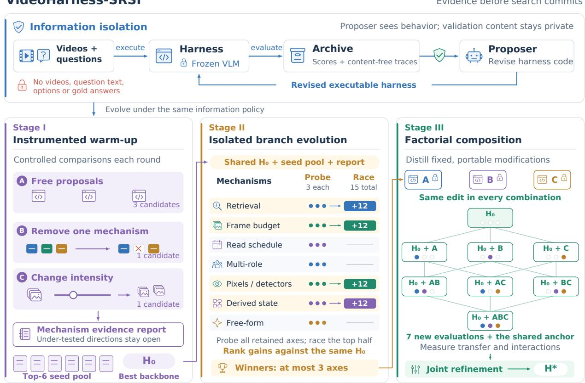  
Figure 4 Overview of VideoHarness-SRSI. Top: under information isolation, the harness executes on the validation videos and questions, but the proposer receives only scores and content-free traces, never the videos, question text, options, or answers. Bottom: evolution proceeds in three stages under this policy. Stage I (instrumented warm-up) adds a removal and an intensity change to the free proposals of each round, summarizes the evidence in a per-mechanism report, and selects a seed pool and a backbone $H _ { 0 } .$ Stage II (isolated branch evolution) evolves each mechanism axis in its own branch from $H _ { 0 } ;$ every axis is probed with three candidates, the top half race on to fifteen, and at most three axes are kept. Stage III (factorial composition) distills each kept axis into a fixed modification, evaluates all combinations against $H _ { 0 }$ to measure transfer and interactions, and then jointly refines them into the final harness $H ^ { \star }$

## 4 VideoHarness-SRSI

Section 3.2 traced all three failure modes to the validation verdict that VideoHarness-BRSI learns from: rich feedback lets it reward fitting the validation questions (S), a large search space leaves it too noisy to separate real gains (ε), and noisy early verdicts close directions for good (ε and ω). VideoHarness-SRSI therefore keeps the propose–evaluate–accumulate loop of VideoHarness-BRSI and changes only the evidence behind its decisions (Figure 4). Each component implements one takeaway: information isolation limits what the proposer can fit (Section 4.1), and three-stage evolution concentrates evidence on one mechanism at a time (Section 4.2), beginning with an instrumented warm-up that keeps early directions open (Section 4.2.1). The full algorithm (Algorithm 2) and further details are in Appendix I.

## 4.1 Information Isolation

Finding 2 demonstrates that the validation fit grows with what the proposer observes about the validation instances, and that the Blindfolded arm kept the largest transferable share of its progress (54%) while deploying harnesses at least as accurate on held-out data as the richer arms. Since a harness can fit the validation questions only through what the proposer learns about them, we close this channel at its source instead of penalizing edits afterwards, when the information has already been used. In VideoHarness-SRSI, the proposer never accesses the validation videos, questions, options, or answers; only the harness it writes does, at execution time. The proposer receives each candidate’s validation accuracy and a content-free trace ${ \mathcal { T } } ( H )$ per question, its correctness under an opaque identifier plus behavioral counters such as model and tool calls, frames, retrieval, and memory operations. This is exactly the Blindfolded feedback, so isolation lowers the fit without starving the search. A deny list on all proposer tools enforces it; details are in Appendix I.1.

## 4.2 Three-Stage Evolution

Finding 3 shows that searching the full harness jointly loses power in two ways: breadth spreads the budget over many mechanism combinations, and coupling lets each edit change many answers. Restricting the search to a single mechanism would avoid both, but forfeits the expressiveness of the full space. We instead order the search: first collect controlled evidence about every mechanism (Stage I), then improve each mechanism separately, where evaluations concentrate and edits stay local (Stage II), and only then optimize their interactions among a few mechanisms whose efects are already measured (Stage III). The search thus keeps the full space while each decision gets the evidence of a small one.

## 4.2.1 Stage I: Instrumented Warm-up

Finding 4 reveals that VideoHarness-BRSI gathers evidence only where earlier verdicts were favorable, so one unlucky verdict can close a beneficial direction for the rest of a run. The warm-up runs the ordinary loop but reserves part of each round for controlled interventions that are collected regardless of earlier verdicts. Besides three free proposals, each round includes one removal, which deletes one of the seven mechanism families into which VideoHarness-SRSI groups the harness primitives (a finer grouping than the families chartered for VideoHarness-BRSI; Appendix I.2), and one intensity change, which roughly doubles or halves how much one family is used, such as the retrieval budget, the number of frames a detector inspects, or the number of reflection passes. For each warm-up candidate H with parent $p ( H )$ , we record its verdict and its change in mechanism usage,

$$
\mathbf { w } ( H ) = \big ( \widehat { \delta } ( H , p ( H ) ) , \mathbf { u } ( H ) - \mathbf { u } ( p ( H ) ) \big ) ,\tag{2}
$$

where ${ \bf u } ( H )$ summarizes runtime mechanism usage from $\mathcal { T } ( H )$ ; slot requests are audited from this usage change rather than trusted. Evidence on each mechanism thus accumulates over many comparisons instead of resting on its first verdict, and because all removals are judged the same way, the champion’s inflation shifts them alike and does not distort how mechanisms compare. The warm-up summarizes this evidence in a per-mechanism warm-up report; mechanisms without enough evidence are flagged as under-explored rather than discarded. When accuracy plateaus, the six best warm-up harnesses form a seed pool $B ,$ and the best of them becomes the backbone $H _ { 0 }$ shared by all later stages, so later stages draw on several strong lineages rather than a single, possibly lucky, champion (ablation in Section 5.4). The mechanism families, slot audit, stopping rule, and warm-up report are detailed in Appendix I.2.

## 4.2.2 Stage II: Isolated Branch Evolution

To remove coupling, Stage II splits the harness into six mechanism axes—retrieval, frame budget, read schedule, multi-role, pixels and detectors, and derived state—plus a free-form axis that guards against a misspecified split, giving the axis set $\mathcal { A } = \{ \alpha _ { 1 } , \dots , \alpha _ { 6 } , \alpha _ { \mathrm { f r e e } } \}$ . Each axis $\alpha \in { \mathcal { A } }$ evolves from $H _ { 0 }$ in its own isolated branch, and a fixed template states which parts of the harness the branch may edit and a test that every edit must pass (e.g., only frame-budget edits may change the number of frames). Edits therefore stay local, and a branch’s gains are attributable to its mechanism. Templates are fixed in advance, so the choice of axes cannot itself fit the validation set; axes defined after the warm-up generalize worse (Section 5.4). From the warm-up report, the proposer writes each axis a charter $c _ { \alpha } \colon$ the mechanism to try, a first edit, and a criterion that would falsify it.

To counter breadth, a probe–race schedule concentrates evaluations without leaving any axis untried: every axis is probed with three candidates, the top half by best probe verdict against $H _ { 0 }$ race on to fifteen, and at most three raced axes, those with a clearly positive mean verdict first, proceed to composition. Since all axes share the backbone $H _ { 0 }$ , the champion’s inflation shifts them alike and leaves their ranking intact. More details are given in Appendix I.3.

## 4.2.3 Stage III: Factorial Composition and Joint Refinement

Gains found in separate branches need not add up. Greedy merging cannot tell whether they do. The proposer therefore distills each selected axis $\alpha \in \mathcal { A } _ { \mathrm { c o m p } }$ into a fixed, portable modification $d _ { \alpha }$ , the smallest edit of $H _ { 0 }$ carrying the mechanism. We evaluate every combination as a factorial design:

$$
H _ { \mathcal { U } } = \operatorname { A p p l y } \big ( H _ { 0 } , \{ d _ { \alpha } : \alpha \in \mathcal { U } \} \big ) , \quad \mathcal { U } \subseteq \mathcal { A } _ { \mathrm { c o m p } } , \quad H _ { \emptyset } = H _ { 0 } .\tag{3}
$$

With three axes this costs seven evaluations, yet each modification’s efect is averaged over four comparisons rather than resting on one, and the same comparisons measure interactions. Joint refinement then starts from all combinations and may modify the selected mechanisms together: coupling returns, but only among at most three mechanisms whose efects are already measured. The final harness $H ^ { \star }$ is the validation-best one after refinement; this last selection on validation reintroduces some fit and champion inflation, a source of the residual gaps in Section 5.2. The composition lattice, interaction estimates, and refinement are detailed in Appendix I.4.

## 5 Experiments

We evaluate VideoHarness-SRSI against fixed hand-written harnesses and VideoHarness-BRSI on four video-understanding benchmarks (Section 5.2), and ask whether its gains come from a larger inference budget (Section 5.3) and which components drive them (Section 5.4). Appendix K further verifies that the gains hold on videos never seen during evolution, and Appendix L re-measures the three failure modes of Section 3.2 on the runs of VideoHarness-SRSI.

## 5.1 Experimental Setup

Benchmarks and splits. We use four benchmarks covering general, long-form, and streaming video question answering and temporal grounding: Video-MME (Fu et al., 2025), LongVideoBench (Wu et al., 2024), and OVO-Bench (Niu et al., 2025), scored by accuracy, and MomentSeeker (Yuan et al., 2026), scored by mIoU. Each benchmark is randomly split once into validation and held-out test sets shared by all methods and seeds (Table 7 in Appendix A.2). Evolution and selection see only the validation set, and held-out results never reach the proposer. The split unit is the question, except on MomentSeeker, where whole source videos are assigned to one side; Appendix K checks that our conclusions do not depend on videos shared across the split. All benchmarks are used video-only: subtitles and metadata are withheld from harness code.

Models. The executor is a frozen Qwen3-VL-8B-Instruct (Bai et al., 2025) with greedy decoding; it is the only model that sees video or answers questions. The proposer is Claude Opus 5 (Anthropic, 2026), which writes harness code but never answers questions or runs the benchmark. Harnesses may call CLIP retrieval (Radford et al., 2021) and Grounding DINO detection (Liu et al., 2024) under fixed per-question limits on frames, executor calls, and tool calls (Table 8).

Baselines. The six hand-written harnesses of Table 9 (Appendix A.4) serve as fixed baselines and seed every evolution run. They cover the main mechanism families of video harnesses: uniform sampling, queryconditioned retrieval, self-reflection, tool-gated selection, multi-role debate, and a working memory. The evolved baseline is VideoHarness-BRSI (Section 3), run for 50 iterations of three candidates from the same seeds, with the same executor, proposer, and interface as VideoHarness-SRSI.

Table 1 Main results. Evolved harnesses report mean ± sample standard deviation over three seeds; fixed baselines are deterministic.
<table><tr><td rowspan="2">Method</td><td colspan="2">Video-MME</td><td colspan="2">LVB</td><td colspan="2">OVO-Bench</td><td colspan="2">MomentSeeker</td></tr><tr><td>Val</td><td>Test</td><td>Val</td><td>Test</td><td>Val</td><td>Test</td><td>Val</td><td>Test</td></tr><tr><td colspan="9">Fixed Baselines</td></tr><tr><td>uniform</td><td>60.44</td><td>61.64</td><td>58.97</td><td>59.15</td><td>52.76</td><td>52.20</td><td>11.94</td><td>11.43</td></tr><tr><td>clip_topk</td><td>66.21</td><td>63.40</td><td>62.33</td><td>62.07</td><td>51.94</td><td>53.32</td><td>16.58</td><td>17.98</td></tr><tr><td>tool_survey</td><td>65.78</td><td>62.27</td><td>59.42</td><td>60.49</td><td>50.51</td><td>51.28</td><td>16.72</td><td>17.66</td></tr><tr><td>reflect_loop</td><td>60.44</td><td>60.04</td><td>62.11</td><td>60.61</td><td>51.33</td><td>55.36</td><td>16.23</td><td>17.66</td></tr><tr><td>debate_pair</td><td>63.78</td><td>61.42</td><td>57.40</td><td>55.56</td><td>44.58</td><td>45.86</td><td>16.42</td><td>17.92</td></tr><tr><td>memo_multiturn</td><td>63.11</td><td>58.98</td><td>58.52</td><td>59.93</td><td>55.42</td><td>54.65</td><td>15.91</td><td>16.00</td></tr><tr><td colspan="9">Evolved Harnesses</td></tr><tr><td>VIDEOHARNESS-BRSI</td><td> $7 2 . 2 { \scriptstyle \pm 1 . 8 }$ </td><td> $6 6 . 5 { \scriptstyle \pm 1 . 2 }$ </td><td> $7 0 . 2 { \scriptstyle \pm 0 . 3 }$ </td><td> $6 6 . 6 { \scriptstyle \pm 1 . 0 }$ </td><td> $7 2 . 9 { \scriptstyle \pm 2 . 1 }$ </td><td> $6 7 . 2 { \scriptstyle \pm 1 . 7 }$ </td><td> $2 3 . 8 { \scriptstyle \pm 0 . 7 }$ </td><td> $1 9 . 0 { \scriptstyle \pm 1 . 8 }$ </td></tr><tr><td>VideoHarness-SRSI</td><td> $7 5 . 0 { \scriptstyle \pm 1 . 9 }$ </td><td> $7 0 . 1 { \scriptstyle \pm 1 . 0 }$ </td><td> $7 1 . 1 { \scriptstyle \pm 2 . 0 }$ </td><td> $6 7 . 3 { \scriptstyle \pm 1 . 0 }$ </td><td> $7 3 . 8 { \scriptstyle \pm 2 . 4 }$ </td><td> $7 2 . 5 { \scriptstyle \pm 3 . 1 }$ </td><td> $2 5 . 3 { \scriptstyle \pm 0 . 3 }$ </td><td> $2 3 . 0 { \scriptstyle \pm 0 . 7 }$ </td></tr></table>

Protocol. Each framework is run with three seeds per benchmark. Each run deploys the harness with the highest validation score, and we report its held-out score as the mean and sample standard deviation over seeds. A harness’s cost is its mean number of frames shown to the executor per question, summed over calls. Further details on models, budgets, and statistical tests are in Appendix A.

## 5.2 Main Results

Evolution outperforms hand-written harnesses. Both evolved frameworks beat every fixed baseline on held-out data on all four benchmarks (Table 1). Averaged over benchmarks, they exceed the strongest baseline on each benchmark by 5.12 (VideoHarness-BRSI) and 8.52 points (VideoHarness-SRSI). No single fixed design is best everywhere: clip\_topk leads on Video-MME, LongVideoBench, and MomentSeeker, and reflect\_loop on OVO-Bench. Nor does adding mechanisms by hand reliably help: debate\_pair spends five times the frames of clip\_topk on Video-MME (Table 9) but is less accurate on held-out data on every benchmark. Which mechanisms help, and how to combine them, is benchmark-dependent, which is exactly what evolution searches for.

VideoHarness-SRSI finds stronger and better-generalizing harnesses. VideoHarness-SRSI improves on VideoHarness-BRSI on all four benchmarks, raising the mean held-out score from 54.83 to 58.23, a 6.2% relative gain. The gains are largest on OVO-Bench (+5.3), MomentSeeker (+4.0), and Video-MME (+3.6), and smallest on LongVideoBench (+0.7). At the same time, VideoHarness-SRSI lowers the mean validation–test gap from 4.95 to 3.08 points (−37.9%), with the largest reduction on OVO-Bench (5.7 → 1.3) and essentially no change on LongVideoBench (3.6 → 3.8).

The gains come mostly from better transfer. On every benchmark except LongVideoBench, VideoHarness-SRSI gains more on held-out data than on validation. The clearest case is OVO-Bench, where held-out accuracy rises from 67.2 to 72.5 while validation accuracy rises only from 72.9 to 73.8; on MomentSeeker, the corresponding gains are +4.0 and +1.5 points. VideoHarness-SRSI thus selects harnesses that transfer better rather than fitting validation more tightly.

Overfitting is reduced, not eliminated. Both evolved frameworks still score higher on validation than on held-out data on every benchmark. Information isolation and structured search mitigate overfitting (Section 4), but any procedure that repeatedly selects on the same validation set can still favor harnesses specialized to it.

## 5.3 Inference Cost and Budget-Matched Comparison

Evolution may raise accuracy simply by showing the executor more frames. We therefore record three per-question costs of each deployed harness on its held-out traces: frames passed to the executor, executor (VLM) calls, and tool calls, averaged over the three seeds.

Table 2 Cost of the deployed harnesses. Held-out score and per-question cost, averaged over three seeds.
<table><tr><td>Benchmark</td><td>Method</td><td>Test</td><td>Frames/q</td><td>VLM calls/q</td><td>Tool calls/q</td></tr><tr><td rowspan="2">Video-MME</td><td>VIDEOHARNESS-SRSI</td><td>70.1</td><td>106.1</td><td>2.44</td><td>19.3</td></tr><tr><td>VIDEOHARNESS-BRSI</td><td>66.5</td><td>55.1</td><td>2.43</td><td>1.6</td></tr><tr><td rowspan="2">LVB</td><td>VIDEOHARNESS-SRSI</td><td>67.3</td><td>64.8</td><td>2.85</td><td>17.5</td></tr><tr><td>VIDEOHARNESS-BRSI</td><td>66.6</td><td>69.2</td><td>2.77</td><td>5.0</td></tr><tr><td rowspan="2">OVO-Bench</td><td>VIDEOHARNESS-SRSI</td><td>72.5</td><td>47.8</td><td>4.91</td><td>2.6</td></tr><tr><td>VIDEOHARNESS-BRSI</td><td>67.2</td><td>27.3</td><td>3.57</td><td>1.5</td></tr><tr><td rowspan="2">MomentSeeker</td><td>VIDEOHARNESS-SRSI</td><td>23.0</td><td>69.8</td><td>4.38</td><td>11.1</td></tr><tr><td>VIDEOHARNESS-BRSI</td><td>19.0</td><td>60.3</td><td>2.52</td><td>14.7</td></tr></table>

Table 3 Budget-matched comparison. VideoHarness-SRSI restricted to the frame budget of the deployed VideoHarness-BRSI harness and selected by validation accuracy, averaged over three seeds. ∆: held-out gain of VideoHarness-SRSI.
<table><tr><td></td><td></td><td colspan="3">VIDEOHARNESS-SRSI (budget-matched)</td><td colspan="3">VIDEOHARNESS-BRSI (deployed)</td><td></td></tr><tr><td>Benchmark</td><td>Budget</td><td>Test</td><td>Frames/q</td><td>Calls/q</td><td>Test</td><td>Frames/q</td><td>Calls/q</td><td>∆</td></tr><tr><td>Video-MME</td><td>≤55.1</td><td>68.93</td><td>52.5</td><td>2.04</td><td>66.50</td><td>55.1</td><td>2.43</td><td>+2.43</td></tr><tr><td>LVB</td><td>≤69.2</td><td>67.19</td><td>57.8</td><td>2.86</td><td>66.60</td><td>69.2</td><td>2.77</td><td>+0.59</td></tr><tr><td>OVO-Bench</td><td>≤27.3</td><td>68.42</td><td>25.8</td><td>3.64</td><td>67.20</td><td>27.3</td><td>3.57</td><td>+1.22</td></tr><tr><td>MomentSeeker</td><td>≤60.3</td><td>21.41</td><td>56.0</td><td>2.48</td><td>19.00</td><td>60.3</td><td>2.52</td><td>+2.41</td></tr></table>

Cost of the deployed harnesses. Table 2 shows that the deployed VideoHarness-SRSI harnesses spend more frames than VideoHarness-BRSI on Video-MME, OVO-Bench, and MomentSeeker, e.g., 106.1 vs. 55.1 on Video-MME, and use many more tool calls on Video-MME and LongVideoBench, where they retrieve and re-inspect evidence before answering. Part of the gain in Table 1 therefore coincides with a larger budget. The relation is not uniform, however: on LongVideoBench, VideoHarness-SRSI is more accurate with fewer frames (64.8 vs. 69.2), and on MomentSeeker with fewer tool calls.

Budget-matched selection. To separate a better harness from a larger budget, we cap each VideoHarness-SRSI run at the budget of VideoHarness-BRSI, defined per benchmark as the mean frames per question of its three deployed harnesses. Within each VideoHarness-SRSI run, we keep the candidates whose validation traces stay within this budget and deploy the one with the highest validation accuracy, breaking ties by fewer frames. Since selection uses no held-out data, VideoHarness-SRSI could have deployed this harness under the budget.

Results. As shown in Table 3, the budget-matched VideoHarness-SRSI harnesses remain ahead of VideoHarness-BRSI on every benchmark while using fewer frames and at most 0.09 more executor calls per question. Averaged over benchmarks, the matched gain (1.66 points) is about half of the deployed one (3.40 points). On the cost–accuracy plane (Figure 5), the budget-matched VideoHarness-SRSI harness also lies above every fixed baseline. Thus VideoHarness-SRSI spends a larger budget when it pays of on validation, which explains part of its deployed gain; the remainder is not a budget efect, since at the same frame budget the evidence of VideoHarness-SRSI still selects more accurate harnesses.

## 5.4 Ablations

We ablate the three components of VideoHarness-SRSI (instrumented warm-up, branch-axis choice, information isolation) and vary the proposer model. Unless stated otherwise, ablations run on Video-MME with three seeds and share every other setting with the main results.

Instrumented warm-up. We compare the full warm-up of VideoHarness-SRSI with a free-only variant that spends the same five-candidate budget per round on free proposals, with no removal or intensity slots.

(b) Test Score  
(a) Branch champion score  
(b) Deployed score  
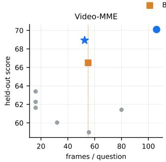

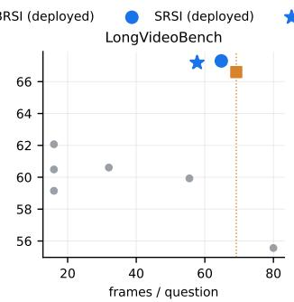

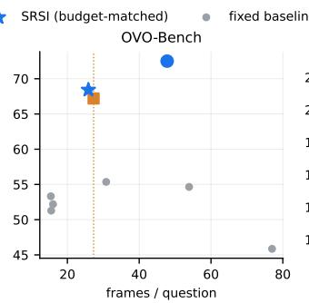

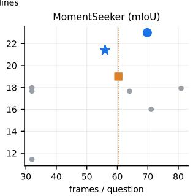  
Figure 5 Held-out score versus frames per question on each benchmark. Deployed harnesses of VideoHarness-BRSI (squares) and VideoHarness-SRSI (circles), budget-matched VideoHarness-SRSI harnesses (stars), and fixed baselines (gray dots), each averaged over three seeds. The dotted line marks the budget, i.e., the frames per question of the deployed VideoHarness-BRSI harness. On every benchmark, the budget-matched VideoHarness-SRSI harness lies above VideoHarness-BRSI without using more frames.  
(a) Validation Score

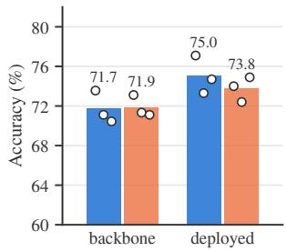

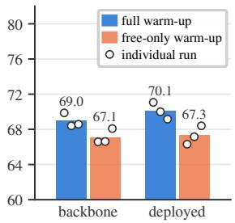

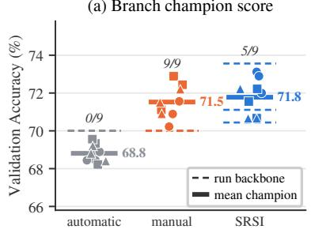

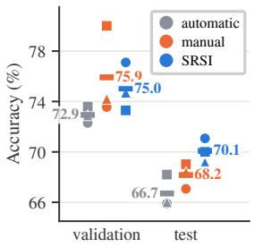  
Figure 6 Warm-up ablation on Video-MME. Validation (a) and held-out (b) accuracy of the warm-up backbone and the deployed system, for the full instrumented warm-up and a free-only warm-up with the same budget; bars are means and dots are individual runs.  
Figure 7 Axis-selection ablation on Video-MME. (a) Validation accuracy of branch champions (markers) for automatic, manual, and VideoHarness-SRSI axes, with each run’s backbone (dashed) and the mean champion (solid); fractions count branches that improve on their backbone. (b) Validation and held-out accuracy of the deployed systems.

As shown in Figure 6, the two variants reach nearly the same warm-up validation accuracy (71.70 vs. 71.85), yet the full warm-up transfers better to the held-out split (69.0 vs. 67.1), and the advantage persists to the deployed system (70.1 vs. 67.3). Every full-warm-up run beats every free-only run on held-out data, at both stages. Controlling for frames per question still leaves a held-out advantage of about 2 points. The diference lies in the evidence: the full warm-up yields 11.7 rather than 4.3 removal contrasts per run, and leaves 5 rather than 11 of the 21 per-family, per-run coverage increments undefined. A within-run replay attributes only 28% of the backbone gap to selecting structured candidates; the rest is consistent with slot results informing later free proposals. The removal and intensity slots thus supply more informative evidence for later search rather than a stronger warm-up champion. Per-run results and the attribution analysis are in Appendix J.

Who should choose the axes? We compare three ways to define three branch axes: automatic, where one proposer call defines axes and charters from the warm-up report; manual, where a researcher defines them from the same report; and the fixed templates of VideoHarness-SRSI with probe–race allocation (Section 4.2.2). All variants share warm-up outputs, backbones, and downstream stages. As shown in Figure 7, the fixed templates of VideoHarness-SRSI generalize best. None of the nine automatic branches improves on its starting backbone, whereas all nine manual ones do. VideoHarness-SRSI reaches slightly higher mean branch accuracy, with five of nine branches improving on their backbones. The manual variant scores highest on validation (75.9 vs. 75.0) but lower on held-out data (68.2 vs. 70.1). Automatic decomposition thus misses productive directions, while researcher-written charters, informed by the same validation evidence, overfit to it. Fixing the axes in advance avoids both failures.

Table 4 Information-isolation ablation on LongVideoBench. Accuracy (%) of each run’s validation argmax, mean ± std over three seeds.
<table><tr><td>Setting</td><td>Val</td><td>Held-out</td></tr><tr><td>VIDEOHARNESS-BRSI feedback (Multimodal)</td><td> $7 1 . 0 0 { \scriptstyle \pm 3 . 2 1 }$ </td><td> $6 5 . 4 3 { \scriptstyle \pm 1 . 1 8 }$ </td></tr><tr><td>VIDEOHARNESS-BRSI + isolation (Blindfolded)</td><td> $7 1 . 2 2 _ { \pm 0 . 3 4 }$ </td><td> $6 6 . 9 3 { \scriptstyle \pm 0 . 8 1 }$ </td></tr><tr><td>VIDEOHARNESS-SRSI</td><td> $7 1 . 1 { \scriptstyle \pm 2 . 0 }$ </td><td> ${ \bf 6 7 . 3 _ { \pm 1 . 0 } }$ </td></tr></table>

Information isolation. To isolate content-free feedback from the rest of VideoHarness-SRSI, we reuse the LongVideoBench runs of the feedback study (Section 3.2) on its 33% validation ladder (Appendix E.1), whose 446 validation and 891 held-out questions match the split of Table 1. In the Multimodal arm, the proposer has the full access of VideoHarness-BRSI; the Blindfolded arm keeps the same loop but shows only per-question correctness and behavioral counters, the content-free feedback of VideoHarness-SRSI (Appendix I.1). The Blindfolded arm is thus VideoHarness-BRSI with information isolation and nothing else. Each arm runs three seeds of 30 iterations with three candidates, with perception tools disabled, and deploys each run’s validation argmax. The VideoHarness-SRSI row is the LongVideoBench entry of Table 1.

As Table 4 shows, the three settings reach nearly the same validation accuracy (71.0–71.2%), so the diferences lie entirely in transfer. Withholding question content raises held-out accuracy by 1.50 points over VideoHarness-BRSI feedback, about 80% of the way to VideoHarness-SRSI, and shrinks the validation–test gap from 5.57 to 4.29 points. This is consistent with Finding 2: the proposer can no longer tailor harnesses to the validation questions, so less of its validation progress is instance-specific fit. The remaining stages of VideoHarness-SRSI add another 0.37 held-out points and shrink the gap to 3.8 points. This second step comes with three caveats: VideoHarness-SRSI evaluates more candidates per seed (at most 156, Appendix I.5, versus 90), the VideoHarness-BRSI row here is the 30-iteration Multimodal arm rather than the 50-iteration run of Table 1, and the two feedback arms run with perception tools disabled, whereas VideoHarness-SRSI may use them. With three seeds per setting, we read this second step as directional, whereas the first changes only what the proposer sees.

Proposer model. We run VideoHarness-SRSI with diferent proposer models, keeping the executor and every other setting fixed. As shown in Table 5, VideoHarness-SRSI remains efective with weaker proposers: all three exceed every fixed baseline on held-out data (best: 63.4), and with Claude Sonnet 5 it still surpasses VideoHarness-BRSI driven by Claude Opus 5 (67.7 vs. 66.5). Held-out accuracy nonetheless tracks proposer capability, from 65.8 with Claude Opus 4.8 to 70.1 with Claude Opus 5, suggesting that VideoHarness-SRSI may benefit further from stronger pro

Table 5 Proposer ablation on Video-MME. Mean ± std over three seeds.
<table><tr><td>Proposer</td><td>Val</td><td>Test</td></tr><tr><td>Opus 5</td><td> $7 5 . 0 { \scriptstyle \pm 1 . 9 }$ </td><td> $7 0 . 1 { \scriptstyle \pm 1 . 0 }$ </td></tr><tr><td>Sonnet 5</td><td> $7 3 . 3 { \scriptstyle \pm 0 . 6 }$ </td><td> $6 7 . 7 _ { \pm 0 . 4 }$ </td></tr><tr><td>Opus 4.8</td><td> $7 1 . 4 { \scriptstyle \pm 0 . 8 }$ </td><td> $6 5 . 8 { \scriptstyle \pm 0 . 1 }$ </td></tr></table>

## 6 Conclusion

We studied how recursive harness evolution can reliably discover generalizable designs, using agentic video understanding as a test bed. Analyzing over 4,000 harnesses evolved by VideoHarness-BRSI, we found that evolution discovers competitive designs, but its validation gains do not reliably generalize: the same imperfect validation evidence adapts both the harness and the proposer’s search strategy, which leads to validation overfitting, search-budget dilution, and the early-experience trap. VideoHarness-SRSI governs this evidence through content-free proposer feedback, an instrumented warm-up, and isolated mechanism branches followed by factorial composition. Across four benchmarks, it raises the mean held-out score by 6.2% and cuts the mean validation–test gap by 37.9% relative to VideoHarness-BRSI, and about half of the gain remains at a matched frame budget. Reliable harness evolution thus depends not only on how well search optimizes validation performance, but on how it is organized and informed.

## References

Lakshya A Agrawal, Shangyin Tan, Dilara Soylu, Noah Ziems, Rishi Khare, Krista Opsahl-Ong, Arnav Singhvi, Herumb Shandilya, Michael J Ryan, Meng Jiang, et al. Gepa: Reflective prompt evolution can outperform reinforcement learning. In International Conference on Learning Representations, volume 2026, pages 8479–8565, 2026.

Anthropic. Introducing claude opus 5. https://www.anthropic.com/news/claude-opus-5, July 2026. Accessed: 2026-09-12.

W. Brian Arthur. Competing technologies, increasing returns, and lock-in by historical events. The Economic Journal, 99(394):116–131, 1989.

Jean-Yves Audibert, Sébastien Bubeck, and Rémi Munos. Best arm identification in multi-armed bandits. In Proceedings of the 23rd Conference on Learning Theory (COLT), pages 41–53, 2010.

Shuai Bai, Yuxuan Cai, Ruizhe Chen, Keqin Chen, Xionghui Chen, Zesen Cheng, Lianghao Deng, Wei Ding, Chang Gao, Chunjiang Ge, Wenbin Ge, Zhifang Guo, Qidong Huang, Jie Huang, Fei Huang, Binyuan Hui, Shutong Jiang, Zhaohai Li, Mingsheng Li, Mei Li, Kaixin Li, Zicheng Lin, Junyang Lin, Xuejing Liu, Jiawei Liu, Chenglong Liu, Yang Liu, Dayiheng Liu, Shixuan Liu, Dunjie Lu, Ruilin Luo, Chenxu Lv, Rui Men, Lingchen Meng, Xuancheng Ren, Xingzhang Ren, Sibo Song, Yuchong Sun, Jun Tang, Jianhong Tu, Jianqiang Wan, Peng Wang, Pengfei Wang, Qiuyue Wang, Yuxuan Wang, Tianbao Xie, Yiheng Xu, Haiyang Xu, Jin Xu, Zhibo Yang, Mingkun Yang, Jianxin Yang, An Yang, Bowen Yu, Fei Zhang, Hang Zhang, Xi Zhang, Bo Zheng, Humen Zhong, Jingren Zhou, Fan Zhou, Jing Zhou, Yuanzhi Zhu, and Ke Zhu. Qwen3-vl technical report, 2025. https://arxiv.org/abs/2511.21631.

Monica Brezzi and Tze Leung Lai. Incomplete learning from endogenous data in dynamic allocation. Econometrica, 68 (6):1511–1516, 2000.

Jerker Denrell and James G. March. Adaptation as information restriction: The hot stove efect. Organization Science, 12(5):523–538, 2001.

Chrisantha Fernando, Dylan Banarse, Henryk Michalewski, Simon Osindero, and Tim Rocktäschel. Promptbreeder: Self-referential self-improvement via prompt evolution. arXiv preprint arXiv:2309.16797, 2023.

Ronald A. Fisher. The Genetical Theory of Natural Selection. Clarendon Press, Oxford, 1930.

Chaoyou Fu, Yuhan Dai, Yongdong Luo, Lei Li, Shuhuai Ren, Renrui Zhang, Zihan Wang, Chenyu Zhou, Yunhang Shen, Mengdan Zhang, Peixian Chen, Yanwei Li, Shaohui Lin, Sirui Zhao, Ke Li, Tong Xu, Xiawu Zheng, Enhong Chen, Caifeng Shan, Ran He, and Xing Sun. Video-mme: The first-ever comprehensive evaluation benchmark of multi-modal llms in video analysis, 2025. https://arxiv.org/abs/2405.21075.

Shengran Hu, Cong Lu, and Jef Clune. Automated design of agentic systems. In International Conference on Learning Representations, volume 2025, pages 21344–21377, 2025.

Omar Khattab, Arnav Singhvi, Paridhi Maheshwari, Zhiyuan Zhang, Keshav Santhanam, Sri Vardhamanan, Saiful Haq, Ashutosh Sharma, Thomas T Joshi, Hanna Moazam, et al. Dspy: Compiling declarative language model calls into self-improving pipelines. arXiv preprint arXiv:2310.03714, 2023.

Yoonho Lee, Roshen Nair, Qizheng Zhang, Kangwook Lee, Omar Khattab, and Chelsea Finn. Meta-harness: End-to-end optimization of model harnesses. arXiv preprint arXiv:2603.28052, 2026.

Zhengyang Liang, Daoan Zhang, Huichi Zhou, Rui Huang, Bobo Li, Yuechen Zhang, Shengqiong Wu, Xiaohan Wang, Jiebo Luo, Lizi Liao, and Hao Fei. Univa: Universal video agent towards open-source next-generation video generalist, 2025. https://arxiv.org/abs/2511.08521.

Minhua Lin, Juncheng Wu, Zijun Wang, Zhan Shi, Yisi Sang, Bing He, Zewen Liu, Tianxin Wei, Zongyu Wu, Zhiwei Zhang, et al. Harness updating is not harness benefit: Disentangling evolution capabilities in self-evolving llm agents. arXiv preprint arXiv:2605.30621, 2026.

Shilong Liu, Zhaoyang Zeng, Tianhe Ren, Feng Li, Hao Zhang, Jie Yang, Qing Jiang, Chunyuan Li, Jianwei Yang, Hang Su, Jun Zhu, and Lei Zhang. Grounding DINO: Marrying DINO with grounded pre-training for open-set object detection. In European Conference on Computer Vision (ECCV), 2024.

Zewen Liu, Zhan Shi, Yisi Sang, Bing He, Minhua Lin, Tianxin Wei, Dakuo Wang, Benoit Dumoulin, Wei Jin, and Hanqing Lu. Adaptive auto-harness: Sustained self-improvement for agentic system deployment on open-ended task streams. arXiv preprint arXiv:2606.01770, 2026.

Do Xuan Long, Xingchen Wan, Hootan Nakhost, Chen-Yu Lee, Tomas Pfister, and Sercan Ö. Arık. Vista: A test-time self-improving video generation agent, 2025a. https://arxiv.org/abs/2510.15831.

Lin Long, Yichen He, Wentao Ye, Yiyuan Pan, Yuan Lin, Hang Li, Junbo Zhao, and Wei Li. Seeing, listening, remembering, and reasoning: A multimodal agent with long-term memory, 2025b. https://arxiv.org/abs/2508.09736.

Frederic M. Lord and Melvin R. Novick. Statistical Theories of Mental Test Scores. Addison-Wesley, Reading, MA, 1968.

Yongdong Luo, Xiawu Zheng, Guilin Li, Shukang Yin, Haojia Lin, Chaoyou Fu, Jinfa Huang, Jiayi Ji, Fei Chao, Jiebo Luo, and Rongrong Ji. Video-rag: Visually-aligned retrieval-augmented long video comprehension, 2025. https://arxiv.org/abs/2411.13093.

Quinn McNemar. Note on the sampling error of the diference between correlated proportions or percentages. Psychometrika, 12(2):153–157, 1947.

Xuying Ning, Katherine Tieu, Dongqi Fu, Tianxin Wei, Zihao Li, Yuanchen Bei, Jiaru Zou, Mengting Ai, Zhining Liu, Ting-Wei Li, Lingjie Chen, Yanjun Zhao, Ke Yang, Bingxuan Li, Cheng Qian, Gaotang Li, Xiao Lin, Zhichen Zeng, Ruizhong Qiu, Sirui Chen, Yifan Sun, Xiyuan Yang, Ruida Wang, Rui Pan, Chenyuan Yang, Dylan Zhang, Liri Fang, Zikun Cui, Yang Cao, Pan Chen, Dorothy Sun, Ren Chen, Mahesh Srinivasan, Nipun Mathur, Yinglong Xia, Hong Li, Hong Yan, Pan Lu, Lingming Zhang, Tong Zhang, Hanghang Tong, and Jingrui He. Code as agent harness, 2026. https://arxiv.org/abs/2605.18747.

Junbo Niu, Yifei Li, Ziyang Miao, Chunjiang Ge, Yuanhang Zhou, Qihao He, Xiaoyi Dong, Haodong Duan, Shuangrui Ding, Rui Qian, et al. Ovo-bench: How far is your video-llms from real-world online video understanding? In 2025 IEEE/CVF Conference on Computer Vision and Pattern Recognition (CVPR), pages 18902–18913. IEEE, 2025.

Alexander Novikov, Ngân V˜u, Marvin Eisenberger, Emilien Dupont, Po-Sen Huang, Adam Zsolt Wagner, Sergey Shirobokov, Borislav Kozlovskii, Francisco JR Ruiz, Abbas Mehrabian, et al. Alphaevolve: A coding agent for scientific and algorithmic discovery. arXiv preprint arXiv:2506.13131, 2025.

Krista Opsahl-Ong, Michael J Ryan, Josh Purtell, David Broman, Christopher Potts, Matei Zaharia, and Omar Khattab. Optimizing instructions and demonstrations for multi-stage language model programs. In Proceedings of the 2024 Conference on Empirical Methods in Natural Language Processing, pages 9340–9366, 2024.

H. Allen Orr. Adaptation and the cost of complexity. Evolution, 54(1):13–20, 2000.

Reid Pryzant, Dan Iter, Jerry Li, Yin Lee, Chenguang Zhu, and Michael Zeng. Automatic prompt optimization with “gradient descent” and beam search. In Proceedings of the 2023 conference on empirical methods in natural language processing, pages 7957–7968, 2023.

Alec Radford, Jong Wook Kim, Chris Hallacy, Aditya Ramesh, Gabriel Goh, Sandhini Agarwal, Girish Sastry, Amanda Askell, Pamela Mishkin, Jack Clark, Gretchen Krueger, and Ilya Sutskever. Learning transferable visual models from natural language supervision. In Proceedings of the 38th International Conference on Machine Learning (ICML), pages 8748–8763, 2021.

Michael Rothschild. A two-armed bandit theory of market pricing. Journal of Economic Theory, 9(2):185–202, 1974.

Daniel Russo and James Zou. Controlling bias in adaptive data analysis using information theory. In Proceedings of the 19th International Conference on Artificial Intelligence and Statistics (AISTATS), pages 1232–1240, 2016.

Yu Shang, Yu Li, Keyu Zhao, Likai Ma, Jiahe Liu, Fengli Xu, and Yong Li. Agentsquare: Automatic llm agent search in modular design space. In International Conference on Learning Representations, volume 2025, pages 3841–3865, 2025.

Xiaoqian Shen, Yunyang Xiong, Changsheng Zhao, Lemeng Wu, Jun Chen, Chenchen Zhu, Zechun Liu, Fanyi Xiao, Balakrishnan Varadarajan, Florian Bordes, et al. Longvu: Spatiotemporal adaptive compression for long video-language understanding. arXiv preprint arXiv:2410.17434, 2024.

James E. Smith and Robert L. Winkler. The optimizer’s curse: Skepticism and postdecision surprise in decision analysis. Management Science, 52(3):311–322, 2006.

Xi Tang, Jihao Qiu, Lingxi Xie, Yunjie Tian, Jianbin Jiao, and Qixiang Ye. Adaptive keyframe sampling for long video understanding. In 2025 IEEE/CVF Conference on Computer Vision and Pattern Recognition (CVPR), pages 29118–29128. IEEE, 2025.

Xiaohan Wang, Yuhui Zhang, Orr Zohar, and Serena Yeung-Levy. Videoagent: Long-form video understanding with large language model as agent. In European Conference on Computer Vision, pages 58–76. Springer, 2024.

Ziyang Wang, Shoubin Yu, Elias Stengel-Eskin, Jaehong Yoon, Feng Cheng, Gedas Bertasius, and Mohit Bansal. Videotree: Adaptive tree-based video representation for llm reasoning on long videos, 2025. https://arxiv.org/abs/ 2405.19209.

Tianxin Wei, Zhan Shi, Minhua Lin, Bing He, Zewen Liu, Yisi Sang, Yuanchen Bei, Xuying Ning, Jiaru Zou, Ting-Wei Li, et al. Evo-harness: Context-to-harness skill compilation for self-evolving agents. arXiv preprint arXiv:2608.15071, 2026.

Haoning Wu, Dongxu Li, Bei Chen, and Junnan Li. Longvideobench: A benchmark for long-context interleaved video-language understanding, 2024. https://arxiv.org/abs/2407.15754.

Siwei Wu, Jincheng Ren, Yizhi Li, Haau-Sing Li, Chengran Yang, Yuxuan Zhang, Weicheng Gu, Jian Yang, Riza Batista-Navarro, Chuanyi Zhang, Xianglong Liu, Ming Zhou, Bryan Dai, and Chenghua Lin. Modularrsi: Modular and generalizable recursive harness self-improvement, 2026. https://arxiv.org/abs/2609.14857.

Peng Xia, Rujun Han, Zifeng Wang, Yanfei Chen, Yufan Zhang, Yoonho Lee, Chengsong Huang, Han Yu, Zhongying CuiZhu, Yifei Ming, Huaxiu Yao, Burak Gokturk, Tomas Pfister, and Chen-Yu Lee. Rrsi: Regularized recursive self-improvement of agent harnesses, 2026. https://arxiv.org/abs/2609.24972.

Aolin Xu and Maxim Raginsky. Information-theoretic analysis of generalization capability of learning algorithms. In Advances in Neural Information Processing Systems, volume 30, 2017.

Chengrun Yang, Xuezhi Wang, Yifeng Lu, Hanxiao Liu, Quoc V Le, Denny Zhou, and Xinyun Chen. Large language models as optimizers. In International Conference on Learning Representations, volume 2024, pages 12028–12068, 2024.

Woongyeong Yeo, Kangsan Kim, Jaehong Yoon, and Sung Ju Hwang. Worldmm: Dynamic multimodal memory agent for long video reasoning. In Proceedings of the IEEE/CVF Conference on Computer Vision and Pattern Recognition, pages 25599–25609, 2026.

Huaying Yuan, Jian Ni, Zheng Liu, Yueze Wang, Junjie Zhou, Zhengyang Liang, Bo Zhao, Zhao Cao, Ji-Rong Wen, and Zhicheng Dou. Momentseeker: A task-oriented benchmark for long-video moment retrieval. Advances in Neural Information Processing Systems, 38, 2026.

Mert Yuksekgonul, Federico Bianchi, Joseph Boen, Sheng Liu, Zhi Huang, Carlos Guestrin, and James Zou. Textgrad: Automatic" diferentiation" via text. arXiv preprint arXiv:2406.07496, 2024.

Guibin Zhang, Kaijie Chen, Guancheng Wan, Heng Chang, Hong Cheng, Kun Wang, Shuyue Hu, and Lei Bai. Evoflow: Evolving diverse agentic workflows on the fly. arXiv preprint arXiv:2502.07373, 2025a.

Jenny Zhang, Shengran Hu, Cong Lu, Robert Lange, and Jef Clune. Darwin gödel machine: open-ended evolution of self-improving agents. In International Conference on Learning Representations, volume 2026, pages 104223–104294, 2026a.

Jiayi Zhang, Jinyu Xiang, Zhaoyang Yu, Fengwei Teng, Xionghui Chen, Jiaqi Chen, Mingchen Zhuge, Xin Cheng, Sirui Hong, Jinlin Wang, et al. Aflow: Automating agentic workflow generation. In International Conference on Learning Representations, volume 2025, pages 34040–34077, 2025b.

Xiaoyi Zhang, Zhaoyang Jia, Zongyu Guo, Jiahao Li, Bin Li, Houqiang Li, and Yan Lu. Deep video discovery: Agentic search with tool use for long-form video understanding. Advances in Neural Information Processing Systems, 38: 89863–89895, 2026b.

Table 6 Index of experiments. All experiments use the frozen Qwen3-VL-8B-Instruct executor and, except for the proposer ablation of Section 5.4, Claude Opus 5 as the proposer. Budget: iterations × candidates per iteration of one run. Candidates: scheduled total over the study’s runs; for the early-experience trap, the candidates actually proposed (the “over 4,000” of the abstract). Studies share runs, so the column does not sum. BRSI: VideoHarness-BRSI; SRSI: VideoHarness-SRSI. VM: Video-MME; LVB: LongVideoBench; OVO: OVO-Bench; MS: MomentSeeker.
<table><tr><td>Study</td><td></td><td>Benchmarks Factor varied</td><td>Runs</td><td>Budget</td><td>Candidates</td><td>Where</td></tr><tr><td colspan="7">Diagnosis of VIDEOHARNESS-BRSI (Section 3)</td></tr><tr><td>Effectiveness</td><td>VM</td><td>- (retrieval only)</td><td>1</td><td>50 × 3</td><td></td><td>150 Fig. 2</td></tr><tr><td>Validation overfitting</td><td>LVB</td><td>proposer feedback; validation fraction</td><td>27</td><td>30 × 3</td><td>2,430</td><td>App. E</td></tr><tr><td>Search-budget dilution VM</td><td></td><td>number of mechanism families (1. 2, 3, 6)</td><td>11</td><td>variesª</td><td></td><td>1,820 App. F</td></tr><tr><td>Early-experience trap</td><td>VM, LVB</td><td>– (re-analysis of existing runs)</td><td>44</td><td>variesb</td><td></td><td>4,806 App. G</td></tr><tr><td colspan="7">Simple remedies (Section 3.2)</td></tr><tr><td>Parent selection</td><td>VM, LVB</td><td>parent-suggestion rule</td><td>18</td><td>30 × 3</td><td></td><td>1,620 App. H.1</td></tr><tr><td>Initialization</td><td>VM</td><td>starting harness (simple seeds vs. AKS)</td><td>7</td><td>50 × 3</td><td></td><td>1,050 App. H.2</td></tr><tr><td colspan="7">Main results and ablations (Section 5)</td></tr><tr><td>Main results: BRSI</td><td>all four</td><td></td><td></td><td>12 50 × 3</td><td>1,800 Tab. 1</td><td></td></tr><tr><td>Main results: SRSI</td><td>all four</td><td></td><td></td><td>12 stagedc</td><td>≤1,872 Tab.1</td><td></td></tr><tr><td>Warm-up ablation</td><td>VM</td><td>warm-up slot allocation</td><td></td><td>6 stagedc</td><td></td><td>≤936 App. J</td></tr><tr><td>Axis selection</td><td>VM</td><td>who defines the branch axes</td><td></td><td>9 stagedc</td><td>≤1,404 Fig. 7</td><td></td></tr></table>

aPer space in Table 14. bPer setting in Table 16. cAt most 156 candidates per run (Eq. (19)); totals are upper bounds.

## Appendix

## Overview of the Appendix

The appendix follows the order of the paper, and Table 6 indexes the experiments with their scale and the appendix that documents it.

• Appendix A describes the models, benchmarks, splits, inference budgets, seeded harnesses, and metrics.

• Appendix B specifies VideoHarness-BRSI: its evolution loop and study configurations (Section 3).

• Appendix D formalizes the verdict model of Eq. (1), and Appendices E–G analyze the three failure modes of Section 3.2, each with its protocol, full results, propositions and proofs, and robustness checks.

• Appendix H reports the parent-selection and initialization studies behind the simple remedies discussed in Section 3.2.

• Appendix I gives the implementation, statistical procedures, and configuration of VideoHarness-SRSI (Section 4).

• Appendix J gives the protocol and additional analyses of the warm-up ablation (Section 5.4).

• Appendix K re-scores held-out results on videos absent from validation, and Appendix L reports failure-mode diagnostics of VideoHarness-SRSI (Section 5).

• Appendix M reproduces the main proposer prompts of VideoHarness-SRSI.

## A Experimental Setup

This section describes the models, benchmarks, inference budgets, seeded harnesses, and metrics shared by all experiments; Table 6 lists the scale of each experiment.

Table 7 Benchmark splits. Seeded random splits; the split unit is the question, or the source video for MomentSeeker.
<table><tr><td>Benchmark</td><td>Pool</td><td>Validation</td><td>Held-out</td><td>Split unit</td><td>Metric</td></tr><tr><td>Video-MME</td><td>2,700</td><td>450</td><td>2,250</td><td>question</td><td>accuracy</td></tr><tr><td>LongVideoBench</td><td>1,337</td><td>446</td><td>891</td><td>question</td><td>accuracy</td></tr><tr><td>OVO-Bench</td><td>1,468</td><td>489</td><td>979</td><td>question</td><td>accuracy</td></tr><tr><td>MomentSeeker</td><td>1,000</td><td>261</td><td>739</td><td>video</td><td>mIoU</td></tr></table>

## A.1 Models

The executor is a frozen Qwen3-VL-8B-Instruct (Bai et al., 2025) with greedy decoding. It is the only model that sees video or answers questions; “roles” and “agents” inside a harness are prompts to the same model. Executor and tool outputs are cached by content, so re-evaluating an unchanged harness reproduces its outputs (batching varies seeded-harness scores by at most ±0.5 points). The proposer is Claude Opus 5 (Anthropic, 2026), run as a Claude Code agent at maximum reasoning efort in a new session per iteration; it writes harness code but never answers questions or runs the benchmark. Query-conditioned retrieval ranks a per-video pool of frames (4 fps, at most 4,096) with CLIP ViT-B/32 and ViT-L/14-336 (Radford et al., 2021); open-vocabulary detection uses Grounding DINO (Liu et al., 2024).

## A.2 Benchmarks and Data Splits

Each benchmark has one fixed validation/held-out partition (Table 7), drawn once and reused by every method, seed, and study except the validation ladder of Appendix E. Every partition in this paper, including that ladder, is a seeded random split of questions, except on MomentSeeker, where whole source videos are assigned to one side; on the other benchmarks, a held-out question may come from a video that also has validation questions (Appendix K). Evolution and selection use only the validation split, and held-out results never reach the proposer. All benchmarks are used video-only: subtitles and metadata such as duration categories or task labels are withheld from harness code.

• Video-MME: all 2,700 questions on 900 videos.

• LongVideoBench: the released validation set (the test set has no public answers), after removing items with inconsistent answer indices.

• OVO-Bench: the backward-tracing and real-time-perception multiple-choice modes, each evaluated on the clip truncated at query time so that no future frames are visible.

• MomentSeeker: text-query moment retrieval, where each source video lies entirely on one side of the split.

## A.3 Inference Budgets

Table 8 lists the default settings and per-question limits. A harness may override the frame count, pixel budget, and output length; MomentSeeker defaults to more, lower-resolution frames, since temporal grounding depends mainly on coverage. A primitive that fails or exhausts its budget returns an empty result, so every harness must return a valid answer without any tool. Search spaces without perception tools, including the LongVideoBench runs of Appendix E, remove them from the interface.

## A.4 Seeded Harnesses

Six deliberately simple, hand-written harnesses (Table 9) seed every full-harness run and serve as fixed baselines. Self-reflection and Role Debate read the frames of Retrieval, and Tool-gated Selection reads as many, so their diferences from Retrieval reflect the added mechanism rather than the frame budget. On MomentSeeker they predict a time span instead of an option letter. Where perception tools are disabled, Tool-gated Selection is replaced by Dense Uniform, one call on 64 uniform frames. Spaces with one or two mechanism families start instead from five simple seeds: uniform and block-center sampling, CLIP top-k retrieval, and two space-specific retrieval or selection seeds.

Table 8 Default inference settings and per-question limits. The frame and pixel values are defaults that a harness may override per call; the limits are enforced by the interface.
<table><tr><td></td><td></td><td>Multiple choice Temporal grounding</td></tr><tr><td>Default frames per pass</td><td>16</td><td>32</td></tr><tr><td>Default pixels per frame</td><td>230,400</td><td>151,200</td></tr><tr><td>Default output tokens</td><td>16</td><td>64</td></tr><tr><td>Maximum frames per pass</td><td>768</td><td>256</td></tr><tr><td>Executor calls per question</td><td colspan="2">12</td></tr><tr><td>Tool calls per question</td><td colspan="2">60</td></tr><tr><td>Pixel re-rendering calls per question</td><td colspan="2">12</td></tr><tr><td>Working memory (characters)</td><td colspan="2">900</td></tr></table>

Table 9 Seeded harnesses. Frames: mean frames shown to the executor per Video-MME question, summed over calls.
<table><tr><td>Harness (code name)</td><td>Procedure</td><td>Frames</td></tr><tr><td>UNIFORM (uniform)</td><td>Samples frames uniformly over the video and answers in one grounded call.</td><td>16</td></tr><tr><td>RETRIEVAL (clip_topk)</td><td>Ranks pool frames by CLIP similarity to the question and options, backfills the selection with uniform frames to the budget, and answers in one call.</td><td>16</td></tr><tr><td>SELF-REFLECTION (reflect_loop)</td><td>Answers on the retrieved frames, confronts the executor with its own answer on the same frames, and takes the revision (at most two rounds).</td><td>32</td></tr><tr><td>TOOL-GATED SELECTION (tool_survey)</td><td>Asks the executor which entities would resolve the question, detects them in a</td><td>16</td></tr><tr><td>ROLE DEBATE</td><td>retrieved candidate pool, and answers on the frames that contain them. A proponent argues for the leading option, a skeptic for the strongest rival, and</td><td>80</td></tr><tr><td>(debate_pair) MEMORY SURVEY</td><td>an arbiter decides after looking at the frames again with both arguments. Splits the video into shots, writes one observation per shot keyframe into</td><td>56</td></tr><tr><td>(memo_multiturn)</td><td>working memory, answers with the memory digest, and re-retrieves once on a cue named by the executor if the answer remains uncertain.</td><td></td></tr></table>

## A.5 Evaluation Metrics

Multiple-choice benchmarks report accuracy, parsing the first valid option letter from the harness output (none scores as incorrect). MomentSeeker reports mIoU, the mean temporal IoU of the predicted span, clamped to the video and maximized over annotated intervals (unparsable predictions score zero); it is also the evolution objective. A harness’s cost is its mean number of frames shown to the executor per question, summed over calls. Evolved results average three seeds and report the standard deviation across seeds. Unless noted otherwise, paired comparisons of two harnesses use McNemar’s test (McNemar, 1947), contrasts between groups of runs use Welch’s t-test or exact permutation tests, and bootstrap intervals resample runs rather than questions, since candidates of one run are dependent.

## B VideoHarness-BRSI Details

This section specifies VideoHarness-BRSI as used in Section 3: the evolution loop (Appendix B.1) and the configurations of the individual studies (Appendix B.2).

## B.1 Evolution Loop

A harness is a Python class whose answer method receives a context object for one question—the video, the question, and its options—and returns an answer. Every access to frames, the executor, tools, or memory goes through the context, which enforces the per-question limits of Table 8. Algorithm 1 summarizes the loop.

Proposer sessions. Each iteration starts a new session of the proposer (Appendix A.1) in the run’s workspace. A task description specifies the objective, the harness interface, the mechanism families that the search space charters, and the candidate rules: every iteration must add k new candidates, each changing a mechanism rather than only constants. It prescribes a workflow: analyze the archive and the execution traces, prototype on a stubbed or real executor, implement k new harnesses, check that each imports and passes the leak guard, and register them in a manifest. The manifest declares, for each candidate, the parent it modifies, a one-sentence hypothesis, and the mechanisms it uses. Unless stated otherwise, $k = 3$

Algorithm 1 VideoHarness-BRSI: the propose–evaluate–accumulate loop.   
Require: frozen VLM M; proposer $P ;$ seed harnesses $\mathcal { H } _ { 0 } ;$ splits $S _ { \mathrm { v a l } } , S _ { \mathrm { t e s t } } ;$ iterations T; candidates per iteration k   
1: $\begin{array} { r } { \mathcal { D } _ { 0 }  \{ ( H , \mathrm { E v a L } ( H , \mathcal { S } _ { \mathrm { v a l } } ) ) : H \in \mathcal { H } _ { 0 } \} } \end{array}$ ▷ seed archive   
2: for $t = 1 , \dots , T$ do   
3: start a new session of P in a workspace exposing $\mathcal { D } _ { t - 1 }$ , the traces, and $\mathcal { T } _ { \mathrm { v a l } }$   
4: P writes k harness files and a manifest: name, declared parent, hypothesis, mechanism tags   
5: for each candidate H in the manifest do   
6: if H fails to import or violates a leak rule then record the failure and skip H   
7: $\mathcal { E }  \mathrm { E v a L } ( H , S _ { \mathrm { v a l } } )$ ▷ per-question answers, correctness, cost, traces   
8: $\mathcal { D } _ { t }  \mathcal { D } _ { t - 1 } \cup \{ ( H , \mathcal { E } ) \}$ ; update the Pareto frontier over (accuracy, mean frames)   
9: evaluate the frontier, the validation-best harness, and $\mathcal { H } _ { 0 }$ on $S _ { \mathrm { t e s t } }$ ▷ never shown to P   
10: return the validation-best harness ▷ deployed

Persistent memory. Besides the archive, the only state that survives an iteration is a persistent memory directory of the proposer’s agent environment, which later sessions load automatically (up to 160 KB per run in our logs). The proposer uses it to record its interpretation of verdicts, including lists of directions it considers exhausted; Appendix G.6 shows how such entries propagate early verdicts.

Evaluation. Each candidate is evaluated once on the full validation split, and its score is never recomputed. Executor and tool outputs are cached by content, so calls that repeat an earlier input, within or across candidates, return the cached output. Before evaluation, a static leak guard rejects any candidate that accesses the file system, the network, or evaluation logs; references dataset-identity or metadata handles such as the video path, question and video IDs, or the task type; hashes text; or embeds lookup tables (collection literals with more than 12 strings or strings longer than 4,000 characters). Harness code sees only the question, the options, and the video’s frame count, frame rate, and duration. A candidate that fails to import, violates a leak rule, or crashes during evaluation is recorded as failed and cannot become the champion.

Frontier and deployment. The loop maintains the Pareto frontier of validation performance against mean frames per question. After the last iteration, the frontier members, the validation-best harness, and the seeded harnesses are evaluated once on the held-out split. The deployed harness is the validation-best harness. Held-out results are stored outside the proposer’s workspace.

## B.2 Study Configurations

Budgets. Unless stated otherwise, retrieval-family runs evolve for 50 iterations and full-harness runs for 30 (50 for VideoHarness-BRSI in the main results of Table 1, which use Multimodal feedback and no parent suggestions on every benchmark), with three candidates per iteration; one perception-tools run uses 100 iterations of five candidates (Table 14).

Parent suggestions. The default loop leaves the choice of parent entirely to the proposer. The parent-selection study of Appendix H.1 adds a list of suggested parents to the task description and varies only the rule that produces it. All other runs, including the full-harness runs of the search-space ladder and the main results, receive no parent suggestions; deployment is the validation-best harness in all cases.

## C Evolving Capability of VideoHarness-BRSI

This section gives the experimental setting behind Section 3.1 and explains its three design choices: the evolved mechanism family, the validation/held-out split, and the iteration budget.

## C.1 Experimental Setting

Evolving retrieval for a fair comparison. The question of Section 3.1 is whether recursive evolution can match expert manual design, so the comparison needs a strong hand-designed reference. We use Adaptive Keyframe Sampling (AKS) (Tang et al., 2025), which is a retrieval method: it scores frames by their relevance to the question and allocates the frame budget accordingly. We therefore let VideoHarness-BRSI evolve only the retrieval strategy in the main text. Evolved and hand-designed harnesses then difer in the same mechanism and run on the same frozen executor, so a gap between them reflects how the mechanism was designed rather than which mechanism was used. Evolving other or more mechanism families would give VideoHarness-BRSI components that AKS lacks, and a win could no longer be credited to evolution alone. Appendix C.2 reports evolution in other mechanism families and on other datasets.

A 1:5 validation/held-out split. We split Video-MME at random into 450 validation and 2,250 held-out questions, a ratio of 1:5 (Table 7). This split keeps most of the benchmark away from evolution, for two reasons.

• Evaluation cost. Every candidate is run in full on the validation split, which takes a frozen-VLM call on the sampled frames of every question. Evaluation is therefore the slow step of each iteration, and a small validation split shortens every one of the 150 evaluations in a run.

• A stricter test of generalization. A small validation split gives the proposer less of the benchmark to fit, while the large held-out split measures the deployed harness precisely: with 2,250 questions, the standard error of a held-out accuracy near 68% is about one point, against about two points on the 450 validation questions. A larger validation share would let evolution fit a larger part of the benchmark itself and leave a smaller, noisier held-out split to detect it. Under the 1:5 split, a harness evolved on one sixth of the data must match the hand-designed methods on the remaining five sixths, which it never sees. That the evolved harness still matches the strongest of them on this split (Figure 2(b)) therefore strengthens, rather than weakens, the conclusion that VideoHarness-BRSI is competitive with human design.

Iteration budget. Each run evolves for 50 iterations of three candidates, 150 candidate evaluations in total.

## C.2 Evolution Across Mechanism Families and Datasets

The retrieval-only comparison isolates one mechanism for a fair test against AKS, but the evolving capability of VideoHarness-BRSI is not specific to retrieval or to Video-MME.

Other mechanism families. The search-space ladder of Appendix F evolves, on the same Video-MME split, retrieval together with frame selection, with perception tools, and the full harness of six families, which adds reflection, role-based collaboration, and working memory. In every space, evolution raises validation accuracy over the best seeded harness by 5.1–7.6 points within 87 candidates, and the deployed champions reach 65.7–66.8% held-out accuracy (Table 15), above the best fixed baseline on Video-MME (clip\_topk, 63.4%; Table 1). Evolution thus improves harnesses whichever mechanism families it may edit; what the families change is how eficiently it does so (Section 3.2.2).

Other datasets. The main results evolve the full harness on all four benchmarks (Table 1). On held-out data, VideoHarness-BRSI exceeds the strongest fixed baseline on every benchmark: 66.5 versus 63.4% on Video-MME, 66.6 versus 62.1% on LongVideoBench, 67.2 versus 55.4% on OVO-Bench, and 19.0 versus 18.0 mIoU on MomentSeeker, 5.12 points on average. Evolution therefore transfers across general, long-form, and streaming question answering and temporal grounding, although, as Section 3.2 shows, its validation progress overstates these held-out gains.

## D A Model of Validation Verdicts

This section derives the verdict model of Eq. (1); Appendices E–G instantiate it for the three failure modes.

Scores and instance-specific $\it { \Omega } \mathcal { f } t .$ Let $y _ { H } ( q ) \in \{ 0 , 1 \}$ indicate that harness H answers question q correctly, with questions drawn from a population $\mathcal { Q } .$ . On a validation split $S _ { \mathrm { v a l } }$ of n questions,

$$
V ( H ) = \frac { 1 0 0 } { n } \sum _ { q \in S _ { \mathrm { v a l } } } y _ { H } ( q ) , \qquad \mu ( H ) = 1 0 0 \mathbb { E } _ { q \sim Q } \bigl [ y _ { H } ( q ) \bigr ] ,\tag{4}
$$

and $T ( H )$ is held-out accuracy, an unbiased estimate of $\mu ( H )$ because the held-out split never influences search. $V ( H )$ is not, since H is built from validation feedback. We decompose $V ( H ) = \mu ( H ) + S ( H ) + e ( H )$ with

$$
S ( H ) = \operatorname { \mathbb { E } } \bigl [ V ( H ) \mid H \bigr ] - \mu ( H ) , \qquad \operatorname { \mathbb { E } } \bigl [ e ( H ) \mid H \bigr ] = 0 .\tag{5}
$$

The instance-specific fit $S ( H )$ is the systematic, validation-specific part of the score; $S \equiv 0$ for any harness chosen without access to $S _ { \mathrm { v a l } } .$ , such as a hand-written baseline. In psychometric terms (Lord and Novick, 1968), validation measures $\mu + S$ reliably but only $\mu$ validly, and the two separate exactly when $S$ varies across candidates.

Paired verdicts and the behavioral footprint. A candidate is compared with the incumbent $H ^ { \mathrm { i n c } }$ on the same questions. With $D _ { q } = y _ { H } ( q ) - y _ { H ^ { \mathrm { i n c } } } ( q )$ and $n _ { \mathrm { 1 0 } } , n _ { \mathrm { 0 1 } }$ the numbers of questions with $D _ { q } = 1$ and $D _ { q } = - 1$ ，

$$
\hat { \delta } = \frac { 1 0 0 \left( n _ { 1 0 } - n _ { 0 1 } \right) } { n } , \qquad d = n _ { 1 0 } + n _ { 0 1 } ,\tag{6}
$$

and, treating questions as exchangeable given the pair,

$$
\operatorname { V a r } ( \hat { \delta } ) = \frac { 1 0 ^ { 4 } } { n } \Big ( \frac { \mathbb { E } d } { n } - \Big ( \frac { \mathbb { E } \hat { \delta } } { 1 0 0 } \Big ) ^ { 2 } \Big ) \approx \frac { 1 0 ^ { 4 } d } { n ^ { 2 } } ,\tag{7}
$$

the scale of McNemar’s statistic (McNemar, 1947). We call d the behavioral footprint and use the paired standard error $\sigma _ { H } = 1 0 0 \sqrt { d _ { H } } / n$ and $z = \hat { \delta } / \sigma _ { H }$ . The key consequence is that an edit changing more answers yields a noisier verdict, whether or not the changes help. Exact clones $( d = 0 ) \ \mathrm { g e t } \ z = 0$ and are excluded from averages of σ. Because the calculation ignores adaptive reuse of the validation set and within-video dependence, $| z | < 1$ .96 is only a nominal marker of an unresolved comparison.

Incumbent optimism. The incumbent is the validation maximum so far, so the noise in its cached score is biased upward, $\omega = \mathbb { E } \big [ e ( H ^ { \mathrm { i n c } } ) \big ] > 0 .$ , even though $\mathbb { E } [ e ( H ) \mid H ] = 0$ for any fixed H (the optimizer’s curse (Smith and Winkler, 2006)); for m equally accurate harnesses with independent Gaussian noise of standard deviation $s , \omega = s c _ { m }$ with $c _ { m } = \mathbb { E } \operatorname* { m a x } _ { i \leq m } Z _ { i } \approx \sqrt { 2 }$ ln m. Every later verdict compares a candidate against this selected score and therefore inherits $- \omega$ . Subtracting the two decompositions,

$$
\begin{array} { r } { \hat { \delta } = V ( H ) - V ( H ^ { \mathrm { i n c } } ) = \underbrace { \mu ( H ) - \mu ( H ^ { \mathrm { i n c } } ) } _ { \Delta } + \underbrace { S ( H ) - S ( H ^ { \mathrm { i n c } } ) } _ { S } - \omega + \underbrace { e ( H ) - e ( H ^ { \mathrm { i n c } } ) + \omega } _ { \varepsilon } , } \end{array}
$$

which is Eq. (1) with S the candidate’s fit relative to the incumbent’s and E $\varepsilon = 0$ . Each validation-specific part of the incumbent’s score thus enters once: its systematic fit $S ( H ^ { \mathrm { i n c } } )$ through S, and the selection bias of its noise through ω.

Three ways a verdict fails. Evolution improves $\mu$ only insofar as $\hat { \delta }$ tracks $\Delta$ . Validation overfitting $\left( \operatorname { A p p . ~ E } \right)$ content-revealing feedback enlarges S, which selection rewards. Search-budget dilution $( \operatorname { A p p . } \mathrm { { F } } )$ : larger spaces lower the evidence per hypothesis through fewer evaluations per mechanism combination and larger footprints d. Early-experience trap $\left( \operatorname { A p p . ~ G } \right)$ : single low-SNR verdicts, ofset by $- \omega .$ , are rarely revisited. The model is a lens, not a claim of exact Gaussianity; each appendix states its assumptions.

## E Validation Overfitting

This section supports Section 3.2.1. Its conclusions are:

• Richer feedback, larger gaps. The mean validation–held-out gap of evolved harnesses grows from 2.0 (Blindfolded) to 2.9 (Trace) and 3.2 points (Multimodal), while hand-written baselines show none (Appendix E.2).

• Theory. Selecting on validation accuracy transfers only a fraction $\beta$ of the validation advantage, and the non-transferable fit a harness can acquire is bounded by the information its feedback carries about the validation sample, which grows along nested channels (Appendix E.3).

• Measurement. Validation scores are equally reliable in every arm, yet $\beta$ falls from 0.54 to 0.30, and the lost share reappears as instance-specific fit; the model predicts the winners’ held-out accuracy to within 0.34 points (Appendix E.4).

• Mechanism. Proposers that see question text quote validation questions in their code 1.55× (Trace) and 1.27× (Multimodal) as often as chance, whereas Blindfolded proposers do not (Appendix E.5).

## E.1 Protocol

All 27 runs use LongVideoBench (video only), the frozen Qwen3-VL-8B-Instruct executor, and the full-harness space with perception tools disabled, evolving for 30 iterations of three candidates. The 1,337 scorable questions are split at random, as in Appendix A.2, into nested validation sets of 33% (446 / 891 validation / held-out questions), 50% (668 / 669), and 75% (1,003 / 334). Each arm runs three seeds per ladder. Only validation-frontier candidates are evaluated on the held-out split, which the proposer never sees. The three arms difer only in what the proposer observes about the validation set (Table 10); each arm’s feedback is a deterministic function of the next one’s. After dropping 13 incomplete validation/held-out pairs, 281 proposed candidates remain (89 Blindfolded, 103 Trace, 89 Multimodal), against 6 × 3 = 18 distinct hand-written baseline values.

Table 10 Information arms (three seeds × three ladders per arm).
<table><tr><td>Arm</td><td>What the proposer observes about the validation set</td></tr><tr><td></td><td>Blindfolded Per-question predicted letter and correctness, and about ten behavioral counters (model and tool calls, frames, rendering, memory). No question text, options, or</td></tr><tr><td>Trace</td><td>frames. Blindfolded feedback plus each question, its options, the full interaction trace, and the first raw answer.</td></tr><tr><td></td><td>Multimodal Trace feedback plus on-demand rendered validation frames, and a written anti- overfitting protocol.</td></tr></table>

## E.2 Results

Table 11 reports the gaps behind Figure 3(a). The gap grows monotonically with feedback when ladders are pooled; per-ladder orderings are noisy with three runs per cell. Winners’ validation accuracy rises with feedback (70.2 → 71.1%) while their held-out accuracy declines (66.5 → 65.7%), a trend within the confidence intervals.

Table 11 Validation–held-out gaps (pp). Candidate CIs are 95% bootstrap intervals over candidates, with run-clustered intervals in brackets. “Winner” is each run’s validation argmax, averaged over the nine runs of an arm.
<table><tr><td></td><td>n</td><td colspan="2"></td><td>Mean gap, candidates</td><td>Val &gt; held-out</td><td>Winner val</td><td></td><td>held-out (%)</td><td>Winner gap</td></tr><tr><td>Hand-written</td><td>18</td><td>-0.16</td><td></td><td>[−1.07,0.82]</td><td>39%</td><td></td><td></td><td></td><td></td></tr><tr><td>Blindfolded</td><td>89</td><td>2.02</td><td>[1.62, 2.39]</td><td>[1.11, 2.95]</td><td>84%</td><td>70.2</td><td>66.5</td><td>[65.6, 67.4]</td><td>3.69</td></tr><tr><td>Trace</td><td>103</td><td>2.91</td><td>[2.43, 3.39]</td><td>[2.13, 4.00]</td><td>89%</td><td>71.0</td><td>66.3</td><td>[64.4, 67.8]</td><td>4.76</td></tr><tr><td>Multimodal</td><td>89</td><td>3.21</td><td>[2.73, 3.71]</td><td>[2.16, 4.22]</td><td>90%</td><td>71.1</td><td>65.7</td><td>[64.8, 66.5]</td><td>5.46</td></tr></table>

## E.3 Theory: Selection on a Partially Transferable Signal

Model. For the m candidates $h _ { 1 } , \ldots , h _ { m }$ of one run, Eq. (1) written per candidate gives

$$
V _ { i } = \mu _ { i } + { \cal S } _ { i } + e _ { i } , \qquad T _ { i } = \mu _ { i } + e _ { i } ^ { \prime } ,\tag{8}
$$

with population accuracy $\mu _ { i } ,$ instance-specific fit $S _ { i }$ , and split noise $e _ { i } , e _ { i } ^ { \prime }$ . With $\sigma _ { V } ^ { 2 } = \sigma _ { \mu } ^ { 2 } + \sigma _ { S } ^ { 2 } + \sigma _ { e } ^ { 2 }$ , the transfer coeficient is

$$
\beta = { \frac { \operatorname { C o v } ( V , T ) } { \operatorname { V a r } V } } = { \frac { \sigma _ { \mu } ^ { 2 } } { \sigma _ { \mu } ^ { 2 } + \sigma _ { S } ^ { 2 } + \sigma _ { e } ^ { 2 } } } .\tag{9}
$$

Relation to $E q . \ ( 1 )$ . A candidate’s verdict is $\hat { \delta } _ { i } = V _ { i } - V ( H ^ { \mathrm { i n c } } )$ . For candidates compared against the same incumbent, the incumbent’s score, including its optimism $\omega ,$ is a common ofset, so $\operatorname { V a r } _ { i } { \hat { \delta } } _ { i } = \operatorname { V a r } V$ and the three terms of Eq. (1) that vary across candidates are $\Delta _ { i } = \mu _ { i } - \mu ( H ^ { \mathrm { i n c } } )$ , Si, and $\varepsilon _ { i } = e _ { i }$ up to constants. Hence

$$
\beta = \frac { \mathrm { V a r } \Delta } { \mathrm { V a r } \Delta + \mathrm { V a r } S + \mathrm { V a r } \varepsilon } ,
$$

the share of verdict variance carried by the only transferable term; $1 - \beta$ splits into an instance-specific share (S) and a noise share $( \varepsilon )$ , which Appendix E.4 measures separately. ω shifts every verdict equally and therefore afects which verdicts clear zero (Appendix G.2), not $\beta .$ The reliability κ of Proposition G.1 is the same ratio estimated on paired verdicts; here we write it on scores because held-out accuracy $T _ { i }$ is observed per candidate.

Proposition E.1 (Selection on a partially transferable signal) Let $( \mu _ { i } , S _ { i } , e _ { i } , e _ { i } ^ { \prime } )$ be independent across $i ,$ with independent Gaussian components of means $( \bar { \mu } , \bar { S } , 0 , 0 )$ and variances $( \sigma _ { \mu } ^ { 2 } , \bar { \sigma } _ { S } ^ { 2 } , \sigma _ { e } ^ { 2 } , \sigma _ { e ^ { \prime } } ^ { 2 } )$ . Let $i ^ { \star } =$ arg maxi Vi, $H ^ { \star } = h _ { i ^ { \star } } , \bar { V } = \bar { \mu } + \bar { S } , \bar { T } = \bar { \mu }$ , and $c _ { m } = \mathbb { E } [ \operatorname* { m a x } _ { i \leq m } Z _ { i } ]$ for i.i.d. standard normal $Z _ { i }$ . Then

(i) $\mathbb { E } [ T _ { i } \mid V _ { 1 } , \dots , V _ { m } ] = { \bar { T } } + \beta \left( V _ { i } - { \bar { V } } \right)$ for every i;

(ii) $\begin{array} { r } { \mathbb { E } [ T ( H ^ { \star } ) ] - \bar { T } = \beta \sigma _ { V } c _ { m _ { \lambda } } } \end{array}$ , whereas $\mathbb { E } [ V ( H ^ { \star } ) ] - \bar { V } = \sigma _ { V } c _ { m } ;$

(iii) $\mathbb { E } [ V ( H ^ { \star } ) - T ( H ^ { \star } ) ] = \bar { S } + ( 1 - \beta ) \sigma _ { V } c _ { m } ;$

(iv) with $\sigma _ { \mu } ^ { 2 } , \sigma _ { e } ^ { 2 }$ , and $m \geq 2$ fixed, a larger $\sigma _ { S }$ raises $\mathbb { E } [ V ( H ^ { \star } ) ]$ and the gap but lowers $\mathbb { E } [ T ( H ^ { \star } ) ]$

Proof. (i) By independence across candidates, $\mathbb { E } [ T _ { i } \mid V _ { 1 } , \dots , V _ { m } ] = \mathbb { E } [ T _ { i } \mid V _ { i } ]$ . Since $( T _ { i } , V _ { i } )$ is bivariate Gaussian with $\mathrm { C o v } ( T _ { i } , V _ { i } ) = \sigma _ { \mu } ^ { 2 }$ , the conditional mean is linear with slope $\sigma _ { \mu } ^ { 2 } / \sigma _ { V } ^ { 2 } = \beta$

(ii) The index $i ^ { \star }$ is a function of $\left( V _ { 1 } , \ldots , V _ { m } \right)$ , so by the tower property and (i),

$$
\begin{array} { r } { \mathbb { E } [ T _ { i ^ { \star } } ] = \mathbb { E } \Big [ \sum _ { i } { \mathbf { 1 } \{ i ^ { \star } = i \} } \mathbb { E } [ T _ { i } \mid V _ { 1 } , \ldots , V _ { m } ] \Big ] = \bar { T } + \beta \big ( \mathbb { E } [ V _ { i ^ { \star } } ] - \bar { V } \big ) , } \end{array}
$$

$$
\mathbb { E } [ V _ { i ^ { \star } } ] - \bar { V } = \sigma _ { V } c _ { m } \qquad \mathrm { s i n c e ~ } V _ { i } \stackrel { \mathrm { { ~ i . i . d . } } } { \sim } \mathcal { N } ( \bar { V } , \sigma _ { V } ^ { 2 } ) .
$$

(iii) Subtracting (ii) from $\mathbb { E } [ V _ { i ^ { \star } } ]$ and using $\bar { V } - \bar { T } = \bar { S }$ gives the gap.

(iv) Writing each term as a function of $\sigma _ { V }$ , which increases with $\sigma _ { S } .$

$$
\begin{array} { c } { { \mathbb { E } [ V _ { i ^ { \star } } ] = \bar { V } + \sigma _ { V } c _ { m } } } \\ { { \mathbb { E } [ T _ { i ^ { \star } } ] = \bar { T } + \displaystyle \frac { \sigma _ { \mu } ^ { 2 } } { \sigma _ { V } } c _ { m } } } \\ { { \displaystyle \frac { \partial } { \partial \sigma _ { S } } \displaystyle \frac { c _ { m } ( \sigma _ { S } ^ { 2 } + \sigma _ { e } ^ { 2 } ) } { \sigma _ { V } } = \displaystyle \frac { c _ { m } \sigma _ { S } ( \sigma _ { V } ^ { 2 } + \sigma _ { \mu } ^ { 2 } ) } { \sigma _ { V } ^ { 3 } } > 0 } } \end{array}
$$

(decreasing in σV),

Remarks. With $\sigma _ { S } = 0$ and $\bar { S } = 0$ the proposition reduces to the optimizer’s curse (Smith and Winkler, 2006): selection alone overfits by $\left( \sigma _ { e } ^ { 2 } / \sigma _ { V } \right) c _ { m } .$ , and adaptive fit adds a second, feedback-dependent term. Statement (i) conditions on $V ,$ so $\beta$ can be estimated from the frontier candidates that receive held-out evaluations; it also survives correlated lineages as long as each candidate’s quality is mean-independent of the others’ scores given its own.

Proposition E.2 (Information bound and nested feedback channels) Let $S _ { \mathrm { v a l } } = ( Z _ { 1 } , \ldots , Z _ { n } ) \stackrel { i . i . d . } { \sim }$ $\mathcal { Q } ,$ let $\ell ( h , Z ) \in \{ 0 , 1 \}$ indicate a correct answer, and let $\begin{array} { r } { V ( h ) = \frac { 1 0 0 } { n } \sum _ { j } \ell ( h , \dot { Z _ { j } } ) } \end{array}$ and $\mu ( h ) = 1 0 0 \mathbb { E } _ { Z \sim \mathcal { Q } } \ell ( h , Z )$ Let the proposer output H from its feedback and randomness independent of $ { S _ { \mathrm { v a l } } }$ . Then

(i) $\left| \mathbb { E } [ V ( H ) - \mu ( H ) ] \right| \leq 1 0 0 { \sqrt { I ( S _ { \mathrm { v a l } } ; H ) / ( 2 n ) } } ;$

(ii) a harness chosen without access to $S _ { \mathrm { v a l } }$ has $I ( S _ { \mathrm { v a l } } ; H ) = 0$ and no expected gap;

(iii) if the observation maps satisfy ψblind $= g \circ \psi _ { \mathrm { t r a c e } }$ and $\psi _ { \mathrm { t r a c e } } = g ^ { \prime } \circ \psi _ { \mathrm { m m } }$ for deterministic $g , g ^ { \prime } .$ , then

$$
I ( S _ { \mathrm { v a l } } ; \psi _ { \mathrm { b l i n d } } ) \leq I ( S _ { \mathrm { v a l } } ; \psi _ { \mathrm { t r a c e } } ) \leq I ( S _ { \mathrm { v a l } } ; \psi _ { \mathrm { m m } } ) ,
$$

and any leakage $I ( S _ { \mathrm { v a l } } ; H )$ achievable with Blindfolded feedback is achievable with Trace feedback, and likewise from Trace to Multimodal.

Proof. (i) Since $\ell \in [ 0 , 1 ]$ , the empirical mean over n i.i.d. questions is $\scriptstyle { \frac { 1 } { 2 { \sqrt { n } } } }$ -sub-Gaussian for every fixed h. The mutual-information generalization bound (Russo and Zou, 2016; Xu and Raginsky, 2017) then gives

$$
\begin{array} { r } { \left| \mathbb { E } \Big [ \frac { V ( H ) - \mu ( H ) } { 1 0 0 } \Big ] \right| \leq \sqrt { 2 \cdot \frac { 1 } { 4 n } I ( S _ { \mathrm { v a l } } ; H ) } . } \end{array}
$$

(ii) With $I = 0$ the bound vanishes.

(iii) The chain follows from the data-processing inequality along $S _ { \mathrm { v a l } } \to \psi _ { \mathrm { m m } } \to \psi _ { \mathrm { t r a c e } } \to \psi _ { \mathrm { b l i n d } }$ . A Trace proposer can apply $g$ to each observation and run any Blindfolded strategy exactly, so every joint law of $( S _ { \mathrm { v a l } } , H )$ achievable under Blindfolded feedback is achievable under Trace feedback, and likewise from Trace to Multimodal. □

What the bound implies. The bound limits how much adaptive fit a channel permits, not how a proposer uses it. Inverting (i), $I ( S _ { \mathrm { v a l } } ; H ) \ge 2 n ( \mathrm { g a p } / 1 0 0 ) ^ { 2 }$ nats: plugging in the winners’ mean excess gaps, they must carry at least 1.9 (Blindfolded), 3.3 (Trace), and 4.1 nats (Multimodal) about their validation sample, a lower bound that grows with feedback.

## E.4 Measuring Transfer and Instance-Specific Fit

The three shares. For the evolved harnesses $H _ { i } , i = 1 , \ldots , N$ , of a run, let $V ( H _ { i } )$ and $T ( H _ { i } )$ be the validation and held-out accuracy, $V ^ { A } ( H _ { i } )$ and $V ^ { B } ( H _ { i } )$ the accuracy on two random halves $A , B$ of the validation questions, and $\mathrm { V a r } _ { i } , \mathrm { C o v } _ { i }$ the variance and covariance over the N harnesses. The shares of Figure $\mathrm { 3 ( d ) }$ are

$$
\rho _ { \Delta } = \frac { \mathrm { C o v } _ { i } \left( V ( H _ { i } ) , T ( H _ { i } ) \right) } { \mathrm { V a r } _ { i } V ( H _ { i } ) } , \qquad \rho _ { \varepsilon } = \frac { \mathrm { V a r } _ { i } \left( V ^ { A } ( H _ { i } ) - V ^ { B } ( H _ { i } ) \right) } { 4 \mathrm { V a r } _ { i } V ( H _ { i } ) } , \qquad \rho _ { S } = 1 - \rho _ { \Delta } - \rho _ { \varepsilon } .\tag{10}
$$

Across the harnesses of a run, validation scores difer by $\Delta + S + \varepsilon$ and held-out scores by $\Delta + \varepsilon ^ { \prime }$ with independent noise $\varepsilon ^ { \prime } .$ . Since $\Delta$ is the only term the two share, $\rho _ { \Delta } = \mathrm { V a r } \Delta / \mathrm { V a r } V$ , which is also the slope of held-out on validation accuracy: a harness one point higher on validation is on average $\rho _ { \Delta }$ points higher on held-out data. A harness’s two half-scores share its $\Delta$ and S and difer only by noise; each half carries twice the noise variance of the full ${ \mathrm { s e t } } ,$ so $\mathrm { V a r } ( V ^ { A } - V ^ { B } )$ is four times the noise variance of a full validation score, and $\rho _ { \varepsilon }$ needs no held-out data. The validation-fit share $\rho _ { S }$ is the remainder. The paragraphs below give the estimators pooled over runs; $\rho _ { \Delta }$ is the transfer coeficient $\beta$

Transfer coeficient. With run means $\bar { V } _ { r } , \bar { T } _ { r }$ over tested candidates, we estimate $\beta$ within runs, which removes run-level ofsets from the seed, starting harness, and split:

$$
\hat { \beta } = \frac { \sum _ { r } \sum _ { h \in r } ( V _ { h } - \bar { V } _ { r } ) ( T _ { h } - \bar { T } _ { r } ) } { \sum _ { r } \sum _ { h \in r } ( V _ { h } - \bar { V } _ { r } ) ^ { 2 } } .
$$

Resampling runs (10,000 replicates) gives

$$
{ \hat { \beta } } _ { \mathrm { b l i n d } } = 0 . 5 4 \ [ 0 . 3 3 , 0 . 7 4 ] , \qquad { \hat { \beta } } _ { \mathrm { t r a c e } } = 0 . 3 5 \ [ 0 . 2 4 , 0 . 4 4 ] , \qquad { \hat { \beta } } _ { \mathrm { m m } } = 0 . 3 0 \ [ 0 . 1 5 , 0 . 4 1 ] ,
$$

with $\operatorname* { P r } ( \beta _ { \mathrm { b l i n d } } > \beta _ { \mathrm { m m } } ) = 0 . 9 8$ and a one-sided permutation $p = 0 . 0 1 0$ for $\beta _ { \mathrm { b l i n d } } - \beta _ { \mathrm { m m } }$ . Half or less of a validation difference survives on held-out data, and less so with richer feedback.

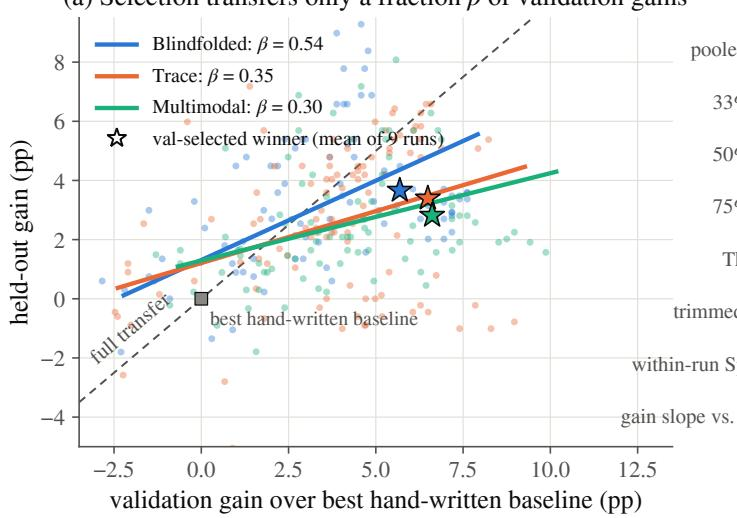

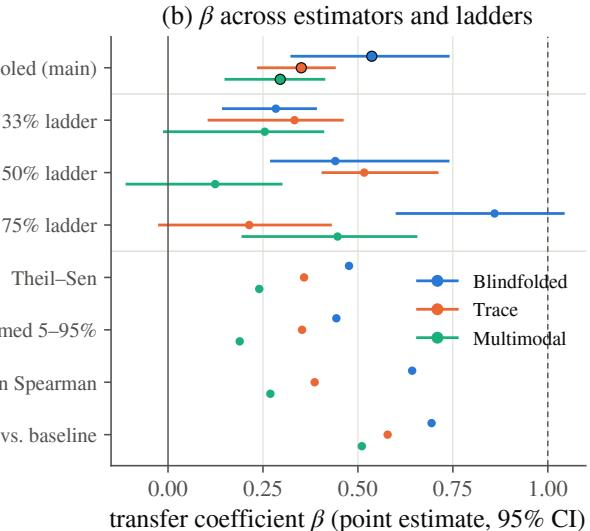  
Figure 8 Transfer of validation gains. (a) Held-out versus validation gain over the run’s best hand-written baseline for every tested candidate. Lines have slope $\hat { \beta }$ through the arm’s mean; stars mark the mean winners. Selection moves right along a line, so a flatter line converts the same validation advantage into less held-out gain. (b) $\beta$ under alternative estimators and per ladder, with 95% CIs.

Variance decomposition. Split-half resampling isolates noise without held-out data: for 200 random halves A, B of the validation questions, $\textstyle { \frac { 1 } { 4 } } \operatorname { V a r } ( V ^ { \hat { A } } - { \check { V } } ^ { B } )$ estimates $\sigma _ { e } ^ { 2 }$ , unafected by selection on V. With Var V computed within runs over all complete proposals (excluding, of 2,319, the 29 catastrophic ones more than 10 pp below the best baseline and one with a partial evaluation), the shares of Figure 3(d) are

$$
\hat { \rho } _ { \Delta } = \hat { \beta } , \qquad \hat { \rho } _ { S } = 1 - \hat { \beta } - \hat { \sigma } _ { e } ^ { 2 } / \widehat { \mathrm { V a r } } V , \qquad \hat { \rho } _ { \varepsilon } = \hat { \sigma } _ { e } ^ { 2 } / \widehat { \mathrm { V a r } } V .
$$

Table 12 shows that the noise share is the same in every arm $\big ( \hat { \sigma } _ { e } ^ { 2 } \approx 1 . 0 \mathrm { p p } ^ { 2 } \big )$ , so the validation score is equally reliable, but its instance-specific share grows from 0.31 to 0.56; it exceeds Blindfolded’s in 98% (Multimodal) and 96% (Trace) of bootstrap replicates.

Table 12 Reliability versus validity of the validation score. Shares of across-candidate validation variance, with 95% run-cluster bootstrap CIs; reliability is one minus the noise share.
<table><tr><td>Arm</td><td>Candidates</td><td>Transfers (β)</td><td>Instance-specific</td><td></td><td>Noise</td><td>Reliability</td></tr><tr><td>Blindfolded</td><td>752</td><td>0.54 [0.33, 0.74]</td><td></td><td>0.31 [0.13, 0.50]</td><td>0.16 [0.14, 0.17]</td><td>0.84</td></tr><tr><td>Trace</td><td>774</td><td>0.35 [0.24, 0.44]</td><td></td><td>0.51 [0.42, 0.62]</td><td>0.14 [0.11, 0.18]</td><td>0.86</td></tr><tr><td>Multimodal</td><td>763</td><td>0.30 [0.15, 0.41]</td><td></td><td>0.56 [0.44, 0.70]</td><td>0.14 [0.11,0.19]</td><td>0.86</td></tr></table>

Predicting the winners. Proposition E.1(ii) predicts each winner as $\hat { T } ( H ^ { \star } ) = \bar { T } _ { r } + \hat { \beta } _ { - r } \left( V ( H ^ { \star } ) - \bar { V } _ { r } \right)$ , with $\hat { \beta } _ { - r }$ fit on the arm’s other runs. The predictions (67.0, 66.0, 66.0%) match the observed 66.5, 66.3, and 65.7% with mean absolute error 0.34 pp, whereas full transfer $( \beta = 1 )$ overestimates by 1.5–2.2 pp (Figure 8a).

## E.5 Direct Evidence of the Content Channel

Validation and held-out questions are a random split of one pool, so text chosen without regard to the split matches validation questions at the base rate $\pi = | \mathrm { v a l i d a t i o n } | / | \mathrm { p o o l } |$ . Using the 18 runs of the 33% and 50% ladders, for which question text of both splits is available within the 75% validation set (π = 0.445 and 0.666), we collect every word 5-gram in evolved code that occurs in at most two question stems and test its matches against π by re-drawing the split 20,000 times. The leak guard (Appendix B.1) rules out lookup tables by construction.

Table 13 shows that proposers that see question text quote validation questions beyond chance, and Blindfolded proposers do not. The quotations sit almost entirely in docstrings and comments that record the validation cases motivating a design (e.g., “a white bowl containing potatoes”): of the 168 matched Trace questions, 144 are quoted in docstrings, 25 in comments, and only 4 in functional literals (a question can be quoted in several places), where vocabulary is at most weakly enriched (ratios 0.94–1.08). Content thus enters through design decisions rather than copied keywords, producing the behavioral fit measured above.

Table 13 Verbatim validation-question 5-grams in evolved code (33% and 50% ladders, six runs per arm). p: one-sided permutation test over the split.
<table><tr><td>Arm</td><td>Matched questions</td><td>Validation</td><td>Expected</td><td>Ratio</td><td>p</td></tr><tr><td>Blindfolded</td><td>50</td><td>26</td><td>27.1</td><td>0.96</td><td>0.68</td></tr><tr><td>Trace</td><td>233</td><td>168</td><td>108.3</td><td>1.55</td><td> $< 1 0 ^ { - 4 }$ </td></tr><tr><td>Multimodal</td><td>69</td><td>49</td><td>38.7</td><td>1.27</td><td>0.007</td></tr></table>

## E.6 Robustness

The pooled ordering Blindfolded > Trace > Multimodal of β holds under Theil–Sen slopes, trimming, median per-run slopes, within-run Spearman correlations, and gain slopes relative to the best baseline (Figure 8b). Blindfolded exceeds Multimodal in every leave-one-ladder-out fit, whereas the adjacent orderings can reverse, so the contrast between the two ends of the information range is the robust one. Moving the catastrophic-proposal threshold to 5 or 15 pp changes the variance shares by at most 0.03, and even retaining all catastrophic proposals preserves the ordering of instance-specific shares (0.42, 0.57, 0.65).

## F Search-Budget Dilution

This section supports Section 3.2.2. Its conclusions are:

• Larger spaces do not help. Deployed champions reach 66.8, 65.8, 66.0, and 65.7% held-out accuracy with one, two, three, and six mechanism families, and 94–100% of promotions in every space are statistically unresolved (Appendix F.2).

• Theory. The power to detect an advantage ∆ is bounded by the evidence $\lambda = r \Delta ^ { 2 } / \bar { \sigma } ^ { 2 }$ , which a larger space erodes through breadth (fewer evaluations r per mechanism combination) and coupling (larger footprints, hence larger $\sigma ^ { 2 } )$ (Appendix F.3).

• Measurement. From one to six families, r falls 2.05× and the verdict variance rises 2.24×, so the power for a 1-point gain drops from 0.45 to 0.14. Full-harness edits flip a median of 50 answers against 10, and since only 37% of flips are fixes, larger edits are also more harmful (Appendix F.4).

## F.1 Protocol

All runs use Video-MME (450 validation / 2,250 held-out questions) with the same executor, proposer, and loop; only the search space and the iteration budget difer (Table 14), and evidence statistics and validation gains are compared at a matched budget of 87 candidates; deployed accuracies are those at the end of each run. The nested spaces charter retrieval only (one family, 8 primitives); retrieval with frame selection (two families, 8 primitives), where a candidate may change either or both; perception tools (three families, 12 primitives); and the full harness (six families, 33 primitives), which adds reflection, role-based collaboration, and working memory. The main text contrasts the one- and six-family spaces; the two- and three-family spaces are reported only here. One retrieval-only run and one retrieval with frame selection run were excluded before analysis because their proposer had accessed files outside its workspace, an information leak that gave it information the protocol withholds.

A candidate’s mechanism combination is the set of mechanism tags its implementation exercises (retrieval, re-ranking, fusion, query rewriting, frame selection, reflection, prompting, pixel manipulation, perception tools, memory, routing, and frame budget; these are finer than the families of the space), assigned by fixed, outcome-blind keyword rules shared with Appendix G. Each candidate is compared with the champion in force when it was proposed, using ${ \hat { \delta } } , d ,$ and $\sigma = 1 0 0 \sqrt { d } / n$ from Eqs. (6)–(7). Evidence statistics use the first 87 candidates of every run, the largest budget all eleven runs reach, because evaluations per mechanism combination are comparable only at a common budget.

(d) Evidence per combination  
Table 14 The search-space ladder on Video-MME. K: chartered mechanism families; P: callable primitives. The deployed champion is the validation-selected harness at the end of each run.
<table><tr><td>Space</td><td>K</td><td>P</td><td>Runs</td><td>Iterations × candidates</td><td>Champion found at iteration</td></tr><tr><td>Retrieval only</td><td>1</td><td>8</td><td>3</td><td> $5 0 \times 3$ </td><td>21, 46, 50</td></tr><tr><td>+ frame selection</td><td>2</td><td>8</td><td>3</td><td> $5 0 \times 3$ </td><td>28, 45, 39</td></tr><tr><td>+ perception tools</td><td>3</td><td>12</td><td>2</td><td> $5 0 \times 3 ; 1 0 0 \times 5$ </td><td>49, 99</td></tr><tr><td>Full harness</td><td>6</td><td>33</td><td>3</td><td> $3 0 \times 3$ </td><td>28, 29, 21</td></tr></table>

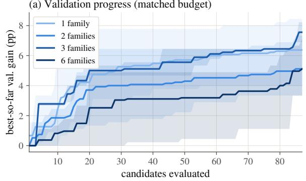

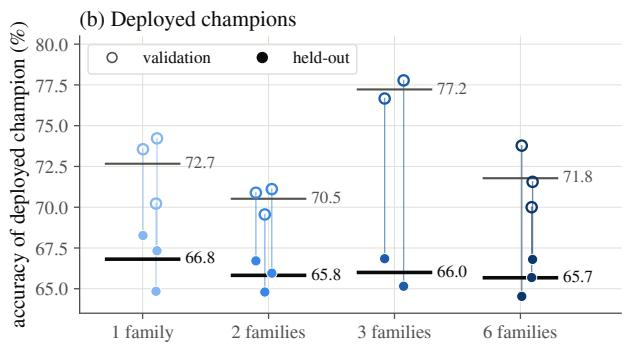

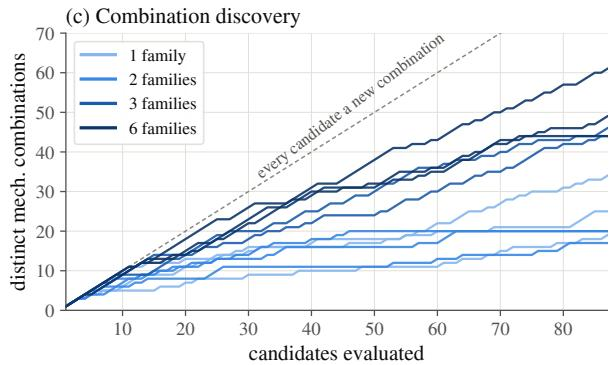

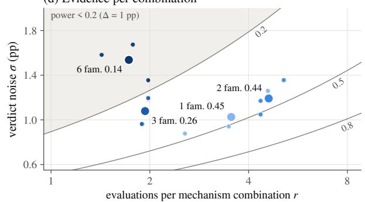  
Figure 9 All four spaces. (a) Best-so-far validation gain against candidates evaluated (mean and min–max over runs), on a budget-matched axis. (b) Validation (hollow) and held-out (filled) accuracy of each run’s deployed champion; bars are means. (c) Distinct mechanism combinations visited against candidates evaluated; the dashed line is the limit in which every candidate is a new mechanism combination. (d) Evidence landscape of Figure 3(e) with the three-family space, which has the breadth of the full harness but the footprint of retrieval-only evolution.

## F.2 Results

No space improves held-out accuracy. Table 15 and Figure 9(a,b) extend the main-text comparison with a three-family space. That space reaches the largest validation gain (7.6 points after 87 candidates, 13.9 at the end), yet its champions beat the seed harness by only 3.5 points on held-out data. Low evidence can thus appear as validation inflation rather than slow progress: a third of its early proposals are near-clones difering from the champion on at most 1% of questions, and the largest of many small, noisy verdicts is promoted. Larger spaces are also costlier: held-out gain per evaluation hour falls from 0.79 (one family) to 0.17 points (six), so counting candidates rather than time favors them.

Promotions are unresolved everywhere. Within the first 87 candidates, 94–100% of promotions lie within ±1.96 paired standard errors, with mean size 0.5–0.9 points. What difers across spaces is not whether promotions are resolved, but how much evidence the search could have gathered per mechanism combination. Figure 9(c) shows the breadth channel directly: over candidates 44–87, one- and two-family runs discover 0.26 and 0.09 new mechanism combinations per candidate, whereas three- and six-family runs keep discovering 0.44 and 0.46, so r stays below two.

Table 15 Outcome and evidence by space. Validation gain is the best-so-far gain over the run’s best seed harness after 87 candidates; accuracies are those of the deployed champions. Evidence columns use the first $^ { 8 7 }$ candidates of each run: distinct mechanism combinations, evaluations per mechanism combination $r ,$ mean footprint $d ,$ mean verdict noise σ (pp), mean verdict $\hat { \delta } \ ( \mathrm { p p } )$ , and the noncentrality λ and power of Proposition F.1 for an advantage $\Delta .$ All entries are means over runs.
<table><tr><td></td><td colspan="3">Outcome (%)</td><td colspan="5">Search behavior</td><td colspan="3">Power for  $\Delta \ \mathrm { ( p p ) }$ </td></tr><tr><td>Space</td><td>Val. gain</td><td>Val.</td><td>Held-out</td><td>Combos</td><td>r</td><td>d</td><td>σ</td><td>5</td><td>0.5</td><td>1</td><td>2</td></tr><tr><td>Retrieval only (1)</td><td>6.4</td><td>72.7</td><td>66.8</td><td>26.0</td><td>3.54</td><td>25.3</td><td>1.03</td><td>-1.10</td><td>0.15</td><td>0.45</td><td>0.95</td></tr><tr><td>+ frame selection (2)</td><td>5.1</td><td>70.5</td><td>65.8</td><td>19.0</td><td>4.61</td><td>31.8</td><td>1.19</td><td>-1.42</td><td>0.15</td><td>0.44</td><td>0.95</td></tr><tr><td>+ perception tools (3)</td><td>7.6</td><td>77.2</td><td>66.0</td><td>45.0</td><td>1.93</td><td>23.6</td><td>1.08</td><td>-0.76</td><td>0.10</td><td>0.26</td><td>0.73</td></tr><tr><td>Full harness (6)</td><td>5.1</td><td>71.8</td><td>65.7</td><td>51.3</td><td>1.73</td><td>51.3</td><td>1.54</td><td>-3.14</td><td>0.07</td><td>0.14</td><td>0.41</td></tr></table>

## F.3 Theory: Evidence per Mechanism Combination

Proposition F.1 (Evidence per mechanism combination) Let mechanism combination c be evaluated $r _ { c }$ times, with paired verdicts $\hat { \delta } _ { c , 1 } , \ldots , \hat { \delta } _ { c , r _ { c } }$ against the incumbent. Assume that $( i )$ all implementations of c share an advantage $\Delta _ { c } ,$ , and $( i i )$ the verdicts are independent Gaussian with mean $\Delta _ { c }$ and known variances $\sigma _ { c , j } ^ { 2 } = 1 0 ^ { 4 } d _ { c , j } / n ^ { 2 }$ . Define

$$
\lambda _ { c } = \Delta ^ { 2 } \sum _ { j = 1 } ^ { r _ { c } } \sigma _ { c , j } ^ { - 2 } = \frac { r _ { c } \Delta ^ { 2 } } { \bar { \sigma } _ { c } ^ { 2 } } , \qquad \bar { \sigma } _ { c } ^ { - 2 } = \frac { 1 } { r _ { c } } \sum _ { j = 1 } ^ { r _ { c } } \sigma _ { c , j } ^ { - 2 } .\tag{11}
$$

Then every level-η test of the null $\Delta _ { c } = 0$ against the alternative $\Delta _ { c } = \Delta > 0$ has power at most

$$
\Phi \big ( \sqrt { \lambda _ { c } } - z _ { 1 - \eta } \big ) ,
$$

which is $\Phi ( \sqrt { \lambda _ { c } } - 1 . 9 6 )$ for $\eta \ : = \ : 0 . 0 2 5$ . If a budget of B evaluations visits $M ( B )$ distinct mechanism combinations, the mean evidence per mechanism combination is

$$
\bar { \lambda } = \underbrace { \frac { B } { M ( B ) } } _ { b r e a d t h } ~ \Delta ^ { 2 } ~ \underbrace { \overline { { \sigma ^ { - 2 } } } } _ { c o u p l i n g } ,\tag{12}
$$

where $\overline { { \sigma ^ { - 2 } } }$ is the mean inverse verdict variance over the B evaluations.

Proof. Under (i)–(ii), the log-likelihood ratio of the alternative to the null is increasing in the precision-weighted statistic

$$
Z = \frac { \sum _ { j } \hat { \delta } _ { c , j } / \sigma _ { c , j } ^ { 2 } } { \left( \sum _ { j } \sigma _ { c , j } ^ { - 2 } \right) ^ { 1 / 2 } } , \qquad Z \sim \mathcal { N } ( 0 , 1 ) \mathrm { ~ u n d e r ~ t h e ~ n u l l } , \qquad Z \sim \mathcal { N } \big ( \sqrt { \lambda _ { c } } , 1 \big ) \mathrm { ~ u n d e r ~ t h e ~ a l t e r n a t i v e } .
$$

By the Neyman–Pearson lemma, the most powerful level-η test rejects when $Z ~ > ~ z _ { 1 - \eta } .$ with power $\mathrm { P r } ( \mathcal { N } ( \sqrt { \lambda _ { c } } , 1 ) > z _ { 1 - \eta } ) = \Phi ( \sqrt { \lambda _ { c } } - z _ { 1 - \eta } )$

For Eq. (12), sum over mechanism combinations and divide by $M ( B )$

$$
\sum _ { c } \lambda _ { c } = \Delta ^ { 2 } \sum _ { j = 1 } ^ { B } \sigma _ { j } ^ { - 2 } \quad \Longrightarrow \quad \bar { \lambda } = \frac { 1 } { M ( B ) } \sum _ { c } \lambda _ { c } = \frac { B } { M ( B ) } \Delta ^ { 2 } \overline { { \sigma ^ { - 2 } } } .
$$

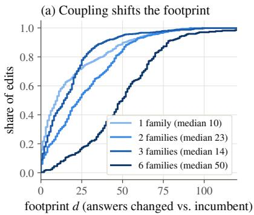

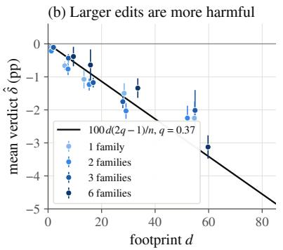

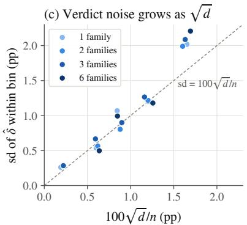  
Figure 10 The behavioral footprint of edits. (a) Distribution of the footprint $d ,$ the number of validation answers whose correctness an edit flips relative to its incumbent. (b) Mean verdict by footprint bin (95% intervals); the line is Proposition F.2 with the pooled fix probability $q = 0 . 3 7$ . Bins above 80 are dominated by crashes and omitted. (c) Standard deviation of verdicts within each bin against the paired noise scale $1 0 0 { \sqrt { d } } / n$

Remarks. The bound is optimistic, so the reported powers are upper bounds: heterogeneous implementations add variance $\tau ^ { 2 }$ to each verdict, verdicts sharing questions and incumbents are positively dependent, and the loop acts on single comparisons $( r _ { c } = 1 )$ rather than pooling. The proposition is the per-combination analogue of fixed-budget best-arm identification, where error grows with the number of arms sharing a budget (Audibert et al., 2010). Breadth also compounds: if proposals draw mechanism combinations from p over C, the expected number of distinct mechanism combinations after N draws is $\begin{array} { r } { \sum _ { c } [ 1 - ( 1 - p _ { c } ) ^ { N } ] } \end{array}$ , which approaches N (so $r  1 )$ when the proposer spreads over many more mechanism combinations than the budget can revisit, as happens once mechanism combinations span many families.

Estimates. For each run we set $r = 8 7 / M ( 8 7 )$ and take $\bar { \sigma }$ as the mean paired standard error over its first 87 candidates, with $\Delta = 1$ point (above the mean promotion size and the 0.65-point held-out value of doubling the frame budget; Appendix G). From one to six families,

$$
r : ~ 3 . 5 4 \to 1 . 7 3 ~ ( 2 . 0 5 \times \mathrm { ~ f c w c r } ) , \qquad { \bar { \sigma } } ^ { 2 } : ~ 2 . 2 4 \times ~ \mathrm { l a r g c r } , \qquad \lambda : ~ 3 . 3 8 \to 0 . 7 6 , \qquad \mathrm { p o w c r : ~ 0 . 4 5 \to 0 . 1 4 } ,
$$

with 0.44 and 0.26 for two and three families. Power decreases with the number of families (Spearman $\rho = - 0 . 7 4$ $p = 0 . 0 2$ over the nine nested runs; $\rho = - 0 . 8 6 , p < 0 . 0 0 1$ over all eleven), and the three full-harness runs have the three lowest values (exact $p = 1 / 8 4 )$ . The ordering is unchanged when σ is summarized by its median, by the noise at the mean footprint, or by precision-weighting only verdicts with $d \geq 4 . 5$ . The argument does not explain the slower validation progress of the two-family space, which is within seed variation.

## F.4 Behavioral Footprint of Edits

Proposition F.2 (Footprint law) Suppose an edit flips d validation answers, each independently a fix with probability q and a break otherwise. With $F \sim$ Binomial $( d , q )$ fixes, the verdict $\hat { \delta } = 1 0 0 ( 2 { \cal F } - d ) / n$ satisfies

$$
\mathbb { E } [ \hat { \delta } ] = \frac { 1 0 0 d ( 2 q - 1 ) } { n } , \qquad \mathrm { V a r } [ \hat { \delta } ] = \frac { 4 \cdot 1 0 ^ { 4 } d q ( 1 - q ) } { n ^ { 2 } } \le \frac { 1 0 ^ { 4 } d } { n ^ { 2 } } .\tag{13}
$$

Hence, when $q < 1 / 2$ , the expected efect decreases linearly in d while the noise grows as ${ \sqrt { d } }$

Proof. Substitute $\mathbb { E } [ F ] = d q$ and $\operatorname { V a r } [ F ] = d q ( 1 - q )$ into $\hat { \delta } = 1 0 0 ( 2 { \cal F } - d ) / n ;$ the inequality uses $q ( 1 - q ) \leq 1 / 4$ □

Coupling enlarges the footprint. The median footprint is 50 answers in the full harness against 10, 23, and 14 for one, two, and three families (Figure 10a). This is not because full-harness proposals declare more changes: edits touching at most one family still flip 47.6 answers on average, against 19.8 with retrieval alone. In a coupled harness a local change alters what every downstream stage receives—retrieved frames, tool outputs, reflection prompts, and memory—so its efect is not local.

Table 16 The 44 VideoHarness-BRSI runs analyzed in Section 3.2.3. Video-MME runs search one or a few mechanism families for 50 iterations of three candidates (one run: 100 iterations of five); the 12 retrieval-family runs (all but self-reflection) form the frame-budget contrast of Figure 3(c). LongVideoBench runs search the full harness for 30 iterations under the feedback arms of Section 3.2.1, three seeds at each of three validation fractions.
<table><tr><td>Benchmark</td><td>Setting</td><td>Runs</td></tr><tr><td rowspan="4">Video-MME</td><td>retrieval only (16-frame seeds; one from 32-frame AKS)</td><td>6</td></tr><tr><td>retrieval + frame selection</td><td>4</td></tr><tr><td>retrieval + perception tools (one with  $1 0 0 \times 5 )$ </td><td>2</td></tr><tr><td>self-reflection</td><td>2</td></tr><tr><td></td><td>LongVideoBench Blindfolded / Trace / Multimodal feedback clade-UCB parent suggestions (33% ladder)</td><td>9 + 9 + 9 3</td></tr></table>

Larger footprints are more harmful and noisier. The fix probability is nearly constant across spaces $( q = 0 . 3 6 -$ 0.39; pooled 0.37 [0.36, 0.39]). Because $q < 1 / 2$ near a strong incumbent, the mean verdict falls roughly linearly in $d ,$ as Proposition F.2 predicts (Figure 10b; $R ^ { 2 } = 0 . 3 9 )$ ), and full-harness edits are the most harmful (−3.13 points over all candidates, against −0.90, −1.53, and −1.02; Table 15 uses the first 87 candidates of each run). Within-bin dispersion follows $1 0 0 { \sqrt { d } } / n$ up to $d = 4 0$ and exceeds it beyond (panel c). This mirrors pleiotropy in Fisher’s geometric model, where mutations afecting more traits are less likely to help (Fisher, 1930; Orr, 2000); here, coupling sets the pleiotropic reach.

## G The Early-Experience Trap

This section supports Section 3.2.3. Its conclusions are:

• Verdicts are weak and biased. On Video-MME only 18% of verdict variance reflects true diferences (8% in iterations 1–10), and the champion’s cached score is inflated by $\widehat { \omega } \approx 1 . 0$ point (Appendix G.2).

• The policy ignores this. The held-out win rate changes gradually with the verdict, yet the loop continues winners with probability 0.77 and non-winners with 0.076, and treats false losers like true losers (Appendix G.3).

• Theory. Because rejected directions are rarely resampled, champion inflation $( \omega > 0 )$ makes a weak beneficial direction more likely to be lost; for the frame budget the loss probability is 0.54, consistent with the 6 of 12 runs that never expand it (Appendix G.4).

• Consequences. Seeds of one setting diverge 2.8× more than independent sampling predicts, and runs that stay at 16 frames lose 2.7 held-out points (Appendices G.5 and G.6).

## G.1 Corpus and Definitions

We analyze 44 VideoHarness-BRSI runs (Table 16): 14 on Video-MME with 2,229 candidates and 30 on LongVideoBench with 2,577. Held-out evaluations, never shown to the proposer, exist for every candidate of three Video-MME runs and for frontier or best candidates elsewhere.

Each candidate c is compared with the incumbent, the validation champion when c is proposed, by its verdict $\hat { \delta } _ { c }$ and $z _ { c } = \widehat { \delta } _ { c } / \widehat { \mathrm { S E } } _ { c }$ with $\widehat { \mathrm { S E } } _ { c } = 1 0 0 \sqrt { d _ { c } } / n$ (Appendix D); $\delta _ { c } ^ { \mathrm { t e s t } }$ is the held-out analogue. A candidate is continued if a later candidate names it as parent, and is a false loser if $\hat { \delta } _ { c } \leq 0$ but $\delta _ { c } ^ { \mathrm { t e s t } } \geq 0$ . A retrieval-family run expands the frame budget if its deployed champion uses more than $1 . 2 \times$ the 16-frame baseline. A within-run regression of held-out accuracy on mechanism families, iteration, and $\log _ { 2 }$ frames over 491 tested candidates values one doubling of the frame budget at $\widehat { \mu } _ { f } = 0 . 6 5 \pm 0 . 1 0 \mathrm { p p }$ (observational).

## G.2 A Verdict Model with Incumbent Optimism

For a candidate–incumbent pair evaluated on both splits, Eq. (1) specializes to

$$
\hat { \delta } = \Delta - \omega + u + \varepsilon , \qquad \delta ^ { \mathrm { t e s t } } = \Delta + \varepsilon ^ { \prime } , \qquad \Delta \sim \mathcal { N } ( m , \tau ^ { 2 } ) ,\tag{14}
$$

Table 17 Verdict-model estimates (Eq. (15); pp). Reliability is $\tau ^ { 2 } / ( \tau ^ { 2 } + \sigma ^ { 2 } )$ , i.e., κ of Proposition G.1 with $s ^ { 2 } = 0$ Brackets: 95% run-bootstrap intervals.
<table><tr><td>Subset</td><td>Pairs</td><td></td><td> $\widehat { \tau }$ </td><td> $\widehat { \sigma }$ </td><td></td><td>ω</td><td></td><td>Reliability</td></tr><tr><td>Video-MME, all</td><td>387</td><td></td><td>0.49 [0.31, 0.58]</td><td></td><td>1.04 [0.90, 1.23]</td><td></td><td>1.02 [0.64, 1.39]</td><td>0.18 [0.09, 0.24]</td></tr><tr><td>iterations 1–10</td><td>86</td><td></td><td></td><td>0.45 [0.18, 0.66] 1.49 [1.40, 1.59] 1.01 [0.69, 1.32]</td><td></td><td></td><td></td><td>0.08</td></tr><tr><td>iterations  $> 1 0$ </td><td>301</td><td></td><td>0.48</td><td>0.87</td><td></td><td></td><td>1.02</td><td>0.24</td></tr><tr><td>fully tested runs</td><td>296</td><td></td><td>0.46</td><td></td><td>1.00</td><td></td><td>1.11</td><td>0.18</td></tr><tr><td>LongVideoBench, all</td><td>158</td><td></td><td></td><td></td><td></td><td></td><td></td><td>1.01 [0.72, 1.22] 1.06 [0.94, 1.16] 0.44 [0.21, 0.70] 0.48 [0.32, 0.57]</td></tr></table>

with independent sampling errors $\varepsilon , \varepsilon ^ { \prime }$ of variances $\sigma ^ { 2 } , \sigma _ { t } ^ { 2 } .$ , non-transferable fit u (the term S of $\operatorname { E q . } \left( 1 \right) )$ of variance $s ^ { \bar { 2 } } .$ , and incumbent optimism ω $\geq 0$ from the optimizer’s curse (Smith and Winkler, 2006). We take u zero-mean, so ωb below estimates the incumbent’s net optimism $\omega - \mathbb { E } S$ , the total amount by which a verdict understates $\Delta$ on average; the two coincide when candidate and incumbent carry equal fit on average. The method-of-moments estimators are

$$
\widehat { m } = \overline { { { \delta ^ { \mathrm { t e s t } } } } } , \quad \widehat { \omega } = \overline { { { \delta ^ { \mathrm { t e s t } } } } } - \bar { \hat { \delta } } , \quad \qquad \widehat { \tau } ^ { 2 } = \widehat { \mathrm { C o v } } ( \hat { \delta } , \delta ^ { \mathrm { t e s t } } ) ,\tag{15}
$$

$$
{ \widehat { \boldsymbol { \sigma } } } ^ { 2 } = { \widehat { \mathrm { S E } } } ^ { 2 } , \quad { \widehat { \boldsymbol { s } } } ^ { 2 } = { \widehat { \mathrm { V a r } } } ( { \widehat { \boldsymbol { \delta } } } ) - { \widehat { \boldsymbol { \tau } } } ^ { 2 } - { \widehat { \boldsymbol { \sigma } } } ^ { 2 } .
$$

Proposition G.1 (Evidential value of a verdict) Under Eq. $( 1 4 )$ , let $\kappa = \tau ^ { 2 } / ( \tau ^ { 2 } + \sigma ^ { 2 } + s ^ { 2 } )$ and $\mu ( \hat { \delta } ) =$ $m + \kappa ( \hat { \delta } + \omega - m )$ . Then

$$
\operatorname* { P r } ( \Delta > 0 \mid \hat { \delta } ) = \Phi \left( \frac { \mu ( \hat { \delta } ) } { \tau \sqrt { 1 - \kappa } } \right) , \qquad \operatorname* { P r } ( \delta ^ { \mathrm { t e s t } } > 0 \mid \hat { \delta } ) = \Phi \left( \frac { \mu ( \hat { \delta } ) } { \sqrt { \tau ^ { 2 } ( 1 - \kappa ) + \sigma _ { t } ^ { 2 } } } \right) .
$$

Both equal $1 / 2$ at $\hat { \delta } ^ { * } = m - \omega - m / \kappa \ ( = - \omega \ w h e n \ m = 0 )$ , and their slopes in $\hat { \delta }$ increase with the verdict’s reliability κ and vanish as $\kappa  0 .$

Proof. $( \Delta , \hat { \delta } , \delta ^ { \mathrm { t e s t } } )$ is jointly Gaussian with

$$
\operatorname { C o v } ( \Delta , { \hat { \delta } } ) = \operatorname { C o v } ( \delta ^ { \operatorname { t e s t } } , { \hat { \delta } } ) = \tau ^ { 2 } , \qquad \operatorname { V a r } ( { \hat { \delta } } ) = \tau ^ { 2 } + \sigma ^ { 2 } + s ^ { 2 } .
$$

Gaussian conditioning gives

$$
\begin{array} { r l r l r l } & { \mathbb { E } [ \Delta \mid \hat { \delta } ] = \mathbb { E } [ \delta ^ { \mathrm { t e s t } } \mid \hat { \delta } ] = \mu ( \hat { \delta } ) , } & & { \mathrm { V a r } ( \Delta \mid \hat { \delta } ) = \tau ^ { 2 } ( 1 - \kappa ) , } & & { \mathrm { V a r } ( \delta ^ { \mathrm { t e s t } } \mid \hat { \delta } ) = \tau ^ { 2 } ( 1 - \kappa ) + \sigma _ { t } ^ { 2 } , } \end{array}
$$

and setting $\mu ( \hat { \delta } ) = 0$ yields $\hat { \delta } ^ { * }$ .

Implications. A verdict of zero is not neutral: with $\omega > 0 ,$ a challenger that ties the incumbent is more likely than not to be better, and it must lose by about ω before it becomes a coin flip. When κ is small, the rational probability of continuing a line changes only gradually with ˆδ.

Estimates. Table 17 reports run-bootstrap estimates after dropping clones and execution failures. On Video-MME the reliability is only 0.18, and lowest early (0.08 versus 0.24 after iteration 10) because early edits change more answers. The optimism ωb ≈ 1.0 pp is stable over time and in the fully tested runs. LongVideoBench verdicts are more reliable (0.48) and less biased $( \widehat { \omega } = 0 . 4 4 )$ , but the policy is the same.

## G.3 Continuation Policy versus Evidential Value

Binning verdicts by z, Proposition G.1 tracks the held-out win rate (mean absolute deviation 0.035 on Video-MME, 0.085 on LongVideoBench), which crosses $1 / 2$ at $z \approx - 0 . 7 5$ and −0.25 (Figure 11a). The policy, by contrast, is nearly a step function at z = 0: on Video-MME a one-question loss is continued with probability 0.070 and a one-question win with 0.685; winners overall with 0.77 and non-winners with $\rho = 0 . 0 7 6$ (odds ratio 41; LongVideoBench 34). False losers are abandoned as often as true losers (93% versus 96% on Video-MME), although 37% of tested non-winners beat their incumbent on held-out data (33% on LongVideoBench).

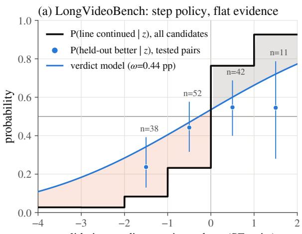  
validation verdict z vs. incumbent (SE units)

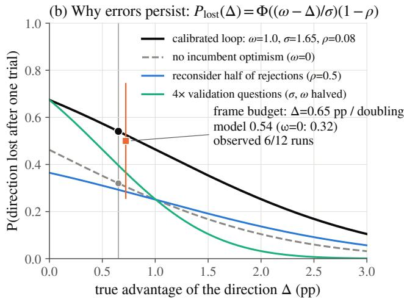  
Figure 11 Theory of the trap. (a) LongVideoBench counterpart of Figure 3(f): the continuation policy is a step at $z = 0 ,$ , while the held-out win rate of the same verdicts changes gradually; the curve is Proposition G.1 with the fitted parameters. (b) Probability that a beneficial direction is lost after one trial (Proposition G.2) at the Video-MME calibration, without incumbent optimism, with a policy that reconsiders half of all rejections, and with four times as many validation questions (which halves σ and, being selection noise, ω). Points mark the frame-budget direction; the square is the observed fraction of retrieval-family runs that never expand the budget (Wilson 95% interval).

## G.4 Why Early Errors Persist

Proposition G.2 (Persistence under endogenous sampling) Consider a direction with true advantage $\Delta$ over the incumbent. Its first trial yields $\hat { \delta } _ { 1 } = \Delta - \omega + \varepsilon _ { 1 }$ with $\varepsilon _ { 1 } \sim \mathcal { N } ( 0 , \sigma ^ { 2 } )$ . The loop continues the direction $i f \ \hat { \delta } _ { 1 } > 0 ;$ otherwise it reconsiders it with probability $\rho ,$ independently of $\Delta$ , and otherwise never evaluates it again. Then:

(a) the direction is lost with probability

$$
P _ { \mathrm { l o s t } } ( \Delta ) = \Phi \left( \frac { \omega - \Delta } { \sigma } \right) ( 1 - \rho ) ;
$$

(b) $P _ { \mathrm { l o s t } }$ increases with $\omega ,$ , decreases with $\Delta$ and $\rho ,$ and increases with $\textit { \textbf { \sigma } } _ { i f }$ and only $i f \Delta > \omega ;$

(c) as $\Delta / \sigma \to 0$ with ω/σ fixed, $P _ { \mathrm { l o s t } } \to \Phi ( \omega / \sigma ) ( 1 - \rho ) > ( 1 - \rho ) / 2$ whenever $\omega > 0$ , so champion inflation makes a weak but beneficial direction more likely to be lost, and it is more likely lost than kept once $\Phi ( \omega / \sigma ) ( 1 - \rho ) > 1 / 2 ,$

(d) after a rejection the loop’s only estimate is $\hat { \delta } _ { 1 }$ , which is biased downward,

$$
\mathbb { E } [ \hat { \delta } _ { 1 } | \hat { \delta } _ { 1 } \leq 0 ] = \Delta - \omega - \sigma \frac { \phi ( a ) } { \Phi ( - a ) } < \Delta , \qquad a = \frac { \Delta - \omega } { \sigma } ,
$$

and is never corrected, whereas continued directions receive new, independent evidence.

Proof. (a) $\mathrm { P r } ( \hat { \delta } _ { 1 } \le 0 ) = \Phi ( ( \omega - \Delta ) / \sigma )$ , and a rejected direction is lost unless independently reconsidered, with probability $1 - \rho .$

(b) Monotonicity in $\omega , \Delta$ , and $\rho$ follows from that of $\Phi ;$ for $\sigma ,$

$$
\frac { \partial P _ { \mathrm { l o s t } } } { \partial \sigma } = - \phi \mathopen { } \mathclose \bgroup \left( \frac { \omega - \Delta } { \sigma } \aftergroup \egroup \right) \frac { \omega - \Delta } { \sigma ^ { 2 } } ( 1 - \rho ) ,
$$

which is positive if and only if $\Delta > \omega$

(c) follows from (a), since $\Phi ( x ) > 1 / 2$ for $x > 0$ . (d) is the mean of a Gaussian truncated above at zero. □

Interpretation. Part (d) is the hot-stove asymmetry of learning from self-selected experience (Denrell and March, 2001) and the incomplete learning of greedy allocation (Rothschild, 1974; Brezzi and Lai, 2000): negative errors persist because the alternative is never resampled. Persistent memory makes this worse, as labels such as “MINED OUT” set $\rho \approx 0$ for an entire family.

Calibration for the frame budget. With $\Delta = \widehat { \mu } _ { f } = 0 . 6 5 \mathrm { p p } , \sigma = 1 . 6 5$ pp (median early paired scale), ω = 1.01 pp (Table 17), and $\rho = 0 . 0 7 6$

$$
\mathrm { P r } ( \mathrm { r e j e c t } ) = 0 . 5 8 5 , \qquad \mathrm { \bf P } _ { \mathrm { l o s t } } = { \bf 0 . 5 4 } \left[ 0 . 3 9 , 0 . 6 3 \right] \mathrm { o v e r ~ p l a u s i b l e } ( \omega , \sigma , \rho ) , \qquad \left. P _ { \mathrm { l o s t } } \right| _ { \omega = 0 } = 0 . 3 2 .
$$

Six of the 12 retrieval-family runs never expand the budget (0.50; Wilson [0.25, 0.75]), consistent with the model, though too few to reject $\omega = 0$ . Figure 11(b) compares remedies: reconsidering half of all rejections lowers $P _ { \mathrm { l o s t } }$ to 0.29, quadrupling validation questions to 0.40, and judging a probe against its own parent removes ω directly.

## G.5 Path Dependence across Seeds

If early noisy verdicts steer exploration, seeds of one setting should diverge more than independent samples would. Dividing the cross-seed standard deviation of each family’s candidate share by its binomial value, the median ratio is 2.8 on Video-MME and 1.7 on LongVideoBench, the signature of reinforcement processes that amplify early outcomes (Arthur, 1989); re-ranking, for example, takes 93% of one seed’s candidates but 2–11% in the other four. The held-out cost of staying at the baseline budget (64.9 versus 67.6%, $p = 5 \times 1 0 ^ { - 5 } )$ holds under alternative definitions of “stays” and without the AKS-seeded run $\left( p \le 0 . 0 0 3 \right)$

## G.6 Case Studies

A weak loss becomes a prohibition, or not. In retrieval-only seed 1, a 32-frame probe loses by 10 questions at iteration $8 \ ( z = - 1 . 4 1 )$ ; memory then records frame count as “MINED OUT—do NOT re-propose”, and no later candidate exceeds 16 frames. In seed 4, a 33.9-frame probe loses by 12 questions $( z = - 1 . 5 2 )$ , but a sibling at 18.3 frames wins by 10 questions $( z = + 1 . 4 4 ) ;$ memory keeps the direction open, and the champion reaches 25–30 frames and 67.3% held-out, against 64.8% for seed 1. A Bayes-rational policy (Proposition G.1) would still give seed 1’s rejected direction probability ≈ 0.29.

Over-commitment to an early winner. In the same seed 1, after a re-ranking candidate wins by four questions at iteration 5 $( z = + 0 . 7 6 )$ , all 105 later candidates are re-ranking variants and 96% fail to beat the champion (Figure 12a). Four promotions add 2.4 validation points but only 0.04 held-out points, and 23 of 115 tested candidates beat the deployed champion on held-out data (panel b).

## H Why Simple Remedies Are Insufficient

This section supports the discussion of simple remedies in Section 3.2. Its conclusions are:

• Parent selection. Changing which harness the proposer builds on reshapes the search as intended, but does not improve held-out accuracy (Appendix H.1).

• Stronger initialization. Starting from AKS speeds up early validation progress, but the final harness is no better than those evolved from simple seeds (Appendix H.2).

Neither remedy changes the verdicts on which the loop acts, so neither removes the failure modes.

## H.1 Parent Selection

Setting. We run 18 full-harness VideoHarness-BRSI runs (1,556 candidates, 30 iterations of three) on Video-MME and LongVideoBench. Within a benchmark, arms difer only in the list of suggested parents shown to the proposer each iteration: none (plain loop); the current champion (greedy); six names ranked by an upper confidence bound over the lineage tree, the best score in a subtree plus an exploration bonus γ/ subtree size (a) One early win absorbs the remaining budget (retrieval-only, seed 1) (b) The verdict does not track held-out value

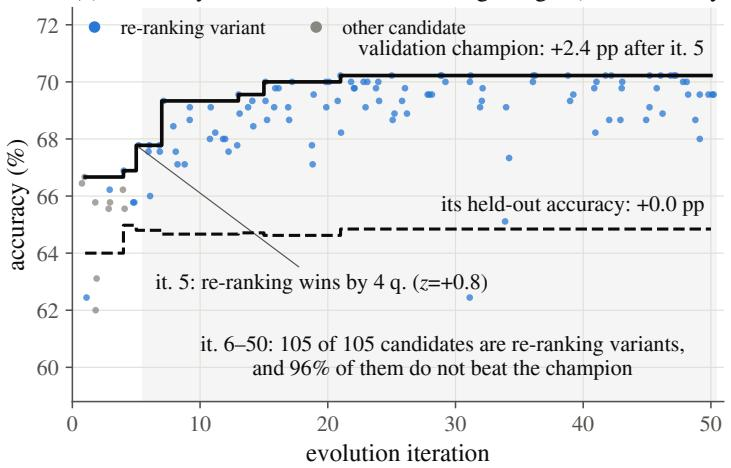

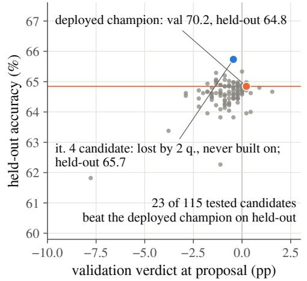  
Figure 12 Over-commitment to an early winner (Video-MME, retrieval-only, seed 1; the run of Figure 3(c)). (a) Validation accuracy of every candidate, the validation champion (solid), and the champion’s held-out accuracy (dashed); iterations 6–50 are shaded. (b) Held-out accuracy of the 115 tested candidates against their validation verdict at proposal. The horizontal line marks the deployed champion’s held-out accuracy.

with $\gamma = 1 . 5$ (clade-UCB); or six names drawn uniformly from the archive (random). Video-MME runs all four arms and LongVideoBench compares the plain loop with clade-UCB, three seeds each. The Video-MME plain-loop runs are the full-harness runs of the search-space ladder.

Results. No parent rule yields a consistent held-out advantage (Figure 13a). On Video-MME the deployed harnesses reach 65.7, 66.9, 67.2, and 67.4% for the plain loop, greedy, clade-UCB, and random parents; among the three rules every pairwise diference is at most 0.5 points $( p \ge 0 . 7 4$ , Welch), and all seed ranges overlap. On LongVideoBench, clade-UCB trails the plain loop by $1 . 0 1 \pm 1 . 1 7$ points over seed-paired per-question comparisons $( p = 0 . 4 8 )$ . The rules do not separate on validation either (Figure 13b): clade-UCB trails the plain loop on LongVideoBench at every matched budget.

The manipulation worked. The proposer builds on a listed parent in 94–100% of clade-UCB, 74–86% of greedy, and 80–86% of random-parent proposals. On Video-MME the share of candidates bred from the champion falls from 47% (greedy) to 30% (clade-UCB) and 8% (random), while distinct parents rise from 19 to 32 and 47; on LongVideoBench clade-UCB halves the spread of validation scores (3.6 versus 6.6 points). Yet no search-shape statistic predicts held-out gain across the 18 runs (top-parent share $\rho = - 0 . 1 0 , p = 0 . 6 9$ distinct parents $\rho = - 0 . 0 1$ , p = 0.98; Figure 13c). What does is how quickly validation rose (candidates to 90% of the final gain, $\rho = - 0 . 5 3 , p = 0 . 0 2 5 )$ : the quality of the harnesses the proposer happened to write, not the rule that chose their parents.

Interpretation. A parent rule decides which lineage the next verdict concerns, not how informative that verdict is. Every arm still compares single candidates against a selected champion on the same validation questions, so S, ω, and ε in Eq. (1) are unchanged and the evidence per mechanism combination cannot rise. This motivates organizing evolution around mechanisms, where evidence can be concentrated, rather than lineages. Since no rule difers significantly from the others in this matched comparison, the loops inside VideoHarness-SRSI, such as the warm-up, keep the default of leaving the parent choice to the proposer, and we do not repeat the parent-selection comparison for VideoHarness-SRSI.

## H.2 Stronger Initialization

Setting. We run seven Video-MME runs (924 candidates, 50 iterations of three). Six start from simple 16-frame seeds (three evolve retrieval alone, three retrieval with frame selection); the seventh evolves the retrieval-only space from an Adaptive Keyframe Sampling (AKS) (Tang et al., 2025) seed harness, which allocates 32 frames by CLIP relevance (distinct from the fixed AKS baselines of Figure 2). AKS starts at 68.7% validation and 67.1% held-out accuracy, 3.4 and 4.0 points above the simple seeds.

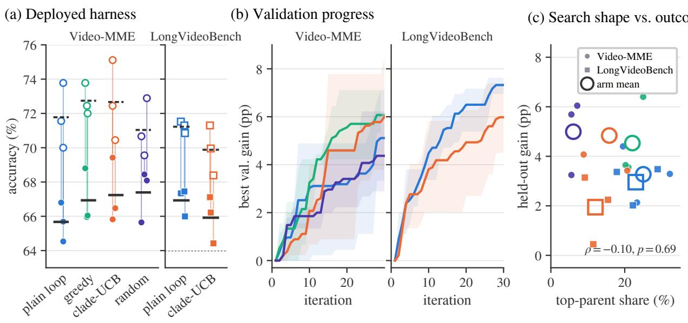  
held-out validation mean (dashed: validation) best baseline, held-out plain loop greedy clade-UCB random  
Figure 13 Parent selection. (a) Validation (hollow) and held-out (filled) accuracy of each run’s deployed harness; bars mark arm means. (b) Best-so-far validation gain over the best seeded harness (mean and seed range). (c) Share of candidates bred from the most-used parent against held-out gain over the best baseline; large outlined markers are arm means.

Results. A stronger start accelerates early progress but not the endpoint (Figure 14). The AKS run reaches 70% validation accuracy at iteration 2 and 72% at iteration 7, against 4–15 and 21–45 iterations for retrieval-only runs from simple seeds, which pass the AKS starting level within 4–18 iterations. Its deployed harness (74.0% validation, 68.2% held-out) lies inside the range of the six other runs (69.6–74.2% and 64.8–68.3%) and is statistically tied with the three best (paired diferences −0.1, +0.8, +1.5 points; $p \ge 0 . 0 6 )$ . Evolution adds only 1.1 points to AKS $( p = 0 . 1 3 )$ , against 1.4–5.8 points for simple seeds, four of six significantly, while using 36 frames against 14–25.

Interpretation. A stronger start mainly shortens the search to competitive performance; with one AKS run and a larger initial frame budget, it does not establish a reproducible final gain. It does suggest a way around the early-experience trap: supplying a useful mechanism before chance validation wins shape exploration, which motivates the instrumented warm-up of VideoHarness-SRSI.

## I Implementation and Statistical Details of VideoHarness-SRSI

This section specifies what Section 4 leaves out. Each seed runs WARM (Stage I), NOMINATE, PROBE, and RACE (Stage II), and COMPOSE and MERGE (Stage III), after the six seeded harnesses are scored into a shared executor cache (Algorithm 2; settings in Table 18). All comparisons are paired verdicts $\hat { \delta } ( H , H ^ { \prime } )$ over questions scored for both harnesses, with variance given by Eq. (7); on MomentSeeker they use the indicator IoU ≥ 0.5, while the loop and final selection use mIoU.

## I.1 Information Isolation

WARM, PROBE, RACE, and MERGE run the loop of VideoHarness-BRSI (Appendix B.1) in separate workspaces; NOMINATE and COMPOSE are single proposer calls. Each per-question trace holds opaque identifiers for pairing, the prediction and correctness, and counters of executor and tool calls, frames, rendering, personas, memory operations, and exercised mechanism families; it never contains question or option text, frames, or gold answers. u(H) in Eq. (2) collects per-question means of these counters.

validation level (%)  
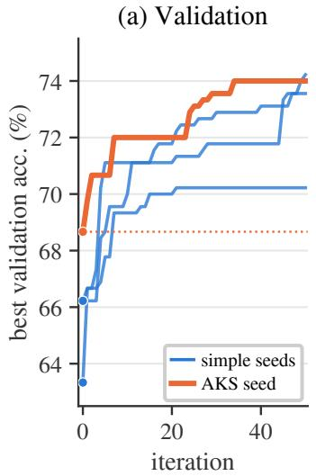

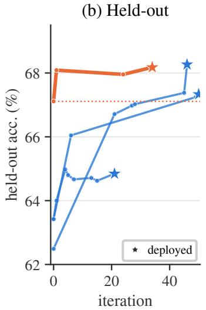

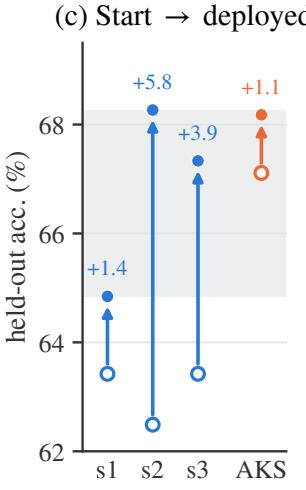

(d) Time to level  
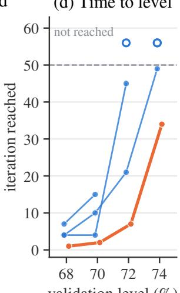  
Figure 14 Stronger initialization (Video-MME, retrieval only; blue: three runs from simple seeds, orange: the AKS-seeded run). (a) Best-so-far validation accuracy. (b) Held-out accuracy of tested running champions; stars mark deployed harnesses. (c) Held-out accuracy of the starting point (hollow) and deployed harness (filled); shading spans the simple-seed endpoints. (d) Iteration at which each validation level is first reached; hollow markers are levels not reached in 50 iterations.

A deny list enforced on all file, search, and shell tools confines each proposer call to its own workspace and run, and keeps datasets, caches, held-out outputs, and evaluation code out of reach. Warm-up evidence reaches a branch only through its charter and the pool members copied into it; the merge workspace regains read access to earlier workspaces only after branch efects are measured, and no phase before MERGE evaluates the held-out split. (In the LongVideoBench and OVO-Bench runs, a monitor also evaluated validation-front members on the held-out split during search; these results were unreadable by the proposer and entered no decision.) Isolation withholds content, not outcomes: because records pair predictions with correctness, a proposer can reconstruct the answer key for questions some harness answers correctly (one Video-MME run did so for 402 of 450), but harness code cannot use it, since the leak guard bars access to question identity.

## I.2 Stage I: Instrumented Warm-up

Mechanism families. VideoHarness-SRSI groups the harness primitives into seven families, the units to which removals, intensity changes, traces, and axis templates refer (Prompts 1–4): retrieve (frame selection and query-conditioned retrieval), multiturn (multi-pass reading and self-reflection), roles (multi-role collaboration), perceive (detection and localization tools), render (pixel re-presentation such as zoom, crop, and montage), analyze (shot, motion, and similarity signals), and memory (working memory). The search-space ladder of Appendix F instead counts the families chartered in the task description of VideoHarness-BRSI, which uses a diferent granularity (e.g., it separates retrieval from frame selection); its family counts are not in these units.

Slots and audit. Each round evaluates five candidates in three slots: Slot A makes three unrestricted free proposals; Slot B makes one removal that deletes the champion’s most-used family not yet removed; and Slot C makes one intensity proposal that changes one family’s usage by about a factor of two. Each candidate’s evidence w(H) follows Eq. (2). Requests are audited from traces rather than trusted: a candidate is a removal if its family set is a strict subset of its parent’s, an intensity change if the sets agree and exactly one nonzero coordinate of u moves by at least 25%, and free otherwise. Candidates with empty predictions on more than 5% of questions count as crashed.

Algorithm 2 VideoHarness-SRSI as implemented   
Require: Frozen VLM M, proposer $P ,$ validation set $\cal { S } _ { \mathrm { v a l } } .$ , seed archive $\mathcal { D } _ { 0 } ,$ , vocabulary V, budgets $r _ { 1 } < r _ { 2 }$   
Stage I: Warm-up and seed selection (setup, prewarm, WARM)   
1: Grow $\mathcal { D } ^ { \mathrm { w a r m } } \supseteq \mathcal { D } _ { 0 }$ by rounds of three free, one removal, and one intensity candidate until the plateau rule holds   
2: B ← six best evolved harnesses in $\mathcal { D } ^ { \mathrm { w a r m } }$ ; $H _ { 0 } \gets$ arg maxH∈B $V ( H )$ ; compute the warm-up report $\{ \mathcal { R } _ { \alpha } ^ { \mathrm { w a r m } } \}$   
Stage II: Isolated branch evolution (NOMINATE, PROBE, RACE)   
3: $A $ ladder-screened templates of V and a free-form axis; $P$ writes charters $\{ c _ { \alpha } \}$   
4: for all $\alpha \in { \mathcal { A } }$ do   
5: Evolve r1 candidates in an isolated branch that holds $B ,$ with parents $H _ { 0 }$ or earlier branch candidates;   
$\begin{array} { r } { m _ { \alpha } \gets \operatorname* { m a x } _ { H \in \mathcal { D } _ { \alpha } ^ { \mathrm { p r o b e } } } \hat { \delta } ( H , H _ { 0 } ) } \end{array}$   
6: $A _ { \mathrm { r a c e } } $ the $k _ { \mathrm { r } }$ axes with the largest $m _ { \alpha } ,$ , plus at most one tied axis   
7: for all $\alpha \in \mathcal { A } _ { \mathrm { r a c e } }$ do   
8: Continue the branch to $r _ { 2 }$ candidates in total; estimate $\big ( \bar { \delta } _ { \alpha } , \hat { s } _ { \alpha } \big )$ by Eq. (17)   
9: $\mathcal { A } _ { \mathrm { a d m } } \gets$ axes with $\bar { \delta } _ { \alpha } > 1 . 6 4 \hat { s } _ { \alpha }$ and $\bar { \delta } _ { \alpha } > 0 . 5 ,$ in decreasing order of $\bar { \delta } _ { \alpha }$   
10: $A _ { \mathrm { { c o m p } } } $ at most three axes of Arace, admitted axes first, then by $\bar { \delta } _ { \alpha }$   
Stage III: Factorial composition and joint refinement (COMPOSE, MERGE)   
11: P fixes one modification $d _ { \alpha }$ per $\alpha \in \mathcal { A } _ { \mathrm { c o m p } }$ and builds every cell $H u \ ( \mathrm { E q . \ ( 3 ) } )$   
12: Score the cells; record efects, interactions (Eq. (18)), and the gate-eligible outcome   
13: Refine jointly for 10 rounds of three candidates, starting from a ledger that holds every $H _ { M }$   
14: return $H ^ { \star } \gets$ validation arg max of the refinement ledger

Stopping and backbone. WARM stops once $t \geq 1 0$ rounds, or $t \geq 8$ with no improvement in the last four. The seed pool B holds the six best evolved warm-up candidates, preferably at most two per parent, and the backbone $H _ { 0 }$ is the best of them.

Warm-up report. NOMINATE receives, per family: (i) importance, the mean verdict of audited removals against their parents; (ii) dose response, the Spearman correlation between usage and accuracy (observational, not used for ranking); (iii) usage share and oracle-union gain; (iv) a baseline ladder of paired diferences between seeded harnesses with nested family sets, which measures value from a zero floor; and the frame range and median paired standard error. Blocks (i)–(iii) form ${ \mathcal { R } } _ { \alpha } ^ { \mathrm { w a r m } }$ . Evidence that cannot be computed is shown as missing rather than zero, which marks under-explored mechanisms without removing any axis. Averaged per removed family, removal contrasts measure each family’s contribution; the champion’s inflation ω shifts them all alike and so does not distort how families compare. Intensity evidence is observational, so the report uses it to flag directions, not to rank axes.

## I.3 Stage II: Nomination, Probe, and Race

Axes and branches. Six templates—retrieval, frame budget, read schedule, multi-role, pixels and detectors, and derived state—fix each axis’s permitted families and an on-axis test every branch edit must pass (e.g., a frame-budget edit must change mean frames by at least 20%, and other templates may not change them); one free-form axis has a proposer-written test. A template is pruned only if it touches no family of $H _ { 0 }$ and all its ladder efects are negative, keeping at least four. The proposer charters each axis with a mechanism, its rationale, a first edit, a falsification criterion, and a predicted efect. Every branch holds the pool B and the seeded harnesses, but candidates must descend from $H _ { 0 }$ or earlier branch candidates, so all branch verdicts share the backbone that the lattice requires; other pool members may only be mined for mechanisms.

Probe. Each axis produces $r _ { 1 } = 3$ candidates, and axes are ranked by their best probe verdict,

$$
m _ { \alpha } = \operatorname* { m a x } _ { H \in \mathcal { D } _ { \alpha } ^ { \mathrm { p r o b e } } } \widehat { \delta } ( H , H _ { 0 } ) ,\tag{16}
$$

where $\mathcal { D } _ { \alpha } ^ { \mathrm { p r o b e } }$ is the archive of axis α after the probe. The $k _ { \mathrm { r } } = \operatorname* { m i n } \left( k , \operatorname* { m a x } ( 2 , \lceil k / 2 \rceil ) \right)$ of the k axes with the largest $m _ { \alpha }$ continue (plus at most one tie). Since every axis is probed equally often against the same backbone, the backbone’s inflation ω and the maximum’s upward bias shift all axes alike and leave the ranking intact. We use the maximum rather than the mean because mechanisms that need compounding edits score near zero at first, and no standard error because probe candidates form one lineage cluster.

Table 18 Settings of VideoHarness-SRSI. The free-only warm-up control (Section 5.4) difers only in the warm-up slots $\left( 5 / 0 / 0 \right)$ . Here $k _ { \mathrm { r } } =$ mink, max(2, ⌈k/2⌉) for k probed axes. The warm-up runs in chunks of two rounds and stops once the champion has not changed for four rounds, after at least 8 and at most 10 rounds.
<table><tr><td>Setting</td><td>Value</td><td>Setting</td><td>Value</td></tr><tr><td>Warm-up slots  $\mathrm { A / B / C }$  per round</td><td> $3 / 1 / 1$ </td><td>Probe survivors (tie slack)</td><td> $k _ { \mathrm { r } } \ \left( + 1 \right)$ </td></tr><tr><td>Warm-up chunk; min. / max. rounds; patience</td><td> $2 ; 8 / 1 0 ; 4$ </td><td>Gate  $z _ { 0 \_ }$  / floor (pp) / min. clusters</td><td> $1 . 6 4 / 0 . 5 / 3$ </td></tr><tr><td>Class-1 / free-form templates; min. kept</td><td> $6 / 1 ; 4$ </td><td>Composed axes (cells)</td><td> $\leq 3 \ ( \leq 7 )$ </td></tr><tr><td>Branch candidates per round;  $r _ { 1 } ; \ r _ { 2 }$ </td><td>3; 3; 15</td><td>MERGE rounds × candidates</td><td> $1 0 \times 3$ </td></tr></table>

Race and admission. Survivors continue to $r _ { 2 } = 1 5$ candidates. With $\delta _ { h } = \hat { \delta } ( h , H _ { 0 } )$ grouped by declared parent into lineage clusters $C _ { \alpha , 1 } , \ldots , C _ { \alpha , L _ { \alpha } }$ , the efect $\bar { \delta } _ { \alpha }$ is the mean of $\delta _ { h }$ , and its standard error comes from 2,000 cluster-bootstrap replicates,

$$
\bar { \delta } _ { \alpha } ^ { ( b ) } = \frac { \sum _ { \ell = 1 } ^ { L _ { \alpha } } \sum _ { h \in C _ { _ { \alpha , J _ { \ell } ^ { ( b ) } } } } \delta _ { h } } { \sum _ { \ell = 1 } ^ { L _ { \alpha } } \bigl | C _ { _ { \alpha , J _ { \ell } ^ { ( b ) } } } \bigr | } , \qquad \hat { s } _ { \alpha } = \mathrm { s d } _ { b } \bigl ( \bar { \delta } _ { \alpha } ^ { ( b ) } \bigr ) ,\tag{17}
$$

with each $J _ { \ell } ^ { ( b ) }$ uniform on $\{ 1 , \ldots , L _ { \alpha } \}$ , so that edits of one program do not count as independent evidence. An axis is admitted if $\bar { \delta } _ { \alpha } > 1 . 6 4 \hat { s } _ { \alpha }$ and $\bar { \delta } _ { \alpha } > 0 . 5$ pp; with fewer than three clusters it is recorded as unjudged. Because $\omega$ lowers every $\delta _ { \alpha } .$ , this test is conservative. The 1.64 multiplier is a one-sided normal reference, not a simultaneous guarantee. At most three axes enter composition, admitted axes first.

## I.4 Stage III: Composition and Joint Refinement

Factorial lattice. COMPOSE distills each composed axis $\alpha \in \mathcal { A } _ { \mathrm { c o m p } }$ into one modification $d _ { \alpha }$ , the smallest edit of $H _ { 0 }$ that carries the branch’s mechanism, and writes all $2 ^ { k _ { \mathrm { c } } } - 1$ nonempty cells of $\operatorname { E q . } \ ( 3 )$ , with each $d _ { \alpha }$ byte-identical across cells. With three axes, each modification’s main efect contrasts the four cells that contain it with the four that do not. With $x _ { \mathcal { U } } ( q )$ the correctness of $H _ { M }$ on question $q ~ ( x _ { \emptyset }$ for $H _ { 0 } )$ , each cell’s efect is $\hat { \delta } ( H _ { \mathcal { U } } , H _ { 0 } )$ , and for $| \mathcal { U } | \geq 2$ the interaction is

$$
I _ { U } = \frac { 1 0 0 } { | Q | } \sum _ { q \in Q } \psi _ { U } ( q ) , \qquad \psi _ { U } ( q ) = \sum _ { \mathcal { W } \subseteq \mathcal { U } } ( - 1 ) ^ { | \mathcal { U } | - | \mathcal { W } | } x _ { \mathcal { W } } ( q ) ,\tag{18}
$$

over the questions Q shared by all cells, with standard error $1 0 0 \mathrm { s d } _ { q } \psi _ { \mathcal { U } } ( q ) / \sqrt { | Q | } ;$ computing it per question retains the dependence through $H _ { 0 }$ . The pre-registered gate selects among $H _ { 0 }$ and the cells of successive prefixes of the admission order $( H _ { 0 }$ if no axis is admitted).

Joint refinement and final selection. MERGE runs 10 rounds of three candidates from a ledger holding all cells, so the proposer may build on any of them. $H ^ { \star }$ is the validation arg max of this ledger. The seeded harnesses and the MERGE validation front are then evaluated on the held-out split.

## I.5 Budget and Configuration

With T warm-up rounds, $k , k ^ { \prime }$ , and $k _ { \mathrm { c } }$ probed, raced, and composed axes, and R = 10 MERGE rounds, a seed evaluates

$$
B _ { \mathrm { t o t a l } } = 5 T + k r _ { 1 } + k ^ { \prime } ( r _ { 2 } - r _ { 1 } ) + \left( 2 ^ { k _ { \mathrm { c } } } - 1 \right) + 3 R\tag{19}
$$

candidates, excluding re-scored seeded harnesses. With $T \leq 1 0 , k \leq 7$ (hence $k _ { \mathrm { r } } \leq 4 ) , k ^ { \prime } = k _ { \mathrm { r } }$ , and $k _ { \mathrm { c } } \leq 3$ this is at most $5 0 + 2 1 + 4 8 + 7 + 3 0 = 1 5 6$ candidates per seed. We report this as the budget bound; the tie slack of the probe cut-of can add one raced axis $\left( r _ { 2 } - r _ { 1 } = 1 2 \right.$ candidates) only when two axes tie exactly at the cut-of. The three Video-MME runs evaluated 138–141.

## J Ablation: Instrumented Warm-up

This section details the warm-up ablation of Section 5.4. Its conclusions are:

Table 19 Per-run results of the warm-up ablation (Video-MME). Slots: behavioral counts of warm-up candidates. Families with an importance estimate (Imp.) or an undefined coverage increment (Und.). Backbone: warm-up champion; deployed: validation argmax of joint refinement. Val, Test in %; Fr.: frames per validation question. †Stopped after round 8 (plateau rule).
<table><tr><td>Run</td><td colspan="3">Slots</td><td colspan="2">Families</td><td colspan="3">Backbone</td><td colspan="3">Deployed</td></tr><tr><td></td><td>A</td><td>B</td><td>C</td><td>Imp.</td><td>Und.</td><td>Val</td><td>Test</td><td>Fr.</td><td>Val</td><td>Test</td><td>Fr.</td></tr><tr><td>Full-1</td><td>27</td><td>11</td><td>12</td><td>6</td><td>2</td><td>73.56</td><td>69.87</td><td>50</td><td>77.11</td><td>71.07</td><td>110</td></tr><tr><td>Full-2</td><td>26</td><td>9</td><td>15</td><td>3</td><td>1</td><td>71.11</td><td>68.40</td><td>55</td><td>73.33</td><td>70.00</td><td>141</td></tr><tr><td>Full-3</td><td>23</td><td>15</td><td>12</td><td>5</td><td>2</td><td>70.44</td><td>68.58</td><td>38</td><td>74.67</td><td>69.16</td><td>66</td></tr><tr><td>Mean</td><td>25.3</td><td>11.7</td><td>13.0</td><td>4.7</td><td>1.7</td><td>71.70</td><td>68.95</td><td>48</td><td>75.04</td><td>70.07</td><td>106</td></tr><tr><td>Free-1</td><td>38</td><td>2</td><td>10</td><td>2</td><td>4</td><td>73.11</td><td>66.58</td><td>44</td><td>74.00</td><td>66.31</td><td>63</td></tr><tr><td>Free-2†</td><td>27</td><td>8</td><td>5</td><td>3</td><td>4</td><td>71.33</td><td>66.62</td><td>65</td><td>72.44</td><td>67.16</td><td>81</td></tr><tr><td>Free-3</td><td>34</td><td>3</td><td>13</td><td>3</td><td>3</td><td>71.11</td><td>68.09</td><td>59</td><td>74.89</td><td>68.40</td><td>86</td></tr><tr><td>Mean</td><td>33.0</td><td>4.3</td><td>9.3</td><td>2.7</td><td>3.7</td><td>71.85</td><td>67.10</td><td>56</td><td>73.78</td><td>67.29</td><td>77</td></tr></table>

• Same validation, better held-out. Both arms reach the same validation accuracy, yet every full-arm run beats every free-only run on held-out data, for the warm-up backbone (+1.85 pp) and the deployed system (+2.8 pp).

• More controlled evidence. The full arm yields 2.7× as many removal contrasts and far fewer undefined family estimates.

• Attribution. A within-run replay attributes 28% of the backbone gap to selecting structured candidates; the rest is consistent with slot results informing free proposals.

## J.1 Protocol

Both arms run the complete VideoHarness-SRSI pipeline on Video-MME, three runs each. Per warm-up round, the full arm proposes three free candidates (Slot A), one family removal (Slot B), and one intensity change (Slot C); the free-only arm spends the same five evaluations on free proposals. Everything else, including seeds, splits, caches, isolation, stopping rule, and later stages, is shared. Because slots are instructed rather than enforced, we classify every warm-up candidate from its trace with the audit of Appendix I.2; counts below are behavioral. Arms are compared by exact one-sided permutation tests over the ${ \binom { 6 } { 3 } } = 2 0$ assignments of runs, whose smallest attainable p-value, 0.05, requires complete separation; with three runs per arm, all results indicate direction rather than precise efect sizes.

## J.2 Results

Warm-up. Table 19 lists per-run results. The free-only arm climbs faster early (71.18 versus 69.26 after six rounds; Figure 15a), but the full arm catches up in rounds 7–9, and the arms end at 71.70 and 71.85. In the full arm, 8 of 11 champion replacements are structured (3 removals, 5 intensity changes), against 5 of 13 in the free-only arm, and all three full-arm backbones are intensity changes with structured parents. Deliberate contrasts are also cleaner: frames move by more than 10% in 23% of the full arm’s removals, versus 77% of the removals that arise unrequested in the free-only arm.

Evidence. The full arm yields 11.7 versus 4.3 removal contrasts per run $( p = 0 . 0 5 )$ and 13.0 versus 9.3 intensity contrasts $( p = 0 . 1 5 )$ , giving 14 importance estimates covering six of the seven families versus 8 covering five, and leaving 5 versus 11 of the 21 family–run coverage increments (seven families × three runs) undefined $\left( p = 0 . 0 5 \right)$ . Retrieval shows the diference most clearly: each full run removes it four times (mean −7.15 pp), whereas the free-only arm has a single retrieval-free candidate. Removals are not always frame-matched: the largest drop (−23.11 pp) also cut frames from 80 to 16.

Held-out contrasts. Every full-arm backbone and deployed system beats every free-only one on held-out data: 68.95 versus 67.10 for backbones and 70.07 versus 67.29 for deployed systems (both $p = 0 . 0 5 \mathrm { ; }$ Welch t = 2.73 and 3.40), while validation does not separate the arms $( p = 0 . 6 5$ and 0.25). Frames, which each harness chooses, are the main confound (Figure 15c), but regressing held-out accuracy on arm and log frames leaves arm efects of +2.0 and +2.2 pp (t = 2.38 and 2.55, three residual degrees of freedom).

(a) Warm-up validation  
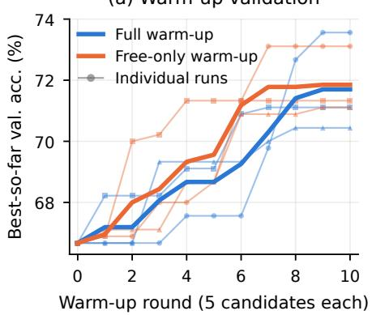

(b) Warm-up backbone  
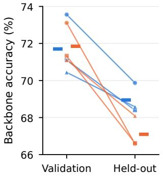

(c) Backbone → deployed  
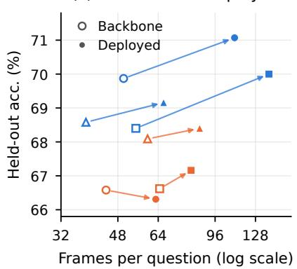  
Figure 15 Warm-up ablation on Video-MME (thin lines, markers: runs; thick lines, bars: arm means). (a) Best-so-far validation accuracy (round 0: best seeded harness). (b) Warm-up backbones. (c) Held-out accuracy vs. frames per question, backbone (hollow) to deployed system (filled).

Table 20 Held-out accuracy (%) on all held-out questions and on unseen-video questions. ∆: diference on unseen-video questions, with its 95% bootstrap interval over videos.
<table><tr><td>Comparison</td><td>Harness</td><td></td><td>All held-out Unseen videos</td><td>∆ (unseen)</td></tr><tr><td rowspan="2">Information isolation (LongVideoBench, Table 4)</td><td>VIDEoHARNESs-BRSI feedback (Multimodal)</td><td>65.43</td><td>67.12</td><td rowspan="2">+1.64 [+0.11, +3.28]</td></tr><tr><td>VIDEoHARNEss-BRSI + isolation (Blindfolded)</td><td>66.93</td><td>68.76</td></tr><tr><td rowspan="2">Evolved vs. AKS</td><td>Evolved medium_augspread (38 frames)</td><td>68.36</td><td>68.02</td><td></td></tr><tr><td>AKS-BLIP (62 frames)</td><td>68.40</td><td>68.73</td><td>-0.71 [−2.45, +1.16]</td></tr><tr><td>(Video-MME, Figure 2)</td><td>AKS-CLIP (62 frames)</td><td>68.09</td><td>68.22</td><td>-0.19 [−2.20, +1.74]</td></tr></table>

For AKS rows, ∆ is the evolved harness minus that AKS variant.

Attribution. Because all full-arm backbones are structured, part of the gap could come from selecting structured candidates. Replaying each full run’s selection on its free candidates only yields substitutes within 0.67 pp of the actual backbones on validation but lower on held-out data in all three runs, so selection accounts for +0.52 pp, or 28% of the backbone gap. The substitutes still average 1.33 pp above the free-only backbones. This remainder is consistent with slot results informing free proposals through the archive—8 of the full arm’s 64 requested free proposals cite them, and the Full-3 backbone cites a removal result and a dose curve over retrieval calls—but three runs per arm cannot separate this channel from run-to-run variation (standard error about 0.7 pp).

## K Held-out Questions on Unseen Videos

On MomentSeeker, the split assigns whole source videos to one side, so every held-out result concerns videos never seen during evolution. On Video-MME, LongVideoBench, and OVO-Bench, the split is over questions, so a held-out question may come from a video that also has validation questions: 702 of 2,250 held-out questions on Video-MME, 303 of 891 on LongVideoBench, and 622 of 979 on OVO-Bench. A harness could thus gain on such questions from properties of videos it was selected on. To check that the information-isolation and evolved-versus-AKS comparisons do not rest on such gains, we re-score them on the unseen-video questions only, i.e., held-out questions whose video has no validation question (1,548 on Video-MME and 588 on LongVideoBench). Harnesses and predictions are those of the original evaluations; only the scored subset changes. Intervals are 95% bootstrap intervals over videos (2,000 resamples).

Information isolation. As shown in Table 20, restricting the proposer to content-free feedback raises accuracy on unseen-video questions by 1.64 points, with an interval that excludes zero. The efect of information

Table 21 Evidence per decision on Video-MME: evaluations per configuration r, verdict noise σ, and power to detect a 1-point gain. The VideoHarness-BRSI row uses the first 57 candidates of each run.
<table><tr><td></td><td>Stage</td><td>r↑</td><td>σ↓</td><td>Power↑</td></tr><tr><td>BRSI</td><td>Full harness</td><td>1.55</td><td>1.55</td><td>0.13</td></tr><tr><td rowspan="4">SRSI</td><td>I: warm-up</td><td>1.59</td><td>1.62</td><td>0.12</td></tr><tr><td>II: branch</td><td>9.80</td><td>1.61</td><td>0.50</td></tr><tr><td>III: merge</td><td>1.68</td><td>1.12</td><td>0.22</td></tr><tr><td>Whole run</td><td>2.31</td><td>1.48</td><td>0.18</td></tr></table>

Table 22 Early-experience trap. Runs whose champion never exceeds 1.2× the seeds’ frame budget (16 frames; 32 on MS), three seeds each; VideoHarness-BRSI searches the full harness with Multimodal feedback. VM: Video-MME; OVO: OVO-Bench; MS: MomentSeeker.
<table><tr><td></td><td>VM</td><td>LVB</td><td>OVO</td><td>MS</td><td>Total</td></tr><tr><td>VIDEOHARNESS-BRSI</td><td>1/3</td><td>0 0/3</td><td>1/3</td><td>2/3</td><td>4/12</td></tr><tr><td>VIDEOHARNESS-SRSI</td><td>0/3</td><td>0</td><td>0/3</td><td>0/3</td><td>0/12</td></tr></table>

isolation in Section 5.4 therefore holds on videos never seen during evolution.

Evolved versus hand-designed harnesses. On unseen-video questions, the evolved retrieval harness of Section 3.1 stays within one point of both AKS variants, and neither diference is significant, while it uses 38 rather than 62 frames per question. The conclusion that VideoHarness-BRSI evolves harnesses competitive with this hand-designed method therefore also holds on videos never seen during evolution.

## L Failure-Mode Diagnostics of VideoHarness-SRSI

We re-measure the three diagnostics of Section 3.2 on the runs of Table 1.

Validation overfitting. VideoHarness-SRSI narrows the validation–test gap on three of the four benchmarks (Table 1). On LongVideoBench, where the gap does not shrink, information isolation alone still raises the held-out accuracy of VideoHarness-BRSI from 65.4 to 66.9% at equal validation accuracy, close to the 67.3% of VideoHarness-SRSI (Section 5.4), and this gain holds on held-out questions whose videos never appear in validation (Appendix K).

Search-budget dilution. The probe–race concentrates the branch budget on a few axes, so each axis decision on Video-MME rests on 9.80 evaluations instead of the 1.55 of VideoHarness-BRSI, raising the power to detect a 1-point gain from 0.13 to 0.50 (Table 21). Stage III, in turn, has the lowest verdict noise of any stage (σ = 1.12).

Early-experience trap. Because the warm-up of VideoHarness-SRSI collects removal and intensity contrasts across the mechanism families regardless of earlier verdicts, no VideoHarness-SRSI run stays at the seeds’ frame budget on any benchmark (Table 22), whereas four of the twelve VideoHarness-BRSI runs do, on Video-MME, OVO-Bench, and MomentSeeker. An early, noisy loss can no longer close of a mechanism for the rest of the run.

## M Proposer Prompts of VideoHarness-SRSI

This section reproduces the most important proposer prompts of VideoHarness-SRSI, taken from a Video-MME run with the Qwen3-VL-8B executor and Claude Opus 5 as the proposer. Text in braces, such as {BACKBONE}, is filled in by the orchestrator at run time with that run’s measurements; run constants that the prompts leave as placeholders are filled in with the values of Table 18. We elide long passages with [...] and drop Markdown emphasis and non-ASCII symbols; everything else is verbatim. The prompts use internal names that map onto Section 4 as follows: a family is one of the seven mechanism families of Appendix I.2; the backbone is $H _ { 0 } ;$ WARM is Stage I, whose Slots $\mathrm { A / B / C }$ are the free, removal, and intensity proposals; a class-1 slot is one of the six fixed axis templates and a class-2 charter is the free-form axis $\alpha _ { \mathrm { f r e e } } ;$ PROBE and RACE are the $r _ { 1 } = 3$ and $r _ { 2 } = 1 5$ schedules; a branch’s $d _ { i }$ is its efect $\bar { \delta } _ { \alpha } ;$ a cell is a composition $H _ { M } ;$ and the gate is the admission test of Appendix I.3.

Iteration skill. Every evolution loop of VideoHarness-SRSI (WARM, PROBE, RACE, and MERGE) runs the loop of Appendix B.1, whose proposer session loads the skill below. In PROBE and RACE, the branch’s charter skill replaces the opening sections, and the interface, constraints, and workflow are appended verbatim, identical on every branch. The proposer sees only content-free traces (Section 4.1); the leak guard at the end is enforced on every candidate before it is evaluated.

## Prompt 1: Iteration skill shared by all evolution loops (excerpt)

## # Meta-Harness: Full Agentic Framework

Run ONE iteration of evolution on Video-MME. Do all work in the main session - do NOT delegate to subagents (constraints get lost, and you end up shipping parameter tweaks with no prototyping).

You do NOT run benchmarks. You analyze results + traces, prototype, and implement new frameworks. The outer loop benchmarks them on the resident Qwen pool and runs the selection layer.

## ## What is being evolved

A complete training-free agentic framework that takes a video + a multiple-choice question and returns the FINAL answer letter. Everything is on the table at once:

<table><tr><td>|mechanism ---</td><td>| primitive I</td></tr><tr><td>| frame selection</td><td>-- |uniform_indices, ctx.pool_indices(), ctx.read_frames |</td></tr><tr><td>| query-conditioned retrieval</td><td>| ctx.retrieve(model, query, k) I</td></tr><tr><td>I perception tools</td><td>| ctx.tools.detect / locate I</td></tr><tr><td>| cheap video signals</td><td>ctx.tools.shots / motion / similarity I</td></tr><tr><td>| pixel re-presentation</td><td>| ctx.tools.zoom / crop / montage + ctx.look(...) I</td></tr><tr><td>|self-reflection &amp; multi-turn correction |debate / multi-agent collaboration</td><td>| repeated ctx.vlm_answer conditioned on earlier output |</td></tr></table>

There is exactly ONE model doing inference: the frozen Qwen3-VL. "Multi-agent" means several ROLES of that same model. You (the outer agent) write the framework code; you never answer a question yourself, and neither does any other external model. No finetuning, no weight updates, no new model downloads, no network.

Goal: maximize Video-MME accuracy. The cost axis is average frames summed over ALL passes (tool calls and long generations cost too). A deeper or broader pipeline has to EARN its cost: the frontier is accuracy vs frames, so machinery that buys nothing is strictly worse than not having it.

\## Interface - implement answer(ctx) [... interface, primitives on ctx, and per-question budgets ...]

## ## CRITICAL CONSTRAINTS

\- Tag each candidate’s components with the mechanisms it uses. This is a ledger field for later analysis; nothing in the loop reads it back to you.

\- You MUST implement 3 new frameworks every iteration, each with a base\_strategy - the exact parent you built on, taken from evolution\_summary.jsonl / frontier\_val.json, or a baseline. Mix exploitation and exploration.

\- Do NOT abort early, do NOT write "the frontier is optimal", do NOT skip prototyping.

\- Anti-parameter-tuning: a new candidate must change a mechanism - what triggers an action, which evidence is gathered, how rounds/roles/memory/fusion work - not just num\_frames, k, max\_rounds or a threshold. If your candidate difers from its parent only by constants, REWRITE it.

\- One frozen model only. All reasoning happens inside Qwen3-VL via ctx.vlm\_answer / ctx.ask\_vlm / ctx.agent / ctx.look. No external API, no second model, no answering by hand.

\- Tool-cost discipline. [...]

\- No dataset-specific hints. General patterns are fine ("keep frames where the queried object is detected"). Hardcoded knowledge about particular videos or questions is not.

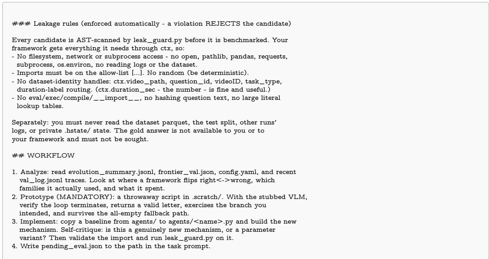

Stage I: warm-up slots. In the WARM workspace, the orchestrator appends the addendum below to the iteration skill, which turns each round into the three free, one removal, and one intensity candidates of Section 4.2.1. The prompt only requests the slots; as stated in its last rule and in Appendix I.2, each candidate’s slot is audited from its trace. The free-only control of Section 5.4 receives an addendum that assigns all five candidates to Slot A.

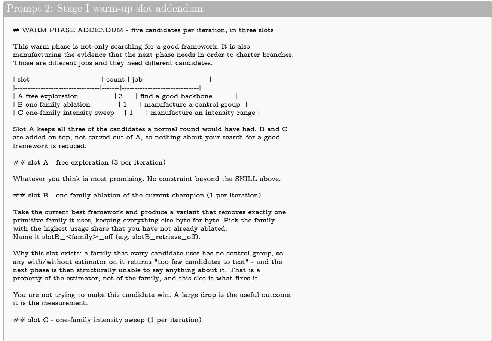

Stage II: nomination. NOMINATE is a single proposer call that receives the warm-up report (Appendix I.2) in place of the braced tables and writes one charter per axis: its mechanism, rationale, first edit, falsification criterion, and predicted efect (Section 4.2.2). The axis templates it must fill are given in Prompt 4.

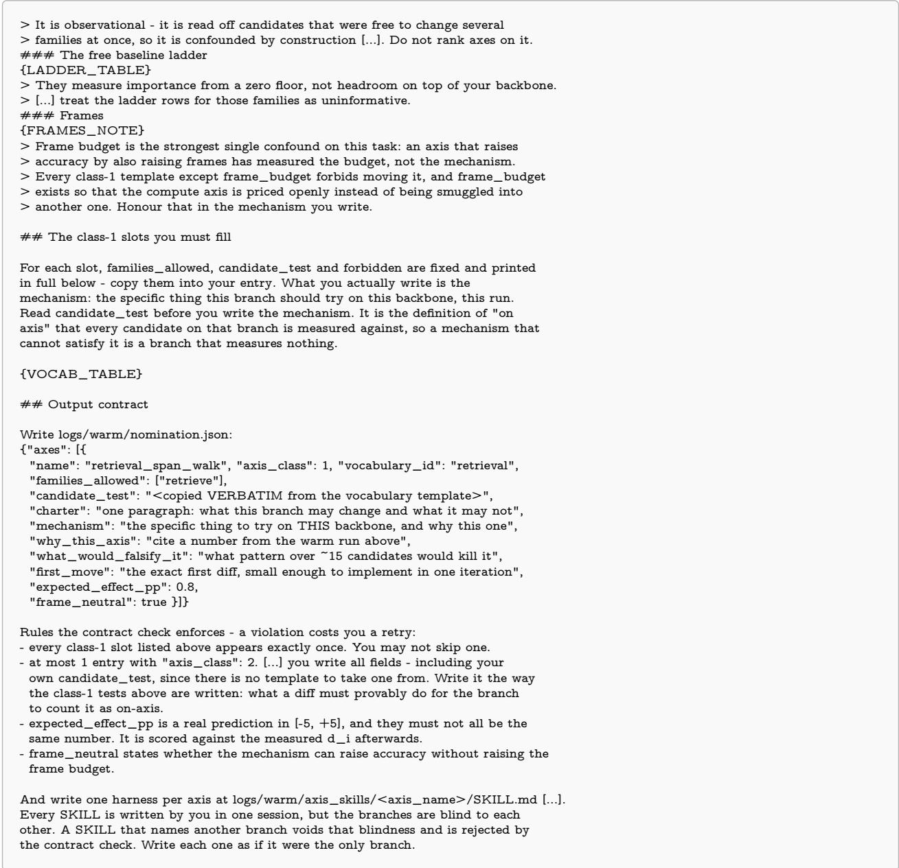

Stage II: axis templates. The six class-1 templates of Section 4.2.2 fill {VOCAB\_TABLE} in Prompt 3. Each fixes the families a branch may touch, the on-axis test its every edit must pass, and what it must not change; only the mechanism is left to the proposer. Only frame\_budget may change the number of frames, so that the frame budget, the strongest confound on these benchmarks, is measured on its own axis.

Stage III: composition. COMPOSE is a single proposer call after the race. It receives each raced axis’s efect $\bar { \delta } _ { \alpha }$ with its lineage-clustered standard error (Eq. (17)) and the gate’s verdict, and it builds every cell of Eq. (3) from one fixed modification $d _ { \alpha }$ per axis. The cells are then scored and seed the MERGE ledger (Appendix I.4). The prompt’s “15 rounds” refers to the $r _ { 2 } = 1 5$ candidates of each raced branch.  

## {LATTICE}

Every cell is backbone + the difs of its axes, and the dif for an axis must be byte-identical in every cell that contains it. This is not a style rule. The lattice is read as a factorial design: I\_ab = d\_ab - d\_a - d\_b is only an interaction if the a in cell\_ab is the same a as in cell\_a. If a dif has to change to fit alongside another, that is not a merge - it is a rewrite, and the right move is to shrink both difs until they compose without editing each other, then say so.

Singleton cells are not optional. They are the main-efect cells and no interaction is computable without them. Note that the efect of cell\_a is not the same quantity as axis a’s d\_i in the table above: d\_i is the mean over \~15 branch candidates, cell\_a is the efect of the one dif you chose. The gap between them is real information - if your chosen dif underperforms the branch mean, you picked the wrong dif.

## ### Step 3 - if a cell cannot be built, say which and why

Two difs may be genuinely incompatible (both replace the same seam). Do not paper over it: write the cells you can, and in the hypothesis of the smallest afected cell name the conflict precisely. [...]

## ## Constraints that are checked

\- Complexity budget. Count if/elif branches and named numeric constants in the backbone and in each dif you graft. The merged candidate may not exceed backbone + sum(difs). [...] declare the counts in your hypothesis so they are in the ledger.

\- No rewriting the backbone. If a graft seems to require restructuring the backbone, that is evidence the two mechanisms are not composable at this seam: say so in the hypothesis, and graft the smaller version instead.

\- Every candidate declares base\_strategy = the backbone (for the first prefix) or the previous prefix.

\- Read the on-axis / bespoke on-of axis / fired columns before the d column. [...] A branch with more bespoke code of its axis than on it spent its rounds somewhere other than its charter, so its d\_i is not an estimate of the mechanism its name claims - treat that branch’s difs as unlabelled, and say so.

## ## What to write

[... manifest path and format; every cell lists the axes it grafts ...]

In each hypothesis, state: which axes this cell grafts, which branch candidate each dif came from, the complexity counts, and what you expect the efect to be - so that a smaller-than-predicted efect is visible as a failed prediction rather than absorbed silently. For the multi-axis cells, also predict the sign of the

interaction: do you expect these mechanisms to add, to overlap (sub-additive, they fix the same questions), or to fight (super-additive against you)?