# What and Where in Identifying and Quantifying Conventions in Humans and AI Agents

Makoto Fukushima Honda Research Institute Japan

Tim Puphal Honda Research Institute Europe

October 15, 2026

## Abstract

Cooperative success rests in part on implicit communication. Partners converge on conventions: regularities that give an action meaning beyond its direct effect. Yet conventions are usually observed only indirectly: a score drop when partners are swapped shows that a convention existed, but not what it was or where it was used. In the card game Hanabi, the exact probability that a play fails can be computed from the hints received and the cards in view. Players who use conventions succeed more often than this prediction allows; the resulting margin is the convention gap. Offbelief learning provides a hierarchy of agents (levels 1–5) whose first level uses no conventions by construction and whose later levels use progressively more. For humans and these agents on one scale, we ask what the conventions are and where they are used. On what: in two independently collected corpora of human games, humans show a larger gap than every agent level. On the conventions both populations use, however, humans do no better than level 2. The human advantage is concentrated in a situation that no agent level learns to use: hints that point to a card other than the ones they touch. On where: conventions depend on what the player already knows about the card, not on how recently it was hinted, and they are used most in the mid-game; humans use them earlier and later in the game than the agents. In interventions on the agents, blocking a single high-gap situation costs little, because meaning reroutes to other situations, but blocking several together costs far more than the sum of the single costs. Thus, the convention gap turns conventions from an inferred cause of score loss into a measurable, comparable, and causally testable object.

## 1 Introduction

Successful cooperation depends in part on implicit communication. Partners converge on conventions: regularities that give an action a meaning beyond its direct effect [Lewis, 1969]. People and AI agents both rely on conventions alongside the explicit information the rules provide. In zero-shot coordination (ZSC) [Hu et al., 2020, Treutlein et al., 2021], conventions are what break when a policy meets a partner it was not trained with. Yet conventions are usually studied indirectly, through the score an agent loses when its partner is swapped. A score drop shows that a convention existed. It does not say what the convention was, where it operated, what it was worth, or whether humans share it.

A recent study [Fukushima et al., 2026] proposes a more direct diagnostic in the cooperative card game Hanabi [Bard et al., 2020]. At every play action, a literal observer computes the exact probability that the played card fails, using only information the rules guarantee: the hint constraints on every card in the hand, and card counting over all visible zones. Averaged over many plays, the difference between this predicted failure rate and the actual one is the convention gap [Fukushima et al., 2026]. Off-belief learning (OBL) trains a hierarchy of agents [Hu et al., 2021]. Level 1 is trained to read past actions only for their literal content, and later levels may interpret more. On this hierarchy, the gap rose monotonically with level, from +1.57 to +21.68 percentage points (pp) [Fukushima et al., 2026].

Here, we identify candidate conventions where plays beat the literal prediction, and quantify that departure in pp. We ask three questions of humans and the OBL hierarchy on one scale. (i) What are the conventions: which situations carry the gap, and to what extent do the two populations agree on them? (ii) Where are they used: when in the game, in which situations, and carried by which feature of the game state? (iii) To what extent does removing a convention cost score, relative to removing an equally frequent play at random? We address them by breaking the gap down by situation and by turn, by placing a public human corpus [Hanab Live, 2026] and a second, independently collected corpus [Dizdarevic et al., 2025] on the same scale as the hierarchy, and by intervening on the agents’ policies against´ a frequency-matched control.

Findings in brief. The convention gap of the human corpus, +26.16 [+24.05, +28.28] pp, is larger than that of every level of the OBL hierarchy, and their profile across play situations replicates on the second corpus $( r = 0 . 9 7 ;$ Appendix E). On the conventions both populations share, humans are not significantly closer to level 5 than to level 2. The remaining difference lies in one situation where no level approaches the human gap: hints that point to a card other than the one they touch (indirect reference; §3.1). The gap peaks in the mid-game, and the human gap exceeds level 5’s in the opening and late game. In the agents, the gap follows what the player already knows about the played card rather than how recently it was hinted (§3.2). Finally, blocking one high-gap situation in the agents’ play lowers their score little more than blocking an equally frequent play at random, because blocked plays partly reappear in other situations; blocking several situations together costs more than the sum of the single blocks (−1.84 points jointly against −0.77 summed; §3.3). Together, these results show how an exact literal baseline can locate and compare conventions across humans and agents, and price them in agents.

## 1.1 Related work

Conventions and zero-shot coordination. A convention in Lewis’s sense is a self-sustaining regularity that resolves a coordination problem among alternatives [Lewis, 1969]. In cooperative multi-agent reinforcement learning such regularities are what self-play policies acquire, and the Hanabi challenge made their cost visible: policies that score well together fail with partners trained separately [Bard et al., 2020]. The ZSC program addresses this by construction. Other-Play removes symmetry-dependent conventions [Hu et al., 2020]; off-belief learning trains its first level to read past actions only for their literal content and lets later levels interpret more [Hu et al., 2021]; K-level reasoning, trajectory diversity, and the label-free formalism of Treutlein et al. [2021] give further routes to compatible policies [Cui et al., 2021, Lupu et al., 2021]. Evaluation in this line is by cross-play score [Wolski et al., 2026]. This paper proposes no ZSC method; it locates the conventions those methods act on, using the off-belief learning hierarchy.

Human–AI coordination and human proxies. Evaluating agents with people is costly, so the field increasingly substitutes behavioral clones of human play. The practice was established in Overcooked [Carroll et al., 2019]; population-based training aims to remove the need for human data altogether [Strouse et al., 2021]; in Hanabi, humanteam studies [Siu et al., 2021] and the AH2AC2 benchmark, whose proxies are cloned from human games [Dizdarevic´ et al., 2025], follow the same route. Appendix H tests what such clones preserve at the level of individual conventions.

Reading conventions out of policies. Shih et al. [2021] separate a policy into a task-specific module and a partnerspecific convention module and show that the latter transfers across tasks; Any-Play augments training to discourage conventions [Lucas and Allen, 2022]. Both treat conventions as a hidden variable to be separated out or suppressed. Here plays are compared with an exact literal baseline, so a convention’s location and carrier can be reported without a learned probe.

Implicit communication and pragmatics. Hints in Hanabi are speech acts whose intended meaning exceeds their literal content, the situation the rational speech act framework models as recursive inference between speaker and listener [Frank and Goodman, 2012, Goodman and Frank, 2016], building on Gricean implicature and common ground [Grice, 1975, Clark, 1996]. The convention gap needs no fitted listener: it compares observed failures with literal predictions, in percentage points of failure.

Depth of reasoning. Level-k and cognitive-hierarchy models estimate how many steps of recursive reasoning people use, and typically find one to three [Stahl and Wilson, 1995, Nagel, 1995, Camerer et al., 2004]. Appendix F asks whether the human–agent difference is a difference of depth in that sense, and finds that depth alone does not account for it.

## 2 Methods

## 2.1 The convention gap

We use the metric as defined in a previous study [Fukushima et al., 2026]. At every play action, an exact literal observer computes P(life loss) from rule-guaranteed information only: the positive and negative hint constraints on

every card in the hand, and card counting over all visible zones. Because a hint on one card also constrains the others, the observer uses the joint distribution over the whole hand rather than per-card marginals. For a set of plays,

$$
\Delta \ = \ \mathrm { m e a n } \left( P ( \mathrm { l i f e \ l o s s } ) \right) \ - \ \mathrm { a c t u a l \ l i f e \mathrm { - } l o s s \ r a t e } ,\tag{1}
$$

reported in percentage points. A positive value means plays fail less often than literal information predicts. The gap is signed and cannot exceed the mean P(life loss). It is exactly zero on plays whose outcome literal information fixes, and subsets with gaps of opposite sign can cancel. A value near zero therefore does not show that partners conveyed nothing beyond literal content. By quantifying conventions we mean locating where plays depart from this literal prediction and by how many percentage points. That a positive gap reflects conventions is an interpretation, not a definition: a partner who hints playable cards also produces one. The interpretation is consistent with the level ordering of §2.2 and the decompositions of §3.1–§3.3.

Statistics. Each outcome is 0 or 1, so $\Delta$ is always a mean over many plays. Plays within a game share a deck and a history, so all intervals resample whole games (whole pairs, for humans) rather than individual plays [Cameron et al., 2008]. Draw counts are fixed in advance. Where many data-induced categories (§2.4) are tested we control the false discovery rate at $q = 0 . 0 5$ per level [Benjamini and Hochberg, 1995]. Wherever categories are induced from data, they are defined on a discovery half and every reported statistic is computed on a held-out estimation half, so no pattern is scored on the data that found it. Analyses with pre-specified categories use all plays.

## 2.2 The OBL hierarchy

Off-belief learning [Hu et al., 2021] trains a policy whose Q-targets are computed on fictitious states, resampled from a belief model that assumes all past actions came from a fixed base policy $\pi _ { 0 }$ . The learner is scored as if the past carried only what $\pi _ { 0 }$ would put into it. Level 1 uses a uniformly random $\pi _ { 0 } .$ , so it is trained to read past actions only for their literal content (grounded play). Each later level is trained with beliefs induced by the previous level’s policy, so it may interpret more. Agent levels are written level k in the text and OBLk in figures and tables. The released archive holds five seed models per level; the ladder below uses the first of each. Level 5 is in the archive but not among the results published with OBL [Hu et al., 2021], and every trend claim here holds on levels 1–4 alone. In the previous study [Fukushima et al., 2026], the gap rose monotonically with level, from $+ 1 . 5 7 \ [ + 1 . 3 3 , + 1 . 8 1 ]$ pp at level 1 to +21.68 [+21.34, +22.02] pp at level 5. Level-1 cross-play, pooled over all pairings among five independently trained level-1 models, gave +1.22 [+0.98, +1.45] pp.

Agent data. Unless stated otherwise, agent conditions use 1000 games per condition with distinct environment seeds and greedy acting; the taxonomy below pools five seed models per level (5000 games; level 1 uses only the first).

## 2.3 Human data

People who play Hanabi competitively have conventions too, but theirs are taught: a player community publishes and teaches a convention system [H-Group, 2026]. The human games are public logs from the hanab.live platform [Hanab Live, 2026], where this community plays. We first establish that these logs and the generated agent games are comparable. First, the same exact joint posterior is applied to both populations; nothing is re-estimated for humans. Second, the human games were replayed through the same extraction pipeline used for the agents and reproduced the reference posteriors bit-identically over all 9017 plays. Third, the corpus and its filters are inherited unchanged from the previous study [Fukushima et al., 2026]: a completed-games filter and a two-tier bot exclusion applied by the same code, giving 425 games, 9017 plays and 155 players. Pairs recur across games (95 pairs in all), so every human interval is clustered at the pair level. A second, independently collected corpus, the open games of the AH2AC2 benchmark [Dizdarevic et al., 2025], is processed through the identical pipeline and serves as a replication corpus.´

## 2.4 Situations and the induced taxonomy

Because $\Delta$ is a mean over plays, it can be broken down by situation. Two category systems do this. The first is hand-crafted: five mutually exclusive play situations (played immediately after a partner color hint touched the card; immediately after a rank hint; hinted earlier; unhinted and newest-drawn; unhinted and older). A card is unhinted if no hint has touched it; hints to other cards can still exclude values for it. Table 1 and §3.2 report the gap by situation.

Plays made immediately after a hint touched a different card, indirect reference, are tracked with the finer categories described next.

The second system is induced from the data. Every play is described by six components of its context: the partner’s immediately preceding action, its relation to the board, the card’s ordered hint history, the lag since the last hint that touched it, hand position, and the hint-token stock. Games are split 50/50 into discovery and estimation halves. Every context type that clears a minimum cell size $n _ { \mathrm { m i n } }$ on the discovery half becomes its own category, and rarer types merge by hierarchical backoff, so there is no opaque other bucket. $n _ { \mathrm { m i n } }$ is derived from the empirical residual standard deviation at $\mathbf { a \pm 5 }$ pp precision target, giving 52–139 across levels. A depth-4 CART tree [Breiman et al., 1984] fit on the same discovery half gives a compact summary of each taxonomy (Appendix A). All reported statistics come from the estimation half. The level-5 categories, once fit, are also kept fixed and applied unchanged to other populations; we call this thefrozen level-5 taxonomy.

For comparing populations, a shared taxonomy is defined jointly on all six: a cell exists only if every population’s discovery half supports it at its own $n _ { \mathrm { m i n } } .$ , so every value can be estimated for everyone. Each cell is labeled by the components that define it; Fig. 1 gives the key. We call any situation or category with a positive gap a channel.

## 2.5 Interventions

Categories are observational: a category’s gap says how far its plays depart from the literal prediction, not what would happen if the channel were removed. We therefore intervene on the agents’ policies. When the acting player’s greedy action is to play a card whose context falls in a target category, that play is removed from the legal set and the best remaining action is taken from the same network outputs. The network is not re-run, and its recurrent state follows the real observations. All conditions share 1000 environment seeds, so scores are compared per deck. Verification gates precede every full run (Appendix D). Every score difference reported in §3.3 is therefore between the same decks and the same network.

The key part of the design is its control. Blocking any frequent play disturbs the game whatever its convention content, so a raw score drop says nothing about conventions. We therefore run frequency-matched random masks: the greedy play is blocked with a probability chosen to match a target category’s trigger rate, with no regard to its content, and these masks define a null cost curve. The quantity of interest is the excess cost: the paired score cost minus the random-mask cost at the same trigger rate, with the control curve re-fit inside every bootstrap draw. Three low-gap control categories at level 5 (two fully-identified-card cells and the large lag-4+ rank cell) check the control curve (§3.3). Negative score changes are losses.

## 3 Results

## 3.1 What conventions are used: humans and agents on one scale

## 3.1.1 Humans sit above the OBL hierarchy, by a small, structured margin

How far above the OBL hierarchy does human play sit? The human corpus has a gap of $+ 2 6 . 1 6 \left[ + 2 4 . 0 5 , + 2 8 . 2 8 \right]$ pp, against level 5’s +21.68 [+21.34, +22.02] pp (Fig. 1, top row; mean ± SD over the five seed models: +21.11 ± 1.53 pp, Appendix C). Humans are therefore above every level of the hierarchy (level-by-level view and bot-exclusion sensitivity: Appendix E).

The aggregate difference is mostly agreement. Is the human margin spread across all situations, or concentrated in a few? Measured cell by cell on the shared taxonomy (§2.4; Fig. 1), it is concentrated. On the cells both populations share, the mean per-cell distance $D _ { k }$ between the human profile and the profile of level k falls from $D _ { 1 } = 1 5 . 9 \mathrm { t o } D _ { 2 } =$ 4.1 pp. On these cells, humans are not significantly closer to level 5 than to level $2 \left( D _ { 2 } - D _ { 5 } = + 2 . 4 \left[ - 0 . 6 , + 3 . 5 \right] \right.$ pp; Fig. 2). (Including the 11 cells where the human value exceeds every level’s, the distance keeps falling slightly; Appendix F.) What remains of the human margin sits in a few rare cells: ranking the cells by the human–level-5 difference puts the two indirect-reference cells and a delayed color cell at the top (Appendix Fig. 9).

A Kitagawa–Oaxaca–Blinder split [Kitagawa, 1955, Oaxaca, 1973, Blinder, 1973] of the shared-cell difference (+25.81 against +21.12 pp, aggregates over the 21 shared cells on the estimation halves) assigns +5.73 pp to gap differences within cells, weighted by human shares, and −1.03 pp to differences in cell shares, weighted by level-5 gaps. The split is an accounting identity. With the ranking above, the two populations are similar on everything frequent and differ in kind in a smallfamily ofrare situations.

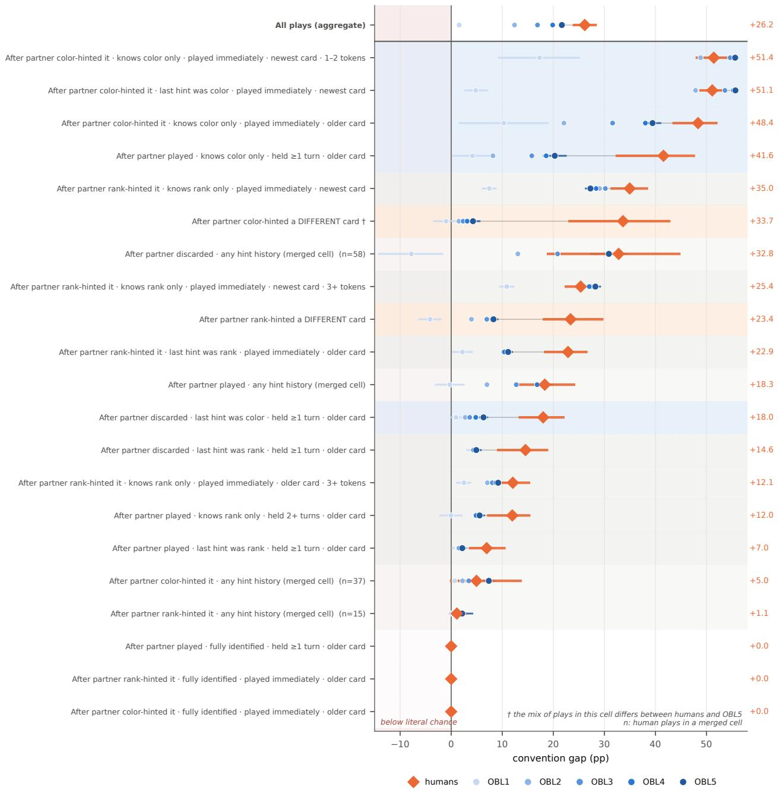  
Figure 1: Per-category convention gap for all six populations on the shared taxonomy. Rows are the cells of the shared taxonomy (§2.4); a row exists only if every population has enough plays in it. Markers are estimates on the estimation halves; bars are 95% bootstrap intervals (human pairs or agent games resampled). The right column gives each row’s human value. The top row is the corpus-level aggregate over all plays (+26.16 [+24.05, +28.28] pp humans; +1.57 [+1.33, +1.81] to +21.68 [+21.34, +22.02] pp for levels 1–5). † marks the one cell where the mix of plays differs between humans and level 5 (Appendix Fig. 10); n is the number of human plays in a merged cell. Row shading: indirect reference (orange), color known (blue), rank known (gray), merged (light gray), fully identified (unshaded); the strip left of zero marks gaps below literal chance. Reading the row labels: each row is one play context, described left to right by (i) the partner’s action just before the play (“After partner color-hinted it”: a color hint that touched the played card; “. . . color-hinted a DIFFERENT card”: the hint touched another card, i.e., indirect reference); (ii) what hints have revealed about the played card (“knows color only”, “fully identified”; “last hint was color” when only the most recent hint type is kept); (iii) timing (“played immediately” after that hint, or “held ≥1 turn”); (iv) hand position (newest or older card); and, where it splits the data, (v) the hint tokens available. “Merged cell” rows pool rarer contexts that share the listed parts.

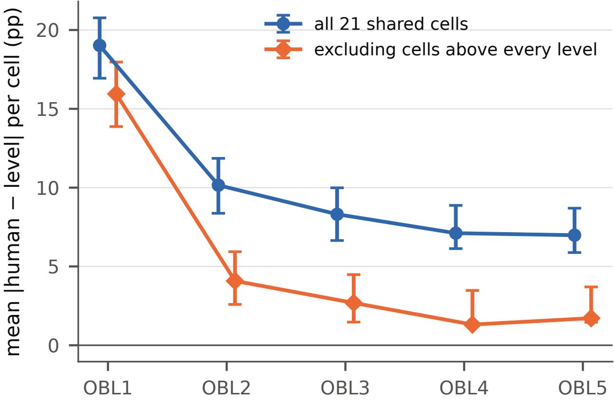  
Figure 2: Mean per-cell distance between each level’s convention-gap profile and the human profile. For each level k, the distance $D _ { k }$ : the mean of |human − level| over the 21 category rows of Fig. 1 (pp), with 95% jointbootstrap intervals. Blue: all 21 cells. Orange: the 11 cells where the human value exceeds every level’s (identified by the nearest-level bootstrap of Appendix F) are excluded, leaving the conventions both populations share. Intervals are bootstrap percentiles around the full-sample value and are asymmetric by construction: resampling noise can only inflate a near-zero per-cell difference. The contrasts quoted in the text cancel this bias within draws. This per-cell distance is not the difference of the aggregates in the top row of Fig. 1.

The gap is not skill. Could the human margin simply reflect stronger play? Level 5 outscores the average human game (24.16 against the corpus mean of 18.52), while humans have the larger gap. The gap says how far plays depart from their literal prediction, not how high a player scores. Two score-selected corpora point the same way. The AH2AC2 corpus, whose selection rule puts its mean score (23.45) close to level 5’s, has a gap of +27.62 [+27.27, +27.97] pp, and hanab.live games above the same score floor give +27.20 [+26.29, +28.04] pp (Appendix E). Both select on final score, and so on failed plays, so they describe these games rather than control for skill. Because the platform’s community publishes and teaches a convention system, the estimate describes taught play, not typical human play.

## 3.1.2 The human profile replicates on an independently collected corpus

We next replicated the profile on a second corpus. The AH2AC2 benchmark [Dizdarevic et al., 2025] independently´ released 1858 two-player games from the same platform and community; the two collections share no game records. Replayed through the identical pipeline, this corpus has a gap of +27.62 [+27.27, +27.97] pp against the hanab.live corpus’s +26.16 [+25.31, +26.99] pp, both clustered by game (AH2AC2 has no player identifiers, so pair clustering is not possible). Its category profile correlates with that of the hanab.live corpus at $r = 0 . 9 7$ , and it shows the same indirect-reference excess. Its differences are consistent with its selection rule, and on the sub-population the two corpora share, the cell values agree closely (+50.4 against +50.5 pp on color-known cards). The structure and the indirect-reference excess are properties of the community’s play, not of how the hanab.live corpus was built (Appendix E).

Table 1: How often each convention situation is entered (share of plays, %), with the situation’s convention gap (pp) in parentheses. Human columns: the hanab.live corpus (all skill levels) and the independently collected AH2AC2 corpus (score-selected). Indirect-reference rows use the frozen level-5 categories of §2.4; for OBL1 they give shares only. Gaps are estimates; intervals for the values discussed are in the text.
<table><tr><td>Situation</td><td>OBL1</td><td>OBL5</td><td>Humans (hanab.live)</td><td>Humans (AH2AC2)</td></tr><tr><td>Fresh color hint</td><td>18.1 (+1.0)</td><td>40.4 (+40.3)</td><td>29.0 (+40.9)</td><td>31.5 (+42.7)</td></tr><tr><td>Fresh rank hint</td><td>36.9 (+3.7)</td><td>24.3 (+11.9)</td><td>24.5 (+20.1)</td><td>21.6 (+22.1)</td></tr><tr><td>Hinted earlier</td><td>40.6 (+1.3)</td><td>33.7(+6.4)</td><td>41.1 (+16.8)</td><td>45.2 (+19.4)</td></tr><tr><td>Unhinted, newest</td><td>2.0 (−13.9)</td><td>0.8 (+23.5)</td><td>2.9 (+48.8)</td><td>1.1 (+37.2)</td></tr><tr><td>Unhinted, older</td><td>2.3 (−9.8)</td><td>0.7 (+18.3)</td><td>2.5 (+43.2)</td><td>0.7 (+35.3)</td></tr><tr><td>Indirect ref. (color)</td><td>0.40</td><td>0.28 (+13.7)</td><td>2.64 (+61.3)</td><td>1.08 (+48.9)</td></tr><tr><td>Indirect ref. (rank)</td><td>0.92</td><td>0.19 (+10.3)</td><td>1.33 (+41.1)</td><td>0.81 (+39.9)</td></tr></table>

## 3.1.3 Where no level approaches the human gap

On the situations both populations share, humans match level 5 where it plays most often (fresh color-hint plays, $+ 4 0 . 9 \left[ + 3 8 . 2 , + 4 3 . 4 \right] \mathrm { p p }$ against +40.3 pp) and exceed it modestly elsewhere. One situation is different in kind.

The two populations differ not only in a situation’s gap but in how often they enter it at all (Table 1). The dominant shared situation is a mirror image: level 5 puts 40.4% of its plays into the fresh color-hint response, against 29.0% for humans. Indirect reference shows the opposite pattern: humans enter it 2.64% of the time against level 5’s 0.28%, and they play unhinted cards 2.9% (newest card) and 2.5% (older cards) of the time, where level 5 almost never does. Level 5 does not merely have a smaller gap in these situations; it seldom enters them.

Indirect reference: a taught convention, rare in level 5’s play. Where the partner’s hint touched a different card, humans reach +61.3 [+54.4, +66.0] pp against level 5’s +13.7 pp (n = 238 human plays); for rank hints the values are +41.1 [+31.9, +48.8] against +10.3 pp. The sharpest case is an unhinted card played immediately after a color hint that touched another card (n = 193). There, the literal failure probability is 69.6%, but the actual failure rate is only 5.7% (Appendix Table 6). Level 5 rarely makes this play, and its gap there is small (Appendix Fig. 10). The human pattern matches a taught convention (the community’s finesse) in which a hint about one card tells the partner to play a different card from an agreed slot (§4 discusses why the hierarchy may lack it).

Unhinted cards. Humans reach +48.8 [+38.4, +55.6] pp on unhinted newest cards and +43.2 [+31.1, +51.5] pp on older ones, against +23.5 and +18.3 pp for level 5. Most of these human plays (286 of 484) follow a hint to another card, which places them in indirect reference. On the remaining plays, mostly after a partner play or discard, the human gap is +29.4 [+17.3, +40.1] pp against level 5’s +24.0 pp, a difference of +5.3 [−7.7, +17.1] pp (Appendix Table 6).

The largest differences survive matching on card configuration. Indirect reference sits in merged cells of the shared taxonomy, which collect the finer situations that did not reach every population’s $n _ { \mathrm { m i n } }$ . A single label can therefore hold different plays for different populations, so we asked whether the split survives a finer classification. Splitting the two indirect-reference cells by the played card’s own hint history shows that it does (Appendix Fig. 10), and the difference has three parts that all point the same way. Occupancy: humans enter “after the partner colorhinted a different card” mostly holding unhinted cards, the finesse configuration, while the hierarchy’s rare entries hold rank-known or fully-identified cards. The human-specific sub-cells are nearly empty for every agent level, and that emptiness is itself a finding. Rate on matched sub-populations: where both populations do occupy a sub-cell, the difference remains. On the finesse sub-cells humans read +63.9 and +45.4 pp against level 5’s +6.1 and +1.6 pp; on the color-known sub-cell, +50.5 against +26.3 pp with non-overlapping intervals; and this color-known sub-cell agrees closely across the two corpora (§3.1.2). Configuration: which cards a population holds when it acts in these situations suggests a different rule for when such a play is allowed. (The merged shared-taxonomy cells of Fig. 1 average over this composition, which is why their values sit below the frozen-cell values quoted here.) Thus the finer classification does not dissolve the finding; it sharpens it.

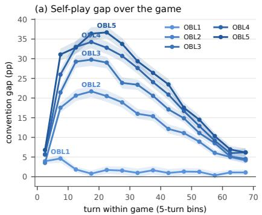

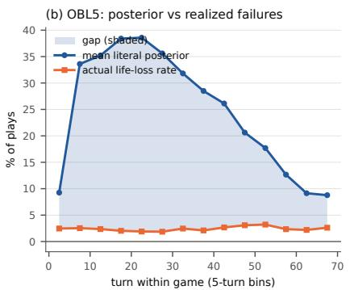

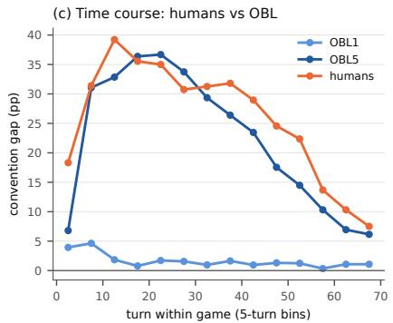  
Figure 3: Convention gap by turn within the game. (a) Convention gap by 5-turn bin for levels 1–5 in self-play (both players’ plays; bins with $\geq 5 0 0$ plays; bands are 95% game-clustered bootstrap intervals). The inverted U rises with level, peaking $\mathrm { a t + 2 1 . 7 [ + 2 0 . 3 , + 2 3 . 1 ] }$ pp (level 2) $\mathrm { t o + 3 6 . 7 \ : [ + 3 5 . 2 , + 3 8 . 2 ] \ : p p }$ (level 5) in the mid-game. (b) Level 5 decomposed: the mean literal failure probability of the chosen plays against the realized life-loss rate; the shaded area is the gap. The realized rate is flat; the literal price of the plays is what moves. (c) Humans against levels 1 and 5 by 5-turn bin (bins with $\geq 2 0 0$ human plays); lines are estimates without intervals.

## 3.2 Where the conventions are used

To locate the gap, we attach to each play its context (turn, the hint history of the played card, the partner’s immediately preceding action, hand position, and token state) and ask when, in which situations, and in which feature of the game state it sits

## 3.2.1 The gap peaks in the mid-game

We first broke the gap down by turn. For levels 2–5 the gap follows an inverted U over the game: close to zero in the opening (+3.5 to +6.8 pp in turns 0–4), peaking in the mid-game (+36.7 pp at level 5, in the 5-turn bin starting at turn 20), then falling to between +4.1 and +6.2 pp late (Fig. 3a). Level 1 stays low throughout (+0.3 to +4.6 pp across all bins). At level 5 the shape comes from the literal risk of the chosen plays: the actual failure rate is flat at 1.9–3.2% across all bins, while the mean literal failure probability rises and falls (Fig. 3b). In this sense conventions are used most in the mid-game: there the plays carry the most literal risk yet fail no more often.

Human play follows the same inverted U (Fig. 3c): similar at the peak (+39.2 against level $5 \mathrm { ^ s + 3 6 . 7 p p ) }$ , but above level 5 in the opening bin (+18.3 against +6.8 pp) and in every late bin from turn 40 on (6 of 6 bins). The human gap rises earlier and stays high longer than the agents’.

## 3.2.2 One situation contributes most of level 5’s gap

We next sorted every play into the five hand-crafted situations. One situation dominates: a card played immediately after the partner color-hinted it. A color hint gives the suit and says nothing about the rank, so playing at once is reckless by the literal reading. At level 5 such plays have a mean literal failure probability of 41.1% but fail only 0.8% of the time, a gap $\mathrm { o f + 4 0 . 3 \ : [ + 3 9 . 7 , + 4 0 . 9 ] \mathrm { p p } }$ . The situation grows from 18.1% of plays at level 1 to 40.4% at level 5, while its gap grows from +1.0 to +40.3 pp (Table 1). That one situation contributes 75.1% of level 5’s total gap (share × gap in Table 1, over the level-5 total). To a first approximation, the rise of the gap with level reflects both partners step-by-step adoption of one rule: a color hint marks a card as playable.

Unhinted plays change sign across the OBL hierarchy. They are rare and, read literally, risky. Level 1 loses more often than literal chance predicts $( - 1 3 . 9 \ [ - 1 7 . 6 , - 9 . 9 ]$ pp on the newest card), while level 5 reaches $+ 2 3 . 5 \ : [ + 1 7 . 3 , + 2 9 . 6 ] \ : \mathrm { p p }$ in the same situation. One reading is that the absence of a warning carries information: had the newest card been dangerous, the partner might have acted. In human play, most unhinted plays instead follow a hint to another card (§3.1).

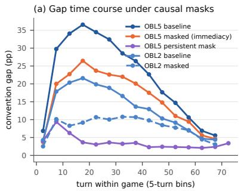

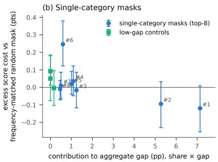

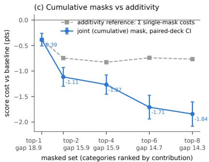  
Figure 4: Gap and score effects of the masking interventions. (a) Gap time course under the whole-channel masks: level 5 baseline, immediacy mask and persistent mask; level 2 baseline and mask. The immediacy mask scales the mid-game peak down while preserving its shape $( + 3 6 . 6  + 2 6 . 4$ pp; the blocked plays reappear later), whereas the persistent mask removes the peak (+9.4 pp). (b) Excess score cost of each single-category mask (the paired score cost of masking the category minus the cost of a frequency-matched random mask at the same trigger rate) against the category’s contribution to the aggregate gap (its share of plays times its gap, in pp), with low-gap controls in a second color. (c) Raw paired score cost of masking the top-k categories jointly, against the additivity reference (the sum of the k single-mask costs); raw costs rather than excess, so the super-additivity does not depend on the null-curve fit; the second line of each x-axis label gives the total gap under that mask (pp; baseline 21.3). In (b) and (c), bars are 95% paired-deck bootstrap intervals. One category costs little; several together cost more than the sum of their single costs.

## 3.2.3 At level 5 the gap tracks what the played card is known to be

We then read the induced categories across levels to see which feature of the game state carries the gap (full crosslevel reading: Appendix A). At level 5 the induced categories explain $R ^ { 2 } = 0 . 5 7 0$ of the per-play residual variance out of sample, against 0.215 for the five hand-crafted situations (Appendix Fig. 6). The carrier moves. At levels 2–3 the main split is hand position; by level 4 it is the played card’s hint history; at level 5 it is color-only knowledge itself, what the card is known to be rather than how fresh the hint was. The two highest-gap categories in the whole taxonomy are delayed color-only plays, played two to three actions after the hint (+62.2 [+60.1, +64.0] pp) and four or more $( + 6 2 . 2 \left[ + 6 0 . 0 , + 6 4 . 2 \right] \mathrm { p p } )$ , above the largest fresh-hint categories (Appendix Fig. 5). The hand-crafted map filed these plays under hinted earlier at a diluted +6.4 pp. Thus the hint, or the later absence of a warning, carried information beyond literal content.

## 3.3 What removing conventions costs

If high-gap channels mark conventions the policy relies on, then blocking them should cost more score than blocking equally frequent plays at random (design in §2.5). It does, but only when several channels are blocked together, and how it does is the finding: the taxonomy ranks categories by their contribution to the gap, and that ranking does not predict what removing a channel costs.

## 3.3.1 Blocking the color-hint response reroutes the convention rather than destroying it

We first masked the OBL hierarchy’s dominant convention as a whole. Blocking the immediate response to a partner color hint, for both players, changes score by $- 2 . 0 3 \ [ - 2 . 2 5 , - 1 . 8 1 ]$ points at level $5 ~ ( 2 4 . 1 0 ~  ~ 2 2 . 0 7 )$ Blocking it for one player has a little under half that effect $( - 0 . 9 2 \ [ - 1 . 1 0 , - 0 . 7 3 ] )$ , and only the blocked player’s gap moves $( + 2 2 . 0 ~ [ + 2 1 . 4 3 , + 2 2 . 4 8 ] ~  ~ + 1 5 . 5 ~ [ + 1 4 . 9 4 , + 1 5 . 9 7 ] \mathrm { p p } , \mathrm { a g a i n s t } + 2 0 . 6 ~ [ + 2 0 . 1 6 , + 2 1 . 1 3 ] ~  ~ + 0 . 0 9 2 2 ] ,$ $+ 2 0 . 1 \ [ + 1 9 . 5 6 , + 2 0 . 5 6 ]$ pp for the partner; Appendix D).

But the blocked convention is not destroyed; it is rerouted. Under the immediacy mask the displaced plays reappear one turn later: the hinted earlier share doubles $( 3 4 \%  6 6 \% )$ and its gap triples $( + 6 . 4 \ [ + 5 . 9 , + 6 . 9 ] \  $ $+ 1 7 . 5 \ [ + 1 7 . 1 , + 1 8 . 0 ] \mathrm { p p } )$ at an unchanged loss rate. The convention’s content survives; only its timing breaks, and the score loss is consistent with a cost of delay. Removing these plays instead, by forbidding the play of color-hintedonly cards altogether, changes score by $- 5 . 7 7 \left[ - 6 . 0 4 , - 5 . 4 9 \right]$ points and collapses the gap to $+ 3 . 5 \left[ + 3 . 1 7 , + 3 . 7 4 \right] \mathrm { p p }$ with the replaced actions shifting toward discards (40%; Appendix D). The two masks leave different marks on the time course (Fig. 4a). The same immediacy mask at level 2 changes score by $- 1 . 2 1 \ [ - 1 . 3 8 , - 1 . 0 4 ]$ : the cue matters there too, but less.

## 3.3.2 Single masks cost little beyond generic disruption

We next asked whether the observational ranking predicts the cost of removal. We masked each of the top eight categories by observational contribution (share × gap) one at a time (Fig. 4b). The three low-gap control categories give excess costs of $+ 0 . 0 5 \ [ - 0 . 0 8 , + 0 . 1 8 ] , + 0 . 0 9 \ [ + 0 . 0 1 , + 0 . 1 8 ]$ and $- 0 . 0 0 \ [ - 0 . 1 0 , + 0 . 1 0 ]$ points, so the control curve is accurate to about a tenth of a point: the size of the single-mask excesses below, and an order of magnitude below the joint-mask interaction of §3.3. Only the two largest-contribution categories have negative excess estimates $\left( - 0 . 1 2 \left[ - 0 . 2 5 , + 0 . 0 1 \right] \right.$ and $- 0 . 0 9 \left[ - 0 . 2 3 , + 0 . 0 3 \right]$ points), and both intervals reach zero. Apart from category #6, the others lie between −0.02 and +0.03. With eight categories, two of which carry most of the leverage, we do not read a dose–response relation into them (Appendix D). Even the top category is mostly generic disruption. Category #1 holds 12.6% of plays at +57 pp, and masking it changes score by $- 0 . 3 9 \ [ - 0 . 5 1 , - 0 . 2 6 ]$ points raw, but a random mask at the same trigger rate already changes it by −0.27 (Appendix Table 5); the excess specific to the convention is $\mathrm { \ o n l y - 0 . 1 2 \ } [ - 0 . 2 5 , + 0 . 0 1 ]$ . Thus most of a single mask’s cost is disruption, not lost meaning.

Masking category #6 raises the score beyond the random mask (excess $+ 0 . 2 5 \ [ + 0 . 1 2 , + 0 . 3 8 ]$ points). A preregistered out-of-sample replication gives a smaller excess $( + 0 . 1 2 \ : [ + 0 . 0 4 , + 0 . 2 0 ]$ pooled; Appendix D). We read this as no detectable positive value for this convention, with the first estimate inflated by selecting among eight categories.

## 3.3.3 Joint masks cost far more than the sum of single masks

If single masks are cheap because meaning reroutes, then closing the substitutes together should cost more than their sum. It does. Masking the top eight categories together changes score by −1.84 points, against −0.77 for the sum of the eight single masks, a super-additive interaction of $- 1 . 0 8 \left[ - 1 . 4 7 , - 0 . 7 2 \right]$ points (joint minus summed; Fig. 4c), and lowers the total gap by a third, from 21.3 to $1 4 . 3 \ : [ + 1 4 . 0 0 , + 1 4 . 6 8 ]$ pp (Appendix Table 5). This is consistent with rerouting: each single mask leaves substitute channels open, and joint masks close them together (the redistribution is in Appendix D).

The interventions push both agents off their training distribution, so these costs are upper bounds under retraining: they price a channel for this fixed pair of policies.

## 4 Discussion

In this study, we placed human play and the OBL hierarchy on one scale, broke the convention gap down by situation and by turn, and intervened on the agents’ policies against a frequency-matched control. We found that the two populations behave alike in frequent situations, differ in indirect reference, where no level approaches the human gap, and that a convention’s gap contribution does not predict what its removal costs.

Are humans and the OBL hierarchy different? On the conventions the populations share (everything frequent), they are similar cell by cell, and humans are not significantly closer to level 5 than to level 2. The differences that survive every control are differences in kind, not only in size. Indirect reference shows a human gap that no level approaches: +50.5 against level $5 ^ { \circ } \mathrm { s + 2 6 . 3 p p }$ on the color-known sub-cell, replicated across two independently collected corpora. On unhinted cards that do not follow a hint to another card, the human gap differs from level 5’s by $+ 5 . 3 \left[ - 7 . 7 , + 1 7 . 1 \right] \mathrm { p f }$ . Humans also enter indirect reference far more often, and their gap rises earlier and stays high longer. The score-selected AH2AC2 corpus shows the same pattern, and clones trained on human play keep the shared conventions while losing the human-specific cells (Appendix H). The populations have similar gaps on the conventions they share and differ on indirect reference.

Gap contribution is not importance. The split in §3.3 may apply beyond Hanabi. Removing the eight highestcontribution conventions cuts the total gap by a third but costs under two points of score, consistent with rerouting.

The cost appears only when the substitutes are closed together, and then it is more than additive. A channel’s gap contribution and how hard it is to replace are therefore different quantities. Any interpretability method that ranks channels by an observational measure and reads that ranking as importance may inherit this problem; the fix is joint ablation against a matched null (§3.3).

What ZSC gets, and what it does not. Off-belief learning’s level 1 is trained to read past actions only for their literal content, which needs no shared convention. Human players appear to coordinate the opposite way: they arrive already sharing a taught system (Appendix E.5), and their gap rises earlier in the game than the agents’ (§3.2). Indirect reference suggests what is missing: a representation of hints as speech acts about the whole hand [Frank and Goodman, 2012] rather than as signals about the touched card. Off-belief learning reads each past action as if a fixed base policy had produced it, so a hint on card A carries only what that policy put into it, and level 5 seldom plays card B after it. Depth alone does not account for the difference (Appendix F.7). One interpretation is that a hierarchy whose beliefs rest on a fixed base policy cannot express such a hint.

Supporting analyses. The appendix adds four results: the realized gap depends on the partner (lower level in seat 0; Appendix B); the agent-grown taxonomy transfers to human play (Appendix E); depth of reasoning does not separate the populations (Appendix F); and clones of both populations reproduce the split between shared conventions and human-specific cells (Appendix H).

What the estimates cover. The category analysis is descriptive: categories are defined by the action the policy chose, so a category’s gap says how far its plays depart from the literal prediction, not what would happen if the situation were created on purpose. §3.3 supplies the causal complement for the agents’ own conventions; indirect reference cannot be priced this way, because no level enters it often enough to mask. The human corpus comes from a community that publishes and teaches a convention system, so its estimates describe taught play, not typical human play; the pattern replicates on a second, score-selected corpus. All of this is one game; the method needs only an exact literal baseline and a maskable policy.

## Reproducibility

The metric implementation is public, released with the previous study [Fukushima et al., 2026], and used at a pinned commit. Every game is replay-verified against its ground-truth score, all numbers were recomputed by a separate audit pipeline, and all our intervals but one bootstrap (Appendix G) reproduce exactly from recorded seeds.

## References

Nolan Bard, Jakob N. Foerster, Sarath Chandar, Neil Burch, Marc Lanctot, H. Francis Song, Emilio Parisotto, Vincent Dumoulin, Subhodeep Moitra, Edward Hughes, Iain Dunning, Shibl Mourad, Hugo Larochelle, Marc G. Bellemare, and Michael Bowling. The hanabi challenge: A new frontier for AI research. Artificial Intelligence, 280:103216, 2020.

Yoav Benjamini and Yosef Hochberg. Controlling the false discovery rate: A practical and powerful approach to multiple testing. Journal ofthe Royal Statistical Society: Series B (Methodological), 57(1):289–300, 1995.

Alan S. Blinder. Wage discrimination: Reduced form and structural estimates. Journal of Human Resources, 8(4): 436–455, 1973.

Leo Breiman, Jerome H. Friedman, Richard A. Olshen, and Charles J. Stone. Classification and Regression Trees. Wadsworth, 1984.

Colin F. Camerer, Teck-Hua Ho, and Juin-Kuan Chong. A cognitive hierarchy model of games. Quarterly Journal of Economics, 119(3):861–898, 2004.

A. Colin Cameron, Jonah B. Gelbach, and Douglas L. Miller. Bootstrap-based improvements for inference with clustered errors. Review ofEconomics and Statistics, 90(3):414–427, 2008.

Micah Carroll, Rohin Shah, Mark K. Ho, Thomas L. Griffiths, Sanjit A. Seshia, Pieter Abbeel, and Anca Dragan. On the utility of learning about humans for human-AI coordination. In Advances in Neural Information Processing Systems (NeurIPS), 2019.

Herbert H. Clark. Using Language. Cambridge University Press, 1996.

Brandon Cui, Hengyuan Hu, Luis Pineda, and Jakob Foerster. K-level reasoning for zero-shot coordination in Hanabi. In Advances in Neural Information Processing Systems (NeurIPS), 2021.

Tin Dizdarevic, Ravi Hammond, Tobias Gessler, Anisoara Calinescu, Jonathan Cook, Matteo Gallici, Andrei Lupu,´ and Jakob Nicolaus Foerster. Ad-hoc human-AI coordination challenge. In International Conference on Machine Learning (ICML), volume 267 of Proceedings of Machine Learning Research, pages 13900–13937, 2025. arXiv:2506.21490.

Michael C. Frank and Noah D. Goodman. Predicting pragmatic reasoning in language games. Science, 336(6084): 998, 2012.

Makoto Fukushima, Hua-Dong Xiong, and Ehsan Moradi Pari. The convention gap: Beyond literal content in human-AI cooperation. arXiv preprint arXiv:2609.11489, 2026. URL https://doi.org/10.48550/arXiv. 2609.11489.

Noah D. Goodman and Michael C. Frank. Pragmatic language interpretation as probabilistic inference. Trends in Cognitive Sciences, 20(11):818–829, 2016.

H. Paul Grice. Logic and conversation. In Peter Cole and Jerry L. Morgan, editors, Syntax and Semantics 3: Speech Acts, pages 41–58. Academic Press, 1975.

H-Group. H-Group conventions. https://hanabi.github.io, 2026. Community convention reference; accessed 2026-08-31.

Hanab Live. Hanab Live. https://hanab.live, 2026. Public game logs; accessed 2026-08-31.

Hengyuan Hu, Adam Lerer, Alex Peysakhovich, and Jakob Foerster. “Other-play” for zero-shot coordination. In International Conference on Machine Learning (ICML), 2020.

Hengyuan Hu, Adam Lerer, Brandon Cui, Luis Pineda, Noam Brown, and Jakob Foerster. Off-belief learning. In International Conference on Machine Learning (ICML), 2021.

Evelyn M. Kitagawa. Components of a difference between two rates. Journal ofthe American Statistical Association, 50(272):1168–1194, 1955. doi: 10.1080/01621459.1955.10501299.

David Lewis. Convention: A Philosophical Study. Harvard University Press, Cambridge, MA, 1969.

Keane Lucas and Ross E. Allen. Any-play: An intrinsic augmentation for zero-shot coordination. In International Conference on Autonomous Agents and Multiagent Systems (AAMAS), 2022.

Andrei Lupu, Brandon Cui, Hengyuan Hu, and Jakob Foerster. Trajectory diversity for zero-shot coordination. In International Conference on Machine Learning (ICML), 2021.

Rosemarie Nagel. Unraveling in guessing games: An experimental study. American Economic Review, 85(5):1313– 1326, 1995.

Ronald Oaxaca. Male-female wage differentials in urban labor markets. International Economic Review, 14(3): 693–709, 1973.

Andy Shih, Arjun Sawhney, Jovana Kondic, Stefano Ermon, and Dorsa Sadigh. On the critical role of conventions in adaptive human-AI collaboration. In International Conference on Learning Representations (ICLR), 2021.

Ho Chit Siu, Jaime Pena, Edenna Chen, Yutai Zhou, Victor Lopez, Kyle Palko, Kimberlee Chang, and Ross Allen.˜ Evaluation of human-AI teams for learned and rule-based agents in Hanabi. In Advances in Neural Information Processing Systems (NeurIPS), 2021.

Dale O. Stahl and Paul W. Wilson. On players’ models of other players: Theory and experimental evidence. Games and Economic Behavior, 10(1):218–254, 1995.

D. J. Strouse, Kevin R. McKee, Matt Botvinick, Edward Hughes, and Richard Everett. Collaborating with humans without human data. In Advances in Neural Information Processing Systems (NeurIPS), 2021.

Johannes Treutlein, Michael Dennis, Caspar Oesterheld, and Jakob Foerster. A new formalism, method and open issues for zero-shot coordination. In International Conference on Machine Learning (ICML), 2021.

Maksymilian Wolski, Nicholas Hoernle, Johannes Forkel, and Jakob Foerster. Is inter-seed cross-play enough? Evaluating the robustness of zero-shot coordination algorithms to implementation details. arXiv preprint arXiv:2608.03644, 2026.

## A The metric and the category-induction method

This appendix defines the literal observer behind Eq. 1, the context descriptor and cell-size rule used to induce categories, and how the literal posterior rises with level.

## A.1 The literal observer and a worked example

At a play action, the literal observer knows, for every card in the acting player’s hand, the set of identities consistent with all positive and negative hint constraints received so far, and it counts copies over every visible zone (the partner’s hand, the discard pile, the fireworks). Because a hint that touches one card constrains the identities available to another, the observer computes the joint distribution over the whole hand, weighting each joint assignment by the number of ways to draw it without replacement from the hidden pool, and marginalizes to the played card. The probability that the played card is unplayable under this distribution is the play’s literal failure probability P(life loss); Eq. 1 averages it over a set of plays and subtracts the realized failure rate.

A schematic example with five plays illustrates the arithmetic (the values here are illustrative, not data). Suppose the literal failure probabilities of five played cards are 0.40, 0.40, 0.40, 0.20 and 0.60, and exactly one of the five plays fails. The mean literal failure probability, the literal price of the plays, is 0.40; the realized failure rate is 0.20; the gap is +20 percentage points: the plays succeeded more often than their literal information justified. A gap near zero does not mean the players were well informed, only that their success rate matches the literal price of the plays they chose. The gap is signed: plays can beat or miss their literal price. It cannot exceed the mean literal price.

Two properties matter for everything downstream. First, the baseline is exact: there is no learned component, so a decomposition of the aggregate (by turn, by situation, by category) is free of model error. Second, the observer conditions on observation content but not on action choice: the fact that the partner chose this hint at this moment carries no weight. What the choice itself conveys can show up in the gap, but need not: subsets of plays with gaps of opposite sign can cancel, and plays whose outcome literal information fixes give a gap of exactly zero.

## A.2 The six-component descriptor

Every play is described by six components of its context:

1. Partner’s immediately preceding action: play, discard, color hint or rank hint, each hint distinguished by whether it touched the played card (touch) or a different card (other), or no preceding action (first move).

2. Hint relation to the board (hints only): whether the hinted color’s stack is open, or the hinted rank is currently needed on some stack.

3. Hint history of the played card: the ordered pattern of hint types that ever touched it (none, C, R, CR, RC, CC+, RR+, or mixed, meaning three or more).

4. Lag: actions since the last hint that touched the card (1, 2–3, 4+, or unhinted). In two-player play only odd lags occur, so lag 2–3 means exactly one own action between the hint and the play.

5. Hand position: newest card or older.

6. Hint-token stock: 0, 1–2, or 3+ tokens.

The cross-product yields 303–374 observed context types per level with a heavy-tailed frequency distribution; the number of types needed to cover 90% of plays is, per level, OBL1=90, OBL2=74, OBL3=72, OBL4=70, OBL5=71.

## A.3 Cell size, backoff, and the split

The minimum cell size is derived, not chosen. With per-play residual standard deviation s (empirically 0.18–0.30 across levels, discovery half), estimating a cell mean to ±5 pp at 95% confidence requires $n _ { \mathrm { m i n } } = \lceil ( 1 . 9 6 s / 0 . 0 5 ) ^ { 2 } \rceil$ giving 52–139 from level 1 to level 5. A ±3 pp target would demand cells of 386 plays at level 5. Types that large cover only 77–82% (OBL2–5; OBL1 53%) of plays, below the 90% coverage we required, so more plays would fall into merged cells.

Types below $n _ { \mathrm { m i n } }$ merge by a fixed backoff ladder: drop tokens, then coarsen lag, then drop the board relation, then collapse hint history to its last type, then drop position, leaving at worst the partner’s preceding action alone. No play therefore falls into an opaque other bucket, and every merged cell retains a readable label. Categories and the CART tree are fit on a discovery half (games split 50/50 within level and seed, with a recorded split seed); every reported statistic (cell means, intervals, FDR flags, $R ^ { 2 } )$ comes from the held-out estimation half (Table 2). The per-category bootstrap intervals reproduce only up to bootstrap error (Appendix G).

Table 2: Play actions entering the category induction, by level and split half. Level 1 has one seed model; levels 2–5 pool five seed models each.
<table><tr><td>Level</td><td>Discovery</td><td>Estimation</td><td>Total</td></tr><tr><td>OBL1</td><td>11,309</td><td>11,482</td><td>22,791</td></tr><tr><td>OBL2</td><td>60,573</td><td>60,534</td><td>121,107</td></tr><tr><td>OBL3</td><td>61,228</td><td>61,487</td><td>122,715</td></tr><tr><td>OBL4</td><td>61,761</td><td>61,842</td><td>123,603</td></tr><tr><td>OBL5</td><td>62,038</td><td>61,996</td><td>124,034</td></tr><tr><td>All</td><td>256,909</td><td>257,341</td><td>514,250</td></tr></table>

## A.4 How the literal posterior rises with level

The mean literal posterior is a property of which plays a policy selects, not of the game. In self-play it rises from 7.8% (level 1) to 24.1% (level 5); the previous study reports this rise and the same plays by hint count [Fukushima et al., 2026]. We split this rise into two simultaneous shifts. Composition: higher levels shift plays from cards touched by two or more hints to cards touched by one. The share of plays on a card touched by exactly one hint grows from 39% to 61%, while plays on cards touched by two or more hints shrink from 56% to 38%. Within-stratum: even among one-hint plays, higher levels accept literally riskier ones. The mean posterior within that stratum climbs from 12.8% to 37.3% while the realized loss rate of the same plays falls from 7.8% to 2.9%. A Kitagawa split of the rise [Kitagawa, 1955] puts +1.0 pp in composition and +15.2 pp within strata, with the composition term evaluated at level-1 stratum posteriors and the within-stratum term at level-5 shares. This is an accounting identity and assigns no cause. At these weights the composition term is small, because the shrinking share of plays on cards no hint touched partially offset the growing one-hint share.

## A.5 The induced taxonomy: full construction and cross-level results

## A.5.1 Data-induced categories

The five situations of §2.4 (fresh color hint, fresh rank hint, hinted earlier, unhinted newest, unhinted older; the handcrafted map below) explain only 0.215 of per-play residual variance at level 5. We therefore induce categories from the data, using the descriptor of §A.2 and the cell-size, backoff and split rules of §A.3; all reported statistics come from the estimation half with game-clustered bootstrap intervals and Benjamini–Hochberg control at $q = 0 . 0 5$ [Benjamini and Hochberg, 1995].

The induced taxonomy yields 105 categories at level 5 and explains $R ^ { 2 } = 0 . 5 7 0$ out of sample, matched by a depth-4 CART tree [Breiman et al., 1984] at 0.571, against 0.215 for the hand-crafted map (Fig. 6). At level 1 the taxonomy explains $R ^ { 2 } = 0 . 0 5 8$ and the CART tree 0.069. The low values do not mean that level 1 lacks structure.

Table 3: First split of the depth-4 CART tree at each level (discovery half). Hint history lists the hint types that touched the played card, in order (C: color, R: rank).
<table><tr><td>Level</td><td>Root split</td></tr><tr><td>1</td><td>Hint history: unhinted vs. hinted</td></tr><tr><td>2</td><td>Hand position: older vs. newest card</td></tr><tr><td>3</td><td>Hand position: older vs. newest card</td></tr><tr><td>4</td><td>Hint history: one color hint only vs. any other</td></tr><tr><td>5</td><td>Hint history: color hints only vs. any other</td></tr></table>

Its tree splits first on whether any hint touched the played card (Table 3), and its plays on cards no hint touched have negative gaps, −13.9 pp on the newest card and −9.8 pp on older cards (Table 1). These plays are rare (2.0% and 2.3% of level 1’s plays), so they can explain little per-play variance.

## A.5.2 The knowledge state, not the freshness of the hint, carries the gap

Reading the trees across levels shows the phenomenon relocating (Table 3). At levels 2–3 the root split is hand position; by level 4 it is the played card’s hint history; at level 5 it is color-only knowledge outright. As the OBL hierarchy deepens, what the card is known to be rises from a sub-split to the primary axis of the policy’s gap. What carries the gap is not the freshness of the cue but the knowledge state the cue produced.

The sharpest evidence comes from lag, the number of actions since the last hint that touched the card. If hint meaning decayed over time, gaps would fall with lag. Instead, the two highest-gap categories in the whole level-5 taxonomy are delayed color-only plays: the card was color-hinted, the player did something else first, then played it. The lag-2–3 category reads +62.2 [+60.1, +64.0] pp and the lag-4+ category +62.2 [+60.0, +64.2] pp, above the two largest fresh-hint categories at +56.8 [+56.4, +57.2] and +55.6 [+55.1, +56.2] pp (all four values are level-5 self-play, estimation half). Thus the hint, or the later absence of a warning, carried information beyond literal content; the gap does not say which. The hand-crafted map filed all of these under hinted earlier at a diluted +6.4 pp, which is how a +62.2 pp category disappears into a +6.4 pp situation.

Two further structures the hand-crafted map misses. Hand position separates otherwise matched fresh-color categories by 12.7–32.5 pp (levels 2–5), and token scarcity shifts the same situation by a few points (+54.4 at 0 tokens vs +55.5/+57.0 at 1–2/3+ tokens). Despite roughly a hundred categories per level, a handful of categories carry 80% of each level’s total gap (per level: OBL1=5, OBL2=7, OBL3=7, OBL4=7, OBL5=8). Seed-to-seed differences sit in the tail of the taxonomy (Appendix C).

This analysis is descriptive: categories condition on the action the policy chose, so a category’s gap says how far its plays depart from the literal prediction, not what would happen if the situation were induced. §3.3 supplies the causal complement.

## B Mixed-level play

This appendix gives the analysis behind the statement in §4 that the realized gap depends on the partner. §B.1 reports all ten mixed-level pairings, §B.2 localizes the effect in the fresh color-hint cue, and Appendix C repeats the per-agent comparison of §B.1 across seed combinations.

## B.1 Per-agent gaps in mixed-level play

The self-play ladder rises with level. It does not say what happens when two levels meet. We played all ten mixedlevel pairings (1000 games each, replay-verified) and computed ∆ separately for each side’s own plays (Fig. 7). In every game of this design the lower level held seat 0 and moved first, and this analysis uses no seat-reversed games. Each side’s statistics, and their comparison with self-play (which pools both seats), therefore include any seat effect. For scale, in the level-5 self-play baseline of §3.3, seat 0 has a gap of +22.0 [+21.43, +22.48] pp and seat 1 +20.6 [+20.16, +21.13] pp. The previous study reports level 1’s own gaps in these games [Fukushima et al., 2026]; the analysis below (the per-agent split across all ten pairings, its localization, and its seed behavior) is new here.

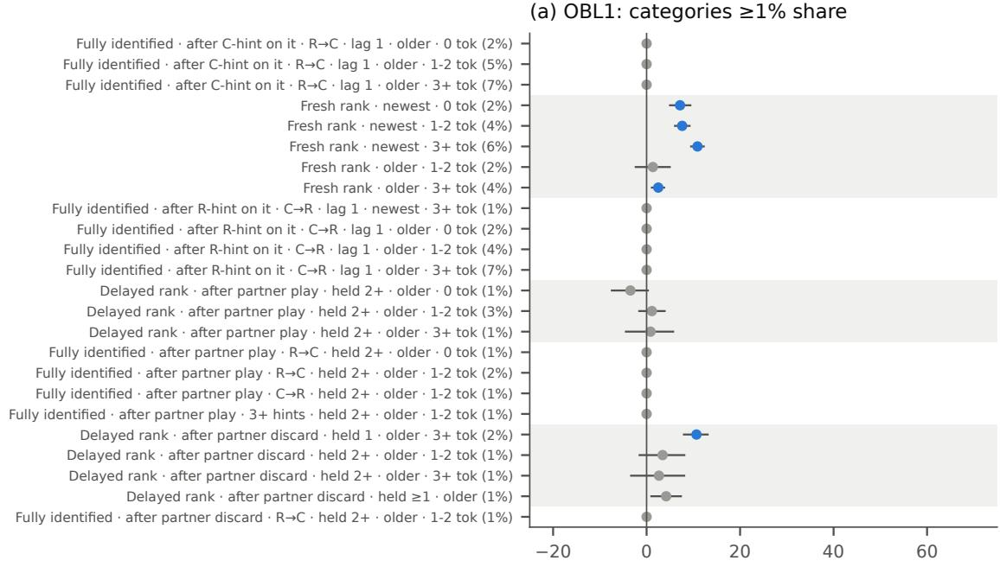

(b) OBL5: categories ≥1% share  
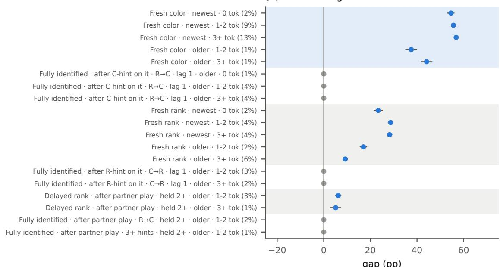  
OBL1: if hint\_history in {none}Figure 5: Induced-category gap ladders for level 1 (a) and level 5 (b). Categories holding $\geq 1 \%$ of plays (share OBL2: if position in {older}of plays in parentheses). Markers are gaps on the estimation half; bars are 95% game-clustered bootstrap intervals; blue markers pass Benjamini–Hochberg control at $q = 0 . 0 5$ if position in {older}, gray ones do not. Row shading gives the information family: color known (blue), rank known (gray), fully identified (unshaded). Reading the row $l a b e l s ,$ left to right: the hint type and timing (“Fresh color/rank”: played right after a hint of that type touched the card; “Delayed color/rank”: hinted earlier with that type and held before playing; “Fully identified”: color and rank both known, with the order of the hints, e.g. R→C for rank then color, or “3+ hints”; “Finesse-like (color/rank)”, used in later figures: played right f)after a hint of that type touched a different card, i.e., indirect reference); the partner’s action just before the play where h (d) Variance of the residual explainedit defines the category (“after partner play”, “after partner discard”, “after C-hint on it”); how long the card was held (“held 1”, “held $\geq 1 ^ { \mathfrak { s } }$ , “held $2 + \ '$ oown turns; “lag 1”: played immediately); hand position (newest or older card); and the hint tokens available $( ^ { \ast } 0 ^ { \cdot \prime } , ^ { \cdot \ast } 1 { - } 2 ^ { \cdot \prime } , ^ { \cdot \ast } 3 { + } \mathrm { t o k } ^ { \prime \ast } )$

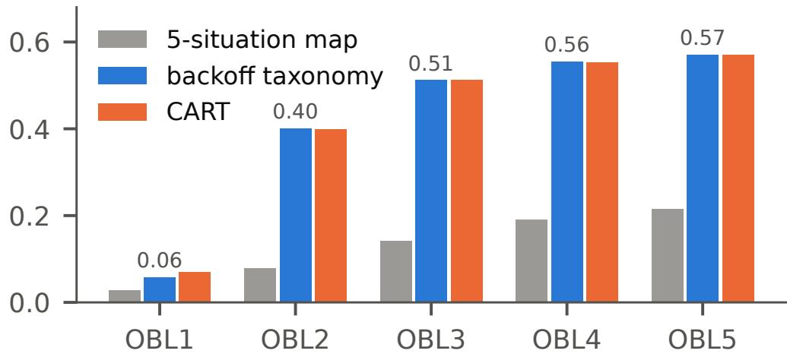

Figure 6: Out-of-sample variance explained, per level. Share of per-play residual variance explained on the estimation half (out-of-sample $R ^ { 2 }$ , y axis) by the hand-crafted five-situation map, the backoff taxonomy, and a depth-4 CART tree. All three explain little at level 1 $( R ^ { 2 } \leq 0 . 0 6 9 )$ ; the backoff taxonomy explains $R ^ { 2 } = 0 . 5 7 0$ at level 5.  
(b) Score falls with level distance  
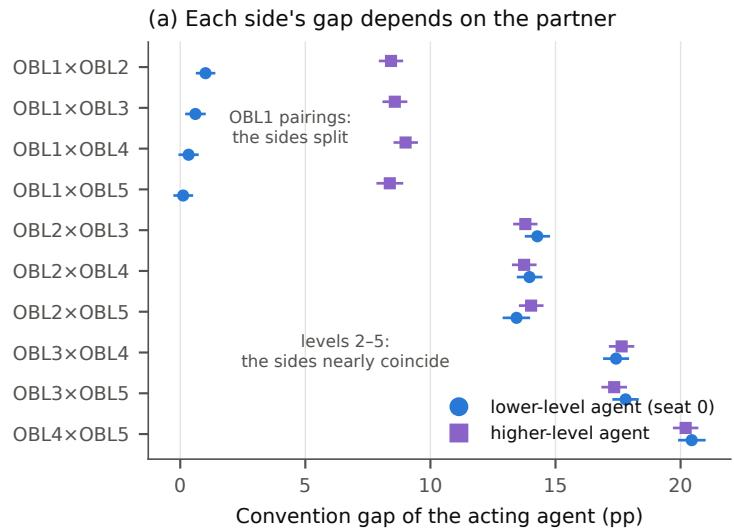

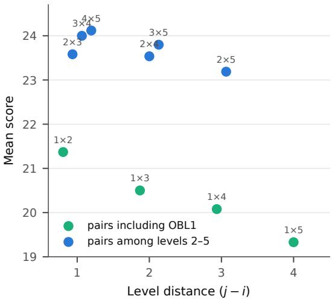  
Figure 7: Per-agent convention gap and score in the ten mixed-level pairings. (a) Convention gap of each acting agent per pairing; circles are the lower-level agent (always in seat 0), squares the higher-level one, with 95% gameclustered bootstrap intervals. In pairings involving level 1 the two sides separate; among levels 2–5 they nearly coincide. (b) Mean score of each pairing (no intervals shown) against level distance $j - i ,$ , for levels $i < j$ . Pairs including level 1 fall steeply with distance; pairs among levels 2–5 do not.

The gap an agent realizes depends on its partner. Paired with a higher level, level 1’s own aggregate gap falls toward zero: $\operatorname { f r o m } + 1 . 0 \ [ + 0 . 7 , + 1 . 3 ] \operatorname { p g }$ against level $\mathrm { 2 \ t o \ t i 0 . 1 \ [ - 0 . 2 , + 0 . 5 ] p p }$ against level 5, an interval that includes zero. A near-zero aggregate can still contain plays that depart from the literal prediction: on cards level 1 plays immediately after level 5 color-hinted them, its gap $\mathrm { i s + 1 . 9 \ [ + 1 . 3 , + 2 . 4 ] p p \ ( \ S B . 2 ) }$ . The higher-level agent, whose policy is unchanged, has gaps of $+ 8 . 4 \left[ + 8 . 0 , + 8 . 9 \right] \mathrm { t o } + 9 . 0 \left[ + 8 . 6 , + 9 . 4 \right]$ pp across the four level-1 pairings, against its own self-play values of $+ 1 2 . 4 0 \left[ + 1 2 . { \dot { 1 } } 0 , + 1 2 . 7 1 \right] \mathrm { \dot { t } o + 2 1 . 6 \dot { 8 } } \left[ + 2 1 . 3 4 , + 2 2 . 0 2 \right] \mathrm { p p }$ . One reading of the higher agent’s positive gap is that level 1’s hints tend to mark playable cards, so its hint choices carry some information beyond their literal content. The partner dependence is not confined to one phase of the game: level $5 \mathrm { { s } }$ entire time course flattens with level distance, its mid-game peak falling from +36.7 pp in self-play to +30.7 with level 3 and +13.8 pp with level 1 (§B.2, Fig. 8).

The higher agent’s loss rate rises, and score falls. The higher-level agent appears to keep taking convention-style plays that a level-1 partner’s hints do not license, and its added failures are localized. On plays made immediately after a partner color hint, the situation §3.2 identifies as the OBL hierarchy’s dominant cue, the higher agent’s failure rate rises from 0.8 to 1.0% in self-play to 4.6% (level 2) through 13.3% (level 5) when the hint comes from level 1. Level 1’s own failure rate in the same situation is 0.7 to 1.4%. Score falls monotonically with level distance, from 21.37 for $1 \times 2$ to 19.33 for 1 × 5 (Fig. 7b). From $1 \times 3 ~ \mathrm { o n }$ , the pair scores below level 1’s own self-play value of 21.09: level 1 scores more with a copy of itself than with level 3, 4 or 5.

Levels 2–5 are mutually compatible and blend. In this seating, the two sides’ gaps lie close together in every pairing among levels 2–5, although the two levels differ in self-play. For $2 \times 5 .$ , for instance, the sides have gaps of $+ 1 3 . 4 \ [ + 1 3 . 0 , + 1 3 . 9 ]$ and $+ 1 4 . 0 \ [ + 1 3 . 6 , + 1 4 . 5 ]$ pp, against self-play values of +12.40 and +21.68 pp. The common value sits between them, nearer the lower level, and score lands near the lower level’s self-play score. This is consistent with each agent taking mainly the plays its partner’s hints license. It is also what one expects if level k’s conventions are approximately a subset of level k + 1’s, rather than each level developing a separate system of its own.

Both patterns recur across seed combinations. The level-1 split appears in all 25 seed combinations of $1 \times 5 ,$ and among levels 2–5 the mean side difference over seed combinations stays within ±0.70 pp (Appendix C).

## B.2 The mixed-level cue map

The per-agent time courses under different partners appear in Fig. 8; the cue-level view localizes them. On plays made immediately after a partner color hint, the agent facing a level-1 partner keeps entering the situation (21 to 27% of its plays) while its loss rate there rises with its own level, from 4.6% (level 2) to 13.3% (level 5), against 0.8 to 1.0% in self-play, and its cue gap falls to +14.1 pp from a self-play value near +40.3 pp. Level 1 fails rarely in the same situation (loss 0.7 to 1.4%; gap +1.3 to +2.0 pp). Between levels 2–5 the cue blends unevenly: the lower partner’s cue gap rises above its own self-play value (level 2 with level 5: +30.6 pp) at a loss rate that stays low $( 0 . 6 \% )$ , while the higher partner’s falls toward the lower partner’s value (+23.1 pp). Both sides’ overall gaps meet near the blended values of §B.1.

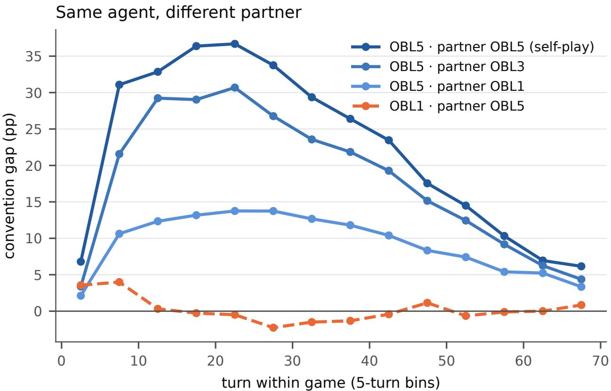  
Figure 8: Gap time course of a fixed agent under different partners. Convention gap of one agent’s own plays by 5-turn bin (bins with ≥ 250 plays): level 5 in self-play, with level 3, and with level 1, and level 1 with level 5 (in mixed games the lower level held seat 0; self-play pools both seats). Point estimates; no intervals are shown. The whole time course, not one phase of it, flattens with level distance.

## C Seed robustness

## C.1 The seed sweep

Appendix B reports single-seed pairings: one released model per level. This appendix asks whether its two results, the level-1 split and the blend among levels 2–5, depend on which seed models were paired. To test this, every pairing among levels 2–5, plus the level-1×5 control, was played for all 25 seed combinations (seeds a–e on each side, 200 games per combination; 35000 games in total, each replay-verified). The unit of analysis is the seed combination: the primary statistic per level pair is the across-combination mean of the side difference $\delta = \Delta _ { \mathrm { h i g h e r } } - \Delta _ { \mathrm { l o w e r } }$ , with a t-based 95% interval over the 25 combinations (Table 4). The combinations share seed models on each side and are not independent replications, so the t interval may be too narrow for inference beyond these models. As in Appendix B, the lower level held seat 0 in every game.

Both patterns recur across seed combinations. Among levels 2–5 the mean δ stays within ±0.70 pp of zero for every pairing, an order of magnitude below the control’s +7.77 [+7.33, +8.20] pp, which is positive in all 25 combinations (per-combination range +6.3 to +10.3 pp). The sweep also points to two asymmetries that the singleseed analysis did not show: δ is positive, with an interval above zero, for $2 \times 4 ~ ( + 0 . 7 0 ~ [ + 0 . 2 6 , + 1 . 1 4 ] \mathrm { p p } )$ and for $ { 2 \times 5 } ~ (  { + 0 . 6 4 } ~ [  { + 0 . 2 2 } ,  { + 1 . 0 7 } ]  { \mathrm { p p } } )$ , so when level 2 is the lower partner the higher side’s gap may be slightly larger. With seats fixed, these differences cannot be separated from seat: in level-5 self-play the two seats’ gaps are $+ 2 2 . 0 \ [ + 2 1 . 4 3 , + 2 2 . 4 8 ]$ and +20.6 [+20.16, +21.13] pp (Appendix B). The 4×5 interval touches zero from below $( - 0 . 4 5 \left[ - 0 . 9 0 , - 0 . 0 0 \right]$ pp); given the shared models and the number of intervals, we do not read it as an asymmetry. The last column estimates the share of across-combination variance in δ not explained by game-sampling noise; it rests on bootstrap standard errors and is approximate.

Table 4: Seed sweep: all 25 seed combinations per level pair, 200 games each. Gaps in pp (mean ± sd across combinations); δ is the across-combination mean of $\Delta _ { \mathrm { h i g h e r } } - \Delta _ { \mathrm { l o w e r } }$ with a t-based 95% interval treating combinations as the unit (they share seed models on each side, so the interval may be too narrow); the last column is the estimated share of across-combination variance in δ beyond game-sampling noise (approximate).
<table><tr><td>Pair</td><td>Score</td><td>∆, lower</td><td>∆, higher</td><td>δ [95% CI]</td><td></td><td>Seed share (%)</td></tr><tr><td> $2 \times 3$ </td><td> $2 3 . 3 2 \pm 0 . 2 0$ </td><td> $+ 1 3 . 1 \pm 0 . 7$ </td><td> $+ 1 3 . 4 \pm 0 . 8$ </td><td></td><td> $+ 0 . 2 8 \left[ - 0 . 1 2 , + 0 . 6 7 \right]$ </td><td>42</td></tr><tr><td> $2 \times 4$ </td><td> $2 3 . 1 5 \pm 0 . 3 1$ </td><td> $+ 1 3 . 2 \pm 1 . 1$ </td><td> $+ 1 3 . 9 \pm 0 . 8$ </td><td>+0.70</td><td> $[ + 0 . 2 6 , + 1 . 1 4 ]$ </td><td>52</td></tr><tr><td> $2 \times 5$ </td><td> $2 2 . 8 4 \pm 0 . 3 0$ </td><td> $+ 1 2 . 9 \pm 1 . 1$ </td><td> $+ 1 3 . 6 \pm 0 . 8$ </td><td>+0.64</td><td> $[ + 0 . 2 2 , + 1 . 0 7 ]$ </td><td>48</td></tr><tr><td> $3 \times 4$ </td><td> $2 3 . 7 4 \pm 0 . 2 6$ </td><td> $+ 1 7 . 0 \pm 1 . 2$ </td><td></td><td></td><td> $+ 1 6 . 9 \pm 1 . 0 - 0 . 0 5 \left[ - 0 . 3 7 , + 0 . 2 7 \right]$ </td><td>10</td></tr><tr><td> $3 \times 5$ </td><td> $2 3 . 6 7 \pm 0 . 3 5$ </td><td> $+ 1 7 . 3 \pm 1 . 2$ </td><td></td><td></td><td> $+ 1 7 . 0 \pm 1 . 3 - 0 . 2 5 \left[ - 0 . 6 7 , + 0 . 1 6 \right]$ </td><td>45</td></tr><tr><td> $4 \times 5$ </td><td> $2 3 . 8 0 \pm 0 . 3 0$ </td><td> $+ 1 9 . 2 \pm 1 . 5$ </td><td></td><td></td><td> $+ 1 8 . 7 \pm 1 . 6 - 0 . 4 5 \ : \dot { \left[ - 0 . 9 0 , - 0 . 0 0 \right] }$ </td><td>48</td></tr><tr><td>1 × 5 (control)</td><td> $1 8 . 6 2 \pm 0 . 7 9$ </td><td> $+ 0 . 2 \pm 0 . 5$ </td><td> $+ 8 . 0 \pm 0 . 9 + 7 . 7 7 [ + 7 . 3 3 , + 8 . 2 0 ]$ </td><td></td><td></td><td>59</td></tr></table>

## C.2 Self-play across seeds

Self-play gaps vary across the five seed models with standard deviations of 0.61 pp (level 2), 0.67 (level 3), 1.27 (level 4) and 1.53 pp (level 5). The spread is larger at higher levels. Per-level ranges overlap across seeds, but the means over seeds rise from +12.34 (level 2) to +21.11 pp (level 5), and the ordering $\Delta _ { 2 } < \Delta _ { 3 } < \Delta _ { 4 } < \Delta _ { 5 }$ holds within each of the 5 seeds when models are matched by seed letter.

## C.3 Seed heterogeneity sits in the taxonomy tail

Within the induced taxonomy of §2.4, per-seed cell values were checked for the top-ten categories by absolute gap at each of levels 2–5 (40 cells; 18 flagged with across-seed excess variance beyond game-sampling noise). Head cells are seed-stable in relative terms: their excess standard deviations are 1.5–2.9 pp (3–9% of gap). Every large-excess flag sits in a tail cell holding at most 0.87% of plays: the widest are a discard-context color cell at level 3 (+13.9 to +44.8, excess 10.8 pp), an unhinted cell at level 4 (+18.1 to +47.8, excess 8.2 pp), and a repeat-color-hint cell at level 5 (+31.5 to +52.4, excess 7.5 pp); each parenthesis gives the range across seeds and the excess standard deviation. Different training runs agree on the head of the taxonomy and differ in its tail.

## D Intervention details

This appendix gives the details behind the intervention results of §3.3: the verification gates, the full condition table, the replication of the one anomalous mask, and a category-level check of the rerouting. Apart from the level-2 contrast, the masks act on the seed-a model of level 5, which is in the released archive but not among the results published with OBL [Hu et al., 2021] (§2.2); the replication adds level-5 seed b and level-4 seed a. The level-5 baseline uses this model on its own environment seeds, and its gap (21.3 pp) differs from the ladder value (+21.68 pp).

## D.1 Verification gates

Two gates precede every full run. First, the category that the masking code assigns to each play during the game must match the category that the analysis assigns afterwards; on the baseline games the two agree on every play a mask would block (24838/24838). Second, the masking code with no mask active must reproduce the baseline games: 1000/1000 games match action for action, deck and score. All mask conditions share environment seeds with the baseline, and the full 50-card decks are identical per seed across every condition (1000/1000 for every condition), so score differences are paired per deck. Every condition replays to its ground-truth score.

## D.2 The condition table

Targets are the top eight categories by observational contribution (share × gap, estimation half) among categories holding at least 1% of plays, three low-gap controls (two fully identified cells, whose gap is zero by construction, and the large low-gap rank cell at lag 4+), and cumulative masks of the top $1 / 2 / 4 / 6 / 8$ (top-1 coincides with single #1). Frequency-matched random controls suppress the greedy play with probability matched to the trigger rates of targets #1, #4 and #8 (3.76/0.61/0.24 triggers per game) and define the null cost curve: piecewise linear through the origin and the three controls in realized trigger rate, linearly extrapolated beyond the largest control rate, and re-fit inside every bootstrap draw so the excess interval carries the control curve’s own uncertainty. Rows whose realized trigger rate exceeds the largest control rate (the cumulative top-2, top-4, top-6 and top-8 masks) rely on that extrapolation and are marked † in Table 5; the super-additivity claim in §3.3 uses raw paired costs and does not depend on it.

Table 5: All category-mask conditions (1000 paired games each). Contribution is the observational share × gap of the target set (estimation half, pp); cost is the paired per-deck score change against the shared baseline (points; negative values are losses); excess is the cost minus the frequency-matched random-mask cost at the same realized trigger rate, with the control curve re-fit inside every bootstrap draw, so a positive excess means the mask costs less than a random mask; total gap is the corpus gap under the mask (pp). Frequency-matched random controls define the zero line and are omitted (excess = 0 by construction). †The excess relies on extrapolating the control curve beyond the largest control rate.
<table><tr><td>Condition</td><td>Contribution</td><td>Cost</td><td>Excess [95% CI]</td><td></td><td>Total gap</td></tr><tr><td>single #1</td><td>7.1</td><td>-0.39</td><td></td><td>−0.12 [−0.25, +0.01]</td><td>18.9</td></tr><tr><td>single #2</td><td>5.3</td><td>-0.36</td><td>-0.09 </td><td>[−0.23, +0.03]</td><td>19.0</td></tr><tr><td>single #3</td><td>1.2</td><td>-0.07</td><td></td><td>−0.02 [−0.12, +0.09]</td><td>21.1</td></tr><tr><td>single #4</td><td>1.1</td><td>-0.01</td><td>+0.03</td><td>[−0.05, +0.12]</td><td>21.1</td></tr><tr><td>single #5</td><td>1.0</td><td>-0.01</td><td></td><td>+0.02 [−0.04, +0.09]</td><td>20.9</td></tr><tr><td>single #6</td><td>0.6</td><td>+0.10</td><td></td><td>+0.25 [+0.12, +0.38]</td><td>20.7</td></tr><tr><td>single #7</td><td>0.5</td><td>-0.01</td><td></td><td>+0.01 [−0.06, +0.09]</td><td>21.0</td></tr><tr><td>single #8</td><td>0.5</td><td>-0.02</td><td></td><td>−0.01 [−0.07, +0.04]</td><td>21.0</td></tr><tr><td>control A (fully identified)</td><td>0.0</td><td>-0.03</td><td></td><td>+0.05 [−0.08, +0.18]</td><td>21.1</td></tr><tr><td>control B (fully identified)</td><td>0.0</td><td>+0.01</td><td></td><td>+0.09 [+0.01, +0.18]</td><td>21.2</td></tr><tr><td>control C (rank, lag 4+)</td><td>0.2</td><td>-0.07</td><td></td><td>−0.00 [−0.10, +0.10]</td><td>21.3</td></tr><tr><td>cumulative top-2</td><td>12.4</td><td>-1.11</td><td></td><td>−0.52 [−0.74, −0.29]†</td><td>15.9</td></tr><tr><td>cumulative top-4</td><td>14.7</td><td>-1.27</td><td></td><td>−0.55 [−0.81, −0.29]†</td><td>15.9</td></tr><tr><td>cumulative top-6</td><td>16.3</td><td>-1.71</td><td></td><td>−0.73 [−1.08, −0.37]†</td><td>14.7</td></tr><tr><td>cumulative top-8</td><td>17.3</td><td>-1.84</td><td></td><td>−0.81 [−1.19, −0.44]†</td><td>14.3</td></tr></table>

The three low-gap controls (Table 5) show that the control curve is accurate to about a tenth of a point (§3.3).

Why no dose–response fit is reported. An ordinary least-squares fit of the eight single-mask excess costs on contribution gives a slope of −2.87 [−4.78, −0.98] points per unit of contribution (contribution as a probability; interval from the game-level bootstrap) with $R ^ { 2 } = 0 . 4 4 ;$ ; on the category’s gap alone $R ^ { 2 } = 0 . 7 2 $ , on its share alone 0.11. We do not interpret these fits. They rest on eight cells, six of which sit within about one percentage point of contribution of each other, so categories #1 and #2 carry most of the leverage, and neither of their excess intervals excludes zero. The fit is also sensitive to category #6, whose replication was inconclusive (§D.4). The bootstrap interval treats the eight categories as fixed and therefore says nothing about how excess cost would vary across other categories.

## D.3 Redistribution under the masks

Masking a color cell delays some of its plays. Under the top-1 mask the delayed color-only category (lag 2–3) grows from 1.5% of plays to 5.9% at a gap of +54.2 pp; under the top-8 mask it reaches 16.3% at +52.9 pp. The total gap falls from 21.3 to 14.3 [+14.00, +14.68] pp while score falls −1.84 points. The single-mask and cumulative results are plotted in Fig. 4b and c.

## D.4 Replication of the category-6 anomaly

The apparent score improvement from masking category #6 was re-tested out of sample before being interpreted: fresh decks disjoint from every prior condition, three agents (level-5 seeds a and b, level-4 seed a), each with its own baseline and frequency-matched random control, and a decision rule fixed in advance (replicates if all three excesses are positive and at least two per-agent intervals exclude zero; fails if the pooled interval contains zero). Outcome: inconclusive. The excesses are positive for all three agents $( + 0 . 1 4 [ - 0 . 0 0 3 , + 0 . 2 9 2 ] , + 0 . 1 5 [ + 0 . 0 3 5 , + 0 . 2 7 4 ] .$ $+ 0 . 0 6 \ [ - 0 . 0 9 8 , + 0 . 2 0 5 ] \ /$ ) and the inverse-variance pooled excess is $+ 0 . 1 2 \ [ + 0 . 0 4 , + 0 . 2 0 ]$ , but only 1 per-agent interval excludes zero, and the raw score gain in Table 5 (+0.10 points) did not reproduce. The supported reading is that this convention carries no detectable positive value (“cheaper than random disruption,” not beneficial), and that the first estimate was inflated by selecting among eight categories. The substitution pattern does reproduce: under the mask, 48–62% of masked plays substitute into another rank hint, as in the original run.

## D.5 Taxonomy validation on the intervention games

Applying the frozen taxonomy to the masked games checks the rerouting at category level, independently of the score analysis. Under the immediacy mask, level-5’s color-only lag-1 categories empty by construction (29.6% of baseline plays at +55 pp) and many displaced plays reappear as color-only lag-2–3 plays at nearly undiminished gap: that category’s share rises from 1.5% to 16.7% at +53 pp, with a smaller spill into lag $4 + ( 3 . 1 \%  6 . 1 \% { \mathrm { ~ a t ~ } } + 3 2 { \mathrm { p p } } )$ Under the persistent mask the color-only categories stay empty (0.0%) and play shifts onto fully identified cards, whose gap is zero by construction (35.6% → 60.0% of plays). Level 2 reroutes less. Its delayed color-only gap at baseline is +17 pp, against level-5’s +41 pp, and under the immediacy mask its color-only lag-2–3 share reaches 2.5%, against level-5’s 16.7%.

## E Human corpus

This appendix documents the two human corpora (provenance, filters, clustering and the convention community they come from) and gives the full versions of the human results summarized in §3.1.

## E.1 Provenance and filters

The corpus is drawn from public logs of two-player, no-variant games on the hanab.live platform [Hanab Live, 2026], the platform the convention community plays on, with usernames replaced by salted hashes before any analysis. Two filters define the analysis set. The completed-games filter removes games whose logs end abnormally (timeouts, terminations, or logs that stop with cards in the deck and no terminal state). The bot exclusion has two tiers: a game-level tier for verified bot families matched by account-name pattern, and an account-level tier removing plays by flagged accounts (accounts that play almost only with verified bots, pairs of accounts with identical timing statistics, and accounts whose game notes carry a bot’s version tag; criteria as in the previous study [Fukushima et al., 2026], identified by hashed id). The result is 425 games, 9017 plays, 155 players and 95 pairs. A sensitivity corpus applying only the verified-bot tier holds 598 games / 13089 plays and gives +27.52 [+25.21, +29.69] pp.

## E.2 Statements shared with the prior paper

This corpus, its filters and its posteriors are those of the previous study that introduced the convention gap [Fukushima et al., 2026] (“the prior paper” below).

Posterior variant. Both papers report the joint (full-hand) posterior, which gives a corpus headline of +26.16 pp. The per-card approximation gives +28.20 pp on the same corpus. The two variants are never mixed within a figure or a comparison.

The Tier-1 filter, as implemented. The Tier-1 filter removes every game in which a verified bot account made a play. One game in which a verified bot only hinted and discarded is therefore retained; excluding it as well gives 424 games and 9,011 plays and a gap of +26.18 pp, against +26.16 pp [Fukushima et al., 2026].

## E.3 Corpus identity with the prior paper

The identity is exact, not approximate, and was established by a three-part check: (i) the game sets are identical (sorted id lists, symmetric difference empty); (ii) the filter chain is the same code, imported rather than reimplemented; and (iii) the joint posteriors agree play-for-play, bit-identically, over all 9017 plays against an independent run of the prior paper’s engine on the raw logs.

## E.4 Clustering: pair against game

Pairs recur across games, so the primary human intervals cluster at the pair level (95 pairs); game-clustered intervals are narrower. Side by side, joint posterior: corpus gap +26.16 [+24.05, +28.28] (pair) against [+25.32, +27.01] (game); Tier-1-only sensitivity +27.52 [+25.21, +29.69] (pair) against [+26.79, +28.26] (game). The documented

exceptions are the nearest-level bootstrap and the mixture fit of Appendix F (§F.2 and §F.3), which are game-clustered by design, for comparability with the agent corpora; their pair-clustered sensitivity is in §F.4.

## E.5 The convention community

The platform’s community publishes and teaches a convention system [H-Group, 2026]: play hints and the focus rule, chop and save conventions, and the finesse family are written down rather than negotiated at the table. The human corpus therefore describes taught play, not typical human play. Pair experience, counted within the corpus, moves the gap little: stratifying pairs by games played together gives +23.6 [+20.2, +26.8] pp (one game together, 36 pairs), +25.7 [+23.5, +27.8] pp (2–4 games), and +26.6 [+23.8, +29.7] pp (five or more), and near-strangers (one game together, both players in at most two corpus games) reach +22.1 [+17.8, +26.0] pp. This is consistent with players who arrive already sharing a taught system.

## E.6 The AH2AC2 corpus

The replication corpus (§3.1.2) is processed identically from the open release: conversion to the common game format, replay verification against the released scores (1858 of 1858 games reproduce exactly), then the same completed-games criterion, which removes 106 games. Every one is a verifiable “no further points possible” early ending, a completed game our criterion nonetheless excludes; they are retained as a sensitivity (+27.59 [+27.26, +27.92] pp on the full release against +27.62 [+27.27, +27.97] pp on the filtered corpus). The open data carry no player identifiers, so the bot exclusion cannot be applied and all AH2AC2 intervals cluster by game. Score selection in that collection (minimum recorded score 13; no strikeouts) is consistent with its higher aggregate (§3.1.2); restricting the hanab.live corpus to games at or above the same floor gives +27.20 [+26.29, +28.04] pp over 338 games.

## E.7 The shared taxonomy ranked by the human–level-5 difference

Ranking the cells of the shared taxonomy (§2.4) by the absolute difference between the human and level-5 gaps (Fig. 9) ignores how often each cell occurs. The split in §3.1 is an accounting identity and assigns no cause. Its within-cell term weights each cell’s gap difference by the human share of plays. Its other term weights each cell’s share difference by the level-5 gap. The three largest differences are the two indirect-reference cells and a delayed color cell. Level 5’s gap is higher on three newest-card cells played right after a hint and, by small amounts, on three merged cells; the cells that are zero by construction close the list at exactly zero. The two indirect-reference cells are merged residual cells, which the next subsection resolves.

## E.8 The indirect-reference category, decomposed

Table 1’s indirect-reference rows are merged cells, defined only by the partner’s preceding action, and their contents differ across populations (Fig. 10). The numbers in this paragraph use the frozen level-5 taxonomy on the full corpus, the basis of the right-hand panels of Fig. 10; on that basis the human color cell holds 238 plays. Decomposed by the played card’s own hint history, it is 81.1% unhinted cards (the finesse configuration, +63.9 pp over 193 plays), 18.1% color-known cards (+50.5 pp), and a remainder too small to estimate. The left-hand panels of Fig. 10 use a different basis, the shared taxonomy on estimation halves, whose residual cell is broader because it must be supported by all six populations; its unhinted share is therefore lower than the frozen-cell figure quoted here, and the two panels are not meant to match. Table 6 gives the reverse decomposition: all unhinted plays split by the partner’s preceding action. In human play, 286 of the 484 unhinted plays follow a hint to another card $\mathrm { ( g a p + 5 7 . 9 ~ [ + 5 0 . 6 , + 6 2 . 7 ] p p ) }$ against 55 of 394 for level 5. On the remaining unhinted plays, humans and level 5 differ by +5.3 [−7.7, +17.1] pp; in AH2AC2, which keeps no struck-out games, the difference is +9.5 [+2.0, +16.8] pp. The color-known sub-cell is the composition-matched comparison used in $\ S 3 . 1 . 2 \colon + 5 0 . 4 \ [ + 4 7 . 1 , + \bar { 5 } 3 . 6 ]$ pp in AH2AC2 against +50.5 pp here.

## E.9 Replication on the AH2AC2 corpus in full

The corpus above reflects one set of collection and filtering choices. The AH2AC2 benchmark [Dizdarevic et al., 2025]´ independently released 1858 two-player games collected from the same platform and convention community. The two collections share no game records: content identity over deck and full action sequence matches 0 of 1858 against the raw hanab.live logs used here. This is therefore an independent collection from the same population (deck-level coincidences exist, but only because the platform deals seeded decks to many tables). Player overlap is unknowable, because the open data carry no player identifiers (§E.6).

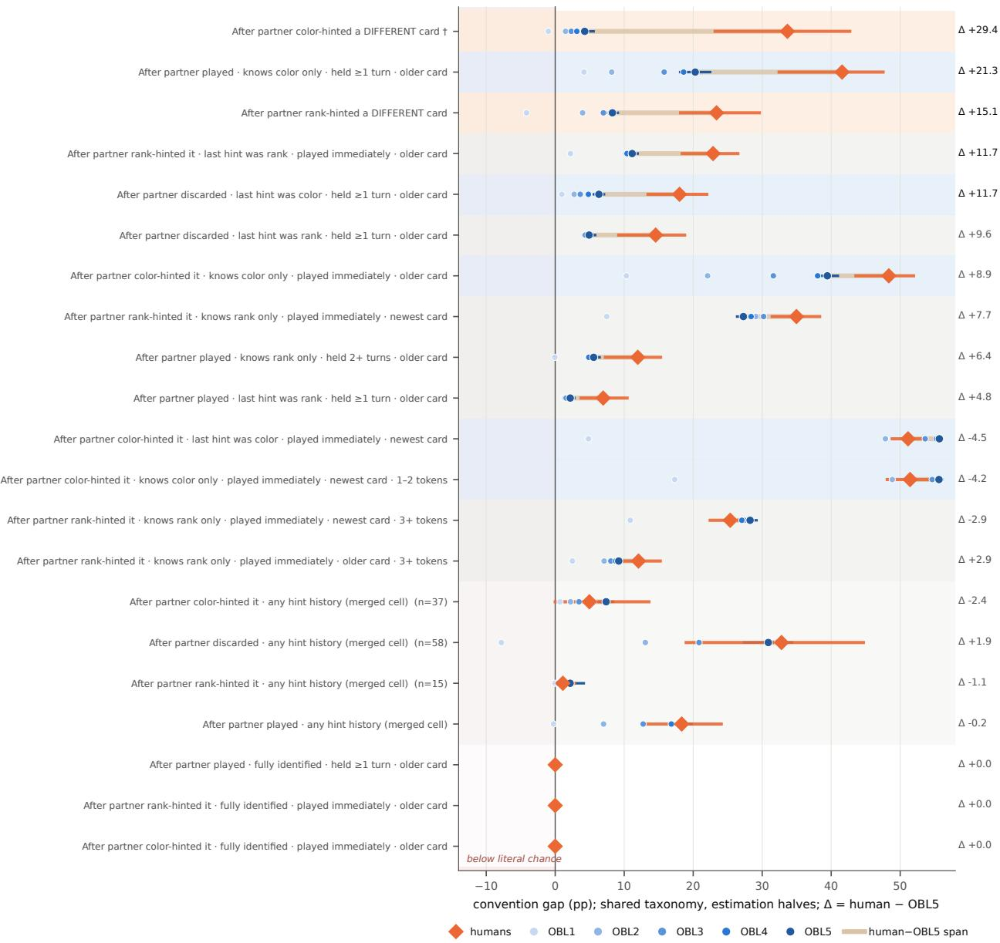  
Figure 9: Shared-taxonomy cells ranked by the absolute human – level-5 difference. Same cells and basis as Fig. 1, whose caption gives the key to the row labels, † and n; ∆ is the human gap minus the level-5 gap (pp). Diamonds: humans, with 95% pair-clustered bootstrap intervals; dots: levels 1–5 (darker is higher); the tan bar spans the human and level-5 values; the strip left of zero marks gaps below literal chance. Row shading: indirect reference (orange), color known (blue), rank known (gray), merged (light gray), fully identified (unshaded). The three largest differences are the two indirect-reference cells and a delayed color cell.

Replaying all games through the identical pipeline (replay-verified against the released scores, 1858/1858; 1752 games after the completed-games criterion), the corpus realizes $+ 2 7 . 6 2 \ [ + 2 7 . 2 7 , + 2 7 . 9 7 ] \mathrm { p p }$ against the hanab.live corpus’s +26.16 [+25.31, +26.99] pp under the same game-level clustering: above every level of the OBL hierarchy, and +1.46 pp from the hanab.live corpus. The category structure replicates more closely than the aggregate: the frozen-category profile correlates with the hanab.live corpus at $r = 0 . 9 7$ (excluding the construction-zero cells), the frozen tree transfers at $R ^ { 2 } = 0 . 3 3 8$ (hanab.live 0.28), and indirect reference has gaps above every agent value (+48.9 [+45.4, +52.1] for color, +39.9 [+36.2, +43.5] pp for rank), as do plays of unhinted newest cards (+37.2 [+31.9, +42.2] pp; Table 6).

Table 6: Unhinted plays by the partner’s preceding action. Gap (pp) with 95% interval; number of plays in parentheses. “Other” is a partner play or discard, or the first move. Humans: pair-clustered; AH2AC2 and level 5 (seed a): game-clustered. In the hanab.live corpus, the 193 unhinted plays that follow a color hint to another card (the finesse configuration) have a mean literal failure probability of 69.6% and a failure rate of 5.7%.
<table><tr><td>Partner&#x27;s preceding action</td><td>Humans (hanab.live)</td><td>Humans (AH2AC2)</td><td>Level 5</td></tr><tr><td>Hint to another card</td><td>+57.9 [+50.6, +62.7] (286)</td><td>+43.0 [+35.2, +49.4] (229)</td><td>+2.5 [−9.0, +14.2] (55)</td></tr><tr><td>Other</td><td>+29.4 [+17.3, +40.1] (198)</td><td>+33.5 [+27.7, +39.1] (507)</td><td>+24.0 [+19.4, +28.7] (339)</td></tr><tr><td>All unhinted plays</td><td>+46.2 [+35.9, +52.6] (484)</td><td>+36.5 [+31.5, +40.9] (736)</td><td>+21.0 [+16.8, +25.4] (394)</td></tr><tr><td>Difference from level 5, other</td><td>+5.3 [−7.7, +17.1]</td><td>+9.5 [+2.0, +16.8]</td><td></td></tr></table>

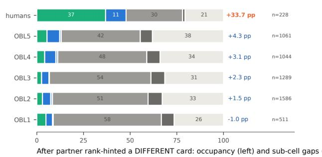

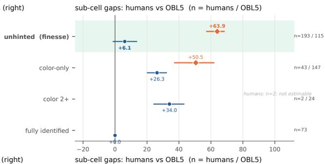

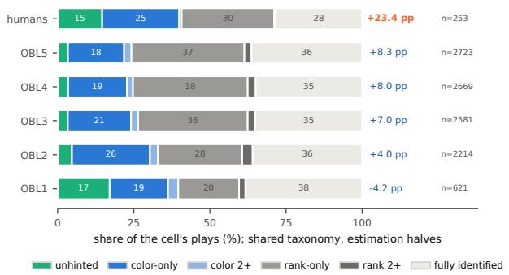

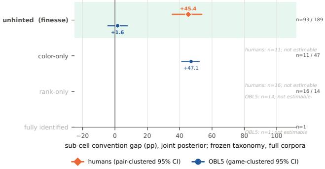  
Figure 10: The two indirect-reference residual cells resolved by the played card’s own hint history. Left: sub-cell occupancy per population (shared taxonomy, estimation halves): human entries are dominated by unhinted finesse targets, agent entries by rank-known and fully-identified cards. The value right of each bar is that population’s gap in the whole cell, with its number of plays. Right: human and level-5 gaps per sub-cell (frozen level-5 taxonomy, full corpora, a narrower cell than on the left, so the two panels’ shares differ by construction; humans pair-clustered, level 5 game-clustered; sub-cells with n < 20 are marked not estimable rather than zero). The highlighted finesse rows show the largest differences: humans +63.9 and +45.4 pp where level 5 reads +6.1 and +1.6 pp. On every sub-cell estimable for both populations, the human value exceeds level 5’s, with disjoint intervals.

The differences are consistent with AH2AC2’s selection rule (minimum score 13, no strikeouts; mean score 23.45 against 18.52 for the hanab.live corpus). Excluding struck-out games removes games with three failed plays, which raises the aggregate gap mechanically. The rule also nearly eliminates unhinted plays (share 1.7% against 5.4%) and tilts the indirect-reference cell toward color-known cards. On the sub-population the two corpora share, the cell replicates closely (+50.4 against +50.5 pp on color-known cards). The category structure and the indirect-reference excess are therefore properties of the community’s play, not of how the hanab.live corpus was constructed. Population level independence is a different question and stays open (§4).

## E.10 The aggregate view on the OBL ladder

The pair-clustered human corpus gap $\left( + 2 6 . 1 6 \left[ + 2 4 . 0 5 , + 2 8 . 2 8 \right] \mathrm { p p \right) }$ lies above every level of the OBL ladder reported in the prior paper [Fukushima et al., 2026], which runs from +1.57 pp at level 1 $_ { \mathrm { t o + 2 1 . 6 8 } }$ pp at level 5 (Table 5 there). This is the aggregate picture behind the top row of Fig. 1. These are differences of aggregate gaps. They are not the per-cell distances of Fig. 2, which average the absolute human–level difference over the shared cells and can order the levels differently.

## E.11 The agent-grown taxonomy transfers to people

We freeze §2.4’s level-5 machinery (discovery-half category definitions, category means and the fitted tree, verbatim) and apply it to human plays. The frozen tree explains $R ^ { 2 } = 0 . 2 8$ of human per-play residual variance out of sample (0.37 using the frozen partition with human cell means), against 0.39 for a tree grown on human data itself and 0.12 for the hand-crafted map. Across the 26 frozen categories with at least 100 human plays, human and agent gaps correlate at $r = 0 . 7 0$ once the 6 categories that are zero for both sides by construction are excluded $( r = 0 . 8 1$ with them), with human points on or above the diagonal (Fig. 11b).

This transfer is consistent with the metric tracking play rather than how agent games are generated. It is not independent validation: a category’s gap cannot exceed its mean literal failure probability, and the same hint context can carry similar literal risk in both populations, so part of the correlation may reflect these bounds.

Pair experience and zero-shot coordination. The gap moves little with how often a pair has played together within the corpus (§E.5): near-strangers reach $+ 2 2 . 1 \ [ + 1 7 . 8 , + 2 6 . 0 ] \mathrm { p p }$ , against +1.22 [+0.98, +1.45] pp for level-1 crossplay, pooled over all pairings among five independently trained level-1 models [Fukushima et al., 2026]. Both are zero-shot coordination, of opposite kinds. Level 1 is trained to read past actions only for their literal content, and its gap is similar in self-play and in cross-play. Human players appear to arrive already sharing a taught system. In point estimate, the self-play gaps of the OBL levels lie between the level-1 cross-play and near-stranger values, and level $5 \mathrm { { s } }$ gap (+21.68 pp) lies inside the near-stranger interval.

## F Depth of reasoning

On the 4 categories where the human value lies within the levels’ range, the agent profile saturates by level 2–3 and humans land at that plateau. Where humans diverge they exceed every level, the opposite pattern from limited recursion. A pre-registered cognitive-hierarchy fit leaves depth unidentified (τ ran to the grid edge in both models) and instead recovers a flat uplift ${ \mathrm { o f } } + 1 4 . 3 \ [ + 1 3 . 2 , + 1 5 . 4 ]$ pp on the categories where humans exceed every level (§F.3).

## F.1 Distance to the human profile per level

On the shared taxonomy of §2.4 (estimation halves, the basis of Fig. 1), we compute for each level k the mean per-cell absolute difference to the human profile, $D _ { k } = \operatorname* { m e a n } _ { c } \ | h ( c ) - g _ { k } ( c ) |$ |, with 95% intervals from a joint bootstrap (10,000 draws; humans resampled by pair, each agent corpus by game, all six corpora independently per draw; contrasts formed within draws; recorded seed). Over all 21 shared cells, $D _ { 1 }$ through $D _ { 5 }$ read $1 9 . 0 \ [ + 1 6 . 9 , + 2 0 . 8 ]$ $1 0 . 2 \ [ + 8 . 4 , + 1 1 . 9 ] , \ 8 . 3 \ [ + 6 . 6 , + 1 0 . 0 ] , \ 7 . 1 \ [ + 6 . 1 , + 8 . 9 ]$ and $7 . 0 \ [ + 5 . 9 , + 8 . 7 ]$ pp. Excluding the 11 cells where the human value exceeds every level’s with bootstrap probability at least 0.87 (the rule of §F.2, applied to the shared cells), the remaining core cells read $1 5 . 9 \ [ + 1 3 . 9 , + 1 8 . 0 ] , \ 4 . 1 \ [ + 2 . 6 , + 5 . 9 ] , \ 2 . 7 \ [ + 1 . 5 , + 4 . 5 ] , \ 1 . 3 \ [ + 1 . 3 , + 3 . 5 ]$ and 1 $\cdot 7 \ [ + 1 . 5 , + 3 . 7 ] \mathrm { p p }$ . The contrasts localize the approach to the human profile in the first step: on the core cells $D _ { 1 } - D _ { 2 } = + 1 1 . 9 \ [ + 1 0 . 4 , + 1 3 . 0 ]$ pp against $D _ { 2 } - D _ { 5 } = + 2 . 4 \left[ - 0 . 6 , + 3 . 5 \right] \mathrm { p p }$ , an interval that includes zero; over all cells $D _ { 2 } - D _ { 5 } = + 3 . 2 \ : [ + 1 . 7 , + 3 . 7 ] \mathrm { p p }$ , so the residual decline past level 2 is carried by the excluded cells. A signed, human-share-weighted sensitivity gives the same shape.

## F.2 The nearest-level bootstrap

For each of the 20 non-zero frozen categories (human $n \geq 1 0 0 ;$ ; 6 construction-zero cells dropped), the level profile $g _ { 1 } ( c ) , \ldots , g _ { 5 } ( c )$ uses each level’s taxonomy corpus (one seed model at level 1, five pooled at levels $2 { - } 5 )$ and the human value comes from the full corpus. The nearest-level statistic arg mi $\mathrm { ~ 1 ~ } \boldsymbol { k } \ \vert g _ { \boldsymbol { k } } ( \boldsymbol { c } ) - h ( \boldsymbol { c } ) \vert$ , recorded as $^ { 6 6 } > 5 ^ { , 5 }$ when the human value exceeds every level’s, is bootstrapped with 2000 draws, resampling games in all six corpora independently per draw. Human resampling here is game-clustered by design, for comparability with the agent corpora (a pair-clustered sensitivity is in §F.4). 16 of the 20 categories exceed every level with bootstrap probability at least 0.87; we call them the above-every-level categories, and they define the indicator of the mixture fit.

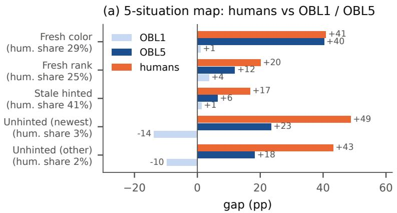

(b) 26 frozen categories ranked by human gap (r = 0.81)  
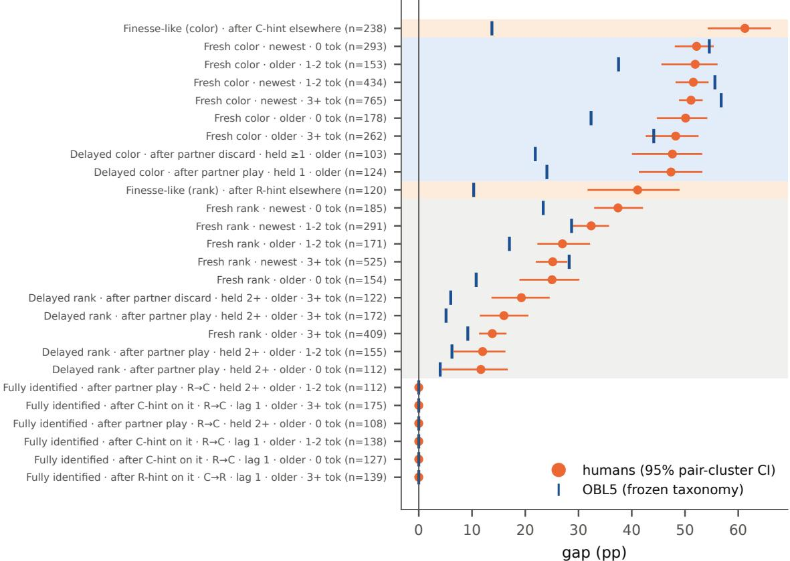  
Figure 11: Human and agent gaps on the hand-crafted situations and the frozen level-5 categories. (a) The five hand-crafted situations for humans against levels 1 and 5 (point estimates; the values of Table 1, where “Stale hinted” is called “Hinted earlier”). “Fresh color” and “Fresh rank”: played right after a color or rank hint that touched the card; “Stale hinted”: hinted earlier; “Unhinted (newest)” and “Unhinted (other)”: no hint touched the card, newest or older card; “hum. share”: share of human plays. (b) The frozen level-5 categories ranked by human gap: dots are humans with 95% pair-clustered intervals, ticks are level 5. The r in the panel title includes the 6 categories that are zero for both populations by construction (§E.11). Row labels follow the key of Fig. 5; n is the number of human plays. Background shading groups rows by information family: indirect reference (orange), color known (blue), rank known (gray); fully identified rows are unshaded.

## F.3 The pre-registered mixture fit

This fit asks a simple question: can the human category profile be written as a mixture of the five level profiles, with the mixing weights set by a single depth parameter τ (how many steps of reasoning a typical human uses)? If depth were what separates humans from the OBL hierarchy, the fit would return a well-identified τ and no residual. The outcome is that τ is not identified (it runs to the edge of its grid) and that a flat uplift on the above-every-level categories fits the data instead.

The specification was fixed before the fit:

• M1 regresses the human category gaps on a truncated-Poisson(τ) mixture of the five level profiles (pmf renormalized on $k \in \{ 1 , \ldots , 5 \} )$ .

• M2 adds a flat uplift $\beta$ on the above-every-level categories.

• Weights are inverse bootstrap variances of the human gaps.

• Fitting: τ by grid search over [0.05, 8] at step 0.01, with $\beta$ in closed form given τ .

• Uncertainty: a joint bootstrap (2000 draws, recorded seeds) resampling all six corpora and refitting both models per draw.

• Pre-registered truncation flags: τˆ at the grid edge, and Poisson weight on level 5 above 0.4 at τˆ.

Both flags were raised. τˆ ran to the grid edge in 2000/2000 draws under M1 and 1979/2000 under M2 (weight on level 5 at the edge: 0.48), so no depth estimate is quoted from the global fit; the reporting rule fixed in advance was to state this rather than to quote an edge value. What the fit identifies is the uplift: $\beta = + 1 4 . 3 \ : [ + 1 3 . 2 , + 1 5 . 4 ] \ : \mathrm { p p }$ with $\nu \mathbf { R } ^ { 2 } = 0 . 5 8 ( \mathbf { M } 2 )$ against 0.10 (M1) and $\Delta \mathrm { A I C c } = - 1 2 . 6$ in M2’s favor; the uplift explains 48% of weighted variance against 10% for the best cognitive-hierarchy component.

## F.4 Pair-clustered sensitivity

Because the human corpus has pair structure the agent corpora lack, a sensitivity analysis outside the pre-registered specification clusters the human side by pair (95 pairs; recorded seeds) in both the nearest-level bootstrap and the fit (weights and joint bootstrap). Every category keeps its most likely nearest-level answer, and 15 rather than 16 categories pass the 0.87 threshold; the fit keeps the original set. Every qualitative conclusion of the fit is unchanged: τˆ remains at the grid edge, the uplift term remains warranted, and the uplift moves $\mathrm { t o + 1 2 . 0 ~ [ + 1 0 . 5 , + 1 3 . 3 ] }$ pp and explains 34% of weighted variance (M1/M2 weighted $R ^ { 2 } 0 . 4 1 / 0 . 7 4 )$ . The $\beta$ point value and the variance split therefore depend on the weighting, and are always quoted with this sensitivity alongside.

## F.5 The post-hoc shared-cells fit

Restricting the pure mixture to the 4 categories where the two populations share a convention (those not above every level) yields an interior minimum at $\tau = 4 . 2 7 \ [ 3 . 7 3 , 5 . 0 4 ]$ (weighted $R ^ { 2 } = 0 . 9 7 7 ;$ probability of the grid edge 0.00; probability that τ falls in the literature’s 1–3 range 0.00; weight on level 1 about 8%). This analysis is post-hoc: it was not in the pre-registered specification, rests on 4 categories, and no claim in the paper depends on it. It is reported because it makes clear what can be identified: depth can be estimated on the shared conventions and cannot be estimated off them.

## F.6 What is and is not identified

Two questions must be kept apart. Which single level is a category nearest $t o ?$ is answered by the nearest-level bootstrap (§F.2), category by category, and for 16 of them the answer is “above all of them.” What mixture of levels best reproduces the human profile? is the parametric question, and its depth parameter is unidentified globally because these categories exceed the entire basis: no mixture of levels reaches them, so the fit pushes τ to the grid edge and the flags fire. The identified content of the exercise is the decomposition, a shared component saturating by level 2–3 plus an uplift no level supplies, together with the caveats that the basis truncates at level 5 and that each level is trained with beliefs induced by a fixed base policy (uniformly random at level 1, the previous level’s policy above it). The levels are therefore not literal cognitive-hierarchy levels.

## F.7 Depth is not what separates them: in full

Behavioral game theory finds that people use one to three steps of recursive reasoning about others [Stahl and Wilson, 1995, Nagel, 1995, Camerer et al., 2004], which appears to conflict with a human gap above every level of a five-level hierarchy. Looking category by category removes the conflict (Fig. 12).

On the three newest-card fresh-color categories (three of the 4 whose nearest level is 2 or 3), the agent profile saturates: level 2 already reaches +47 to +55 pp and levels 3–5 add almost nothing. Humans land at +51–+52 pp: at the level-2–3 value, and below the level-5 asymptote (P(human < level 5) = 0.89–1.00).

Where humans diverge they are above every level (16 of 20 non-zero categories), which is the opposite pattern from limited recursion. Those categories split into two shapes: profiles still rising at level 5, and flat-low profiles, including both indirect-reference categories, that stay low at every level.

Neither side needs to recurse at the table. The agents’ recursion is performed during training and folded into a deployed policy that acts without search; taught human conventions may be a community’s reasoning compiled into lookup rules over years. The gap describes the product, how far play departs from the literal prediction, not the process. High human values therefore do not contradict k-level limits, which concern on-the-fly reasoning in novel situations.

## G Reproducibility

This appendix states how every number this paper computes can be regenerated.

Metric engine. All posteriors are computed by the metric implementation released with the previous study [Fukushima et al., 2026], used at a pinned commit rather than as an installed package, so the joint posterior here is bit-identical to the previous study’s (verified play-for-play on the human corpus; Appendix E).

Replay verification. Every game entering any analysis, generated or observational, is replayed in the metric engine and required to reproduce its ground-truth final score exactly before any statistic is computed. This holds for the self-play and mixed-level conditions (§2), the seed sweep (35000 games), every intervention condition and its baseline (Appendix D), the human corpus, the AH2AC2 release (1858/1858), and every clone evaluation (§H). No condition reported in this paper has a replay mismatch.

The audit pipeline. The OBL ladder values (§2.2) are quoted as reported in the previous study [Fukushima et al., 2026]; this paper’s recomputation from the same games gives the same point values, and some interval ends differ by hundredths of a percentage point. Each analysis emits audited entries (value, interval, source artifact path, recomputation script, clustering and seed) into versioned JSON files; a generator turns those entries into the numbers the manuscript prints, and the build fails if any printed number lacks an audited entry. Every entry records the pipeline artifact it was recomputed from, so any value this paper computes can be traced to per-play records without consulting the manuscript itself.

Seed policy. Environment seeds define disjoint blocks per condition; paired designs share their block with their baseline by construction. Analysis seeds (splits, bootstraps, fits) are recorded in the audit entries alongside draw counts. One documented exception to bit-level reproduction: the per-category bootstrap of §2.4 keys its seed on the Python hash of the category label, so those intervals reproduce only up to bootstrap error rather than bit-for-bit; every other interval this paper computes reproduces exactly from its recorded seed.

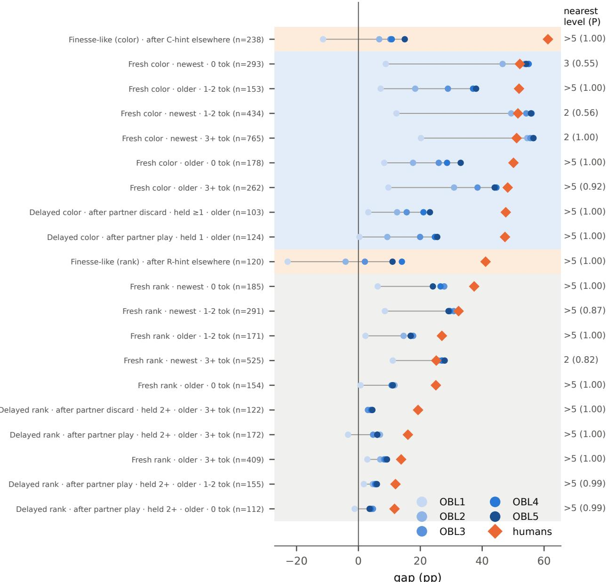  
Figure 12: Per-category convention gap across levels 1–5 with the human value overlaid. Rows are the 20 nonzero frozen level-5 categories with at least 100 human plays; the row labels follow the key of Fig. 5 and n is the number of human plays, and the shading groups rows by information family as there. Markers give each level’s gap and the human value. The right column gives the level nearest to the human value and its bootstrap probability; “>5” means the human value exceeds every level. Where humans and agents share a convention, the agent profile plateaus by level 2–3 and humans land at that plateau; where humans diverge they exceed every level.

Release. The analysis pipelines, the audit JSONs, the generated tables and figures, and the derived per-play records for the agent conditions will be released with the published version. The human and AH2AC2 corpora are redistributed only as derived, de-identified records consistent with their sources’ terms. Raw agent game logs stay on the generation server, because they derive from checkpoints licensed for non-commercial use; the included generation scripts regenerate them. The generation records name each checkpoint and environment seed but no code commit or checkpoint hash. The OBL commit and the hashes of all 25 checkpoints used here were read from the generation server in October 2026 and describe the files at that time. On that server, the unmasked intervention code path regenerated the level-5 baseline action for action (1000/1000 games; Appendix D).

## H Behavioral clones: does cloning preserve the human-specific cells?

Behavioral clones. We trained clones of human play and of level-5 play identically, at matched data scale, with registered predictions. They reproduce the asymmetry of §3.1. The control clone preserves its source’s structure $( r = 0 . 9 6 7$ at scale). The human clone reaches level 5’s gap on the dominant shared convention $( + 5 9 . 9 \left[ + 5 8 . 0 , + 6 1 . 7 \right] \mathrm { p p } )$ , while indirect reference and the unhinted newest-card cell collapse to $- 5 . 7 \ [ - 2 1 . 6 , + 1 2 . 9 ]$ and $- 3 2 . 0 \ [ - 3 7 . 6 , - 2 4 . 4 ]$ pp (the latter below literal chance). Aggregate similarity to humans is not fidelity on the channels where humans differ from machines.

The channels of §3.1 matter beyond this paper because the field increasingly evaluates coordination agents against behaviorally-cloned human proxies rather than people; AH2AC2’s own evaluation protocol rests on behavioralcloning stand-ins for the community measured above [Dizdarevic et al., 2025]. Cloning imitates the distribution´ of human actions; whether it also reproduces the human gaps on indirect reference and on unhinted cards is what our instrument can test.

Design. We train a clone of human play (HC: the AH2AC2 open games, 1,700 training / 158 held out; the hanab.live corpus, the human reference below, is not used for training) and, as the control, a clone of level-5 self-play (OC). Both use identical architecture, hyperparameters, data size and training steps: the OBL codebase’s encoder and policy network, trained by supervised learning only, and one frozen configuration for every clone. If OC preserves its source’s convention structure while HC loses the human-specific cells, the loss is cell-specific rather than an artifact of data scale. An OC series at 1858, 5,000 and 20,000 games calibrates what cloning captures at each scale. Four predictions were registered, with timestamps, before any training: the level-5 clone keeps its source’s profile and fresh-color gap; the human clone keeps the fresh-color conventions but not the indirect-reference and unhinted cells; preservation improves with data; and the human clone is less coherent in self-play than the level-5 clone. Clones are measured with the full ground-truth pipeline of §2: exact posteriors, replay verification, the frozen taxonomy. Because matched-scale clones are not coherent in self-play (HC: 100.0% zero-score games; OC: 97.2%), their channel numbers come from a frozen-partner variant (clone fixed in seat 0 against level 5, 500 games, clone-side plays only, still fully groundtruthed).

Cloning works where the data are dense. At 20,000 games the level-5 clone reproduces its source: categoryprofile $r = 0 . 9 6 7$ against level 5, gap +21.22 [+20.87, +21.58] pp (source: +21.68 [+21.34, +22.02]), fresh-color cells within a point of the original $( + 5 6 . 9 \ : [ + 5 6 . 2 , + 5 7 . 6 ] \mathrm { ~ v s } + 5 6 . 8 \ : [ + 5 6 . 4 , + 5 7 . 2 ] \mathrm { p p } )$ . Preservation is monotone in data $( r = 0 . 8 4 2 / 0 . 9 1 6 / 0 . 9 6 7$ across the series). The method, the architecture and the instrument are therefore all sufficient; what cloning captures is a question of what the data contain and how often.

The shared conventions transfer; the human-specific cells do not. At matched scale, the human clone reaches level 5’s gap on the dominant shared convention: in the level-5 category for an immediate play after a fresh color hint on the newest card, it reads $+ 5 9 . 9 \ [ + 5 8 . 0 , + 6 1 . 7 ]$ pp, against level $5 ^ { \circ } \mathrm { s } + 5 6 . 8 ~ [ + 5 6 . 4 , + 5 7 . 2 ] \mathrm { p p }$ for the same category. The cells that separate humans from the OBL hierarchy do not survive cloning: indirect reference reads $- 5 . 7 \ [ - 2 1 . 6 , + 1 2 . 9 ]$ (color; humans +61.3 [+54.4, +66.0]) and −8.1 [−19.0, +3.9] pp (rank; humans $+ 4 1 . 1 \ [ + 3 1 . 9 , + 4 8 . 8 ] )$ , and the unhinted cells read −32.0 [−37.6, −24.4] and −17.6 [−24.5, −9.6] pp against the humans’ +48.8 [+38.4, +55.6] and +43.2 [+31.1, +51.5]. Every interval excludes the human value by tens of points. The control rules out the generic explanation: at the same data and configuration, OC preserves its source’s structure $( r = 0 . 9 2 9$ with the frozen partner). What HC loses tracks how often a cell appears in training (each unhinted cell holds 0.7–1.1% of AH2AC2 plays), not how large its gap is.

Unhinted plays invert. On the frozen-partner runs, the clone’s unhinted newest-card plays are worse than literal chance $( - 3 2 . 0 \ [ - 3 7 . 6 , - 2 4 . 4 ] \mathrm { p p } ;$ ; failure rate 95.5%), as are level 1’s in self-play $( - 1 3 . 9 \ [ - 1 7 . 6 , - 9 . 9 ] \mathrm { p p } )$ . The clone’s value rests on few plays. A negative value here is consistent with a partner whose hints favor playable cards: the cards it leaves untouched are then less likely to be playable than the literal observer assumes. The partner alone does not account for the human clone’s value: with the same partner, the matched-scale level-5 clone reads $+ 2 . 6 \ [ - 1 1 . 2 , + 1 6 . 7 ] .$ pp on this cell. Cloning reproduces the act of playing an unhinted card, not the situations in which humans make that play; one reading is that imitating surface behavior without the representation behind it is costly rather than neutral.

Scope. This measures plain behavioral cloning at open-split scale (1,700–18,300 games, default configuration, no reinforcement learning). The deployed AH2AC2 proxies, cloned from 147,621 closed games and refined with regularized self-play, are not measured here. The scaling series warns against reading absence as impossibility: structure preservation improves with data, so channel survival at 105 games is not ruled out. These results suggest that the shared, frequent conventions and the rare channels respond to imitation differently, so a proxy that matches human play on the former can differ from humans on the channels where humans differ from machines. Aggregate similarity is not channel fidelity: the same dissociation, at the level of evaluation methodology, that §3.3 found at the level of the metric.