# SKILL-DECOUPLED ON-POLICY EXPERT DISTILLA-TION FOR UNIFIED VISION-LANGUAGE MODELS

Yuqi Xiong1,∗, Chunyi Peng1,∗, Zhipeng Xu2, Qing Yang1 Zhenghao Liu1,†, Zulong Chen2, Yu Gu1, Ge Yu1

1School of Computer Science and Engineering, Northeastern University, Shenyang, China 2Alibaba Group, Hangzhou, China

## ABSTRACT

Reinforcement learning (RL) can elicit specialized visual capabilities in visionlanguage models (VLMs), yet jointly optimizing heterogeneous objectives often introduces cross-capability gradient conflicts. Training experts independently mitigates this interference, but direct reward optimization may entangle specialized knowledge with reward-hacking biases. This paper proposes Skill-Decoupled On-Policy Expert Distillation (SCOPED), which trains capability-specific experts and extracts explicit skills through reward-guided reflection. During on-policy distillation, these skills guide expert supervision while remaining unavailable to the unified student, encouraging it to internalize procedural knowledge without explicit skills at inference time. Across eight multimodal benchmarks, SCOPED consistently outperforms the backbone and mixed-capability RL, demonstrating the effectiveness of skill-decoupled on-policy expert distillation for integrating independently acquired capabilities. Further analyses reveal interference during joint capability optimization and suggest that skill augmentation promotes more consistent expert trajectories, greater attention to task-relevant visual evidence, and better preservation of specialized expertise in the unified student. All code and data are available at https://github.com/NEUIR/SCOPED.

## 1 INTRODUCTION

Large Vision-Language Models (VLMs) have demonstrated remarkable capabilities across a broad range of multimodal tasks (Bai et al., 2025a; Wang et al., 2025b). To further enhance their downstream multimodal capabilities, recent studies have increasingly adopted Reinforcement Learning (RL) (Yu et al., 2026; Xu et al., 2026a; Liu et al., 2026a) to cultivate specialized visual understanding skills through task-specific rewards, including fine-grained visual perception (Sun et al., 2025; Xiong et al., 2026), visual grounding (Zhang et al., 2026), and complex multimodal reasoning (Xia et al., 2025; Peng et al., 2025). These approaches have demonstrated the effectiveness of RL in improving specific aspects of visual understanding. However, learning and integrating complementary visual understanding capabilities across heterogeneous multimodal tasks remains a fundamental challenge in multimodal post-training (Wei et al., 2026).

A straightforward approach to enhancing VLM capabilities is to jointly optimize a shared policy over diverse multimodal training data (Ma et al., 2025; Jiang et al., 2026; Cai et al., 2026). However, heterogeneous training objectives can induce conflicts between capability-specific gradients, making it difficult for a single policy to simultaneously acquire specialized capabilities (Yu et al., 2020; Liu et al., 2021). To mitigate such conflicts, recent studies instead optimize capability-specific experts independently and subsequently consolidate their acquired knowledge through knowledge distillation. In particular, On-Policy Distillation (OPD) transfers knowledge by matching teacher predictions along student-generated trajectories (Agarwal et al., 2024; Yuan et al., 2026), while Multi-Teacher On-Policy Distillation (MOPD) extends this paradigm to multiple capability-specific teachers, enabling a shared policy to integrate complementary capabilities from different experts (Ma et al., 2026; Xiao et al., 2026). Nevertheless, directly aligning the predictions of expert policies does not explicitly distinguish reusable capability-level strategies from capability-specific patterns, which may include overfitting and reward-hacking behaviors inadvertently encoded in these experts.

To address these challenges, we introduce Skill-DeCoupled On-Policy Expert Distillation (SCOPED), a framework that decouples capability-specific skills from expert policies to better guide multimodal post-training. First, SCOPED independently optimizes a set of capability-specific experts with RL, where each expert is trained on a dedicated dataset with a capability-level reward objective. This independent optimization allows different experts to explore diverse solution strategies for their respective visual understanding capabilities without interference from heterogeneous training objectives. Next, to acquire complementary visual understanding capabilities, SCOPED extracts capability-specific skills from the reasoning trajectories of these experts. These skills explicitly summarize reusable solution patterns underlying successful and failed expert behaviors. We then augment each expert with its corresponding skill to provide explicit procedural guidance during reasoning, thereby reducing unnecessary or capability-irrelevant reasoning patterns that may interfere with capability learning. Finally, SCOPED applies On-Policy Distillation (OPD) to transfer the complementary capabilities from these skill-augmented experts into a unified student model.

Extensive experiments across eight multimodal benchmarks show that SCOPED enables a compact 8B model to achieve the highest average score among the evaluated models, surpassing larger opensource and leading closed-source baselines. Ablation studies demonstrate the benefits of expert distillation and the additional contribution of skill augmentation. Further analyses reveal limitations of mixed-capability optimization, including lower training rewards than independent capability RL, weak alignment with expert-guided directions, and recurring conflicts between capability-specific gradients. We also find that skill conditioning increases trajectory consistency within each capability and directs greater attention toward task-relevant visual evidence, while the distilled student better preserves expert-induced behavior.

## 2 RELATED WORK

Reinforcement learning (RL) has become an effective paradigm for specializing Vision-Language Models (VLMs) under capability-specific objectives (Liu et al., 2026b; Xia et al., 2025; Peng et al., 2026). By optimizing targeted reward signals, capability-specific RL enables models to focus on the visual understanding and reasoning behaviors required by a particular capability, thereby developing specialized expertise (Xiong et al., 2026; Zhang et al., 2026; Peng et al., 2025). To broaden capability coverage, recent efforts have explored jointly training a shared policy across heterogeneous capabilities (Ma et al., 2025; Sarch et al., 2026). However, heterogeneous objectives can induce competing gradient signals over shared parameters, causing updates beneficial to one capability to distract the optimization direction of others (Yu et al., 2020; Liu et al., 2021). As a result, joint optimization may restrict specialized expertise, highlighting the difficulty of simultaneously developing and consolidating heterogeneous capabilities within a unified policy.

Rather than jointly optimizing a shared policy, knowledge distillation provides an alternative route for consolidating specialized capabilities into a unified model. On-policy distillation aligns teacher supervision with student-generated trajectories, effectively mitigating distribution shift (Agarwal et al., 2024; Gu et al., 2024). Recent context-conditioned variants further enrich teacher supervision with privileged information or auxiliary context (Zhao et al., 2026; Ye et al., 2026; Yuan et al., 2026). For capability integration, Multi-Teacher On-Policy Distillation (MOPD) extends this paradigm to multiple independently optimized experts, distilling their complementary capabilities into a shared student along student-generated rollouts (Ma et al., 2026; Xiao et al., 2026). Nevertheless, these approaches primarily transfer expert knowledge through predictive distributions, leaving reusable reasoning patterns contained in expert trajectories largely implicit and potentially propagating noisy or over-specialized expert behaviors to the student.

To externalize such implicit trajectory-level knowledge, recent studies have explored abstracting raw execution experiences into explicit skills that capture reusable solution patterns (Xin et al., 2026). Trace2Skill consolidates execution trajectories into transferable skills through hierarchical consolidation (Ni et al., 2026), while SkillRL and Skill1 construct evolving skill libraries to support skill retrieval and policy improvement (Xia et al., 2026; Shi et al., 2026). In multimodal reasoning, Lang2Act extracts self-emergent linguistic tools from reasoning trajectories to guide fine-grained visual understanding (Xiong et al., 2026). Skill-SD further conditions the teacher on trajectoryderived skills as privileged information during self-distillation (Wang et al., 2026). Together, these studies show that trajectory-derived skills can convert implicit execution experience into explicit and reusable guidance for subsequent model optimization. While these studies demonstrate the value of trajectory-derived skills for reusable reasoning and structured supervision, how such skills can regularize supervision from multiple independently optimized capability experts during their integration into a unified VLM remains underexplored.

## 3 METHODOLOGY

In this section, we present Skill-Decoupled On-Policy Expert Distillation (SCOPED), a framework for acquiring and transferring a diverse set of complementary visual understanding capabilities. As illustrated in Fig. 1, SCOPED consists of two stages. First, we independently train MLLMs on different capabilities with capability-specific reward signals, allowing each model to develop expertise specialized to its target visual understanding capability (Sec. 3.1). Second, to bypass the instability of joint optimization, we abstract reward-evaluated expert trajectories into explicit skills, introducing a structural information asymmetry during on-policy distillation (Sec. 3.2). Serving as privileged directional anchors, these skills regularize expert supervision, compelling the student to internalize this guidance for conflict-free consolidation.

## 3.1 LEARNING MLLM EXPERTISE WITH CAPABILITY-SPECIFIC REINFORCEMENT

While jointly learning diverse capabilities is essential for general visual understanding, optimizing a shared policy over heterogeneous data can introduce conflicting optimization signals and distract the learning process (Yu et al., 2020; Gao et al., 2026). As a result, improvements in one capability may interfere with the acquisition of another. To mitigate such interference, SCOPED decouples capability learning through independent reinforcement learning, producing specialized capability experts together with reward-evaluated trajectories that capture their acquired behaviors.

Eliciting Capability-Specific Expertise. To elicit the visual understanding capabilities of MLLMs, we partition the training corpus into C capability-specific subsets $\{ B _ { c } \} _ { c = 1 } ^ { C }$ , where each instance consists of a multimodal input x and its ground-truth answer $a .$ For each capability $c ,$ an expert policy is initialized from the shared base policy $\pi _ { \theta }$ and optimized independently on $\boldsymbol { B } _ { c } .$ This decoupled optimization allows each expert to specialize in its designated capability without being directly affected by competing optimization objectives from other capabilities.

For an instance $( x , a ) \in B _ { c } .$ , the corresponding capability expert samples a rollout trajectory:

$$
\tau \sim \pi _ { \theta } ( \cdot \mid x ) ,\tag{1}
$$

where $\tau$ denotes the generated trajectory. Each trajectory is evaluated against the target answer a using a capability-specific reward function $r _ { c } .$ Guided by these reward signals, the capability expert $\pi _ { \theta _ { c } }$ is obtained by maximizing the expected reward over the subset $\boldsymbol { B } _ { c } .$

$$
\theta _ { c } = \arg \operatorname* { m a x } _ { \theta } \mathbb { E } _ { ( x , a ) \sim \mathcal { B } _ { c } , \tau \sim \pi _ { \theta } ( \cdot | x ) } \left[ r _ { c } ( a , \tau ) \right] .\tag{2}
$$

The specific design of $r _ { c }$ is described in Appendix $_ { \mathrm { A } . 3 }$

Collecting Capability-Specific Experiences. After capability-specific reinforcement learning, we collect a diverse set of trajectories from each trained capability expert $\pi _ { \theta _ { c } }$ . Specifically, for each instance $( x , a ) \in B _ { c }$ , we sample K distinct rollouts:

$$
\tau _ { 1 } , \dots , \tau _ { K } \sim \pi _ { \theta _ { c } } ( \cdot \mid x ) .\tag{3}
$$

These trajectories provide concrete behavioral traces of the strategies acquired through capabilityspecific reinforcement, including recurring solution patterns and capability-relevant actions (Guo et al., 2025; Xiong et al., 2026).

To properly contextualize the expert’s behavioral process, we associate each sampled trajectory $\tau _ { k }$ where $\mathbf { \bar { \boldsymbol { k } } } \in \operatorname { \bar { \boldsymbol { \{ \varepsilon } } }  \operatorname { \{ 1 , \dots , K \} }$ , with its input context and target answer to form a trajectory tuple $( x , a , \tau _ { k } )$

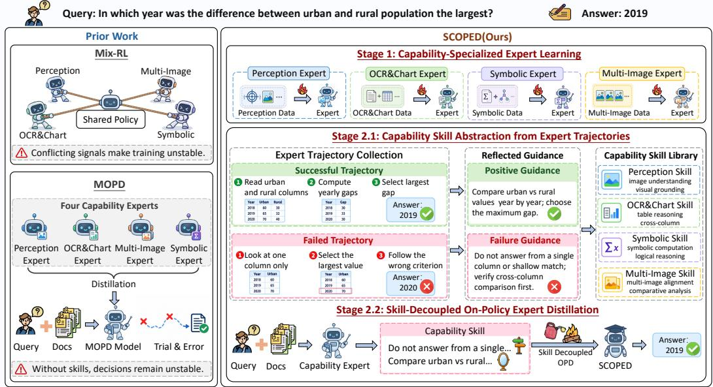  
Figure 1: Overview Architecture of SCOPED.

Aggregating these tuples over the entire subset $B _ { c }$ yields the global capability-specific trajectory repository:

$$
\mathbb { T } _ { c } = \bigcup _ { ( x , a ) \in \mathcal { B } _ { c } } \left\{ \left( x , a , \tau _ { k } \right) \right\} _ { k = 1 } ^ { K } .\tag{4}
$$

The resulting $\mathbb { T } _ { c }$ serves as a comprehensive repository of both successful and failed behaviors acquired by the capability expert, which is used to supervise the training process in Sec. 3.2.

## 3.2 UNIFYING CAPABILITY EXPERTS VIA SKILL-AUGMENTED DISTILLATION

As described in Sec. 3.1, directly distilling raw expert predictions risks propagating reward-hacking behaviors and their associated biases (Gao et al., 2023; Chen et al., 2024; Helff et al., 2026). To isolate reusable expertise from such behaviors, SCOPED first extracts capability-specific skills from the expert’s global trajectory repository through reward-guided reflection, contrasting successful and failed executions to identify verified solution patterns. During subsequent on-policy distillation (Yuan et al., 2026; Ma et al., 2026), these extracted skills serve as privileged directional guidance (Wang et al., 2026), conditioning the expert’s supervision on explicit procedural knowledge rather than directly exposing the student to potentially biased predictions. Under this structural information asymmetry, the student aligns with the skill-regularized supervision, thereby internalizing the pure expertise while mitigating the propagation of erroneous reward-driven behaviors.

Extracting Capability-Specific Skills. Given the global trajectory repository $\mathbb { T } _ { c } ,$ we extract reusable solution patterns through reward-guided reflection. Specifically, we partition all collected trajectories into successful and failed cohorts evaluated by the reward function $r _ { c } .$

$$
\begin{array} { r } { \mathbb { T } _ { c } ^ { + } = \{ ( x , a , \tau ) \in \mathbb { T } _ { c } \mid r _ { c } ( a , \tau ) \geq \gamma \} , \quad \mathbb { T } _ { c } ^ { - } = \{ ( x , a , \tau ) \in \mathbb { T } _ { c } \mid r _ { c } ( a , \tau ) < \gamma \} , } \end{array}\tag{5}
$$

where $\gamma$ denotes the reward threshold defining successful and failed executions. The capability expert $\pi _ { \theta _ { c } }$ then performs reward-guided reflection over trajectories from these two cohorts. By identifying recurring patterns in the successful trajectories $\bar { \mathbb { T } } _ { c } ^ { + }$ and diagnosing failure modes in the unsuccessful ones $\mathbb { T } _ { c } ^ { - }$ , the expert produces a capability-specific reflection result $\mathcal { R } _ { c }$ :

$$
\mathcal { R } _ { c } = \pi _ { \theta _ { c } } \left( \mathrm { I n s t r u c t } _ { \mathrm { r e f l e c t } } \left( \mathbb { T } _ { c } ^ { + } , \mathbb { T } _ { c } ^ { - } \right) \right) ,\tag{6}
$$

where Instruc $\mathrm { \ t { _ { r e f l e c t } } }$ denotes the overall reflection procedure over successful and failed trajectories, with outcome-specific reflection prompts detailed in Appendix A.5.

Finally, we guide the capability expert to consolidate the extracted insights into an explicit capability-specific skill:

$$
S _ { c } = \pi _ { \theta _ { c } } ( \mathrm { I n s t r u c t _ { s y n } } ( \mathcal { R } _ { c } ) ) ,\tag{7}
$$

where Instruc $\mathrm { t _ { s y n } }$ instructs the expert to synthesize the aggregated reflections $\mathcal { R } _ { c }$ into explicit procedural guidance. The resulting skill $S _ { c }$ provides an explicit symbolic representation of the reusable expertise acquired by the capability expert $\pi _ { \theta _ { c } }$ , which will serve as a privileged conditional anchor to regularize the expert during subsequent distillation.

Skill-Augmented Distillation. To translate decoupled skills into regularized supervision, SCOPED utilizes $S _ { c }$ as a privileged directional anchor exclusively for each capability expert. This asymmetric conditioning elicits precise reasoning traces and highly stable target distributions (Huang et al., 2026). By distilling from these skill-augmented experts, the unified student receives clean supervision, effectively avoiding the exploratory noise and reward-hacking biases inherent in raw expert policies.

For a given sample $( x , a ) \in B _ { c }$ , the unified student policy $\pi _ { \theta }$ generates an on-policy response $y \sim \pi _ { \boldsymbol { \theta } } ( \cdot \mid x )$ . At decoding step t, the predictive distributions of the student and the corresponding capability expert $\pi _ { \theta _ { c } }$ are respectively given by:

$$
p _ { \theta , t } = \pi _ { \theta } ( \cdot \mid x , y _ { < t } ) , \quad q _ { \theta _ { c } , t } = \pi _ { \theta _ { c } } ( \cdot \mid x , S _ { c } , y _ { < t } ) ,\tag{8}
$$

where $y _ { < t }$ denotes the student-generated prefix. Under this asymmetric conditioning, $S _ { c }$ acts as a directional anchor that regularizes the target distribution $q _ { \theta _ { c } , t }$ , guiding the expert along verified reasoning paths while effectively suppressing erroneous or over-specialized tokens.

To consolidate the diverse expertise into a single model, we optimize the unified student policy over all $C$ capabilities. The overall skill-augmented distillation loss $\mathcal { L }$ is defined as the expected token-level reverse KL divergence aggregated across all capability-specific subsets:

$$
\mathcal { L } = \frac { 1 } { C } \sum _ { c = 1 } ^ { C } \mathbb { E } _ { ( x , a ) \sim \mathcal { B } _ { c } , y \sim \pi _ { \theta } ( \cdot | x ) } \left[ \frac { 1 } { \left| y \right| } \sum _ { t = 1 } ^ { | y | } D _ { \mathrm { K L } } \big ( p _ { \theta , t } \mid \big | q _ { \theta _ { c } , t } \big ) \right] ,\tag{9}
$$

where $D _ { \mathrm { K L } } ( \cdot \parallel \cdot )$ denotes the reverse Kullback-Leibler divergence, and $| y |$ is the length of the generated response. Minimizing this objective directly embeds the regularized expert knowledge into the student’s weights, yielding a unified model that is entirely self-sufficient and requires no explicit skill conditioning during inference.

## 4 EXPERIMENTAL METHODOLOGY

This section first describes the datasets, evaluation metrics, and baselines. Then, we introduce the implementation details of our experiments.

Datasets. The evaluation covers eight benchmarks across four capability groups. Count-BenchQA (Paiss et al., 2023) and PixMo-Count (Deitke et al., 2025) are used for fine-grained perception; CC-OCR V2 (Xu et al., 2026c) and ChartQA (Masry et al., 2022) for OCR and chart understanding; VisualPuzzles (Song et al., 2025) and We-Math (Qiao et al., 2025) for symbolic visual reasoning; and MUIRBench (Wang et al., 2025a) and MMSI-Bench (Yang et al., 2025) for multiimage reasoning. For capability-specific expert training, reinforcement learning data are constructed from six public multimodal datasets, including task-relevant subsets of Orsta-Data-47K (Ma et al., 2025). Detailed dataset composition and statistics are provided in Appendix A.1.

Evaluation Metrics. We employ task-specific metrics following the official evaluation protocols of each benchmark. Fine-grained perception, chart understanding, symbolic visual reasoning, and multi-image reasoning tasks are evaluated using accuracy. OCR recognition is evaluated using micro-F1 following CC-OCR V2 (Xu et al., 2026c). All scores are reported as percentages, and the overall score is the arithmetic mean across the eight benchmarks.

Table 1: Overall Performance. Comparison with closed-source and open-source models across four capability groups, including fine-grained perception, OCR and chart understanding, symbolic visual reasoning, and multi-image reasoning. SCOPED-4B and SCOPED-8B are built on Qwen3-VL-4B and Qwen3-VL-8B, respectively.
<table><tr><td rowspan="2">Model</td><td colspan="2">Perception</td><td colspan="2">OCR &amp; Chart</td><td colspan="2">Symbolic</td><td colspan="2">Multi-Image</td><td rowspan="2">Avg.</td></tr><tr><td>CountB. PixMo</td><td></td><td>CC-OCR</td><td>ChartQA</td><td>VisPuz.</td><td>WeMath</td><td>MUIR MMSI</td><td></td></tr><tr><td colspan="9">Closed-Source Models</td></tr><tr><td>Claude-Sonnet-4.6</td><td>90.63</td><td>68.69</td><td>82.37</td><td>89.40</td><td>52.91</td><td>87.18</td><td>76.35</td><td>34.80</td><td>72.79</td></tr><tr><td>Claude-Opus-4.6</td><td>89.21</td><td>64.71</td><td>80.74</td><td>90.88</td><td>52.23</td><td>87.70</td><td>80.08</td><td>37.30</td><td>72.86</td></tr><tr><td>GPT-5.2</td><td>88.39</td><td>77.04</td><td>86.31</td><td>87.44</td><td>39.47</td><td>70.92</td><td>70.00</td><td>33.30</td><td>69.11</td></tr><tr><td>GPT-5.4</td><td>91.24</td><td>77.80</td><td>72.35</td><td>88.12</td><td>51.28</td><td>74.25</td><td>68.77</td><td>35.00</td><td>69.85</td></tr><tr><td colspan="10">Open-Source Models</td></tr><tr><td>GLM-4.1V-9B-Base</td><td>75.76</td><td>48.77</td><td>67.07</td><td>83.12</td><td>27.31</td><td>35.46</td><td>52.50</td><td>27.20</td><td>52.15</td></tr><tr><td>Qwen2.5-VL-7B</td><td>74.95</td><td>36.81</td><td>85.50</td><td>45.80</td><td>25.60</td><td>65.57</td><td>61.19</td><td>27.70</td><td>52.89</td></tr><tr><td>InternVL3.5-8B</td><td>77.60</td><td>56.74</td><td>78.53</td><td>88.16</td><td>43.24</td><td>77.53</td><td>59.42</td><td>24.80</td><td>63.25</td></tr><tr><td>Qwen3-VL-4B</td><td>81.47</td><td>64.90</td><td>82.86</td><td>85.60</td><td>35.10</td><td>76.26</td><td>72.12</td><td>30.20</td><td>66.06</td></tr><tr><td>Qwen3-VL-8B</td><td>83.91</td><td>67.36</td><td>85.72</td><td>81.32</td><td>46.40</td><td>71.67</td><td>72.92</td><td>29.10</td><td>67.30</td></tr><tr><td>MiMo-VL-7B-RL</td><td>86.56</td><td>65.65</td><td>72.83</td><td>87.92</td><td>45.03</td><td>83.39</td><td>69.27</td><td>29.40</td><td>67.51</td></tr><tr><td>Qwen3-VL-32B</td><td>90.22</td><td>75.52</td><td>86.08</td><td>87.60</td><td>48.72</td><td>79.83</td><td>74.31</td><td>33.80</td><td>72.01</td></tr><tr><td colspan="10">Unified Multi-Expert Distillation</td></tr><tr><td>SCOPED-4B</td><td>88.39</td><td>74.38</td><td>85.03</td><td>89.48</td><td>38.01</td><td>78.85</td><td>76.15</td><td>29.40</td><td>69.96</td></tr><tr><td>SCOPED-8B</td><td>90.43</td><td>79.89</td><td>88.79</td><td>88.28</td><td>46.58</td><td>82.47</td><td>76.58</td><td>32.00</td><td>73.13</td></tr></table>

Baselines. In our experiments, we compare SCOPED with representative closed-source and opensource vision-language models. The closed-source baselines include Claude Sonnet 4.6 and Claude Opus 4.6 (Anthropic, 2026b;a), GPT-5.2 (OpenAI, 2025), and GPT-5.4 (OpenAI, 2026). The opensource baselines include GLM-4.1V-9B-Base (Hong et al., 2025), Qwen2.5-VL-7B (Bai et al., 2025b), InternVL3.5-8B (Wang et al., 2025b), Qwen3-VL-8B and Qwen3-VL-32B (Bai et al., 2025a), and MiMo-VL-7B-RL (Xiaomi LLM-Core Team, 2025).

Implementation Details. In our experiments, we employ Qwen3-VL-8B-Instruct and Qwen3- VL-4B-Instruct (Bai et al., 2025a) as the shared backbone to construct all capability-specialized experts and the unified student. Capability-specific reinforcement learning is implemented with EasyR1 (Zheng et al., 2025), and multi-expert on-policy distillation is implemented with veRL (Sheng et al., 2024). All experiments are conducted on NVIDIA A800 GPUs. More training implementation details and hyperparameter settings are presented in Appendix A.2.

## 5 RESULTS AND ANALYSIS

In this section, we first evaluate the overall performance of SCOPED across eight multimodal benchmarks and conduct ablation studies to assess the effectiveness of its key components. We then provide in-depth analyses of cross-capability gradient interference under mixed-capability optimization and investigate how skill augmentation influences expert supervision during capability integration.

## 5.1 OVERALL PERFORMANCE

As shown in Table 1, we report the performance of various VLMs across eight benchmarks. The evaluation results show that SCOPED consistently improves the Qwen3-VL backbone across heterogeneous visual understanding capabilities. In particular, SCOPED-8B outperforms its backbone on all eight benchmarks, achieving an average improvement of 5.83 points. These results demonstrate that our framework can effectively consolidate complementary capabilities into a unified model.

Table 2: Ablation Study. All models are built on Qwen3-VL-8B. We compare training and capability integration strategies, with capability-specific experts shown as references for assessing expertise retention. The best and second-best results are highlighted in bold and underlined, respectively.
<table><tr><td rowspan="2">Method</td><td colspan="2">Perception</td><td colspan="2">OCR &amp; Chart</td><td colspan="2">Symbolic</td><td colspan="2">Multi-Image</td><td rowspan="2">Avg.</td></tr><tr><td></td><td>CountB. PixMo</td><td>CC-OCR ChartQA</td><td></td><td></td><td>VisPuz. WeMath</td><td>MUIR MMSI</td><td></td></tr><tr><td colspan="9">Capability-Specific Experts</td></tr><tr><td>Perception-RL</td><td>92.67</td><td>79.89</td><td>85.80</td><td>85.00</td><td>47.09</td><td>79.60</td><td>71.00</td><td>30.50</td><td>71.44</td></tr><tr><td>+ Perception Skill</td><td>93.69</td><td>82.35</td><td>85.82</td><td>85.08</td><td>47.00</td><td>79.54</td><td>71.12</td><td>30.60</td><td>71.90</td></tr><tr><td>OCR &amp; Chart-RL</td><td>82.89</td><td>73.06</td><td>86.08</td><td>89.64</td><td>47.17</td><td>82.76</td><td>74.42</td><td>30.40</td><td>70.80</td></tr><tr><td>+ OCR &amp; Chart Skill</td><td>82.69</td><td>73.24</td><td>86.23</td><td>90.60</td><td>47.26</td><td>82.87</td><td>74.31</td><td>30.30</td><td>70.94</td></tr><tr><td>Symbolic-RL</td><td>82.28</td><td>69.26</td><td>85.81</td><td>81.12</td><td>48.37</td><td>82.30</td><td>75.81</td><td>30.40</td><td>69.42</td></tr><tr><td>+ Symbolic Skill</td><td>82.08</td><td>69.07</td><td>85.78</td><td>81.36</td><td>48.80</td><td>84.20</td><td>75.85</td><td>30.50</td><td>69.71</td></tr><tr><td>Multi-Image-RL</td><td>83.10</td><td>67.74</td><td>85.61</td><td>81.08</td><td>47.43</td><td>79.71</td><td>76.00</td><td>30.70</td><td>68.92</td></tr><tr><td>+ Multi-Image Skill</td><td>83.30</td><td>67.93</td><td>85.59</td><td>81.04</td><td>47.35</td><td>79.66</td><td>76.50</td><td>32.00</td><td>69.17</td></tr><tr><td colspan="10">Unified-Model Baselines and Ablations</td></tr><tr><td>Zero-shot</td><td>83.91</td><td>67.36</td><td>85.72</td><td>81.32</td><td>46.40</td><td>71.67</td><td>72.92</td><td>29.10</td><td>67.30</td></tr><tr><td>SFT</td><td>56.32</td><td>66.92</td><td>85.77</td><td>60.36</td><td>33.99</td><td>57.59</td><td>65.23</td><td>25.10</td><td>56.41</td></tr><tr><td>Mix-RL</td><td>89.80</td><td>73.80</td><td>86.01</td><td>85.00</td><td>40.10</td><td>82.90</td><td>67.80</td><td>29.10</td><td>69.31</td></tr><tr><td>SCOPED (Parameter Merging)</td><td>86.35</td><td>73.43</td><td>85.83</td><td>85.32</td><td>49.49</td><td>81.32</td><td>75.31</td><td>30.10</td><td>70.89</td></tr><tr><td>SCOPED (w/o Skill Augmentation)</td><td>89.41</td><td>79.89</td><td>88.89</td><td>88.16</td><td>43.75</td><td>81.26</td><td>76.27</td><td>31.50</td><td>72.39</td></tr><tr><td>SCOPED</td><td>90.43</td><td>79.89</td><td>88.79</td><td>88.28</td><td>46.58</td><td>82.47</td><td>76.58</td><td>32.00</td><td>73.13</td></tr></table>

Compared with existing open-source and closed-source models, SCOPED-8B achieves the best overall performance among the evaluated models and further surpasses the substantially larger model Qwen3-VL-32B, demonstrating that effective capability integration can yield substantial gains without simply scaling up the model. We adopt Qwen3-VL as the backbone due to its competitive performance across the evaluated capability groups. Nevertheless, existing models often exhibit uneven performance across different capabilities, making it challenging to simultaneously maintain strong performance in perception, OCR and chart understanding, symbolic reasoning, and multi-image reasoning. In contrast, SCOPED consistently strengthens the backbone across all four capability groups. We further apply SCOPED to Qwen3-VL-4B, where it achieves an average improvement of 3.90 points and surpasses several larger open-source models. The consistent gains observed with both the 4B and 8B backbones demonstrate that the effectiveness of SCOPED generalizes across model scales and remains robust across diverse visual capabilities.

## 5.2 ABLATION STUDY

As shown in Table 2, we conduct ablation studies to investigate the effectiveness of different multi task training strategies and the individual components of SCOPED. We first compare SCOPED with SFT and Mix-RL to assess the benefits of our training paradigm. We then ablate key components of SCOPED to examine their respective contributions. For reference, we also report the performance of capability-specific experts, each of which is optimized exclusively with task-specific rewards.

The evaluation results show that SFT underperforms the zero-shot backbone, suggesting that jointly fine-tuning on capability-specific data can introduce interference across capabilities. Although Mix-RL improves overall performance, it still underperforms the corresponding specialized experts on symbolic visual reasoning and multi-image reasoning, indicating that joint optimization may limit the acquisition of specialized capabilities. In contrast, SCOPED achieves an average improvement of 3.82 points over Mix-RL, demonstrating the effectiveness of separating capability acquisition from capability integration. The skill-augmented expert results further show that matching each expert with its corresponding skill consistently improves the target capability, while its effects on nontarget capabilities are limited and occasionally negative. This result highlights the capability-specific nature of the extracted guidance and motivates explicit skill-expert matching during distillation.

Furthermore, we compare two variants of SCOPED, SCOPED (Parameter Merging) and SCOPED w/o Skill Augmentation, which use parameter merging and distillation without skill augmentation, respectively, to unify multiple capability-specific experts into a single model. SCOPED (Parameter Merging) consistently underperforms the on-policy distillation variants, suggesting that directly merging expert parameters is insufficient to fully integrate complementary capabilities. In contrast, SCOPED w/o Skill Augmentation already outperforms Mix-RL, indicating that token-level supervision from the corresponding experts along student-generated trajectories provides more fine-grained guidance for learning different capabilities. This allows the unified model to progressively absorb expertise that was independently acquired by the specialized experts. Building on this foundation, the full SCOPED framework achieves a further average improvement, with gains across all four capability groups. These results indicate that explicit skills extracted from expert experience provide more targeted distillation signals, facilitating specialized capability distillation.

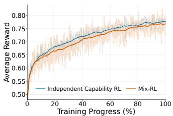  
(a) Training Reward.

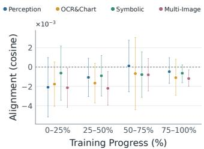  
(b) Capability-wise Update Alignment of the Mix-RL Model.

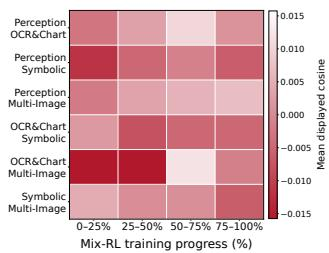  
(c) Pairwise Gradient Conflict.  
Figure 2: Cross-Capability Interference in Mix-RL. (a) Average training reward of independent capability RL and Mix-RL. (b) Alignment of shared Mix-RL updates with capability-specific expert directions. (c) Pairwise gradient cosine similarity across Mix-RL training stages.

## 5.3 GRADIENT INTERFERENCE IN MULTI-CAPABILITY TRAINING

As illustrated in Figure 2, we investigate the cross-capability gradient interference phenomenon (Yu et al., 2020; Liu et al., 2021) during shared-policy optimization from three complementary perspectives: training reward, expert-guided update alignment, and pairwise gradient conflict. We first evaluate the training dynamics in Figure 2a. While both independent capability RL and Mix-RL steadily improve their average rewards, independent optimization maintains a consistent advantage throughout most of the training process. Although the performance gap narrows toward convergence, the overall trend clearly indicates that mixed-capability optimization structurally limits the gains achievable through capability-specific learning, preventing the model from fully benefiting from independently optimized capability objectives. To uncover the mechanistic cause of this limitation, we analyze how the realized Mix-RL updates align with the behaviors acquired by independently trained capability experts. We characterize this parameter-space update alignment using cosine similarity (Xu et al., 2026b). Specifically, for each capability, we derive a local expert-guided direction from the negative gradient of the KL divergence between the current Mix-RL policy and the corresponding fixed capability expert under matched response prefixes. We then compute its cosine similarity against the actual parameter displacement between adjacent Mix-RL checkpoints. In thi formulation, positive values denote movement toward the expert, whereas near-zero or negative values indicate orthogonal or contradictory updates. As shown in Figure 2b, the shared updates show weak alignment with the expert-guided directions, with negative values observed across multiple capabilities and training stages. This confirms a severe see-saw effect: shared-policy optimization inevitably forces trade-offs, improving certain capabilities at the direct expense of others rather than consistently approximating all capability-specific experts simultaneously.

This interference is further supported by analyzing the capability-specific optimization directions themselves. At each Mix-RL checkpoint, we estimate capability-specific gradients using the corresponding capability data and compute pairwise cosine similarities among the four capabilities (Yu et al., 2020; Liu et al., 2021). Positive cosine similarity indicates aligned optimization directions, whereas negative values indicate that two capabilities favor opposing local updates. Figure 2c reveals recurrent negative cosine similarities across multiple capability pairs at different training stages, providing direct empirical evidence that heterogeneous capabilities can favor competing local optimization directions. Together, these results demonstrate that shared-policy optimization is constrained by cross-capability interference. These results further support the motivation of SCOPED to decouple capability acquisition into independently optimized experts prior to subsequent integration.

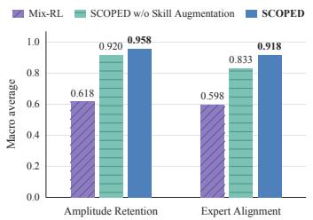  
(a) Capability Retention of Experts.

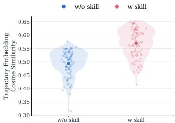  
(b) Trajectory Consistency.

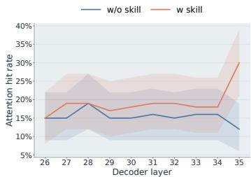  
(c) Layer-wise Attention Hit Rate.  
Figure 3: Analysis of Skill-Augmented Expert Supervision. (a) Capability retention and alignment, macro-averaged across four capabilities. (b) Within-capability trajectory embedding similarity with and without skill conditioning. (c) Layer-wise attention hit rate on task-relevant visual regions with and without skill conditioning.

## 5.4 EFFECTIVENESS OF SKILL-AUGMENTED DISTILLATION IN SCOPED

In this section, we further investigate how skill augmentation regularizes expert supervision during the distillation process of SCOPED. As illustrated in Figure 3, we examine its effects from three complementary perspectives: the preservation of expert-induced behavior in the unified student, the consistency of expert trajectories across instances within each capability, and the utilization of task-relevant visual evidence.

We first characterize functional capability preservation using token-level log-probability shifts relative to the base model on fixed trajectories (Klabunde et al., 2025). For each trajectory, we construct a shift vector from these log-probability changes and compare the unified student with the corresponding expert in terms of amplitude retention and expert alignment. Amplitude retention quantifies how much of the expert-induced shift is preserved by the student, while expert alignment measures the cosine similarity between their shift vectors. We evaluate models distilled from different capability-specific RL experts across visual understanding capabilities. As shown in Figure 3a, SCOPED achieves higher amplitude retention and expert alignment than Mix-RL, demonstrating better preservation of expert-induced functional behavior across capabilities. Notably, SCOPED also outperforms SCOPED w/o Skill Augmentation, indicating that the extracted skills help the student better acquire and reconcile complementary expert capabilities.

To further uncover the role of skill augmentation in SCOPED, we evaluate the consistency of expert generation by encoding reasoning trajectories produced by each capability expert with and without its corresponding skill using Qwen3-VL-Embedding-2B (Li et al., 2026). Within each capability, we compute pairwise cosine similarities between trajectory embeddings generated from different inputs to obtain the distributions shown in Figure 3b. Higher similarity indicates more consistent expert behavior across instances. With skill conditioning, SCOPED shifts the trajectory similarity distribution toward higher values, indicating that explicit skill guidance regularizes expert generation and promotes more consistent trajectory representations. Finally, we investigate whether this trajectory-level regularization extends to visual evidence utilization. Building on findings that attention patterns in VLMs can effectively capture task-relevant visual grounding (Kang et al., 2025), we compare each capability expert with and without its corresponding skill under identical inputs. At each decoder layer, we identify the most-attended visual token for each attention head and record a hit if it falls within the task-relevant region. We then average the resulting hit rates across attention heads and evaluation samples. As shown in Figure 3c, skill-augmented experts consistently achieve higher hit rates across most of the upper decoder layers, with the largest improvement observed in the final layer. This finding indicates that explicit skills steer capability experts toward more accurate allocation of attention to task-relevant visual evidence. Taken together, these multi-level analyses suggest that skill conditioning promotes more consistent expert trajectories and more effective visual grounding, while enabling the distilled student to better preserve expert-induced functional behavior.

## 6 CONCLUSION

This paper proposes SCOPED, aiming at integrating complementary visual understanding capabilities into a unified Vision-Language Model through skill-decoupled on-policy expert distillation. SCOPED independently optimizes capability-specific experts and abstracts reusable solution patterns from reward-evaluated trajectories into explicit capability skills. During on-policy distillation, these skills guide capability experts to provide structured supervision for the unified student. Our experiments demonstrate that SCOPED consistently improves performance across diverse visual understanding capabilities. Our further analyses reveal cross-capability interference during mixedcapability optimization and show that skill augmentation improves the preservation and transfer of specialized expert capabilities.

## AI USE STATEMENT

Generative AI tools were used solely for language polishing and improving the clarity of the manuscript. All research ideas, experimental design, implementation, analysis, and conclusions were independently developed and verified by the authors, who take full responsibility for the content of the paper.

## REFERENCES

Rishabh Agarwal, Nino Vieillard, Yongchao Zhou, Piotr Stanczyk, Sabela Ramos Garea, Matthieu Geist, and Olivier Bachem. On-policy distillation of language models: Learning from selfgenerated mistakes. In International Conference on Learning Representations, volume 2024, pp. 21246–21263, 2024.

Anthropic. Introducing Claude Opus 4.6. https://www.anthropic.com/news/ claude-opus-4-6, February 2026a. Published February 5, 2026.

Anthropic. Introducing Claude Sonnet 4.6. https://www.anthropic.com/news/ claude-sonnet-4-6, February 2026b. Published February 17, 2026.

Shuai Bai, Yuxuan Cai, Ruizhe Chen, Keqin Chen, Xionghui Chen, Zesen Cheng, Lianghao Deng, Wei Ding, Chang Gao, Chunjiang Ge, et al. Qwen3-vl technical report. arXiv preprint arXiv:2511.21631, 2025a.

Shuai Bai, Keqin Chen, Xuejing Liu, Jialin Wang, Wenbin Ge, Sibo Song, Kai Dang, Peng Wang, Shijie Wang, Jun Tang, et al. Qwen2.5-VL technical report. ArXiv preprint, 2025b. URL https: //arxiv.org/abs/2502.13923.

Min Cai, Yu Liang, Longzheng Wang, Yan Wang, Yueyang Zhang, Long Xia, Zhiyuan Sun, Xi Ye, and Daiting Shi. Advancing general-purpose reasoning models with modular gradient surgery. arXiv preprint arXiv:2602.02301, 2026.

Lichang Chen, Chen Zhu, Davit Soselia, Jiuhai Chen, Tianyi Zhou, Tom Goldstein, Heng Huang, Mohammad Shoeybi, and Bryan Catanzaro. Odin: Disentangled reward mitigates hacking in rlhf. arXiv preprint arXiv:2402.07319, 2024.

Matt Deitke, Christopher Clark, Sangho Lee, Rohun Tripathi, Yue Yang, Jae Sung Park, Mohammadreza Salehi, Niklas Muennighoff, Kyle Lo, Luca Soldaini, et al. Molmo and pixmo: Open weights and open data for state-of-the-art vision-language models. In Proceedings of the Computer Vision and Pattern Recognition Conference, pp. 91–104, 2025.

Leo Gao, John Schulman, and Jacob Hilton. Scaling laws for reward model overoptimization. In International conference on machine learning, pp. 10835–10866. PMLR, 2023.

Xingjie Gao, Pengcheng Huang, Zhenghao Liu, Yukun Yan, Shuo Wang, Zulong Chen, Chen Qian, Ge Yu, and Yu Gu. Teaching llms to learn tool trialing and execution through environment interaction. arXiv preprint arXiv:2601.12762, 2026.

Yuxian Gu, Li Dong, Furu Wei, and Minlie Huang. Minillm: Knowledge distillation of large language models. In The twelfth international conference on learning representations, 2024.

Daya Guo, Dejian Yang, Haowei Zhang, Junxiao Song, Peiyi Wang, Qihao Zhu, Runxin Xu, Ruoyu Zhang, Shirong Ma, Xiao Bi, et al. Deepseek-r1: Incentivizing reasoning capability in llms via reinforcement learning. arXiv preprint arXiv:2501.12948, 2025.

Lukas Helff, Quentin Delfosse, David Steinmann, Ruben Harle, Hikaru Shindo, Patrick¨ Schramowski, Wolfgang Stammer, Kristian Kersting, and Felix Friedrich. Llms gaming verifiers: Rlvr can lead to reward hacking. arXiv preprint arXiv:2604.15149, 2026.

Wenyi Hong, Wenmeng Yu, Xiaotao Gu, Guo Wang, Guobing Gan, Haomiao Tang, Jiale Cheng, Ji Qi, Junhui Ji, Lihang Pan, et al. Glm-4.5 v and glm-4.1 v-thinking: Towards versatile multimodal reasoning with scalable reinforcement learning. arXiv preprint arXiv:2507.01006, 2025.

Jiazhen Huang, Xiao Chen, Xiao Luo, Yong Dai, Senkang Hu, and Yuzhi Zhao. Skill-conditioned gated self-distillation for llm reasoning. arXiv preprint arXiv:2605.28791, 2026.

Dongfu Jiang, Xuan He, Huaye Zeng, Cong Wei, Max Ku, Qian Liu, and Wenhu Chen. Mantis: Interleaved multi-image instruction tuning. arXiv preprint arXiv:2405.01483, 2024.

Jingjing Jiang, Chongjie Si, Jun Luo, Hanwang Zhang, and Chao Ma. Co-reinforcement learning for unified multimodal understanding and generation. Advances in Neural Information Processing Systems, 38:5823–5846, 2026.

Seil Kang, Jinyeong Kim, Junhyeok Kim, and Seong Jae Hwang. Your large vision-language model only needs a few attention heads for visual grounding. In 2025 IEEE/CVF Conference on Computer Vision and Pattern Recognition (CVPR), pp. 9339–9350. IEEE, 2025.

Max Klabunde, Tobias Schumacher, Markus Strohmaier, and Florian Lemmerich. Similarity of neural network models: A survey of functional and representational measures. ACM Computing Surveys, 57(9):1–52, 2025.

Feng Li, Renrui Zhang, Hao Zhang, Yuanhan Zhang, Bo Li, Wei Li, Zejun Ma, and Chunyuan Li. Llava-next-interleave: Tackling multi-image, video, and 3d in large multimodal models. arXiv preprint arXiv:2407.07895, 2024.

Mingxin Li, Yanzhao Zhang, Dingkun Long, Keqin Chen, Sibo Song, Shuai Bai, Zhibo Yang, Pengjun Xie, An Yang, Dayiheng Liu, et al. Qwen3-vl-embedding and qwen3-vl-reranker: A unified framework for state-of-the-art multimodal retrieval and ranking. arXiv preprint arXiv:2601.04720, 2026.

Bo Liu, Xingchao Liu, Xiaojie Jin, Peter Stone, and Qiang Liu. Conflict-averse gradient descent for multi-task learning. Advances in neural information processing systems, 34:18878–18890, 2021.

Shuliang Liu, Zhipeng Xu, Zhenghao Liu, Yukun Yan, Minghe Yu, Yu Gu, Chong Chen, Huiyuan Xie, and Ge Yu. Mitigating judgment preference bias in large language models through groupbased polling. In Findings of the Association for Computational Linguistics: ACL 2026, pp. 1448–1464, 2026a.

Yuqi Liu, Tianyuan Qu, Zhisheng Zhong, Bohao Peng, Shu Liu, Bei Yu, and Jiaya Jia. Visionreasoner: Unified reasoning-integrated visual perception via reinforcement learning. In International Conference on Learning Representations, volume 2026, pp. 94069–94086, 2026b.

Wenhan Ma, Jianyu Wei, Liang Zhao, Hailin Zhang, Bangjun Xiao, Lei Li, Qibin Yang, Bofei Gao, Yudong Wang, Rang Li, et al. Mopd: Multi-teacher on-policy distillation for capability integration in llm post-training. arXiv preprint arXiv:2606.30406, 2026.

Yan Ma, Linge Du, Xuyang Shen, Shaoxiang Chen, Pengfei Li, Qibing Ren, Liz Ma, Yuchao Dai, Pengfei Liu, and Junjie Yan. One rl to see them all: Visual triple unified reinforcement learning. arXiv preprint arXiv:2505.18129, 2025.

Ahmed Masry, Jia Qing Tan, Shafiq Joty, Enamul Hoque, et al. Chartqa: A benchmark for question answering about charts with visual and logical reasoning. In Findings of the association for computational linguistics: ACL 2022, pp. 2263–2279, 2022.

Jingwei Ni, Yihao Liu, Xinpeng Liu, Yutao Sun, Mengyu Zhou, Pengyu Cheng, Dexin Wang, Erchao Zhao, Xiaoxi Jiang, and Guanjun Jiang. Trace2skill: Distill trajectory-local lessons into transferable agent skills. arXiv preprint arXiv:2603.25158, 2026.

OpenAI. Introducing GPT-5.2. https://openai.com/index/ introducing-gpt-5-2/, December 2025. Published December 11, 2025.

OpenAI. Introducing GPT-5.4. https://openai.com/index/ introducing-gpt-5-4/, March 2026. Published March 5, 2026.

Roni Paiss, Ariel Ephrat, Omer Tov, Shiran Zada, Inbar Mosseri, Michal Irani, and Tali Dekel. Teaching clip to count to ten. In Proceedings of the IEEE/CVF international conference on computer vision, pp. 3170–3180, 2023.

Chunyi Peng, Zhipeng Xu, Zhenghao Liu, Yishan Li, Yukun Yan, Shuo Wang, Yu Gu, Minghe Yu, Ge Yu, and Maosong Sun. Mixture-of-retrieval experts for reasoning-guided multimodal knowledge exploitation. arXiv preprint arXiv:2505.22095, 2025.

Chunyi Peng, Haidong Xin, Xuanshuo Sheng, Xin Dai, Zhenghao Liu, Shuo Wang, Yukun Yan, Zulong Chen, Yu Gu, and Ge Yu. Memory shot for long-term dialogue. arXiv preprint arXiv:2606.28338, 2026.

Runqi Qiao, Qiuna Tan, Guanting Dong, MinhuiWu MinhuiWu, Chong Sun, Xiaoshuai Song, Jiapeng Wang, Zhuoma Gongque, Shanglin Lei, Yifan Zhang, et al. We-math: Does your large multimodal model achieve human-like mathematical reasoning? In Proceedings of the 63rd Annual Meeting of the Association for Computational Linguistics (Volume 1: Long Papers), pp. 20023–20070, 2025.

Gabriel Sarch, Linrong Cai, Qunzhong Wang, Haoyang Wu, Danqi Chen, and Zhuang Liu. Vero: An open rl recipe for general visual reasoning. arXiv preprint arXiv:2604.04917, 2026.

Guangming Sheng, Chi Zhang, Zilingfeng Ye, Xibin Wu, Wang Zhang, Ru Zhang, Yanghua Peng, Haibin Lin, and Chuan Wu. Hybridflow: A flexible and efficient rlhf framework. arXiv preprint arXiv: 2409.19256, 2024.

Yaorui Shi, Yuxin Chen, Zhengxi Lu, Yuchun Miao, Shugui Liu, Qi Gu, Xunliang Cai, Xiang Wang, and An Zhang. Skill1: Unified evolution of skill-augmented agents via reinforcement learning. arXiv preprint arXiv:2605.06130, 2026.

Yueqi Song, Tianyue Ou, Yibo Kong, Zecheng Li, Graham Neubig, and Xiang Yue. Visualpuzzles: Decoupling multimodal reasoning evaluation from domain knowledge. arXiv preprint arXiv:2504.10342, 2025.

Yubo Sun, Chunyi Peng, Yukun Yan, Shi Yu, Zhenghao Liu, Chi Chen, Zhiyuan Liu, and Maosong Sun. Visrag 2.0: Evidence-guided multi-image reasoning in visual retrieval-augmented generation. arXiv preprint arXiv:2510.09733, 2025.

Fei Wang, Xingyu Fu, James Y Huang, Zekun Li, Qin Liu, Xiaogeng Liu, Mingyu Derek Ma, Nan Xu, Wenxuan Zhou, Kai Zhang, et al. Muirbench: A comprehensive benchmark for robust multiimage understanding. In International Conference on Learning Representations, volume 2025, pp. 62624–62650, 2025a.

Hao Wang, Guozhi Wang, Han Xiao, Yufeng Zhou, Yue Pan, Jichao Wang, Ke Xu, Yafei Wen, Xiaohu Ruan, Xiaoxin Chen, et al. Skill-sd: Skill-conditioned self-distillation for multi-turn llm agents. arXiv preprint arXiv:2604.10674, 2026.

Weiyun Wang, Zhangwei Gao, Lixin Gu, Hengjun Pu, Long Cui, Xingguang Wei, Zhaoyang Liu, Linglin Jing, Shenglong Ye, Jie Shao, et al. Internvl3. 5: Advancing open-source multimodal models in versatility, reasoning, and efficiency. arXiv preprint arXiv:2508.18265, 2025b.

Yongxian Wei, Runxi Cheng, Weike Jin, Enneng Yang, Li Shen, Lu Hou, Sinan Du, Chun Yuan, Xiaochun Cao, and Dacheng Tao. Optmerge: Unifying multimodal llm capabilities and modalities via model merging. In International Conference on Learning Representations, volume 2026, pp. 61571–61595, 2026.

Jiaer Xia, Yuhang Zang, Peng Gao, Sharon Li, and Kaiyang Zhou. Visionary-r1: Mitigating shortcuts in visual reasoning with reinforcement learning. arXiv preprint arXiv:2505.14677, 2025.

Peng Xia, Jianwen Chen, Hanyang Wang, Jiaqi Liu, Kaide Zeng, Yu Wang, Siwei Han, Yiyang Zhou, Xujiang Zhao, Haifeng Chen, et al. Skillrl: Evolving agents via recursive skill-augmented reinforcement learning. arXiv preprint arXiv:2602.08234, 2026.

Bangjun Xiao, Bingquan Xia, Bo Yang, Bofei Gao, Bowen Shen, Chen Zhang, Chenhong He, Chiheng Lou, Fuli Luo, Gang Wang, et al. Mimo-v2-flash technical report. arXiv preprint arXiv:2601.02780, 2026.

Xiaomi LLM-Core Team. MiMo-VL Technical Report. arXiv preprint arXiv:2506.03569, 2025.

Haidong Xin, Xinze Li, Zhenghao Liu, Yukun Yan, Shuo Wang, Cheng Yang, Yu Gu, Ge Yu, and Maosong Sun. Metamem: Evolving meta-memory for knowledge utilization through selfreflective symbolic optimization. In Findings of the Association for Computational Linguistics: ACL 2026, pp. 5473–5492, 2026.

Yuqi Xiong, Chunyi Peng, Zhipeng Xu, Zhenghao Liu, Zulong Chen, Yukun Yan, Shuo Wang, Yu Gu, and Ge Yu. Lang2act: Fine-grained visual reasoning through self-emergent linguistic toolchains. In Findings of the Association for Computational Linguistics: ACL 2026, pp. 8375– 8399, 2026.

Anyi Xu, Bangcai Lin, Bing Xue, Bingxuan Wang, Bingzheng Xu, Bochao Wu, Bowei Zhang, Chaofan Lin, Chen Dong, Chenchen Ling, et al. Deepseek-v4: Towards highly efficient milliontoken context intelligence. arXiv preprint arXiv:2606.19348, 2026a.

Xin Xu, Clive Bai, Kai Yang, Tianhao Chen, Yang Wang, Saiyong Yang, and Can Yang. Thinkingfree policy initialization makes distilled reasoning models more effective and efficient reasoners. In International Conference on Learning Representations, volume 2026, pp. 24062–24086, 2026b.

Zhipeng Xu, Junhao Ji, Zulong Chen, Zhenghao Liu, Qing Liu, Chunyi Peng, Zubao Qin, Ze Xu, Jianqiang Wan, Jun Tang, et al. Cc-ocr v2: Benchmarking large multimodal models for literacy in real-world document processing. arXiv preprint arXiv:2605.03903, 2026c.

Sihan Yang, Runsen Xu, Yiman Xie, Sizhe Yang, Mo Li, Jingli Lin, Chenming Zhu, Xiaochen Chen, Haodong Duan, Xiangyu Yue, et al. Mmsi-bench: A benchmark for multi-image spatial intelligence. arXiv preprint arXiv:2505.23764, 2025.

Tianzhu Ye, Li Dong, Xun Wu, Shaohan Huang, and Furu Wei. On-policy context distillation for language models. arXiv preprint arXiv:2602.12275, 2026.

Qiying Yu, Zheng Zhang, Ruofei Zhu, Yufeng Yuan, Xiaochen Zuo, Yu Yue, Weinan Dai, Tiantian Fan, Gaohong Liu, Lingjun Liu, et al. Dapo: An open-source llm reinforcement learning system at scale. Advances in Neural Information Processing Systems, 38:113222–113244, 2026.

Tianhe Yu, Saurabh Kumar, Abhishek Gupta, Sergey Levine, Karol Hausman, and Chelsea Finn. Gradient surgery for multi-task learning. Advances in neural information processing systems, 33: 5824–5836, 2020.

Qianhao Yuan, Jie Lou, Xing Yu, Hongyu Lin, Le Sun, Xianpei Han, and Yaojie Lu. Vision-opd: Learning to see fine details for multimodal llms via on-policy self-distillation. arXiv preprint arXiv:2605.18740, 2026.

Bob Zhang, Haoran Li, Tao Zhang, Jianan Li, Cilin Yan, Xikai Liu, Jiayin Cai, and Yanbin Hao. Improving the reasoning of multi-image grounding in mllms via reinforcement learning. In ICASSP 2026-2026 IEEE International Conference on Acoustics, Speech and Signal Processing (ICASSP), pp. 12667–12671. IEEE, 2026.

Siyan Zhao, Zhihui Xie, Mengchen Liu, Jing Huang, Guan Pang, Feiyu Chen, and Aditya Grover. Self-distilled reasoner: On-policy self-distillation for large language models. arXiv preprint arXiv:2601.18734, 2026.

Yaowei Zheng, Junting Lu, Shenzhi Wang, Zhangchi Feng, Dongdong Kuang, and Yuwen Xiong. EasyR1: An efficient, scalable, multi-modality RL training framework. https://github. com/hiyouga/EasyR1, 2025. GitHub repository.

## A APPENDIX

## A.1 DATASET DETAILS

We evaluate models on eight benchmarks spanning four complementary capability groups. Finegrained visual perception is assessed using CountBenchQA (Paiss et al., 2023) and PixMo-Count (Deitke et al., 2025). OCR and chart understanding are evaluated on the recognition track of CC-OCR V2 (Xu et al., 2026c) and ChartQA (Masry et al., 2022). Symbolic visual reasoning is evaluated on VisualPuzzles (Song et al., 2025) and We-Math (Qiao et al., 2025). Multi-image reasoning is evaluated on MUIRBench (Wang et al., 2025a) and MMSI-Bench (Yang et al., 2025). Table 3 summarizes the evaluation scale and primary capability of each benchmark. The reported sample counts correspond to the instances retained by our evaluation pipeline after preprocessing.

Table 3: Statistics of the Benchmarks. The number of evaluation samples corresponds to the instances retained by our evaluation pipeline.
<table><tr><td>Capability</td><td>Benchmark</td><td>#Eval.</td><td>Description</td></tr><tr><td>Perception</td><td>CountBenchQA</td><td>491</td><td>Object counting in natural images</td></tr><tr><td>Perception</td><td>PixMo-Count</td><td>527</td><td>Fine-grained counting in diverse natural scenes</td></tr><tr><td>OCR &amp; Chart</td><td>CC-OCR V2</td><td>1,790</td><td>Multilingual and natural-scene text recognition</td></tr><tr><td>OCR &amp; Chart</td><td>ChartQA</td><td>2,500</td><td>Visual and logical reasoning over charts</td></tr><tr><td>Symbolic</td><td>VisualPuzzles</td><td>1,168</td><td>General visual and abstract puzzle reasoning</td></tr><tr><td>Symbolic</td><td>We-Math</td><td>1,740</td><td>Hierarchical visual mathematical reasoning</td></tr><tr><td>Multi-Image</td><td>MUIRBench</td><td>2,600</td><td>Robust reasoning over multiple related images</td></tr><tr><td>Multi-Image</td><td>MMSI-Bench</td><td>1,000</td><td>Multi-image spatial intelligence and reasoning</td></tr></table>

For capability-specific expert training, we construct the reinforcement learning corpus from six public multimodal data sources and organize the retained samples into four capability-specific subsets. The fine-grained perception and grounding capability uses PixMo-Count together with capabilityaligned samples from Orsta-Data-47K (Ma et al., 2025). The OCR, chart, and document understanding capability uses SlideVQA together with corresponding samples from Orsta-Data-47K. The symbolic and mathematical reasoning capability uses We-Math 2.0 Pro together with corresponding samples from Orsta-Data-47K. The multi-image spatial reasoning capability uses Mantis Instruct (Jiang et al., 2024) and M4-Instruct (Li et al., 2024). After preprocessing and filtering, the resulting training corpus contains 37,999 samples. Table 4 reports the data sources and sample counts for each capability.

Table 4: Statistics of the capability-specific reinforcement learning data. The reported counts correspond to the samples retained after preprocessing and filtering.
<table><tr><td>Capability</td><td>Data Sources</td><td># Samples</td></tr><tr><td>Perception &amp; Grounding</td><td>PixMo-Count, Orsta-Data-47K</td><td>9,499</td></tr><tr><td>OCR &amp; Chart</td><td>SlideVQA, Orsta-Data-47K</td><td>9,500</td></tr><tr><td>Symbolic Reasoning</td><td>We-Math 2.0 Pro, Orsta-Data-47K</td><td>9,500</td></tr><tr><td>Multi-Image Reasoning</td><td>Mantis-Instruct, M4-Instruct</td><td>9,500</td></tr><tr><td>Total</td><td></td><td>37,999</td></tr></table>

## A.2 ADDITIONAL IMPLEMENTATION DETAILS

For the main experiments, all capability-specialized experts and the unified student are initialized from Qwen3-VL-8B-Instruct (Bai et al., 2025a), while the additional model-scale experiments use Qwen3-VL-4B-Instruct under the same experimental setup. Capability-specialized expert training is implemented with EasyR1 (Zheng et al., 2025), while skill-decoupled on-policy expert distillation is implemented with veRL (Sheng et al., 2024). All experiments are conducted on NVIDIA

Table 5: Hyperparameters for capability-specialized expert training and skill-decoupled on-policy expert distillation.  
(a) Capability-Specialized Expert Training  
(b) Skill-Decoupled On-Policy Expert Distillation
<table><tr><td>Hyperparameter</td><td>Value</td><td>Hyperparameter</td><td>Value</td></tr><tr><td>Training epochs</td><td>3</td><td>Training epochs</td><td>3</td></tr><tr><td>Rollout batch size</td><td>128</td><td>Rollout batch size</td><td>256</td></tr><tr><td>Actor global batch size</td><td>64</td><td>Actor mini-batch size</td><td>64</td></tr><tr><td>Responses per prompt</td><td>8</td><td>Responses per prompt</td><td>1</td></tr><tr><td>Maximum prompt length</td><td>8,192</td><td>Maximum prompt length</td><td>12,288</td></tr><tr><td>Maximum response length</td><td>8,192</td><td>Maximum response length</td><td>8,096</td></tr><tr><td>Learning rate</td><td> $1 \times 1 0 ^ { - 6 }$ </td><td>Learning rate</td><td> $1 \times 1 0 ^ { - 6 }$ </td></tr><tr><td>Weight decay</td><td> $1 \times 1 0 ^ { - 2 }$ </td><td>Weight decay</td><td> $1 \times 1 0 ^ { - 2 }$ </td></tr><tr><td>Warmup ratio</td><td>0.0</td><td>Warmup ratio</td><td>0.0</td></tr><tr><td>Maximum gradient norm</td><td>1.0</td><td>Maximum gradient norm</td><td>1.0</td></tr><tr><td>KL coefficient</td><td> $1 \times 1 0 ^ { - 2 }$ </td><td>KL penalty</td><td>Disabled</td></tr><tr><td>Rollout temperature</td><td>1.0</td><td>Rollout temperature</td><td>1.0</td></tr><tr><td>Top-p</td><td>1.0</td><td>Top-p</td><td>1.0</td></tr><tr><td>Tensor parallel size</td><td>2</td><td>Student tensor parallel size</td><td>2</td></tr><tr><td>Minimum image pixels</td><td>262,144</td><td>Teacher tensor parallel size</td><td>1</td></tr><tr><td>Maximum image pixels</td><td>524,288</td><td>Distillation loss mode</td><td> $_ \mathrm { k } \mathrm { ~ \textbar ~ { ~ 1 ~ } ~ }$ </td></tr><tr><td>Training precision</td><td>bfloat16</td><td>Training precision</td><td>bfloat16</td></tr></table>

A800 80GB GPUs. Unless otherwise specified, the four capability experts share the same optimization and rollout configurations, differing only in their capability-specific training data and reward functions. During skill-decoupled on-policy expert distillation, the four independently optimized capability experts provide supervision to the unified student, with each expert conditioned on its corresponding capability skill while the student receives only the original multimodal input. The main hyperparameters for both capability-specialized expert training and skill-decoupled on-policy expert distillation are summarized in Table 5.

## A.3 REWARD DESIGN

We design task-specific automatic rewards to accommodate the heterogeneous output spaces of the training tasks. For textual predictions, the answer is extracted from the <answer> field when available and normalized by lowercasing, removing punctuation and articles, and collapsing consecutive spaces. Structured predictions are additionally checked against their required output formats.

Fine-Grained Perception and Visual Grounding. For perception tasks with textual outputs, we use token-level F1 between the normalized prediction and reference answer. For visual grounding, the prediction is parsed as a list of labeled bounding boxes. Predicted and ground-truth boxes with the same normalized label are greedily matched according to their intersection-over-union (IoU). The grounding reward is defined as

$$
r _ { \mathrm { g r o u n d } } = \lambda _ { \mathrm { f m t } } r _ { \mathrm { f m t } } + \lambda _ { 0 . 5 } F _ { 1 , \tau = 0 . 5 } + \lambda _ { 0 . 7 5 } F _ { 1 , \tau = 0 . 7 5 } + \lambda _ { \mathrm { I o U } } r _ { \mathrm { m I o U } } ,\tag{10}
$$

where $r _ { \mathrm { f m t } }$ indicates whether the predicted boxes can be successfully parsed, $F _ { 1 , \tau = 0 . 5 }$ and $F _ { 1 , \tau = 0 . 7 5 }$ denote label-aware detection F1 at IoU thresholds of 0.5 and $0 . 7 5 ,$ , respectively, and $r _ { \mathrm { m I o U } }$ is the mean IoU obtained from one-to-one box matching. We set $( \lambda _ { \mathrm { f m t } } , \lambda _ { 0 . 5 } , \lambda _ { 0 . 7 5 } , \lambda _ { \mathrm { I o U } } ) \ =$ (0.1, 0.4, 0.3, 0.2).

OCR and Chart Understanding. For OCR and chart-understanding tasks, we adopt token-level F1 as the training reward:

$$
r _ { \mathrm { t e x t } } = { \frac { 2 P R } { P + R } } ,\tag{11}
$$

where $P$ and $R$ are computed from the token overlap between the normalized prediction and reference answer. Boolean outputs are mapped to a unified yes/no representation before matching. Empty predictions or predictions without overlapping tokens receive zero reward.

Multimodal Symbolic Reasoning. For symbolic reasoning tasks, we employ format-gated answer accuracy:

$$
r _ { \mathrm { s y m b o l i c } } = \mathbb { I } _ { \mathrm { f m t } } \operatorname { A c c } ( a , y ) ,\tag{12}
$$

Table 6: Ablation Study. All models are built on Qwen3-VL-4B. We compare training and capability integration strategies, with capability-specific experts shown as references for assessing expertise retention. The best and second-best results are highlighted in bold and underlined, respectively.
<table><tr><td rowspan="2">Method</td><td colspan="2">Perception</td><td colspan="2">OCR &amp; Chart</td><td colspan="2">Symbolic</td><td colspan="2">Multi-Image</td><td rowspan="2">Avg.</td></tr><tr><td></td><td>CountB. PixMo</td><td>CC-OCR ChartQA</td><td></td><td>VisPuz.</td><td>WeMath</td><td>MUIR MMSI</td><td></td></tr><tr><td colspan="9">Capability-Specific Experts</td></tr><tr><td>Perception-RL</td><td>88.39</td><td>73.24</td><td>84.76</td><td>87.64</td><td>40.41</td><td>77.87</td><td>73.54</td><td>30.20</td><td>69.51</td></tr><tr><td>+ Perception Skill</td><td>89.41</td><td>75.33</td><td>84.79</td><td>87.72</td><td>40.33</td><td>77.82</td><td>73.65</td><td>30.30</td><td>69.92</td></tr><tr><td>OCR &amp; Chart-RL</td><td>86.35</td><td>68.12</td><td>85.25</td><td>90.36</td><td>42.29</td><td>80.06</td><td>74.00</td><td>29.20</td><td>69.45</td></tr><tr><td>+ OCR &amp; Chart Skill</td><td>86.15</td><td>68.31</td><td>85.46</td><td>91.28</td><td>42.38</td><td>80.17</td><td>73.88</td><td>29.10</td><td>69.59</td></tr><tr><td>Symbolic-RL</td><td>85.34</td><td>64.33</td><td>83.60</td><td>85.00</td><td>35.62</td><td>78.91</td><td>73.81</td><td>29.50</td><td>67.01</td></tr><tr><td>+ Symbolic Skill</td><td>85.13</td><td>64.14</td><td>83.57</td><td>85.24</td><td>36.04</td><td>80.34</td><td>73.85</td><td>29.60</td><td>67.24</td></tr><tr><td>Multi-Image-RL</td><td>79.63</td><td>59.96</td><td>84.25</td><td>86.64</td><td>41.44</td><td>75.29</td><td>75.65</td><td>30.60</td><td>66.68</td></tr><tr><td>+ Multi-Image Skill</td><td>79.84</td><td>60.15</td><td>84.22</td><td>86.60</td><td>41.35</td><td>75.23</td><td>76.15</td><td>31.50</td><td>66.88</td></tr><tr><td colspan="10">Unified-Model Baselines and Ablations</td></tr><tr><td>Zero-shot</td><td>81.47</td><td>64.90</td><td>82.86</td><td>85.60</td><td>35.10</td><td>76.26</td><td>72.12</td><td>30.20</td><td>66.06</td></tr><tr><td>SFT</td><td>63.54</td><td>44.40</td><td>74.67</td><td>65.36</td><td>31.93</td><td>46.32</td><td>61.08</td><td>24.80</td><td>51.51</td></tr><tr><td>Mix-RL</td><td>86.35</td><td>70.97</td><td>83.10</td><td>87.60</td><td>34.76</td><td>80.29</td><td>69.92</td><td>29.10</td><td>67.76</td></tr><tr><td>SCOPED (Parameter Merging)</td><td>86.35</td><td>71.16</td><td>84.49</td><td>86.60</td><td>37.93</td><td>76.95</td><td>73.88</td><td>26.60</td><td>68.00</td></tr><tr><td>SCOPED (w/o Skill Augmentation)</td><td>87.98</td><td>73.81</td><td>84.74</td><td>88.96</td><td>37.50</td><td>78.16</td><td>75.69</td><td>29.20</td><td>69.51</td></tr><tr><td>SCOPED</td><td>88.39</td><td>74.38</td><td>85.03</td><td>89.48</td><td>38.01</td><td>78.85</td><td>76.15</td><td>29.40</td><td>69.96</td></tr></table>

where $\mathbb { I } _ { \mathrm { f m t } }$ indicates whether the response contains a valid <answer>...</answer> field. Numerical answers are compared by exact numerical equality after removing commas and optional percentage symbols. Textual answers are normalized before matching, and a prediction is considered correct if it matches any valid reference answer. Responses that do not satisfy the required answer format receive zero reward.

Multi-Image Spatial Reasoning. Multi-image reasoning tasks also use format-gated accuracy:

$$
r _ { \mathrm { m u l t i } } = \mathbb { I } _ { \mathrm { f m t } } { \mathrm { ~ A c c } } _ { \mathrm { t y p e } } ( a , y ) ,\tag{13}
$$

where the matching function is selected according to the answer type. Multiple-choice questions require an exact option-letter match, while image-selection questions compare the referenced image indices. Yes/no expressions are mapped to canonical labels, and spatial descriptions are mapped to normalized relations such as left, above, inside, and not touching. Remaining free-form answers are evaluated using normalized containment matching. As in symbolic reasoning, malformed responses receive zero overall reward.

## A.4 ADDITIONAL ABLATION ON MODEL SCALE

We further conduct the same ablation study on Qwen3-VL-4B to examine whether the effectiveness of our design remains consistent at a smaller model scale. As shown in Table 6, SFT substantially underperforms the zero-shot backbone, while Mix-RL yields only a modest overall improvement and remains below the corresponding capability-specific experts on several target capabilities. In contrast, independently trained experts achieve stronger performance on their respective capabilities, showing that the benefit of separating capability acquisition from integration remains evident with a smaller backbone.

The skill-augmented expert results exhibit a trend consistent with Qwen3-VL-8B. Conditioning each expert on its matched skill improves performance on the corresponding target capability, while the effects on non-target capabilities remain limited or mixed. This further supports the capabilityspecific nature of the extracted guidance and the use of explicit skill-expert matching during distillation.

For capability integration, we compare SCOPED (Parameter Merging), SCOPED w/o Skill Augmentation, and the full SCOPED framework using the same capability-specific experts. SCOPED w/o Skill Augmentation outperforms parameter merging, showing that on-policy expert supervision provides a more effective mechanism for transferring independently acquired capabilities than direct parameter-space merging. Incorporating skill augmentation further improves the unified model, yielding the best average performance among the compared integration variants. Together with the Qwen3-VL-8B results, these consistent trends indicate that the effectiveness of SCOPED is not restricted to a particular backbone scale.

Table 7: Ablation of trajectory sources used for capability skill abstraction on Qwen3-VL-8B. The baseline reports the absolute performance of the corresponding capability-specialized experts, while the remaining rows report performance changes relative to the baseline.
<table><tr><td rowspan="2">Condition</td><td colspan="2">Perception</td><td colspan="2">OCR &amp; Chart</td><td colspan="2">Symbolic</td><td colspan="2">Multi-Image</td><td rowspan="2">Avg.</td></tr><tr><td>CountB. PixMo</td><td></td><td>CC-OCR</td><td>ChartQA</td><td>VisPuz.</td><td>WeMath</td><td>MUIR</td><td>MMSI</td></tr><tr><td>Baseline</td><td></td><td></td><td></td><td></td><td></td><td></td><td></td><td></td><td></td></tr><tr><td>Capability-RL Expert</td><td>92.67</td><td>79.89</td><td>86.08</td><td>89.64</td><td>48.37</td><td>82.30</td><td>76.00</td><td>30.70</td><td>73.21</td></tr><tr><td colspan="10">Skill Abstraction (delta from Capability-RL Expert)</td></tr><tr><td>+ Failure</td><td>+0.41</td><td>+1.52</td><td>+0.07</td><td>+0.56</td><td>+0.17</td><td>+0.75</td><td>+0.35</td><td>+0.60</td><td>+0.55</td></tr><tr><td>+ Success</td><td>+0.61</td><td>+1.14</td><td>+0.09</td><td>+0.48</td><td>+0.26</td><td>+1.15</td><td>+0.19</td><td>+0.80</td><td>+0.59</td></tr><tr><td>+ Combined</td><td>+1.02</td><td>+2.47</td><td>+0.15</td><td>+0.96</td><td>+0.43</td><td>+1.90</td><td>+0.50</td><td>+1.30</td><td>+1.09</td></tr></table>

## A.5 SKILL CONSTRUCTION DETAILS

We provide additional implementation details for the capability-wise skill abstraction procedure introduced in Sec. 3.2. Skill construction uses only training data and training-set rollouts, while the held-out evaluation set is used exclusively for final evaluation. For each capability, a single skill is constructed from the trajectories generated by its corresponding optimized expert.

Trajectory Curation. For each training instance, the optimized capability expert samples multiple rollout trajectories, each of which is evaluated by the corresponding capability-specific reward function. To reduce redundancy, we deduplicate repeated trajectories within each task subtype and balance the retained trajectories across subtypes so that high-resource tasks do not dominate the subsequent skill construction process.

Reward-Based Trajectory Grouping. Following Sec. 3.2, the curated trajectories are divided into successful and failed cohorts according to their capability-specific rewards. This grouping provides complementary evidence about effective solution patterns and recurring failure modes.

Trajectory-Level Reflection. The optimized capability expert performs trajectory-level reflection over the successful and failed cohorts using outcome-specific reflection prompts. Successful trajectories are used to identify reusable solution strategies and verification behaviors, while failed trajectories are analyzed to diagnose recurring failure mechanisms and derive corrective guidance. The resulting reflections are aggregated into a capability-specific evidence ledger containing both effective behaviors and failure-avoidance guidance.

Capability Skill Synthesis. Based on the aggregated trajectory-derived evidence, the same capability expert synthesizes a single capability-level skill containing reusable procedural guidance for the corresponding capability. The resulting skill is subsequently used to condition the expert during skill-decoupled on-policy expert distillation. This procedure produces one skill for each of the four capabilities. Detailed reflection and skill-induction prompts are provided in Appendix A.12.

Ablation of Trajectory Sources. Table 7 examines the contribution of successful and failed trajectories to skill construction. Using either successful or failed trajectories alone improves the corresponding capability experts, while combining both sources achieves the strongest overall performance. This indicates that successful solution patterns and corrective failure experience provide complementary information for capability skill abstraction.

## A.6 DETAILS OF CROSS-CAPABILITY GRADIENT ANALYSIS

We provide the computation protocol for the two gradient-based analyses in Figure 2. Figure 2b examines whether the realized Mix-RL update follows the directions induced by independently trained capability experts, while Figure 2c directly measures pairwise conflicts among capability-specific local optimization directions under the same Mix-RL parameters.

Expert-Guided Update Alignment. For each capability c, we fix the independently trained capability expert $\pi _ { \theta _ { c } }$ and select a fixed set of 32 samples. At a Mix-RL checkpoint $\theta _ { t } ,$ , both the current Mix-RL policy and the corresponding expert are evaluated under identical response prefixes. Let ${ { q } _ { c , n , s } }$ and $p _ { \theta _ { t } , c , n , s }$ denote the expert and Mix-RL predictive distributions, respectively, at token position s. We define the expert-matching objective as

$$
L _ { c } ^ { \mathrm { e x p } } ( \theta _ { t } ) = \frac { 1 } { N _ { c } } \sum _ { n = 1 } ^ { N _ { c } } \frac { 1 } { T _ { c , n } } \sum _ { s = 1 } ^ { T _ { c , n } } D _ { \mathrm { K L } } \left( q _ { c , n , s } \parallel p _ { \theta _ { t } , c , n , s } \right) ,\tag{14}
$$

where $N _ { c } = 3 2$ and $T _ { c , n }$ denotes the number of valid response positions for sample n. The corresponding expert-guided direction is defined as the negative gradient

$$
\mathbf { g } _ { c } ^ { \mathrm { e x p } } ( \theta _ { t } ) = - \nabla _ { \theta } L _ { c } ^ { \mathrm { e x p } } ( \theta ) \big \vert _ { \theta = \theta _ { t } } .\tag{15}
$$

Given two adjacent Mix-RL checkpoints $t < t ^ { \prime } ,$ , the realized parameter displacement is

$$
\Delta \theta _ { t  t ^ { \prime } } = \theta _ { t ^ { \prime } } - \theta _ { t } .\tag{16}
$$

We measure whether this realized update follows the corresponding expert-guided direction using

$$
A _ { c } ( t  t ^ { \prime } ) = \frac {  \Delta \theta _ { t  t ^ { \prime } } , \mathbf { g } _ { c } ^ { \mathrm { e x p } } ( \theta _ { t } )  } { \| \Delta \theta _ { t  t ^ { \prime } } \| _ { 2 } \| \mathbf { g } _ { c } ^ { \mathrm { e x p } } ( \theta _ { t } ) \| _ { 2 } } .\tag{17}
$$

All four capabilities are compared against the same Mix-RL parameter displacement within each checkpoint interval. Positive values indicate that the realized update moves toward the corresponding expert behavior, whereas negative values indicate movement against the expert-guided direction. For Figure 2b, checkpoint-level alignments are grouped into four training stages and summarized within each capability.

Reward-Based Capability Optimization Direction. To directly analyze interactions among capability objectives, we separately estimate a reward-based local optimization direction for each capability under the same Mix-RL parameters. At checkpoint $\theta _ { t } ,$ , we sample K responses $\{ y _ { c , n } ^ { ( k ) } \} _ { k = 1 } ^ { K }$ for each input $x _ { c , n }$ from capability c and obtain their rewards $\{ r _ { c , n } ^ { ( k ) } \} _ { k = 1 } ^ { K }$ . The group-normalized advantage is

$$
A _ { c , n } ^ { ( k ) } = \frac { r _ { c , n } ^ { ( k ) } - \bar { r } _ { c , n } } { \sigma _ { c , n } + \epsilon } ,\tag{18}
$$

where $\bar { r } _ { c , n }$ and $\sigma _ { c , n }$ are the mean and population standard deviation of the K rewards, respectively, and $\epsilon = 1 0 ^ { - 6 }$ . Groups with $\sigma _ { c , n } < \epsilon$ are discarded. Let $\gamma _ { c , t }$ denote the remaining valid responses and $N _ { c , t }$ their total token count. The resulting local optimization direction is

$$
\mathbf { u } _ { c } ( \theta _ { t } ) = \frac { 1 } { N _ { c , t } } \sum _ { ( n , k ) \in \mathcal { V } _ { c , t } } A _ { c , n } ^ { ( k ) } \sum _ { s = 1 } ^ { | y _ { c , n } ^ { ( k ) } | } \nabla _ { \theta } \log \pi _ { \theta } \Big ( y _ { c , n , s } ^ { ( k ) } \ | \ x _ { c , n } , y _ { c , n , < s } ^ { ( k ) } \Big ) \Big | _ { \theta = \theta _ { t } } .\tag{19}
$$

Gradients are computed over the language-policy parameters, with the visual parameters frozen.

Pairwise Cross-Capability Conflict. At each Mix-RL checkpoint, all capability-specific directions are estimated under the same shared parameters $\theta _ { \mathrm { m i x } , t }$ . For each unordered capability pair $( c , c ^ { \prime } )$ , we compute

$$
C _ { c , c ^ { \prime } } ( t ) = \frac { \left. \mathbf { u } _ { c } ( \theta _ { \operatorname* { m i x } , t } ) , \mathbf { u } _ { c ^ { \prime } } ( \theta _ { \operatorname* { m i x } , t } ) \right. } { \left\| \mathbf { u } _ { c } ( \theta _ { \operatorname* { m i x } , t } ) \right\| _ { 2 } \left\| \mathbf { u } _ { c ^ { \prime } } ( \theta _ { \operatorname* { m i x } , t } ) \right\| _ { 2 } } .\tag{20}
$$

With four capabilities, this yields six unordered capability pairs at each checkpoint. Negative cosine similarity indicates locally opposing optimization directions and therefore provides direct evidence of cross-capability gradient conflict. For Figure 2c, the checkpoint-level cosine similarities are grouped into four training stages, and the mean similarity of each capability pair within each stage is reported.

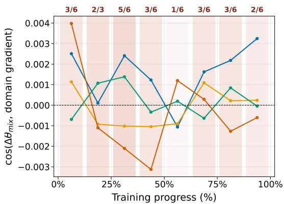  
(a) Mix-RL Update Alignment

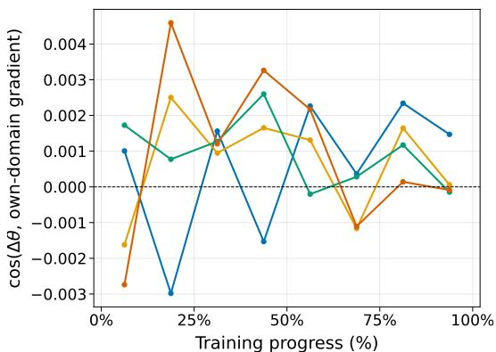  
(b) Independent RL Alignment  
Perception OCR&Chart Symbolic Multi-Image mean pairwise cosine More cross-domain conflict zero direction cosine  
Figure 4: Reward-based update alignment in Mix-RL and independent capability RL. (a) Alignment of shared Mix-RL updates with capability-specific optimization directions. (b) Alignment of independently trained experts with their respective capability directions.

## A.7 CROSS-CAPABILITY GRADIENT INTERFERENCE IN MIX-RL

We further investigate cross-capability interference by comparing the parameter-update alignment of Mix-RL against that of the independently trained capability experts $\{ \pi _ { \boldsymbol { \theta } _ { c } } \} _ { c = 1 } ^ { C }$ . Specifically, we evaluate capability-specific optimization directions $\mathbf { u } _ { c } ( \cdot )$ estimated directly from the RL rewards $r _ { c } .$

For Mix-RL, let $\theta _ { \mathrm { m i x } , t }$ denote the shared policy parameters at training checkpoint t, and $\Delta \theta _ { \mathrm { m i x } , t } =$ $\theta _ { \mathrm { m i x } , t + 1 } - \theta _ { \mathrm { m i x } , t }$ denote the realized parameter displacement between adjacent checkpoints. At each checkpoint t, we estimate the optimization directions for all $C$ capabilities under the shared parameters $\theta _ { \mathrm { m i x } , t }$ . The alignment between the shared update and each capability-specific direction is defined as

$$
M _ { c } ( t ) = \frac { \left. \Delta \theta _ { \mathrm { m i x } , t } , \mathbf { u } _ { c } ( \theta _ { \mathrm { m i x } , t } ) \right. } { \| \Delta \theta _ { \mathrm { m i x } , t } \| _ { 2 } \| \mathbf { u } _ { c } ( \theta _ { \mathrm { m i x } , t } ) \| _ { 2 } } .\tag{21}
$$

Similarly, during the independent RL training of each capability expert $\pi _ { \theta _ { c } }$ , let $\theta _ { c , t }$ denote its intermediate parameters at checkpoint t. We define the corresponding parameter displacement as $\Delta \theta _ { c , t } = \theta _ { c , t + 1 } - \theta _ { c , t }$ and measure its alignment with its respective optimization direction:

$$
S _ { c } ( t ) = \frac { \langle \Delta \theta _ { c , t } , { \bf u } _ { c } ( \theta _ { c , t } ) \rangle } { \| \Delta \theta _ { c , t } \| _ { 2 } \| { \bf u } _ { c } ( \theta _ { c , t } ) \| _ { 2 } } .\tag{22}
$$

Here, positive alignment indicates that the realized update follows the corresponding capabilityspecific optimization direction, whereas negative alignment reflects an opposing update. To further characterize cross-capability interference, we compute pairwise cosine similarities among the capability-specific directions $\{ \bar { \mathbf { u } _ { c } } ( \theta _ { \operatorname* { m i x } , t } ) \} _ { c = 1 } ^ { C }$ at each Mix-RL checkpoint, where negative values indicate conflicting local optimization directions.

As shown in Figure 4a, the shared Mix-RL update exhibits divergent alignment across capabilities, advancing along the optimization directions of some capabilities while opposing those of others. The recurring negative pairwise similarities further confirm cross-capability gradient interference. In contrast, Figure 4b shows that independently trained capability experts maintain a positively aligned trajectory on average, despite occasional local fluctuations. Together, these observations suggest that shared-policy optimization introduces competing capability-specific update directions, potentially hindering specialized capability acquisition.

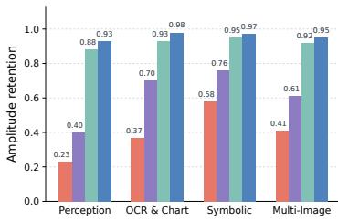  
(a) Expert Capability Retention

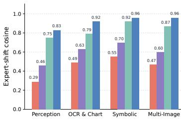

(b) Expert Capability Alignment  
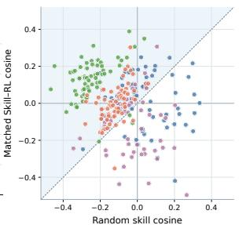  
(c) Matched vs. Random Skill  
Param-Merge MixRL MOPD SCOPED Perception OCR & Chart Symbolic Multi-Image

Figure 5: Effectiveness of skill-decoupled expert supervision. SCOPED achieves stronger domain expert capability retention and alignment than alternative integration methods, while matched domain skills provide more expert-aligned guidance than random skills.

## A.8 DETAILS OF EXPERT-RETENTION ANALYSIS

We provide the computation protocol for the expert-retention analysis in Figure 3a. For each capability, the independently trained capability expert without additional skill conditioning is used as the reference. All comparisons are performed using fixed-trajectory teacher forcing so that different unified models are evaluated under identical response states.

For each input $x _ { i }$ , the base policy $\pi _ { \mathrm { b a s e } }$ greedily generates a trajectory

$$
\tau _ { i } = ( \tau _ { i , 1 } , \dots , \tau _ { i , T _ { i } } ) , \qquad h _ { i , t } = ( x _ { i } , \tau _ { i , < t } ) ,\tag{23}
$$

and all compared policies are evaluated on the same states $\{ h _ { i , t } \} _ { t = 1 } ^ { T _ { i } }$ . This avoids confounding functional differences with changes in generated trajectories.

Functional Expert Retention. For any policy $\pi ,$ , we represent its functional deviation from the base policy along $\tau _ { i }$ using the observed-token log-probability changes:

$$
\mathbf { a } _ { \pi } ^ { ( i ) } = ( \log \pi ( \tau _ { i , t } \mid h _ { i , t } ) - \log \pi _ { \mathrm { b a s e } } ( \tau _ { i , t } \mid h _ { i , t } ) ) _ { t = 1 } ^ { T _ { i } } .\tag{24}
$$

Let $\mathbf { a } _ { c } ^ { ( i ) }$ denote the vector produced by the corresponding capability expert $\pi _ { \theta _ { c } }$ , and let $\mathbf { a } _ { \theta } ^ { ( i ) }$ denote that of a unified model $\pi _ { \theta }$

We measure directional agreement with the capability expert using cosine similarity:

$$
C _ { i } ( \theta , c ) = \frac { \left. \mathbf { a } _ { \theta } ^ { ( i ) } , \mathbf { a } _ { c } ^ { ( i ) } \right. } { \left\| \mathbf { a } _ { \theta } ^ { ( i ) } \right\| _ { 2 } \left\| \mathbf { a } _ { c } ^ { ( i ) } \right\| _ { 2 } } .\tag{25}
$$

A larger $C _ { i }$ indicates that the functional change induced by the unified model is more closely aligned with that of the corresponding capability expert.

We further measure the projected amplitude retained along the expert direction:

$$
R _ { i } ( \theta , c ) = \frac { \left. \mathbf { a } _ { \theta } ^ { ( i ) } , \mathbf { a } _ { c } ^ { ( i ) } \right. } { \left\| \mathbf { a } _ { c } ^ { ( i ) } \right\| _ { 2 } ^ { 2 } } .\tag{26}
$$

Here, $R _ { i } = 1$ indicates that the unified model preserves the same projected magnitude as the expert, $0 < R _ { i } < 1$ indicates attenuation, $R _ { i } >$ 1 indicates amplification, and $R _ { i } < 0$ indicates an opposing component.

Both metrics are first averaged over samples within each capability and then macro-averaged across the four capabilities to obtain the results reported in Figure 3a. These metrics quantify functional agreement with independently trained capability experts under identical trajectory states rather than directly measuring downstream task accuracy.

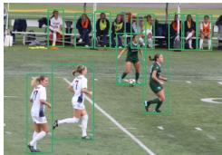  
(a) Target objects

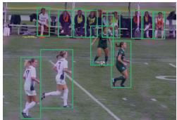  
(b) Baseline attention

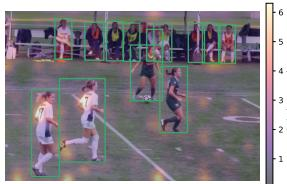  
(c) Skill-conditioned attention

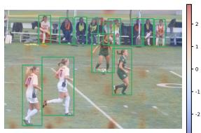  
(d) Skill-induced attention change  
Figure 6: Qualitative visualization of skill-induced attention reallocation. Green boxes indicate target objects. Red and blue in the attention-change map indicate increased and decreased attention after skill conditioning.

## A.9 CAPABILITY-WISE EXPERT RETENTION AND SKILL ALIGNMENT

To complement the macro-averaged results presented in the main text, we further examine expert capability retention and alignment across individual capabilities. As shown in Figure 5a and Figure 5b, SCOPED consistently achieves higher amplitude retention and expert alignment across all four capabilities, demonstrating more effective preservation of specialized expert behavior.

To examine whether these improvements arise from capability-specific guidance rather than additional contextual information, we compare matched capability skills with randomly assigned skills. As shown in Figure 5c, most samples lie above the diagonal, indicating that matched skills induce functional changes more closely aligned with the corresponding expert directions than random skills. These results suggest that the extracted skills provide targeted guidance consistent with capabilityspecific expertise.

## A.10 QUALITATIVE ANALYSIS OF SKILL-GUIDED VISUAL ATTENTION

To complement the quantitative attention analysis in Sec. 5.4, we further visualize how skill conditioning affects the visual attention of capability experts on a representative example.

As illustrated in Figure 6, we compare the same capability expert with and without its matched skill under an identical input. Without skill conditioning, the expert distributes substantial attention over both task-relevant and irrelevant visual regions. In contrast, conditioning on the matched skill shifts more attention toward the visual evidence relevant to the current task, as further highlighted by the attention-difference map. This qualitative example is consistent with the layer-wise attention analysis in Figure 3c, providing an intuitive illustration of how skill conditioning can regularize expert visual attention toward task-relevant evidence.

## A.11 CASE STUDIES

To better understand how skill-augmented distillation changes the behavior of the unified model, we present a representative example in Figure 7. The task requires identifying the age group with the highest percentage of Associate degrees. While SCOPED w/o Skill Augmentation follows an erroneous reasoning trajectory and predicts “25 to 34”, the full SCOPED model correctly identifies “35 to 44”.

The visualization further illustrates how skill-augmented supervision affects the model’s use of visual evidence and token-level predictions. Compared with SCOPED w/o Skill Augmentation, SCOPED allocates more attention to the region supporting the correct answer while reducing attention to the misleading region associated with the incorrect prediction. At the token level, SCOPED also suppresses responses along the erroneous trajectory and strengthens those supporting the correct prediction.

This case complements the quantitative analyses in Section 5.4, showing that skill-augmented expert supervision can lead the unified model to rely more on task-relevant visual evidence and avoid erroneous reasoning patterns during generation.

We further present representative examples from PixMo-Count, MUIRBench, and MMSI-Bench to examine whether these improvements are reflected across different visual capabilities. On PixMo-

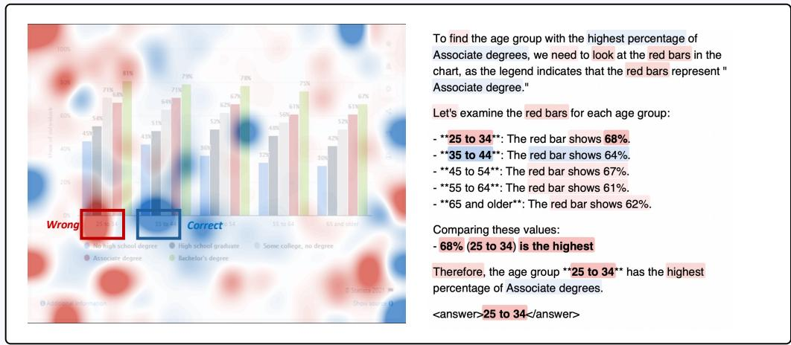  
Figure 7: Qualitative effect of skill-augmented expert supervision. Compared with SCOPED w/o Skill Augmentation, SCOPED strengthens responses supporting the correct answer while suppressing those associated with the erroneous trajectory. Blue indicates enhanced responses, while red indicates suppressed responses.

Count, the Qwen3-VL-Instruct backbone overlooks one aircraft and predicts six, whereas SCOPED systematically scans and verifies individual instances before correctly identifying all seven aircraft. On MUIRBench, the backbone is distracted by appearance differences between maps, while SCOPED instead compares stable structural and spatial cues and correctly identifies the corresponding image. Similarly, on MMSI-Bench, SCOPED tracks the relative displacement of persistent visual landmarks across images and correctly infers the movement direction, whereas the backbone reaches an incorrect conclusion from a coarser comparison of the scenes.

Together, these examples illustrate that the gains of SCOPED extend across fine-grained perception, cross-image correspondence, and multi-image spatial reasoning. Rather than relying on superficial visual patterns, the unified model exhibits more systematic evidence aggregation and verification, consistent with the quantitative improvements observed across the evaluated capability groups.

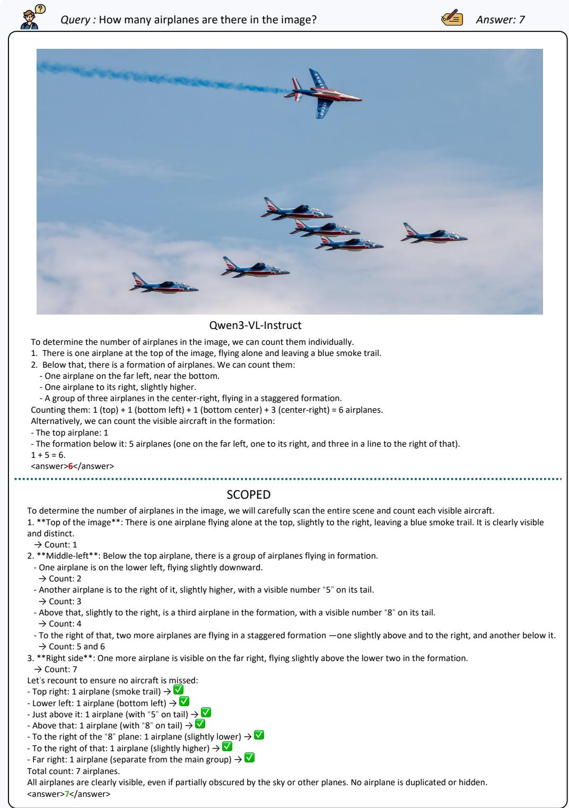  
Figure 8: Case study of PixMo-Count.

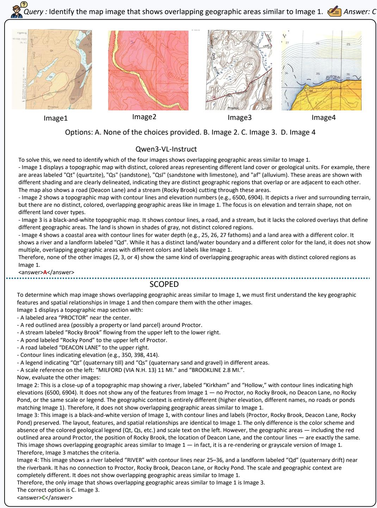  
Figure 9: Case study of MUIRBench.

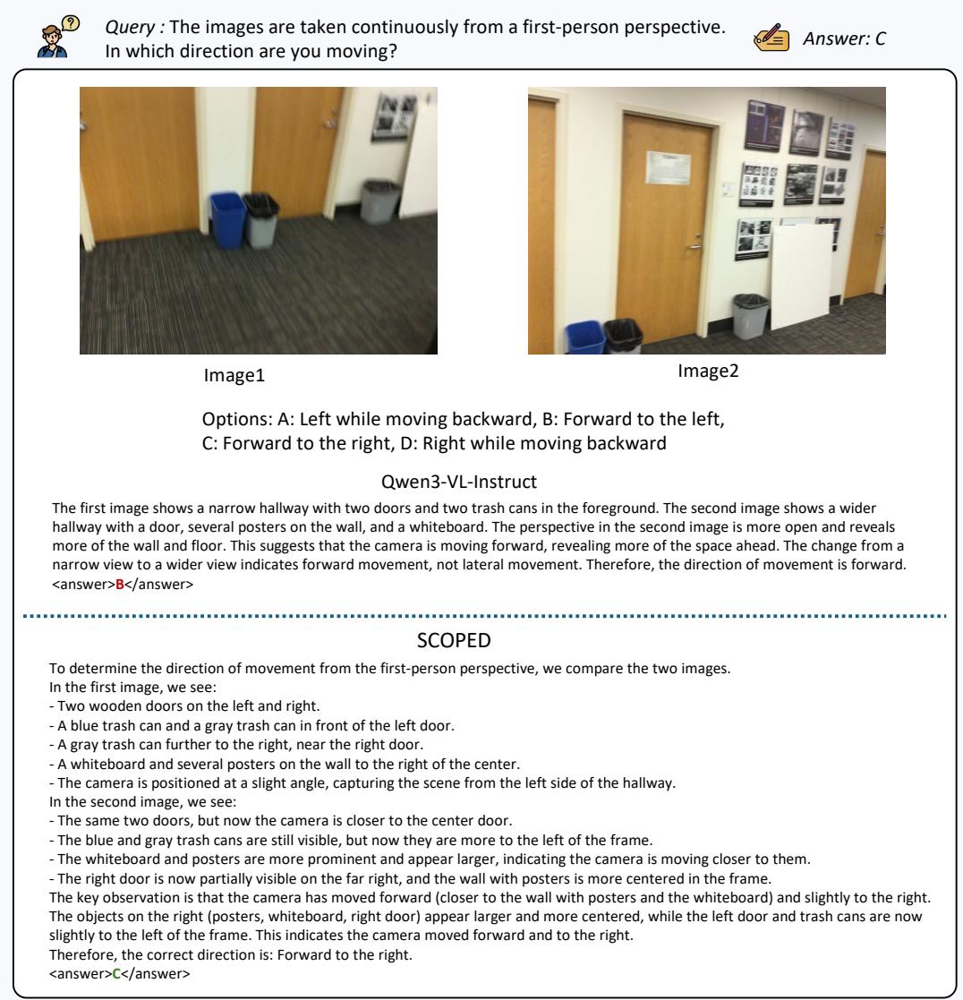  
Figure 10: Case study of MMSI-Bench.

## A.12 PROMPT EXAMPLES

We provide the prompt templates used for both skill construction and evaluation.

Skill Construction Prompts. Our skill construction procedure uses three main prompts. First, the successful-trajectory self-reflection prompt asks the optimized capability expert to identify reusable verification behaviors and their activation conditions from its successful trajectories. Second, the failed-trajectory self-reflection prompt asks the same expert to diagnose causal failure mechanisms and derive corresponding corrective principles. Finally, the evidence-grounded skill induction prompt provides the curated evidence ledger to the same expert and asks it to consolidate recurring success and failure patterns into a compact capability-level skill. The corresponding prompt templates are shown in Figures 11–13.

Evaluation Prompts. Figure 14 presents the vanilla evaluation prompt, where the model receives the input image(s), the benchmark-specific query, and the corresponding response instruction. The model is instructed to reason step by step and place its final response within <answer> and </answer> tags. The required output format is instantiated according to the benchmark: multiple-choice tasks require the final option letter, OCR tasks follow the official per-sample recognition instructions.

For evaluating skill-augmented capability experts in the ablation and analysis experiments, we preserve the original multimodal input and response instruction and condition each expert on its corresponding capability skill. The four extracted skills correspond to perception, OCR and chart understanding, symbolic reasoning, and multi-image reasoning, respectively. The unified student does not receive explicit skill conditioning during inference.

<table><tr><td colspan="2">Successful-Trajectory Self-Reflection Prompt</td></tr><tr><td>Role</td><td>You are an expert success-pattern analyst for {domain } tasks.</td></tr><tr><td>Input</td><td>A successful trajectory generated by a strong domain expert, together with the task query and ground-truth target.</td></tr><tr><td>Objective</td><td>Identify a lightweight verification or self-check principle that contributed to the successful response.</td></tr><tr><td>Analysis</td><td>Identify (1) the effective self-check or verification behavior, (2) the subtle cue that could otherwise cause an error, and (3) the condition under which this check should be applied.</td></tr><tr><td>Constraints</td><td>Do not prescribe a step-by-step solving procedure, force a chain-of-thought format, copy instance-specific answers, or introduce dataset-specific details. Prefer conditional verification guidance that is activated only when necessary.</td></tr><tr><td colspan="2">Required Output</td></tr><tr><td>Format</td><td>Return a valid JSON object containing a concise reusable skill rule and its</td></tr><tr><td>Task</td><td>activation condition. {question}</td></tr><tr><td>Expert Trajectory</td><td>{trajectory}</td></tr><tr><td>Ground Truth</td><td>{ground_truth}</td></tr></table>

Figure 11: Prompt used by the optimized capability expert to extract a reusable self-check principle from a successful trajectory.
<table><tr><td colspan="2">Failed-Trajectory Self-Reflection Prompt</td></tr><tr><td colspan="2">Role You are an expert failure-analysis agent for {domain } tasks.</td></tr><tr><td>Input</td><td>A failed expert trajectory together with the task query, predicted answer, and</td></tr><tr><td>Objective</td><td>ground-truth target. Diagnose the underlying cause of failure and convert it into reusable</td></tr><tr><td>Analysis</td><td>corrective guidance. Identify (1) the mismatch between the prediction and ground truth, (2) the</td></tr><tr><td>Constraints</td><td>point at which the reasoning failed, (3) the underlying failure mechanism, and (4) a general corrective principle and its activation condition. Derive general principles rather than instance-specific corrections. Do not copy sample-specific facts, dataset names, numerical values, or task-specific surface details.</td></tr><tr><td>Required Output</td><td></td></tr><tr><td>Format</td><td>Return a valid JSON object describing the failure cause, corrective rule, and condition under which the rule should be applied.</td></tr><tr><td>Task</td><td>{question}</td></tr><tr><td>Expert Trajectory</td><td>{trajectory}</td></tr><tr><td>Final Answer</td><td>{prediction}</td></tr><tr><td>Ground Truth</td><td>{ground_truth}</td></tr><tr><td colspan="2">Evidence-Grounded Capability Skill Induction Prompt</td></tr><tr><td>Role</td><td>You are improving an expert vision-language model using evidence distilled from its own training trajectories.</td></tr><tr><td>Input</td><td>{Evidence Ledgers} containing successful and failed trajectory patterns for the current domain.</td></tr><tr><td>Domain Guidance</td><td>{Domain-Specific Guidance} specifying how the observed failure mechanisms should transfer across tasks within the domain.</td></tr><tr><td>Objective</td><td>Convert recurring success and failure patterns into a compact domain-level skill that provides reusable verification and corrective guidance.</td></tr><tr><td>Rule Form</td><td>Each task-specific rule should follow: "When [specific trigger], [verification or corrective action]."</td></tr><tr><td>Task Routing</td><td>Organize rules by task section so that only the checks relevant to the current question type are applied.</td></tr><tr><td>Grounding</td><td>Ground each task section in supporting failure evidence and, when available, contrasting successful evidence.</td></tr><tr><td>Constraints</td><td>Do not copy instance-specific answers, values, coordinates, or memorized examples. Avoid unsupported rules, unnecessary step-by-step procedures, and instructions that suppress reasoning. Prefer a small number of precise, conditionally activated rules.</td></tr><tr><td>Required Output</td><td></td></tr><tr><td>Objective</td><td>A concise objective for the domain skill.</td></tr><tr><td>Evidence Protocol</td><td>A small set of shared rules applicable across tasks in the domain.</td></tr><tr><td>Task-Specific Checks</td><td>For each task section, a small set of trigger-conditioned verification or</td></tr><tr><td>Final Verification</td><td>corrective rules. A small set of final checks applied before producing the answer.</td></tr></table>

Figure 12: Prompt used by the optimized capability expert to diagnose a failed trajectory and extract reusable corrective guidance.

Figure 13: Prompt used by the optimized capability expert to induce a domain-level skill from curated trajectory-derived evidence. The resulting skill contains shared guidance together with conditionally activated task-specific checks.
<table><tr><td colspan="2">Vanilla Evaluation Prompt</td></tr><tr><td rowspan="3">Input Task Query Response Instruction</td><td>{Input Image(s)}</td></tr><tr><td>{Dataset-Specific Question}</td></tr><tr><td>Please reason step by step, and put your final answer within &lt;answer&gt; and &lt;/answer&gt;.</td></tr><tr><td colspan="2">Task-Specific Output Formats</td></tr><tr><td rowspan="3">Multiple Choice OCR Recognition</td><td>Put only the final option letter within &lt;answer&gt; and &lt;/answer&gt; .</td></tr><tr><td>Follow the official per-sample recognition instruction provided by the</td></tr><tr><td>benchmark.</td></tr></table>

Figure 14: Vanilla prompt template used for evaluation. The query and response format are instantiated for each benchmark.

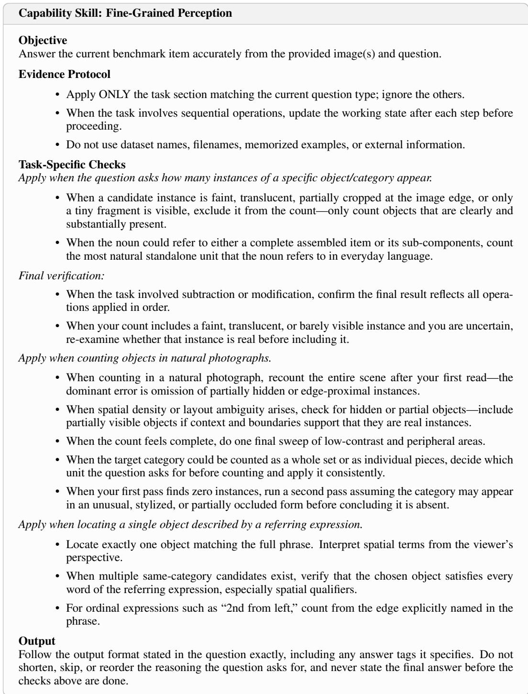  
Figure 15: Extracted Capability skill for fine-grained perception.

<table><tr><td>Capability Skill: OCR and Chart Understanding</td></tr><tr><td>Objective Answer the current benchmark item accurately from the provided image(s) and question.</td></tr><tr><td>Evidence Protocol</td></tr><tr><td>• Apply ONLY the task section matching the current question type; ignore the others.</td></tr><tr><td>• When the task involves sequential operations, update the working state after each step before</td></tr><tr><td>proceeding.</td></tr><tr><td>• Do not use dataset names, filenames, memorized examples, or external information. Task-Specific Checks</td></tr><tr><td>Apply when answering questions about charts.</td></tr><tr><td>• When reading values from a chart, align with the nearest labeled gridline or tick mark—do not estimate between lines.</td></tr><tr><td>• When comparing two values, confirm whether the question asks for an absolute difference or a ratio.</td></tr><tr><td>• When a chart has dual axes or multiple series, verify that the value is read from the correct axis and series.</td></tr><tr><td>• When identifying a peak or extremum, cross-reference its position with both axes to confirm the exact value.</td></tr><tr><td>Final verification:</td></tr><tr><td>• When the answer&#x27;s magnitude seems implausible given the chart&#x27;s visual scale, re-read the value against the axis markings.</td></tr><tr><td>• When transcribing text, verify that no visible text region was skipped by scanning page edges and corners.</td></tr><tr><td>Apply when answering questions about presentation slide decks.</td></tr><tr><td>• When extracting data from a multi-page document, verify that the answer comes from the page matching the question&#x27;s context rather than a visually similar page.</td></tr><tr><td>• When the question asks about a relationship or flow, trace connecting arrows or lines in the diagram before answering.</td></tr><tr><td>• When listing categories from a chart or table, ensure that all items are captured.</td></tr><tr><td>Final verification:</td></tr><tr><td>• When the answer&#x27;s magnitude seems implausible given the visual scale, re-check the relevant values.</td></tr><tr><td>• When transcribing text, verify that no visible text region was skipped.</td></tr><tr><td>Apply when the task is pure text recognition/OCR. Activate only for long multi-line text, multi-column layouts, or peripheral text blocks that could be overlooked.</td></tr><tr><td>• Scan every region systematically, including the main body, headers, footers, captions, foot- notes, watermarks, stamps, and table cells.</td></tr><tr><td>• For multi-column or multi-region layouts, transcribe each region in natural reading order and preserve completeness.</td></tr><tr><td>• For long CJK text, read each line fully before moving to the next line; do not merge lines or skip characters.</td></tr><tr><td>• When uncertain whether a faint or partial region contains real text, prefer preserving potentially valid text rather than omitting an entire region.</td></tr><tr><td>Final verification:</td></tr><tr><td>• Re-scan the four edges and every column or region of the image and confirm that no visible text line was skipped or truncated.</td></tr><tr><td>Output Follow the output format stated in the question exactly, including any answer tags it specifies. Do not shorten, skip, or reorder the reasoning the question asks for, and never state the final answer before the checks above are done.</td></tr></table>

Figure 16: Extracted Capability skill for OCR, document, and chart understanding.

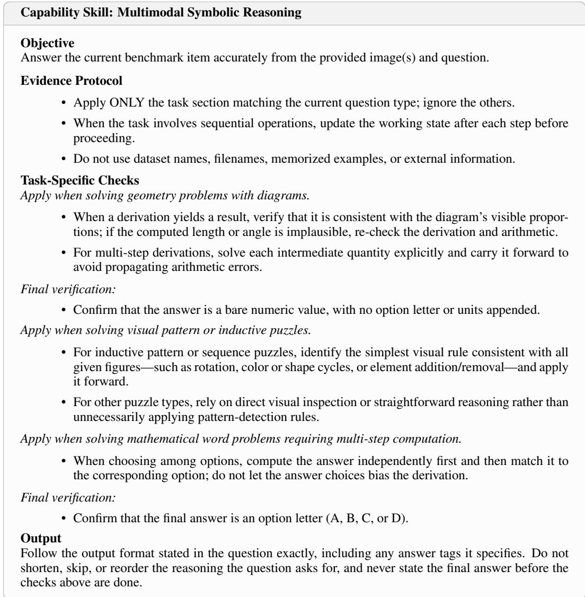  
Figure 17: Extracted Capability skill for multimodal symbolic reasoning.

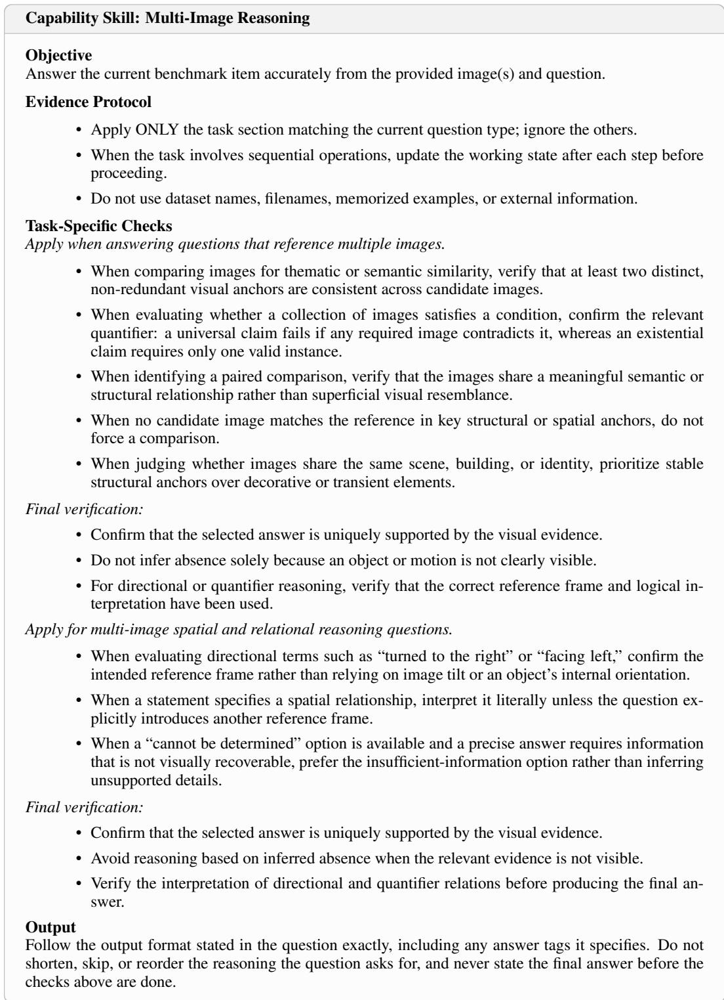  
Figure 18: Extracted Capability skill for multi-image reasoning.