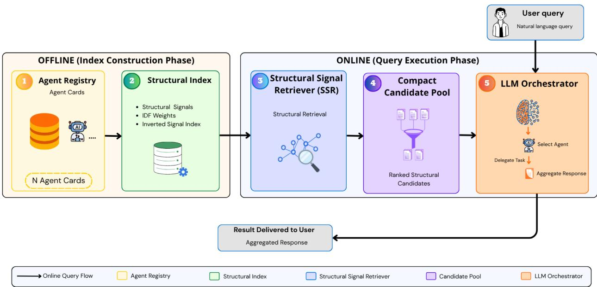
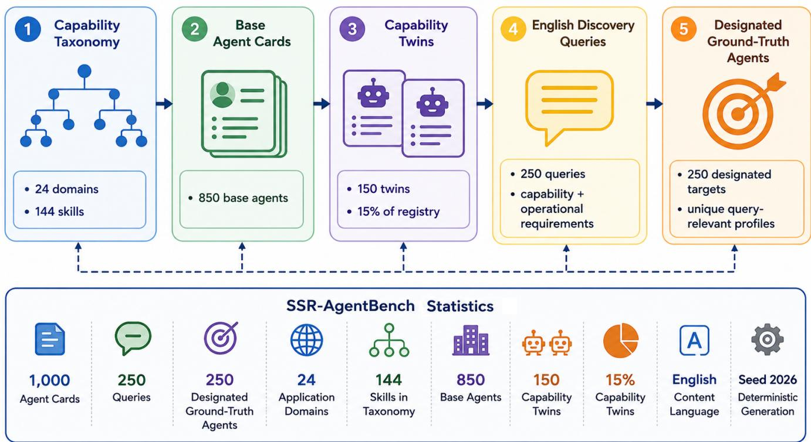

# SSR: Structural Signal Retriever for Scalable Agent Discovery in LLM-Orchestrated Multi-Agent Systems

Giancarlo Maldonado Cárdenas, Carlos A. Astudillo, and Nelson L. S. da Fonseca

Institute of Computing – State University of Campinas, Brazil

E-mails: giancarlo@lrc.ic.unicamp.br, castudillo@unicamp.br, and nfonseca@ic.unicamp.br

Abstract—Large-scale multi-agent ecosystems require mechanisms for discovering suitable agents without exposing entire registries to a large language model (LLM) orchestrator. The challenge is not only to retrieve relevant Agent Cards from a growing registry, but also to maintain a compact candidate context, since each additional candidate increases prompt size, inference cost, latency, and the risk of exceeding the model context window. We formulate this problem as candidate-context scalability and propose the Structural Signal Retriever (SSR), our deterministic and training-free retrieval method designed for Agent Card discovery. SSR derives structural lexical signals from capability-bearing Agent Card fields, weights them using inverse document frequency (IDF), and uses an Inverted Signal Index (ISI) for selective candidate scoring. We evaluate SSR using a synthetic agent benchmark, a public MS MARCO adaptation, and end-to-end LLM orchestration. At 1,000 agents, SSR reduces LLM input by 98.8% and orchestration latency by 70.9% relative to full-catalog orchestration. On MS MARCO, IDF improves retrieval effectiveness within the structural representation, while the ISI preserves retrieval effectiveness and reduces explicitly scored passages by 96.8%. End-to-end experiments show that candidate pre-selection maintains a compact candidate context as registry size grows and avoids the operational failures observed with full-catalog orchestration. These results support SSR as an Agent-Card-native, traceable retrieval mechanism for candidatecontext scalability.

Index Terms—Agent discovery, agent retrieval, multi-agent systems, LLM orchestration, structural retrieval, inverted index, MS MARCO.

## I. INTRODUCTION

Recent advances in large language models (LLMs), interoperable agent protocols, and machine-readable capability descriptions are enabling multi-agent ecosystems in which autonomous agents can be dynamically discovered and orchestrated [1], [2]. Protocols such as the Model Context Protocol (MCP) and Agent2Agent (A2A) expose structured descriptions of tools and agents [3], [4]. In particular, A2A defines an Agent Card as a machine-readable description of an agent’s identity, capabilities, skills, interfaces, and related metadata [4]. We use Agent Card throughout this paper to denote such structured capability descriptions.

A straightforward orchestration strategy is to present every available Agent Card to an LLM and ask it to select the most suitable agent. However, this full-catalog approach directly couples registry size to the amount of information presented to the LLM orchestrator. As the registry grows, more Agent

Cards must be incorporated into the prompt, increasing context consumption, inference cost, and latency, while eventually reaching practical model or API limits. Related context-scaling concerns have motivated retrieval and candidate filtering in large tool collections [5]–[7].

Candidate pre-selection itself is therefore not new. Existing work has explored large-scale tool retrieval, context-aware filtering, learned routing, and relational tool–agent retrieval [5], [7]–[10]. Our focus is complementary: scalable agent discovery must account not only for retrieving relevant Agent Cards from a growing registry, but also for controlling the amount of candidate information ultimately presented to the LLM orchestrator. We formulate this systems problem as candidate-context scalability: registry-scale retrieval should remain operationally independent of the compact candidate context subsequently presented to the LLM. Under this formulation, retrieval may operate over the complete registry, while a maximum candidate budget K controls the number of topranked Agent Cards forwarded to the LLM orchestrator. This separation makes retrieval coverage, retrieval computation, and orchestration context distinct and independently measurable components of the discovery pipeline.

To address this problem, we propose the Structural Signal Retriever (SSR), our deterministic and training-free retrieval method designed specifically for Agent Card discovery. SSR constructs an explicit retrieval representation directly from capability-bearing fields already present in Agent Cards. It deterministically derives structural lexical signals from these fields, weights matched signals using inverse document frequency (IDF), and uses an Inverted Signal Index (ISI) to restrict scoring to Agent Cards that share structural evidence with the user query. The resulting candidates are ranked and a compact pool of up to K top-ranked Agent Cards is presented to the LLM orchestrator for final agent selection. This design decouples the growth of the agent registry from the amount of candidate information processed by the LLM while preserving a direct correspondence between each retrieval score and the explicit Agent Card signals that produced it.

The methodological contribution of SSR does not lie in IDF weighting, inverted indexing, or candidate pre-selection individually. Rather, SSR integrates these established retrieval mechanisms into a dedicated pre-orchestration retrieval layer for Agent Card discovery in LLM-based multi-agent infrastructures. Within this layer, capability-bearing Agent Card fields provide explicit structural signals for candidate generation and ranking, while a maximum candidate budget controls the compact candidate context subsequently presented to the LLM orchestrator.

To distinguish improvements arising from candidate preselection in general from properties specific to SSR, the end-to-end evaluation also instantiates the same candidateselection architecture using the Best Matching 25 (BM25) ranking function [11]. SSR and BM25 operate under the same maximum candidate budget and the same LLM arbitration procedure. This controlled comparison allows the effects of maintaining a compact candidate context to be separated from differences attributable to the retrieval mechanism itself.

The evaluation addresses three research questions:

• RQ1: How does full-catalog LLM orchestration scale with registry size, and to what extent can SSR-based candidate pre-selection reduce its operational overhead?

• RQ2: How effective and efficient is the SSR retrieval mechanism on naturally occurring text, and what are the contributions of IDF weighting and the ISI?

• RQ3: How does retrieval-based candidate pre-selection affect end-to-end agent selection, candidate context, cost, latency, and operational reliability as registry size grows, and how does SSR compare with BM25 under the same maximum candidate budget?

The main contributions of this work are:

• We formulate scalable LLM-based agent discovery from a candidate-context scalability perspective, explicitly separating registry-scale retrieval, retrieval computation, and the compact candidate context presented to the LLM orchestrator.

• We propose SSR, a deterministic and training-free retrieval method that integrates field-derived structural signals, IDF-weighted matching, and selective inverted indexing into a dedicated pre-orchestration retrieval layer for Agent Card discovery. This layer produces a compact pool of top-ranked Agent Cards while preserving explicit score traceability.

• We introduce SSR-AgentBench, a reproducible synthetic benchmark containing 1,000 procedurally generated Agent Cards and 250 natural-language discovery queries with designated target Agent Cards for controlled registry-scaling experiments.

• We provide a systems-level characterization of candidatecontext scalability through controlled registry growth, public-corpus retrieval, and end-to-end LLM arbitration. The evaluation separates general effects of candidate pre-selection from SSR-specific retrieval behavior while measuring retrieval coverage, candidate context, prompt tokens, estimated cost, latency, reliability, and end-to-end selection effectiveness.

## II. RELATED WORK

## A. Agent Discovery and Routing

Large-scale agent ecosystems require mechanisms for discovering suitable capabilities from machine-readable descriptions [1], [2]. Recent work increasingly frames this problem as retrieval or routing. One approach [12] combines capability announcement with task-driven discovery and scalable indexing. Tool-to-Agent Retrieval [8] embeds tools and parent agents in a shared vector space, while Agent-as-a-Graph [9] combines vector retrieval with explicit graph structure. MoMA [13] and ACE-Router [10] instead study learned routing over heterogeneous models, tools, or agents.

These works establish candidate pre-selection as an important scalability mechanism. Our focus is complementary: we formulate candidate-context scalability for Agent Card discovery and propose SSR as a deterministic, training-free, field-derived retrieval mechanism that separates registry-scale retrieval from the compact candidate context presented to the LLM orchestrator.

## B. Tool and Skill Retrieval under Context Constraints

Tool retrieval provides the closest neighboring literature. ToolRet [5] formulates large-scale tool retrieval as an information-retrieval problem, PORTS [6] aligns retrieval with downstream tool selection, ToolDreamer [14] addresses lexical–semantic mismatch, and ToolScope [7] combines tool consolidation with context-aware filtering.

Other methods make retrieval adaptive. Dynamic Tool Dependency Retrieval (DTDR) [15] updates retrieval as the toolcalling plan evolves, ToolQP [16] decomposes requests into iterative retrieval queries, and SkillRet [17] extends retrieval to large libraries of reusable agent skills. Recent work on adaptive shortlist depth [18] further treats candidate count as a decision variable governing the trade-off between retrieval coverage and LLM selection.

This literature shows that candidate pre-selection and retrieval-first orchestration are established ideas. Our contribution is therefore not the retrieve-then-shortlist pattern itself, but its explicit formulation and systems-level characterization for Agent Card discovery.

## C. Retrieval Foundations

SSR builds on established information-retrieval principles. Sparse methods such as BM25 use lexical matching and termweighted inverted indexes [11], whereas dense approaches such as DPR [19] and ColBERT [20] learn semantic representations that reduce dependence on exact lexical overlap. RAG [21] illustrates the broader retrieval-first principle of selecting external evidence before language-model generation.

SSR does not claim novelty for IDF weighting, sparse retrieval, or inverted indexing. Its specific design derives deterministic unigram and bigram signals from capability-bearing Agent Card fields, weights matched signals with IDF, and uses an Inverted Signal Index to restrict scoring to structurally matching candidates. The resulting mechanism is training-free and keeps retrieval scores traceable to explicit Agent Card evidence.

## D. LLM Agent Systems and Interoperability Protocols

LLM-based agent systems study reasoning, coordination, workflow execution, learning, and tool use [22]–[24]. Representative systems span multi-agent coordination [25]–[27] and reasoning, tool-use, embodied, or learning settings [28]–[31]. The present work focuses on the preceding systems question of which candidate capabilities should enter the LLM context before final arbitration.

Interoperability protocols provide the machine-readable objects over which such discovery can operate. MCP exposes structured tool descriptions [3], while A2A represents agents through Agent Cards containing identity, capabilities, skills, interfaces, and related metadata [4]. These protocols define capability representation and interaction but do not prescribe a large-registry relevance-ranking mechanism. SSR complements them by operating directly over field-derived Agent Card information before LLM arbitration.

## III. STRUCTURAL SIGNAL RETRIEVER

The Structural Signal Retriever (SSR) is the retrieval method proposed in this work for Agent Card discovery. It is deterministic and training-free, operates directly over machinereadable Agent Cards, and produces a compact pool of topranked candidates for LLM arbitration. SSR uses explicit lexical signals derived from capability-bearing Agent Card fields, inverse document frequency (IDF) weighting, and an Inverted Signal Index (ISI), without requiring dense representations or supervised retrieval training.

In Fig. 1, Blocks 1–2 represent the offline registry and index-construction stages, Block 3 executes query-time SSR retrieval, Block 4 forms the compact candidate pool, and Block 5 performs final LLM arbitration. In the offline stage, the Agent Card registry is processed to extract structural signals, compute document frequencies and IDF weights, and construct the ISI. In the online stage, the user query is mapped to the same signal space; its signals address the ISI to retrieve matching Agent Cards, which are then scored and ranked. Finally, up to K top-ranked Agent Cards form the compact candidate pool presented to the LLM orchestrator for final agent selection. Thus, the registry may grow independently of the amount of candidate information presented to the LLM.

## A. Problem Formulation

The problem addressed by SSR is to discover query-relevant Agent Cards from a growing registry without coupling the amount of information presented to the LLM orchestrator to the total registry size. Given a user query, the retrieval stage must identify and rank candidate Agent Cards while the orchestration stage receives only a compact candidate pool. The maximum candidate budget K controls the number of top-ranked Agent Cards presented to the LLM.

Let

$$
\mathcal { A } = \{ A C _ { 1 } , A C _ { 2 } , . . . , A C _ { N } \}
$$

denote a registry of N Agent Cards. Let $S _ { a }$ be the structuralsignal set of Agent Card a and $S _ { q }$ the corresponding signal set for query $q .$ SSR first identifies the Agent Cards sharing at least one structural signal with the query,

$$
C _ { q } = \{ a \in { \mathcal { A } } : S _ { q } \cap S _ { a } \neq \emptyset \} .\tag{1}
$$

After ranking $C _ { q } .$ , the candidate pool presented to the LLM is

$$
P _ { q } = \mathrm { T o p K } ( C _ { q } , K ) ,\tag{2}
$$

with

$$
| P _ { q } | = \operatorname* { m i n } ( K , | C _ { q } | ) \leq K .\tag{3}
$$

Thus, K is a maximum candidate budget rather than a required pool size. SSR does not add non-matching Agent Cards when fewer than K candidates are available; if $C _ { q } = \emptyset .$ , then $P _ { q } = \emptyset$ The two sets therefore serve different purposes: $C _ { q }$ contains the Agent Cards explicitly considered for scoring, whereas $P _ { q }$ contains the top-ranked Agent Cards presented to the LLM orchestrator.

The SSR solution consists of two main retrieval components described next. Section III-B defines how Agent Cards and queries are represented and scored through structural signals, while Section III-C describes how the ISI retrieves the candidates that must be scored and how the final candidate pool is ranked.

## B. Signal Extraction and Scoring

The first component of SSR defines an explicit and traceable representation for Agent Cards and queries. A structural signal is a lexical unit extracted deterministically from capabilitybearing fields such as an Agent Card’s name, description, declared skills, capability tags, examples, or tool descriptions. Here, structural refers to signal provenance from explicit fields of the agent representation, not to syntactic or latent semantic structure. Because retained signals remain individually identifiable, each retrieval score can be traced to the matched signals that contributed to it.

Agent Cards and queries use the same deterministic normalization procedure. Text is lowercased, alphanumeric units are extracted with $[ { \mathsf { a } } - \mathbf { z } ( \mathbf { ) } - \mathsf { 9 } ] + \mathbf { \delta }$ , tokens shorter than two characters and fixed stopwords are removed, and the retained sequence generates unigram and consecutive-bigram signals. Duplicate signals are removed, so scoring uses binary signal presence rather than term frequency.

Each representation contains at most 64 signals. If more are available, unigrams are retained first in decreasing tokenfrequency order with lexical tie-breaking; bigrams are then considered in lexicographic order. The first 64 signals are retained. Hence

$$
\left| S _ { a } \right| \le 6 4 , \qquad \left| S _ { q } \right| \le 6 4 .
$$

Candidates are scored by IDF-weighted signal overlap,

$$
S c o r e ( q , a ) = \sum _ { s \in S _ { q } \cap S _ { a } } i d f ( s ) ,\tag{4}
$$

  
Fig. 1. SSR pipeline for Agent Card discovery. Offline, the Agent Card registry is transformed into structural signals, IDF weights, and an Inverted Signal Index. Online, query signals retrieve structurally matching Agent Cards through the index, candidates are ranked by IDF-weighted signal overlap, and a compact pool of at most K top-ranked Agent Cards is presented to the LLM orchestrator for final agent selection.

where

$$
i d f ( s ) = \log \left( { \frac { N + 1 } { d f ( s ) + 1 } } \right) + 1 ,\tag{5}
$$

and $d f ( s )$ is the number of indexed Agent Cards containing s. Since $d f ( s ) \leq N$ , all IDF weights are positive; consequently, rarer signals contribute more strongly than common ones.

## C. Inverted Signal Index and Ranking

The second component of SSR avoids evaluating Eq. (4) over the complete registry whenever the query matches only part of it. SSR constructs the Inverted Signal Index

$$
I S I ( s ) = \{ a \in { \mathcal { A } } : s \in S _ { a } \} ,\tag{6}
$$

and obtains the candidate set as

$$
C _ { q } = \bigcup _ { s \in S _ { q } } I S I ( s ) .\tag{7}
$$

For every a /∈ $C _ { q } , S _ { q } \cap S _ { a } = \emptyset$ and therefore $S c o r e ( q , a ) =$ 0. Conversely, because every IDF weight is positive, every $a \in \mathrm { ~ \it ~ C _ { q } ~ }$ receives a positive score. Consequently, the ISI excludes only zero-scoring Agent Cards and preserves the scores and relative ordering of all positive-scoring candidates under exhaustive Structural+IDF evaluation. When fewer than K positive-scoring candidates exist, SSR returns only those candidates rather than adding zero-score Agent Cards. RQ2 verifies this positive-score ranking equivalence empirically.

Candidates are ranked by descending $S c o r e ( q , a )$ , with ties resolved by descending matched-signal count and then ascending Agent Card identifier. At most the first K candidates are retained, yielding

$$
\begin{array} { r } { A \to C _ { q } \to P _ { q } , } \end{array}
$$

where $C _ { q }$ is the set explicitly scored after ISI lookup and $P _ { q }$ is the compact candidate pool presented to the LLM orchestrator.

## D. Retrieval Procedure and Complexity

Algorithm 1 presents the online SSR procedure that implements the retrieval path shown in Fig. 1. Lines 1–4 extract the query signals and use their ISI posting lists to construct $C _ { q } .$ Lines 5–6 return an empty result when no Agent Card shares structural evidence with the query. Lines 7–8 compute the IDFweighted score for each retrieved candidate, and Lines 9–11 rank the candidates, retain up to K top-ranked Agent Cards, and return the resulting pool $P _ { q } .$

Let $p _ { s } = | I S I ( s ) |$ denote the posting-list length of query signal s. Candidate construction requires

$$
O \left( \sum _ { s \in S _ { q } } p _ { s } \right)\tag{8}
$$

expected work under constant-time set insertion. Scoring the retrieved set requires at most

$$
O ( | C _ { q } | | S _ { q } | )\tag{9}
$$

Algorithm 1: Structural Signal Retrieval (SSR)   
Input: Query $q ;$ Inverted Signal Index ISI; IDF   
weights; maximum candidate budget K   
Output: Candidate pool $P _ { q }$   
1 Extract query signals $S _ { q } ;$   
2 $C _ { q } \gets \emptyset ;$   
3 for each $s \in S _ { q }$ do   
4 $\begin{array} { r } { \big \lfloor \big \rvert C _ { q } \gets C _ { q } \cup \mathsf { \bar { \xi } } I S I ( s ) ; } \end{array}$   
5 if $C _ { q } = \emptyset$ then   
6 return ∅;   
7 for each $a \in C _ { q }$ do   
8 $S c o r e ( q , a )  \sum i d f ( s ) ;$   
$s { \in } \overline { { S _ { q } } } \cap S _ { a }$   
9 Rank $C _ { q }$ by descending $S c o r e ( q , a )$ , then descending   
$| S _ { q } \cap \bar { S } _ { a } | ,$ then ascending Agent Card identifier;   
10 $P _ { q } \gets \mathrm { T o p K } ( C _ { q } , K ) ;$   
11 return $P _ { q } ;$

expected membership operations. Because the evaluated implementation sorts the complete retrieved set before top-K selection, ranking costs

$$
O ( | C _ { q } | \log | C _ { q } | ) .\tag{10}
$$

The resulting online retrieval complexity is therefore

$$
O \left( \sum _ { s \in S _ { q } } p _ { s } + | C _ { q } | | S _ { q } | + | C _ { q } | \log | C _ { q } | \right) .\tag{11}
$$

Since $| S _ { q } | \le 6 4$ , the query representation does not grow with registry size. Retrieval work depends on the posting lists reached by the query and the resulting candidate set rather than requiring Structural+IDF scoring over all N Agent Cards. Independently, Eq. (3) ensures that no more than K top-ranked Agent Cards are presented to the LLM orchestrator.

## IV. EXPERIMENTAL DESIGN

The evaluation follows the three research questions introduced in Section I. RQ1 measures the operational effect of registry growth and SSR-based candidate pre-selection, RQ2 evaluates SSR retrieval effectiveness and efficiency on a large public corpus, and RQ3 compares full-catalog orchestration with SSR and BM25 candidate pre-selection under the same maximum candidate budget.

## A. SSR-AgentBench

Public benchmarks exist for large-scale tool retrieval and MCP-oriented tool use [32]–[34], but, to the best of our knowledge, no public benchmark currently combines structured A2A-style Agent Cards, natural-language discovery queries, reproducible query-to-agent references, and controlled registry scaling. We therefore introduce SSR-AgentBench, a synthetic benchmark for controlled agent-discovery experiments.

SSR-AgentBench contains 1,000 Agent Cards, including 850 base Agent Cards and 150 capability twins, together with

TABLE I SSR-AGENTBENCH STATISTICS.
<table><tr><td>Component</td><td>Value</td></tr><tr><td>Agent Cards</td><td>1000</td></tr><tr><td>Base / capability twins</td><td>850  /  150</td></tr><tr><td>Queries</td><td>250</td></tr><tr><td>Application domains</td><td>24</td></tr><tr><td>Capability taxonomy</td><td>144 skills</td></tr><tr><td>Language Generation seed</td><td>English</td></tr><tr><td></td><td>2026</td></tr></table>

250 English discovery queries. Capability twins preserve the core domain and specialty of a base profile while varying query-relevant operational attributes. Each query is paired with a designated target whose complete query-relevant attribute combination is unique under the controlled generator, supporting deterministic evaluation without assuming that real registries contain only one acceptable agent.

Figure 2 summarizes the benchmark-generation pipeline. Block 1 defines the capability taxonomy of 24 domains and 144 skills; Block 2 generates the 850 base Agent Cards; Block 3 adds 150 capability twins to introduce controlled capability overlap; Block 4 produces 250 English discovery queries from capability and operational requirements; and Block 5 assigns the corresponding designated target Agent Cards. The lower panel summarizes the resulting benchmark statistics, also reported in Table I. Generation uses seed 2026, and registry scaling relies on deterministic nested subsets rather than regenerating Agent Cards at each size.

## B. RQ1: Registry-Scaling Overhead

RQ1 evaluates how full-catalog LLM orchestration scales with registry size and whether SSR-based candidate preselection can maintain a compact candidate context. All 250 SSR-AgentBench queries are evaluated at

$$
N \in \{ 1 0 , 1 0 0 , 5 0 0 , 1 0 0 0 \} .
$$

For each query, deterministic nested registries are constructed such that

$$
\mathcal { A } _ { 1 0 } \subset \mathcal { A } _ { 1 0 0 } \subset \mathcal { A } _ { 5 0 0 } \subset \mathcal { A } _ { 1 0 0 0 } ,
$$

with the designated target present at every size.

Two configurations are compared: full catalog, which forwards every Agent Card to the LLM, and SSR pre-selection, which retrieves at most $K = 1 0$ candidates before arbitration. Both use the same LLM candidate projection: a one-based index, Agent Card name, and description. SSR does not add non-matching Agent Cards when fewer than K candidates are available.

RQ1 reports candidate count, provider-reported input tokens, estimated inference cost, and online end-to-end latency; candidate recall and final selection accuracy are retained as diagnostics. SSR latency includes query-time retrieval, prompt construction, the LLM request, and response parsing, while registry construction and indexing are excluded. The two configurations are executed in deterministically alternating order across query–registry pairs.

  
Fig. 2. SSR-AgentBench generation pipeline. A taxonomy of 24 application domains and 144 skills produces 850 base Agent Cards; 150 capability twins introduce controlled capability overlap. Natural-language queries are generated from capability and operational profiles and paired with designated target Agent Cards.

## C. RQ2: Retrieval Effectiveness and Efficiency

RQ2 evaluates SSR on naturally occurring text using the MS MARCO Passage Ranking collection [35], which contains 8,841,823 passages. Because MS MARCO does not provide native Agent Cards, each passage is treated as an abstract document-derived Agent Card, each query as an agentdiscovery request, and positively judged passages as relevant Agent Cards under this abstraction. All 6,980 development queries with at least one positive relevance judgment are used for effectiveness evaluation.

Retrieval depth is fixed at K = 10, and effectiveness is measured using Recall@1, Recall@3, Recall@5, Recall@10, and MRR@10. Five configurations are evaluated:

1) TF-IDF, using an unnormalized lexical dot product;

2) BM25 [11], over the same normalized unigram representation;

3) Structural Overlap + ISI, using equal weights for matched structural signals;

4) Structural + IDF (full scan), using SSR scoring without the ISI; and

5) SSR, combining field-derived signals, IDF weighting, and the ISI.

Structural Overlap + ISI isolates the contribution of IDF weighting, whereas Structural + IDF (full scan) isolates the contribution of the ISI. Effectiveness for indexed methods is evaluated on all 6,980 eligible queries. Online latency and direct exhaustive Structural+IDF execution are measured on a common deterministic 200-query subset sampled with seed 42.

For each query in this subset, exhaustive Structural+IDF scores all 8,841,823 passages, discards zero-score results, and returns the unpadded top-K positive-scoring candidates. As established in Section III, the ISI excludes only zero-scoring candidates; direct comparison with SSR therefore verifies top-K agreement while quantifying the computational cost of exhaustive scoring. Index construction and IDF computation are treated as offline operations.

## D. RQ3: End-to-End Agent Discovery

RQ3 evaluates the complete LLM selection pipeline at

$$
N \in \{ 1 0 0 , 5 0 0 , 1 0 0 0 , 5 0 0 0 \}
$$

using 200 MS MARCO development queries sampled uniformly with seed 42. Sampling occurs before SSR retrieval and is independent of SSR ranks, candidate pools, and LLM outcomes.

For each query, relevant document-derived Agent Cards are retained and deterministic distractor Agent Cards form nested registries,

$$
\mathcal { A } _ { 1 0 0 } \subset \mathcal { A } _ { 5 0 0 } \subset \mathcal { A } _ { 1 0 0 0 } \subset \mathcal { A } _ { 5 0 0 0 } .
$$

Three configurations are evaluated: full-catalog orchestration, SSR candidate pre-selection, and BM25 candidate preselection. SSR and BM25 use the same maximum candidate budget, query-specific registries, LLM prompt, and parser.

Neither method pads non-matching results or falls back to the full catalog. If the retrieved pool is empty, no LLM call is made and the case remains an unsuccessful end-to-end outcome.

1) Candidate-Budget Selection and Independent Validation: The original RQ3 protocol evaluated SSR retrieval sensitivity for

$$
K \in \{ 5 , 1 0 , 2 0 , 5 0 \}
$$

on the same 200-query sample later used for end-to-end evaluation, without using LLM selection outcomes. The reported end-to-end experiments use K = 20, with the same maximum budget applied to BM25.

To assess whether this operating point was sample-specific, the 200 RQ3 queries were excluded and 1,000 queries were sampled uniformly from the remaining 6,780 using seed 2027. The validation reused the same nested registry sizes, SSR configuration, and candidate budgets, and made no LLM calls. The decision rule selected the smallest K whose candidate recall was within 0.02 absolute of the best tested recall at every registry size:

$$
K ^ { * } = \operatorname* { m i n } \left\{ K : R ( N , K ) \geq \operatorname* { m a x } _ { K ^ { \prime } } R ( N , K ^ { \prime } ) - 0 . 0 2 , \ \forall N \right\} .
$$

The independent validation selected $K = 2 0 ,$ , corroborating the operating point used in the reported end-to-end experiments. Because this validation was retrospective, a fully prospective protocol would select and freeze K before evaluation on a disjoint end-to-end test set.

2) Effectiveness and Paired Statistical Analysis: For candidate pre-selection, candidate recall is the fraction of query– registry pairs for which at least one relevant candidate is retrieved. Conditional selection accuracy is the fraction of retrieval-hit cases in which the LLM selects a relevant candidate, and end-to-end accuracy is the fraction of all query– registry pairs for which the complete pipeline returns a relevant candidate. Retrieval misses, empty pools, API failures, invalid indices, and irrelevant selections remain end-to-end failures.

For each N, 95% Wilson score intervals are reported for marginal end-to-end accuracy. Because SSR and BM25 are evaluated on the same 200 queries and query-specific registries, their primary paired comparison uses a two-sided exact McNemar test on query-level end\_to\_end\_correct outcomes, with Holm correction across the four registry sizes. Candidate recall is analyzed analogously as a secondary paired outcome. Nonsignificant results are interpreted as no statistically detectable difference under the evaluated sample, not as evidence of statistical equivalence.

## E. Implementation and Reproducibility

LLM configuration. RQ1 and RQ3 use gpt-4o-mini, temperature 0, and JSON-mode responses. Candidates are represented by sequential one-based indices, and the returned selected\_index is validated and mapped to the underlying Agent Card or passage identifier. Accounting uses fixed rates of \$0.15 per million input tokens and \$0.60 per million output tokens.

Retrieval implementation. SSR retains at most 64 structural signals per representation and uses the normalization and IDF definition in Section III. BM25 is implemented with SQLite FTS5 bm25() over the same normalized unigram tokenization used for indexed documents and queries; lower FTS5 scores rank first, with passage identifier used for deterministic tie-breaking. The implementation uses $k _ { 1 } = 1 . 2$ and $b = 0 . 7 5$ Offline index construction is excluded from reported online latency for both methods.

Execution environment. The full-scale RQ2 experiment was executed on an Amazon SageMaker ml.m5d.8xlarge instance running Ubuntu 22.04.5 LTS with 32 logical CPUs, approximately 124 GiB RAM, an Intel Xeon Platinum 8259CL 2.50 GHz processor, Python 3.12.9, and SQLite 3.48.0.

Token, cost, and latency accounting. Successful LLM calls use provider-reported input/output token counts. Estimated cost is

$$
\widehat { C } = \frac { T _ { \mathrm { i n } } } { 1 0 ^ { 6 } } p _ { \mathrm { i n } } + \frac { T _ { \mathrm { o u t } } } { 1 0 ^ { 6 } } p _ { \mathrm { o u t } } .
$$

In RQ3, when provider usage is unavailable, input tokens are estimated from prompt length as

$$
\widehat { T } _ { \mathrm { i n } } = \operatorname* { m a x } \left( 1 , \left\lfloor \frac { | \mathrm { p r o m p t } | } { 4 } \right\rfloor \right) ,
$$

and the resulting cost is treated as a prompt-based estimate rather than measured inference usage.

RQ1 SSR latency includes online retrieval, prompt construction, the LLM request, and response processing; full-catalog latency excludes retrieval. RQ2 latency measures query-time retrieval only. In RQ3, candidate-pre-selection latency includes retrieval, prompt construction, the LLM request, and response processing, while full-catalog latency includes prompt construction and the LLM request. Failed requests contribute to reliability and end-to-end effectiveness but not to successful orchestration latency. Because the BM25 RQ3 run was executed separately, SSR–BM25 latency differences are interpreted descriptively rather than as paired comparisons.

Determinism and artifacts. SSR-AgentBench and RQ1 use seed 2026; RQ2 timing/equivalence and the RQ3 end-to-end sample use seed 42; independent K validation uses seed 2027. The RQ3 retrievers operate on the same reconstructed queryspecific registries. Experiment scripts record configuration metadata and per-query outputs for auditing and reproduction. The benchmark generator and evaluation code are available at https://github.com/gmaldonadoc/sscr-agent-routing.

## V. RESULTS

Results are reported by research question, separating registry-scaling overhead, retrieval behavior, and end-to-end LLM arbitration.

## A. RQ1: Registry-Scaling Overhead

Across 250 queries, four registry sizes, and two orchestration configurations, all 2,000 LLM calls complete and parse successfully. Table II shows that full-catalog prompt size grows with the registry, reaching 63,645 mean input tokens at $N = 1 0 0 0 ,$ whereas SSR uses 767 tokens with at most 10 Agent Cards. Relative to full catalog, SSR reduces mean input tokens by 88.1%, 97.6%, and 98.8% at $N = 1 0 0 , 5 0 0 .$ and 1000, respectively. At $N \ = \ 1 0 0 0 .$ estimated cost also falls by 98.8%, from \$0.009551 to \$0.000119 per query, and mean successful end-to-end latency decreases from $2 . 6 4 7 \mathrm { ~ s ~ }$ to 0.769 s (70.9%, or 3.44×).

TABLE II  
SCALING EVALUATION ON SSR-AGENTBENCH. SSR USES A MAXIMUM CANDIDATE BUDGET OF $K = 1 0 .$ . “AGENT CARDS” IS THE MEAN NUMBER OF CANDIDATE REPRESENTATIONS INCLUDED IN THE LLM PROMPT.
<table><tr><td>Agents</td><td>Method</td><td>Agent Cards</td><td>Prompt Tokens</td><td>Est. Cost (USD)</td><td>Latency (s)</td></tr><tr><td>10</td><td>Full catalog</td><td>10.0</td><td>771</td><td>0.000120</td><td>0.722</td></tr><tr><td>10</td><td>SSR</td><td>10.0</td><td>771</td><td>0.000120</td><td>0.715</td></tr><tr><td>100</td><td>Full catalog</td><td>100.0</td><td>6,481</td><td>0.000976</td><td>1.165</td></tr><tr><td>100</td><td>SSR</td><td>10.0</td><td>769</td><td>0.000120</td><td>0.748</td></tr><tr><td>500</td><td>Full catalog</td><td>500.0</td><td>31,890</td><td>0.004788</td><td>2.423</td></tr><tr><td>500</td><td>SSR</td><td>10.0</td><td>767</td><td>0.000119</td><td>0.779</td></tr><tr><td>1000</td><td>Full catalog</td><td>1000.0</td><td>63,645</td><td>0.009551</td><td>2.647</td></tr><tr><td>1000</td><td>SSR</td><td>10.0</td><td>767</td><td>0.000119</td><td>0.769</td></tr></table>

As diagnostics, SSR candidate recall and final selection accuracy are 1.000 at all four registry sizes. Full-catalog selection accuracy is 1.000 at $N = 1 0$ and 100 and 0.976 at $N = 5 0 0$ and 1000; these differences are not interpreted as comparative effectiveness evidence.

Answer to RQ1. Full-catalog orchestration scales prompt size, cost, and latency with registry size, whereas SSR-based candidate pre-selection maintains a compact LLM candidate context and substantially reduces operational overhead.

## B. RQ2: Retrieval Effectiveness and Efficiency

Table III shows that BM25 is the strongest raw retrieval baseline, reaching R@10=0.3890 and MRR@10=0.1829 versus 0.3378 and 0.1544 for SSR. SSR therefore does not establish general retrieval superiority over established lexical methods.

Within the SSR representation, IDF weighting consistently improves all reported ranking metrics relative to Structural Overlap + ISI, including R@10 by 5.3% and MRR@10 by 5.6%. The ISI affects computation rather than the positivescoring ranking: direct exhaustive execution on the common 200-query subset verifies exact unpadded top-K agreement with full-scan Structural+IDF. Exhaustive scoring evaluates all 8,841,823 passages and requires 69,848.3 ms per query on average, whereas SSR explicitly scores approximately 286,638 passages in 941.5 ms. This corresponds to 96.8% fewer explicitly scored passages and a 74.2× mean retrieval-latency speedup.

Answer to RQ2. IDF improves ranking effectiveness within the structural representation, while the ISI preserves the positive-scoring ranking and provides the principal computational reduction.

## C. RQ3: End-to-End Agent Discovery

RQ3 compares full-catalog orchestration with SSR and BM25 candidate pre-selection under the same maximum can-

didate budget $K \ : = \ : 2 0$ on 200 independently sampled MS MARCO queries and registries of

$$
N \in \{ 1 0 0 , 5 0 0 , 1 0 0 0 , 5 0 0 0 \} .
$$

1) Candidate-Budget Robustness: On the 200 RQ3 queries, SSR candidate recall with K = 20 is 0.980 for $N \leq 1 0 0 0$ and 0.950 at $N = 5 0 0 0$ . Increasing the budget to $K = 5 0$ raises recall at N = 5000 only to 0.960 while substantially increasing the candidate pool.

Independent retrieval-only validation on 1,000 disjoint queries corroborates the chosen operating point. At $K = 2 0 ,$ candidate recall is 0.973, 0.969, 0.965, and 0.941 for N = 100, 500, 1000, and 5000, respectively, satisfying the predefined within-0.02 decision rule at every registry size. Only $K = 2 0$ and K = 50 satisfy the rule, so the smallest qualifying budget is K = 20. At $N = 5 0 0 0$ , increasing to $K = 5 0$ improves recall by 0.018 while increasing mean pool size from 17.822 to 41.311 (2.318×). The validation supports the robustness of K = 20 but remains retrospective rather than a prospective held-out selection protocol.

2) Retrieval and Selection Decomposition: Table IV shows comparable observed end-to-end effectiveness for SSR and BM25 candidate pre-selection. For $N \leq 1 0 0 0 .$ , candidate recall is 0.980 for both methods. At $N = 5 0 0 0 .$ BM25 has higher candidate recall (0.970 vs. 0.950), while SSR has slightly higher conditional selection accuracy (0.9316 vs. 0.9227), yielding E2E accuracies of 0.895 and 0.885, respectively. Retrieval coverage and LLM arbitration therefore contribute separately to end-to-end error.

Paired exact McNemar tests on end\_to\_end\_correct detect no statistically significant difference between SSR and BM25 at any registry size after Holm correction (adjusted p = 1.000 throughout). Candidate recall likewise shows no statistically detectable paired difference after correction; at $N =$ 5000, the adjusted p-value is 0.500. These results support describing observed effectiveness as comparable under the evaluated sample, but do not establish statistical equivalence. The 95% Wilson intervals for SSR E2E accuracy are [0.950, 0.992], [0.936, 0.986], [0.923, 0.980], and [0.833, 0.922] as N increases; for BM25 they are [0.950, 0.992], [0.923, 0.980], [0.936, 0.986], and [0.845, 0.930].

3) Candidate Context and Operational Behavior: Table V shows that full-catalog context grows rapidly with registry size: mean input tokens increase from 8,154 at $N = 1 0 0$ to 81,368 at $N = 1 0 0 0$ , while mean successful latency rises from 1.099 s to 3.915 s. At $N = 5 0 0 0$ , the estimated prompt size is 447,761 tokens and none of the 200 attempted LLM calls completes successfully; the reported token and cost values at this size are prompt-based estimates.

TABLE III  
RETRIEVAL EFFECTIVENESS AND ONLINE EFFICIENCY ON MS MARCO. EFFECTIVENESS USES ALL 6,980 ELIGIBLE QUERIES; LATENCY USES A COMMON 200-QUERY SUBSET. “AVG. PASSAGES SCORED“ COUNTS PASSAGES EXPLICITLY EVALUATED BY THE STRUCTURAL SCORING FUNCTION.
<table><tr><td>Method</td><td>R@1</td><td>R@3</td><td>R@5</td><td>R@10</td><td>MRR@10</td><td>Mean Lat. (ms)</td><td> $\operatorname { A v g } .$  Passages Scored</td></tr><tr><td>TF-IDF (dot product)</td><td>0.0087</td><td>0.0266</td><td>0.0398</td><td>0.0619</td><td>0.0221</td><td>906.9</td><td>一</td></tr><tr><td>BM25</td><td>0.1026</td><td>0.2255</td><td>0.2923</td><td>0.3890</td><td>0.1829</td><td>822.6</td><td></td></tr><tr><td>Structural Overlap + ISI</td><td>0.0798</td><td>0.1768</td><td>0.2351</td><td>0.3209</td><td>0.1462</td><td>937.2</td><td>286,638</td></tr><tr><td>Structural + IDF (full scan)</td><td>0.0834</td><td>0.1872</td><td>0.2510</td><td>0.3378</td><td>0.1544</td><td>69,848.3</td><td>8,841,823</td></tr><tr><td>SSR (Structural + IDF + ISI)</td><td>0.0834</td><td>0.1872</td><td>0.2510</td><td>0.3378</td><td>0.1544</td><td>941.5</td><td>286,638</td></tr></table>

TABLE IV

CANDIDATE-PRE-SELECTION EFFECTIVENESS DECOMPOSITION. BOTH METHODS USE MAXIMUM CANDIDATE BUDGET $K = 2 0$
<table><tr><td>Method</td><td>N</td><td>Cand. Recall</td><td>Cond. Acc.</td><td>E2E Acc.</td></tr><tr><td>SSR</td><td>100</td><td>0.980</td><td>1.0000</td><td>0.980</td></tr><tr><td>BM25</td><td>100</td><td>0.980</td><td>1.0000</td><td>0.980</td></tr><tr><td>SSR</td><td>500</td><td>0.980</td><td>0.9898</td><td>0.970</td></tr><tr><td>BM25</td><td>500</td><td>0.980</td><td>0.9796</td><td>0.960</td></tr><tr><td>SSR BM25</td><td>1000</td><td>0.980</td><td>0.9796</td><td>0.960</td></tr><tr><td></td><td>1000</td><td>0.980</td><td>0.9898</td><td>0.970</td></tr><tr><td>SSR</td><td>5000</td><td>0.950</td><td>0.9316</td><td>0.885</td></tr><tr><td>BM25</td><td>5000</td><td>0.970</td><td>0.9227</td><td>0.895</td></tr></table>

In contrast, SSR and BM25 candidate pre-selection maintain compact candidate contexts as the registry grows. At $N = 5 0 0 0$ , both present 18.67 candidates on average; SSR uses 1,690 mean input tokens and BM25 1,561. Relative to full catalog, SSR reduces mean prompt size by 94.6%, 97.2%, 98.3%, and 99.6% for N = 100, 500, 1000, and 5000, respectively. BM25 shows the same context-scaling behavior, indicating that the dominant reduction arises from candidate pre-selection rather than SSR scoring alone.

BM25 produces empty pools for a small number of query– registry pairs, so its LLM-attempt rate is 0.985 at N = 100 and 0.990 thereafter. All attempted SSR and BM25 LLM calls complete successfully. Their latency values are interpreted descriptively because the BM25 run was executed separately.

Answer to RQ3. Candidate pre-selection keeps the LLM candidate context compact and avoids the operational failure observed for full-catalog orchestration at $N = 5 0 0 0$ . SSR and BM25 show comparable observed end-to-end effectiveness under the same maximum candidate budget, while SSR provides the deterministic, training-free, field-derived, and scoretraceable retrieval mechanism proposed in this work.

## VI. DISCUSSION

The results support treating scalable agent discovery as a joint retrieval–orchestration problem. Full-catalog orchestration couples registry size directly to the amount of information presented to the LLM, whereas candidate pre-selection separates registry-scale retrieval from the compact candidate context used for final arbitration. RQ3 shows that this systems effect is not specific to SSR: both SSR and BM25 maintain small candidate pools under the same maximum candidate budget, while full-catalog context grows rapidly with registry size.

This distinction is central to the interpretation of SSR. RQ2 shows that BM25 achieves higher raw retrieval effectiveness on the MS MARCO adaptation, so SSR should not be viewed as a general replacement for established lexical retrieval. Instead, SSR provides a deterministic, training-free, fieldderived retrieval mechanism for Agent Cards. Within this mechanism, IDF weighting improves ranking effectiveness, the Inverted Signal Index (ISI) reduces explicit structural scoring, and the maximum candidate budget K controls the amount of candidate information presented to the LLM orchestrator. These objectives are related but distinct.

## A. Candidate-Context Scalability and the Role of K

The principal systems property studied here is

$$
| P _ { q } | \leq K ,
$$

which places an explicit upper bound on the number of Agent Cards presented to the LLM independently of the total registry size. This does not imply registry-independent retrieval cost: SSR and BM25 still query indexes whose contents and posting distributions depend on registry composition. The bound applies to the final candidate pool, not to all upstream retrieval work.

RQ3 also exposes the trade-off between candidate context and retrieval coverage. At N = 5000, SSR and BM25 achieve candidate recall of 0.950 and 0.970 and end-to-end accuracy of 0.885 and 0.895, respectively. Paired McNemar tests detect no statistically significant difference in end-to-end correctness after Holm correction, supporting a description of comparable observed effectiveness without establishing statistical equivalence.

The fixed K = 20 operating point should be interpreted as an evaluated systems choice rather than a universal optimum. Independent retrieval-only validation on 1,000 disjoint queries also selected K = 20 under the predefined within-0.02 recall rule, supporting its robustness. Because this validation was retrospective, however, a fully prospective protocol should select and freeze K before evaluation on a disjoint end-toend test set.

TABLE V  
END-TO-END INFRASTRUCTURE BENCHMARK ON 200 RQ3 QUERIES. SSR AND BM25 USE K = 20. API SUCCESS IS COMPUTED OVER ATTEMPTED CALLS; LATENCY IS REPORTED ONLY FOR SUCCESSFUL EXECUTIONS. ASTERISKS DENOTE PROMPT-BASED ESTIMATES FOR FAILED FULL-CATALOG REQUESTS AT N = 5000.
<table><tr><td>Method</td><td>N</td><td>E2E Acc.</td><td>Attempt</td><td>API Success</td><td>Pool</td><td>Tokens</td><td>Est. Cost (USD)</td><td>Latency (s)</td></tr><tr><td>SSR</td><td>100</td><td>0.980</td><td>1.000</td><td>1.000</td><td>4.34</td><td>444</td><td>0.000072</td><td>0.674</td></tr><tr><td>BM25</td><td>100</td><td>0.980</td><td>0.985</td><td>1.000</td><td>4.34</td><td>444</td><td>0.000072</td><td>0.620</td></tr><tr><td>Full catalog</td><td>100</td><td>1.000</td><td>1.000</td><td>1.000</td><td>100</td><td>8,154</td><td>0.001227</td><td>1.099</td></tr><tr><td>SSR</td><td>500</td><td>0.970</td><td>1.000</td><td>1.000</td><td>12.06</td><td>1,125</td><td>0.000175</td><td>0.643</td></tr><tr><td>BM25</td><td>500</td><td>0.960</td><td>0.990</td><td>1.000</td><td>12.06</td><td>1,078</td><td>0.000167</td><td>0.628</td></tr><tr><td>Full catalog</td><td>500</td><td>0.990</td><td>1.000</td><td>1.000</td><td>500</td><td>40,705</td><td>0.006110</td><td>2.449</td></tr><tr><td>SSR</td><td>1000</td><td>0.960</td><td>1.000</td><td>1.000</td><td>15.14</td><td>1,386</td><td>0.000214</td><td>0.666</td></tr><tr><td>BM25</td><td>1000</td><td>0.970</td><td>0.990</td><td>1.000</td><td>15.14</td><td>1,318</td><td>0.000204</td><td>0.646</td></tr><tr><td>Full catalog</td><td>1000</td><td>0.955</td><td>1.000</td><td>1.000</td><td>1000</td><td>81,368</td><td>0.012209</td><td>3.915</td></tr><tr><td>SSR</td><td>5000</td><td>0.885</td><td>1.000</td><td>1.000</td><td>18.67</td><td>1,690</td><td>0.000260</td><td>0.686</td></tr><tr><td>BM25</td><td>5000</td><td>0.895</td><td>0.990</td><td>1.000</td><td>18.67</td><td>1,561</td><td>0.000241</td><td>0.650</td></tr><tr><td>Full catalog</td><td>5000</td><td>0.000</td><td>1.000</td><td>0.000</td><td>5000</td><td>447,761*</td><td>0.067164*</td><td></td></tr></table>

## B. Positioning Relative to Retrieval and Routing

Candidate pre-selection and retrieval-first orchestration are established ideas in tool and agent systems. ToolRet [5] studies large-scale tool retrieval; ToolScope [7] reduces tool context through consolidation and filtering; Tool-to-Agent Retrieval [8] and Agent-as-a-Graph [9] exploit tool–agent relationships; and ACE-Router [10] and AgentRouter [36] study learned routing. Adaptive shortlist depth further treats candidate count itself as a decision variable [18].

The contribution of this work is therefore not candidate pre-selection, IDF weighting, or inverted indexing in isolation. Rather, we formulate candidate-context scalability for Agent Card discovery, propose SSR as an Agent-Card-native retrieval mechanism, and characterize how retrieval coverage, retrieval computation, candidate context, cost, latency, reliability, and LLM arbitration evolve under controlled registry growth. BM25 candidate pre-selection provides an important control because it separates the general effect of maintaining a compact candidate context from properties specific to SSR.

Table VI summarizes this conceptual positioning relative to representative retrieval and routing approaches.

SSR also provides score-level traceability: matched structural signals and their IDF contributions remain identifiable for each retrieved Agent Card. This property applies to the retrieval stage and should not be interpreted as making subsequent LLM arbitration explainable.

## C. Limitations

Several limitations qualify the conclusions. First, RQ2 and RQ3 use a document-derived Agent Card abstraction. MS MARCO provides natural text and large-scale relevance judgments, but not native Agent Cards, structured skills, interfaces, authentication requirements, or operational metadata. The results therefore characterize retrieval and candidate-context behavior under this abstraction rather than in a production agent registry.

Second, SSR-AgentBench is synthetic and uses one designated target per query. Its controlled construction supports reproducible registry scaling but does not capture the full heterogeneity, documentation quality, capability evolution, access constraints, or multiple valid agents found in operational ecosystems.

Third, SSR deliberately relies on explicit lexical unigrams and bigrams. Vocabulary mismatch can reduce recall, and the MS MARCO results show that this representation does not outperform BM25. More expressive field-derived, semantic, or hybrid retrieval may improve coverage.

Fourth, although independent validation supports K = 20, the original sensitivity analysis and end-to-end evaluation reuse the same 200 RQ3 queries. A cleaner prospective design would select and freeze K on validation data and evaluate it once on a disjoint end-to-end test set.

Finally, RQ3 uses 200 queries and one LLM/API configuration, and the BM25 run was executed separately from the SSR/full-catalog run. Absolute latency, token usage, cost, and the observed full-catalog failure point should therefore not be generalized across models, providers, prompts, or context limits. Reported online latency also excludes offline index construction, so preprocessing, storage, and maintenance costs remain outside the present evaluation.

## D. Future Directions

Future work should first investigate query-adaptive candidate depth, using score concentration, margins, or other confidence signals to choose K(q) while preserving a hard maximum candidate budget [18]. Second, SSR could provide inexpensive candidate generation followed by semantic retrieval or reranking when lexical evidence is weak; Tool-Dreamer illustrates one semantic reformulation strategy [14]. Third, retrieval could become execution-aware, recomputing queries or candidate pools as a plan evolves, as suggested by DTDR and ToolQP [15], [16].

Evaluation should also move toward native public Agent Card and skill collections, multi-relevance judgments, prospective validation/test splits, and dynamic registry updates. Large distributed deployments further motivate incremental, authorization-aware, and federated indexing.

TABLE VI  
CONCEPTUAL POSITIONING OF REPRESENTATIVE APPROACHES. THE TABLE SUMMARIZES DIFFERENCES IN FORMULATION, RETRIEVAL MECHANISM, AND CANDIDATE CONTROL; IT DOES NOT CLAIM ARCHITECTURAL PRECEDENCE OR CROSS-PAPER PERFORMANCE SUPERIORITY.
<table><tr><td>Approach</td><td>Primary setting</td><td>Representation / mechanism</td><td>Candidate control</td><td>Relation to this work</td></tr><tr><td>Tool-to-Agent Retrieval [8]</td><td>Tool and agent retrieval</td><td>Shared vector representations with explicit tool-agent relations</td><td>Retrieval-ranked subset</td><td>Dense relational alternative for tool-to-agent discovery</td></tr><tr><td>Agent-as-a-Graph [9]</td><td>Tool and agent retrieval</td><td>Vector retrieval plus explicit graph relationships</td><td>Graph- and ranking-derived subset</td><td>Uses richer relational structure than SSR</td></tr><tr><td>ToolScope [7]</td><td>Large-scale LLM tool use</td><td>Tool merging and context-aware filtering</td><td>Context-dependent filtered toolset</td><td>Shares the goal of reducing LLM candidate context</td></tr><tr><td>ACE-Router [10]</td><td>MCP and agent routing</td><td>Learned history-aware routing</td><td>Router-selected candidates</td><td>Learned, context-dependent alternative</td></tr><tr><td>AgentRouter [36]</td><td>Collaborative multi-agent QA</td><td>Knowledge-graph-guided supervised routing</td><td>Learned routing distribution</td><td>Models contextual and relational agent structure</td></tr><tr><td>Adaptive shortlist depth</td><td>LLM tool selection</td><td>Query-dependent shortlist-depth policy</td><td>Adaptive depth</td><td>Directly studies candidate-depth selection</td></tr><tr><td>[18] SSR (this work)</td><td>Agent discovery before LLM arbitration</td><td>Deterministic field-derived lexical signals, IDF, and ISI</td><td>Explicit maximum budget K</td><td>Training-free instantiation of candidate-context scalability</td></tr></table>

Overall, the results support candidate-context scalability as a useful systems perspective: retrieval coverage, retrieval computation, and the compact candidate context presented to the LLM can be treated as separate control points. BM25 shows that the main context-scaling benefit is a general effect of candidate pre-selection, while SSR contributes a deterministic, training-free, field-derived, and score-traceable retrieval mechanism for Agent Card discovery.

## VII. CONCLUSION

This work studied candidate-context scalability in LLMbased agent discovery: the separation between registry-scale retrieval and the compact candidate context presented to the LLM orchestrator. We propose the Structural Signal Retriever (SSR), a deterministic, training-free method for Agent Card discovery based on field-derived lexical signals, inverse document frequency (IDF), and an Inverted Signal Index (ISI).

The three experiments provide complementary evidence. On SSR-AgentBench, SSR reduces mean LLM input by 98.8% and mean successful orchestration latency by 70.9% at N = 1000 relative to full-catalog orchestration. On the MS MARCO adaptation, IDF improves ranking effectiveness within the structural representation, while the ISI preserves the positive-scoring Structural+IDF ranking and reduces explicitly scored passages by 96.8%, yielding a 74.2× mean retrievallatency speedup over exhaustive scoring. BM25 achieves higher raw retrieval effectiveness, so SSR is not presented as a universally superior lexical retriever. In end-to-end evaluation, SSR and BM25 candidate pre-selection show comparable observed effectiveness under the same maximum candidate budget $K \ = \ 2 0 ;$ no statistically detectable difference in end-to-end correctness is observed after Holm correction. At N = 5000, both candidate-pre-selection pipelines remain operational, whereas none of the 200 full-catalog LLM requests completes successfully under the evaluated model/API configuration.

These results show that the main candidate-context reduction arises from effective candidate pre-selection rather than from SSR scoring alone. The contribution of this work is the formulation and systems-level characterization of candidatecontext scalability for Agent Card discovery, together with SSR as an Agent-Card-native, deterministic, training-free, field-derived, and score-traceable retrieval mechanism. The conclusions remain limited by the synthetic nature of SSR-AgentBench, the document-derived Agent Card abstraction used with MS MARCO, retrospective validation of the fixed candidate budget, a single LLM/API configuration, and the exclusion of offline index construction from online latency. Future work should evaluate native Agent Card collections, prospective budget selection, query-adaptive and hybrid retrieval, and dynamic or distributed registries.

## REFERENCES

[1] Y. Wang, S. Guo, Y. Pan, Z. Su, F. Chen, T. H. Luan, P. Li, J. Kang, and D. Niyato, “Internet of agents: Fundamentals, applications, and challenges,” arXiv preprint arXiv:2505.07176, 2025.

[2] W. Chen, Z. You, R. Li, Y. Guan, C. Qian, C. Zhao, C. Yang, R. Xie, Z. Liu, and M. Sun, “Internet of agents: Weaving a web of heterogeneous agents for collaborative intelligence,” in International Conference on Learning Representations (ICLR), 2025.

[3] Anthropic, “Model Context Protocol,” https://modelcontextprotocol.io, 2025, accessed: 2026-07-05.

[4] A2A Project, “Agent2Agent (A2A) Protocol,” https://a2a-protocol.org, 2025, accessed: 2026-07-05.

[5] Z. Shi, Y. Wang, L. Yan, P. Ren, S. Wang, D. Yin, and Z. Ren, “Retrieval models aren’t tool-savvy: Benchmarking tool retrieval for large language models,” in Findings of the Association for Computational Linguistics: ACL 2025, 2025, pp. 24 497–24 524. [Online]. Available: https://aclanthology.org/2025.findings-acl.1258/

[6] L. Molfetta, G. Frisoni, N. Monaldini, and G. Moro, “PORTS: Preference-optimized retrievers for tool selection with large language models,” in Proceedings of the 2025 Conference on Empirical Methods in Natural Language Processing, 2025, pp. 10 007–10 030. [Online]. Available: https://aclanthology.org/2025.emnlp-main.507/

[7] M. M. Liu, D. Garcia, F. Parllaku, V. Upadhyay, S. F. A. Shah, and D. Roth, “ToolScope: Enhancing LLM agent tool use through tool merging and context-aware filtering,” in Proceedings of the 64th Annual Meeting of the Association for Computational Linguistics (Volume 1: Long Papers), 2026, pp. 34 095–34 119. [Online]. Available: https://aclanthology.org/2026.acl-long.1573/

[8] E. Lumer, F. Nizar, A. Gulati, P. H. Basavaraju, and V. K. Subbiah, “Tool-to-agent retrieval: Bridging tools and agents for scalable LLM multi-agent systems,” arXiv preprint arXiv:2511.01854, 2025. [Online]. Available: https://arxiv.org/abs/2511.01854

[9] F. Nizar, E. Lumer, A. Gulati, P. H. Basavaraju, and V. K. Subbiah, “Agent-as-a-Graph: Knowledge graph-based tool and agent retrieval for LLM multi-agent systems,” in Proceedings of the

18th International Conference on Agents and Artificial Intelligence (ICAART), vol. 3, 2026, pp. 1975–1984. [Online]. Available: https: //doi.org/10.5220/0014473600004052

[10] Z. Yao, Z. Xu, Y. Guo, Z. Han, C. Yang, S. Zhang, W. Zhang, X. Zeng, and W. Liu, “ACE-router: Generalizing history-aware routing from MCP tools to the agent web,” in Proceedings of the 64th Annual Meeting of the Association for Computational Linguistics (Volume 1: Long Papers), 2026, pp. 6224–6240. [Online]. Available: https://aclanthology.org/2026.acl-long.281/

[11] S. Robertson and H. Zaragoza, “The probabilistic relevance framework: BM25 and beyond,” Foundations and Trends in Information Retrieval, vol. 3, no. 4, pp. 333–389, 2009.

[12] S. Guo, Y. Wang, Z. Su, Y. Pan, Q. Hu, and T. H. Luan, “Agent discovery in internet of agents: Challenges and solutions,” IEEE Network, 2026, also available as arXiv:2511.19113.

[13] X. Guo, S. Wang, C. Ji, X. Zhao, W. Xi, Y. Liu, Q. Li, C. Deng, and J. Feng, “Towards generalized routing: Model and agent orchestration for adaptive and efficient inference,” 2025. [Online]. Available: https://arxiv.org/abs/2509.07571

[14] S. Sengupta, Z. Zhou, J. Araki, X. Wang, B. Wang, S. Wang, and Z. Feng, “ToolDreamer: Instilling LLM reasoning into tool retrievers,” in Proceedings of the 19th Conference of the European Chapter of the Association for Computational Linguistics (Volume 1: Long Papers), 2026, pp. 5465–5482. [Online]. Available: https: //aclanthology.org/2026.eacl-long.254/

[15] B. Patel, D. Belli, A. Jalalirad, M. Arnold, A. Ermolov, and B. Major, “Dynamic tool dependency retrieval for lightweight function calling,” in Findings of the Association for Computational Linguistics: ACL 2026, 2026, pp. 33 649–33 672. [Online]. Available: https://aclanthology.org/2026.findings-acl.1680/

[16] W. Fang and J. R. Glass, “Beyond single-shot: Multi-step tool retrieval via query planning,” in Findings of the Association for Computational Linguistics: ACL 2026, 2026, pp. 42 119–42 144. [Online]. Available: https://aclanthology.org/2026.findings-acl.2090/

[17] H. Cho, R. Kang, and Y. Kim, “SkillRet: A large-scale benchmark for skill retrieval in LLM agents,” 2026. [Online]. Available: https://arxiv.org/abs/2605.05726

[18] V. Repantis, A. Gawde, H. Singh, and J. Blackwell, “How many tools should an LLM agent see? a chance-corrected answer,” 2026. [Online]. Available: https://arxiv.org/abs/2605.24660

[19] V. Karpukhin, B. Oguz, S. Min, P. Lewis, L. Wu, S. Edunov, D. Chen, and W.-t. Yih, “Dense passage retrieval for open-domain question answering,” in Proceedings of the 2020 Conference on Empirical Methods in Natural Language Processing (EMNLP), 2020.

[20] O. Khattab and M. Zaharia, “ColBERT: Efficient and effective passage search via contextualized late interaction over BERT,” in Proceedings of the 43rd International ACM SIGIR Conference on Research and Development in Information Retrieval, 2020.

[21] P. Lewis, E. Perez, A. Piktus, F. Petroni, V. Karpukhin et al., “Retrievalaugmented generation for knowledge-intensive NLP tasks,” in Advances in Neural Information Processing Systems (NeurIPS), vol. 33, 2020, pp. 9459–9474.

[22] X. Li, S. Wang, S. Zeng, Y. Wu, and Y. Yang, “A survey on LLMbased multi-agent systems: Workflow, infrastructure, and challenges,” Vicinagearth, vol. 1, p. 9, 2024.

[23] L. Wang, C. Ma, X. Feng, Z. Zhang, H. Yang, J. Zhang, Z. Chen, J. Tang, X. Chen, Y. Lin, W. X. Zhao, Z. Wei, and J. Wen, “A survey on large language model based autonomous agents,” Frontiers of Computer Science, vol. 18, p. 186345, 2024.

[24] R. M. Aratchige and W. M. K. S. Ilmini, “LLMs working in harmony: A survey on the technological aspects of building effective LLM-based multi-agent systems,” arXiv preprint arXiv:2504.01963, 2025.

[25] Q. Wu, G. Bansal, J. Zhang, Y. Wu, B. Li, E. Zhu, L. Jiang, X. Zhang, C. Wang et al., “AutoGen: Enabling next-gen LLM applications via multi-agent conversation,” arXiv preprint arXiv:2308.08155, 2023.

[26] G. Li, H. A. A. K. Hammoud, H. Itani, D. Khizbullin, and B. Ghanem, “CAMEL: Communicative agents for mind exploration of large language model society,” in Advances in Neural Information Processing Systems (NeurIPS), vol. 36, 2023.

[27] S. Hong et al., “MetaGPT: Meta programming for multi-agent collaborative framework,” in International Conference on Learning Representations (ICLR), 2024.

[28] S. Yao, J. Zhao, D. Yu, N. Du, I. Shafran, K. R. Narasimhan, and Y. Cao, “ReAct: Synergizing reasoning and acting in language models,”

in International Conference on Learning Representations (ICLR), 2023. [Online]. Available: https://openreview.net/forum?id=WE\_vluYUL-X

[29] T. Schick, J. Dwivedi-Yu, R. Dessì, R. Raileanu, M. Lomeli, E. Hambro, L. Zettlemoyer, N. Cancedda, and T. Scialom, “Toolformer: Language models can teach themselves to use tools,” in Advances in Neural Information Processing Systems (NeurIPS), vol. 36, 2023.

[30] G. Wang et al., “Voyager: An open-ended embodied agent with large language models,” arXiv preprint arXiv:2305.16291, 2023.

[31] X. Luo et al., “Agent lightning: Train any AI agents with reinforcement learning,” arXiv preprint arXiv:2508.03680, 2025.

[32] G. Mo, W. Zhong, J. Chen, X. Chen, Y. Lu, H. Lin, B. He, X. Han, and L. Sun, “LiveMCPBench: Can agents navigate an ocean of MCP tools?” 2025. [Online]. Available: https://arxiv.org/abs/2508.01780

[33] J.-K. Dong, I.-W. Huang, C.-T. Wu, and Y.-t. Tsai, “ETOM: A five-level benchmark for evaluating tool orchestration within the MCP ecosystem,” in Findings of the Association for Computational Linguistics: EACL 2026, 2026, pp. 1453–1488. [Online]. Available: https://aclanthology.org/2026.findings-eacl.75/

[34] W. Wang, P. Niu, Z. Xu, Z. Chen, J. Du, Y. Du, X. Pang, K. Huang, Y. Wang, Q. Yan, and S. Chen, “MCP-Flow: Facilitating LLM agents to master real-world, diverse and scaling MCP tools,” in Proceedings of the 64th Annual Meeting of the Association for Computational Linguistics (Volume 1: Long Papers), 2026, pp. 5087–5116. [Online]. Available: https://aclanthology.org/2026.acl-long.231/

[35] P. Bajaj, D. Campos, N. Craswell et al., “MS MARCO: A human generated machine reading comprehension dataset,” arXiv preprint arXiv:1611.09268, 2016.

[36] Z. Zhang, K. Shi, Z. Yuan, Z. Wang, T. Ma, K. Murugesan, V. Galassi, C. Zhang, and Y. Ye, “AgentRouter: A knowledge-graph-guided LLM router for collaborative multi-agent question answering,” in Proceedings of the 64th Annual Meeting of the Association for Computational Linguistics (Volume 1: Long Papers), 2026, pp. 788–809. [Online]. Available: https://aclanthology.org/2026.acl-long.33/