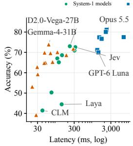
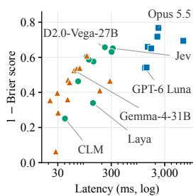
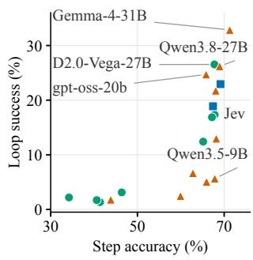
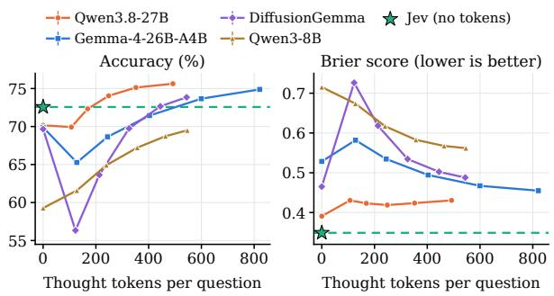
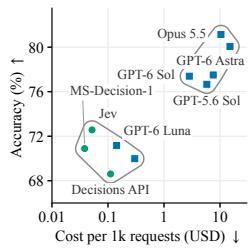

# System1-Arena: Which Decisions Can Be Left to System 1?

Tianyu Chen\* Xinyang Liu\* Ruyi An Zhendong Wang Mingyuan Zhou The University of Texas at Austin

## Abstract

Large language models (LLMs) often make discrete decisions, such as flagging phishing or escalating to a human. System-1 models, such as Jev and the OpenAI Decisions API, return probabilities over options in a single forward pass, while System-2 approaches generate reasoning steps. Which decisions can System-1 models handle, and which require generative reasoning? We introduce System1-Arena, a benchmark that gives all models the same decision requests and scores their probabilities. It contains 92k questions across 105 tasks from 268 public sources, in four groups: text classification and knowledge, applied decisions, evaluation and control, and agent and action. It also includes 138 closed-loop environments, from web shopping and SWE-bench coding control to robotics, games, and driving; in real-time mode, the world evolves while a model decides. We evaluate 30 models: 7 closed LLMs, 13 open LLMs read at the answer token, and 10 System-1 models. The largest System-1 models match or exceed fast closed LLMs in nonagentic accuracy, with better-calibrated probabilities at one-quarter of the latency. A reasoning LLM is the most accurate, at about 70× the cost of a fast LLM. In closed loops, large open LLMs succeed most often (up to 32.9%); small System-1 models rarely succeed.

‡ Code Dataset Œ Leaderboard

## 1 Introduction

Many applications ask large language models (LLMs) to make discrete decisions. Examples include detecting phishing, deciding whether to involve a human, checking task completion, and selecting the next action. Such requests often occur at high volume and need a label or option with a probability estimate. Reasoning LLMs can spend unnecessary computation on simple decisions (Zhang et al., 2025c). Routing and cascading reduce these costs, but they still rely on generative models (Chen et al., 2023a; Hu et al., 2024). Latency also limits LLM use in robotics, driving, and games, where the world continues to change during inference.

  
(a) Fast decisions can be accurate.

  
(b) Probability quality  
changes model rankings.  
Figure 1: System-1 models combine fast, accurate decisions with well-calibrated probabilities. The strongest System-1 models match fast closed LLMs in accuracy, with better probability estimates and lower latency. Reasoning LLMs achieve the highest accuracy. See Section 4 for evaluation settings.

System 1 supports fast, automatic judgments, while System 2 supports slower, deliberate reasoning (Kahneman, 2011). LLM studies often use this distinction to describe shorter and longer reasoning by the same model (Yu et al., 2024; Ziabari et al., 2025; Zhang et al., 2025c). Here, we study models that directly predict probabilities for discrete decisions. Jev (TypeSafe AI, 2026) and the Decision-2.0 family (vLLM Semantic Router Team, 2026) accept a state and typed questions. Question types include yes/no, multiple choice, and ordered scales. These models return a probability distribution for each question in one forward pass, without generating text. The OpenAI Decisions API (OpenAI, 2026a) provides the same decision interface through GPT-6 Luna, and Microsoft-Decision-1 (Microsoft, 2026) provides it through a post-trained Qwen3.5-9B. These systems can respond within a few hundred milliseconds at low cost. In our runs, Jev cost about \$0.05 per 1,000 requests. Probability estimates support decision thresholds, calibration, and rules for escalation to a human.

This raises a central question: which decisions can System-1 models handle, and where do generative LLMs perform better? Existing benchmarks provide limited evidence. JevBench (Benchmark Heaven, 2026) and ReflexBench (Brida AI, 2026) each contain only a few hundred synthetic decisions. Their narrow coverage makes model rankings sensitive to task selection. They mainly compare System-1 models and do not include agentic tasks. These tasks are an important use case because each decision can affect later actions, and delays can change outcomes.

We introduce System1-Arena, a benchmark with 92,125 typed questions across 105 tasks from 268 public sources in 16 domains. It also includes 138 closed-loop environments from 18 families. In realtime mode, the environment continues to evolve while a model decides. We evaluate System-1 models alongside open and closed LLMs through a shared decision interface. Each model family uses a fixed prompt, and we score the predicted probabilities. System1-Arena follows three design choices.

• Broad coverage. Every model receives the same decision request for each example: a state and typed questions. Labels come from test execution, solvers, experts, annotator distributions, and resolved events. We preserve the instructions from each source (Section 3.2).

• More than accuracy. Each model returns a probability distribution for every question. We report accuracy and use the Brier score to assess probability quality. More details are in Section 3.4.

• Agentic tasks. We evaluate individual agent decisions and success in closed-loop environments. In real-time mode, the environment continues to evolve for the duration of each model call, using that model’s measured latency (Section 3.3).

We evaluate 30 models: 7 closed LLMs, 13 open LLMs evaluated through answer-token probabilities, and 10 System-1 models. On non-agentic tasks, Jev and Decision-2.0-Vega-27B reach 72.6% and 73.0% accuracy, respectively, compared with 71.2% for GPT-6 Luna. They also produce bettercalibrated probabilities at lower latency than fast closed LLMs (Figure 1). The performance gap between the best System-1 models and the best LLMs is smallest on filtering, grouping, ranking, retrieval, and dialogue tasks. System-1 models remain less accurate on knowledge and forecasting tasks (Figure 3).

Reasoning LLMs achieve the highest accuracy. Claude Opus 5.5 reaches 81.1%, at about 70× the cost of a fast LLM. Explicit reasoning also improves open LLM accuracy. With a few hundred reasoning tokens per question, Qwen3.8-27B reaches 75.6%, exceeding Jev’s accuracy but producing less-calibrated probabilities (Figure 4).

In agentic tasks, some models perform well on single-step decision tasks but struggle with longhorizon tasks. Decision-2.0-Vega-27B, Jev, and Qwen3.5-9B all achieve 67.8% accuracy on singlestep tasks. On long-horizon tasks, Gemma-4-31B achieves the highest success rate at 32.9%. The four small System-1 models reach at most 3.1%, showing limited ability to handle long-horizon planning. The OpenAI Decisions API is faster and better calibrated than GPT-6 Luna, but achieves a lower success rate on long-horizon tasks.

In sum, we make four contributions. First, System1-Arena provides a shared decision interface for System-1 models and LLMs, with labels and instructions linked to their sources. Second, our real-time protocol advances the environment during model inference to measure the value of fast decisions. Third, we provide a method for obtaining decision probabilities from open autoregressive and diffusion LLMs through their answer tokens. Fourth, our evaluation of 30 models identifies where System-1 models match LLMs and where they fall behind.

## 2 Related Work

System 1 and System 2 in language models. The dual-process distinction of Kahneman (2011) is often used to describe how much a language model reasons before answering. Yu et al. (2024) distill long reasoning outputs into models that answer directly. Ziabari et al. (2025) align models toward either end of this spectrum and find that faster responses perform better on commonsense tasks, while slower reasoning performs better on arithmetic and symbolic tasks. S1-Bench (Zhang et al., 2025c) shows that large reasoning models overthink simple questions. These studies examine System 1 and System 2 behavior within generative models. System1-Arena compares generative LLMs with a separate class of models that return decision probabilities without generating text, and identifies which decisions these models can handle.

Typed decision models and zero-shot classifiers. Zero-shot text classification assigns labels specified at inference time. Yin et al. (2019) frame this task as entailment, and Laurer et al. (2023) train universal classifiers across tasks formatted as natural language inference. System-1 models such as Jev (TypeSafe AI, 2026), Microsoft-Decision-1 (Microsoft, 2026), and the OpenAI Decisions API extend this interface to multiple typed questions per input—boolean, choice, and ordered scores—with a probability for each option. JevBench (Benchmark Heaven, 2026) and ReflexBench (Brida AI, 2026) evaluate accuracy, calibration, robustness, and speed on a few hundred newly written decisions, mainly comparing System-1 models. System1-Arena covers 92k questions with source-provided labels, compares System-1 models and LLMs on the same decision requests, and evaluates them in closed-loop environments.

Holistic benchmarks, calibration, and cost. MMLU (Hendrycks et al., 2020), BIG-bench (Srivastava et al., 2022), and HELM (Liang et al., 2022) evaluate models across diverse tasks using a common protocol. HELM also reports calibration and efficiency. The Brier score (Brier, 1950) evaluates probabilistic predictions, while expected calibration error (Guo et al., 2017) measures the gap between confidence and accuracy. Large models can produce well-calibrated token probabilities on multiple-choice questions (Kadavath et al., 2022). For instruction-tuned models, verbalized probabilities can be better calibrated than token probabilities (Tian et al., 2023), but can still be overconfident (Xiong et al., 2023). We use verbalized probabilities for closed LLMs to obtain a full distribution for each question through their text-generation APIs. Cost-aware methods route queries among LLMs of different sizes (Chen et al., 2023a; Hu et al., 2024). System1-Arena asks which decisions a System-1 model can handle, informing routing between System-1 models and generative LLMs.

Interactive and latency-sensitive evaluation. Most benchmarks for web agents, text games, customer support, coding, and reinforcement learning pause the environment while the model decides. Appendix D lists the environments used in our evaluation. Kang et al. (2025) show that tailoring model size and quantization to a latency budget improves performance in both a trading simulation and a fighting game. We use a harness that presents each environment’s decisions as typed questions and add a real-time mode that incorporates each model’s measured latency into the environment dynamics.

Decision request a state and typed questions   
{   
"state": {   
"vulnerability\_description": "SQL Injection   
vulnerability in Limesurvey v2.65.1+170522   
via 'token' parameter in '/index.php' endpoint."   
},   
"questions": {   
"attack\_vector": {   
"type": "choice",   
"instructions": "Attack Vector (AV):   
"criteria": {"local": "physical":   
"network": "adjacent":   
},   
"severity": {   
"type": "score",   
"instructions": "Which CVSS v3.1 severity ...?",   
"criteria": ["None: ...", "Low: ...", "Medium: .   
"High: ...", "Critical: ..."]   
},   
// 7 more questions   
}   
}   
Answer of Jev a distribution per question; gold option marked   
{   
"attack\_vector": {"network": 1.00, "local": 0.00, ...},   
"severity": {"4": 0.76, "3": 0.19, "2": 0.02, ...},   
// "4" = Critical   
}  
Figure 2: A decision request from the CVSS task and the answer of Jev. We show two of its nine questions and shorten the instructions and the option descriptions. An LLM gets the same request as text (Appendix A).

## 3 System1-Arena

## 3.1 Decision requests

We represent every static example and environment step as a decision request $r = ( s , Q )$ (Figure 2). The state s contains a small set of named text fields. Examples include a message, a code diff with its commit message, or a rendered web page. The questions $Q = \{ q _ { 1 } , \ldots , q _ { m } \}$ share this state.

Each question is boolean (yes/no), choice (2– 255 options with exactly one correct answer), or score (2–10 ordered levels). Score levels can represent a grading rubric. Each question includes instructions, and each option includes a description, so models need no dataset-specific prompt. A model returns a probability distribution over the options for each question. The reference answer is a hard label or, when available, a distribution provided by the source.

System-1 models receive the request directly. LLMs receive a text version through a fixed prompt for each model family (Appendix A). Section 4 explains how we obtain the option probabilities p from each model.

## 3.2 Non-agentic decisions

This component contains 78,362 questions across 13 domains and 87 tasks (Table 3). Each task covers one type of decision and draws on one or more public sources. Examples include deciding whether a message is phishing or whether a patch fixes an issue. The domains cover text classification, knowledge, professional tasks, retrieval, structured data, code, and forecasting. They also cover dialogue, batch processing, LLM-as-judge, safety, routing, and subjective judgments. Appendix C lists the sources for all benchmark tasks.

Labels and instructions. All labels come from the original sources; we do not create new labels. They include test results, solver outputs, resolved events, expert annotations, annotator distributions, and original dataset labels. When a source provides instructions or annotation guidelines, we preserve their wording or adapt them to the decision-request format. Otherwise, we write instructions based on the source’s labeling criteria. This keeps the instructions consistent with how the labels were assigned. Appendix B describes the procedure.

## 3.3 Agentic tasks and environments

Agentic tasks require a model to choose a sequence of actions to achieve a goal. Each action changes the state observed at the next step, so success depends on decisions throughout an episode. We include 138 environments from 18 families and 22 benchmark suites. They cover web shopping, customer service, coding, robotics, games, and driving (Appendix D).

To support System-1 models on long-horizon tasks, we use a fixed, task-specific harness. At each step, it converts the current state and interaction history into text and presents the available actions as typed questions. It executes the highest-probability option for each question and obtains the next observation. We represent free-form outputs, such as search terms, tool arguments, and patches, as candidate choices. Actions come from the original benchmark’s action space, and all models use the same harness and environment. For environments with a success criterion, we report the mean success rate, giving each environment equal weight.

Single-step tasks. We separately evaluate individual agentic decisions using recorded trajectories and fixed states from games and embodied tasks. Each example provides a fixed state and interaction history. Questions ask which action to take, whether a proposed step is correct, or whether the task is complete. We score the answer against a reference without continuing the interaction. References come from expert demonstrations, execution checks, solvers, recorded outcomes, or source annotations. These tasks measure decision quality for a given state and history.

The full single-step collection contains 13,763 questions across 18 tasks. It includes 6,943 questions about agent steps, 3,828 about games, and 2,992 about embodied and robotics tasks (Table 3). Together with the non-agentic component, these tasks account for all 92,125 questions and 105 tasks. Our single-step model comparison uses only the agent-step subset (Table 2). This subset contains 3,481 recorded steps and 6,943 questions across seven tasks. The static game and embodied tasks remain part of the benchmark but are excluded from this comparison.

Harness difficulty check. We check whether the harness makes the original task too easy. We flag environments where a uniform-random policy succeeds in at least 20% of episodes or models generally achieve at least 90% success. For flagged environments, we removed assistance or reduced the decision budget. For example, we limited the budget to twice the shortest solution length in BabyAI, MiniHack mazes, and Baba Is AI. A scripted policy confirms that each adjusted task remains solvable.

Real-time mode. In Atari, Doom, driving, and quadrotor environments, the world continues to evolve while the model decides. For each decision, the environment advances by the model’s measured median latency and continues to execute its previous action. Slower models therefore act on older observations. This makes response time part of task performance (Appendix D).

## 3.4 Metrics

We evaluate the probability distribution returned for each question. Accuracy compares the option with the highest predicted probability against the hard reference label. The Brier score (Brier, 1950) measures probability quality as $\begin{array} { r } { \sum _ { o } ( p ( o ) - t ( o ) ) ^ { 2 } } \end{array}$ Here, t is a one-hot label or an annotator distribution. The score ranges from 0 to 2, with lower values indicating better probability estimates.

For each task, we average scores across its sources. A domain score averages the scores of its tasks. The overall score averages all tasks, giving each task equal weight. Appendix B defines the additional metrics: expected calibration error, NDCG, and pair accuracy.

## 4 Experimental Setup

Probabilities from each model family. For a question $q$ with options $o _ { 1 } , \ldots , o _ { K }$ , every model provides a distribution $p ( o _ { k } \mid s , q )$ . System-1 models return this distribution directly. We use the APIs for Jev, Microsoft-Decision-1 and the OpenAI Decisions API, and the official code for the other System-1 models.

Closed LLMs return a nonnegative value $v _ { k }$ for each option in a JSON response (Appendix A.1). We normalize these values as $p ( o _ { k } \mid s , q ) =$ $v _ { k } / \sum _ { j } v _ { j }$ . Missing options receive $v _ { k } = 0$ . We do not use token probabilities from these models.

For open LLMs, we obtain probabilities from answer labels. The prompt x contains the state, one question, and its options, each with a short label $\ell _ { k }$ . Labels use A, B, . . . for choices, 0–9 for score levels, and yes/no for boolean questions (Appendix A.2). The prompt ends at the start of the answer. One forward pass gives $z _ { k } = \log P _ { \theta } ( \ell _ { k } \mid x )$ for each label at this position. We normalize these values as $\begin{array} { r } { p ( o _ { k } \mid s , q ) = \frac { \exp { z _ { k } } } { \sum _ { j = 1 } ^ { K } \exp { z _ { j } } } } \end{array}$ . GPT-OSS requires reasoning, so we read label probabilities at the start of its final answer. For DiffusionGemma, one read-only denoising step provides the label probabilities at the answer slot (vLLM contributors, 2026). The other open models use their nonthinking mode (Appendix B).

Models. We evaluate 30 models in three families (Tables 1 and 2).

• Closed LLMs (7 models, from most to least accurate): Claude Opus 5.5 (Anthropic, 2026), GPT-6 Astra (OpenAI, 2026b), Grok 4.7 (xAI, 2026), GPT-6 Sol, GPT-5.6 Sol, GPT-6 Luna, and GPT-5.6 Luna (OpenAI, 2026c,d). Each model returns option probabilities in a JSON response.

• Open LLMs (13 models): models from the Qwen3 (Yang et al., 2025a), Qwen3.5 (Qwen Team, 2026a), Qwen3.8 (Qwen Team, 2026b), Gemma 4 (Google, 2026), Llama 3 (Grattafiori et al., 2024), and GPT-OSS (OpenAI, 2025) families, plus DiffusionGemma (DiffusionGemma Team et al., 2026).

• System-1 models (10 models): Jev, Laya (Convai Innovations, 2026), CLM (Kwok et al.,

2026), five Decision 2.0 models (vLLM Semantic Router Team, 2026), Microsoft-Decision-1 (Microsoft, 2026), which is post-trained from Qwen3.5-9B, and the OpenAI Decisions API (OpenAI, 2026a), which serves GPT-6 Luna.

We disable reasoning whenever the model’s interface permits it. Five models require reasoning: Claude Opus 5.5, GPT-6 Astra, Grok 4.7, gpt-oss-20b, and gpt-oss-120b. We use the lowest available reasoning effort for these models.

Non-agentic and agentic tasks. The benchmark organizes its domains into four groups (Table 3, Appendix C). Text and knowledge covers text classification, knowledge and reasoning, and subjective judgments. Applied decisions covers professional domains, retrieval, structured data, code, forecasting, dialogue, and batch processing. Evaluation and control covers LLM-as-judge, safety, and routing. Agent and action covers decisions made during an agent’s interaction with an environment.

The first three groups form the non-agentic component, with 78,362 questions across 87 tasks. These tasks ask a model to judge a given input. The agent and action group forms the agentic component. We evaluate this component in 138 environments and on 3,481 agent steps. The recorded steps contain 6,943 questions across seven tasks. The static model comparison therefore covers 85,305 questions across 94 tasks. The remaining 6,820 questions come from static game and embodied tasks.

Protocol. Questions with failed calls, unusable responses, or refused inputs receive no accuracy credit. In environments, the harness executes the fallback action when a decision is missing or invalid. Latency is the median time per request. We report cost per 1,000 requests in each model family’s native unit. Costs use US dollars for Jev, Microsoft-Decision-1, OpenAI Decisions API, and closed LLMs. For local models, costs use H100- equivalent GPU-seconds. We do not convert between these units.

Output tokens are the mean number of tokens generated per request. Returning probabilities and reading label probabilities do not themselves generate output tokens. Appendix B describes the services, hardware, and retry rules.

Table 1: All models on the non-agentic tasks: accuracy (%), overall accuracy and Brier score, latency, cost and output tokens. Rank is by overall accuracy; within a family, the rows follow it. Every cell is the mean over the tasks of a domain on all 78,362 questions. The grey columns are the overall scores. Blue rows are the three most accurate models, green rows the top three with 0 output tokens (darker is better); bold is the best per column. ∗The model cannot stop reasoning and uses its lowest reasoning effort. Section 4 defines latency (median per request), cost (per 1,000 requests, in USD for hosted models and H100-equivalent GPU-seconds for local models) and output tokens (mean per request). Domains: Cls = text classification, Know = knowledge and reasoning, Social = subjective judgments, Pro = professional domains, Ret = retrieval, Struct = structured data, Fore = forecasting, Dialog = dialogue, Batch = batch processing, Judge = LLM-as-judge, Safety = safety and moderation, Route = routing.
<table><tr><td></td><td colspan="2">Text and knowledge</td><td colspan="5">Applied decisions</td><td colspan="3">Evaluation and control All 87 tasks Latency</td><td></td><td rowspan="2"></td><td rowspan="2">Cost per Output</td><td rowspan="2">1,000 req. tokens</td></tr><tr><td>Rank Model</td><td>Cls Know Social</td><td></td><td>Pro</td><td>Ret Struct Code Fore Dialog Batch Judge Safety</td><td></td><td></td><td></td><td></td><td></td><td>Route</td><td>Acc. Brier p50 (ms)</td></tr><tr><td colspan="10">System-1 models, native probabilities</td><td></td><td></td><td></td><td></td><td></td></tr><tr><td>7 Decision-2.0-Vega-27B</td><td>75.1 80.0</td><td></td><td>68.0</td><td>70.0 76.7 83.0</td><td></td><td>68.9 43.8</td><td>73.5</td><td>77.1</td><td>68.4</td><td>85.1</td><td>66.5</td><td>73.00.343</td><td>228</td><td>316 GPU-s</td><td>0</td></tr><tr><td>8 Jev 1.13</td><td>73.0 81.9</td><td></td><td>69.7</td><td>70.6 77.0 78.7</td><td></td><td>65.9 44.1</td><td>73.2</td><td>75.3</td><td>68.4</td><td>86.7</td><td>64.5</td><td>72.6 0.349</td><td>321</td><td>$0.052</td><td>0</td></tr><tr><td>11 Microsoft-Decision-1</td><td>72.9</td><td>80.5</td><td>60.5</td><td>67.6 75.9</td><td>78.9</td><td>64.5 40.7</td><td>71.9</td><td>73.5</td><td>68.5</td><td>82.9</td><td>63.8</td><td>70.9 0.369</td><td>304</td><td>$0.038</td><td>0</td></tr><tr><td>17 OpenAI Decisions API</td><td>69.8</td><td>74.5</td><td>38.3</td><td>69.1 73.2</td><td>76.0</td><td>66.0 48.3</td><td>70.6</td><td>72.2</td><td>67.3</td><td>81.0</td><td>65.0</td><td>68.6 0.424</td><td>140</td><td>$0.111</td><td>0</td></tr><tr><td>18 Decision-2.0-Lux-9B</td><td>69.3</td><td>76.2</td><td>61.0</td><td>65.1 74.7</td><td>72.0</td><td>62.0 39.8</td><td>70.7</td><td>75.0</td><td>60.6</td><td>75.5</td><td>58.4</td><td>67.0 0.397</td><td>104</td><td>144 GPU-s</td><td>0</td></tr><tr><td>20 Decision-2.0-Nox-4B</td><td>67.3</td><td>73.6</td><td>58.6</td><td>62.2 72.8</td><td>69.4 58.8</td><td>40.1</td><td>70.7</td><td>74.4</td><td>58.3</td><td>73.8</td><td>59.0</td><td>65.1 0.414</td><td>114</td><td>154 GPU-s</td><td>0</td></tr><tr><td>26 Decision-2.0-Kai-0.6B</td><td>54.7 51.1</td><td></td><td>30.0</td><td>49.8 59.8 49.9</td><td></td><td>48.6 34.3</td><td>53.6</td><td>64.6</td><td>47.9</td><td>57.4</td><td>46.0</td><td>50.3 0.537</td><td>72</td><td>93 GPU-s</td><td>0</td></tr><tr><td>27 Laya (421M)</td><td>47.2</td><td>45.9</td><td>45.4</td><td>38.7 42.2</td><td>39.6 44.7</td><td>25.4</td><td>47.7</td><td>52.3</td><td>41.7</td><td>60.9</td><td>42.4</td><td>44.5 0.660</td><td>136</td><td>12 GPU-s</td><td>0</td></tr><tr><td>28 CLM-v0.1-8B</td><td>35.6</td><td>48.3</td><td>22.1</td><td>28.2 45.9</td><td>40.7 40.1</td><td>35.5</td><td>40.8</td><td>42.2</td><td>46.0</td><td>54.7</td><td>49.6</td><td>41.4 0.749</td><td>41</td><td>19 GPU-s</td><td>0</td></tr><tr><td colspan="10">Closed LLMs, verbalized probabilities</td><td></td><td></td><td></td><td></td><td></td><td></td></tr><tr><td>1 Claude Opus 5.5*</td><td>79.7 91.6</td><td></td><td>79.6</td><td>79.5 78.8</td><td>95.2</td><td>82.0 61.6</td><td>76.5</td><td>77.7</td><td>77.8</td><td>86.2</td><td>72.3</td><td>81.1 0.232</td><td>2,293</td><td>$10.380</td><td>132</td></tr><tr><td>2 GPT-6 Astra*</td><td>79.8</td><td>90.9</td><td>76.4</td><td>77.9 79.3 92.1</td><td></td><td>79.057.6</td><td>77.4</td><td>76.2</td><td>77.0</td><td>90.9</td><td>68.0</td><td>80.1 0.282</td><td>2,189</td><td>$15.050</td><td>55</td></tr><tr><td>3 Grok 4.7*</td><td>76.4</td><td>88.1</td><td>73.1</td><td>73.4 77.7 88.8</td><td></td><td>76.052.1</td><td>74.4</td><td>72.9</td><td>75.0</td><td>89.6</td><td>70.6</td><td>77.5 0.306</td><td>6,694</td><td>$7.569</td><td>765</td></tr><tr><td>4 GPT-6 Sol</td><td>78.0 84.6</td><td></td><td>74.5</td><td>74.8 77.6 87.9</td><td></td><td>74.2 53.3</td><td>75.7</td><td>74.9</td><td>74.8</td><td>90.7</td><td>69.9</td><td>77.4 0.340</td><td>1,446</td><td>$2.833</td><td>37</td></tr><tr><td>5 GPT-5.6 Sol</td><td>77.1</td><td>83.2</td><td>73.2</td><td>75.0 77.9 86.3</td><td>72.9</td><td>51.2</td><td>75.3</td><td>74.9</td><td>74.0</td><td>90.9</td><td>69.8</td><td>76.7 0.349</td><td>1,680</td><td>$5.817</td><td>45</td></tr><tr><td>10 GPT-6 Luna 13 GPT-5.6 Luna</td><td>72.4</td><td>75.3</td><td>69.0</td><td>71.3 75.2 77.3</td><td></td><td>66.4 49.2</td><td>71.9</td><td>73.1</td><td>67.1</td><td>86.5</td><td>62.2</td><td>71.2 0.461</td><td>1,276</td><td>$0.143</td><td>40</td></tr><tr><td></td><td>71.2</td><td>72.5</td><td>63.0</td><td>70.5 74.8 76.0</td><td></td><td>64.7 46.0</td><td>72.6</td><td>73.9</td><td>67.6</td><td>85.6</td><td>62.3</td><td>70.0 0.458</td><td>1,375</td><td>$0.301</td><td>46</td></tr><tr><td colspan="10">Open LLMs, probabilities read at the answer token</td><td></td><td></td><td></td><td></td><td></td><td></td></tr><tr><td>6 Gemma-4-31B</td><td>73.7</td><td>80.8</td><td>65.8</td><td>72.1 78.0</td><td>82.6</td><td>69.4 42.7</td><td>72.4</td><td>74.5</td><td>71.7</td><td>88.7</td><td>70.0</td><td>73.9 0.474</td><td>60</td><td>142 GPU-s</td><td>0</td></tr><tr><td>9 gpt-oss-120b*</td><td>69.5 82.9</td><td></td><td>57.9</td><td>67.9 74.5 82.9</td><td></td><td>71.6 40.9</td><td>72.3</td><td>71.3</td><td>70.7</td><td>82.8</td><td>64.3</td><td>71.8 0.534</td><td>284</td><td>101 GPU-s</td><td>95</td></tr><tr><td>12 Qwen3.8-27B</td><td>71.9</td><td>75.5</td><td>60.7</td><td>69.874.0 72.5</td><td></td><td>65.1 40.1</td><td>69.7</td><td>74.6</td><td>67.9</td><td>86.3</td><td>66.4</td><td>70.2 0.391</td><td>105</td><td>142 GPU-s</td><td>0</td></tr><tr><td>14 Gemma-4-26B-A4B</td><td>71.8</td><td>76.2</td><td>51.2</td><td>68.3 75.6 77.9</td><td></td><td>64.4 40.9</td><td>71.4</td><td>75.3</td><td>67.2</td><td>83.7</td><td>66.5</td><td>69.9 0.528</td><td>47</td><td>25 GPU-s</td><td>0</td></tr><tr><td>15 DiffusionGemma-26B-A4B</td><td>71.2</td><td>74.7</td><td>68.2</td><td>68.0 76.2 75.5</td><td></td><td>63.0 42.1</td><td>69.9</td><td>73.8</td><td>66.0</td><td>83.6</td><td>63.8</td><td>69.7 0.465</td><td>68</td><td>41 GPU-s</td><td>0</td></tr><tr><td>16 gpt-oss-20b*</td><td>67.2</td><td>79.8</td><td>48.9</td><td>64.2 71.4 79.0</td><td>70.0</td><td>41.6</td><td>69.5</td><td>68.7</td><td>67.0</td><td>80.6</td><td>61.3</td><td>68.7 0.589</td><td>183</td><td>51 GPU-s</td><td>109</td></tr><tr><td>19 Qwen3.5-9B 21 Qwen3-32B</td><td>67.5</td><td>72.0</td><td>57.4</td><td>65.5 69.3 68.6</td><td>60.5</td><td>37.8 40.7</td><td>60.0 69.8</td><td>70.2 72.1</td><td>63.9 63.4</td><td>77.7 75.8</td><td>60.4 58.1</td><td>65.3 0.461 65.0 0.543</td><td>77 50</td><td>36 GPU-s 112 GPU-s</td><td>0 0</td></tr><tr><td>22 Llama-3.3-70B</td><td>63.1 64.1</td><td>72.9 71.9</td><td>55.8 55.4</td><td>64.4 71.4 67.4 64.0 71.3 66.4</td><td>58.0 58.8</td></table>

<table><tr><td>Task domain</td><td>Gap (pp)</td></tr><tr><td>Filter, group &amp; rank</td><td>0.5</td></tr><tr><td>Retrieval &amp; ranking</td><td>2.3</td></tr><tr><td>Dialogue decisions</td><td>3.9</td></tr><tr><td>Safety &amp; moderation</td><td>4.2</td></tr><tr><td>Text classification</td><td>4.7</td></tr><tr><td>Model &amp; tool routing</td><td>5.8</td></tr><tr><td>Professional tasks</td><td>8.9</td></tr><tr><td>LLM evaluation</td><td>9.3</td></tr><tr><td>Knowledge &amp; reasoning</td><td>9.7</td></tr><tr><td>Social judgments</td><td>9.9</td></tr><tr><td>Structured data</td><td>12.2</td></tr><tr><td>Code understanding</td><td>13.1</td></tr><tr><td>Event forecasting</td><td>13.3</td></tr></table>

  
Figure 3: Task-domain gaps and agentic performance. Left: gaps by task domain in percentage points. Right: agentic task performance. Evaluation settings are given in Section 4.

## 5 Results

Table 1 reports non-agentic performance: accuracy across 13 domains, overall accuracy, Brier score, latency, cost, and output tokens. Table 2 reports

agentic performance.

Non-agentic: closed LLMs with reasoning are the most accurate. Claude Opus 5.5 achieves the highest overall accuracy (81.1%) and the lowest Brier score, leading in 9 of the 13 domains. The five most accurate models are closed LLMs, three of which reason before answering. Gemma-4-31B is the most accurate open LLM (73.9%). Without reasoning, it outperforms both Luna models in all three non-agentic groups. Forecasting is the hardest domain for 25 of the 29 models with non-agentic results, with no model exceeding 61.6% accuracy.

Non-agentic: the best System-1 models match low-reasoning-effort LLMs. The best System-1 models match or exceed low-reasoning-effort LLMs in accuracy on non-agentic tasks. Decision-2.0-Vega-27B (73.0%) and Jev (72.6%) outperform GPT-6 Luna (71.2%) and GPT-5.6 Luna (70.0%).

Table 2: The agentic tasks (%). Rank is by step accuracy; within a family, the rows follow it. “Single steps”: accuracy on 3,481 agent steps (mean over 7 tasks) and the share of their 6,943 questions without an answer. “Closed loops”: success rate over 127 environments and the share of decisions without an answer. Blue and green mark the top three models by step accuracy overall and with 0 output tokens, respectively; green takes precedence for models in both groups (darker is better). Bold marks the best value in a column. ∗Reasons at its lowest effort. “No ans.” is the percentage of questions (steps) or decisions (loops) without an answer.
<table><tr><td></td><td colspan="2">Single steps</td><td colspan="2">Closed loops</td></tr><tr><td>Rank Model</td><td></td><td>Acc. No ans.</td><td>Success</td><td>No ans.</td></tr><tr><td colspan="5">System-1 models, native probabilities</td></tr><tr><td>7 Jev 1.13</td><td>67.8</td><td>13.2</td><td>17.4</td><td>0.4</td></tr><tr><td>8 Decision-2.0-Vega-27B</td><td>67.8</td><td>13.7</td><td>26.5</td><td>0.0</td></tr><tr><td>10 OpenAI Decisions API</td><td>67.2</td><td>0.1</td><td>16.9</td><td>0.7</td></tr><tr><td>13 Microsoft-Decision-1</td><td>65.2</td><td>13.7</td><td>12.4</td><td>0.0</td></tr><tr><td>16 Decision-2.0-Sol-2B</td><td>46.4</td><td>24.7</td><td>3.1</td><td>0.0</td></tr><tr><td>18 Laya (421M)</td><td>41.4</td><td>0.1</td><td>1.3</td><td>0.8</td></tr><tr><td>19 CLM-v0.1-8B</td><td>40.6</td><td>0.0</td><td>1.7</td><td>0.0</td></tr><tr><td>20 Decision-2.0-Kai-0.6B</td><td>34.2</td><td>40.9</td><td>2.2</td><td>7.2</td></tr><tr><td colspan="5">Closed LLMs, verbalized probabilities</td></tr><tr><td>2 GPT-6 Luna</td><td>69.1</td><td>0.1</td><td>22.9</td><td>0.2</td></tr><tr><td>9 GPT-5.6 Luna</td><td>67.4</td><td>0.7</td><td>18.9</td><td>0.1</td></tr><tr><td colspan="5">Open LLMs, probabilities read at the answer token</td></tr><tr><td>Gemma-4-31B</td><td>71.3</td><td>0.3</td><td>32.9</td><td>0.0</td></tr><tr><td>3 Qwen3.8-27B</td><td>68.9</td><td>0.0</td><td>26.2</td><td>0.0</td></tr><tr><td>4 DiffusionGemma-26B-A4B</td><td>68.2</td><td>0.0</td><td>13.0</td><td>0.0</td></tr><tr><td>5 Gemma-4-26B-A4B</td><td>68.1</td><td>0.0</td><td>21.7</td><td>0.0</td></tr><tr><td>6 Qwen3.5-9B</td><td>67.8</td><td>0.0</td><td>5.7</td><td>0.0</td></tr><tr><td>11 Gemma-4-E4B</td><td>65.9</td><td>0.3</td><td>5.1</td><td>0.0</td></tr><tr><td>12 gpt-oss-20b*</td><td>65.8</td><td>0.3</td><td>24.7</td><td>0.0</td></tr><tr><td>14 Qwen3-32B</td><td>62.8</td><td>10.2</td><td>6.6</td><td>0.0</td></tr><tr><td>15 Qwen3-8B</td><td>59.9</td><td>10.2</td><td>2.5</td><td>0.0</td></tr><tr><td>17 Qwen3-0.6B</td><td>43.9</td><td>10.2</td><td>1.8</td><td>0.0</td></tr></table>

Both remain within 1.4 percentage points of Gemma-4-31B.

Non-agentic: System-1 models provide reliable probabilities. Across the 87 tasks, Decision-2.0- Vega-27B and Jev achieve mean Brier scores of 0.343 and 0.349, respectively. Only four models achieve lower scores, all closed LLMs that cost 20–105 times as much as GPT-6 Luna. Although Gemma-4-31B is more accurate than these two System-1 models, its Brier score is higher at 0.474. GPT-6 Luna and GPT-5.6 Luna also have higher Brier scores, at 0.461 and 0.458, respectively. Answer-token probabilities can be overconfident: Gemma-4-31B assigns a probability of at least 0.999 to its option on 87% of questions.

Non-agentic: thinking improves accuracy, but not necessarily calibration. Figure 4 evaluates four open LLMs with reasoning budgets of up to 2,048 tokens. Without thinking, all four are less accurate than Jev (59.3–70.2% versus 72.6%). Small reasoning budgets can reduce accuracy below this baseline. At 128 tokens, DiffusionGemma drops from 69.7% to 56.3%, the largest decline among the four models, while Gemma-4-26B-A4B loses 4.6 percentage points. Larger budgets improve accuracy for all four models, and three surpass Jev at 2,048 tokens. However, these gains do not necessarily improve calibration. For example, a 2,048-token reasoning budget raises Qwen3.8-27B’s accuracy from 70.2% to 75.6%, but worsens its Brier score from 0.391 to 0.430. Its mean confidence in the selected option rises from 81.4% to 97.4%. This widening gap is consistent with increased overconfidence: predictions become more concentrated on a single option, including when that option is wrong. Confident errors incur larger Brier penalties, so higher accuracy can coexist with less reliable probability estimates.

  
Figure 4: Thinking can improve accuracy while worsening Brier scores. Accuracy and Brier score on nonagentic tasks versus the mean number of reasoning tokens per question. The zero-token point disables thinking, as in Table 1. Other points use reasoning token limits from 128 to 2,048.

Non-agentic: forecasting remains challenging for System-1 models. Despite competitive overall performance, System-1 models still lag substantially in some domains, particularly forecasting. One task, for example, asks which of three energy commodities—West Texas Intermediate crude oil, Brent crude oil, or Henry Hub natural gas—will have the largest percentage price increase over a 90-day horizon. Across the forecasting domain, the best System-1 model, the OpenAI Decisions API, achieves 48.3% accuracy, compared with 61.6% for Claude Opus 5.5, a gap of 13.3 percentage points (Table 1). Strong performance on classification and selection tasks therefore does not necessarily extend to forecasting. Although their low latency is attractive for applications such as trading, using System-1 models as forecasting components requires careful design and validation.

Agentic: similar step accuracy can yield different closed-loop success rates. Model rankings differ in agentic tasks (Table 2). Nine models achieve step accuracies of 67.4–71.3%, but their closed-loop success rates range from 5.7% to 32.9%. Decision-2.0-Vega-27B, Jev, and Qwen3.5- 9B all achieve 67.8% step accuracy, yet their closed-loop success rates are 26.5%, 17.4%, and 5.7%, respectively. One possible explanation is that errors accumulate during interaction. A static step starts from a recorded state, whereas an incorrect closed-loop decision can alter all subsequent states.

Agentic: larger models achieve higher closedloop success rates. Gemma-4-31B achieves the highest closed-loop success rate (32.9%), followed by Decision-2.0-Vega-27B (26.5%) and Qwen3.8- 27B (26.2%). The four open LLMs with fewer than 10B parameters succeed in fewer than 6% of episodes. Qwen3-32B is an exception among the larger models, with a success rate of only 6.6%. Jev achieves 17.4%, below both Luna models (22.9% and 18.9%) but above six of the ten open LLMs.

Paired comparisons: System-1 models versus their corresponding LLMs. We compare five System-1 models with their corresponding LLMs, pairing models that differ in their decision interface or post-training. System-1 models improve non-agentic accuracy in three pairs but reduce agentic step accuracy in all five. These comparisons include four post-trained models and the Decisions API, which uses the same underlying LLM as GPT-6 Luna (Figure 5, left). On non-agentic tasks, Decision-2.0-Vega-27B, Microsoft-Decision-1, and Decision-2.0-Kai-0.6B improve accuracy by 2.9–11.0 percentage points. The Decisions API and CLM-v0.1-8B instead lose 2.6 and 17.8 percentage points, respectively. Brier scores improve in four of the five pairs, with reductions of 0.037–0.400; CLM is the only exception. On agentic tasks, step accuracy decreases by 1.2– 19.3 percentage points across all five pairs. Closedloop success changes little in three pairs, staying within 0.8 percentage points of the corresponding LLM. It decreases from 22.9% to 16.9% for the Decisions API but increases from 5.7% to 12.4% for Microsoft-Decision-1.

Latency. Local models return decisions fastest. Without reasoning, open LLMs take 21–105 ms per request, while local System-1 models take 41– 228 ms. The two GPT-OSS models use reasoning and take 183 and 284 ms. Jev takes 321 ms through the gateway and Microsoft-Decision-1 takes 304 ms, while closed LLMs take 1.3–6.7 s.

<table><tr><td rowspan="2">System-1 model</td><td colspan="2">Non-agentic</td><td colspan="2">Agentic</td></tr><tr><td>Acc.</td><td>Brier</td><td>Step</td><td>Loop</td></tr><tr><td>D2.0-Vega-27B from Qwen3.8-27B</td><td>+2.9</td><td>-.048</td><td>-1.2</td><td>+0.3</td></tr><tr><td>MS-Decision-1 from Qwen3.5-9B</td><td>+5.6</td><td>-.091</td><td>-2.7</td><td>+6.8</td></tr><tr><td>D2,0-Kai-0.6B from Qwen3-0.6B†</td><td>+11.0</td><td>-.400</td><td>-9.6</td><td>+0.4</td></tr><tr><td>CLM-v0.1-8B from Qwen3-8B</td><td>-17.8</td><td>+.034</td><td>-19.3</td><td>-0.8</td></tr><tr><td>Decisions API from GPT-6 Luna‡</td><td>-2.6</td><td>-.037</td><td>-2.0</td><td>-6.1</td></tr></table>

  
Figure 5: Paired comparisons show mixed gains in non-agentic accuracy but consistently lower agentic step accuracy (left); higher cost does not always yield higher accuracy (right). †Base: Qwen3-0.6B-Base. ‡Same LLM, different interface.

Cost and output tokens. Higher cost does not always yield higher accuracy among hosted models (Figure 5, right). Jev achieves 72.6% accuracy at \$0.052 per 1,000 requests, compared with 71.2% at \$0.14 for GPT-6 Luna. Microsoft-Decision-1 is the least expensive hosted model, achieving 70.9% at \$0.038. Claude Opus 5.5 achieves 81.1% at \$10.38, roughly 74 times GPT-6 Luna’s cost for a 9.9-percentage-point accuracy gain. GPT-6 Astra is the most expensive (\$15.05) but is less accurate than Opus (80.1% versus 81.1%). Output length also varies substantially: Grok 4.7 generates 765 tokens per request, Claude Opus 5.5 generates 132, and GPT-6 Luna generates 40. Jev generates no text. Among local models, Gemma-4-26B-A4B uses 25 GPU-seconds per 1,000 requests, compared with 142 for Gemma-4-31B, which achieves 4.0 percentage points higher overall accuracy.

## 6 Conclusion

System1-Arena asks one question of every decision: can it be left to a fast model that answers with calibrated probabilities in a single forward pass, or does it still need a generative LLM? Posing the same typed requests to 30 models makes the question measurable. The answers are encouraging for System 1 on most static decisions, where the largest System-1 models match fast closed LLMs with better-calibrated probabilities at a quarter of the latency, and sobering where the best accuracy is needed, which a reasoning LLM delivers at about 70 times the cost. In closed loops, large models succeed most often, step accuracy does not predict loop success, and small System-1 models lack the planning that a loop needs. We hope the benchmark helps decide, decision by decision, where deliberation is worth its price.

## 7 Limitations

Labels are inherited from the sources, so their noise is inherited too; tier-C instructions were written by us; and many sources are public and several years old, so some inputs may have been seen in training. The closed LLMs, Jev, Microsoft-Decision-1 and the OpenAI Decisions API were called through online services, so their latency includes the service and the network, and cost reflects the prices on the days of the runs. The models that sample their answers got one draw per request, so run-to-run variation is not measured.

## 8 Ethical Considerations

System1-Arena reuses public datasets and environments under their licenses (Table 4); sources whose terms do not allow redistribution are rebuilt locally by a loader and are not redistributed. Toxicity, hatespeech, and safety tasks contain offensive or unsafe text by design; we keep these inputs as their creators released them and add no new personal data. A high score on the benchmark does not show that a model is fit for decisions with legal, medical, financial, or safety consequences, where errors can harm people and human review remains necessary.

## References

Ibrahim Abu Farha, Silviu Vlad Oprea, Steven Wilson, and Walid Magdy. 2022. SemEval-2022 task 6: iSarcasmEval, intended sarcasm detection in English and Arabic. In Proceedings ofthe 16th International Workshop on Semantic Evaluation (SemEval-2022), pages 802–814, Seattle, United States. Association for Computational Linguistics.

Pranjal Aggarwal, Aman Madaan, Ankit Anand, Srividya Pranavi Potharaju, Swaroop Mishra, Pei Zhou, Aditya Gupta, Dheeraj Rajagopal, Karthik Kappaganthu, Yiming Yang, Shyam Upadhyay, Manaal Faruqui, and Mausam. 2024. AutoMix: automatically mixing language models. In Advances in Neural Information Processing Systems 37: Annual Conference on Neural Information Processing Systems 2024, NeurIPS 2024, Vancouver, BC, Canada, December 10 - 15, 2024.

Md Basim Uddin Ahmed, Nima Shiri Harzevili, Jiho Shin, Hung Viet Pham, and Song Wang. 2026.

SecVulEval: Context-Aware benchmarking of LLMs for vulnerability detection. In Proceedings of the 3rd ACM International Conference on AI-Powered Software, AIware ’26, page 388–396. ACM.

Tiago A. Almeida, José María G. Hidalgo, and Akebo Yamakami. 2011. Contributions to the study of SMS spam filtering: new collection and results. In Proceedings ofthe 11th ACM symposium on Document engineering, DocEng ’11, page 259–262. ACM.

Anthropic. 2026. Introducing Claude Opus 5.5. https: //www.anthropic.com/claude-opus-5-5.

Yuki Arase, Satoru Uchida, and Tomoyuki Kajiwara. 2022. CEFR-Based sentence difficulty annotation and assessment. In Proceedings of the 2022 Conference on Empirical Methods in Natural Language Processing, pages 6206–6219, Abu Dhabi, United Arab Emirates. Association for Computational Linguistics.

Gaurav Arora, Chirag Jain, Manas Chaturvedi, and Krupal Modi. 2020. HINT3: Raising the bar for intent detection in the wild. In Proceedings of the First Workshop on Insights from Negative Results in NLP, pages 100–105, Online. Association for Computational Linguistics.

Lora Aroyo, Alex Taylor, Mark Díaz, Christopher Homan, Alicia Parrish, Gregory Serapio-García, Vinodkumar Prabhakaran, and Ding Wang. 2023. DICES dataset: Diversity in conversational AI evaluation for safety. In Advances in Neural Information Processing Systems 36, NeurIPS 2023, page 53330–53342. Neural Information Processing Systems Foundation, Inc. (NeurIPS).

Ibragim Badertdinov, Alexander Golubev, Maksim Nekrashevich, Anton Shevtsov, Simon Karasik, Andrei Andriushchenko, Maria Trofimova, Daria Litvintseva, and Boris Yangel. 2025. SWE-rebench: an automated pipeline for task collection and decontaminated evaluation of software engineering agents. In Advances in Neural Information Processing Systems 38, NeurIPS 2025, page 26420–26466. Neural Information Processing Systems Foundation, Inc. (NeurIPS).

Payal Bajaj, Daniel Campos, Nick Craswell, Li Deng, Jianfeng Gao, Xiaodong Liu, Rangan Majumder, Andrew McNamara, Bhaskar Mitra, Tri Nguyen, Mir Rosenberg, Xia Song, Alina Stoica, Saurabh Tiwary, and Tong Wang. 2018. MS MARCO: a human generated MAchine reading COmprehension dataset. Preprint, arXiv:1611.09268.

Forrest Sheng Bao, Miaoran Li, Renyi Qu, Ge Luo, Erana Wan, Yujia Tang, Weisi Fan, Manveer Singh Tamber, Suleman Kazi, Vivek Sourabh, Mike Qi, Ruixuan Tu, Chenyu Xu, Matthew Gonzales, Ofer Mendelevitch, and Amin Ahmad. 2025. FaithBench: A diverse hallucination benchmark for summarization by Modern LLMs. In Proceedings ofthe 2025 Conference of the Nations of the Americas Chapter ofthe Associationfor Computational Linguistics:

Human Language Technologies (Volume 2: Short Papers), pages 448–461, Albuquerque, New Mexico. Association for Computational Linguistics.

Francesco Barbieri, Jose Camacho-Collados, Luis Espinosa Anke, and Leonardo Neves. 2020. TweetEval: Unified benchmark and comparative evaluation for tweet classification. In Findings of the Association for Computational Linguistics: EMNLP 2020, pages 1644–1650, Online. Association for Computational Linguistics.

Victor Barres, Honghua Dong, Soham Ray, Xujie Si, and Karthik Narasimhan. 2025. τ2-Bench: Evaluating Conversational Agents in a Dual-Control Environment. arXiv preprint arXiv:2506.07982.

Marc G. Bellemare, Yavar Naddaf, Joel Veness, and Michael Bowling. 2012. The Arcade Learning Environment: An Evaluation Platform for General Agents. arXiv preprint arXiv:1207.4708.

Benchmark Heaven. 2026. JevBench. https:// github.com/fstandhartinger/jevbench.

Yonatan Bisk, Rowan Zellers, Ronan Le bras, Jianfeng Gao, and Yejin Choi. 2020. PIQA: reasoning about physical commonsense in natural language. Proceedings ofthe AAAI Conference on Artificial Intelligence, 34(05):7432–7439.

Daniel Borkan, Lucas Dixon, Jeffrey Sorensen, Nithum Thain, and Lucy Vasserman. 2019. Nuanced metrics for measuring unintended bias with real data for text classification. In Companion Proceedings of The 2019 World Wide Web Conference, WWW ’19, page 491–500. ACM.

Faeze Brahman, Sachin Kumar, Vidhisha Balachandran, Pradeep Dasigi, Valentina Pyatkin, Abhilasha Ravichander, Sarah Wiegreffe, Nouha Dziri, Khyathi Chandu, Jack Hessel, Yulia Tsvetkov, Noah Smith, Yejin Choi, and Hannaneh Hajishirzi. 2024. The art of saying no: Contextual noncompliance in language models. In Advances in Neural Information Processing Systems 37, NeurIPS 2024, page 49706–49748. Neural Information Processing Systems Foundation, Inc. (NeurIPS).

Brida AI. 2026. ReflexBench: Open benchmark and evaluation harness for system one models and typed decision engines. https://github.com/ brida-ai/reflexbench.

Glenn W. Brier. 1950. Verification of forecasts expressed in terms of probability. Monthly Weather Review, 78(1):1–3.

Paweł Budzianowski, Tsung-Hsien Wen, Bo-Hsiang Tseng, Iñigo Casanueva, Stefan Ultes, Osman Ramadan, and Milica Gašic. 2018.´ MultiWOZ - a Large-Scale Multi-Domain Wizard-of-Oz dataset for Task-Oriented dialogue modelling. In Proceedings of the 2018 Conference on Empirical Methods in Natural Language Processing, pages 5016–5026, Brussels, Belgium. Association for Computational Linguistics.

Jannis Bulian, Christian Buck, Wojciech Gajewski, Benjamin Börschinger, and Tal Schuster. 2022. Tomayto, tomahto. beyond token-level answer equivalence for question answering evaluation. In Proceedings of the 2022 Conference on Empirical Methods in Natural Language Processing, pages 291–305, Abu Dhabi, United Arab Emirates. Association for Computational Linguistics.

Bill Byrne, Karthik Krishnamoorthi, Chinnadhurai Sankar, Arvind Neelakantan, Ben Goodrich, Daniel Duckworth, Semih Yavuz, Amit Dubey, Kyu-Young Kim, and Andy Cedilnik. 2019. Taskmaster-1: Toward a realistic and diverse dialog dataset. In Proceedings of the 2019 Conference on Empirical Methods in Natural Language Processing and the 9th International Joint Conference on Natural Language Processing (EMNLP-IJCNLP), pages 4516–4525, Hong Kong, China. Association for Computational Linguistics.

Iñigo Casanueva, Tadas Temcinas, Daniela Gerz,ˇ Matthew Henderson, and Ivan Vulic. 2020.´ Efficient intent detection with dual sentence encoders. In Proceedings ofthe 2nd Workshop on Natural Language Processingfor Conversational AI, pages 38–45, Online. Association for Computational Linguistics.

Derek Chen, Howard Chen, Yi Yang, Alexander Lin, and Zhou Yu. 2021. Action-Based conversations dataset: A corpus for building more In-Depth Task-Oriented dialogue systems. In Proceedings of the 2021 Conference ofthe North American Chapter of the Associationfor Computational Linguistics: Human Language Technologies, pages 3002–3017, Online. Association for Computational Linguistics.

Lingjiao Chen, Matei Zaharia, and James Zou. 2023a. FrugalGPT: How to Use Large Language Models While Reducing Cost and Improving Performance. arXiv preprint arXiv:2305.05176.

Shijie Chen, Ziru Chen, Huan Sun, and Yu Su. 2023b. Error detection for text-to-SQL semantic parsing. In Findings ofthe Associationfor Computational Linguistics: EMNLP 2023, pages 11730–11743, Singapore. Association for Computational Linguistics.

Shiqi Chen, Yiran Zhao, Jinghan Zhang, I-Chun Chern, Siyang Gao, Pengfei Liu, and Junxian He. 2023c. FELM: benchmarking factuality evaluation of large language models. In Advances in Neural Information Processing Systems 36: Annual Conference on Neural Information Processing Systems 2023, NeurIPS 2023, New Orleans, LA, USA, December 10 - 16, 2023.

Yan Chen, Shujian Liu, Zheng Liu, Weiyi Sun, Linas Baltrunas, and Benjamin Schroeder. 2022. WANDS: Dataset for Product Search Relevance Assessment, page 128–141. Springer International Publishing.

Nathan Cloos, Meagan Jens, Michelangelo Naim, Yen-Ling Kuo, Ignacio Cases, Andrei Barbu, and Christopher J. Cueva. 2024. Baba Is AI: Break

the Rules to Beat the Benchmark. arXiv preprint arXiv:2407.13729.

Jasmine Collins, Shubham Goel, Kenan Deng, Achleshwar Luthra, Leon Xu, Erhan Gundogdu, Xi Zhang, Tomas F. Yago Vicente, Thomas Dideriksen, Himanshu Arora, Matthieu Guillaumin, and Jitendra Malik. 2022. ABO: dataset and benchmarks for Real-World 3D object understanding. In 2022 IEEE/CVF Conference on Computer Vision and Pattern Recognition (CVPR), page 21094–21104. IEEE.

Convai Innovations. 2026. Laya. https://laya. convaiinnovations.com/.

Nick Craswell, Bhaskar Mitra, Emine Yilmaz, Daniel Campos, and Ellen M. Voorhees. 2020. Overview of the TREC 2019 deep learning track. CoRR, abs/2003.07820.

Scott Crossley, Yu Tian, Perpetual Baffour, Alex Franklin, Youngmeen Kim, Wesley Morris, Meg Benner, Aigner Picou, and Ulrich Boser. 2023. The english language learner insight, proficiency and skills evaluation (ELLIPSE) corpus. International Journal ofLearner Corpus Research, 9(2):248–269.

Marc-Alexandre Côté, Ákos Kádár, Xingdi Yuan, Ben Kybartas, Tavian Barnes, Emery Fine, James Moore, Ruo Yu Tao, Matthew Hausknecht, Layla El Asri, Mahmoud Adada, Wendy Tay, et al. 2018. TextWorld: A Learning Environment for Text-based Games. arXiv preprint arXiv:1806.11532.

Pradeep Dasigi, Kyle Lo, Iz Beltagy, Arman Cohan, Noah A. Smith, and Matt Gardner. 2021. A dataset of Information-Seeking questions and answers anchored in research papers. In Proceedings of the 2021 Conference ofthe North American Chapter of the Associationfor Computational Linguistics: Human Language Technologies, pages 4599–4610, Online. Association for Computational Linguistics.

Edoardo Debenedetti, Jie Zhang, Mislav Balunovic, Luca Beurer-Kellner, Marc Fischer, and Florian Tramèr. 2024. AgentDojo: a dynamic environment to evaluate prompt injection attacks and defenses for LLM agents. In Advances in Neural Information Processing Systems 37: Annual Conference on Neural Information Processing Systems 2024, NeurIPS 2024, Vancouver, BC, Canada, December 10 - 15, 2024.

Dorottya Demszky, Dana Movshovitz-Attias, Jeongwoo Ko, Alan Cowen, Gaurav Nemade, and Sujith Ravi. 2020. GoEmotions: A dataset of Fine-Grained emotions. In Proceedings of the 58th Annual Meeting of the Association for Computational Linguistics, pages 4040–4054, Online. Association for Computational Linguistics.

Xiang Deng, Yu Gu, Boyuan Zheng, Shijie Chen, Sam Stevens, Boshi Wang, Huan Sun, and Yu Su. 2023. Mind2Web: towards a generalist agent for the web. In Advances in Neural Information Processing Systems 36, NeurIPS 2023, page 28091–28114. Neural Information Processing Systems Foundation, Inc. (NeurIPS).

Darshan Deshpande, Varun Gangal, Hersh Mehta, Jitin Krishnan, Anand Kannappan, and Rebecca Qian. 2025. TRAIL: trace reasoning and agentic issue localization. Preprint, arXiv:2505.08638.

DiffusionGemma Team, Adrien Ali Taïga, James Assiene, Daniele Calandriello, Rahma Chaabouni, João Gante, Tamara von Glehn, Nate Keating, Chris Knutsen, Martin Kukla, Tianlin Liu, Ivan Lobov, et al. 2026. DiffusionGemma Technical Report. arXiv preprint arXiv:2608.00146.

Ning Ding, Guangwei Xu, Yulin Chen, Xiaobin Wang, Xu Han, Pengjun Xie, Haitao Zheng, and Zhiyuan Liu. 2021. Few-NERD: A few-shot named entity recognition dataset. In Proceedings of the 59th Annual Meeting ofthe Associationfor Computational Linguistics and the 11th International Joint Conference on Natural Language Processing (Volume 1: Long Papers), pages 3198–3213, Online. Association for Computational Linguistics.

Yangruibo Ding, Yanjun Fu, Omniyyah Ibrahim, Chawin Sitawarin, Xinyun Chen, Basel Alomair, David Wagner, Baishakhi Ray, and Yizheng Chen. 2025. Vulnerability detection with code language models: How far are we? In 2025 IEEE/ACM 47th International Conference on Software Engineering (ICSE), page 1729–1741. IEEE.

Tin Dizdarevic, Ravi Hammond, Tobias Gessler, Anisoara Calinescu, Jonathan Cook, Matteo Gallici, Andrei Lupu, and Jakob Nicolaus Foerster. 2025. Ad-Hoc Human-AI coordination challenge. In Fortysecond International Conference on Machine Learning, ICML 2025, Vancouver, BC, Canada, July 13-19, 2025.

Li Du, Xiao Ding, Kai Xiong, Ting Liu, and Bing Qin. 2022. e-CARE: a new dataset for exploring explainable causal reasoning. In Proceedings of the 60th Annual Meeting ofthe Associationfor Computational Linguistics (Volume 1: Long Papers), pages 432–446, Dublin, Ireland. Association for Computational Linguistics.

Esin Durmus, Karina Nguyen, Thomas I. Liao, Nicholas Schiefer, Amanda Askell, Anton Bakhtin, Carol Chen, Zac Hatfield-Dodds, Danny Hernandez, Nicholas Joseph, Liane Lovitt, Sam McCandlish, Orowa Sikder, Alex Tamkin, Janel Thamkul, Jared Kaplan, Jack Clark, and Deep Ganguli. 2023. Towards measuring the representation of subjective global opinions in language models. Preprint, arXiv:2306.16388.

Myroslava Dzikovska, Rodney Nielsen, Chris Brew, Claudia Leacock, Danilo Giampiccolo, Luisa Bentivogli, Peter Clark, Ido Dagan, and Hoa Trang Dang. 2013. SemEval-2013 task 7: The joint student response analysis and 8th recognizing textual entailment challenge. In Second Joint Conference on Lexical and Computational Semantics (\*SEM), Volume 2: Proceedings of the Seventh International Workshop on Semantic Evaluation (SemEval 2013), pages

263–274, Atlanta, Georgia, USA. Association for Computational Linguistics.

Nouha Dziri, Hannah Rashkin, Tal Linzen, and David Reitter. 2022. Evaluating attribution in dialogue systems: The BEGIN benchmark. Transactions ofthe Associationfor Computational Linguistics, 10:1066– 1083.

Shutong Feng, Nurul Lubis, Christian Geishauser, Hsien-chin Lin, Michael Heck, Carel van Niekerk, and Milica Gašic. 2022.´ EmoWOZ: A Large-Scale corpus and labelling scheme for emotion recognition in Task-Oriented dialogue systems. In Proceedings of the Thirteenth Language Resources and Evaluation Conference, pages 4096–4113, Marseille, France. European Language Resources Association.

James Ferguson, Matt Gardner, Hannaneh Hajishirzi, Tushar Khot, and Pradeep Dasigi. 2020. IIRC: A dataset of incomplete information reading comprehension questions. In Proceedings ofthe 2020 Conference on Empirical Methods in Natural Language Processing (EMNLP), pages 1137–1147, Online. Association for Computational Linguistics.

Jack FitzGerald, Christopher Hench, Charith Peris, Scott Mackie, Kay Rottmann, Ana Sanchez, Aaron Nash, Liam Urbach, Vishesh Kakarala, Richa Singh, Swetha Ranganath, Laurie Crist, Misha Britan, Wouter Leeuwis, Gokhan Tur, and Prem Natarajan. 2023. MASSIVE: A 1M-Example multilingual natural language understanding dataset with 51 Typologically-Diverse languages. In Proceedings of the 61st Annual Meeting of the Association for Computational Linguistics (Volume 1: Long Papers), pages 4277–4302, Toronto, Canada. Association for Computational Linguistics.

Maxwell Forbes, Jena D. Hwang, Vered Shwartz, Maarten Sap, and Yejin Choi. 2020. Social chemistry 101: Learning to reason about social and moral norms. In Proceedings of the 2020 Conference on Empirical Methods in Natural Language Processing (EMNLP), pages 653–670, Online. Association for Computational Linguistics.

Markus Freitag, George Foster, David Grangier, Viresh Ratnakar, Qijun Tan, and Wolfgang Macherey. 2021. Experts, errors, and context: A Large-Scale study of human evaluation for machine translation. Transactions of the Association for Computational Linguistics, 9:1460–1474.

Evan Frick, Tianle Li, Connor Chen, Wei-Lin Chiang, Anastasios Nikolas Angelopoulos, Jiantao Jiao, Banghua Zhu, Joseph E. Gonzalez, and Ion Stoica. 2025. How to evaluate reward models for RLHF. In The Thirteenth International Conference on Learning Representations, ICLR 2025, Singapore, April 24-28, 2025. OpenReview.net.

Mor Geva, Daniel Khashabi, Elad Segal, Tushar Khot, Dan Roth, and Jonathan Berant. 2021. Did aristotle use a laptop? a question answering benchmark with

implicit reasoning strategies. Transactions of the Association for Computational Linguistics, 9:346– 361.

Shaona Ghosh, Prasoon Varshney, Makesh Narsimhan Sreedhar, Aishwarya Padmakumar, Traian Rebedea, Jibin Rajan Varghese, and Christopher Parisien. 2025. AEGIS2.0: A diverse AI safety dataset and risks taxonomy for alignment of LLM guardrails. In Proceedings of the 2025 Conference of the Nations of the Americas Chapter of the Association for Computational Linguistics: Human Language Technologies (Volume 1: Long Papers), pages 5992–6026, Albuquerque, New Mexico. Association for Computational Linguistics.

Google. 2026. Gemma 4 E4B. https://huggingface. co/google/gemma-4-E4B-it.

Aaron Grattafiori et al. 2024. The Llama 3 herd of models. arXiv preprint arXiv:2407.21783.

Alex Gu, Baptiste Roziere, Hugh James Leather, Armando Solar-Lezama, Gabriel Synnaeve, and Sida Wang. 2024. CRUXEval: A benchmark for code reasoning, understanding and execution. In Proceedings ofthe 41st International Conference on Machine Learning, volume 235 of Proceedings of Machine Learning Research, pages 16568–16621. PMLR.

Neel Guha, Julian Nyarko, Daniel Ho, Christopher Ré, Adam Chilton, Aditya K, Alex Chohlas-Wood, Austin Peters, Brandon Waldon, Daniel Rockmore, Diego Zambrano, Dmitry Talisman, Enam Hoque, Faiz Surani, Frank Fagan, Galit Sarfaty, Gregory Dickinson, Haggai Porat, Jason Hegland, and 21 others. 2023. LegalBench: a collaboratively built benchmark for measuring legal reasoning in large language models. In Advances in Neural Information Processing Systems 36, NeurIPS 2023, page 44123–44279. Neural Information Processing Systems Foundation, Inc. (NeurIPS).

James Gung, Emily Moeng, Wesley Rose, Arshit Gupta, Yi Zhang, and Saab Mansour. 2023. NatCS: Eliciting natural customer support dialogues. In Findings of the Association for Computational Linguistics: ACL 2023, pages 9652–9677, Toronto, Canada. Association for Computational Linguistics.

Chuan Guo, Geoff Pleiss, Yu Sun, and Kilian Q. Weinberger. 2017. On Calibration of Modern Neural Networks. arXiv preprint arXiv:1706.04599.

Ivan Habernal and Iryna Gurevych. 2016. Which argument is more convincing? analyzing and predicting convincingness of web arguments using bidirectional LSTM. In Proceedings of the 54th Annual Meeting of the Association for Computational Linguistics (Volume 1: Long Papers), pages 1589–1599, Berlin, Germany. Association for Computational Linguistics.

Danijar Hafner. 2021. Benchmarking the Spectrum of Agent Capabilities. arXiv preprint arXiv:2109.06780.

Danny Halawi, Fred Zhang, Chen Yueh-Han, and Jacob Steinhardt. 2024. Approaching Human-Level forecasting with language models. In Advances in Neural Information Processing Systems 37, NeurIPS 2024, page 50426–50468. Neural Information Processing Systems Foundation, Inc. (NeurIPS).

Seungju Han, Kavel Rao, Allyson Ettinger, Liwei Jiang, Bill Yuchen Lin, Nathan Lambert, Yejin Choi, and Nouha Dziri. 2024a. WildGuard: open one-stop moderation tools for safety risks, jailbreaks, and refusals of LLMs. In Advances in Neural Information Processing Systems 37: Annual Conference on Neural Information Processing Systems 2024, NeurIPS 2024, Vancouver, BC, Canada, December 10 - 15, 2024.

Simeng Han, Hailey Schoelkopf, Yilun Zhao, Zhenting Qi, Martin Riddell, Wenfei Zhou, James Coady, David Peng, Yujie Qiao, Luke Benson, Lucy Sun, Alexander Wardle-Solano, Hannah Szabó, Ekaterina Zubova, Matthew Burtell, Jonathan Fan, Yixin Liu, Brian Wong, Malcolm Sailor, and 16 others. 2024b. FOLIO: Natural language reasoning with First-Order logic. In Proceedings of the 2024 Conference on Empirical Methods in Natural Language Processing, pages 22017–22031, Miami, Florida, USA. Association for Computational Linguistics.

Xu Han, Hao Zhu, Pengfei Yu, Ziyun Wang, Yuan Yao, Zhiyuan Liu, and Maosong Sun. 2018. FewRel: A Large-Scale supervised Few-Shot relation classification dataset with State-of-the-Art evaluation. In Proceedings ofthe 2018 Conference on Empirical Methods in Natural Language Processing, pages 4803– 4809, Brussels, Belgium. Association for Computational Linguistics.

Helia Hashemi, Mohammad Aliannejadi, Hamed Zamani, and W. Bruce Croft. 2020. ANTIQUE: A Non-factoid Question Answering Benchmark, page 166–173. Springer International Publishing.

Matthew Hausknecht, Prithviraj Ammanabrolu, Marc-Alexandre Côté, and Xingdi Yuan. 2019. Interactive Fiction Games: A Colossal Adventure. arXiv preprint arXiv:1909.05398.

Iris Hendrickx, Su Nam Kim, Zornitsa Kozareva, Preslav Nakov, Diarmuid Ó Séaghdha, Sebastian Padó, Marco Pennacchiotti, Lorenza Romano, and Stan Szpakowicz. 2010. SemEval-2010 task 8: Multi-Way classification of semantic relations between pairs of nominals. In Proceedings of the 5th International Workshop on Semantic Evaluation, pages 33–38, Uppsala, Sweden. Association for Computational Linguistics.

Dan Hendrycks, Collin Burns, Steven Basart, Andrew Critch, Jerry Li, Dawn Song, and Jacob Steinhardt. 2021a. Aligning AI with shared human values. In 9th International Conference on Learning Representations, ICLR 2021, Virtual Event, Austria, May 3-7, 2021. OpenReview.net.

Dan Hendrycks, Collin Burns, Steven Basart, Andy Zou, Mantas Mazeika, Dawn Song, and Jacob Steinhardt.

2020. Measuring Massive Multitask Language Understanding. arXiv preprint arXiv:2009.03300.

Dan Hendrycks, Collin Burns, Anya Chen, and Spencer Ball. 2021b. CUAD: an Expert-Annotated NLP dataset for legal contract review. In Proceedings ofthe Neural Information Processing Systems Track on Datasets and Benchmarks 1, NeurIPS Datasets and Benchmarks 2021, December 2021, virtual.

Xanh Ho, Anh-Khoa Duong Nguyen, Saku Sugawara, and Akiko Aizawa. 2020. Constructing a multihop QA dataset for comprehensive evaluation of reasoning steps. In Proceedings of the 28th International Conference on Computational Linguistics, pages 6609–6625, Barcelona, Spain (Online). International Committee on Computational Linguistics.

Monte Hoover, Vatsal Baherwani, Neel Jain, Khalid Saifullah, Joseph James Vincent, Chirag Jain, Melissa Kazemi Rad, C. Bayan Bruss, Ashwinee Panda, and Tom Goldstein. 2026. DynaGuard: a dynamic guardian model with User-Defined policies. In The Fourteenth International Conference on Learning Representations.

Nabil Hossain, John Krumm, Michael Gamon, and Henry Kautz. 2020. SemEval-2020 task 7: Assessing humor in edited news headlines. In Proceedings of the Fourteenth Workshop on Semantic Evaluation, pages 746–758, Barcelona (online). International Committee for Computational Linguistics.

Qitian Jason Hu, Jacob Bieker, Xiuyu Li, Nan Jiang, Benjamin Keigwin, Gaurav Ranganath, Kurt Keutzer, and Shriyash Kaustubh Upadhyay. 2024. Router-Bench: A Benchmark for Multi-LLM Routing System. arXiv preprint arXiv:2403.12031.

Junjie Huang, Duyu Tang, Linjun Shou, Ming Gong, Ke Xu, Daxin Jiang, Ming Zhou, and Nan Duan. 2021. CoSQA: 20,000+ web queries for code search and question answering. In Proceedings ofthe 59th Annual Meeting ofthe Associationfor Computational Linguistics and the 11th International Joint Conference on Natural Language Processing (Volume 1: Long Papers), pages 5690–5700, Online. Association for Computational Linguistics.

Yue Huang, Jiawen Shi, Yuan Li, Chenrui Fan, Siyuan Wu, Qihui Zhang, Yixin Liu, Pan Zhou, Yao Wan, Neil Zhenqiang Gong, and Lichao Sun. 2024. Meta-Tool benchmark for large language models: Deciding whether to use tools and which to use. In The Twelfth International Conference on Learning Representations, ICLR 2024, Vienna, Austria, May 7-11, 2024. OpenReview.net.

Zheng Huang, Kai Chen, Jianhua He, Xiang Bai, Dimosthenis Karatzas, Shijian Lu, and C. V. Jawahar. 2019. ICDAR2019 competition on scanned receipt OCR and information extraction. In 2019 International Conference on Document Analysis and Recognition (ICDAR), page 1516–1520. IEEE.

Hamel Husain, Ho-Hsiang Wu, Tiferet Gazit, Miltiadis Allamanis, and Marc Brockschmidt. 2019. Code-SearchNet challenge: Evaluating the state of semantic code search. Preprint, arXiv:1909.09436.

Naman Jain, King Han, Alex Gu, Wen-Ding Li, Fanjia Yan, Tianjun Zhang, Sida Wang, Armando Solar-Lezama, Koushik Sen, and Ion Stoica. 2025. Live-CodeBench: holistic and contamination free evaluation of large language models for code. In The Thirteenth International Conference on Learning Representations, ICLR 2025, Singapore, April 24-28, 2025.

Jiaming Ji, Mickel Liu, Josef Dai, Xuehai Pan, Chi Zhang, Ce Bian, Boyuan Chen, Ruiyang Sun, Yizhou Wang, and Yaodong Yang. 2023. BeaverTails: towards improved safety alignment of LLM via a Human-Preference dataset. In Advances in Neural Information Processing Systems 36: Annual Conference on Neural Information Processing Systems 2023, NeurIPS 2023, New Orleans, LA, USA, December 10 - 16, 2023.

Carlos E. Jimenez, John Yang, Alexander Wettig, Shunyu Yao, Kexin Pei, Ofir Press, and Karthik Narasimhan. 2023. SWE-bench: Can Language Models Resolve Real-World GitHub Issues? arXiv preprint arXiv:2310.06770.

Di Jin, Eileen Pan, Nassim Oufattole, Wei-Hung Weng, Hanyi Fang, and Peter Szolovits. 2021. What disease does this patient have? a Large-Scale open domain question answering dataset from medical exams. Applied Sciences, 11(14):6421.

Qiao Jin, Bhuwan Dhingra, Zhengping Liu, William Cohen, and Xinghua Lu. 2019. PubMedQA: A dataset for biomedical research question answering. In Proceedings ofthe 2019 Conference on Empirical Methods in Natural Language Processing and the 9th International Joint Conference on Natural Language Processing (EMNLP-IJCNLP), pages 2567– 2577, Hong Kong, China. Association for Computational Linguistics.

Abhishek Jindal, Dmitry Kalashnikov, R. Alex Hofer, Oscar Chang, Divya Garikapati, Anirudha Majumdar, Pierre Sermanet, and Vikas Sindhwani. 2025. Can AI perceive physical danger and intervene? Preprint, arXiv:2509.21651.

Saurav Kadavath, Tom Conerly, Amanda Askell, Tom Henighan, Dawn Drain, Ethan Perez, Nicholas Schiefer, Zac Hatfield-Dodds, Nova DasSarma, Eli Tran-Johnson, Scott Johnston, Sheer El-Showk, et al. 2022. Language Models (Mostly) Know What They Know. arXiv preprint arXiv:2207.05221.

Daniel Kahneman. 2011. Thinking, Fast and Slow. Farrar, Straus and Giroux.

Ryo Kamoi, Tanya Goyal, Juan Diego Rodriguez, and Greg Durrett. 2023. WiCE: Real-World entailment for claims in Wikipedia. In Proceedings ofthe 2023 Conference on Empirical Methods in Natural Language Processing, pages 7561–7583, Singapore. Association for Computational Linguistics.

Hao Kang, Qingru Zhang, Han Cai, Weiyuan Xu, Tushar Krishna, Yilun Du, and Tsachy Weissman. 2025. Win Fast or Lose Slow: Balancing Speed and Accuracy in Latency-Sensitive Decisions of LLMs. arXiv preprint arXiv:2505.19481.

Ezra Karger, Houtan Bastani, Yueh-Han Chen, Zachary Jacobs, Danny Halawi, Fred Zhang, and Philip Tetlock. 2025. ForecastBench: a dynamic benchmark of AI forecasting capabilities. In The Thirteenth International Conference on Learning Representations, ICLR 2025, Singapore, April 24-28, 2025. OpenReview.net.

Michał Kempka, Marek Wydmuch, Grzegorz Runc, Jakub Toczek, and Wojciech Jaskowski. 2016. ViZ-´ Doom: A Doom-based AI Research Platform for Visual Reinforcement Learning. arXiv preprint arXiv:1605.02097.

Chris J. Kennedy, Geoff Bacon, Alexander Sahn, and Claudia von Vacano. 2020. Measuring a hate speech spectrum with faceted rasch item response theory and perspective-aware, explainable-by-design deep learning. Preprint, arXiv:2009.10277.

Seungone Kim, Juyoung Suk, Ji Yong Cho, Shayne Longpre, Chaeeun Kim, Dongkeun Yoon, Guijin Son, Yejin Cho, Sheikh Shafayat, Jinheon Baek, Sue Hyun Park, Hyeonbin Hwang, Jinkyung Jo, Hyowon Cho, Haebin Shin, Seongyun Lee, Hanseok Oh, Noah Lee, Namgyu Ho, and 13 others. 2025. The BiGGen bench: A principled benchmark for fine-grained evaluation of language models with language models. In Proceedings of the 2025 Conference of the Nations ofthe Americas Chapter ofthe Associationfor Computational Linguistics: Human Language Technologies (Volume 1: Long Papers), pages 5877–5919, Albuquerque, New Mexico. Association for Computational Linguistics.

Tom Kocmi, Eleftherios Avramidis, Rachel Bawden, Ondˇrej Bojar, Anton Dvorkovich, Christian Federmann, Mark Fishel, Markus Freitag, Thamme Gowda, Roman Grundkiewicz, Barry Haddow, Philipp Koehn, Benjamin Marie, Christof Monz, Makoto Morishita, Kenton Murray, Masaaki Nagata, Toshiaki Nakazawa, Martin Popel, and 3 others. 2023. Findings of the 2023 conference on machine translation (WMT23): LLMs are here but not quite there yet. In Proceedings ofthe Eighth Conference on Machine Translation, pages 1–42, Singapore. Association for Computational Linguistics.

Harsha Kokel, Michael Katz, Kavitha Srinivas, and Shirin Sohrabi. 2025. ACPBench: reasoning about action, change, and planning. Proceedings of the AAAI Conference on Artificial Intelligence, 39(25):26559–26568.

Harsha Kokel, Michael Katz, Kavitha Srinivas, and Shirin Sohrabi. 2026. ACPBench hard: Unrestrained reasoning about action, change, and planning. In The Fourteenth International Conference on Learning Representations, ICLR 2026, Rio de Janeiro, Brazil, April 23-27, 2026. proceedings.iclr.cc.

Yuta Koreeda and Christopher Manning. 2021. ContractNLI: A dataset for document-level natural language inference for contracts. In Findings of the Associationfor Computational Linguistics: EMNLP 2021, pages 1907–1919, Punta Cana, Dominican Republic. Association for Computational Linguistics.

Kamran Kowsari, Donald E. Brown, Mojtaba Heidarysafa, Kiana Jafari Meimandi, Matthew S. Gerber, and Laura E. Barnes. 2017. HDLTex: hierarchical deep learning for text classification. In 2017 16th IEEE International Conference on Machine Learning and Applications (ICMLA), page 364–371. IEEE.

Jacky Kwok, Hangoo Kang, Tarun Suresh, Jon Saad-Falcon, Marco Pavone, Christopher Ré, and Azalia Mirhoseini. 2026. Contrastive language models: A system one model for fast and generalizable decisionmaking. https://contrastive-lm.notion.site. Notion blog.

Woosuk Kwon, Zhuohan Li, Siyuan Zhuang, Ying Sheng, Lianmin Zheng, Cody Hao Yu, Joseph E. Gonzalez, Hao Zhang, and Ion Stoica. 2023. Efficient Memory Management for Large Language Model Serving with PagedAttention. arXiv preprint arXiv:2309.06180.

Hanna Köpcke, Andreas Thor, and Erhard Rahm. 2010. Evaluation of entity resolution approaches on realworld match problems. Proceedings of the VLDB Endowment, 3(1-2):484–493.

Heinrich Küttler, Nantas Nardelli, Alexander H. Miller, Roberta Raileanu, Marco Selvatici, Edward Grefenstette, and Tim Rocktäschel. 2020. The NetHack Learning Environment. arXiv preprint arXiv:2006.13760.

Philippe Laban, Wojciech Kryscinski, Divyansh Agarwal, Alexander Fabbri, Caiming Xiong, Shafiq Joty, and Chien-Sheng Wu. 2023. SummEdits: Measuring LLM ability at factual reasoning through the lens of summarization. In Proceedings ofthe 2023 Conference on Empirical Methods in Natural Language Processing, pages 9662–9676, Singapore. Association for Computational Linguistics.

Ken Lang. 1995. NewsWeeder: Learning to Filter Netnews, page 331–339. Elsevier.

Stefan Larson, Anish Mahendran, Joseph J. Peper, Christopher Clarke, Andrew Lee, Parker Hill, Jonathan K. Kummerfeld, Kevin Leach, Michael A. Laurenzano, Lingjia Tang, and Jason Mars. 2019. An evaluation dataset for intent classification and Out-of-Scope prediction. In Proceedings ofthe 2019 Conference on Empirical Methods in Natural Language Processing and the 9th International Joint Conference on Natural Language Processing (EMNLP-IJCNLP), pages 1311–1316, Hong Kong, China. Association for Computational Linguistics.

Moritz Laurer, Wouter van Atteveldt, Andreu Casas, and Kasper Welbers. 2023. Building Efficient Universal Classifiers with Natural Language Inference. arXiv preprint arXiv:2312.17543.

Kenton Lee, Ming-Wei Chang, and Kristina Toutanova. 2019. Latent retrieval for weakly supervised open domain question answering. In Proceedings of the 57th Annual Meeting of the Association for Computational Linguistics, pages 6086–6096, Florence, Italy. Association for Computational Linguistics.

Edouard Leurent. 2018. An environment for autonomous driving decision-making. https:// github.com/eleurent/highway-env.

Sharon Levy, Emily Allaway, Melanie Subbiah, Lydia Chilton, Desmond Patton, Kathleen McKeown, and William Yang Wang. 2022. SafeText: A benchmark for exploring physical safety in language models. In Proceedings of the 2022 Conference on Empirical Methods in Natural Language Processing, pages 2407–2421, Abu Dhabi, United Arab Emirates. Association for Computational Linguistics.

Jiwei Li, Myle Ott, and Claire Cardie. 2013. Identifying manipulated offerings on review portals. In Proceedings ofthe 2013 Conference on Empirical Methods in Natural Language Processing, pages 1933–1942, Seattle, Washington, USA. Association for Computational Linguistics.

Wei Li, William Bishop, Alice Li, Chris Rawles, Folawiyo Campbell-Ajala, Divya Tyamagundlu, and Oriana Riva. 2024a. On the effects of data scale on UI control agents. In Advances in Neural Information Processing Systems 37, NeurIPS 2024, page 92130–92154. Neural Information Processing Systems Foundation, Inc. (NeurIPS).

Yifei Li, Xiang Yue, Zeyi Liao, and Huan Sun. 2024b. AttributionBench: How hard is automatic attribution evaluation? In Findings of the Association for Computational Linguistics: ACL 2024, pages 14919– 14935, Bangkok, Thailand. Association for Computational Linguistics.

Yu Li, Haoyu Luo, Yuejin Xie, Yuqian Fu, Zhonghao Yang, Shuai Shao, Qihan Ren, Wanying Qu, Yanwei Fu, Yujiu Yang, Jing Shao, Xia Hu, and Dongrui Liu. 2026. ATBench: a diverse and realistic agent trajectory benchmark for safety evaluation and diagnosis. Preprint, arXiv:2604.02022.

Zhiyu Li, Shuai Lu, Daya Guo, Nan Duan, Shailesh Jannu, Grant Jenks, Deep Majumder, Jared Green, Alexey Svyatkovskiy, Shengyu Fu, and Neel Sundaresan. 2022. Automating code review activities by large-scale pre-training. In Proceedings of the 30th ACM Joint European Software Engineering Conference and Symposium on the Foundations ofSoftware Engineering, ESEC/FSE ’22, page 1035–1047. ACM.

Percy Liang, Rishi Bommasani, Tony Lee, Dimitris Tsipras, Dilara Soylu, Michihiro Yasunaga, Yian Zhang, Deepak Narayanan, Yuhuai Wu, Ananya Kumar, Benjamin Newman, Binhang Yuan, et al. 2022. Holistic Evaluation of Language Models. arXiv preprint arXiv:2211.09110.

Hunter Lightman, Vineet Kosaraju, Yuri Burda, Harrison Edwards, Bowen Baker, Teddy Lee, Jan Leike, John Schulman, Ilya Sutskever, and Karl Cobbe. 2024. Let’s verify step by step. In The Twelfth International Conference on Learning Representations, ICLR 2024, Vienna, Austria, May 7-11, 2024. Open-Review.net.

Bill Yuchen Lin, Ronan Le Bras, Kyle Richardson, Ashish Sabharwal, Radha Poovendran, Peter Clark, and Yejin Choi. 2025. ZebraLogic: on the scaling limits of LLMs for logical reasoning. In Fortysecond International Conference on Machine Learning, ICML 2025, Vancouver, BC, Canada, July 13-19, 2025, volume 267 of Proceedings ofMachine Learning Research. PMLR / OpenReview.net.

Zi Lin, Zihan Wang, Yongqi Tong, Yangkun Wang, Yuxin Guo, Yujia Wang, and Jingbo Shang. 2023. ToxicChat: Unveiling hidden challenges of toxicity detection in Real-World user-AI conversation. In Findings ofthe Associationfor Computational Linguistics: EMNLP 2023, pages 4694–4702, Singapore. Association for Computational Linguistics.

Evan Zheran Liu, Kelvin Guu, Panupong Pasupat, Tianlin Shi, and Percy Liang. 2018. Reinforcement Learning on Web Interfaces Using Workflow-Guided Exploration. arXiv preprint arXiv:1802.08802.

Shudong Liu, Hongwei Liu, Junnan Liu, Linchen Xiao, Songyang Gao, Chengqi Lyu, Yuzhe Gu, Wenwei Zhang, Derek F. Wong, Songyang Zhang, and Kai Chen. 2025a. CompassVerifier: A unified and robust verifier for LLMs evaluation and outcome reward. In Proceedings of the 2025 Conference on Empirical Methods in Natural Language Processing, pages 33466–33494, Suzhou, China. Association for Computational Linguistics.

Xinyu Liu, Shuyu Shen, Boyan Li, Nan Tang, and Yuyu Luo. 2025b. NL2SQL-BUGs: a benchmark for detecting semantic errors in NL2SQL translation. In Proceedings ofthe 31st ACM SIGKDD Conference on Knowledge Discovery and Data Mining V.2, KDD ’25, page 5662–5673. ACM.

Yantao Liu, Zijun Yao, Rui Min, Yixin Cao, Lei Hou, and Juanzi Li. 2025c. RM-Bench: benchmarking reward models of language models with subtlety and style. In The Thirteenth International Conference on Learning Representations.

Nicholas Lourie, Ronan Le Bras, and Yejin Choi. 2021. SCRUPLES: a corpus of community ethical judgments on 32,000 Real-Life anecdotes. Proceedings of the AAAI Conference on Artificial Intelligence, 35(15):13470–13479.

Pan Lu, Liang Qiu, Kai-Wei Chang, Ying Nian Wu, Song-Chun Zhu, Tanmay Rajpurohit, Peter Clark, and Ashwin Kalyan. 2023. Dynamic prompt learning via policy gradient for semi-structured mathematical reasoning. In The Eleventh International Conference on Learning Representations, ICLR 2023, Kigali, Rwanda, May 1-5, 2023. OpenReview.net.

Xing Han Lù, Amirhossein Kazemnejad, Nicholas Meade, Arkil Patel, Dongchan Shin, Alejandra Zambrano, Karolina Stanczak, Peter Shaw, Christopher J. Pal, and Siva Reddy. 2025. AgentRewardBench: evaluating automatic evaluations of web agent trajectories. CoRR, abs/2504.08942.

Yifan Lu, Rixin Liu, Jiayi Yuan, Xingqi Cui, Shenrun Zhang, Hongyi Liu, and Jiarong Xing. 2026. Router-Arena: an open platform for comprehensive comparison of LLM routers. In The Fourteenth International Conference on Learning Representations, ICLR 2026, Rio de Janeiro, Brazil, April 23-27, 2026. proceedings.iclr.cc.

M-A-P, ByteDance Seed, and 2077AI. 2025. SuperG-PQA: scaling LLM evaluation across 285 graduate disciplines. In Advances in Neural Information Processing Systems 38: Annual Conference on Neural Information Processing Systems 2025, NeurIPS 2025, San Diego, CA, USA, December 2-7, 2025 /Mexico City, Mexico, November 30 - December 5, 2025.

Saumya Malik, Valentina Pyatkin, Sander Land, Jacob Morrison, Noah A. Smith, Hanna Hajishirzi, and Nathan Lambert. 2026. RewardBench 2: Advancing reward model evaluation. In The Fourteenth International Conference on Learning Representations, ICLR 2026, Rio de Janeiro, Brazil, April 23-27, 2026. proceedings.iclr.cc.

Pekka Malo, Ankur Sinha, Pekka J. Korhonen, Jyrki Wallenius, and Pyry Takala. 2014. Good debt or bad debt: Detecting semantic orientations in economic texts. J. Assoc. Inf. Sci. Technol., 65(4):782–796.

Todor Markov, Chong Zhang, Sandhini Agarwal, Florentine Eloundou Nekoul, Theodore Lee, Steven Adler, Angela Jiang, and Lilian Weng. 2023. A holistic approach to undesired content detection in the real world. Proceedings ofthe AAAI Conference on Artificial Intelligence, 37(12):15009–15018.

Mike A. Merrill, Alexander Glenn Shaw, Nicholas Carlini, Boxuan Li, Harsh Raj, Ivan Bercovich, Lin Shi, Jeong Yeon Shin, Thomas Walshe, Estefany Kelly Buchanan, Junhong Shen, Guanghao Ye, Haowei Lin, Jason Poulos, Maoyu Wang, Marianna Nezhurina, Di Lu, Orfeas Menis-Mastromichalakis, Zhiwei Xu, and 65 others. 2026. Terminal-Bench: benchmarking agents on hard, realistic tasks in command line interfaces. In The Fourteenth International Conference on Learning Representations, ICLR 2026, Rio de Janeiro, Brazil, April 23-27, 2026. proceedings.iclr.cc.

Vangelis Metsis, Ion Androutsopoulos, and Georgios Paliouras. 2006. Spam filtering with naive bayes - which naive bayes? In CEAS 2006 - The Third Conference on Email and Anti-Spam, July 27-28, 2006, Mountain View, California, USA.

Microsoft. 2026. Introducing Microsoft-Decision-1, our model for fast decisionmaking. https://commandline.microsoft.

com/microsoft-decision-1-model-foundry/. Accessed 2026-10-10.

Sewon Min, Kalpesh Krishna, Xinxi Lyu, Mike Lewis, Wen-tau Yih, Pang Koh, Mohit Iyyer, Luke Zettlemoyer, and Hannaneh Hajishirzi. 2023. FActScore: Fine-grained atomic evaluation of factual precision in long form text generation. In Proceedings ofthe 2023 Conference on Empirical Methods in Natural Language Processing, pages 12076–12100, Singapore. Association for Computational Linguistics.

Sewon Min, Julian Michael, Hannaneh Hajishirzi, and Luke Zettlemoyer. 2020. AmbigQA: Answering ambiguous open-domain questions. In Proceedings of the 2020 Conference on Empirical Methods in Natural Language Processing (EMNLP), pages 5783– 5797, Online. Association for Computational Linguistics.

Saif Mohammad, Felipe Bravo-Marquez, Mohammad Salameh, and Svetlana Kiritchenko. 2018. SemEval-2018 task 1: Affect in tweets. In Proceedings of the 12th International Workshop on Semantic Evaluation, pages 1–17, New Orleans, Louisiana. Association for Computational Linguistics.

Saif Mohammad, Svetlana Kiritchenko, Parinaz Sobhani, Xiaodan Zhu, and Colin Cherry. 2016. SemEval-2016 task 6: Detecting stance in tweets. In Proceedings of the 10th International Workshop on Semantic Evaluation (SemEval-2016), pages 31– 41, San Diego, California. Association for Computational Linguistics.

Michael Mohler, Razvan Bunescu, and Rada Mihalcea. 2011. Learning to grade short answer questions using semantic similarity measures and dependency graph alignments. In Proceedings of the 49th Annual Meeting ofthe Associationfor Computational Linguistics: Human Language Technologies, pages 752–762, Portland, Oregon, USA. Association for Computational Linguistics.

Sidharth Mudgal, Han Li, Theodoros Rekatsinas, An-Hai Doan, Youngchoon Park, Ganesh Krishnan, Rohit Deep, Esteban Arcaute, and Vijay Raghavendra. 2018. Deep learning for entity matching: A design space exploration. In Proceedings ofthe 2018 International Conference on Management ofData, SIG-MOD/PODS ’18, page 19–34. ACM.

Niklas Muennighoff, Qian Liu, Armel Randy Zebaze, Qinkai Zheng, Binyuan Hui, Terry Yue Zhuo, Swayam Singh, Xiangru Tang, Leandro von Werra, and Shayne Longpre. 2024. OctoPack: instruction tuning code large language models. In The Twelfth International Conference on Learning Representations, ICLR 2024, Vienna, Austria, May 7-11, 2024.

Vaskar Nath, Pranav Raja, Claire Yoon, and Sean Hendryx. 2025. ToolComp: a Multi-Tool reasoning & process supervision benchmark. CoRR, abs/2501.01290.

Yixin Nie, Adina Williams, Emily Dinan, Mohit Bansal, Jason Weston, and Douwe Kiela. 2020. Adversarial NLI: A new benchmark for natural language understanding. In Proceedings of the 58th Annual Meeting ofthe Associationfor Computational Linguistics, pages 4885–4901, Online. Association for Computational Linguistics.

Cheng Niu, Yuanhao Wu, Juno Zhu, Siliang Xu, KaShun Shum, Randy Zhong, Juntong Song, and Tong Zhang. 2024. RAGTruth: A hallucination corpus for developing trustworthy Retrieval-Augmented language models. In Proceedings of the 62nd Annual Meeting ofthe Associationfor Computational Linguistics (Volume 1: Long Papers), pages 10862– 10878, Bangkok, Thailand. Association for Computational Linguistics.

Adam Oliner and Jon Stearley. 2007. What supercomputers say: A study of five system logs. In 37th Annual IEEE/IFIP International Conference on Dependable Systems and Networks (DSN’07), page 575–584. IEEE.

OpenAI. 2024. Introducing SWE-bench Verified. https://openai.com/index/ introducing-swe-bench-verified/.

OpenAI. 2025. gpt-oss-120b & gpt-oss-20b model card. arXiv preprint arXiv:2508.10925.

OpenAI. 2026a. Decisions API. https: //developers.openai.com/api/docs/guides/ decisions. Public beta. Accessed 2026-10-07.

OpenAI. 2026b. GPT-6 Astra: A new generation of intelligence. https://openai.com/index/ gpt-6-astra/.

OpenAI. 2026c. Introducing GPT-6 Sol and Luna. https://openai.com/index/ introducing-gpt-6-sol-and-luna/.

OpenAI. 2026d. Previewing GPT-5.6 Sol: a nextgeneration model. https://openai.com/index/ previewing-gpt-5-6-sol/.

Davide Paglieri, Bartłomiej Cupiał, Samuel Coward, Ulyana Piterbarg, Maciej Wolczyk, Akbir Khan, Eduardo Pignatelli, Łukasz Kucinski, Lerrel Pinto, Rob´ Fergus, Jakob Nicolaus Foerster, Jack Parker-Holder, and Tim Rocktäschel. 2024. BALROG: Benchmarking Agentic LLM and VLM Reasoning On Games. arXiv preprint arXiv:2411.13543.

Panupong Pasupat and Percy Liang. 2015. Compositional semantic parsing on Semi-Structured tables. In Proceedings of the 53rd Annual Meeting of the Associationfor Computational Linguistics and the 7th International Joint Conference on Natural Language Processing (Volume 1: Long Papers), pages 1470– 1480, Beijing, China. Association for Computational Linguistics.

Shishir G. Patil, Huanzhi Mao, Fanjia Yan, Charlie Cheng-Jie Ji, Vishnu Suresh, Ion Stoica, and Joseph E. Gonzalez. 2025. The berkeley function calling leaderboard (BFCL): from tool use to agentic evaluation of large language models. In Fortysecond International Conference on Machine Learning, ICML 2025, Vancouver, BC, Canada, July 13-19, 2025, volume 267 of Proceedings ofMachine Learning Research. PMLR / OpenReview.net.

Ellie Pavlick and Joel Tetreault. 2016. An empirical analysis of formality in online communication. Transactions of the Association for Computational Linguistics, 4:61–74.

Ralph Peeters, Reng Chiz Der, and Christian Bizer. 2024. WDC products: A Multi-Dimensional entity matching benchmark. In Proceedings 27th International Conference on Extending Database Technology, EDBT 2024, Paestum, Italy, March 25 - March 28, pages 22–33. OpenProceedings.org.

Denis Peskov, Benny Cheng, Ahmed Elgohary, Joe Barrow, Cristian Danescu-Niculescu-Mizil, and Jordan Boyd-Graber. 2020. It takes two to lie: One to lie, and one to listen. In Proceedings ofthe 58th Annual Meeting of the Association for Computational Linguistics, pages 3811–3854, Online. Association for Computational Linguistics.

Ildikó Pilán, Pierre Lison, Lilja Øvrelid, Anthi Papadopoulou, David Sánchez, and Montserrat Batet. 2022. The text anonymization benchmark (TAB): A dedicated corpus and evaluation framework for text anonymization. Computational Linguistics, 48(4):1053–1101.

Xavier Puig, Kevin Ra, Marko Boben, Jiaman Li, Tingwu Wang, Sanja Fidler, and Antonio Torralba. 2018. VirtualHome: simulating household activities via programs. In 2018 IEEE/CVF Conference on Computer Vision and Pattern Recognition, page 8494–8502. IEEE.

Valentina Pyatkin, Saumya Malik, Victoria Graf, Hamish Ivison, Shengyi Huang, Pradeep Dasigi, Nathan Lambert, and Hanna Hajishirzi. 2025. Generalizing verifiable instruction following. In Advances in Neural Information Processing Systems 38, NeurIPS 2025, page 54870–54896. Neural Information Processing Systems Foundation, Inc. (NeurIPS).

Qwen Team. 2026a. Qwen3.5-9B. https:// huggingface.co/Qwen/Qwen3.5-9B.

Qwen Team. 2026b. Qwen3.8-27B model card. https: //huggingface.co/Qwen/Qwen3.8-27B.

Pranav Rajpurkar, Robin Jia, and Percy Liang. 2018. Know what you don’t know: Unanswerable questions for SQuAD. In Proceedings of the 56th Annual Meeting of the Association for Computational Linguistics (Volume 2: Short Papers), pages 784–789, Melbourne, Australia. Association for Computational Linguistics.

Abhinav Rastogi, Xiaoxue Zang, Srinivas Sunkara, Raghav Gupta, and Pranav Khaitan. 2020. Towards scalable Multi-Domain conversational agents: The Schema-Guided dialogue dataset. Proceedings of the AAAI Conference on Artificial Intelligence, 34(05):8689–8696.

Abhilasha Ravichander, Aakanksha Naik, Carolyn Rose, and Eduard Hovy. 2019. EQUATE: A benchmark evaluation framework for quantitative reasoning in natural language inference. In Proceedings of the 23rd Conference on Computational Natural Language Learning (CoNLL), pages 349–361, Hong Kong, China. Association for Computational Linguistics.

Chandan K. Reddy, Lluís Màrquez, Fran Valero, Nikhil Rao, Hugo Zaragoza, Sambaran Bandyopadhyay, Arnab Biswas, Anlu Xing, and Karthik Subbian. 2022. Shopping queries dataset: A Large-Scale ESCI benchmark for improving product search. CoRR, abs/2206.06588.

Theodoros Rekatsinas, Xu Chu, Ihab F. Ilyas, and Christopher Ré. 2017. HoloClean: holistic data repairs with probabilistic inference. Proceedings ofthe VLDB Endowment, 10(11):1190–1201.

Dominique Ritze, Oliver Lehmberg, and Christian Bizer. 2015. Matching HTML tables to DBpedia. In Proceedings ofthe 5th International Conference on Web Intelligence, Mining and Semantics, WIMS ’15, page 1–6. ACM.

Kirk Roberts, Dina Demner-Fushman, Ellen M. Voorhees, Steven Bedrick, and William R. Hersh. 2022. Overview of the TREC 2022 clinical trials track. In Proceedings of the Thirty-First Text REtrieval Conference, TREC 2022, online, November 15-19, 2022, volume 500-338 of NIST Special Publication. National Institute of Standards and Technology (NIST).

Melissa Roemmele, Cosmin Adrian Bejan, and Andrew S. Gordon. 2011. Choice of plausible alternatives: An evaluation of commonsense causal reasoning. In Logical Formalizations ofCommonsense Reasoning, Papersfrom the 2011 AAAI Spring Symposium, Technical Report SS-11-06, Stanford, California, USA, March 21-23, 2011. AAAI.

Paul Röttger, Hannah Kirk, Bertie Vidgen, Giuseppe Attanasio, Federico Bianchi, and Dirk Hovy. 2024. XSTest: A test suite for identifying exaggerated safety behaviours in large language models. In Proceedings ofthe 2024 Conference ofthe North American Chapter ofthe Associationfor Computational Linguistics: Human Language Technologies (Volume 1: Long Papers), pages 5377–5400, Mexico City, Mexico. Association for Computational Linguistics.

Anian Ruoss, Grégoire Delétang, Sourabh Medapati, Jordi Grau-Moya, Li Wenliang, Elliot Catt, John Reid, Cannada Lewis, Joel Veness, and Tim Genewein. 2024. Amortized planning with Large-Scale

transformers: A case study on chess. In Advances in Neural Information Processing Systems 37, NeurIPS 2024, page 65765–65790. Neural Information Processing Systems Foundation, Inc. (NeurIPS).

Pratik S. Sachdeva, Renata Barreto, Geoff Bacon, Alexander Sahn, Claudia von Vacano, and Chris Kennedy. 2022. The measuring hate speech corpus: Leveraging rasch measurement theory for data perspectivism. In Proceedings of the 1st Workshop on Perspectivist Approaches to NLP @LREC2022, pages 83–94, Marseille, France. European Language Resources Association.

Marzieh Saeidi, Max Bartolo, Patrick Lewis, Sameer Singh, Tim Rocktäschel, Mike Sheldon, Guillaume Bouchard, and Sebastian Riedel. 2018. Interpretation of natural language rules in conversational machine reading. In Proceedings ofthe 2018 Conference on Empirical Methods in Natural Language Processing, pages 2087–2097, Brussels, Belgium. Association for Computational Linguistics.

Amrita Saha, Rahul Aralikatte, Mitesh M. Khapra, and Karthik Sankaranarayanan. 2018. DuoRC: Towards complex language understanding with paraphrased reading comprehension. In Proceedings of the 56th Annual Meeting of the Association for Computational Linguistics (Volume 1: Long Papers), pages 1683– 1693, Melbourne, Australia. Association for Computational Linguistics.

Keisuke Sakaguchi, Ronan Le Bras, Chandra Bhagavatula, and Yejin Choi. 2020. WinoGrande: an adversarial winograd schema challenge at scale. Proceedings of the AAAI Conference on Artificial Intelligence, 34(05):8732–8740.

Mikayel Samvelyan, Robert Kirk, Vitaly Kurin, Jack Parker-Holder, Minqi Jiang, Eric Hambro, Fabio Petroni, Heinrich Küttler, Edward Grefenstette, and Tim Rocktäschel. 2021. MiniHack the Planet: A Sandbox for Open-Ended Reinforcement Learning Research. arXiv preprint arXiv:2109.13202.

Michael Schlichtkrull, Zhijiang Guo, and Andreas Vlachos. 2023. AVeriTeC: a dataset for real-world claim verification with evidence from the web. In Advances in Neural Information Processing Systems 36, NeurIPS 2023, page 65128–65167. Neural Information Processing Systems Foundation, Inc. (NeurIPS).

Tal Schuster, Adam Fisch, and Regina Barzilay. 2021. Get your vitamin C! robust fact verification with contrastive evidence. In Proceedings of the 2021 Conference of the North American Chapter of the Associationfor Computational Linguistics: Human Language Technologies, pages 624–643, Online. Association for Computational Linguistics.

Agam Shah, Suvan Paturi, and Sudheer Chava. 2023. Trillion dollar words: A new financial dataset, task & market analysis. In Proceedings ofthe 61st Annual Meeting of the Association for Computational Linguistics (Volume 1: Long Papers), pages 6664–6679,

Toronto, Canada. Association for Computational Linguistics.

Tianlin Shi, Andrej Karpathy, Linxi Fan, Jonathan Hernandez, and Percy Liang. 2017. World of bits: An open-domain platform for web-based agents. In International Conference on Machine Learning, pages 3135–3144.

Zhengxiang Shi, Qiang Zhang, and Aldo Lipani. 2022. StepGame: a new benchmark for robust Multi-Hop spatial reasoning in texts. Proceedings of the AAAI Conference on Artificial Intelligence, 36(10):11321–11329.

Mohit Shridhar, Xingdi Yuan, Marc-Alexandre Côté, Yonatan Bisk, Adam Trischler, and Matthew Hausknecht. 2020. ALFWorld: Aligning Text and Embodied Environments for Interactive Learning. arXiv preprint arXiv:2010.03768.

Richard Socher, Alex Perelygin, Jean Wu, Jason Chuang, Christopher D. Manning, Andrew Ng, and Christopher Potts. 2013. Recursive deep models for semantic compositionality over a sentiment treebank. In Proceedings of the 2013 Conference on Empirical Methods in Natural Language Processing, pages 1631–1642, Seattle, Washington, USA. Association for Computational Linguistics.

Aarohi Srivastava, Abhinav Rastogi, Abhishek Rao, Abu Awal Md Shoeb, Abubakar Abid, Adam Fisch, Adam R. Brown, Adam Santoro, Aditya Gupta, Adrià Garriga-Alonso, Agnieszka Kluska, Aitor Lewkowycz, et al. 2022. Beyond the Imitation Game: Quantifying and extrapolating the capabilities of language models. arXiv preprint arXiv:2206.04615.

Hongjin Su, Howard Yen, Mengzhou Xia, Weijia Shi, Niklas Muennighoff, Han yu Wang, Haisu Liu, Quan Shi, Zachary S. Siegel, Michael Tang, Ruoxi Sun, Jinsung Yoon, Sercan Ö. Arik, Danqi Chen, and Tao Yu. 2025. BRIGHT: a realistic and challenging benchmark for Reasoning-Intensive retrieval. In The Thirteenth International Conference on Learning Representations, ICLR 2025, Singapore, April 24-28, 2025. OpenReview.net.

Joseph Suh, Erfan Jahanparast, Suhong Moon, Minwoo Kang, and Serina Chang. 2025. Language model Fine-Tuning on scaled survey data for predicting distributions of public opinions. In Proceedings ofthe 63rd Annual Meeting ofthe Associationfor Computational Linguistics (Volume 1: Long Papers), pages 21147–21170, Vienna, Austria. Association for Computational Linguistics.

Jiao Sun, Anjali Narayan-Chen, Shereen Oraby, Alessandra Cervone, Tagyoung Chung, Jing Huang, Yang Liu, and Nanyun Peng. 2022. ExPUNations: Augmenting puns with keywords and explanations. In Proceedings of the 2022 Conference on Empirical Methods in Natural Language Processing, pages 4590–4605, Abu Dhabi, United Arab Emirates. Association for Computational Linguistics.

Weiwei Sun, Shuo Zhang, Krisztian Balog, Zhaochun Ren, Pengjie Ren, Zhumin Chen, and Maarten de Rijke. 2021. Simulating user satisfaction for the evaluation of task-oriented dialogue systems. In Proceedings of the 44th International ACM SIGIR Conference on Research and Development in Information Retrieval, SIGIR ’21, page 2499–2506. ACM.

Mirac Suzgun, Nathan Scales, Nathanael Schärli, Sebastian Gehrmann, Yi Tay, Hyung Won Chung, Aakanksha Chowdhery, Quoc Le, Ed Chi, Denny Zhou, and Jason Wei. 2023. Challenging BIG-Bench tasks and whether Chain-of-Thought can solve them. In Findings ofthe Associationfor Computational Linguistics: ACL 2023, pages 13003–13051, Toronto, Canada. Association for Computational Linguistics.

Jun Jet Tai, Jim Wong, Mauro Innocente, Nadjim Horri, James Brusey, and Swee King Phang. 2023. PyFlyt – UAV Simulation Environments for Reinforcement Learning Research. arXiv preprint arXiv:2304.01305.

Alon Talmor, Jonathan Herzig, Nicholas Lourie, and Jonathan Berant. 2019. CommonsenseQA: A question answering challenge targeting commonsense knowledge. In Proceedings of the 2019 Conference ofthe North American Chapter ofthe Associationfor Computational Linguistics: Human Language Technologies, Volume 1 (Long and Short Papers), pages 4149–4158, Minneapolis, Minnesota. Association for Computational Linguistics.

Sijun Tan, Siyuan Zhuang, Kyle Montgomery, William Yuan Tang, Alejandro Cuadron, Chenguang Wang, Raluca A. Popa, and Ion Stoica. 2025. JudgeBench: A benchmark for evaluating LLM-Based judges. In The Thirteenth International Conference on Learning Representations, ICLR 2025, Singapore, April 24-28, 2025. OpenReview.net.

Liyan Tang, Igor Shalyminov, Amy Wong, Jon Burnsky, Jake Vincent, Yu’an Yang, Siffi Singh, Song Feng, Hwanjun Song, Hang Su, Lijia Sun, Yi Zhang, Saab Mansour, and Kathleen McKeown. 2024. TofuEval: Evaluating hallucinations of LLMs on Topic-Focused dialogue summarization. In Proceedings ofthe 2024 Conference of the North American Chapter of the Associationfor Computational Linguistics: Human Language Technologies (Volume 1: Long Papers), pages 4455–4480, Mexico City, Mexico. Association for Computational Linguistics.

Mahbod Tavallaee, Ebrahim Bagheri, Wei Lu, and Ali A. Ghorbani. 2009. A detailed analysis of the KDD CUP 99 data set. In 2009 IEEE Symposium on Computational Intelligencefor Security and Defense Applications, page 1–6. IEEE.

The Stockfish developers. 2026. Stockfish. https: //stockfishchess.org.

Martin Thoma. 2018. The WiLI benchmark dataset for written language identification. Preprint, arXiv:1801.07779.

Katherine Tian, Eric Mitchell, Allan Zhou, Archit Sharma, Rafael Rafailov, Huaxiu Yao, Chelsea Finn, and Christopher D. Manning. 2023. Just Ask for Calibration: Strategies for Eliciting Calibrated Confidence Scores from Language Models Fine-Tuned with Human Feedback. arXiv preprint arXiv:2305.14975.

Emanuel Todorov, Tom Erez, and Yuval Tassa. 2012. MuJoCo: A physics engine for model-based control. In IEEE/RSJ International Conference on Intelligent Robots and Systems, pages 5026–5033.

Mark Towers, Ariel Kwiatkowski, Jordan Terry, John U. Balis, Gianluca De Cola, Tristan Deleu, Manuel Goulão, Andreas Kallinteris, Markus Krimmel, Arjun KG, Rodrigo Perez-Vicente, Andrea Pierré, et al. 2024. Gymnasium: A Standard Interface for Reinforcement Learning Environments. arXiv preprint arXiv:2407.17032.

Harsh Trivedi, Niranjan Balasubramanian, Tushar Khot, and Ashish Sabharwal. 2022. MuSiQue: Multihop questions via single-hop question composition. Transactions of the Association for Computational Linguistics, 10:539–554.

TypeSafe AI. 2026. Jev. System One model, version 1.13.0, accessed through the Vercel AI Gateway as typesafe-ai/jev.

Karthik Valmeekam, Matthew Marquez, Alberto Olmo, Sarath Sreedharan, and Subbarao Kambhampati. 2023. PlanBench: an extensible benchmark for evaluating large language models on planning and reasoning about change. In Advances in Neural Information Processing Systems 36, NeurIPS 2023, page 38975–38987. Neural Information Processing Systems Foundation, Inc. (NeurIPS).

Bertie Vidgen, Tristan Thrush, Zeerak Waseem, and Douwe Kiela. 2021. Learning from the worst: Dynamically generated datasets to improve online hate detection. In Proceedings ofthe 59th Annual Meeting of the Association for Computational Linguistics and the 11th International Joint Conference on Natural Language Processing (Volume 1: Long Papers), pages 1667–1682, Online. Association for Computational Linguistics.

Sokratis Vidros, Constantinos Kolias, Georgios Kambourakis, and Leman Akoglu. 2017. Automatic detection of online recruitment frauds: Characteristics, methods, and a public dataset. Future Internet, 9(1):6.

vLLM contributors. 2026. Structured generation mode for DiffusionGemma (Jevlike). vLLM pull request 57250, https: //github.com/vllm-project/vllm/pull/57250.

vLLM Semantic Router Team. 2026. Decision-2.0-Sol-2B: A Decision 2.0 model for structured decisions. https://huggingface.co/vllm-sr/ Decision-2.0-Sol-2B.

Ellen Voorhees, Tasmeer Alam, Steven Bedrick, Dina Demner-Fushman, William R. Hersh, Kyle Lo, Kirk Roberts, Ian Soboroff, and Lucy Lu Wang. 2020. TREC-COVID: constructing a pandemic information retrieval test collection. ACM SIGIR Forum, 54(1):1–12.

Tu Vu, Mohit Iyyer, Xuezhi Wang, Noah Constant, Jerry Wei, Jason Wei, Chris Tar, Yun-Hsuan Sung, Denny Zhou, Quoc Le, and Thang Luong. 2024. Fresh-LLMs: Refreshing large language models with search engine augmentation. In Findings ofthe Association for Computational Linguistics: ACL 2024, pages 13697–13720, Bangkok, Thailand. Association for Computational Linguistics.

David Wadden, Shanchuan Lin, Kyle Lo, Lucy Lu Wang, Madeleine van Zuylen, Arman Cohan, and Hannaneh Hajishirzi. 2020. Fact or fiction: Verifying scientific claims. In Proceedings of the 2020 Conference on Empirical Methods in Natural Language Processing (EMNLP), pages 7534–7550, Online. Association for Computational Linguistics.

Cunxiang Wang, Sirui Cheng, Qipeng Guo, Yuanhao Yue, Bowen Ding, Zhikun Xu, Yidong Wang, Xiangkun Hu, Zheng Zhang, and Yue Zhang. 2023a. Evaluating Open-QA evaluation. In Advances in Neural Information Processing Systems 36: Annual Conference on Neural Information Processing Systems 2023, NeurIPS 2023, New Orleans, LA, USA, December 10 - 16, 2023.

Jiayu Wang, Yifei Ming, Zhenmei Shi, Vibhav Vineet, Xin Wang, Sharon Li, and Neel Joshi. 2024a. Is a picture worth a thousand words? delving into spatial reasoning for vision language models. In Advances in Neural Information Processing Systems 37: Annual Conference on Neural Information Processing Systems 2024, NeurIPS 2024, Vancouver, BC, Canada, December 10 - 15, 2024.

Ruoyao Wang, Peter Jansen, Marc-Alexandre Côté, and Prithviraj Ammanabrolu. 2022. ScienceWorld: Is your Agent Smarter than a 5th Grader? arXiv preprint arXiv:2203.07540.

Yubo Wang, Xueguang Ma, Ge Zhang, Yuansheng Ni, Abhranil Chandra, Shiguang Guo, Weiming Ren, Aaran Arulraj, Xuan He, Ziyan Jiang, Tianle Li, Max Ku, Kai Wang, Alex Zhuang, Rongqi Fan, Xiang Yue, and Wenhu Chen. 2024b. MMLU-Pro: a more robust and challenging Multi-Task language understanding benchmark. In Advances in Neural Information Processing Systems 37, NeurIPS 2024, page 95266–95290. Neural Information Processing Systems Foundation, Inc. (NeurIPS).

Zhilin Wang, Yi Dong, Olivier Delalleau, Jiaqi Zeng, Gerald Shen, Daniel Egert, Jimmy Zhang, Makesh Sreedhar, and Oleksii Kuchaiev. 2024c. HelpSteer 2: Open-source dataset for training top-performing reward models. In Advances in Neural Information Processing Systems 37, NeurIPS 2024, page 1474–1501. Neural Information Processing Systems Foundation, Inc. (NeurIPS).

Zilong Wang, Yichao Zhou, Wei Wei, Chen-Yu Lee, and Sandeep Tata. 2023b. VRDU: a benchmark for visually-rich document understanding. In Proceedings of the 29th ACM SIGKDD Conference on Knowledge Discovery and Data Mining, KDD ’23, page 5184–5193. ACM.

Jason Wei, Nguyen Karina, Hyung Won Chung, Yunxin Joy Jiao, Spencer Papay, Amelia Glaese, John Schulman, and William Fedus. 2024. Measuring short-form factuality in large language models. CoRR, abs/2411.04368.

Robert West and Jure Leskovec. 2012. Human wayfinding in information networks. In Proceedings of the 21st international conference on World Wide Web, WWW 2012, page 619–628. ACM.

Robert West, Joelle Pineau, and Doina Precup. 2009. Wikispeedia: An online game for inferring semantic distances between concepts. In International Joint Conference on Artificial Intelligence.

Colin White, Samuel Dooley, Manley Roberts, Arka Pal, Benjamin Feuer, Siddhartha Jain, Ravid Shwartz-Ziv, Neel Jain, Khalid Saifullah, Sreemanti Dey, Shubh-Agrawal, Sandeep Singh Sandha, Siddartha V. Naidu, Chinmay Hegde, Yann LeCun, Tom Goldstein, Willie Neiswanger, and Micah Goldblum. 2025. LiveBench: a challenging, Contamination-Limited LLM benchmark. In The Thirteenth International Conference on Learning Representations, ICLR 2025, Singapore, April 24-28, 2025.

Shuang Wu, Liwen Zhu, Tao Yang, Shiwei Xu, Qiang Fu, Yang Wei, and Haobo Fu. 2024. Enhance reasoning for large language models in the game werewolf. CoRR, abs/2402.02330.

xAI. 2026. Introducing Grok 4.7. https://x.ai/ news/grok-4-7.

Miao Xiong, Zhiyuan Hu, Xinyang Lu, Yifei Li, Jie Fu, Junxian He, and Bryan Hooi. 2023. Can LLMs Express Their Uncertainty? An Empirical Evaluation of Confidence Elicitation in LLMs. arXiv preprint arXiv:2306.13063.

Jing Xu, Arthur Szlam, and Jason Weston. 2022a. Beyond goldfish memory: Long-Term Open-Domain conversation. In Proceedings of the 60th Annual Meeting of the Association for Computational Linguistics (Volume 1: Long Papers), pages 5180–5197, Dublin, Ireland. Association for Computational Linguistics.

Wei Xu, Ling Huang, Armando Fox, David Patterson, and Michael I. Jordan. 2009. Detecting large-scale system problems by mining console logs. In Proceedings of the ACM SIGOPS 22nd symposium on Operating systems principles, SOSP09, page 117–132. ACM.

Xinchao Xu, Zhibin Gou, Wenquan Wu, Zheng-Yu Niu, Hua Wu, Haifeng Wang, and Shihang Wang. 2022b. Long time no see! Open-Domain conversation with

Long-Term persona memory. In Findings ofthe Associationfor Computational Linguistics: ACL 2022, pages 2639–2650, Dublin, Ireland. Association for Computational Linguistics.

Yuchen Yan, Jin Jiang, Zhenbang Ren, Yijun Li, Xudong Cai, Yang Liu, Xin Xu, Mengdi Zhang, Jian Shao, Yongliang Shen, Jun Xiao, and Yueting Zhuang. 2026. VerifyBench: benchmarking reference-based reward systems for large language models. In The Fourteenth International Conference on Learning Representations, ICLR 2026, Rio de Janeiro, Brazil, April 23-27, 2026.

An Yang, Anfeng Li, Baosong Yang, Beichen Zhang, Binyuan Hui, Bo Zheng, Bowen Yu, Chang Gao, Chengen Huang, Chenxu Lv, Chujie Zheng, Dayiheng Liu, et al. 2025a. Qwen3 Technical Report. arXiv preprint arXiv:2505.09388.

Rui Yang, Hanyang Chen, Junyu Zhang, Mark Zhao, Cheng Qian, Kangrui Wang, Qineng Wang, Teja Venkat Koripella, Marziyeh Movahedi, Manling Li, Heng Ji, Huan Zhang, and Tong Zhang. 2025b. EmbodiedBench: comprehensive benchmarking multi-modal large language models for Vision-Driven embodied agents. In Forty-second International Conference on Machine Learning, ICML 2025, Vancouver, BC, Canada, July 13-19, 2025, volume 267 of Proceedings ofMachine Learning Research. PMLR / OpenReview.net.

Zhilin Yang, Peng Qi, Saizheng Zhang, Yoshua Bengio, William Cohen, Ruslan Salakhutdinov, and Christopher D. Manning. 2018. HotpotQA: A dataset for diverse, explainable multi-hop question answering. In Proceedings of the 2018 Conference on Empirical Methods in Natural Language Processing, pages 2369–2380, Brussels, Belgium. Association for Computational Linguistics.

Shunyu Yao, Howard Chen, John Yang, and Karthik Narasimhan. 2022. WebShop: Towards Scalable Real-World Web Interaction with Grounded Language Agents. arXiv preprint arXiv:2207.01206.

Shunyu Yao, Noah Shinn, Pedram Razavi, and Karthik Narasimhan. 2024. τ-bench: A benchmark for Tool-Agent-User interaction in Real-World domains. CoRR, abs/2406.12045.

Jingwei Yi, Yueqi Xie, Bin Zhu, Emre Kiciman, Guangzhong Sun, Xing Xie, and Fangzhao Wu. 2025. Benchmarking and defending against indirect prompt injection attacks on large language models. In Proceedings of the 31st ACM SIGKDD Conference on Knowledge Discovery and Data Mining V.1, KDD ’25, page 1809–1820. ACM.

Wenpeng Yin, Jamaal Hay, and Dan Roth. 2019. Benchmarking Zero-shot Text Classification: Datasets, Evaluation and Entailment Approach. arXiv preprint arXiv:1909.00161.

Ping Yu, Jing Xu, Jason Weston, and Ilia Kulikov. 2024. Distilling System 2 into System 1. arXiv preprint arXiv:2407.06023.

Tao Yu, Rui Zhang, Kai Yang, Michihiro Yasunaga, Dongxu Wang, Zifan Li, James Ma, Irene Li, Qingning Yao, Shanelle Roman, Zilin Zhang, and Dragomir Radev. 2018. Spider: A Large-Scale Human-Labeled dataset for complex and Cross-Domain semantic parsing and text-to-SQL task. In Proceedings ofthe 2018 Conference on Empirical Methods in Natural Language Processing, pages 3911–3921, Brussels, Belgium. Association for Computational Linguistics.

Tianhe Yu, Deirdre Quillen, Zhanpeng He, Ryan Julian, Avnish Narayan, Hayden Shively, Adithya Bellathur, Karol Hausman, Chelsea Finn, and Sergey Levine. 2019. Meta-World: A Benchmark and Evaluation for Multi-Task and Meta Reinforcement Learning. arXiv preprint arXiv:1910.10897.

Xiaoxue Zang, Abhinav Rastogi, Srinivas Sunkara, Raghav Gupta, Jianguo Zhang, and Jindong Chen. 2020. MultiWOZ 2.2 : A dialogue dataset with additional annotation corrections and state tracking baselines. In Proceedings of the 2nd Workshop on Natural Language Processing for Conversational AI, pages 109–117, Online. Association for Computational Linguistics.

Qunhong Zeng, Yuxia Zhang, Zhiqing Qiu, and Hui Liu. 2025. A first look at conventional commits classification. In 2025 IEEE/ACM 47th International Conference on Software Engineering (ICSE), page 2277–2289. IEEE.

Zhongshen Zeng, Yinhong Liu, Yingjia Wan, Jingyao Li, Pengguang Chen, Jianbo Dai, Yuxuan Yao, Rongwu Xu, Zehan Qi, Wanru Zhao, Linling Shen, Jianqiao Lu, Haochen Tan, Yukang Chen, Hao Zhang, Zhan Shi, Bailin Wang, Zhijiang Guo, and Jiaya Jia. 2024. MR-Ben: a Meta-Reasoning benchmark for evaluating System-2 thinking in LLMs. In Advances in Neural Information Processing Systems 37, NeurIPS 2024, page 119466–119546. Neural Information Processing Systems Foundation, Inc. (NeurIPS).

Jifan Zhang, Lalit K. Jain, Yang Guo, Jiayi Chen, Kuan Lok Zhou, Siddharth Suresh, Andrew Wagenmaker, Scott Sievert, Timothy T. Rogers, Kevin Jamieson, Bob Mankoff, and Robert Nowak. 2024. Humor in AI: massive scale Crowd-Sourced preferences and benchmarks for cartoon captioning. In Advances in Neural Information Processing Systems 37: Annual Conference on Neural Information Processing Systems 2024, NeurIPS 2024, Vancouver, BC, Canada, December 10 - 15, 2024.

Linghao Zhang, Shilin He, Chaoyun Zhang, Yu Kang, Bowen Li, Chengxing Xie, Junhao Wang, Maoquan Wang, Yufan Huang, Shengyu Fu, Elsie Nallipogu, Qingwei Lin, Yingnong Dang, Saravan Rajmohan, and Dongmei Zhang. 2025a. SWE-bench goes live! In Advances in Neural Information Processing Systems 38: Annual Conference on Neural Information Processing Systems 2025, NeurIPS 2025, San Diego, CA, USA, December 2-7, 2025 / Mexico City, Mexico, November 30 - December 5, 2025.

Michael Zhang and Eunsol Choi. 2021. SituatedQA: Incorporating extra-linguistic contexts into QA. In Proceedings ofthe 2021 Conference on Empirical Methods in Natural Language Processing, pages 7371– 7387, Online and Punta Cana, Dominican Republic. Association for Computational Linguistics.

Shaokun Zhang, Ming Yin, Jieyu Zhang, Jiale Liu, Zhiguang Han, Jingyang Zhang, Beibin Li, Chi Wang, Huazheng Wang, Yiran Chen, and Qingyun Wu. 2025b. Which agent causes task failures and when? On automated failure attribution of LLM Multi-Agent systems. In Proceedings of the 42nd International Conference on Machine Learning, volume 267 of Proceedings of Machine Learning Research, pages 76583–76599. PMLR.

Wenyuan Zhang, Shuaiyi Nie, Xinghua Zhang, Zefeng Zhang, and Tingwen Liu. 2025c. Exploring the System 1 Thinking Capability of Large Reasoning Models. arXiv preprint arXiv:2504.10368.

Chujie Zheng, Zhenru Zhang, Beichen Zhang, Runji Lin, Keming Lu, Bowen Yu, Dayiheng Liu, Jingren Zhou, and Junyang Lin. 2025. ProcessBench: Identifying process errors in mathematical reasoning. In Proceedings of the 63rd Annual Meeting of the Associationfor Computational Linguistics (Volume 1: Long Papers), pages 1009–1024, Vienna, Austria. Association for Computational Linguistics.

Yunhui Zheng, Saurabh Pujar, Burn Lewis, Luca Buratti, Edward Epstein, Bo Yang, Jim Laredo, Alessandro Morari, and Zhong Su. 2021. D2A: a dataset built for AI-Based vulnerability detection methods using differential analysis. In 2021 IEEE/ACM 43rd International Conference on Software Engineering: Software Engineering in Practice (ICSE-SEIP), page 111–120. IEEE.

Lucen Zhong, Zhengxiao Du, Xiaohan Zhang, Haiyi Hu, and Jie Tang. 2025. ComplexFuncBench: exploring Multi-Step and constrained function calling under Long-Context scenario. Preprint, arXiv:2501.10132.

Jeffrey Zhou, Tianjian Lu, Swaroop Mishra, Siddhartha Brahma, Sujoy Basu, Yi Luan, Denny Zhou, and Le Hou. 2023. Instruction-Following evaluation for large language models. Preprint, arXiv:2311.07911.

Fengbin Zhu, Wenqiang Lei, Youcheng Huang, Chao Wang, Shuo Zhang, Jiancheng Lv, Fuli Feng, and Tat-Seng Chua. 2021. TAT-QA: A question answering benchmark on a hybrid of tabular and textual content in finance. In Proceedings of the 59th Annual Meeting of the Association for Computational Linguistics and the 11th International Joint Conference on Natural Language Processing (Volume 1: Long Papers), pages 3277–3287, Online. Association for Computational Linguistics.

Richard Zhuang, Akshat Gupta, Richard Yang, Aniket Rahane, Zhengyu Li, and Gopala Anumanchipalli. 2025a. PokerBench: training large language models to become professional poker players. Proceedings

of the AAAI Conference on Artificial Intelligence, 39(24):26175–26182.

Richard Zhuang, Tianhao Wu, Zhaojin Wen, Andrew Li, Jiantao Jiao, and Kannan Ramchandran. 2025b. EmbedLLM: learning compact representations of large language models. In The Thirteenth International Conference on Learning Representations, ICLR 2025, Singapore, April 24-28, 2025.

Terry Yue Zhuo, Vu Minh Chien, Jenny Chim, Han Hu, Wenhao Yu, Ratnadira Widyasari, Imam Nur Bani Yusuf, Haolan Zhan, Junda He, Indraneil Paul, Simon Brunner, Chen GONG, James Hoang, Armel Randy Zebaze, Xiaoheng Hong, Wen-Ding Li, Jean Kaddour, Ming Xu, Zhihan Zhang, and 14 others. 2025. BigCodeBench: benchmarking code generation with diverse function calls and complex instructions. In The Thirteenth International Conference on Learning Representations.

Alireza S. Ziabari, Nona Ghazizadeh, Zhivar Sourati, Farzan Karimi-Malekabadi, Payam Piray, and Morteza Dehghani. 2025. Reasoning on a Spectrum: Aligning LLMs to System 1 and System 2 Thinking. arXiv preprint arXiv:2502.12470.

## A LLM Prompts

The closed LLMs and the open LLMs get different prompts, because we get their probabilities in different ways (Section 4). Each family has one fixed prompt, and no model gets a prompt that we tuned for it. Both examples below use the same request of the date-arithmetic source (knowledge and reasoning).

## A.1 Closed LLMs: verbalized probabilities

A closed LLM writes its probabilities as numbers in a JSON object. We do not read the probabilities of its tokens. All closed LLMs get the same two messages, and one request with all its questions is one call. The system message is:

You are a classifier. Read the input   
and answer every question. For each   
question give a probability for the   
allowed options; the probabilities of   
one question must sum to 1. Reply with   
a single JSON object and nothing else.

The user message gives the request:

Input:   
{   
"date": "1968-03-18"   
}   
Questions:   
- "date" (choice): Which date is 80 days   
after the given date?   
- "A": June 6, 1969   
- "B": July 6, 1968   
- "C": June 5, 1968   
- "D": June 6, 1968   
Reply with JSON of the form   
{"<question>": {"<option id>": <probability>,   
...}, ...}.   
Options you leave out get probability 0.

(We break the two long lines here for the column width; the model gets them unbroken.) A boolean question lists the options "true" and "false". A score question lists its levels as "0", "1", . . . with the description of each level.

## A.2 Open LLMs: probabilities of label tokens

An open LLM does not write probabilities. It gets one question per prompt, and we read the probability of each label token at the position where the answer starts (Section 4). The chat template of the model contains the two messages and opens the reply of the assistant; with no reasoning, the prompt ends there. The system message is:

You are a classifier. Read the input   
and answer the question. Reply with the   
label of your answer only.

The user message gives the state and one question:

Input:   
{   
"date": "1968-03-18"   
}   
Question: Which date is 80 days after the   
given date?   
Options:   
A. June 6, 1969   
B. July 6, 1968   
C. June 5, 1968   
D. June 6, 1968   
Reply with the label of one option.

(We break the long line again.) We read the logprobabilities of the tokens A, B, C and D. A boolean question ends with “Reply yes or no.”, and we read yes and no (with Yes and No added in). A score question lists its levels as 0., 1., . . . and ends with “Reply with the number of one level.” DiffusionGemma gets the same two messages. GPT-OSS gets them in its own chat format, and we read the labels after its reasoning message.

## A.3 System-1 models

Jev gets the request through its native interface: the state as JSON and, for each question, its type, instructions and option or level descriptions. The OpenAI Decisions API gets the same request: the state is the JSON text that the LLMs see, a boolean question is a predicate, a choice question keeps its options and their descriptions, and a score question gives each level the label 0 to n − 1 and its description. The API returns P(true) for a predicate and a distribution over the options or levels for the other types. OpenRouter’s Decisions API serves Microsoft-Decision-1 and takes requests in the same format as Jev’s interface; only the type name of a boolean question differs (noul). The API returns P(true) for a boolean question and a distribution over the options or levels for the other types. The other System-1 models get the request through the code that their authors released.

## B Evaluation Details

Static tasks. Each task has about 500 requests, split evenly across its sources, sampled with a fixed seed and stratified by label; tasks that target rare events are balanced instead. Some sources produce several requests per record (a vulnerable function and its fixed version, two orderings of a pairwise comparison); these share a group identifier for the pair metric. 4,425 requests carry a soft label, such as the share of 100 annotators who chose each label. Tier C instructions (33% of the requests) are written by us from the source’s criteria. There is no shared input budget: every request is sent in full.

The 2,607 requests whose licenses do not allow redistribution are rebuilt locally by loaders.

Metrics. With k samples per request, accuracy is avg@k, and maj@k takes a majority vote; this paper uses k = 1. The expected calibration error (Guo et al., 2017) uses the confidence of the top option with 10 equal-mass bins. Tasks whose requests rank candidates for a query also report NDCG of the expected score levels, and paired requests report pair accuracy, the share of pairs with all questions correct. A question without an answer counts as the uniform distribution for the Brier score, the expected calibration error and NDCG.

Reading open models. For a boolean question, the probability of the label yes includes the token Yes, and no includes No. A question with more than 26 options gets number labels of several tokens (“001” to “151”); we score them on a prefix tree of their tokens, and $z _ { k }$ is the sum of the token logprobabilities. We log the probability mass on the labels to check that the answer position is correct. GPT-OSS writes a reasoning message of at most 4,096 tokens (2,048 on the agentic tasks) at its lowest effort, and we read the labels at the first token of its final message. For DiffusionGemma, the answer label is one slot of the denoising canvas, all other canvas positions are fixed, and one readonly denoising step returns the label probabilities at the slot. All open models run with vLLM (Kwon et al., 2023).

Thinking budgets. Four open LLMs (Qwen3- 8B, Qwen3.8-27B, Gemma-4-26B-A4B and DiffusionGemma) answer every question of the nonagentic tasks in their thinking mode. Each question gets one thought, sampled with the model’s own generation settings and written up to 2,048 tokens; the model is not told its budget. For a budget B of 0, 128, 256, 512, 1,024 or 2,048 tokens, we keep the first B tokens of this thought (or all of it, if the model ended it sooner), close it as the chat template closes a thought, and read the label probabilities at the next position as in Section 4. The budgets therefore differ only in where one sample is cut. DiffusionGemma writes its thought in blocks of 16 tokens and is read at the first answer token. Figure 4 starts each curve at thinking off, the setting of Table 1. We also ran budget 0, the thinking prompt with an empty thought. It generates no tokens either, but its prompt differs from thinking off: Qwen3.8-27B adds a line that sets the reasoning effort, and Gemma-4-26B-A4B and DiffusionGemma add a thinking flag and an empty thought channel (for Qwen3-8B the two prompts are the same string). Under this prompt, the models often want to go on thinking instead of answering, and budget 0 is less accurate than thinking off by 2.1 points (Qwen3.8-27B), 3.6 (Gemma-4- 26B-A4B) and 13.5 (DiffusionGemma). The 95% intervals come from a paired bootstrap stratified by source. The four models used 58.8 GPU-hours on H100 GPUs for all budgets.

Inputs. We do not shorten an input, with two exceptions: the Laya library cuts an input to 512 tokens, and for CLM we keep the last 2,048 tokens of each text, the end that its training keeps.

Calls and episodes. A call that fails in transport or on a rate limit is retried. A reply that cannot be parsed, and a request that a model refuses, are final, and a model never gets a second sample. The refusals of the OpenAI Decisions API are deterministic: the same request sent again gets the same refusal. An environment allows its own number of decisions per episode and has 1 to 114 episodes. Of the 138 environments, 128 report success or failure and 10 only a score; one of the 128 (the coding controller with a GPT-4.1 mini proposer) was played only by Jev, so the loop success is a mean over 127 environments. The static games and embodied tasks of the agent and action group are not part of this evaluation.

Services and hardware. We call the closed LLMs through GitHub Copilot for the non-agentic tasks; for the agentic tasks, we call the two Luna models through Amazon Bedrock. Non-agentic Copilot costs use the recorded rate of \$0.01 per usage credit. Copilot charges each model its listed credits per million input and output tokens; a GPT-5.6 model costs twice as many credits per input token as the GPT-6 model of the same tier (400 for GPT-5.6 Sol, 200 for GPT-6 Sol). Jev runs through the Vercel AI Gateway. We call the OpenAI Decisions API (public beta, October 2026) directly; its cost is the list price of \$0.10 for one million input tokens, and it does not charge for output. We call Microsoft-Decision-1 through OpenRouter’s Decisions API (alpha, October 2026; served by Azure); its cost is the cost that OpenRouter reports, \$0.042 for one million input tokens, with no charge for output. The other System-1 models run locally with the code that their authors released. Local models run on H100 GPUs for the non-agentic tasks and on A100 GPUs for the agentic tasks. Latency is the median time of single requests: on an idle GPU server for a local model, and through the network for the closed LLMs, Jev, Microsoft-Decision-1, and the OpenAI Decisions API.

Table 3: The static part of the benchmark. A task is one kind of decision, and a source is one public dataset. The static questions of the agent and action group are the single agent steps; the games and embodied domains also have static tasks, which the full evaluation does not cover.
<table><tr><td>Group and domain</td><td>Tasks Sources</td><td></td><td>Questions</td></tr><tr><td>Text and knowledge</td><td></td><td></td><td></td></tr><tr><td>Basic text classification</td><td>10</td><td>26</td><td>14,250</td></tr><tr><td>Knowledge and reasoning</td><td>12</td><td>30</td><td>6,000</td></tr><tr><td>Subjective and pluralistic</td><td>4</td><td>14</td><td>2,846</td></tr><tr><td>Applied decisions</td><td></td><td>26</td><td></td></tr><tr><td>Professional domains</td><td>9 5</td><td>13</td><td>8,313</td></tr><tr><td>Retrieval, ranking and matching</td><td>5</td><td>13</td><td>2,499</td></tr><tr><td>Structured data, tables and logs Code</td><td>8</td><td>17</td><td>3,500</td></tr><tr><td>Forecasting</td><td>3</td><td>7</td><td>3,886</td></tr><tr><td></td><td></td><td></td><td>1,420</td></tr><tr><td>Dialogue and interaction</td><td>5 3</td><td>10 6</td><td>4,722</td></tr><tr><td>Batch semantic processing Evaluation and control</td><td></td><td></td><td>1,500</td></tr><tr><td>LLM-as-judge and evaluators</td><td>10</td><td>24</td><td>10,469</td></tr><tr><td>Safety and moderation</td><td>6</td><td>16</td><td>9,999</td></tr><tr><td>Routing and orchestration</td><td>7</td><td>18</td><td>8,958</td></tr><tr><td>Agent and action</td><td></td><td></td><td></td></tr><tr><td>Agent single steps</td><td>7</td><td>18</td><td>6,943</td></tr><tr><td>Games (static)</td><td>5</td><td>13</td><td>3,828</td></tr><tr><td>Embodied and robotics (static)</td><td>6</td><td>17</td><td>2,992</td></tr><tr><td>All</td><td>105</td><td>268</td><td>92,125</td></tr></table>

## C Domains and Sources of Static Tasks

Table 3 gives the size of every domain. Table 4 lists every source with its task, number of requests, instruction tier and license. All instructions and questions are in English, and so are the inputs of almost all sources; the exceptions are FanLang-9 and DuLeMon (Chinese), WiLI-2018 (many languages, for language identification), and the CORD receipts (Indonesian). The source column names the dataset and, where the task cards give it, the paper that introduced it. A BibTeX entry per source, with the dataset’s page and license, is in sources.bib of the paper repository; construction notes and the exact instructions of every source are in the task cards of the code repository.

## D Closed-Loop Environments

Our environments come from agent benchmarks for the web (MiniWoB++ (Shi et al., 2017; Liu et al., 2018), WebShop (Yao et al., 2022)), text games (TextWorld (Côté et al., 2018), Jericho (Hausknecht et al., 2019), ScienceWorld (Wang et al., 2022), ALFWorld (Shridhar et al., 2020)), support agents $( \tau ^ { 2 } .$ -bench (Barres et al., 2025)), coding agents (SWE-bench (Jimenez et al., 2023)), the long-horizon games of BALROG (Paglieri et al., 2024), and control and game simulators built for reinforcement learning (MuJoCo (Towers et al., 2024; Todorov et al., 2012), Meta-World (Yu et al., 2019), the Arcade Learning Environment (Bellemare et al., 2012), ViZDoom (Kempka et al., 2016), highway-env (Leurent, 2018), and PyFlyt (Tai et al., 2023)). Table 5 lists every environment. A failed answer falls back to a fixed default action. Outcomes are the simulator’s own: success where the task defines it, and otherwise its return, score or progression.

Coding controller. The coding controller turns SWE-bench Verified (Jimenez et al., 2023; OpenAI, 2024) into decisions. A fixed proposer inside the environment writes the candidate next actions (code views, test runs, patches, a revert); the model picks one, which runs in the task’s official container, or submits the changes so far, which SWEbench’s own tests grade. The scripted proposer offers the reference patch among failing patches from public submissions, so the task is to recognize the right fix and stop; the GPT-5.6 Luna proposer writes five actions without reasoning and never the reference patch, so the decisions have to steer it toward a fix. This proposer is the only LLM inside a harness.

Realtime mode. Each model $m$ is charged a fixed latency $L _ { m }$ per decision: its median latency per request, measured on an idle A100 GPU and rounded to 10 ms. While a decision is pending, the environment advances round $( L _ { m } / \Delta t )$ steps of length $\Delta t$ with the previous action held. A fixed latency, rather than the measured wall-clock time, keeps episodes reproducible. A two-car intersection extends this mode to several agents, each controlled by an independent call of the same model.

Action encodings. The action encodings follow the simulators. In MuJoCo each actuator is a 5- level score question from the strongest negative to the strongest positive torque; in Meta-World the model picks a motion primitive that a scripted controller executes; in MiniWoB++ it picks an operation, a target element and a text; in $\tau ^ { 2 } .$ -bench it first picks one of 43 tools or “done” and then every argument from candidates taken from the tool schema, the ticket, the policy and earlier results; in chess it picks one of the legal moves against Stockfish (The Stockfish developers, 2026); in text games and Wikispeedia (West et al., 2009) it picks a command or a link, where the commands of Jericho’s text adventures (Hausknecht et al., 2019) are those its valid-action detector finds, plus “look” and “wait”. In WebShop (Yao et al., 2022) the model picks one of the page’s clickable actions, or on the search page one of two to four queries derived from the instruction by fixed rules. In ScienceWorld (Wang et al., 2022) an action takes up to three questions, first its kind and then its objects, each built from the simulator’s list of valid actions. The games from BALROG (Paglieri et al., 2024) (BabyAI, Crafter (Hafner, 2021), Baba Is AI (Cloos et al., 2024), MiniHack (Samvelyan et al., 2021) and NetHack (Küttler et al., 2020)) keep BALROG’s text observations, and every key press is one choice from BALROG’s action list.

Table 4: All sources of the static tasks. Tier A keeps the source’s instruction verbatim, B adapts it, C is newly written from the source’s criteria. “(loader)” marks sources whose requests are rebuilt locally by a loader instead of being redistributed.
<table><tr><td>Task</td><td>Source</td><td>Requests</td><td>Tier</td><td>License</td></tr><tr><td colspan="5">Basic text classification</td></tr><tr><td>entity_relation</td><td>Few-NERD supervised, fine-grained entity types (Ding et al., 2021)</td><td>167</td><td>C</td><td>CC BY-SA 4.0</td></tr><tr><td>entity_relation</td><td>FewRel 1.0. the 80 public Wikidata relations (Han et al., 2018)</td><td>167</td><td>A</td><td>MIT</td></tr><tr><td>entity_relation</td><td>SemEval-2010 Task 8, relations between nominals (Hendrickx et al.,</td><td>166</td><td>B</td><td>CC BY 3.0</td></tr><tr><td>intent</td><td>2010) CLINC150, plus variant with out-of-scope queries (Larson et al., 2019)</td><td>250</td><td>C</td><td>CC BY 3.0</td></tr><tr><td>intent</td><td>MASSIVE, en-US (FitzGerald et al., 2023)</td><td>250</td><td>C</td><td>CC BY 4.0</td></tr><tr><td>language_style</td><td>CEFR-SP, public part (Arase et al., 2022)</td><td>167</td><td>B</td><td>CC BY-SA 3.0 (Wiki-Auto part)</td></tr><tr><td>language_style</td><td>Formality scores (Pavlick and Tetreault, 2016)</td><td>167</td><td>B</td><td>/ CC BY... CC BY 3.0</td></tr><tr><td>language_style</td><td>WiLI-2018 Wikipedia language identification (Thoma, 2018)</td><td>166</td><td>C</td><td>ODbL 1.0</td></tr><tr><td>multilabel</td><td>GoEmotions (Demszky et al., 2020)</td><td>250</td><td>A</td><td>Apache-2.0</td></tr><tr><td>multilabel</td><td>SemEval-2018 Task 1 Affect in Tweets, emotion classification E-c</td><td>250</td><td>A</td><td>Research use only (loader)</td></tr><tr><td>nli</td><td>(Mohammad et al., 2018) Adversarial NLI, round 3 test (Nie et al., 2020)</td><td>250</td><td>B</td><td>CC BY-NC 4.0</td></tr><tr><td>nli</td><td>ChaosNLI, SNLI and MNLI parts, 100 annotations per example (Nie et</td><td>250</td><td>A</td><td>CC BY-NC 4.0</td></tr><tr><td>sentiment</td><td>al., 2020) SemEval-2018 Task 1 Affect in Tweets, valence ordinal classification</td><td>167</td><td>A</td><td>Research use only (loader)</td></tr><tr><td></td><td>(Mohammad et al., 2018)</td><td></td><td></td><td></td></tr><tr><td>sentiment sentiment</td><td>Stanford Sentiment Treebank, 5 classes (Socher et al., 2013) TweetEval sentiment (SemEval-2017 Task 4A; Barbieri et al., 2020)</td><td>167</td><td>C B</td><td>Unspecified (research use) CC BY 3.0 (card) + Twitter ToS</td></tr><tr><td>spam_phishing</td><td>Enron-Spam (Metsis et al., 2006)</td><td>166 167</td><td>B</td><td>Not stated upstream (loader)</td></tr><tr><td>spam_phishing</td><td>SMS Spam Collection (Almeida et al., 2011)</td><td>167</td><td>B</td><td>CC BY 4.0 (UCI)</td></tr><tr><td>spam_phishing</td><td>SpamAssassin public corpus, ham and spam (2002-2005), and Jose</td><td>166</td><td>B</td><td>SpamAssassin corpus: not stated</td></tr><tr><td></td><td>Nazario's phishing corpus, 2004-2006 mailboxes</td><td></td><td></td><td>(read.</td></tr><tr><td>stance_sarcasm_humor</td><td>Humicroedit, SemEval-2020 Task 7 subtask 1 (Hossain et al., 2020)</td><td>167</td><td>A</td><td>Not stated (research data) (loader)</td></tr><tr><td>stance_sarcasm_humor stance sarcasm humor</td><td>iSarcasmEval subtask A, English (Abu Farha et al., 2022</td><td>167</td><td>B B</td><td>MIT</td></tr><tr><td></td><td>SemEval-2016 Task 6 stance detection (Mohammad et al., 2016), via TweetEval</td><td>166</td><td></td><td>Research use only (loader)</td></tr><tr><td>topic</td><td>20 Newsgroups (Lang, 1995)</td><td>167</td><td>C</td><td>CC BY 4.0 (UCI)</td></tr><tr><td>topic</td><td>DBpedia hierarchical classes, level 2 (DeveloperOats/DBPedia_Classes)</td><td>167</td><td>C</td><td>CCO (card)</td></tr><tr><td>topic toxicity</td><td>Web of Science WOS-46985 (Kowsari et al., 2017)</td><td>166</td><td>C</td><td>CC BY 4.0</td></tr><tr><td>toxicity</td><td>Civil Comments / Jigsaw Unintended Bias (Borkan et al., 2019)</td><td>250</td><td>A</td><td>CCO</td></tr><tr><td></td><td>Dynamically Generated Hate Speech Dataset v0.2.3 (Vidgen et al.,</td><td>250</td><td>A</td><td>CC BY 4.0</td></tr><tr><td colspan="5">2021) Knowledge and reasoning</td></tr><tr><td>answerability</td><td>MuSiQue-Full, answerable and unanswerable multi-hop questions</td><td>250</td><td>B</td><td>CC BY 4.0</td></tr><tr><td>answerability</td><td>validation (Trivedi et al., 2022) SQuAD 2.0, validation (Rajpurkar et al., 2018)</td><td>250</td><td>C</td><td>CC BY-SA 4.0</td></tr><tr><td>causal</td><td>COPA, original test set with labels (Roemmele et al., 2011), via</td><td>250</td><td>B</td><td>CC BY 4.0 (card)</td></tr><tr><td>causal</td><td>Balanced COPA e-CARE, validation (Du et al., 2022)</td><td>250</td><td>B</td><td>MIT</td></tr><tr><td>citation_support</td><td>AttributionBench, in-distribution test (Li et al., 2024b)</td><td>250</td><td>B</td><td>Apache-2.0 (component datasets</td></tr><tr><td>citation_support</td><td></td><td></td><td></td><td>keep t. ODC-BY (annotations)</td></tr><tr><td>commonsense</td><td>WiCE, Wikipedia citation entailment, sub-claims (Kamoi et al., 2023) CommonsenseQA, validation (Talmor et al., 2019)</td><td>250 167</td><td>B C</td><td>MIT</td></tr><tr><td>commonsense</td><td>PIQA, validation (Bisk et al., 2020)</td><td>167</td><td>C</td><td>AFL-3.0</td></tr><tr><td>commonsense</td><td>WinoGrande XL, validation (Sakaguchi et al., 2020)</td><td>166</td><td>C</td><td>CC BY</td></tr><tr><td>date_reasoning</td><td>BIG-Bench Hard, date understanding (Suzgun et al., 2023)</td><td>167</td><td>C</td><td>MIT</td></tr><tr><td>date_reasoning</td><td>Date arithmetic (generated)</td><td>167</td><td>C</td><td>CC BY 4.0 (generated by</td></tr><tr><td></td><td>Timestamp comparison across time zones and formats (generated)</td><td></td><td></td><td>JevArena) CC BY 4.0 (generated by</td></tr><tr><td>date_reasoning</td><td></td><td>166</td><td>C</td><td>JevArena)</td></tr><tr><td></td><td>AVeriTeC real-world claims with question-answer evidence, dev (Schlichtkrull et al., 2023)</td><td>167</td><td>B</td><td>CC BY-NC 4.0</td></tr><tr><td>fact_verification</td><td>SciFact claims against paper abstracts, validation (Wadden et al., 2020)</td><td>167</td><td>B</td><td>CC BY-NC 2.0</td></tr><tr><td>fact_verification</td><td>VitaminC contrastive fact verification (Schuster et al., 2021)</td><td>166</td><td>B</td><td>CC BY-SA 3.0</td></tr><tr><td>factual_judgment</td><td>Natural Questions open, validation (Lee et al., 2019)</td><td>250 250</td><td>C</td><td>CC BY-SA 3.0</td></tr><tr><td>factual_judgment</td><td>SimpleQA Verified (Google, 2025; Wei et al., 2024)</td><td></td><td>C</td><td>MIT</td></tr><tr><td>logic_puzzles</td><td>FOLIO v2, first-order logic reasoning in natural language, validation (Han et al., 2024b)</td><td>167</td><td>B</td><td>MIT</td></tr><tr><td>logic_puzzles</td><td>Ordering puzzles from pairwise clues (generated)</td><td>167</td><td>C</td><td>CC BY 4.0 (generated by</td></tr><tr><td>logic_puzzles</td><td>ZebraLogic, multiple-choice mode (Lin et al., 2025)</td><td>166</td><td>C</td><td>JevArena) Not stated</td></tr><tr><td>math_verification</td><td>ProcessBench model solutions (Zheng et al., 2025)</td><td>250</td><td>C</td><td>Apache-2.0</td></tr><tr><td>math_verification</td><td>VerifyBench, math problems (Yan et al., 2026)</td><td>250</td><td>C</td><td>MIT</td></tr><tr><td>multihop</td><td>2WikiMultihopQA, comparison and bridge-comparison questions (Ho</td><td>167</td><td>C</td><td>Apache-2.0</td></tr><tr><td></td><td>et al., 2020)</td><td></td><td></td><td></td></tr><tr><td>multihop</td><td>HotpotQA, distractor setting, comparison questions (Yang et al., 2018)</td><td>167</td><td>C</td><td>CC BY-SA 4.0 MIT</td></tr><tr><td>multihop numeric_comparison</td><td>StrategyQA, re-split test (Geva et al., 2021) EQUATE quantitative NLI: AWPNLI, NewsNLI, RedditNLI</td><td>166 167</td><td>C B</td><td>MIT</td></tr><tr><td></td><td>(Ravichander et al., 2019)</td><td></td><td></td><td></td></tr><tr><td>numeric_comparison</td><td>Number comparison across notations (generated)</td><td>167</td><td>C</td><td>CC BY 4.0 (generated by JevArena)</td></tr><tr><td>numeric_comparison</td><td>Quantity comparison across units (generated)</td><td>166</td><td>C</td><td>CC BY 4.0 (generated by JevArena)</td></tr><tr><td>subject_mcq</td><td>MMLU-Pro (Wang et al., 2024b)</td><td>250</td><td>B</td><td>MIT</td></tr><tr><td>subject_mcq Professional domains</td><td>SuperGPQA (M-A-P et al., 2025)</td><td>250</td><td>B</td><td>ODC-BY</td></tr><tr><td>answer_grading</td><td>ELLIPSE corpus of English-learner essays, test set (Crossley et al., 2023)</td><td>167</td><td>A</td><td>CC BY-NC-SA 4.0 (loader)</td></tr><tr><td>answer_grading</td><td>UNT Computer Science Short Answer Dataset v2.0 (Mohler et al.,</td><td>167</td><td>B</td><td>Not stated upstream (UNT</td></tr><tr><td>answer_grading</td><td>2011) SemEval-2013 Task 7 Student Response Analysis, SciEntsBank and</td><td>166</td><td>A</td><td>release) CC BY-SA 3.0</td></tr><tr><td>document_fields</td><td>Beetle, 5-way (Dzikovska et al., 2013) CORD v2 Consolidated Receipt Dataset, test and validation sets (Park et</td><td>167</td><td>B</td><td>CC BY 4.0</td></tr><tr><td>document_fields</td><td>al., 2019) SROIE, ICDAR 2019 Scanned Receipts OCR and Information</td><td>167</td><td>C</td><td>CC BY 4.0</td></tr><tr><td>document_fields</td><td>Extraction, test set with the 14 restored annotations (Huang et al., 2019) VRDU ad-buy forms (DeepForm political TV-ad invoices and contracts</td><td></td><td>B</td><td>Not stated (documents are US</td></tr><tr><td></td><td>from FCC public files), mixed-template test split (Wang et al., 2023b)</td><td>166</td><td></td><td>public r...</td></tr><tr><td>ecommerce ecommerce</td><td>Shopping Queries Dataset (ESCI), English test split (Reddy et al., 2022) WANDS, Wayfair product search relevance judgements (Chen et al.,</td><td>167 167</td><td>A A</td><td>Apache-2.0 MIT</td></tr><tr><td>ecommerce</td><td>2022) WDC-25 Gold Standard for Product Categorization, test clusters (Web</td><td>166</td><td>C</td><td>Not stated (Web Data Commons</td></tr><tr><td>finance</td><td>Data Commons, 2019) Financial PhraseBank v1.0, sentences with majority agreement (Malo</td><td></td><td>A</td><td>CC BY-NC-SA 3.0</td></tr><tr><td>finance</td><td>et al., 2014) Trillion Dollar Words: FOMC minutes, speeches and press conferences,</td><td>167</td><td></td><td></td></tr><tr><td>finance</td><td>hawkish-dovish test split (Shah et al., 2023)</td><td>167</td><td>A</td><td>CC BY-NC 4.0</td></tr><tr><td></td><td>South German Credit (UPDATE), 1,000 consumer credits 1973-1975 (Groemping, 2019; corrected Statlog German Credit)</td><td>166</td><td>B</td><td>CC BY 4.0</td></tr><tr><td>legal</td><td>ContractNLI, document-level NLI on non-disclosure agreements, test split (Koreeda and Manning, 2021)</td><td>167</td><td>B</td><td>CC BY 4.0</td></tr><tr><td>legal</td><td>CUAD v1, clause-type identification on the 102 test contracts</td><td>167</td><td>B</td><td>CC BY 4.0</td></tr><tr><td>legal</td><td>(Hendrycks et al., 2021b) LegalBench, 17 classification tasks, test splits (Guha et al., 2023)</td><td>166</td><td>B</td><td>Per task: CC BY 4.0 (most), CC</td></tr><tr><td>medical</td><td>Emergency department visits with expert-reviewed KTAS triage levels</td><td>167</td><td>B</td><td>BY-SA. CC BY 4.0</td></tr><tr><td>medical</td><td>(Moon et al., 2019, PLOS ONE, S1 data) MedQA, US (USMLE) questions with 4 options, test split (Jin et al.,</td><td>167</td><td>C</td><td>MIT</td></tr><tr><td>medical</td><td>2021) PubMedQA, expert-labelled PQA-L, official 500-question test set,</td><td></td><td>B</td><td>MIT</td></tr><tr><td>science</td><td>reasoning-required setting (Jin et al., 2019) arXiv metadata, papers first submitted in 2024 with a computer-science</td><td>250</td><td>A</td><td>CC0 1.0 (arXiv metadata,</td></tr><tr><td>science</td><td>primary category (Cornell arXiv snapshot) ICLR 2025 submissions with reviewer ratings and decisions, from</td><td></td><td>A</td><td>including ab... CC BY 4.0 (ICLR 2025</td></tr><tr><td>secops</td><td>OpenReview via Paper Copilot paperlists NSL-KDD, KDDTest+ (Tavallaee et al., 2009; from the 1998 DARPA /</td><td>250</td><td>B</td><td>submissions and.. Redistribution permitted with</td></tr><tr><td>secops</td><td>KDD Cup 1999 data) NVD CVSS v3.1 base metrics assigned by NVD analysts, CVE-2025</td><td>167</td><td></td><td>citatio... CVE Terms of Use (descriptions,</td></tr><tr><td>secops</td><td>records (NIST National Vulnerability Database) NVD CWE mappings assigned by NVD analysts, CVE-2025 records</td><td>167</td><td>A</td><td>MIT. CVE Terms of Use (descriptions,</td></tr><tr><td></td><td>(NIST National Vulnerability Database)</td><td>166</td><td>B</td><td>MIT..</td></tr><tr><td>support_tickets</td><td>BANKING77, online banking customer queries, test split (Casanueva et al., 2020)</td><td>167</td><td>C</td><td>CC BY 4.0</td></tr><tr><td>support_tickets</td><td>CFPB Consumer Complaint Database, narratives of complaints received</td><td>167</td><td>B</td><td>CC0 1.0 (US government public</td></tr><tr><td>support_tickets</td><td>in 2022 (via a Hugging Face snapshot) Mozilla Bugzilla defect reports filed January-June 2024 and later fixed</td><td>166</td><td>A</td><td>data) Not stated (public bug reports</td></tr><tr><td>Task</td><td>Source</td><td>Requests Tier</td><td></td><td>License</td></tr><tr><td colspan="5">Retrieval, ranking and matching</td></tr><tr><td>context_sufficiency</td><td>DuoRC ParaphraseRC, test (Saha et al., 2018)</td><td>167</td><td>B</td><td>MIT</td></tr><tr><td>context_sufficiency</td><td>IIRC, incomplete information reading comprehension, test (Ferguson et al., 2020)</td><td>166</td><td></td><td>CC BY 4.0</td></tr><tr><td>context_sufficiency</td><td>MS MARCO question answering v2.1, dev set (Bajaj et al., 2018)</td><td>166</td><td></td><td>MS MARCO terms: non-commercial resear.</td></tr><tr><td>entity_matching</td><td>Abt-Buy (Köpcke et al., 2010), DeepMatcher test split (Mudgal et al..</td><td>167</td><td></td><td>Not stated (Leipzig entity-resolution. ..</td></tr><tr><td>entity_matching</td><td>2018) DBLP-Scholar (Köpcke et al., 2010), DeepMatcher test split (Mudgal</td><td>167</td><td>B</td><td>Not stated (Leipzig entity-resolution..</td></tr><tr><td>entity_matching</td><td>et al., 2018) WDC Products, 80% corner cases, seen-products test set (Peeters et al.,</td><td>166</td><td>B</td><td>Not stated (offers extracted from</td></tr><tr><td>relevance_grading</td><td>2024) ANTIQUE non-factoid answer retrieval, test judgments (Hashemi et al.,</td><td>167</td><td>A</td><td>the... Research use (ANTIQUE</td></tr><tr><td>relevance_grading</td><td>2020) TREC-COVID, final cumulative judgments (Voorhees et al., 2020)</td><td>167</td><td>A</td><td>readme) (loader) CORD-19 Dataset License Agreement (te... (loader)</td></tr><tr><td>relevance_grading</td><td>TREC 2019 and 2020 Deep Learning Track, passage judgments on MS</td><td>166</td><td>A</td><td>MS MARCO terms:</td></tr><tr><td>reranking</td><td>MARCO (Craswell et al., 2020; 2021) BRIGHT, StackExchange domains (Su et al., 2025)</td><td>250</td><td>B</td><td>non-commercial resear.. CC BY 4.0</td></tr><tr><td>reranking</td><td>TREC 2019 and 2020 Deep Learning Track, passage judgments on MS</td><td>250</td><td>B</td><td>MS MARCO terms:</td></tr><tr><td>retrieval_need</td><td>MARCO (Craswell et al., 2020; 2021)</td><td></td><td></td><td>non-commercial resear..</td></tr><tr><td>retrieval_need</td><td>FreshQA, test questions, snapshot of 2026-04-21 (Vu et al., 2024) SituatedQA, temporal context-dependent question identification, test</td><td>250</td><td>A B</td><td>Apache-2.0 Not stated (SituatedQA</td></tr><tr><td>Structured data, tables and logs</td><td>(Zhang and Choi, 2021)</td><td>250</td><td></td><td>annotations)</td></tr><tr><td colspan="5"></td></tr><tr><td>column_types</td><td>SOTAB V2, WDC Schema.org Table Annotation Benchmark, column type annotation test set (Korini, Peeters and Bizer, 2023)</td><td>167</td><td>B</td><td>Not stated (Web Data Commons</td></tr><tr><td>column_types</td><td>WDC Schema Matching Benchmark, SOTAB-SM (100-table variant), test split (Der and Bizer, 2023)</td><td>167</td><td>B</td><td>Not stated (Web Data Commons</td></tr><tr><td>column_types</td><td>WDC Schema Matching Benchmark, T2D-SM with column headers,</td><td>166</td><td>B</td><td>Not stated (Web Data Commons</td></tr><tr><td>data_quality_rules</td><td>test split (Der and Bizer, 2023; Ritze et al., 2015) Data-quality rules over generated tables (generated)</td><td>250</td><td>C</td><td>CC BY 4.0 (generated by</td></tr><tr><td>data_quality_rules</td><td>HoloClean hospital data with injected typos and its denial constraints</td><td>250</td><td>B</td><td>JevArena) Apache-2.0 (HoloClean</td></tr><tr><td>log_anomaly</td><td>(Rekatsinas et al., 2017) Loghub BGL, Blue Gene/L RAS log with alert tags from the</td><td>167</td><td>B</td><td>repository) CC BY 4.0 (Loghub, Zenodo</td></tr><tr><td>log_anomaly</td><td>administrators’ rules (Oliner and Stearlev, 2007) Loghub BGL, alert categories assigned by the administrators' rules</td><td>167</td><td>B</td><td>record 8196. CC BY 4.0 (Loghub, Zenodo</td></tr><tr><td>log_anomaly</td><td>(Oliner and Stearley, 2007) Loghub HDFS_v1, block-level traces labelled normal or anomalous (Xu</td><td>166</td><td>C</td><td>record 8196... CC BY 4.0 (Loghub, Zenodo</td></tr><tr><td>sql_verification</td><td>et al., 2009) NL2SQL-BUGs, BIRD dev questions with SQL from RESDSQL,</td><td>250</td><td>B</td><td>record 8196. Not stated (NL2SQL-BUGs</td></tr><tr><td>sql_verification</td><td>CodeS and CHESS (Liu et al., 2025b) Spider dev with beam predictions of SmBoP, RESDSQL+NatSQL and</td><td>250</td><td>B</td><td>labels) Spider CC BY-SA 4.0</td></tr><tr><td>table_qa</td><td>NatSQL (Yu et al., 2018; Chen et al., 2023b) TabMWP, multiple-choice questions of the test split (Lu et al., 2023)</td><td>167</td><td>B</td><td>CC BY-NC-SA 4.0</td></tr><tr><td>table_qa</td><td>TAT-QA, test set with released gold answers (Zhu et al., 2021)</td><td>167</td><td>C</td><td>CC BY 4.0</td></tr><tr><td>table_qa</td><td>WikiTableQuestions, pristine-unseen-tables test set (Pasupat and Liang,</td><td>166</td><td>C</td><td>CC BY-SA 4.0</td></tr><tr><td>Code</td><td></td><td></td><td></td><td></td></tr><tr><td>code_search</td><td>CodeSearchNet Challenge expert relevance annotations, six languages</td><td>250</td><td>A</td><td>MIT (annotations)</td></tr><tr><td>code_search</td><td>(Husain et al., 2019) CoSQA, Bing web queries paired with Python functions, dev split</td><td>250</td><td>A</td><td>MIT (CoCLR repository)</td></tr><tr><td>commit_classification</td><td>(Huang et al., 2021) CodeReviewer diff quality estimation, test split (Li et al., 2022)</td><td></td><td></td><td>CC BY 4.0 (Zenodo record)</td></tr><tr><td>commit_classification</td><td>CCS conventional commit classification dataset, test split (Zeng et al.,</td><td>250 250</td><td>B A</td><td>Apache-2.0</td></tr><tr><td>fault_localization</td><td>2025) SWE-bench test set, file-level localization from the gold patch (Jimenez</td><td></td><td></td><td>MIT (SWE-bench repository)</td></tr><tr><td>fault_localization</td><td>et al., 2023) SWE-bench test set, function-level localization inside the fixed file,</td><td>167</td><td>C</td><td></td></tr><tr><td>fault localization</td><td>oracle file contents (Jimenez et al., 2023) SWE-bench-Live, issues from 2024-2025, file-level localization from</td><td>167</td><td>C</td><td>MIT (SWE-bench repository) MIT</td></tr><tr><td>output_prediction</td><td>the gold patch (Zhang et al., 2025a) CRUXEval-O, output prediction for 800 short Python functions (Gu</td><td>166</td><td>C B</td><td>MIT</td></tr><tr><td></td><td>et al., 2024)</td><td>250</td><td>B</td><td></td></tr><tr><td>output_prediction</td><td>LiveCodeBench code execution v2, LeetCode solutions with recorded outputs (Jain et al., 2025)</td><td>250</td><td></td><td>Not stated precisely (the Hugging Fac...</td></tr><tr><td>Task</td><td>Source</td><td>Requests</td><td>Tier</td><td>License</td></tr><tr><td>patch_correctness</td><td>SWE-bench-extra tasks with SWE-agent final patches from Nebius's open-weight agent runs and their test results (Golubev et al., 2024)</td><td>250</td><td>C</td><td>CC BY 4.0</td></tr><tr><td>patch_correctness</td><td>SWE-rebench tasks with OpenHands + Qwen3-Coder-480B final patches and their test results (Badertdinov et al., 2025)</td><td>250</td><td>C</td><td>CC BY 4.0</td></tr><tr><td>static_analysis_triage</td><td>D2A leaderboard, Trace + Code task, dev split: Infer warnings on C projects labelled by differential analysis (Zheng et al., 2021)</td><td>250</td><td>B</td><td>Apache-2.0 (as listed by the Hugging...</td></tr><tr><td>static_analysis_triage</td><td>OWASP Benchmark for Java v1.2: 2,740 servlets, each a true or a false positive for one vulnerability category (OWASP Foundation)</td><td>250</td><td>C</td><td>GPL-2.0</td></tr><tr><td>test_outcome</td><td>HumanEvalFix from HumanEvalPack, correct and buggy solutions with their unit tests, six languages (Muennighoff et al., 2024)</td><td>250</td><td>C</td><td>MIT</td></tr><tr><td>test outcome</td><td>LiveCodeBench code generation, recorded per-test results of Gemini-Pro-1.5 programs (Jain et al., 2025)</td><td>136</td><td>C</td><td>MIT</td></tr><tr><td>vulnerability</td><td>PrimeVul v0.1, paired test set: vulnerable and patched C/C++ functions (Ding et al., 2025)</td><td>250</td><td>B</td><td>MIT</td></tr><tr><td>vulnerability</td><td>SecVulEval, C/C++ CVE fixes from NVD, vulnerable and fixed</td><td>250</td><td>B</td><td>MIT</td></tr><tr><td>Forecasting</td><td>function pairs (Ahmed et al., 2026)</td><td></td><td></td><td></td></tr><tr><td>binary_events</td><td>ForecastBench question sets, questions resolved from FRED, DBnomics, Wikipedia and Yahoo Finance data (Karger et al., 2025)</td><td>167</td><td>B</td><td>CC BY-SA 4.0</td></tr><tr><td>binary_events</td><td>ForecastBench question sets, prediction-market and forecasting-platform questions (Karger et al., 2025)</td><td>167</td><td>B</td><td>CC BY-SA 4.0</td></tr><tr><td>binary_events</td><td>Binary forecasting questions from Metaculus, Manifold, Polymarket, Good Judgment Open and INFER, test split (Halawi et al., 2024)</td><td>166</td><td>C</td><td>Apache-2.0</td></tr><tr><td>multi_outcome</td><td>Which related daily FRED series moves most (currencies against the dollar, energy prices, Treasury yields), resolved by September 2026</td><td>170</td><td>C</td><td>Public-domain series from the Federal...</td></tr><tr><td>multi_outcome</td><td>Polymarket multi-outcome events ended January-August 2026 (gamma API)</td><td>250</td><td>C</td><td>Polymarket Terms of Use (content rese... (loader)</td></tr><tr><td>numeric_bins</td><td>Daily FRED series (Treasury yields, breakeven inflation, exchange rates, oil and gas prices), values published up to September 2026</td><td>250</td><td>C</td><td>Public-domain series from the Federal...</td></tr><tr><td>numeric_bins</td><td>Polymarket range ('bracket') events ended January-August 2026 (gamma API)</td><td>250</td><td>C</td><td>Polymarket Terms of Use (content rese... (loader)</td></tr><tr><td colspan="5">Dialogue and interaction</td></tr><tr><td>clarification_need</td><td>AmbigQA / AmbigNQ, validation (Min et al., 2020)</td><td>250</td><td>B</td><td>CC BY-SA 3.0</td></tr><tr><td>clarification_need</td><td>ShARC conversational machine reading with rules, test (Saeidi et al., 2018)</td><td>250</td><td>B</td><td>CC BY-SA 3.0</td></tr><tr><td>end_of_turn</td><td>Switchboard Dialog Act Corpus (SwDA), test conversations of Stolcke et al. (2000) (Jurafsky et al., 1997)</td><td>250</td><td>C</td><td>CC BY-NC-SA 3.0</td></tr><tr><td>end of turn</td><td>Taskmaster-1 spoken two-person (Wizard-of-Oz) dialogues: user turns transcribed from speech (Byrne et al., 2019)</td><td>250</td><td>C</td><td>CC BY 4.0</td></tr><tr><td>human_handoff</td><td>ABCD, Action-Based Conversations Dataset: customer-service chats</td><td>220</td><td>B</td><td>MIT</td></tr><tr><td>human_handoff</td><td>escalated to a manager, all splits (Chen et al., 2021) Scope cards over human intent labels: HINT3 v2 test sets, real queries to three chatbots (Arora et al., 2020), and NatCS customer-service</td><td>250</td><td>C</td><td>HINT3: ODbL 1.0 (database)</td></tr><tr><td>state_tracking</td><td>requests in insurance, banking and finance (Gung et al., 2023) MultiWOZ 2.2, test split (Zang et al., 2020; Budzianowski et al., 2018)</td><td></td><td></td><td>and DbCL 1...</td></tr><tr><td>state_tracking</td><td>Schema-Guided Dialogue (SGD / DSTC8), test split (Rastogi et al.,</td><td>249 245</td><td>B B</td><td>MIT CC BY-SA 4.0</td></tr><tr><td>user_satisfaction</td><td>2020) EmoWOZ, test split: MultiWOZ and DialMAGE human-machine</td><td>250</td><td></td><td>CC BY-NC 4.0</td></tr><tr><td>user_satisfaction</td><td>dialogues (Feng et al., 2022) User Satisfaction Simulation (USS), exchange-level ratings on</td><td></td><td>A</td><td></td></tr><tr><td></td><td>MultiWOZ, SGD, ReDial and CCPE dialogues (Sun et al., 2021)</td><td>250</td><td>A</td><td>Not stated (source dialogues: MultiWO...</td></tr><tr><td>Batch semantic processing semantic_filter</td><td>Women's E-Commerce Clothing Reviews, 23,486 reviews from an</td><td>250</td><td>C</td><td>CC0-1.0</td></tr><tr><td>semantic_filter</td><td>online retailer (nicapotato, Kaggle) EMSCAD, Employment Scam Aegean Dataset: 17,880 job ads from</td><td>250</td><td>C</td><td>CC0-1.0 (Kaggle release)</td></tr><tr><td>semantic_grouping</td><td>Workable, 866 of them fraudulent (Vidros et al., 2017) Amazon Berkeley Objects (ABO) product listings, English listings of</td><td>250</td><td>C</td><td>CC BY 4.0</td></tr><tr><td></td><td>amazon.com, .co.uk and .ca (Collins et al., 2022)</td><td></td><td></td><td></td></tr><tr><td>semantic_grouping</td><td>Twitter US Airline Sentiment, negative tweets with the complaint reason</td><td>250</td><td>C</td><td>CC BY-NC-SA 4.0</td></tr><tr><td>semantic_ranking</td><td>TREC 2022 Clinical Trials track: synthetic patient cases and ClinicalTrials.gov records with NIST judgments (Roberts et al., 2022)</td><td>250</td><td>A</td><td>CC BY-SA 4.0 (Hugging Face copy)</td></tr><tr><td>semantic_ranking</td><td>TripAdvisor hotel reviews with the reviewers' aspect ratings, English reviews of 2012 (Li et al., 2013; processed by Niimi, 2024)</td><td>250</td><td>B</td><td>Apache-2.0 (Hugging Face release)</td></tr><tr><td colspan="5">LLM-as-judge and evaluators</td></tr><tr><td>agent_trajectory</td><td>AgentRewardBench, expert-annotated web agent trajectories, test split (Lù et al., 2025)</td><td>250</td><td>A</td><td>AgentRewardBench terms of use: resear...</td></tr><tr><td>agent_trajectory</td><td>tau-bench historical trajectories of GPT-4o and Claude 3.5 Sonnet (new) in the airline and retail domains (Yao et al., 2024)</td><td>250</td><td>C</td><td>MIT</td></tr><tr><td>atomic_factuality</td><td>FActScore human-annotated biographies by InstructGPT, ChatGPT and PerplexityAI (Min et al., 2023)</td><td>250</td><td>B</td><td>MIT</td></tr><tr><td>atomic_factuality</td><td>FELM, segment-level factuality of ChatGPT responses (Chen et al. 2023c)</td><td>250</td><td>B</td><td>CC BY-NC-SA 4.0</td></tr><tr><td>instruction_following</td><td>IFBench test prompts (Pyatkin et al., 2025) with model responses and strict checker results from shisa-ai/eval-IFBench-results</td><td>250</td><td>B</td><td>ODC-BY (results)</td></tr><tr><td>instruction_following</td><td>IFEval prompts (Zhou et al., 2023) with sampled responses and strict checker results from PPE (Frick et al., 2025)</td><td>250</td><td>B</td><td>Apache-2.0 (prompts)</td></tr><tr><td>pairwise_preference</td><td>JudgeBench, GPT-4o and Claude-3.5-Sonnet response pairs (Tan et al., 2025)</td><td>166</td><td>A</td><td>MIT</td></tr><tr><td>pairwise_preference</td><td>RewardBench 2, Math, Precise IF, Focus and Ties subsets (Malik et al.,</td><td>166</td><td>B</td><td>ODC-BY</td></tr><tr><td>pairwise_preference</td><td>2026) RM-Bench, chat, math and code domains (Liu et al., 2025c)</td><td>166</td><td>B</td><td>ODC-BY</td></tr><tr><td>pointwise_rating</td><td>BiGGen Bench, human evaluation split (Kim et al., 2025)</td><td>250</td><td>B</td><td>CC BY-SA 4.0 (BiGGen Bench)</td></tr><tr><td>pointwise_rating</td><td>HelpSteer2, validation split with individual annotator ratings (Wang et al., 2024c)</td><td>250</td><td>A</td><td>CC BY 4.0</td></tr><tr><td>process_reward</td><td>MR-Ben meta-reasoning benchmark, all subjects except coding (Zeng</td><td>167</td><td>B</td><td>MIT</td></tr><tr><td>process_reward</td><td>et al., 2024) PRM800K, phase 2 test split (Lightman et al., 2024)</td><td>167</td><td>B</td><td>MIT</td></tr><tr><td>process_reward</td><td>ProcessBench, earliest-error paragraph (Zheng et al., 2025)</td><td>166</td><td>A</td><td>Apache-2.0</td></tr><tr><td>rag_faithfulness</td><td>BEGIN, knowledge-grounded dialogue responses, test split (Dziri et al., 2022)</td><td>250</td><td>B</td><td>CC BY 4.0 (WoW and CMU-DoG parts)</td></tr><tr><td>rag_faithfulness</td><td>RAGTruth, test split: QA (MS MARCO), data-to-text (Yelp) and news</td><td>250</td><td>B</td><td>MIT</td></tr><tr><td>reference_answer</td><td>summarization (CNN/DM, Recent News) (Niu et al., 2024) Answer Equivalence (AE) dataset, test split, SQuAD questions (Bulian et al., 2022)</td><td>167</td><td>A</td><td>Apache-2.0 (questions and passages fr...</td></tr><tr><td>reference_answer</td><td>EVOUNA, Natural Questions and TriviaQA answers of five QA systems</td><td>167</td><td>A</td><td>Apache-2.0</td></tr><tr><td>reference_answer</td><td>judged by humans (Wang et al., 2023a) VerifierBench (CompassVerifier; Liu et al., 2025a)</td><td>166</td><td>B</td><td>CC BY-SA 4.0</td></tr><tr><td>summary_consistency</td><td>FaithBench, summaries by 10 modern LLMs (Bao et al., 2025)</td><td>167</td><td>B</td><td>CC BY-NC-SA 4.0</td></tr><tr><td>summary_consistency</td><td>SummEdits, 10 domains (Laban et al., 2023)</td><td>167</td><td>B</td><td>CC BY 4.0</td></tr><tr><td>summary_consistency</td><td>TofuEval, MeetingBank part, test split (Tang et al., 2024)</td><td>166</td><td>A</td><td>MIT-0 (annotations)</td></tr><tr><td>translation_quality</td><td>WMT 2020 newstest MQM annotations, en-de and zh-en (Freitag et al., 2021)</td><td>250</td><td>B</td><td>Apache-2.0 (annotations)</td></tr><tr><td>translation_quality</td><td>WMT 2023 general MT MQM annotations with three ratings per</td><td>250</td><td>B</td><td>Apache-2.0 (annotations)</td></tr><tr><td>Safety and moderation</td><td>segment, en-de and zh-en (Kocmi et al., 2023; Google MQM release)</td><td></td><td></td><td></td></tr><tr><td>agent_action_risk</td><td>ASSEBench safety and security subsets, unambiguous records (Luo et al., 2025, AgentAuditor) ATBench agent trajectory safety benchmark, 1,000-trajectory release (Li</td><td>250</td><td>B</td><td>Apache-2.0</td></tr><tr><td>agent_action_risk</td><td>et al., 2026) CoSApien, human-authored safety configs and test prompts (Zhang et</td><td>250</td><td>B</td><td>Apache-2.0</td></tr><tr><td>custom_policy</td><td>al., ICLR 2025, Controllable Safety Alignment) DynaBench test set of the DynaGuard project: business policies and</td><td>167</td><td>B</td><td>CDLA-Permissive-2.0</td></tr><tr><td>custom_policy</td><td>user-agent dialogues (Hoover et al., 2026)</td><td>167</td><td>B</td><td>MIT</td></tr><tr><td>custom_policy</td><td>Policy variants over the OpenAI moderation evaluation set (Markov et al., 2023; policies generated)</td><td>166</td><td>B</td><td>Not stated (the release repository ha..</td></tr><tr><td>harmfulness</td><td>Aegis 2.0 / Nemotron Content Safety Dataset V2, test, user prompts (Ghosh et al., 2025)</td><td>167</td><td>B</td><td>CC BY 4.0</td></tr><tr><td>harmfulness</td><td>BeaverTails-330k, test, question-answer pairs with three annotations each (Ji et al., 2023)</td><td>167</td><td>A</td><td>CC BY-NC 4.0</td></tr><tr><td>harmfulness</td><td>WildGuardTest, prompt and response harmfulness (Han et al., 2024a)</td><td>166</td><td>C</td><td>ODC-BY (AI2 Responsible Use Guidelines</td></tr><tr><td>injection</td><td>AgentDojo tool-use trajectories of GPT-4o, clean and with injections in tool outputs (Debenedetti et al., 2024)</td><td>166</td><td>C</td><td>MIT</td></tr><tr><td>injection</td><td>BIPIA indirect prompt injection benchmark: email, table and code contexts with test attacks (Yi et al., 2025)</td><td>166</td><td>C</td><td>MIT (BIPIA)</td></tr><tr><td>injection</td><td>ToxicChat 0124, test, human-annotated user prompts with the</td><td>166</td><td>B</td><td>CC BY-NC 4.0</td></tr><tr><td>pii</td><td>jailbreaking label (Lin et al., 2023) Text Anonymization Benchmark (TAB), test split: ECHR court</td><td>250</td><td>B</td><td>MIT</td></tr><tr><td>pii</td><td>judgments annotated for anonymization (Pilán et al., 2022) Customer messages, forms and log lines with inserted personal</td><td>250</td><td>C</td><td>CC BY 4.0 (generated by</td></tr><tr><td>refusal</td><td>information (generated) CoCoNot, human-verified noncompliance test set and contrast set</td><td>167</td><td>B</td><td>JevArena) ODC-BY (repository</td></tr><tr><td>refusal</td><td>(Brahman et al., 2024) XSTest v2 prompts: 250 safe prompts and 200 unsafe contrast prompts</td><td>167</td><td>B</td><td>LICENSE.md) CC BY 4.0</td></tr><tr><td>refusal</td><td>(Röttger et al., 2024)</td><td></td><td></td><td></td></tr><tr><td></td><td>XSTest v2 model completions with two human annotations each (Röttger et al., 2024)</td><td>166</td><td></td><td>A CC BY 4.0</td></tr><tr><td>Routing and orchestration context_pruning</td><td>Leave-one-out paragraph ablation on generated multi-hop fact chains</td><td>250</td><td></td><td>C CC BY 4.0 (generated by</td></tr><tr><td>context_pruning</td><td>(generated) QASPER, questions on NLP papers with annotated evidence paragraphs,</td><td>250</td><td>B</td><td>JevArena) CC BY 4.0</td></tr><tr><td></td><td>test split (Dasigi et al., 2021)</td><td></td><td></td><td></td></tr><tr><td>difficulty</td><td>BigCodeBench-Instruct tasks with leaderboard solve rates (Zhuo et al., 2025)</td><td>167</td><td>C</td><td>Apache-2.0</td></tr><tr><td>difficulty difficulty</td><td>EmbedLLM correctness matrix, test questions (Zhuang et al., 2025b) LiveBench code generation, code completion, typo fixing and</td><td>167</td><td>C</td><td>Apache-2.0 (card)</td></tr><tr><td></td><td>Connections puzzles (White et al., 2025)</td><td>166</td><td>C</td><td>Not stated (dataset cards)</td></tr><tr><td>escalation</td><td>AutoMix cascade outputs on OuALITY, validation (Aggarwal et al. 2024)</td><td>167</td><td>B</td><td>Apache-2.0 (AutoMix)</td></tr><tr><td>escalation</td><td>LiveBench model answers and judgments: GPT-4o mini drafts. o1-preview as the stronger model (White et al., 2025)</td><td>167</td><td>C</td><td>Not stated (dataset cards)</td></tr><tr><td>escalation</td><td>RouterArena cached GPT-4o mini replies, full split (Lu et al., 2026)</td><td>166</td><td>C</td><td>Apache-2.0 (RouterArena repository)</td></tr><tr><td>memory_decisions</td><td>DuLeMon, Chinese long-term persona memory dialogues, 'both' test split (Xu et al., 2022b)</td><td>250</td><td>C</td><td>Not stated (data)</td></tr><tr><td>memory_decisions</td><td>Multi-Session Chat, per-turn memory summaries, test split (Xu et al., 2022a)</td><td>250</td><td>B</td><td>Not stated (data)</td></tr><tr><td>model_correctness</td><td>LiveBench code generation, code completion, typo fixing and Connections puzzles (White et al., 2025)</td><td>167</td><td>C</td><td>Not stated (dataset cards)</td></tr><tr><td>model correctness</td><td>RouterArena sub_10 split with cached replies of three models (Lu et al., 2026)</td><td>167</td><td>C</td><td>Apache-2.0 (RouterArena repository)</td></tr><tr><td>model_correctness</td><td>RouterBench, zero-shot MMLU, HellaSwag and ARC-Challenge prompts (Hu et al., 2024)</td><td>166</td><td>C</td><td>Not stated (dataset card)</td></tr><tr><td>model_selection</td><td>LiveBench code generation, code completion, typo fixing and Connections puzzles (White et al., 2025)</td><td>212</td><td>B</td><td>Not stated (dataset cards)</td></tr><tr><td>model_selection</td><td>RouterBench, zero-shot MMLU, HellaSwag and ARC-Challenge prompts (Hu et al., 2024)</td><td>250</td><td>B</td><td>Not stated (dataset card)</td></tr><tr><td>tool_selection</td><td>Berkeley Function Calling Leaderboard v4, expert-written 'multiple and ’irrelevance’ categories (Patil et al., 2025)</td><td>167</td><td>B</td><td>Apache-2.0</td></tr><tr><td>tool_selection</td><td>Berkeley Function Calling Leaderboard v4, user-contributed 'live_multiple' and 'live_irrelevance' categories (Patil et al., 2025)</td><td>167</td><td>B</td><td>Apache-2.0</td></tr><tr><td>tool_selection</td><td>MetaTool ToolE, tool selection with and without the right tool in the list (Huang et al., 2024)</td><td>166</td><td>A</td><td>MIT</td></tr><tr><td>Subjective and pluralistic moral_judgment</td><td>ETHICS commonsense morality, hard test set, short scenarios</td><td></td><td></td><td>MIT</td></tr><tr><td>moral_judgment</td><td>(Hendrycks et al., 2021a) Scruples Anecdotes, test split: r/AmItheAsshole posts with the</td><td>167</td><td>B</td><td>Apache-2.0</td></tr><tr><td>moral_judgment</td><td>community's verdict votes (Lourie et al., 2021) Social-Chem-101, rules of thumb annotated by 50 crowd workers each</td><td>167</td><td>B</td><td>CC BY-SA 4.0</td></tr><tr><td>opinion_distribution</td><td>(analysis split; Forbes et al., 2020) Collective Constitutional AI: Polis votes of about 1,000 U.S. adults on</td><td></td><td>A</td><td>Not stated</td></tr><tr><td></td><td>rules for an AI chatbot, July 2023 (Anthropic and The Collective Intelligence Project, 2023)</td><td></td><td></td><td></td></tr><tr><td>opinion_distribution</td><td>GlobalOpinionQA: Pew Global Attitudes Survey and World Values Survey questions with answer shares by country (Durmus et al., 2023) Polis open data: statements from 13 English-language public</td><td>125</td><td>B</td><td>CC BY-NC-SA 4.0</td></tr><tr><td>opinion_distribution</td><td>deliberations with participants' agree / disagree / pass votes (The</td><td>125</td><td>B</td><td>CC BY 4.0</td></tr><tr><td>opinion_distribution</td><td>Computational Democracy Project) SubPOP-Eval: General Social Survey 2022 questions with answer</td><td></td><td></td><td>CC BY-NC-SA 4.0 (gated</td></tr><tr><td>perspective_labeling</td><td>DICES-350: adversarial chatbot conversations rated for safety by all 104 raters of a pool balanced by gender and race (Aroyo et al., 2023)</td><td>167</td><td>B</td><td>CC BY 4.0</td></tr><tr><td>perspective_labeling</td><td>DICES-990: adversarial chatbot conversations, each rated for safety by 60-70 raters balanced by gender and locale (US, India) (Aroyo et al.,</td><td>167</td><td>B</td><td>CC BY 4.0</td></tr><tr><td>perspective_labeling</td><td>2023) Measuring Hate Speech corpus, the 70 reference-set comments rated by 240-815 U.S. crowd workers each (Kennedy et al., 2020; Sachdeva</td><td>166</td><td>A</td><td>CC BY 4.0</td></tr><tr><td>persuasion_humor</td><td>et al., 2022) Persuasion dataset: claims with human- and Claude-written arguments, each read by three participants (Durmus et al., 2024)</td><td>125</td><td>B</td><td>CC BY-NC-SA 4.0</td></tr><tr><td>persuasion_humor</td><td>ExPUN: puns and non-puns from SemEval-2017 Task 7, each rated by five annotators (Sun et al., 2022)</td><td>125</td><td>B</td><td>CC BY-NC 4.0 (annotations)</td></tr><tr><td>persuasion_humor</td><td>New Yorker Cartoon Caption Contest crowd ratings (Jain et al., 2020; Zhang et al., 2024), cartoons described by the human-written</td><td>125</td><td>B</td><td>CC BY-NC 4.0 (ratings)</td></tr><tr><td>persuasion_humor</td><td>annotations of Hessel et al. (2023), ranking test split UKPConvArg1, argument pairs from createdebate.com and convinceme.net with five crowd judgments each (Habernal and</td><td>124</td><td>A</td><td>CC BY 4.0</td></tr><tr><td>Agent single steps</td><td>Gurevych, 2016)</td><td></td><td></td><td></td></tr><tr><td>action_critic</td><td>AgentProcessBench, HotpotQA and GAIA (text) subsets, human step labels (2026)</td><td>167</td><td>B</td><td>MIT</td></tr><tr><td>action_critic</td><td>TRBench-BFCL, single-turn parallel and parallel-multiple categories (Li et al., 2025, ToolRM)</td><td>167</td><td>B</td><td>Apache-2.0 (Hugging Face card</td></tr><tr><td>action_critic</td><td>WebRewardBench, Mind2Web test steps with expert and model-proposed actions (Chae et al., 2025, Web-Shepherd)</td><td>166</td><td>C</td><td>and LIC. Not stated (WebRewardBench)</td></tr><tr><td>completion</td><td>tau2-bench telecom domain in solo mode (no user), published</td><td>250</td><td>C</td><td>(loader) MIT</td></tr><tr><td>completion</td><td>simulations of GPT-4.1 and o4-mini agents (Barres et al., 2025) Terminal-Bench 2.0 leaderboard runs of the Terminus-2 agent with eight</td><td>250</td><td>C</td><td>Apache-2.0</td></tr><tr><td>failure_attribution</td><td>models (Merrill et al., 2026) AgentErrorBench, failed ALFWorld, WebShop and GAIA runs with</td><td>167</td><td>B</td><td>MIT (repository license</td></tr><tr><td>failure_attribution</td><td>expert root-cause annotation (Zhu et al., 2025, AgentDebug) TRAIL, expert-annotated error taxonomy over GAIA and SWE-bench agent traces (Deshpande et al., 2025)</td><td>148</td><td>B</td><td>MIT, gated: users agree not to</td></tr><tr><td>failure_attribution</td><td>Who&amp;When, failed multi-agent logs on GAIA and AssistantBench with</td><td>166</td><td>B</td><td>reshar... (loader) MIT (GitHub repository</td></tr><tr><td>next_action</td><td>annotated failure agent and step (Zhang et al., 2025b) AndroidControl official test split, human demonstrations on 833 Android apps (Li et al., 2024a)</td><td>250</td><td>B</td><td>ag2ai/Agents_F.. Apache-2.0 (google-research</td></tr><tr><td>next_action</td><td>Mind2Web test splits (cross-task, cross-website, cross-domain) in the human-verified Multimodal-Mind2Web release (Deng et al., 2023)</td><td>250</td><td>B</td><td>repositor.. CC BY 4.0 (Mind2Web (loader)</td></tr><tr><td>progress_success</td><td>SWE-rebench July 2026 leaderboard trajectories: 111 fresh issues, agentic systems and models in a common scaffold (Nebius, 2026)</td><td>167</td><td>C</td><td>Other: the release does not</td></tr><tr><td>progress_success</td><td>tau2-bench telecom domain, published simulations of four agent models with a GPT-4.1 user simulator (Barres et al., 2025)</td><td>167</td><td>C</td><td>relicense... MIT</td></tr><tr><td>progress_success</td><td>Terminal-Bench 2.0 leaderboard runs of the Terminus-2 agent with eight</td><td>166</td><td>C</td><td>Apache-2.0</td></tr><tr><td>step_correctness</td><td>models (Merrill et al., 2026) ToolComp process-supervision pairs, human-corrected versus original</td><td>250</td><td>B</td><td>Not stated (the sibling repository</td></tr><tr><td>step_correctness</td><td>ReAct steps and action plans (Nath et al., 2025) TRBench-BFCL, multi-turn base category (Li et al., 2025, ToolRM),</td><td>250</td><td>B</td><td>va.. Apache-2.0 (Hugging Face card</td></tr><tr><td>tool_arguments</td><td>built on BFCL v3 multi-turn Berkeley Function Calling Leaderboard v4, user-contributed</td><td>167</td><td>B</td><td>and LIC... Apache-2.0</td></tr><tr><td>tool_arguments</td><td>'live_simple' category (Patil et al., 2025) Berkeley Function Calling Leaderboard v4, expert-written 'simple'</td><td>167</td><td>B</td><td>Apache-2.0</td></tr><tr><td>tool_arguments</td><td>categories in Python, Java and JavaScript (Patil et al., 2025) ComplexFuncBench, multi-step Booking.com function calling with</td><td></td><td></td><td>Apache-2.0</td></tr><tr><td>Games (static)</td><td>recorded API results (Zhong et al., 2025)</td><td>166</td><td>C</td><td></td></tr><tr><td>chess_best_move</td><td>ChessBench test positions with Stockfish 16 action values (Ruoss et al., 2024)</td><td>250</td><td>B</td><td>CC BY 4.0 (ChessBench</td></tr><tr><td>chess best move</td><td>Lichess puzzle database, first shard of the September 2026 export</td><td>250</td><td>A</td><td>annotations) CC0 1.0</td></tr><tr><td>poker</td><td>(lichess.org) PokerBench post-flop test set, solutions from WASM-Postflop (Zhuang</td><td>250</td><td>A</td><td>Apache-2.0</td></tr><tr><td></td><td>et al., 2025a)</td><td></td><td></td><td></td></tr><tr><td>poker</td><td>PokerBench pre-flop test set, solutions from GTO Wizard charts (Zhuang et al., 2025a)</td><td>250</td><td>A</td><td>Apache-2.0</td></tr><tr><td>position_eval</td><td>ChessBench test positions with Stockfish 16 state values (Ruoss et al., 2024)</td><td>167</td><td>B</td><td>CC BY 4.0 (ChessBench annotations)</td></tr><tr><td>position_eval</td><td>Connect-4 opening database: all 8-ply positions with their game-theoretic value (John Tromp, UCI repository)</td><td>167</td><td>C</td><td>CC BY 4.0</td></tr><tr><td>position_eval</td><td>Lichess rated standard games of 1 June 2024, first shard of the June 2024 export (lichess.org)</td><td>166</td><td>C</td><td>CC0 1.0</td></tr><tr><td>puzzles</td><td>Minesweeper Beginner positions (9x9, 10 mines) with an exact deduction per square (generated)</td><td>167</td><td>C</td><td>CC BY 4.0 (generated by JevArena)</td></tr><tr><td>puzzles</td><td>8-puzzle positions with a unique best first move (generated)</td><td>167</td><td>C</td><td>CC BY 4.0 (generated by JevArena)</td></tr><tr><td>puzzles</td><td>Sudoku grids: rule check and completability (generated)</td><td>166</td><td>C</td><td>CC BY 4.0 (generated by</td></tr><tr><td>social_games</td><td>It Takes Two to Lie: Diplomacy negotiation messages with the senders' own truthfulness labels, test games (Peskov et al., 2020)</td><td>167</td><td>B</td><td>JevArena) CC BY 4.0</td></tr><tr><td>social_games</td><td>AH2AC2 human Hanabi games from hanab.live, 2- and 3-player (Dizdarevic et al., 2025), with exact card-counting beliefs</td><td>167</td><td>C</td><td>Apache-2.0</td></tr><tr><td>social_games</td><td>FanLang-9: human 9-player Werewolf games with roles, votes and transcribed speeches (Wu et al., 2024)</td><td>166</td><td>C</td><td>MIT</td></tr><tr><td colspan="5">Embodied and robotics (static)</td></tr><tr><td>action_safety</td><td>ASIMOV 2.0 injury scenarios: effect of a robot's instruction on the chance of injury (Jindal et al., 2025)</td><td>167</td><td>B</td><td>Not stated</td></tr><tr><td>action_safety</td><td>Robot drive commands on a room floor plan (generated)</td><td>167</td><td>C</td><td>CC BY 4.0 (generated by</td></tr><tr><td>action_safety</td><td>SafeText: situations with safe and physically unsafe advice (Levy et al., 2022)</td><td>166</td><td>B</td><td>JevArena) MIT</td></tr><tr><td>failure_type</td><td>ACPBench, test and validation splits (Kokel et al., 2025): plan validation, multiple-choice form (failure category) and the first</td><td>250</td><td>B</td><td>CDLA-Permissive-2.0</td></tr><tr><td>failure_type</td><td>inapplicable action (failure step) PlanBench plan verification task, Blocksworld and Logistics (Valmeekam et al., 2023)</td><td>250</td><td>B</td><td>MIT</td></tr><tr><td>feasibility</td><td>ACPBench, test and validation splits (Kokel et al., 2025): action applicability, yes/no and multiple-choice forms</td><td>167</td><td>B</td><td>CDLA-Permissive-2.0</td></tr><tr><td>feasibility</td><td>AI2-THOR object metadata (ProcTHOR's dump of 8,715 objects in 195 scenes) and placement restrictions (SimObjType.cs)</td><td>167</td><td>C</td><td>Apache-2.0</td></tr><tr><td>feasibility</td><td>VirtualHome object properties (properties_data.json) and the action checks of its evolving-graph simulator (Puig et al., 2018)</td><td>166</td><td>C</td><td>MIT</td></tr><tr><td>next_skill</td><td>ACPBench Hard, next action towards the goal, test and validation splits (Kokel et al., 2026)</td><td>159</td><td>B</td><td>CDLA-Permissive-2.0</td></tr><tr><td>next_skill</td><td>ALFWorld text games built on ALFRED scenes, PDDL problems of the 0.4.2 release (Shridhar et al., 2020)</td><td>167</td><td>C</td><td>MIT</td></tr><tr><td>next_skill</td><td>PlanBench Blocksworld problems, next action on a shortest plan (Valmeekam et al., 2023; answers by exhaustive search)</td><td>166</td><td>C</td><td>MIT</td></tr><tr><td>spatial_reasoning</td><td>LLM-BabyBench Predict: final agent pose after an action sequence in BabyAI grid worlds (2025)</td><td>167</td><td>B</td><td>MIT</td></tr><tr><td>spatial_reasoning</td><td>SpatialEval text-only split, Spatial-Map and Maze-Nav tasks (Wang et al., 2024a)</td><td>167</td><td>A</td><td>Not stated</td></tr><tr><td>spatial_reasoning</td><td>StepGame, test set with distracting statements (Shi et al., 2022; regenerated February 2024)</td><td>166</td><td>B</td><td>MIT</td></tr><tr><td>task_success</td><td>ACPBench, test and validation splits (Kokel et al., 2025): plan validation, yes/no form</td><td>167</td><td>B</td><td>CDLA-Permissive-2.0</td></tr><tr><td>task_success</td><td>EB-ALFRED trajectory dataset of EmbodiedBench: 11 vision-language models in AI2-THOR (Yang et al., 2025b)</td><td>167</td><td>B</td><td>Not stated</td></tr><tr><td>task_success</td><td>PlanBench Blocksworld plan generation: plans written by 13 language models with VAL checks (Valmeekam et al., 2023-2025)</td><td>166</td><td>B</td><td>MIT</td></tr></table>

Configuration changes relative to the original simulators are limited to what the decision interface needs: the quadrotor flies in PyFlyt’s position mode with a sparse reward and a 30-second limit, the two-car intersection uses destinations whose routes cross or share an exit, and the $\tau ^ { 2 }$ telecom domain runs in its no-user mode with two small fixes to the environment’s construction. Atari games report the ALE game score, since they define no success.

The newer suites keep their benchmarks’ settings where possible. WebShop plays the first 100 of its 500 test goals through its own text environment; the search page offers two to four queries derived from the instruction. ScienceWorld plays one test variation per task type with its “easy” simplifications and a limit of 100 actions. The BALROG games keep BALROG’s observations, action lists and step limits, with fixes that make episodes reproducible: Crafter keeps its creatures in insertion order rather than in memory-address order, and NetHack runs with a pinned clock, since the game reads the date (moon phase, Friday the 13th). Jericho offers the commands its valid-action detector finds, plus “look” and “wait”, for 100 commands per game. The coding controller plays 40 SWEbench Verified instances, balanced across repositories and validated before use, in their official evaluation images, and masks timings, process ids, addresses and temporary paths in command outputs so that the same actions give the same text.

Table 5: All closed-loop environments. Seeds are 0 to episodes−1; “Jev” is success rate / mean score over all seeds (“–” where success is undefined or runs are pending).
<table><tr><td>Environment</td><td>Source</td><td>Mode</td><td>Episodes</td><td>Max dec.</td><td>Score</td><td>Jev</td></tr><tr><td colspan="7">embodied/household_loop</td></tr><tr><td>alfworld</td><td>ALFWorld (Shridhar et al., 2020), TextWorld version, out-of-distribution evaluation games (valid_unseen)</td><td>paused</td><td>24</td><td>50</td><td>won (1) or not (0)</td><td>0.46 / 0.5</td></tr><tr><td colspan="7">embodied/mujoco control</td></tr><tr><td>half_cheetah</td><td>Gymnasium HalfCheetah-v5 (MuJoCo)</td><td>paused</td><td>10</td><td>300</td><td>return</td><td>-/-44.9</td></tr><tr><td>hopper</td><td>Gymnasium Hopper-v5 (MuJoCo)</td><td>paused</td><td>10</td><td>250</td><td>return</td><td>-/306.6</td></tr><tr><td>inverted_double_pendulum</td><td>Gymnasium InvertedDoublePendulum-v5 (MuJoCo)</td><td>paused</td><td>10</td><td>500</td><td>return</td><td>0.00 / 75.2</td></tr><tr><td>inverted_pendulum</td><td>Gymnasium InvertedPendulum-v5 (MuJoCo)</td><td>paused</td><td>10</td><td>500</td><td>return</td><td>0.00 / 20.7</td></tr><tr><td>reacher</td><td>Gymnasium Reacher-v5 (MuJoCo)</td><td>paused</td><td>10</td><td>50</td><td>return</td><td>-/-34.5</td></tr><tr><td colspan="7">embodied/tabletop_loop</td></tr><tr><td>button_press_topdown</td><td>Meta-World button-press-topdown-v3 (MuJoCo)</td><td>paused</td><td>10</td><td>80</td><td>success</td><td>0.40 / 0.4</td></tr><tr><td>door_open</td><td>Meta-World door-open-v3 (MuJoCo)</td><td>paused</td><td>10</td><td>80</td><td>success</td><td>0.10 / 0.1</td></tr><tr><td>drawer_close</td><td>Meta-World drawer-close-v3 (MuJoCo)</td><td>paused</td><td>10</td><td>40</td><td>success</td><td>1.00 / 1.0</td></tr><tr><td>drawer_open</td><td>Meta-World drawer-open-v3 (MuJoCo)</td><td>paused</td><td>10</td><td>80</td><td>success</td><td>0.00 / 0.0</td></tr><tr><td>peg_insert_side</td><td>Meta-World peg-insert-side-v3 (MuJoCo)</td><td>paused</td><td>10</td><td>80</td><td>success</td><td>0.00 / 0.0</td></tr><tr><td>pick_place</td><td>Meta-World pick-place-v3 (MuJoCo)</td><td>paused</td><td>10</td><td>80</td><td>success</td><td>0.00 / 0.0</td></tr><tr><td>push</td><td>Meta-World push-v3 (MuJoCo)</td><td>paused</td><td>10</td><td>80</td><td>success</td><td>0.00 / 0.0</td></tr><tr><td>reach</td><td>Meta-World reach-v3 (MuJoCo)</td><td>paused</td><td>10</td><td>80</td><td>success</td><td>1.00 / 1.0</td></tr><tr><td>window_close</td><td>Meta-World window-close-v3 (MuJoCo)</td><td>paused</td><td>10</td><td>80</td><td>success</td><td>1.00 / 1.0</td></tr><tr><td>window_open</td><td>Meta-World window-open-y3 (MuJoCo)</td><td>paused</td><td>10</td><td>80</td><td>success</td><td>1.00 / 1.0</td></tr><tr><td colspan="7">game/chess_play</td></tr><tr><td>stockfish_level0</td><td>Stockfish 19 at skill level 0 (the weakest official setting), move choice re-implemented with a seeded generator</td><td></td><td>20</td><td>150</td><td>result</td><td>0.00 / 0.0</td></tr><tr><td>game/open_world crafter</td><td>Crafter (Hafner. 2021: crafter 1.8.3). default world. through BALROG's text wrapper</td><td>paused</td><td>10</td><td>2000</td><td>progression (%</td><td>-/5.5</td></tr><tr><td colspan="7"></td></tr><tr><td>game/roguelike babyai_goto_local</td><td>BabyAI GoToLocal (BabyAI-GoToLocal-v0, Minigrid)</td><td>paused</td><td>10</td><td>64</td><td>reward</td><td>0.30 / 0.3</td></tr><tr><td>babyai_goto_obj</td><td>BabyAI GoToObj (BabyAI-GoToObj-v0, Minigrid)</td><td>paused</td><td>10</td><td>64</td><td>reward</td><td>0.70 / 0.6</td></tr><tr><td>babyai_mini_boss_level</td><td>BabyAI MiniBossLevel (BabyAI-MiniBossLevel-v0, Minigrid)</td><td>paused</td><td>10</td><td>800</td><td>reward</td><td>0.00 / 0.0</td></tr><tr><td>babyai_pickup_loc</td><td>BabyAI PickupLoc (BabyAI-PickupLoc-v0, Minigrid)</td><td>paused</td><td>10</td><td>64</td><td>reward</td><td>0.20 / 0.2</td></tr><tr><td>babyai_put_next_local</td><td>BabyAI PutNextLocal (BabyAI-PutNextLocal-v0, Minigrid)</td><td>paused</td><td>10</td><td>128</td><td>reward</td><td>0.00 / 0.0</td></tr><tr><td>babyai_unlock_pickup</td><td>BabyAI UnlockPickup (BabyAI-UnlockPickup-v0.</td><td>paused</td><td>10</td><td>72</td><td>reward</td><td>0.00 / 0.0</td></tr><tr><td>minihack_boxoban_hard</td><td>Minigrid) MiniHack MiniHack-Boxoban-Hard-v0 (Samvelyan et al., 2021; BALROG's fork 3ecb6da on balrog-nle</td><td>paused</td><td>10</td><td>100</td><td>progression (%: 100 if solved)</td><td>0.00 / 0.0</td></tr><tr><td>minihack boxoban medium</td><td>0.9.0), a BALROG task MiniHack MiniHack-Boxoban-Medium-v0 (Samvelyan</td><td>paused</td><td></td><td></td><td>progression (%:</td><td>0.00 / 0.0</td></tr><tr><td></td><td>et al., 2021; BALROG's fork 3ecb6da on balrog-nle 0.9.0), a BALROG task MiniHack MiniHack-Corridor-R3-v0 (Samvelyan et al., paused</td><td></td><td></td><td></td><td>100 if solved)</td><td></td></tr><tr><td>minihack corridor r3</td><td>2021; BALROG's fork 3ecb6da on balrog-nle 0.9.0), a BALROG task</td><td></td><td>10</td><td></td><td>progression (%: 100 if solved)</td><td></td></tr><tr><td>minihack_corridorbattle_dark</td><td>MiniHack MiniHack-CorridorBattle-Dark-v0 (Samvelyan et al., 2021; BALROG's fork 3ecb6da on balrog-nle 0.9.0), a BALROG task</td><td>paused</td><td>10</td><td>100</td><td>progression (%: 100 if solved)</td><td>0.00 / 0.0</td></tr><tr><td>minihack_mazewalk_15x15</td><td>MiniHack MiniHack-MazeWalk-15x15-v0 (Samvelyan et al., 2021; BALROG's fork 3ecb6da on balrog-nle</td><td>paused</td><td>10</td><td>100</td><td>progression (%: 100 if solved)</td><td>0.00 / 0.0</td></tr><tr><td>minihack_mazewalk_9x9</td><td>0.9.0), a BALROG task MiniHack MiniHack-MazeWalk-9x9-v0 (Samvelyan et al., 2021; BALROG's fork 3ecb6da on balrog-nle</td><td>paused</td><td>10</td><td>100</td><td>progression (%: 100 if solved)</td><td>0.40 / 40.0</td></tr><tr><td>minihack_quest_easy</td><td>0.9.0), a BALROG task MiniHack MiniHack-Quest-Easy-v0 (Samvelyan et al., paused</td><td></td><td>10</td><td>100</td><td>progression (%:</td><td>0.00 / 0.0</td></tr><tr><td></td><td>2021; BALROG's fork 3ecb6da on balrog-nle 0.9.0), a BALROG task</td><td></td><td></td><td></td><td>100 if solved)</td><td></td></tr><tr><td>minihack quest medium</td><td>MiniHack MiniHack-Quest-Medium-v0 (Samvelyan et al., 2021; BALROG's fork 3ecb6da on balrog-nle</td><td>paused</td><td>10</td><td>100</td><td>progression (%: 100 if solved)</td><td>0.00 / 0.0</td></tr><tr><td colspan="7">game/rule_puzzles</td></tr><tr><td>baba_is_ai/goto_win</td><td>Baba Is AI env/goto_win (Cloos et al., 2024; baba-is-ai at 40ae1b2), a BALROG task</td><td>paused</td><td>3</td><td>100</td><td>progression (%: 100 if solved)</td><td>0.00 / 0.0</td></tr><tr><td>baba_is_ai/goto_win-distr_obj</td><td>Baba Is AI env/goto_win-distr_obj (Cloos et al., 2024; baba-is-ai at 40ae1b2), a BALROG task</td><td>paused</td><td>3</td><td>100</td><td>progression (%: 0.33 / 33.3 100 if solved)</td><td></td></tr><tr><td>baba_is_ai/goto_win-distr_</td><td>Baba Is AI env/goto_win-distr_obj-irrelevant_rule (Cloos et al., 2024; baba-is-ai at 40ae1b2), a BALROG</td><td>paused</td><td>3</td><td>100</td><td>progression (%: 100 if solved)</td><td>0.00 / 0.0</td></tr><tr><td></td><td>task Baba Is AI env/goto win-distr obj rule (Cloos et al.,</td><td></td><td>3</td><td>100</td><td>progression (%: 0.33 / 33.3</td><td></td></tr><tr><td>baba_is_ai/goto_win-distr_obj_ rule</td><td>2024; baba-is-ai at 40ae1b2), a BALROG task Baba Is AI env/goto_win-distr_rule (Cloos et al., 2024;</td><td>paused</td><td>3</td><td>100</td><td>100 if solved) progression (%:</td><td>0.00 / 0.0</td></tr><tr><td>baba_is_ai/goto_win-distr_rule</td><td>baba-is-ai at 40ae1b2), a BALROG task Baba Is AI env/make_win (Cloos et al., 2024;</td><td>paused</td><td>3</td><td>100</td><td>100 if solved) progression (%:</td><td></td></tr><tr><td>baba_is_ai/make_win baba_is_ai/make_win-distr_obj</td><td>baba-is-ai at 40ae1b2), a BALROG task Baba Is AI env/make_win-distr_obj (Cloos et al., 2024;</td><td></td><td>3</td><td>100</td><td>100 if solved) progression (%:</td><td></td></tr><tr><td>baba_is_ai/make_win-distr_</td><td>baba-is-ai at 40ae1b2), a BALROG task Baba Is AI env/make_win-distr_obj-irrelevant_rule</td><td></td><td>3</td><td>100</td><td>100 if solved) progression (%:</td><td>0.00 / 0.0</td></tr><tr><td>obj-irrelevant rule</td><td>(Cloos et al., 2024; baba-is-ai at 40ae1b2), a BALROG task</td><td></td><td></td><td></td><td>100 if solved)</td><td></td></tr><tr><td>baba_is_ai/make_win-distr_obj_ rule</td><td>Baba Is AI env/make_win-distr_obj_rule (Cloos et al., 2024; baba-is-ai at 40ae1b2), a BALROG task</td><td>paused</td><td>3</td><td>100</td><td>progression (%: 100 if solved)</td><td>0.00 / 0.0</td></tr><tr><td>baba_is_ai/make_win-distr_rule</td><td>Baba Is AI env/make_win-distr_rule (Cloos et al., 2024; baba-is-ai at 40ae1b2), a BALROG task</td><td>paused</td><td>3</td><td>100</td><td>progression (%:</td><td>0.00 / 0.0</td></tr><tr><td>baba is ai/two room-break</td><td>Baba Is AI env/two_room-break_stop-goto_win (Cloos et al., 2024; baba-is-ai at 40ae1b2), a BALROG task</td><td>paused</td><td>3</td><td>100</td><td>100 if solved) progression (%:</td><td>0.00 / 0.0</td></tr><tr><td>stop-goto_win baba_is_ai/two_room-break_ stop-goto_win-distr_obj</td><td>Baba Is AI env/two_room-break_stop-goto_win-distr_obj (Cloos</td><td>paused</td><td>3</td><td>100</td><td>100 if solved) progression (%: 100 if solved)</td><td>0.00 / 0.0</td></tr><tr><td>baba_is_ai/two_room-break_ stop-goto_win-distr_</td><td>et al., 2024; baba-is-ai at 40ae1b2), a BALROG task Baba Is AI env/two_room-break_stop-goto_win- distr_obj-irrelevant_rule (Cloos et al., 2024; baba-is-ai</td><td>paused</td><td>3</td><td>100</td><td>progression (%:</td><td>0.00 / 0.0</td></tr><tr><td>obj-irrelevant_rule baba_is_ai/two_room-break_</td><td>at 40ae1b2), a BALROG task Baba Is AI</td><td>paused</td><td></td><td>100</td><td>100 if solved) progression (%:</td><td></td></tr><tr><td>stop-goto_win-distr_obj_rule</td><td>env/two_room-break_stop-goto_win-distr_obj_rule (Cloos et al., 2024; baba-is-ai at 40ae1b2), a BALROG task</td><td></td><td></td><td></td><td>100 if solved)</td><td></td></tr><tr><td>baba_is_ai/two_room-break_ stop-goto_win-distr_rule</td><td>Baba Is AI env/two room-break stop-goto win-distr rule (Cloos</td><td>paused</td><td>3</td><td>100</td><td>progression (%: 100 if solved)</td><td>0.00 / 0.0</td></tr><tr><td>baba_is_ai/two_room-break_</td><td>et al., 2024; baba-is-ai at 40ae1b2), a BALROG task Baba Is AI env/two room-break stop-make win (Cloos et al., 2024; baba-is-ai at 40ae1b2), a BALROG</td><td>paused</td><td>3</td><td>100</td><td>progression (%:</td><td>0.00 / 0.0</td></tr><tr><td>stop-make_win baba is ai/two room-break</td><td>task Baba Is AI env/two_room-break_stop-make_win-distr_obj (Cloos</td><td>paused</td><td></td><td>100</td><td>100 if solved) progression (%:</td><td>0.00 / 0.0</td></tr><tr><td>stop-make_win-distr_obj baba_is_ai/two_room-break</td><td>et al., 2024; baba-is-ai at 40ae1b2), a BALROG task Baba Is AI env/two_room-break_stop-make_win-</td><td>paused</td><td></td><td>100</td><td>100 if solved) progression (%:</td><td>0.00 / 0.0</td></tr><tr><td>stop-make_win-distr_ obj-irrelevant_rule baba_is_ai/two_room-break_</td><td>distr_obj-irrelevant_rule (Cloos et al., 2024; baba-is-ai at 40ae1b2), a BALROG task Baba Is AI</td><td>paused</td><td></td><td></td><td>100 if solved) progression (%:</td><td></td></tr><tr><td>stop-make_win-distr_obj_rule</td><td>env/two_room-break_stop-make_win-distr_obj_rule (Cloos et al., 2024; baba-is-ai at 40ae1b2), a BALROG task</td><td></td><td></td><td></td><td>100 if solved)</td><td></td></tr><tr><td>baba_is_ai/two_room-break_ stop-make_win-distr_rule</td><td>Baba Is AI env/two room-break stop-make win-distr rule (Cloos</td><td>paused</td><td>3</td><td>100</td><td>progression (%: 100 if solved)</td><td>0.00 / 0.0</td></tr><tr><td>baba_is_ai/two_room-goto_win</td><td>et al., 2024; baba-is-ai at 40ae1b2), a BALROG task Baba Is AI env/two_room-goto_win (Cloos et al., 2024;</td><td>paused</td><td></td><td></td><td>progression (%: 0.33 / 33.3</td><td></td></tr><tr><td>baba_is_ai/two_room-goto_</td><td>baba-is-ai at 40ae1b2), a BALROG task Baba Is AI env/two_room-goto_win-distr_obj (Cloos</td><td>paused</td><td>3</td><td>100</td><td>100 if solved) progression (%: 0.33 / 33.3</td><td></td></tr><tr><td>win-distr_obj baba_is_ai/two_room-goto_</td><td>et al., 2024; baba-is-ai at 40ae1b2), a BALROG task Baba Is AI</td><td></td><td>3</td><td>100</td><td>100 if solved) progression (%: 0.67 / 66.7</td><td></td></tr><tr><td>win-distr_obj-irrelevant_rule</td><td>env/two_room-goto_win-distr_obj-irrelevant_rule</td><td>paused</td><td>3</td><td>100</td><td>100 if solved)</td><td></td></tr><tr><td></td><td>(Cloos et al., 2024; baba-is-ai at 40ae1b2), a BALROG task</td><td></td><td></td><td></td><td></td><td></td></tr><tr><td>baba_is_ai/two_room-goto_</td><td>Baba Is AI env/two_room-goto_win-distr_obj_rule</td><td>paused</td><td>3</td><td>100</td><td>progression (%: 0.33 / 33.3</td><td></td></tr></table>

Table 5 (continued).
<table><tr><td colspan="18" rowspan="1">Environment                 Source                                     Mode EpisodesMax dec. Score             Jev</td></tr><tr><td colspan="18" rowspan="1">baba_is_ai/two_room-goto_      Baba Is AI env/two_room-goto_win-distr_rule (Cloos paused       3     100progression (%:0.67 / 66.7</td></tr><tr><td colspan="11" rowspan="1">win-distr rule                 et al., 2024; baba-is-ai at 40ae1b2), a BALROG task</td><td colspan="3" rowspan="1"></td><td colspan="3" rowspan="1">100 if solved)</td><td colspan="1" rowspan="1"></td></tr><tr><td colspan="11" rowspan="1">baba_is_ai/two_room-goto_      Baba Is AI env/two room-goto win-distr win rule   paused</td><td colspan="3" rowspan="1">3     100p</td><td colspan="3" rowspan="1">rogression (%:</td><td colspan="1" rowspan="1">0.33 / 33.3</td></tr><tr><td colspan="11" rowspan="1">win-distr win rule             (Cloos et al., 2024; baba-is-ai at 40ae1b2), a BALROG</td><td colspan="3" rowspan="2">3     100</td><td colspan="3" rowspan="2">100 if solved)progression (%:</td><td colspan="1" rowspan="3">0.00 / 0.0</td></tr><tr><td colspan="11" rowspan="1">taskbaba_is_ai/two_room-make_wall Baba Is AI env/two room-make wall win (Cloos et al., paused</td></tr><tr><td colspan="11" rowspan="2">win                         2024; baba-is-ai at 40ae1b2), a BALROG taskbaba_is_ai/two_room-make_win  Baba Is AI env/two_room-make_win (Cloos et al.,    paus</td><td colspan="3" rowspan="1"></td><td colspan="3" rowspan="1">100 if solved)</td></tr><tr><td colspan="5" rowspan="1">ed      3     100</td><td colspan="3" rowspan="1">progression (%:</td><td colspan="1" rowspan="1">0.00 / 0.0</td></tr><tr><td colspan="8" rowspan="1">2024; baba-is-ai at 40ae1b2), a BALROG taskbaba_is_ai/two_room-make_     Baba Is AI env/two_room-make_win-distr_obj (Cloos</td><td colspan="3" rowspan="1">paused</td><td colspan="3" rowspan="1">3     100</td><td colspan="4" rowspan="2">100 if solved)progression (%: 0.00 / 0.0100 if solved)progression (%: 0.00 / 0.0</td></tr><tr><td colspan="8" rowspan="1">win-distr_obj                 et al., 2024; baba-is-ai at 40ae1b2), a BALROG taskbaba_is_ai/two_room-make_     Baba Is AI</td><td colspan="3" rowspan="1">paused</td><td colspan="3" rowspan="2">3     100</td></tr><tr><td colspan="8" rowspan="1">win-distr_obj-irrelevant_rule     env/two_room-make_win-distr_obj-irrelevant_rule</td><td colspan="3" rowspan="1"></td><td colspan="3" rowspan="3"></td><td colspan="4" rowspan="3">100 if solved)</td></tr><tr><td colspan="8" rowspan="1">(Cloos et al., 2024; baba-is-ai at 40ae1b2), a BALROG</td><td colspan="3" rowspan="2"></td></tr><tr><td colspan="8" rowspan="2">taskbaba_is_ai/two_room-make_     Baba Is AI env/two_room-make_win-distr_obj_rule</td></tr><tr><td colspan="3" rowspan="1">paused</td><td colspan="3" rowspan="1">3     100</td><td colspan="3" rowspan="1">progression (%:</td><td colspan="1" rowspan="1">0.00 / 0.0</td></tr><tr><td colspan="8" rowspan="1">win-distr_obj_rule             (Cloos et al., 2024; baba-is-ai at 40ae1b2), a BALROG</td><td colspan="3" rowspan="1"></td><td colspan="3" rowspan="1"></td><td colspan="3" rowspan="1">100 if solved)</td><td colspan="1" rowspan="1"></td></tr><tr><td colspan="4" rowspan="4">baba_is_ai/two_room-make_Baba Is AI</td><td></td><td></td><td></td><td></td><td></td><td></td><td></td><td></td><td></td><td></td><td></td><td></td><td></td><td></td></tr><tr><td colspan="8" rowspan="3">Baba Is AI env/two_room-make_win-distr_rule (Cloos</td><td colspan="3" rowspan="3">paused</td><td colspan="3" rowspan="3">3     100</td><td colspan="3" rowspan="3">progression (%:</td><td></td></tr><tr><td colspan="1" rowspan="2">0:</td><td></td></tr><tr><td colspan="1" rowspan="4">0.00 / 0.00.00 / 0.0</td></tr><tr><td colspan="5" rowspan="1"></td><td colspan="12" rowspan="3">et al., 2024; baba-is-ai at 40ae1b2), a BALROG taskbaba_is_ai/two_room-make_     Baba Is AI env/two_room-make_win-distr_win_rule</td></tr><tr><td></td><td></td><td></td><td></td><td></td><td colspan="3" rowspan="2">paused</td></tr><tr><td></td><td></td><td></td><td></td><td></td><td colspan="3" rowspan="1">3     100</td><td colspan="3" rowspan="1">100 if solved)progression (%:</td></tr><tr><td colspan="8" rowspan="1">win-distr win rule             (Cloos et al., 2024; baba-is-ai at 40ae1b2), a BALROG</td><td colspan="3" rowspan="1"></td><td colspan="3" rowspan="2"></td><td colspan="3" rowspan="2">100 if solved)</td><td colspan="1" rowspan="2"></td></tr><tr><td colspan="8" rowspan="1">task</td><td></td><td></td><td></td></tr><tr><td colspan="3" rowspan="1">baba_is_ai/two_room-make_you</td><td colspan="5" rowspan="1">Baba Is AI env/two room-make you (Cloos et al.,</td><td colspan="2" rowspan="1">paus</td><td colspan="1" rowspan="1">aused</td><td colspan="1" rowspan="1"></td><td colspan="3" rowspan="1">3     100</td><td colspan="2" rowspan="1">progression (%:</td><td colspan="1" rowspan="1">0.00 / 0.0</td></tr><tr><td colspan="3" rowspan="1"></td><td colspan="5" rowspan="1">2024; baba-is-ai at 40ae1b2), a BALROG task</td><td></td><td></td><td></td><td colspan="2" rowspan="1"></td><td colspan="1" rowspan="1"></td><td colspan="3" rowspan="1">100 if solved)</td><td></td></tr><tr><td colspan="3" rowspan="1">baba_is_ai/two_room-make_</td><td colspan="5" rowspan="1">Baba Is AI env/two_room-make_you-make_win (Cloos</td><td colspan="2" rowspan="1">paus</td><td colspan="2" rowspan="1">paused</td><td colspan="1" rowspan="1">3</td><td colspan="1" rowspan="1">100</td><td colspan="3" rowspan="1">progression (%:</td><td colspan="1" rowspan="1">0.00 / 0.0</td></tr><tr><td colspan="3" rowspan="1">you-make_win</td><td colspan="5" rowspan="1">et al., 2024; baba-is-ai at 40ae1b2), a BALROG task</td><td></td><td></td><td></td><td colspan="2" rowspan="1"></td><td colspan="1" rowspan="1"></td><td colspan="3" rowspan="1">100 if solved)</td><td colspan="1" rowspan="1"></td></tr><tr><td colspan="3" rowspan="1">baba_is_ai/two_room-maybe_</td><td colspan="5" rowspan="1">Baba Is AI env/two_room-maybe_break_stop-goto_win</td><td colspan="3" rowspan="1">paused</td><td colspan="2" rowspan="1">3</td><td colspan="1" rowspan="1">100</td><td colspan="3" rowspan="1">progression (%:</td><td colspan="1" rowspan="1">0.00 / 0.0</td></tr><tr><td colspan="3" rowspan="1">break_stop-goto_win</td><td colspan="5" rowspan="1">(Cloos et al., 2024; baba-is-ai at 40ae1b2), a BALROGtask</td><td colspan="3" rowspan="1"></td><td colspan="2" rowspan="2">3</td><td colspan="1" rowspan="1"></td><td colspan="3" rowspan="1">100 if solved)</td><td colspan="1" rowspan="1"></td></tr><tr><td colspan="3" rowspan="1">baba_is_ai/two_room-maybe_</td><td colspan="5" rowspan="1">Baba Is AI</td><td colspan="3" rowspan="1">paused</td><td colspan="1" rowspan="1">100</td><td colspan="3" rowspan="1">progression (%:</td><td colspan="1" rowspan="1">0.00 / 0.0</td></tr><tr><td colspan="3" rowspan="1">break_stop-goto_win-distr_obj</td><td colspan="5" rowspan="1">env/two_room-maybe_break_stop-goto_win-distr_obj</td><td colspan="3" rowspan="1"></td><td colspan="1" rowspan="2"></td><td colspan="1" rowspan="2"></td><td colspan="1" rowspan="2"></td><td colspan="3" rowspan="1">100 if solved)</td><td colspan="1" rowspan="2">100 f solved)</td></tr><tr><td colspan="3" rowspan="1"></td><td colspan="5" rowspan="1">(Cloos et al., 2024; baba-is-ai at 40ae1b2), a BALROGtask</td><td colspan="3" rowspan="1"></td><td></td><td></td><td></td></tr><tr><td colspan="3" rowspan="1">baba_is_ai/two_room-maybe_</td><td colspan="5" rowspan="1">Baba Is AI env/two_room-maybe_break_stop-</td><td colspan="3" rowspan="1">paused</td><td colspan="1" rowspan="1"></td><td colspan="1" rowspan="1">3</td><td colspan="1" rowspan="1">100</td><td colspan="3" rowspan="1">progression (%:</td><td colspan="1" rowspan="1">0.33 / 33.3</td></tr><tr><td colspan="3" rowspan="1">break_stop-goto_win-distr_</td><td colspan="5" rowspan="2">goto_win-distr_obj-irrelevant_rule (Cloos et al., 2024;baba-is-ai at 40ae1b2), a BALROG task</td><td colspan="3" rowspan="2"></td><td colspan="1" rowspan="2"></td><td colspan="1" rowspan="1"></td><td colspan="1" rowspan="1"></td><td colspan="3" rowspan="4">100 if solved)progression (%:</td><td colspan="1" rowspan="19">0.00 / 0.00.33 / 33.30.12 / 0.1</td></tr><tr><td colspan="3" rowspan="1">obj-irrelevant_rule</td><td></td><td></td></tr><tr><td colspan="3" rowspan="2">baba_is_ai/two_room-maybe</td><td colspan="5" rowspan="2">Baba Is AI env/two_room-maybe_break_stop-</td><td colspan="3" rowspan="2">paused</td><td colspan="1" rowspan="2"></td><td></td><td></td></tr><tr><td colspan="1" rowspan="1">3</td><td colspan="1" rowspan="1">100</td></tr><tr><td colspan="3" rowspan="1">break_stop-goto_win-distr_obj_</td><td colspan="5" rowspan="1">goto_win-distr_obj_rule (Cloos et al., 2024; baba-is-ai</td><td colspan="3" rowspan="1"></td><td colspan="1" rowspan="1"></td><td colspan="1" rowspan="3">3</td><td colspan="1" rowspan="3">100</td><td colspan="3" rowspan="3">100 if solved)progression (%:</td></tr><tr><td colspan="3" rowspan="1">rule</td><td colspan="5" rowspan="2">at 40ae1b2), a BALROG taskBaba Is AI</td><td colspan="3" rowspan="2">paused</td><td colspan="1" rowspan="2"></td></tr><tr><td colspan="3" rowspan="1">baba_is_ai/two_room-maybe</td></tr><tr><td colspan="3" rowspan="1">break_stop-goto_win-distr_rule</td><td colspan="5" rowspan="1">env/two_room-maybe_break_stop-goto_win-distr_rule</td><td colspan="3" rowspan="1"></td><td colspan="1" rowspan="1"></td><td colspan="1" rowspan="1"></td><td colspan="1" rowspan="1"></td><td colspan="3" rowspan="1">100 if solved)</td></tr><tr><td colspan="3" rowspan="1"></td><td colspan="5" rowspan="3">(Cloos et al., 2024; baba-is-ai at 40ae1b2), a BALROGtask</td><td colspan="3" rowspan="3"></td><td colspan="1" rowspan="3"></td><td colspan="1" rowspan="3"></td><td colspan="1" rowspan="3"></td><td colspan="3" rowspan="6">solved (1) ornot (0)</td></tr><tr><td colspan="3" rowspan="1"></td></tr><tr><td colspan="3" rowspan="1">loop/coding_controller</td></tr><tr><td colspan="3" rowspan="1">swebench_verified_gpt41mini</td><td colspan="5" rowspan="3">SWE-bench Verified (Jimenez et al., 2023; OpenAI,</td><td colspan="3" rowspan="3">paused</td><td colspan="1" rowspan="3"></td><td colspan="1" rowspan="9">404040</td><td colspan="1" rowspan="1">30 re</td></tr><tr><td colspan="3" rowspan="2"></td><td colspan="3" rowspan="2"></td><td colspan="1" rowspan="2"></td><td></td></tr><tr><td colspan="1" rowspan="7"></td><td></td></tr><tr><td colspan="3" rowspan="4">swebench_verified_gpt56luna</td><td colspan="4" rowspan="4">gradingSWE-bench Verified (Jimenez et al., 2023; OpenAI,</td><td></td><td colspan="3" rowspan="4">paused</td><td></td><td></td><td></td><td></td></tr><tr><td></td><td colspan="1" rowspan="5">3030r</td><td colspan="4" rowspan="5">resolved (1) ornot (0)esolved (1) or  0.40 / 0.4</td></tr><tr><td colspan="1" rowspan="2"></td></tr><tr><td colspan="1" rowspan="1"></td></tr><tr><td colspan="3" rowspan="1"></td><td colspan="5" rowspan="1">2024), official evaluation images and swebench 5.0.2</td><td colspan="3" rowspan="1"></td></tr><tr><td colspan="3" rowspan="1">swebench verified scripted</td><td colspan="5" rowspan="1">SWE-bench Verified (Jimenez et al., 2023; OpenAI,</td><td colspan="3" rowspan="1">paused</td></tr><tr><td colspan="3" rowspan="1"></td><td colspan="5" rowspan="2">2024), official evaluation images and swebench 5.0.2grading</td><td colspan="3" rowspan="3">paused</td><td colspan="7" rowspan="5">not (0)114     200reward        0.91 / 0.9</td></tr><tr><td colspan="3" rowspan="1">loop/customer service</td></tr><tr><td colspan="3" rowspan="1">tau2_telecom_sololoop/science_experiments</td><td colspan="5" rowspan="1">no-user (solo) mode</td></tr><tr><td colspan="1" rowspan="1">scienceworld</td><td></td><td></td><td></td><td></td><td></td><td></td><td></td><td></td><td></td><td></td></tr><tr><td colspan="18" rowspan="2">pausedvariations, 'easy' simplificationsloop/text_gamesjericho_adventureland          Jericho (Hausknecht et al., 2019) game suite:        pausedAdventureland (Scott Adams, 1978; Inform port, 1996)jericho_deephome             Jericho (Hausknecht et al., 2019) game suite:        pausedDeephome: A Telleen Adventure (Joshua Wise, 1999)</td></tr><tr><td colspan="7" rowspan="1"></td></tr><tr><td>Environment</td><td>Source</td><td>Mode</td><td>Episodes Max dec.</td><td></td><td>Score</td><td colspan="20">Jev</td></tr><tr><td>jericho_detective</td><td>Jericho (Hausknecht et al., 2019) game suite: Detective paused (Matt Barringer, ported by Stuart Moore, 2000)</td><td></td><td>1</td><td></td><td>100 points</td><td colspan="20">0.00 / 30.0</td></tr><tr><td>jericho_dragon</td><td>Jericho (Hausknecht et al., 2019) game suite: Dragon Adventure (William Stott)</td><td>paused</td><td>3</td><td></td><td>100 points</td><td colspan="20">0.00 / -13.3</td></tr><tr><td>jericho_library</td><td>Jericho (Hausknecht et al., 2019) game suite: All Quiet on the Library Front (Michael S. Phillips, 1995)</td><td>paused</td><td>1</td><td></td><td>100 points</td><td colspan="20">0.00 / 0.0</td></tr><tr><td>jericho_ludicorp</td><td>Jericho (Hausknecht et al., 2019) game suite: The Ludicorp Mystery (Cal Henderson, 2003)</td><td>paused</td><td>1</td><td></td><td>100 points</td><td colspan="20">0.00 / 5.0</td></tr><tr><td>jericho_omniquest</td><td>Jericho (Hausknecht et al., 2019) game suite: OMNIQuest (Chris Barden and Chris Ethridge, c. 1988; Inform port)</td><td>paused</td><td>1</td><td></td><td>100 points</td><td colspan="20">0.00 / 0.0</td></tr><tr><td>jericho_pentari</td><td>Jericho (Hausknecht et al., 2019) game suite: Pentari (Howard A. Sherman, 1998)</td><td>paused</td><td>3</td><td></td><td>100 points</td><td colspan="20">0.00 / 0.0</td></tr><tr><td>jericho_zork1</td><td>Jericho (Hausknecht et al., 2019) game suite: Zork I:</td><td>paused</td><td>3</td><td></td><td>100 points</td><td colspan="20">0.00 / 0.0</td></tr><tr><td>jericho_zork3</td><td>The Great Underground Empire (Infocom, 1980) Jericho (Hausknecht et al., 2019) game suite: Zork III:</td><td>paused</td><td>3</td><td></td><td>100 points</td><td colspan="20">0.00 / 1.0</td></tr><tr><td>tw_cooking_level3</td><td>The Dungeon Master (Infocom, 1982) TextWorld cooking game (First TextWorld Problems generator), GATA test set, difficulty level 3: 1</td><td>paused</td><td>20</td><td></td><td>50 points</td><td colspan="20">0.55 / 3.1</td></tr><tr><td>tw_cooking_level5</td><td>ingredient to find and cut TextWorld cooking game (First TextWorld Problems generator), GATA test set, difficulty level 5: 1</td><td>paused</td><td>20</td><td></td><td>100 points</td><td colspan="20">0.60 / 1.9</td></tr><tr><td>tw_cooking_level7</td><td>ingredient to find TextWorld cooking game (First TextWorld Problems generator), GATA test set, difficulty level 7: 1</td><td>paused</td><td>20</td><td></td><td>50 points</td><td colspan="20">0.95 / 4.8</td></tr><tr><td>tw_cooking_level9</td><td>ingredient to find, cut and cook TextWorld cooking game (First TextWorld Problems generator), GATA test set, difficulty level 9: 3</td><td>paused</td><td>20</td><td>100 points</td><td></td><td colspan="20">0.50 / 8.3</td></tr><tr><td>loop/web</td><td>ingredients to find, cut and cook</td><td></td><td></td><td></td><td></td><td colspan="20"></td></tr><tr><td>miniwob/book-flight-nodelay</td><td>MiniWoB++ book-flight-nodelay (Liu et al., 2018;</td><td>paused</td><td>5</td><td></td><td>25 reward</td><td colspan="20">0.00 / -1.0</td></tr><tr><td>miniwob/buy-ticket</td><td>miniwob 1.1)</td><td></td><td></td><td></td><td></td><td colspan="20">1.00 / 1.0</td></tr><tr><td>miniwob/choose-date-nodelay</td><td>MiniWoB++ buy-ticket (Liu et al., 2018; miniwob 1.1) MiniWoB++ choose-date-nodelay (Liu et al., 2018;</td><td>paused paused</td><td>5 5</td><td></td><td>5 reward 30 reward</td><td colspan="20">0.20 / -0.6</td></tr><tr><td>miniwob/choose-list</td><td>miniwob 1.1) MiniWoB++ choose-list (Liu et al., 2018; miniwob 1.1)</td><td></td><td></td><td></td><td></td><td colspan="20">1.00 / 1.0</td></tr><tr><td>miniwob/click-button</td><td>MiniWoB++ click-button (Liu et al., 2018; miniwob</td><td>paused paused</td><td>5 5</td><td></td><td>6 reward 5 reward</td><td colspan="20">1.00 / 1.0</td></tr><tr><td>miniwob/click-button-sequence</td><td>1.1) MiniWoB++ click-button-sequence (Liu et al., 2018;</td><td>paused</td><td>5</td><td></td><td>6 reward</td><td colspan="20">1.00 / 1.0</td></tr><tr><td>miniwob/click-checkboxes-large</td><td>miniwob 1.1) MiniWoB++ click-checkboxes-large (Liu et al., 2018;</td><td>paused</td><td>5</td><td></td><td>25 reward</td><td colspan="20">1.00 / 0.9</td></tr><tr><td>miniwob/click-checkboxes-soft</td><td>miniwob 1.1) MiniWoB++ click-checkboxes-soft (Liu et al., 2018;</td><td>paused</td><td>5</td><td></td><td>12 reward</td><td colspan="20">1.00 / 0.9</td></tr><tr><td>miniwob/</td><td>miniwob 1.1) MiniWoB++ click-collapsible-2-nodelay (Liu et al.,</td><td>paused</td><td>5</td><td></td><td>10 reward</td><td colspan="20">1.00 / 1.0</td></tr><tr><td>click-collapsible-2-nodelay miniwob/click-dialog-2</td><td>2018; miniwob 1.1) MiniWoB++ click-dialog-2 (Liu et al., 2018; miniwob</td><td></td><td></td><td></td><td>5 reward</td><td colspan="20">0.80 / 0.6</td></tr><tr><td>miniwob/click-option</td><td>1.1) MiniWoB++ click-option (Liu et al., 2018; miniwob</td><td>paused paused</td><td>5 5</td><td></td><td>6 reward</td><td colspan="20">1.00 / 1.0</td></tr><tr><td>miniwob/click-scroll-list</td><td>1.1) MiniWoB++ click-scroll-list (Liu et al., 2018; miniwob</td><td>paused</td><td>5</td><td></td><td>12 reward</td><td colspan="20">0.80 / 0.6</td></tr><tr><td>miniwob/click-tab-2-hard</td><td>1.1) MiniWoB++ click-tab-2-hard (Liu et al., 2018;</td><td></td><td></td><td></td><td></td><td colspan="20">1.00 / 1.0</td></tr><tr><td>miniwob/click-widget</td><td>miniwob 1.1) MiniWoB++ click-widget (Liu et al., 2018; miniwob</td><td>paused</td><td>5</td><td></td><td>10 reward</td><td colspan="20">1.00 / 1.0</td></tr><tr><td>miniwob/copy-paste-2</td><td>1.1) MiniWoB++ copy-paste-2 (Liu et al., 2018; miniwob</td><td>paused</td><td>5</td><td></td><td>5 reward</td><td colspan="20">0.00 / -1.0</td></tr><tr><td>miniwob/email-inbox</td><td>1.1) MiniWoB++ email-inbox (Liu et al., 2018; miniwob</td><td>paused paused</td><td>5 5</td><td></td><td>6 reward 10 reward</td><td colspan="20">0.20 / -0.6</td></tr><tr><td></td><td>1.1)</td><td></td><td></td><td></td><td></td><td colspan="20"></td></tr><tr><td>miniwob/ email-inbox-forward-nl-turk</td><td>MiniWoB++ email-inbox-forward-nl-turk (Liu et al., 2018; miniwob 1.1)</td><td>paused</td><td>5</td><td></td><td>10 reward</td><td colspan="20">0.00 / -1.0</td></tr><tr><td>Environment</td><td>Source</td><td>Mode</td><td>Episodes Max dec. Score</td><td></td><td></td><td colspan="20">Jev</td></tr><tr><td>miniwob/enter-date</td><td>MiniWoB++ enter-date (Liu et al., 2018; miniwob 1.1)</td><td>paused</td><td>5</td><td></td><td>6 reward</td><td colspan="20">0.00 / -1.0</td></tr><tr><td>miniwob/enter-password</td><td>MiniWoB++ enter-password (Liu et al., 2018; miniwob 1.1)</td><td>paused</td><td>5</td><td>8</td><td>reward</td><td colspan="20">0.00 / -1.0</td></tr><tr><td>miniwob/form-sequence-2</td><td>MiniWoB++ form-sequence-2 (Liu et al., 2018; miniwob 1.1)</td><td>paused</td><td>5</td><td>8</td><td>reward</td><td colspan="20">0.00 / -1.0</td></tr><tr><td>miniwob/login-user-popup</td><td>MiniWoB++ login-user-popup (Liu et al., 2018; miniwob 1.1)</td><td>paused</td><td>5</td><td>12</td><td>reward</td><td colspan="20">0.00 / -1.0</td></tr><tr><td>miniwob/multi-layouts</td><td>MiniWoB++ multi-layouts (Liu et al., 2018; miniwob</td><td>paused</td><td>5</td><td></td><td>10 reward</td><td colspan="20">0.00 / -1.0</td></tr><tr><td>miniwob/navigate-tree</td><td>1.1) MiniWoB++ navigate-tree (Liu et al., 2018; miniwob</td><td>paused</td><td>5</td><td></td><td>10 reward</td><td colspan="20">1.00 / 1.0</td></tr><tr><td>miniwob/phone-book</td><td>1.1) MiniWoB++ phone-book (Liu et al., 2018; miniwob</td><td>paused</td><td>5</td><td></td><td>15 reward</td><td colspan="20">0.80 / 0.7</td></tr><tr><td>miniwob/read-table-2</td><td>1.1) MiniWoB++ read-table-2 (Liu et al., 2018; miniwob</td><td>paused</td><td>5</td><td></td><td>8 reward</td><td colspan="20">0.00 / -1.0</td></tr><tr><td>miniwob/search-engine</td><td>1.1) MiniWoB++ search-engine (Liu et al., 2018; miniwob</td><td>paused</td><td>5</td><td></td><td>10 reward</td><td colspan="20">0.20 / -0.6</td></tr><tr><td>miniwob/social-media</td><td>1.1) MiniWoB++ social-media (Liu et al., 2018; miniwob</td><td>paused</td><td>5</td><td></td><td>6 reward</td><td colspan="20">1.00 / 1.0</td></tr><tr><td>miniwob/social-media-some</td><td>1.1) MiniWoB++ social-media-some (Liu et al., 2018;</td><td>paused</td><td>5</td><td></td><td>20 reward</td><td colspan="20">0.80 / 0.6</td></tr><tr><td>miniwob/tic-tac-toe</td><td>miniwob 1.1) MiniWoB++ tic-tac-toe (Liu et al., 2018; miniwob 1.1)</td><td>paused</td><td>5</td><td></td><td>10 reward</td><td colspan="20">0.40 / 0.1</td></tr><tr><td>miniwob/ use-autocomplete-nodelay</td><td>MiniWoB++ use-autocomplete-nodelay (Liu et al., 2018; miniwob 1.1)</td><td>paused</td><td>5</td><td></td><td>8 reward</td><td colspan="20">0.00 / -1.0</td></tr><tr><td>loop/web_shopping</td><td>WebShop (Yao et al., 2022), text mode, all 1.18M</td><td>paused</td><td></td><td></td><td></td><td colspan="20"></td></tr><tr><td>webshop</td><td>products, human instructions (test split)</td><td></td><td></td><td></td><td>15 reward</td><td colspan="20">0.29 / 0.6</td></tr><tr><td>loop/wikiracing wikispeedia</td><td>Wikispeedia (West and Leskovec, 2012): 2007 Wikipedia Selection for Schools, its link graph and</td><td>paused</td><td>20</td><td></td><td>30 clicks (lower is</td><td colspan="20">0.85 / 6.6</td></tr><tr><td></td><td>finished human games</td><td></td><td></td><td></td><td>better)</td><td colspan="20"></td></tr><tr><td>boxing</td><td>Boxing (Atari 2600) in the Arcade Learning</td><td>realtime</td><td>10</td><td>1787</td><td>game score</td><td colspan="20">-/-16.1</td></tr><tr><td>breakout</td><td>Environment, objects from OCAtari Breakout (Atari 2600) in the Arcade Learning</td><td>realtime</td><td>10</td><td>1800</td><td>game score</td><td colspan="20">-/1.9</td></tr><tr><td>freeway</td><td>Environment, objects from OCAtari Freeway (Atari 2600) in the Arcade Learning</td><td>realtime</td><td>10</td><td>2049</td><td>game score</td><td colspan="20">-/20.0</td></tr><tr><td>pong</td><td>Environment, objects from OCAtari Pong (Atari 2600) in the Arcade Learning Environment, realtime</td><td></td><td></td><td></td><td></td><td colspan="20"></td></tr><tr><td>realtime/doom</td><td>objects from OCAtari</td><td></td><td>10</td><td>1800</td><td>game score</td><td colspan="20">-/-21.0</td></tr><tr><td>basic</td><td>ViZDoom basic scenario (Kempka et al., 2016)</td><td>realtime</td><td>10</td><td>75</td><td>return</td><td colspan="20">0.30 / -285.2</td></tr><tr><td>deadly_corridor</td><td>ViZDoom deadly_corridor scenario (Kempka et al., 2016)</td><td>realtime</td><td>10</td><td>525</td><td>return</td><td colspan="20">0.00 / 183.0</td></tr><tr><td>defend_the_center</td><td>ViZDoom defend_the_center scenario (Kempka et al., realtime</td><td></td><td>10</td><td>525</td><td>return</td><td colspan="20">-/1.5</td></tr><tr><td>health_gathering</td><td>2016) ViZDoom health_gathering scenario (Kempka et al.,</td><td>realtime</td><td>10</td><td></td><td>return</td><td colspan="20">0.00 / 418.4</td></tr><tr><td>realtime/drone</td><td>2016)</td><td></td><td></td><td>525</td><td></td><td colspan="20"></td></tr><tr><td>quadx_waypoints</td><td>PyFlyt QuadX-Waypoints-v4 (Tai et al., 2023)</td><td>realtime</td><td>10</td><td></td><td>902 return</td><td colspan="20">0.00 / -70.2</td></tr><tr><td>realtime/highway</td><td>highway-env highway-v0 (Leurent, 2018)</td><td></td><td></td><td></td><td></td><td colspan="20"></td></tr><tr><td>highway intersection</td><td>highway-env intersection-v0 (Leurent, 2018)</td><td>realtime</td><td>10 10</td><td></td><td>40 return</td><td colspan="20">0.00 / 7.1</td></tr><tr><td>intersection_multi_agent</td><td>highway-env intersection-multi-agent-v0 (Leurent,</td><td>realtime realtime</td><td>10</td><td></td><td>13 return 20 return</td><td colspan="20">0.30 / 0.6</td></tr><tr><td></td><td>2018), destinations changed so that the paths conflict</td><td></td><td></td><td></td><td></td><td colspan="20">0.10 /3.9</td></tr><tr><td></td><td>highway-env merge-v0 (Leurent, 2018)</td><td></td><td></td><td></td><td></td><td colspan="20"></td></tr><tr><td>merge roundabout</td><td>highway-env roundabout-v0 (Leurent, 2018)</td><td>realtime realtime</td><td>10 10</td><td></td><td>30 return 11 return</td><td colspan="20">0.00 / 4.9 0.70 / 8.5</td></tr></table>