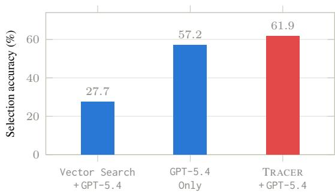
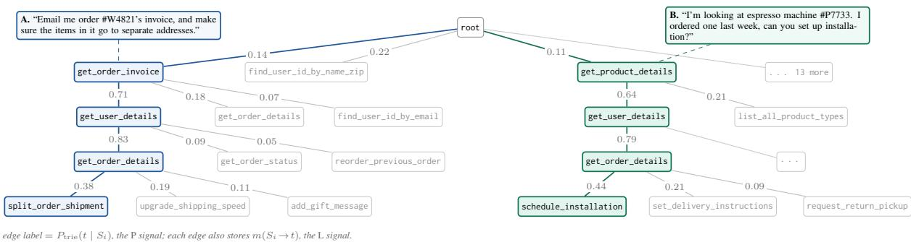
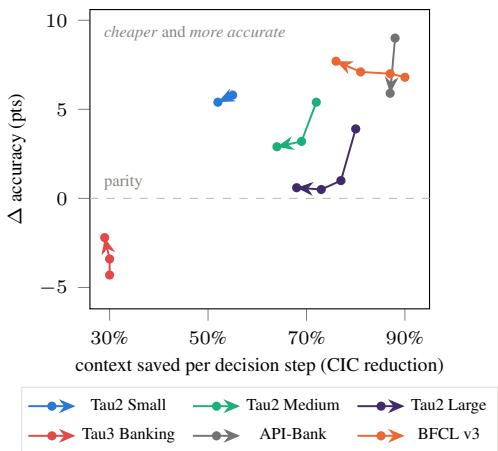
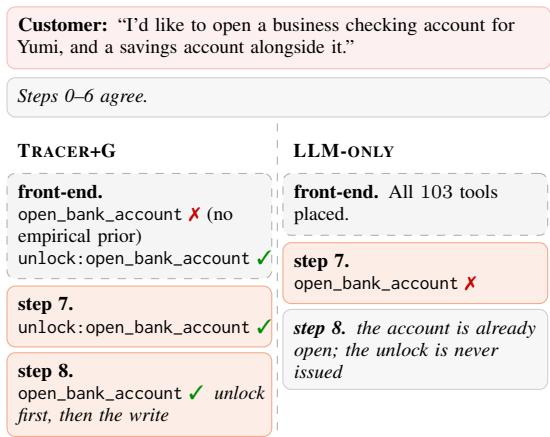
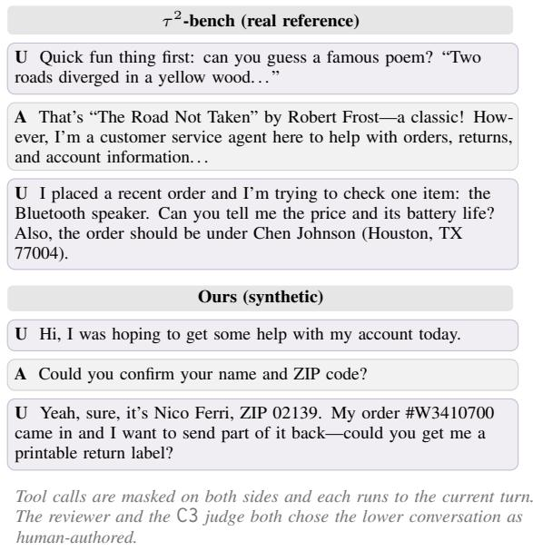
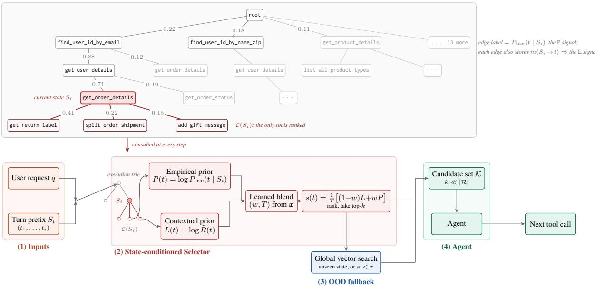
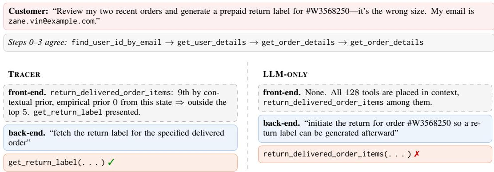

# TRACER: Trajectory-Aware Tool Retrieval for LLM Agents

Tanish Kher\* Sarvesh DK Abedelkadir Asi Sparsha Chennarayapatna Sundaresh Dezhi Hong Microsoft

## Abstract

Modern agents select tools from registries, but exposing entire registries incurs high token costs and can impair selection as they grow. We present TRACER, a retrieval front-end that indexes observed tool-call sequences in a trie and ranks continuations using a learned blend of empirical and contextual priors. On a mixed retail-and-telecom τ2 environment, TRACER improves GPT-5.4’s tool-selection accuracy by 4.7 points while reducing input tokens per step by 80%, exposing just 5 of 128 tools. In autonomous full-turn execution, it matches GPT-5.4’s full-registry task success with 61% fewer input tokens per step. Across six environments and four models, TRACER improves toolselection accuracy over full-registry selection in 21 of 24 model-environment pairs, with average gains of 6 to 10 points; the three exceptions trail by at most 2.2. We analyze failures in both regimes to identify directions for future work.

## 1 Introduction

Modern language-model agents use tool calling to resolve user requests (Schick et al., 2023; Yao et al., 2023), often executing multi-turn sequences of function calls over registries of internal services and external APIs (Barres et al., 2025). Systems such as Claude Cowork (Anthropic, 2026), Copilot Cowork (Microsoft, 2026), and Codex (OpenAI, 2025) illustrate the growing use of tool-mediated interaction in agentic workflows (Xu et al., 2026). A central challenge is selecting and invoking the right tool from a potentially large registry. Exposing many tool schemas simultaneously increases context and token costs, while long, detailed inputs can make relevant information harder to use reliably (Sakizli, 2026; Liu et al., 2024a). To manage this overhead, recent approaches retrieve or load tools on demand (Fei et al., 2025; Anthropic, 2025), often using tool descriptions to identify candidates. However, description-based retrieval can confuse semantically similar tools, and retrieval errors can propagate to downstream execution. As registries grow, tool selection and schema management therefore remain important sources of inefficiency and unreliability despite progress in tool retrieval and tool-use training (Liu et al., 2026; Gillespie and Perry, 2026; Qin et al., 2024; Patil et al., 2024; Gan and Sun, 2025).

  
Figure 1: Selection accuracy at a fixed budget of retrieving top-k(= 5) tools (mixed τ2 Large, 128 tools, GPT-5.4).

The core gap is that each step is treated as independent search, when tool retrieval is really sequential prediction: which call comes next, given those already made. Within a single turn, a $\tau ^ { 2 }$ retail request is resolved in a logical order: identify the customer, pull their account, open the order in question, then act on it. The calls already made therefore constrain the next one.

Built on this intuition, we propose TRACER (Trie Retrieval Across Contextual Edges, Reweighted), a state-conditioned front-end that offers a small, accurate candidate set at every step and still leaves the final choice to the model (Figure 6, Appendix A.8). It rests on three ideas. Full-prefix conditioning: execution history is a trie over observed tool-call sequences, the agent’s prefix within a turn is a node, and the tools seen after it are its candidates, so earlier calls separate next steps that the last call alone leaves equally plausible. Transition-specific usage memory: each edge stores the conversations that transition was taken in, telling apart candidates whose descriptions do not. State-dependent weighting: history and semantics are not equally informative, so a learned per-step blend sets how much each should count at any step. Where a registry’s calls concentrate in generic utility tools that no single state predicts, TRACER+G unions a small global set into every candidate set.

On a mixed τ2 environment spanning retail and telecom domains, TRACER paired with GPT-5.4 outperforms the standalone frontier GPT-5.4 model by 4.7 points in tool-selection accuracy, 57.2% to 61.9%, all while cutting prompt tokens per step by 80% (Figure 1). Running a full turn on its own selections, TRACER matches full-registry task success, 58.3% against 58.2%, despite presenting only 23% of the tools at any time and cutting per-step tokens by 61%. Similar results largely hold across five other environments, four models, and budgets k from 3 to 30 (§5).

Contributions.

• A comprehensive state-conditioned retrieval front-end. We combine full-prefix conditioning, transition-specific usage memory and a learned per-state blend in a single index.

• A benchmark environment built for retrieval. We pool retail with telecom and add synthetic APIs and trajectories to reach 128 deliberately confusable tools with per-step ground truth; a blind human study judged ours more humanlike than the $\tau ^ { 2 }$ originals.

• Evidence across six environments, four models, and both regimes. TRACER improves selection accuracy over full-registry selection in 21 of 24 model-environment pairs while cutting per-step context by 55–90%, and matches task success at 61% fewer prompt tokens per step, the dominant term in serving cost.

• Demonstrated gains in specificity and call ordering. TRACER sharpens the model’s use of specific tools by surfacing similar past trajectories, removing competitor tools it would otherwise have picked and improving adherence to required procedures.

## 2 Related Work

Matching requests to fixed tool representations. Retrievers over large registries rank tools by similarity to the request (Qin et al., 2024; Patil et al., 2024; Gan and Sun, 2025; Liu et al., 2026; Repantis et al., 2026). Description matchers differ only in how that match is trained (Zheng et al., 2024; Molfetta et al., 2025; Sengupta et al., 2026); Tool2Vec (Moon et al., 2024) matches past requests rather than documentation; and MCP-Zero (Fei et al., 2025) has the model write its own query, better aligned to tool descriptions than the user’s words. Each improves the query; all still score it against a representation fixed in advance. Fixed once, it cannot separate several plausible candidates, and it cannot register that one tool serves different purposes at different points. Past usage at that point does both.

Relating tools to one another. TGR (Gao et al., 2025) smooths each tool’s embedding toward the tools it depends on, so prerequisites are retrieved alongside what needs them; ProTIP (Anantha et al., 2023) retrieves progressively, subtracting the embeddings of tools already chosen so the query carries what remains. While these take real steps, they ignore what makes tool-calling dynamic: every choice must be read against the calls and turns that came before it. TGR pools dependency over all prefixes, fixing once a relationship that holds only sometimes, and ProTIP’s subtraction keeps no record of the order the previous calls came in.

Conditioning on execution. ToolNet (Liu et al., 2024b) offers the successors of the last call, weighted by bigram counts; AutoTool (Jia and Li, 2026) widens that to two and blends the count with SimCSE similarity at a constant α=0.5, using the result to bypass the model. Neither asks how the current conversation resembles the ones that previously took each transition: ToolNet has no such signal, and AutoTool’s compares against a tool’s description (21 points worse on API-Bank in our ablation). Both also fix the blend once. TRACER improves this by learning the balance of factors per state instead, worth 0.9 to 7.6 points (Table 6; Table 1 compares all methods).

## 3 Method

## 3.1 Problem definition and notation

An agent answers a request q by emitting an ordered sequence of tool calls; at step i it has emitted

Table 1: Positioning TRACER against prior tool-retrieval methods. Marks run absent, partial, fullest form.
<table><tr><td></td><td colspan="2">Evidence from past runs</td><td></td><td></td><td></td></tr><tr><td>Method</td><td>transition counts</td><td>situation match compared against</td><td>Retrieval state index key</td><td>Signals used count, weighting</td><td>LLM decides</td></tr><tr><td>ToolRerank (Zheng et al., 2024)</td><td>o</td><td>o tool docs</td><td>o none</td><td>o1</td><td></td></tr><tr><td>PORTS (Molfetta et al., 2025)</td><td>o</td><td>o tool docs</td><td>o none</td><td>o1</td><td></td></tr><tr><td>ToolDreamer (Sengupta et al., 2026)</td><td>o</td><td>o generated docs</td><td>onone</td><td>o1</td><td></td></tr><tr><td>Tool2Vec (Moon et al., 2024)</td><td>o</td><td>o one user query, per tool</td><td>o none</td><td>o1</td><td></td></tr><tr><td>MCP-Zero (Fei et al., 2025)</td><td>o</td><td>o server + tool docs</td><td>o none</td><td>o2, fixed</td><td></td></tr><tr><td>TGR (Gao et al., 2025)</td><td>o</td><td>o tool docs + deps</td><td>o none</td><td>o1</td><td></td></tr><tr><td>ProTIP (Anantha et al., 2023)</td><td>o</td><td>o tool docs</td><td>oimplicit plan</td><td>o1</td><td></td></tr><tr><td>ToolNet (Liu et al., 2024b)</td><td></td><td>o tool docs, first step</td><td>olast tool</td><td>o1 per step</td><td></td></tr><tr><td>AutoTool (Jia and Li, 2026)</td><td></td><td>o tool docs (SimCSE)</td><td>• last 2 tools</td><td>o2, fixed α</td><td>opartial</td></tr><tr><td>TRACER</td><td></td><td>• whole conversation so far, • full turn prefix per transition</td><td></td><td>• 2, learned per state</td><td>è</td></tr></table>

$S _ { i } = ( t _ { 1 } , \ldots , t _ { i } )$ and must choose the next call from a registry R. We ask: given the calls already issued in the current turn, how can we use historical successful trajectories to select $k \ll | \mathcal { R } |$ tools that contain the gold tool the agent should call next, cutting per-step token cost while improving selection accuracy?

## 3.2 Overview

We model this with a trie built from a dataset D of training trajectories (Figure 6, Appendix A.8). At each step the front-end reads the conversation context ctx $\left( q , S _ { i } \right)$ and the current prefix $S _ { i } ,$ locates $S _ { i }$ in the trie (§3.3), and scores that node’s children on two signals: an empirical prior over the transitions observed out of $S _ { i } ~ ( \ S 3 . 4 )$ , and a contextual prior measuring how closely the current conversation resembles the ones in which each transition was historically taken (§3.5). A learned per-step blend (§3.6) combines them into one score, and the top k form the candidate set $\kappa \subset \mathcal { R }$ from which the model makes its choice. Every system we compare changes which tools reach the prompt, but the model always chooses.

## 3.3 Trie construction

We build the execution trie by inserting every prefix of every trajectory in D as a node. Figure 2 shows a hypothetical example. For any prefix node $S _ { i } ,$ its children $\mathscr { C } ( S _ { i } )$ are the tools observed immediately after $S _ { i }$ in training.

Each edge from $S _ { i }$ to a child node t carries two kinds of information: the conditional probability of a training turn traversing $S _ { i } \to t$ , the empirical prior (§3.4); and the mean-pooled embedding of the training contexts in which turns traversed $S _ { i } \to$ $t ,$ an edge memory $m ( S _ { i }  t )$ from which the contextual prior is computed (§3.5).

The two are scoped differently by design. The trie is turn-local, resetting to the root at each turn boundary, which keeps prefixes estimable instead of fragmenting the state space across a whole conversation; we train on turns drawn from throughout a conversation so the model sees resets at varied positions. The edge memory is not turn-local: it embeds the full conversation, so cross-turn information reaches the retriever without entering the trie as structure.

## 3.4 The empirical prior $P ( t )$

Formally, the empirical prior is the normalized transition frequency out of that node, and at inference we write P(t) = log $( P _ { \mathrm { t r i e } } ( t \mid S _ { i } ) + \epsilon )$ for the resulting log-signal, adding a small smoothing constant ϵ so that candidates carrying no observed transition from this state have a finite value.

The distribution of empirical priors starts more evenly across tools and sharpens with depth, with some states admitting a single observed successor (Figure 6, Appendix A.8). The prior therefore steers the model down the paths training took most often and filters out tools that never followed $S _ { i }$ The fallback (§3.7) deals with out-of-distribution steps, ensuring the system generalizes to unseen trajectories.

## 3.5 The contextual prior L(t)

At every step we embed the step context under a shared, frozen embedder e: all previous turns and step reasonings, with tool-call signatures dropped to limit input length. For every child we then take the cosine similarity between that embedding and the edge’s memory,

$$
R ( t ) \ = \ \cos \bigl ( e ( \arctan ( q , S _ { i } ) ) , m ( S _ { i } {  } t ) \bigr ) ,\tag{1}
$$

  
Figure 2: TRACER’s execution trie (schematic example).

then rectify and normalize across the children into a distribution over them (uniform if every similarity is non-positive):

$$
{ \widehat { R } } ( t ) = { \frac { \operatorname { R e L U } \left( R ( t ) \right) } { \sum _ { t ^ { \prime } \in { \mathcal { C } } ( S _ { i } ) } \operatorname { R e L U } \left( R ( t ^ { \prime } ) \right) } } ,\tag{2}
$$

where $\mathrm { R e L U } ( x ) = \operatorname* { m a x } ( x , 0 )$ , and set $L ( t ) \ =$ log $\widehat { R } ( t )$

## 3.6 Blending them: the learned scoring rule

TRACER scores each child of the current state by a learned, per-step convex blend of the two logsignals, at a learned temperature:

$$
s ( t ) = \frac { 1 } { T } \Big [ ( 1 - w ) L ( t ) + w P ( t ) \Big ]\tag{3}
$$

for every $t \in \mathcal { C } ( S _ { i } )$ , where $L ( t )$ is the contextual prior of candidate $t , P ( t )$ its empirical prior, the blend weight $w \in ( 0 , 1 )$ , and $1 / T > 0$ . Children are ranked by $s ( t )$ and the top k are presented.

Both w and T are produced per step by a learned map $f _ { \pmb \theta } ( \pmb x ) = ( w , T )$ over a five-dimensional state feature vector $\textbf { \em x } \in \ \mathbb { R } ^ { 5 }$ computed at each step (§A.9). We represent $f _ { \theta }$ as two linear heads over the standardized feature vector z: a logistic head for w, keeping the blend convex, and a floored softplus head for T, keeping the temperature positive and 1/T finite (Algorithm 1, Appendix A.8).

We fit $\pmb { \theta } \ = \ ( a , b _ { w } , \pmb { c } , b _ { T } )$ by minimizing the mean negative log-likelihood of the gold next call under the softmax over $\mathscr { C } ( S _ { i } )$ , with Adam (Kingma and Ba, 2015) and $\ell _ { 2 }$ regularization, splitting the trajectories into inner folds so each step is scored against a trie and edge memory built without its own trajectory (Eq. (4), §A.8).

## 3.7 Confidence gate and out-of-distribution fallback

The retriever falls back to global vector search in two cases: an unseen state $( \mathcal { C } ( S _ { i } ) = \emptyset )$ and a flat score distribution $( \kappa < \tau )$ . Fallback ranks the full registry by the cosine similarity of the embedded step context $e ( \operatorname { c t x } ( q , S _ { i } ) )$ to each tool’s description and returns the top k, replacing the trie candidates entirely. We set $\tau = 0 . 2 0$ This gate gives the trie-based methods well-defined behavior on states absent from training, behavior the full-registry and stateless baselines do not model.

## 4 Data and Experimental Setup

## 4.1 Benchmarks

We evaluate on four benchmarks, sweeping the primary one at three registry sizes (Small, Medium, Large) for six environments in total (Table 7). Our primary benchmark, Mixed Tau2 R&T, is a mixed retail + telecom environment built combining real graded trajectories from $\tau ^ { 2 } .$ -bench (Barres et al., 2025) with vetted synthetic ones. Tau3 Banking is the banking domain of $\tau ^ { 3 } .$ -Knowledge (Shi et al., 2026), mixing more sophisticated banking tools with compliance requirements and search over roughly 700 interconnected documents. BFCL v3 (Patil et al., 2025) is smaller but spans many weakly-related API families (file-system, vehicle, trading, travel), stressing cross-domain retrieval. API-Bank (Li et al., 2023) is the smallest and most homogeneous, serving as an easy reference point.

We state each change where it arises; Table 11 in Appendix A.7 summarizes them. All four satisfy a premise the trie depends on: every tool is available at every step, so an edge count reflects what the agent chose rather than what it was offered.

## 4.2 Data sourcing

For the τ benchmarks we draw real trajectories from the public leaderboards (Sierra, 2026; Shi et al., 2026), keep only simulations that solved the task and only turns issuing an agent tool call, and collapse each task to one canonical decision point; Mixed Tau2 R&T adds synthetic trajectories (§4.3). API-Bank and BFCL v3 are taken whole; for BFCL v3 we verify that merging raises no new alternate answers (C10, Appendix A.3). Trajectory provenance is in Appendix $_ { \mathrm { A . 2 ; } }$ the curation gates are in Appendix A.3.

## 4.3 Synthetic generation and validation for Mixed Tau2 R&T

Real trajectories alone under-populate the registry, leaving too few plausible alternatives and making retrieval look artificially easy. We expand each domain’s registry with synthetic APIs and trajectories drawn from a co-occurrence graph, so that each is a realistic in-context path. Every one clears blocking gates for ground-truth validity, nonsubstitutability against real tools, API disjointness, and non-cloning (99.8% of retail and 99.9% of telecom clear the last), with accept-sets seeded where a different real tool may legitimately substitute for the gold call (Table 10, Appendix A.3).

The diagnostic C3 judge compared real $\tau ^ { 2 }$ trajectories against our synthetic ones and picked ours as the human-authored one in 57.0% of retail and 68.9% of telecom pairs. A blind human study agreed: told that exactly one of each pair was human-authored, three reviewers picked ours in 40 of 59 decided pairs, 67.8% of the time (Figure 5, Appendix A.5).

Our $\tau ^ { 2 } .$ -style policy prompts are validated the same way, so that no clause contradicts any gold trajectory (C6, Appendix A.4).

## 4.4 Execution regimes

We evaluate in two execution regimes, differing only in what is appended to the context between steps.

Teacher-forcing records each selection but feeds the benchmark’s gold call forward in its place, so a wrong selection at step i cannot corrupt step i+1. This is our primary regime because it measures the front-end in isolation, which is what this paper contributes.

Underfree-running, the agent’s own emitted call and its reasoning are appended and carried forward, so errors compound: a wrong selection changes the prefix the retriever conditions on. An inference episode ends when our grader confirms the task is complete, or after a cap of 20 steps. Our grader scores a turn by the database hash its gold actions produce, plus the read operations a read-only turn must contain (Appendix A.15).

## 4.5 Algorithms

We test TRACER against two baselines that ignore execution history and two variants of our own. LLM-ONLY places the entire registry in context at every step, as a post-disclosure domain list, upper-bounding candidate coverage at maximal cost. VECTOR ranks the full registry by the cosine similarity of the embedded step context to each tool’s description and returns the top $k ,$ the same mechanism the confidence gate falls back to (§3.7).

TRACER-fixed is an ablation: it fixes the blend instead of predicting it, scoring $s ( t ) = L ( t ) + P ( t )$ and is identical to TRACER in every other respect, so the gap between them isolates the value of the learned blend. TRACER+G is a configuration for registries whose calls concentrate in contextindependent utility tools that no state prior surfaces; it unions a small, fixed, per-fold global set G into every candidate set after ranking, $\kappa =$ TOPK $( s , k ) \cup G .$ . G holds the $| G | = 3$ tools with the highest prefix entropy $H ( S \mid t )$ , the entropy over the states from which t is the gold next call, so it collects the tools whose calls spread most widely across the trie (§A.8).

## 4.6 Models, metrics, and protocol

Models and metrics. We evaluate four models spanning capability and vendor: GPT-5.4, GPT-5.4- mini, Grok-4-20-reasoning, and Mistral-Large-3, with text-embedding-3-small as the frozen embedder throughout. Under teacher-forcing we report tool-selection accuracy and context-injection cost (CIC, the mean prompt tokens injected per decision step); under free-running, task success rate with CIC. For the few steps with more than one gold tool we accept alternates (C10, §4.3).

Protocol. We teacher-force on every benchmark under five-fold cross-validation, sweeping the budget $k \in \{ 5 , 1 0 , 2 0 , 3 0 \}$ for Mixed Tau2 R&T and $k ~ \in ~ \{ 3 , 5 , 1 0 \}$ for Tau3 Banking, and free-run on the Mixed Tau2 sizes for GPT-5.4 and GPT-5.4-mini. Cells averaged over three iterations are marked ‡ in §5; others are single runs.

## 5 Results and Discussion

Our headline claim is that state-conditioned retrieval matches or exceeds the full-registry baseline (LLM-ONLY) while presenting a small fraction of the registry.

Table 2: Teacher-Forcing tool-selection accuracy (%) at k=5 and k=10.
<table><tr><td></td><td></td><td colspan="2">Mixed Tau2 Small</td><td colspan="2">Mixed Tau2 Medium</td><td colspan="2">Mixed Tau2  $\mathrm { L a r g e ^ { \frac { + } { + } } }$ </td><td colspan="2">Tau3 Banking</td><td>API- Bank†</td><td colspan="2">BFCL v3</td></tr><tr><td>Model</td><td>Alg.</td><td>5</td><td>10</td><td>5</td><td>10</td><td>5</td><td>10</td><td>5</td><td>10</td><td>5</td><td>5</td><td>10</td></tr><tr><td rowspan="5">GPT-5.4</td><td>LLM-ONLY</td><td>63.8 (3.1)</td><td>64.1 (3.3)</td><td>60.2 (3.5)</td><td>60.1 (3.4)</td><td>57.2 (1.2)</td><td>57.3 (1.1)</td><td>55.0 (2.4)</td><td>54.8 (1.6)</td><td>82.4 (6.8)</td><td>61.6 (2.8)</td><td>61.1 (2.8)</td></tr><tr><td>TRACER</td><td>69.4 (1.5)</td><td>69.3 (1.7)</td><td>66.1 (2.9)</td><td>63.7 (2.6)</td><td>61.9 (1.6)</td><td>59.0 (1.7)</td><td>45.7 (4.2)</td><td>46.8 (4.2)</td><td>88.3 (7.5)</td><td>68.4 (3.7)</td><td>68.1 (3.6)</td></tr><tr><td>TRACER+G</td><td>62.4 (1.5)</td><td>62.9 (2.3)</td><td>61.9 (3.3)</td><td>60.4 (3.4)</td><td>59.9 (1.7)</td><td>58.0 (1.8)</td><td>51.6 (3.2)</td><td>52.6 (3.4)</td><td>90.7 (6.2)</td><td>65.4 (3.5)</td><td>65.6 (3.8)</td></tr><tr><td>TRACER-fixed</td><td>62.2 (1.3)</td><td>66.3 (1.8)</td><td>60.3 (2.4)</td><td>61.9 (2.8)</td><td>50.5 (1.1)</td><td>51.0 (2.2)</td><td>43.6 (4.4)</td><td>45.9 (4.4)</td><td>91.4 (4.5)</td><td>63.1 (2.3)</td><td>64.2 (3.4)</td></tr><tr><td>VECTOR</td><td>26.5 (2.3)</td><td>38.6 (2.2)</td><td>26.1 (1.1)</td><td>34.0 (1.7)</td><td>27.7 (1.5)</td><td>34.4 (1.5)</td><td>9.5 (3.0)</td><td>12.5 (2.7)</td><td>72.7 (5.1)</td><td>56.4 (2.2)</td><td>59.0 (2.9)</td></tr><tr><td rowspan="5">GPT-5.4-mini</td><td>LLM-ONLY</td><td>57.6 (3.1)</td><td>57.2 (3.2)</td><td>55.8 (3.1)</td><td>55.3 (3.4)</td><td>54.5 (1.7)</td><td>54.7 (1.7)</td><td>49.3 (3.6)</td><td>49.4 (3.8)</td><td>81.1 (10.9)</td><td>62.3 (2.6)</td><td>62.9 (1.7)</td></tr><tr><td>TRACER</td><td>67.5 (1.4)</td><td>66.3 (2.3)</td><td>62.6 (2.7)</td><td>60.4 (2.6)</td><td>58.5 (1.8)</td><td>55.6 (1.8)</td><td>44.6 (4.0)</td><td>45.2 (3.7)</td><td>98.4 (2.0)</td><td>70.2 (2.8)</td><td>70.0 (2.9)</td></tr><tr><td>TRACER+G</td><td>59.6 (2.0)</td><td>59.9 (2.9)</td><td>58.8 (3.0)</td><td>56.6 (3.0)</td><td>56.5 (1.5)</td><td>54.4 (1.9)</td><td>53.4 (4.7)</td><td>52.4 (4.3)</td><td>99.2 (1.6)</td><td>66.5 (2.2)</td><td>67.1 (1.5)</td></tr><tr><td>TRACER-fixed</td><td>60.5 (2.3)</td><td>63.4 (1.4)</td><td>56.9 (2.7)</td><td>57.4 (3.2)</td><td>48.0 (3.4)</td><td>49.7 (3.3)</td><td>42.8 (4.0)</td><td>44.3 (4.2)</td><td>97.6 (1.9)</td><td>63.7 (2.9)</td><td>66.5 (4.0)</td></tr><tr><td>VECTOR</td><td>25.3 (2.7)</td><td>36.0 (2.6)</td><td>26.4 (1.4)</td><td>32.9 (2.5)</td><td>28.4 (1.8)</td><td>33.5 (1.7)</td><td>9.0 (2.8)</td><td>11.1 (2.6)</td><td>76.2 (4.7)</td><td>56.0 (2.6)</td><td>60.1 (3.7)</td></tr><tr><td rowspan="5">Grok-4-20-r</td><td>LLM-ONLY</td><td>62.6 (3.6)</td><td>62.4 (3.5)</td><td>60.5 (4.1)</td><td>60.6 (4.0)</td><td>59.8 (1.5)</td><td>60.2 (1.2)</td><td>58.6 (2.5)</td><td>58.7 (2.6)</td><td>86.4 (3.4)</td><td>60.5 (2.9)</td><td>59.8 (2.5)</td></tr><tr><td>TRACER</td><td>70.4 (2.0)</td><td>70.8 (1.9)</td><td>66.2 (3.4)</td><td>65.1 (2.8)</td><td>59.5 (3.8)</td><td>58.3 (3.8)</td><td>42.4 (4.3)</td><td>42.7 (4.1)</td><td>98.4 (2.0)</td><td>71.8 (3.1)</td><td>72.4 (3.9)</td></tr><tr><td>TRACER+G</td><td>65.7 (2.4)</td><td>66.1 (2.4)</td><td>63.9 (3.7)</td><td>62.8 (3.0)</td><td>58.3 (4.0)</td><td>57.7 (3.6)</td><td>56.5 (4.6)</td><td>55.7 (4.2)</td><td>98.5 (1.9)</td><td>70.4 (4.3)</td><td>71.3 (4.5)</td></tr><tr><td>TRACER-fixed</td><td>62.6 (1.5)</td><td>65.5 (1.0)</td><td>59.4 (2.5)</td><td>61.3 (2.9)</td><td>48.4 (2.7)</td><td>52.3 (3.2)</td><td>40.4 (4.1)</td><td>42.1 (3.7)</td><td>97.6 (1.9)</td><td>66.8 (4.1)</td><td>65.3 (4.2)</td></tr><tr><td>VECTOR</td><td>25.5 (1.1)</td><td>35.8 (1.3)</td><td>26.6 (0.9)</td><td>34.3 (1.4)</td><td>27.4 (2.6)</td><td>32.8 (2.3)</td><td>8.9 (1.8)</td><td>10.9 (2.6)</td><td>76.4 (1.7)</td><td>60.3 (3.4)</td><td>59.1 (3.1)</td></tr><tr><td rowspan="5">Mistral-Large-3</td><td></td><td></td><td></td><td>62.6 (3.0)</td><td></td><td></td><td></td><td></td><td>47.6 (2.2)</td><td>67.2 (7.5)</td><td>62.5 (3.5)</td><td></td></tr><tr><td>LLM-ONLY</td><td>66.1 (2.2) 71.6 (1.4)</td><td>65.6 (2.2)</td><td></td><td>62.8 (2.6)</td><td>61.2 (2.0)</td><td>61.2 (2.0)</td><td>48.0 (2.3)</td><td></td><td>95.3 (2.9)</td><td>70.1 (3.9)</td><td>62.6 (3.8)</td></tr><tr><td>TRACER TRACER+G</td><td>65.5 (1.9)</td><td>71.5 (1.7) 67.0 (2.0)</td><td>68.3 (2.5) 64.4 (3.3)</td><td>65.5 (2.3) 63.5 (3.3)</td><td>64.5 (2.2) 62.3 (2.1)</td><td>62.2 (2.4) 60.5 (2.4)</td><td>43.4 (3.9) 51.0 (4.0)</td><td>44.3 (3.9) 51.6 (4.3)</td><td>96.1 (3.5)</td><td>67.5 (4.8)</td><td>68.6 (3.4)</td></tr><tr><td>TRACER-fixed</td><td>64.2 (1.4)</td><td>67.2 (1.7)</td><td>60.2 (2.6)</td><td>61.9 (2.8)</td><td>53.6 (1.1)</td><td>54.6 (2.0)</td><td>41.6 (4.6)</td><td>43.2 (4.1)</td><td>93.8 (3.8)</td><td>64.1 (2.4)</td><td>68.3 (5.0) 62.8 (3.5)</td></tr><tr><td>VECTOR</td><td>26.5 (2.3)</td><td>39.2 (2.4)</td><td>26.6 (1.3)</td><td>34.1 (1.7)</td><td>27.3 (1.7)</td><td>32.5 (1.7)</td><td>8.7 (2.3)</td><td>10.2 (2.7)</td><td>69.6 (10.1)</td><td>56.9 (1.9)</td><td>57.3 (2.9)</td></tr></table>

Best per column within each model in bold, second best underlined. Parentheses give the across-fold SD over the five evaluation folds. Full budget sweep in Tables 18–19.

## 5.1 Selection accuracy (Teacher-Forcing)

Table 2 reports selection accuracy at k=5 and k=10; the full sweep is Tables 18–19 in Appendix A.17.

TRACER improves tool-selection accuracy while showing the model a small subset of the registry. On our primary testbed, Mixed Tau2 R&T (Large), it beats the full registry for three of the four models while selecting 5 of 128 tools, by 4.7 points for GPT-5.4; Grok-4 trails by 0.3, but this figure is well inside that cell’s 3.8-point fold SD. The margin generally widens for every model as the registry shrinks. TRACER’s gains exceed one SD in 31 of the 34 cells where it wins; the clearest exception is GPT-5.4 on API-Bank, whose 131 steps make the smallest folds. TRACER’s stability is also similar to LLM-ONLY’s: their fold SDs differ by a median of 0.8 points and TRACER is tighter in 21 of 44 cells.

Tau3 Banking is where the full registry beats every trie variant for GPT-5.4 and Grok-4, with TRACER+G closest at 3.4 and 2.1 points, though TRACER+G recovers the benchmark outright for the other two models.

## 5.2 Context-injection cost

We report context-injection cost (CIC), the mean prompt tokens per decision step, for every benchmark, algorithm and budget in Tables 20–21, Appendix A.17.

TRACER buys those accuracy gains at a fraction of the context. On our primary testbed, Mixed Tau2 R&T (Large), it injects 2.8k prompt tokens per decision step against 14.2k for the full registry, an 80% reduction. As the Mixed Tau2 pool grows, full-registry cost nearly doubles while TRACER’s falls, so the saving grows from 55% to 80%. Across benchmarks the reduction runs from 31% on Tau3 Banking, whose long conversation histories dominate the prompt for every front-end, to 90% on BFCL v3. Figure 3 shows the trade-off directly.

  
Figure 3: The accuracy–cost trade-off (GPT-5.4; TRACER vs. LLM-ONLY, TRACER+G on Tau3 Banking). One path per benchmark, one point per budget k up to 25% of the registry; arrows point toward larger k.

Table 3: Free-running at the best budget per setting.
<table><tr><td>Registry Model</td><td>Cand. set</td><td>(pts)</td><td>Margin Fold CIC SD red.</td></tr><tr><td rowspan="2">GPT-5.4 Small GPT-5.4-mini</td><td>43%</td><td>+2.3</td><td>4.5 38%</td></tr><tr><td>22%</td><td>+2.2</td><td>5.1 42%</td></tr><tr><td rowspan="2">GPT-5.4 Medium</td><td>33%</td><td>+1.2</td><td>2.3 50%</td></tr><tr><td>GPT-5.4-mini 33%</td><td>+4.4</td><td>3.3 50%</td></tr><tr><td rowspan="2">GPT-5.4 Large</td><td>23%</td><td>+0.1</td><td>2.3 61%</td></tr><tr><td>GPT-5.4-mini 16%</td><td>+15.2</td><td>2.7 68%</td></tr></table>

Mixed Tau2 R&T at three registry sizes; full table in Table 22.

## 5.3 End-to-end task success (free-running)

The compounding-error nature of free-running makes recall matter more than in teacher-forcing, so TRACER overtakes LLM-ONLY at a larger candidate set (Table 22, Appendix A.17). The share of the registry it needs, however, falls as the registry grows. On GPT-5.4 it reaches parity: +0.1 points on Large (at 23% of the registry), +1.2 on Medium (33%), and +2.3 on Small (43%). On GPT-5.4-mini it gains +13.7 to +15.2 points on Large across the whole sweep, from 3.9% of the registry upward.

Those are the best budgets per setting, and the rest of the sweep is less kind. Of the 24 modelregistry-budget cells we can compare, 16 sit within 3 points of LLM-ONLY either way (median 2.2). GPT-5.4 is below LLM-ONLY at 8 of its 12 budgets, reaching parity only at the largest.

In these specific situations, selection accuracy gains do not translate because a single early miss moves the turn onto a prefix the trie has never seen, and the front-end falls back to vector search, which shows up as a far higher out-of-trie rate (Table 16, Appendix A.14). The tools most exposed are prefixindependent lookups, where TRACER already trails the full registry under teacher forcing since no prefix predicts them. We return to this in the Conclusion (§6).

For space, and because hyperparameter tuning finds the budget with the largest task-success margin, we report those gains in Table 3.

## 5.4 Why the gains happen

TRACER raises selection accuracy for two reasons at once: it surfaces the gold tool reliably, and the smaller, more relevant set it hands over improves the executor model’s own accuracy on the tools that remain.

Table 4: The specificity trap (Mixed Tau2 R&T Large; GPT-5.4, k=5; strict exact-match).
<table><tr><td>Specific API</td><td>N LLM-ONLY TRACER</td><td></td></tr><tr><td>split_order_shipment</td><td>54 14% 79</td><td>51%</td></tr><tr><td>add_gift_message</td><td>32%</td><td>77%</td></tr><tr><td>request_return_pickup</td><td>16%</td><td>38%</td></tr><tr><td>schedule_installation</td><td>29%</td><td>58%</td></tr><tr><td>57 file_shipping_insurance_claim 79</td><td>49%</td><td>69%</td></tr><tr><td>Trap rate (lower is better)</td><td>36.4%</td><td>16.4%</td></tr></table>

Trap rate = the share of steps whose gold call is one of the five on which the model instead predicted the generic hub get\_order\_details.

  
Figure 4: The trie keeps the unlock before the write (Tau3 Banking, GPT-5.4, k=10).

Correct Usage of Precision Tools. Registries accumulate narrow tools beside a broad one that covers part of the same request, and picking the narrow one is the whole task. Retail shows this most sharply. Descriptions alone underdetermine the choice among the five order-management APIs in Table 4, so LLM-ONLY falls back on the generic hub get\_order\_details, which on its face covers some of what is asked, on 36.4% of the steps where one of the five is correct. TRACER cuts the trap rate to 16.4% by separating APIs on the turns they were called in: at this prefix, the hub was asked for something else.

This filtering matters when the competitor is not merely confusing but dangerous. For instance, when a customer asked for a prepaid return label, LLM-ONLY incorrectly tried to initiate a return (return\_delivered\_order\_items), while TRACER ranked that tool 9th on the contextual prior at that prefix, dropping the destructive tool from even being given to the model, so it correctly chose the precision tool get\_return\_label (Appendix A.12).

Table 5: The global tool set (GPT-5.4, k=10).
<table><tr><td>Benchmark</td><td>APIs for 50% of calls top-5 entropy</td><td>also in</td><td>∆ accuracy (pts) TRACER+G – TRACER</td></tr><tr><td>Mixed Tau2 R&amp;T</td><td>5</td><td>0</td><td>-1.0</td></tr><tr><td>Tau3 Banking</td><td>2</td><td>2</td><td>+5.8</td></tr><tr><td>BFCL v3</td><td>17</td><td>3</td><td>-2.5</td></tr></table>

Following Procedural Controls. Many deployments gate a consequential action behind a prerequisite call, and the ordering is itself the requirement. In banking, a sensitive tool must be unlocked by unlock:X before it can be called, and under the full registry LLM-ONLY skips that step when asked to open an account. The trie withholds the raw write: no successful trajectory reaches open\_bank\_account from Si without passing through unlock:open\_bank\_account. The edge memory supplies the other half, matching the conversation to the unlock (Figure 4).

## 5.5 When the global set is needed

Adding a global set to TRACER (TRACER+G) helps when some tools not bound to any prefix take a large share of tool calls. This explains TRACER’s low performance on Tau3 Banking, whose registry mostly uses generic tools that cover many subtasks under one umbrella (KB\_search for any knowledgebase lookup, grep for any text match), so they appear throughout the trie. TRACER+G recovers 5.8 points there, landing between 3.0 below and 4.0 above LLM-ONLY depending on the model (Table 2). On the τ2 mixes and BFCL v3, where usage is less concentrated or utility tools do not dominate, the injected tools add distractors rather than recall, and TRACER outperforms TRACER+G.

## 5.6 Ablations

(A) Edge embeddings vs. description-only prior. We compare a description-only variant (Trie-Bayesian) that uses static tool-description similarity under the same trie and the same fixed blend. In API-Bank (GPT-5.4-mini), this variant scored 21 points lower than TRACER-fixed. The contextual prior moves us from below the LLM-ONLY baseline (81.1) to well above it.

(B) Learned vs. constant weights (primary). Comparing TRACER-fixed against TRACER directly tests the paper’s core mechanism: that stateconditioned blending beats a globally-tuned constant. The learned blend helps most in diverse trie maps like Mixed Tau2 R&T and BFCL v3 that lean on the contextual prior over the empirical prior, and makes little difference in Tau3 Banking where few generic tools dominate. The head settles on the contextual prior, averaging $w { = } 0 . 0 1 9$ on Mixed Tau2 R&T (Large), though its coefficients raise w early in the conversation and where the empirical prior is already confident (Tables 13–14).

Table 6: Ablation (B): learned vs. constant blend (k=10).
<table><tr><td rowspan="2">Model</td><td colspan="3">∆ accuracy (pts) TRACER — TRACER-fixed</td></tr><tr><td>Mixed Tau2 R&amp;T</td><td>Tau3 Banking</td><td>BFCL v3</td></tr><tr><td>GPT-5.4</td><td>+8.0</td><td>+0.9</td><td>+3.9</td></tr><tr><td> $\mathrm { G P T } { - } 5 . 4 { \cdot } \mathrm { m i n i }$ </td><td>+5.9</td><td>+0.9</td><td>+3.5</td></tr><tr><td> $\mathbf { G r o k } { - } 4 { - } 2 0 { - } \mathbf { r }$ </td><td>+6.0</td><td>+0.6</td><td>+7.1</td></tr><tr><td> $\mathbf { M i s t r a l - L a r g e } { - 3 }$ </td><td> $+ 7 . 6$ </td><td>+1.1</td><td>+5.8</td></tr></table>

(C) Trie key depth. We truncated the trie’s keys to just the last two calls and ran TRACER on this last-2 trie, which raised selection accuracy by 1.5 to 2.9 points on Grok-4-20-reasoning and Mixed Tau2 R&T (Large) compared to the full currentturn prefix (Appendix A.11). While this is within one SD (3.7 to 4.3), it points to key depth as a parameter worth testing in future work. The shorter key leaves 9.6% of steps out of trie against 12.4% for the full prefix, and the two are indistinguishable on the steps that do fall out. TRACER still adds the learned weighting and contextual embeddings that no bigram front-end has (§2).

## 6 Conclusion and Future Work

TRACER is the first tool-retrieval front-end to make selection history-aware and dynamic at every prefix: it keys on the full execution prefix, ranks candidates against the conversations each transition was taken in, and learns how best to weight the two signals for the situation. It beats full-registry selection in 21 of 24 model-environment pairs while cutting per-step tokens by 80% on our primary testbed, at a cost that tracks the budget rather than the registry.

The budget k already moves with domain and model (Table 3), and the global set recovers most of the Tau3 Banking gap; both are fixed here and should adapt. TRACER gained 15.2 points for GPT-5.4-mini and matched GPT-5.4’s full-registry task success at 23% of the registry, but did not carry gains at most of GPT-5.4’s budgets, largely because running on its own prefix roughly triples the share of steps that fall outside the trie. Future work should present the full registry on out-of-trie steps alone, which would make coverage exact and lift selection accuracy there by 38 points on average while retaining 84% of the token reduction (Table 16), likely translating to higher task success.

## Limitations

Cold start. TRACER indexes a dataset D of graded trajectories (§3.3), so a registry with no usage history has no trie to consult and every step falls to the vector fallback, where accuracy is far below the rest of the run: presenting the full registry on those steps instead would raise it by 38 points on average (Table 16). The method therefore assumes a deployment that has already logged successful runs. How quickly a trie becomes useful as trajectories accumulate is the obvious next measurement, and one our fixed-size corpora cannot answer.

Trie key depth. We key the trie on the full current-turn prefix (§3.3) and did not tune that choice. A shorter key is not obviously worse (§5.6), so the depth we use may not be the best one.

Free-running episodes are terminated by the grader. An episode ends when the grader confirms completion or at a cap of 20 steps (§4.4); the agent never judges for itself that it is done. Task success therefore measures whether the front-end supplies the tools needed to reach the goal, not whether an agent built on it would know when to stop.

Selection accuracy discards ordering freedom. Several tools can often be called in different orders and still complete a task, but accuracy is scored against one recorded ordering, so a valid alternative counts as wrong. Accept-sets (§4.6) and freerunning task success, which asks only whether the goal was reached, bound the distortion.

## References

Raviteja Anantha, Bortik Bandyopadhyay, Anirudh Kashi, Sayantan Mahinder, Andrew W. Hill, and Srinivas Chappidi. ProTIP: Progressive tool retrieval improves planning. arXiv preprint arXiv:2312.10332, 2023. doi: 10.48550/arXiv.2312. 10332.

Anthropic. Introducing advanced tool use on the Claude developer platform. https://www.anthropic. com/engineering/advanced-tool-use, 2025. Tool Search Tool defers tool definitions and surfaces them on demand.

Anthropic. Claude cowork. https://claude.com/ product/cowork, 2026. Agentic assistant that plans and executes multi-step desktop and knowledge work; research preview January 2026, generally available April 2026.

Victor Barres, Honghua Dong, Soham Ray, Xujie Si, and Karthik Narasimhan. τ2-bench: Evaluating conversational agents in a dual-control environment. arXiv preprint arXiv:2506.07982, 2025. doi: 10.48550/arXiv.2506.07982. Code: https: //github.com/sierra-research/tau2-bench.

Xiang Fei, Xiawu Zheng, and Hao Feng. MCP-Zero: Active tool discovery for autonomous LLM agents. arXiv preprint arXiv:2506.01056, 2025. doi: 10. 48550/arXiv.2506.01056.

Tiantian Gan and Qiyao Sun. RAG-MCP: Mitigating prompt bloat in LLM tool selection via retrieval-augmented generation. arXiv preprint arXiv:2505.03275, 2025. doi: 10.48550/arXiv.2505. 03275.

Linfeng Gao, Yaoxiang Wang, Minlong Peng, Jialong Tang, Yuzhe Shang, Mingming Sun, and Jinsong Su. Tool graph retriever: Exploring dependency graphbased tool retrieval for large language models. arXiv preprint arXiv:2508.05152, 2025. doi: 10.48550/ arXiv.2508.05152.

Kellen Gillespie and Robyn Perry. Scaling enterprise agent routing: Degradation, diagnosis, and recovery. arXiv preprint arXiv:2606.17519, 2026. doi: 10. 48550/arXiv.2606.17519.

Jingyi Jia and Qinbin Li. AutoTool: Efficient tool selection for large language model agents. Proceedings of the AAAI Conference on Artificial Intelligence, 40 (37):31265–31273, 2026. doi: 10.1609/aaai.v40i37. 40389.

Diederik P. Kingma and Jimmy Ba. Adam: A method for stochastic optimization. In Proceedings ofthe 3rd International Conference on Learning Representations (ICLR), 2015. doi: 10.48550/arXiv.1412.6980. arXiv:1412.6980.

Minghao Li, Yingxiu Zhao, Bowen Yu, Feifan Song, Hangyu Li, Haiyang Yu, Zhoujun Li, Fei Huang, and Yongbin Li. API-Bank: A comprehensive benchmark for tool-augmented LLMs. In Proceedings of the 2023 Conference on Empirical Methods in Natural Language Processing (EMNLP), pages 3102–3116, 2023. doi: 10.18653/v1/2023.emnlp-main.187. arXiv:2304.08244. Code: https://github.com/ AlibabaResearch/DAMO-ConvAI/tree/main/ api-bank.

Marianne Menglin Liu, Daniel Garcia, Fjona Parllaku, Vikas Upadhyay, Syed Fahad Allam Shah, and Dan Roth. ToolScope: Enhancing LLM agent tool use through tool merging and context-aware filtering. In Proceedings of the 64th Annual Meeting of the Association for Computational Linguistics (Volume 1: Long Papers), pages 34095–34119, San Diego, California, United States, July 2026. Association for Computational Linguistics. doi: 10.18653/v1/2026.acl-long. 1573.

Nelson F. Liu, Kevin Lin, John Hewitt, Ashwin Paranjape, Michele Bevilacqua, Fabio Petroni, and Percy Liang. Lost in the middle: How language models use long contexts. Transactions of the Association for Computational Linguistics, 12:157–173, 2024a. doi: 10.1162/tacl\_a\_00638. arXiv:2307.03172.

Xukun Liu, Zhiyuan Peng, Xiaoyuan Yi, Xing Xie, Lirong Xiang, Yuchen Liu, and Dongkuan Xu. ToolNet: Connecting large language models with massive tools via tool graph. arXiv preprint arXiv:2403.00839, 2024b. doi: 10.48550/arXiv. 2403.00839.

Microsoft. Copilot cowork. https://www.microsoft. com/en-us/microsoft-365/blog/2026/06/16/ copilot-cowork-is-now-generally-available/, 2026. Agentic Microsoft 365 system that executes tasks end to end across integrated business applications; generally available June 2026.

Lorenzo Molfetta, Giacomo Frisoni, Nicolò Monaldini, and Gianluca Moro. PORTS: Preference-optimized retrievers for tool selection with large language models. In Proceedings of the 2025 Conference on Empirical Methods in Natural Language Processing (EMNLP), 2025. doi: 10.18653/v1/2025. emnlp-main.507. arXiv:2607.05441.

Suhong Moon, Siddharth Jha, Lutfi Eren Erdogan, Sehoon Kim, Woosang Lim, Kurt Keutzer, and Amir Gholami. Efficient and scalable estimation of tool representations in vector space. arXiv preprint arXiv:2409.02141, 2024. doi: 10.48550/arXiv.2409. 02141.

OpenAI. OpenAI codex. https://openai. com/index/introducing-codex/, 2025. Cloud software-engineering agent that runs tasks in parallel sandboxed environments.

Shishir G. Patil, Tianjun Zhang, Xin Wang, and Joseph E. Gonzalez. Gorilla: Large language model connected with massive APIs. In Advances in Neural Information Processing Systems (NeurIPS), 2024. doi: 10.52202/079017-4020. arXiv:2305.15334.

Shishir G. Patil, Huanzhi Mao, Fanjia Yan, Charlie Cheng-Jie Ji, Vishnu Suresh, Ion Stoica, and Joseph E. Gonzalez. The berkeley function calling leaderboard (BFCL): From tool use to agentic evaluation of large language models. In Proceedings of the 42nd International Conference on Machine Learning (ICML), volume 267 of Proceedings of Machine Learning Research, pages 48371–48392. PMLR, 2025. URL https://proceedings.mlr. press/v267/patil25a.html. Code: https: //github.com/ShishirPatil/gorilla/tree/ main/berkeley-function-call-leaderboard.

Yujia Qin, Shihao Liang, Yining Ye, et al. Tool-LLM: Facilitating large language models to master 16000+ real-world APIs. In International Conference on Learning Representations (ICLR), 2024. URL https://openreview.net/forum?id= dHng2O0Jjr. arXiv:2307.16789.

Vyzantinos Repantis, Ameya Gawde, Harshvardhan Singh, and Joey Blackwell II. How many tools

should an LLM agent see? a chance-corrected answer. arXiv preprint arXiv:2605.24660, 2026. doi: 10.48550/arXiv.2605.24660.

Furkan Sakizli. Tool-schema compression enables agentic RAG under constrained context budgets. arXiv preprint arXiv:2605.26165, 2026. doi: 10.48550/ arXiv.2605.26165.

Timo Schick, Jane Dwivedi-Yu, Roberto Dessì, Roberta Raileanu, Maria Lomeli, Luke Zettlemoyer, Nicola Cancedda, and Thomas Scialom. Toolformer: Language models can teach themselves to use tools. In Advances in Neural Information Processing Systems (NeurIPS), 2023. doi: 10.52202/075280-2997. arXiv:2302.04761.

Saptarshi Sengupta, Zhengyu Zhou, Jun Araki, Xingbo Wang, Bingqing Wang, Suhang Wang, and Zhe Feng. ToolDreamer: Instilling LLM reasoning into tool retrievers. In Proceedings of EACL 2026, 2026. doi: 10.18653/v1/2026.eacl-long.254. arXiv:2510.19791.

Quan Shi, Alexandra Zytek, Pedram Razavi, Karthik Narasimhan, and Victor Barres. τ-knowledge: Evaluating conversational agents over unstructured knowledge. arXiv preprint arXiv:2603.04370, 2026. doi: 10.48550/arXiv.2603.04370. Distributed as τ3-Knowledge (also τ3-bench); the banking domain is τ-Banking. Code: https://github.com/ sierra-research/tau2-bench.

Sierra. τ-bench leaderboard. https://taubench.com, 2026. Public leaderboard hosting graded τ2- and τ3- bench submissions with their full agent trajectories; accessed August 2026.

Haoyuan Xu, Chang Li, Xinyan Ma, Xianhao Ou, Zihan Zhang, Tao He, Xiangyu Liu, Zixiang Wang, Jiafeng Liang, Zheng Chu, Runxuan Liu, Rongchuan Mu, Dandan Tu, Ming Liu, and Bing Qin. The evolution of tool use in LLM agents: From singletool call to multi-tool orchestration. arXiv preprint arXiv:2603.22862, 2026. doi: 10.48550/arXiv.2603. 22862.

Shunyu Yao, Jeffrey Zhao, Dian Yu, Nan Du, Izhak Shafran, Karthik Narasimhan, and Yuan Cao. ReAct: Synergizing reasoning and acting in language models. In International Conference on Learning Representations (ICLR), 2023. URL https://openreview. net/forum?id=WE\_vluYUL-X. arXiv:2210.03629.

Yuanhang Zheng, Peng Li, Wei Liu, Yang Liu, Jian Luan, and Bin Wang. ToolRerank: Adaptive and hierarchy-aware reranking for tool retrieval. In Proceedings of LREC-COLING 2024, 2024. URL https://aclanthology.org/2024. lrec-main.1413/. arXiv:2403.06551.

## A Appendix

## A.1 Benchmark statistics

Table 7: Benchmark statistics.
<table><tr><td></td><td colspan="3">Mixed Tau2 R&amp;T</td><td>Tau3 Banking</td><td>BFCL v3</td><td>API-Bank</td></tr><tr><td></td><td>Small</td><td>Medium</td><td>Large</td><td></td><td></td><td></td></tr><tr><td>Domains</td><td>2</td><td>2</td><td>2</td><td>1</td><td>4</td><td>1</td></tr><tr><td>Tasks (trajectories)</td><td>311</td><td>725</td><td>1,554</td><td>69</td><td>200</td><td>50</td></tr><tr><td>Turns (decision points)</td><td>1,011</td><td>1,520</td><td>2,791</td><td>497</td><td>731</td><td>50</td></tr><tr><td>Steps (tool calls)</td><td>3,037</td><td>4,266</td><td>7,128</td><td>2,758</td><td>1,142</td><td>131</td></tr><tr><td>Turns per task (mean ± sd)</td><td>3.25±2.30</td><td>2.10±1.96</td><td> $1 . 8 0 \pm 1 . 5 3$ </td><td> $7 . 2 0 \pm 3 . 6 6$ </td><td> $3 . 6 6 \pm 1 . 2 6$ </td><td> $1 . 0 0 \pm 0 . 0 0$ </td></tr><tr><td>Steps per task  $( \mathrm { m e a n } \pm \mathrm { s d } )$ </td><td> $9 . 7 7 \pm 5 . 5 7$ </td><td> $5 . 8 8 \pm 5 . 2 6$ </td><td> $4 . 5 9 \pm 4 . 1 4$ </td><td> $3 9 . 9 7 \pm 1 9 . 9 0$ </td><td> $5 . 7 1 \pm 1 . 9 4$ </td><td> $2 . 6 2 \pm 1 . 0 2$ </td></tr><tr><td>Registry size |R|</td><td>46</td><td>91</td><td>128</td><td>103</td><td>128</td><td>21</td></tr><tr><td>Distinct tools used</td><td>46</td><td>91</td><td>128</td><td>81</td><td>81</td><td>21</td></tr><tr><td>APIs for 50% / 80% of calls</td><td>4/13</td><td>5/18</td><td>5/27</td><td>2/13</td><td>17/38</td><td>8/16</td></tr><tr><td>Tool-usage entropy H (bits)</td><td>4.12</td><td>4.69</td><td>5.14</td><td>3.78</td><td>5.82</td><td>4.28</td></tr><tr><td>normalized  $H / \log _ { 2 } N _ { \mathrm { u s e d } }$ </td><td>0.75</td><td>0.72</td><td>0.73</td><td>0.60</td><td>0.92</td><td>0.97</td></tr><tr><td>Retail : telecom (turns, real + synthetic)</td><td>727:284</td><td>1,000:520</td><td>1,935:856</td><td></td><td></td><td></td></tr></table>

## A.2 Trajectory provenance

Per-model turn breakdown for the retail and telecom domains (§4.2), together with the share of each model’s steps that carry a teacher-forced reasoning trace. Retail turns are real $\tau ^ { 2 }$ trajectories; telecom turns are synthetic derivations (§4.3), credited to the model whose scraped submission seeded them.

Table 8: Real $\tau ^ { 2 }$ retail turn provenance.
<table><tr><td>Source model  $( \tau ^ { 2 }$  leaderboard) Turns Steps Reason. (%)</td></tr><tr><td>Qwen3.5-397B-A17B 143 420 12.9</td></tr><tr><td>Claude Sonnet 4.5 142 307 50.2</td></tr><tr><td>GLM-5 142 389 67.6</td></tr><tr><td>Claude Opus 4.5 142 376 63.8</td></tr><tr><td>GPT-5.2 39 65 0.0</td></tr><tr><td>Gemini 3 Pro 18 34 0.0</td></tr><tr><td>Gemini 3 Flash 10 20 0.0</td></tr><tr><td>Total 636 1611 44.1</td></tr></table>

Table 9: Telecom turn provenance. “Authored” are turns written in-house.
<table><tr><td>Attributed model</td><td>Turns</td><td>Steps</td><td>Reason. (%)</td></tr><tr><td>Gemini 3 Flash</td><td>166</td><td>485</td><td>0.0</td></tr><tr><td>GPT-5.2</td><td>76</td><td>290</td><td>0.0</td></tr><tr><td>Gemini 3 Pro</td><td>31</td><td>98</td><td>0.0</td></tr><tr><td>GLM-5</td><td>25</td><td>150</td><td>50.0</td></tr><tr><td>Qwen3.5-397B-A17B</td><td>15</td><td>81</td><td>33.3</td></tr><tr><td>Claude Opus 4.5</td><td>11</td><td>42</td><td>90.5</td></tr><tr><td>Claude Sonnet 4.5</td><td>1</td><td>6</td><td>83.3</td></tr><tr><td>Authored (in-house)</td><td>531</td><td>788</td><td>15.5</td></tr><tr><td>Total</td><td>856</td><td>1940</td><td>13.8</td></tr></table>

## A.3 Curation battery prompts

Each gate is a topic-agnostic rubric scored by an LLM judge (§4.3): Mixed Tau2 R&T was screened with the full battery (C1–C7 and C10, all blocking except the diagnostic C3 and the policy-level C6; per-gate rates in Table 10), while BFCL v3 was screened with C10 alone, a 3-sample majority vote over all 731 turns against the merged 128-tool registry that found 702 (96.0%) with a unique gold tool and no combining-induced substitutes. The C3 prompt itself is reproduced in §A.4.

Table 10: Curation battery.
<table><tr><td>Gate</td><td>What it checks</td><td>Retail</td><td>Telecom</td></tr><tr><td>C1</td><td>ground-truth validity</td><td>1197/1299</td><td>647/718</td></tr><tr><td>C2</td><td>non-substitutability</td><td>1254/1299</td><td>327/381</td></tr><tr><td>C3</td><td>blind human-likeness</td><td>740/1299</td><td>495/718</td></tr><tr><td>C4</td><td>API disjointness</td><td>50/50</td><td>100/100</td></tr><tr><td>C5</td><td>non-cloning</td><td>1297/1299</td><td>717/718</td></tr><tr><td>C7</td><td>reverse non-substitutability</td><td>632/636</td><td>245/325</td></tr><tr><td>C10</td><td>real-vs-real substitutability</td><td>633/636</td><td>296/325</td></tr></table>

## A.4 Reproduced prompts

The two prompts reproduced verbatim here are the C3 judge prompt, the diagnostic that compared real $\tau ^ { 2 }$ trajectories against our synthetic ones (§4.3), and the retail policy document. The regular-split protocol replaced the single $\tau ^ { 2 } .$ -retail policy prompt with two broadened per-domain documents, retail and telecom, routed by domain at inference, so that no clause contradicts any gold trajectory, real or synthetic (§4.3). For space we reproduce only the retail document below, and only in excerpt: the authentication, escalation, and order-operation clauses, with the remainder elided at [...]. The telecom document is its counterpart, broadened the same way for the telecom registry.

## Blind real-vs-synthetic judge prompt (C3).

# C3 -- Real vs. synthetic (paired indistinguishability)   
## SYSTEM PROMPT   
---Role---   
You are shown two conversations between a person and an assistant. One was written by a   
human; one was written by a model. Decide which is the model-written (synthetic) one, or   
that you cannot reliably tell. Judge ONLY the human-language wording.   
DO:   
- Judge only the dialogue's language: word choice, tone, rhythm, and how naturally the   
person and the assistant phrase things.   
- Weigh natural human signals: hedging, self-corrections, brevity, small talk, the way   
real people under- or over-explain.   
- If both read as equally natural language, answer "cannot\_tell".   
DON'T:   
- Don't judge the scenario or topic. The two conversations may be about different things   
and need not line up in topic, order, or structure; any task is in scope.   
- Don't judge by the number of requests, or whether they relate to each other.   
- Don't use the masked tool labels (tool\_a, tool\_b, ...), their count, or the hidden call   
arguments/outputs -- the same redaction is applied to both sides and is not a clue.   
- Don't judge by conversation length or number of turns.   
- Don't reward messiness or penalize clean writing on its own, and don't try to recall or   
match specific datasets or examples.   
Reason first, then output only the JSON schema below, nothing else.   
---Output schema---   
{   
"experiment": "C3",   
"reasoning": "<which conversation's LANGUAGE reads as less natural, and why>",   
"guess": "A" | "B" | "cannot\_tell",   
"confidence": "low" | "medium" | "high"   
}   
## USER PROMPT   
---Conversation A---   
{{CONV\_A}}   
---Conversation B---   
{{CONV\_B}}   
Analyze, then output the JSON.

## Broadened retail policy (excerpt).

# Retail agent policy   
[...]   
You should authenticate the user identity before providing account-, order-, or   
profile-specific information or taking any action on the user's account. You can   
locate the user or their order by any identifier the user provides, such as their   
email, their name together with their zip code, a phone number, a username, a user id,   
or an order id. When the user provides a user id, username, or order id directly, you   
may use it to look up the account or order without a separate identification step   
first. (General product or catalog lookups that are not tied to a specific account may   
be handled without prior authentication.)   
[...]

You should transfer the user to a human agent if and only if the request cannot be   
handled within the scope of your actions. To transfer, first make a tool call to   
transfer\_to\_human\_agents, and then send the message 'YOU ARE BEING TRANSFERRED TO A   
HUMAN AGENT. PLEASE HOLD ON.' to the user.   
[...]   
## Generic action rules   
You do not need to look up or re-verify an order's status before choosing a   
tool; select the operation that matches the user's request, even when the order is at   
an intermediate status or no status has been retrieved yet.   
When exchanging or modifying items, be sure that all items to be changed are collected   
into a list before making the tool call. A given exchange or item-modification action   
is generally applied once per order.   
## Cancel pending order   
The cancel-pending-order action is the tool for cancelling an order that is still   
pending (before it ships). Cancelling a delivered order, or cancelling an individual   
item, are separate operations with their own dedicated tools and are not limited to   
pending orders.   
The user needs to confirm the order id and the reason for cancellation (commonly   
'no longer needed' or 'ordered by mistake').   
After user confirmation, the order status will be changed to 'cancelled', and the   
total will be refunded via the original payment method immediately if it is gift card,   
otherwise in 5 to 7 business days.   
## Modify pending order   
The modify-pending-order actions are the tools for changing an order that is still   
open -- typically a pending order, including one already altered by an earlier change   
(for example a status such as 'pending (item modified)', 'address\_updated', or   
'items\_modified').   
For a pending order, the modify-pending-order actions cover its shipping address,   
payment method, or product item options. A pending order can also be the subject of   
other order, fulfillment, and post-purchase services (for example a shipping upgrade,   
delivery scheduling, a split shipment, item-level cancellation, or applying a gift   
card or discount) through the appropriate dedicated tool.   
### Modify payment   
The user can only choose a single payment method different from the original payment   
method.   
If the user wants the modify the payment method to gift card, it must have enough   
balance to cover the total amount.   
After user confirmation, the order status will be kept as 'pending'. The original   
payment method will be refunded immediately if it is a gift card, otherwise it will be   
refunded within 5 to 7 business days.   
### Modify items   
This action changes the order status to 'pending (item modified)' and finalizes the   
item modifications. So you must confirm all the details are correct and be cautious   
before taking this action. In particular, remember to remind the customer to confirm   
they have provided all the items they want to modify.   
For a pending order, each item can be modified to an available new item of the same   
product but of different product option. There cannot be any change of product types,   
e.g. modify shirt to shoe.   
The user must provide a payment method to pay or receive refund of the price   
difference. If the user provides a gift card, it must have enough balance to cover the

price difference.   
## Return delivered order   
The return-delivered-order action is the tool for returning items from an order that   
has been delivered. Returning items on a pending order is a separate operation with   
its own dedicated tool.   
The user needs to confirm the order id and the list of items to be returned.   
The user needs to provide a payment method to receive the refund.   
The refund must either go to the original payment method, or an existing gift card.   
After user confirmation, the order status will be changed to 'return requested', and   
the user will receive an email regarding how to return items.   
## Exchange delivered order   
The exchange-delivered-order action is the tool for exchanging items from a delivered   
order. In particular, remember to remind the customer to confirm they have provided   
all items to be exchanged.   
For a delivered order, an item may be exchanged for an available new item -- commonly   
the same product with a different product option, and in some cases a different   
product.   
The user must provide a payment method to pay or receive refund of the price   
difference. If the user provides a gift card, it must have enough balance to cover the   
price difference.   
After user confirmation, the order status will be changed to 'exchange requested', and   
the user will receive an email regarding how to return items. There is no need to place   
a new order.

## A.5 Example synthetic trajectories

The blind indistinguishability gate (C3, Table 10) places a synthetic trajectory next to the genuine $\tau ^ { 2 } \mathrm { . }$ bench conversation it was judged against. Figure 5 is one pair from the blind human study (§4.3); A is the assistant and U the user.

  
Figure 5: A synthetic trajectory humans read as real.

Our synthetic user turns are short, colloquial, and carry one clear intent (“Yeah, sure, it’s Nico Ferri. . . could you get me a printable return label”); the genuine $\tau ^ { 2 } .$ bench side more often reads as generated, with meta assistant boilerplate and long, enumerated requests. That difference in register, not domain content, is what the battery preserves, and why neither human nor model reviewers reliably recover the $\tau ^ { 2 } .$ -bench conversation.

## A.6 Human study protocol

The three reviewers of §4.3 were given the C3 judge’s criteria (§A.4) through a review portal, which asked which conversation was humanauthored and took a confidence rating; pairs answered “not sure” are the undecided ones excluded from the 59. They were colleagues at our institution, unpaid, uninvolved in the project, not reporting to any author, and free to decline. They were not told beforehand that this was a research study, since disclosure could bias the judgment; all three were debriefed afterward and consented to our use of their judgments. We collected no demographics, and the protocol was not submitted to an ethics review board: no personal data was collected and the task was to rate fictional dialogue.

The execution trie, built from training trajectorie

  
Figure 6: Full TRACER architecture.

## A.7 Benchmark adaptations

## Table 11: Our setting against the published benchmarks.

<table><tr><td>Aspect</td><td>Where</td><td>Original → ours</td></tr><tr><td>Registry</td><td>Mixed Tau2 R&amp;T domains separate →</td><td>pooled, three sizes</td></tr><tr><td>Tools</td><td></td><td>Mixed Tau2 R&amp;T real only → plus validated synthetic</td></tr><tr><td>Backends BFCL v3</td><td></td><td>four, separate → merged, alternates checked</td></tr><tr><td>Policy</td><td>all</td><td>absent or  $\tau ^ { 2 } \to \tau ^ { 2 } { \mathrm { - s t y l e } } ,$  ours</td></tr><tr><td>Grading</td><td>all</td><td>per task → per turn</td></tr></table>

## A.8 Method details

Weight model and training. The softplus floor is $\varepsilon { = } 1 0 ^ { - 3 }$ . Parameters $( a , b _ { w } , c , b _ { T } )$ are fit with Adam (learning rate 0.05, 500 epochs, $\beta _ { 1 } \mathrm { { = } } 0 . 9$ $\beta _ { 2 } { = } 0 . 9 9 9 , \epsilon _ { \mathrm { A d a m } } { = } 1 0 ^ { - 8 } )$ , an $\ell _ { 2 }$ penalty of $1 0 ^ { - 3 }$ on the slope vectors ${ \mathbf { } } a , c$ only (biases unregularized), and seed 0. With t⋆ the gold child of a training step, $j$ the trajectory that step came from, and B the set of such steps drawn from D, the objective is

$$
\begin{array} { r l } & { \mathcal { L } ( \pmb { \theta } ) = - \displaystyle \frac { 1 } { | \mathcal { B } | } \sum _ { ( q , S _ { i } , t ^ { \star } , j ) \in \mathcal { B } } \log P _ { \pmb { \theta } } ^ { \backslash j } \big ( t ^ { \star } \mid q , S _ { i } \big ) , } \\ & { ~ P _ { \pmb { \theta } } ^ { \backslash j } = \mathrm { s o f t m a x } _ { t \in \mathcal { C } ^ { \backslash j } ( S _ { i } ) } ~ s ^ { \backslash j } ( t ) . } \end{array}\tag{4}
$$

where the superscript \j marks a quantity computed against a trie and edge memory built without trajectory $j ,$ over five cross-fit folds.

Algorithm 1 One TRACER retrieval step at state $S _ { i }$   
for request q.   
Require: trie with edge counts; edge memory   
m; blend heads $( a , b _ { w } , c , b _ { T } )$ and standardizer   
$( \mu , \sigma )$ ; embedder e; gate τ ; budget k; optional   
global set G   
1: C ← CHILDREN(Si)   
2: if $\boldsymbol { \mathcal { C } } = \boldsymbol { \mathcal { O } }$ then   
3: K ← GLOBALVECTORSEARCH $( q , k )$   
4: else   
5: $P ( t )  \log ( P _ { \mathrm { t r i e } } ( t \mid S _ { i } ) + \epsilon )$   
6: R(t) ← cose(ctx(q, Si)), m(Si → t)   
7: L(t) ← log Rb(t)   
8: $z \gets ( { \pmb x } ( q , S _ { i } ) - { \pmb \mu } ) / \sigma$   
9: $\boldsymbol { w } \gets \sigma ( \boldsymbol { a } ^ { \top } \boldsymbol { z } + b _ { w } )$   
10: T ← softplus $( c ^ { \top } z + b _ { T } ) + \varepsilon$   
11: $\begin{array} { r } { s ( t ) \gets \frac { 1 } { T } \big [ ( 1 - w ) L ( t ) + w P ( t ) \big ] } \end{array}$   
12: p ← softmaxt∈C s(t); κ ← maxt p(t)   
13: if $\kappa < \tau$ then   
14: K ← GLOBALVECTORSEARCH(q, k)   
15: else   
16: K ← TOPK(s, k)   
17: end if   
18: end if   
19: if extension enabled then   
20: ${ \mathcal { K } }  { \mathcal { K } } \cup G$   
21: end if   
22: return K

Since $1 / T$ is a common positive factor in Eq. (3), the ranking depends only on w; $T$ sets the sharpness of softmaxt $s ( t )$ , whose maximum κ is the retrieval confidence read by the gate (§3.7).

Selecting the global set. The prefix entropy of §4.5, in bits, is

$$
H ( S \mid t ) = - \sum _ { S \in S ( t ) } \pi ( S \mid t ) \log _ { 2 } \pi ( S \mid t ) ,
$$

where $S ( t ) = \{ S : t \in { \mathcal { C } } ( S ) \}$ and $ \pi ( S \mid t ) =$ $\# ( S \to t ) / \sum _ { S ^ { \prime } \in S ( t ) } \# ( S ^ { \prime } \to t )$ . Ties are broken by tool name.

## A.9 Feature selection and weight-head ablations

The five-feature weight head of §3.6: which signals it uses, why those five, and what is lost by giving the head more capacity.

Feature pool and selection. The head uses five interpretable signals drawn from a fourteen-feature pool of prior statistics (n\_children, prior\_entropy, prior\_top1, prior\_margin, log\_node\_count, depth), likelihood statistics (R\_top1, R\_margin, R\_mean, R\_std, top\_edge\_support), and context statistics (n\_prior\_turns, n\_prior\_calls, query\_len). The five span all three groups while avoiding the strong within-group collinearity of the pool (e.g. prior\_top1 vs. prior\_margin). Writing $\bar { p _ { ( 1 ) } } \geq p _ { ( 2 ) }$ for the two largest $P _ { \mathrm { t r i e } } ( \cdot \mid S _ { i } ) , \# ( S _ { i } \to \stackrel { \cdot } { t } )$ for the number of training turns that took t from $S _ { i }$ , and tˆ = arg maxt R(t), they are

x1 = prior\_margin = p(1) − p(2),   
x2 = top\_edge\_support = log max1, #(Si →tˆ),   
x3 = R\_top1 = maxt∈C(Si) R(t),   
x4 = query\_len = words in the user request,   
x5 = n\_prior\_turns = number of prior turns,

covering prior confidence $( x _ { 1 } ) ,$ edge-memory evidence $( x _ { 2 } , x _ { 3 } )$ , and context scale $( x _ { 4 } , x _ { 5 } )$ . Each is standardized with the mean and standard deviation of the training folds only, frozen at inference.

Weight-head capacity ablation. Under an identical split grouped by task, a PCA-5 linear head and a tanh MLP (16 hidden units, learning rate 0.01, 1500 epochs) stay within 0.3 points of the handpicked linear head, which itself beats a constant $w { = } 0 . 5$ by 18 points (Table 12).

Table 12: Weight-head capacity. Mixed Tau2 R&T, five-fold GROUPKFOLD, 1,576 steps.
<table><tr><td>Weight head</td><td>Recall@5 (%)</td></tr><tr><td>Constant w=0.5 (baseline)</td><td>80.3</td></tr><tr><td>Hand-picked linear (5 features)</td><td>98.4</td></tr><tr><td>PCA-5 linear (of 14)</td><td>98.6</td></tr><tr><td>tanh MLP, hidden 16</td><td>98.5</td></tr></table>

## A.10 What the head learns

Table 13 reports the mean and across-fold SD of the per-step weight the head predicts in each environment. w weights the empirical prior in Eq. (3), so small w means the contextual prior carries the ranking. Free-running was not run on Tau3 Banking or API-Bank (n/a).

Table 13: Learned blend weight w by environment.
<table><tr><td>Environment</td><td>Teacher-forcing</td><td>Free-running</td></tr><tr><td>Mixed Tau2 R&amp;T (Small)</td><td> $0 . 0 1 4 \pm 0 . 0 0 4$ </td><td> $0 . 0 1 2 \pm 0 . 0 0 2$ </td></tr><tr><td>Mixed Tau2 R&amp;T (Medium)</td><td> $0 . 0 1 4 \pm 0 . 0 0 3$ </td><td> $0 . 0 1 5 \pm 0 . 0 0 0$ </td></tr><tr><td>Mixed Tau2 R&amp;T (Large)</td><td> $0 . 0 1 9 \pm 0 . 0 0 2$ </td><td> $0 . 0 2 2 \pm 0 . 0 0 1$ </td></tr><tr><td>Tau3 Banking</td><td> $0 . 1 6 7 \pm 0 . 0 3 7$ </td><td>n/a</td></tr><tr><td>API-Bank</td><td> $0 . 2 5 5 \pm 0 . 0 8 6$ </td><td>n/a</td></tr><tr><td>BFCL v3</td><td> $0 . 0 2 4 \pm 0 . 0 1 5$ </td><td> $0 . 0 2 4 \pm 0 . 0 1 5$ </td></tr></table>

Table 14 reports the fold mean and SD of each coefficient of the logistic head that predicts $w ,$ at the three registry sizes. Features are standardised, so the coefficients are comparable within a row. TRACER and TRACER+G share a scorer, and their fits coincide to within 0.006 on every feature.

Table 14: Learned w coefficients, Mixed Tau2 R&T.
<table><tr><td>Reg.</td><td>Alg.</td><td></td><td>prior_margin top_edge_support</td><td>R_top1</td><td>query_len</td><td> $\mathsf { n \_ p r i o r \_ t u r n s }$ </td><td> $b _ { w }$ </td></tr><tr><td>Small</td><td>TRACER</td><td> $0 . 5 4 4 \pm 0 . 1 3 1$ </td><td> $- 0 . 2 2 5 \pm 0 . 1 1 0$ </td><td> $- 0 . 2 9 8 \pm 0 . 1 2 7$ </td><td> $0 . 1 8 1 \pm 0 . 0 4 4$ </td><td> $- 0 . 5 6 2 \pm 0 . 1 6 6$ </td><td> $- 4 . 3 3 7 \pm 0 . 3 3 6$ </td></tr><tr><td>Medium</td><td>TRACER</td><td> $0 . 1 2 0 \pm 0 . 1 6 5$ </td><td> $- 0 . 4 1 7 \pm 0 . 0 1 0$ </td><td> $- 0 . 2 1 6 \pm 0 . 0 9 9$ </td><td> $0 . 1 2 4 \pm 0 . 0 3 5$ </td><td> $- 0 . 6 7 5 \pm 0 . 1 6 2$ </td><td> $- 4 . 2 8 4 \pm 0 . 2 2 5$ </td></tr><tr><td>Large</td><td>TRACER</td><td> $0 . 0 5 1 \pm 0 . 0 7 0$ </td><td> $- 0 . 3 6 4 \pm 0 . 1 1 3$ </td><td> $- 0 . 1 3 9 \pm 0 . 0 3 6$ </td><td> $0 . 1 1 8 \pm 0 . 0 2 9$ </td><td> $- 0 . 5 1 1 \pm 0 . 0 8 3$ </td><td> $- 3 . 9 4 0 \pm 0 . 1 1 3$ </td></tr><tr><td>Small</td><td>TRACER+G</td><td> $0 . 5 4 3 \pm 0 . 1 3 2$ </td><td> $- 0 . 2 2 5 \pm 0 . 1 1 0$ </td><td> $- 0 . 2 9 8 \pm 0 . 1 2 8$ </td><td> $0 . 1 8 1 \pm 0 . 0 4 4$ </td><td> $- 0 . 5 6 2 \pm 0 . 1 6 6$ </td><td> $- 4 . 3 3 7 \pm 0 . 3 3 8$ </td></tr><tr><td>Medium</td><td>TRACER+G</td><td> $0 . 1 2 0 \pm 0 . 1 6 6$ </td><td> $- 0 . 4 1 8 \pm 0 . 0 1 1$ </td><td> $- 0 . 2 1 6 \pm 0 . 0 9 9$ </td><td> $0 . 1 2 4 \pm 0 . 0 3 5$ </td><td> $- 0 . 6 7 5 \pm 0 . 1 6 2$ </td><td> $- 4 . 2 8 4 \pm 0 . 2 2 5$ </td></tr><tr><td>Large</td><td>TRACER+G</td><td> $0 . 0 5 4 \pm 0 . 0 7 3$ </td><td> $- 0 . 3 5 8 \pm 0 . 1 2 2$ </td><td> $- 0 . 1 3 8 \pm 0 . 0 3 7$ </td><td> $0 . 1 1 8 \pm 0 . 0 2 8$ </td><td> $- 0 . 5 1 2 \pm 0 . 0 8 5$ </td><td> $- 3 . 9 3 8 \pm 0 . 1 1 6$ </td></tr></table>

## A.11 Trie key depth

TRACER keys the trie on the full current-turn prefix (§3.3). Table 15 varies that one choice on Mixed Tau2 R&T (Large) with Grok-4-20-r under teacher forcing, five folds: the last-2 index keys on the two most recent calls, while the edge memories still mean-pool the whole conversation and the learned blend (§3.6) is unchanged. Parentheses give the across-fold SD. The two keys are indistinguishable on the steps that do fall outside the trie, so the difference is coverage rather than ranking.

Table 15: Full prefix against a two-step trie key.
<table><tr><td rowspan="2">k</td><td colspan="3">Selection accuracy</td><td colspan="3">Out of trie</td></tr><tr><td>Last-2</td><td>Full</td><td>∆</td><td>Last-2</td><td>Full</td><td>∆ acc</td></tr><tr><td>5</td><td>61.6 (1.9)</td><td>59.5 (3.8)</td><td>+2.1</td><td>9.6%</td><td>12.4%</td><td>+1.7</td></tr><tr><td>10</td><td>61.2 (1.8)</td><td>58.3 (3.8)</td><td>+2.9</td><td>9.6%</td><td>12.4%</td><td>-0.2</td></tr><tr><td>20</td><td>60.4 (2.2)</td><td>58.5 (3.7)</td><td>+1.9</td><td>9.6%</td><td>12.4%</td><td>+0.9</td></tr><tr><td>30</td><td>60.2 (2.0)</td><td>58.6 (4.3)</td><td>+1.5</td><td>9.6%</td><td>12.4%</td><td>-0.2</td></tr></table>

## A.12 Qualitative examples

Figure 7 is the retail over-reach summarized in §5.4. The customer asks only for a prepaid return label; LLM-ONLY performs the return itself as a prerequisite, an irreversible action, while the trie has no observed transition to that tool from this state and leaves it outside the candidate set.

  
Figure 7: The trie blocks an over-reach (Mixed Tau2 R&T Large, GPT-5.4, k=5).

## A.13 Compute, software, and artifacts

Model size and compute. The only trained component is the blend head of §3.6: two linear heads over the five standardized features of §A.9, so $\pmb \theta = ( a , b _ { w } , \pmb c , b _ { T } )$ holds 12 parameters. It fits on CPU on one workstation VM; no GPU was used at any point, so we report no GPU hours. All inference ran on hosted endpoints through an internal service that does not expose per-call cost, so we report no dollar figure. The embedder and the four evaluated models are proprietary, with undisclosed parameter counts. Inference spans four models and five algorithms over five folds in six environments at each swept budget (§4.6).

Software and settings. We use NumPy, scikitlearn (GROUPKFOLD for the task-grouped folds), PyTorch for the blend head, tiktoken for token counts, and the provider’s Python client for hosted inference. Decoding uses temperature 1, other parameters at provider defaults. The hyperparameters in §A.8 and §A.9 were hand-picked; we ran no search.

Artifacts and licenses. τ2-bench and τ3- Knowledge are MIT licensed, BFCL v3 is Apache-2.0, and API-Bank is MIT; text-embedding-3-small is used under its provider’s terms of service. All six environments are English-language. We use each to evaluate tool-using agents, the purpose each was released for. We release no artifacts here; the synthetic trajectories and broadened policy documents we build derive from τ-bench leaderboard submissions and MIT-licensed benchmark data, and any later release will carry a compatible license.

Risks. TRACER narrows the tools an agent sees, so a retrieval failure can hide a needed tool; the confidence gate and out-of-trie fallback (§3.7) bound that, and Table 16 quantifies where it still fails. Built from observed trajectories, the trie inherits their biases and will under-serve rare but legitimate tool sequences. We see no societal risk beyond those already present in tool-using agents.

## A.14 Out-of-trie coverage

How often a step has no matching prefix node, and how much worse selection is on those steps (§5.3).

Table 16: Out-of-trie steps: how often, and how much worse.
<table><tr><td rowspan="2"></td><td rowspan="2"></td><td colspan="6">Teacher-forcing</td><td colspan="3">Free-running</td></tr><tr><td colspan="3">Mixed Tau2 R&amp;T</td><td rowspan="2">Tau3 Banking</td><td rowspan="2">API- BFCL Bank</td><td rowspan="2">v3</td><td colspan="3">Mixed Tau2 R&amp;T</td></tr><tr><td>Alg.</td><td>Small</td><td>Medium</td><td>Large</td><td></td><td>Small Medium</td><td>Large</td></tr><tr><td rowspan="6">GPT-5.4</td><td rowspan="2">TRACER</td><td>10.8%</td><td>11.8%</td><td>12.7%</td><td>43.4%</td><td>2.3%</td><td>13.0%</td><td>33.0%</td><td>40.4%</td><td>36.7%</td></tr><tr><td>(−59.0)</td><td>(−52.5)</td><td>(−42.6)</td><td>(−35.4)</td><td>(−88.3)</td><td>(−32.5)</td><td>(N/A)</td><td>(N/A)</td><td>(N/A)</td></tr><tr><td rowspan="2">TRACER+G</td><td>10.8%</td><td>11.8%</td><td>12.7%</td><td>43.4%</td><td>2.3%</td><td>13.0%</td><td>40.8%</td><td>40.9%</td><td>37.3%</td></tr><tr><td>(−47.1)</td><td>(−44.2)</td><td>(−40.5)</td><td>(−9.4)</td><td>(−57.4)</td><td>(-30.7)</td><td>(N/A)</td><td>(N/A)</td><td>(N/A)</td></tr><tr><td rowspan="2">TRACER-fixed</td><td>10.8%</td><td>11.8%</td><td>12.7%</td><td>43.4%</td><td>2.3%</td><td>13.0%</td><td>38.5%</td><td>40.2%</td><td>34.6%</td></tr><tr><td>(−55.9)</td><td>(−50.0)</td><td>(−34.4)</td><td>(−34.5)</td><td>(−91.4)</td><td>(−22.8)</td><td>(N/A)</td><td>(N/A)</td><td>(N/A)</td></tr><tr><td rowspan="6">GPT-5.4-mini</td><td rowspan="2">TRACER</td><td>10.8%</td><td>11.8%</td><td>12.7%</td><td>43.4%</td><td>2.3%</td><td>13.0%</td><td>35.6%</td><td>43.6%</td><td>39.2%</td></tr><tr><td>(−54.6)</td><td>(-46.7)</td><td>(−36.0)</td><td>(−34.5)</td><td>(−65.1)</td><td>(−36.2)</td><td>(N/A)</td><td>(N/A)</td><td>(N/A)</td></tr><tr><td rowspan="2">TRACER+G</td><td>10.8%</td><td>11.8%</td><td>12.7%</td><td>43.4%</td><td>2.3%</td><td>13.0%</td><td>43.2%</td><td>44.2%</td><td>40.2%</td></tr><tr><td>(−42.3)</td><td>(-38.6)</td><td>(-32.7)</td><td>(−21.9)</td><td>(−32.5)</td><td>(−34.0)</td><td>(N/A)</td><td>(N/A)</td><td>(N/A)</td></tr><tr><td rowspan="2">TRACER-fixed</td><td>10.8%</td><td>11.8%</td><td>12.7%</td><td>43.4%</td><td>2.3%</td><td>13.0%</td><td>42.5%</td><td>43.8%</td><td>36.2%</td></tr><tr><td>(−51.2)</td><td>(-43.7)</td><td>(−29.5)</td><td>(−33.5)</td><td>(−64.3)</td><td>(−26.0)</td><td>(N/A)</td><td>(N/A)</td><td>(N/A)</td></tr><tr><td rowspan="6">Grok-4-20-r</td><td rowspan="2">TRACER</td><td>11.5%</td><td>12.0%</td><td>12.4%</td><td>43.4%</td><td>2.3%</td><td>12.9%</td><td></td><td></td><td></td></tr><tr><td>(−59.3)</td><td>(−51.3)</td><td>(−39.5)</td><td>(−33.1)</td><td>(−65.1)</td><td>(−35.8)</td><td></td><td></td><td></td></tr><tr><td rowspan="2">TRACER+G</td><td>11.5%</td><td>12.0%</td><td>12.4%</td><td>43.4%</td><td>2.3%</td><td>12.9%</td><td></td><td></td><td></td></tr><tr><td>(−49.6)</td><td>(−44.7)</td><td>(−36.5)</td><td>(−11.9)</td><td>(−31.8)</td><td>(-35.6)</td><td></td><td></td><td></td></tr><tr><td rowspan="2">TRACER-fixed</td><td>11.5%</td><td>12.0%</td><td>12.4%</td><td>43.4%</td><td>2.3%</td><td>13.1%</td><td></td><td></td><td></td></tr><tr><td>(−54.5)</td><td>(−47.1)</td><td>(-33.3)</td><td>(-32.5)</td><td>(−64.3)</td><td>(−24.8)</td><td></td><td></td><td></td></tr><tr><td rowspan="6">Mistral-Large-3</td><td rowspan="2">TRACER</td><td>10.8%</td><td>11.8%</td><td>12.7%</td><td>43.4%</td><td>2.3%</td><td>13.0%</td><td></td><td></td><td></td></tr><tr><td>(−60.2)</td><td>(−52.5)</td><td>(−43.1)</td><td>(−34.8)</td><td>(−28.6)</td><td>(−33.5)</td><td></td><td></td><td></td></tr><tr><td rowspan="2">TRACER+G</td><td>10.8%</td><td>11.8%</td><td>12.7%</td><td>43.4%</td><td>2.3%</td><td>13.0%</td><td></td><td></td><td></td></tr><tr><td>(-47.5)</td><td>(−44.7)</td><td>(-39.7)</td><td>(−12.1)</td><td>(+3.9)</td><td>(-32.7)</td><td></td><td></td><td></td></tr><tr><td rowspan="2">TRACER-fixed</td><td>10.8%</td><td>11.8%</td><td>12.7%</td><td>43.4%</td><td>2.3%</td><td>13.0%</td><td></td><td></td><td></td></tr><tr><td>(−54.4)</td><td>(−49.1)</td><td>(-35.5)</td><td>(−34.1)</td><td>(−27.1)</td><td>(−22.3)</td><td></td><td></td><td></td></tr></table>

The large figure is the share of steps with no matching prefix node. Beneath it, in parentheses, is selection accuracy restricted to those steps minus the same cell’s overall accuracy in Table 2, in points. k=10 throughout.

## A.15 Constructing the free-running environment

Where a benchmark ships an executable environment we reuse it and rebuild only the grader at turn granularity; where tools are synthetic we build the executor, state store, and grader ourselves. Both tracks end at the same per-turn reference (§4.4), so one grader serves the mixed environment, routed per example at run time. We inherit API functions and $\tau ^ { 2 }$ databases where they exist and author them where they do not. An executor given arguments absent from the database returns a sentinel rather than raising, so logs still identify the step at which a failure began.

## A.16 Banking accuracy by tool type

In banking a wrong tool means a skipped prerequisite rather than a wasted call. The gains concentrate on the three tool types where the correct call is not the obvious one: gated-unlock calls (+0.098, 0.148 → 0.246), shell/grep filesystem calls (+0.069), and knowledge-base retrievals (+0.054). Accuracy is given back on read, write, verification and routing calls, for a net −0.023 overall.

Table 17: Banking accuracy by gold tool type (GPT-5.4, k=10; ∆=TRACER+G − LLM-ONLY).
<table><tr><td>Gold tool type</td><td>Steps</td><td>TRACER+G</td><td>LLM-ONLY</td><td>∆</td></tr><tr><td>gated unlock*</td><td>228</td><td>0.246</td><td>0.148</td><td>+0.098</td></tr><tr><td>shell / grep</td><td>1,143</td><td>0.553</td><td>0.484</td><td>+0.069</td></tr><tr><td>KB retrieval</td><td>594</td><td>0.575</td><td>0.521</td><td>+0.054</td></tr><tr><td>write</td><td>230</td><td>0.730</td><td>0.867</td><td>-0.136</td></tr><tr><td>verification</td><td>73</td><td>0.721</td><td>0.941</td><td>-0.219</td></tr><tr><td>utility routing</td><td>197</td><td>0.423</td><td>0.689</td><td>-0.266</td></tr><tr><td>read</td><td>293</td><td>0.386</td><td>0.721</td><td>-0.336</td></tr><tr><td>Overall (micro) 2,758</td><td></td><td>0.525</td><td>0.548</td><td>-0.023</td></tr></table>

gated unlock = the unlock:X call the agent must issue before a sensitive tool X. Rows sorted by ∆; “Steps” counts gold decision steps of that type.

## A.17 Full budget sweeps

Table 2 in the body reports the k=10 operating point. The complete sweeps over every budget k, for both selection accuracy and context-injection cost, are below.

Table 18: Teacher-Forcing tool-selection accuracy (%): full budget sweep, Mixed Tau2 R & T. Parentheses give the across-fold SD. Best per column within each model in bold, second best underlined. ‡: averaged over 3 iterations.
<table><tr><td></td><td></td><td colspan="4">Small Mixed Tau2 R &amp; T</td><td colspan="4">Medium Mixed Tau2 R &amp; T</td><td colspan="4">Large Mixed Tau2 R &amp; T‡</td></tr><tr><td>Model</td><td>Alg.</td><td colspan="4">10</td><td colspan="4">10</td><td colspan="4">5 10</td></tr><tr><td></td><td>LLM-ONLY</td><td>63.8(3.1) 64.1(3.3)</td><td>20 64.0(3.5)</td><td>30 64.1(2.9)</td><td>5 60.2(3.5)</td><td></td><td>20</td><td>30</td><td></td><td></td><td></td><td>20</td><td>30 )60.1(3.4) 60.1(3.5) 60.0(3.5) 57.2(1.2) 57.3(1.1) 57.3(1.2) 57.5(1.4)</td></tr><tr><td>GPT-5.4</td><td>TRACER TRACER+G</td><td>69.4(1.5) 69.3(1.7)</td><td>69.7(2.5)</td><td>69.4(2.3)</td><td>66.1(2.9)</td><td>63.7(2.6)</td><td>63.5(3.3) 63.1(3.1)</td><td></td><td>61.9(1.6) 59.0(1.7) 58.7(1.8)</td><td></td><td></td><td></td><td>59.0(1.9)</td></tr><tr><td></td><td></td><td>62.4(1.5) 62.9(2.3)</td><td>63.0(2.7)</td><td>62.7(2.5)</td><td>61.9(3.3)</td><td>60.4(3.4) 60.1(3.4) 59.7(3.7)</td><td></td><td></td><td>59.9(1.7)</td><td></td><td>58.0(1.8)</td><td>57.9(1.5)</td><td>58.0(2.1)</td></tr><tr><td></td><td>TRACER-fixed 62.2(1.3)</td><td>66.3(1.8)</td><td>69.5(1.5)</td><td>69.1(2.5)</td><td>60.3(2.4)</td><td>61.9(2.8) 59.5(3.7) 60.6(3.2)</td><td></td><td></td><td></td><td></td><td></td><td>50.5(1.1) 51.0(2.2) 53.6(2.2)</td><td>55.5(2.1)</td></tr><tr><td></td><td>VECTOR</td><td>26.5(2.3) 38.6(2.2) 53.6(3.4)</td><td></td><td>59.6(3.4)</td><td>26.1(1.1)</td><td>34.0(1.7) 45.9(3.3) 52.0(2.5) 27.7(1.5) 34.4(1.5) 43.1(1.5) 50.0(2.1)</td><td></td><td></td><td></td><td></td><td></td><td></td><td></td></tr><tr><td></td><td></td><td></td><td></td><td></td><td></td><td></td><td></td><td></td><td></td><td></td><td></td><td></td><td></td></tr><tr><td></td><td>LLM-ONLY</td><td>57.6(3.1) 57.2(3.2)</td><td>57.1(2.7) 57.2(3.0)</td><td></td><td>55.8(3.1) 55.3(3.4) 55.1(3.5) 55.2(3.4) 54.5(1.7)54.7(1.7)54.7(1.7) 54.6(1.8)</td><td></td><td></td><td></td><td></td><td></td><td></td><td></td><td></td></tr><tr><td>GPT-5.4-mini</td><td>TRACER</td><td>67.5(1.4) 66.3(2.3) 65.4(2.6) 64.0(2.6)</td><td></td><td></td><td>)62.6(2.7) 60.4(2.6)59.6(3.0)58.8(3.0)58.5(1.8)55.6(1.8)55.0(1.8)54.9(2.3)</td><td></td><td></td><td></td><td></td><td></td><td></td><td></td><td></td></tr><tr><td></td><td>TRACER+G</td><td>59.6(2.0) 59.9(2.9) 58.9(3.9) 57.0(3.4)</td><td></td><td></td><td>58.8(3.0) 56.6(3.0) 56.3(3.4) 55.5(3.5) 56.5(1.5) 54.4(1.9) 53.8(1.9) 53.5(2.2)</td><td></td><td></td><td></td><td></td><td></td><td></td><td></td><td></td></tr><tr><td></td><td>TRACER-fixed 60.5(2.3) VECTOR</td><td>63.4(1.4) 64.9(1.7) 63.7(2.7)</td><td></td><td></td><td>)56.9(2.7) 57.4(3.2) 55.7(3.3) 56.4(3.2) 48.0(3.4) 49.7(3.3) 51.2(2.4) 52.7(2.6)</td><td></td><td></td><td></td><td></td><td></td><td></td><td></td><td></td></tr><tr><td></td><td></td><td>25.3(2.7) 36.0(2.6) 47.6(3.7) 52.4(3.8) 26.4(1.4) 32.9(2.5) 41.8(3.5) 45.5(3.3) 28.4(1.8) 33.5(1.7) 40.9(2.3) 45.5(2.5)</td><td></td><td></td><td></td><td></td><td></td><td></td><td></td><td></td><td></td><td></td><td></td></tr><tr><td></td><td>LLM-ONLY</td><td>62.6(3.6) 62.4(3.5) 62.7(3.4) 62.9(3.6) 60.5(4.1) 60.6(4.0) 60.5(4.0) 60.9(3.7) 59.8(1.5) 60.2(1.2) 59.5(1.4) 60.4(1.3)</td><td></td><td></td><td></td><td></td><td></td><td></td><td></td><td></td><td></td><td></td><td></td></tr><tr><td>Grok-4-20-r</td><td>TRACER</td><td>70.4(2.0)70.8(1.9)70.7(2.6)69.3(2.5) 66.2(3.4) 65.1(2.8) 64.8(3.0)64.4(3.9)59.5(3.8)58.3(3.8)58.5(3.7)58.6(4.3)</td><td></td><td></td><td></td><td></td><td></td><td></td><td></td><td></td><td></td><td></td><td></td></tr><tr><td></td><td>TRACER+G</td><td>65.7(2.4)66.1(2.4) 66.4(3.1) 63.7(3.2) 63.9(3.7) 62.8(3.0) 62.5(3.7) 62.3(4.1) 58.3(4.0) 57.7(3.6)58.1(3.4) 57.5(4.0)</td><td></td><td></td><td></td><td></td><td></td><td></td><td></td><td></td><td></td><td></td><td></td></tr><tr><td></td><td>TRACER-fixed 62.6(1.5) 65.5(1.0) 68.3(1.8)</td><td></td><td></td><td></td><td>59.4(2.5) 61.3(2.9) 62.3(3.2) 62.5(3.7) 48.4(2.7) 52.3(3.2) 54.9(2.9) 56.8(3.5)</td><td></td><td></td><td></td><td></td><td></td><td></td><td></td><td></td></tr><tr><td></td><td>VECTOR</td><td>25.5(1.1) 35.8(1.3) 48.0(2.5) 53.7(2.6)</td><td></td><td>)67.3(2.2)</td><td>26.6(0.9) 34.3(1.4)45.3(3.0)50.3(3.3) 27.4(2.6) 32.8(2.3)42.2(2.5) 48.1(3.1)</td><td></td><td></td><td></td><td></td><td></td><td></td><td></td><td></td></tr><tr><td></td><td>LLM-ONLY</td><td></td><td></td><td></td><td></td><td></td><td></td><td></td><td></td><td></td><td></td><td></td><td></td></tr><tr><td></td><td></td><td>66.1(2.2) 65.6(2.2) 66.0(2.2) 65.8(2.2) 62.6(3.0) 62.8(2.6) 62.4(2.9) 62.6(3.0) 61.2(2.0) 61.2(2.0) 60.8(2.0) 60.9(2.0)</td><td></td><td></td><td></td><td></td><td></td><td></td><td></td><td></td><td></td><td></td><td></td></tr><tr><td></td><td>TRACER</td><td>71.6(1.4) 71.5(1.7) 70.7(2.3)70.0(2.2) 68.3(2.5) 65.5(2.3) 64.4(2.9)64.0(3.5) 64.5(2.2) 62.2(2.4)61.4(2.7) 61.1(3.2)</td><td></td><td></td><td></td><td></td><td></td><td></td><td></td><td></td><td></td><td></td><td></td></tr><tr><td></td><td>Mistral-Large-3 TRACER+G</td><td></td><td></td><td></td><td></td><td></td><td></td><td></td><td></td><td></td><td></td><td></td><td></td></tr><tr><td></td><td></td><td>65.5(1.9) 67.0(2.0) 65.8(3.4) 65.2(2.8) 64.4(3.3) 63.5(3.3) 61.9(3.4) 62.2(4.0) 62.3(2.1) 60.5(2.4) 59.9(2.5) 60.0(3.0)</td><td></td><td></td><td></td><td></td><td></td><td></td><td></td><td></td><td></td><td></td><td></td></tr><tr><td></td><td>VECTOR</td><td>TRACER-fixed 64.2(1.4)67.2(1.7) 70.5(2.4) 70.0(2.7)60.2(2.6) 61.9(2.8)61.6(4.0)62.4(3.5)53.6(1.1) 54.6(2.0)58.1(2.3)59.7(2.5)</td><td></td><td></td><td></td><td></td><td></td><td></td><td></td><td></td><td></td><td></td><td>26.5(2.3) 39.2(2.4) 54.5(3.4) 61.2(3.4) 26.6(1.3) 34.1(1.7) 47.0(3.1) 52.3(2.9) 27.3(1.7) 32.5(1.7) 42.9(2.5) 50.6(2.3)</td></tr></table>

Table 19: Teacher-Forcing tool-selection accuracy (%): full budget sweep, Tau3 Banking, API-Bank and BFCL v3. Parentheses give the across-fold SD. Best per column within each model in bold, second best underlined. ‡: averaged over 3 iterations. Tau3 Banking runs to k=10, API-Bank to k=5.
<table><tr><td></td><td></td><td colspan="3">Tau3 Banking ‡</td><td colspan="2">API- Bank</td><td colspan="4">BFCL v3</td></tr><tr><td>Model</td><td>Alg.</td><td>3</td><td>5</td><td>10</td><td>3</td><td>5</td><td>5</td><td>10</td><td>20</td><td>30</td></tr><tr><td rowspan="5">GPT-5.4</td><td>LLM-ONLY</td><td></td><td>54.7(1.3) 55.0(2.4)</td><td>54.8(1.6)</td><td>81.6(9.1)</td><td>82.4(6.8)</td><td>61.6(2.8)</td><td>61.1(2.8)</td><td>61.4(2.9)</td><td>61.9(3.2)</td></tr><tr><td>TRACER</td><td></td><td>44.3(3.5) 45.7(4.2)</td><td>46.8(4.2)</td><td>90.6(5.7)</td><td>88.3(7.5)</td><td>68.4(3.7)</td><td>68.1(3.6)</td><td>68.5(2.9)</td><td>69.6(3.0)</td></tr><tr><td>TRACER+G</td><td></td><td>50.4(3.0) 51.6(3.2)</td><td>52.6(3.4)</td><td>90.7(6.2)</td><td>90.7(6.2)</td><td>65.4(3.5)</td><td>65.6(3.8)</td><td>66.4(3.3)</td><td>67.1(3.2)</td></tr><tr><td>TRACER-fixed 41.9(4.2)</td><td></td><td>43.6(4.4)</td><td>45.9(4.4)</td><td>93.0(3.7)</td><td>91.4(4.5)</td><td>63.1(2.3)</td><td>64.2(3.4)</td><td>65.8(2.6)</td><td>66.2(2.5)</td></tr><tr><td>VECTOR</td><td>7.4(2.1)</td><td>9.5(3.0)</td><td>12.5(2.7)</td><td>68.5(8.4)</td><td>72.7(5.1)</td><td>56.4(2.2)</td><td>59.0(2.9)</td><td>60.2(2.9)</td><td>62.3(3.5)</td></tr><tr><td rowspan="5">GPT-5.4-mini</td><td>LLM-ONLY</td><td>49.2(4.9)</td><td>49.3(3.6)</td><td>49.4(3.8)</td><td>80.1(3.2)</td><td>81.1(10.9)</td><td>62.3(2.6)</td><td>62.9(1.7) 62.5(1.9) 61.9(2.7)</td><td></td><td></td></tr><tr><td>TRACER</td><td></td><td>44.3(3.8) 44.6(4.0)</td><td>45.2(3.7)</td><td>98.4(2.0)</td><td>98.4(2.0)</td><td>70.2(2.8)</td><td>70.0(2.9) 71.4(3.2) 71.2(2.6)</td><td></td><td></td></tr><tr><td>TRACER+G</td><td></td><td>52.8(3.6) 53.4(4.7)</td><td>52.4(4.3)</td><td>99.2(1.6)</td><td>99.2(1.6)</td><td>66.5(2.2)</td><td>67.1(1.5)</td><td></td><td>68.4(2.3) 68.8(2.2)</td></tr><tr><td>TRACER-fixed 41.2(4.0)</td><td></td><td>42.8(4.0)</td><td>44.3(4.2)</td><td>96.9(1.6)</td><td>97.6(1.9)</td><td>63.7(2.9)</td><td>66.5(4.0)</td><td>68.0(3.8)</td><td>68.9(2.9)</td></tr><tr><td>VECTOR</td><td>6.8(2.0)</td><td>9.0(2.8)</td><td>11.1(2.6)</td><td>70.9(5.7)</td><td>76.2(4.7)</td><td>56.0(2.6)</td><td>60.1(3.7)</td><td>62.6(3.6)</td><td>64.9(3.8)</td></tr><tr><td rowspan="5">Grok-4-20-r</td><td>LLM-ONLY</td><td>58.3(2.3)</td><td>58.6(2.5)</td><td>58.7(2.6)</td><td>86.3(6.8)</td><td>86.4(3.4)</td><td>60.5(2.9)</td><td>59.8(2.5) 60.4(3.0) 60.0(2.5)</td><td></td><td></td></tr><tr><td>TRACER</td><td></td><td>42.3(4.1) 42.4(4.3)</td><td>42.7(4.1)</td><td>98.4(2.0)</td><td>98.4(2.0)</td><td>71.8(3.1)</td><td>72.4(3.9) 73.4(2.9) 73.0(2.4)</td><td></td><td></td></tr><tr><td>TRACER+G</td><td>55.6(4.3)</td><td>56.5(4.6)</td><td>55.7(4.2)</td><td>99.2(1.6)</td><td>98.5(1.9)</td><td>70.4(4.3)</td><td>71.3(4.5) 71.9(3.4) 71.0(4.6)</td><td></td><td></td></tr><tr><td>TRACER-fixed</td><td>39.3(4.2)</td><td>40.4(4.1)</td><td>42.1(3.7)</td><td>97.6(1.9)</td><td>97.6(1.9)</td><td>66.8(4.1)</td><td></td><td>65.3(4.2) 65.4(3.2) 65.8(2.5)</td><td></td></tr><tr><td>VECTOR</td><td>7.3(1.6)</td><td>8.9(1.8)</td><td>10.9(2.6)</td><td>71.0(6.2)</td><td>76.4(1.7)</td><td>60.3(3.4)</td><td>59.1(3.1)</td><td>60.6(3.2) 61.4(2.8)</td><td></td></tr><tr><td rowspan="5"></td><td>LLM-ONLY</td><td>47.8(2.4)</td><td>48.0(2.3)</td><td>47.6(2.2)</td><td>70.1(7.4)</td><td>67.2(7.5)</td><td>62.5(3.5)</td><td>62.6(3.8)</td><td>62.6(3.7) 63.0(3.8)</td><td></td></tr><tr><td>TRACER</td><td>43.2(3.8)</td><td>43.4(3.9)</td><td>44.3(3.9)</td><td>95.3(2.9)</td><td>95.3(2.9)</td><td>70.1(3.9)</td><td>68.6(3.4) 69.8(4.9) 70.5(3.6)</td><td></td><td></td></tr><tr><td>Mistral-Large-3 TRACER+G</td><td>50.9(3.9)</td><td>51.0(4.0)</td><td>51.6(4.3)</td><td>96.1(3.5)</td><td>96.1(3.5)</td><td>67.5(4.8)</td><td></td><td>68.3(5.0) 69.7(5.4) 69.8(5.5)</td><td></td></tr><tr><td>TRACER-fixed 40.5(4.2)</td><td></td><td>41.6(4.6) 43.2(4.1)</td><td></td><td>94.6(3.8)</td><td>93.8(3.8)</td><td>64.1(2.4)</td><td></td><td>62.8(3.5) 64.1(3.4) 64.2(2.5)</td><td></td></tr><tr><td>VECTOR</td><td>7.1(1.8)</td><td>8.7(2.3) 10.2(2.7) 68.0(10.2) 6</td><td></td><td></td><td></td><td></td><td></td><td>69.6(10.1) 56.9(1.9) 57.3(2.9) 59.9(2.6) 60.7(2.6)</td><td></td></tr></table>

Table 20: Context-injection cost (CIC), Teacher-Forcing: full budget sweep, Mixed Tau2 R & T. Reduction against LLM-ONLY in the same column; in parentheses, mean prompt tokens per decision step in thousands. CIC is independent of the serving model, so one row per algorithm covers all four.
<table><tr><td></td><td colspan="4">Small Mixed Tau2 R &amp; T</td><td colspan="4">Medium Mixed Tau2 R &amp; T</td><td colspan="4">Large Mixed Tau2 R &amp; T‡</td></tr><tr><td>Alg.</td><td>5</td><td>10</td><td>20</td><td>30</td><td>5</td><td>10</td><td>20</td><td>30</td><td>5</td><td>10</td><td>20</td><td>30</td></tr><tr><td>LLM-ONLY</td><td>0% (7.54)</td><td>0% (7.54)</td><td>0% (7.54)</td><td>0% (7.54)</td><td>0% (10.97)</td><td>0% (10.97)</td><td>0% (10.97)</td><td>0% (10.97)</td><td>0% (14.17)</td><td>0% (14.17)</td><td>0% (14.17)</td><td>0% (14.17)</td></tr><tr><td>TRACER</td><td>55% (3.36)</td><td>52% (3.64)</td><td>46%</td><td>41%</td><td>72% (3.09)</td><td>69% (3.43)</td><td>64%</td><td>60%</td><td>80% (2.81)</td><td>77% (3.22)</td><td>73% (3.89)</td><td>68% (4.53)</td></tr><tr><td>TRACER+G</td><td>52%</td><td>49%</td><td>(4.06) 44%</td><td>(4.46) 38%</td><td>70%</td><td>67%</td><td>(3.98) 62%</td><td>(4.41) 58%</td><td>78%</td><td>76%</td><td>71%</td><td>66%</td></tr><tr><td></td><td>(3.58) 55%</td><td>(3.85) 51%</td><td>(4.26) 46%</td><td>(4.64) 41%</td><td>(3.34) 72%</td><td>(3.66) 68%</td><td>(4.20) 63%</td><td>(4.61) 60%</td><td>(3.07) 80%</td><td>(3.46) 77%</td><td>(4.12) 72%</td><td>(4.75) 67%</td></tr><tr><td>TRACER-fixed</td><td>(3.39)</td><td>(3.67)</td><td>(4.07)</td><td>(4.46)</td><td>(3.12)</td><td>(3.50)</td><td>(4.05)</td><td>(4.43)</td><td>(2.79)</td><td>(3.32)</td><td>(3.99)</td><td>(4.68)</td></tr><tr><td></td><td></td><td></td><td></td><td></td><td></td><td></td><td></td><td></td><td></td><td></td><td></td><td></td></tr><tr><td></td><td>53%</td><td>46%</td><td>32%</td><td>19%</td><td>71%</td><td>66%</td><td>57%</td><td>48%</td><td>79%</td><td>76%</td><td>68%</td><td>61%</td></tr><tr><td>VECTOR</td><td></td><td></td><td></td><td></td><td></td><td></td><td></td><td></td><td></td><td></td><td></td><td></td></tr><tr><td></td><td>(3.54)</td><td>(4.09)</td><td>(5.10)</td><td>(6.11)</td><td>(3.21)</td><td>(3.74)</td><td>(4.73)</td><td>(5.68)</td><td>(2.91)</td><td>(3.44)</td><td>(4.46)</td><td>(5.46)</td></tr></table>

Table 21: Context-injection cost (CIC), Teacher-Forcing: full budget sweep, Tau3 Banking, API-Bank and BFCL v3. Reduction against LLM-ONLY in the same column; in parentheses, mean prompt tokens per decision step in thousands.
<table><tr><td></td><td colspan="3">Tau3 Banking</td><td colspan="2">API- Bank</td><td colspan="4">BFCL v3</td></tr><tr><td>Alg.</td><td>3</td><td>5</td><td>10</td><td>3</td><td>5</td><td>5</td><td>10</td><td>20</td><td>30</td></tr><tr><td>LLM-ONLY</td><td>0% (40.57)</td><td>0% (40.57)</td><td>0% (40.57)</td><td>0% (9.37)</td><td>0% (9.37)</td><td>0% (12.46)</td><td>0% (12.46)</td><td>0% (12.46)</td><td>0% (12.46)</td></tr><tr><td>TRACER</td><td>31% (27.92)</td><td>31% (28.10)</td><td>30% (28.50)</td><td>88% (1.14)</td><td>87% (1.23)</td><td>90% (1.25)</td><td>87% (1.63)</td><td>81% (2.32)</td><td>76% (3.02)</td></tr><tr><td>TRACER+G</td><td>30% (28.33)</td><td>30% (28.48)</td><td>29% (28.86)</td><td>86% (1.34)</td><td>85% (1.42)</td><td>87% (1.59)</td><td>84% (1.95)</td><td>79% (2.62)</td><td>73% (3.31)</td></tr><tr><td>TRACER-fixed</td><td>31% (27.92)</td><td>31% (28.10)</td><td>30% (28.47)</td><td>88% (1.15)</td><td>87% (1.25)</td><td>90% (1.28)</td><td>87% (1.66)</td><td>81% (2.37)</td><td>75% (3.06)</td></tr><tr><td>VECTOR</td><td>31% (28.19)</td><td>30% (28.50)</td><td>28% (29.25)</td><td>85% (1.37)</td><td>82% (1.65)</td><td>89% (1.37)</td><td>85% (1.89)</td><td>77% (2.86)</td><td>70% (3.79)</td></tr></table>

Table 22: Free-running task success (%).
<table><tr><td></td><td></td><td colspan="4">Mixed Tau2 Small</td><td colspan="4">Mixed Tau2 Medium</td><td colspan="4">Mixed Tau2 Large</td></tr><tr><td>Model</td><td>Alg.</td><td>5</td><td>10</td><td>20</td><td>30</td><td>5</td><td>10</td><td>20</td><td>30</td><td>5</td><td>10</td><td>20</td><td>30</td></tr><tr><td></td><td>LLM-ONLY</td><td>47.6(5.1)47.2(4.5)46.0(5.1)48.3(4.0)47.4(3.2)47.5(4.5)48.6(4.5)48.3(5.2)58.2(2.0)</td><td></td><td></td><td></td><td></td><td></td><td></td><td></td><td></td><td>57.9(2.3)</td><td></td><td>57.9(1.5) 58.2(2.2)</td></tr><tr><td>GPT-5.4</td><td>TRACER</td><td>43.0(3.5) 45.0(5.5) 48.3(4.5) 48.5(5.5) 43.0(3.8) 46.2(3.3)</td><td></td><td></td><td></td><td></td><td>48.2(3.8)</td><td></td><td>49.5(2.3) 55.3(2.2)</td><td></td><td>56.2(1.8)</td><td></td><td>57.6(2.8) 58.3(2.3)</td></tr><tr><td></td><td>TRACER+G</td><td>44.7(4.4) 46.1(4.8) 46.7(4.5) 46.7(5.7) 44.2(3.4) 46.7(3.2) 47.7(3.7)</td><td></td><td></td><td></td><td></td><td></td><td></td><td></td><td></td><td></td><td></td><td>) 49.0(2.8) 55.6(1.4) 56.6(2.0) 57.3(2.7) 58.5(2.3)</td></tr><tr><td></td><td>TRACER-fixed 39.8(5.1) 43.0(5.6) 45.9(3.4) 46.5(3.8) 45.2(4.0) 44.0(3.4) 47.7(4.1) 49.7(3.9) 56.2(1.9) 58.1(2.7) 58.5(2.8) 58.6(2.8)</td><td></td><td></td><td></td><td></td><td></td><td></td><td></td><td></td><td></td><td></td><td></td><td></td></tr><tr><td></td><td>VECTOR</td><td>28.1(3.1) 35.1(5.4) 37.1(4.1) 41.9(5.6) 25.3(2.5) 32.1(3.7) 37.6(6.3) 40.7(6.0)41.5(0.6) 45.6(0.8) 50.6(1.6) 52.6(1.1)</td><td></td><td></td><td></td><td></td><td></td><td></td><td></td><td></td><td></td><td></td><td></td></tr><tr><td></td><td>LLM-ONLY</td><td></td><td></td><td></td><td></td><td></td><td></td><td></td><td></td><td></td><td></td><td></td><td></td></tr><tr><td></td><td>TRACER</td><td>38.8(2.6)39.3(3.0)39.5(3.1) 40.0(2.6)38.7(5.0)38.7(3.9)37.8(4.4)38.9(4.0)39.4(1.6)39.1(2.4)39.2(2.2)39.3(2.3)</td><td></td><td></td><td></td><td></td><td></td><td></td><td></td><td></td><td></td><td></td><td></td></tr><tr><td>GPT-5.4-mini TRACER+G</td><td></td><td>39.1(3.4) 41.5(5.1) 40.9(3.6) 40.2(3.9) 41.5(3.3) 40.1(3.4) 41.7(4.0) 43.3(3.3) 53.1(2.2) 52.9(1.9) 54.4(2.7) 53.7(1.3) 40.2(4.3) 41.8(4.4) 40.9(4.9) 41.9(3.2) 40.9(3.2) 40.5(4.1) 42.0(3.8) 42.7(3.4) 53.7(2.7) 52.7(1.7) 53.7(2.1) 54.3(2.6)</td><td></td><td></td><td></td><td></td><td></td><td></td><td></td><td></td><td></td><td></td><td></td></tr><tr><td></td><td>TRACER-fixed 34.5(4.5) 39.1(3.9) 40.9(3.4) 42.0(3.6) 42.4(2.7) 38.4(3.9) 40.7(3.4) 42.9(3.9) 53.4(2.3) 53.9(1.9) 53.5(1.7) 54.2(1.7)</td><td></td><td></td><td></td><td></td><td></td><td></td><td></td><td></td><td></td><td></td><td></td><td></td></tr><tr><td></td><td>VECTOR</td><td></td><td></td><td></td><td></td><td></td><td></td><td></td><td></td><td></td><td></td><td></td><td></td></tr><tr><td></td><td></td><td>25.9(2.0)33.7(3.5)35.3(3.9) 36.0(4.3) 25.0(2.7) 28.6(3.2) 32.6(5.3)35.8(3.9)40.4(0.8)44.3(1.1) 47.2(1.7) 48.8(1.2)</td><td></td><td></td><td></td><td></td><td></td><td></td><td></td><td></td><td></td><td></td><td></td></tr></table>

Parentheses give the across-fold SD over the five evaluation folds.

Table 23: Context-injection cost (CIC), Free-Running: full grid. Reduction against LLM-ONLY in the same model-and-registry row block; in parentheses, mean prompt tokens per decision step in thousands. Unlike teacher forcing, free-running CIC differs by serving model.
<table><tr><td></td><td></td><td colspan="4">Small Mixed Tau2 R &amp; T</td><td colspan="4">Medium Mixed Tau2 R &amp; T</td><td colspan="4">Large Mixed Tau2 R &amp; T</td></tr><tr><td>Model</td><td>Alg.</td><td>5</td><td>10</td><td>20</td><td>30</td><td>5</td><td>10</td><td>20</td><td>30</td><td>5</td><td>10</td><td>20</td><td>30</td></tr><tr><td rowspan="7">GPT-5.4</td><td rowspan="2">LLM-ONLY</td><td>0%</td><td>0%</td><td>0%</td><td>0%</td><td>0%</td><td>0%</td><td>0%</td><td>0%</td><td>0%</td><td>0%</td><td>0%</td><td>0%</td></tr><tr><td>(6.91)</td><td>(6.48)</td><td>(6.88)</td><td>(6.62)</td><td>(11.45)</td><td>(11.43)</td><td>(11.42)</td><td>(11.42)</td><td>(11.99)</td><td>(11.97)</td><td>(11.98)</td><td>(11.98)</td></tr><tr><td rowspan="2">TRACER</td><td>52%</td><td>40%</td><td>38%</td><td>19%</td><td>68%</td><td>64%</td><td>57%</td><td>50%</td><td>77%</td><td>74%</td><td>68%</td><td>61%</td></tr><tr><td>(3.31)</td><td></td><td>(3.91) (4.28)</td><td>(5.39)</td><td>(3.61)</td><td>(4.07)</td><td>(4.88)</td><td>(5.69)</td><td>(2.75)</td><td>(3.12)</td><td>(3.87)</td><td>(4.63)</td></tr><tr><td rowspan="2">TRACER+G</td><td>52%</td><td>39%</td><td>36%</td><td>19%</td><td>65%</td><td>62%</td><td>55%</td><td>49%</td><td>75%</td><td>72%</td><td>66%</td><td>60%</td></tr><tr><td>(3.30)</td><td></td><td>(3.94) (4.37)</td><td>(5.36)</td><td>(3.96)</td><td>(4.32)</td><td>(5.10)</td><td>(5.87)</td><td>(2.98)</td><td>(3.35)</td><td>(4.09)</td><td>(4.81)</td></tr><tr><td rowspan="2">TRACER-fixed</td><td>50%</td><td>36%</td><td>28%</td><td>20%</td><td>68%</td><td>65%</td><td>57%</td><td>50%</td><td>77%</td><td>74%</td><td>68%</td><td>62%</td></tr><tr><td>(3.48)</td><td>(4.15) 48%</td><td>(4.93)</td><td>(5.29)</td><td>(3.61)</td><td>(4.04)</td><td>(4.86)</td><td>(5.67)</td><td>(2.70)</td><td>(3.07)</td><td>(3.81)</td><td>(4.56)</td></tr><tr><td rowspan="2"></td><td rowspan="2">VECTOR</td><td>57%</td><td></td><td>40%</td><td>24%</td><td>69%</td><td>64%</td><td>55%</td><td>46%</td><td>77%</td><td>74%</td><td>66%</td><td>59%</td></tr><tr><td>(3.00)</td><td>(3.40)</td><td>(4.15)</td><td>(5.00)</td><td>(3.57)</td><td>(4.08)</td><td>(5.17)</td><td>(6.12)</td><td>(2.71)</td><td>(3.15)</td><td>(4.03)</td><td>(4.88)</td></tr><tr><td rowspan="6">GPT-5.4-mini TRACER</td><td rowspan="2">LLM-ONLY</td><td>0%</td><td>0%</td><td>0%</td><td>0%</td><td>0%</td><td>0%</td><td>0%</td><td>0%</td><td>0%</td><td>0%</td><td>0%</td><td>0%</td></tr><tr><td>(6.23) 47%</td><td>(6.42) 42%</td><td>(6.59)</td><td>(6.11) 15%</td><td>(11.44)</td><td>(11.49)</td><td>(11.52)</td><td>(11.49)</td><td>(11.89)</td><td>(11.88)</td><td>(11.91) 68%</td><td>(11.89) 61%</td></tr><tr><td rowspan="2"></td><td>(3.31)</td><td>(3.69)</td><td>33% (4.43)</td><td>(5.21)</td><td>69% (3.56)</td><td>65% (4.00)</td><td>58% (4.89)</td><td>50% (5.70)</td><td>78% (2.67)</td><td>74% (3.08)</td><td>(3.82)</td><td>(4.58)</td></tr><tr><td>48%</td><td>40%</td><td>35%</td><td>14%</td><td>66%</td><td>63%</td><td>56%</td><td>48%</td><td>75%</td><td>72%</td><td>66%</td><td>60%</td></tr><tr><td rowspan="2">TRACER+G</td><td>(3.27)</td><td>(3.85)</td><td>(4.30)</td><td>(5.25)</td><td>(3.89)</td><td>(4.26)</td><td>(5.08)</td><td>(5.95)</td><td>(2.95)</td><td>(3.31)</td><td>(4.07)</td><td>(4.77)</td></tr><tr><td>44%</td><td>38%</td><td>24%</td><td>6%</td><td>69%</td><td>65%</td><td>58%</td><td>51%</td><td>78%</td><td>74%</td><td>68%</td><td>62%</td></tr><tr><td rowspan="2"></td><td rowspan="2">TRACER-fixed</td><td>(3.49)</td><td>(3.97)</td><td>(4.99)</td><td>(5.76)</td><td>(3.56)</td><td>(4.02)</td><td>(4.86)</td><td>(5.65)</td><td>(2.65)</td><td>(3.03)</td><td>(3.82)</td><td>(4.57)</td></tr><tr><td>50%</td><td>45%</td><td>32%</td><td>8%</td><td>70%</td><td>65%</td><td>56%</td><td>48%</td><td>78%</td><td>74%</td><td>67%</td><td>60%</td></tr><tr><td rowspan="2"></td><td rowspan="2">VECTOR</td><td></td><td></td><td></td><td></td><td></td><td></td><td></td><td></td><td></td><td></td><td></td><td></td></tr><tr><td>(3.11)</td><td>(3.54)</td><td>(4.46)</td><td>(5.61)</td><td>(3.48)</td><td>(3.98)</td><td>(5.02)</td><td>(6.02)</td><td>(2.63)</td><td>(3.08)</td><td>(3.93)</td><td>(4.80)</td></tr></table>

## A.18 Use of AI assistants

We used an AI coding assistant for software development. The manuscript was drafted by the authors; an AI assistant subsequently edited parts of that text, and was used for LAT X formatting and layout throughout and to draft two appendix sections, §A.6 and §A.13, from facts supplied by the authors. Experimental design, results, and every reported number are the authors’ own and were verified by the authors. AI systems also appear in this work as objects of study, namely the four evaluated models, the frozen embedder, and the LLM judges of the curation battery (§A.3); those are components of the method rather than writing assistance.