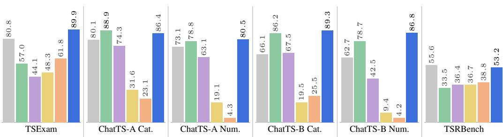
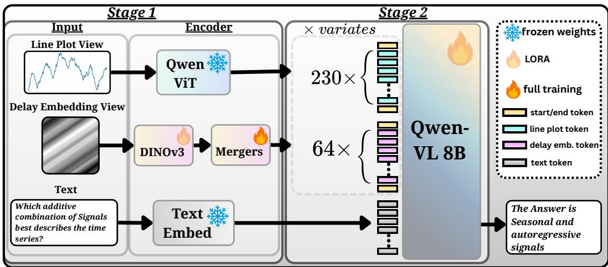
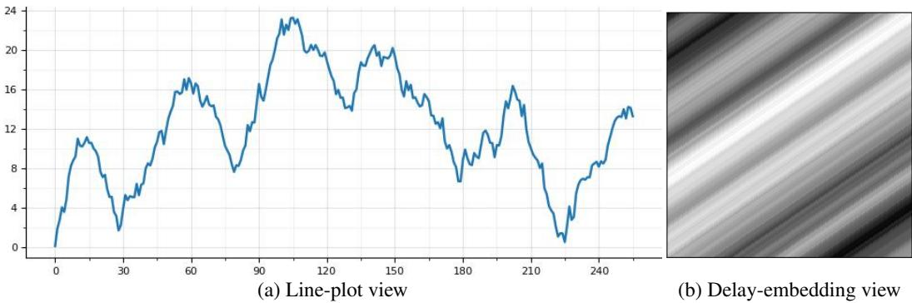
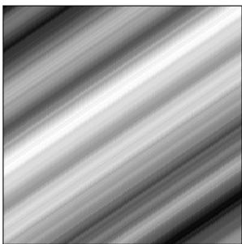

# TWICE UPON A TIME: COMPLEMENTARY REPRESEN-TATIONS FOR TIME-SERIES REASONING

Hedi Zisling∗ Ben-Gurion University

Liran Nochumsohn∗ Ben-Gurion University

Ilan Naiman Google

Mihir Parmar Google

Omri Azencot Ben-Gurion University

## ABSTRACT

Time Series Language Models (TSLMs) enable language-based understanding and reasoning over temporal data, yet a fundamental question remains: what information should their time-series representations preserve, and what variation should they factor out? Existing TSLMs typically expose the language model to a single representation, imposing a fixed inductive bias across downstream tasks. We instead introduce complementary representations as a design principle for time-series reasoning. Our model combines two visual views: line plots preserve absolute measurements and the observed coordinate frame, while normalized delay embeddings factor out positive amplitude rescaling and offsets while exposing temporal structure. Dedicated visual encoders integrate both views into a shared language model through visual tokens and multi-level feature fusion. Evaluationtime interventions verify that the two views exhibit distinct invariance profiles, while single-view ablations show that their combination is particularly beneficial beyond basic perception, with the large gains in prediction and reasoning. Built on Qwen3-VL-8B, our dual-view model improves overall TSRBench accuracy from 44.5% with line plots alone to 53.2%, substantially exceeding the strongest evaluated dedicated TSLM baseline at 36.7%. It further achieves 89.9% accuracy on TSExam and 86.8% numerical accuracy on multivariate ChatTS alignment. Together, these results demonstrate that complementary representations provide an effective design principle for general-purpose TSLMs, enabling models to exploit temporal structure without sacrificing access to the original measurement frame.

Links: Code (GitHub) | Models (Hugging Face) | Data (Hugging Face)

## 1 INTRODUCTION

Time Series Language Models (TSLMs) seek to extend the reasoning and interaction capabilities of large language models to sequential data, enabling models to answer questions, infer temporal relationships, forecast future behavior, and support decisions over time series (Xie et al., 2025; Langer et al., 2026; Guan et al., 2026; Yu et al., 2026a). A central challenge in this emerging paradigm is how temporal signals should be represented to the language model. Existing approaches serialize numerical values into text, learn dedicated time-series embeddings, or project features from specialized temporal encoders into the language-model representation space (Xie et al., 2025; Langer et al., 2026; Guan et al., 2026). As summarized in Table 1, these approaches typically commit to a single time-series representation, with absolute measurement scale either retained directly or provided separately as auxiliary metadata. Yet these representational choices impose fundamentally different inductive biases: representations that retain absolute amplitudes and coordinate information support quantitative readout, whereas normalized representations can suppress such information while emphasizing relative structure and temporal dynamics. Recent evaluations further show that simply rendering a time series as a line plot can already provide strong temporal understanding to general-purpose vision-language models (Yu et al., 2026a; Cai et al., 2024), suggesting that representation—not only model scale or training strategy—is a key determinant of time-series reasoning ability. This motivates a more fundamental question: Can complementary representations improve general-purpose time-series reasoning?

  
Figure 1: Cross-benchmark accuracy (%). ChatTS-A and ChatTS-B report categorical (Cat.) and numerical (Num.) alignment on the univariate and multivariate datasets, respectively. Bold marks the best result in each panel, excluding GPT-5 (T+V), shown in gray, which is a large proprietary model included as a reference rather than a size-matched comparison.

We hypothesize that general-purpose time-series reasoning benefits from exposing the model to complementary views of the same signal, each preserving different information and inducing different invariances. Rather than requiring a single representation to simultaneously retain all information relevant to downstream reasoning while suppressing nuisance variation, this formulation allows distinct views to provide different inductive biases. We instantiate this principle with two visual representations: a standard line plot and a normalized delay embedding. The line plot preserves absolute amplitudes, axis ranges, and measurement scales, providing the information required for questions grounded in observed values. In contrast, delay embeddings reconstruct a time series as a trajectory in phase space using time-lagged observations, revealing geometric structure associated with the underlying dynamics (Takens, 2006). We normalize this representation before rendering it as a twodimensional view, therebyfactoring out affine changes in amplitude while retaining the geometry of the temporal trajectory. Our central hypothesis is that combining these complementary views is particularly useful beyond basic perception, where reasoning, prediction, and decision-making require models to exploit temporal structure while remaining grounded in the observed measurements.

Building on this representational principle, we design a dual-tower TSLM in which each visual view is processed by a dedicated encoder. We retain Qwen3-VL’s native vision encoder, initialized from SigLIP-2 (Tschannen et al., 2025), to process line plots, and introduce a dedicated DINOv3 encoder (Simeoni et al., 2026) for delay embeddings, allowing each view to develop a specialized´ visual representation before interacting with the language model. The resulting visual features are compressed into a compact set of tokens, 230 for the line plot and 64 for the delay embedding, and concatenated as input to the language model. Beyond this input-level fusion, we adopt Deep-Stack (Meng et al., 2024) to inject multi-level visual features into the early language-model layers, enabling the complementary representations to interact with language processing throughout the network. This architecture provides a compact realization of our central hypothesis while retaining the distinct inductive biases of the two visual views.

To test our representational hypothesis and evaluate the resulting dual-tower TSLM, we conduct experiments on TSRBench (Yu et al., 2026a), TSExam (Cai et al., 2024), and ChatTS (Xie et al., 2025). Built on Qwen3-VL-8B (Bai et al., 2025), our model achieves 53.2% overall accuracy on TSRBench, substantially narrowing the gap to GPT-5 with text and visual input (55.6%) while surpassing the strongest evaluated dedicated TSLM (36.7%). It also outperforms the compared general-purpose and specialized baselines on TSExam and ChatTS numerical alignment. To assess the contribution of the complementary view, we compare against a plot-only variant trained under the same setup. Adding the delay embedding raises overall TSRBench accuracy from 45.2% to 53.2%, an 8.0-percentage-point improvement, with gains in reasoning, prediction, and decision-making while leaving perception nearly unchanged. Controlled evaluation-time interventions further reveal distinct invariance profiles: the delay-only model maintains nearly unchanged accuracy under positive rescaling and offset shifts, whereas the plot-only model, whose representation retains the measurement frame, is substantially more sensitive to these transformations. Our contributions are threefold:

• Complementary representations for time-series reasoning. We establish complementary representation as a design principle for TSLMs, motivated by the observation that quantitative readout requires the original measurement frame, whereas reasoning about temporal dynamics benefits from factoring it out.

• A dual-view time-series language model. We propose a dual-tower architecture that combines line plots and normalized delay embeddings within a shared language model. Dedicated visual encoders, compact visual tokens, and multi-level feature fusion integrate temporal structure with the original measurement frame.

• State-of-the-art TSLM performance. With an 8B backbone, our model outperforms all evaluated dedicated TSLMs on TSRBench, achieving 53.2% accuracy versus 36.7% for the strongest baseline. It also leads the evaluated models on TSExam and multivariate ChatTS numerical alignment, achieving 89.9% and 86.8% accuracy, respectively.

Table 1: Comparison of time-series representations in existing TSLMs. The methods differ in how the time series is represented, whether the primary representation is normalized, and how absolute measurement-scale information is provided to the language model. Forecasting-oriented LLM methods are included for completeness; unlike TSLMs, they target numerical forecasting rather than general question answering and reasoning.
<table><tr><td></td><td>Model</td><td>TS Representation</td><td>Normalization</td><td>Scale Information</td><td>Representation Views</td><td>Task Scope</td></tr><tr><td></td><td>PromptCast (Xue &amp; Salim, 2023)</td><td>Text</td><td>None</td><td>In representation</td><td>Single</td><td>Forecasting</td></tr><tr><td>OorcasSt.</td><td>LLMTime (Gruver et al., 2023)</td><td>Text</td><td>Per-series rescaling</td><td>Not provided</td><td>Single</td><td>Forecasting</td></tr><tr><td></td><td>Time-LLM (Jin et al., 2024)</td><td>Reprogrammed patches</td><td>Per-series</td><td>Not provided</td><td>Single</td><td>Forecasting</td></tr><tr><td></td><td>TimeOmni-1 (Guan et al., 2026)</td><td>Text</td><td>None</td><td>In representation</td><td>Single</td><td>QA &amp; reasoning</td></tr><tr><td>TSMS</td><td>ChatTS (Xie et al., 2025)</td><td>1D patches</td><td>Per-series</td><td>Auxiliary metadata</td><td>Single</td><td>QA &amp; reasoning</td></tr><tr><td></td><td>OpenTSLM (Langer et al., 2026)</td><td>1D patches</td><td>Per-series</td><td>Auxiliary metadata</td><td>Single</td><td>QA &amp; reasoning</td></tr><tr><td></td><td>TS-Reasoner (Yu et al., 2026b)</td><td>TSFM features</td><td>Per-series</td><td>Auxiliary metadata</td><td>Single</td><td>QA &amp; reasoning</td></tr><tr><td></td><td>Ours</td><td>Plot + delay embedding</td><td>View-dependent</td><td>Line plot</td><td>Complementary</td><td>QA &amp; reasoning</td></tr></table>

## 2 RELATED WORK

Time-Series Representations. Time series admit multiple representations that expose different properties of the underlying signal. Beyond the raw sequential domain, classical approaches transform temporal observations into alternative coordinate systems, including frequency and timefrequency representations, recurrence-based representations, and delay embeddings that reconstruct trajectories in phase space (Takens, 2006). A related line of work represents time series as images, enabling spatial models to operate on temporal structure. Wang & Oates (2015) introduced Gramian Angular Fields and Markov Transition Fields for encoding temporal sequences as two-dimensional images, demonstrating their utility for classification and imputation. More recently, Naiman et al. (2024) showed that image transformations based on delay embeddings and short-time Fourier transforms can provide effective interfaces between time series and modern vision-based diffusion mod els, supporting generation across both short and long sequences. Collectively, these works demonstrate that alternative representations can expose useful and distinct structure in temporal signals. Our work builds on this perspective but shifts the focus from selecting a representation for a particular predictive or generative task to combining complementary representations for general-purpose time-series reasoning: we jointly expose the model to views designed to retain different information and induce different invariances.

Time-Series Language Models. A growing body of work investigates how pretrained language models can be adapted to temporal data. Early approaches primarily focused on forecasting, either by serializing numerical observations as text (Gruver et al., 2023), prompting language models with textual descriptions of temporal sequences (Xue & Salim, 2023), or aligning and reprogramming time-series representations to exploit pretrained language-model representations (Zhou et al., 2023; Sun et al., 2024; Jin et al., 2024). More recent work has broadened this paradigm from task-specific prediction toward Time Series Language Models that accept time series as a modality and support natural-language understanding and reasoning. ChatTS (Xie et al., 2025) aligns learned time-series embeddings with an LLM through instruction tuning, while OpenTSLM (Langer et al., 2026) investigates both soft-prompt and cross-attention interfaces for reasoning over multivariate temporal

signals. TimeOmni-1 (Guan et al., 2026) instead represents numerical sequences directly within the language-model token space and targets complex temporal reasoning, whereas TS-Reasoner (Yu et al., 2026b) aligns representations from a pretrained time-series foundation model with an LLM. In parallel, benchmark studies have shown that general-purpose vision-language models can reason surprisingly effectively over time series presented as line plots (Cai et al., 2024; Yu et al., 2026a), providing an alternative to explicitly learned time-series interfaces. Despite these diverse strategies, existing TSLMs predominantly expose the language model to a single primary representation of each temporal signal. Our work instead treats representation as a source of complementary inductive biases, jointly providing views that deliberately preserve different information and exhibit different invariances.

## 3 METHOD

## 3.1 PROBLEM FORMULATION AND OVERVIEW

Let Q denote a natural-language query and $\mathcal { X } = \{ \mathbf { x } _ { 1 } , \ldots , \mathbf { x } _ { n } \}$ a collection of n input time series, where $\mathbf { x } _ { i } ~ = ~ ( x _ { i , 1 } , \ldots , x _ { i , m _ { i } } ) ~ \in ~ \mathbb { R } ^ { m _ { i } }$ may have a different length and numerical range. Given $( Q , { \mathcal { X } } ) , { \textbf { a } }$ Time Series Language Model (TSLM) generates a natural-language answer $A = ( a _ { 1 } , \dotsc , a _ { | A | } )$ autoregressively:

$$
P ( A \mid Q , \mathcal { X } ) = \prod _ { j = 1 } ^ { | A | } P ( a _ { j } \mid a _ { < j } , Q , \mathcal { X } ) ~ .\tag{1}
$$

Rather than encoding each $\mathbf { x } _ { i }$ through a single representation, we construct two complementary visual views, ${ \mathcal V } ( \mathbf { x } _ { i } ) = \bar { \{ V _ { i } ^ { \mathrm { p l o t } } , V _ { i } ^ { \mathrm { d e l a y } } \} }$ . The line-plot view $V _ { i } ^ { \mathrm { p l o t } }$ retains the original numerical scale and measurement frame, whereas the normalized delay view $V _ { i } ^ { \mathrm { d e l a y } }$ factors out affine amplitude variation and represents the signal through its local temporal trajectories. As illustrated in Figure 2, the two views are processed by dedicated visual encoders and projected into a shared language-model representation space. Their visual tokens are jointly provided to a single Qwen3-VL-8B languagemodel backbone, with multi-level visual features additionally injected through DeepStack (Meng et al., 2024). The model is trained in two stages, first aligning the delay-embedding stream with the language model and subsequently instruction-tuning the language model for time-series reasoning.

## 3.2 COMPLEMENTARY VISUAL REPRESENTATIONS

Our representation design exposes each time series through two complementary views with different information-preserving properties. The first retains the original measurement frame through a standard line plot, while the second represents the series through overlapping temporal windows after removing its absolute amplitude and offset.

Line-Plot View. For each time series $\mathbf { x } _ { i } ~ = ~ ( x _ { i , 1 } , \dots , x _ { i , m _ { i } } )$ , we render the raw observations as a two-dimensional line plot without amplitude normalization (Figure 3a). Consequently, the plot retains the original value range and its position within the coordinate system, including the numerical values displayed along the vertical axis. This representation therefore preserves information about absolute amplitudes and differences in scale that would be removed by per-series normalization. For multivariate inputs, each series is rendered as its own plot rather than overlaid, so series with different ranges keep their own measurement frames.

Normalized Delay-Embedding View. Delay embeddings (Takens, 2006) describe a time series through its local histories: overlapping windows, each shifted slightly forward in time, are stacked side by side into an image (Naiman et al., 2024). Because windows overlap, each feature of the signal traces a diagonal line across the image: periodicity appears as parallel stripes, trends as smooth gradients, and local events as isolated streaks (Figure 3b). Temporal structure thus becomes visual texture that pretrained vision encoders can readily perceive.

Concretely, for each variate x of length $m ,$ we extract $W$ overlapping windows of length ℓ with evenly spaced starts covering the whole series. The c-th window is the array starting at index ${ { p } _ { c } } =$

  
Figure 2: Overview of the Dual-View TSLM. Each visual span is wrapped by vision start and vision end. Stage I trains the DINOv3 LoRA and the merger. Stage II trains the LM LoRA. The Qwen vision encoder, the text embedding, and the LLM backbone stay frozen. round $\textstyle { \left( c { \frac { m - \ell } { W - 1 } } \right) }$ :

$$
V _ { c } = ( x _ { p _ { c } } , x _ { p _ { c } + 1 } , \ldots , x _ { p _ { c } + \ell - 1 } ) , \qquad c = 0 , \ldots , W - 1 ,\tag{2}
$$

where $\ell = \mathrm { m i n } ( \mathrm { m a x } ( \lfloor \rho m \rfloor , \ell _ { \mathrm { m i n } } ) , \ell _ { \mathrm { m a x } } )$ is a fixed fraction $\rho$ of the series length, so windows cover a comparable portion of short and long signals, with bounds $\ell _ { \mathrm { m i n } }$ and $\ell _ { \mathrm { m a x } }$ guarding against extreme lengths. For $m < \ell _ { \mathrm { m i n } } .$ , we set $\ell = m$ . Each window is linearly interpolated to $\breve { H }$ values, and the W resampled windows form the columns of the min–max normalized delay map $V ^ { \mathrm { d e l a y } } \in$ $[ 0 , 1 ] ^ { H \times W }$ . Every variate, regardless of its length, is thus represented by an image of the same size (hyperparameters in Appendix A.2).

Since resampling is linear and the map is min–max normalized, any transformation $a \mathbf { x } + b$ with $a > 0$ yields the same delay map. The line plot therefore retains the measurement frame, whereas the delay map exposes temporal structure independently of positive affine changes in amplitude.

## 3.3 DUAL-VIEW ARCHITECTURE

Our architecture integrates the two views into a single Qwen3-VL-8B language-model backbone (Bai et al., 2025) through dedicated visual encoders (Figure 2).

Line-Plot Encoder. Line plots are processed by the native Qwen3-VL vision pipeline without modification, which merges spatial features over $2 \times 2$ neighboring patches and projects them to the language-model hidden dimension. This yields 230 plot tokens $\mathbf { Z } _ { i } ^ { \mathrm { { p l o t } } }$ per series, together with three intermediate feature maps for DeepStack fusion. The encoder remains frozen throughout training.

Delay-Embedding Encoder. For each time-series variate, we process its normalized delay map Vdelay with a dedicated DINOv3 (Simeoni et al., 2026) ViT-L/16 encoder denoted by´ $E _ { \mathrm { d e l a y } } .$ Its spatial patch features are merged in $2 \times 2$ groups and mapped to the language-model hidden dimension by a two-layer projection module $M ^ { ( 0 \bar { ) } }$ , yielding 64 delay tokens $\bar { \bf Z } ^ { \mathrm { d e l a y } } = M ^ { ( 0 ) } \big ( E _ { \mathrm { d e l a y } } ( V ^ { \mathrm { d e l a y } } ) \big )$ per variate. To match the multi-level DeepStack interface of the plot stream, we additionally extract intermediate features $E _ { \mathrm { d e l a y } } ^ { ( k _ { i } ) } ( V ^ { \mathrm { d e l a y } } )$ after blocks $k _ { i } ,$ , where $( k _ { 1 } , k _ { 2 } , k _ { 3 } ) = ( 6 , 1 2 , 1 8 )$ , and merge and project each with a dedicated module $M ^ { ( i ) }$ of the same form as $M ^ { ( 0 ) }$ , giving multi-level delay features $\mathbf { D } _ { i } = M ^ { ( i ) } \big ( E _ { \mathrm { d e l a v } } ^ { ( k _ { i } ) } ( V ^ { \mathrm { d e l a y } } ) \big ) , i \in \{ 1 , 2 , 3 \}$ , aligned one-to-one with the 64 delay tokens and injected into the language model as described below.

Dual-View Fusion. Both streams enter the language model in the same way. For each time series, $\mathbf { Z } _ { i } ^ { \mathrm { { p l o t } } }$ and $\mathbf { Z } _ { i } ^ { \mathrm { d e l a y } }$ occupy separate visual spans, each framed by <|vision start|> and <|vision end|> tokens, alongside the textual query $Q .$ , so the two views interact within a single autoregressive language model rather than through separate heads or an ensemble. Beyond this input-level fusion, we extend DeepStack to the delay stream. Following the DeepStack mechanism of Qwen3-VL (Meng et al., 2024; Bai et al., 2025), the three multi-level features of each stream are added directly to the hidden states of the first three language-model layers, one feature per layer, at the positions of that stream’s own visual tokens. The plot and delay streams thus inject into the same layers but at disjoint token positions. Rendering and tokenization details are provided in Appendix B.1.

## 3.4 TRAINING

Following the staged training paradigm common in multimodal language models and recent TSLMs (Xie et al., 2025; Langer et al., 2026), we train our model, initialized from Qwen3-VL-8B (Bai et al., 2025), in two stages that separate the alignment of the new delay stream from tasklevel instruction tuning. In Stage I (modality alignment), the Qwen3-VL vision encoder and the language model remain frozen, and we train LoRA adapters (Hu et al., 2022) on DINOv3 together with the projection $M ^ { ( 0 ) }$ , which maps the final DINOv3 patch features to delay tokens, and the projections $\{ M ^ { ( i ) } \} _ { i = 1 } ^ { 3 }$ , which map the intermediate DINOv3 features to the multi-level DeepStack features. This stage is trained on captioning data, encouraging the delay stream to produce representations that the frozen language model can interpret. In Stage II (instruction tuning), the DINOv3 adapters are merged, the entire visual pathway is frozen, and LoRA is applied to the language model, which is trained on time-series question answering to reason jointly over both views. Both stages use the standard next-token prediction loss computed over the answer tokens only. The objective and hyperparameters are given in Appendix B.2.

## 4 TRAINING DATA

We construct a dedicated training corpus for each of the two stages described in Section 3.4. Stage I uses caption supervision to align the new delay-embedding stream with the language model, whereas Stage II uses a heterogeneous instruction corpus to train perception, numerical readout, forecasting, and temporal reasoning. Most time series are generated procedurally, with labels obtained directly from generator parameters or exact functions of the realized signal rather than from a teacher model. The only real-world time-series sources are CaTS-Bench (Zhou et al., 2026) in Stage I and a small subset of sports win-probability series from GAMETime (Tan et al., 2025) used for abductive reasoning in Stage II. Table 2 summarizes the data composition.

Stage I: Caption Alignment. The alignment corpus contains 55,696 examples from three sources. CaTS-Bench (Zhou et al., 2026) contributes real-world short time series from diverse physical and socioeconomic domains together with reference descriptions. To provide broader attribute coverage, we additionally construct 32,000 ChatTS-style captions from the ChatTS time-series generator (Xie et al., 2025). Trend, seasonality, noise, and local events are sampled from the generator’s attribute space, and captions are rendered directly from those attributes. Finally, we construct 7,701 structural captions by generating series with our TimeSeriesExam fork (Cai et al., 2024) and deterministically rendering one-sentence descriptions from the underlying generative components, parameters, noise processes, and injected anomalies. The three sources are sampled with equal probability during Stage I, balancing real-world diversity, free-form synthetic descriptions, and tightly controlled con structive supervision.

Table 2: Training-data composition. Rows denote distinct examples available to the corresponding training stage. Stage I sources are sampled with equal probability; Stage II uses a balanced mixture described in the text.
<table><tr><td>Stage</td><td>Source</td><td>Origin</td><td>Rows</td><td>Supervision</td></tr><tr><td>I</td><td>CaTS-Bench</td><td>Real (Zhou et al., 2026)</td><td>15,995</td><td>Caption</td></tr><tr><td>I</td><td>ChatTS-style captions</td><td>Synthetic (Xie et al., 2025)</td><td>32,000</td><td>Caption</td></tr><tr><td>I</td><td>Structural captions</td><td>Synthetic, in-house</td><td>7,701</td><td>Caption</td></tr><tr><td>II</td><td>ChatTS ift</td><td>Synthetic (Xie et al., 2025)</td><td>6,373</td><td>Free-form QA</td></tr><tr><td>ⅡI</td><td>ChatTS sft</td><td>Synthetic (Xie et al., 2025)</td><td>44,802</td><td>Free-form QA</td></tr><tr><td>II</td><td>TSExam perception</td><td>Synthetic, in-house</td><td>20,640</td><td>MCQ</td></tr><tr><td>II</td><td>Numerical corpus</td><td>Synthetic, in-house</td><td>11,000</td><td>Scalar</td></tr><tr><td>II</td><td>Reasoning corpus</td><td>Synthetic + real sports</td><td>100,000</td><td>MCQ / rationale+MCQ</td></tr></table>

Stage II: Instruction Tuning. The instruction corpus contains 182,815 examples spanning complementary task families. We include the released ChatTS ift and sft training sets (Xie et al., 2025) for open-ended univariate and multivariate question answering. Using our TimeSeriesExam fork, we further generate the TSExam perception set, 20,640 multiple-choice questions covering pattern recognition, anomaly detection, similarity, noise, and causality, together with an 11,000- example numerical corpus of open-ended questions whose answers are exact statistics or dynamical quantities computed from the realized series. The largest component is an in-house 100,000-example reasoning corpus designed to develop broad reasoning capabilities over time series. It spans numerical, deductive, inductive, abductive, causal, etiological, temporal-relation, forecasting, and eventprediction tasks, with examples generated from procedural rules, dynamical systems, and domainspecific simulators. Because instruction-tuned models are sensitive to the task interface, we align the mixture of reasoning tasks and their question–answer formats with the capabilities evaluated by TSRBench (Yu et al., 2026a); the underlying time series, questions, and answers are generated independently and no benchmark instances are used for training. For tasks requiring explicit derivation, supervision additionally includes deterministic rationales constructed from the simulator state, while the remaining tasks use direct multiple-choice supervision.

Gold-by-Construction Supervision and Benchmark Separation. For all in-house synthetic data, supervision is derived from known generative parameters or exact computations on the realized signal. Captions describe the sampled components, multiple-choice labels follow directly from the generating mechanism, numerical targets are exact signal reductions, and reasoning rationales are rendered from structured intermediate facts. This design avoids using an external language model to infer labels for the synthetic data. Importantly, no TSRBench or TimeSeriesExam evaluation examples are included in training. The TSExam perception set, structural captions, and numerical corpus are generated with our fork of the public generator and contain freshly sampled series whose lengths differ from those in the benchmark. Similarly, although the reasoning corpus covers the reasoning task families and question–answer formats evaluated by TSRBench, all training instances are generated independently and no benchmark examples are used for training. We additionally verified the reasoning corpus against the benchmark for exact series overlap, shared sports-game instances, and exact question–answer matches. ChatTS evaluation data are likewise excluded; only the released training splits are used. Additional generator details, per-task statistics, target formats, and held-out splits are provided in Appendix D.

## 5 EXPERIMENTS AND RESULTS

## 5.1 EXPERIMENTAL SETUP

We evaluate on three benchmarks that together probe time-series understanding from low-level perception to high-level reasoning. TSRBench (Yu et al., 2026a), our primary benchmark, comprises 4,125 multiple-choice questions over 15 tasks spanning Perception, Reasoning, Prediction, and Decision-Making. TSExam (Cai et al., 2024) contains 746 multiple-choice questions on pattern recognition, noise understanding, anomaly detection, similarity, and causality, and ChatTS (Xie et al., 2025) measures both fine-grained categorical and numerical alignment and higher-level reasoning over univariate and multivariate series. We compare against two families of models. General-purpose vision-language models receive the series as line plots: Qwen3-VL-8B (Bai et al., 2025), our own backbone, isolates the effect of our design and training, while GPT-5 serves as a substantially larger proprietary reference rather than a size-matched competitor. We further compare against representative dedicated TSLMs: ChatTS-14B (Xie et al., 2025), TS-Reasoner-7B (Yu et al., 2026b), and TimeOmni-1-7B (Guan et al., 2026). Table 3 reports task-level TSRBench accuracy together with our representation ablations, and Figure 1 summarizes performance across all three benchmarks. Complete task-level results and evaluation procedures, including the source of each baseline result, are provided in Appendix C.

Table 3: TSRBench accuracy (%) across all 15 tasks. Rows are grouped into general-purpose models, dedicated TSLMs, and representation ablations. In the Overall column, bold and underline mark the best and second-best results, respectively. Gray rows denote large proprietary models included as reference points rather than size-matched comparisons and are excluded from this ranking. Full task descriptions and results are provided in Appendix C.
<table><tr><td rowspan="2" colspan="2">Model</td><td colspan="4">Perception</td><td colspan="6">Reasoning</td><td colspan="2">Prediction</td><td colspan="2">Decision</td><td colspan="2"></td></tr><tr><td>PR</td><td>NU</td><td>AD</td><td>CA</td><td>ER</td><td>CD</td><td>AR</td><td>TR</td><td>NR</td><td>DR</td><td>IR</td><td>TSF</td><td>EP</td><td>QuaDM</td><td>QuanDM Overall</td><td></td></tr><tr><td></td><td>GPT-5 (V)</td><td>83.6</td><td>72.4</td><td>69.8</td><td>73.5</td><td>34.6</td><td>37.0</td><td>81.3</td><td>68.1</td><td>64.0</td><td>48.0</td><td>57.0</td><td>38.8</td><td>71.9</td><td>26.9</td><td>30.0</td><td>52.4</td></tr><tr><td>Genral</td><td>GPT-5 (T+V)</td><td>84.9</td><td>72.4</td><td>61.2</td><td>70.8</td><td>38.9</td><td>50.3</td><td>93.3</td><td>68.8</td><td>72.0</td><td>44.0</td><td>58.0</td><td>37.8</td><td>78.1</td><td>31.9</td><td>34.3</td><td>55.6</td></tr><tr><td></td><td>Qwen3-VL-8B (V)</td><td>54.7</td><td>57.5</td><td>62.8</td><td>65.5</td><td>24.3</td><td>31.7</td><td>52.0</td><td>23.1</td><td>33.2</td><td>19.2</td><td>29.0</td><td>51.7</td><td>30.6</td><td>36.1</td><td>29.0</td><td>38.9</td></tr><tr><td>TSLM</td><td>ChatTS-14B</td><td>50.7</td><td>50.6</td><td>46.5</td><td>55.8</td><td>21.7</td><td>34.3</td><td>51.3</td><td>24.4</td><td>30.5</td><td>23.6</td><td>25.0</td><td>19.2</td><td>52.2</td><td>29.3</td><td>27.7</td><td>33.5</td></tr><tr><td></td><td>TS-Reasoner-7B</td><td>53.1</td><td>56.3</td><td>48.1</td><td>50.4</td><td>28.9</td><td>24.3</td><td>57.3</td><td>26.9</td><td>37.2</td><td>23.6</td><td>24.0</td><td>31.7</td><td>55.0</td><td>32.8</td><td>21.7</td><td>36.4</td></tr><tr><td></td><td>TimeOmni-1-7B</td><td>55.0</td><td>59.8</td><td>41.9</td><td>64.6</td><td>28.0</td><td>35.3</td><td>46.7</td><td>24.4</td><td>31.5</td><td>22.8</td><td>34.0</td><td>30.0</td><td>49.4</td><td>34.0</td><td>30.3</td><td>36.7</td></tr><tr><td>Abltons</td><td>Delay only</td><td>57.4</td><td>65.5</td><td>69.8</td><td>76.1</td><td>30.3</td><td>51.7</td><td>55.3</td><td>24.4</td><td>38.5</td><td>26.8</td><td>21.0</td><td>49.0</td><td>20.3</td><td>34.9</td><td>19.3</td><td>40.5</td></tr><tr><td></td><td>Plot only</td><td>87.3</td><td>94.3</td><td>77.5</td><td>93.8</td><td>29.7</td><td>52.0</td><td>57.3</td><td>18.1</td><td>36.5</td><td>27.2</td><td>23.0</td><td>46.2</td><td>21.7</td><td>39.1</td><td>33.3</td><td>45.2</td></tr><tr><td></td><td>Delay+Delay</td><td>67.9</td><td>62.1</td><td>79.1</td><td>82.3</td><td>32.3</td><td>40.3</td><td>64.7</td><td>34.4</td><td>40.2</td><td>26.8</td><td>19.0</td><td>54.6</td><td>15.8</td><td>33.1</td><td>21.0</td><td>42.6</td></tr><tr><td></td><td>Plot+Plot</td><td>84.1</td><td>94.3</td><td>80.6</td><td>87.6</td><td>40.0</td><td>43.0</td><td>60.7</td><td>24.4</td><td>32.2</td><td>26.4</td><td>27.0</td><td>46.2</td><td>28.6</td><td>32.8</td><td>28.3</td><td>44.8</td></tr><tr><td>Ours</td><td></td><td>85.4</td><td>94.3</td><td>78.3</td><td>92.9</td><td>43.1</td><td>51.7</td><td>56.0</td><td>28.7</td><td>35.5</td><td>29.2</td><td>34.0</td><td>50.4</td><td>84.2</td><td>32.8</td><td>43.0</td><td>53.2</td></tr></table>

## 5.2 DO COMPLEMENTARY REPRESENTATIONS IMPROVE TEMPORAL REASONING?

Our central hypothesis is that exposing the language model to complementary representations provides benefits that cannot be obtained from either view alone. We therefore compare the full dualview model against Plot-only and Delay-only variants, as well as two same-view controls that retain the complete dual-tower architecture but feed both towers the same representation. In Plot+Plot, the DINOv3 tower receives the line plot in place of the delay map; in Delay+Delay, the Qwen3- VL tower receives the delay map in place of the line plot. Both controls keep the same encoders, adapters, per-tower token budgets, and two-stage training procedure as our model, so any difference from the full model reflects whether the two streams carry distinct or identical views, rather than differences in architecture or capacity. Table 3 reports results across all 15 TSRBench tasks, together with representative dedicated TSLMs and general-purpose models.

The results show that the benefit of complementary representations is concentrated beyond basic perception. Plot only already achieves 87.4% on Perception, and adding the delay view leaves this essentially unchanged at 86.4%. In contrast, the dual-view model improves Reasoning from 35.8% to 40.1%, Prediction from 38.0% to 61.7%, and Decision-Making from 36.4% to 37.6%, raising overall accuracy from 45.2% to 53.2%. The task-level results further show that the contribution of the complementary view varies across tasks, rather than producing a uniform improvement across the benchmark. Importantly, simply duplicating a view does not reproduce the gain: Plot+Plot reaches 44.8% overall and Delay+Delay reaches 42.6%, compared with our 53.2%. This suggests that the improvement is not explained merely by providing a second visual stream, but is associated with combining representations that preserve different properties of the underlying signal.

Our model also exceeds the evaluated dedicated TSLMs, whose strongest overall TSRBench result is 36.7%. For context, Table 3 additionally reports GPT-5 results; these models are substantially larger proprietary systems and are therefore not size-matched comparisons. They nevertheless provide a useful reference point: our model reaches 53.2% overall, surpassing GPT-5 with visual input (52.4%) and approaching GPT-5 with text and visual input (55.6%), while exhibiting a markedly different task-level performance profile.

## 5.3 HOW DO THE REPRESENTATIONS RESPOND TO DISTRIBUTION SHIFTS?

To directly probe the inductive biases induced by the visual representations, we apply controlled transformations to TSRBench inputs at evaluation time. We consider affine changes to amplitude and offset, observational noise and smoothing, and changes in sampling horizon. Tasks whose gold targets depend intrinsically on absolute coordinate values or sampling rates are excluded from this analysis, leaving 2,020 items across invariant reasoning, perception, and event prediction tasks. Table 4 reports the resulting accuracy under each transformation, together with clean performance for reference.

Table 4: Evaluation-time interventions on scale- and sampling-invariant TSRBench subsets (2,020 items; excludes NR, DR, IR, TSF, and decision tasks). Each entry reports accuracy (%).
<table><tr><td></td><td></td><td colspan="5">Affine</td><td colspan="4">Noise / Smoothing</td><td colspan="2">Sampling</td></tr><tr><td>Model</td><td>Clean</td><td>×0.1</td><td>×10</td><td>+5σ</td><td>-5σ</td><td>z-score</td><td>20 dB</td><td>10 dB</td><td>0 dB</td><td>Smooth</td><td>256</td><td>2048</td></tr><tr><td>Plot only</td><td>52.7</td><td>58.2</td><td>49.6</td><td>48.9</td><td>49.2</td><td>47.5</td><td>50.6</td><td>47.4</td><td>43.2</td><td>50.1</td><td>51.6</td><td>52.9</td></tr><tr><td>Delay only</td><td>44.7</td><td>43.4</td><td>44.9</td><td>44.9</td><td>44.1</td><td>44.3</td><td>42.3</td><td>38.3</td><td>35.3</td><td>40.7</td><td>45.1</td><td>42.8</td></tr><tr><td>Ours</td><td>66.5</td><td>63.4</td><td>64.8</td><td>62.9</td><td>65.0</td><td>60.7</td><td>65.4</td><td>62.4</td><td>56.6</td><td>60.7</td><td>64.8</td><td>66.8</td></tr></table>

The interventions reveal distinct rather than uniformly superior robustness profiles. Consistent with its per-series normalization, the delay-only representation is nearly invariant to the measured affine transformations: its clean accuracy of 44.7% changes only slightly under rescaling and offset shifts. Our model remains sensitive to affine transformations because its line-plot stream continues to encode the observed measurement frame, while maintaining substantially higher absolute accuracy than Plot only across all reported interventions. Its sensitivity also depends on the type of shift: noise and smoothing degrade both Plot only and our model, whereas our model changes relatively little under changes in sampling horizon. Thus, combining the two views does not impose a single invariance profile or provide uniform robustness to every perturbation. Instead, the results support the intended representational distinction: the views exhibit different sensitivities, allowing the model to retain access to the original measurement frame while also incorporating a representation that factors out selected amplitude variation.

## 5.4 CROSS-BENCHMARK GENERALIZATION

Finally, we evaluate whether the gains observed on TSRBench transfer to benchmarks emphasizing different aspects of time-series understanding. Figure 1 summarizes overall TSExam accuracy, categorical and numerical alignment on the univariate (A) and multivariate (B) ChatTS datasets, and TSRBench overall accuracy; per-task results and ChatTS reasoning evaluations are in Appendix C. Our model attains 89.9% accuracy on TSExam, exceeding the compared general-purpose and dedicated TSLM baselines. On ChatTS, it achieves 80.5% numerical accuracy on univariate sequences and 86.8% on multivariate sequences, with the largest advantage appearing in the multivariate setting. Together with the TSRBench results, these evaluations indicate that the benefit of the dual representation is not confined to a single benchmark: the model remains strong across perceptual, numerical, and broader temporal reasoning tasks, despite using a Qwen3-VL-8B backbone.

## 6 DISCUSSION

Time-series reasoning requires both numerical readout and understanding of temporal dynamics, yet these capabilities favor different representational properties. This tension motivated our central question: can complementary representations improve general-purpose time-series reasoning? We establish complementary representation as a design principle for TSLMs and instantiate it in a dualview model that integrates measurement-preserving line plots and normalized delay embeddings through dedicated visual encoders and a shared language model. The resulting model raises TSR-Bench accuracy from 45.2% for the plot-only variant to 53.2%, surpassing all evaluated dedicated TSLMs. The gains are concentrated beyond basic perception and are not reproduced when both encoders receive line plots or both receive delay embeddings. The model also leads the evaluated baselines on TSExam and multivariate ChatTS numerical alignment, achieving 89.9% and 86.8% accuracy, respectively, demonstrating strong performance across perceptual, numerical, and broader temporal reasoning tasks.

The STFT comparison in Appendix C.5 further shows that the preferred secondary representation varies across evaluations: delay embeddings perform better on TSRBench, while STFT provides small advantages on ChatTS numerical alignment and average reasoning accuracy. This suggests that representation choice should reflect the capabilities a model must support. The intervention analysis likewise distinguishes access to an invariant view from invariance of the combined model, which retains both normalized structure and absolute measurements. Future work could explore additional representations and encoder combinations, including more than two views and querydependent mechanisms for combining them.

## REFERENCES

Shuai Bai, Yuxuan Cai, Ruizhe Chen, Keqin Chen, Xionghui Chen, Zesen Cheng, Lianghao Deng, Wei Ding, Chang Gao, Chunjiang Ge, Wenbin Ge, Zhifang Guo, Qidong Huang, Jie Huang, Fei Huang, Binyuan Hui, Shutong Jiang, Zhaohai Li, Mingsheng Li, Mei Li, Kaixin Li, Zicheng Lin, Junyang Lin, Xuejing Liu, Jiawei Liu, Chenglong Liu, Yang Liu, Dayiheng Liu, Shixuan Liu, Dunjie Lu, Ruilin Luo, Chenxu Lv, Rui Men, Lingchen Meng, Xuancheng Ren, Xingzhang Ren, Sibo Song, Yuchong Sun, Jun Tang, Jianhong Tu, Jianqiang Wan, Peng Wang, Pengfei Wang, Qiuyue Wang, Yuxuan Wang, Tianbao Xie, Yiheng Xu, Haiyang Xu, Jin Xu, Zhibo Yang, Mingkun Yang, Jianxin Yang, An Yang, Bowen Yu, Fei Zhang, Hang Zhang, Xi Zhang, Bo Zheng, Humen Zhong, Jingren Zhou, Fan Zhou, Jing Zhou, Yuanzhi Zhu, and Ke Zhu. Qwen3-vl technical report. arXiv preprint arXiv:2511.21631, 2025.

Yifu Cai, Arjun Choudhry, Mononito Goswami, and Artur Dubrawski. Timeseriesexam: A time series understanding exam. arXiv preprint arXiv:2410.14752, 2024.

Nate Gruver, Marc Finzi, Shikai Qiu, and Andrew Gordon Wilson. Large language models are zero-shot time series forecasters. In Advances in Neural Information Processing Systems, 2023.

Tong Guan, Zijie Meng, Dianqi Li, Shiyu Wang, Chao-Han Huck Yang, Qingsong Wen, Zuozhu Liu, Sabato Marco Siniscalchi, Ming Jin, and Shirui Pan. Timeomni-1: Incentivizing complex reasoning with time series in large language models. In The Fourteenth International Conference on Learning Representations, 2026.

Edward J. Hu, Yelong Shen, Phillip Wallis, Zeyuan Allen-Zhu, Yuanzhi Li, Shean Wang, Lu Wang, and Weizhu Chen. LoRA: Low-rank adaptation of large language models. In International Conference on Learning Representations, 2022.

Ming Jin, Shiyu Wang, Lintao Ma, Zhixuan Chu, James Y. Zhang, Xiaoming Shi, Pin-Yu Chen, Yuxuan Liang, Yuan-Fang Li, Shirui Pan, and Qingsong Wen. Time-llm: Time series forecasting by reprogramming large language models. In International Conference on Learning Representa tions, 2024.

Patrick Langer, Thomas Kaar, Max Rosenblattl, Maxwell A Xu, Winnie Chow, Martin Maritsch, Robert Jakob, Ning Wang, Juncheng Liu, Aradhana Verma, Brian Han, Daniel Seung Kim, Henry Chubb, Scott R. Ceresnak, Aydin Zahedivash, Alexander T Sandhu, Fatima Rodriguez, Daniel McDuff, Elgar Fleisch, Oliver Oppers Aalami, Filipe Barata, and Paul Schmiedmayer. OpenTSLM: Time-series language models for reasoning over multivariate medical text- and timeseries data. In Forty-third International Conference on Machine Learning, 2026.

Lingchen Meng, Jianwei Yang, Rui Tian, Xiyang Dai, Zuxuan Wu, Jianfeng Gao, and Yu-Gang Jiang. Deepstack: Deeply stacking visual tokens is surprisingly simple and effective for lmms. Advances in Neural Information Processing Systems, 37:23464–23487, 2024.

Ilan Naiman, Nimrod Berman, Itai Pemper, Idan Arbiv, Gal Fadlon, and Omri Azencot. Utilizing image transforms and diffusion models for generative modeling of short and long time series. Advances in Neural Information Processing Systems, 37:121699–121730, 2024.

Oriane Simeoni, Huy V. Vo, Maximilian Seitzer, Federico Baldassarre, Maxime Oquab, Cijo Jose,´ Vasil Khalidov, Marc Szafraniec, Seung Eun Yi, Michael Ramamonjisoa, Francisco Massa,¨ Daniel Haziza, Luca Wehrstedt, Jianyuan Wang, Timothee Darcet, Th´ eo Moutakanni, Leonel´ Sentana, Claire Roberts, Andrea Vedaldi, Jamie Tolan, John Brandt, Camille Couprie, Julien Mairal, Herve J´ egou, Patrick Labatut, and Piotr Bojanowski. Dinov3.´ Trans. Mach. Learn. Res., 2026.

Chenxi Sun, Yaliang Li, Hongyan Li, and Shenda Hong. Test: Text prototype aligned embedding to activate llm’s ability for time series. In International Conference on Learning Representations, 2024.

Floris Takens. Detecting strange attractors in turbulence. In Dynamical Systems and Turbulence, Warwick 1980: proceedings of a symposium held at the University of Warwick 1979/80, pp. 366– 381. Springer, 2006.

Mingtian Tan, Mike A Merrill, Zack Gottesman, Tim Althoff, David Evans, and Tom Hartvigsen. Inferring events from time series using language models. arXiv preprint arXiv:2503.14190, 2025.

Michael Tschannen, Alexey A. Gritsenko, Xiao Wang, Muhammad Ferjad Naeem, Ibrahim Alabdulmohsin, Nikhil Parthasarathy, Talfan Evans, Lucas Beyer, Ye Xia, Basil Mustafa, Olivier J. Henaff, Jeremiah Harmsen, Andreas Steiner, and Xiaohua Zhai. Siglip 2: Multilingual vision-´ language encoders with improved semantic understanding, localization, and dense features. arXiv preprint arXiv:2502.14786, 2025.

Zhiguang Wang and Tim Oates. Imaging time-series to improve classification and imputation. In Proceedings ofthe Twenty-Fourth International Joint Conference on Artificial Intelligence, IJCAI 2015, Buenos Aires, Argentina, July 25-31, 2015, pp. 3939–3945. AAAI Press, 2015.

Zhe Xie, Zeyan Li, Xiao He, Longlong Xu, Xidao Wen, Tieying Zhang, Jianjun Chen, Rui Shi, and Dan Pei. Chatts: Aligning time series with llms via synthetic data for enhanced understanding and reasoning. In Proceedings of the VLDB Endowment, 2025, 2025.

Hao Xue and Flora D Salim. Promptcast: A new prompt-based learning paradigm for time series forecasting. IEEE Transactions on Knowledge and Data Engineering, 36(11):6851–6864, 2023.

Fangxu Yu, Xingang Guo, Lingzhi Yuan, Haoqiang Kang, Hongyu Zhao, Lianhui Qin, Furong Huang, Bin Hu, and Tianyi Zhou. Tsrbench: A comprehensive multi-task multi-modal time series reasoning benchmark for generalist models. arXiv preprint arXiv:2601.18744, 2026a.

Fangxu Yu, Hongyu Zhao, and Tianyi Zhou. TS-reasoner: Aligning time series foundation models with LLM reasoning. Transactions on Machine Learning Research, 2026b. ISSN 2835-8856.

Luca Zhou, Pratham Yashwante, Marshall Fisher, Alessio Sampieri, Zihao Zhou, Fabio Galasso, and Rose Yu. CaTS-bench: Can language models describe time series? In Maria Liakata, Viviane P. Moreira, Jiajun Zhang, and David Jurgens (eds.), Findings of the Association for Computational Linguistics: ACL 2026, pp. 34479–34519, San Diego, California, United States, July 2026. Association for Computational Linguistics. ISBN 979-8-89176-395-1. doi: 10.18653/v1/2026.findings-acl.1722.

Tian Zhou, Peisong Niu, Xue Wang, Liang Sun, and Rong Jin. One fits all: Power general time series analysis by pretrained lm. In Advances in Neural Information Processing Systems, 2023.

## Table of Contents for Appendix

A Time Series Representations . 13   
A.1 Visualization of Complementary Representations . 13   
A.2 Delay-Map Construction Details . 13   
B Model and Training Details . 14   
B.1 Implementation Details 14   
B.2 Training Objective and Hyperparameters. 14   
C Additional Experimental Results 14   
C.1 Cross-Benchmark Representation Ablations 15   
C.2 TSRBench Category-Level Ablations . 15   
C.3 Detailed ChatTS Results 15   
C.4 Complete Intervention Results 16   
C.5 Alternative Secondary Representations . 16   
C.6 Visual-Token Budget and Same-View Controls 17   
C.7 Complete Benchmark Results . 18   
D Training Data Details . 21   
D.1 Training Corpus Overview . 21   
D.2 Stage I: Modality-Alignment Data 21   
D.3 Stage II: Instruction-Tuning Data. 22   
D.4 Reasoning Corpus Specification 22   
D.5 Numerical Corpus Specification 24

## APPENDIX

## A TIME SERIES REPRESENTATIONS

## A.1 VISUALIZATION OF COMPLEMENTARY REPRESENTATIONS

Figure 3 illustrates the two visual representations constructed from the same input time series. The line-plot view (left) preserves the original measurement frame, including absolute amplitudes and axis information. In contrast, the normalized delay-embedding view (right) represents overlapping temporal trajectories after per-series normalization, thereby removing offsets and positive amplitude rescaling while emphasizing temporal structure. The two views are provided to their respective visual encoders as described in Section 3.2.

  
Figure 3: Dual-view visual representations of a time-series variate. (a) The line plot retains the original measurement frame and axis values. (b) The normalized delay map arranges overlapping windows as columns, so recurring structure appears as diagonal stripes.

## A.2 DELAY-MAP CONSTRUCTION DETAILS

Hyperparameters. Table 5 lists the hyperparameters of the delay map $( \mathrm { E q . } 2 )$ . With these values, the window length ℓ equals the series length for $m < 4 8$ , is fixed at $\ell _ { \mathrm { m i n } } = 4 8$ for $4 8 \leq m < 8 0$ scales as ⌊0.6m⌋ for $8 \bar { 0 } \leq m \leq 3 2 0$ , and is capped at $\ell _ { \mathrm { m a x } } = 1 9 2$ for longer series.

Table 5: Hyperparameters of the normalized delay-embedding view.
<table><tr><td>Symbol</td><td>Description</td><td>Value</td></tr><tr><td> $\rho$ </td><td>Window length as a fraction of series length</td><td>0.6</td></tr><tr><td> $\ell _ { \mathrm { m i n } }$ </td><td>Minimum window length</td><td>48</td></tr><tr><td> $\ell _ { \mathrm { m a x } }$ </td><td>Maximum window length</td><td>192</td></tr><tr><td> $W$ </td><td>Number of windows (map width)</td><td>256</td></tr><tr><td> $H$ </td><td>Resampled window length (map height)</td><td>256</td></tr></table>

Interpolation. Interpolation is applied only within each window: the ℓ values of $V _ { c }$ are placed on a uniform grid over [0, 1] and linearly interpolated at H uniformly spaced points. Window start indices $p _ { c }$ are rounded to integers, so no interpolation is performed along the time axis. Each entry of the map is therefore an interpolated sample of the original series rather than a resized pixel. The resulting $H \times W$ matrix is min–max normalized, replicated across three channels, and normalized with the DINOv3 preprocessing statistics as a floating-point tensor, without quantization or image resizing.

Relation to the standard delay embedding. The classical delay embedding (Takens, 2006; Naiman et al., 2024) arranges windows of fixed dimension n as columns with a fixed integer skip s between their start indices, yielding an $n \times \lceil ( m - n ) / s \rceil$ matrix that is zero-padded to the network input size. Our construction corresponds to $n = \ell$ with a length-dependent fractional skip $( m - \ell ) / ( W - 1 )$ . Instead of padding, both dimensions are fixed: the number of columns to W and the number of rows to H through resampling. When $m - \ell < W - 1$ , the skip is below one sample and neighboring columns may repeat. When $\ell = m$ , all windows start at $p _ { c } = 0$ , and the map reduces to W identical copies of the resampled series.

## B MODEL AND TRAINING DETAILS

## B.1 IMPLEMENTATION DETAILS

Line-plot tokens. Each chart is rendered at $7 6 8 \times 3 2 0$ px and ingested by the Qwen3-VL vision encoder at $7 3 6 \times 3 2 0 \mathrm { p x }$ , corresponding to 46 × 20 patches. After $2 \times 2$ merging, this yields $N _ { i } ^ { \mathrm { p l o t } } =$ 230 visual tokens per series. The Qwen3-VL tokenizer frames these with two boundary tokens (<|vision start|> and $< | \boldsymbol { \ v } \dot { \boldsymbol { \perp } }$ sion end|>) enclosing $2 3 0 \textless 1$ image pad|> slots, for an exact budget of 232 tokens per series. The native encoder additionally provides three intermediate feature maps, which Qwen3-VL injects into the language model through DeepStack.

Delay tokens. For each time-series variate, the delay map $V ^ { \mathrm { d e l a y } } ~ \in ~ [ 0 , 1 ] ^ { 2 5 6 \times 2 5 6 }$ is replicated across three channels and normalized using the DINOv3 image preprocessing statistics before being passed to the encoder. We retain the spatial patch tokens and discard the class and register tokens. The resulting $1 6 \times 1 6$ patch grid is merged into an $8 \times 8$ grid of $2 \times 2$ groups and projected by the two-layer module $M ^ { ( 0 ) }$ , giving $N ^ { \mathrm { d e l a y } } = 6 4$ visual tokens per variate; with the two boundary tokens, the exact budget is 66 tokens per variate.

Multi-level delay features. The intermediate delay features used for DeepStack fusion are computed as

$$
{ \bf D } _ { i } = M ^ { ( i ) } \big ( E _ { \mathrm { d e l a y } } ^ { ( k _ { i } ) } ( V ^ { \mathrm { d e l a y } } ) \big ) , \qquad ( k _ { 1 } , k _ { 2 } , k _ { 3 } ) = ( 6 , 1 2 , 1 8 ) ,\tag{3}
$$

where $E _ { \mathrm { d e l a y } } ^ { ( k _ { i } ) }$ denotes the output of transformer block $k _ { i }$ and each $M ^ { ( i ) }$ applies the same $2 \times 2$ merge and two-layer projection as $M ^ { ( 0 ) }$ , with separate parameters. $\mathbf { D } _ { 1 } , \mathbf { D } _ { 2 } ,$ , and $\mathbf { D } _ { 3 }$ are added to the hidden states of the first, second, and third language-model layers, respectively, at the delay-token positions.

## B.2 TRAINING OBJECTIVE AND HYPERPARAMETERS

For both stages, letting $\theta _ { s }$ denote the parameters optimized at stage s, we minimize the autoregressive language-modeling loss

$$
\mathcal { L } _ { \mathrm { L M } } ( \theta _ { s } ) = - \sum _ { j = 1 } ^ { | A | } \log P _ { \theta _ { s } } \left( a _ { j } \mid a _ { < j } , Q , \mathcal { X } \right) ,\tag{4}
$$

where the loss is computed only over target answer tokens; textual prompts, visual tokens, and padding positions are masked. In Stage I, $\theta _ { 1 }$ comprises the DINOv3 LoRA parameters, the delaytoken projection $M ^ { ( 0 ) }$ , and the three DeepStack projections $\{ M ^ { ( i ) } \} _ { i = 1 } ^ { 3 }$ applied to the features of blocks $( \bar { k _ { 1 } } , k _ { 2 } , k _ { 3 } ) = ( 6 , 1 2 , 1 8 )$ . In Stage $\operatorname { I I } , \theta _ { 2 }$ comprises the LoRA parameters of the language model. In Stage I, we apply LoRA with rank $r = 6 4$ and scaling parameter $\alpha = 1 2 8$ to the DINOv3 backbone, while the projections $\{ M ^ { ( i ) } \} _ { i = 0 } ^ { 3 }$ are trained in full. In Stage $\mathrm { I I } ,$ the Stage I adapter is merged into DINOv3, and we apply LoRA with rank $r = 3 2 , \alpha = 6 4$ , and dropout 0.05 to all attention and MLP projections of the language model (q, k, v, o, gate, up, and down).

## C ADDITIONAL EXPERIMENTAL RESULTS

This appendix provides additional results supporting the analyses in the main paper. We first summarize the representation ablations across benchmarks, followed by detailed ChatTS results, the complete intervention study, and experiments with an alternative frequency-domain representation. Together, these experiments examine whether the gains of the dual-view model extend beyond TSR-Bench, whether they can be reproduced by simply duplicating a representation, and whether the choice of the complementary representation matters.

Table 6: Cross-benchmark representation ablations. ChatTS-A and ChatTS-B report categorical (Cat.) and numerical (Num.) alignment accuracy. ChatTS Reason. reports average accuracy across the four reasoning evaluations. TSRBench reports overall accuracy. Plot+Plot and Delay+Delay feed the same representation to both towers while matching the architecture and visual-token budget of our model.
<table><tr><td></td><td>TSExam</td><td colspan="2">ChatTS-A</td><td colspan="2">ChatTS-B</td><td>ChatTS</td><td>TSRBench</td></tr><tr><td>Model</td><td>Overall</td><td>Cat.</td><td>Num.</td><td>Cat.</td><td>Num.</td><td>Reason.</td><td>Overall</td></tr><tr><td>Delay only</td><td>0.749</td><td>0.782</td><td>0.290</td><td>0.806</td><td>0.308</td><td>0.596</td><td>0.405</td></tr><tr><td>Plot only</td><td>0.899</td><td>0.861</td><td>0.781</td><td>0.895</td><td>0.864</td><td>0.613</td><td>0.452</td></tr><tr><td>Delay+Delay</td><td>0.790</td><td>0.858</td><td>0.424</td><td>0.848</td><td>0.348</td><td>0.604</td><td>0.426</td></tr><tr><td>Plot+Plot</td><td>0.865</td><td>0.873</td><td>0.805</td><td>0.877</td><td>0.859</td><td>0.586</td><td>0.448</td></tr><tr><td>Ours</td><td>0.899</td><td>0.864</td><td>0.805</td><td>0.893</td><td>0.868</td><td>0.615</td><td>0.532</td></tr></table>

Table 7: TSRBench category-level accuracy (%) for the representation ablations. Overall accuracy is computed using the benchmark’s complete task-level evaluation.
<table><tr><td>Model</td><td>Perception</td><td>Reasoning</td><td>Prediction</td><td>Decision</td><td>Overall</td></tr><tr><td>Delay only</td><td>63.7</td><td>36.5</td><td>39.4</td><td>27.6</td><td>40.5</td></tr><tr><td>Plot only</td><td>87.4</td><td>35.8</td><td>38.0</td><td>36.4</td><td>45.2</td></tr><tr><td>Delay+Delay</td><td>71.6</td><td>37.0</td><td>41.7</td><td>27.4</td><td>42.6</td></tr><tr><td>Plot+Plot</td><td>85.3</td><td>36.3</td><td>40.3</td><td>30.7</td><td>44.8</td></tr><tr><td>Ours</td><td>86.4</td><td>40.1</td><td>61.7</td><td>37.6</td><td>53.2</td></tr></table>

## C.1 CROSS-BENCHMARK REPRESENTATION ABLATIONS

Table 6 extends the representation ablations beyond TSRBench. We compare the full dual-view model with single-view variants (Plot-only and Delay-only) and duplicated-view controls (Plot+Plot and Delay+Delay). The duplicated-view controls keep the full dual-tower architecture, per-tower token budgets, and training procedure of our model, but feed both towers the same representation; they therefore test whether the improvement can be reproduced by a second visual stream alone (Appendix C.6).

The results show that the contribution of the complementary representation depends on the benchmark. Plot only is already strong on TSExam and ChatTS, whereas Delay only is substantially weaker on numerical alignment. Combining the representations provides modest improvements over Plot only on ChatTS numerical alignment and reasoning, while producing a substantially larger improvement on the broader TSRBench evaluation. Importantly, neither duplicated-view control reproduces the overall TSRBench gain of the complementary pair, despite matching its architecture and visual-token budget.

## C.2 TSRBENCH CATEGORY-LEVEL ABLATIONS

Although Table 3 reports all 15 individual TSRBench tasks, Table 7 provides the corresponding category-level aggregation. The dual-view model leaves the already strong perception performance of Plot only essentially unchanged, while improving the aggregate results on reasoning, prediction, and decision-making. The same-view controls again remain close to their corresponding single-view variants in overall accuracy.

## C.3 DETAILED CHATTS RESULTS

We further examine the representation ablations on the ChatTS reasoning evaluation. Table 8 reports the four reasoning dimensions individually rather than only their average. The results show that no representation uniformly dominates every reasoning dimension. The full model achieves the highest average accuracy, while individual single-view variants remain stronger on some dimensions. This variation is consistent with the central premise that the representations provide different inductive biases rather than one view uniformly subsuming the other.

Table 8: ChatTS reasoning accuracy for the single-view and dual-view models on inductive, deductive, and causal reasoning and two-series multiple-choice questions (MCQ2). Inductive reasoning is scored with the RAGAS pipeline; Average reports the mean over the four tasks.
<table><tr><td>Model</td><td>Induct.</td><td>Deduct.</td><td>Causal</td><td>MCQ2</td><td>Average</td></tr><tr><td>Delay only</td><td>0.403</td><td>0.605</td><td>0.857</td><td>0.520</td><td>0.596</td></tr><tr><td>Plot only</td><td>0.441</td><td>0.548</td><td>0.851</td><td>0.610</td><td>0.613</td></tr><tr><td>Ours</td><td>0.479</td><td>0.535</td><td>0.826</td><td>0.620</td><td>0.615</td></tr></table>

The alignment results in Table 6 provide a complementary picture. Delay only performs considerably worse on numerical alignment than on categorical alignment, whereas Plot only retains strong performance on both. The dual representation preserves the strong categorical performance of Plot only while improving numerical accuracy from 0.781 to 0.805 on ChatTS-A and from 0.864 to 0.868 on ChatTS-B.

## C.4 COMPLETE INTERVENTION RESULTS

Table 9 expands the intervention analysis from Section 5.3 by reporting both absolute accuracy and the percentage-point change relative to clean performance. Unlike the main analysis, which is restricted to the 2,020 scale- and sampling-invariant items, this table covers all 15 TSRBench tasks. We additionally report two temporal-symmetry transformations, temporal reversal and sign inversion. Unlike the other interventions, these can legitimately change the gold answer (e.g., reversing an increasing trend), so they illustrate that invariance is not always desirable: a model that is insensitive to these transformations may be ignoring information the task requires.

The full results make the distinct sensitivity profiles particularly clear. Delay only changes by at most 0.8 percentage points under the five affine interventions, including z-score normalization, which is consistent with the invariance induced by its per-series normalization. In contrast, Plot only and our model remain sensitive to transformations of the measurement frame. Delay only and Plot only also exhibit the smallest average degradation under noise and smoothing. Our model is not uniformly the most invariant representation, but retains substantially higher absolute accuracy across all reported interventions. Under changes in sampling horizon, its category-average accuracy is virtually unchanged from clean performance.

## C.5 ALTERNATIVE SECONDARY REPRESENTATIONS

The main model uses a normalized delay representation as the complementary view. To test whether the observed gains follow simply from introducing any second representation, we additionally replace the delay view with a short-time Fourier transform (STFT) representation while retaining the line-plot stream. We evaluate this alternative both in a controlled setting and after full training.

Controlled representation comparison. We first compare delay and STFT representations under the same controlled TSExam setting. Table 10 reports overall accuracy for the secondary representation alone and when combined with the line-plot representation. Both raw and normalized STFT variants are included. The results show that the three secondary representations are similar when combined with the line plot on this evaluation, indicating that TSExam alone does not strongly distinguish among them.

Robustness to evaluation-time transformations. We further apply deterministic transformations to the TSExam inputs of the single-representation (“Only”) models from Table 10. As shown in Table 11, the representations exhibit different robustness profiles. The delay embedding and the znormalized STFT are nearly invariant to scaling and offsets, whereas the raw STFT degrades under mean shifts. The raw STFT is the most robust to additive noise, while the delay embedding is the most robust to smoothing and to resampling at a longer horizon, but the most sensitive to temporal reversal and sign inversion.

Table 9: Evaluation-time affine and dynamical interventions across the full TSRBench benchmark (all 15 tasks, including forecasting). For each model, we report clean accuracy and the percentagepoint change (∆) relative to clean performance. Daggers (†) mark non-invariance interventions for which gold targets legitimately change. Bold values indicate the smallest absolute shift (|∆|) in each row.
<table><tr><td rowspan="2">Intervention Type</td><td rowspan="2">Transformation</td><td colspan="2">Plot only</td><td colspan="2">Ours</td><td colspan="2">Delay only</td></tr><tr><td>Acc.</td><td>∆ vs. Clean</td><td>Acc.</td><td>∆ vs. Clean</td><td>Acc.</td><td>∆ vs. Clean</td></tr><tr><td>Baseline</td><td>Clean</td><td>0.452</td><td>一</td><td>0.532</td><td>一</td><td>0.405</td><td>一</td></tr><tr><td>Affine Invariance</td><td>Scale ×0.1</td><td>0.467</td><td>+1.5</td><td>0.496</td><td>-3.6</td><td>0.407</td><td>+0.2</td></tr><tr><td></td><td>Scale ×10</td><td>0.439</td><td>-1.4</td><td>0.522</td><td>-1.0</td><td>0.411</td><td>+0.6</td></tr><tr><td></td><td>Offset +5σ</td><td>0.431</td><td>-2.1</td><td>0.511</td><td>-2.2</td><td>0.397</td><td>-0.8</td></tr><tr><td></td><td>Offset –5σ</td><td>0.430</td><td>-2.2</td><td>0.520</td><td>-1.3</td><td>0.400</td><td>-0.6</td></tr><tr><td></td><td>z-score</td><td>0.418</td><td>-3.4</td><td>0.499</td><td>-3.3</td><td>0.397</td><td>-0.8</td></tr><tr><td></td><td>Category Average</td><td>0.437</td><td>-1.5</td><td>0.509</td><td>-2.3</td><td>0.403</td><td>-0.3</td></tr><tr><td>Noise &amp; Smoothing</td><td>Additive Noise (20 dB)</td><td>0.440</td><td>-1.2</td><td>0.520</td><td>-1.2</td><td>0.390</td><td>-1.6</td></tr><tr><td></td><td>Additive Noise (10 dB)</td><td>0.416</td><td>-3.7</td><td>0.496</td><td>-3.6</td><td>0.371</td><td>-3.4</td></tr><tr><td></td><td>Additive Noise (0 dB)</td><td>0.407</td><td>-4.6</td><td>0.481</td><td>-5.1</td><td>0.359</td><td>-4.7</td></tr><tr><td></td><td>Smoothing (w = 5)</td><td>0.434</td><td>-1.8</td><td>0.494</td><td>-3.9</td><td>0.389</td><td>-1.6</td></tr><tr><td></td><td>Category Average</td><td>0.424</td><td>-2.8</td><td>0.498</td><td>-3.4</td><td>0.377</td><td>-2.8</td></tr><tr><td>Temporal Symmetry</td><td>Temporal Reversal†</td><td>0.426</td><td>-2.6</td><td>0.500</td><td>-3.2</td><td>0.398</td><td>-0.8</td></tr><tr><td></td><td>Sign Inversion†</td><td>0.427</td><td>-2.5</td><td>0.510</td><td>-2.2</td><td>0.404</td><td>-0.1</td></tr><tr><td></td><td>Category Average</td><td>0.427</td><td>-2.6</td><td>0.505</td><td>-2.7</td><td>0.401</td><td>-0.4</td></tr><tr><td>Sampling Horizon</td><td>Resample (256 pts)</td><td>0.442</td><td>-1.1</td><td>0.524</td><td>-0.8</td><td>0.423</td><td>+1.7</td></tr><tr><td></td><td>Resample (2048 pts)</td><td>0.447</td><td>-0.6</td><td>0.534</td><td>+0.1</td><td>0.401</td><td>-0.4</td></tr><tr><td></td><td>Category Average</td><td>0.444</td><td>-0.8</td><td>0.529</td><td>-0.3</td><td>0.412</td><td>+0.7</td></tr></table>

Table 10: Controlled TSExam comparison of alternative secondary representations. “Only” evaluates the secondary representation without the line-plot stream, whereas “+ Plot” combines it with the line plot.
<table><tr><td>Secondary Representation</td><td>Only</td><td>+ Plot</td></tr><tr><td>STFT (z-normalized)</td><td>0.739</td><td>0.889</td></tr><tr><td>STFT (raw)</td><td>0.745</td><td>0.894</td></tr><tr><td>Delay</td><td>0.737</td><td>0.893</td></tr></table>

Full-training comparison. We next train the STFT-based alternative under the full training setup and compare it with the proposed delay-based model. As shown in Table 12, neither representation uniformly dominates across all evaluations. STFT is slightly stronger on ChatTS numerical alignment and the ChatTS reasoning average, whereas the delay-based model is slightly stronger on TSExam and substantially stronger on the broader TSRBench evaluation. On ChatTS categorical alignment, the two models are effectively tied. These results suggest that the benefit of complementary views is not tied to uniform superiority of the delay representation on every task; rather, the choice of secondary representation changes the inductive bias available to the language model.

## C.6 VISUAL-TOKEN BUDGET AND SAME-VIEW CONTROLS

For each input series, the line-plot representation is encoded by the native Qwen3-VL vision encoder into 230 visual tokens, while the delay representation contributes 64 visual tokens, for a total of 294 visual tokens per series in the full model. The Plot+Plot and Delay+Delay controls preserve this budget and the complete dual-tower architecture, changing only the input to one tower. In Plot+Plot, the DINOv3 tower receives the line plot, rasterized at 256 × 256 px, in place of the delay map, yielding 64 tokens. In Delay+Delay, the Qwen3-VL tower receives the delay map rendered at approximately 480 × 480 px, yielding approximately 230 tokens, with the embedding window scaled so that its geometry matches the 256-px DINOv3 input. Each control is trained from its own Stage I alignment followed by Stage II instruction tuning, using the same data and hyperparameters as our model. The controls are therefore matched to the full model in architecture, trainable parameters, visual-token budget, and training procedure, and differ only in whether the two towers receive distinct or identical views. They are not matched to the single-view variants, which use one tower and fewer visual tokens. Notably, Delay+Delay allocates substantially more tokens to the delay representation than our model does, and Plot+Plot allocates more tokens to the line plot, yet neither reproduces the gain of the complementary pair, indicating that the improvement cannot be attributed to additional capacity devoted to either view alone.

Table 11: Evaluation-time affine and dynamical interventions on TSExam (N = 746) for the singlerepresentation models. For each model, we report clean accuracy and the percentage-point change (∆) relative to clean performance. Daggers (†) mark non-invariance interventions for which gold targets legitimately change. Bold values indicate the smallest absolute shift (|∆|) in each row.
<table><tr><td rowspan="2">Intervention Type</td><td rowspan="2">Transformation</td><td colspan="2">STFT (z-normalized)</td><td colspan="2">STFT (raw)</td><td colspan="2">Delay</td></tr><tr><td>Acc.</td><td>∆ vs. Clean</td><td>Acc.</td><td>∆ vs. Clean</td><td>Acc.</td><td>∆ vs. Clean</td></tr><tr><td>Baseline</td><td>Clean</td><td>0.739</td><td></td><td>0.745</td><td></td><td>0.737</td><td></td></tr><tr><td rowspan="6">Affine Invariance</td><td>Scale ×0.1</td><td>0.725</td><td>-1.3</td><td>0.727</td><td>-1.9</td><td>0.733</td><td>-0.4</td></tr><tr><td>Scale ×10</td><td>0.728</td><td>-1.1</td><td>0.727</td><td>-1.9</td><td>0.731</td><td>-0.7</td></tr><tr><td>Offset +5σ</td><td>0.728</td><td>-1.1</td><td>0.634</td><td>-11.1</td><td>0.732</td><td>-0.5</td></tr><tr><td>Offset –5σ</td><td>0.729</td><td>-0.9</td><td>0.649</td><td>-9.7</td><td>0.731</td><td>-0.7</td></tr><tr><td>z-score</td><td>0.724</td><td>-1.5</td><td>0.698</td><td>-4.7</td><td>0.732</td><td>-0.5</td></tr><tr><td>Category Average</td><td>0.727</td><td>-1.2</td><td>0.687</td><td>-5.9</td><td>0.732</td><td>-0.6</td></tr><tr><td rowspan="5">Noise &amp; Smoothing</td><td>Additive Noise (20 dB)</td><td>0.665</td><td>-7.4</td><td>0.736</td><td>-0.9</td><td>0.708</td><td>-2.9</td></tr><tr><td>Additive Noise (10 dB)</td><td>0.538</td><td>-20.1</td><td>0.639</td><td>-10.6</td><td>0.572</td><td>-16.5</td></tr><tr><td>Additive Noise (0 dB)</td><td>0.421</td><td>-31.8</td><td>0.539</td><td>-20.6</td><td>0.468</td><td>-26.9</td></tr><tr><td>Smoothing (w = 5)</td><td>0.682</td><td>-5.6</td><td>0.653</td><td>-9.2</td><td>0.728</td><td>-0.9</td></tr><tr><td>Category Average</td><td>0.577</td><td>-16.2</td><td>0.642</td><td>-10.3</td><td>0.619</td><td>-11.8</td></tr><tr><td rowspan="3">Temporal Symmetry</td><td>Temporal Reversal†</td><td>0.655</td><td>-8.3</td><td>0.676</td><td>-7.0</td><td>0.607</td><td>-13.0</td></tr><tr><td>Sign Inversion†</td><td>0.693</td><td>-4.6</td><td>0.744</td><td>-0.1</td><td>0.631</td><td>-10.6</td></tr><tr><td>Category Average</td><td>0.674</td><td>-6.5</td><td>0.710</td><td>-3.6</td><td>0.619</td><td>-11.8</td></tr><tr><td rowspan="3">Sampling Horizon</td><td>Resample (256 pts)</td><td>0.768</td><td>+2.9</td><td>0.732</td><td>-1.3</td><td>0.776</td><td>+3.9</td></tr><tr><td>Resample (2048 pts)</td><td>0.658</td><td>-8.0</td><td>0.653</td><td>-9.2</td><td>0.718</td><td>-1.9</td></tr><tr><td>Category Average</td><td>0.713</td><td>-2.6</td><td>0.693</td><td>-5.3</td><td>0.747</td><td>+1.0</td></tr></table>

Table 12: Full-training comparison between the proposed delay-based dual-view model and an alternative model using STFT as the secondary representation. ChatTS-A and ChatTS-B report categorical (Cat.) and numerical (Num.) alignment accuracy; Reason. reports the ChatTS reasoning average.
<table><tr><td></td><td></td><td colspan="2">ChatTS-A</td><td colspan="2">ChatTS-B</td><td></td><td></td></tr><tr><td>Model</td><td>TSExam</td><td>Cat.</td><td>Num.</td><td>Cat.</td><td>Num.</td><td>Reason.</td><td>TSRBench</td></tr><tr><td>Plot + STFT</td><td>0.890</td><td>0.859</td><td>0.809</td><td>0.894</td><td>0.871</td><td>0.628</td><td>0.467</td></tr><tr><td>Plot + Delay (Ours)</td><td>0.899</td><td>0.864</td><td>0.805</td><td>0.893</td><td>0.868</td><td>0.615</td><td>0.532</td></tr></table>

## C.7 COMPLETE BENCHMARK RESULTS

This section reports the complete per-task results underlying the summaries in the main text. Table 13 gives TSRBench accuracy for every sub-task, grouped by input modality (text, vision, both, and dedicated TSLMs). Table 14 reports the ChatTS alignment benchmark on univariate and multi variate series, and Table 15 reports the ChatTS reasoning evaluation. Table 16 breaks down TSExam accuracy by question category. Unless otherwise noted, baseline results are taken from the original benchmark papers. We evaluated GPT-5 (gpt-5-2025-08-07) on TSExam and ChatTS ourselves with text (T), vision (V), and combined (T+V) inputs, using the default sampling parameters and the default (medium) reasoning effort. For TSExam, we use the same minimal prompt as in all of our evaluations: the question and its options, with an instruction to reply with the option letter alone, and without the optional hints, concept definitions, example series, worked example, or stepby-step reasoning instruction. Responses are scored by the selected option letter. On TSRBench, we re-evaluated the Qwen vision-language models (Qwen2.5-VL-7B, Qwen2.5-VL-72B, Qwen3-VL-8B, and Qwen3-VL-32B) ourselves, rendering each time series with the same line-plot pipeline used to evaluate our model, so that the comparison with our Qwen3-VL-based model is not confounded by differences in plot rendering. All other TSRBench baselines, including GPT-5, are taken from the benchmark.

Table 13: TSRBench accuracy (%) by input modality. Bold columns (Perc., Reas., Pred., Dec.) are item-weighted category averages over their sub-tasks. Gray rows denote reference models (proprietary or open-weight models larger than 72B parameters).
<table><tr><td rowspan=1 colspan=18>AR TR     DR IRPred.TSFEPDec.QualDM QuantDM Overall</td></tr><tr><td rowspan=1 colspan=18>Textual Time Series as Input</td></tr><tr><td rowspan=1 colspan=18>DeepSeek-V3.2            63.967.7 56.357.464.635.632.035.770.719.427.347.624.033.426.547.230.8  33.1    28.3   39.1</td></tr><tr><td rowspan=1 colspan=18>GPT-OSS-120B            64.666.8 56.359.869.038.539.126.358.731.348.528.040.040.631.159.732.4  33.7    31.0   42.0</td></tr><tr><td rowspan=1 colspan=18>Qwen3-235B-A22B         63.866.056.359.767.340.922.634.786.728.144.849.239.035.629.048.932.5  34.8    30.0   42.2</td></tr><tr><td rowspan=1 colspan=18>GPT-5-mini               68.772.259.863.669.947.545.127.762.739.465.241.350.038.323.567.833.0  35.5    30.3   46.6</td></tr><tr><td rowspan=1 colspan=14>o4-mini                  69.773.1 65.561.271.747.742.639.058.034.464.742.043.046.5</td><td rowspan=1 colspan=4>33.173.333.0  30.4    36.0   47.7</td></tr><tr><td rowspan=1 colspan=13>GPT-5                   70.375.7 62.161.269.060.142.355.385.368.872.250.062.0</td><td rowspan=1 colspan=1>51.8</td><td rowspan=1 colspan=4>37.879.731.9  31.9    32.0   55.5</td></tr><tr><td rowspan=1 colspan=13>Qwen2.5-3B              45.446.451.733.351.327.320.025.038.021.234.829.219.0</td><td rowspan=1 colspan=1>40.4</td><td rowspan=1 colspan=4>31.458.323.3  22.7    24.0   33.2</td></tr><tr><td rowspan=1 colspan=4>Qwen2.5-7B              49.650.750.641.1</td><td rowspan=1 colspan=1>54.9</td><td rowspan=1 colspan=3>28.315.132.3</td><td rowspan=1 colspan=3>46.028.133.2</td><td rowspan=1 colspan=2>24.028.0</td><td rowspan=1 colspan=1>34.8</td><td rowspan=1 colspan=2>33.537.5</td><td rowspan=1 colspan=2>28.5  31.0    25.7   33.7</td></tr><tr><td rowspan=1 colspan=4>Qwen3-1.7B              47.045.859.838.0</td><td rowspan=1 colspan=1>51.3</td><td rowspan=1 colspan=2>27.718.3</td><td rowspan=1 colspan=1>30.1</td><td rowspan=1 colspan=1>48.7</td><td rowspan=1 colspan=2>30.027.0</td><td rowspan=1 colspan=2>28.420.0</td><td rowspan=1 colspan=1>48.7</td><td rowspan=1 colspan=2>39.267.8</td><td rowspan=1 colspan=1>28.2</td><td rowspan=1 colspan=1>31.3    24.7   36.8</td></tr><tr><td rowspan=1 colspan=5>InternLM3-8B            47.751.242.535.754.0</td><td rowspan=1 colspan=2>28.623.4</td><td rowspan=1 colspan=1>24.7</td><td rowspan=1 colspan=1>48.0</td><td rowspan=1 colspan=4>23.830.028.731.0</td><td rowspan=1 colspan=1>46.5</td><td rowspan=1 colspan=2>36.666.4</td><td rowspan=1 colspan=1>30.4</td><td rowspan=1 colspan=1>33.7    26.7   37.0</td></tr><tr><td rowspan=1 colspan=7>Gemma3-12B-it           54.351.559.848.965.530.621.1</td><td rowspan=1 colspan=1>34.7</td><td rowspan=1 colspan=1>42.0</td><td rowspan=1 colspan=5>23.733.228.041.037.7</td><td rowspan=1 colspan=3>39.434.232.9</td><td rowspan=1 colspan=1>34.3    31.3   37.2</td></tr><tr><td rowspan=1 colspan=1>GPT-OSS-20B             61.7</td><td rowspan=1 colspan=3>64.258.650.4</td><td rowspan=1 colspan=1>69.0</td><td rowspan=1 colspan=1>33.6</td><td rowspan=1 colspan=2>31.432.0</td><td rowspan=1 colspan=1>48.7</td><td rowspan=1 colspan=1>17.5</td><td rowspan=1 colspan=1>43.3</td><td rowspan=1 colspan=3>20.743.030.7</td><td rowspan=1 colspan=1>27.4</td><td rowspan=1 colspan=2>37.233.9</td><td rowspan=1 colspan=1>34.9    32.7   38.1</td></tr><tr><td rowspan=1 colspan=1>Qwen3-8B                52.6</td><td rowspan=1 colspan=3>51.856.348.8</td><td rowspan=1 colspan=1>56.6</td><td rowspan=1 colspan=1>29.1</td><td rowspan=1 colspan=1>14.0</td><td rowspan=1 colspan=1>29.3</td><td rowspan=1 colspan=1>57.3</td><td rowspan=1 colspan=1>23.1</td><td rowspan=1 colspan=1>36.5</td><td rowspan=1 colspan=2>23.633.0</td><td rowspan=1 colspan=1>47.4</td><td rowspan=1 colspan=1>46.7</td><td rowspan=1 colspan=2>48.932.0</td><td rowspan=1 colspan=1>34.9    28.7   38.3</td></tr><tr><td rowspan=1 colspan=1>Qwen3-32B               55.0</td><td rowspan=1 colspan=3>54.752.950.4</td><td rowspan=1 colspan=1>62.8</td><td rowspan=1 colspan=1>35.2</td><td rowspan=1 colspan=1>22.6</td><td rowspan=1 colspan=1>35.9</td><td rowspan=1 colspan=1>66.0</td><td rowspan=1 colspan=1>27.5</td><td rowspan=1 colspan=1>37.5</td><td rowspan=1 colspan=2>34.436.0</td><td rowspan=1 colspan=1>36.1</td><td rowspan=1 colspan=3>31.146.133.4</td><td rowspan=1 colspan=1>34.9    31.7   38.6</td></tr><tr><td rowspan=1 colspan=5>Gemma3-27B-it           57.056.159.848.168.1</td><td rowspan=1 colspan=1>33.7</td><td rowspan=1 colspan=1>22.3</td><td rowspan=1 colspan=1>37.0</td><td rowspan=1 colspan=1>66.7</td><td rowspan=1 colspan=1>21.9</td><td rowspan=1 colspan=4>36.029.335.038.3</td><td rowspan=1 colspan=4>36.142.831.8 33.1    30.3   38.6</td></tr><tr><td rowspan=1 colspan=9>Qwen2.5-72B             55.655.355.247.366.439.720.958.062.0</td><td rowspan=1 colspan=5>33.838.236.840.043.9</td><td rowspan=1 colspan=4>30.770.332.3 34.0   30.3   42.4</td></tr><tr><td rowspan=1 colspan=9>Visual Time Serie</td><td rowspan=1 colspan=9>s as Input</td></tr><tr><td rowspan=1 colspan=1>Qwen3-VL-235B-A22B     65.9</td><td rowspan=1 colspan=3>65.865.561.2</td><td rowspan=1 colspan=1>71.7</td><td rowspan=1 colspan=1>44.4</td><td rowspan=1 colspan=1>39.7</td><td rowspan=1 colspan=1>47.7</td><td rowspan=1 colspan=1>84.7</td><td rowspan=1 colspan=1>25.0</td><td rowspan=1 colspan=3>43.042.831.0</td><td rowspan=1 colspan=1>25.7</td><td rowspan=1 colspan=1>25.3</td><td rowspan=1 colspan=1>26.4</td><td rowspan=1 colspan=2>30.7  32.5    28.7   41.0</td></tr><tr><td rowspan=1 colspan=1>Llama-4-Scout-17B-16E     42.3</td><td rowspan=1 colspan=3>41.544.838.8</td><td rowspan=1 colspan=1>46.9</td><td rowspan=1 colspan=1>39.1</td><td rowspan=1 colspan=1>25.1</td><td rowspan=1 colspan=1>53.0</td><td rowspan=1 colspan=1>75.3</td><td rowspan=1 colspan=1>28.1</td><td rowspan=1 colspan=1>41.5</td><td rowspan=1 colspan=1>30.0</td><td rowspan=1 colspan=1>23.0</td><td rowspan=1 colspan=1>52.5</td><td rowspan=1 colspan=1>39.7</td><td rowspan=1 colspan=1>78.0</td><td rowspan=1 colspan=1>33.5</td><td rowspan=1 colspan=1>33.7   33.3   42.3</td></tr><tr><td rowspan=1 colspan=1>GPT-5-mini               74.1</td><td rowspan=1 colspan=3>78.769.069.0</td><td rowspan=1 colspan=1>69.0</td><td rowspan=1 colspan=1>45.2</td><td rowspan=1 colspan=1>36.0</td><td rowspan=1 colspan=1>41.0</td><td rowspan=1 colspan=1>58.7</td><td rowspan=1 colspan=1>41.9</td><td rowspan=1 colspan=1>54.5</td><td rowspan=1 colspan=1>39.6</td><td rowspan=1 colspan=1>51.0</td><td rowspan=1 colspan=1>40.4</td><td rowspan=1 colspan=1>27.5</td><td rowspan=1 colspan=1>66.1</td><td rowspan=1 colspan=1>27.1</td><td rowspan=1 colspan=1>26.0    28.3   46.0</td></tr><tr><td rowspan=1 colspan=1>o4-mini                  74.2</td><td rowspan=1 colspan=3>77.472.466.7</td><td rowspan=1 colspan=1>73.5</td><td rowspan=1 colspan=1>40.9</td><td rowspan=1 colspan=1>29.7</td><td rowspan=1 colspan=1>30.7</td><td rowspan=1 colspan=1>55.3</td><td rowspan=1 colspan=1>39.4</td><td rowspan=1 colspan=1>56.2</td><td rowspan=1 colspan=1>32.8</td><td rowspan=1 colspan=1>51.0</td><td rowspan=1 colspan=1>44.1</td><td rowspan=1 colspan=1>29.4</td><td rowspan=1 colspan=1>73.6</td><td rowspan=1 colspan=1>35.8</td><td rowspan=1 colspan=1>29.9   42.3   46.6</td></tr><tr><td rowspan=1 colspan=1>GPT-5                  78.0</td><td rowspan=1 colspan=3>83.672.469.8</td><td rowspan=1 colspan=1>73.5</td><td rowspan=1 colspan=3>52.434.637.0</td><td rowspan=1 colspan=1>81.3</td><td rowspan=1 colspan=1>68.1</td><td rowspan=1 colspan=1>64.0</td><td rowspan=1 colspan=1>48.0</td><td rowspan=1 colspan=1>57.0</td><td rowspan=1 colspan=1>49.8</td><td rowspan=1 colspan=1>38.8</td><td rowspan=1 colspan=3>71.928.4 26.9    30.0   52.4</td></tr><tr><td rowspan=1 colspan=1>Qwen2.5-VL-3B           46.0</td><td rowspan=1 colspan=3>44.250.641.9</td><td rowspan=1 colspan=1>53.1</td><td rowspan=1 colspan=3>27.623.424.0</td><td rowspan=1 colspan=1>42.0</td><td rowspan=1 colspan=1>25.6</td><td rowspan=1 colspan=1>30.2</td><td rowspan=1 colspan=1>27.6</td><td rowspan=1 colspan=2>25.030.9</td><td rowspan=1 colspan=1>24.2</td><td rowspan=1 colspan=1>44.2</td><td rowspan=1 colspan=2>25.8 31.0   20.0   31.3</td></tr><tr><td rowspan=1 colspan=1>Phi4-Multimodal-8B        49.0</td><td rowspan=1 colspan=3>52.346.041.9</td><td rowspan=1 colspan=1>48.7</td><td rowspan=1 colspan=1>26.0</td><td rowspan=1 colspan=1>24.6</td><td rowspan=1 colspan=1>22.3</td><td rowspan=1 colspan=1>28.7</td><td rowspan=1 colspan=1>23.1</td><td rowspan=1 colspan=1>30.5</td><td rowspan=1 colspan=1>25.2</td><td rowspan=1 colspan=2>26.030.0</td><td rowspan=1 colspan=1>32.1</td><td rowspan=1 colspan=1>25.8</td><td rowspan=1 colspan=2>32.1  34.9   29.0   31.9</td></tr><tr><td rowspan=1 colspan=1>InternVL3.5-1B           45.9</td><td rowspan=1 colspan=1>47.2</td><td rowspan=1 colspan=2>49.438.8</td><td rowspan=1 colspan=1>46.9</td><td rowspan=1 colspan=1>27.8</td><td rowspan=1 colspan=1>25.7</td><td rowspan=1 colspan=1>24.3</td><td rowspan=1 colspan=1>46.7</td><td rowspan=1 colspan=1>24.4</td><td rowspan=1 colspan=1>29.2</td><td rowspan=1 colspan=1>24.0</td><td rowspan=1 colspan=1>27.0</td><td rowspan=1 colspan=1>38.6</td><td rowspan=1 colspan=1>34.7</td><td rowspan=1 colspan=1>46.4</td><td rowspan=1 colspan=1>28.2</td><td rowspan=1 colspan=1>34.3   21.3   33.8</td></tr><tr><td rowspan=1 colspan=1>Qwen2.5-VL-7B           54.7</td><td rowspan=1 colspan=1>55.0</td><td rowspan=1 colspan=2>52.952.7</td><td rowspan=1 colspan=1>57.5</td><td rowspan=1 colspan=1>28.0</td><td rowspan=1 colspan=1>15.1</td><td rowspan=1 colspan=1>28.0</td><td rowspan=1 colspan=1>54.0</td><td rowspan=1 colspan=1>33.1</td><td rowspan=1 colspan=1>28.0</td><td rowspan=1 colspan=1>26.8</td><td rowspan=1 colspan=1>28.0</td><td rowspan=1 colspan=1>44.1</td><td rowspan=1 colspan=1>38.6</td><td rowspan=1 colspan=1>55.0</td><td rowspan=1 colspan=1>21.9</td><td rowspan=1 colspan=1>36.4    5.7    35.8</td></tr><tr><td rowspan=1 colspan=1>MiniCPM-V-4.5-8B        61.3</td><td rowspan=1 colspan=1>63.6</td><td rowspan=1 colspan=2>56.356.6</td><td rowspan=1 colspan=1>62.8</td><td rowspan=1 colspan=1>26.5</td><td rowspan=1 colspan=1>22.3</td><td rowspan=1 colspan=1>24.3</td><td rowspan=1 colspan=1>54.7</td><td rowspan=1 colspan=1>20.6</td><td rowspan=1 colspan=1>26.5</td><td rowspan=1 colspan=1>22.8</td><td rowspan=1 colspan=1>24.0</td><td rowspan=1 colspan=1>39.0</td><td rowspan=1 colspan=1>44.6</td><td rowspan=1 colspan=1>27.8</td><td rowspan=1 colspan=1>27.9</td><td rowspan=1 colspan=1>26.3   29.7   35.9</td></tr><tr><td rowspan=1 colspan=4>MiMo-VL-7B-RL          59.158.264.452.7</td><td rowspan=1 colspan=1>65.5</td><td rowspan=1 colspan=1>33.1</td><td rowspan=1 colspan=1>23.7</td><td rowspan=1 colspan=1>34.7</td><td rowspan=1 colspan=1>65.3</td><td rowspan=1 colspan=1>30.6</td><td rowspan=1 colspan=1>33.0</td><td rowspan=1 colspan=1>25.6</td><td rowspan=1 colspan=1>36.0</td><td rowspan=1 colspan=1>33.2</td><td rowspan=1 colspan=1>35.0</td><td rowspan=1 colspan=1>29.7</td><td rowspan=1 colspan=1>30.9</td><td rowspan=1 colspan=1>29.0   33.0   37.2</td></tr><tr><td rowspan=1 colspan=1>Qwen2.5-VL-72B          63.9</td><td rowspan=1 colspan=1>63.1</td><td rowspan=1 colspan=1>55.2</td><td rowspan=1 colspan=1>59.7</td><td rowspan=1 colspan=1>77.9</td><td rowspan=1 colspan=1>37.1</td><td rowspan=1 colspan=1>27.4</td><td rowspan=1 colspan=1>52.3</td><td rowspan=1 colspan=1>58.0</td><td rowspan=1 colspan=1>33.1</td><td rowspan=1 colspan=1>39.5</td><td rowspan=1 colspan=1>24.0</td><td rowspan=1 colspan=1>23.0</td><td rowspan=1 colspan=1>35.3</td><td rowspan=1 colspan=1>16.7</td><td rowspan=1 colspan=1>72.5</td><td rowspan=1 colspan=1>29.0</td><td rowspan=1 colspan=1>29.3   28.7   39.9</td></tr><tr><td rowspan=1 colspan=1>InternVL3.5-38B           60.3</td><td rowspan=1 colspan=1>58.8</td><td rowspan=1 colspan=1>60.9</td><td rowspan=1 colspan=1>55.8</td><td rowspan=1 colspan=1>69.9</td><td rowspan=1 colspan=1>38.1</td><td rowspan=1 colspan=1>30.9</td><td rowspan=1 colspan=1>43.0</td><td rowspan=1 colspan=1>52.7</td><td rowspan=1 colspan=1>31.2</td><td rowspan=1 colspan=1>43.8</td><td rowspan=1 colspan=1>30.4</td><td rowspan=1 colspan=1>34.0</td><td rowspan=1 colspan=1>32.3</td><td rowspan=1 colspan=1>32.2</td><td rowspan=1 colspan=2>32.532.3</td><td rowspan=1 colspan=1>35.2   29.0   39.4</td></tr><tr><td rowspan=1 colspan=1>InternVL3.5-8B           59.3</td><td rowspan=1 colspan=1>60.9</td><td rowspan=1 colspan=1>55.2</td><td rowspan=1 colspan=1>52.7</td><td rowspan=1 colspan=1>64.6</td><td rowspan=1 colspan=1>35.6</td><td rowspan=1 colspan=1>25.7</td><td rowspan=1 colspan=1>38.3</td><td rowspan=1 colspan=1>60.0</td><td rowspan=1 colspan=1>27.5</td><td rowspan=1 colspan=1>40.5</td><td rowspan=1 colspan=1>31.6</td><td rowspan=1 colspan=1>29.0</td><td rowspan=1 colspan=1>39.4</td><td rowspan=1 colspan=1>38.2</td><td rowspan=1 colspan=2>41.928.2</td><td rowspan=1 colspan=1>33.4   22.3   39.5</td></tr><tr><td rowspan=1 colspan=1>Qwen3-VL-8B            58.3</td><td rowspan=1 colspan=1>54.7</td><td rowspan=1 colspan=1>57.5</td><td rowspan=1 colspan=1>62.8</td><td rowspan=1 colspan=1>65.5</td><td rowspan=1 colspan=2>29.524.3</td><td rowspan=1 colspan=1>31.7</td><td rowspan=1 colspan=1>52.0</td><td rowspan=1 colspan=2>23.133.2</td><td rowspan=1 colspan=1>19.2</td><td rowspan=1 colspan=1>29.0</td><td rowspan=1 colspan=1>44.6</td><td rowspan=1 colspan=1>51.7</td><td rowspan=1 colspan=2>30.632.8</td><td rowspan=1 colspan=1>36.1   29.0   38.9</td></tr><tr><td rowspan=1 colspan=4>Qwen3-VL-32B           67.367.463.263.6</td><td rowspan=1 colspan=5>74.340.427.762.360.0</td><td rowspan=1 colspan=4>29.444.826.424.0</td><td rowspan=1 colspan=1>46.2</td><td rowspan=1 colspan=4>42.653.330.9  32.8   28.7   45.0</td></tr><tr><td rowspan=1 colspan=18>Both Visual &amp; Textual Time Series as Input</td></tr><tr><td rowspan=1 colspan=9>Claude-4.5-Haiku          53.457.141.448.855.839.624.019.778.0</td><td rowspan=1 colspan=9>32.550.045.252.030.922.248.322.8  18.1    28.0   37.1</td></tr><tr><td rowspan=1 colspan=4>Gemini-2.5-Flash          74.675.273.669.0</td><td rowspan=1 colspan=1>79.6</td><td rowspan=1 colspan=2>40.936.0</td><td rowspan=1 colspan=1>31.0</td><td rowspan=1 colspan=1>86.7</td><td rowspan=1 colspan=1>35.6</td><td rowspan=1 colspan=1>39.8</td><td rowspan=1 colspan=1>36.8</td><td rowspan=1 colspan=1>43.0</td><td rowspan=1 colspan=1>40.0</td><td rowspan=1 colspan=1>26.7</td><td rowspan=1 colspan=1>66.7</td><td rowspan=1 colspan=1>41.6</td><td rowspan=1 colspan=1>34.3    49.7   46.5</td></tr><tr><td rowspan=1 colspan=4>GPT-5-mini               73.178.465.563.6</td><td rowspan=1 colspan=1>72.6</td><td rowspan=1 colspan=2>47.138.9</td><td rowspan=1 colspan=1>36.3</td><td rowspan=1 colspan=1>76.0</td><td rowspan=1 colspan=1>33.1</td><td rowspan=1 colspan=1>66.2</td><td rowspan=1 colspan=1>30.0</td><td rowspan=1 colspan=1>54.0</td><td rowspan=1 colspan=1>38.1</td><td rowspan=1 colspan=1>24.4</td><td rowspan=1 colspan=1>65.6</td><td rowspan=1 colspan=1>32.1</td><td rowspan=1 colspan=1>34.3    29.7   46.9</td></tr><tr><td rowspan=1 colspan=4>o4-mini                  74.979.070.165.1</td><td rowspan=1 colspan=1>76.1</td><td rowspan=1 colspan=2>45.437.4</td><td rowspan=1 colspan=1>38.0</td><td rowspan=1 colspan=1>64.0</td><td rowspan=1 colspan=1>35.0</td><td rowspan=1 colspan=1>66.8</td><td rowspan=1 colspan=1>24.8</td><td rowspan=1 colspan=1>51.0</td><td rowspan=1 colspan=1>44.3</td><td rowspan=1 colspan=1>29.3</td><td rowspan=1 colspan=1>74.4</td><td rowspan=1 colspan=1>32.8</td><td rowspan=1 colspan=1>29.9    36.0   48.2</td></tr><tr><td rowspan=1 colspan=4>o4-mini-high              76.782.571.364.3</td><td rowspan=1 colspan=4>76.156.744.066.3</td><td rowspan=1 colspan=1>76.7</td><td rowspan=1 colspan=1>55.0</td><td rowspan=1 colspan=1>70.8</td><td rowspan=1 colspan=1>30.8</td><td rowspan=1 colspan=1>53.0</td><td rowspan=1 colspan=1>46.4</td><td rowspan=1 colspan=1>33.6</td><td rowspan=1 colspan=1>71.9</td><td rowspan=1 colspan=2>24.9  25.4    24.3   52.5</td></tr><tr><td rowspan=1 colspan=4>GPT-5-mini-high           75.980.375.963.6</td><td rowspan=1 colspan=4>75.260.547.469.0</td><td rowspan=1 colspan=1>82.0</td><td rowspan=1 colspan=1>56.2</td><td rowspan=1 colspan=1>71.8</td><td rowspan=1 colspan=1>42.0</td><td rowspan=1 colspan=4>57.044.632.568.9</td><td rowspan=1 colspan=2>28.8  32.8    24.3   54.1</td></tr><tr><td rowspan=1 colspan=18>GPT-5                   76.784.972.461.270.858.138.950.393.368.872.044.058.051.237.878.133.0  31.9    34.3   55.6</td></tr><tr><td rowspan=1 colspan=18>Time Series Language Models (TSLM)</td></tr><tr><td rowspan=1 colspan=9>OpenTSLM-tsqa-flamingo-3B39.541.241.434.138.926.322.930.336.0</td><td rowspan=1 colspan=9>21.222.528.829.033.928.145.627.4 25.4    29.7   30.7</td></tr><tr><td rowspan=1 colspan=9>OpenTSLM-tsqa-sp-3B      39.739.940.235.743.426.820.332.333.3</td><td rowspan=1 colspan=2>28.124.5</td><td rowspan=1 colspan=4>26.032.033.532.5</td><td rowspan=1 colspan=3>35.628.5 28.4   28.7   31.0</td></tr><tr><td rowspan=1 colspan=9>ChatTS-14B               50.750.750.646.555.829.321.734.351.3</td><td rowspan=1 colspan=2>24.430.5</td><td rowspan=1 colspan=4>23.625.030.219.2</td><td rowspan=1 colspan=3>52.228.5 29.3   27.7   33.5</td></tr><tr><td rowspan=1 colspan=11>TS-Reasoner-7B           52.153.156.348.150.431.328.924.357.326.937.2</td><td rowspan=1 colspan=4>23.624.039.531.7</td><td rowspan=1 colspan=3>55.027.6 32.8   21.7   36.4</td></tr><tr><td rowspan=1 colspan=18>TimeOmni-1-7B           54.755.059.841.964.631.028.035.346.724.431.522.834.036.530.049.432.3 34.0    30.3   36.7</td></tr><tr><td rowspan=1 colspan=18>Ours                    86.485.494.378.392.940.143.151.756.028.735.529.234.061.750.484.237.6 32.8   43.0   53.2</td></tr></table>

Table 14: ChatTS alignment benchmark on univariate (Dataset A) and multivariate (Dataset B) series. Gray rows denote reference models. Corr. and Clus. are the correlation and clustering subtasks (categorical only). Bold values mark the best result per column within each dataset, excluding reference models.
<table><tr><td rowspan="2">Dataset Model</td><td rowspan="2"></td><td colspan="2">Trend</td><td colspan="2">Season</td><td colspan="2">Noise</td><td colspan="2">Local</td><td rowspan="2">Corr.</td><td colspan="3">Clus. Overall</td></tr><tr><td>Cate.</td><td>Num.</td><td>Cate.</td><td>Num.</td><td>Cate.</td><td>Num.</td><td>Cate.</td><td>Num.</td><td>Cate.</td><td>Cate. Cate.</td><td>Num.</td></tr><tr><td rowspan="6">A</td><td>GPT-4o (T)</td><td>0.585</td><td>0.882</td><td>0.811</td><td>0.768</td><td>0.905</td><td>0.153</td><td>0.379</td><td>0.256</td><td>0.476</td><td>0.333</td><td>0.542</td><td>0.371</td></tr><tr><td>GPT-4o (V)</td><td>0.659</td><td>0.613</td><td>0.811</td><td>0.559</td><td>0.810</td><td>0.248</td><td>0.537</td><td>0.414</td><td>0.476</td><td>0.480</td><td>0.609</td><td>0.436</td></tr><tr><td>GPT-5 (T)</td><td>0.512</td><td>0.887</td><td>0.973</td><td>0.000</td><td>0.905</td><td>0.350</td><td>0.905</td><td>0.741</td><td>0.881</td><td>0.485</td><td>0.797</td><td>0.724</td></tr><tr><td>GPT-5 (V)</td><td>0.732</td><td>0.646</td><td>0.973</td><td>0.000</td><td>0.762</td><td>0.394</td><td>0.874</td><td>0.725</td><td>0.857</td><td>0.600</td><td>0.810</td><td>0.670</td></tr><tr><td>GPT-5 (T+V)</td><td>0.585</td><td>0.905</td><td>0.973</td><td>0.000</td><td>0.905</td><td>0.423</td><td>0.863</td><td>0.735</td><td>0.857</td><td>0.558</td><td>0.801</td><td>0.731</td></tr><tr><td>Qwen3-VL-8B (V)</td><td>0.098</td><td>0.011</td><td>0.108</td><td>0.000</td><td>0.167</td><td>0.051</td><td>0.095</td><td>0.052</td><td>0.619</td><td>0.454</td><td>0.231</td><td>0.043</td></tr><tr><td rowspan="6"></td><td>Qwen3-VL-32B (V)</td><td>0.854</td><td>0.603</td><td>0.946</td><td>0.000</td><td>0.833</td><td>0.298</td><td>0.663</td><td>0.507</td><td>0.643</td><td>0.573</td><td>0.733</td><td>0.500</td></tr><tr><td>Qwen2.5-14B (T)</td><td>0.707</td><td>0.709</td><td>0.622</td><td>0.205</td><td>0.833</td><td>0.231</td><td>0.137</td><td>0.099</td><td>0.571</td><td>0.349</td><td>0.464</td><td>0.241</td></tr><tr><td>TS-Reasoner-7B</td><td>0.902</td><td>0.706</td><td>0.919</td><td>0.428</td><td>0.929</td><td>0.383</td><td>0.700</td><td>0.586</td><td>0.663</td><td>0.371</td><td>0.743</td><td>0.631</td></tr><tr><td>TimeOmni-1-7B</td><td>0.658</td><td>0.535</td><td>0.297</td><td>0.137</td><td>0.738</td><td>0.374</td><td>0.117</td><td>0.069</td><td>0.244</td><td>0.148</td><td>0.316</td><td>0.191</td></tr><tr><td>ChatTS-14B</td><td>0.927</td><td>0.874</td><td>0.973</td><td>0.849</td><td>0.857</td><td>0.511</td><td>0.895</td><td>0.805</td><td>0.905</td><td>0.782</td><td>0.889</td><td>0.788</td></tr><tr><td>Ours</td><td>0.829</td><td>0.864</td><td>0.973</td><td>0.515</td><td>0.976</td><td>0.622</td><td>0.900</td><td>0.813</td><td>0.737</td><td>0.778</td><td>0.864</td><td>0.805</td></tr><tr><td rowspan="6">B</td><td>GPT-4o (T)</td><td>0.690</td><td>0.825</td><td>0.732</td><td>0.474</td><td>0.573</td><td>0.331</td><td>0.191</td><td>0.136</td><td>0.324</td><td>0.281</td><td>0.366</td><td>0.284</td></tr><tr><td>GPT-4o (V)</td><td>0.702</td><td>0.361</td><td>0.938</td><td>0.589</td><td>0.610</td><td>0.398</td><td>0.375</td><td>0.265</td><td>0.367</td><td>0.389</td><td>0.472</td><td>0.311</td></tr><tr><td>GPT-5 (T)</td><td>0.655</td><td>0.914</td><td>0.948</td><td>0.790</td><td>0.768</td><td>0.476</td><td>0.648</td><td>0.519</td><td>0.527</td><td>0.445</td><td>0.602</td><td>0.606</td></tr><tr><td>GPT-5 (V)</td><td>0.738</td><td>0.620</td><td>0.959</td><td>0.701</td><td>0.793</td><td>0.576</td><td>0.648</td><td>0.507</td><td>0.633</td><td>0.530</td><td>0.660</td><td>0.544</td></tr><tr><td>GPT-5 (T+V)</td><td>0.750</td><td>0.922</td><td>0.990</td><td>0.841</td><td>0.829</td><td>0.554</td><td>0.648</td><td>0.537</td><td>0.629</td><td>0.511</td><td>0.661</td><td>0.627</td></tr><tr><td>Qwen3-VL-8B (V)</td><td>0.167</td><td>0.022</td><td>0.155</td><td>0.093</td><td>0.146</td><td>0.015</td><td>0.074</td><td>0.041</td><td>0.400</td><td>0.373</td><td>0.255</td><td>0.042</td></tr><tr><td rowspan="6"></td><td>Qwen3-VL-32B (V)</td><td>0.786</td><td>0.382</td><td>0.918</td><td>0.549</td><td>0.744</td><td>0.221</td><td>0.375</td><td>0.281</td><td>0.516</td><td>0.417</td><td>0.532</td><td>0.318</td></tr><tr><td>Qwen2.5-14B (T)</td><td>0.711</td><td>0.669</td><td>0.705</td><td>0.217</td><td>0.256</td><td>0.094</td><td>0.111</td><td>0.082</td><td>0.402</td><td>0.276</td><td>0.339</td><td>0.193</td></tr><tr><td>TS-Reasoner-7B</td><td>0.905</td><td>0.600</td><td>0.990</td><td>0.778</td><td>0.976</td><td>0.403</td><td>0.481</td><td>0.341</td><td>0.665</td><td>0.586</td><td>0.675</td><td>0.425</td></tr><tr><td>TimeOmni-1-7B</td><td>0.524</td><td>0.231</td><td>0.515</td><td>0.366</td><td>0.329</td><td>0.166</td><td>0.068</td><td>0.028</td><td>0.247</td><td>0.011</td><td>0.195</td><td>0.094</td></tr><tr><td>ChatTS-14B</td><td>0.976</td><td>0.902</td><td>1.000</td><td>0.930</td><td>0.927</td><td>0.572</td><td>0.828</td><td>0.752</td><td>0.818</td><td>0.834</td><td>0.862</td><td>0.787</td></tr><tr><td>Ours</td><td>0.964</td><td>0.906</td><td>1.000</td><td>0.920</td><td>0.988</td><td>0.705</td><td>0.917</td><td>0.860</td><td>0.829</td><td>0.846</td><td>0.893</td><td>0.868</td></tr></table>

Table 15: ChatTS reasoning evaluation (Dataset A). Inductive reasoning is free-form Q&A scored with the RAGAS pipeline; the other tasks are multiple-choice or true/false accuracy. MCQ2 samples 100 questions from the two-series set. Gray rows denote reference models. Bold values mark the best result per column, excluding reference models.
<table><tr><td>Model</td><td>Induct.</td><td>Deduct.</td><td>Causal</td><td>MCQ2</td><td>Average</td></tr><tr><td>GPT-4o (T)</td><td>0.336</td><td>0.628</td><td>0.685</td><td>0.510</td><td>0.540</td></tr><tr><td>GPT-4o (V)</td><td>0.322</td><td>0.605</td><td>0.652</td><td>0.490</td><td>0.517</td></tr><tr><td>GPT-5 (T)</td><td>0.277</td><td>0.581</td><td>0.663</td><td>0.730</td><td>0.563</td></tr><tr><td>GPT-5 (V)</td><td>0.382</td><td>0.674</td><td>0.707</td><td>0.675</td><td>0.610</td></tr><tr><td>GPT-5 (T+V)</td><td>0.315</td><td>0.605</td><td>0.717</td><td>0.760</td><td>0.599</td></tr><tr><td>Qwen3-VL-8B (V)</td><td>0.197</td><td>0.558</td><td>0.685</td><td>0.480</td><td>0.480</td></tr><tr><td>Qwen3-VL-32B (V)</td><td>0.399</td><td>0.651</td><td>0.750</td><td>0.610</td><td>0.603</td></tr><tr><td>Qwen2.5-14B (T)</td><td>0.184</td><td>0.605</td><td>0.348</td><td>0.320</td><td>0.364</td></tr><tr><td>ChatTS-14B</td><td>0.518</td><td>0.744</td><td>0.804</td><td>0.600</td><td>0.667</td></tr><tr><td>TS-Reasoner-7B</td><td>0.282</td><td>0.632</td><td>0.717</td><td>0.610</td><td>0.560</td></tr><tr><td>TimeOmni-1-7B</td><td>0.040</td><td>0.419</td><td>0.400</td><td>0.580</td><td>0.360</td></tr><tr><td>Ours</td><td>0.479</td><td>0.535</td><td>0.826</td><td>0.620</td><td>0.615</td></tr></table>

Table 16: TSExam accuracy across the 746 questions, by category. Gray rows denote reference models. Bold values mark the best result per column, excluding reference models.
<table><tr><td>Model</td><td>Overall</td><td>Anomaly</td><td>Causality</td><td>Noise</td><td>Pattern</td><td>Similarity</td></tr><tr><td>GPT-4o (T)</td><td>0.586</td><td>0.491</td><td>0.458</td><td>0.667</td><td>0.594</td><td>0.667</td></tr><tr><td>GPT-4o (V)</td><td>0.736</td><td>0.583</td><td>0.611</td><td>0.786</td><td>0.787</td><td>0.758</td></tr><tr><td>GPT-5 (T)</td><td>0.724</td><td>0.704</td><td>0.556</td><td>0.679</td><td>0.782</td><td>0.700</td></tr><tr><td>GPT-5 (V)</td><td>0.784</td><td>0.648</td><td>0.431</td><td>0.750</td><td>0.906</td><td>0.775</td></tr><tr><td>GPT-5 (T+V)</td><td>0.808</td><td>0.731</td><td>0.417</td><td>0.738</td><td>0.931</td><td>0.792</td></tr><tr><td>Qwen3-VL-8B (V)</td><td>0.618</td><td>0.546</td><td>0.514</td><td>0.643</td><td>0.630</td><td>0.692</td></tr><tr><td>Qwen3-VL-32B (V)</td><td>0.713</td><td>0.639</td><td>0.431</td><td>0.690</td><td>0.793</td><td>0.725</td></tr><tr><td>ChatTS-14B</td><td>0.570</td><td>0.481</td><td>0.500</td><td>0.619</td><td>0.575</td><td>0.642</td></tr><tr><td>TS-Reasoner-7B</td><td>0.441</td><td>0.343</td><td>0.458</td><td>0.512</td><td>0.442</td><td>0.467</td></tr><tr><td>TimeOmni-1-7B</td><td>0.483</td><td>0.389</td><td>0.375</td><td>0.583</td><td>0.497</td><td>0.517</td></tr><tr><td>Ours</td><td>0.899</td><td>0.759</td><td>0.764</td><td>0.988</td><td>0.948</td><td>0.900</td></tr></table>

## D TRAINING DATA DETAILS

This section provides the composition and sampling procedure of the data used in the two training stages. Stage I aligns the complementary visual representations with the language-model representation space using descriptive time-series supervision. Stage II performs instruction tuning over a mixture of time-series understanding, numerical, and reasoning tasks. We distinguish throughout between the number of examples available in each source (raw examples) and the number sampled during one training epoch (effective draws), since several sources are explicitly rebalanced.

## D.1 TRAINING CORPUS OVERVIEW

Table 17 summarizes the datasets used in both training stages. Stage I contains 55,696 raw examples drawn from three captioning sources. Because these sources differ substantially in size, we sample them with equal probability at the source level, such that each contributes one third of the effective Stage-I distribution. We draw 55,696 examples per epoch and train for three epochs.

Stage II combines instruction-following data, multiple-choice and numerical supervision, and a 100,000-example reasoning corpus. The effective training epoch contains 182,815 draws. The reasoning corpus and numerical corpus are retained at their natural sizes, contributing 100,000 and 11,000 examples, respectively. The remaining 71,815 draws are distributed approximately equally among ChatTS IFT, ChatTS SFT, and TSExam perception data. Consequently, the effective training distribution differs from the raw corpus distribution, preventing the largest individual source from dominating instruction tuning.

## D.2 STAGE I: MODALITY-ALIGNMENT DATA

Stage I is designed to align the visual time-series representations with language while preserving the pretrained capabilities of the underlying vision-language model. Its supervision therefore consists of descriptive time-series examples rather than the downstream reasoning tasks used in Stage II.

The corpus combines 15,995 CaTS examples, 32,000 ChatTS-style caption examples, and 7,701 structural caption examples, for 55,696 raw examples in total. The substantial difference in source sizes motivates source-level balancing. At each draw, one of the three sources is selected with equal probability, after which an example is sampled from that source. Thus, each source accounts for approximately one third of the effective Stage-I training distribution, irrespective of its raw size. We use 55,696 draws per epoch for three epochs. This stage exposes the model to diverse descriptions of temporal signals and provides supervision for associating the visual representations with their corresponding temporal semantics before instruction tuning.

Table 17: Training-data composition. Raw examples denote the number of available examples before sampling, whereas effective draws denote the approximate number presented in one training epoch. Stage-I sources are sampled with equal source probability. In Stage II, the reasoning and numerical corpora retain their natural sizes, while the remaining sampling budget is divided approximately equally among the three instruction/multiple-choice sources.
<table><tr><td>Stage</td><td>Source</td><td>Raw Examples</td><td>Effective Draws / Epoch</td><td>Supervision</td></tr><tr><td>I</td><td>CaTS</td><td>15,995</td><td>~18,565</td><td>Caption / description</td></tr><tr><td>I</td><td>ChatTS-style captions</td><td>32,000</td><td>~18,565</td><td>Caption / description</td></tr><tr><td>I</td><td>Structural captions</td><td>7,701</td><td>~18,565</td><td>Caption / description</td></tr><tr><td></td><td>Stage I total</td><td>55,696</td><td>55,696</td><td></td></tr><tr><td>ⅡI</td><td>ChatTS IFT</td><td>6,373</td><td>~23,938</td><td>Instruction following</td></tr><tr><td>ⅡI</td><td>ChatTS SFT</td><td>44,802</td><td>~23,938</td><td>Instruction following</td></tr><tr><td>ⅡI</td><td>TSExam perception</td><td>20,640</td><td>~23,939</td><td>Multiple choice</td></tr><tr><td>ⅡI</td><td>Numerical corpus</td><td>11,000</td><td>11,000</td><td>Numerical</td></tr><tr><td>ⅡI</td><td>Reasoning corpus</td><td>100,000</td><td>100,000</td><td>Reasoning / multiple choice</td></tr><tr><td></td><td>Stage II total</td><td>182,815</td><td>182,815</td><td></td></tr></table>

## D.3 STAGE II: INSTRUCTION-TUNING DATA

Stage II broadens the supervision from descriptive alignment to instruction-conditioned time-series understanding and reasoning. The training mixture consists of ChatTS instruction-following data, TSExam perception questions, the numerical corpus, and a separately constructed reasoning corpus.

The raw instruction-tuning sources contain 6,373 ChatTS IFT examples, 44,802 ChatTS SFT examples, 20,640 TSExam perception examples, 11,000 numerical corpus examples, and 100,000 reasoning examples. Rather than sampling this mixture according to raw source frequency, we explicitly control its effective composition. The 100,000 reasoning examples and 11,000 numerical examples are retained in each epoch. The remaining 71,815 draws are divided approximately equally among ChatTS IFT, ChatTS SFT, and TSExam perception data, yielding approximately 23.9k draws from each source and 182,815 total draws per epoch.

The reasoning corpus is designed to cover a broad range of temporal reasoning capabilities and interaction formats, including numerical reasoning, event prediction, entity recognition, causal discovery, sequence continuation, dynamical reasoning, temporal reasoning, abductive reasoning, and inductive reasoning. While these capabilities overlap with those evaluated by TSRBench, the underlying time series, questions, and supervision in the reasoning corpus are constructed independently.

Evaluation-set separation. No evaluation examples from TSRBench, TSExam-HF, or the ChatTS evaluation sets are included in the training mixture. This separation applies to both training stages.

## D.4 REASONING CORPUS SPECIFICATION

The Stage-II reasoning corpus contains 100,000 examples spanning nine task families and 25 generation templates. Table 18 summarizes the size of each family, the underlying data-generating process, the number of input channels and answer choices, and the supervision format. The task families are denoted NR (numerical reasoning), EP (event prediction), ER (entity recognition), CD (causal discovery), TSF (time-series forecasting), DR (dynamical reasoning), TR (temporal reason ing), AR (abductive reasoning), and IR (inductive reasoning).

The corpus deliberately combines tasks with different forms of supervision. NR, EP, and IR require explicit numerical computation or intermediate multi-step inference and together account for 36,328 examples. For these families, we retain rationale supervision followed by the final answer. The remaining six families—CD, ER, TSF, AR, DR, and TR—account for 63,672 examples and are trained using the final option letter directly. Although deterministically generated rationales are available for 97,844 of the 100,000 examples, we discard these rationales for the latter families in the final training configuration rather than applying chain-of-thought supervision uniformly across all tasks.

Table 18: Taxonomy of the reasoning corpus (100,000 examples across 25 templates). Shares are computed over the complete reasoning corpus. Where a family mixes sources, Channels and Options are listed per source in the order of the description.
<table><tr><td>Family Tmpl.</td><td></td><td>Items</td><td></td><td>Share Underlying Generation / Governing Process</td><td>Channels Options Output</td><td></td><td></td></tr><tr><td>NR</td><td>8</td><td>16,874</td><td></td><td>16.9% Eight physical formulas: traffic flow, cooling load, growing degree days, seismic S-P distance, reaction kinetics, Penman-Monteith evapotranspiration,</td><td>2-4</td><td>4</td><td>Rationale + Letter</td></tr><tr><td>EP</td><td>1</td><td></td><td></td><td>intersection delay, and wind power. 15,225 15.2% Five-channel synthetic weather traces in which rainfall events are triggered by a latent humidity surge and barometric-pressure drop; two informative</td><td>5</td><td>2</td><td>Rationale + Letter</td></tr><tr><td>ER</td><td>2</td><td></td><td></td><td>and three nuisance channels. 14,802 14.8% Parameterized light curves spanning five variable-star classes and tri-axial accelerometer segments spanning six</td><td>1/3</td><td>5/6</td><td>Option Letter</td></tr><tr><td>CD</td><td>1</td><td></td><td></td><td>physical-activity classes. 12,687 12.7% Random five-node directed acyclic graphs simulating sensor networks across heterogeneous ranges; the task is to identify the generating adjacency</td><td>5</td><td>4</td><td>Option Letter</td></tr><tr><td>TSF</td><td>1</td><td></td><td></td><td>structure. 12,500 12.5% Histories containing trend, seasonality, and autoregressive structure; the task is to select the appropriate continuation</td><td>4</td><td>4</td><td>Option Letter</td></tr><tr><td>DR</td><td>3</td><td>10,57310.6%</td><td></td><td>trajectory among generated alternatives. Propagation of dynamical processes including AR(1), geometric growth, and continuous Lorenz-attractor state</td><td>4</td><td>4</td><td>Option Letter</td></tr><tr><td>TR</td><td>2</td><td>6,766</td><td></td><td>trajectories. 6.8% Synthetic conflict-cooperation proxy series paired with timestamped event summaries; tasks evaluate event ordering</td><td>1</td><td>4</td><td>Option Letter</td></tr><tr><td>AR</td><td>5</td><td>6,344</td><td>6.3%</td><td>and before/after precedence. Real NBA and NFL play-by-play games with win-probability trajectories and a masked interval of ten plays; the task is to select the first hidden play among four candidates (2,156 items). Synthetic trend-plus-season series with one injected</td><td>2/1</td><td>4/5</td><td>Option Letter</td></tr><tr><td>IR</td><td>2</td><td>4,229</td><td></td><td>containing it (4,188 items). 4.2% Long-range temporal patterns based on monthly sunspot sequences and multichannel climate indicators used to</td><td>1/8</td><td>4</td><td>Rationale + Letter</td></tr></table>

Data provenance. The reasoning corpus combines procedurally generated time series with tasks constructed from real underlying temporal data. Most families use synthetic generative processes that provide direct control over the latent mechanism and the correct answer. The only real temporal data are NBA (2021–22) and NFL (2021–22 to 2023–24) play-by-play records from GAME-Time (Tan et al., 2025), used in two AR templates (2,156 items, 2.2% of the corpus); for these, the questions and supervision are constructed independently of the evaluation sets. This design allows the corpus to combine controlled reasoning problems with temporal patterns occurring in real data without using examples from the evaluation sets described above.

Table 19: Taxonomy of the numerical corpus (11,000 examples across 20 templates). Shares are computed over the complete numerical corpus.
<table><tr><td>Subcategory</td><td></td><td>Tmpl. Items</td><td></td><td>Share Target Statistic</td><td>Channels Options Output</td><td></td></tr><tr><td>Statistical retrieval</td><td>10</td><td></td><td></td><td>5,500 50.0% Maximum, minimum, mean, median, first and third quartile, standard deviation, variance,</td><td>1</td><td>Scalar</td></tr><tr><td>Signal properties</td><td>5</td><td></td><td></td><td>first value, and last value. 2,750 25.0%Range, interquartile range, mean absolute value, lag-1 autocorrelation, and number of</td><td>1</td><td>Scalar</td></tr><tr><td>Step dynamics</td><td>5</td><td></td><td></td><td>zero crossings. 2,750 25.0% Mean absolute first difference, largest one-step jump, best-fit slope, first-half minus second-half mean, and energy.</td><td>1</td><td>Scalar</td></tr></table>

## D.5 NUMERICAL CORPUS SPECIFICATION

The Stage-II numerical corpus contains 11,000 examples spanning three subcategories and 20 generation templates. Table 19 summarizes the size of each subcategory and the statistics it targets. Every item is a single series of length 256 drawn from a shared pool of eleven generating recipes (trends, periodic waves, noise, and autoregressive and moving-average processes) with additive observation noise. The target is the requested statistic computed exactly on the observed series and rounded to two decimals; there are no answer options.