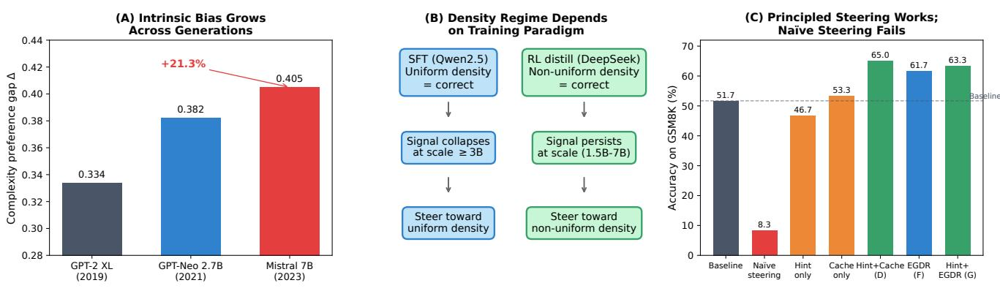
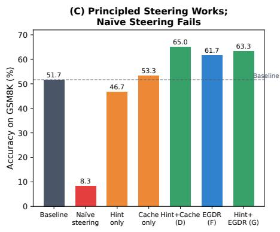
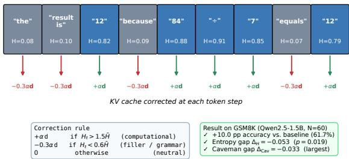

# The Density of Thought: Predicting and Steering Reasoning in Large Language Models

Tanush Kalhan\*1, Anupam Chattopadhyay2, Sriram Ranga2, and Amritendu Mukherjee3,4

1Plaksha University 2Nanyang Technological University 3Interview Street Technologies Pvt. Ltd. (HackerRank) 4Indian Statistical Institute

## Abstract

The Uniform Information Density hypothesis holds that effective communication distributes information evenly across an utterance. We investigate whether variation in information density across chain-of-thought (CoT) reasoning steps predicts answer correctness and can serve as a controllable inference-time target. We prompt frozen pretrained models to solve problems via CoT and measure the density of each reasoning step with two independent metrics: LP variance (how unevenly information is distributed across steps, computed as the variance in mean per-token negative log-likelihood) and the Caveman compression ratio. We then test whether density correlates with, and can be steered to improve, answer correctness. Experiments across six model scales, two training paradigms, and 60 GSM8K problems yield four main findings. First, lower LP variance predicts correctness in supervised fine-tuned (SFT) models, but this relationship weakens with scale and reverses in reinforcement-learning (RL) distilled models. Training paradigm therefore appears more influential than model size in determining density behaviour. Second, synthetic experiments reveal an intrinsic complexity preference: models trained on uniformly distributed data learn complexity-favouring distributions 2.0–2.6 times more accurately than simplicity-favouring ones. Third, direct inference-time density steering reduces accuracy from 60.0% to 8.3%, indicating that natural density patterns are functionally important to reasoning. Fourth, pre-generation nudging combining hint injection with contrastive KV-cache steering improves accuracy by 13.3 percentage points, consistent across both metrics. Finally, we introduce Entropy-Gated Density Routing (EGDR), a self-supervised method using token-level Shannon entropy to gate proportional KVcache adjustments during generation, improving accuracy by 10.0 percentage points without any external guidance. Code is available at https://github.com/tanushhh21/density\_ of\_thought.

## 1 Introduction, Motivation, and Contributions

Context and problem statement. Chain-of-thought (CoT) prompting (15) has become the dominant strategy for eliciting multi-step reasoning from large language models (LLMs), improving performance on arithmetic, symbolic, and commonsense tasks by decomposing complex problems into explicit intermediate steps. Despite this empirical success, we lack a principled understanding of why a given reasoning trace succeeds or fails. Two traces produced for the same problem can be nearly identical in length, vocabulary, and surface style, yet arrive at opposite answers. This suggests that correctness is not determined solely by what a model writes, but by how it organises the flow of information across its reasoning steps. The central problem we address is therefore the following: is there a measurable, structural property of a CoT trace that reveals whether the underlying reasoning is sound, and if so, can that property be controlled at inference time to make reasoning more reliable?

Information density in reasoning. We propose that the relevant property is information density: the degree to which each reasoning step contributes new, hard-to-predict content rather than predictable filler. Reasoning steps are not informationally uniform. A step that performs a genuine computation, such as evaluating an arithmetic expression or applying a rule, is difficult for the model to predict and therefore carries high information content. A step that merely restates the problem or provides connective phrasing is easy to predict and carries little. Because CoT reasoning unfolds autoregressively, the density of each step is shaped by, and in turn shapes, the internal state the model carries forward through generation. This coupling makes density a natural candidate for a correctness signal: the way information is distributed across steps may reflect whether the model is genuinely reasoning or merely producing plausible-looking text.

Motivation from Uniform Information Density. This intuition has a well-established theoretical grounding in psycholinguistics. The Uniform Information Density (UID) hypothesis (7) holds that efficient communicators distribute information as evenly as possible across an utterance, avoiding both dense spikes that overload the listener and sparse stretches that waste communicative capacity. UID has been validated across languages and discourse contexts (12, 1), and it offers a concrete, testable prediction when transferred to machine reasoning: if reasoning behaves like communication, then correct traces should exhibit smoother, more uniform information density than incorrect ones. We take this prediction as our starting point and ask whether it holds for LLM reasoning, how it interacts with a model’s scale and training, and whether it can be turned from a passive descriptor into an active lever for improving accuracy.

Findings and framing. Our answer is nuanced. Information density does signal reasoning quality, but the direction of the signal is not universal: it depends on the paradigm under which a model was trained rather than on its size. More importantly, we find that density is not a superficial stylistic feature that can be freely rewritten. It is functionally loadbearing, encoding the model’s accumulated computational context within the key-value (KV) cache, so that overriding it mid-generation destroys reasoning coherence rather than improving it. This distinction, between density as a signal of reasoning quality and density as a tool for influencing it, organ ises the paper. It also yields a design principle for inferencetime control: effective intervention must work with a model’s natural density organisation rather than against it.

Contributions. Mirroring the structure of our findings, this paper makes the following contributions:

• Density as a regime-dependent signal. We present the first systematic study of information density as a correctness signal in CoT reasoning across six model scales and two training paradigms, establishing that lower LP variance predicts correctness under supervised fine-tuning but reverses under reinforcement-learning distillation, so training paradigm is more influential than model size.

• An intrinsic complexity preference. Through controlled synthetic experiments following Ranga et al. (11), we show that LLMs possess an intrinsic structural bias toward syntactically complex, high-density text, a 2.0–2.6 KL asymmetry consistent across all model sizes, confirming that this bias is a property of the learning process rather than of training data.

• Density is functionally load-bearing. We demonstrate that naïve density steering fails catastrophically ( 51.7pp) and derive a precise design principle, preserve step-level generation integrity, that explains the failure and guides all subsequent methods.

• Density as an effective tool. We introduce a principled nudging pipeline (NuRL-style hint injection with contrastive KV cache steering) that improves accuracy by +13.3pp on GSM8K, with density footprints confirmed by two independent measurements, and EGDR, a selfsupervised method that uses per-token Shannon entropy to gate proportional KV cache correction during generation, improving accuracy by +10.0pp without any external input (p=0.019).

## 2 Related Work

Uniform Information Density in language and cognition. The UID hypothesis (7) predicts that speakers minimise peak processing effort by spreading information evenly across utterances. Tsipidi et al. (12) show that discourse structure independently modulates density: speakers are informationally denser at discourse peaks and sparser at transitions. Aceves and Evans (1) provide cross-linguistic evidence that denser languages communicate faster but with narrower conceptual focus. This trade-off is relevant to CoT reasoning, where denser steps commit to narrower but deeper computational paths.

Information density in LLM reasoning. Gwak et al. (4) revisit the UID hypothesis in LLM reasoning, finding that selecting traces with more uniform step-level density improves accuracy by 10–32% on AIME2025. Their approach selects among completed traces; EGDR shapes density during generation. Zhao et al. (16) identify a dual-density structure: computational steps should be dense while explanatory steps should be sparse. This motivates our finding that naïve global density steering fails: because different steps require different densities, any intervention that homogenises them destroys the structure that makes reasoning coherent.

LLM density modelling. Ranga et al. (11) study distributional learning in LLMs using a synthetic number language, finding that models learn syntactically cued distributions but fail on semantic ones. Our synthetic experiment (detailed in the Signal section) replicates their uniformcorpus KL result (0.0038  0.0010) and extends their framework to complexity-asymmetric distributions. Ranga et al. (10) conjecture that AI-generated text will eventually saturate high-probability sentence space (Plagiarism Singularity). Our cross-generational evidence shows this space is contracting faster than their GPT-2-based estimate assumes.

CoT improvement methods. Self-consistency (14) aggregates multiple sampled traces via majority voting; reranking methods select the highest-reward completed trace. Both operate over completed traces and incur sampling overhead. Our approach is orthogonal: we steer a single greedy generation through density-aware KV correction, adding 0.3% pertoken overhead.

Inference-time steering and prompt compression. KV cache steering controls style, safety, and topic via fixed global vectors (13, 6). Li et al. (8) use per-token entropy to gate generation branching. EGDR differs in that it applies a continuous, proportional, in-place KV correction during generation, rather than branching, post-hoc selection, or a fixed global vector. We repurpose Caveman Compression (9) as a density measurement tool for generated reasoning steps rather than for input compression, providing a signal independent of model probabilities.

## 3 Preliminaries and Density Measurement Framework

## 3.1 Information Density in Reasoning Traces

A CoT reasoning trace consists of K steps $s _ { 1 } , \ldots , s _ { K }$ , each a sequence of tokens generated autoregressively. Not all steps are informationally equal: a step computing an arithmetic result contributes novel, hard-to-predict content, while a transitional phrase is nearly deterministic given context. This variation in information density is the central object of our study.

The UID hypothesis provides the grounding for this study: it predicts that effective communicators distribute information evenly, avoiding both dense spikes (which cause processing errors) and sparse passages (which waste communicative capacity). Applied to CoT, we ask whether the same principle holds: are correct reasoning chains more uniformly dense, and can we steer density to improve correctness?

## 3.2 Density Metrics

We measure density via two complementary and independent signals.

Log-probability (LP) variance (model-internal). The LP score of step $s _ { k }$ is the mean per-token negative log-likelihood under the generating model:

$$
\operatorname { L P } ( s _ { k } ) = { \frac { 1 } { | s _ { k } | } } \sum _ { t \in s _ { k } } - \log P ( t \mid s _ { < t } , { \mathrm { p r o m p t } } ) .\tag{1}
$$

Higher $\operatorname { L P } ( s _ { k } )$ indicates greater information density: the model found the step harder to predict. We compute steplevel LP variance after min–max normalisation: $v =$ $\operatorname { V a r } ( \widehat { \mathrm { L P } } ( s _ { 1 } ) , \dots , \widehat { \mathrm { L P } } ( s _ { K } ) )$ , where $ \widehat { \mathrm { L P } } ( s _ { k } ) ~ = ~ ( \mathrm { L P } ( s _ { k } ) ~ -$ minj $\mathrm { L P } ( s _ { j } ) ) / ( \operatorname* { m a x } _ { j } \mathrm { L P } ( s _ { j } ) - \operatorname* { m i n } _ { j } \mathrm { L P } ( s _ { j } ) + \epsilon )$ . Z-score normalisation is excluded: it forces variance to 1.0 for every chain by definition, eliminating all between-chain signal.

Caveman compression ratio (linguistically grounded). The Caveman ratio $\rho ( s _ { k } )$ (9) is the fraction of tokens removed by a rule-based SpaCy pipeline that strips predictable grammatical tokens (determiners, auxiliary verbs, coordinating conjunctions, intensifiers). Lower $\rho$ indicates fewer predictable tokens and hence higher density. This signal is computed entirely from the surface form of the generated text, with no reference to model probabilities, and is therefore fully independent of LP variance.

Table 1: Complexity preference gap $\Delta$ across model families. The cross-generational effect (+21.3%) substantially exceeds the controlled within-family scaling effect (+13.2% over 40 parameters in Pythia), implicating training methodology, not scale, as the primary driver. Full per-model results in Table 8.
<table><tr><td>Comparison</td><td>Base ∆</td><td>Max ∆</td><td>Change</td></tr><tr><td>GPT-2 (124M→1.5B)</td><td>0.3190</td><td>0.3378</td><td>+4.8%</td></tr><tr><td>Pythia (70M→2.8B, ctrl.)</td><td>0.2935</td><td>0.3323</td><td>+13.2%</td></tr><tr><td>Cross-gen. (2019→2023)</td><td>0.3343</td><td>0.4054</td><td> $+ 2 1 . 3 \% ^ { * * * }$ </td></tr></table>

∗∗∗ KS: LOW p=1.3  10−47, MID p=1.6  10−47, HIGH $\displaystyle { p { = } 2 . 8 \times 1 0 ^ { - 3 1 } . }$

Why two signals. LP variance is model-internal; Caveman ratio is linguistically grounded. They share no computational basis. When both agree in direction across conditions, the density effect is real rather than a measurement artefact.

## 4 Information Density as a Signal

We first establish why information density varies systematically across model families, and whether this variation carries diagnostic information about reasoning quality.

## 4.1 LLMs Exhibit a Growing Complexity Preference

Before examining density in reasoning traces, we document a foundational empirical phenomenon: language models exhibit a growing preference for syntactically complex, highdensity text that has strengthened markedly across model generations. This preference is not trivially explained by training data: a controlled synthetic experiment confirms the bias is intrinsic to the learning process itself.

Cross-generational study. We construct a corpus of 3,204 Wikipedia sentences filtered for length (8–40 tokens) and grammatical completeness. Syntactic complexity is measured via SpaCy dependency tree depth; sentences are binned into low $( \leq 5 )$ , mid (5–7), and high (> 7) tiers. For ten pretrained models spanning GPT-2 Small (124M, 2019) through Mistral 7B (2023), we compute the complexity preference gap: $\Delta = \mathrm { L P } ( \mathrm { H I G H } ) - \mathrm { L P } ( \mathrm { L O W } )$ . Three model families disentangle scale from generational effects: GPT-2 (same training data, varying scale), Pythia (same architecture and data, controlled scale), and a cross-generational comparison (different architectures, training regimes, and years).

Table 1 shows that the cross-generational effect (+21.3%) substantially exceeds within-family scaling (+13.2% over 40 parameters in the controlled Pythia family). The GPT-2 XL to GPT-Neo transition is notably weak (p=0.187, LOW tier), localising the major shift to 2021–2023. The probability ratio $e ^ { \Delta }$ , which quantifies how much more likely a highcomplexity sentence is than a low-complexity one, grew from 1.40 (2019) to 1.50 (2023).

  
Figure 1: Overview of the paper’s argument. (A) The complexity preference gap $\Delta$ grows 21.3% from GPT-2 XL (2019) to Mistral 7B (2023), driven by training quality rather than scale alone. (B) The density–correctness relationship depends on training paradigm: SFT models beneficial direction of any density-based intervention. (C) Na¨ıve density steering collapses accuracy by 51.7 pp; principled pre-generationshow uniform density in correct solutions (consistent with UID); RL-distilled models show structured non-uniformity. This determines the nudging (D: Hint+Cache) achieves +13.3 pp; EGDR achieves +10.0 pp without any external hint.beneficial direction of any density-based intervention. (C) Naïve density steering collapses accuracy by 51.7 pp; principled pre-generation nudging (D: Hint+Cache) achieves +13.3 pp; EGDR achieves +10.0 pp without any external hint.

processing errors) and sparse passages (which waste com-Table 2: Synthetic experiment results (averaged across 2M–50M municative capacity). Applied to CoT, we ask whether themodels). The Uniform KL (0.0038) replicates Ranga et al. (11). The same principle holds: are correct reasoning chains more uni-KL asymmetry ratio (Inverse/Linear = 2.4 ) is consistent across all formly dense, and can we steer densindividual model sizes (range: 2.0–2.6 ).
<table><tr><td>Corpus</td><td>KL (avg)</td><td>Bias</td><td>Spear. ρ</td><td>KL ratio</td></tr><tr><td>Uniform</td><td>0.0038</td><td>+0.094</td><td>0.60*</td><td>一</td></tr><tr><td>Linear</td><td>0.0409</td><td>-0.50</td><td> $0 . 9 6 4 ^ { * * * }$ </td><td>1.0×</td></tr><tr><td>Inverse</td><td>0.0967</td><td>+0.77</td><td>0.21 n.s.</td><td>2.4×</td></tr></table>

$^ { * } p < 0 . 0 5 ; ^ { * * * } p < 0 . 0 0 1$ P) variance (model-internal). The. Bias: signed deviation of learned P(d) from ground e metruth.

LP(sk) = log P(t s<t, prompt).Intrinsic bias: synthetic evidence. Does the complex-| k| t∈skity preference arise from training data or from the learning process itself? Following Ranga et al. (11), we train model found the step harder to predict. We computefour GPT-2-like models (2M, 6M, 25M, 50M parame- step-level LP variance after min-max normalisation:ters) from scratch on a synthetic corpus with a fixed 67- ˆ ˆ , where ˆword vocabulary and sentences at dependency depths 2–8. min LP(s ))/(max LP(s ) min LP(s )We use three training distributions: Uniform $( P ( d ) { = } 1 / 7 )$ normLinear $( P ( 8 ) { = } 4 { \times } P ( 2 )$ ded: it forces variance to 1.0 for every, complexity-favouring), and In se $( P ( 2 ) { = } 4 { \times } P ( 8 )$ ion, eliminating all between-chain signal., simplic ty-favouring). Only the distribution over depth levels changes; vocabulary and grammar are identical.

f tokens removed by a rule-based SpaCy pipeline thatTable 2 reveals two principal findings. Under Uniform strips predictable grammatical tokens (determiners, auxil-training, all models assign h gher probability to complex seniary verbs, coordinating conjunctions, intensifiers). Lower ρtences despite equal training representation (positive bias, indicates fewer predictable tokens and hence higher density.+0.077 to +0.104), establishing the bias is intrinsic. The KL asymmetry ratio KL(Inverse)/KL(Linear), which ranges from 2.0 to 2.6 across all model sizes, shows that models learn complexity-favouring distributions more than twice Why two signals. LP variance is model-internal; Cave-as accurately as simplicity-favouring ones u der otherwise man ratio is linguistically grounded. They share no computa-identical conditions. Under Inverse training, models simultaneously under-represent simple sentences and over-represent complex ones, actively resisting the intended distribution at both ends. This structural bias means that every downstream task, including CoT reasoning, begins with a pre-existing pull toward dense text. Whether this pull manifests as a measur-Wikipedia sentences filtered for length (8–40 tokens) andable correctness signal in reasoning is the question we address granext.

Table 3: Density–correctness relationship across model families. LP $\operatorname { g a p } = \operatorname { V a r } ( C ) - \operatorname { V a r } ( W )$ . Architecture, vocabulary, tokeniser, and inference procedure are identical between SFT and RL families at each scale; the reversal is attributable to training paradigm.
<table><tr><td>Model</td><td>Paradigm</td><td>Acc.</td><td> $\Delta _ { \mathrm { L P } }$ </td><td>Regime</td></tr><tr><td>Qwen2.5-0.5B</td><td>SFT</td><td>26.7%</td><td>-0.029</td><td>Reversed</td></tr><tr><td>Qwen2.5-1.5B</td><td>SFT</td><td>51.7%</td><td>+0.020</td><td>UID</td></tr><tr><td>Qwen2.5-3B</td><td>SFT</td><td>60.0%</td><td>-0.003</td><td>Collapsed</td></tr><tr><td>Qwen2.5-7B</td><td>SFT</td><td>63.3%</td><td>-0.001</td><td>Collapsed</td></tr><tr><td>R1-Distill-1.5B</td><td>RL</td><td>66.7%</td><td>+0.013</td><td>Dual-density</td></tr><tr><td>R1-Distill-7B</td><td>RL</td><td>76.7%</td><td>+0.014</td><td>Dual-density</td></tr></table>

## ten pretrained models spanning GPT-2 Small (124M, 2019)4.2 Density Variance Predicts Correctness, but gh Mistral 7B (2023), we compute the comParadigm Determines Direction

families disentangle scale from generational effects: GPT-Setup. We evaluate on GSM8K (3) (N=60, greedy decod- ing) using two model families sharing the Qwen base architecture: Qwen2.5-Instruct (0.5B, 1.5B, 3B, 7B; standard SFT) and DeepSeek R1-Distill-Qwen (1.5B, 7B; RL distillation). For each model and problem, we compute LP variance substantially exceeds wand measure the LP gap $\Delta _ { \mathrm { L P } } = \operatorname { V a r } ( C ) - \operatorname { V a r } ( W )$ % over, where 40 parameters in the controlled Pythia family). The GPT-2Var(C) and Var(W) are mean LP variances over correct and XL to GPT-Neo transition is nincorrect solutions respectively.

Standard SFT: the UID regime. At Qwen2.5-1.5B, $\Delta _ { \mathrm { L P } } = + 0 . 0 2 0 \colon$ correct solutions have lower LP variance, consistent with UID. However, this signal collapses monoton-Intrinsic bias: synthically with scale: by 3B $( \Delta _ { \mathrm { L P } } = - 0 . 0 0 3 )$ oes theand 7B $\Delta _ { \mathrm { L P } } = -$ 0.001), LP variance is virtually identical for correct and incorrect solutions. Larger SFT models produce uniformly dense text regardless of correctness, erasing the density signature of reasoning quality.

Table 4: Naïve density steering (Qwen2.5-3B, N=60). Adaptive mid-step injection causes catastrophic accuracy collapse.
<table><tr><td>Condition</td><td>Accuracy</td><td>vs. Baseline</td></tr><tr><td>Baseline (greedy CoT)</td><td>60.0%</td><td></td></tr><tr><td>High-density prompting</td><td>50.0%</td><td>-10.0pp</td></tr><tr><td>Adaptive mid-step steering</td><td>8.3%</td><td> $- 5 1 . 7 \mathrm { p p }$ </td></tr></table>

RL distillation: the dual-density regime. DeepSeek R1- Distill-Qwen reverses the relationship. At 1.5B, $\begin{array} { r l } { \Delta _ { \mathrm { L P } } } & { { } = } \end{array}$ +0.013: correct solutions have higher LP variance, with dense computational peaks and sparse explanatory troughs, a pattern consistent with the dual-density structure of Zhao et al. (16). Critically, this signal persists across scale $\begin{array} { r } { ( \Delta _ { \mathrm { L P } } = } \end{array}$ +0.014 at 7B), unlike the SFT signal. Both RL-distilled models also outperform their SFT counterparts at matched scale (Table 3).

Implication. Training paradigm, not parameter count, determines whether UID or dual-density describes a model’s correct-reasoning profile. Any intervention designed to improve reasoning via density must therefore be calibrated to the model’s paradigm, since the direction of beneficial density change is not universal. Before designing any intervention, however, we must understand why the most obvious approach fails, and what that failure reveals about the functional nature of density in reasoning.

## 5 Information Density as a Tool

## 5.1 Naïve Steering Fails, and Reveals Why

The density–correctness correlation at Qwen2.5-1.5B suggests an obvious intervention: steering density toward the profile of correct solutions. We test two direct approaches and find both are harmful; however, the pattern of failure is itself informative.

Approaches and results. On Qwen2.5-3B (GSM8K, N=60, baseline 60.0%): High-density prompting (system prompt instructing compact, symbolic notation) reduces accuracy to 50.0% ( 10pp). Adaptive mid-step steering (injecting a corrective phrase if LP variance deviates midgeneration) collapses accuracy to 8.3% ( 51.7pp), robust across multiple prompt formulations (Table 4).

Diagnosis: density is load-bearing. The 51.7pp collapse is not caused by distraction from a badly worded prompt. When a corrective phrase is injected mid-step, the KV cache at that point encodes the model’s accumulated computational context, that is, the trajectory it has been following through the reasoning chain. Injecting an inconsistent token sequence severs this trajectory, causing incoherent continuation. Density patterns are therefore not a stylistic overlay on reasoning;

Table 5: Principled nudging results (Qwen2.5-1.5B-Instruct, $N { = } 6 0 ) . \quad \Delta _ { \mathrm { L P } } { = } \mathrm { V a r } ( C ) { - } \mathrm { V a r } ( W ) ; \quad \Delta _ { \mathrm { C a v } } { = } \mathrm { C a v } ( C ) { - } \mathrm { C a v } ( W )$ (negative = correct solutions denser). Both signals agree in direction across all conditions.
<table><tr><td>Cond.</td><td>Acc.</td><td>vs. A</td><td> $\Delta _ { \mathrm { L P } }$ </td><td> $\Delta _ { \mathrm { C a v } }$ </td><td>p</td></tr><tr><td>A: Baseline</td><td>51.7%</td><td>一</td><td>+0.002</td><td>+0.006</td><td>n.s.</td></tr><tr><td>B: Hint</td><td>46.7%</td><td> $- 5 . 0 \mathrm { p p }$ </td><td>+0.017</td><td>-0.008</td><td>0.017</td></tr><tr><td>C: Cache</td><td>53.3%</td><td> $+ 1 . 6 \mathrm { p p }$ </td><td>+0.005</td><td>-0.027</td><td>n.s.</td></tr><tr><td>D: Hint+Cache</td><td>65.0%</td><td> $+ 1 3 . 3 \mathrm { p p }$ </td><td>+0.004</td><td>-0.007</td><td>n.s.</td></tr></table>

they are functionally load-bearing, reflecting the model’s internal state at each point in generation.

This establishes a precise design principle: any viable inference-time density intervention must preserve step-level generation integrity. Interventions must either act before generation begins, or between individual tokens within a step, without interrupting any step’s completion. All methods in the following subsections satisfy this constraint.

## 5.2 Principled Nudging via Hint Injection and KV Cache Steering

Conditions. We evaluate four conditions on Qwen2.5- 1.5B-Instruct (GSM8K, N=60, greedy decoding): A (Baseline): standard greedy CoT. B (Hint): a NuRL-style abstract hint (2), generated by prompting the model to identify the problem’s key structural relationships without solving it, is prepended before the question.1 C (Cache Steer): a contrastive KV steering vector d is built from the mean KV cache difference between 20 CoT prompts and 20 direct-answer prompts at the final prompt token position. This vector is then added to the KV cache before generation $( c _ { v } = 1 . 0 , c _ { k } = 0 . 0 )$ D (Hint+Cache): combines B and C.

Results and interpretation. Condition D achieves +13.3pp, the highest accuracy of any evaluated condition (Table 5). The structure of the individual results reveals why the combination is necessary. Hint alone (B) reduces accuracy by 5.0pp yet produces the largest LP gap (+0.017, p=0.017): the hint shifts the density profile in the right direction, but Qwen2.5-1.5B lacks the representational capacity to capitalise on conceptual scaffolding without structural support. Cache steering alone (C) provides structural momentum (+1.6pp, $\Delta _ { \mathrm { C a v } } = - ~ 0 . 0 2 7 )$ but lacks conceptual direction. Their combination is effective because they address complementary bottlenecks: the hint furnishes what to reason about, whilst cache steering provides the structural context in which to execute it.

LP variance and Caveman compression ratio agree in sign across all four conditions: conditions associated with higher accuracy produce denser correct solutions than incorrect ones. This cross-signal agreement, between a modelinternal probability signal and an independent linguistic signal, confirms the density effect is genuine and not a measurement artefact.

Table 6: EGDR coefficient grid search (Qwen2.5-1.5B-Instruct, N=60). Accuracy increases monotonically; absence of degradation at α=0.30 suggests the optimum lies above the tested range.
<table><tr><td>α</td><td>Accuracy</td><td>vs. A</td><td>vs. D</td></tr><tr><td>0.05</td><td>58.3%</td><td> $+ 6 . 6 \mathrm { { p p } }$ </td><td>-6.7pp</td></tr><tr><td>0.10</td><td>55.0%</td><td>+3.3pp</td><td>−10.0pp</td></tr><tr><td>0.15</td><td>56.7%</td><td>+5.0pp</td><td>−8.3pp</td></tr><tr><td>0.20</td><td>58.3%</td><td>+6.6pp</td><td>-6.7pp</td></tr><tr><td>0.30</td><td>61.7%</td><td>+10.0pp</td><td> $- 3 . 3 \mathrm { p p }$ </td></tr></table>

## 5.3 Entropy-Gated Density Routing (EGDR)

Motivation. The nudging pipeline above acts before generation and requires an external hint. EGDR eliminates both requirements: it acts at the level of individual tokens during generation, using the model’s own Shannon entropy as the only guidance signal.

At every decoding step, the model produces a probability distribution over the vocabulary. Its Shannon entropy $\begin{array} { r } { H _ { t } ~ = ~ - \sum _ { v } p _ { t } ( v ) \log p _ { t } ( v ) } \end{array}$ is a real-time, model-internal density sensor: high $H _ { t }$ signals a computationally dense moment (genuine uncertainty, non-trivial decision); low $H _ { t }$ signals predictable filler (the model is highly confident about the next token). This operationalisation corresponds directly to the dual-density structure of Zhao et al. (16) (dense computation, sparse explanation), derived here purely from the model’s generation process without external measurement.

Method. Let $\bar { H }$ be the mean per-token entropy over correct solutions in Conditions A–D, and d the normalised KV steering vector from Condition C. EGDR applies the following correction to the last KV position of every transformer layer after each token is decoded:

$$
\delta _ { t } = \left\{ \begin{array} { l l l } { + \alpha \mathbf { d } } & { H _ { t } > 1 . 5 \bar { H } } & { ( \mathrm { d e n s e : r e i n f o r c e } ) } \\ { - 0 . 3 \alpha \mathbf { d } } & { H _ { t } < 0 . 6 \bar { H } } & { ( \mathrm { s p a r s e : m o d e r a t e } ) } \\ { 0 } & { \mathrm { o t h e r w i s e } } & \end{array} \right.\tag{2}
$$

The asymmetric magnitudes (1.0 vs. 0.3) reflect the dualdensity finding: computational moments warrant stronger reinforcement than explanatory moments warrant suppression. Thresholds $H _ { \mathrm { h i g h } } { = } 1 . 5 \bar { H }$ and $H _ { \mathrm { l o w } } { = } 0 . 6 \bar { H }$ are derived from Conditions A–D on the same N=60 evaluation set (acknowledged as a limitation in the Limitations section). EGDR acts between tokens, never mid-step, satisfying the design principle.2

  
Figure 2: EGDR applies a piecewise KV cache correction at ev-. High-entropy tokens (computationally dense moments,ery generated token based on the model’s own Shannon entropy $H _ { t } .$ H¯ ) receive a positive correction +αd, reinforcing the rea. High-entropy tokens (computationally dense moments, $H _ { t } \ >$ ing trajectory. Low-entropy tokens (predictable filler, Ht < 0.6H¯ )1.5H¯ ) receive a positive correction +αd, r inforcing the reason-receive a small negative correction −0.3αd. This seling trajectory. Low-entropy tokens (predictable filler, $H _ { t } < 0 . 6 \bar { H } )$ gating requires no external input and never interrupts step-levelreceive a small negative correction 0.3αd. This self-supervised α=0.30   +10.0   gating requires no external input and never interrupts step-level generation. At α=0.30, EGDR achieves +10.0 pp accuracy on GSM8K with the most statistically significant density footprint of any evaluated condition (p=0.019).

Novelty. Prior work uses per-token entropy to branch paths α Accuracy vs. A vs. D(8) or select among completed traces (4). EGDR uses entropy for continuous, in-place KV correction during genera-−0.10 55.0% pp pption: self-supervised, adaptive in magnitude, and structurally safe.

Results. Accuracy increases monotonically with α (Table 6), reaching 61.7% (+10.0pp) at α=0.30 with no degra-Novelty. Prior work uses per-token entropy to branchdation, suggesting the optimal lies above the tested range. paths (Li et al. 2025) or select among completed tracesHint+EGDR (G) achieves 63.3% (+11.6pp). Condition D (Gwak et al. 2025). EGDR uses entropy for continuous,remains the highest-accuracy single c ndition (65.0%); the in-place KV correction during generation: self-supervised,gap arises because the contrastive KV vector provides more adaptive in magnitude, and structurally safe.targeted structural support than EGDR’s broader reasoningmode direction.

e 6), reaching 61.7% (+10.0pp) at α=0.30 with no degra-Most significantly, correct solutions under EGDR exhibit dation, suggesting the optimal lies above the tested range.substantially lower mean per-token entropy than incorrect Hintones $( \Delta _ { H } = - 0 . 0 5 3 , p { = } 0 . 0 1 9 .$ .3% (+11.6pp). Condition D, Table 7), the only result reach-reing $p < 0 . 0 5$ ghest-accuracy single condition (65.0%); theon this measure across the entire experiment. The Caveman gap $( \Delta _ { \mathrm { C a v } } { = } - 0 . 0 3 3 )$ is the largest of any condition. Both signals confirm that EGDR genuinely reshapes the model’s density profile during generation, steering correct solutions toward more focused token distributions.

## sult reaching p<0.05 on thi5.4 Ablation Studies

of any condition. Both signals confirm that EGDR gen-Density metric. LP variance, per-step Shannon entropy, and Caveman compression ratio yield consistent directional patterns across all conditions, confirming the density– correctness relationship is not an artefact of any single operationalisation.

Normalisation. Min–max normalisation is required; zscore normalisation forces variance to exactly 1.0 for every chain by definition, rendering between-chain comparisons meaningless.

Table 7: Complete results across all conditions. $\Delta _ { H } \colon$ mean entropy(correct) mean entropy(wrong); negative = correct solutions more confident per token. EGDR (F) is the only condition reaching $p < 0 . 0 5$ on $\Delta _ { H }$
<table><tr><td>Cond.</td><td> $\operatorname { A c c } .$ </td><td>vs. A</td><td> $\Delta _ { H }$ </td><td> $\Delta _ { \mathrm { C a v } }$ </td><td>p</td></tr><tr><td>A: Baseline</td><td>51.7%</td><td></td><td>一</td><td>+0.006</td><td>一</td></tr><tr><td>B: Hint</td><td>46.7%</td><td>-5.0pp</td><td>一</td><td>-0.008</td><td>一</td></tr><tr><td>C: Cache</td><td>53.3%</td><td>+1.6pp</td><td></td><td>-0.027</td><td>一</td></tr><tr><td>D: Hint+Cache</td><td>65.0%</td><td>+13.3pp</td><td></td><td>-0.007</td><td></td></tr><tr><td>F: EGDR</td><td>61.7%</td><td>+10.0pp</td><td>-0.053</td><td>-0.033</td><td>0.019</td></tr><tr><td>G: Hint+EGDR</td><td>63.3%</td><td>+11.6pp</td><td>-0.041</td><td>-0.024</td><td>0.021</td></tr></table>

EGDR coefficient. Accuracy increases monotonically from α=0.05 to α=0.30 (Table 6), with a plateau at 58.3% between 0.05–0.20 and a jump to 61.7% at 0.30. No degradation at the ceiling suggests the minimum effective threshold is around $\alpha { = } 0 . 3 0$ , consistent with the naïve steering finding: under-correction is safe but ineffective.

## 6 Discussion

Density as a window into model state. The central insight unifying all results is that information density in CoT reasoning is not a surface stylistic property but a direct reflection of the model’s internal computational state at each generation step. It encodes the probability mass allocation that emerges from training, the trajectory the model is following through its KV cache, and the degree to which each token contributes to genuine reasoning versus grammatical scaffolding. Density cannot be adjusted from outside without disrupting that state; it can only be nudged through the model’s own generative process or shaped before generation begins.

Why EGDR succeeds where naïve steering fails. Both target density, yet produce diametrically opposite outcomes. The difference is granularity: mid-step injection disrupts the KV trajectory at step boundaries (coarse), destroying reasoning coherence; EGDR reinforces it token by token (fine), amplifying the model’s natural density rhythm without severing any computational thread.

Paradigm determines the correct intervention direction. The reversal of the density–correctness relationship between SFT and RL paradigms has a direct practical consequence: a steering method calibrated for one regime (e.g., reducing variance for SFT models) would be contraindicated for the other (RL models benefit from non-uniform variance). Densitybased interventions must first establish the model’s paradigm.

Complementarity with CoT acceleration. EGDR’s pertoken entropy signal partitions tokens into high-entropy computational tokens (reinforced) and low-entropy grammatical tokens (moderated), precisely the decomposition required by acceleration methods such as SemCoT (5), which encodes low-information steps implicitly. Density steering and acceleration are therefore complementary objectives applicable to the same token-level decomposition.

## 7 Limitations

Scale and benchmark. All nudging and EGDR experiments use Qwen2.5-1.5B-Instruct and N=60 GSM8K problems. Accuracy comparisons on N=60 have limited statistical power; the entropy signal (p=0.019, computed over per-token distributions) is our primary quantitative evidence. Replication on larger sets and harder benchmarks (MATH, AIME) is important future work.

Threshold circularity. EGDR’s entropy thresholds are derived from the same N=60 set used for evaluation; a held-out development set would be methodologically preferable.

Steering vector specificity. The direction vector d encodes a broad “reasoning mode” (CoT vs. direct answer). A vector constructed from high- versus low-entropy token contrasts within correct solutions would target density more precisely and would likely improve both accuracy and signal strength.

Cross-generational confound. The cross-generational comparison conflates scale with generation (Mistral 7B is larger than GPT-2 XL); the Pythia experiment provides a scale-controlled lower bound, but the two effects cannot be fully isolated without matched model sizes.

## 8 Conclusion

This paper establishes that information density in LLM chain-of-thought reasoning traces is a structural property of the model’s learned representations, traceable to an intrinsic complexity bias confirmed by synthetic experiments (2.0–2.6 KL asymmetry). This bias manifests as a regimedependent correctness signal: uniform density predicts correctness under SFT; structured non-uniformity predicts correctness under RL distillation. Density is load-bearing: disrupting it collapses accuracy by 51.7pp. Working with the model’s density rhythm through principled interventions, by contrast, improves accuracy by +13.3pp (hint with cache steering) and +10.0pp (EGDR, p=0.019). The guiding principle is that effective use of density as a reasoning tool requires understanding it as an expression of model state rather than as a surface stylistic parameter.

The broader significance of this work is that it reframes information density from a passive descriptor of reasoning quality into an active, inference-time control surface. Because EGDR is fully self-supervised and adds negligible overhead, it offers a practical path to improving reasoning without retraining, additional data, or external verifiers, and it composes naturally with existing decoding-time methods. In the immediate term, the approach invites replication on larger evaluation sets and harder benchmarks such as MATH and AIME, and a systematic study of the entropy-gating thresholds on held-out data. A natural next step is to construct steering directions that target density explicitly rather than a broad reasoning mode, which our analysis suggests would sharpen both accuracy and the underlying signal. Over the longer term, density-aware inference points toward paradigmadaptive reasoning systems that first diagnose a model’s density regime and then apply the correspondingly beneficial intervention, and toward a unified treatment of density-guided steering and density-guided acceleration operating on the same token-level structure. We believe that treating information density as a first-class, controllable property of machine reasoning opens a productive direction for making large language models both more accurate and more interpretable.

## Ethical Statement

All experiments use publicly available pretrained models (Qwen2.5-Instruct, DeepSeek R1-Distill-Qwen) and a publicly available benchmark (GSM8K, 3). No private data, proprietary APIs, or human subjects are involved. The synthetic PCFG corpus contains no personally identifiable information. The techniques introduced improve reasoning accuracy without introducing capabilities beyond those of the underlying base models; no new misuse vectors are identified.

Authors acknowledge the assistance of Claude3 (Opus 4.8) in drafting this paper. Overleaf4 has been used as the LATEX editing and document-preparation environment. Authors take ownership and responsibility for the final content.

## References

[1] P. Aceves and J. A. Evans. Denser languages communicate faster but with narrower conversational breadth. Nature Human Behaviour, 2024.

[2] Y. Chen et al. NuRL: Nuanced reasoning via reinforcement learning. In International Conference on Learning Representations, 2026.

[3] K. Cobbe et al. Training verifiers to solve math word problems. arXiv preprint arXiv:2110.14168, 2021.

[4] D. Gwak et al. Revisiting the uniform information density hypothesis in LLM reasoning traces. arXiv preprint arXiv:2510.06953, 2025.

[5] Z. He et al. SemCoT: Semantic chain-of-thought with implicit tokens. In Advances in Neural Information Processing Systems, 2025.

[6] E. Hernandez et al. Inspecting and editing knowledge representations in language models. arXiv preprint arXiv:2304.00740, 2023.

[7] R. Levy and T. F. Jaeger. Speakers optimize information density through syntactic reduction. In Advances in Neural Information Processing Systems, 2007.

[8] X. Li et al. Entropy-gated branching for efficient testtime reasoning. arXiv preprint arXiv:2510.24940, 2025.

[9] W. Peltomaki. Caveman compression: Semantic compression for LLM contexts, 2025. https://github.com/ wilpel/caveman-compression.

[10] S. Ranga, R. Mao, E. Cambria, and A. Chattopadhyay. The plagiarism singularity conjecture. In Proceedings of NAACL, pages 10245–10255, 2025.

[11] S. Ranga, S. S. Bedampudi, R. Mao, and A. Chattopadhyay. Are language models any good at density modeling? In Proceedings of the AAAI Conference on Artificial Intelligence, pages 32791–32798, 2026.

[12] E. Tsipidi et al. Surprise! uniform information density isn’t the whole story. In Proceedings ofEMNLP, 2024.

[13] A. M. Turner et al. Activation addition: Steering language models without optimization. arXiv preprint arXiv:2308.10248, 2023.

[14] X. Wang, J. Wei, D. Schuurmans, Q. Le, E. Chi, S. Narang, A. Chowdhery, and D. Zhou. Selfconsistency improves chain of thought reasoning in language models. In International Conference on Learning Representations, 2023.

[15] J. Wei, X. Wang, D. Schuurmans, M. Bosma, E. Chi, Q. Le, and D. Zhou. Chain-of-thought prompting elicits reasoning in large language models. In Advances in Neural Information Processing Systems, 2022.

[16] Y. Zhao et al. Denser: Dual-density inference for efficient reasoning. arXiv preprint arXiv:2512.15358, 2025.

## A Full Cross-Generational Results

Table 8: Per-model complexity preference gap ∆. The Pythia twostage plateau (rapid growth to 410M, near-stasis at 1B–2.8B) suggests a scaling law for complexity preference with a ceiling around 1B parameters in this architecture.
<table><tr><td>Model</td><td>Yr</td><td>∆</td><td>Change</td><td>KS (next)</td></tr><tr><td>GPT-2 Small (124M)</td><td>2019</td><td>0.3190</td><td></td><td> $p < 0 . 0 1$ </td></tr><tr><td>GPT-2 Medium (355M)</td><td>2019</td><td>0.3378</td><td>+5.9%</td><td>n.s.</td></tr><tr><td>GPT-2 Large (774M)</td><td>2019</td><td>0.3343</td><td>+4.8%</td><td>n.s.</td></tr><tr><td>GPT-2 XL (1.5B)</td><td>2019</td><td>0.3343</td><td>+4.8%</td><td>一</td></tr><tr><td>Pythia 70M</td><td>2021</td><td>0.2935</td><td>一</td><td>p &lt; 0.01</td></tr><tr><td>Pythia 160M</td><td>2021</td><td>0.3063</td><td>+4.4%</td><td>p &lt; 0.01</td></tr><tr><td>Pythia 410M</td><td>2021</td><td>0.3228</td><td>+9.9%</td><td>plateau</td></tr><tr><td>Pythia 1B</td><td>2021</td><td>0.3224</td><td>+9.8%</td><td>n.s.</td></tr><tr><td>Pythia 1.4B</td><td>2021</td><td>0.3321</td><td>+13.2%</td><td>n.s.</td></tr><tr><td>Pythia 2.8B</td><td>2021</td><td>0.3323</td><td>+13.2%</td><td></td></tr><tr><td>GPT-2 XL</td><td>2019</td><td>0.3343</td><td>一</td><td> $p { = } 0 . 1 8 7 \left( \mathrm { L O W } \right)$ </td></tr><tr><td>GPT-Neo 2.7B</td><td>2021</td><td>0.3816</td><td>+14.2%</td><td> $p { = } 1 . 3 \times 1 0 ^ { - 4 7 }$ </td></tr><tr><td>Mistral 7B v0.3</td><td>2023</td><td>0.4054</td><td>+21.3%</td><td></td></tr></table>