# ToolBottleneckBench: Measuring Tool-Agent Performance under Controlled Pressures and Fixed Harness Budgets

Zichuan Xu1 Yuyang Dong2 Makoto Onizuka1 Chuan Xiao1,3

1University of Osaka 2Initial S 3Nagoya University

{xu.zichuan,onizuka,chuanx}@ist.osaka-u.ac.jp

dongyuyang@initial-s.com

## Abstract

The success score of a tool agent reflects both its model and the budgets of the harness that runs it. We present ToolBottleneckBench, a benchmark that measures tool-agent performance under controlled pressures and fixed harness budgets. Synthetic enterprise tasks stay fixed while one pressure varies: the registered tool catalog, the visible tool menu, the certified workflow, or the encoding of returned records. An exact grader records the first un met obligation of each failed episode and the harness limit, if any, that ended it. Across 21 model and harness configurations, the visible menu is the only one of the three pressures that act on the model with a large penalty, and this penalty tracks truncation at the completion cap. Raising the cap sixteenfold removes most of the penalty in the truncationheavy configurations. Most failures end at a harness limit, and the failure record identifies the assigned pressure no more reliably than a count of tool calls. The repairs that help change which tools reach the model or who issues the calls, and only two repairs, neither improving model behavior, beat every configuration switch. We recommend reporting pressure effects with the harness budgets under which they were measured. We release the benchmark at https://github.com/zichuanxu/ tool-bottleneck-bench.

## 1 Introduction

Tool agents are usually compared by a single success score, yet an agent runs inside a harness that shows it a menu of tools, returns tool results in some format, and enforces budgets on tokens, calls, and turns. When an agent fails, the cause may lie in the model or in these limits, and neither a success score nor a label for the first failed step can tell the two apart. An agent facing a large menu whose first response is cut off by the perrequest completion cap fails before it has chosen any tool, yet a grader that checks obligations in order records a tool-selection failure. A serving adapter that silently drops well-formed tool calls has a similar effect (Wang, 2026a). Recent benchmarks report results per model and harness (Yao et al., 2026; Kapoor et al., 2026) but do not measure how much of a load’s penalty occurs together with a harness limit.

Realistic environments change several loads at once (Lu et al., 2025; Yao et al., 2025; Trivedi et al., 2024). Controlled benchmarks vary loads with the goal fixed (Babu and Iyer, 2026b; Maekawa et al., 2026) but do not record which harness limit ended the failing episodes. Failure diagnosis localizes the failing stage (Raj et al., 2026) but, without an assigned pressure, cannot check whether the label is right.

We introduce ToolBottleneckBench, a benchmark that measures tool-agent performance under controlled pressures and fixed harness budgets (Figure 1). A task family fixes the request, the facts, the answer, the evidence rule, and the tools. A deterministic compiler then changes one pressure at a time to produce matched variants. The four pressures are the registered tool catalog (R), the visible tool menu (V), the certified workflow (W), and the encoding of returned records (D). All main results use one frozen harness contract. An exact grader checks nine obligations and records the first unmet one together with a terminal flag that names the harness limit, if any, that fired. We call this pair the failure record.

With this design we ask four questions. (1) Which pressures reduce verified task success (VTS)? (2) How much of each loss occurs together with a harness limit? (3) Where do failed episodes end, and does the failure record reveal which pressure was assigned? (4) Which repairs help under their pressure, and do they beat switching to another configuration?

We evaluate 21 configurations from 7 organizations on 26,576 scored conditions. Our main findings are as follows. (1) Of the three modelfacing pressures (V, W, D), only the visible menu has a large penalty. Growing it from 8 to 128 tool schemas changes VTS by −12.3 points under a routed menu and by −17.5 points when the full menu stays visible. The workflow pressure has no detectable pooled effect but opposite-signed effects across configurations, and returned-state encoding has small effects. (2) Under the routed menu, the menu penalty tracks completion-cap truncation across configurations (Pearson r = −0.95), the 8 configurations that never truncate stay within 2.8 points of zero, and in the 6 truncation-heavy configurations a sixteenfold cap removes most of the menu penalty, from −43.7 to −2.7 points. (3) Of all exactly graded failures, 91.5% end at a harness limit and only 5.5% are wrong conclusions. Our decoders identify the assigned pressure from the failure record no more reliably than from a count of tool calls. (4) The repairs that help change which tools reach the model or who issues the calls, and our prompt repairs do not. Only two repairs, neither improving model behavior, beat every configuration switch on success.

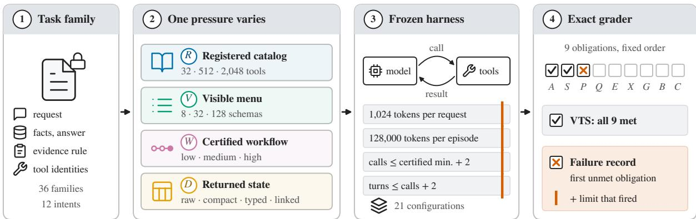  
Figure 1: Overview. (1) A task family fixes the request, facts, answer, evidence rule, and tools. (2) Its matched variants differ in one assigned pressure (R, V, W, or D). (3) All main results use the same frozen budgets, and (4) the exact grader records the first unmet of nine obligations and the harness limit, if any, that fired. R is scored by intention-to-treat (ITT) success, which counts episodes whose tools were never retrieved as failures, so its scale differs from that of V, W, and D.

We contribute the benchmark, its failure record, and a repair protocol that tests each repair with and without its pressure and against every configuration switch, and release the generator, grader, scored rows, and analysis code.

## 2 Related Work

Tool-use benchmarks. Early benchmarks score whether a model calls APIs correctly (Li et al.,

2023; Qin et al., 2024; Patil et al., 2025). Later ones use stateful, realistic environments (Lu et al., 2025; Yao et al., 2025; Trivedi et al., 2024) or live MCP servers (Wang et al., 2025; Luo et al., 2025), with StableToolBench stabilizing unstable APIs (Guo et al., 2024). In these environments, two tasks usually differ in catalog, workflow, and observation format at once, so a score difference cannot be traced to one load.

Controlled studies of tool load. Other work studies specific loads with the goal fixed: tool retrieval (Shi et al., 2025; Liu et al., 2026), connector-first routing (Fei et al., 2025; Gan and Sun, 2025), menu size (Repantis et al., 2026), distractors and dependency depth (Maekawa et al., 2026), long API chains (Wan et al., 2026), and catalog size or output length (Kate et al., 2025, 2026), with related position effects in long contexts (Liu et al., 2024) and a loss from context length alone (Du et al., 2025). ToolMenuBench separates whether the gold tool is visible from whether it is selected (Babu and Iyer, 2026b,a), and we follow this distinction. ToolBottleneckBench varies catalog, menu, workflow, and encoding on the same task families and records which harness limit ended each failing episode.

Harness effects. Harness-Bench and HAL report results per model and harness (Yao et al., 2026; Kapoor et al., 2026). A harness change can reorder models (Zhang et al., 2026; Li et al., 2026), help one model while hurting another (Cho, 2026; Starace, 2026), or flip as many tasks as a rerun (Liu and Han, 2026). The agent-computer interface (Yang et al., 2024; Wang, 2026b), system components (Lukassen et al., 2026), context growth and pruning (Zeng et al., 2026; Lodha et al., 2026), working memory (Chen et al., 2026a), and serving adapters (Wang, 2026a) also change outcomes, as does deliberation that displaces action (Cuadron et al., 2025). We instead measure how much of a controlled pressure effect occurs together with a specific harness limit.

Failure diagnosis and repair. We build on stage attribution, counterfactual correction, and wronglayer repair controls (Zheng et al., 2026; Shams, 2026; Ma et al., 2026). Prior studies ask whether a failure belongs to the model or the harness (Raj et al., 2026), note that localizing an error does not say what to change (Yuan et al., 2026), patch harness flaws (Chen et al., 2026b), and show that readout intervention beats prompting (Chen, 2026), that patches can be validated by replay (Lin et al., 2026) or still hurt (Yoon and Kim, 2026), and that reexecution alone repairs some failures (Luan et al., 2026). Exact graders need validity audits of their own (Bhat et al., 2026; Gurram, 2026; Zhao et al., 2026). Appendix B reports ours. ToolBottleneck-Bench combines these techniques on one population with assigned pressures and compares every repair with configuration switches, and Appendix L compares designs.

## 3 ToolBottleneckBench

ToolBottleneckBench places a known bottleneck on a task, measures how performance changes, and checks whether the recorded failure points to it. We call such a controlled bottleneck an assigned pressure.

## 3.1 Task Families and Matched Variants

A taskfamily fixes everything that defines the correct outcome of a task: the user request, the fact values that decide it, the decision label, the rule for which evidence must be cited, the permitted final state of the environment, and the identities of the tools that do the work (the operational tools). The benchmark has 36 families nested in 12 synthetic enterprise intents over accounting, email, file, and calendar records. Record IDs are opaque, so no answer can be reused across tasks.

A deterministic compiler takes a family and changes one pressure to produce matched variants. Matched variants differ only in that pressure. Under the workflow pressure, the required sources array in the answer also grows from one to three entries. Because the decision and facts of the correct answer are the same across variants, the paired difference in success between matched variants measures the effect of the pressure that was changed.

For example, one family asks whether an overdue case should be escalated. Its decision facts (status, commitment date, and contact), its six operational tools, and its reference answer, {"decision":"escalate", ... "sources":["source-2"]}, are fixed. Its V variants differ only in how many tool schemas are shown, and its D variants only in how the same records are encoded (Figure 5 in Appendix A).

## 3.2 Four Assigned Pressures

Table 1 summarizes the four pressures, or layers, and what each one changes besides the intended load.

Registered catalog R. The catalog is the set of functions the system has registered. Nested catalogs hold $R \in \ \{ 3 2 , 5 1 2 , 2 , 0 4 8 \}$ functions. A frozen retriever, which does not depend on the model, returns a 16-function shortlist from the catalog. We use two retrievers: a flat lexical scorer and a connector-first router that first picks a connector and then ranks its tools. We record separately whether the required tools are in the shortlist (availability A) and whether the model selects them when they are (selection S). Success on this pressure is scored intention-to-treat as A · S (ITT success), so an episode whose required tools were never retrieved counts as a failure. The catalog has its own block, Discovery.

Visible menu V. The menu is the set of tool schemas shown to the model. $V \in \{ 8 , 3 2 , 1 2 8 \}$ counts these schemas, and the operational tools are always among them. The added functions are route neighbors that differ from an operational tool in one of workspace, region, or collection. An offline audit executed the added functions 13,158 times, and no call returned a record. The system prompt states that the operational tools match the route string in the request, so a larger menu adds candidates and context without ambiguity about which tools apply: schema bytes per exposure grow from 3,481 to 55,176.

Certified workflow W. We call a tool program certified when an independent checker proves that it is minimal and that its calls respect the data dependencies. Low, medium, and high W require 2,

Table 1: The four assigned pressures, each varied with the task family fixed. Calls and schema bytes are means over the routed capacity episodes (Section 3.3), prompt tokens over the fixed-menu lane, and observation bytes over the reference programs.
<table><tr><td>Layer</td><td>Levels</td><td>What the variant changes (measured)</td></tr><tr><td>R catalog</td><td>32, 512, 2,048 tools</td><td>catalog the retriever searches; required-tool availability at  $R =$  2,048: flat 19.4%, connector-first 77.8%</td></tr><tr><td>V menu</td><td>8, 32, 128 tools</td><td>schema bytes per exposure 3,481 / 13,820 / 55,176; mean prompt tokens per episode (fixed menu) 15,714 at V = 8 and 37,659 at V = 128</td></tr><tr><td>W workflow D returned state</td><td>low, medium, high raw, compact, typed, linked</td><td>certified program length; mean attempted calls 3.7 / 5.8 / 7.2 encoding of returned records; mean observation bytes 1,214 / 1,471 / 1,351 / 1,533</td></tr></table>

4, and 6 reads, plus one call when the task requires a reversible action. The number of required calls, the dependency depth, the spread of evidence, and the accumulated context grow together, so W is a composite pressure. A separate frontier block extends W further. It places the same facts behind 0, 2, 6, or 14 public handoffs, records whose only content points to the next record, for certified minima of 2, 6, 14, or 30 calls.

Returned-state encoding D. Tool results return the same records in one of four encodings: raw JSON, dictionary-coded tuples with a visible field dictionary (compact), typed objects with a type dictionary (typed), or typed objects with identity links and a relation dictionary (linked). All four decode to the same values, and compact is larger than raw in bytes (Appendix A).

The capacity factorial crosses the endpoints of the three model-facing pressures, {8, 128} × {low, high} × {raw, linked}, and adds four checkpoint cells (V = 32, medium W, compact, and typed), each varying one pressure from the baseline cell (8, low, raw).

## 3.3 Harness Contract

All main results use one frozen harness contract. The completion cap limits the tokens the provider may generate per request to 1,024, and a response cut off at the cap ends the episode. The cap fits one complete tool call or answer: across the 9,841 successful episodes, completion tokens per response have median 152 and 99th percentile 476. Where reasoning tokens count against the cap, it also covers reasoning and is tight for truncation-heavy configurations, which the sixteenfold sweep tests (Appendix E.1). The episode budget is 128,000 reported tokens. The call limit is the certified minimum plus two, and the turn limit is the call limit plus two. An episode stops early once success is impossible within the call limit (an infeasibility stop). These four limits are the harness budgets, and a harness limit fires when an episode ends at one of them or at an infeasibility stop.

The main capacity runs use a routed menu: the model sees the full menu until its first executed call to an operational tool, and the menu then narrows to the operational tools. This narrowing uses the ground truth, so the routed menu is an oracleassisted reference. A paired fixed-menu lane keeps the full menu throughout and is the no-repair arm of the routed menu (Section 4.3). Two further studies (Appendix E) and two pilot actions (Appendix J) raise the completion cap. All other results use the frozen budgets.

## 3.4 Verified Task Success and Failure Record

We measure performance as verified task success (VTS). An episode succeeds only if it meets nine obligations, and VTS is their conjunction,

$$
Y = A \land S \land P \land Q \land E \land X \land G \land B \land C ,
$$

checked in this order. A is availability of the required tools, S selection of the operational tools, P completion of a dependency-valid program (workflow), Q an exact JSON answer (answer), E the exact set of cited records (evidence), X the exact permitted change of state (safety), G no unrequested change of state (governance), B the episode budget and call limit, and C completion integrity. Any dependency-valid call order is accepted, and no model judge enters the score. The state checks for X and G follow AppWorld and τ -Bench (Trivedi et al., 2024; Yao et al., 2025).

Each failed episode receives one terminal flag, which records how the episode ended. In order of precedence, the flags are (i) truncation at the completion cap, (ii) exceeding the episode budget or the call limit, (iii) reaching the turn limit, (iv) an early stop because success had become impossible within the call limit, (v) a wrong conclusion, and (vi) a break of another term of the contract. We call the pair of the first unmet obligation and the terminal flag the failure record. Appendix B gives the grading rules and the audits that check the generator and the grader.

## 4 Experimental Setup

## 4.1 Configurations and Data

The unit of evaluation is a configuration: a served model together with its provider route and the harness settings (tool protocol, prompt template, transcript handling, retry policy, and budgets). We evaluate 21 configurations from 7 organizations, all through managed inference endpoints. Appendix C lists their baseline success, per-configuration effects, and cost. In total there are 26,576 scored conditions, of which 20,408 are graded by exact VTS. Qwen3.8 Flash has no prompt-repair, sentinel-repeat, or frontier rows, so those analyses use the other 20 configurations.

## 4.2 Contrasts and Statistical Analysis

For the capacity factorial we report eight contrasts, each a paired within-family difference in VTS in percentage points (pp): the main effects of V (128 minus 8), W (high minus low), and linked encoding (linked minus raw), their three pairwise interactions, and compact minus raw and typed minus raw at the baseline cell. Each contrast averages 756 family-by-configuration differences. Our primary intervals are unadjusted 95% percentile cluster bootstraps with 10,000 draws that resample the 36 families. We repeat the analysis with the 12 intents and with the 21 configurations as the resampling unit, and correct each set of eight p values with the Holm procedure (Holm, 1979). Discovery contrasts resample 18 clusters of required tools. The 9 conditions that failed for infrastructure reasons are kept and counted as failures of their configuration. Appendix D gives the contrast weights and the sensitivity analyses.

## 4.3 Repairs and the Switch Comparison

We test one repair aimed at each pressure: the connector-first router for R, the routed menu for V, a workflow prompt for W, and an interface guide for D. The two prompt repairs edit the system prompt (Appendix A). We also test a publichandoff controller, a deterministic program that follows the public handoffs and issues the calls itself. Its evaluation, the structural holdout, uses the 2- and 30-call frontier cells over 24 held-out intents, distinct from the 12 core intents, on 17 configurations.

A repair should help more under its pressure than without it. Let $\mu _ { \ell z } ^ { a }$ be the mean success (VTS, or ITT success for R) for layer ℓ at pressure level $z \in \{ 0 , 1 \}$ under intervention a, where $a ~ = ~ 0$ means no repair and $a = \ell$ the repair for ℓ, and let $\kappa _ { \ell }$ be the repairs for other layers run on the same stressed cells. We compute four quantities:

$$
\begin{array} { r l } & { L _ { \ell } = \mu _ { \ell 0 } ^ { 0 } - \mu _ { \ell 1 } ^ { 0 } , \qquad \Gamma _ { \ell } = \mu _ { \ell 1 } ^ { \ell } - \mu _ { \ell 1 } ^ { 0 } , } \\ & { \Sigma _ { \ell } = \Gamma _ { \ell } - \big ( \mu _ { \ell 0 } ^ { \ell } - \mu _ { \ell 0 } ^ { 0 } \big ) , } \\ & { \Sigma _ { \ell } ^ { k } = \big ( \mu _ { \ell 1 } ^ { k } - \mu _ { \ell 1 } ^ { 0 } \big ) - \big ( \mu _ { \ell 0 } ^ { k } - \mu _ { \ell 0 } ^ { 0 } \big ) , } \\ & { \Delta _ { \ell } = \Sigma _ { \ell } - \underset { k \in \mathcal { K } _ { \ell } } { \operatorname* { m a x } } \Sigma _ { \ell } ^ { k } . } \end{array}
$$

L is the assigned loss under the pressure, Γ the stress gain of the repair under pressure, Σ its selectivity, i.e., how much more it helps under pressure than without it, and $\Delta$ its wrong-layer advantage, its selectivity minus that of the best repair for another layer on the same cells. We say a repair activates if L, Γ, and Σ are all positive, tested jointly with an intersection-union test (Berger, 1982) and Holm correction over the four layers. The controller must also have $\Delta > 0$ and is Holm-corrected together with its wrong-layer control (Appendix I).

A practitioner whose configuration fails can also switch to another configuration, i.e., change the served model and its route while the harness stays fixed. We re-execute each repair and every complete configuration switch on the same stressed cells, rather than replaying saved traces (Gonuguntla, 2026), and compare them for each incumbent configuration, in the spirit of cost-aware agent evaluation (Kapoor et al., 2024). A repair is success-superior or cost-superior if its paired 95% interval against every switch lies above zero on success or below zero on cost, and Paretonondominated if no switch is at least as good on success, tokens, wall time, and cost and strictly better on one.

## 5 Results

## 5.1 Which Pressures Reduce Verified Task Success?

Mean VTS over the capacity episodes is 82.1%. Of the three pressures that act on the model, only the visible menu has a large and robust effect (Figure 2a). Growing the menu from 8 to 128 schemas changes VTS by −12.3 pp [−14.6, −9.9] (Holm $p < . 0 0 1 )$ , and 34 of the 36 families degrade. The effect survives resampling configurations $( [ - 1 9 . 8 , - 5 . 7 ]$ , Holm $p = . 0 1 1 )$ or intents instead of families. With the full menu kept visible, the contrast is −17.5 pp [−20.2, −14.9]. Raising the workflow pressure from low to high changes VTS by only +0.8 pp [−1.2, 2.8], so we detect no pooled workflow effect within the call limit. The average hides opposite-signed configuration effects, from −30.6 pp (Gemini 3.6 Flash) to +34.7 pp (HY4 Preview), with the three largest gains in lowbaseline configurations (Table 4 in Appendix C).

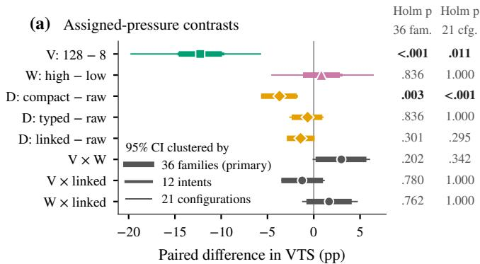

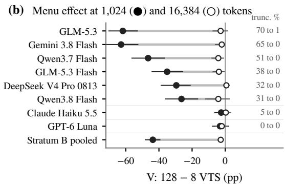  
Figure 2: The visible-menu penalty is large, and in truncation-heavy configurations a sixteenfold completion cap removes most of it. (a) The eight contrasts as paired within-family differences in VTS (pp), with nested 95% intervals clustered by 36 families (thick, primary), 12 intents, and 21 configurations (thin). (b) The sixteenfold cap sweep: each configuration’s visible-menu contrast at 1,024 (filled) and 16,384 (hollow) tokens with 95% family-cluster intervals, its V = 128 truncation shares, and the pooled contrast of the 6 truncation-heavy configurations (“Stratum B pooled”).

The returned-state encoding has small effects. Compact encoding changes VTS by −3.7 pp [−5.7, −1.9] (Holm $p = . 0 0 3 )$ , but the exact signflip test over the 12 intents does not support it after correction (Holm p = .068). Typed and linked encodings show no detectable effect. The $V \times W$ interaction, +3.0 pp [0.2, 5.7], does not survive correction (Holm $p = ~ . 2 0 2$ , Appendix D). In Tool-Sandbox, a larger menu costs tokens more clearly than success (Appendix K).

## 5.2 How Much of the Menu Penalty Occurs with the Completion Cap?

Most of the menu penalty occurs with completioncap truncation. Under the frozen cap, the share of capacity episodes truncated at the cap rises from 1.6% at V = 8 to 13.6% at $V = 1 2 8 .$ , and 391 of the 411 truncated episodes at $V = 1 2 8$ end before the model makes any call. For the 9 configurations with reasoning-token telemetry, 70.2% of truncated first responses to a 128-schema request hold reasoning tokens only, most of them from Gemini 3.8 Flash (Table 8 in Appendix E). Of the 3,024 matched pairs, 472 lose success at $V = 1 2 8$ and 101 gain it. The 343 lost pairs whose $V = 1 2 8$ variant was truncated carry 11.3 of the 15.6 pp lost.

Truncation depends on the assigned menu size, so we stratify on it (Frangakis and Rubin, 2002): the 2,595 pairs that neither menu truncated form a stratum the paired design observes directly, without trimming (Lee, 2009), and within it the menu effect is −1.5 pp. If every non-truncated episode keeps its outcome and each truncated failure could have gone either way, worst-case bounds place the total menu effect in [−13.9, 1.3] pp.

Across configurations, the V effect tracks the truncation rate at $V = 1 2 8$ (Pearson $r = - 0 . 9 5$ Spearman $\rho = - 0 . 8 2 .$ , Figure 6 in Appendix D), and the 8 configurations that never truncate have V effects between −2.1 and 2.8 pp. Truncation is not the only route to a loss: DeepSeek V4.1 Flash has a V effect of −18.1 pp at 0.7% truncation.

Since every truncated episode fails, a correlation across configurations cannot isolate the cap. A within-configuration sweep at sixteen times the cap does (Figure 2b and Table 9 in Appendix E.1). Run concurrently at 1,024 and 16,384 completion tokens with 2 repeats each, the 6 truncation-heavy configurations, which truncate 30.6 to 69.8% of their V = 128 episodes at the low cap, truncate at most 1.4% at the high cap, and their pooled menu contrast shrinks from −43.7 to −2.7 pp [−4.7, −0.9], an interaction of 41.0 pp [36.2, 45.5] that clears the pre-specified 5 pp margin. The mild- and zero-truncation controls (strata M and N) move by 2.8 and 1.0 pp. The larger cap thus removes most of their menu penalty, leaving −2.7 pp.

## 5.3 Where Do Failures End, and What Does the Record Reveal?

Failure census. Of the 20,408 exactly graded episodes, 3,725 fail (18.3%, Figure 3a): 1,068 end at the completion cap (28.7%), 1,863 exceed the episode budget or call limit (50.0%), 477 are stopped as infeasible (12.8%), 204 reach a wrong conclusion (5.5%), and 113 break another contract term (3.0%). Harness limits thus end 91.5% of failures (78.7% without infeasibility stops). The model-run 30-call cells of the frontier and structural holdout contribute 896 failures, nearly all over the episode budget, and in the four $V \times W$ endpoint cells alone harness limits end 86.9% of failures. Obligation labels mislead on their own: all 849 failures labeled “selection” come from episodes that made no call, 838 of them cut off at the completion cap, so the label reflects check order, not a wrong choice among tools.

Workflow frontier. When only the chain of handoffs grows, VTS over 20 configurations is 91.2%, 87.5%, 85.0%, and 0.0% at 2, 6, 14, and 30 certified calls (Figure 3b). At 30 calls, 69 of 80 episodes exceed the episode budget and 9 are stopped as infeasible, and no episode executes more than 23 calls. The collapse at 30 calls is where the 128,000- token episode budget runs out (Appendix F).

Discovery. At $R = 2 { , } 0 4 8 .$ , the required tools are in only 19.4% of the shortlists of the flat lexical retriever and in 77.8% of those of the connectorfirst router (Figure 3c), and 24.5% of all Discovery episodes fail before any model call. The retriever does not depend on the model, so the catalog pressure acts through retrieval (Appendix G).

Failure record. Does the failure record reveal the assigned pressure? On the 127 configurationfamily packets (a baseline cell and its three singlestress endpoint cells) in which the baseline succeeds and exactly one stressed cell fails, a lookup decoder with one intent held out reaches 48.9% balanced accuracy from the failure record, above a constant guess (33.3%) but below binned call counts alone (54.8%). Richer encodings of the record reach 51.3% to 54.1%, also below call counts. Adding trace shape to the record gains −3.5 pp [−9.4, 5.1] over call counts (99% interval), and none of the five paired gains tested excludes zero (Appendix H).

## 5.4 Which Repairs Help, and Do They Beat Switching?

Activation. Three repairs activate (Figure 4a), and all three change which tools reach the model or who issues the calls. The connector-first router activates (Holm $p = . 0 0 1 )$ by raising availability (Figure 3c). The routed menu activates (Holm p = .003) with a stress gain of $\Gamma = 4 . 9 \mathrm { p p } \ [ 2 . 6 , 7 . 0 ]$ and three-run repeats on 4 families (sentinel repeats) give Γ = 7.1 pp [2.5, 11.7]. The publichandoff controller raises VTS in the structural holdout by 96.6 pp [94.6, 98.5] (Holm $p < . 0 0 1 )$ . It does so by taking execution away from the model. The model issues only 1.2 of the 29.9 executed calls, mean tokens per episode fall from 130,468 to 21,159, and episodes over budget fall from 389 to 3 of 408. Its wrong-layer control, canonical delivery (records returned in a canonical encoding), has no detectable loss to repair $( L = - 1 . 2 \mathrm { p p } )$ , so ∆ is measured against an idle control (Appendix F).

Neither prompt repair activates (Holm $p = . 9 4 9$ for both), and both are tested on cells with no detectable loss (high W and linked encoding). Their stress gains are 1.7 pp $[ - 0 . 6 , 3 . 8 ]$ for the workflow prompt and 0.1 pp [−1.5, 1.9] for the interface guide, and two one-sided tests at the 5% level (Schuirmann, 1987) exclude stress gains beyond $\pm 3 . 6 \mathrm { a n d } \pm 1 . 7 \mathrm { p p }$

Comparison with switching. Against every configuration switch (Figure 4b), the routed menu is success-superior for 0 of 21 incumbents and Paretonondominated for 9. Only two repairs beat every switch on success, and both do so without improving model behavior. The router is success-superior for all 21 incumbents because no configuration switch can fix retrieval. The controller is successsuperior for all 17 incumbents and cost-superior for 4, because it delegates execution. On capacity cells, a development pilot finds that a fixed switch beats every public-information repair (Appendix J).

## 6 Discussion

Success scores should be read with their budgets. The visible menu is the only model-facing pressure with a large penalty, and that penalty occurs mostly in configurations that run out of their completion cap: a larger menu drives more episodes into the (b) Against every configuration switch

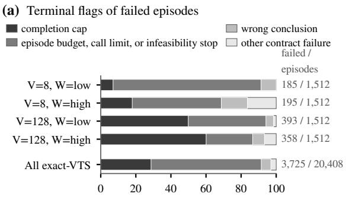  
Share of failed episodes (%)

(b) Workflow frontier, 20 cfg.  
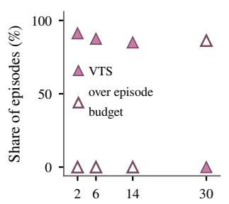  
Certified minimum calls

(c) Discovery, 21 cfg.  
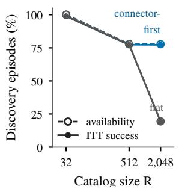  
Figure 3: Most failures end at a harness limit. (a) Terminal flags of failed episodes for the four $V \times W$ endpoint cells (raw and linked pooled) and for all 20,408 exactly graded episodes. The bars merge budget and infeasibility stops. (b) Frontier VTS (filled) and share of episodes over the 128,000-token episode budget (hollow) by certified calls, 20 configurations. (c) Discovery availability and ITT success by catalog size for two retrievers, means of configuration means.  
(a) Activation tests, 95% CI

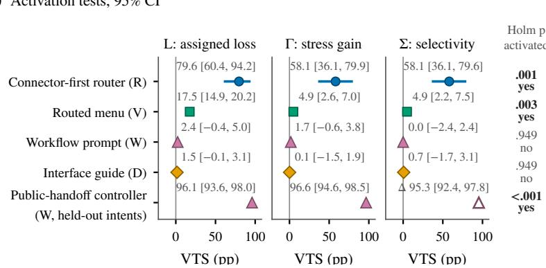

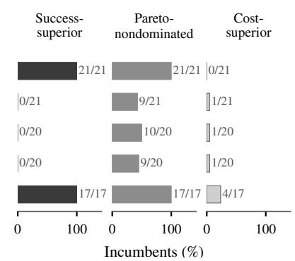  
Figure 4: Repairs that change which tools reach the model or who issues the calls activate, prompt repairs do not, and only two repairs beat every configuration switch on success. (a) L, Γ, and Σ (∆ for the controller) in VTS pp (ITT success for the router) with 95% cluster bootstrap intervals, and the activation decision. (b) Share of incumbents for which each repair is success-superior, Pareto-nondominated, or cost-superior against every configuration switch.

cap, almost always before the first call. In the six truncation-heavy configurations, raising the cap sixteenfold removes most of the menu penalty, from −43.7 to −2.7 pp, and a small penalty remains. A success leaderboard under a large menu ranks configurations partly by how they spend the completion cap.

Failure labels locate failures but do not explain them. A first-failure label such as “tool selection” reads as a diagnosis. Here most failures end at a harness limit, every “selection” failure comes from an episode that made no call, and our decoders recover the assigned pressure from the record no better than from a count of calls. The label says where the grader stopped, not why the agent failed. The limit that fired says how the episode ended.

Recommendations. The repairs that activate change which tools reach the model or who issues the calls, yet only two, the router by construction and the controller by delegation, beat every configuration switch on success. We recommend reporting pressure effects with their harness budgets and each configuration’s truncation rate, reporting a first-failure label with the limit that fired, and comparing a repair with switching the configuration on the same cells.

## 7 Conclusion

ToolBottleneckBench assigns one pressure at a time to fixed tasks under fixed harness budgets and records the limit that ends each failed episode. The visible menu is the only model-facing pressure with a large penalty. A sixteenfold completion cap removes most of it in the six truncation-heavy configurations. Most failures end at a harness limit, and the only repairs that beat every configuration switch do not improve model behavior. A tool agent’s success score measures its model and its harness budgets together. Future work can vary the episode budget and call limit as we varied the completion cap, and test live tool servers.

## Limitations

Budgets and repeats. The findings hold at the frozen harness budgets. The completion cap is the only budget that varies; the sixteenfold sweep tests one high cap, 16,384 tokens, on the routedmenu lane of 8 configurations, so its residual menu penalty is measured at the unchanged episode budget and call limit (Appendix E). One nominal cap is not one effective budget: providers count it differently, and reasoning effort stays at each provider’s default on all routes but one (Appendix A). Each core capacity cell has one run per configuration; the family bootstrap absorbs run-to-run variation, which the sentinel repeats (12.1% disagreement) and the sweep repeats (17.5% at 1,024 tokens) measure directly. The frontier spans 4 families.

Environment and release. The tasks are synthetic and graded exactly, without partial credit, and each pressure effect includes everything its manipulation changes in practice (Table 1). Prompts are fixed English texts. A configuration couples a model with its provider route (one route is FP4- quantized; Appendix C), so its results describe that pair. The generator and its tasks are public (Appendix M), so models trained after the release may have seen them.

## Ethical Considerations

All benchmark records, identities, and states are synthetic, so no personal data reaches the model providers, and no human participants or annotators are involved. Tools execute locally and have no external side effects. Results describe configurations at fixed harness budgets and should not alone decide procurement or deployment.

## Use of Generative AI

AI assistants were used for editing text, and for consistency checks between the manuscript and the released data, all under the authors’ instruction. The authors designed the experiments, verified the claims and results, and take full responsibility for the content presented in the paper.

## Acknowledgments

This work was supported by JST CREST Grant Number JPMJCR22M2 and JSPS KAK-

ENHI Grant Numbers JP23K17456, JP23K28096, JP25H01117, JP25K21207, and JP26K03246.

## References

Rahul Suresh Babu and Laxmipriya Ganesh Iyer. 2026a. ToolChoiceConfusion: Causal minimal tool filtering for reliable LLM agents. arXiv preprint arXiv:2606.06284.

Rahul Suresh Babu and Laxmipriya Ganesh Iyer. 2026b. ToolMenuBench: Benchmarking tool-menu filtering strategies for reliable and efficient LLM agents. arXiv preprint arXiv:2606.15508.

Roger L. Berger. 1982. Multiparameter hypothesis testing and acceptance sampling. Technometrics, 24(4):295–300.

Vishvesh Bhat, Jay Vaghasiya, Muhammad Ahmed Mohsin, and Asad Aali. 2026. Benchmarking the benchmarks: A validity audit of tool-calling evaluation. arXiv preprint arXiv:2607.02577.

Le Chen, Zishen Wan, Baixi Sun, Xiaolong Ma, Chih-Hsuan Yang, Feng Yan, Sheng Di, Franck Cappello, and Rajeev Thakur. 2026a. Measure before you manage: Evaluating agent working memory in coding agents. arXiv preprint arXiv:2608.31057.

Mengzhuo Chen, Junjie Wang, Zhe Liu, Yawen Wang, Haiming Zheng, and Qing Wang. 2026b. From failed trajectories to reliable LLM agents: Diagnosing and repairing harness flaws. arXiv preprint arXiv:2606.06324.

Shiyang Chen. 2026. Looking is not picking: An attention-segment account of tool-selection failures in LLM agents. arXiv preprint arXiv:2606.16364.

Yong-eun Cho. 2026. It’s not the capability: Harness sensitivity is non-monotone across LLM agent tiers. arXiv preprint arXiv:2605.26731.

Alejandro Cuadron, Dacheng Li, Wenjie Ma, Xingyao Wang, Yichuan Wang, Siyuan Zhuang, Shu Liu, Luis Gaspar Schroeder, Tian Xia, Huanzhi Mao, Nicholas Thumiger, Aditya Desai, Ion Stoica, Ana Klimovic, Graham Neubig, and Joseph E. Gonzalez. 2025. The danger of overthinking: Examining the reasoning-action dilemma in agentic tasks. arXiv preprint arXiv:2502.08235.

Jiaxuan Dai and Tianyi Huang. 2026. TwinCheck: Evidence-grounded negative-twin verification for stateful tool agents. arXiv preprint arXiv:2609.26911.

Rebecca DerSimonian and Nan Laird. 1986. Metaanalysis in clinical trials. Controlled Clinical Trials, 7(3):177–188.

Yufeng Du, Minyang Tian, et al. 2025. Context length alone hurts LLM performance despite perfect retrieval. arXiv preprint arXiv:2510.05381.

Xiang Fei, Xiawu Zheng, and Hao Feng. 2025. MCP-Zero: Active tool discovery for autonomous LLM agents. arXiv preprint arXiv:2506.01056.

Constantine E. Frangakis and Donald B. Rubin. 2002. Principal stratification in causal inference. Biometrics, 58(1):21–29.

Tiantian Gan and Qiyao Sun. 2025. RAG-MCP: Mit igating prompt bloat in LLM tool selection via retrieval-augmented generation. arXiv preprint arXiv:2505.03275.

Ashritha Gonuguntla. 2026. The replay gap: Static evaluation of model switching in LLM agents scores the wrong world. arXiv preprint arXiv:2608.08239. Efficient Reasoning Workshop at COLM 2026.

Zhicheng Guo, Sijie Cheng, Hao Wang, Shihao Liang, Yujia Qin, Peng Li, Zhiyuan Liu, Maosong Sun, and Yang Liu. 2024. StableToolBench: Towards stable large-scale benchmarking on tool learning of large language models. In Findings of the Association for Computational Linguistics: ACL 2024, pages 11143– 11156.

Bhaskar Gurram. 2026. Auditing automated evaluation, error propagation, and runtime mitigation in tool-using language agents. arXiv preprint arXiv:2604.16706.

Sture Holm. 1979. A simple sequentially rejective multiple test procedure. Scandinavian Journal ofStatistics, 6(2):65–70.

Sayash Kapoor, Benedikt Stroebl, Peter Kirgis, Nitya Nadgir, Zachary S. Siegel, Boyi Wei, Tianci Xue, Ziru Chen, Felix Chen, Saiteja Utpala, Franck Ndzomga, Dheeraj Oruganty, Sophie Luskin, Kangheng Liu, Botao Yu, Amit Arora, Dongyoon Hahm, Harsh Trivedi, Huan Sun, and 12 others. 2026. Holistic Agent Leaderboard: The missing infrastructure for AI agent evaluation. In International Conference on Learning Representations.

Sayash Kapoor, Benedikt Stroebl, Zachary S. Siegel, Nitya Nadgir, and Arvind Narayanan. 2024. AI agents that matter. arXiv preprint arXiv:2407.01502.

Kiran Kate, Tejaswini Pedapati, Kinjal Basu, Yara Rizk, Vijil Chenthamarakshan, Subhajit Chaudhury, Mayank Agarwal, and Ibrahim Abdelaziz. 2025. LongFuncEval: Measuring the effectiveness of long context models for function calling. arXiv preprint arXiv:2505.10570.

Kiran Kate, Yara Rizk, Poulami Ghosh, Ashu Gulati, Tathagata Chakraborti, Zidane Wright, and Mayank Agarwal. 2026. How good are LLMs at processing tool outputs? In Proceedings of the 19th Conference of the European Chapter of the Association for Computational Linguistics (Volume 1: Long Papers), pages 2918–2941.

David S. Lee. 2009. Training, wages, and sample selection: Estimating sharp bounds on treatment effects. Review ofEconomic Studies, 76(3):1071–1102.

Minghao Li, Yingxiu Zhao, Bowen Yu, Feifan Song, Hangyu Li, Haiyang Yu, Zhoujun Li, Fei Huang, and Yongbin Li. 2023. API-Bank: A comprehensive benchmark for tool-augmented LLMs. In Proceedings of the 2023 Conference on Empirical Methods in Natural Language Processing, pages 3102–3116.

Yixuan Li, Yiyun Zhou, Yao Long Teng, Fuchao Yang, Yanchen Deng, Zhiyi Lyu, Xuyu Dong, Feng Chen, and Bo An. 2026. Finding the right fit: Model-harness interactions across agent tasks. arXiv preprint arXiv:2610.00917.

Xiaofeng Lin, Yingxu Wang, Tung Sum Thomas Kwok, Daniel Guo, Sahil Arun Nale, Charles Fleming, and Guang Cheng. 2026. REFLECT: Interventionsupported error attribution for silent failures in LLM agent traces. arXiv preprint arXiv:2606.09071.

Marianne Menglin Liu, Daniel Garcia, Fjona Parllaku, Vikas Upadhyay, Syed Fahad Allam Shah, and Dan Roth. 2026. ToolScope: Enhancing LLM agent tool use through tool merging and context-aware filtering. In Proceedings of the 64th Annual Meeting of the Associationfor Computational Linguistics (Volume 1: Long Papers), pages 34095–34119.

Nelson F. Liu, Kevin Lin, John Hewitt, Ashwin Paranjape, Michele Bevilacqua, Fabio Petroni, and Percy Liang. 2024. Lost in the middle: How language models use long contexts. Transactions ofthe Association for Computational Linguistics, 12:157–173.

Yangze Liu and Zhongyi Han. 2026. What does a harness buy? Tokens, mostly. arXiv preprint arXiv:2610.04433.

Abhilasha Lodha, Mahsa Pahlavikhah Varnosfaderani, Abir Chakraborty, and Abhinav Mithal. 2026. Less context, better agents: Efficient context engineering for long-horizon tool-using LLM agents. arXiv preprint arXiv:2606.10209.

Jiarui Lu, Thomas Holleis, Yizhe Zhang, Bernhard Aumayer, Feng Nan, Haoping Bai, Shuang Ma, Shen Ma, Mengyu Li, Guoli Yin, Zirui Wang, and Ruoming Pang. 2025. ToolSandbox: A stateful, conversational, interactive evaluation benchmark for LLM tool use capabilities. In Findings ofthe Association for Computational Linguistics: NAACL 2025, pages 1160–1183.

Zhongwen Luan, Xiaoyu Zhang, Ming Hu, Yue Yang, Jiongchi Yu, and Xiaohong Chen. 2026. Repair or resample? Rethinking failure debugging in LLM multiagent systems. arXiv preprint arXiv:2608.25920.

Fabian Lukassen, Christoph Weisser, Thomas Kneib, and Alexander Silbersdorff. 2026. CAFE: A compound-AI factorial evaluation framework. arXiv preprint arXiv:2607.10380.

Ziyang Luo et al. 2025. MCP-Universe: Benchmarking large language models with real-world Model Context Protocol servers. arXiv preprint arXiv:2508.14704.

Ming Ma, Jue Zhang, Fangkai Yang, Yu Kang, Qingwei Lin, Saravan Rajmohan, and Dongmei Zhang. 2026. DoVer: Intervention-driven auto debugging for LLM multi-agent systems. In International Conference on Learning Representations.

Seiji Maekawa, Jackson Hassell, Pouya Pezeshkpour, Tom Mitchell, and Estevam Hruschka. 2026. Towards reliable benchmarking: A contamination free, controllable evaluation framework for multi-step LLM function calling. In International Conference on Learning Representations.

Shishir G. Patil, Huanzhi Mao, Fanjia Yan, Charlie Cheng-Jie Ji, Vishnu Suresh, Ion Stoica, and Joseph E. Gonzalez. 2025. The Berkeley Function Calling Leaderboard (BFCL): From tool use to agentic evaluation of large language models. In Proceedings of the 42nd International Conference on Machine Learning, volume 267 of Proceedings of Machine Learning Research.

Yujia Qin, Shihao Liang, Yining Ye, Kunlun Zhu, Lan Yan, Yaxi Lu, Yankai Lin, Xin Cong, Xiangru Tang, Bill Qian, Sihan Zhao, Lauren Hong, Runchu Tian, Ruobing Xie, Jie Zhou, Mark Gerstein, Dahai Li, Zhiyuan Liu, and Maosong Sun. 2024. ToolLLM: Facilitating large language models to master 16000+ real-world APIs. In International Conference on Learning Representations.

Harsh Raj, Vipul Gupta, Anas Mahmoud, Razvan-Gabriel Dumitru, Darvin Yi, Aakash Sabharwal, and Yunzhong He. 2026. Model or harness? An interaction-centric taxonomy for localizing agent failures. arXiv preprint arXiv:2607.28802.

Vyzantinos Repantis, Ameya Gawde, Harshvardhan Singh, and Joey Blackwell, II. 2026. How many tools should an LLM agent see? A chance-corrected answer. arXiv preprint arXiv:2605.24660.

Donald J. Schuirmann. 1987. A comparison of the two one-sided tests procedure and the power approach for assessing the equivalence of average bioavailability. Journal ofPharmacokinetics and Biopharmaceutics, 15(6):657–680.

Musa Shams. 2026. LayerRAG-Bench: A cross-layer reliability benchmark for agentic retrieval-augmented generation. arXiv preprint arXiv:2607.27353.

Zhengliang Shi, Yuhan Wang, Lingyong Yan, Pengjie Ren, Shuaiqiang Wang, Dawei Yin, and Zhaochun Ren. 2025. Retrieval models aren’t tool-savvy: Benchmarking tool retrieval for large language models. In Findings ofthe Associationfor Computational Linguistics: ACL 2025, pages 24497–24524.

Jason Starace. 2026. Scaffold effects on GAIA: A controlled comparison. arXiv preprint arXiv:2606.08529.

Harsh Trivedi, Tushar Khot, Mareike Hartmann, Ruskin Manku, Vinty Dong, Edward Li, Shashank Gupta, Ashish Sabharwal, and Niranjan Balasubramanian.

2024. AppWorld: A controllable world of apps and people for benchmarking interactive coding agents. In Proceedings of the 62nd Annual Meeting of the Associationfor Computational Linguistics (Volume 1: Long Papers), pages 16022–16076.

Zelin Wan, Arash Nourian, Xiaoxiao Li, Nihar Nandan, and Kamalakannan Nandagopal. 2026. APIFlow-Bench: Measuring whether agents survive long, dependent API workflows. arXiv preprint arXiv:2608.29128.

Wenbo Wang. 2026a. Interface-induced trajectory censoring. arXiv preprint arXiv:2609.03966.

Zhenting Wang et al. 2025. MCP-Bench: Benchmarking tool-using LLM agents with complex realworld tasks via MCP servers. arXiv preprint arXiv:2508.20453.

Zihao Wang. 2026b. Callability is not operability: Controlled interface interventions for LLM agents. arXiv preprint arXiv:2608.23628.

John Yang, Carlos E. Jimenez, Alexander Wettig, Kilian Lieret, Shunyu Yao, Karthik Narasimhan, and Ofir Press. 2024. SWE-agent: Agent-computer interfaces enable automated software engineering. arXiv preprint arXiv:2405.15793.

Shunyu Yao, Noah Shinn, Pedram Razavi, and Karthik Narasimhan. 2025. τ-Bench: A benchmark for toolagent-user interaction in real-world domains. In International Conference on Learning Representations.

Yilun Yao, Xinyu Tan, Chao-Hsuan Liu, Yaoming Li, Zhengyang Wang, Wenhan Yu, Zhewen Tan, Yuxuan Tian, Guangxiang Zhao, Lin Sun, Xiangzheng Zhang, and Tong Yang. 2026. Harness-Bench: Measuring harness effects across models in realistic agent workflows. arXiv preprint arXiv:2605.27922.

Jeonghun Yoon and Dongchan Kim. 2026. Diagnosis is not prescription: Linguistic co-adaptation explains patching hazards in LLM pipelines. arXiv preprint arXiv:2605.21958.

Xiaoyang Yuan, Qi Liu, Yubin Ruan, Xinyi Mou, Zhuomeng Zhang, Wenjin Wang, Hanying Jiao, Di Wu, Mingye Xu, Yi Bin, Ke Feng, and Zixun Sun. 2026. DAAF: From failure localization to editable system assets in LLM agents. arXiv preprint arXiv:2609.32498.

Weihao Zeng, Yuzhen Huang, and Junxian He. 2026. LOCA-bench: Benchmarking language agents under controllable and extreme context growth. In Proceedings of the 43rd International Conference on Machine Learning, volume 306 of Proceedings of Machine Learning Research, pages 153347–153363.

Yunbei Zhang, Janet Wang, Yingqiang Ge, Weijie Xu, Jihun Hamm, and Chandan K. Reddy. 2026. Stop comparing LLM agents without disclosing the harness. arXiv preprint arXiv:2605.23950.

Kangjia Zhao, Jiajun Li, Haozhan Shen, Wei Chow, Linfeng Li, Hang Song, Lingdong Kong, Chen Zhi, Tiancheng Zhao, Songhua Liu, and Jianwei Yin. 2026. Calibration is the bottleneck: An action-class diagnostic of multi-turn tool-calling. arXiv preprint arXiv:2609.00949.

YiShan Zheng, Yuan Wu, and Yi Chang. 2026. Tool-RobustBench: Stage-wise perturbation evaluation and failure diagnosis for tool-calling agents. arXiv preprint arXiv:2608.23635.

Table 2: The frozen harness contract for capacity episodes and their matched prompt-repair arms.
<table><tr><td>Field</td><td>Setting</td></tr><tr><td>Tool protocol Tool choice</td><td>Native Chat Completions tools Automatic; parallel-call flag</td></tr><tr><td></td><td>false when sent Requested 0 unless the frozen</td></tr><tr><td>Temperature</td><td>profile omits it</td></tr><tr><td>Seed</td><td>Condition-bound unless the frozen profile omits it</td></tr><tr><td>Completion cap Cap parameter</td><td>1,024 tokens per request max_tokens on Chat</td></tr><tr><td></td><td>Completions routes; renamed max_output_tokens with the same value where a Responses transport was used; on routes that count reasoning</td></tr><tr><td>Reasoning</td><td>Provider default on every route except one, which requested effort high (DeepSeek V4.1 Flash on DeepInfra); no</td></tr><tr><td>Cap sweep</td><td>thinking budget was set 1,024 and 16,384 tokens per request through the same cap parameter, reasoning at the provider default on every route;</td></tr><tr><td>Episode budget</td><td>(Appendix E.1) 128,000 reported tokens: prompt tokens, including cached ones, plus completion</td></tr><tr><td>Call limit</td><td>tokens Certified minimum + 2</td></tr><tr><td>Turn limit Infeasibility stop</td><td>Call limit + 2 When success is infeasible</td></tr><tr><td>Menu policy</td><td>under the call limit Routed narrowing after the first</td></tr><tr><td></td><td>executed operational call (oracle); paired fixed-menu lane</td></tr><tr><td>Prompt</td><td>Base English prompt; two declared repair variants</td></tr><tr><td>Provider fallback</td><td>Disabled; a served-model</td></tr></table>

## A Harness Protocol and Prompts

Table 2 lists the frozen harness contract. Its budget rows hold for every block; its menu and prompt rows describe the capacity episodes and their prompt-repair arms. The numeric budgets are shared by all configurations, but providers differ in which parameters they support and in how they count tokens.

Example task family. Figure 5 shows one task family compiled under the V , W, and D pressures.

System prompts. Capacity episodes and their prompt-repair arms use three variants of the system prompt. Discovery, the frontier, the structural holdout, and ToolSandbox each have their own frozen entry points and prompts. The base capacity prompt is the same for the routed and fixed menus and reads:

You operate in a deterministic sandbox with synthetic business records. Use tools iteratively and stop only when the task is supported by current evidence. Never call an unlisted function. Each search/read description declares workspace, region, and collection coordinates. Use only tools whose three coordinates exactly match the required source route in the user request; other routes may contain valid current records for other workspaces but cannot support this case. A next\_handoff object identifies the connector and exact search query for the next current record; follow it when more requested facts are still missing. Avoid wasting the call budget on identical tool calls. Once all requested facts are present, stop using tools and return raw JSON only, with no markdown fence or explanatory prose. Never send messages, issue payment, or delete data. Follow the user’s exact JSON response schema.

The workflow prompt replaces the second sentence with “Before every tool request, privately verify the connector, operation, exact arguments, and remaining public obligations; after the last tool, verify the evidence and terminal state before answering.” The interface guide keeps the second sentence and inserts after it: “Read returned records by interface: raw records place values under payload; typed or linked records use type for the record kind, place values under fields, and identify their origin under source. Provenance maps JSON-pointer paths to source fields. Links and relation\_dictionary summarize observed equality links but never replace reading the cited source record.” No other text differs between conditions.

Requests and sampling. The user message is the family’s rendered request. Tools are supplied through the provider’s native tool interface with automatic tool choice. The client sends parallel\_tool\_calls=false, the temperature, and the seed unless a configuration’s frozen execution profile omits them, and the released profiles record each omission. If a model produces an invalid argument string in an otherwise valid response, this counts as an agent failure, and the harness never repairs it. Endpoint aliases and served versions are pinned.

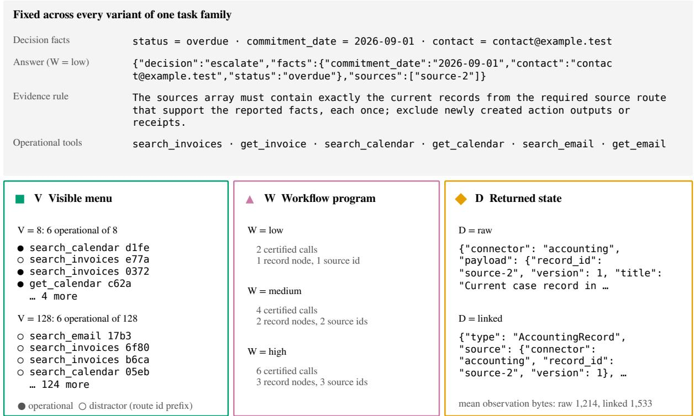  
Figure 5: One task family compiled under three pressures. The top block gives the shared decision facts, reference answer, evidence rule, and six operational tools. V grows the menu from 8 to 128 schemas, six of them operational. W grows the certified program from one record node to three, and the required sources array with it. D reencodes identical facts. Identifiers and menus are abbreviated for space.

Returned-state encodings. Five blocks of each observation vary across the encodings: objects, the field, type, and relation dictionaries, and links. The provenance block and the source, hash, and tool blocks are identical byte for byte across all four. Compact is larger than raw because it pays for a field dictionary in every observation and saves a smaller amount on objects.

## B Obligations, Grading, and Audits

The grader checks the nine obligations in the order given in Table 3, which also counts the first unmet obligation over the exactly graded episodes. Answers are compared with Python value equality, where int and float are compared after numeric coercion and str is compared literally. Obligation E requires the answer to cite exactly the supporting record IDs. Every released record is at version one and the answer carries no version, so E compares record IDs. For tasks that require an action, exactly one requested reversible change is permitted. For tasks that do not, the state must stay unchanged while the mutating tool stays visible. Governance G fails when a tool other than the requested action changes state. Budget B requires the episode to stay within the episode budget and the call limit. Completion C fails when a response is cut off at the completion cap or breaks the response contract, or when the turn limit ends the episode.

The analysis adds a termination-aware label: an episode truncated at the completion cap before any call is labeled completion\_no\_call instead of selection. The label is computed from call attempts and error codes and leaves the grader’s labels unchanged.

Audits. Static checks cover semantic signatures, the rank and support of the factorial design, shortest programs, the layout of connectors and facts, nested menus, task and action logic, and deterministic regeneration. Runtime checks decode every encoding at every prefix of the reference program, validate dictionaries, types, provenance, and links, exercise legal misses, accept every alternative minimal call order, and reject altered availability, completion, budgets, required steps, dependency order, trace hashes, trace evidence versions, answers, sources, and final states. The public-handoff controller cannot see the hidden program, the answer, or the grader. We test that its behavior does not depend on the hidden program, that it follows the handoffs, and that it stops safely on an invalid or empty handoff, over all 24 held-out 30-call tasks.

Table 3: First unmet obligation of each episode, in the order the grader checks them, and the terminal flag of each failed episode. Population: the 20,408 exactly graded episodes (3,725 failures). All 849 “selection” labels belong to episodes without a call.
<table><tr><td>First unmet obligation (emitted)</td><td>Episodes</td><td>Terminal flag (failures)</td><td>Count</td><td>Share (%)</td></tr><tr><td>availability</td><td>0</td><td>Completion cap</td><td>1,068</td><td>28.7</td></tr><tr><td>selection</td><td>849</td><td>Episode budget or call limit</td><td>1,863</td><td>50.0</td></tr><tr><td>workflow</td><td>1,517</td><td>Turn limit</td><td>0</td><td>0.0</td></tr><tr><td>answer</td><td>1,340</td><td>Infeasibility stop</td><td>477</td><td>12.8</td></tr><tr><td>evidence</td><td>3</td><td>Wrong conclusion</td><td>204</td><td>5.5</td></tr><tr><td>safety</td><td>6</td><td>Other contract failure</td><td>113</td><td>3.0</td></tr><tr><td>governance</td><td>0</td><td>All failures</td><td>3,725</td><td>100.0</td></tr><tr><td>budget</td><td>0</td><td></td><td></td><td></td></tr><tr><td>completion</td><td>10</td><td></td><td></td><td></td></tr><tr><td>success</td><td>16,683</td><td></td><td></td><td></td></tr><tr><td>Scored episodes</td><td>20,408</td><td></td><td></td><td></td></tr></table>

Zero-token rows. 1,118 released rows report zero tokens. Of these, 1,113 stopped for lack of availability before any request, and 5 are provider or execution failures. None has a recorded provider response, so every row with a provider response reports its tokens.

## C Evaluation Panel

Table 4 lists the 21 configurations, grouped by organization, with the blocks each one ran, its baseline VTS, its visible-menu and workflow effects, its truncation rate at $V = 1 2 8$ , and its cost. All configurations use managed inference endpoints; one of them (DeepSeek V4 Flash 0731) is served through an FP4-quantized route.

Each analysis uses its own population (Table 5). The blocks differ in configurations, resampling unit, and success measure: exact VTS for the capacity, repair, sentinel, frontier, and structural blocks; ITT success for Discovery; and ToolSandbox’s own evaluator for the external blocks.

## D Statistical Analysis and Capacity Sensitivity

Table 6 gives every capacity contrast under the three resampling units. The results in the main text use families as the primary unit.

Design cells and contrast weights. The eight endpoint cells are $\begin{array} { r l r } { \mathcal { C } } & { { } = } & { \{ 8 , 1 2 8 \} \ \times } \end{array}$ {low, high} × {raw, linked}, and the four checkpoint cells are (32, low, raw), (8, medium, raw), (8, low, compact), and (8, low, typed). For an endpoint cell c with mean success $m _ { c } ,$ let $s _ { a } ( c )$ be −1 at the low level and +1 at the high level of axis a. Then

$$
\begin{array} { l } { \displaystyle E _ { a } = \frac { 1 } { 4 } \sum _ { c \in \mathcal { C } } s _ { a } ( c ) m _ { c } , } \\ { \displaystyle E _ { a b } = \frac { 1 } { 2 } \sum _ { c \in \mathcal { C } } s _ { a } ( c ) s _ { b } ( c ) m _ { c } , } \end{array}
$$

so each main effect averages four paired differences and each interaction two differences-in-differences. Compact and typed have weight +1 at their checkpoint and −1 at (8, low, raw). Curvature at the midpoints and the three-way interaction are exploratory and not part of the eight tests.

Resampling units. With configurations as the resampling unit, the visible menu is $[ - 1 9 . 8 , - 5 . 7 ]$ (Holm $p = . 0 1 1 )$ , workflow pressure [−4.6, 6.5] (Holm $\begin{array} { r } { p \ = \ \begin{array} { l } { 1 . 0 0 0 ) } \end{array} } \end{array}$ , and compact encoding $[ - 5 . 0 , - 2 . 5 ]$ (Holm $p < . 0 0 1 )$ . A centered percentile bootstrap with 10,000 draws cannot resolve a two-sided $p$ below 10−4, which the Holm correction over eight contrasts raises to .0008, so every entry printed as < .001 sits at that floor. With 12 intent clusters, we also report the exact sign-flip test. For compact encoding it gives p = .0098 before correction and Holm $p = . 0 6 8$

Heterogeneity across configurations. Some configurations have zero variance across families (GPT-6.1 Sol for every contrast), so a Der-Simonian–Laird synthesis (DerSimonian and Laird, 1986) is undefined; Figure 7 instead shows the perconfiguration effects of V and W with each configuration’s truncation rate. Reweighting so that each organization counts equally gives −15.3 pp for the visible menu, 3.8 pp for workflow pressure, and −4.7 pp for compact encoding.

Table 4: The 21 configurations. Effects are per-configuration paired within-family differences in VTS (pp) over 36 families, without intervals; each routed V effect averages 144 pairs. The routed V effect is the core contrast under the routed menu; the fixed V effect is the corresponding contrast on the fixed-menu lane (72 pairs per configuration, on the (low, raw) and (high, linked) cells), with the full menu kept visible, i.e., minus the assigned loss L of the routed-menu repair. Truncation is the share of V = 128 capacity episodes that end at the completion cap. Cost is the token cost at frozen route prices. Blocks (Table 5): C core capacity and Discovery; A prompt repairs, sentinel repeats, and frontier; S structural holdout (∗ confirmatory plan); M concurrent ToolSandbox menu; E historical ToolSandbox rank and menu. Baseline VTS pools the (8, low, raw) and (8, low, linked) cells.
<table><tr><td></td><td></td><td></td><td>Base</td><td>V eff.</td><td>V eff.</td><td></td><td></td><td></td></tr><tr><td>Configuration</td><td>Org.</td><td>Blocks</td><td>VTS</td><td>routed</td><td>fixed</td><td>W eff.</td><td>Trunc.</td><td>USD</td></tr><tr><td>Claude Haiku 5.5</td><td>Anthropic</td><td>CASM</td><td>94.4</td><td>-7.6</td><td>-2.8</td><td>-6.2</td><td>6.2</td><td>3.44</td></tr><tr><td>Claude Opus 5</td><td>Anthropic</td><td>CASM</td><td>94.4</td><td>1.4</td><td>-1.4</td><td>1.4</td><td>0.0</td><td>165.18</td></tr><tr><td>Claude Opus 5.5</td><td>Anthropic</td><td>CASM</td><td>97.2</td><td>0.0</td><td>1.4</td><td>0.0</td><td>0.0</td><td>130.52</td></tr><tr><td>Claude Sonnet 5</td><td>Anthropic</td><td>CASM</td><td>93.1</td><td>-9.0</td><td>-4.2</td><td>-11.8</td><td>9.0</td><td>66.45</td></tr><tr><td>Claude Sonnet 5.5</td><td>Anthropic</td><td>CASM</td><td>94.4</td><td>0.0</td><td>-1.4</td><td>1.4</td><td>0.0</td><td>66.51</td></tr><tr><td>GPT-5.6 Luna</td><td>OpenAI</td><td>CAE</td><td>95.8</td><td>2.8</td><td>-16.7</td><td>-2.8</td><td>0.0</td><td>1.81</td></tr><tr><td>GPT-5.6 Sol</td><td>OpenAI</td><td>CASM</td><td>100.0</td><td>-2.1</td><td>-1.4</td><td>-2.1</td><td>0.0</td><td>84.33</td></tr><tr><td>GPT-5.6 Terra</td><td>OpenAI</td><td>CAE</td><td>97.2</td><td>-2.1</td><td>-11.1</td><td>0.7</td><td>0.0</td><td>8.15</td></tr><tr><td>GPT-6 Luna GPT-6.1 Sol</td><td>OpenAI</td><td>CASM</td><td>93.1</td><td>0.0 0.0</td><td>-4.2</td><td>0.0</td><td>0.0</td><td>2.13</td></tr><tr><td></td><td>OpenAI</td><td>CASM</td><td>100.0</td><td></td><td>0.0</td><td>0.0</td><td>0.0</td><td>40.22</td></tr><tr><td>Gemini 3.6 Flash Gemini 3.8 Flash</td><td>Google</td><td>CAE CASM</td><td>93.1</td><td>5.6 -52.1</td><td>-18.1 -50.0</td><td>-30.6 -6.2</td><td>6.2</td><td>20.02</td></tr><tr><td></td><td>Google</td><td></td><td>87.5</td><td></td><td></td><td></td><td>67.4</td><td>25.01</td></tr><tr><td>Qwen3.7 Flash</td><td>Alibaba</td><td>CAS*E</td><td>88.9</td><td>-34.7 -16.7</td><td>-58.3</td><td>-6.9</td><td>45.8</td><td>0.88</td></tr><tr><td>Qwen3.8 Flash</td><td>Alibaba Alibaba</td><td>C CASM</td><td>66.7 73.6</td><td>-4.9</td><td>-34.7 8.3</td><td>5.6 18.8</td><td>27.8</td><td>1.92</td></tr><tr><td>Qwen3.8 Max (0902)</td><td></td><td></td><td></td><td></td><td></td><td></td><td>5.6</td><td>58.14</td></tr><tr><td>DeepSeek V4 Flash 0731</td><td>DeepSeek</td><td>CAS*E</td><td>93.1</td><td>-11.1 -24.3</td><td>-15.3 -41.7</td><td>2.8</td><td>4.2</td><td>2.48</td></tr><tr><td>DeepSeek V4 Pro 0813</td><td>DeepSeek DeepSeek</td><td>CASM CASM</td><td>94.4 69.4</td><td>-18.1</td><td>-20.8</td><td>-10.4 23.6</td><td>27.8 0.7</td><td>33.30</td></tr><tr><td>DeepSeek V4.1 Flash</td><td></td><td></td><td></td><td>-2.8</td><td></td><td></td><td></td><td>4.26</td></tr><tr><td>HY4 Preview</td><td>Tencent</td><td>CAS</td><td>27.8</td><td></td><td>-6.9</td><td>34.7</td><td>0.7</td><td>19.83</td></tr><tr><td>GLM-5.3</td><td>Z.ai</td><td>CAS</td><td>93.1</td><td>-53.5</td><td>-59.7</td><td>6.2</td><td>56.2</td><td>31.99</td></tr><tr><td>GLM-5.3 Flash</td><td>Z.ai</td><td>CAS</td><td>95.8</td><td>-28.5</td><td>-29.2</td><td>-0.7</td><td>27.8</td><td>1.81</td></tr></table>

Table 5: Analysis populations: configurations, rows, and success measure (VTS, ITT success A · S, or Tool-Sandbox’s evaluator) of each block.
<table><tr><td>Block</td><td>Cfg. Rows Measure</td></tr><tr><td>Capacity factorial</td><td>21 12,096 VTS</td></tr><tr><td>Discovery (R)</td><td>21 4,536 ITT</td></tr><tr><td>Prompt repairs</td><td>20 2,880 VTS</td></tr><tr><td>Sentinel repeats</td><td>20 1,440 VTS</td></tr><tr><td>Workflow frontier</td><td>20 320 VTS</td></tr><tr><td>Structural holdout</td><td>17 3,672 VTS</td></tr><tr><td>TS menu, concurrent</td><td>12 1,152 evaluator</td></tr><tr><td>TS menu, historical</td><td>5 320 evaluator</td></tr><tr><td>TS rank</td><td>5 160 evaluator</td></tr><tr><td>All blocks</td><td>21 26,576</td></tr><tr><td>Exact-VTS population</td><td>20,408 VTS</td></tr></table>

Interaction. If the two pressures acted independently, the expected V × W interaction would be 0.1 pp. Of the observed coefficient, 68.9% comes from 31 of 1,512 units in which every stressed cell fails. Dropping the units whose sign is forced by the single-stress cells gives 2.0 pp [−0.3, 4.1]. Joint stress succeeds while a single stress fails in 200 units (13.2%).

Truncation bounds. The truncation-resolution bound holds every non-truncated episode and its outcome fixed under the frozen cap; the sweep (Appendix E.1) measures what a larger cap does. The two ends of the bound assume that every truncated failure at V = 8 would have succeeded and every one at V = 128 failed, and the reverse, with each arm resolving independently. Adding the assumption that both arms resolve alike gives [−12.3, −0.3] pp. For comparison, the two workflow arms differ by only 41 truncated episodes, while the two menu arms have 48 and 411 truncated failures.

Table 6: Capacity contrasts under three resampling units. Estimates are paired within-family differences in VTS (pp) over 21 configurations, averaging 756 family-by-configuration differences per contrast. Intervals are 95% cluster bootstraps with 10,000 draws over 36 families, 12 intents, and 21 configurations, each with its own Holm correction over the eight contrasts. The last column is the exact sign-flip test over intents. Intervals are unadjusted percentile intervals and p values come from the centered bootstrap, so the two can disagree near zero. < .001 marks the resolution floor of the bootstrap.
<table><tr><td></td><td></td><td colspan="2">36 families</td><td colspan="2">21 configurations</td><td colspan="3">12 intents</td></tr><tr><td>Contrast</td><td>Est.</td><td>95% CI</td><td>Holm p</td><td>95% CI</td><td>Holm p</td><td>95% CI</td><td>Holm p</td><td>exact Holm p</td></tr><tr><td>V: 128- 8</td><td>-12.3</td><td>[-14.6, -9.9]</td><td>&lt;.001</td><td>[-19.8, -5.7]</td><td>.011</td><td>[-14.7, -9.7]</td><td>&lt;.001</td><td>.004</td></tr><tr><td>W: high − low</td><td>0.8</td><td>[-1.2, 2.8]</td><td>.836</td><td>[-4.6, 6.5]</td><td>1.000</td><td>[-1.2,3.1]</td><td>.624</td><td>.949</td></tr><tr><td>D: compact — raw</td><td>-3.7</td><td>[-5.7, -1.9]</td><td>.003</td><td>[−5.0, -2.5]</td><td>&lt;.001</td><td>[-5.7, -1.7]</td><td>.002</td><td>.068</td></tr><tr><td>D: typed – raw</td><td>-0.7</td><td>[-2.4, 0.9]</td><td>.836</td><td>[−2.6, 1.1]</td><td>1.000</td><td>[-1.7,0.1]</td><td>.624</td><td>.949</td></tr><tr><td>D: linked – raw</td><td>-1.4</td><td>[-2.9,0.1]</td><td>.301</td><td>[-2.8, 0.0]</td><td>.295</td><td>[-2.7, 0.03]</td><td>.177</td><td>.386</td></tr><tr><td>V×W</td><td>3.0</td><td>[0.2, 5.7]</td><td>.202</td><td>[-0.1, 6.1]</td><td>.342</td><td>[0.5, 5.2]</td><td>.070</td><td>.252</td></tr><tr><td>V×linked</td><td>-1.3</td><td>[-3.5, 1.0]</td><td>.780</td><td>[-3.5, 1.2]</td><td>1.000</td><td>[−3.4, 1.0]</td><td>.624</td><td>.949</td></tr><tr><td>W×linked</td><td>1.7</td><td>[−0.8, 4.1]</td><td>.762</td><td>[-1.3, 4.8]</td><td>1.000</td><td>[0.1, 3.1]</td><td>.177</td><td>.386</td></tr></table>

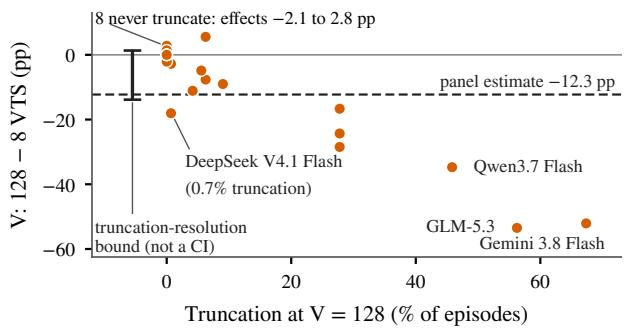  
Figure 6: The visible-menu penalty moves with completion-cap truncation. Each configuration’s V effect against its truncation rate at V = 128, with the panel estimate (dashed) and the truncation-resolution bound (bracket, not a confidence interval).

Infrastructure failures and the routed-menu lane. 9 conditions failed for infrastructure reasons (8 capacity and 1 Discovery). They are kept and counted as failures of their configuration. Over 3,024 paired episodes, the routed-menu lane exceeds the fixed-menu lane by 2.4 pp [1.1, 3.8], and the fixed-menu lane uses 4,699 more tokens and 47.7 more schema exposures per episode.

## E Completion-Cap Crossover and Sweep

Two studies vary the completion cap per request while the episode budget and the call limit stay fixed: a crossover at four times the cap and a sweep at sixteen times.

Crossover. The crossover uses three strata defined by the panel’s V = 128 truncation share and menu penalty: truncation-heavy (B, truncation at least 20%), loss without much truncation (S, truncation at most 15% with a loss of at least 8 pp), and null (N). The 4 configurations are GLM-5.3 Flash and Qwen3.8 Flash (B), DeepSeek V4 Flash 0731 (S, on a different provider route from its panel counterpart, so both of its arms come from the crossover), and GPT-5.6 Luna (N). Each ran the 432-condition $V \times W \times D$ capacity factorial on the routed-menu lane at 1,024 and 4,096 completion tokens, twice, with the arm order counterbalanced across repeats. The estimand is the paired withinfamily menu contrast in each arm and the difference between the arms, per stratum. Of 6,912 rows read, 6,904 were kept; the other 8 had a provider failure or missing usage data.

At 4,096 tokens both stratum-B configurations still truncate 20.2 to 25.3% of their V = 128 episodes, down from 28.8 to 35.8%, above the 5% manipulation-check ceiling, so Table 7 and Figure 8 describe the penalty under persisting truncation. The stratum-B pooled menu contrast is −23.6 pp [−28.5, −18.8] at the lower cap and −21.3 pp [−26.7, −16.1] at the higher cap, an interaction of 2.1 pp [−2.6, 6.8]; letting each excluded row take either outcome keeps the interaction within [1.9, 2.6] pp. The null stratum moves by −0.3 pp [−4.5, 3.8] and the stratum-S configuration by $1 . 4 \mathrm { p p } \left[ - 8 . 3 , 1 1 . 1 \right]$ ; the latter truncates heavily at both caps yet shows no menu penalty. The two repeats disagree on 24.2% of conditions at 1,024 tokens and 21.2% at 4,096.

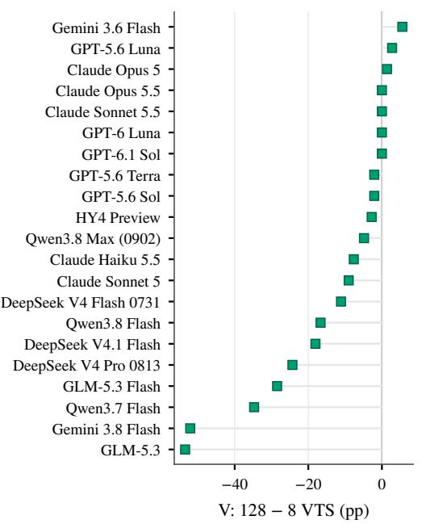

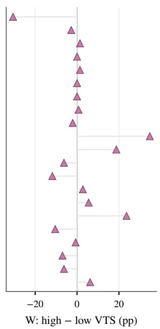

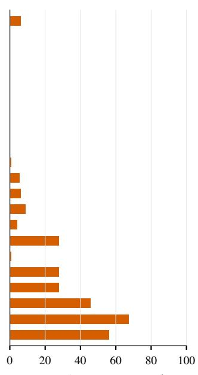  
Figure 7: Per-configuration effects differ in size and sign, and large V penalties occur with high truncation. Withinconfiguration paired differences in VTS (pp) for V (128 minus 8, routed menu) and W (high minus low), with the V = 128 truncation rate in a side column, for 21 configurations over 36 families, sorted by the V effect. Points carry no interval.

What fills a truncated first response. For the 9 configurations whose provider usage payload reports reasoning tokens, the saved provider responses show the first response of every episode that carried 128 schemas (about 240 such requests per configuration, over all blocks; Table 8). Of the 171 first responses that ended at the cap, 120 (70.2%) contain no visible text and no tool call: their completion tokens are reasoning tokens, so the cap was spent before any action. Most of them come from one configuration, Gemini 3.8 Flash. Of the rest, 39 end inside a tool call and 12 inside visible text. Among the 9 configurations, 5 never truncate a first response.

## E.1 Sixteenfold Completion-Cap Sweep

The sweep repeats the design at sixteen times the cap, 16,384 completion tokens per request against the frozen 1,024, on 8 panel configurations. The high cap is the largest power of two that keeps the unchanged 128,000-token episode budget from binding on the episodes the sweep is meant to rescue. Strata, defined separately from those of the crossover, follow the panel’s V = 128 truncation share: B, truncation-heavy, at least 20% (Gemini 3.8 Flash, GLM-5.3, Qwen3.7 Flash, Qwen3.8 Flash, GLM-5.3 Flash, and DeepSeek V4 Pro 0813, every panel configuration that meets the rule); M, 5 to 20% (Claude Haiku 5.5); and N, no truncation and a V effect within 3 pp of zero (GPT-6 Luna). Every configuration kept the route and request parameters of its panel runs.

Each configuration ran the 432-condition capacity factorial on the routed-menu lane at both caps, the arms concurrent, 2 repeats per arm; all 13,824 rows read were kept. The primary estimand is the paired within-family visible-menu contrast (V = 128 minus V = 8) in each arm over the four endpoint $W \times D$ cells and its difference between the arms, pooled over the stratum-B configurations that pass the manipulation check; strata M and N are controls.

Table 7: A fourfold completion cap left the truncation-heavy configurations truncating, and their menu penalty changed little. Paired within-family visible-menu contrast in VTS (pp) at each cap and the difference, per configuration and stratum, with V = 128 truncation rates. 4 configurations, 2 repeats per cap, 6,904 kept rows, 95% family-cluster bootstrap intervals; Dis. is the share of conditions whose outcome differs between the two repeats, both caps pooled. Superscripts give the stratum (B, S, N). Truncation persists at the higher cap, so no row estimates a menu effect free of truncation.
<table><tr><td></td><td colspan="2">Trunc. (%)</td><td colspan="3">Menu contrast (pp)</td><td></td><td>Dis.</td></tr><tr><td>Config. stratum</td><td>1,024</td><td>4,096</td><td>at 1,024</td><td>at 4,096</td><td></td><td>Interaction</td><td>(%)</td></tr><tr><td> $\mathrm { G L M - } 5 . 3 \mathrm { F l a s h } ^ { B }$ </td><td>35.8</td><td>25.3</td><td>-32.3 [-39.2, -25.7]</td><td></td><td> $- 2 4 . 3 [ - 3 0 . 6 , - 1 8 . 4 ]$ </td><td>8.0 [2.1, 14.2]</td><td>19.4</td></tr><tr><td> $\mathrm { Q w e n } 3 . 8 \mathrm { F l a s h } ^ { B }$ </td><td>28.8</td><td></td><td>20.2 −14.9[-22.2, −7.6]</td><td></td><td> $- 1 8 . 3 [ - 2 6 . 8 , - 1 0 . 3 ]$ </td><td>-3.9[-11.6,3.8]</td><td>24.8</td></tr><tr><td> $\bar { \mathrm { G P T } } { - } 5 . 6 \mathrm { L u n a } ^ { N }$ </td><td>0.0</td><td></td><td>0.00.0[-3.8, 3.8]</td><td></td><td>-0.3[-4.5, 3.5]</td><td>-0.3[-4.5,3.8]</td><td>6.9</td></tr><tr><td>DeepSeek V4 Flash 0731S</td><td>46.9</td><td></td><td> $3 1 . 2 0 . 7 [ - 8 . 7 , 9 . 7 ]$ </td><td></td><td> $2 . 1 \left[ - 8 . 3 , 1 1 . 8 \right]$ </td><td>1.4[-8.3, 11.1]</td><td>39.8</td></tr><tr><td>Stratum B (2 cfg.)</td><td></td><td></td><td>-23.6[-28.5, -18.8]</td><td></td><td>-21.3[-26.7,-16.1]</td><td>2.1 [-2.6, 6.8]</td><td></td></tr><tr><td>Stratum S (1 cfg.)</td><td></td><td></td><td>0.7[-8.7,9.7]</td><td></td><td>2.1[-8.3, 11.8]</td><td>1.4[-8.3, 11.1]</td><td></td></tr><tr><td>Stratum N (1 cfg.)</td><td></td><td></td><td>0.0[-3.8, 3.8]</td><td></td><td> $- 0 . 3 \left[ - 4 . 5 , 3 . 5 \right]$ </td><td>-0.3[-4.5,3.8]</td><td></td></tr><tr><td>All (4 cfg.)</td><td></td><td></td><td>-11.6[-14.7,-8.8]</td><td></td><td> $- 1 0 . 2 \left[ - 1 3 . 7 , - 7 . 0 \right]$ </td><td>1.3[−1.5,4.1]</td><td></td></tr></table>

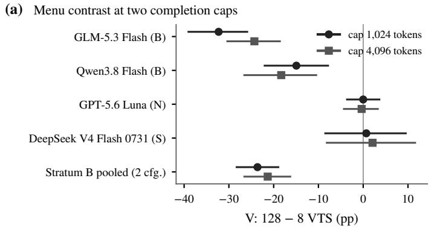

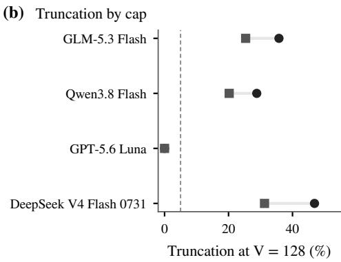  
Figure 8: The menu penalty of the truncation-heavy configurations persists at four times the cap. (a) Visible-menu contrast (pp) at 1,024 and 4,096 completion tokens for each of the 4 configurations and pooled over stratum B, with 95% family-cluster bootstrap intervals. (b) Share of V = 128 episodes truncated at each cap; the dashed line is the 5% ceiling of the manipulation check.

Table 8: Truncated first responses to 128-schema requests are mostly reasoning tokens only. First requests, those ending at the completion cap, and the content of the truncated response, for the 9 configurations with reasoning-token telemetry; counts from the saved provider responses over all blocks.
<table><tr><td colspan="3"></td><td colspan="4">Content of the truncated response</td></tr><tr><td>Configuration</td><td>First req.</td><td>Truncated</td><td>Reasoning only</td><td>Partial call</td><td>Partial text</td><td>Both</td></tr><tr><td>Claude Haiku 5.5</td><td>240</td><td>15</td><td>11</td><td>4</td><td>0</td><td>0</td></tr><tr><td>Claude Opus 5</td><td>241</td><td>0</td><td>0</td><td>0</td><td>0</td><td>0</td></tr><tr><td>Claude Opus 5.5</td><td>240</td><td>0</td><td>0</td><td>0</td><td>0</td><td>0</td></tr><tr><td>Claude Sonnet 5.5</td><td>240</td><td>0</td><td>0</td><td>0</td><td>0</td><td>0</td></tr><tr><td>GPT-6 Luna</td><td>240</td><td>0</td><td>0</td><td>0</td><td>0</td><td>0</td></tr><tr><td>GPT-6.1 Sol</td><td>240</td><td>0</td><td>0</td><td>0</td><td>0</td><td>0</td></tr><tr><td>Gemini 3.8 Flash</td><td>240</td><td>142</td><td>95</td><td>35</td><td>12</td><td>0</td></tr><tr><td>Qwen3.8 Max (0902)</td><td>240</td><td>13</td><td>13</td><td>0</td><td>0</td><td>0</td></tr><tr><td>DeepSeek V4.1 Flash</td><td>240</td><td>1</td><td>1</td><td>0</td><td>0</td><td>0</td></tr></table>

Manipulation check. In the 1,024-token arm the stratum-B configurations truncated 30.6 to 69.8% of their V = 128 episodes; at 16,384 tokens the share was at most 1.4% (Table 9), under the 5% ceiling for every one, so all 6 enter the primary reading. The controls truncated 4.5% (M) and 0.0% (N) at the low cap and none at the high cap. The lowcap contrast of each stratum-B configuration differs from its released V effect by −11.8 to −5.2 pp, a larger penalty in every case (Rel. column of Table 9). For all but one stratum-B configuration, the larger penalty comes with a higher truncation share at the same cap (Trunc. columns of Tables 9 and 4); all 6 low-cap points fall within the spread of the panel’s effect–truncation relation (Figure 6). The primary reading uses only the within-sweep interaction.

Outcome. Pooled over the 6 truncation-heavy configurations, the paired visible-menu contrast is −43.7 pp [−48.5, −39.1] at 1,024 tokens and −2.7 pp [−4.7, −0.9] at 16,384, an interaction of 41.0 pp [36.2, 45.5]. The interaction interval lies entirely above the pre-specified 5 pp margin and the high-cap interval excludes zero. In these configurations, the completion cap accounts for most of the menu penalty, and a small penalty remains. Each stratum-B configuration’s own interaction interval also lies above the margin (Table 9). The controls move within noise: M from −2.4 to 0.3 pp (interaction 2.8 [−3.1, 8.0]) and N from −3.1 to −2.1 pp (1.0 [−2.4, 4.2]). The two repeats disagree on 17.5% of conditions at the low cap and 8.1% at the high cap.

## F Frontier and Structural Holdout

Frontier. With the 4 families as clusters, VTS changes by −3.8 pp [−8.8, 2.5] from 2 to 6 calls and by −6.2 pp [−12.5, 1.2] from 2 to 14 calls. From 2 to 30 calls it changes by −91.2 pp $[ - 9 5 . 0 , - 8 3 . 8 ]$ , an interval that varies only through the 2-call outcomes. At 30 calls, the 11 episodes that stay within the episode budget also fail, 9 of them at an infeasibility stop, and the median episode executes 20 calls (interquartile range 18 to 22) and uses 132,392 tokens. At 14 calls the median prompt has 79,898 tokens and no episode exceeds the episode budget. Figure 9 shows that the 30-call episodes reach the episode budget before they reach the call limit.

Structural holdout. The controller is compared with the model-run baseline, which returns records in the cell’s own encoding (native delivery), on 24 held-out intents over 17 configurations (3,672 rows). 2 configurations form the confirmatory set, and the other 15 are supplementary. Pooled over all configurations, L = 96.1 pp [93.6, 98.0] and Σ = 95.1 pp [92.6, 97.3]. These quantities use the raw-encoding cell of each arm (408 rows per arm), whereas the 2-call arms of Table 10 pool the raw and compact encodings, so the arm means there differ slightly. On the confirmatory configurations alone, Γ = 95.8 pp [89.6, 100.0] and $\Delta = 9 3 . 8 \mathrm { p p }$ [85.4, 102.1]. The upper end of the last interval exceeds 100 because the no-repair means cancel in ∆: it is the controller’s change in VTS from 2 to 30 calls minus the control’s, and so ranges over ±200 pp (Section 4.3). The wrong-layer control, which returns records in a canonical encoding (canonical delivery), gives L = −1.2 pp [−3.7, 1.2] and Γ = −0.2 pp [−2.5, 1.7]. At 2 calls the baseline reaches 96.7% and the controller 97.4%. At 30 calls the baseline averages 18.9 executed calls in 19.8 model requests. The controller averages 29.9 calls, 28.7 of them issued by the controller, in 2.2 requests (Table 10 and Figure 10).

## G Discovery Details

Discovery has 4,536 rows over 21 configurations. Of these, 1,113 (24.5%) end before any model call because the required tools were not retrieved, and 30 are agent failures. Under flat retrieval, ITT success falls by 79.6 pp [60.4, 94.2] from $R = 3 2$ to $R = 2 { , } 0 4 8 .$ , which is the assigned loss L of the router as a repair, and the router recovers Γ = 58.1 pp [36.1, 79.9] of this loss (Σ = 58.1 pp). Under the connector-first router alone, ITT success changes by −21.6 pp [−40.1, −5.0] from R = 32 to $R = 2 { , } 0 4 8$

The router is success-superior to every switch for 21 of 21 incumbents by construction: the flat lexical retriever does not depend on the model, so every configuration gets the same availability, and switching the downstream model cannot change it. On the 7 cases per configuration in which both retrievers return the required tools, the router’s mean success exceeds that of flat retrieval for 1 of the 21 configurations.

## H Failure Localization Audit

This audit measures how much information a failure record carries about the assigned pressure.

Population and decoder. From the baseline cell and the three single-stress endpoint cells of the capacity factorial, we take the 127 configurationfamily packets in which the baseline succeeds and exactly one stressed cell fails (87 under V, 28 under W, and 12 under D). We exclude 36 packets with more than one failure and 2 with infrastructure failures. Balanced accuracy averages the recalls of the three classes, so a constant guess scores 33.3%. In each of 12 folds, one intent is held out, and a lookup table maps each exact feature tuple to the majority label in the training folds. Ties resolve in the order V , W, D, and unseen tuples get the training prior. No identifier of the configuration, family, or pressure enters a feature. Call counts are binned as 0, 1 to 2, 3 to 5, and 6 or more, and trace shape adds the recorded reason for an early stop.

Table 9: A sixteenfold completion cap cuts the truncation to at most 1.4% and takes away most of the menu penalty. Share of V = 128 episodes truncated at each cap; paired within-family visible-menu contrast in VTS (pp) over the four endpoint $W \times D$ cells at each cap, with 95% family-cluster bootstrap intervals, and their difference (interaction); the same configuration’s released V effect (Rel., Table 4); and the share of conditions whose outcome differs between the two repeats, both caps pooled (Dis.). Superscripts give the stratum: B truncation-heavy, M mild, N null. 8 configurations, 2 repeats per cap, 13,824 kept rows; pooled rows weight families equally.
<table><tr><td></td><td colspan="2">Trunc. (%)</td><td colspan="2">Menu contrast (pp)</td><td colspan="2"></td><td>Dis.</td></tr><tr><td>Config. stratum</td><td>1,02416,384</td><td></td><td>at 1,024</td><td>at 16,384</td><td>Interaction</td><td>(pp)</td><td>(%)</td></tr><tr><td>DeepSeek V4 Pro 0813B</td><td>31.9</td><td>0.0</td><td>-29.5[-38.9, -20.8]</td><td>0.7[−1.0, 2.8]</td><td>30.2 [21.2, 39.6]</td><td>-24.3</td><td>11.3</td></tr><tr><td>GLM-5.3B</td><td>69.8</td><td>1.4</td><td>-61.8[-70.5,-52.8]</td><td>-2.8[-7.6,1.7]</td><td>59.0 [49.7, 68.1]</td><td>-53.5</td><td>16.8</td></tr><tr><td> $\mathbf { G L M - } 5 . 3 \operatorname { F l a s h } ^ { B }$ </td><td>37.5</td><td>0.0</td><td>-35.1 [-44.4, -25.3]</td><td>-3.8[-7.6,-0.3]</td><td>31.2[21.5,41.0]</td><td>-28.5</td><td>14.6</td></tr><tr><td>Gemini  $3 . 8 \mathrm { F l a s h } ^ { B }$ </td><td>64.9</td><td>0.0</td><td>-62.8[-72.9, -52.4]</td><td>-2.1[-6.2,0.0]</td><td>60.8 [49.0, 71.5]</td><td>-52.1</td><td>7.8</td></tr><tr><td> $\mathrm { Q w e n } 3 . 7 \mathrm { F l a s h } ^ { B }$ </td><td>51.4</td><td>0.0</td><td>-46.5[-56.6, -36.5]</td><td>-4.2[-8.3, -0.7]</td><td>42.4[31.9, 53.1]</td><td>-34.7</td><td>14.9</td></tr><tr><td> $\bar { \mathrm { Q w e n } 3 . 8 \mathrm { F l a s h } ^ { B } }$ </td><td>30.6</td><td>0.0</td><td>-26.4[-36.5,-16.3]</td><td>-4.2[-12.2,2.8]</td><td>22.2 [13.9, 30.6]</td><td>-16.7</td><td>20.7</td></tr><tr><td> $\mathrm { \dot { C l a u d e } } \mathrm { H a i k u } 5 . 5 ^ { M }$ </td><td>4.5</td><td>0.0</td><td>-2.4[-6.6,1.7]</td><td>0.3[-3.1,3.5]</td><td>2.8[-3.1, 8.0]</td><td>-7.6</td><td>7.9</td></tr><tr><td> $\mathrm { G P T } { \cdot } 6 \mathrm { L u n a } ^ { N }$ </td><td>0.0</td><td>0.0</td><td>-3.1[-8.0, 2.4]</td><td>-2.1 [−5.9, 1.7]</td><td>1.0[−2.4, 4.2]</td><td>0.0</td><td>8.4</td></tr><tr><td>Stratum B (6 cfg.)</td><td></td><td></td><td>-43.7[-48.5,-39.1]</td><td>-2.7[-4.7, −0.9]</td><td>41.0 [36.2, 45.5]</td><td></td><td></td></tr><tr><td>Stratum M (1 cfg.)</td><td></td><td></td><td>-2.4[-6.6, 1.7]</td><td>0.3[-3.1,3.5]</td><td>2.8[-3.1, 8.0]</td><td></td><td></td></tr><tr><td>Stratum N (1 cfg.)</td><td></td><td></td><td>-3.1[-8.0,2.4]</td><td>-2.1[-5.9, 1.7]</td><td>1.0[−2.4, 4.2]</td><td></td><td></td></tr><tr><td>All (8 cfg.)</td><td></td><td></td><td>-33.5[-37.2, -29.8]</td><td>-2.3[-3.8, -0.7]</td><td>31.2[27.5, 34.8]</td><td></td><td></td></tr></table>

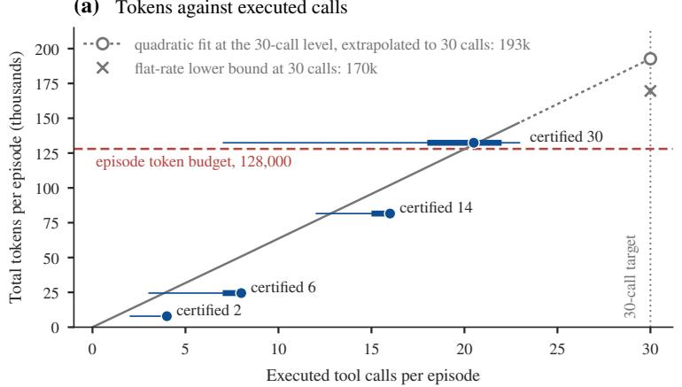

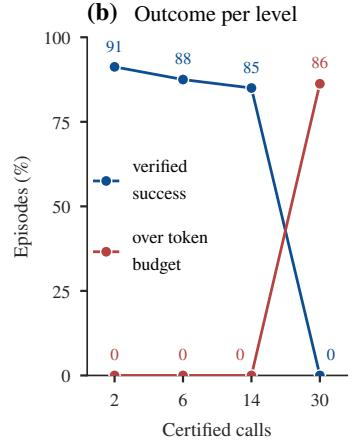  
Figure 9: At 30 certified calls, episodes run into the episode budget before they run out of calls. (a) For each certified-call level, the marker is the median number of executed calls, placed at the level’s median total tokens, with the interquartile range (thick) and the full range (thin) of executed calls. The grey curve is the quadratic fit of tokens on attempted calls at the 30-call level (attempted calls can exceed executed ones), solid up to the largest attempted count and dotted beyond, ending at its extrapolated value at 30 calls (circle) beside the flat-rate lower bound (cross); the dashed line is the episode token budget and the dotted vertical line the 30-call target. (b) Share of each level’s episodes that were verified successes and share that ended over the episode token budget. 80 episodes per level over 20 configurations and 4 families. The ranges are not intervals.

Results. Table 11 gives the balanced accuracy of each feature set. It is 53.4% [44.6, 60.1] for the first unmet obligation, 48.5% [43.0, 55.4] for the terminal flag, 48.9% [42.4, 58.9] for both, 51.3% [44.8, 57.0] with trace shape added, 52.4% [44.2, 60.2] for trace shape alone, 54.8% [47.8, 61.3] for call counts alone, and 52.5% [44.3, 62.4] for the vector of all nine obligation verdicts. The joint record recovers 1 of the 12 returned-state cases. With termination-aware labels, balanced accuracy is 54.1% [45.9, 63.2] and returned-state recall is 8.3%. A proxy that reveals the menu size reaches 71.8% [60.4, 82.6]. It reads the treatment, so it serves as a reference point, not a diagnostic.

Table 10: Structural holdout arms. The controller succeeds at 30 calls because it, not the model, issues the calls. Arm means over 17 configurations and 24 held-out intents (408 episodes per 30-call arm): VTS, episodes over budget, executed calls by issuer, model requests, and tokens.
<table><tr><td>Orchestration</td><td>Delivery</td><td>Calls</td><td>Rows</td><td>VTS</td><td>Req.</td><td>Ctrl.</td><td>Model</td><td>Exec.</td><td>Tokens</td><td>Over budget</td></tr><tr><td>Model</td><td>native</td><td>2</td><td>816</td><td>96.7</td><td>3.1</td><td>0.0</td><td>2.2</td><td>2.2</td><td>7,227</td><td>0</td></tr><tr><td>Model</td><td>canonical</td><td>2</td><td>816</td><td>96.7</td><td>3.1</td><td>0.0</td><td>2.2</td><td>2.2</td><td>7,366</td><td>0</td></tr><tr><td>Controller</td><td>native</td><td>2</td><td>816</td><td>97.4</td><td>2.1</td><td>1.0</td><td>1.2</td><td>2.2</td><td>5,169</td><td>0</td></tr><tr><td>Model</td><td>native</td><td>30</td><td>408</td><td>0.0</td><td>19.8</td><td>0.0</td><td>18.9</td><td>18.9</td><td>130,468</td><td>389</td></tr><tr><td>Model</td><td>canonical</td><td>30</td><td>408</td><td>0.0</td><td>18.9</td><td>0.0</td><td>18.0</td><td>18.0</td><td>130,998</td><td>385</td></tr><tr><td>Controller</td><td>native</td><td>30</td><td>408</td><td>96.6</td><td>2.2</td><td>28.7</td><td>1.2</td><td>29.9</td><td>21,159</td><td>3</td></tr></table>

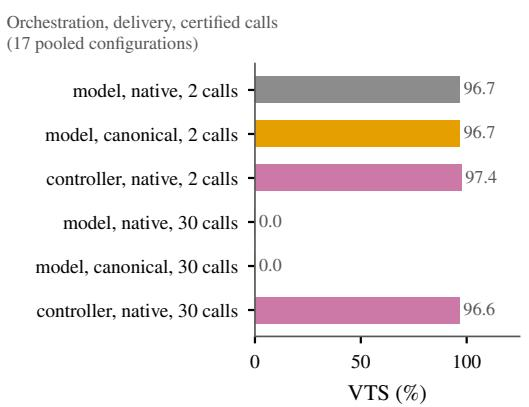

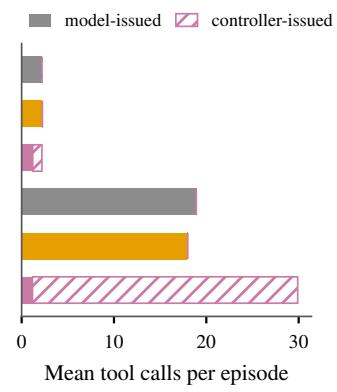

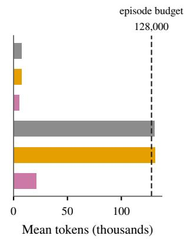  
Figure 10: Delegation replaces the model’s calls rather than improving them. Arm means of VTS, executed calls split by issuer, and tokens in the structural holdout, over 17 configurations and 24 held-out intents.

We compare feature sets with paired gains and 99% intent-cluster intervals (Bonferroni over five exploratory comparisons, 10,000 draws, out-offold predictions held fixed). The record with trace shape gains −3.5 pp [−9.4, 5.1] over call counts, −2.1 pp [−15.1, 12.4] over the obligation, $- 1 . 1 \mathrm { \ p p \ } [ - 7 . 6 , 6 . 8 ]$ over trace shape alone, and $2 . 3 \mathrm { p p } [ - 9 . 1 , 1 0 . 3 ]$ over the joint record. The joint record $\mathrm { g a i n s - 4 . 4 \ p p \ [ - 1 5 . 0 , 9 . 7 ] }$ over the obligation (Figure 11). No interval excludes zero.

Packets with several failures. We also apply the decoder to 83 failed stressed rows from packets with several failures, whose intent was excluded from training. It reaches 62.4% balanced accuracy and recovers 3 of 26 returned-state cases. The rows are correlated, so these metrics are descriptive.

## I Repair and Decision Details

Table 12 lists the activation quantities and the decision counts for every repair.

Why activation is not specificity. Let baseline success be $p _ { 0 } > p _ { 1 }$ under low and high pressure. A generic intervention that rescues a share $r \in ( 0 , 1 ]$ of failures, whatever their layer, gives success $q _ { z } =$ $p _ { z } + r ( 1 - p _ { z } )$ , so

$$
\begin{array} { l } { { L = p _ { 0 } - p _ { 1 } > 0 , } } \\ { { \Gamma = r ( 1 - p _ { 1 } ) > 0 , } } \\ { { \Sigma = r L > 0 . } } \end{array}
$$

For $( p _ { 0 } , p _ { 1 } , r ) = ( 0 . 8 , 0 . 4 , 0 . 5 )$ this gives $L = 4 0 ,$ $\Gamma = 3 0 .$ , and $\Sigma = 2 0 ~ \mathrm { p p }$ without any mechanism specific to the layer. Showing specificity also requires credible alternative repairs that are tested on the same stressed cells and do not help.

Activation components. The routed menu has L = 17.5 pp [14.9, 20.2] and Σ = 4.9 pp [2.2, 7.5]. The workflow prompt has $L = 2 . 4 \mathrm { p p } \left[ - 0 . 4 , 5 . 0 \right]$ and $\Sigma = 0 . 0 \mathrm { \ p p \ [ - 2 . 4 , 2 . 4 ] }$ . The interface guide has $L \ = \ 1 . 5 \ \mathrm { p p } \ [ - 0 . 1 , 3 . 1 ]$ and $\Sigma ~ = ~ 0 . 7$ pp $[ - 1 . 7 , 3 . 1 ]$ . The equivalence margins of 3.6 and

Table 11: No variant of the failure record beats call counts alone at identifying the assigned pressure. Leave-oneintent-out balanced accuracy (%) over 127 single-failure packets, with 95% intent-cluster intervals.
<table><tr><td></td><td></td><td colspan="3">Recall (%)</td><td>Returned state</td></tr><tr><td>Decoder</td><td>Balanced acc. [95% CI]</td><td>V</td><td>W</td><td>D</td><td>recovered</td></tr><tr><td>Constant (majority)</td><td>33.3 [33.3, 33.3]</td><td>100.0</td><td>0.0</td><td>0.0</td><td>0/12</td></tr><tr><td>Termination flag</td><td>48.5 [43.0, 55.4]</td><td>92.0</td><td>53.6</td><td>0.0</td><td>0/12</td></tr><tr><td>First unmet obligation</td><td>53.4 [44.6, 60.1]</td><td>85.1</td><td>75.0</td><td>0.0</td><td>0/12</td></tr><tr><td>Obligation + termination</td><td>48.9 [42.4, 58.9]</td><td>88.5</td><td>50.0</td><td>8.3</td><td>1/12</td></tr><tr><td>+ trace shape</td><td>51.3 [44.8, 57.0]</td><td>93.1</td><td>60.7</td><td>0.0</td><td>0/12</td></tr><tr><td>Call count only</td><td>54.8 [47.8, 61.3]</td><td>100.0</td><td>64.3</td><td>0.0</td><td>0/12</td></tr><tr><td>Trace shape only</td><td>52.4 [44.2, 60.2]</td><td>96.6</td><td>60.7</td><td>0.0</td><td>0/12</td></tr><tr><td>Verdict vector</td><td>52.5 [44.3, 62.4]</td><td>88.5</td><td>60.7</td><td>8.3</td><td>1/12</td></tr><tr><td>Corrected labels (termination-aware)</td><td>54.1 [45.9, 63.2]</td><td>93.1</td><td>60.7</td><td>8.3</td><td>1/12</td></tr><tr><td>Menu-size proxy (treatment-revealing)</td><td>71.8 [60.4, 82.6]</td><td>100.0</td><td>57.1</td><td>58.3</td><td>7/12</td></tr></table>

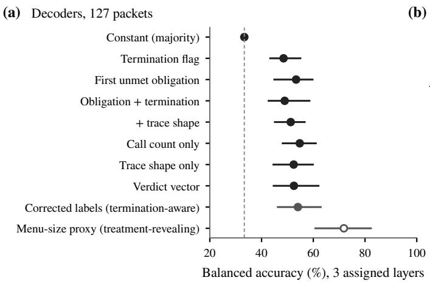

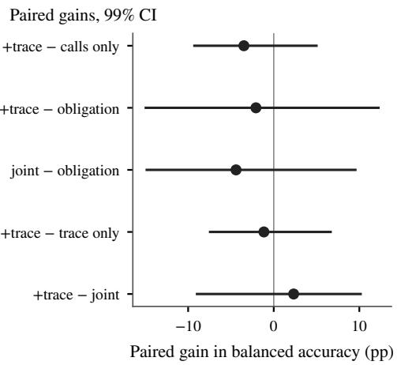  
Figure 11: Adding fields to the failure record does not yield a detectable gain. (a) Balanced accuracy (%) of each decoder on 127 packets with 95% intent-cluster intervals; the dashed line is the constant guess. (b) Paired gains in balanced accuracy (pp), with 99% Bonferroni intervals over 12 intent clusters and predictions held fixed.

Table 12: Routing and delegation activate, and prompt repairs do not. Only the router (by construction) and the controller (by delegation) beat every configuration switch on success. Assigned loss L, stress gain Γ, and selectivity Σ (for the controller, wrong-layer advantage $\Delta$ in its place), in VTS pp (router: ITT success). Decision counts are incumbents out of the configurations with complete arms. Intervals are 95% cluster bootstraps over 18 required-tool clusters (router), 36 families (routed menu and prompt repairs), or 24 held-out intents (controller), with Holm correction over the four layers; the controller is corrected together with its wrong-layer control.
<table><tr><td></td><td></td><td></td><td></td><td>(activated)</td><td colspan="3">vs. every switch</td></tr><tr><td>Repair (layer; cfg.)</td><td>L</td><td>Γ</td><td>Σ(∆)</td><td>Holm p</td><td>Succ.</td><td>Pareto</td><td>Cost</td></tr><tr><td>Router (R; 21 cfg.)</td><td>79.6 [60.4, 94.2]</td><td>58.1 [36.1,79.9]</td><td>58.1 [36.1, 79.6]]</td><td>.001 (yes)</td><td>21/21</td><td>21/21</td><td>0/21</td></tr><tr><td>Routed menu (V; 21 cfg.)</td><td>17.5 [14.9, 20.2]</td><td>4.9 [2.6, 7.0]</td><td>4.9 [2.2, 7.5]</td><td>.003 (yes)</td><td>0/21</td><td>9/21</td><td>1/21</td></tr><tr><td>Workflow prompt (W; 20 cfg.)</td><td>2.4 [–0.4, 5.0]</td><td>1.7 [-0.6, 3.8]</td><td>0.0 [−2.4, 2.4]</td><td>.949 (no)</td><td>0/20</td><td>10/20</td><td>1/20</td></tr><tr><td>Interface guide (D; 20 cfg.)</td><td>1.5 [-0.1,3.1]</td><td>0.1 [-1.5, 1.9]</td><td>0.7 [-1.7,3.1]</td><td>.949 (no)</td><td>0/20</td><td>9/20</td><td>1/20</td></tr><tr><td>Controller (W; 17 cfg.) held-out; Σ column: ∆</td><td>96.1 [93.6, 98.0]</td><td>96.6 [94.6, 98.5]</td><td>95.3 [92.4,97.8]</td><td>&lt;.001 (yes)</td><td>17/17</td><td>17/174/17</td><td></td></tr></table>

1.7 pp are the smallest symmetric margins at which the two one-sided tests (Schuirmann, 1987) reject, at the 5% level, a stress gain outside the margin.

Sentinel repeats. Sentinel pairs run three times and cover 480 condition groups (1,440 rows) on

20 configurations and 4 families. They give 89.7% pass@1, 82.7% success on all three runs, 94.8% success on any run, and 12.1% disagreement between runs. The repeated gains are 7.1 pp [2.5, 11.7] for the routed menu, −1.2 pp [−2.5, 0.0] for the workflow prompt, and −0.4 pp [−3.3, 2.5] for the interface guide.

Decision matrix. For each incumbent, each repair is compared with every other configuration in the same population on the same stressed cells. A repair is success-superior if the 95% paired bootstrap interval of its success difference against every switch lies above zero, and cost-superior if the interval of its cost difference against every switch lies below zero. It is Pareto-nondominated if no switch is at least as good on success, tokens, wall time, and cost and strictly better on one, using point estimates. The counts (success-superior, nondominated, cost-superior) are 21/21/0 of 21 for the router, 0/9/1 of 21 for the routed menu, 0/10/1 of 20 for the workflow prompt, 0/9/1 of 20 for the interface guide and 17/17/4 of 17 for the controller.

## J Public-Information Policy Pilot

This development study asks which action to take after a failure, using only public information. It has its own population: 192 matched blocks (1,536 episodes) built from 12 previously inspected families, one per intent, crossed with four cells, two incumbents, and two repeats. The cells are (8, low, raw), (128, low, raw), (8, high, raw), and (8, low, compact). The incumbents are Qwen3.8 Flash and DeepSeek V4 Flash 0731 on the crossover’s route, and the fixed switch target is GPT-5.6 Luna, a high-baseline configuration (Table 4).

Actions and access. Each block contains a probe and seven restarts, each reset independently: an unchanged retry, a 4,096-token completion cap, a public-description router, the public-handoff controller, canonical delivery (the wrong-layer encoding control), the combined repairs (router, controller, and canonical delivery with the larger cap), and the fixed switch. The router matches a unique route in the user text to public tool descriptions before the first request. It never receives the gold operational tools, and it leaves the menu unchanged when the route is absent or ambiguous. A trace selector chooses an action from public numeric features of requests and responses only. It is a depth-one tree fitted with each intent held out.

Results. The unchanged retry succeeds on 130 of 192 blocks (67.7%), the public router on 151 (78.6%), the combined repairs on 157 (81.8%), the trace selector on 188 (97.9%), and the fixed switch on 190 (99.0%) (Table 13). The difference between the trace selector and the switch is −1.0 pp [−2.6, 0.0] over intent clusters, with the fitted rules held fixed. With the probe charged, the mean cost per 1,000 conditions at frozen prices is USD 4.49 for trace selection and USD 4.62 for probing and then switching, against USD 1.94 for switching without a probe.

Conditional on a failed probe. 127 of the 192 probes succeed, so the pooled rates above mix recovery with restarts that were not needed. Among the 65 blocks whose probe failed, the unchanged retry recovers 16 (24.6%), the larger cap 41.5%, the router 40 (61.5%), the combined repairs 43 (66.2%), and the switch 64 (98.5%). The policy a practitioner would run, keeping a successful probe and acting only after a failure, reaches 88.5% with the combined repairs and 99.5% with the switch (Table 13, after-failed-probe columns).

## K External Environment

We test whether the menu effect carries over to ToolSandbox (Lu et al., 2025), a stateful benchmark scored by its own evaluator rather than by VTS. In the concurrent menu stratum (12 configurations, 32 scenarios, 384 matched blocks, 1,152 rows), exposing all tools instead of the authored scope changes full success by −2.9 pp [−7.0, 0.5] (sign-flip p = .224) and similarity by −0.2 pp [−5.5, 4.5], while adding 16,916 tokens [15,021, 18,676] and 0.86 requests [0.56, 1.18]. This arm has no duration estimate because its episodes are continuation-only segments (Table 14). Ten added distractors change full success by −0.5 pp [−1.8, 0.8], similarity by $1 . 6 \mathrm { p p } [ - 0 . 8 , 4 . 0 ]$ , tokens by 5,322 [4,622, 6,018], and duration by $1 . 0 7 \mathrm { ~ s ~ } [ 0 . 2 8 , 1 . 8 5 ]$ (Table 14 and Figure 12). In ToolSandbox, a larger menu thus costs tokens more clearly than success.

A separate historical stratum (5 configurations), run at a different time, gives a similarity contrast of −0.7 pp [−5.2, 3.9] under stress. The two strata are never pooled. Across 5 configurations, the rank correlation between ToolSandbox success and VTS is $\rho = - 0 . 8$ , with intervals of $[ - 1 . 0 , - 0 . 5 ]$ when resampling scenarios and families and $[ - 1 . 0 , - 0 . 1 1 ]$ when resampling configurations (Kendall $\tau _ { b } = - 0 . 6 )$ . Both intervals lie below zero, so over these 5 configurations VTS and Tool-Sandbox success are negatively rank-correlated.

Table 13: In the development pilot, a fixed switch beats every public repair. Block-level success (%) and cost per action at frozen prices, over 192 blocks and two incumbents, on 12 previously inspected families, one per intent. LOIO: leave-one-intent-out.
<table><tr><td></td><td colspan="3">Success, % (blocks)</td><td colspan="2">After failed probe</td><td colspan="2">USD per 1,000 conditions</td></tr><tr><td>Action or policy</td><td>Pooled</td><td>DeepSeek V4 Flash 0731</td><td>Qwen3.8 Flash</td><td>Recovered</td><td>Retain-then-act</td><td>With probe</td><td>No probe</td></tr><tr><td>Retain incumbent (probe)</td><td>66.1 (127/192)</td><td>49.0 (47/96)</td><td>83.3 (80/96)</td><td>0.0 (0/65)</td><td>66.1 (127/192)</td><td>2.68</td><td></td></tr><tr><td>Unchanged retry</td><td>67.7 (130/192)</td><td>52.1 (50/96)</td><td>83.3 (80/96)</td><td>24.6 (16/65)</td><td>74.5 (143/192)</td><td>5.38</td><td>2.70</td></tr><tr><td>Larger completion cap</td><td>73.4 (141/192)</td><td>55.2 (53/96)</td><td>91.7 (88/96)</td><td>41.5 (27/65)</td><td>80.2 (154/192)</td><td>5.76</td><td>3.09</td></tr><tr><td>Public-description router</td><td>78.6 (151/192)</td><td>66.7 (64/96)</td><td>90.6 (87/96)</td><td>61.5 (40/65)</td><td>87.0 (167/192)</td><td>4.14</td><td>1.46</td></tr><tr><td>Public-handoff controller</td><td>71.9 (138/192)</td><td>56.2 (54/96)</td><td>87.5 (84/96)</td><td>35.4 (23/65)</td><td>78.1 (150/192)</td><td>5.24</td><td>2.56</td></tr><tr><td>Canonical delivery</td><td>71.4 (137/192)</td><td>54.2 (52/96)</td><td>88.5 (85/96)</td><td>35.4 (23/65)</td><td>78.1 (150/192)</td><td>5.56</td><td>2.88</td></tr><tr><td>Combined repairs</td><td>81.8 (157/192)</td><td>67.7 (65/96)</td><td>95.8 (92/96)</td><td>66.2 (43/65)</td><td>88.5 (170/192)</td><td>4.24</td><td>1.56</td></tr><tr><td>Fixed switch (GPT-5.6 Luna)</td><td>99.0 (190/192)</td><td>99.0 (95/96)</td><td>99.0 (95/96)</td><td>98.5 (64/65)</td><td>99.5 (191/192)</td><td>4.62</td><td>1.94</td></tr><tr><td>Trace selector (LOIO)</td><td>97.9 (188/192)</td><td>97.9 (94/96)</td><td>97.9 (94/96)</td><td></td><td></td><td>4.49</td><td></td></tr></table>

Table 14: In ToolSandbox, a larger menu costs tokens more clearly than success. Paired scenario-level differences under ToolSandbox’s evaluator (success and similarity in pp, tokens, requests, and seconds) for 12 concurrent configurations and 32 scenarios, with 95% scenario-cluster intervals.
<table><tr><td>Concurrent menu (12 cfg., 32 scenar- +10 distractors – scope ios, 384 blocks)</td><td></td><td>All tools — scope</td></tr><tr><td>Full success (pp)</td><td>-0.5 [−1.8, 0.8]</td><td>-2.9 [−7.0, 0.5]</td></tr><tr><td>Similarity (pp)</td><td>1.6 [–0.8, 4.0]</td><td>−0.2 [-5.5, 4.5]</td></tr><tr><td>Tokens per episode</td><td>5,322 [4,622, 6,018]</td><td>16,916 [15,021, 18,676]</td></tr><tr><td>Model requests</td><td>0.38 [0.22, 0.54]</td><td>0.86 [0.56, 1.18]</td></tr><tr><td>Duration (s)</td><td>1.07 [0.28, 1.85]</td><td>not estimated: continuation-only seg-</td></tr><tr><td>Historical menu (5 cfg.): stress-arm -0.7 [-5.2, 3.9]</td><td></td><td>ment is not a complete episode duration</td></tr><tr><td>similarity contrast (pp)</td><td></td><td></td></tr><tr><td>External rank (5 cfg.): Spearman ρ External rank: Kendall  $\tau _ { b }$ </td><td>-0.8[−1.0, -0.5] scenario/family; [−1.0, -0.11] configuration -0.6</td><td></td></tr></table>

Arm minus authored scope; ToolSandbox evaluator; 12 configurations, 32 scenarios, 384 matched blocks

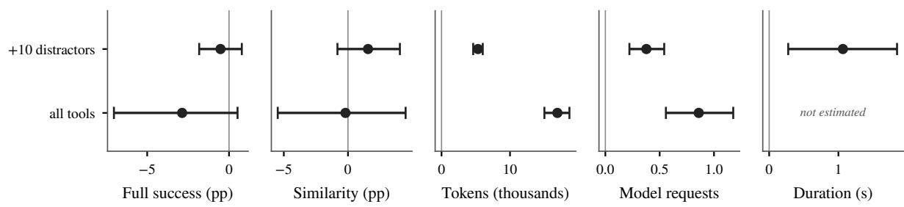  
Figure 12: In ToolSandbox, a larger menu costs tokens more clearly than success. Pooled paired contrasts of each menu arm (ten added distractors; all tools) against the authored scope on ToolSandbox’s own evaluator: full success and similarity (pp), tokens, model requests, and duration, over 12 concurrent configurations, 32 scenarios, and 384 matched blocks, with 95% scenario-cluster intervals. All-tools duration is not estimated. The historical stratum is confounded with time and reported separately in Table 14.

## L Comparison with Related Benchmarks

Table 15 compares ToolBottleneckBench (TBB) with related benchmarks. Every property appears in at least one prior design, but no prior benchmark has more than five of the ten; ToolBottleneck-Bench has nine and repeated-run stochasticity in part. TwinCheck’s counterfactual negative twins (Dai and Huang, 2026) replace a tool call at inference time; our matched variants are compiled

before the episode.

## M Reproducibility, Verification, and Cost

Availability. The public code and data repository is https://github.com/zichuanxu/ tool-bottleneck-bench. It contains the deterministic generator, the exact grader, every scored row, the frozen plans, the analysis code, and the manifests. Running new hosted episodes requires

Table 15: Ten design properties across related benchmarks. ✓ = property documented in the abstract or full text, p = partial or adjacent, – = not found. Columns: FBG = FuncBenchGen (Maekawa et al., 2026), TMB = Tool-MenuBench (Babu and Iyer, 2026b), AFT = AFT-Bench (Wang, 2026b), TRB = ToolRobustBench (Zheng et al., 2026), AFB = APIFlow-Bench (Wan et al., 2026), HB = Harness-Bench (Yao et al., 2026), MoH = Model or Harness? (Raj et al., 2026), LRB = LayerRAG-Bench (Shams, 2026), CAF = CAFE (Lukassen et al., 2026), TSB = ToolSandbox (Lu et al., 2025), TBB = ToolBottleneckBench (this work).
<table><tr><td>Property</td><td>FBG</td><td>TMB</td><td>AFT</td><td>TRB</td><td>AFB</td><td>HB</td><td>MoH</td><td>LRB</td><td>CAF</td><td>TSB</td><td>TBB</td></tr><tr><td>Same-goal controlled contrast</td><td>√</td><td>√</td><td>√</td><td>√</td><td>√</td><td>√</td><td></td><td>√</td><td>√</td><td>√</td><td>√</td></tr><tr><td>Separate availability estimand</td><td>p</td><td>√</td><td>p</td><td></td><td></td><td></td><td></td><td>p</td><td></td><td></td><td>√</td></tr><tr><td>Crossed factors within one goal</td><td>√</td><td>√</td><td>p</td><td>p</td><td></td><td>√</td><td></td><td>√</td><td>√</td><td></td><td>√</td></tr><tr><td>Certified stateful horizon</td><td>p</td><td>p</td><td>p</td><td>一</td><td>√</td><td>p</td><td></td><td>p</td><td></td><td>p</td><td>√</td></tr><tr><td>Observation-format factor</td><td>p</td><td>一</td><td>√</td><td>√</td><td>p</td><td></td><td></td><td>√</td><td></td><td></td><td>V</td></tr><tr><td>Exact executable grading</td><td>√</td><td>p</td><td>√</td><td>√</td><td>√</td><td>p</td><td></td><td>p</td><td></td><td>p</td><td>L</td></tr><tr><td>Matched-layer repair test</td><td>√</td><td>√</td><td>√</td><td>√</td><td></td><td></td><td></td><td>√</td><td></td><td></td><td>√</td></tr><tr><td>Wrong-layer control</td><td></td><td></td><td>p</td><td>√</td><td></td><td></td><td></td><td>√</td><td></td><td></td><td>√</td></tr><tr><td>Model-vs-system decision</td><td></td><td></td><td></td><td></td><td></td><td>√</td><td>V</td><td></td><td>√</td><td></td><td>√</td></tr><tr><td>Repeated-run stochasticity</td><td></td><td></td><td>p</td><td></td><td>1</td><td></td><td></td><td></td><td>p</td><td>p</td><td>p</td></tr></table>

Sources for the non-obvious cells. FBG separate availability is p because its distractor functions are always visible, with no registered-versus-visible split. Its matched repair is restating prior variable values, which the authors report lifts GPT-5 from 62.5% to 81.3%. TMB fills the availability row by measuring gold next-tool exposure before selection separately from downstream wrong-tool calls and goal-state success. AFT holds the task, backend, initial state, injected failure, agent, and mode fixed while varying the interface. Its wrong-layer cell is p because each mechanism is evaluated only under its own matched treatment. TRB reports two distinct intervention sets: alias repair on A-family tasks moves success from 21/30 to 30/30, while chain-of-thought prompting on B-family tasks leaves 21/30 unchanged despite diagnosed selection failures. AFB uses an oracle admission screen and reports five epochs per task, with all-five reliability spanning 44 points against 7 for best-of-five. HB combines deterministic validators where available with rubric-based judgment elsewhere (its Section 3.4), which supports partia grading and certification marks. MoH develops a failure-localization taxonomy with a judge-agreement study rather than controlled task-repair effects. Its repair-assignment framing supports the model-vs-system row. LRB fills both repair rows: schema normalization lifts schema-drift success from 0.000 to 0.913 and does not succeed on the off-target layers it lists. CAF is scored on a shared rubric with a configurable LLM judge, so its exact-grading cell is –. It fills the model-vs-system row through mixed-effects attribution of variance to components. TSB exposes 0, 3, 10, or all remaining tools as distractors, prioritizing domain overlap and textual similarity, and grades by milestones and minefields. Its four-trial user-simulator error audit supports a partial repeated-run mark. TBB’s repeated-run cell is p: three-repeat sentinel pairs cover 20 configurations in 4 families, and the two-cap crossover and the cap sweep repeat the factorial twice on 4 and 8 configurations. The core factorial has one realization per cell.

provider credentials. The sweep and policy-pilot analyses rerun offline from the released rows; the whole-panel check and the certificates are released with their passed reports. Authored code and data are released under the MIT License; ToolSandbox keeps its upstream license, and model-generated records remain subject to the providers’ terms.

is Claude Opus 5 (USD 165.18) and the cheapest Qwen3.7 Flash (USD 0.88).

Verification. For 8 configurations, certificates reconstruct the frozen harness verdicts from saved responses. ToolSandbox rows are re-graded from saved state, without running the tools again. A whole-panel check re-runs the same analysis code deterministically, reproduces every typed field of the 16 recomputed analyses, and carries 3 analyses byte for byte. The scoped test suite passes 242 tests and 227 subtests (469 cases).

Cost. Applying frozen route prices to normalized token counts, without cache credit, gives a cost of USD 768.38 for the 26,576 rows. Table 4 gives the cost of each configuration, and the release gives its token counts. The most expensive configuration