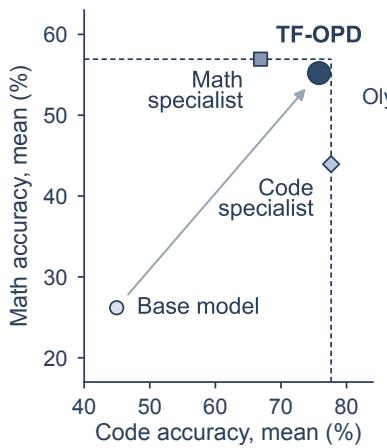
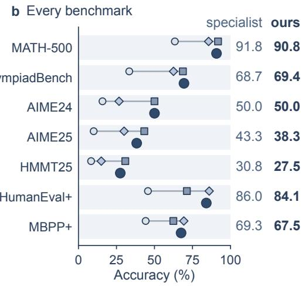
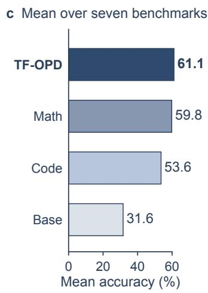
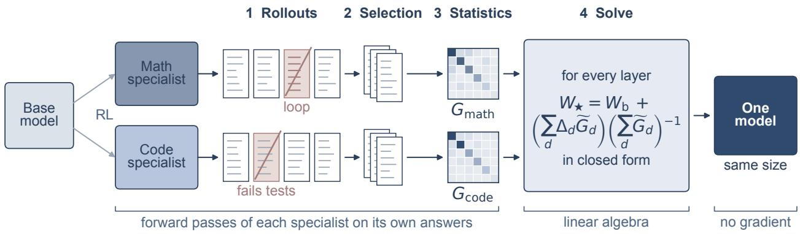
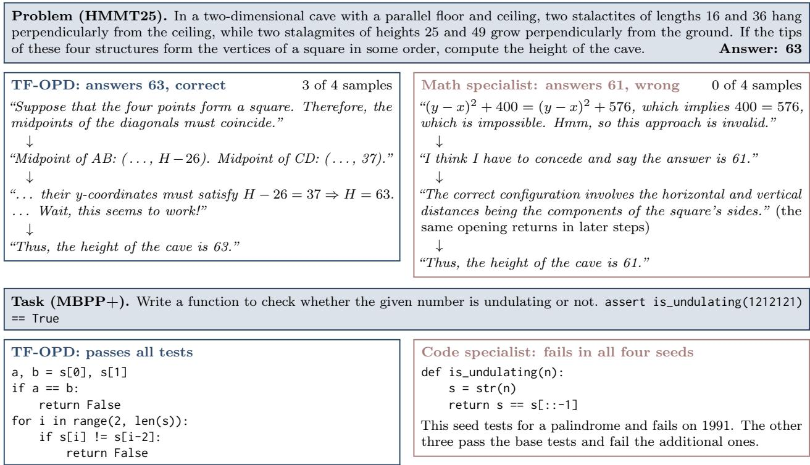
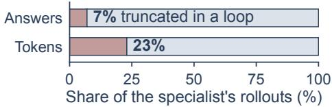
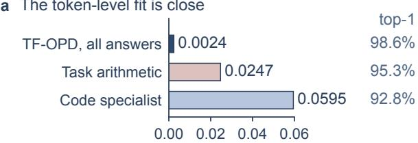
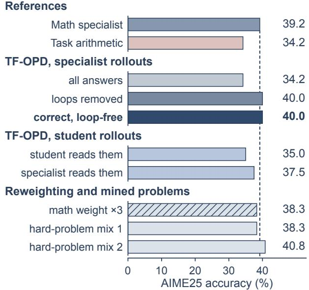
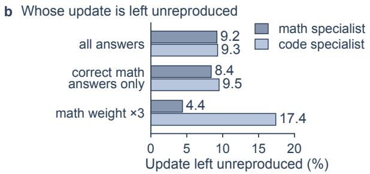
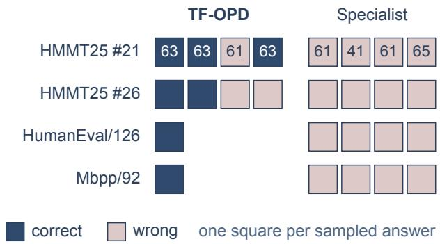

# Training-Free On-Policy Distillation

Bangji Yang1,\*, Jiajun Fan1,\*, Zhaoyu Zhu1, Hongbo Ma2, Ge Liu1,†

1University of Illinois at Urbana-Champaign 2Tsinghua University

Equal contribution, †Corresponding author

## Abstract

On-policy distillation consolidates specialist models into one student at the price of rollouts, teacher passes and gradient steps for every teacher. We show that the consolidation does not need training: with forward passes only, the capabilities of separately tuned specialists can be aggregated into one model that is, on average, more accurate than either specialist alone. When specialists share a base model, distillation has an exact layer-wise solution: each linear layer of the fused model must reproduce every specialist’s output on the inputs that specialist receives while reading its own answers, a least-squares problem whose solution needs only the second moments of those inputs. One forward pass over a few hundred rollouts provides them. We call this training-free on-policy distillation (TF-OPD). What the rollouts contain matters more than the solver: answers truncated in repetition loops are few among a mathematics specialist’s rollouts but carry a large share of their tokens, and removing them lifts the fused model on AIME25 from task arithmetic’s level to the specialist’s at matched precision. On Olmo 3 7B, a few GPU-hours of forward computation per specialist yield a generalist that keeps most of each specialist’s gain on each of seven mathematics and code benchmarks.

Date: October 16, 2026 | Correspondence: geliu@illinois.edu

## 1 Introduction

Reinforcement learning from verifiable rewards has become the standard way to turn a base language model into a strong reasoner in one domain [1–5]. Because the reward is domain-specific, the result is a family of specialists that share an initialization: from one base checkpoint, one model is trained on competition mathematics, another on programming, a third on instruction following [6]. Each is far ahead on its own domain and far behind on the others, so a user who wants mathematics and programming in the same model has to build that model from the specialists.

The available routes either train or ignore the rollouts (Table 1). One can repeat reinforcement learning on the union of the domains [7, 8], or distill: on-policy distillation lets the student generate, has a teacher supervise those generations, and updates the student on its own distribution [9–11]. It has become a post-training route for consolidating specialists into one student [12], at the price of rollouts, teacher passes and gradient steps for every teacher. The training-free alternative is to merge weights. Arithmetic on parameters [13] does not know which inputs the parameters act on, and on reinforcement-learned specialists it can give up part of what made them specialists: summing the mathematics and coding updates of a 7B model leaves it below the mathematics specialist on AIME25 (Section 4.5). RegMean [14] does use inputs, in a closed-form least-squares solution, but takes them from each task’s training corpus, whereas a reasoning model spends almost all of its computation on text it has generated itself.

Base model Math specialist D Code specialist TF-OPD  
a Mathematics against code  

Figure 1 A generalist with the highest mean accuracy, without training (Olmo 3 7B). (a) Mean accuracy on the five mathematics benchmarks against mean accuracy on the two code benchmarks; dashed lines mark what each specialist reaches on its own domain, and TF-OPD, computed from the two with forward passes only, lies next to the corner they define. (b) Every benchmark: the base model and the specialists on the upper line of each row, TF-OPD below, and at the right the score of that domain’s specialist and of TF-OPD. (c) Mean accuracy over the seven benchmarks: TF-OPD is more accurate on average than either specialist it was built from.
<table><tr><td>Route</td><td>No training</td><td>On-policy inputs</td><td>Matches teachers</td></tr><tr><td>Multi-domain RL</td><td>X</td><td>√</td><td>X</td></tr><tr><td>On-policy distillation</td><td>X</td><td>V</td><td>V</td></tr><tr><td>Task arithmetic, TIES, DARE</td><td>√</td><td>X</td><td>X</td></tr><tr><td>RegMean</td><td>V</td><td>X</td><td>√</td></tr><tr><td>TF-OPD (ours)</td><td>√</td><td>√</td><td>√</td></tr></table>

Table 1 Routes from several specialists to one model. TF-OPD needs no training, gathers its statistics on text the models generate, and is fit to match the specialists’ outputs.

We connect the two lines. For a single linear layer, asking the fused weight to reproduce each teacher’s output on that teacher’s inputs is the distillation objective restricted to the layer, and it is the least-squares problem that RegMean solves: once the second moments of the inputs are known, no optimization is left to run. TF-OPD gathers those moments where on-policy distillation gathers its data, on rollouts. Each specialist answers a few hundred training problems from its domain, the answers are filtered, the specialist reads its kept answers once with teacher forcing while forward hooks accumulate a Gram matrix per layer, and each layer is then solved exactly. Nothing is back-propagated.

On Olmo 3 7B this yields a generalist without a single gradient step: one model that keeps most of what each specialist gained on five mathematics and two code benchmarks and that is, on average, more accurate than either specialist alone (Figure 1). Three findings explain when it works. First, the filter carries the result. A minority of the mathematics specialist’s rollouts run to the length limit in a repetition loop: few among the answers, several times more among the tokens. With them the closed form is no better than task arithmetic on AIME25, and removing them alone closes the gap to the specialist scored in the same format. Second, the token-level fit is not what fails: the unfiltered model already follows the specialist almost token for token, so hard problems are decided by which inputs the statistics weigh. Third, rollouts written by the student, the on-policy data of trained distillation, do not improve the closed form. Reinforcement learning also moves weights so little that the 16-bit release format distorts a fused update, which makes the formats of storage and evaluation part of the method.

  
Figure 2 Overview of TF-OPD. Two specialists trained from one base model each answer training problems of their own domain (1); answers that end in a repetition loop or fail grading are dropped (2); each specialist reads its kept answers once while hooks record the second moments $G _ { d }$ of every layer’s inputs (3); and each layer of the fused model is obtained by one linear solve (4). Steps 1 to 3 are forward passes and step 4 is linear algebra, so no gradient is computed at any point. Step 2 decides the hard problems (Section 3.4).

## Contributions.

• We show that the capabilities of separately tuned specialists can be aggregated without training. On Olmo 3 7B, a closed-form fusion of a mathematics and a coding specialist keeps most of each specialist’s gain on seven benchmarks and is, on average, more accurate than either specialist alone, after a few GPU-hours of forward computation per specialist.

• The method, TF-OPD, reads layer-wise distillation from several teachers as the closed-form problem of RegMean and feeds it statistics from the specialists’ own rollouts, using forward passes only.

• We show that the composition of those rollouts decides the outcome on hard problems. Truncated answers ending in repetition loops are a small share of answers and a large share of tokens, and removing them separates a fused model that falls short of its mathematics specialist from one that matches it in the same evaluation format.

• We analyze what matters and what does not: a close token-level fit does not protect hard problems; student rollouts, domain reweighting and mined hard problems do not improve on selection; numerical precision does.

## 2 Related Work

Knowledge distillation. Classical distillation fits a student to a teacher’s output distribution on a fixed corpus [15] or to sequences the teacher generates [16]. On-policy formulations supervise text generated by the model being trained, following the imitation-learning argument for learning on the learner’s own state distribution [9–11]; the idea has been applied to reasoning models, including with a model as its own teacher [17], and knowledge fusion extends distillation to several source models [18]. Recent work asks which rollouts on-policy distillation should use, selecting a few hard problems [19], weighting problems by the student’s pass rate [20], or balancing student-generated states across teachers [12]. All of these are optimization procedures. TF-OPD keeps two of their ingredients, a match-the-teacher objective and statistics gathered on model-generated text, and removes the optimization by solving the objective layer by layer. Our finding that the composition of the rollouts decides the outcome is a closed-form counterpart of theirs.

Model merging. Weight averaging across fine-tuning runs improves accuracy at no inference cost [21]; task arithmetic composes updates relative to a common initialization [13], and TIES-Merging and DARE reduce interference among summed updates [22, 23]. Spectral methods exploit the matrix structure of updates [24–26]. These methods read weights only. Weight-space edits also target reasoning models, to amplify one reinforcement-learning run [27] or to make a model more eficient [28]; we combine runs on diferent domains. Fisher merging and RegMean bring in data through parameter importance and through input second moments respectively [14, 29]. TF-OPD uses RegMean’s closed form; what difers is what it is fed and what it is used for. RegMean was introduced for models fine-tuned on supervised tasks, with statistics computed on each task’s training inputs. The specialists here are reinforcement-learned reasoners whose inputs are overwhelmingly their own long generations, so the statistics have to come from rollouts, and we show that on AIME25 unfiltered rollouts gain nothing over task arithmetic, whereas filtered ones recover the specialist.

Other training and evaluation settings. Multi-domain fine-tuning models interactions among samples during training [30]; distributional Pareto-optimal reinforcement learning studies trade-ofs across objectives [31]. Policy optimization has also been studied with interactive guidance [32], while anomaly-guided learning addresses imperfect demonstrations [33]. Related choices about supervision include adaptive sample scheduling for direct preference optimization [34] and reward models that $_ \mathrm { g o }$ beyond semantics [35]. Arena-based LLM evaluation [36] and medical vision-language work on adaptive causal reasoning [37] and latent-memory evolution [38] concern other evaluation or application settings.

## 3 Method

## 3.1 Distillation of one layer is least squares

Let $\theta _ { \mathrm { b } }$ be a base model and $\theta _ { 1 } , \ldots , \theta _ { K }$ specialists post-trained from it, one per domain; we call them teachers, and the model we construct, $\theta _ { \star }$ , the student. All share an architecture. Consider a linear layer with base weight $W _ { \mathrm { b } } \in \mathbb { R } ^ { m \times n }$ and teacher weights $W _ { d } = W _ { \mathrm { b } } + \Delta _ { d }$ . Let $\mu _ { d }$ be the distribution of the input $x \in \mathbb { R } ^ { n }$ this layer receives inside teacher $d ,$ to be specified in Section 3.2. We ask the student’s layer to reproduce each teacher’s output on that teacher’s inputs,

$$
W _ { \star } = \arg \operatorname* { m i n } _ { W } \sum _ { d = 1 } ^ { K } w _ { d } \mathbb { E } _ { \boldsymbol { x } \sim \boldsymbol { \mu } _ { d } } \big \| { W \boldsymbol { x } } - { W _ { d } \boldsymbol { x } } \big \| _ { 2 } ^ { 2 } ,\tag{1}
$$

with domain weights $w _ { d } > 0$ . This is the distillation objective restricted to one layer, with the teacher’s activations as inputs. It is quadratic in W and depends on $\mu _ { d }$ only through the second moment $G _ { d } =$ $\mathbb { E } _ { x \sim \mu _ { d } } [ x x ^ { \top } ]$ . Setting the gradient to zero gives $\begin{array} { r } { W _ { \star } \sum _ { d } w _ { d } G _ { d } = \sum _ { d } w _ { d } W _ { d } G _ { d } } \end{array}$ , and since the base weight cancels,

$$
W _ { \star } = W _ { \mathrm { b } } + \Big ( \sum _ { d } \Delta _ { d } \widetilde { G } _ { d } \Big ) \Big ( \sum _ { d } \widetilde { G } _ { d } \Big ) ^ { - 1 } ,\tag{2}
$$

where ${ \widetilde { G } } _ { d } = w _ { d } G _ { d }$ . This is the RegMean solution [14] written for updates. Following that work we shrink of-diagonal second moments,

$$
{ \widetilde { G } } _ { d } = w _ { d } \big [ \alpha G _ { d } + ( 1 - \alpha ) \mathrm { d i a g } ( G _ { d } ) \big ] , \qquad \alpha = 0 . 9 ,\tag{3}
$$

which makes the system well conditioned and is equivalent to adding a per-coordinate penalty that pulls W toward each teacher (Appendix A).

Equation (2) makes the contrast with weight arithmetic explicit. Task arithmetic sets the update to $\textstyle \sum _ { d } \Delta _ { d }$ and so applies every teacher’s update to every input, including inputs that only another teacher ever sees; on teacher e’s inputs the layer output is of by $\textstyle \sum _ { d \neq e } \Delta _ { d } x$ . TF-OPD minimizes exactly that error, weighted by how often each input direction occurs. Three properties of the solution locate where teachers can conflict.

Proposition 3.1 Let $\Delta _ { \star } = W _ { \star } - W _ { \mathrm { b } }$ solve Equation (2) with ${ \widetilde { G } } _ { d } = w _ { d } G _ { d }$

(i) $I f G _ { d } = G$ is invertible for all d, then $\begin{array} { r } { \Delta _ { \star } = \sum _ { d } w _ { d } \Delta _ { d } / \sum _ { d } w _ { d } } \end{array}$

(ii) ${ \cal I } f G _ { e }$ is invertible and $w _ { d } / w _ { e }  0$ for all $d \neq e$ , then $\Delta _ { \star }  \Delta _ { e }$ (iii) If the ranges of $G _ { 1 } , \dots , G _ { K }$ are mutually orthogonal and the inverse is taken as the pseudo-inverse, then $\Delta _ { \star } x = \Delta _ { e } x$ for every x in the range of $G _ { e }$ and every e.

Appendix A gives the proofs. By (i), the closed form reduces to weight averaging, not to task arithmetic, when the teachers cannot be told apart by their inputs. By (iii), interference arises only where input distributions overlap; Equation (4) below measures how much.

## 3.2 On-policy statistics

The solution is only as good as $\mu _ { d }$ . We take $\mu _ { d }$ to be the distribution of layer inputs when teacher d processes its own answers to problems from its domain. This is the distribution the layer operates on in use, since a reasoning model’s context is dominated by its own generation, and it cannot be obtained from reference solutions, which the model did not write. We refer to statistics gathered on model-generated rollouts as on-policy, in contrast to statistics gathered on a fixed corpus; the rollouts in our main configuration are the teachers’, as in sequence-level distillation [16], and Section 4.5 evaluates the variant that uses the student’s.

Concretely, teacher d answers a set of training problems from its domain, sampled exactly as in evaluation. After selection (Section 3.4), the teacher reads each kept sequence, prompt and answer, in a single teacherforced forward pass. A forward pre-hook on every linear layer of every decoder block accumulates $X ^ { \top } X$ over all token positions, and $G _ { d }$ is that sum divided by the number of tokens, so that domains with longer answers do not dominate by length. Layers that read the same tensor share a Gram matrix: in the architectures we use, the query, key and value projections form one group, the gate and up projections another, and the attention output and down projections one each. The grouping is detected automatically from one short forward pass, and the same statistics are collected for the final hidden states to solve the output head.

## 3.3 Solving

For each group, Equation (2) is solved once per member layer in double precision. Tensors that are not linear maps of a hidden state — embeddings, normalization gains and biases — change little and are combined by task arithmetic. Besides the fused model, the solve returns for every layer and teacher the share of that teacher’s update left unreproduced,

$$
\varepsilon _ { d } = \frac { \mathrm { t r } \big [ \big ( \Delta _ { \star } - \Delta _ { d } \big ) \widetilde { G } _ { d } \left( \Delta _ { \star } - \Delta _ { d } \right) ^ { \top } \big ] } { \mathrm { t r } \big [ \Delta _ { d } \widetilde { G } _ { d } \Delta _ { d } ^ { \top } \big ] } ,\tag{4}
$$

with $\widetilde { G } _ { d }$ of Equation (3). It is zero when the fused layer matches the teacher on its inputs, and it locates the layers where the teachers compete. Figure 2 illustrates the procedure, and Algorithm 1 in Appendix B states it in full.

## 3.4 Which rollouts to use

Every token of every kept answer contributes one outer product to $G _ { d } ,$ so the statistics are a token-weighted picture of the teacher’s behavior. That picture is distorted by a failure mode of long-form generation. Some answers do not terminate: the model enters a repetition loop and continues to the length limit. Such answers are few, but each is as long as the limit allows, and the layer inputs inside a loop are nearly periodic, so their contribution to the Gram matrix is large and concentrated on a few directions. The least-squares solution then spends its capacity reproducing the teacher on degenerate input.

We detect loops without supervision from the compressibility of the text: an answer is flagged when the last 20,000 characters compress, under DEFLATE, to less than 5% of their length, far below ordinary reasoning text. Our default selection keeps answers that finished on their own and are not flagged. Where answers can be graded automatically, we additionally keep only correct ones: mathematics answers are checked against the reference answer, and code answers are run against the tests of their problem.

<table><tr><td></td><td colspan="5">Mathematics</td><td colspan="2">Code</td><td></td></tr><tr><td>Model</td><td>MATH-500</td><td>OlympiadBench</td><td>AIME24</td><td>AIME25</td><td>HMMT25</td><td>HumanEval+</td><td>MBPP+</td><td>Mean</td></tr><tr><td>Base model</td><td>63.4</td><td>33.4</td><td>15.8</td><td>10.0</td><td>8.3</td><td>45.7</td><td>44.2</td><td>31.6</td></tr><tr><td>Math specialist</td><td>91.8</td><td>68.7</td><td>50.0</td><td>43.3</td><td>30.8</td><td>71.3</td><td>62.4</td><td>59.8</td></tr><tr><td>Code specialist</td><td>85.6</td><td>62.5</td><td>26.7</td><td>30.0</td><td>15.0</td><td>86.0</td><td>69.3</td><td>53.6</td></tr><tr><td>TF-OPD (ours)</td><td>90.8</td><td>69.4</td><td>50.0</td><td>38.3</td><td>27.5</td><td>84.1</td><td>67.5</td><td>61.1</td></tr></table>

Table 2 One generalist, ahead of both specialists on average (Olmo 3 7B). Accuracy (%). AIME24, AIME25 and HMMT25 average four sampled answers per problem; MATH-500, OlympiadBench, HumanEval+ and MBPP+ use one. Released checkpoints are evaluated in bfloat16 and the fused model in float16. The mean is taken over the seven benchmarks before rounding. The best value of each column is in bold.

## 3.5 Precision

Released checkpoints are stored in bfloat16, which keeps eight significant bits. Reinforcement learning with small learning rates barely moves weights at that resolution, by about one representable step (Section 4.5). A fused update is no larger, and unlike a specialist’s it is not made of whole steps. We therefore store fused models in 32-bit floats, since rounding the fused update to bfloat16 measurably distorts it. A fused model is evaluated in float16, which keeps three more significant bits than bfloat16 and fits the memory of a single GPU where float32 does not. A format change by itself shifts measured accuracy, so we state the format behind every score.

## 4 Experiments

## 4.1 Setup

Models. The main experiments use the Olmo 3 RL-Zero family [6]. The base is Olmo-3-1025-7B, and the teachers are the final checkpoints of Olmo-3.1-7B-RL-Zero-Math and Olmo-3.1-7B-RL-Zero-Code, each obtained by reinforcement learning from that base on a single domain.

Rollouts and statistics. For mathematics the teacher answers 256 training problems from DAPO-Math-17k [3]; for code, 256 training problems from the DeepCoder training set [39], with the instruction used by EvalPlus. Each problem is answered once. Mathematics is sampled at temperature 0.7 and top-p 0.9 with a limit of 31,744 new tokens, code at temperature 1.0 and top-p 1.0 with a limit of 32,768, matching evaluation. No evaluation problem is used. Selection keeps the 175 mathematics answers that are correct, finished and loop-free, and the 92 code answers that pass every test of their problem. We use $\alpha = 0 . 9$ and equal domain weights.

Evaluation. Mathematics: AIME24, AIME25 and HMMT25, the latter two from MathArena [40], with accuracy averaged over four sampled answers per problem and graded by rule, rejected answers being re-checked by a model verifier (CompassVerifier-3B); and the two larger benchmarks, MATH-500 [41] and OlympiadBench [42], with one sampled answer per problem. Code: HumanEval+ and MBPP+ under EvalPlus [43–45], with one sampled answer per problem. Released checkpoints are evaluated in bfloat16, the format they are released in, and fused models in float16 (Section 3.5); Appendix B gives the full protocol.

Baselines. The base model and each teacher. Task arithmetic with unit coeficients, $W _ { \mathrm { b } } + \Delta _ { \mathrm { m a t h } } + \Delta _ { \mathrm { c o d e } }$ [13], is the weight-only reference; Section 4.5 adds a low-rank variant of it and closed-form variants that difer in the rollouts they use.

## 4.2 Main results

Figure 1 and Table 2 give the main comparison. The fused model has the highest mean accuracy of the four models (Figure 1c): built without a gradient step, it is on average better than either specialist it was built from. The reason is a trade-of that each specialist carries and the fused model does not. Each specialist is far ahead on its own domain and far behind on the other; TF-OPD is close to the specialist of the domain on every benchmark (Figure 1b), and in the plane of mathematics against code it sits beside the corner set by the two specialists’ own-domain scores (Figure 1a). It equals the mathematics specialist on AIME24 and is slightly ahead of it on OlympiadBench, is nearly level with the specialist of the domain on MATH-500 and on both code benchmarks, and keeps most of what reinforcement learning added on every benchmark. It is the only model that is never far from the best score, and its lead in mean accuracy does not come from the benchmark count: weighting the two domains equally widens it (Figure 1a).

  
Figure 3 Trajectories side by side. Key steps and lines, quoted from one sampled answer of each model, on a geometry problem (top) and a code task (bottom) that TF-OPD solves and the specialist of the domain does not.

None of this required training. The procedure is one generation pass and one teacher-forced pass per specialist, followed by a linear solve per layer. It keeps no optimizer state, has no learning rate to tune, and finishes in a few GPU-hours per specialist (Table 4 in Appendix B). Training-based on-policy distillation spends the same kind of forward computation at every update and adds a backward pass each time. For specialists that share a base model, the closed form reaches a consolidated model at roughly the cost of collecting such data once. Its advantage over weight arithmetic is on hard problems: task arithmetic costs even less, but falls short on AIME25, where the closed form with clean rollouts matches the specialist in the same format (Section 4.5).

On AIME25 the fused model is within a point of the mathematics specialist once both are scored in float16 (Table 5); Table 2 scores the released checkpoints in their native format. The three competition benchmarks have thirty problems each, so diferences of a few points are within what they resolve.

## 4.3 Case study

The fused model is not only a compromise between its sources: on some problems it succeeds where every sample of that domain’s specialist fails. Figure 3 sets two trajectories side by side on a geometry problem of HMMT25. The fused model notices that the two diagonals of a square share a midpoint, which settles the problem in a few lines, and it reaches the answer in three of four samples. The mathematics specialist assumes a relation between side lengths, runs into a contradiction, begins to repeat one sentence, and ends with an unsupported answer; all four samples are wrong. Its failure has the shape of the looping answers that Section 4.4 finds among its training rollouts, and the fused model, built without those answers, does not follow it there. On a code task the fused model implements the rule of the task description and the coding specialist, in every seed, does not (Appendix D).

a The token-level fit is close  
a A few answers carry many of the tokens  
  
b What the statistics are computed on

  
KL to the math specialist, per token

  
Figure 5 Following the specialist closely is not enough. (a) How far each model is from the mathematics specialist when both read the specialist’s own correct solutions: KL divergence per token, and how often the most likely next token agrees. (b) Share of each specialist’s update that the fused layers fail to reproduce (Equation (4), median over layers), for three choices of statistics.  
Figure 4 A few looping answers decide the hard problems. (a) Answers that end in a repetition loop are a small share of the mathematics specialist’s answers and a large share of its tokens. (b) AIME25 accuracy of fused models by the answers their statistics use; the dashed line is the mathematics specialist in float16, like them. The final model of Table 2 also keeps only verified code answers (Appendix C).

## 4.4 Qualitative analysis

A few answers never end. Most of a specialist’s answers are ordinary reasoning that ends with a result. A few never end: the model starts repeating itself and continues to the length limit. For the mathematics specialist these are a small share of the answers but, being the longest, a several times larger share of the tokens (Figure 4a). Every token counts equally in the statistics, so a fused model built from all answers is asked, to a large extent, to behave as the specialist does inside a loop.

The damage does not show token by token. When both read the specialist’s own correct solutions, the fused model built from all answers predicts almost the same next token as the specialist, far more closely than task arithmetic does (Figure 5a). Yet it scores the same as task arithmetic on AIME25. A long derivation is decided at a few of its steps, and an average over tokens does not see them.

<table><tr><td>Model</td><td>MATH-500</td><td>HumanEval+</td><td>MBPP+</td></tr><tr><td colspan="4">No statistics</td></tr><tr><td>Task arithmetic</td><td>92.0</td><td>81.7</td><td>69.3</td></tr><tr><td>Low-rank sum</td><td>91.6</td><td>82.9</td><td>68.8</td></tr><tr><td colspan="4">TF-OPD, specialist rollouts</td></tr><tr><td>128 problems, 16k tokens</td><td>92.0</td><td>84.8</td><td>68.5</td></tr><tr><td>256 problems, 32k tokens</td><td>93.2</td><td>87.2</td><td>70.1</td></tr><tr><td>+ correct math answers only</td><td>91.8</td><td>81.7</td><td>68.3</td></tr><tr><td>+ verified code answers (final)</td><td>90.8</td><td>84.1</td><td>67.5</td></tr><tr><td colspan="4">TF-OPD, student rollouts</td></tr><tr><td>student reads its answers</td><td>92.0</td><td>84.1</td><td>70.1</td></tr><tr><td>+ correct math answers only</td><td>92.4</td><td>84.8</td><td>69.0</td></tr></table>

Table 3 On the easier benchmarks every rule looks alike. Accuracy (%), one sampled answer per problem. A row marked + adds one change to the row above it.

Mathematics pays, code does not. The repeated text concentrates the mathematics statistics on a few directions, so each layer moves toward the coding specialist wherever the two share inputs (Proposition 3.1). The loss is confined to hard mathematics: with all answers, the fused model still matches the coding specialist on both code benchmarks and is slightly ahead of the mathematics specialist on MATH-500 (Table 7).

## 4.5 Ablation study

Which answers. Figure 4b varies only the answers that enter the statistics. With every answer of the specialists, the fused model is no better than task arithmetic on AIME25, and both fall short of the mathematics specialist scored in the same format. Removing the looping answers alone brings it level with the specialist and recovers every hard problem that the model built from all answers loses. Keeping only correct answers, which discards many more, changes nothing further: a finished but wrong answer is still an example of the specialist reasoning normally. Checking the code answers by running their tests, as the final model does, changes code accuracy by no measurable amount (Table 3).

Whose text. On-policy distillation in the strict sense uses text written by the student. We let a fused student answer the same problems and compute the statistics either from the student reading its own answers or from the mathematics specialist reading them, the closed-form analogue of the trained objective. Neither improves on the specialist’s own answers with the looping ones removed (Figure 4b).

Reweighting and mined problems. Weighting mathematics three to one in Equation (1) recovers most of the loss, but at the coding specialist’s expense: the share of its update that the fused layers fail to reproduce nearly doubles (Figure 5b). Statistics from mined hard problems give no clear gain. Selection removes the cause; the other remedies compensate for it.

The merge rule. On MATH-500 and the two code benchmarks, task arithmetic, a low-rank variant of it and the closed form all keep both specialists’ gains and cannot be told apart (Table 3). The rules separate only on hard problems (Figure 4b).

Number format. Reinforcement learning moves each weight by about one step of the 16-bit format the models are released in. The closed-form update is not made of whole steps, and rounding to that format measurably distorts it (Appendix B), so fused models are stored in 32-bit floats and evaluated in float16. The format matters at the scale of our comparisons: the mathematics specialist scores several points higher on AIME25 in its released format than in float16 (Table 5).

## 4.6 Discussion

On-policy distillation is run after reinforcement learning to put several specialists into one model. For specialists that share a base model, our results suggest that the training in that step may not be needed. What the trained student is asked to do, match each teacher on the text the models generate, has an exact layer-wise solution, and that solution already gives a model close to each teacher and more accurate on average than either. Adding a specialist then costs its rollouts and one more term in each layer’s sums; nothing is retrained. Training remains the tool when the teachers difer in architecture or size from the student.

## 5 Conclusion

Aggregating the capabilities of separately tuned specialists does not require training-based on-policy distillation when they share a base model, and the aggregate can be more accurate on average than any of its sources. For a linear layer the distillation objective is least squares, its solution is exact given the second moments of each teacher’s inputs, and those are obtained by letting the teachers read a few hundred of their own answers, at the cost of forward passes. What those answers contain decides the hard problems: removing a few looping answers, which carry a large share of the tokens, lets the fused model match its mathematics specialist in the same format.

## References

[1] Zhihong Shao, Peiyi Wang, Qihao Zhu, Runxin Xu, Junxiao Song, Mingchuan Zhang, Y. K. Li, Y. Wu, and Daya Guo. Deepseekmath: Pushing the limits of mathematical reasoning in open language models. CoRR, abs/2402.03300, 2024. doi: 10.48550/ARXIV.2402.03300. URL https://doi.org/10.48550/arXiv.2402.03300.

[2] DeepSeek-AI. Deepseek-r1: Incentivizing reasoning capability in llms via reinforcement learning. CoRR, abs/2501.12948, 2025. doi: 10.48550/ARXIV.2501.12948. URL https://doi.org/10.48550/arXiv.2501.12948.

[3] Qiying Yu, Zheng Zhang, Ruofei Zhu, Yufeng Yuan, Xiaochen Zuo, Yu Yue, Weinan Dai, Tiantian Fan, Gaohong Liu, Juncai Liu, Lingjun Liu, Xin Liu, Haibin Lin, Zhiqi Lin, Bole Ma, Guangming Sheng, Yuxuan Tong, Chi Zhang, Mofan Zhang, Ru Zhang, Wang Zhang, Hang Zhu, Jinhua Zhu, Jiaze Chen, Jiangjie Chen, Chengyi Wang, Hongli Yu, Yuxuan Song, Xiangpeng Wei, Hao Zhou, Jingjing Liu, Wei-Ying Ma, Ya-Qin Zhang, Lin Yan, Yonghui Wu, and Mingxuan Wang. DAPO: an open-source LLM reinforcement learning system at scale. In Danielle Belgrave, Cheng Zhang, Laura N. Montoya, Hsuan-Tien Lin, Razvan Pascanu, Piotr Koniusz, Marzyeh Ghassemi, Nancy Chen, Iván Vladimir Meza Ruíz, and Arturo Loaiza-Bonilla, editors, Advances in Neural Information Processing Systems 38: Annual Conference on Neural Information Processing Systems 2025, NeurIPS 2025, San Diego, CA, USA, December 2-7, 2025 / Mexico City, Mexico, November 30 - December 5, 2025, 2025. URL http://papers. nips.cc/paper\_files/paper/2025/hash/a4277440d50f1f15d2cb4c14f7e0c0d2-Abstract-Conference.html.

[4] Bingxiang He, Zekai Qu, Zeyuan Liu, Yinghao Chen, Yuxin Zuo, Cheng Qian, Kaiyan Zhang, Weize Chen, Chaojun Xiao, Ganqu Cui, Ning Ding, and Zhiyuan Liu. Justrl: Scaling a 1.5b LLM with a simple RL recipe. CoRR, abs/2512.16649, 2025. doi: 10.48550/ARXIV.2512.16649. URL https://doi.org/10.48550/arXiv.2512.16649.

[5] Michael Luo, Sijun Tan, Justin Wong, Xiaoxiang Shi, William Y. Tang, Manan Roongta, Colin Cai, Jefrey Luo, Li Erran Li, Raluca Ada Popa, and Ion Stoica. Deepscaler: Surpassing o1-preview with a 1.5b model by scaling rl. https://pretty-radio-b75.notion.site/ DeepScaleR-Surpassing-O1-Preview-with-a-1-5B-Model-by-Scaling-RL-19681902c1468005bed8ca303013a4e2, 2025. Notion Blog.

[6] Allyson Ettinger, Amanda Bertsch, Bailey Kuehl, David Graham, David Heineman, Dirk Groeneveld, Faeze Brahman, Finbarr Timbers, Hamish Ivison, Jacob Morrison, Jake Poznanski, Kyle Lo, Luca Soldaini, Matt Jordan, Mayee F. Chen, Michael Noukhovitch, Nathan Lambert, Pete Walsh, Pradeep Dasigi, Robert Berry, Saumya Malik, Saurabh Shah, Scott Geng, Shane Arora, Shashank Gupta, Taira Anderson, Teng Xiao, Tyler Murray, Tyler Romero, Victoria Graf, Akari Asai, Akshita Bhagia, Alexander Wettig, Alisa Liu, Aman Rangapur, Chloe Anastasiades, Costa Huang, Dustin Schwenk, Harsh Trivedi, Ian Magnusson, Jaron Lochner, Jiacheng Liu, Lester James V. Miranda, Maarten Sap, Malia Morgan, Michael Schmitz, Michal Guerquin, Michael Wilson, Regan Huf, Ronan Le Bras, Rui Xin, Rulin Shao, Sam Skjonsberg, Shannon Zejiang Shen, Shuyue Stella Li, Tucker Wilde, Valentina Pyatkin, William Merrill, Yapei Chang, Yuling Gu, Zhiyuan Zeng, Ashish Sabharwal, Luke Zettlemoyer, Pang Wei Koh, Ali Farhadi, Noah A. Smith, and Hannaneh Hajishirzi. Olmo 3. CoRR, abs/2512.13961, 2025. doi: 10.48550/ARXIV.2512.13961. URL https://doi.org/10.48550/arXiv.2512.13961.

[7] Mingjie Liu, Shizhe Diao, Ximing Lu, Jian Hu, Xin Dong, Yejin Choi, Jan Kautz, and Yi Dong. Prorl: Prolonged reinforcement learning expands reasoning boundaries in large language models. In Danielle Belgrave, Cheng Zhang, Laura N. Montoya, Hsuan-Tien Lin, Razvan Pascanu, Piotr Koniusz, Marzyeh Ghassemi, Nancy Chen, Iván Vladimir Meza Ruíz, and Arturo Loaiza-Bonilla, editors, Advances in Neural Information Processing Systems 38: Annual Conference on Neural Information Processing Systems 2025, NeurIPS 2025, San Diego, CA, USA, December 2-7, 2025 / Mexico City, Mexico, November 30 - December 5, 2025, 2025. URL http://papers.nips. cc/paper\_files/paper/2025/hash/1a22b912945fb7c0bdd079e792b31b6f-Abstract-Conference.html.

[8] Xize Liang, Lin Yang, Jie Wang, Rui Liu, Yang Lu, Jinliang Zeng, Hanzhu Chen, Dong Li, and Jianye Hao. Boosting multi-domain reasoning of llms via curvature-guided policy optimization. In The Fourteenth International Conference on Learning Representations, 2026.

[9] Stéphane Ross, Geofrey J. Gordon, and Drew Bagnell. A reduction of imitation learning and structured prediction to no-regret online learning. In Geofrey J. Gordon, David B. Dunson, and Miroslav Dudík, editors, Proceedings of the Fourteenth International Conference on Artificial Intelligence and Statistics, AISTATS 2011, Fort Lauderdale, USA, April 11-13, 2011, volume 15 of JMLR Proceedings, pages 627–635. JMLR.org, 2011. URL http://proceedings.mlr.press/v15/ross11a/ross11a.pdf.

[10] Rishabh Agarwal, Nino Vieillard, Yongchao Zhou, Piotr Stanczyk, Sabela Ramos Garea, Matthieu Geist, and Olivier Bachem. On-policy distillation of language models: Learning from self-generated mistakes. In The

Twelfth International Conference on Learning Representations, ICLR 2024, Vienna, Austria, May 7-11, 2024. OpenReview.net, 2024. URL https://openreview.net/forum?id=3zKtaqxLhW.

[11] Yuxian Gu, Li Dong, Furu Wei, and Minlie Huang. Minillm: Knowledge distillation of large language models. In The Twelfth International Conference on Learning Representations, ICLR 2024, Vienna, Austria, May 7-11, 2024. OpenReview.net, 2024. URL https://openreview.net/forum?id=5h0qf7IBZZ.

[12] Wenjin Hou, Shangpin Peng, Weinong Wang, Zheng Ruan, Yue Zhang, Zhenglin Zhou, Mingqi Gao, Yifei Chen, Kaiqi Wang, Hongming Yang, Chengquan Zhang, Zhuotao Tian, Han Hu, Yi Yang, Fei Wu, and Hehe Fan. Uni-opd: Unifying on-policy distillation with a dual-perspective recipe. CoRR, abs/2605.03677, 2026. doi: 10.48550/ARXIV.2605.03677. URL https://doi.org/10.48550/arXiv.2605.03677.

[13] Gabriel Ilharco, Marco Túlio Ribeiro, Mitchell Wortsman, Ludwig Schmidt, Hannaneh Hajishirzi, and Ali Farhadi. Editing models with task arithmetic. In The Eleventh International Conference on Learning Representations, ICLR 2023, Kigali, Rwanda, May 1-5, 2023. OpenReview.net, 2023. URL https://openreview.net/forum?id= 6t0Kwf8-jrj.

[14] Xisen Jin, Xiang Ren, Daniel Preotiuc-Pietro, and Pengxiang Cheng. Dataless knowledge fusion by merging weights of language models. In The Eleventh International Conference on Learning Representations, ICLR 2023, Kigali, Rwanda, May 1-5, 2023. OpenReview.net, 2023. URL https://openreview.net/forum?id=FCnohuR6AnM.

[15] Geofrey E. Hinton, Oriol Vinyals, and Jefrey Dean. Distilling the knowledge in a neural network. CoRR, abs/1503.02531, 2015. doi: 10.48550/ARXIV.1503.02531. URL https://doi.org/10.48550/arXiv.1503.02531.

[16] Yoon Kim and Alexander M. Rush. Sequence-level knowledge distillation. In Jian Su, Xavier Carreras, and Kevin Duh, editors, Proceedings of the 2016 Conference on Empirical Methods in Natural Language Processing, EMNLP 2016, Austin, Texas, USA, November 1-4, 2016, pages 1317–1327. The Association for Computational Linguistics, 2016. doi: 10.18653/V1/D16-1139. URL https://doi.org/10.18653/v1/d16-1139.

[17] Siyan Zhao, Zhihui Xie, Mengchen Liu, Jing Huang, Guan Pang, Feiyu Chen, and Aditya Grover. Self-distilled reasoner: On-policy self-distillation for large language models. In Forty-third International Conference on Machine Learning, 2026. URL https://openreview.net/forum?id=Jpxfof0EaS.

[18] Fanqi Wan, Xinting Huang, Deng Cai, Xiaojun Quan, Wei Bi, and Shuming Shi. Knowledge fusion of large language models. In The Twelfth International Conference on Learning Representations, ICLR 2024, Vienna, Austria, May 7-11, 2024. OpenReview.net, 2024. URL https://openreview.net/forum?id=jiDsk12qcz.

[19] Zhinan Hou, Jiaqi Zhang, Xunliang Cai, and Keyou You. What matters in on-policy distillation? A perspective on data eficiency and data selection. CoRR, abs/2609.05198, 2026. doi: 10.48550/ARXIV.2609.05198. URL https://doi.org/10.48550/arXiv.2609.05198.

[20] Yuanda Xu, Hejian Sang, Zhengze Zhou, Ran He, and Zhipeng Wang. Paced: Distillation and on-policy self-distillation at the frontier of student competence, 2026. URL https://arxiv.org/abs/2603.11178.

[21] Mitchell Wortsman, Gabriel Ilharco, Samir Yitzhak Gadre, Rebecca Roelofs, Raphael Gontijo Lopes, Ari S. Morcos, Hongseok Namkoong, Ali Farhadi, Yair Carmon, Simon Kornblith, and Ludwig Schmidt. Model soups: averaging weights of multiple fine-tuned models improves accuracy without increasing inference time. In Kamalika Chaudhuri, Stefanie Jegelka, Le Song, Csaba Szepesvári, Gang Niu, and Sivan Sabato, editors, International Conference on Machine Learning, ICML 2022, 17-23 July 2022, Baltimore, Maryland, USA, volume 162 of Proceedings of Machine Learning Research, pages 23965–23998. PMLR, 2022. URL https: //proceedings.mlr.press/v162/wortsman22a.html.

[22] Prateek Yadav, Derek Tam, Leshem Choshen, Colin A. Rafel, and Mohit Bansal. Ties-merging: Resolving interference when merging models. In Alice Oh, Tristan Naumann, Amir Globerson, Kate Saenko, Moritz Hardt, and Sergey Levine, editors, Advances in Neural Information Processing Systems 36: Annual Conference on Neural Information Processing Systems 2023, NeurIPS 2023, New Orleans, LA, USA, December 10 - 16, 2023, 2023. URL http://papers.nips.cc/paper\_files/paper/2023/hash/ 1644c9af28ab7916874f6fd6228a9bcf-Abstract-Conference.html.

[23] Le Yu, Bowen Yu, Haiyang Yu, Fei Huang, and Yongbin Li. Language models are super mario: Absorbing abilities from homologous models as a free lunch. In Ruslan Salakhutdinov, Zico Kolter, Katherine A. Heller, Adrian Weller, Nuria Oliver, Jonathan Scarlett, and Felix Berkenkamp, editors, Forty-first International Conference on Machine Learning, ICML 2024, Vienna, Austria, July 21-27, 2024, volume 235 of Proceedings of Machine Learning Research, pages 57755–57775. PMLR / OpenReview.net, 2024. URL https://proceedings.mlr.press/v235/yu24p.html.

[24] Antonio Andrea Gargiulo, Donato Crisostomi, Maria Sofia Bucarelli, Simone Scardapane, Fabrizio Silvestri, and Emanuele Rodolà. Task singular vectors: Reducing task interference in model merging. In IEEE/CVF Conference on Computer Vision and Pattern Recognition, CVPR 2025, Nashville, TN, USA, June 11-15, 2025, pages 18695–18705. Computer Vision Foundation / IEEE, 2025. doi: 10.1109/CVPR52734. 2025.01742. URL https://openaccess.thecvf.com/content/CVPR2025/html/Gargiulo\_Task\_Singular\_Vectors\_ Reducing\_Task\_Interference\_in\_Model\_Merging\_CVPR\_2025\_paper.html.

[25] Daniel Marczak, Simone Magistri, Sebastian Cygert, Bartlomiej Twardowski, Andrew D. Bagdanov, and Joost van de Weijer. No task left behind: Isotropic model merging with common and task-specific subspaces. In Aarti Singh, Maryam Fazel, Daniel Hsu, Simon Lacoste-Julien, Felix Berkenkamp, Tegan Maharaj, Kiri Wagstaf, and Jerry Zhu, editors, Forty-second International Conference on Machine Learning, ICML 2025, Vancouver, BC, Canada, July 13-19, 2025, volume 267 of Proceedings of Machine Learning Research. PMLR / OpenReview.net, 2025. URL https://proceedings.mlr.press/v267/marczak25a.html.

[26] Yandu Sun, ZhiYan Hou, Haokai Ma, Yuheng Jia, Junfeng Fang, Haiyun Guo, Hongyan An, Weizhen Wang, and Jinqiao Wang. Resmerge: Residual-based spectral merging of large language models. CoRR, abs/2606.02252, 2026. doi: 10.48550/ARXIV.2606.02252. URL https://doi.org/10.48550/arXiv.2606.02252.

[27] Bangji Yang, Jiajun Fan, Hongbo Ma, Ruihan Guo, and Ge Liu. Does scaling reinforcement learning really require more training?, 2026. URL https://arxiv.org/abs/2610.01133.

[28] Hongbo Ma, Sansheng Cao, Jiajun Fan, Bangji Yang, and Ge Liu. s3: Spectral null-space swap makes reasoning models eficient, 2026. URL https://arxiv.org/abs/2609.37976.

[29] Michael Matena and Colin Rafel. Merging models with fisher-weighted averaging. In Sanmi Koyejo, S. Mohamed, A. Agarwal, Danielle Belgrave, K. Cho, and A. Oh, editors, Advances in Neural Information Processing Systems 35: Annual Conference on Neural Information Processing Systems 2022, NeurIPS 2022, New Orleans, LA, USA, November 28 - December 9, 2022, 2022. URL http://papers.nips.cc/paper\_files/paper/2022/hash/ 70c26937fbf3d4600b69a129031b66ec-Abstract-Conference.html.

[30] Xize Liang, Lin Yang, Jie Wang, Yiyang Lu, Runyu Wu, Hanzhu Chen, and Jianye Hao. Boosting multi-domain fine-tuning of large language models through evolving interactions between samples. In International Conference on Machine Learning, pages 37427–37441. PMLR, 2025.

[31] Xin-Qiang Cai, Pushi Zhang, Li Zhao, Jiang Bian, Masashi Sugiyama, and Ashley Llorens. Distributional pareto optimal multi-objective reinforcement learning. In A. Oh, T. Naumann, A. Globerson, K. Saenko, M. Hardt, and S. Levine, editors, Advances in Neural Information Processing Systems, volume 36, pages 15593–15613. Curran Associates, Inc., 2023. doi: 10.52202/075280-0686. URL https://proceedings.neurips.cc/paper\_files/paper/ 2023/file/32285dd184dbfc33cb2d1f0db53c23c5-Paper-Conference.pdf.

[32] Zirui Liu, Tingyue Pan, Jie Ouyang, Qi Liu, Xianquan Wang, Jiayu Liu, Qingchuan Li, Jing Sha, Zhenya Huang, Shijin Wang, and Enhong Chen. Socraticpo: Policy optimization via interactive guidance, 2026. URL https://arxiv.org/abs/2606.09887.

[33] Zi-Xuan Chen, Xin-Qiang Cai, Yuan Jiang, and Zhi-Hua Zhou. Anomaly guided policy learning from imperfect demonstrations. In 21st International Conference on Autonomous Agents and Multiagent Systems, AAMAS 2022, Auckland, New Zealand, May 9-13, 2022, pages 244–252, 2022.

[34] Zixuan Huang, Yikun Ban, Lean Fu, Xiaojie Li, Zhongxiang Dai, Jianxin Li, and Deqing Wang. Adaptive sample scheduling for direct preference optimization. arXiv preprint arXiv:2506.17252, 2025.

[35] Zixuan Huang, Xin Xia, Yuxi Ren, Jianbin Zheng, Xuefeng Xiao, Hongyan Xie, Li Huaqiu, Songshi Liang, Zhongxiang Dai, Fuzhen Zhuang, et al. Real-time aligned reward model beyond semantics. arXiv preprint arXiv:2601.22664, 2026.

[36] Zirui Liu, Jiatong Li, Yan Zhuang, Qi Liu, Shuanghong Shen, Jie Ouyang, Mingyue Cheng, and Shijin Wang. am-elo: A stable framework for arena-based llm evaluation. In International Conference on Machine Learning, pages 38857–38868. PMLR, 2025.

[37] Jianxin Lin, Chunzheng Zhu, Peter J Kneuertz, Yunfei Bai, and Yuan Xue. When models learn to ask why: Adaptive causal reasoning for trustworthy medical vision-language models. In Proceedings of the IEEE/CVF Conference on Computer Vision and Pattern Recognition, pages 5556–5568, 2026.

[38] Chunzheng Zhu, Jiaqi Zeng, Junyu Jiang, Jianxin Lin, and Yijun Wang. Medsynapse-v: Bridging visual perception and clinical intuition via latent memory evolution, 2026. URL https://arxiv.org/abs/2604.26283.

[39] Michael Luo, Sijun Tan, Roy Huang, Ameen Patel, Alpay Ariyak, Qingyang Wu, Xiaoxiang Shi, Rachel Xin, Colin Cai, Maurice Weber, Ce Zhang, Li Erran Li, Raluca Ada Popa, and Ion Stoica. Deepcoder: A fully open-source 14b coder at o3-mini level. https://pretty-radio-b75.notion.site/ DeepCoder-A-Fully-Open-Source-14B-Coder-at-O3-mini-Level-1cf81902c14680b3bee5eb349a512a51, 2025. No tion Blog.

[40] Mislav Balunovic, Jasper Dekoninck, Ivo Petrov, Nikola Jovanovic, and Martin T. Vechev. Matharena: Evaluating llms on uncontaminated math competitions. In Danielle Belgrave, Cheng Zhang, Laura N. Montoya, Hsuan-Tien Lin, Razvan Pascanu, Piotr Koniusz, Marzyeh Ghassemi, Nancy Chen, Iván Vladimir Meza Ruíz, and Arturo Loaiza-Bonilla, editors, Advances in Neural Information Processing Systems 38: Annual Conference on Neural Information Processing Systems 2025, NeurIPS 2025, San Diego, CA, USA, December 2-7, 2025 / Mexico City, Mexico, November 30 - December 5, 2025, 2025. URL http://papers.nips.cc/paper\_files/paper/2025/hash/ 1d27c01ebd3e3aebe226b44fc970d803-Abstract-Datasets\_and\_Benchmarks\_Track.html.

[41] Dan Hendrycks, Collin Burns, Saurav Kadavath, Akul Arora, Steven Basart, Eric Tang, Dawn Song, and Jacob Steinhardt. Measuring mathematical problem solving with the MATH dataset. In Joaquin Vanschoren and Sai-Kit Yeung, editors, Proceedings of the Neural Information Processing Systems Track on Datasets and Benchmarks 1, NeurIPS Datasets and Benchmarks 2021, December 2021, virtual, 2021. URL https://datasets-benchmarks-proceedings.neurips.cc/paper/2021/hash/ be83ab3ecd0db773eb2dc1b0a17836a1-Abstract-round2.html.

[42] Chaoqun He, Renjie Luo, Yuzhuo Bai, Shengding Hu, Zhen Leng Thai, Junhao Shen, Jinyi Hu, Xu Han, Yujie Huang, Yuxiang Zhang, Jie Liu, Lei Qi, Zhiyuan Liu, and Maosong Sun. Olympiadbench: A challenging benchmark for promoting AGI with olympiad-level bilingual multimodal scientific problems. In Lun-Wei Ku, Andre Martins, and Vivek Srikumar, editors, Proceedings of the 62nd Annual Meeting of the Association for Computational Linguistics (Volume 1: Long Papers), ACL 2024, Bangkok, Thailand, August 11-16, 2024, pages 3828–3850. Association for Computational Linguistics, 2024. doi: 10.18653/V1/2024.ACL-LONG.211. URL https://doi.org/10.18653/v1/2024.acl-long.211.

[43] Mark Chen, Jerry Tworek, Heewoo Jun, Qiming Yuan, Henrique Pondé de Oliveira Pinto, Jared Kaplan, Harri Edwards, Yuri Burda, Nicholas Joseph, Greg Brockman, Alex Ray, Raul Puri, Gretchen Krueger, Michael Petrov, Heidy Khlaaf, Girish Sastry, Pamela Mishkin, Brooke Chan, Scott Gray, Nick Ryder, Mikhail Pavlov, Alethea Power, Lukasz Kaiser, Mohammad Bavarian, Clemens Winter, Philippe Tillet, Felipe Petroski Such, Dave Cummings, Matthias Plappert, Fotios Chantzis, Elizabeth Barnes, Ariel Herbert-Voss, William Hebgen Guss, Alex Nichol, Alex Paino, Nikolas Tezak, Jie Tang, Igor Babuschkin, Suchir Balaji, Shantanu Jain, William Saunders, Christopher Hesse, Andrew N. Carr, Jan Leike, Joshua Achiam, Vedant Misra, Evan Morikawa, Alec Radford, Matthew Knight, Miles Brundage, Mira Murati, Katie Mayer, Peter Welinder, Bob McGrew, Dario Amodei, Sam McCandlish, Ilya Sutskever, and Wojciech Zaremba. Evaluating large language models trained on code. CoRR, abs/2107.03374, 2021. doi: 10.48550/ARXIV.2107.03374. URL https://doi.org/10.48550/arXiv.2107.03374.

[44] Jacob Austin, Augustus Odena, Maxwell I. Nye, Maarten Bosma, Henryk Michalewski, David Dohan, Ellen Jiang, Carrie J. Cai, Michael Terry, Quoc V. Le, and Charles Sutton. Program synthesis with large language models. CoRR, abs/2108.07732, 2021. doi: 10.48550/ARXIV.2108.07732. URL https://doi.org/10.48550/arXiv.2108.07732.

[45] Jiawei Liu, Chunqiu Steven Xia, Yuyao Wang, and Lingming Zhang. Is your code generated by chatgpt really correct? rigorous evaluation of large language models for code generation. In Alice Oh, Tristan Naumann, Amir Globerson, Kate Saenko, Moritz Hardt, and Sergey Levine, editors, Advances in Neural Information Processing Systems 36: Annual Conference on Neural Information Processing Systems 2023, NeurIPS 2023, New Orleans, LA, USA, December 10 - 16, 2023, 2023. URL http://papers.nips.cc/paper\_files/paper/2023/hash/ 43e9d647ccd3e4b7b5baab53f0368686-Abstract-Conference.html.

## A Derivation and properties

Closed form. With $G _ { d } = \mathbb { E } _ { x \sim \mu _ { d } } [ x x ^ { \top } ]$ , the objective of Equation (1) is

$$
J ( W ) = \sum _ { d } w _ { d } \ \mathrm { t r } \big [ ( W - W _ { d } ) G _ { d } ( W - W _ { d } ) ^ { \top } \big ] ,
$$

which is convex and quadratic in $W$ , with gradient $\begin{array} { r } { \nabla J = 2 \sum _ { d } w _ { d } \left( W - W _ { d } \right) G _ { d } } \end{array}$ . Setting it to zero gives

$$
W \sum _ { d } w _ { d } G _ { d } = \sum _ { d } w _ { d } W _ { d } G _ { d } .
$$

Substituting $W _ { d } = W _ { \mathrm { b } } + \Delta _ { d } .$ , the term $W _ { \mathrm { b } } \sum _ { d } w _ { d } G _ { d }$ appears on both sides, so $W = W _ { \mathrm { b } } + \Delta .$ ⋆ with $\begin{array} { r } { \Delta _ { \star } \sum _ { d } \widetilde G _ { d } = \sum _ { d } \Delta _ { d } \widetilde G _ { d } } \end{array}$ , which is Equation (2). The solution is the same whether one solves for the weight or for the update.

Shrinkage as a penalty. Replacing $G _ { d }$ by $\alpha G _ { d } + ( 1 - \alpha ) \log ( G _ { d } )$ replaces teacher d’s term of J by

$$
\alpha \mathbb { E } \big \| ( W - W _ { d } ) x \big \| _ { 2 } ^ { 2 } + ( 1 - \alpha ) \sum _ { i } ( G _ { d } ) _ { i i } \big \| ( W - W _ { d } ) _ { : , i } \big \| _ { 2 } ^ { 2 } .
$$

The second term penalizes the deviation of each input column of $W$ from the teacher’s, in proportion to that coordinate’s second moment. Since $\mathrm { d i a g } ( G _ { d } )$ is positive definite whenever every input coordinate is active, $\sum _ { d } \widetilde { G } _ { d }$ is invertible for $\alpha < 1$

Proposition $\it 3 . 1 ( i )$ : identical statistics give the average. If $G _ { d } = G$ for all $d ,$ write $\widetilde { G } = \alpha G + ( 1 - \alpha ) \mathrm { d i a g } ( G )$ Then

$$
\Delta _ { \star } = \Big ( \sum _ { d } w _ { d } \Delta _ { d } \Big ) \widetilde { G } \Big ( \sum _ { d } w _ { d } \widetilde { G } \Big ) ^ { - 1 } = \frac { \sum _ { d } w _ { d } \Delta _ { d } } { \sum _ { d } w _ { d } } .
$$

With equal weights this is the mean of the updates, not their sum: TF-OPD reduces to weight averaging, not to task arithmetic, when the teachers cannot be told apart by their inputs.

Proposition ${ \it 3 . 1 } ( i i ) .$ : a dominant teacher is recovered. As $w _ { d } / w _ { e }  0$ for every d $\neq e ,$ we have $\sum _ { d } \Delta _ { d } \widetilde { G } _ { d } $ $\Delta _ { e } \widetilde { G } _ { e }$ and $\sum _ { d } \widetilde { G } _ { d }  \widetilde { G } _ { e } ,$ so $\Delta _ { \star }  \Delta _ { e }$

Proposition $\ 3 . 1 ( i i i ) .$ : orthogonal inputs are reproduced exactly. Take $\alpha = 1$ , so that ${ \widetilde { G } } _ { d } = w _ { d } G _ { d } .$ and suppose the ranges of $G _ { 1 } , \dots , G _ { K }$ are mutually orthogonal. Then $\begin{array} { r } { ( \sum _ { d } \widetilde { G } _ { d } ) ^ { + } = \sum _ { d } \widetilde { G } _ { d } ^ { + } } \end{array}$ and $\widetilde { G } _ { d } \widetilde { G } _ { e } ^ { + } = 0$ for d $\neq e ,$ so the minimum-norm solution

$$
\Delta _ { \star } = \Big ( \sum _ { d } \Delta _ { d } { \widetilde G } _ { d } \Big ) \Big ( \sum _ { d } { \widetilde G } _ { d } \Big ) ^ { + }
$$

satisfies $\Delta _ { \star } x = \Delta _ { e } \widetilde { G } _ { e } \widetilde { G } _ { e } ^ { + } x = \Delta _ { e } x$ for every x in the range of $G _ { e }$ . Each teacher is reproduced without error on its own inputs, and $J ( W _ { \star } ) = 0$ . Interference between teachers is confined to the input directions they share.

Task arithmetic in the same terms. Task arithmetic uses $\begin{array} { r } { \Delta = \sum _ { d } \Delta _ { d } . } \end{array}$ , whose error on teacher e’s inputs is $\textstyle \sum _ { d \neq e } \Delta _ { d } x$ . Its objective value is therefore

$$
J = \sum _ { e } w _ { e } \mathrm { t r } \Bigl [ \Bigl ( \sum _ { d \neq e } \Delta _ { d } \Bigr ) G _ { e } \Bigl ( \sum _ { d \neq e } \Delta _ { d } \Bigr ) ^ { \top } \Bigr ] ,
$$

which is nonzero unless the other teachers’ updates sum to zero on teacher e’s inputs. TF-OPD attains the minimum of the same $^ { J , }$ up to the shrinkage of Equation (3).

The diagnostic. The numerator of Equation (4) is teacher d’s term of $^ { J , }$ with the shrinkage of Equation (3), at the solution, and the denominator is its value at $\Delta _ { \star } = 0$ , the base model. Hence $\varepsilon _ { d } = 0$ when the teacher is reproduced on its inputs, and $\varepsilon _ { d } = 1$ when the fused layer does no better than the base layer.

## B Implementation and evaluation protocol

Algorithm 1 summarizes TF-OPD; the paragraphs below give the details of each step and of the evaluation.

Algorithm 1 TF-OPD   
Require: base $\theta _ { \mathrm { b } } ;$ teachers $\theta _ { 1 } , \ldots , \theta _ { K } ;$ training problems $\mathcal { P } _ { d }$ per domain; weights $w _ { d } ;$ α   
1: for $d = 1$ to K do ▷ forward only   
2: $\mathcal { R } _ { d } \gets$ answers of $\theta _ { d }$ to $\mathcal { P } _ { d }$   
3: $\boldsymbol { \mathcal { S } } _ { d } \gets \{ \boldsymbol { r } \in \mathcal { R } _ { d } : \ \boldsymbol { r }$ correct, finished, no loop}   
4: run $\theta _ { d }$ on $\textstyle { S _ { d } }$ with teacher forcing   
5: $G _ { d , g }  X _ { g } ^ { \top } X _ { g } / n _ { d }$ for each layer group g   
6: end for   
7: for each group g and layer $\ell \in g$ do ▷ solve   
8: $\widetilde { G } _ { d }  w _ { d } [ \overset { \cdot } { \alpha } \overset { \cdot } { G } _ { d , g } + ( \overset { \cdot } { 1 } - \alpha ) \overset { \cdot } { \operatorname { d i a g } } ( G _ { d , g } ) ]$   
9: $\begin{array} { r } { W _ { \star } ^ { \ell } \gets W _ { \mathrm { b } } ^ { \ell } + \left( \sum _ { d } \Delta _ { d } ^ { \ell } \widetilde { G } _ { d } \right) \left( \sum _ { d } \widetilde { G } _ { d } \right) ^ { - 1 } } \end{array}$   
10: end for   
11: other tensors: $W _ { \mathrm { b } } + \textstyle \sum _ { d } \Delta _ { d }$   
12: return $\theta _ { \star } ,$ stored in 32-bit floats   
Models. All three Olmo 3 models have 32 layers, hidden size 4096 and a vocabulary of 100,278, and are   
released under Apache 2.0.   
• Base: allenai/Olmo-3-1025-7B   
• Mathematics: allenai/Olmo-3.1-7B-RL-Zero-Math   
• Code: allenai/Olmo-3.1-7B-RL-Zero-Code   
The solve warns when a teacher’s weights difer from the base model’s by more than half their norm.

Rollouts. Prompts are formatted with the chat template each teacher was trained with. Mathematics: 256 problems from DAPO-Math-17k, one answer each, temperature 0.7, top-p 0.9, at most 31,744 new tokens. Code: 256 problems from the DeepCoder training set, prefixed with the EvalPlus instruction, one answer each, temperature 1.0, top-p 1.0, at most 32,768 new tokens. Generation uses vLLM. Both problem sets are training sets; no evaluation problem is used.

Selection. An answer is finished if generation stopped before the length limit. It is a loop if the last 20,000 characters have a DEFLATE compression ratio below 0.05. Of the 256 mathematics answers, 19 are truncated, and all 19 are repetition loops; two of them state an answer before they loop, are graded correct, and are removed with the rest. Mathematics answers are graded as in evaluation, and selection keeps the 175 that are correct, finished and not loops. No code answer is truncated or a loop. Code answers are graded by running the last Python block of the answer on the tests that come with the problem, in a sandbox with limits on memory, time and output, on the 241 problems that read standard input; 92 pass every test, and these are kept. The reference solutions of the dataset pass the same grader on 212 of the 241 problems.

Statistics. The teacher is loaded in bfloat16 and reads each kept sequence, truncated to 36,864 tokens, with teacher forcing. A forward pre-hook on each group of linear layers accumulates X⊤X in 32-bit floats over all positions of prompt and answer, and the sum is divided by the number of tokens. Groups are found automatically: a short sequence is passed through the model once, and linear layers of a block that receive the

<table><tr><td>Step</td><td>Unit</td><td>Cost</td></tr><tr><td>Rollouts</td><td>64 problems</td><td>1 GPU-hour</td></tr><tr><td>Statistics</td><td>2.6M tokens</td><td>40 min</td></tr><tr><td>Solve</td><td>all layers</td><td>25 min</td></tr><tr><td>Total</td><td>two specialists</td><td>≈10 GPU-hours</td></tr><tr><td>AIME25 evaluation</td><td>one model</td><td>2.5–3 GPU-hours</td></tr></table>

Table 4 Cost of TF-OPD on Olmo 3 7B, on 48 GB GPUs. Every step is forward computation or linear algebra, and none computes a gradient. The total is derived from the rows above for two specialists with 256 training problems each; evaluating one model on AIME25 is given for scale.

identical tensor are assigned to one group. In Olmo 3 this gives four groups per block (query, key and value;   
attention output; gate and up; down), and the final hidden states provide the statistics of the output head.

Solve. $\alpha = 0 . 9$ and $w _ { d } = 1$ . Each system is solved in 64-bit floats with one linear solve per layer, and the result is stored in 32-bit floats. The output head is solved from the final-hidden-state statistics when it is not tied to the input embedding. Embeddings, normalization gains and biases use task arithmetic. The solve also reports the cosine between the fused update and the same update after the fused weights are rounded to bfloat16, which is about 0.96 for our fused models.

Evaluation. Mathematics benchmarks use temperature 0.7, top-p 0.9 and at most 31,744 new tokens. AIME24, AIME25 and HMMT25 have thirty problems each; four answers are sampled per problem and the mean correctness over all answers is reported. MATH-500 and OlympiadBench (674 problems) use one sampled answer per problem. An answer is correct if the content of its last \boxed{} expression, or of its final “Answer:” line, matches the reference after normalization or is symbolically equal to it; answers these rules reject are re-checked by CompassVerifier-3B. Code benchmarks use temperature 1.0, top-p 1.0 and at most 32,768 new tokens, with one sampled answer per problem; the last Python code block that defines the required entry point is extracted and scored by EvalPlus on the base and additional tests, and an answer that reaches the length limit counts as failed. Released checkpoints are evaluated in bfloat16 and fused models in float16. For the study of Section 4.5 the mathematics specialist is evaluated in float16 as well (Table 5).

Compute. All runs use 48 GB GPUs, one per process. Table 4 lists the cost of each step. Generating the rollouts dominates, the teacher-forced pass and the solve are short, and no step computes a gradient or keeps optimizer state.

## C Ablations and diagnostics

All fused models of this appendix use the solve of Section 3 with α = 0.9, are stored in float32 and evaluated in float16, and difer only in the statistics they are given. Diferences between two models are paired over problems, with 95% intervals from 10,000 bootstrap resamples.

Weight-only rules. Task arithmetic adds both updates to the base weights. The low-rank variant takes the singular value decomposition of each update, treats singular values above 1.05 times the Marchenko–Pastur edge as the low-rank part, sums the low-rank parts of the two specialists and averages the rest.

Amount of rollouts. Table 3 compares two amounts of rollouts: 128 training problems per domain with a limit of 16k new tokens, and 256 other problems per domain at the limits of evaluation. Unless stated otherwise, closed-form models use the latter (2.6 million answer tokens for mathematics with all answers, 1.2 million after selection).

<table><tr><td>Model</td><td>AIME25</td></tr><tr><td>Mathematics specialist, bfloat16 Mathematics specialist, float16</td><td>43.3 39.2</td></tr><tr><td>Task arithmetic TF-OPD, specialist rollouts</td><td>34.2</td></tr><tr><td>All answers Looping answers removed Correct, finished, loop-free</td><td>34.2 40.0 40.0</td></tr><tr><td>TF-OPD, student rollouts Student reads its answers Specialist reads the student&#x27;s answers</td><td>35.0</td></tr><tr><td>Reweighting and mined problems</td><td>37.5</td></tr><tr><td>All answers, math weight ×3</td><td>38.3</td></tr><tr><td>Hard-problem mix 1 Hard-problem mix 2</td><td>38.3 40.8</td></tr></table>

<table><tr><td>Comparison</td><td>Diff.</td><td>95% interval</td></tr><tr><td>Specialist: float16 - bfloat16 All answers — specialist (bfloat16)</td><td>-4.2</td><td>[−10.8, +1.7]</td></tr><tr><td>Correct, loop-free – all answers</td><td>-9.2 +5.8</td><td>[−15.8, -3.3] [−1.7, +13.3]</td></tr><tr><td>Student reads - all answers</td><td>+0.8</td><td></td></tr><tr><td>Specialist reads - all answers</td><td></td><td>[−4.2, +5.8]</td></tr><tr><td></td><td>+3.3</td><td>[-3.3, +10.0]</td></tr><tr><td>Math weight ×3 - all answers</td><td>+4.2</td><td>[−2.5, +10.8]</td></tr><tr><td>Mix 1 - correct, loop-free Mix 2 – correct, loop-free</td><td>-1.7 +0.8</td><td>[−6.7, +3.3] [−4.2, +5.8]</td></tr></table>

Table 6 Paired diferences on AIME25. Diference in accuracy (points) between two models of Table 5, with its 95% bootstrap interval.

Table 5 AIME25 by what the statistics are computed on. Accuracy (%), four sampled answers per problem. The mathematics specialist is shown in both evaluation formats; fused models are evaluated in float16. Task arithmetic is stored in bfloat16, which represents the sum of the two updates almost exactly.
<table><tr><td>Model</td><td></td><td>MATH-500 HumanEval+ MBPP+</td><td></td></tr><tr><td>On-domain specialist</td><td>91.4</td><td>83.2</td><td>69.6</td></tr><tr><td>TF-OPD, all answers</td><td>92.9</td><td>83.8</td><td>70.9</td></tr></table>

Table 7 The fused model built from all answers, away from hard mathematics. Accuracy (%) averaged over four sampled answers per problem, against the specialist of each benchmark’s domain.

Student rollouts. The student is the closed-form model built from 128 problems per domain with a limit of 16k new tokens. It answers the same 256 problems under the evaluation settings. In the first variant the student reads its own answers, so that the statistics are those of the student’s activations; a version of it that keeps only the student’s correct mathematics answers is also reported (Table 3). In the second variant the problems are restricted to the 165 that the teacher solves within 12k tokens, the student’s answers to them are kept after removing loops, and the mathematics teacher reads them. This is the closed-form counterpart of the trained on-policy objective, in which the teacher supervises text written by the student [12, 19, 20].

## Domain weights. The mathematics Gram matrices of the all-answers statistics are multiplied by three.

Mined hard problems. From 2,000 further DAPO-Math-17k problems we take 400 on which a 1.5B reasoning model solves at most two of four samples. The mathematics teacher and a fused student (all answers) answer each once, with a limit of 16k new tokens. Problems solved by the teacher and not by the student, and problems solved by both, give four sets of statistics, all read by the mathematics teacher: the student’s and the teacher’s answers on each class, with loops in student answers cut at their onset. Mix 1 weights the student’s answers on the first class, the teacher’s answers on the first class and the student’s answers on the second by 0.4, 0.4 and 0.2. Mix 2 weights the selected teacher statistics of the final model and the teacher’s answers on the two classes by 0.5, 0.25 and 0.25. Teacher and student solve about the same number of these problems, so the classes reflect sampling luck more than a capability gap. The code statistics are unchanged.

Results. Table 5 gives the values of Figure 4b and Table 6 the paired diferences. The final model of Table 2 uses the mathematics statistics of the correct, loop-free row together with the verified code statistics, so it is a diferent model from that row. With thirty problems the intervals are wide: the one diference that excludes zero is the loss of the all-answers model to the mathematics specialist. On MATH-500 the all-answers model is ahead of the mathematics specialist by a margin whose interval excludes zero, and on the code benchmarks it is level with the coding specialist (Table 7), which is why the loss on hard problems does not show on the saturated benchmarks.

<table><tr><td>Model</td><td>KL per token</td><td>Top-1 (%)</td><td>Residual (%)</td></tr><tr><td>TF-OPD, all answers</td><td>0.0024</td><td>98.6</td><td> $0 . 9  3 . 6$ </td></tr><tr><td>Task arithmetic</td><td>0.0247</td><td>95.3</td><td> $1 . 2  1 0 . 4$ </td></tr><tr><td>Code specialist</td><td>0.0595</td><td>92.8</td><td> $1 . 7  1 8 . 6 $ </td></tr></table>

Table 8 Teacher-forced agreement. Agreement with the mathematics specialist under teacher forcing along its own correct solutions to AIME25 and MATH-500 problems: KL divergence per token, top-1 agreement, and relative deviation of the residual stream at the first and at the last layer.
<table><tr><td>Matrix</td><td>Share (%)</td><td></td><td>Math</td><td>Code</td></tr><tr><td>Attn. query</td><td>13.0</td><td>All answers</td><td>9.2</td><td>9.3</td></tr><tr><td>Attn. key</td><td>15.0</td><td>Correct math answers only</td><td>8.4</td><td>9.5</td></tr><tr><td>Attn. value</td><td>8.5</td><td>Math weight ×3</td><td>4.4</td><td>17.4</td></tr><tr><td>Attn. output</td><td>5.0</td><td></td><td></td><td></td></tr><tr><td>MLP gate</td><td>11.5</td><td></td><td></td><td></td></tr><tr><td>MLP up</td><td>10.7</td><td></td><td></td><td></td></tr><tr><td>MLP down</td><td>7.8</td><td></td><td></td><td></td></tr><tr><td>Output head, mathematics</td><td>1.9</td><td></td><td></td><td></td></tr><tr><td>Output head, code</td><td>6.6</td><td></td><td></td><td></td></tr></table>

Table 9 Unreproduced share of a teacher’s update (Equation (4)). Median over layers, in percent. Left: by matrix type, for the all-answers statistics. Right: by teacher, for three sets of statistics.

Teacher-forced agreement. For Figure 5a and Table 8 each model reads, with teacher forcing, 51 of the mathematics specialist’s own correct solutions to AIME25 problems and 64 to MATH-500 problems, and its next-token distribution and residual stream are compared with the specialist’s at every position. The agreement does not degrade with the position in the answer, and it is the same on both benchmarks. The student-rollout model has the same agreement as the all-answers model.

Unreproduced share. Table 9 gives the diagnostic of Equation (4). It is largest for the attention query and key projections and smallest for the attention output projection, larger in the early layers than in the late ones, and small for the output head. Keeping only correct, loop-free mathematics answers shifts it slightly in favor of mathematics; weighting mathematics three to one halves it for mathematics and nearly doubles it for code.

## D Case studies

The case studies are problems on which the fused model of Table 2 succeeds while the specialist of that domain fails in every sample. So that a specialist’s failure is not a single unlucky sample, the specialist is sampled several times: four samples per model on the competition benchmarks, and one sample of the fused model against four seeds of the coding specialist on the code benchmarks. Problems that meet this criterion include HMMT25 problems 21 and 26 and AIME25 problem 25 for mathematics, and HumanEval/126, HumanEval/93, Mbpp/92, Mbpp/244, Mbpp/278, Mbpp/563 and Mbpp/301 for code. We describe three of them.

HMMT25, problem 21. In a two-dimensional cave with a parallel floor and ceiling, two stalactites of lengths 16 and 36 hang perpendicularly from the ceiling, while two stalagmites of heights 25 and 49 grow perpendicularly from the ground. If the tips of these four structures form the vertices of a square in some order, compute the height of the cave. The answer is 63. The fused model answers 63 in three of its four samples (Figures 3 and 6). It uses the fact that the diagonals of a square share a midpoint: pairing the two stalactite tips as one diagonal and the two stalagmite tips as the other, the midpoint heights agree when $H - 2 6 = 3 7$ . The mathematics specialist is wrong in all four samples. In the sample quoted in Figure 3, it assumes a relation between side lengths that leads to a contradiction, repeats one sentence about “the correct configuration”, and ends with an unsupported answer.

  
Figure 6 Problems that TF-OPD solves and the specialist of the domain does not. One square per sampled answer: four per model on HMMT25, and one for TF-OPD against four seeds of the coding specialist on the code benchmarks. Numbers are the final answers given on HMMT25 problem 21, whose reference answer is 63.

HumanEval/126. The task is to decide whether a list is sorted in ascending order, returning false as well when a number occurs more than twice. The fused model checks the order and then counts runs of equal numbers, and passes the base and the additional tests. The coding specialist mishandles the rule about repeated numbers in all four seeds and fails the base tests.

Mbpp/92. The task is to decide whether a number is undulating, that is, whether two diferent digits alternate. The fused model requires the first two digits to difer and every later digit to equal the digit two places before it, and passes all tests. The coding specialist fails in all four seeds: one tests for a palindrome and fails the base tests, and three pass the base tests and fail the additional edge cases.