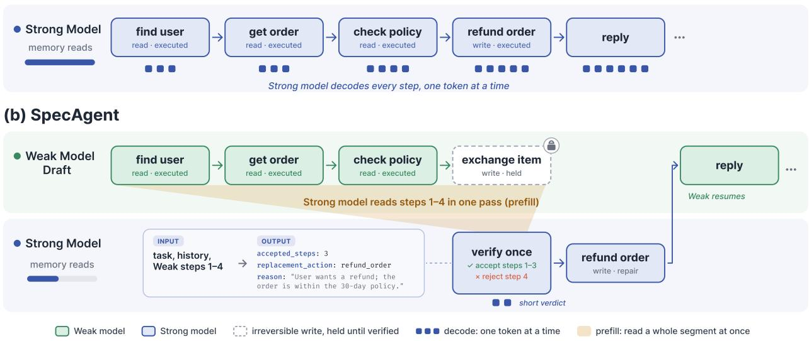
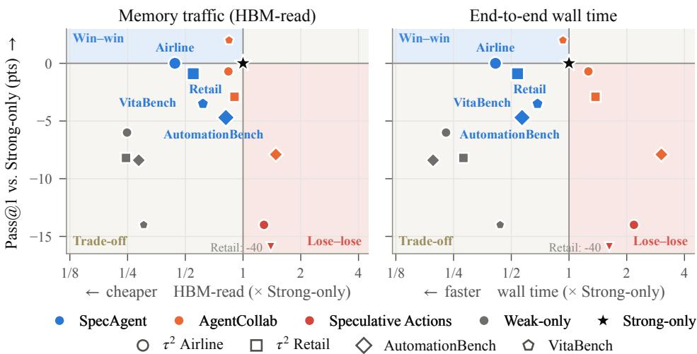
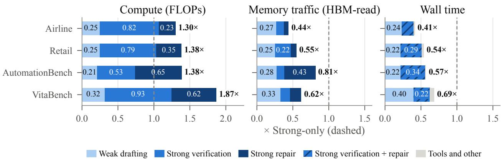
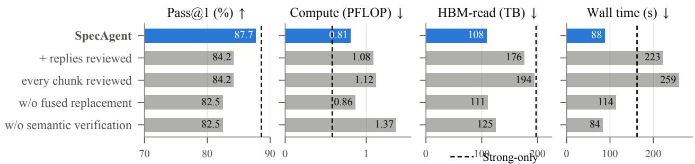

# Trajectory-Level Speculation with Semantic Verification for Tool-Using Agents

Zilin Wang1,2, Yinhong Liu2,3,†,‡, Chao Chen1,2, Qun Liu2 and Zhijiang Guo1,4,† 1LARK, HKUST (GZ), 2Yinwang, 3University of Cambridge, 4HKUST

†Corresponding authors. ‡Project leader.

GitHub Page: https://github.com/LARK-AI-Lab/SpecAgent

Abstract

Large language model agents solve tasks through long sequences of tool calls, and the prevailing design has a single strong model generate every step, although many steps are routine enough for a much smaller model. Existing ways of sharing this work keep the strong model as the generator: routers and collaborative agents decide which model handles each query or step, and speculative methods check a small model’s drafts one step at a time, usually against the strong model’s own action. We introduce SpecAgent, a collaboration protocol that turns the strong model from the author of each step into a reviewer of steps drafted by a weak model. The weak model executes read-only tool calls as it drafts, so that every step is grounded in real observations, and holds the first action that would modify the environment. The strong model then verifies the drafted segment in a single prefill pass, commits the longest prefix it judges semantically valid, and repairs the first rejected step. Because verification replaces autoregressive decoding with parallel prefill, the strong model decodes only short verdicts and occasional repairs rather than every step. On �2-Bench, SpecAgent comes within one point of the strong model’s success rate while roughly halving memory trafic and wall time, and on AutomationBench and VitaBench it recovers 44–75% of the quality gap while lowering both. In an edge–cloud deployment on MCP-Atlas with three cloud models, it closes 53–75% of the weak–strong quality gap while the strong model generates at most half as many tokens. These results suggest that a strong model need not author every step of an agent: reviewing grounded drafts retains most of its quality while cutting both latency and memory trafic.

## 1. Introduction

Language-model agents now solve tasks through long sequences of tool calls and user turns (Deng et al., 2026), from tens of turns in customer service to up to a hundred in everyday life services (Table 1). The prevailing design has one strong model generate every step, so serving cost grows with the length of the trajectory and is dominated by the strong model’s token-by-token decoding. Yet many steps are routine, such as looking up an order, reading a record, or searching again, and a much smaller model could often produce them.

Table 1 | Representative trajectory length per task for frontier agents, in turns (messages from the agent, the user, and tools).
<table><tr><td>Real-World MCP Services (MCP-Atlas)</td><td>Transactional Interaction (τ2-Bench)</td><td>Business Workflows (AutomationBench)</td><td>Life Services (VitaBench)</td></tr><tr><td>20–30 turns</td><td>30–80 turns</td><td>40–60 turns</td><td>50–100 turns</td></tr></table>

Existing ways of sharing this work keep the strong model as the generator. Routers pick one model per query (Aggarwal et al., 2024; Chen et al., 2023b; Ding et al., 2024; Ong et al., 2025), and collaborative agents decide, step by step, which model should act (Gao et al., 2026), so every step is still written by one model from scratch. Speculative agents carry the draft-and-verify idea of speculative decoding (Leviathan et al., 2023) over to actions (Hua et al., 2024; Ye et al., 2026), but usually keep a draft onl when it matches the stron model’s own action, so the stron model must still enerate each reference step and its work is overlapped rather than removed. Recent variants replace matching with a step-level critic (Huang et al., 2025; Zhong et al., 2026), but they check one predicted step at a time in search-style tasks whose actions do not change the environment. Exact matching is also too strict for a ents: diferent ueries, looku orders, or ar ument choices can all lead to a valid solution (Liu et al., 2026), and progress that difers from the strong model’s choice is discarded. We therefore ask: can a strong model review several steps drafted by a weak model, and keep what is valid, instead of generating every step itself?

We answer it with SpecAgent, in which a small Weak model drafts the trajectory and a large Strong model reviews it, separating acting from committing (Figure 1). Three properties of agents shape its design. First, a draft is meaningful only if it is grounded, because later steps depend on what earlier tool calls return; the Weak model therefore executes read-only calls as it drafts. Second, some actions cannot be undone, so the Weak model holds the first state-changing action, such as changing an order, and the Strong model reviews the segment before it runs, commits the longest prefix it judges semantically valid, and repairs the first rejected step. Third, review must cost less than generation even though the reviewer reads the full context: the Strong model reads a segment in one parallel prefill pass, whereas generating it would require decoding every token.

We compare against Strong-only and Weak-only, the single-model agents in which one model generates every step, and evaluate complete quality–resource operating points, counting both models and keeping compute, memory trafic, and wall time as separate axes. On $\tau ^ { 2 }$ -Bench, SpecAgent comes within one point of Strong-only success while reducing estimated memory trafic to 43–57% and wall time to 41–54% of Strong-only; on AutomationBench and VitaBench it recovers 44% and 75% of the Weak–Strong quality gap, again with lower memory trafic and wall time. In an edge–cloud deployment on MCP-Atlas with three cloud Strong models, it closes 53–75% of the gap while the Strong model generates at most half as many tokens. The saving comes from decoding rather than arithmetic: estimated FLOPs rise by 30–38% on $\tau ^ { 2 }$ and AutomationBench and by 87% on VitaBench, so SpecAgent suits memory-bandwidth-bound serving.

Our contributions are as follows.

• Framework. SpecAgent, a weak–strong protocol in which the Weak model drafts with real read-only tool calls and holds the first state-changing action, and the Strong model commits the longest prefix it judges semantically valid and repairs the first rejected step, together with a cost model that predicts when replacing Strong decoding by prefill saves memory trafic and time.

• Evaluation. Experiments on $\tau ^ { 2 }$ -Bench, AutomationBench, VitaBench, and an edge–cloud de- ployment on MCP-Atlas with three cloud Strong models, comparing complete quality–resource operating points against Weak–Strong collaboration and speculative baselines.

• Analysis. An accounting of where the savings arise: measured Strong trafic and time follow the cost model, the saving comes from decoding, not computation, and it shrinks as acceptance falls.

## 2. Related Work

Speculative execution. Speculative decoding lets a small model draft tokens that a large model verifies in parallel while preserving its output distribution (Chen et al., 2023a; Leviathan et al., 2023);

  
Figure 1 | (a) A Strong-only agent generates every step by decoding. (b) SpecAgent lets the Weak model draft ahead, running reads at once and holding the first write. The Strong model reviews the draft in a single prefill pass, keeps the valid steps, and replaces the rejected write; the Weak model then resumes. Bars indicate relative Strong-model memory reads.

it is complementary to SpecAgent, accelerating each model’s own decoding. The draft-then-verify pattern has since been applied to reasoning and search (Fu et al., 2025; Wang et al., 2025a,b) and to agents, where a fast model predicts plans, actions, or tool calls (Guan et al., 2025; Hooper et al., 2026; Hua et al., 2024; Ji et al., 2026; Nichols et al., 2025; Ye et al., 2026), sometimes with relaxed or semantic matching (Huang et al., 2025; Zhong et al., 2026). These methods target latency and keep a draft when it agrees with the large model’s own step. SpecAgent instead verifies multi-step, grounded segments in one pass and checks only before actions that change the environment.

Routing and weak–strong collaboration. Cascades and routers pick one model per query, including edge–cloud deployments (Aggarwal et al., 2024; Chen et al., 2023b; Ding et al., 2024; Ong et al., 2025); agent-level methods hand control between models during a trajectory (Gao et al., 2026; Hemadri et al., 2026; Wei et al., 2026). In both, the model in control generates each step; in SpecAgent, the Strong model decides how much drafted progress to keep and generates only repairs.

Verification versus generation. Checking a candidate is often easier than producing one, as verifiers and process reward models show for reasoning (Cobbe et al., 2021; Lightman et al., 2024). SpecAgent applies this asymmetry to agent trajectories, with the Strong model as the verifier, and exploits its cost counterpart: prefill processes many tokens per weight read, whereas decoding rereads them for every token (Kwon et al., 2023; Pope et al., 2023; Zheng et al., 2024).

## 3. SpecAgent

SpecAgent distinguishes steps by whether their efects can be undone. A read leaves the state untouched, so the Weak model can execute it immediately, and a wrong read costs no more than being discarded; a state-changing action is where an error becomes permanent, and it is the only point at which SpecAgent stops for the Strong model. This lets the Weak model speculate over whole stretches of the trajectory while keeping execution safe. When the Strong model steps in, it judges whether the drafted progress is valid rather than whether it matches what it would have done, so it reviews the trajectory instead of writing it (Figure 1).

## 3.1. Problem Formulation

We model a tool-using task as a partially observ- able Markov decision process. The environment has a hidden state �, such as a database or a workspace, that the agent cannot see directly. At each step the agent issues an action $a _ { t } ,$ typ- ically a tool call, and receives an observation $o _ { t }$ A policy therefore conditions on the task � and the history

$$
H _ { t } = { \big ( } u , ( a _ { 1 } , o _ { 1 } ) , \dots , ( a _ { t } , o _ { t } ) { \big ) } .\tag{1}
$$

Two policies share this interface: a Weak model $\pi _ { W }$ that is cheap to run and a Strong model $\pi _ { S }$ whose quality we want to preserve.

Actions fall into two classes. A read, such as a search or a lookup, returns an observation and leaves the state unchanged. A state-changing action, such as modifying a record or submitting a final result, alters the state. The distinction determines what can be undone, and it is the principle behind SpecAgent. An error that stays in the history is recoverable: a wrong read is removed by deleting it from the history, and because reads leave the task state unchanged, the environment is as it was (Appendix D). An er-ror that reaches the environment is not, since no edit to the history withdraws a changed record or a submitted result. Speculation can there- fore proceed freely while execution remains re-

Algorithm 1 SpecAgent: draft, verify, repair   
Require: Task �, Weak policy ��, Strong verifier ��, Strong   
policy $\pi _ { S } ,$ chunk size $K ,$ adapter �   
1: � ← (�)   
2: while the task is not complete do   
3: �ˆ ← [ ]   
4: loop   
5: �ˆ ← ��(� ⊕ �ˆ)   
6: if �.StateChanging(�ˆ) then   
7: Append (�, ˆ ⊥) to �ˆ; break   
8: end if   
9: �ˆ ← �.Execute(�ˆ); append (�,ˆ �ˆ) to �ˆ   
10: if |�ˆ| = � then   
11: � ← � ⊕ �ˆ; �ˆ ← [ ]   
12: end if   
13: end loop   
14: (�, �, �˜) ← �� (�, �ˆ)   
15: if � = |�ˆ| then   
16: � ← � ⊕ Prefix�−1(�ˆ)   
17: Execute the held action; append its result to �   
18: else   
19: � ← � ⊕ Prefix (�ˆ)   
20: if �.Valid(�˜) then   
21: � ← �˜   
22: else   
23: � ← �� (�, �)   
24: end if   
25: Execute �; append (�, ��) to �   
26: end if   
27: end while

versible, and verification is needed exactly at the boundary where an error would become irreversible: earlier checks spend the Strong model on steps that could still be undone, and later ones come too late.

## 3.2. Speculative Execution Protocol

Draft. From ��, the Weak model drafts a chunk of at most � steps,

$$
\hat { \tau } = \bigl ( ( \hat { a } _ { 1 } , \hat { o } _ { 1 } ) , \dots , ( \hat { a } _ { n - 1 } , \hat { o } _ { n - 1 } ) , ( \hat { a } _ { n } , \bot ) \bigr ) .\tag{2}
$$

Reads execute immediately, so each step is chosen after seeing real observations rather than imagined ones. The chunk ends at the first state-changing action $\hat { a } _ { n } .$ , which is held rather than executed, since every later step would depend on its outcome. A chunk that reaches � steps with only reads is committed without review, as the reversibility principle allows.

Verify. The Strong model reads the history and the chunk in a single pass and returns a verdict

$$
( j , r , \tilde { a } ) = V _ { S } ( H _ { t } , \hat { \tau } ) , \qquad j \in \{ 0 , \ldots , n \} ,\tag{3}
$$

where � is the len th of the lon est acce table refix, � ex lains the first rejected ste , and �˜ o tionall replaces it. The verdict is a prefix because each drafted step conditions on the observations of the steps before it: once a step is wrong, later steps rest on a mistaken premise and cannot be trusted even if they look valid. Acceptance is semantic: the verifier asks whether each step is a valid move toward the task, not whether it is the step the Strong model would have written. Tool-using tasks admit many valid trajectories, so semantic review retains progress that exact matching would discard. $\operatorname { I f } j = n .$ , the whole chunk is committed and the held action is executed.

Repair. A rejection should cost the Strong model as little generation as possible. Many rejected steps are a single tool call with a wrong argument or target, which the verifier can state while explaining the rejection; the verdict then carries a replacement �˜, and the repair adds no Strong call. Some repairs cannot be written that way, for instance when the fix spans several calls or the proposed replacement fails the adapter’s validity checks; only then does the Strong model take one corrective turn from the history and the reason �. The fused path keeps the common case cheap, and the fallback keeps every rejection repairable. A repair is the Strong model’s own step, so it is committed without a second review. The rejected sufix, including the held action, is discarded, so the next draft starts from a history of committed steps only. Algorithm 1 gives the full loop.

## 3.3. Eficiency Analysis

Autoregressive decoding generates one token per forward pass, and each pass streams the model’s active weights from GPU memory, so decoding is bound by memory bandwidth rather than arith- metic (Pope et al., 2023). A prefill pass processes many tokens against a single weight read. We make this the basis of a simple cost model.

Assumption 1 (Decode-bound serving). While a Strong replica decodes with a batch small enough to remain memory-bound, the time and memory trafic of a Strong call are approximately proportional to its number of weight passes: one per decoded token and one for the prefill.

Assumption 2 (Per-task acceptance). As a first-order model, each task � has an average per-step acceptance rate $p _ { w }$ related to the task’s dificulty, the Weak model’s competence, and the Strong verifier’s preferences; the steps of a reviewed chunk of length � are accepted independently.

Let � be the weight passes of a Strong-only step, � those of a verdict, and � the probability that a rejection needs a separate repair turn because no valid replacement was fused into the verdict. The comparison is intuitive. In Strong-only, every committed step costs a full decoded step. In SpecAgent, the Strong model instead decodes one short verdict per reviewed chunk, shared by all the steps the chunk commits, and a repair only when a step is rejected. Its cost per committed step should therefore shrink as verdicts get shorter, as more of each chunk is accepted, and as fewer rejections need a separate repair turn. Proposition 1 makes this precise.

Proposition 1 (Strong decoding). Under Assumptions 1 and 2, on task � the Strong model’s time and memory trafic per committed step, relative to Strong-only, are

$$
R _ { u } = \frac { 1 - p _ { u } } { 1 - p _ { u } ^ { n } } \cdot \frac { \nu } { d } + \rho ( 1 - p _ { u } ) .\tag{4}
$$

If task � commits $T _ { u }$ steps in both systems, the ratio over a task distribution is the step-weighted mean $R = \mathrm { E } _ { u } \left[ T _ { u } R _ { u } \right] / \mathrm { E } _ { u } \left[ T _ { u } \right]$

$R _ { u }$ falls as $p _ { u }$ rises, from $\nu / d + \rho$ at $p _ { u } = 0$ to $\nu / ( n d )$ as $p _ { u } \to 1$ , so the saving concentrates on tasks where the Weak model’s drafts suit the verifier; read-only chunks committed without review only lower � further. Saving Strong time does not by itself shorten the task: every committed step must first be drafted, so the Weak model’s decoding replaces part of the Strong model’s, and SpecAgent is faster only if a Weak step is cheap relative to a Strong one.

Proposition 2 (Latency). Under the same assumptions, let � be the time of a Weak drafting step relative to a Strong-only step, and ignore tool latency. On task � the end-to-end time per committed step, relative to Strong-only, is

$$
L _ { u } = R _ { u } + \kappa \frac { n ( 1 - p _ { u } ) } { 1 - p _ { u } ^ { n } } ,\tag{5}
$$

and the ratio over tasks is again the step-weighted mean of $L _ { u } .$

The second term counts drafted steps per committed step and approaches one as $p _ { u } \to 1$ . Proofs are in Appendix $\mathrm { C } ,$ and Section 5 examines where the savings arise.

## 4. Experiments

We evaluate SpecAgent on agent tasks that mix reads, state-changing actions, and user-visible replies. The experiments ask three questions. Q1: how much of the Weak–Strong quality gap does semantic prefix verification recover? Q2: which resources does it save, and which does it not? Q3: how does it compare with existing Weak–Strong collaboration methods at their own operating points?

## 4.1. Setup

Benchmarks. $\tau ^ { 2 } .$ -Bench Airline (50 tasks) and Retail (114 tasks) test multi-turn customer service against a simulated user, mixing database reads, mutations, and replies (Barres et al., 2025). We run three independent trajectories per task and report the two domains separately because their action mix and dificulty difer. AutomationBench tests long business workflows whose success is checked on the final environment state (Shepard and Salimans, 2026); we aggregate its 600 public tasks into one block, with its development domain excluded, and run one trajectory per task. VitaBench Delivery (100 tasks) tests food-deliver service a ainst a simulated user, jud ed b an LLM a ainst task rubrics (He et al., 2025); we run two trajectories per task. MCP-Atlas, run against real tool servers in an edge–cloud deployment, is reported separately (Section 4.3).

Models and methods. On $\tau ^ { 2 } { } _ { ; }$ , AutomationBench, and VitaBench, the Weak model is Qwen3.5-4B and the Strong model is Qwen3.5-397B-A17B (Qwen Team, 2026). Weak-only and Strong-only run the same agent loop with a single model. AgentCollab (Gao et al., 2026), the Weak–Strong collaboration baseline, escalates to Strong using its published self-evaluation signal. Speculative Actions (Ye et al., 2026) keeps Strong as the actor and speculates on upcoming steps to hide latency; we port the authors’ released agent to $\tau ^ { 2 }$ (Appendix E). We do not port it to AutomationBench or VitaBench. All methods run on the same Weak and Strong deployments. SpecAgent reviews at state-changing actions with chunk size � = 6 on $\tau ^ { 2 }$ and VitaBench and � = 8 on AutomationBench; other adapter settings and all prompts are listed in Appendix D.

Serving. On $\tau ^ { 2 }$ , AutomationBench, and VitaBench, all models run on NVIDIA H20 GPUs: the Weak model on a single GPU with SGLang (Zheng et al., 2024), and the Strong model with 16-way tensor parallelism. Every method runs eight tasks concurrently against the same deployments, so wall time is compared under a common load. Decoding settings and the user simulators are given in Appendix A.

Metrics. Pass@1 is the benchmark-native success rate per trajectory, averaged over all trials; quality diferences use a paired bootstrap over tasks (Appendix B.1). Resource columns are per-trajectory means over every agent-model request, including Weak drafts, rejected chunks, verification, repair, and retries. We estimate FLOPs and HBM-read from each request’s token counts and the model architecture (Appendix B.3, B.4), charging a prompt prefix once per session under a radix prefix-cache model (Zheng et al., 2024) applied identically to all methods (Appendix B.2); the HBM interval of the MoE Strong model reflects its unknown expert routing during prefill. GPU·s sums request duration times serving GPUs, wall time is mean elapsed time per trajectory, and calls count Weak/Strong generation requests (Appendix B.5).

Table 2 | Quality and mean per-trajectory resources of the agent models on $\tau ^ { 2 } .$ -Bench, AutomationBench, and VitaBench (Delivery). Compute and HBM-read are estimated from logged tokens and model architecture, assuming prefix reuse within a task. HBM-read of a Strong MoE model is a range, because the number of experts a prefill pass reads is not logged; the dense Weak model has a point estimate. Calls count Weak and Strong model calls per trajectory. Per benchmark, excluding Weak-only, the best value in each column except Calls is in bold and the second best underlined.
<table><tr><td>Method</td><td>Pass@1 (%) ↑</td><td>HBM-read (TB) ↓</td><td>Wall-time (s) ↓</td><td>Est. compute (PFLOP)↓</td><td>GPU·s ↓</td><td>Calls (W/S)↓</td></tr><tr><td colspan="7">τ2-Bench (Airline)</td></tr><tr><td>Weak-only (4B)</td><td>80.0</td><td>83.8</td><td>69.7</td><td>0.18</td><td>66.0</td><td>14.1/0.0</td></tr><tr><td>Strong-only (397B)</td><td>86.0</td><td>[333.2,341.6]</td><td>305.2</td><td>0.78</td><td>4828.4</td><td>0.0/13.8</td></tr><tr><td>AgentCollab</td><td>85.3</td><td>[276.6,289.4]</td><td>385.2</td><td>1.12</td><td>5629.3</td><td>9.0/18.5</td></tr><tr><td>Speculative Actions</td><td>72.0</td><td>[429.5,438.2]</td><td>665.6</td><td>0.89</td><td>9990.6</td><td>4.5/17.4</td></tr><tr><td>SPECAGENT</td><td>86.0</td><td>[147.6,150.1]</td><td>126.2</td><td>1.01</td><td>860.4</td><td>15.5/3.1</td></tr><tr><td colspan="7">τ2-Bench (Retail)</td></tr><tr><td>Weak-only (4B)</td><td>80.4</td><td>48.4</td><td>45.7</td><td>0.14</td><td>41.2</td><td>13.3/0.0</td></tr><tr><td>Strong-only (397B)</td><td>88.6</td><td>[192.8,201.8]</td><td>162.4</td><td>0.58</td><td>2535.6</td><td>0.0/13.1</td></tr><tr><td>AgentCollab</td><td>85.7</td><td>[171.9, 184.2]</td><td>223.2</td><td>0.98</td><td>3147.8</td><td>10.3/16.6</td></tr><tr><td>Speculative Actions</td><td>48.5</td><td>[270.4,280.4]</td><td>263.5</td><td>0.68</td><td>3944.7</td><td>5.0/17.1</td></tr><tr><td>SPECAGENT</td><td>87.7</td><td>[107.3,109.7]</td><td>87.5</td><td>0.81</td><td>789.7</td><td>13.8/3.1</td></tr><tr><td colspan="7">AutomationBench</td></tr><tr><td>Weak-only (4B)</td><td>6.8</td><td>94.5</td><td>60.1</td><td>0.29</td><td>60.0</td><td>20.4/0.0</td></tr><tr><td>Strong-only (397B)</td><td>15.2</td><td>[324.0,337.3]</td><td>307.4</td><td>1.10</td><td>4483.2</td><td>0.0/17.4</td></tr><tr><td>AgentCollab</td><td>7.3</td><td>[470.0,510.6]</td><td>932.0</td><td>3.99</td><td>8603.0</td><td>15.7/54.8</td></tr><tr><td>SPECAGENT</td><td>10.5</td><td>[264.5,273.6]</td><td>174.9</td><td>1.52</td><td>1761.0</td><td>24.4/11.8</td></tr><tr><td colspan="7">VitaBench (Delivery)</td></tr><tr><td>Weak-only (4B)</td><td>34.0</td><td>77.6</td><td>86.3</td><td>0.21</td><td>74.2</td><td>26.0/0.0</td></tr><tr><td>Strong-only (397B)</td><td>48.0</td><td>[249.6,262.0]</td><td>197.3</td><td>0.72</td><td>3018.9</td><td>0.0/21.9</td></tr><tr><td>AgentCollab</td><td>50.0</td><td>[212.3,220.1]</td><td>183.4</td><td>0.76</td><td>2329.6</td><td>19.1/23.9</td></tr><tr><td>SPECAGENT</td><td>44.5</td><td>[154.9,161.1]</td><td>135.2</td><td>1.34</td><td>814.0</td><td>25.5/8.2</td></tr></table>

## 4.2. Main Results

Quality (Q1). On $\tau ^ { 2 }$ Airline, SpecAgent reaches the Strong-only Pass@1 (86.0 vs. 86.0), up from 80.0 for Weak-only. On Retail it comes within 0.9 points of Strong-only (87.7 vs. 88.6, from 80.4 for Weak-only), recovering 89% of the Weak–Strong gap. On AutomationBench it recovers 44% (10.5, between 6.8 and 15.2), and on VitaBench 75% (44.5, between 34.0 and 48.0). On $\tau ^ { 2 }$ , the paired bootstrap (Appendix B.1) gives a SpecAgent−Strong diference of 0.0 points on Airline (95% CI [−5.3, +5.3]) and −0.9 on Retail ([−4.7, +2.9]).

  
Figure 2 | Quality against memory trafic and wall time, relative to each domain’s Strong-only run (star). Quadrants, drawn from point estimates, mark win–win, lose–lose, and trade-of regions.

Resources (Q2): memory trafic and time fall, compute does not. Relative to Strong-only (Figure 2), SpecAgent lowers estimated HBM-read to 43–45% on Airline, 53–57% on Retail, 78– 84% on AutomationBench, and 59–65% on VitaBench. Wall time falls to 41%, 54%, 57%, and 69%. Estimated FLOPs rise by 30%, 38%, 38%, and 87%. The two axes diverge as Section 3.3 anticipates: Strong calls drop from 13.8 to 3.1 per Airline trajectory, from 13.1 to 3.1 on Retail, from 17.4 to 11.8 on AutomationBench, and from 21.9 to 8.2 on VitaBench, so most Strong decoding is replaced by prefill, while Weak drafts and the Strong review and repair prompts add compute (Section 5).

Comparison with collaboration methods (Q3). Both baselines issue more Strong calls than Strong-only. Speculative Actions keeps the Strong model acting at every step and adds background Strong speculation (17.4 vs. 13.8 calls on Airline), with more memory trafic and time; in the released implementation it also falls below Weak-only quality (72.0 on Airline, 48.5 on Retail; Appendix E). AgentCollab stays near Strong quality on $\tau ^ { 2 }$ (85.3 and 85.7) with more Strong calls (18.5 vs. 13.8 on Airline) and takes longer. On AutomationBench it reaches 7.3 with 1.5× the Strong-only HBM-read and 3.0× its wall time. On VitaBench it slightly exceeds Strong-only (50.0 vs. 48.0, against 44.5 for SpecAgent) but uses 1.4× the HBM-read and wall time of SpecAgent. SpecAgent matches or exceeds AgentCollab’s quality on $\tau ^ { 2 }$ (86.0 vs. 85.3 and 87.7 vs. 85.7) with HBM-read lower by a factor of 1.6–1.9 and wall time by 2.6–3.1, and it is the only collaborative method whose HBM-read and wall time are both below Strong-only on every benchmark in Table 2.

## 4.3. Edge–Cloud Deployment: MCP-Atlas

MCP-Atlas evaluates multi-step tool use against real Model Context Protocol servers for search, code execution, databases, and productivity tools (Anthropic, 2024; Bandi et al., 2026); an LLM judge scores each response by the share of reference claims it covers. We use the 101 public tasks whose servers run without private API keys (Appendix A) and deploy SpecAgent across the edge and the cloud: Qwen3.5-4B runs locally on a single RTX 5090, and the Strong model is one of Qwen3.5- 397B-A17B, GLM-5 (GLM-5 Team, 2026), and DeepSeek-V4-Flash-0731 (DeepSeek-AI, 2026), each behind its provider’s API. In this setting the cloud model is billed per token, so we report its output tokens and API cost alongside quality, and compare against Weak-only and Strong-only. Across the three Strong models, SpecAgent recovers 53–75% of the Weak–Strong gap while the Strong model decodes only 36–50% of its Strong-only output tokens, and API cost falls to 59–81% (Table 3). For every Strong model the share of the gap recovered exceeds the share of Strong tokens spent, so each Strong token buys more quality inside SpecAgent than on its own. Wall time does not fall here: the local Weak model takes about as long per task as the hosted Strong models (109 vs. 105–151 seconds), so the latency term of Proposition 2 ofers no gain, and the benefit appears instead as lower remote usage and cost.

Table 3 | Edge–cloud deployment on MCP-Atlas (101 tasks, real MCP servers, one trajectory per task). The Weak model, Qwen3.5-4B, runs on one local RTX 5090; each Strong model is served by its provider’s cloud API. The Weak-only row is shared by all groups. Resources are per-task means and API cost is the total over all tasks at list price, excluding the local GPU.
<table><tr><td>Method</td><td>Pass@1 (%) ↑</td><td>HBM-read (TB) ↓</td><td>Strong output tokens ↓</td><td>Wall-time (s) ↓</td><td>Est. compute (PFLOP)↓</td><td>API cost ($) ↓</td></tr><tr><td>Weak-only (4B)</td><td>44.6</td><td>39.1</td><td></td><td>109</td><td>0.67</td><td>0.00</td></tr><tr><td colspan="7">Strong: Qwen3.5-397B-A17B</td></tr><tr><td>Strong-only (397B)</td><td>72.3</td><td>[119.5,128.6]</td><td>3.6k</td><td>105</td><td>1.72</td><td>1.39</td></tr><tr><td>SPECAGENT</td><td>59.4</td><td>[105.7,109.0]</td><td>1.8k</td><td>120</td><td>2.64</td><td>1.12</td></tr><tr><td colspan="7">Strong: GLM-5</td></tr><tr><td>Strong-only (GLM-5)</td><td>76.2</td><td>[377.6,389.4]</td><td>4.6k</td><td>110</td><td>10.07</td><td>8.91</td></tr><tr><td>SPECAGENT</td><td>67.3</td><td>[217.0,223.1]</td><td>2.1k</td><td>108</td><td>10.50</td><td>5.54</td></tr><tr><td colspan="7">Strong: DeepSeek-V4-Flash-0731</td></tr><tr><td>Strong-only (DeepSeek)</td><td>84.2</td><td>[150.3,151.7]</td><td>10.6k</td><td>151</td><td>3.38</td><td>1.37</td></tr><tr><td>SPECAGENT</td><td>74.3</td><td>[102.7,103.5]</td><td>3.8k</td><td>215</td><td>2.63</td><td>0.81</td></tr></table>

## 5. Analysis and Discussion

We relate the measurements of Section 4 to the cost model of Section 3.3, then use it to delimit where SpecAgent pays of.

Strong decoding explains the saving. Proposition 1 computes, under Assumption 2, a quantity that can also be measured directly. Let $c _ { \nu }$ and $c _ { r }$ be the verifications and separate repair turns per committed step, and $\bar { \nu } , \bar { d } _ { r } , \bar { d }$ the mean output tokens of a verdict, a repair, and a Strong-only step. Under Assumption 1 the Strong model’s trafic per committed step, relative to Strong-only, is

$$
R = c _ { \nu } \frac { \bar { \nu } } { \bar { d } } + c _ { r } \frac { \bar { d } _ { r } } { \bar { d } } ,\tag{6}
$$

of which Proposition 1 is the closed form. Multiplying by the ratio of committed steps per trajectory gives the predicted Strong share of a trajectory. Table 4 evaluates (6) from logged token counts. On $\tau ^ { 2 }$ the Strong model reviews about once every seven committed steps, and its decoded tokens fall to 17–30% of Strong-only. The observed Strong share of HBM-read matches the prediction within 0.01 on every benchmark, slightly higher because decoded tokens omit the prefill and KV trafic of each call; generation time matches it on $\tau ^ { 2 }$ and falls below it on AutomationBench and VitaBench. On AutomationBench, the Weak model’s drafts are rejected more often and each rejection costs a separate repair of about 1.5�¯ tokens, so the $c _ { r }$ term dominates and the saving shrinks, as the $\rho ( 1 - p _ { u } )$ term of Proposition 1 anticipates. VitaBench lies in between: about 77% of reviewed boundaries are rejected, but verdicts and repairs contribute about equally to its predicted share of 0.28.

  
Figure 3 | SpecAgent’s cost by phase, relative to Strong-only (dashed). Strong verification and repair dominate compute but take a much smaller share of memory trafic.

Why time falls while FLOPs rise. As Section 3.3 explains, decoding is bound by memory bandwidth while a verification prefill over a whole chunk is bound by compute, so re-reading the context in prefill raises FLOPs but sharply reduces time. Figure 3 splits the cost by phase. Strong verification and repair carry 81–85% of SpecAgent’s FLOPs but a much smaller share of its HBM-read (39–66%); Weak drafting, itself memory-bound decoding, accounts for only 15–19% of FLOPs but 34–61% of HBM-read. Compute nearly doubles on VitaBench because the verifier and repair prompts each have their own template and share no prefix with each other or with the actor: the Strong model prefills about 28.4k uncached tokens per task (12.5k for Strong-only), 1.03 PFLOP that alone exceeds Strong- only’s 0.72 PFLOP, while the decoding it removes is only about 0.21 PFLOP. Wall time decomposes as Proposition 2 describes: Strong generation shrinks to 0.16–0.34 of Strong-only wall time and Weak drafting adds 0.22–0.24, or 0.40 on VitaBench. On AutomationBench, separate repairs dominate the Strong model’s share, the $\rho ( 1 - p _ { u } )$ term at work.

When verification recovers Strong quality. Assumption 2 ties acceptance to how well the Weak model handles a task, so we split $\tau ^ { 2 }$ tasks by whether Weak-only solves them in all three trials. Where the Weak model is unreliable, SpecAgent stays close to Strong-only (70.4 vs. 66.7 on Airline, 18 tasks; 74.2 vs. 75.8 on Retail, 44 tasks), and where it always succeeds both are near ceiling (94.8 vs. 96.9 and 96.2 vs. 96.7). These subsets are small, but they suggest that one review and repair per held action sufices when the Weak model is partly competent; when it is far weaker, as on AutomationBench, repairs grow and less of the gap is recovered (44%); VitaBench falls in between (75%).

Table 4 | Strong decoding relative to Strong-only: predicted from (6), scaled by the ratio of committed steps per trajectory to that of Strong-only (1.05–1.41), and observed. Time is Strong generation time relative to that of Strong-only.
<table><tr><td></td><td colspan="2">Verify</td><td colspan="2">Repair</td><td>Predicted</td><td colspan="2">Observed</td></tr><tr><td></td><td> $c _ { \nu }$ </td><td> $\bar { \nu } / \bar { d }$ </td><td> $c _ { r }$ </td><td> $\bar { d } _ { r } / \bar { d }$ </td><td>decoded</td><td>HBM</td><td>time</td></tr><tr><td>Airline</td><td>0.145</td><td>0.67</td><td>0.046</td><td>1.27</td><td>0.17</td><td>0.17</td><td>0.16</td></tr><tr><td>Retail</td><td>0.152</td><td>1.35</td><td>0.057</td><td>1.32</td><td>0.30</td><td>0.30</td><td>0.30</td></tr><tr><td>AutomationBench</td><td>0.277</td><td>0.25</td><td>0.204</td><td>1.52</td><td>0.53</td><td>0.54</td><td>0.38</td></tr><tr><td>VitaBench</td><td>0.216</td><td>0.53</td><td>0.100</td><td>1.36</td><td>0.28</td><td>0.29</td><td>0.24</td></tr></table>

  
Figure 4 | Design ablations on $\tau ^ { 2 }$ Retail, varied one at a time from SpecAgent; SpecAgent and Strong-only (dashed) are main-table runs.

Design choices. Figure 4 varies the three choices of Section 3.2 on Retail. Where to review: also holding replies, or reviewing every chunk including reads, more than triples the Strong calls and raises HBM-read by 63–79% and wall time 2.5–3.0× (past Strong-only), while lowering Pass@1. How to repair: without the fused replacement, every rejection becomes a separate Strong turn, and Pass@1 drops to 82.5. What to accept: a verifier that accepts only the exact step the Strong model would take itself also lowers Pass@1 to 82.5 and raises FLOPs by 70%, because valid Weak steps are rejected and regenerated. Semantic acceptance thus appears to be what lets verification keep Weak progress without losing quality.

Across Strong models. The MCP-Atlas pairs vary the Strong model with the Weak model fixed (Table 3). SpecAgent’s quality tracks the Strong model’s own (59.4, 67.3, and 74.3 against Strong- only scores of 72.3, 76.2, and 84.2), since the Strong model both judges the drafts and writes the repairs. Its token share falls as Strong-only trajectories grow longer, as the amortized verdict of Proposition 1 predicts: 50%, 46%, and 36% for 3.6k, 4.6k, and 10.6k Strong-only tokens per task. API cost falls less (to 59–81%) because each review resends the context as input, the prefill side of the trade.

Deployment regimes. The two propositions also say when the trade does not pay. The latency term $\kappa n ( 1 - p _ { u } ) / ( 1 - p _ { u } ^ { n } )$ requires a Weak step to be faster than a Strong step, which does not hold in the edge–cloud deployment of Section 4.3. Assumption 1 holds while the Strong replica’s decode batch stays below the compute–bandwidth balance point, about 37 sequences on H20; with larger batches decoding becomes compute bound, and the 30–87% increase in FLOPs would begin to cost time.

## 6. Conclusion

SpecAgent turns the Strong model from the author of every agent step into a reviewer of grounded drafts: speculation runs freely while execution stays reversible, stops for review only at state-changing actions, and keeps valid progress rather than only agreement. Across $\tau ^ { 2 } .$ -Bench, AutomationBench, VitaBench, and MCP-Atlas, this retains most of Strong-only quality while cutting memory trafic, wall time, or remote cost, because Strong decoding is replaced by prefill. The gain grows with the Weak progress the Strong model accepts, so stronger Weak drafters (Xu et al., 2026) and better-calibrated verifiers translate directly into further memory and latency savings without any change to the protocol.

## References

P. Aggarwal, A. Madaan, A. Anand, S. P. Potharaju, S. Mishra, P. Zhou, A. Gupta, D. Rajagopal, K. Kappaganthu, Y. Yang, S. Upadhyay, M. Faruqui, and Mausam. AutoMix: Automatically mixing language models. In NeurIPS, 2024. arXiv:2310.12963.

Anthropic. Introducing the Model Context Protocol. https://www.anthropic.com/news/ model-context-protocol, 2024.

C. Bandi, R.-G. Dumitru, B. Hertzberg, D. Agarwal, G. Boo, T. Polakam, S. Hassaan, J. Da, H. Kim, V. Gupta, M. Sharma, A. Park, M. Dimakis, E. G. Hernandez Montoya, D. Rambado, I. Salazar, R. Cruz, M. Rezaei, C. Rane, B. Levin, D. Y. Zhang, B. Kenstler, and B. Liu. MCP-Atlas: A large-scale benchmark for tool-use competency with real MCP servers, 2026. URL https://arxiv.org/ abs/2602.00933.

V. Barres, H. Dong, S. Ray, X. Si, and K. Narasimhan. �2-Bench: Evaluating conversational agents in a dual-control environment. arXiv preprint arXiv:2506.07982, 2025.

C. Chen, S. Borgeaud, G. Irving, J.-B. Lespiau, L. Sifre, and J. Jumper. Accelerating large language model decoding with speculative sampling. arXiv preprint arXiv:2302.01318, 2023a.

L. Chen, M. Zaharia, and J. Zou. FrugalGPT: How to use large language models while reducing cost and improving performance. arXiv preprint arXiv:2305.05176, 2023b. Published in TMLR, 2024.

K. Cobbe, V. Kosaraju, M. Bavarian, M. Chen, H. Jun, L. Kaiser, M. Plappert, J. Tworek, J. Hilton, R. Nakano, C. Hesse, and J. Schulman. Training verifiers to solve math word problems. arXiv preprint arXiv:2110.14168, 2021.

DeepSeek-AI. DeepSeek-V4: Towards highly eficient million-token context intelligence. arXiv preprint arXiv:2606.19348, 2026.

M. Deng, Z. Li, X. Li, T. Zhu, Y. Zhao, Z. Guo, and W. Wang. Uncertainty-aware clarification in LLM agents with information gain. arXiv preprint arXiv:2606.03135, 2026.

D. Ding, A. Mallick, C. Wang, R. Sim, S. Mukherjee, V. Ruhle, L. V. S. Lakshmanan, and A. H. Awadallah. Hybrid LLM: Cost-eficient and quality-aware query routing. In ICLR, 2024. arXiv:2404.14618.

Y. Fu, R. Ge, Z. Shao, Z. Deng, and H. Zhang. Scaling speculative decoding with lookahead reasoning. arXiv preprint arXiv:2506.19830, 2025.

W. Gao, R. Liu, X. Wang, F. Guo, S. Yang, X. Chen, H.-L. Zhen, H. Chen, W. Lin, X. Li, and Y. Wang. AgentCollab: A self-evaluation-driven collaboration paradigm for eficient LLM agents. arXiv preprint arXiv:2603.26034, 2026.

GLM-5 Team. GLM-5: from vibe coding to agentic engineering. arXiv preprint arXiv:2602.15763, 2026.

Google DeepMind. Gemini 3.1 Pro model card. https://deepmind.google/models/ model-cards/gemini-3-1-pro/, 2026.

Y. Guan, Q. Lan, S. Fei, D. Ding, D. Acharya, C. Wang, W. Y. Wang, and W. Hua. Dynamic speculative agent planning. arXiv preprint arXiv:2509.01920, 2025.

W. He, Y. Sun, H. Hao, X. Hao, Z. Xia, Q. Gu, C. Han, D. Zhao, H. Su, K. Zhan , M. Gao, X. Su, X. Cai, X. Cai, Y. Yang, and Y. Zhao. VitaBench: Benchmarking LLM agents with versatile interactive tasks in real-world applications. arXiv preprint arXiv:2509.26490, 2025.

R. V. Hemadri, H. F. Mohammed, R. Maheshwary, S. Daruru, S. Davasam, V. Yadav, S. Sunkara, and S. Rajeswar. R2V agent: Teaching SLMs when to ask for help. arXiv preprint arXiv:2605.16604, 2026.

C. Hooper, M. Kang, S. Moon, N. Lee, E. Wen, J. Wawrzynek, M. W. Mahoney, Y. S. Shao, A. Gholami, and K. Keutzer. Speculative interaction agents: Building real-time agents with asynchronous I/O and speculative tool calling. arXiv preprint arXiv:2605.13360, 2026.

W. Hua, M. Wan, S. Vadrevu, R. Nadel, Y. Zhang, and C. Wang. Interactive speculative planning: Enhance agent eficiency through co-design of system and user interface. arXiv preprint arXiv:2410.00079, 2024.

Z. Huang, W. Zeng, T. Fu, T. Liu, Y. Sun, K. Hong, X. Yang, C. Liu, Y. Li, Q. Zhang, G. Dai, Z. Zhu, and Y. Wang. Reducing latency of LLM search agent via speculation-based algorithm-system co-design. arXiv preprint arXiv:2511.20048, 2025.

J. Ji, Y. Liu, L. An, R. Jain, G. Polatkan, S. Zhu, and S. Chang. Speculate while you reason: Teaching agents to predict their next tool call via joint agent-speculator RL. arXiv preprint arXiv:2607.25816, 2026.

W. Kwon, Z. Li, S. Zhuang, Y. Sheng, L. Zheng, C. H. Yu, J. E. Gonzalez, H. Zhang, and I. Stoica. Eficient memory management for large language model serving with PagedAttention. In Proceedings of the 29th Symposium on Operating Systems Principles, 2023.

Y. Leviathan, M. Kalman, and Y. Matias. Fast inference from transformers via speculative decoding. In ICML, 2023.

H. Li htman, V. Kosaraju, Y. Burda, H. Edwards, B. Baker, T. Lee, J. Leike, J. Schulman, I. Sutskever, and K. Cobbe. Let’s verify step by step. In International Conference on Learning Representations, 2024.

Y. Liu, Z. Tan, Z. Wang, and Z. Guo. Action-space shaping for LLM agents: Measuring and mitigating tool-schema bias. arXiv preprint arXiv:2609.34971, 2026.

D. Nichols, P. Singhania, C. Jekel, A. Bhatele, and H. Menon. Optimizing agentic language model inference via speculative tool calls. arXiv preprint arXiv:2512.15834, 2025.

I. Ong, A. Almahairi, V. Wu, W.-L. Chiang, T. Wu, J. E. Gonzalez, M. W. Kadous, and I. Stoica. RouteLLM: Learning to route LLMs with preference data. In ICLR, 2025. arXiv:2406.18665.

R. Pope, S. Douglas, A. Chowdhery, J. Devlin, J. Bradbury, A. Levskaya, J. Heek, K. Xiao, S. Agrawal, and J. Dean. Eficiently scaling transformer inference. In Proceedings of Machine Learning and Systems, 2023.

Qwen Team. Qwen3.5: Towards native multimodal agents. https://qwen.ai/blog?id=qwen3.5, 2026.

D. Shepard and R. Salimans. AutomationBench. arXiv preprint arXiv:2604.18934, 2026.

J. Wang, J. Li, J. Hou, B. Yan, L. Wu, and M. Zhang. Eficient reasoning for LLMs through speculative chain-of-thought. arXiv preprint arXiv:2504.19095, 2025a.

Z. Wang, J. Wang, J. Pan, X. Xia, H. Zhen, M. Yuan, J. Hao, and F. Wu. Accelerating large language model reasoning via speculative search. In ICML, 2025b. arXiv:2505.02865.

J. Wei, K. Ni, Y. Zhao, G. Gan, and A. Cohan. Step-level optimization for eficient computer-use agents. arXiv preprint arXiv:2604.27151, 2026.

M. Xu, Z. Wang, M. Deng, Z. Li, Z. Yang, X. Zhu, Y. Liu, B. Zhu, B. Huang, C. Chen, H. Deng, F. Mi, L. Shang, X. Zeng, and Z. Guo. EnvFactory: Scaling tool-use agents via executable environments synthesis and robust RL. arXiv preprint arXiv:2605.18703, 2026.

N. Ye, A. Ahuja, G. Liargkovas, Y. Lu, K. Kafes, and T. Peng. Speculative actions: A lossless framework for faster AI agents. In International Conference on Learning Representations, 2026. URL https: //openreview.net/forum?id=P0GOk5wslg.

L. Zheng, L. Yin, Z. Xie, C. Sun, J. Huang, C. H. Yu, S. Cao, C. Kozyrakis, I. Stoica, J. E. Gonzalez, C. Barrett, and Y. Sheng. SGLang: Eficient execution of structured language model programs. In Advances in Neural Information Processing Systems, 2024.

S. Zhong, B. Lu, Q. Chen, C. Liu, F. Yang, and M. Li. DualSpec: Accelerating deep research agents via dual-process action speculation. arXiv preprint arXiv:2603.07416, 2026.

## A. Experimental Setup

Benchmarks. $\tau ^ { 2 } .$ -Bench Airline (50 tasks) and Retail (114 tasks) are run with three independent trajectories per task. The simulated user is DeepSeek-V4-Flash-0731 (DeepSeek-AI, 2026), served locally with four-way tensor parallelism and shared by all methods. AutomationBench uses its 600 public tasks with one trajectory per task; its simple warm-up domain was used for development and is excluded. VitaBench uses the 100 tasks of its Delivery domain with two trajectories per task; its user simulator and rubric judge are also DeepSeek-V4-Flash-0731.

MCP-Atlas uses 101 of its public tasks whose servers run without private API keys, excluding six on which a run of any method timed out, and runs one trajectory per task. The subset is somewhat easier than the full benchmark (4.5 versus 4.9 ground-truth tool calls and 3.4 versus 3.9 graded claims per task), so its absolute scores are not comparable to the public leaderboard; all methods are compared on the same tasks. Responses are graded by Gemini 3.1 Pro (Google DeepMind, 2026), and a task counts as solved when the response covers at least 75% of its graded claims.

Models and serving. On $\tau ^ { 2 }$ , AutomationBench, and VitaBench, the Weak model, Qwen3.5-4B, is served with SGLang on a single H20 GPU, and the Strong model, Qwen3.5-397B-A17B, runs as a separate deployment with 16-way tensor parallelism on H20 GPUs. Agents use the servers’ default sampling, with no output-length cap (except 8,192 tokens for the Weak model on VitaBench) and at most 100 steps per trajectory. Thinking is enabled whenever a model generates actions, including Strong repair, and disabled for verification. Every method runs eight tasks concurrently against the same deployments; on Retail, the Weak requests of a trajectory are pinned to one replica. On MCP-Atlas, the Weak model runs on one local RTX 5090 GPU, and each Strong model is called through its provider’s API; verification again runs without thinking.

Baselines. Weak-only and Strong-only run the same agent loop as SpecAgent with a single model. AgentCollab (Gao et al., 2026) follows the published algorithm: the Strong model acts for the first $K _ { L } = 2$ steps, after which the Weak model acts and each action is followed by the paper’s TRUE/FALSE progress check once its observation arrives. A FALSE check hands control to the Strong model for min $\left( { B _ { \operatorname* { m a x } } } , { B _ { 0 } } + k l \right)$ steps, with $B _ { 0 } = 2 , k = 2 , B _ { \mathrm { m a x } } = 6 ,$ , and � the number of consecutive failed checks. Because $\tau ^ { 2 }$ agents have no think tool, the progress check runs as a separate call. Speculative Actions is described in Appendix E. On MCP-Atlas, where the Strong models are served through third-party APIs, we compare only against the single-model baselines.

## B. Metric Definitions

This section defines every quantity in Table 2. All resource columns are means over the oficial trajectories of a method (Airline $n = 1 5 0$ , Retail $n = 3 4 2 $ , AutomationBench $n = 6 0 0$ , VitaBench $n = 2 0 0 )$ and cover the agent-model requests only; user simulation, judging, and tool serving are excluded.

## B.1. Task Quality

Let $y _ { i r } \in \{ 0 , 1 \}$ be the benchmark-native success of trial � of task �, with � tasks and � trials per task $( R = 3 \ : \mathrm { o n } \ : \tau ^ { 2 } , R = 2$ on VitaBench, and $R = 1$ on AutomationBench). We report

$$
\mathrm { P a s s } @ 1 = \frac { 1 } { N R } \sum _ { i = 1 } ^ { N } \sum _ { r = 1 } ^ { R } y _ { i r } , \qquad \mathrm { p a s s } @ R = \frac { 1 } { N } \sum _ { i } \operatorname* { m a x } y _ { i r } , \qquad \mathrm { p a s s } ^ { R } = \frac { 1 } { N } \sum _ { i } \operatorname* { m i n } y _ { i r } .\tag{7}
$$

Failed or incomplete trials stay in the denominator. For the paired diference $\Delta = \operatorname { P a s s } ( \varnothing 1$ SpecAgent Pass@1Strong we draw � tasks with replacement, keep all � trials of each drawn task for both methods, recompute Δ, and report the 2.5th and 97.5th percentiles over 10,000 resamples.

## B.2. Request Shape and Prefix Reuse

Each request $q$ has $I _ { q }$ input and $O _ { q }$ output tokens, of which a prefix of $C _ { q }$ input tokens is reused from earlier computation. The request then prefills $P _ { q }$ new tokens, runs $D _ { q }$ decode forwards, and computes $L _ { q }$ output logits:

$$
\begin{array} { r } { P _ { q } = I _ { q } - C _ { q } , \qquad D _ { q } = \left\{ \begin{array} { l l } { O _ { q } - 1 } & { P _ { q } > 0 } \\ { O _ { q } } & { P _ { q } = 0 } \end{array} \right. , \qquad L _ { q } = O _ { q } , } \end{array}\tag{8}
$$

since the prefill pass already emits the first output token. Serving caches measure reuse only partially and are afected by eviction, so we assign $C _ { q }$ with a model of radix prefix caching (Zheng et al., 2024), applied identically to every method. Requests are grouped into sessions that share task, trial, model, role, and serving replica; reuse never crosses sessions. Within a session, requests are processed in order with the rules of Table 5.

Table 5 | Prefix-reuse rules. $M , B ^ { \nu }$ , and $B ^ { c }$ are running maxima kept per session and updated after each request.
<table><tr><td>Request family</td><td>Newly processed tokens  $P _ { q }$ </td><td>Rationale</td></tr><tr><td>Weak draft, Strong act</td><td> $\operatorname* { m a x } ( 0 , I _ { q } - M )$ </td><td>append-only transcript</td></tr><tr><td>Strong verification</td><td> $c _ { q } + \operatorname* { m a x } ( 0 , I _ { q } - c _ { q } - B ^ { \nu } )$ </td><td>candidate  $c _ { q }$  is new text</td></tr><tr><td>Strong repair</td><td> $3 0 0 + \operatorname* { m a x } ( 0 , I _ { q } - 3 0 0 - B ^ { c } )$ </td><td>rejection note is new text</td></tr></table>

For verification, the candidate length $c _ { q }$ is the Weak output of the same round (the method’s median when unavailable); the remaining backbone of the prompt can be reused from earlier verifications. A repair prompt adds a rejection note, for which we assume 300 tokens because note text is not logged. Verification and repair prompts are not assumed to share a prefix with each other.

## B.3. Estimated FLOPs

We count a multiply–add as two FLOPs, so a matrix product of shapes $m \times k$ and $k \times n$ costs 2���. For � token positions whose full-attention queries see Π causal query–key pairs in total, one pass through the decoder stack costs

$$
F _ { \mathrm { s t a c k } } ( T , \Pi ) = \sum _ { \ell \in \mathcal { L } } \Bigl [ F _ { \mathrm { m l p } } ( T ) + \mathbf { 1 } [ \ell \in \mathcal { L } _ { \mathrm { f u l l } } ] \bigl ( F _ { \mathrm { p r o j } } ( T ) + 4 n _ { h } d \Pi \bigr ) + \mathbf { 1 } [ \ell \in \mathcal { L } _ { \mathrm { l i n } } ] F _ { \mathrm { l i n } } ( T ) \Bigr ] ,\tag{9}
$$

where $4 n _ { h } d$ Π covers the score and value products of $n _ { h }$ heads of dimension �. The components are

$$
F _ { \mathrm { m i p } } ( T ) = \left\{ \begin{array} { l l } { 6 T h m } & { \mathrm { d e n s e ~ S w i G L U } } \\ { 2 T h E + 6 T h m _ { s } + 6 k T h m _ { e } } & { \mathrm { M o E : r o u t e r , ~ s h a r e d , ~ a n d ~ } k \mathrm { ~ r o u t e d ~ e x p e r t s } } \end{array} \right.\tag{10}
$$

$$
F _ { \mathrm { p r o j } } ( T ) = 2 T h \left( 2 n _ { h } d + 2 n _ { k \nu } d \right) + 2 T n _ { h } d h ,\tag{11}
$$

$$
F _ { \mathrm { l i n } } ( T ) = 2 T h \left( 2 d _ { K } + 2 d _ { V } + 2 n _ { \nu } \right) + 2 T \left( 2 d _ { K } + d _ { V } \right) \kappa + 2 T h d _ { V } + 1 0 T n _ { \nu } d _ { k } d _ { \nu } ,\tag{12}
$$

where ℎ is the hidden size, � the dense MLP width, $E , k , m _ { e } ,$ and $m _ { s }$ the number of ex erts, active experts, and routed and shared expert widths, $n _ { k \nu }$ the number of KV heads, $n _ { k }$ and $n _ { \nu }$ the Gated DeltaNet ke and value heads with dimensions $d _ { k }$ and $d _ { \nu } , d _ { K } = n _ { k } d _ { k } , d _ { V } = n _ { \nu } d _ { \nu } ,$ and � the convolution

width (Table 6). The query projection is doubled by the output gate, and the last term of Equation 12 is a token-linear proxy for the five Gated DeltaNet state operations (decay, state-key read, delta, rank-one update, and query readout). A request then costs

$$
\begin{array} { r } { F _ { q } = F _ { \mathrm { s t a c k } } \big ( P _ { q } , P _ { q } C _ { q } + \frac { P _ { q } ( P _ { q } + 1 ) } { 2 } \big ) + F _ { \mathrm { s t a c k } } \big ( D _ { q } , D _ { q } I _ { q } + \frac { D _ { q } ( D _ { q } + 1 ) } { 2 } \big ) + 2 L _ { q } V h , } \end{array}\tag{13}
$$

for prefill, decode, and the output head. Only the � active experts enter the MoE term, and FLOPs are not multiplied by the number of serving GPUs. RMSNorm, elementwise activations, softmax, rotary embeddings, multi-token prediction, and inter-GPU communication are not counted.

Table 6 | Architecture parameters used by the estimators (text backbone).
<table><tr><td></td><td>Qwen3.5-4B (Weak)</td><td>Qwen3.5-397B-A17B (Strong)</td></tr><tr><td>Hidden size h / vocabulary V</td><td>2560 / 248,320</td><td>4096 / 248,320</td></tr><tr><td>Layers: full attention / Gated DeltaNet</td><td>8/24</td><td>15 /45</td></tr><tr><td>Query / KV heads, head dim d</td><td>16 /4,256</td><td>32 / 2,256</td></tr><tr><td>DeltaNet value heads  $n _ { \nu } , d _ { k } { = } d _ { \nu }$ </td><td>32, 128</td><td>64, 128</td></tr><tr><td>MLP</td><td>dense, m = 9216</td><td>MoE,  $E = 5 1 2 , k = 1 0$ </td></tr><tr><td>Expert / shared width  $m _ { e } / m _ { s }$ </td><td></td><td>1024/1024</td></tr><tr><td>Weights / KV / recurrent state</td><td>BF16/BF16/FP32</td><td>BF16/BF16/FP32</td></tr></table>

The two other Strong models of MCP-Atlas use diferent attention, so their estimators replace the attention terms above while keeping the same MLP, output-head, and weight-read accounting (Table 7). GLM-5 (GLM-5 Team, 2026) uses multi-head latent attention with DSA sparse attention: a lightning indexer scores every causal query–key pair, and attention reads only the top-2048 selected keys. DeepSeek-V4-Flash-0731 (DeepSeek-AI, 2026) combines a 128-token sliding window with compressed keys and values, at a ratio of 4 or 128 that alternates by layer after two window-only layers, and an indexer selects the top 512 compressed positions on ratio-4 layers; we also count its low-rank projections and hyper-connection mixing. Architecture parameters follow each model’s published configuration, multi-token prediction layers are not modeled, and HBM-read uses the stored precision of each tensor.

Table 7 | Architecture parameters of the MCP-Atlas Strong models GLM-5 and DeepSeek-V4-Flash-0731 used by the estimators.
<table><tr><td></td><td>GLM-5</td><td>DeepSeek-V4-Flash-0731</td></tr><tr><td>Hidden size h / vocabulary V</td><td>6144 / 154,880</td><td>4096 / 129,280</td></tr><tr><td>Layers</td><td>78 (first 3 dense)</td><td>43</td></tr><tr><td>Attention</td><td>MLA + DSA</td><td>sliding window + compressed</td></tr><tr><td>Query / KV heads</td><td>64／64</td><td>64/1</td></tr><tr><td>Head dim (q/k, v)</td><td>256 (192 + 64 rope), 256</td><td>512 (64 rope)</td></tr><tr><td>Low-rank projection dims</td><td>query 2048, KV 512</td><td>query 1024, output 1024 (8 groups)</td></tr><tr><td>Indexer heads × dim, top-k</td><td>32 × 128, 2048</td><td>64 × 128, 512</td></tr><tr><td>MLP</td><td>MoE, E = 256, k = 8</td><td>MoE, E = 256, k = 6</td></tr><tr><td>Expert / shared width  $m _ { e } / m _ { s }$ </td><td>2048 / 2048</td><td>2048 / 2048</td></tr><tr><td>Dense MLP width m</td><td>12,288</td><td></td></tr><tr><td>Weights / experts / KV</td><td>BF16/BF16/BF16</td><td>FP8 /FP4 /FP8</td></tr></table>

## B.4. Estimated HBM-Read

HBM-read estimates the bytes a request reads from GPU memory when executed alone (batch size one):

$$
\boldsymbol { B } _ { q } = \boldsymbol { B } _ { q } ^ { \mathrm { w } } + \boldsymbol { B } _ { q } ^ { \mathrm { k v } } + \boldsymbol { B } _ { q } ^ { \mathrm { s t a t e } } + \boldsymbol { B } _ { q } ^ { \mathrm { a c t } } .\tag{14}
$$

Weights are read once for the prefill pass and once per decode forward. With $W ( e )$ the weight bytes of the stack when � routed experts per layer are touched,

$$
B _ { q } ^ { \mathrm { w } } = { \bf 1 } [ P _ { q } > 0 ] { \cal W } ( U _ { q } ) + { \cal D } _ { q } { \cal W } ( k ) , \qquad k \leq U _ { q } \leq \mathrm { m i n } ( E , k P _ { q } ) ,\tag{15}
$$

where $U _ { q }$ is the unknown number of distinct experts a layer touches during prefill; its two bounds give the reported interval. For the dense model, � does not depend on � and the interval collapses. The remaining terms are

$$
\begin{array} { r } { B _ { q } ^ { \mathrm { k v } } = \left( D _ { q } I _ { q } + \frac { D _ { q } ( D _ { q } + 1 ) } { 2 } \right) \cdot 2 n _ { k \nu } d \cdot 2 \mathrm { B } \cdot | \mathcal { L } _ { \mathrm { f u l l } } | , } \end{array}\tag{16}
$$

$$
B _ { q } ^ { \mathrm { s t a t e } } = ( P _ { q } + D _ { q } ) \cdot n _ { \nu } d _ { k } d _ { \nu } \cdot 4 \mathrm { B } \cdot | \mathcal { L } _ { \mathrm { l i n } } | ,\tag{17}
$$

$$
B _ { q } ^ { \mathrm { a c t } } = \left( P _ { q } + D _ { q } \right) \cdot h \cdot 2 \mathrm { B } \cdot | \mathcal { L } | ,\tag{18}
$$

for the attention cache read during decoding, the recurrent state, and a token-linear activation proxy. HBM-read excludes writes and inter-GPU communication and is not multiplied by the number of serving GPUs. It is an analytical estimate, not a hardware counter measurement. As a spot check, Nsight Compute DRAM counters for the Weak model on one H20 GPU at batch size one agree with the estimated weight and KV reads to within 5% on a held-out request, and within 10% across short request shapes; we did not profile the Strong deployment.

## B.5. Aggregation, GPU Time, Wall Time, and Calls

For a method with oficial trajectories $i = 1 , \ldots , n$ and successful generation requests $Q _ { i } ,$ , the table reports

$$
\overline { { F } } = \frac { 1 } { n } \sum _ { i = 1 } ^ { n } \sum _ { q \in Q _ { i } } F _ { q } , \qquad \overline { { B } } = \frac { 1 } { n } \sum _ { i } \sum _ { q \in Q _ { i } } B _ { q } , \qquad \overline { { G } } = \frac { 1 } { n } \sum _ { i } \sum _ { q \in Q _ { i } } t _ { q } N _ { q } ,\tag{19}
$$

in units of $1 0 ^ { 1 5 }$ FLOPs, $1 0 ^ { 1 2 }$ bytes, and GPU-seconds. Here $t _ { q }$ is the observed request duration and $N _ { q }$ the GPUs serving it: 16 for the Strong model (tensor parallelism 16) and one for each Weak request. � charges every request its full duration on the GPUs that serve it, as if it ran alone. It is applied identically to all methods, but because concurrent requests share a deployment and overlap in time, it is an upper bound on actual occupancy; we use it for relative comparison. HBM intervals sum the per-request bounds and are rounded outward.

Wall time is the mean elapsed time per trajectory, from task start to agent completion on $\tau ^ { 2 }$ and VitaBench, including tool calls and user-simulator turns, and from the first model call to scoring end on AutomationBench. Calls are the mean number of successful generation requests per trajectory, split by the Weak and Strong model; transport retries of one logical request count once.

## B.6. Supplementary Results

Table 8 reports pass@3 and pass3 for the $\tau ^ { 2 }$ single-model baselines over the same three trials per task.

Table $8 \mid \tau ^ { 2 }$ -Bench single-model baselines. Pass@1 is mean binary reward per attempt; pass@3 requires at least one successful attempt per task, and pass3 requires all three. Scores are percentages. Airline contains 50 tasks and Retail 114 tasks, each with three attempts.
<table><tr><td>Domain</td><td>Method</td><td>Pass@1 (%)↑</td><td>Pass@3 (%) ↑</td><td> $\mathrm { P a s s } ^ { 3 } \ ( \% ) \ \uparrow$ </td></tr><tr><td rowspan="2">Airline</td><td>Weak-only (4B)</td><td>80.0</td><td>96.0</td><td>64.0</td></tr><tr><td>Strong-only (397B)</td><td>86.0</td><td>96.0</td><td>72.0</td></tr><tr><td rowspan="2">Retail</td><td>Weak-only (4B)</td><td>80.4</td><td>95.6</td><td>61.4</td></tr><tr><td>Strong-only (397B)</td><td>88.6</td><td>96.5</td><td>76.3</td></tr></table>

## C. Proofs for Section 3.3

Fix a task � and write $p = p _ { u }$ . Consider one cycle: a chunk of length � is drafted, verified, and either committed in full or cut at the first rejected step and repaired. Let � be the number of steps the cycle commits. Under Assumption 2, the cycle commits at least $k \leq n$ steps exactly when the first $k - 1$ drafted steps are accepted: if ${ \dot { \boldsymbol { \jmath } } } _ { j } = n$ all � steps are committed, and if $j < n$ the � accepted steps and the repair are. Hence $\operatorname* { P r } ( S \geq k ) = p ^ { k - 1 }$ for $1 \leq k \leq n$ and

$$
\operatorname { E } [ S ] = \sum _ { k = 1 } ^ { n } { p ^ { k - 1 } } = { \frac { 1 - p ^ { n } } { 1 - p } } .\tag{20}
$$

A cycle needs a repair when $j < n _ { : }$ , with probability $1 - p ^ { n }$

Proof of Proposition 1. By Assumption 1, the Strong cost of a cycle, in weight passes, is � for the verdict plus � for a separate repair turn, which occurs with probability $\rho ( 1 - p ^ { n } )$ . Its expectation is $\nu + \rho ( 1 - p ^ { n } ) d$ . Within the task, cycles are independent and identically distributed, so by the renewal–reward theorem the Strong cost per committed step is this expectation divided by E[�]. Dividing by the cost � of a Strong-only step gives

$$
R _ { u } = \frac { \nu + \rho ( 1 - p ^ { n } ) d } { d } \cdot \frac { 1 - p } { 1 - p ^ { n } } = \frac { 1 - p } { 1 - p ^ { n } } \cdot \frac { \nu } { d } + \rho ( 1 - p ) .
$$

Across tasks, SpecAgent spends $T _ { u } R _ { u } d$ weight passes on task � and Strong-only spends $T _ { u } d .$ so the ratio of totals is $\mathrm { E } _ { u } \left[ T _ { u } R _ { u } \right] / \mathrm { E } _ { u } \left[ T _ { u } \right]$

Proof of Proposition 2. The cycle’s Strong time is proportional to its weight passes, as above. The Weak model drafts all � steps before the verdict, taking time �� in units of a Strong-only step. Calls within a cycle run sequentially, so the cycle’s expected time is $n \kappa + \nu / d + \rho ( 1 - p ^ { n } )$ in the same units, and dividing by E[�] yields $L _ { u } = R _ { u } + \kappa n ( 1 - p ) / ( 1 - p ^ { n } )$ . The ratio over tasks follows as for �. □

## D. Benchmark Adapters

All benchmarks run the protocol of Algorithm 1; an adapter � binds only its benchmark-specific parts. Two bindings are shared. A fused replacement is accepted only if it matches the tool’s argument schema and executes in the environment (�.Valid); otherwise the Strong model takes one repair turn. The verifier sees committed actions and observations but not the Weak model’s reasoning. Table 9 lists the bindings that difer.

Table 9 | Adapter bindings that difer across benchmarks.
<table><tr><td></td><td> $\tau ^ { 2 } .$  Bench</td><td>AutomationBench</td><td>VitaBench</td><td>MCP-Atlas</td></tr><tr><td>Held (E.STATECHANGING) writes, transfer writes, final message writes</td><td></td><td></td><td></td><td>writes, final answer</td></tr><tr><td>Chunk size K</td><td>6</td><td>8</td><td>6</td><td>6</td></tr><tr><td>Verifier context</td><td>full history</td><td>full history</td><td></td><td>tool results cut old tool results cut</td></tr></table>

Choices. Tools are classified as reads or writes from each benchmark’s documentation and their observed efect on the environment, or, on VitaBench, from its own read/write tool labels. Rejecting a read is a lo ical de-commitment: the read is removed from the a ent’s histor and from what the Strong model reviews, but an external service may still keep traces of $\mathbf { i t } ,$ such as access logs. The guarantee is therefore that no action classified as state-changing executes before review, not that every efect of speculation is physically rolled back. On $\tau ^ { 2 } .$ -Bench and VitaBench, replies to the simulated user cannot be undone but are not held: they leave the database unchanged, the user’s next turn returns as an observation, and on $\tau ^ { 2 }$ holding them more than triples Strong calls without improving quality (Figure 4). On AutomationBench and MCP-Atlas the final message is the graded answer, so it is held like a write, and on MCP-Atlas it is reviewed against the evidence gathered by earlier reads. MCP-Atlas and VitaBench tool outputs can be long, so tool results are truncated in the verifier’s view (older ones only on MCP-Atlas). � bounds how many reads accumulate before an unreviewed commit.

## D.1. Prompts

On $\tau ^ { 2 }$ , Weak drafting and the single-model baselines use the benchmark’s default agent prompt with the domain policy. The Strong verifier and the separate repair turn use the prompts below, where {domain} and {domain\_policy} are filled with the domain name and the benchmark’s policy text. The other benchmarks use the same structure with their own policies and tools. All prompts are released with the code.

## Verifier.

You are the Strong trajectory reviewer for a Weak-led customer-service agent in the "{domain}" domain. Assess whether the draft is a justified continuation, retain its longest valid prefix, and redirect it when necessary.

## 1. INPUT AND EVIDENCE

\- Input: task, confirmed\_history, proposed\_trajectory, candidate\_length K, invoked\_tool\_contracts, and the domain policy below.

\- Candidate steps are indexed 1..K. pending=true means the step has not happened (a staged mutation or an unsent reply). A step without pending has already executed; its observation is real.

\- Ground judgments in original observations. Assistant hypotheses and review notes are not factual evidence.

Domain policy:

{domain\_policy}

## 2. REVIEW THE DIRECTION

Evaluate the chunk against the customer’s request, the policy, and visible history. Notice ignored contradictions, mutations whose preconditions are unmet, replies that claim work that was not done, and unproductive repeats.

Customer-service replies:

\- Asking for a user id, reservation id, date, or name that is not yet in the task, customer messages, or tool observations is a justified continuation. Do not reject it for failing to finish the request.

\- A reply that promises a cancellation, refund, booking change, waiver, or other state change is a commit. Reject it unless that mutation is already in confirmed\_history or this chunk with a successful observation.

\- When the policy requires explicit customer confirmation before acting, a draft that mutates without that answer is unjustified. "The customer implied yes" is not confirmation.

## Policy:

- A mutation or a denial is justified only by a sentence in the domain policy above. If you cannot point to that sentence, do not invent a rule.   
- If two policy-legal outcomes remain, do not reject the draft for picking one unless the conversation plus policy uniquely selects the other.

Executed reads (pending=false lookups):

\- The observation is already real. Rejecting the read cannot undo it; it only discards later steps. Do not zero- or partial-accept a reads-only prefix because a later mutation would be better, because the agent is "still searching", or because the matching reservation has not turned up yet. Searching the customer’s existing reservations for the one they described is justified.

\- Reject an executed read only when the tool or required arguments are invalid: unknown tool, missing required argument, or an identifier that never appeared in the task, customer messages, or prior observations.

Pending mutations (pending=true tool calls):

\- Judge the call as if it will run. Wrong user id, reservation id, payment id, amount, cabin, or date is a reject even if a later undo exists.

## 3. RETAIN THE LONGEST VALID PREFIX

Set accepted\_steps to the largest j for which steps 1..j form a justified continuation, stopping before the first unjustified action.

\- Judge each action using evidence available before it.

\- j applies only to the candidate chunk. j=0 discards that chunk, not confirmed\_history.

\- Stop at unknown tools, invalid required arguments, policy-illegal mutations, or a reply that ends the turn with required work missing.

## 4. EXPLAIN THE REJECTION WHEN j < K

Write reason as a concise, evidence-based decision brief: what is wrong, why continuation stops at this prefix, and what the next step should establish. The next actor receives confirmed\_history, steps 1..j, and reason, without the discarded suffix. Do not present facts found only in the discarded suffix as retained evidence.

If you also emit replacement\_action, reason only diagnoses the discarded suffix; it must not assign extra work to a second Strong actor.

## 5. PROPOSE ONE TOOL ACTION OR HAND OFF

\- If you can specify a useful next tool call from the retained context, you MUST return it as replacement\_action: {"tool": "...", "arguments": {...}}. Returning null spends a second Strong call. Use null only when the next step is a customer reply, or you cannot fill schema-valid arguments from the retained prefix.

\- This field is tool-only: one call, a supplied tool, complete schema-valid arguments. Mutating tools are allowed when the policy’s preconditions

are already satisfied by the retained prefix.

\- Do not return null "to be safe" when a lookup tool already has its arguments in the retained observations.

## 6. OUTPUT

Return exactly one JSON object with exactly these three keys:

{"reason": <string or null>, "accepted\_steps": <integer 0..K>,

"replacement\_action": <one tool action or null>}

\- Full acceptance (j == K): reason and replacement\_action must both be null.

\- Partial acceptance or rejection $( { \ j } \ < \ { \mathtt { K } } )$ : reason must contain the diagnosis; replacement\_action follows section 5.

\- Do not emit rejection\_code, corrector, or any other key.

## Repair.

You are the Strong customer-service agent continuing from a reviewed trajectory. Reassess the conversation and produce exactly one useful next step. You are invoked only when replacement\_action was null or failed the schema guard; do not re-verify the retained prefix.

## 1. INPUT AND EVIDENCE

\- You receive the original task and tools, the retained dialogue, and review.reason. The retained dialogue is confirmed history plus the accepted prefix, with actions and original observations.

\- Treat the review as a diagnosis to examine, not as new factual evidence. Check its material claims against retained observations; when they conflict, follow the observations.

## 2. CHOOSE ONE STEP

\- Prefer a missing lookup or a required confirmation question over a speculative mutation.

\- Otherwise issue one tool call targeting the blocking evidence gap or the policy-legal mutation whose preconditions are already met.

\- Follow the supplied schema. Do not invent identifiers.

## 3. OUTPUT

Produce exactly one assistant step: either one tool call or one reply.   
Do not mention the reviewer, the discarded draft, or this protocol.

## E. Speculative Actions on �2-Bench

Speculative Actions (Ye et al., 2026) targets latency rather than Strong-model work. An authoritative Actor produces every committed step, while a faster Speculator predicts upcoming environment steps and executes them in advance. In the authors’ �-bench retail setting, the Speculator predicts the user’s next query and the API calls needed to answer it; the paper describes validating these guesses once the real query arrives and restricting speculative side efects to idempotent, reversible, or sandboxed actions, and it reports API-prediction accuracy rather than task success.

We ported the authors’ released �-bench agent to �2-Bench with our model pair. The Strong model acts at every step. Whenever it replies to the user, the Weak model role-plays the next user message in the background, and a Strong decider continues from that guess for up to five tool steps; the resulting tool calls and observations are added to the context on the next user turn. As in the released code, these background tool calls execute in the live environment without a read-only filter, and their results are added without checking the guess against the real user message.

This configuration reached 72.0% Pass@1 on Airline and 48.5% on Retail, below Weak-only (80.0% and 80.4%), while issuing 17.4 and 17.1 Strong calls per trajectory, more than Strong-only (13.8 and 13.1). The extra Strong calls come from the background decider, which runs on top of the Strong actor. Because background calls may change environment state and add observations on the basis of a guessed user message, the released implementation is not lossless in this setting, which plausibly explains part of the quality drop; we did not diagnose it further. These numbers therefore characterize the released implementation rather than the guarded design described in the paper.