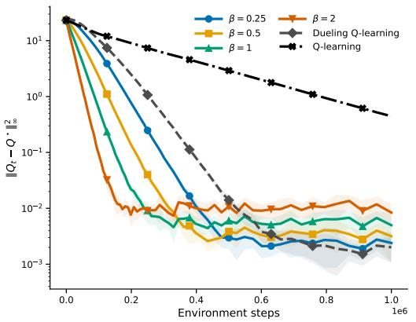
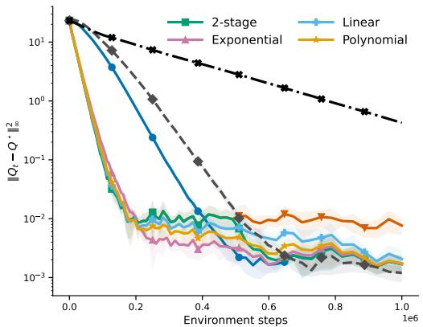
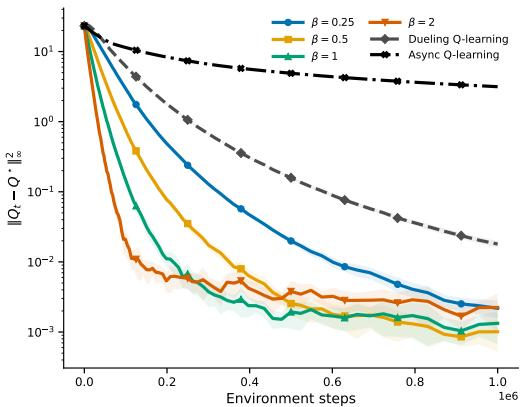
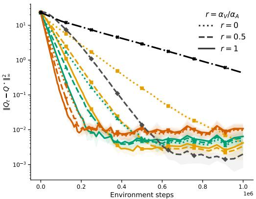
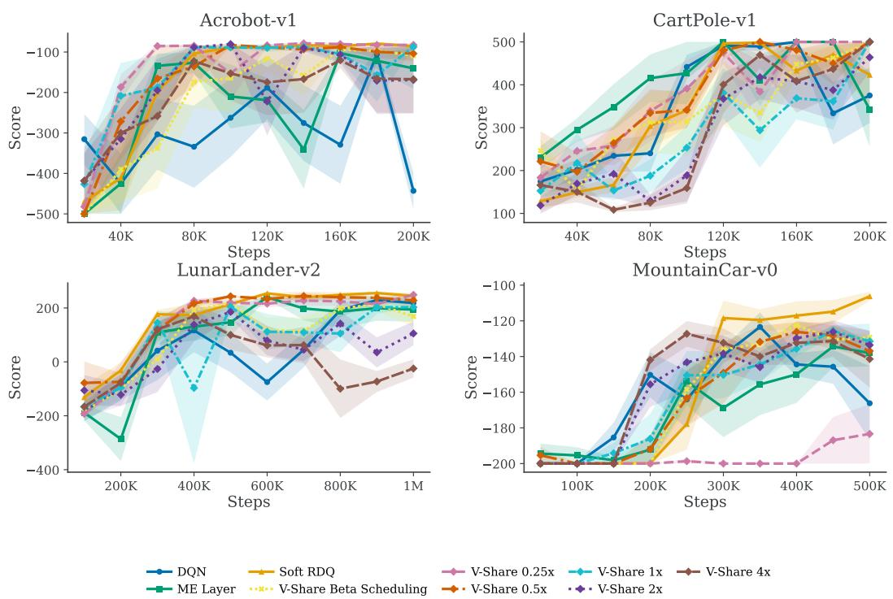
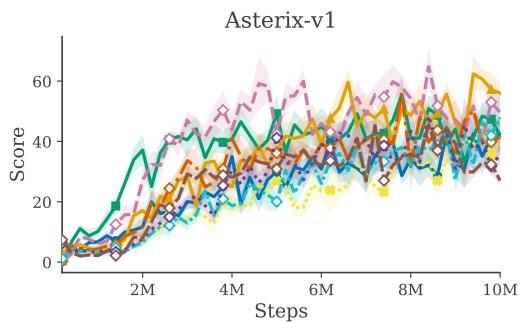
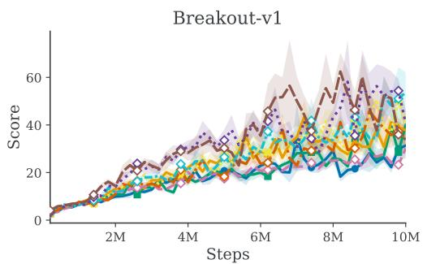
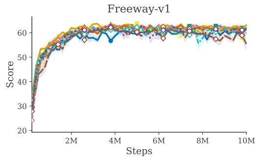
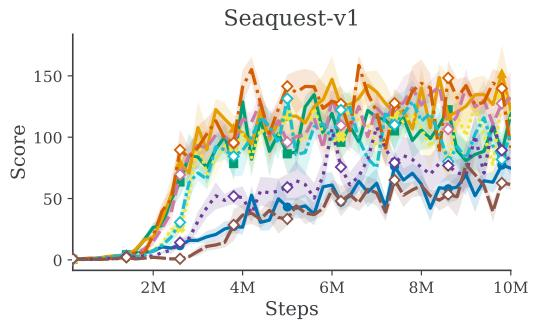
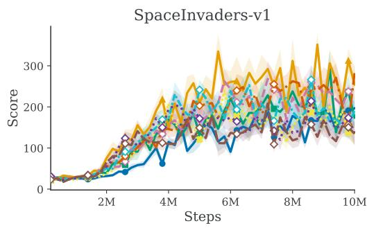

# V-SHARE: PROVABLE CONVERGENCE GUARANTEES FOR ADVANTAGE-BASED ALGORITHMS

Kintan Saha†, Hamed Masoudi∗, Xinyi Sheng∗, Dominik Baumann∗, Joni Pajarinen∗, Arsenii Mustafin

†Indian Institute of Science

kintansaha@iisc.ac.in

∗Aalto University

{hamed.masoudi,xinyi.sheng,dominik.baumann,

joni.pajarinen,arsenii.mustafin}@aalto.fi

## ABSTRACT

In reinforcement learning, advantage-based value-learning methods, unlike standard Q-learning, share information across actions by decomposing the actionvalue function into a state-dependent value component and action-specific advantages. While this mechanism has proven effective in both tabular and deep reinforcement learning, its theoretical understanding remains incomplete. We introduce V-SHARE, an advantage-based value-learning algorithm that combines cross-action value sharing with an importance-weighted Bellman-residual correction. To our knowledge, we provide the first complete theoretical characterization of an advantage-based algorithm, including both asymptotic convergence and nonasymptotic finite-sample guarantees. We identify a regime in which V-SHARE mitigates the rare-action bottleneck of asynchronous Q-learning and uncover a contraction–variance tradeoff between stronger deterministic contraction and increased importance-weighting noise. Motivated by this tradeoff, we develop decreasing residual-preconditioning schedules that combine faster early contraction with lower asymptotic noise. We further develop a two-timescale analysis that removes the single-timescale residual-weight threshold while preserving convergence guarantees. Experiments on discrete Markov decision processes (MDPs) and deep reinforcement-learning benchmarks corroborate our results.

## 1 INTRODUCTION

Reinforcement learning (RL) (Sutton & Barto, 1998) algorithms learn through trial and error: they try actions, receive a reward in return indicating the quality of that action and, over time, try to learn an optimal mapping from the current state to the best action to take, which we call the policy. Qlearning (Watkins & Dayan, 1992) is one of the canonical RL algorithms that learns a Q-function as an intermediate object. The Q-function estimates, for every state-action pair, the long-term return, i.e., the sum of received rewards over a trajectory, obtained by taking that action in that state and behaving optimally thereafter. If the state and action spaces are finite, we can explicitly store estimated action-values for each state-action pair. In the standard asynchronous setting, the learner observes one transition at a time and updates only the estimate for the sampled state-action pair. This simple coordinate-wise structure, together with the contraction of the Bellman optimality operator, under lies the classical convergence theory of Q-learning (Tsitsiklis, 1994; Jaakkola et al., 1993). The same basic principle also proved remarkably successful with function approximation through Deep Q-Networks (DQN) (Mnih et al., 2015), showing that Q-learning can scale to high-dimensional control problems.

With function approximation, however, Q-learning becomes more susceptible to instability, and estimating the full action-value of every action separately can be inefficient when much of the information is shared. These observations motivated the dueling architecture of Wang et al. (2016), which represents the Q-function as the sum of a state-value function that assigns a value to every state defined by the long-term return obtained by behaving optimally after visiting said state, and an action-dependent advantage function learned separately. Intuitively, rather than repeatedly estimating the full value of every action, the learner can first estimate a potentially large value component common to all actions and then learn the comparatively smaller action-dependent advantage components. This value-advantage perspective has subsequently proved useful both empirically and theoretically. Advantage-based architectures improve learning performance in deep reinforcement learning (Wang et al., 2016; Nagarajan et al., 2026), while recent tabular advantage-based algorithms exhibit accelerated learning relative to standard Q-learning (Tang et al., 2023; Daley et al., 2025; Lee, 2026).

The algorithmic idea itself dates back to Advantage Updating (Baird, 1993), and the central mechanism of all these approaches is value sharing: updating the state-value component simultaneously changes the represented values of all actions at the state being updated, allowing information obtained from one action to propagate immediately to the others.

Value sharing, however, comes with a theoretical cost. In Q-learning, each state-action value is updated through its own temporal-difference error, which leads to a simple contraction-based analysis. Advantage-based methods couple the action-values within a state through a shared value component, and this coupling breaks that standard argument. Existing analyses therefore rely on stronger structural or sampling assumptions, such as synchronous updates over all state-action pairs, to establish convergence in the tabular setting (Lee, 2026; Tang et al., 2023). This raises a natural question:

Can we retain the acceleration benefits of cross-action value sharing while recovering a tractable convergence theory and finite-sample guarantees under stochastic sampling?

Contributions. We answer this question through V-SHARE, an advantage-based value-learning algorithm that augments cross-action value sharing with a tunable, importance-weighted Bellmanresidual correction parametrized by β. This leads to a residual preconditioning view of value sharing, showing when cross-action coupling accelerates learning, when it breaks the usual contraction argument, and how to recover convergence guarantees.

1. We show that the iterates generated by V-SHARE are stable and converge almost surely to the optimal action-value function $Q ^ { * }$ under Markovian sampling and suitable parameter choices.

2. We derive finite-time guarantees using constant- and diminishing-stepsize schedules. The resulting rates quantify a contraction-variance tradeoff and yield the first finite-time guarantees of an advantage-based algorithm under Markovian sampling. We show how decreasing-β and decayto-zero stepsize schedules retain strong early contraction while reducing terminal stochastic error.

3. We also analyze a two-timescale formulation that removes the single-timescale large-β requirement and show convergence guarantees for all $\beta > 0$ . The analysis requires extending single timescale Markovian stochastic approximation to vanishing drift perturbations, yielding results that may be of independent interest.

4. We evaluate V-SHARE and its variants on tabular MDPs, where the experiments expose the predicted effects of value sharing. We additionally extend V-SHARE to deep reinforcement learning and compare it with recent advantage-based methods on MinAtar (Young & Tian, 2019) and Classic Control tasks.

Related work. Since the number of Q-learning variants and analyses is vast, we focus here only on the key theoretical results, major practical milestones, and methods that explicitly learn advantages. The term advantage-based is used in several different senses in reinforcement learning. Policygradient and actor–critic methods such as PPO (Schulman et al., 2017) use advantage estimates to construct policy updates, often through generalized advantage estimation (Schulman et al., 2015). However, the advantage is used primarily as an estimator of relative action quality to train the policy. Our focus is instead on advantage-based value learning: algorithms that explicitly represent action values through a shared state-value component and action-specific advantages, so that updating the value component propagates information across actions. This viewpoint dates back to Advantage Updating (Baird, 1993) and underlies the dueling architecture of Wang et al. (2016).

Recent work has revisited this value–advantage decomposition in both tabular and deep RL (Tang et al., 2023; Daley et al., 2025; Nagarajan et al., 2026). These methods exploit the shared value component to accelerate learning, while Lee (2026) studies the dynamics of tabular dueling Q-learning through spectral arguments. Mustafin et al. (2025) introduces the RB-S algorithm, which uses advantage-preserving transformations to recover an optimal policy. Our approach is complemen tary: we modify the coupled value-sharing dynamics through residual preconditioning and analyze the resulting algorithm under Markovian sampling, obtaining both asymptotic and finite-time guarantees. Technically, our analysis builds on the ODE method for stochastic approximation (Borkar & Meyn, 2000; Liu et al., 2025) and the generalized Moreau-envelope framework for contractive stochastic approximation (Chen et al., 2020; 2024).

For brevity, we henceforth refer to advantage-based value-learning algorithms as advantage-based algorithms.

## 2 PROBLEM SETUP

We first formalize the MDP and sampling model, and then express Q-learning and value-sharing updates that motivate our analysis.

Discounted MDP and sampling model. A finite discounted Markov decision process (MDP) is defined by $( S , { \mathcal { A } } , P , r , \gamma )$ , where $s$ and A are finite state and action spaces, respectively, $P ( s ^ { \prime } | s , a )$ is the transition kernel, $r ( s , a ) ~ \in ~ [ 0 , 1 ]$ is the bounded reward, and $\gamma ~ \in ~ [ 0 , 1 )$ is the discount factor. The goal is to find a policy $\pi : \mathcal { S }  \mathcal { A }$ that maximizes the expected cumulative discounted reward $\mathbb { E } [ \sum _ { t = 0 } ^ { \infty } \gamma ^ { t } r _ { t } ]$ . For a given MDP, we define the Q-function as $Q ( s , a ) \ = \ \mathbb { E } _ { \pi } [ \sum _ { k = 0 } ^ { \infty } \gamma ^ { k } r _ { t + k } | s _ { t } \ = \ s , a _ { t } \ = \ a ] .$ The Bellman optimality operator $\tau$ is $\begin{array} { r } { ( \overline { { \mathcal { T } } } Q ) ( s , a ) = \overline { { r ( s , a ) } } + \gamma \sum _ { s ^ { \prime } } P ( s ^ { \prime } | s , a ) \operatorname* { m a x } _ { a ^ { \prime } } Q ( \overline { { s ^ { \prime } } } , a ^ { \prime } ) } \end{array}$ . Its unique fixed point is the optimal action-value function $Q ^ { \star }$

Synchronous algorithms update all state-action pairs at every iteration, which is computationally expensive and unrealistic in large MDPs. In the asynchronous setting, updates are driven by individual transitions sampled along a trajectory. Our algorithms operate in this regime, learning from a single trajectory generated by a fixed behavior policy $\pi _ { b }$ . We make a standard assumption about this policy:

Assumption 1 (Ergodic behavior policy). The behavior policy $\pi _ { b } : { \mathcal { S } } \to \Delta ( { \mathcal { A } } )$ has full support, $\pi _ { b } ( a | s ) > 0$ for every $( s , a )$ , and the state Markov chain induced by $\pi _ { b }$ is irreducible and aperiodic. Hence it admits a unique stationary distribution $d \in \mathbb { R } ^ { | s | }$ satisfying $d ( s ) > 0$ for every s, and stationary state-action distribution $\mu ( s , a ) = d ( s ) \pi _ { b } ( a | s )$ . Further, let $Y _ { t } : = ( s _ { t - 1 } , a _ { t - 1 } , s _ { t } )$ denote the Markov chain of observed transitions, with stationary distribution $d _ { Y } ( s , a , s ^ { \prime } ) ~ =$ $d ( s ) \pi _ { b } ( a | s ) P ( s ^ { \prime } | s , a )$ . For $\delta > 0$ , define its mixing time by $t _ { \delta } : =$ min $\{ m \ge 0 : \operatorname* { m a x } _ { y } | | \mathbb { P } ( Y _ { m } \in$ $\mathbf { \partial } \cdot \mid Y _ { 0 } = y ) - d _ { Y } \mid \mid _ { \mathrm { T V } } \leq \delta \}$ , where $| | \cdot | | _ { \mathrm { T V } }$ is the total variation distance. Since $Y _ { t }$ is a finite-state ergodic Markov chain, it is geometrically mixing, and hence $t _ { \delta } = O ( \log ( 1 / \delta ) )$ ).

At iteration t, the sampled transition is $( s _ { t } , a _ { t } , r ( s _ { t } , a _ { t } ) , s _ { t + 1 } )$ , where $a _ { t } \sim \pi _ { b } ( \cdot | s _ { t } )$ and $s _ { t + 1 } \sim$ $P ( \cdot | s _ { t } , a _ { t } )$ . The Markovian sample is defined as $Y _ { t + 1 } : = ( s _ { t } , a _ { t } , s _ { t + 1 } )$ . For the current iterate $Q _ { t } ,$ define the temporal-difference (TD) error $\begin{array} { r } { \delta _ { t } = r ( s _ { t } , a _ { t } ) + \gamma \operatorname* { m a x } _ { a ^ { \prime } } Q _ { t } ( s _ { t + 1 } , a ^ { \prime } ) - Q _ { t } ( s _ { t } , a _ { t } ) } \end{array}$ For a stochastic-approximation (SA) recursion $Q _ { t + 1 } = Q _ { t } + \alpha _ { t } \widehat { h } _ { t } ( Q _ { t } , Y _ { t + 1 } )$ , we call $h ( Q ) : =$ $\mathbb { E } _ { Y \sim d _ { Y } } [ \widehat { h } _ { t } ( Q , Y ) ]$ its stationary mean operator and ${ \dot { Q } } \ = \ h ( Q )$ its associated limiting ODE (Borkar, 2022). These dynamics let us compare Q-learning with cross-action value sharing.

Q-learning and value sharing. Asynchronous Q-learning with stepsize schedule $\{ \alpha _ { t } \} _ { t = 0 } ^ { \infty }$ updates only the sampled state-action coordinate,

$$
Q _ { t + 1 } ( s , a ) = Q _ { t } ( s , a ) + \alpha _ { t } \mathbf { 1 } \{ s _ { t } = s , a _ { t } = a \} \delta _ { t } ,
$$

where 1 denotes the indicator function. Let $D _ { \mu } : = \mathrm { d i a g } \{ \mu ( s , a ) \} _ { s , a } = \mathrm { d i a g } \{ d ( s ) \pi _ { b } ( a | s ) \} _ { s , a }$ . Its limiting ODE is $\dot { Q } = D _ { \mu } ( T Q - Q )$ . Thus asynchronous Q-learning applies a diagonal sampling preconditioner to the Bellman residual $\mathcal { T } Q - Q$ , preserving the coordinate-wise structure underlying its standard contraction analysis.

We are interested instead in algorithms that share information across actions. To formalize this, consider the value-advantage decomposition $Q _ { t } ( s , a ) = V _ { t } ( s ) + A _ { t } ( s , a )$ and the shared-value update of hard Regularized Dueling Q-learning (RDQ) (Daley et al., 2025),

$$
V _ { t + 1 } ( s _ { t } ) = V _ { t } ( s _ { t } ) + \alpha _ { t } \delta _ { t } , \quad A _ { t + 1 } ( s _ { t } , a ) = A _ { t } ( s _ { t } , a ) + \alpha _ { t } \mathbf { 1 } \{ a _ { t } = a \} \delta _ { t } .\tag{1}
$$

Although $( V _ { t } , A _ { t } )$ is not uniquely identifiable, by defining $( L V ) ( s , a ) : = V ( s )$ , the iterate $Q _ { t } =$ $L V _ { t } + A _ { t }$ is well defined.

To understand the effect of value sharing on the Q-dynamics, let $b _ { s } : = ( \pi _ { b } ( a | s ) ) _ { a \in \mathcal { A } }$ , e be the all-ones vector in $\mathbb { R } ^ { | A | } , B _ { s } : = { \mathbf { e } } b _ { s } ^ { \top }$ , and $B : = { \mathrm { b l k d i a g } } ( B _ { s } : s \in { \mathcal { S } } )$ . Also define the lifted statevisitation matrix $D : = \mathrm { d i a g } \{ d ( s ) : ( s , a ) \in S \times \mathcal { A } \}$ . The Q-iterate then satisfies

$$
Q _ { t + 1 } ( s , a ) - Q _ { t } ( s , a ) = \alpha _ { t } \mathbf { 1 } \{ s _ { t } = s \} \big ( 1 + \mathbf { 1 } \{ a _ { t } = a \} \big ) \delta _ { t } ,
$$

with limiting ODE $\dot { Q } = ( D B + D _ { \mu } ) ( T Q - Q )$

The distinction from asynchronous Q-learning is the following: The term $D _ { \mu } ( { \mathcal { T } } Q - Q )$ performs the usual action-specific update, whereas $D B \bar { ( } T Q - Q )$ propagates information across all actions at the visited state. This cross-action coupling is the value-sharing mechanism we study in this paper. Appendix A derives the stationary mean operators of asynchronous Q-learning and hard RDQ and compares the structure of their respective preconditioners and limiting ODEs.

Algorithm 1 V-SHARE   
1: Initialize $V _ { 0 } , A _ { 0 } ,$ state $S _ { 0 } ,$ , stepsizes $\{ \alpha _ { t } \} _ { t = 0 } ^ { \infty } ,$ , and choose $\beta > 0 .$   
2: for $t = 0 , 1 , \ldots$ do   
3: Sample $a _ { t } \sim \pi _ { b } ( \cdot \mid s _ { t } ) .$   
4: Observe $R _ { t + 1 } = r ( s _ { t } , a _ { t } )$ and $s _ { t + 1 } \sim P ( \cdot \mid s _ { t } , a _ { t } )$   
5: Compute   
$\delta _ { t } = R _ { t + 1 } + \gamma \operatorname* { m a x } _ { a ^ { \prime } } Q _ { t } ( s _ { t + 1 } , a ^ { \prime } ) - Q _ { t } ( s _ { t } , a _ { t } )$   
a   
6: Update, for all $s \in S$ and a $\in { \mathcal { A } } ,$   
$V _ { t + 1 } ( s ) = V _ { t } ( s ) + \mathbf { 1 } \{ s _ { t } = s \} \alpha _ { t } \delta _ { t } , \quad A _ { t + 1 } ( s , a ) = A _ { t } ( s , a ) + \alpha _ { t } \frac { \beta \mathbf { 1 } \{ s _ { t } = s , a _ { t } = a \} } { \pi _ { b } ( a \mid s _ { t } ) } \delta _ { t } .$   
7: end for

## 3 MAIN RESULTS

The value-sharing update equation 1 propagates a sampled TD error across all actions at the visited state, but introduces cross-action coupling that prevents the standard Q-learning contraction argument. We therefore introduce V-SHARE in section 3.1 (Algorithm 1), which augments the shared value update with an importance-weighted action-specific Bellman-residual correction. Our analysis casts V-SHARE as a stochastic approximation scheme for a fixed-point iteration. In Section 3.2, we prove almost-sure convergence of V-SHARE and provide finite-time guarantees in Section 3.3. Finally, we investigate convergence properties when we decrease the parameter $\beta$ of V-SHARE over time in Section 3.4 and under a two-timescale formulation in Section 3.5.

## 3.1 V-SHARE ALGORITHM

Let $\beta > 0$ denote the residual-preconditioning parameter. Given a sample $( s _ { t } , a _ { t } , r ( s _ { t } , a _ { t } ) , s _ { t + 1 } )$ generated by the behaviour policy $\pi _ { b }$ , V-SHARE performs

$$
V _ { t + 1 } ( s _ { t } ) = V _ { t } ( s _ { t } ) + \alpha _ { t } \delta _ { t } , \qquad A _ { t + 1 } ( s _ { t } , a ) = A _ { t } ( s _ { t } , a ) + \alpha _ { t } \frac { \beta \mathbf { 1 } \{ a _ { t } = a \} } { \pi _ { b } ( a | s _ { t } ) } \delta _ { t } ,\tag{2}
$$

with $Q _ { t } ( s , a ) = V _ { t } ( s ) + A _ { t } ( s , a )$ and all unvisited-state coordinates unchanged.

The induced action-value recursion admits the following stochastic approximation (SA) form and limiting ODE,

$$
Q _ { t + 1 } = Q _ { t } + \alpha _ { t } \big ( h _ { \beta } ( Q _ { t } ) + M _ { t + 1 } \big ) , \quad h _ { \beta } ( Q ) = D ( B + \beta I ) ( \mathcal { T } Q - Q ) , \quad \dot { Q } = h _ { \beta } ( Q ) ,\tag{3}
$$

where $M _ { t + 1 }$ denotes the Markovian noise induced by the trajectory $\{ Y _ { t } \}$ . The term DB implements cross-action value sharing, whereas $\beta D$ provides the diagonal residual correction. We show that the preconditioner matrix $D \big ( \boldsymbol { B } { + } \beta \boldsymbol { I } \big )$ is invertible, thus ensuring that $Q ^ { * }$ is the fixed point of the limiting ODE in Appendix B.2.

## 3.2 ASYMPTOTIC GUARANTEES

A contractive fixed-point representation. Our convergence analysis will use the Lyapunov framework for contractive stochastic approximation (Chen et al., 2024). To place equation 3 in this form, we introduce an auxiliary analysis parameter $\eta > 0$ and define the V-SHARE fixed-point map

$$
F _ { \eta , \beta } ( Q ) : = Q + \eta h _ { \beta } ( Q ) .\tag{4}
$$

Using Equation 4, Equation 3 can be rewritten as

$$
Q _ { t + 1 } = Q _ { t } + \frac { \alpha _ { t } } { \eta } \left[ F _ { \eta , \beta } ( Q _ { t } ) - Q _ { t } + \eta M _ { t + 1 } \right] .\tag{5}
$$

We show that $F _ { \eta , \beta }$ is a contraction in the sup-norm (Lemma B.2 in Appendix B.2) whenever $\kappa _ { \beta } : =$ min $\begin{array} { c } { { \displaystyle { \mathrm { } _ { 1 } } _ { s , a } d ( s ) \big [ ( 1 - \gamma ) \beta - ( 1 + \gamma ) + 2 \pi _ { b } ( a | s ) \big ] > 0 } } \end{array}$ and $\begin{array} { r } { \eta \leq L _ { \beta } ^ { - 1 } , L _ { \beta } : = \operatorname* { m a x } _ { s , a } d ( s ) \big ( \beta + \pi _ { b } ( a | s ) \big ) } \end{array}$ This contraction is used to establish the asymptotic convergence of the algorithm as follows.

Theorem 3.1 (Almost-sure convergence of V-SHARE under Markovian sampling). Under Assumption 1, let $\kappa _ { \beta } > 0 _ { ; }$ , and $\alpha _ { t } = \alpha _ { 0 } / ( t + h ) ^ { p }$ for some $p \in ( 1 / 2 , 1 ]$ and $\alpha _ { 0 } , h > 0$ . Then, the V-SHARE iterates (2) are almost surely bounded and satisfy

$$
Q _ { t } \to Q ^ { \star } \qquad a . s .
$$

Proof sketch. The full proof is given in Appendix B.3. Let $W ( Q ) : = \| Q - Q ^ { \star } \| _ { \infty }$ . The contraction property established in Lemma B.2 implies that the upper-right Dini derivative (Khalil, 2002) of W along the limiting ODE $\dot { Q } = h _ { \beta } ( Q )$ ) satisfies

$$
D ^ { + } W ( Q ; h _ { \beta } ( Q ) ) \leq - \kappa _ { \beta } W ( Q ) .
$$

Hence, $Q ^ { \star }$ is the unique globally exponentially stable equilibrium of the limiting ODE. Now, writing the V-SHARE recursion as $Q _ { t + 1 } = \stackrel { \cdot } { Q } _ { t } + \alpha _ { t } \dot { H } _ { \beta } \mathopen { } \mathclose \bgroup \left( Q _ { t } , Y _ { t + 1 } \aftergroup \egroup \right)$ , where $Y _ { t }$ is the Markovian sample, we show that $H _ { \beta } ( Q , Y )$ is globally Lipschitz, its scaled limit exists, and the averaged limiting ODE has the origin as a globally exponentially stable equilibrium by the contraction argument of Lemma B.2. Assumption 1 verifies the required Markov averaging conditions of Liu et al. (2025). Liu et al. (2025, Theorem 7) therefore gives supt $\| Q _ { t } \| _ { \infty } < \infty \mathrm { a . s }$ . Their ODE convergence result (Liu et al., 2025, Corollary 8) then implies that the iterates approach a bounded invariant set of $\dot { Q } = h _ { \beta } ( Q )$ . Since this ODE has the unique globally exponentially stable equilibrium $Q ^ { \star }$ , the only bounded invariant set is $\{ Q ^ { \star } \}$ , and hence $\bar { Q _ { t } } \stackrel { - } {  } Q ^ { \dot { \star } } { \bf a . s }$

Implications ofTheorem 3.1. To our knowledge, Theorem 3.1 gives the first almost-sure convergence guarantee for an advantage-based algorithm under Markovian sampling. We show below that the same contractive regime also yields mean-square error bounds for the iterates, thereby providing finite-sample guarantees.

## 3.3 FINITE-TIME GUARANTEES

We now quantify the finite-sample behavior of V-SHARE under Markovian sampling. Recall the SA recursion equation 3 and suppose that $\kappa _ { \beta } > 0$ , so that the V-SHARE fixed-point map is contractive by Lemma B.2. We state the results for constant stepsizes here. The bounds for diminishing and decaying stepsizes are given in Theorem B.4 of Appendix B.4.

Theorem 3.2 (Finite-time convergence of V-SHARE). Under Assumption 1, suppose $\kappa _ { \beta } > 0$ . Let $\alpha _ { k } \equiv \alpha ,$ , α sufficiently small. Define, $K _ { \operatorname* { m i x } } = \operatorname* { m i n } \{ k \geq 0 : k \geq t _ { \alpha L _ { \beta } } \}$

$$
c _ { 2 , \beta } : = \left( ( 2 + \frac { \displaystyle ( 1 + \beta / b _ { \operatorname* { m i n } } ) ( 1 + \gamma ) } { L _ { \beta } } ) \| Q ^ { \star } \| _ { \infty } + \frac { ( 1 + \beta / b _ { \operatorname* { m i n } } ) } { L _ { \beta } } \right) ^ { 2 } .
$$

Then, $\forall k \geq K _ { \operatorname* { m i x } }$

$$
\mathbb { E } \| Q _ { k } - Q ^ { \star } \| _ { \infty } ^ { 2 } \leq \mathcal { O } \left( \| Q _ { 0 } - Q ^ { \ast } \| _ { \infty } ^ { 2 } \left( 1 - \frac { \alpha \kappa _ { \beta } } { 2 } \right) ^ { k - t _ { \alpha L _ { \beta } } } + \frac { \alpha L _ { \beta } ^ { 3 } \log | S | | A | } { \kappa _ { \beta } ^ { 2 } } c _ { 2 , \beta } t _ { \alpha L _ { \beta } } \right) .\tag{6}
$$

Proof sketch. We provide the main steps here; the complete proof is given in Appendix B.4.

1. Contractive-SA reduction. With $\eta = L _ { \beta } ^ { - 1 }$ , Lemma B.2 gives a contraction factor $\rho = 1 -$ $\kappa _ { \beta } / L _ { \beta }$ for the V-SHARE fixed point map. Hence the recursion is a contractive Markovian SA with effective stepsize $\epsilon _ { k } = \alpha _ { k } L _ { \beta }$

2. Moreau-envelope drift under Markovian sampling. Apply the generalized Moreau-envelope construction of Chen et al. (2024) to obtain a smooth Lyapunov function equivalent to $\lVert Q ^ { \bar { . } } -$ $Q ^ { \star } \| _ { \infty } ^ { 2 }$ . Contractivity yields a negative drift of order $\epsilon _ { k } \kappa _ { \beta } / L _ { \beta }$ , while temporal dependence is controlled over the mixing window, producing the Markovian error term proportional to $\epsilon _ { k } \epsilon _ { k - t _ { k } , k - 1 }$ where $\begin{array} { r } { \alpha _ { i , j } = \sum _ { k = i } ^ { j } \alpha _ { k } } \end{array}$

3. One-step recursion and unrolling. Substituting the V-SHARE sample-map growth bounds into the Markovian Moreau recursion and imposing the mixing-window condition allows the correlation term to be absorbed into the negative drift. Unrolling the resulting scalar recursion for constant stepsizes yields equation 6.

Implications of Theorem 3.2. To our knowledge, Theorem 3.2 establishes the first finite-time convergence guarantees for an advantage-based algorithm under the challenging regime of Markovian sampling.

Remark 1 (Residual-preconditioning tradeoff). For large $\beta , L _ { \beta } = \Theta ( \beta )$ and $\kappa _ { \beta } = \Theta ( \beta )$ , while $^ { c _ { 2 , \beta } }$ remains bounded in $\beta$ and scales as $O ( b _ { \operatorname* { m i n } } ^ { - 2 } )$ ). Hence the constant-stepsize stochastic term in Theorem 3.2 scales as (ignoring the dimensionality dependence)

$$
\nu _ { \beta } : = \frac { \alpha L _ { \beta } ^ { 3 } c _ { 2 , \beta } } { \kappa _ { \beta } ^ { 2 } } t _ { \alpha L _ { \beta } } = \Theta \big ( \alpha \beta c _ { 2 , \beta } t _ { \alpha L _ { \beta } } \big ) .
$$

Thus, larger $\beta$ strengthens transient contraction but enlarges the constant-stepsize stochastic radius.   
We observe this effect in Figure 1a. This motivates the decreasing-β schedules ofSection 3.4.

Remark 2 (Comparison with asynchronous Q-learning). Asynchronous Q-learning contracts at gap $\mu _ { \operatorname* { m i n } } ( 1 - \gamma )$ , where $\begin{array} { r } { \mu _ { \mathrm { m i n } } : = \operatorname* { m i n } _ { s , a } d ( s ) \pi _ { b } ( a | s ) } \end{array}$ , whereas for large $\beta , \kappa _ { \beta } \sim d _ { \operatorname* { m i n } } ( 1 - \gamma ) \beta$ . Thus V-SHARE removes the rare-action factor from the leading deterministic contraction gap and yields a faster contraction. For a detailed comparison, we defer the details to Appendix B.5.

## 3.4 DECREASING RESIDUAL-PRECONDITIONING SCHEDULES

Remark 1 shows that stronger residual preconditioning improves transient contraction but enlarges the constant-stepsize stochastic radius $\nu _ { \beta }$ . This suggests using a large value of $\beta$ early in learning and decreasing it as the iterates approach $Q ^ { \star }$

As a motivating example, consider the two-stage schedule

$$
\begin{array}{c} \begin{array} { r } { \beta _ { k } = \left\{ \beta _ { h } , \quad k < K , \qquad \beta _ { h } \geq \beta _ { \ell } , \qquad \kappa _ { \beta _ { \ell } } > 0 . \right.} \end{array}   \end{array}
$$

The first stage contracts more aggressively, while the second stage reduces the stochastic error induced by residual preconditioning. Importantly, errors accumulated during the high-β phase are themselves contracted during the subsequent low-β phase.

In the following theorem, for notational ease we skip the subscript $\beta$ in the various constants of Theorem 3.2 and instead write them with the subscripts h and l to denote $\beta _ { h }$ and $\beta _ { l }$ respectively. Let $K _ { \operatorname* { m i x } } = \operatorname* { m i n } \{ k \geq 0 : k \geq t _ { \alpha L _ { h } } \}$ and $K > K _ { \operatorname* { m i x } }$

Theorem 3.3 (Two-stage residual preconditioning). Suppose the constant stepsize α satisfies the uniform Markovian mixing-window condition over $\beta \in [ \bar { \beta } _ { \ell } , \beta _ { h } ]$ . Then, $\forall T \geq K$ ，

$$
\begin{array} { l } { { \mathbb { E } \| Q _ { T } - Q ^ { \star } \| _ { \infty } ^ { 2 } = \mathcal { O } \left( \| Q _ { 0 } - Q ^ { \ast } \| _ { \infty } ^ { 2 } \exp \left\{ - \displaystyle \frac { \alpha } { 2 } \left( \kappa _ { h } ( K - t _ { \alpha L _ { h } } ) + \kappa _ { \ell } ( T - K - t _ { \alpha L _ { l } } ) \right) \right\} \right) } } \\ { { \displaystyle \qquad + \mathcal { O } \left( \nu _ { h } \exp \left\{ - \displaystyle \frac { \alpha \kappa _ { \ell } } { 2 } ( T - K ) \right\} + \nu _ { l } \right) . } } \end{array}
$$

Proof sketch. The full proof is given in Appendix C. We apply the fixed $- \beta$ Markovian bound of Theorem 3.2 separately on the two stages. During the first K iterations, we use $\eta _ { h } = L _ { h } ^ { - 1 }$ , yielding contraction at rate $\kappa _ { h }$ and a high-β stochastic radius $\nu _ { h }$

At the switching time $K ,$ , we restart the analysis conditionally on $\left( Q _ { K } , Y _ { K } \right)$ with $\eta _ { \ell } = L _ { \ell } ^ { - 1 }$ . Since the mixing-time bound is uniform over the initial Markov state, Theorem 3.2 applies to the second stage with the low-β constants $\left( L _ { \ell } , \kappa _ { \ell } , c _ { 2 , \ell } \right)$ . Consequently, the error inherited from the first stage is further contracted by $\exp \{ - \dot { \alpha } \kappa _ { \ell } ( T - \dot { K } ) / 2 \}$ , while noise generated after the switch contributes only the low-β stochastic radius $\nu _ { l }$ . Combining the two stagewise bounds gives the result.

Implications of Theorem 3.3. The bound makes the benefit of scheduling explicit: large $\beta$ can be used to accelerate the early transient, while the effect of its larger stochastic error is exponentially forgotten during the low- $- \beta$ tail. After a sufficiently long second stage, the dominant terminal term is $\nu _ { l }$ . Thus, the low- $- \beta$ phase governs the terminal stochastic scale.

We derive explicit bounds for smoothly decreasing schedules such as linear, polynomial, and normalized-exponential in Appendix C. We compare the performance of the various schedules in Figure 1b.

## 3.5 TWO-TIMESCALE V-SHARE

The preceding single-timescale theory requires $\beta$ to be large enough that the V-SHARE fixed point map is contractive (Lemma B.2). Two-timescale learning provides a complementary route that removes this restriction entirely. The key idea is to let the advantage component evolve faster than the shared value component. For every fixed $\beta > 0$ , the fast advantage dynamics then reduce, after a simple change of variables, to standard Bellman dynamics with contraction gap $d _ { \operatorname* { m i n } } ( 1 - \gamma )$ .

Two-timescale V-SHARE (Algorithm 2) uses

$$
V _ { t + 1 } ( S _ { t } ) = V _ { t } ( S _ { t } ) + \alpha _ { t } \delta _ { t } , ~ A _ { t + 1 } ( S _ { t } , a ) = A _ { t } ( S _ { t } , a ) + \eta _ { t } \frac { \beta \mathbf { 1 } \{ U _ { t } = a \} } { \pi _ { b } ( a | S _ { t } ) } \delta _ { t } .\tag{7}
$$

For fixed $\beta > 0$ , define the effective advantage stepsize $\tau _ { t } : = \beta \eta _ { t }$ . We show the asymptotic convergence as follows:

Theorem 3.4 (Almost-sure convergence of two-timescale V-SHARE). Fix any $\beta > 0$ and let $\tau _ { t } : =$ $\beta \eta _ { t }$ . Suppose Assumption 1 holds and

$$
\tau _ { t } = \frac { \tau _ { 0 } } { ( t + h ) ^ { p } } , \qquad \alpha _ { t } = \frac { \alpha _ { 0 } } { ( t + h ) ^ { q } } , \qquad \frac { 1 } { 2 } < p < q \leq 1 .
$$

$$
T h e n , A _ { t } - ( Q ^ { \star } - L V _ { t } )  0 \quad a . s . \implies Q _ { t } = L V _ { t } + A _ { t }  Q ^ { \star } \quad a . s .
$$

Proof sketch. The full proof is given in Appendix D.2. For a frozen value function $V ,$ , the fast limiting ODE is $\dot { A } = D [ \mathcal { T } ( L V + A ) - ( L V + A ) ]$ . Under the change of variables $Q = L V + A $ this becomes $\dot { Q } = D ( T Q - Q )$ , whose unique globally exponentially stable equilibrium is $Q ^ { \star }$ with contraction ${ \mathrm { g a p } \ \kappa _ { \mathrm { f a s t } } = d _ { \mathrm { m i n } } ( 1 - \gamma ) }$ . Hence the frozen fast recursion has equilibrium $\lambda ( V ) =$ $Q ^ { \star } - L V$ The key observation is that the tracking error $A _ { t } - \lambda ( V _ { t } ) = Q _ { t } ^ { - } - Q ^ { \star }$ evolves as a single-timescale Markovian stochastic approximation on the fast timescale, with the slow value update appearing only through the vanishing perturbation as $\alpha _ { t } / \tau _ { t } \  \ 0$ We therefore extend the Markovian ODE result of Liu et al. (2025) to stochastic approximation with a vanishing drift perturbation. We show that under their assumptions, stability and convergence to invariant sets of the unperturbed limiting ODE are preserved (Proposition D.1). This is the Markovian analogue of the vanishing-measurement-error extension in Borkar (2022, Section 2.2). Since the unperturbed limiting ODE has the unique equilibrium $Q ^ { \star }$ , it follows that $A _ { t } - \lambda ( V _ { t } ) = Q _ { t } - Q ^ { \star } \to 0 \mathrm { a . s }$

Implications of Theorem 3.4. First, Theorem 3.4 shows that timescale separation removes the singletimescale threshold on $\beta \colon$ every fixed $\beta > 0$ is admissible once $\alpha _ { t } / \tau _ { t }  0 .$ . Second, the proof establishes a Markovian analogue of the classical vanishing-measurement-error extension of stochastic approximation, showing that the stability and ODE limit theory of Liu et al. (2025) is preserved under a state-dependent drift perturbation whose coefficient vanishes in the limit.

Finite-time tracking. The asymptotic result shows that timescale separation eliminates the singletimescale threshold on $\beta .$ We next quantify how quickly the fast advantage iterate tracks its moving equilibrium. Define $\Delta _ { t } : = A _ { t } - \bar { A } ^ { \star } ( V _ { t } ) = \bar { Q _ { t } } - \bar { Q } ^ { \star }$ . The leading dynamics of $\Delta _ { t }$ inherit the Bellman contraction gap $\kappa _ { \mathrm { f a s t } } = d _ { \mathrm { m i n } } ( 1 - \gamma )$ , while motion of the value component acts only as a slower perturbation controlled by $\alpha _ { t } / \tau _ { t }$ . Let $\mathrm { ~ \overset { \cdot } { K } : = \operatorname* { m i n } } \{ k : k \geq t _ { \tau _ { k } } \}$

Theorem 3.5 (Finite-time tracking of two-timescale V-SHARE). Let Assumption 1 hold and the timescale separation satisfy $\begin{array} { r c l } { \frac { \alpha _ { t } } { \tau _ { t } } } & { \leq } & { c _ { s e p } ~ = ~ \Theta \bigl ( \frac { \kappa _ { \mathrm { f a s t } } } { 2 d _ { \mathrm { m a x } } ( 1 + \gamma ) } \bigr ) } \end{array}$ ∀t. For $\begin{array} { r c l c r c l } { \tau _ { t } } & { = } & { \frac { \tau _ { 0 } } { ( t + h ) ^ { p } } , } & { \alpha _ { t } } & { = } & { } \end{array}$ $\begin{array} { r } { \frac { \alpha _ { 0 } } { ( t + h ) ^ { q } } , \frac { 1 } { 2 } < p < q \leq 1 } \end{array}$ , with appropriately chosen α0, τ0, h yields $\forall t > K$

$$
\mathbb { E } \| Q _ { t } - Q ^ { \star } \| _ { \infty } ^ { 2 } = \widetilde { \mathcal { O } } \bigg ( \frac { 1 } { t ^ { p } } \bigg ) .
$$

Proof sketch. The full proof is given in Appendix D.4. As in the asymptotic analysis, define $\Delta _ { t } : = A _ { t } - ( Q ^ { \star } - L V _ { t } ) \stackrel { \cdot } { = } Q _ { t } - Q ^ { \star }$ . Its recursion is autonomous and can be written as $\Delta _ { t + 1 } = \Delta _ { t } +$ $\begin{array} { r } { \tau _ { t } \left[ H _ { A } ( \Delta _ { t } , Y _ { t + 1 } ) + \frac { \alpha _ { t } } { \tau _ { t } } H _ { V } ( \Delta _ { t } , Y _ { t + 1 } ) \right] } \end{array}$ . We view the advantage update as the dominant contractive Markovian SA and the value update as a state-dependent perturbation of size $\alpha _ { t } / \tau _ { t }$ . The stationary mean operator of the fast recursion is contractive with gap $\kappa _ { \mathrm { f a s t } } = d _ { \mathrm { m i n } } ( 1 - \gamma )$ , so we construct a fixed generalized Moreau-envelope Lyapunov function from this fast contraction. We then apply our extension of the Markovian finite-time analysis of Chen et al. (2024) (Section D.3). The perturbation contributes an additional mean-drift term, which is absorbed into the fast negative drift when $\alpha _ { t } / \tau _ { t }$ is sufficiently small, and an additional Markovian correlation term of the same mixing-window order as the original sampling noise. This yields the same scalar Lyapunov recursion as in the singletimescale analysis, up to modified constants. Unrolling the recursion gives the desired rate.

Implications of Theorem 3.5. Theorem 3.5 establishes $\widetilde { \mathcal { O } } ( 1 / t ^ { p } )$ mean square error rates for V-SHARE for all $\beta > 0$ removing the restriction of $\kappa _ { \beta }$ in the single-timescale setting. We evaluate the performance of two-timescale V-SHARE and compare it with the baselines of Asynchronous Q-learning and Dueling Q-learning in Figure 2b, Appendix F.1.

## 4 EXPERIMENTS

## 4.1 DISCRETE MDP

We first evaluate V-SHARE on tabular MDPs. Inspired by Tang et al. (2023), we consider a randomly generated finite MDP with 10 states and 5 actions. For each state-action pair $( s , a )$ , the transition distribution $\textstyle P ( \cdot \mid s , a )$ is sampled independently from a symmetric Dirichlet distribution, $P ( \cdot \mid$ $s , a ) \sim$ Dirichlet $( \alpha , \ldots , \alpha ) , \alpha \ = \ 0 . 5$ The rewards are sampled independently and uniformly from $[ 0 , 1 ]$ , and the discount factor is set to $\gamma = 0 . 9 5$ . We compare V-SHARE and its variants against tabular Dueling Q-learning (Daley et al., 2025) and asynchronous Q-learning. Samples are generated by a fixed behavior policy $\pi _ { b } = ( 1 - \epsilon ) \pi _ { \mathrm { d e t } } +$ ϵu where $\pi _ { \mathrm { d e t } }$ is a randomly sampled deterministic policy, u is the uniform policy over actions, and $\epsilon = 0 . 8$ . The MDP and behavior policy are fixed across all repetitions, while the sample trajectory is varied across 10 independent seeds. We observe that under constant stepsizes, increasing $\beta$ substantially accelerates the initial decay but eventually leads to a larger error floor (Figure 1a), illustrating the predicted contractionvariance tradeoff. Decreasing-β schedules combine these effects, matching the rapid initial progress of strong residual preconditioning while attaining a smaller terminal error (Figure 1b). In all the plots, across all settings, V-SHARE converges faster than asynchronous Q-learning and Dueling Qlearning.

## 4.2 DEEP RL

To verify whether our mechanism suggested by the tabular analysis remains effective in a more complex setting, we evaluate our method on both Classic Control and MinAtar environments. Specifically, we study three settings of V-SHARE: single-timescale learning, two-timescale learning, and $\beta$ scheduling. In the single-timescale setting, the value and advantage networks use the same learning rate. In the two-timescale setting, we vary the advantage learning rate relative to the value learning rate, motivated by our analysis showing that timescale separation can remove the lar $\mathrm { g e } { \cdot } \beta$ requirement. In the $\beta$ scheduling setting, the learning rates are kept equal while $\beta$ is linearly decayed from 100 to 1, motivated by the contraction-variance tradeoff.

Table 1 summarizes our deep RL results across both MinAtar and Classic Control environments. Overall, V-SHARE is competitive with the considered baselines, but its performance is sensitive to the relative learning rates of the value and advantage components. No single advantage learning-rate multiplier performs best across all tasks: smaller multipliers are preferred in several environments, while intermediate settings perform better in others. In particular, the best-performing V-SHARE configuration achieves the highest mean return on six of the nine environments. At the same time, larger advantage learning-rate multipliers such as 2× and 4× can substantially degrade performance on some tasks. These results indicate that timescale separation can meaningfully affect deep RL, but the optimal relative update speed of the value and advantage components is environment dependent.

  
(a) Constant stepsize.

  
(b) Decreasing residual-preconditioning schedules.

Figure 1: Tabular experiments on randomly generated MDPs. (a): performance of singletimescale V-SHARE (Algorithm 1) for different residual weights $\beta$ under constant stepsizes, compared with asynchronous Q-learning and Dueling Q-learning. (b): comparison of decreasing residual-preconditioning schedules that interpolate from $\beta _ { \mathrm { h i g h } }$ to $\beta _ { \mathrm { l o w } }$ . Curves show the mean squared sup-norm error $\mathbb { E } \| Q _ { t } - Q ^ { \star } \| _ { \infty } ^ { 2 }$ over independent trajectories; shaded regions denote point wise 95% confidence intervals. The y-axis is in the logarithmic scale in all plots.
<table><tr><td rowspan="2">Environment</td><td rowspan="2">DQN</td><td rowspan="2">ME Layer</td><td rowspan="2">Soft RDQ</td><td colspan="5">V-SHARE LR Multiplier</td><td rowspan="2">V-SHARE β-Scheduling</td></tr><tr><td> $\phantom { - } 0 . 2 5 \times$ </td><td> $0 . 5 \times$ </td><td>1×</td><td> $2 \times$ </td><td>4×</td></tr><tr><td>Acrobot-v1</td><td> $- 4 4 3 . 1 2 \pm 1 0 1 . 3 9$ </td><td> $- 1 4 0 . 4 0 \pm 1 1 3 . 2 5$ </td><td> $- 8 5 . 4 4 \pm 9 . 3 0$ </td><td> $\mathbf { - 8 2 . 4 4 \pm 1 1 . 3 2 }$ </td><td> $- 1 0 3 . 8 0 \pm 3 9 . 5 3$ </td><td> $- 8 7 . 2 4 \pm 4 . 6 5$ </td><td> $- 1 6 9 . 0 8 \pm 1 8 5 . 0 0$ </td><td> $- 1 6 7 . 2 4 \pm 1 8 6 . 4 4$ </td><td> $- 1 0 8 . 7 2 \pm 4 8 . 3 5$ </td></tr><tr><td>CartPole-v1</td><td> $3 7 5 . 0 8 \pm 1 4 3 . 6 3$ </td><td>342.40 ± 195.66</td><td> $4 2 3 . 2 4 \pm 1 7 1 . 6 4$ </td><td> $\mathbf { 5 0 0 . 0 0 } \pm \mathbf { 0 . 0 0 }$ </td><td>500.00 ± 0.00</td><td> $\mathbf { 5 0 0 . 0 0 } \pm \mathbf { 0 . 0 0 }$ </td><td> $4 6 4 . 0 0 \pm 7 7 . 5 2$ </td><td> $\mathbf { 5 0 0 . 0 0 } \pm \mathbf { 0 . 0 0 }$ </td><td>500.00 ± 0.00</td></tr><tr><td>LunarLander-v2</td><td> $2 1 8 . 3 7 \pm 3 6 . 8 3$ </td><td> $1 9 3 . 9 8 \pm 1 0 1 . 5 7$ </td><td> $2 4 4 . 9 4 \pm 2 5 . 3 6$ </td><td> $\mathbf { 2 4 8 . 7 9 \pm 1 1 . 5 3 }$ </td><td> $2 2 7 . 8 0 \pm 5 1 . 2 2$ </td><td> $2 0 2 . 9 3 \pm 4 . 7 6$ </td><td> $1 0 5 . 4 9 \pm 9 8 . 3 6$ </td><td> $- 2 4 . 6 5 \pm 7 6 . 2 9$ </td><td> $1 6 8 . 5 5 \pm 9 0 . 3 1 $ </td></tr><tr><td>MountainCar-v0</td><td> $- 1 6 6 . 2 0 \pm 4 6 . 3 6$ </td><td> $- 1 3 8 . 0 4 \pm 1 6 . 8 1$ </td><td> $\mathbf { - 1 0 6 . 2 4 \pm 5 . 8 7 }$ </td><td> $- 1 8 3 . 3 6 \pm 3 7 . 2 1$ </td><td> $- 1 3 6 . 9 2 \pm 9 . 0 6$ </td><td> $- 1 3 1 . 4 8 \pm 2 2 . 1 4$ </td><td> $- 1 3 3 . 6 0 \pm 1 7 . 5 6$ </td><td> $- 1 4 1 . 4 0 \pm 3 5 . 8 9$ </td><td> $- 1 2 9 . 2 8 \pm 4 . 9 8$ </td></tr><tr><td>Asterix-v1</td><td> $4 2 . 3 3 \pm 1 4 . 2 8$ </td><td> $4 1 . 9 0 \pm 1 2 . 7 7$ </td><td> ${ \bf 5 5 . 9 7 \pm 9 . 1 3 }$ </td><td> $4 9 . 5 7 \pm 1 0 . 0 5$ </td><td> $4 1 . 4 7 \pm 1 5 . 0 0$ </td><td> $4 7 . 9 7 \pm 2 0 . 5 2$ </td><td> $3 5 . 7 0 \pm 7 . 5 2$ </td><td> $2 7 . 0 3 \pm 4 . 8 2$ </td><td> $4 1 . 5 3 \pm 1 1 . 0 8$ </td></tr><tr><td>Breakout-v1</td><td> $3 1 . 3 3 \pm 1 3 . 6 9$ </td><td> $3 9 . 8 3 \pm 1 5 . 1 9$ </td><td> $3 7 . 8 7 \pm 1 6 . 6 7$ </td><td>30.17 ± 7.69</td><td> $3 4 . 0 7 \pm 1 2 . 2 9$ </td><td> $\mathbf { 5 3 . 6 7 \pm 2 0 . 5 0 }$ </td><td> $4 0 . 6 3 \pm 1 4 . 1 3$ </td><td> $3 3 . 9 3 \pm 1 2 . 5 8$ </td><td> $4 0 . 2 0 \pm 1 5 . 5 9$ </td></tr><tr><td>Freeway-v1</td><td> $6 1 . 7 7 \pm 1 . 5 0$ </td><td> $6 1 . 4 0 \pm 1 . 4 8$ </td><td>63.10 ± 1.22</td><td> $6 1 . 7 7 \pm 2 . 7 7$ </td><td> $6 1 . 6 7 \pm 1 . 8 2$ </td><td> $5 9 . 9 0 \pm 2 . 2 7$ </td><td>61.30 ± 3.14</td><td> $5 5 . 3 7 \pm 7 . 1 9$ </td><td>60.17 ± 2.06</td></tr><tr><td>Seaquest-v1</td><td> $7 4 . 7 3 \pm 2 2 . 1 1$ </td><td> $1 1 9 . 0 0 \pm 3 2 . 1 8$ </td><td> $1 2 2 . 4 0 \pm 4 6 . 3 8$ </td><td> $\mathbf { 1 3 2 . 0 7 \pm 5 3 . 5 0 }$ </td><td> $9 1 . 3 7 \pm 3 0 . 0 0$ </td><td>103.03 ± 39.83</td><td> $8 0 . 0 3 \pm 2 8 . 4 0$ </td><td> $6 1 . 4 3 \pm 1 0 . 6 6$ </td><td> $1 1 4 . 7 0 \pm 3 2 . 4 0$ </td></tr><tr><td>SpaceInvaders-v1</td><td> $1 9 6 . 5 7 \pm 4 3 . 5 1$ </td><td> $1 7 3 . 8 3 \pm 6 8 . 4 7$ </td><td> $2 5 4 . 4 3 \pm 1 0 6 . 3 9$ </td><td> $2 2 2 . 6 7 \pm 4 1 . 8 2$ </td><td> $\mathbf { 2 8 2 . 2 0 \pm 5 9 . 0 4 }$ </td><td> $1 9 2 . 7 0 \pm 9 1 . 9 4$ </td><td> $1 3 6 . 6 7 \pm 6 6 . 4 4$ </td><td> $1 3 4 . 5 7 \pm 6 7 . 5 9$ </td><td> $1 3 4 . 3 3 \pm 6 8 . 7 8$ </td></tr></table>

Table 1: Deep RL results on Classic Control and MinAtar Environments. We compare different configuration of V-SHARE against DQN (Mnih et al., 2015), ME Layer (Nagarajan et al., 2026), and Soft RDQ (Daley et al., 2025) across four Classic Control and five MinAtar environments. Results report the mean ± standard deviation over five independent training seeds. The results show that while it is hard to directly apply the theoretical results to the deep RL setting, V-SHARE tends to perform at par with Soft RDQ and significantly outperforms vanilla DQN.

## 5 DISCUSSION AND FUTURE WORK

Key take-aways. We introduce V-SHARE, an advantage-based RL algorithm, and provide the first asymptotic and non-asymptotic convergence guarantees for an advantage-based method under Markovian sampling. Our results suggest several practical principles for advantage-based value learning. First, they support separating the shared state-value component from action-specific advantages. Second, the residual weight $\beta$ controls how aggressively the algorithm corrects infrequently sampled actions, motivating stronger advantage updates early and weaker ones later. Third, when low-advantage actions are also sampled infrequently, applying a higher effective learning rate to them can improve learning. Finally, the two-timescale analysis supports using a larger effective learning rate for advantages than for state values in tabular MDPs, while our deep RL experiments suggest that reducing the advantage learning rate can improve stability by limiting noise.

Future work. Several directions remain open. First, while there is supporting intuition, our analysis does not yet explain the empirical acceleration of dueling Q-learning over standard Q-learning. A related question is whether value sharing can yield sharper problem-dependent or sample-complexity guarantees. Second, extending the analysis of V-SHARE to function approximation is an important direction. Finally, our analysis assumes a fixed behavior policy; extending it to iterate-dependent sampling policies, such as ϵ-greedy exploration, is another natural direction.

## AI USE STATEMENT

In this work, we used generative AI tools solely for proofreading the manuscript and for suggestions to improve the writing style and clarity.

## ACKNOWLEDGEMENTS

This work was carried out as part of Aalto Science Institute International Summer Research Program 2026, project #2103. It was supported by the Research Council of Finland Flagship programme: Finnish Center for Artificial Intelligence FCAI, and by the Finnish Ministry of Education and Culture through the Intelligent Work Machines Doctoral Education Pilot Program (IWM VN/3137/2024-OKM-4). We also acknowledge the computational resources provided by the Aalto Science-IT project.

## REFERENCES

Jinane Abounadi, Dimitri P. Bertsekas, and Vivek S. Borkar. Stochastic Approximation for Nonexpansive Maps: Application to Q-Learning Algorithms. SIAM Journal on Control and Optimization, 41(1), 2002. 20

Leemon C. Baird. Advantage Updating. Technical Report WL-TR-93-1146, Wright-Patterson Air Force Base, 1993. 2

V. S. Borkar and S. P. Meyn. The O.D.E. Method for Convergence of Stochastic Approximation and Reinforcement Learning. SIAM Journal on Control and Optimization, 38(2), 2000. 3, 17

Vivek S. Borkar. Stochastic Approximation: A Dynamical Systems Viewpoint. Hindustan Book Agency, 2 edition, 2022. 3, 7, 31

Siddharth Chandak, Shaan Ul Haque, and Nicholas Bambos. Finite-time bounds for two-timescale stochastic approximation with arbitrary norm contractions and markovian noise. In IEEE Conference on Decision and Control, 2025. 47

Zaiwei Chen, Siva Theja Maguluri, Sanjay Shakkottai, and Karthikeyan Shanmugam. Finite-Sample Analysis of Contractive Stochastic Approximation Using Smooth Convex Envelopes. In Advances in Neural Information Processing Systems, volume 33, 2020. 3, 48

Zaiwei Chen, Siva T. Maguluri, Sanjay Shakkottai, and Karthikeyan Shanmugam. A Lyapunov Theory for Finite-Sample Guarantees of Markovian Stochastic Approximation. Operations Research, 72(4), 2024. 3, 5, 6, 8, 20, 21, 22, 23, 24, 25, 26, 27, 38, 39, 40, 41, 44, 48

Brett Daley, Prabhat Nagarajan, Martha White, and Marlos C. Machado. An Analysis of Action-Value Temporal-Difference Methods That Learn State Values. Reinforcement Learning Journal, 6, 2025. 2, 3, 8, 9, 14, 50

Abhijit Gosavi. Boundedness of Iterates in Q-Learning. Systems & Control Letters, 55(4), 2006. 20

Roger A. Horn and Charles R. Johnson. Matrix Analysis. Cambridge University Press, 2012. 16

Shengyi Huang, Rousslan Fernand Julien Dossa, Chang Ye, Jeff Braga, Dipam Chakraborty, Kinal Mehta, and Joao G.M. Ara ˜ ujo. CleanRL: High-quality Single-file Implementations of Deep´ Reinforcement Learning Algorithms. Journal ofMachine Learning Research, 23(274), 2022. 49

Tommi Jaakkola, Michael I. Jordan, and Satinder P. Singh. Convergence of Stochastic Iterative Dynamic Programming Algorithms. In Advances in Neural Information Processing Systems, volume 6, 1993. 1

Hassan K. Khalil. Nonlinear Systems. Prentice Hall, 3 edition, 2002. 5, 19, 30, 37

Donghwan Lee. Spectral Analysis of Dueling Q-Learning. arXiv preprint arXiv:2607.08340, 2026. 2

Shuze Daniel Liu, Shuhang Chen, and Shangtong Zhang. The ODE Method for Stochastic Approximation and Reinforcement Learning with Markovian Noise. Journal of Machine Learning Research, 26(24), 2025. 3, 5, 7, 17, 18, 19, 20, 31, 32, 33, 34, 35, 36

Vagul Mahadevan, Claire Chen, Shuze Daniel Liu, and Shangtong Zhang. Convergence of twotimescale markovian stochastic approximations with applications in reinforcement learning. In International Conference of Machine Learning, 2026. 31

Volodymyr Mnih, Koray Kavukcuoglu, David Silver, Andrei A. Rusu, Joel Veness, Marc G. Bellemare, Alex Graves, Martin Riedmiller, Andreas K. Fidjeland, Georg Ostrovski, et al. Human-Level Control through Deep Reinforcement Learning. Nature, 518(7540), 2015. 1, 9

Arsenii Mustafin, Aleksei Pakharev, Alex Olshevsky, and Ioannis Paschalidis. MDP Geometry, Nor malization and Reward Balancing Solvers. In International Conference on Artificial Intelligence and Statistics, 2025. 2

Prabhat Nagarajan, Brett Daley, Martha White, and Marlos C. Machado. Accelerating Q-Learning through Efficient Value-Sharing across Actions. In International Conference on Machine Learning, 2026. 2, 9

John Schulman, Philipp Moritz, Sergey Levine, Michael I. Jordan, and Pieter Abbeel. High-Dimensional Continuous Control Using Generalized Advantage Estimation. arXiv preprint arXiv:1506.02438, 2015. 2

John Schulman, Filip Wolski, Prafulla Dhariwal, Alec Radford, and Oleg Klimov. Proximal Policy Optimization Algorithms. arXiv preprint arXiv:1707.06347, 2017. 2

Richard S. Sutton and Andrew G. Barto. Reinforcement Learning: An Introduction. MIT Press, 1998. 1

Yunhao Tang, Remi Munos, Mark Rowland, and Michal Valko. VA-Learning as a More Efficient´ Alternative to Q-Learning. In International Conference on Machine Learning, 2023. 2, 8

John N. Tsitsiklis. Asynchronous Stochastic Approximation and Q-Learning. Machine Learning, 16(3), 1994. 1

Ziyu Wang, Tom Schaul, Matteo Hessel, Hado van Hasselt, Marc Lanctot, and Nando de Freitas. Dueling Network Architectures for Deep Reinforcement Learning. In International Conference on Machine Learning, 2016. 1, 2, 50

Christopher J. C. H. Watkins and Peter Dayan. Q-Learning. Machine Learning, 8(3), 1992. 1

Kenny Young and Tian Tian. MinAtar: An Atari-Inspired Testbed for Thorough and Reproducible Reinforcement Learning Experiments. arXiv preprint arXiv:1903.03176, 2019. 2

## Appendix

## Table of Contents

A Background Derivations 13   
A.1 Sampling model and Bellman residual 13   
A.2 Asynchronous Q-learning 14   
A.2.1 Sup-norm contraction 14   
A.3 Value-advantage update and induced Q-dynamics 14   
A.4 Diagonal versus cross-action preconditioning 15   
B Single-Timescale V-SHARE: Detailed Analysis 16   
B.1 V-SHARE recursion and stationary mean operator . 16   
B.2 Fixed-point preservation and contraction 16   
B.3 Almost-sure convergence under Markovian sampling 17   
B.4 Finite-time analysis under Markovian sampling 20   
B.5 Dependence on β and comparison with Q-learning 24   
C Decreasing Residual-Preconditioning Schedules 25   
C.1 Two-stage schedule 25   
C.2 General decreasing schedules 26   
C.3 Smoothly decreasing schedules 28   
D Two-Timescale V-SHARE: Detailed Proofs 29   
D.1 Stochastic-approximation form and frozen fast dynamics . 29   
D.2 Almost-sure tracking under timescale separation 31   
D.2.1 Markovian stochastic approximation with vanishing perturbations 31   
D.2.2 Specialization to two-timescale V-SHARE 35   
D.3 Finite-time Markovian stochastic approximation with a small perturbation 38   
D.4 Finite-time tracking under timescale separation . 44   
E Useful Technical Lemmas 47   
F Experimental Details 48   
F.1 Discrete MDP 48   
F.2 Deep RL Experiments 48

## OVERVIEW OF THE APPENDIX

• Appendix A: Background and operator preliminaries. Reviews asynchronous Q-learning and the value-advantage decomposition, derives the induced Q-dynamics of value sharing, and contrasts diagonal Q-learning updates with the cross-action preconditioning structure that motivates V-SHARE.

• Appendix B: Single-timescale V-SHARE: detailed analysis. Develops the single-timescale stochastic-approximation representation, proves fixed-point preservation and the contraction regime, establishes almost-sure convergence under Markovian sampling, and derives the finitetime bounds for constant and diminishing stepsizes. It also studies the dependence on $\beta$ and compares the resulting guarantees with asynchronous Q-learning.

• Appendix C: Decreasing residual-preconditioning schedules. Analyzes time-varying choices of β. We first prove a sharp two-stage result showing how strong early contraction can be combined with a low-β terminal noise floor, and then derive conservative guarantees for general decreasing schedules and their linear, polynomial, and exponential specializations.

• Appendix D: Two-timescale V-SHARE: detailed proofs. Develops the two-timescale stochasticapproximation formulation and the frozen-fast dynamics, proves almost-sure tracking for every fixed $\beta > 0$ , and derives finite-time tracking guarantees. The analysis also establishes auxiliary results for Markovian stochastic approximation with vanishing drift perturbations.

• Appendix E: Useful Technical Lemmas. Collects technical lemmas about the Moreau envelope construction used in the finite-sample analysis

• Appendix F: Experimental details. Provides additional discrete-MDP experiments, implementation details, hyperparameter settings, and the deep-RL experimental setup used to study singletimescale, decreasing-β, and two-timescale variants of V-SHARE.

## A BACKGROUND DERIVATIONS

This appendix derives the sample recursions and stationary mean fields used in Section 2, and recalls the standard sup-norm contraction argument for asynchronous Q-learning.

## A.1 SAMPLING MODEL AND BELLMAN RESIDUAL

Let $( S , { \mathcal { A } } , P , r , \gamma )$ be a finite discounted MDP with $\gamma \in [ 0 , 1 )$ and $| r ( s , a ) | \leq 1$ . The Bellman optimality operator is

$$
( T Q ) ( s , a ) = r ( s , a ) + \gamma \sum _ { s ^ { \prime } } P ( s ^ { \prime } | s , a ) \operatorname* { m a x } _ { a ^ { \prime } } Q ( s ^ { \prime } , a ^ { \prime } ) .
$$

It is a γ-contraction in $\| \cdot \| _ { \infty }$ and therefore has a unique fixed point $Q ^ { \star }$

Let $\pi _ { b } ( \cdot | s )$ be the behavior policy from Assumption 1. The induced state chain is irreducible and aperiodic with invariant distribution $d ,$ and

$$
Y _ { t + 1 } : = ( s _ { t } , a _ { t } , s _ { t + 1 } )
$$

is a finite-state irreducible and aperiodic Markov chain with invariant distribution

$$
d _ { Y } ( s , a , s ^ { \prime } ) = d ( s ) \pi _ { b } ( a | s ) P ( s ^ { \prime } | s , a ) .
$$

For $y = ( s , a , s ^ { \prime } )$ , define

$$
\delta ( Q , y ) : = r ( s , a ) + \gamma \operatorname* { m a x } _ { a ^ { \prime } } Q ( s ^ { \prime } , a ^ { \prime } ) - Q ( s , a ) .
$$

Its stationary conditional average over the successor state is

$$
\sum _ { s ^ { \prime } } P ( s ^ { \prime } | s , a ) \delta ( Q , ( s , a , s ^ { \prime } ) ) = ( { \mathcal T } Q - Q ) ( s , a ) .
$$

## A.2 ASYNCHRONOUS Q-LEARNING

Asynchronous Q-learning updates only the sampled state-action coordinate:

$$
Q _ { t + 1 } ( s , a ) = Q _ { t } ( s , a ) + \alpha _ { t } \mathbf { 1 } \{ s _ { t } = s , a _ { t } = a \} \delta ( Q _ { t } , Y _ { t + 1 } ) .
$$

Define the sample field

$$
H _ { \mathrm { Q } } ( Q , y ) ( s _ { 0 } , a _ { 0 } ) : = { \bf 1 } \{ s _ { 0 } = s , a _ { 0 } = a \} \delta ( Q , y ) , \qquad y = ( s , a , s ^ { \prime } ) .
$$

Then

$$
Q _ { t + 1 } = Q _ { t } + \alpha _ { t } H _ { \mathrm { Q } } ( Q _ { t } , Y _ { t + 1 } ) .
$$

Its stationary mean operator is

$$
\begin{array} { l } { \bar { H } _ { \mathrm { Q } } ( Q ) ( s , a ) : = \mathbb { E } _ { Y \sim d _ { Y } } [ H _ { \mathrm { Q } } ( Q , Y ) ( s , a ) ] } \\ { = d ( s ) \pi _ { b } ( a | s ) \displaystyle \sum _ { s ^ { \prime } } P ( s ^ { \prime } | s , a ) \delta ( Q , ( s , a , s ^ { \prime } ) ) } \\ { = d ( s ) \pi _ { b } ( a | s ) ( T Q - Q ) ( s , a ) . } \end{array}
$$

Thus, with

$$
D _ { \mu } : = \mathrm { d i a g } \{ d ( s ) \pi _ { b } ( a | s ) : ( s , a ) \in S \times \mathcal { A } \} ,
$$

the stationary mean operator and associated limiting ODE are

$$
\bar { H } _ { \mathrm { Q } } ( Q ) = D _ { \mu } ( T Q - Q ) , \qquad \dot { Q } = D _ { \mu } ( T Q - Q ) .
$$

## A.2.1 SUP-NORM CONTRACTION

Define

$$
F _ { \mathrm { Q } } ( Q ) : = Q + D _ { \mu } ( T Q - Q ) .
$$

For $i = ( s , a )$ , write $\mu _ { i } : = d ( s ) \pi _ { b } ( a | s )$ . Then

$$
[ F _ { \mathrm { Q } } ( Q ) - F _ { \mathrm { Q } } ( Q ^ { \prime } ) ] _ { i } = ( 1 - \mu _ { i } ) ( Q _ { i } - Q _ { i } ^ { \prime } ) + \mu _ { i } [ ( \mathcal { T } Q ) _ { i } - ( \mathcal { T } Q ^ { \prime } ) _ { i } ] ,
$$

and hence

$$
| [ F _ { \mathrm { Q } } ( Q ) - F _ { \mathrm { Q } } ( Q ^ { \prime } ) ] _ { i } | \leq [ 1 - \mu _ { i } ( 1 - \gamma ) ] \| Q - Q ^ { \prime } \| _ { \infty } .
$$

Therefore

$$
\begin{array} { r } { \| F _ { \mathrm { Q } } ( Q ) - F _ { \mathrm { Q } } ( Q ^ { \prime } ) \| _ { \infty } \leq [ 1 - \mu _ { \operatorname* { m i n } } ( 1 - \gamma ) ] \| Q - Q ^ { \prime } \| _ { \infty } , } \end{array}\tag{8}
$$

where

$$
\mu _ { \mathrm { m i n } } : = \operatorname* { m i n } _ { s , a } d ( s ) \pi _ { b } ( a | s ) .
$$

Thus the contraction gap is $\mu _ { \operatorname* { m i n } } ( 1 - \gamma )$ . The argument works because $D _ { \mu }$ is diagonal: every coordinate is a convex combination of its previous value and its own Bellman update.

## A.3 VALUE-ADVANTAGE UPDATE AND INDUCED Q-DYNAMICS

Consider the decomposition

$$
Q _ { t } ( s , a ) = V _ { t } ( s ) + A _ { t } ( s , a )
$$

and the hard RDQ update (Daley et al., 2025)

$$
V _ { t + 1 } ( s _ { t } ) = V _ { t } ( s _ { t } ) + \alpha _ { t } \delta ( Q _ { t } , Y _ { t + 1 } ) , \quad A _ { t + 1 } ( s _ { t } , a ) = A _ { t } ( s _ { t } , a ) + \alpha _ { t } \mathbf { 1 } \{ a _ { t } = a \} \delta ( Q _ { t } , Y _ { t + 1 } ) ,
$$

with all coordinates at states $s \neq s _ { t }$ unchanged. The decomposition is not identifiable: for any state-dependent scalar $c ( s )$

$$
V _ { t } ( s ) \mapsto V _ { t } ( s ) + c ( s ) , \qquad A _ { t } ( s , a ) \mapsto A _ { t } ( s , a ) - c ( s )
$$

leaves $Q _ { t }$ unchanged. We therefore analyze the iterate $Q _ { t }$

For every coordinate (s, a),

$$
Q _ { t + 1 } ( s , a ) = Q _ { t } ( s , a ) + \alpha _ { t } \mathbf { 1 } \{ s _ { t } = s \} [ 1 + \mathbf { 1 } \{ a _ { t } = a \} ] \delta ( Q _ { t } , Y _ { t + 1 } ) .
$$

The first term is the value increment shared across all actions at the sampled state; the second is the sampled-action advantage increment.

For each state $s ,$ let

$$
b _ { s } : = ( \pi _ { b } ( a | s ) ) _ { a \in \mathcal { A } } , \qquad B _ { s } : = \mathbf { e } b _ { s } ^ { \top } , \qquad B : = \mathrm { b l k d i a g } ( B _ { s } : s \in \mathcal { S } ) ,
$$

and define the lifted state-visitation matrix

$$
D : = \mathrm { d i a g } \{ d ( s ) : ( s , a ) \in \mathcal { S } \times \mathcal { A } \} .
$$

The stationary mean operator of the shared value update is

$$
{ \cal D } { \cal B } ( { \cal T } Q - Q ) ,
$$

because for every $( s , a )$

$$
\mathbb { E } _ { Y \sim d _ { Y } } \left[ { \bf 1 } \{ S = s \} \delta ( Q , Y ) \right] = d ( s ) \sum _ { c } \pi _ { b } ( c | s ) ( T Q - Q ) ( s , c ) .
$$

The sampled-action contribution is

$$
D _ { \mu } ( T Q - Q ) .
$$

Hence the stationary mean operator of the hard value-advantage update is

$$
\bar { H } _ { \mathrm { A V } } ( Q ) = ( D B + D _ { \mu } ) ( T Q - Q ) ,
$$

with associated limiting ODE

$$
\dot { Q } = ( D B + D _ { \mu } ) ( T Q - Q ) .
$$

For a 2-state, 2-action MDP, the preconditioners look like the following: Let,

$$
\pi _ { b } ( i , j ) : = \pi _ { b } ( a _ { j } \mid s _ { i } ) , \quad d _ { i } = d ( s _ { i } ) .
$$

where $d ( \cdot )$ is the stationary distirbution induced by the behavior policy $\pi _ { b } ( \cdot | \cdot )$

$$
D _ { \mu } = \left[ { 0 } \begin{array} { c c c c } { { d _ { 1 } \pi _ { b } ( 1 , 1 ) } } & { { 0 } } & { { 0 } } & { { 0 } } \\ { { 0 } } & { { d _ { 1 } \pi _ { b } ( 1 , 2 ) } } & { { 0 } } & { { 0 } } \\ { { 0 } } & { { 0 } } & { { d _ { 2 } \pi _ { b } ( 2 , 1 ) } } & { { 0 } } \\ { { 0 } } & { { 0 } } & { { 0 } } & { { d _ { 2 } \pi _ { b } ( 2 , 2 ) } } \end{array} \right] .
$$

$$
D B = D _ { \mu } + \left[ { \begin{array} { c c c c } { d _ { 1 } \pi _ { b } ( 1 , 1 ) } & { d _ { 1 } \pi _ { b } ( 1 , 2 ) } & { 0 } & { 0 } \\ { d _ { 1 } \pi _ { b } ( 1 , 1 ) } & { d _ { 1 } \pi _ { b } ( 1 , 2 ) } & { 0 } & { 0 } \\ { 0 } & { 0 } & { d _ { 2 } \pi _ { b } ( 2 , 1 ) } & { d _ { 2 } \pi _ { b } ( 2 , 2 ) } \\ { 0 } & { 0 } & { d _ { 2 } \pi _ { b } ( 2 , 1 ) } & { d _ { 2 } \pi _ { b } ( 2 , 2 ) } \end{array} } \right] .
$$

## A.4 DIAGONAL VERSUS CROSS-ACTION PRECONDITIONING

The preceding derivations give

$$
\bar { H } _ { \mathrm { Q } } ( Q ) = D _ { \mu } ( T Q - Q )
$$

for asynchronous Q-learning and

$$
\bar { H } _ { \mathrm { A V } } ( Q ) = ( D B + D _ { \mu } ) ( T Q - Q )
$$

for the hard RDQ update.

The Q-learning preconditioner $D _ { \mu }$ is diagonal. In contrast, the shared value component satisfies

$$
[ D B ] _ { ( s , a ) , ( s , c ) } = d ( s ) \pi _ { b } ( c | s )
$$

for every pair of actions $a , c$ at the same state. Thus a Bellman residual associated with action c contributes to the mean update of every action at state s.

For the hard RDQ preconditioner,

$$
[ D B + D _ { \mu } ] _ { ( s , a ) , ( s , c ) } = d ( s ) \pi _ { b } ( c | s ) + { \bf 1 } \{ a = c \} d ( s ) \pi _ { b } ( a | s ) .
$$

In particular,

$$
[ { \cal D } B + { \cal D } _ { \mu } ] _ { ( s , a ) , ( s , a ) } = 2 d ( s ) \pi _ { b } ( a | s ) ,
$$

while for $c \neq a ,$

$$
[ D B + D _ { \mu } ] _ { ( s , a ) , ( s , c ) } = d ( s ) \pi _ { b } ( c | s ) > 0 .
$$

This cross-action coupling is precisely what prevents the coordinatewise convex-combination argument used for Q-learning (equation 8) from carrying over.

## B SINGLE-TIMESCALE V-SHARE: DETAILED ANALYSIS

This appendix proves the single-timescale results stated in Sections 3.1 and 3.3. Throughout, sampling is generated by the Markov chain $\{ Y _ { t } \}$ above. Recall $B _ { s } = \mathbf { e } b _ { s } ^ { \top } , B = \mathrm { b l k d i a g } ( \bar { B _ { s } } : s \in \mathcal { S } )$ , and ${ \bf \bar { \cal D } } _ { ( s , a ) , ( s , a ) } = \bar { d } ( s )$

## B.1 V-SHARE RECURSION AND STATIONARY MEAN OPERATOR

The single-timescale V-SHARE updates are

$$
V _ { t + 1 } ( s _ { t } ) = V _ { t } ( s _ { t } ) + \alpha _ { t } \delta ( Q _ { t } , Y _ { t + 1 } ) , \quad A _ { t + 1 } ( s _ { t } , a ) = A _ { t } ( s _ { t } , a ) + \alpha _ { t } \frac { \beta \mathbf { 1 } \{ a _ { t } = a \} } { \pi _ { b } ( a | s _ { t } ) } \delta ( Q _ { t } , Y _ { t + 1 } ) ,
$$

where $Q _ { t } = L V _ { t } + A _ { t }$ . Therefore the action-value iterate obeys

$$
Q _ { t + 1 } ( s , a ) = Q _ { t } ( s , a ) + \alpha _ { t } \mathbf { 1 } \{ s _ { t } = s \} \left[ 1 + \beta \frac { \mathbf { 1 } \{ a _ { t } = a \} } { \pi _ { b } ( a | s ) } \right] \delta ( Q _ { t } , Y _ { t + 1 } ) .
$$

For $y = ( s , a , s ^ { \prime } )$ , define the sample field

$$
H _ { \beta } ( Q , y ) ( s _ { 0 } , a _ { 0 } ) : = \mathbf { 1 } \{ s _ { 0 } = s \} \left[ 1 + \beta \frac { \mathbf { 1 } \{ a _ { 0 } = a \} } { \pi _ { b } ( a | s ) } \right] \delta ( Q , y ) .
$$

Then the recursion is

$$
Q _ { t + 1 } = Q _ { t } + \alpha _ { t } H _ { \beta } ( Q _ { t } , Y _ { t + 1 } ) .
$$

Its stationary mean operator is

$$
h _ { \beta } ( Q ) : = \mathbb { E } _ { Y \sim d _ { Y } } [ H _ { \beta } ( Q , Y ) ] .
$$

For a fixed coordinate $( s , a )$ , the shared-value contribution is

$$
\mathbb { E } _ { Y \sim d \gamma } \left[ { \bf 1 } \{ S = s \} \delta ( Q , Y ) \right] = d ( s ) \sum _ { u } b ( u | s ) ( T Q - Q ) ( s , u ) = [ D B ( T Q - Q ) ] ( s , a ) ,
$$

while importance weighting gives

$$
\mathbb { E } _ { Y \sim d _ { Y } } \left[ { \bf 1 } \{ S = s \} \frac { { \bf 1 } \{ A = a \} } { \pi _ { b } ( a | s ) } \delta ( Q , Y ) \right] = d ( s ) ( T Q - Q ) ( s , a ) .
$$

Consequently,

$$
h _ { \beta } ( Q ) = D ( B + \beta I ) ( T Q - Q ) .
$$

The associated limiting ODE is

$$
\dot { Q } = D ( B + \beta I ) ( { \cal T } Q - Q ) .
$$

For later use, write $G _ { \beta } : = D ( B + \beta I )$ . For $i = ( s , a )$

$$
( G _ { \beta } ) _ { i i } = d ( s ) [ \beta + \pi _ { b } ( a | s ) ] , ~ \sum _ { j \neq i } ( G _ { \beta } ) _ { i j } = d ( s ) [ 1 - \pi _ { b } ( a | s ) ] , ~ \sum _ { j } ( G _ { \beta } ) _ { i j } = d ( s ) ( \beta + 1 ) .\tag{9}
$$

Thus residual preconditioning leaves the cross-action sharing term $D B$ unchanged while adding a diagonal correction $\beta D$

## B.2 FIXED-POINT PRESERVATION AND CONTRACTION

We first verify that residual preconditioning preserves the Bellman fixed point.

Lemma B.1 (Fixed-point preservation). For every $\beta > 0 , Q ^ { \star }$ is the unique equilibrium $o f { \dot { Q } } =$ $h _ { \beta } ( Q )$ .

Proof. For every state $s ,$ the matrix $\beta I + \mathbf { e } b _ { s } ^ { \top }$ , where I is the identity matrix in $\mathbb { R } ^ { | \mathcal { A } | \times | \mathcal { A } | }$ , is invertible since the matrix determinant lemma (Horn & Johnson, 2012) gives

$$
\mathsf { d e t } ( \beta I + \mathbf { e } b _ { s } ^ { \top } ) = \beta ^ { | \boldsymbol { A } | - 1 } ( \beta + 1 ) > 0 .
$$

Since D is also invertible, $D ( B + \beta I ) ( T Q - Q ) = 0 { \mathrm { i f f } } \ T Q = Q$ . The Bellman optimality operator has the unique fixed point $Q ^ { \star }$ □

We next prove the contraction result used throughout the paper. Define

$$
F _ { \eta , \beta } ( Q ) : = Q + \eta h _ { \beta } ( Q ) ,
$$

and recall

$$
L _ { \beta } : = \operatorname* { m a x } _ { s , a } d ( s ) { \big ( } \beta + \pi _ { b } ( a | s ) { \big ) } , \qquad \kappa _ { \beta } : = \operatorname* { m i n } _ { s , a } d ( s ) \left[ ( 1 - \gamma ) \beta - ( 1 + \gamma ) + 2 b ( a | s ) \right] .\tag{10}
$$

Lemma B.2 (Contraction of the V-SHARE fixed-point map). Suppose $\kappa _ { \beta } > 0 .$ . For every $0 < \eta \leq$ $L _ { \beta } ^ { - 1 }$

$$
\begin{array} { r } { \| F _ { \eta , \beta } ( Q ) - F _ { \eta , \beta } ( Q ^ { \prime } ) \| _ { \infty } \leq ( 1 - \eta \kappa _ { \beta } ) \| Q - Q ^ { \prime } \| _ { \infty } . } \end{array}
$$

Consequently, it suffices that

$$
\beta > \operatorname* { m a x } \left\{ 0 , \frac { 1 + \gamma - 2 b _ { \mathrm { m i n } } } { 1 - \gamma } \right\} .
$$

Proof. Let $z : = Q - Q ^ { \prime } , M : = \| z \| _ { \infty }$ , and $\Delta _ { T } : = T Q - T Q ^ { \prime }$ . The Bellman contraction gives $\| \Delta _ { T } \| _ { \infty } \leq \gamma M$

For $i = ( s , a )$

$$
[ F _ { \eta , \beta } ( Q ) - F _ { \eta , \beta } ( Q ^ { \prime } ) ] _ { i } = \left( 1 - \eta ( D ( B + \beta I ) ) _ { i i } \right) z _ { i } - \eta \sum _ { j \neq i } ( D ( B + \beta I ) ) _ { i j } z _ { j } + \eta \sum _ { j } ( D ( B + \beta I ) ) _ { i j } ( \Delta _ { T } ) _ { j } .
$$

Since $\eta \leq L _ { \beta } ^ { - 1 } , 1 - \eta ( D ( B + \beta I ) ) _ { i i } \geq 0$ . Using equation 9,

$$
\begin{array} { r l } & { | [ F _ { \eta , \beta } ( Q ) - F _ { \eta , \beta } ( Q ^ { \prime } ) ] _ { i } | \le \left[ 1 - \eta d ( s ) ( \beta + \pi _ { b } ( a | s ) ) + \eta d ( s ) ( 1 - \pi _ { b } ( a | s ) ) + \eta \gamma d ( s ) ( \beta + 1 ) \right] M } \\ & { \quad \quad \quad \quad = \left[ 1 - \eta d ( s ) \{ ( 1 - \gamma ) \beta - ( 1 + \gamma ) + 2 b ( a | s ) \} \right] M } \\ & { \quad \quad \quad \le ( 1 - \eta \kappa _ { \beta } ) M . } \end{array}
$$

Taking the maximum over i proves the contraction claim. Positivity of $\kappa _ { \beta }$ follows whenever $^ { ( 1 - } \sqcup _ { \star }$ $\gamma ) \beta - ( 1 + \gamma ) + 2 b ( a | s ) > 0$ for every $( s , a )$

## B.3 ALMOST-SURE CONVERGENCE UNDER MARKOVIAN SAMPLING

We prove almost-sure convergence of V-SHARE directly under the Markovian trajectory generated by the behavior policy, using the stochastic-approximation (SA) framework of Liu et al. (2025), which is an extension of the Borkar-Meyn theorem (Borkar & Meyn, 2000) to the Markovian noise setting. Their recursion has the form $\dot { Q } _ { t + 1 } = Q _ { t } + \alpha _ { t } H ( Q _ { t } , Y _ { t + 1 } )$ . We verify Liu et al. (2025, Assumptions 1-6) in order to apply Liu et al. (2025, Theorem 7, Corollary 8).

Markovian SA representation. Let $Y _ { t + 1 } : = ( s _ { t } , a _ { t } , s _ { t + 1 } )$ . For $y = ( s , a , s ^ { \prime } )$ , define $\delta ( Q , y ) : =$ $\begin{array} { r } { r ( s , a ) + \gamma \operatorname* { m a x } _ { a ^ { \prime } } Q ( s ^ { \prime } , a ^ { \prime } ) - Q ( s , a ) } \end{array}$ and

$$
H _ { \beta } ( Q , y ) ( s _ { 0 } , a _ { 0 } ) : = \mathbf { 1 } \{ s _ { 0 } = s \} \left( 1 + \beta \frac { \mathbf { 1 } \{ a = a _ { 0 } \} } { \pi _ { b } ( a | s ) } \right) \delta ( Q , y ) .
$$

Then the V-SHARE recursion is

$$
Q _ { t + 1 } = Q _ { t } + \alpha _ { t } H _ { \beta } ( Q _ { t } , Y _ { t + 1 } ) .\tag{11}
$$

Under stationarity, $\mathbb { P } ( Y = ( s , a , s ^ { \prime } ) ) = d ( s ) \pi _ { b } ( a | s ) P ( s ^ { \prime } | s , a )$ , and therefore

$$
h _ { \beta } ( Q ) : = \mathbb { E } _ { Y \sim d _ { Y } } [ H _ { \beta } ( Q , Y ) ] = D ( B + \beta I ) ( { \mathcal { T } } Q - Q ) .
$$

Assumption 1: unique invariant distribution. Under Assumption 1, the state chain induced by $\pi _ { b }$ is finite, irreducible, and aperiodic. Since $\pi _ { b }$ has full support, the transition chain $Y _ { t } ~ =$ $( s _ { t - 1 } , a _ { t - 1 } , s _ { t } )$ ) is finite-state and ergodic on its communicating class, with unique invariant distribution $d _ { Y } ( s , u , s ^ { \prime } ) = d ( s ) \pi _ { b } ( u | s ) { \bar { P ( s ^ { \prime } | s , u ) } }$ . Thus Assumption 1 holds.

Assumption 2: learning-rate regularity. We take

$$
\alpha _ { t } = \frac { \alpha _ { 0 } } { ( t + h ) ^ { p } } , \qquad \frac { 1 } { 2 } < p \leq 1 .
$$

Then $\alpha _ { t } > 0 , \alpha _ { t } \downarrow 0 .$ , and $\textstyle \sum _ { t } \alpha _ { t } = \infty$

Liu et al. (2025, Remark 1) implies that Assumption 2 holds.

Assumption 3: scaled-update limit. For $c \geq 1$ , define $H _ { \beta , c } ( Q , y ) : = H _ { \beta } ( c Q , y ) / c$ and $y =$ $( s , a , s ^ { \prime } )$ . Then

$$
H _ { \beta , c } ( Q , y ) ( s _ { 0 } , a _ { 0 } ) = \mathbf { 1 } \{ s _ { 0 } = s \} \left( 1 + \beta \frac { \mathbf { 1 } \{ a _ { 0 } = a \} } { \pi _ { b } ( a | s ) } \right) \left[ \frac { r ( s , a ) } { c } + \gamma \operatorname* { m a x } _ { a ^ { \prime } } Q ( s ^ { \prime } , a ^ { \prime } ) - Q ( s , a ) \right] .
$$

Define

$$
H _ { \beta , \infty } ( Q , y ) ( s _ { 0 } , a _ { 0 } ) : = \mathbf { 1 } \{ s _ { 0 } = s \} \left( 1 + \beta \frac { \mathbf { 1 } \{ a _ { 0 } = a \} } { \pi _ { b } ( a | s ) } \right) \left[ \gamma \operatorname* { m a x } _ { a ^ { \prime } } Q ( s ^ { \prime } , a ^ { \prime } ) - Q ( s , a ) \right] .
$$

Hence

$$
H _ { \beta , c } ( Q , y ) - H _ { \beta , \infty } ( Q , y ) = \frac { 1 } { c } R _ { \beta } ( y ) ,\tag{12}
$$

where

$$
R _ { \beta } ( y ) ( s _ { 0 } , a _ { 0 } ) : = \mathbf { 1 } \{ s _ { 0 } = s \} \left( 1 + \beta \frac { \mathbf { 1 } \{ a _ { 0 } = a \} } { \pi _ { b } ( a | s ) } \right) r ( s , a ) .
$$

Thus Assumption 3 holds with $\kappa ( c ) = 1 / c$ and $b ( Q , y ) = R _ { \beta } ( y )$ . Since $b ( Q , y )$ is independent of $Q ,$ , its Lipschitz constant can be taken as $L _ { b } ( y ) \equiv 0$

Assumption 4: Lipschitz continuity and integrability. For any $Q , Q ^ { \prime }$ and $y = ( s , a , s ^ { \prime } )$

$$
| \delta ( Q , y ) - \delta ( Q ^ { \prime } , y ) | \leq ( 1 + \gamma ) \| Q - Q ^ { \prime } \| _ { \infty } .
$$

Therefore, with $\begin{array} { r } { b _ { \operatorname* { m i n } } : = \operatorname* { m i n } _ { \boldsymbol { s } , \boldsymbol { a } } \pi _ { b } ( \boldsymbol { a } | \boldsymbol { s } ) > 0 . } \end{array}$

$$
\| H _ { \beta } ( Q , y ) - H _ { \beta } ( Q ^ { \prime } , y ) \| _ { \infty } \leq \left( 1 + \frac { \beta } { b _ { \operatorname* { m i n } } } \right) ( 1 + \gamma ) \| Q - Q ^ { \prime } \| _ { \infty } .
$$

The same bound holds for $H _ { \beta , \infty } .$ . Hence Assumption 4 holds with the constant Lipschitz function $L ( y ) \equiv ( 1 + \beta / b _ { \mathrm { m i n } } ) ( 1 + \gamma )$ , whose invariant expectation is finite. Since the Markov state space is finite and rewards are bounded, the remaining required integrability conditions also hold.

Averaging $H _ { \beta , \infty } { \mathrm { g i v e s } }$

$$
h _ { \beta , \infty } ( Q ) = D ( B + \beta I ) ( \mathcal { T } _ { 0 } Q - Q ) ,\tag{13}
$$

where $\begin{array} { r } { ( \mathcal { T } _ { 0 } Q ) ( s , a ) : = \gamma \sum _ { s ^ { \prime } } P ( s ^ { \prime } | s , a ) \operatorname* { m a x } _ { a ^ { \prime } } Q ( s ^ { \prime } , a ^ { \prime } ) . } \end{array}$

Assumption 5: scaling limit and stability at infinity. Let $h _ { \beta , c } ( Q ) : = h _ { \beta } ( c Q ) / c$ . Taking expectations in equation 12 gives

$$
h _ { \beta , c } ( Q ) - h _ { \beta , \infty } ( Q ) = \frac { 1 } { c } \mathbb { E } _ { d _ { Y } } [ R _ { \beta } ( Y ) ] .
$$

Hence, for every compact set $K .$

$$
\operatorname* { s u p } _ { Q \in K } \| h _ { \beta , c } ( Q ) - h _ { \beta , \infty } ( Q ) \| _ { \infty } \leq \frac { C _ { R } } { c }  0 ,
$$

where $C _ { R } : = \| \mathbb { E } _ { d _ { Y } } [ R _ { \beta } ( Y ) ] \| _ { \infty } < \infty$

It remains to verify global asymptotic stability of the limiting ODE $\dot { Q } = h _ { \beta , \infty } ( Q )$ . Since $\mathcal { T } _ { 0 }$ is a γ-contraction with unique fixed point 0, the argument of Lemma B.2 gives, for every $0 < \eta \leq L _ { \beta } ^ { - 1 }$

$$
\begin{array} { r } { \| Q + \eta h _ { \beta , \infty } ( Q ) \| _ { \infty } \leq ( 1 - \eta \kappa _ { \beta } ) \| Q \| _ { \infty } . } \end{array}
$$

Let $Q ( \cdot )$ solve $\dot { Q } = h _ { \beta , \infty } ( Q )$ and set $W ( Q ) : = \| Q \| _ { \infty }$ . Since $h _ { \beta , \infty }$ is globally Lipschitz,

$$
Q ( t + h ) = Q ( t ) + h h _ { \beta , \infty } ( Q ( t ) ) + r _ { t } ( h ) , \qquad { \frac { \| r _ { t } ( h ) \| _ { \infty } } { h } } \to 0 \quad ( h \downarrow 0 ) .
$$

Using the 1-Lipschitz property of the sup norm, for sufficiently small $h > 0$

$$
W ( Q ( t + h ) ) \leq \| Q ( t ) + h h _ { \beta , \infty } ( Q ( t ) ) \| _ { \infty } + \| r _ { t } ( h ) \| _ { \infty } \leq ( 1 - h \kappa _ { \beta } ) W ( Q ( t ) ) + \| r _ { t } ( h ) \| _ { \infty } .
$$

Therefore

$$
\begin{array} { r l } {  { D ^ { + } W ( Q ( t ) ) : = \operatorname* { l i m s u p } _ { h \downarrow 0 } \frac { W ( Q ( t + h ) ) - W ( Q ( t ) ) } { h } } } \\ & { \leq - \kappa _ { \beta } W ( Q ( t ) ) + \operatorname* { l i m s u p } _ { h \downarrow 0 } \frac { \| r _ { t } ( h ) \| _ { \infty } } { h } = - \kappa _ { \beta } W ( Q ( t ) ) . } \end{array}\tag{14}
$$

Applying the comparison lemma (Khalil, 2002, Lemma 3.4) to the scalar ODE $\dot { u } = - \kappa _ { \beta } u$ with $u ( 0 ) = \bar { W } ( x ( 0 ) )$ yields

$$
W ( x ( t ) ) \leq e ^ { - \kappa _ { \beta } t } W ( x ( 0 ) ) .
$$

Since $W ( x ) = \| x \| _ { \infty } ,$

$$
\| Q ( t ) \| _ { \infty } \leq e ^ { - \kappa _ { \beta } t } \| Q ( 0 ) \| _ { \infty } ,
$$

so the origin is globally exponentially stable. This verifies Assumption 5.

Assumption 6: Markovian averaging. Assumption 6 of Liu et al. (2025) requires, for the relevant functions g and every initial state of the Markov chain,

$$
\alpha _ { n } \sum _ { t = 1 } ^ { n } \left( g ( Y _ { t } ) - \mathbb { E } _ { d _ { Y } } \lbrack g ( Y ) \rbrack \right) \to 0 \qquad \mathrm { a . s . }
$$

For $g = L _ { b }$ , this is immediate since $L _ { b } \equiv 0 ,$ , and for $g = L$ it is immediate since L is constant. For fixed $Q$ , the function $y \mapsto H _ { \beta } ( Q , y )$ is bounded on the finite state space. Since $\{ Y _ { t } \}$ is irreducible and aperiodic, Liu et al. (2025, Remark 2) implies Assumption 6 holds.

Global exponential stability of the limiting ODE. The mean drift $h _ { \beta } ( Q ) = D ( B + \beta I ) ( T Q - Q )$ is globally Lipschitz since

$$
\| h _ { \beta } ( Q ) - h _ { \beta } ( Q ^ { \prime } ) \| _ { \infty } \leq ( 1 + \gamma ) \| D ( B + \beta I ) \| _ { \infty } \| Q - Q ^ { \prime } \| _ { \infty } .
$$

Hence $\dot { Q } = h _ { \beta } ( Q )$ has a unique global solution.

Set $x ( t ) : = Q ( t ) - Q ^ { \star }$ and $W ( x ) : = \| x \| _ { \infty }$ . Since $h _ { \beta } ( Q ^ { \star } ) = 0$ , Lemma B.2 gives, for every $0 < \eta \leq L _ { \beta } ^ { - 1 }$

$$
\| x + \eta h _ { \beta } ( Q ^ { \star } + x ) \| _ { \infty } \leq ( 1 - \eta \kappa _ { \beta } ) \| x \| _ { \infty } .
$$

Along an ODE solution,

$$
x ( t + h ) = x ( t ) + h h _ { \beta } ( Q ^ { \star } + x ( t ) ) + r _ { t } ( h ) , \qquad { \frac { \| r _ { t } ( h ) \| _ { \infty } } { h } } \to 0 .
$$

Therefore, using again the 1-Lipschitz property of the sup norm,

$$
W ( x ( t + h ) ) \leq ( 1 - h \kappa _ { \beta } ) W ( x ( t ) ) + \| r _ { t } ( h ) \| _ { \infty }
$$

for all sufficiently small $h > 0$ . Hence

$$
\begin{array} { l } { \displaystyle { D ^ { + } W ( x ( t ) ) : = \operatorname* { l i m } _ { h \downarrow 0 } \operatorname* { s u p } _ { h } \frac { W ( x ( t + h ) ) - W ( x ( t ) ) } { h } } } \\ { \displaystyle { \le - \kappa _ { \beta } W ( x ( t ) ) . } } \end{array}\tag{15}
$$

Applying the comparison lemma (Khalil, 2002, Lemma 3.4) to the scalar ODE $\dot { u } = - \kappa _ { \beta } u$ with $u ( 0 ) = W ( x ( 0 ) )$ yields

$$
W ( x ( t ) ) \leq e ^ { - \kappa _ { \beta } t } W ( x ( 0 ) ) .
$$

Since $V ( x ) = \| x \| _ { \infty } ,$

$$
\| Q ( t ) - Q ^ { \star } \| _ { \infty } \leq e ^ { - \kappa _ { \beta } t } \| Q ( 0 ) - Q ^ { \star } \| _ { \infty } .\tag{16}
$$

Hence $Q ^ { \star }$ is globally exponentially stable for the limiting ODE.

Theorem B.3 (Almost-sure convergence of V-SHARE under Markovian sampling). Suppose Assumption 1 holds, rewards are bounded, $\kappa _ { \beta } > 0 ,$ , and

$$
\alpha _ { t } = \frac { \alpha _ { 0 } } { ( t + h ) ^ { p } } , \qquad \frac { 1 } { 2 } < p \leq 1 .
$$

Then

$$
\operatorname* { s u p } _ { t } \| Q _ { t } \| _ { \infty } < \infty \qquad a . s . , \qquad Q _ { t } \to Q ^ { \star } \qquad a . s .
$$

Proof. The preceding arguments verify Assumptions 1-6 of Liu et al. (2025). Their Theorem 7 therefore gives sup $\| Q _ { t } \| _ { \infty } < \infty$ almost surely.

Their Corollary 8 implies that the asymptotic limit set of $\{ Q _ { t } \}$ is almost surely a bounded invariant set of the limiting ODE $\dot { Q } = h _ { \beta } ( Q )$ . By equation 16, every trajectory of this ODE converges exponentially to $Q ^ { \star }$ , so its global attractor is the singleton $\{ Q ^ { \dot { \star } } \}$ . Hence the stochastic-approximation limit set is contained in $\{ Q ^ { \star } \}$ , and therefore $Q _ { t } \to Q ^ { \star }$ almost surely. □

Remark 3. The iterates generated by asynchronous Q-learning can be shown to be bounded a.s. by a simple induction argument (Gosavi, 2006). However, the same induction based argument doesn’t work for V-SHARE. This is because the TD information pertaining to the state-action pair generated by the behvaiour policy is used to update the Q-values of multiple state-action pairs in V-SHARE. Hence, we require the ODE scaling arguments for the stability of iterates (Abounadi et al., 2002; Liu et al., 2025)

## B.4 FINITE-TIME ANALYSIS UNDER MARKOVIAN SAMPLING

We now prove the finite-time guarantees for V-SHARE under the Markovian trajectory of Assumption 1. The argument follows the contractive Markovian stochastic-approximation framework of Chen et al. (2024). We first cast V-SHARE into their fixed-point form, then construct the generalized Moreau-envelope Lyapunov function, and finally specialize the resulting general recursion to different stepsize schedules.

Markovian contractive-SA representation. Recall the sample update map $H _ { \beta } ( Q , Y _ { k + 1 } )$ from Appendix B.3, so that

$$
Q _ { k + 1 } = Q _ { k } + \alpha _ { k } H _ { \beta } ( Q _ { k } , Y _ { k + 1 } ) ,
$$

and $\mathbb { E } _ { d _ { Y } } [ H _ { \beta } ( Q , Y ) ] = h _ { \beta } ( Q )$ . For an auxiliary analysis parameter $\eta > 0$ , recall the V-SHARE fixed point map,

$$
\mathsf { F } _ { \eta , \beta } ( Q , y ) : = Q + \eta H _ { \beta } ( Q , y ) , \qquad F _ { \eta , \beta } ( Q ) : = \mathbb { E } _ { d _ { Y } } [ \mathsf { F } _ { \eta , \beta } ( Q , Y ) ] = Q + \eta h _ { \beta } ( Q ) .
$$

Writing

$$
\epsilon _ { k } : = \frac { \alpha _ { k } } { \eta } ,
$$

the V-SHARE recursion becomes

$$
Q _ { k + 1 } = Q _ { k } + \epsilon _ { k } \left[ \mathsf { F } _ { \eta , \beta } ( Q _ { k } , Y _ { k + 1 } ) - Q _ { k } \right] .\tag{17}
$$

By Lemma B.2, $F _ { \eta , \beta }$ is a sup-norm contraction whenever $\kappa _ { \beta } > 0$ and $0 < \eta \leq L _ { \beta } ^ { - 1 }$ , with contraction factor

$$
\rho _ { \eta , \beta } : = 1 - \eta \kappa _ { \beta } .
$$

We next verify the growth constants required by Chen et al. (2024). Let

$$
C _ { \beta } : = 1 + \frac { \beta } { b _ { \operatorname* { m i n } } } .
$$

From the sample update,

$$
\begin{array} { r } { \| \boldsymbol { H } _ { \beta } ( \boldsymbol { Q } , \boldsymbol { y } ) - \boldsymbol { H } _ { \beta } ( \boldsymbol { Q } ^ { \prime } , \boldsymbol { y } ) \| _ { \infty } \leq C _ { \beta } ( 1 + \gamma ) \| \boldsymbol { Q } - \boldsymbol { Q } ^ { \prime } \| _ { \infty } , } \end{array}
$$

and therefore

$$
\| \mathsf { F } _ { \eta , \beta } ( Q , y ) - \mathsf { F } _ { \eta , \beta } ( Q ^ { \prime } , y ) \| _ { \infty } \leq A _ { 1 } \| Q - Q ^ { \prime } \| _ { \infty } , \qquad A _ { 1 } : = 1 + \eta C _ { \beta } ( 1 + \gamma ) .
$$

Moreover,

$$
\| \mathsf { F } _ { \eta , \beta } ( 0 , y ) \| _ { \infty } \le B _ { 1 } , \qquad B _ { 1 } : = \eta C _ { \beta } .
$$

There is no additional martingale-difference term in equation 17, so in the notation of Chen et al. (2024) we may take $A _ { 2 } = B _ { 2 } = 0$ . Hence define

$$
A : = A _ { 1 } + 1 = 2 + \eta C _ { \beta } ( 1 + \gamma ) , \qquad B : = B _ { 1 } = \eta C _ { \beta } ,
$$

and

$$
c _ { 1 } : = \left( \| Q _ { 0 } - Q ^ { \star } \| _ { \infty } + \| Q _ { 0 } \| _ { \infty } + \frac { B } { A } \right) ^ { 2 } , \qquad c _ { 2 } : = \left( A \| Q ^ { \star } \| _ { \infty } + B \right) ^ { 2 } .\tag{18}
$$

Mixing time. Let $\mathcal { M } _ { Y }$ denote the finite-state Markov chain $\left\{ Y _ { k } \right\}$ and define its mixing time at precision $\delta > 0$ by

$$
t _ { \delta } : = \operatorname* { m i n } \left\{ m \ge 0 : \operatorname* { m a x } _ { y } \| P ^ { m } ( y , \cdot ) - d _ { Y } \| _ { \mathrm { T V } } \le \delta \right\} .
$$

For the effective stepsizes $\epsilon _ { k } ,$ , write $t _ { k } : = t _ { \epsilon _ { k } }$ and, for $\begin{array} { r } { i \le j , \epsilon _ { i , j } : = \sum _ { \ell = i } ^ { j } \epsilon _ { \ell } } \end{array}$ . Under Assumption $1 , \mathcal { M } _ { Y }$ is finite, irreducible and aperiodic, and hence geometrically mixing. In particular, $t _ { \delta } = O ( \log ( 1 / \delta ) )$ .

Generalized Moreau envelope. To exploit the sup-norm contraction of $F _ { \eta , \beta }$ , define $f ( x ) : =$ $\frac { 1 } { 2 } \| x \| _ { \infty } ^ { 2 }$ and $\begin{array} { r } { g ( x ) : = \frac { 1 } { 2 } \| x \| _ { p } ^ { 2 } } \end{array}$ , with $p = 2 \log ( | S | | A | )$ and $d : = | S | | A |$ . For $d \geq 3 .$ , the $\ell _ { p }$ norm satisfies

$$
\ell _ { c s } \| x \| _ { p } \leq \| x \| _ { \infty } \leq u _ { c s } \| x \| _ { p } , \qquad \ell _ { c s } = \frac { 1 } { \sqrt { e } } , \qquad u _ { c s } = 1 ,
$$

and $g$ is L-smooth with $L = p - 1 \leq 2 \log ( | S | | A | )$

For $\theta > 0$ , define the generalized Moreau envelope

$$
\mathcal { M } _ { \theta } ( \boldsymbol { x } ) : = \operatorname* { m i n } _ { \boldsymbol { u } \in \mathbb { R } ^ { d } } \left\{ \frac { 1 } { 2 } \| \boldsymbol { u } \| _ { \infty } ^ { 2 } + \frac { 1 } { 2 \theta } \| \boldsymbol { x } - \boldsymbol { u } \| _ { p } ^ { 2 } \right\} .
$$

The properties of the generalized Moreau envelope are summarized in Lemma E.1 and Corollary E.2. Let $\rho : = \rho _ { \eta , \beta }$ and choose

$$
\theta : = \left( \frac { 1 + \rho } { 2 \rho } \right) ^ { 2 } - 1 .
$$

The auxiliary constants of the Moreau analysis are

$$
\phi _ { 1 } : = \frac { 1 + \theta u _ { c s } ^ { 2 } } { 1 + \theta \ell _ { c s } ^ { 2 } } , \qquad \phi _ { 2 } : = 1 - \rho \sqrt { \phi _ { 1 } } , \qquad \phi _ { 3 } : = \frac { 1 1 4 L ( 1 + \theta u _ { c s } ^ { 2 } ) } { \theta \ell _ { c s } ^ { 2 } } .\tag{19}
$$

For the sup norm, Corollary E.2 gives

$$
\phi _ { 1 } \leq 3 , \qquad \phi _ { 2 } \geq \frac { 1 - \rho } { 2 } = \frac { \eta \kappa _ { \beta } } { 2 } , \qquad \phi _ { 3 } \leq \frac { 4 5 6 e \log ( | \mathcal { S } | | \mathcal { A } | ) } { 1 - \rho } = \frac { 4 5 6 e \log ( | \mathcal { S } | | \mathcal { A } | ) } { \eta \kappa _ { \beta } } .\tag{20}
$$

One-step Markovian Lyapunov recursion. The Markovian analysis is difficult because $\mathsf { F } _ { \eta , \beta } ( Q _ { k } , Y _ { k + 1 } )$ is not conditionally unbiased given $Q _ { k }$ . Its effect is controlled by allowing the Markov chain to mix over the preceding $t _ { k }$ iterations.

Assume the effective stepsizes are nonincreasing and satisfy

$$
\epsilon _ { k - t _ { k } , k - 1 } \leq \operatorname* { m i n } \left\{ \frac { \phi _ { 2 } } { \phi _ { 3 } A ^ { 2 } } , \frac { 1 } { 4 A } \right\} , \qquad k \geq t _ { k } .\tag{21}
$$

Then Lemma A.6 of Chen et al. (2024), specialized to equation 17, gives $\forall k > t _ { k }$

$$
\mathbb { E } [ \mathcal { M } _ { \theta } ( Q _ { k + 1 } - Q ^ { \star } ) ] \leq ( 1 - \phi _ { 2 } \epsilon _ { k } ) \mathbb { E } [ \mathcal { M } _ { \theta } ( Q _ { k } - Q ^ { \star } ) ] + \frac { \phi _ { 3 } c _ { 2 } } { 2 u _ { c m } ^ { 2 } } \epsilon _ { k } \epsilon _ { k - t _ { k } , k - 1 } .
$$

Thus the first term gives contractive drift, while the second captures the additional error due to temporal dependence.

Let

$$
K : = \operatorname* { m i n } \{ k \geq 0 : k \geq t _ { k } \} .
$$

Using the norm equivalence of the Moreau envelope and repeatedly applying the preceding recursion gives, for every $k \geq K$ ,

$$
\mathbb { E } \| Q _ { k } - Q ^ { \star } \| _ { \infty } ^ { 2 } \leq \phi _ { 1 } c _ { 1 } \prod _ { j = K } ^ { k - 1 } ( 1 - \phi _ { 2 } \epsilon _ { j } ) + \phi _ { 3 } c _ { 2 } \sum _ { i = K } ^ { k - 1 } \epsilon _ { i } \epsilon _ { i - t _ { i } , i - 1 } \prod _ { j = i + 1 } ^ { k - 1 } ( 1 - \phi _ { 2 } \epsilon _ { j } ) .\tag{22}
$$

Equation 22 is the finite-time bound used below.

Theorem B.4 (Finite-time guarantees for V-SHARE under Markovian sampling). Suppose Assumption 1 holds and $\kappa _ { \beta } > 0 .$ . Set $\eta = L _ { \beta } ^ { - 1 }$ and define the effective stepsize $\epsilon _ { k } : = \alpha _ { k } L _ { \beta }$ . Define

$$
A _ { \beta } : = 2 + \frac { \left( 1 + \beta / b _ { \operatorname* { m i n } } \right) ( 1 + \gamma ) } { L _ { \beta } } , \qquad B _ { \beta } : = \frac { \left( 1 + \beta / b _ { \operatorname* { m i n } } \right) } { L _ { \beta } } ,
$$

and

$$
c _ { 1 , \beta } : = \left( \| Q _ { 0 } - Q ^ { \star } \| _ { \infty } + \| Q _ { 0 } \| _ { \infty } + \frac { B _ { \beta } } { A _ { \beta } } \right) ^ { 2 } , \qquad c _ { 2 , \beta } : = \left( A _ { \beta } \| Q ^ { \star } \| _ { \infty } + B _ { \beta } \right) ^ { 2 } .
$$

Assume throughout that the effective stepsizes are nonincreasing and satisfy $\begin{array} { r l } { \epsilon _ { k - t _ { k } , k - 1 } } & { { } \leq } \end{array}$ min $\left\{ \frac { \kappa _ { \beta } ^ { 2 } } { 9 1 2 e L _ { \beta } ^ { 2 } A _ { \beta } ^ { 2 } \log ( | S | | A | ) } , \frac { 1 } { 4 A _ { \beta } } \right\}$ for every $k \geq t _ { k }$ , where $\begin{array} { r } { \epsilon _ { i , j } : = \sum _ { \ell = i } ^ { j } \epsilon _ { \ell } . } \end{array}$ Then:

(i) Constant stepsize. $I f \alpha _ { k } \equiv \alpha$ and

$$
\alpha L _ { \beta } t _ { \alpha L _ { \beta } } \leq \operatorname* { m i n } \left\{ \frac { \kappa _ { \beta } ^ { 2 } } { 9 1 2 e L _ { \beta } ^ { 2 } A _ { \beta } ^ { 2 } \log ( | \cal { S } | | \cal { A } | ) } , \frac { 1 } { 4 A _ { \beta } } \right\} ,
$$

then, for every $k \geq t _ { \alpha L _ { \beta } }$

$$
\mathbb { E } \| Q _ { k } - Q ^ { \star } \| _ { \infty } ^ { 2 } \leq 3 c _ { 1 , \beta } \left( 1 - \frac { \alpha \kappa _ { \beta } } { 2 } \right) ^ { k - t _ { \alpha L _ { \beta } } } + 9 1 2 e \frac { \alpha L _ { \beta } ^ { 3 } c _ { 2 , \beta } \log ( | \boldsymbol { S } | | \boldsymbol { A } | ) } { \kappa _ { \beta } ^ { 2 } } t _ { \alpha L _ { \beta } } .\tag{23}
$$

In particular, geometric mixing gives $t _ { \alpha L _ { \beta } } = O ( \log ( 1 / ( \alpha L _ { \beta } ) ) )$ .

(ii) Inverse-linear stepsize. Let

$$
\alpha _ { k } = \frac { 4 } { \kappa _ { \beta } ( k + h ) } ,
$$

with h sufficiently large that the above mixing-window condition holds. Then, for every $k \geq K$

$$
\mathbb { E } \| Q _ { k } - Q ^ { \star } \| _ { \infty } ^ { 2 } \leq 3 c _ { 1 , \beta } \left( \frac { K + h } { k + h } \right) ^ { 2 } + 5 8 3 6 8 e ^ { 2 } \frac { L _ { \beta } ^ { 3 } c _ { 2 , \beta } \log ( | S | | A | ) } { \kappa _ { \beta } ^ { 3 } } \frac { t _ { k } } { k + h } ,\tag{24}
$$

where

$$
\begin{array} { r } { t _ { k } = t _ { \frac { 4 L _ { \beta } } { \kappa _ { \beta } ( k + h ) } } . } \end{array}
$$

Hence, under geometric mixing,

$$
\mathbb { E } \| Q _ { k } - Q ^ { \star } \| _ { \infty } ^ { 2 } = O \left( { \frac { \log k } { k } } \right) .
$$

Proof. Fix $\eta = L _ { \beta } ^ { - 1 }$ throughout. The effective Markovian-SA recursion has stepsizes $\epsilon _ { k } = \alpha _ { k } L _ { \beta }$ and averaged contraction factor

$$
\rho = 1 - \frac { \kappa _ { \beta } } { L _ { \beta } } .
$$

For the generalized Moreau envelope introduced above, let $\phi _ { 1 } , \phi _ { 2 } , \phi _ { 3 }$ be the constants of Chen et al. (2024). By equation 20,

$$
\phi _ { 1 } \le 3 , \qquad \phi _ { 2 } \ge \frac { \kappa _ { \beta } } { 2 L _ { \beta } } , \qquad \phi _ { 3 } \le \frac { 4 5 6 e L _ { \beta } \log ( | { \cal S } | | { \cal A } | ) } { \kappa _ { \beta } } .\tag{25}
$$

With $\eta = L _ { \beta } ^ { - 1 }$ , the sample-operator growth constants $c _ { 1 } , c _ { 2 }$ given in equation 18 are

$$
A _ { \beta } = 2 + \frac { ( 1 + \beta / b _ { \mathrm { m i n } } ) ( 1 + \gamma ) } { L _ { \beta } } , \quad B _ { \beta } = B _ { 1 } + B _ { 2 } = \frac { ( 1 + \beta / b _ { \mathrm { m i n } } ) } { L _ { \beta } }
$$

and consequently

$$
c _ { 1 , \beta } = \bigg ( \| Q _ { 0 } - Q ^ { \star } \| _ { \infty } + \| Q _ { 0 } \| _ { \infty } + \frac { B _ { \beta } } { A _ { \beta } } \bigg ) ^ { 2 } , \quad c _ { 2 , \beta } = \left( A _ { \beta } \| Q ^ { \star } \| _ { \infty } + B _ { \beta } \right) ^ { 2 } .
$$

The stepsize requirement of Chen et al. (2024) is

$$
\epsilon _ { k - t _ { k } , k - 1 } \leq \operatorname* { m i n } \left\{ \frac { \phi _ { 2 } } { \phi _ { 3 } A _ { \beta } ^ { 2 } } , \frac { 1 } { 4 A _ { \beta } } \right\} .
$$

Using equation 25,

$$
\frac { \phi _ { 2 } } { \phi _ { 3 } A _ { \beta } ^ { 2 } } \ge \frac { \kappa _ { \beta } ^ { 2 } } { 9 1 2 e L _ { \beta } ^ { 2 } A _ { \beta } ^ { 2 } \log ( | { \cal S } | | { \cal A } | ) } ,
$$

so the sufficient condition $\begin{array} { r } { \epsilon _ { k - t _ { k } , k - 1 } \leq \operatorname* { m i n } \left\{ \frac { \kappa _ { \beta } ^ { 2 } } { 9 1 2 e L _ { \beta } ^ { 2 } A _ { \beta } ^ { 2 } \log ( | \mathcal { S } | | \mathcal { A } | ) } , \frac { 1 } { 4 A _ { \beta } } \right\} } \end{array}$ used in the theorem implies the desired condition.

Their general Markovian-SA bound therefore gives, for every $k \geq K$

$$
\mathbb { E } \| Q _ { k } - Q ^ { \star } \| _ { \infty } ^ { 2 } \leq \phi _ { 1 } c _ { 1 , \beta } \prod _ { j = K } ^ { k - 1 } ( 1 - \phi _ { 2 } \epsilon _ { j } ) + \phi _ { 3 } c _ { 2 , \beta } \sum _ { i = K } ^ { k - 1 } \epsilon _ { i } \epsilon _ { i - t _ { i } , i - 1 } \prod _ { j = i + 1 } ^ { k - 1 } ( 1 - \phi _ { 2 } \epsilon _ { j } ) .\tag{26}
$$

We evaluate this expression for the various schedules separately.

(i) Constant stepsize. Let $\alpha _ { k } \equiv \alpha$ , so $\epsilon _ { k } = \epsilon : = \alpha L _ { \beta } , t _ { k } = t _ { \epsilon } = t _ { \alpha L _ { \beta } }$ , and $K = t _ { \epsilon }$ . Moreover, $\epsilon _ { i - t _ { i } , i - 1 } = \epsilon t _ { \epsilon }$ . Equation 26 gives

$$
\mathbb { E } \| Q _ { k } - Q ^ { \star } \| _ { \infty } ^ { 2 } \leq \phi _ { 1 } c _ { 1 , \beta } ( 1 - \phi _ { 2 } \epsilon ) ^ { k - t _ { \epsilon } } + \phi _ { 3 } c _ { 2 , \beta } \epsilon ^ { 2 } t _ { \epsilon } \sum _ { i = t _ { \epsilon } } ^ { k - 1 } ( 1 - \phi _ { 2 } \epsilon ) ^ { k - i - 1 } .
$$

Since the geometric sum is at most $( \phi _ { 2 } \epsilon ) ^ { - 1 }$

$$
\mathbb { E } \| Q _ { k } - Q ^ { \star } \| _ { \infty } ^ { 2 } \leq \phi _ { 1 } c _ { 1 , \beta } \big ( 1 - \phi _ { 2 } \epsilon \big ) ^ { k - t _ { \epsilon } } + \frac { \phi _ { 3 } } { \phi _ { 2 } } c _ { 2 , \beta } \epsilon t _ { \epsilon } .
$$

Using equation 25 and $\epsilon = \alpha L _ { \beta }$

$$
1 - \phi _ { 2 } \epsilon \le 1 - \frac { \alpha \kappa _ { \beta } } { 2 } , \qquad \frac { \phi _ { 3 } } { \phi _ { 2 } } \epsilon \le 9 1 2 e \frac { \alpha L _ { \beta } ^ { 3 } \log ( | S | | A | ) } { \kappa _ { \beta } ^ { 2 } } .
$$

Together with $\phi _ { 1 } \leq 3 ,$ this gives equation 23.

## (ii) Inverse-linear stepsize. Now let

$$
\alpha _ { k } = \frac { 4 } { \kappa _ { \beta } ( k + h ) } , \qquad \epsilon _ { k } = \frac { a } { k + h } , \qquad a : = \frac { 4 L _ { \beta } } { \kappa _ { \beta } } .
$$

The inverse-linear specialization of Chen et al. (2024) gives

$$
\mathbb { E } \| Q _ { k } - Q ^ { \star } \| _ { \infty } ^ { 2 } \leq \phi _ { 1 } c _ { 1 , \beta } \left( \frac { K + h } { k + h } \right) ^ { \phi _ { 2 } a } + \frac { 8 e a ^ { 2 } \phi _ { 3 } c _ { 2 , \beta } } { \phi _ { 2 } a - 1 } \frac { t _ { k } } { k + h } .
$$

By equation 25,

$$
\phi _ { 2 } a \ge \frac { \kappa _ { \beta } } { 2 L _ { \beta } } \frac { 4 L _ { \beta } } { \kappa _ { \beta } } = 2 ,
$$

so

$$
\left( \frac { K + h } { k + h } \right) ^ { \phi _ { 2 } a } \leq \left( \frac { K + h } { k + h } \right) ^ { 2 } , \qquad \phi _ { 2 } a - 1 \geq 1 .
$$

Furthermore,

$$
8 e a ^ { 2 } \phi _ { 3 } \leq 8 e \frac { 1 6 L _ { \beta } ^ { 2 } } { \kappa _ { \beta } ^ { 2 } } \frac { 4 5 6 e L _ { \beta } \log ( | \cal S | | \cal A | ) } { \kappa _ { \beta } } = 5 8 3 6 8 e ^ { 2 } \frac { L _ { \beta } ^ { 3 } \log ( | \cal S | | \cal A | ) } { \kappa _ { \beta } ^ { 3 } } .
$$

Together with $\phi _ { 1 } \leq 3 ,$ this proves equation 24.

## B.5 DEPENDENCE ON $\beta$ AND COMPARISON WITH Q-LEARNING

We first examine how the finite-time constants of V-SHARE depend on the residual-preconditioning parameter β. Recall that

$$
L _ { \beta } = \operatorname* { m a x } _ { s , a } d ( s ) ( \beta + \pi _ { b } ( a \vert s ) ) , \qquad \kappa _ { \beta } = \operatorname* { m i n } _ { s , a } d ( s ) \left[ ( 1 - \gamma ) \beta - ( 1 + \gamma ) + 2 \pi _ { b } ( a \vert s ) \right] .
$$

Hence, for large $\beta ,$

$$
L _ { \beta } \sim d _ { \mathrm { m a x } } \beta , \qquad \kappa _ { \beta } \sim d _ { \mathrm { m i n } } ( 1 - \gamma ) \beta .\tag{27}
$$

The Markovian finite-time bounds additionally depend on

$$
A _ { \beta } = 2 + \frac { \left( 1 + \beta / b _ { \mathrm { m i n } } \right) \left( 1 + \gamma \right) } { L _ { \beta } } , \qquad B _ { \beta } = \frac { \left( 1 + \beta / b _ { \mathrm { m i n } } \right) } { L _ { \beta } } ,
$$

and

$$
c _ { 2 , \beta } = ( A _ { \beta } \| Q ^ { \star } \| _ { \infty } + B _ { \beta } ) ^ { 2 } .
$$

Using equation 27,

$$
A _ { \beta } \longrightarrow 2 + \frac { 1 + \gamma } { d _ { \operatorname* { m a x } } b _ { \operatorname* { m i n } } } , \qquad B _ { \beta } \longrightarrow \frac { 1 } { d _ { \operatorname* { m a x } } b _ { \operatorname* { m i n } } } ,
$$

and therefore

$$
c _ { 2 , \beta } \longrightarrow c _ { 2 , \infty } : = \left[ \left( 2 + \frac { 1 + \gamma } { d _ { \operatorname* { m a x } } b _ { \operatorname* { m i n } } } \right) \| Q ^ { \star } \| _ { \infty } + \frac { 1 } { d _ { \operatorname* { m a x } } b _ { \operatorname* { m i n } } } \right] ^ { 2 } .\tag{28}
$$

In particular, $c _ { 2 , \infty } = O ( b _ { \mathrm { m i n } } ^ { - 2 } )$ when the remaining MDP parameters are held fixed.

Constant stepsizes. The stochastic radius in Theorem B.4(i) is proportional to

$$
\frac { \alpha L _ { \beta } ^ { 3 } c _ { 2 , \beta } } { \kappa _ { \beta } ^ { 2 } } t _ { \alpha L _ { \beta } } .
$$

By equation 27,

$$
\frac { L _ { \beta } ^ { 3 } c _ { 2 , \beta } } { \kappa _ { \beta } ^ { 2 } } \sim \frac { d _ { \operatorname* { m a x } } ^ { 3 } } { d _ { \operatorname* { m i n } } ^ { 2 } ( 1 - \gamma ) ^ { 2 } } \beta c _ { 2 , \infty } .
$$

Thus, for fixed raw stepsize $\alpha ,$ increasing $\beta$ improves the deterministic contraction rate but increases the constant-stepsize stochastic radius linearly in $\beta ,$ up to the mixing-time factor. This is the contraction-variance tradeoff motivating the decreasing- $- \beta$ schedules of Section 3.4.

Inverse-linear stepsizes. For $\alpha _ { k } = 4 / [ \kappa _ { \beta } ( k + h ) ]$ , the leading stochastic coefficient in Theorem B.4(ii) is proportional to

$$
\frac { L _ { \beta } ^ { 3 } c _ { 2 , \beta } } { \kappa _ { \beta } ^ { 3 } } .
$$

Unlike the constant-stepsize radius, this quantity saturates as $\beta \to \infty ;$

$$
\frac { L _ { \beta } ^ { 3 } c _ { 2 , \beta } } { \kappa _ { \beta } ^ { 3 } } \longrightarrow \frac { d _ { \mathrm { m a x } } ^ { 3 } } { d _ { \mathrm { m i n } } ^ { 3 } ( 1 - \gamma ) ^ { 3 } } c _ { 2 , \infty } .\tag{29}
$$

Thus sufficiently large residual preconditioning improves the transient contraction without worsening the leading β-dependence of the inverse-linear asymptotic coefficient.

Comparison with asynchronous Q-learning. First, under constant stepsizes, asynchronous $\mathrm { Q } \mathrm { - }$ learning has contraction gap $\mu _ { \operatorname* { m i n } } ( 1 - \gamma )$ with $\begin{array} { r } { \mu _ { \mathrm { m i n } } : = \operatorname* { m i n } _ { s , a } d ( s ) \pi _ { b } ( a | s ) } \end{array}$ , whereas for large $\beta ,$ $\kappa _ { \beta } \sim \bar { d } _ { \mathrm { m i n } } ( 1 - \gamma ) \beta$ . Thus V-SHARE removes the multiplicative rare-action factor $b _ { \mathrm { m i n } }$ from the leading deterministic contraction gap and hence obtains faster convergence as seen in Figure 1a.

Second, for inverse-linear stepsizes, Chen et al. (2024, Theorem B.1(1)(c)) obtain a stochastic prefactor proportional to $( 1 - \beta _ { 1 } ) ^ { \dot { - } 3 } = \left[ \mu _ { \mathrm { m i n } } ( 1 - \gamma ) \right] ^ { \dot { - } 3 }$ for asynchronous Q-learning. For V-SHARE, the corresponding coefficient scales as $L _ { \beta } ^ { 3 } c _ { 2 , \beta } / \kappa _ { \beta } ^ { 3 }$ , which saturates for large $\beta ,$ , with $c _ { 2 , \beta } = O ( b _ { \operatorname* { m i n } } ^ { - 2 } )$ Hence, under the aligned-minima condition $\dot { \mu _ { \mathrm { m i n } } } = d _ { \mathrm { m i n } } b _ { \mathrm { m i n } } .$ , the same contractive-SA framework yields a $b _ { \operatorname* { m i n } } ^ { - 3 }$ dependence for asynchronous Q-learning and $b _ { \operatorname* { m i n } } ^ { - 2 }$ for large- $\cdot \beta$ V-SHARE and thus improves the dependence on the rare-action from $b _ { \mathrm { m i n } } ^ { - 3 } \mathrm { t o } b _ { \mathrm { m i n } } ^ { - 2 }$ when using inverse linear stepsizes.

## C DECREASING RESIDUAL-PRECONDITIONING SCHEDULES

We first analyze the two-stage schedule separately. Unlike a genuinely time-varying schedule, each phase is a fixed contractive Markovian $\mathrm { S A } .$ , so we may use the phase-specific analysis scale $\eta _ { j } = L _ { j } ^ { - 1 }$ in each phase. This yields a terminal stochastic radius determined by the low $- \beta$ phase rather than by the largest residual weight used during learning.

Throughout, let $d : = | S | | A |$ and, for $j \in \{ h , \ell \}$ , write $L _ { j } : = L _ { \beta _ { j } } , \kappa _ { j } : = \kappa _ { \beta _ { j } } , \epsilon _ { j } : = \alpha L _ { j }$ , and $t _ { j } : = t _ { \epsilon _ { j } } . \operatorname * { L e t } A _ { j } , B _ { j } , c _ { 2 , j }$ denote the fixed-β constants from Theorem 3.2, and define

$$
\nu _ { j } : = 9 1 2 e \frac { \alpha L _ { j } ^ { 3 } c _ { 2 , j } \log d } { \kappa _ { j } ^ { 2 } } t _ { j } .
$$

We assume throughout that the fixed- ${ \bf - } \beta _ { j }$ Markovian mixing-window condition of Theorem 3.2 holds for both phases.

## C.1 TWO-STAGE SCHEDULE

Consider

$$
\begin{array} { r } { \beta _ { k } = \left\{ \begin{array} { l l } { \beta _ { h } , } & { 0 \le k < K , } \\ { \beta _ { \ell } , } & { k \ge K , } \end{array} \right. \quad \quad \beta _ { h } \ge \beta _ { \ell } , \qquad \kappa _ { \ell } > 0 . } \end{array}
$$

We assume $K \geq t _ { h }$ and $T - K \geq t _ { \ell }$

Theorem C.1 (Two-stage residual preconditioning). Under the conditions above,

$$
\begin{array} { c } { \displaystyle { \mathbb { E } \| Q _ { T } - Q ^ { \star } \| _ { \infty } ^ { 2 } = { \cal O } \bigg ( c _ { 1 , h } \exp \Big \{ - \frac { \alpha } { 2 } \left[ \kappa _ { h } ( K - t _ { h } ) + \kappa _ { \ell } ( T - K - t _ { \ell } ) \right] \Big \} } } \\ { \displaystyle { + \nu _ { h } \exp \Big \{ - \frac { \alpha \kappa _ { \ell } } { 2 } ( T - K - t _ { \ell } ) \Big \} + \nu _ { \ell } \bigg ) , } } \end{array}\tag{30}
$$

where $c _ { 1 , h }$ is the initialization constant ofTheorem 3.2for $\beta _ { h }$

Consequently, after a sufficiently long low- $\boldsymbol { \cdot } \beta$ tail,

$$
\mathbb { E } \| Q _ { T } - Q ^ { \star } \| _ { \infty } ^ { 2 } = O ( \nu _ { \ell } ) = O \left( \frac { \alpha L _ { \ell } ^ { 3 } c _ { 2 , \ell } \log d } { \kappa _ { \ell } ^ { 2 } } t _ { \alpha L _ { \ell } } \right) .
$$

Thus the terminal stochastic radius is the same order as that of running constant- ${ \bf \nabla } \cdot \beta _ { \ell }$ V-SHARE, while the transient retains the stronger contraction accumulated during the initial high-β phase.

Proof. We apply the fixed $- \beta$ analysis separately in the two phases.

For the first phase, Theorem 3.2 gives

$$
\mathbb { E } \| Q _ { K } - Q ^ { \star } \| _ { \infty } ^ { 2 } \leq 3 c _ { 1 , h } \exp \left. - \frac { \alpha \kappa _ { h } } { 2 } ( K - t _ { h } ) \right. + \nu _ { h } .
$$

We now switch to $\beta _ { \ell }$ and use the phase-specific analysis scale $\eta _ { \ell } = L _ { \ell } ^ { - 1 }$ , so the effective SA stepsize is $\epsilon _ { \ell } = \alpha L _ { \ell }$ . The first $t _ { \ell }$ iterations after the switch form a short mixing burn-in. By Chen et al. (2024, Lemma A.2), since $\epsilon _ { \ell } t _ { \ell } \leq 1 / ( 4 A _ { \ell } )$

$$
\begin{array} { r } { \| Q _ { K + t _ { \ell } } - Q _ { K } \| _ { \infty } \leq 2 \epsilon _ { \ell } t _ { \ell } \left( A _ { \ell } \| Q _ { K } \| _ { \infty } + B _ { \ell } \right) . } \end{array}
$$

Writing $e _ { k } : = Q _ { k } - Q ^ { \star }$ and using $\| Q _ { K } \| _ { \infty } \leq \| e _ { K } \| _ { \infty } + \| Q ^ { \star } \| _ { \infty }$ , we obtain

$$
\begin{array} { r } { \| e _ { K + t _ { \ell } } \| _ { \infty } \leq ( 1 + 2 A _ { \ell } \epsilon _ { \ell } t _ { \ell } ) \| e _ { K } \| _ { \infty } + 2 \epsilon _ { \ell } t _ { \ell } ( A _ { \ell } \| Q ^ { \star } \| _ { \infty } + B _ { \ell } ) . } \end{array}
$$

Since $A _ { \ell } \epsilon _ { \ell } t _ { \ell } \leq 1 / 4$

$$
\mathbb { E } \| e _ { K + t _ { \ell } } \| _ { \infty } ^ { 2 } \leq \frac { 9 } { 2 } \mathbb { E } \| e _ { K } \| _ { \infty } ^ { 2 } + 8 \epsilon _ { \ell } ^ { 2 } t _ { \ell } ^ { 2 } c _ { 2 , \ell } .
$$

From time $K + t _ { \ell }$ onward, every mixing window lies entirely inside the low-β phase. Hence the fixed-β one-step Moreau recursion from Appendix B.4 applies with its own constants $\phi _ { 1 , \ell } , \phi _ { 2 , \ell } , \phi _ { 3 , \ell }$ . Unrolling it gives

$$
\mathbb { E } \| e _ { T } \| _ { \infty } ^ { 2 } \le \phi _ { 1 , \ell } \exp \left\{ - \frac { \alpha \kappa _ { \ell } } { 2 } ( T - K - t _ { \ell } ) \right\} \mathbb { E } \| e _ { K + t _ { \ell } } \| _ { \infty } ^ { 2 } + \nu _ { \ell } .
$$

Using $\phi _ { 1 , \ell } \leq 3$ and substituting the preceding two displays yields

$$
\begin{array} { l } { \displaystyle \mathbb { E } \| e _ { T } \| _ { \infty } ^ { 2 } = { \cal O } \biggl ( c _ { 1 , h } \exp \Big \{ - \frac { \alpha } { 2 } \left[ \kappa _ { h } ( K - t _ { h } ) + \kappa _ { \ell } ( T - K - t _ { \ell } ) \right] \Big \} } \\ { \displaystyle \quad \quad + \nu _ { h } \exp \Big \{ - \frac { \alpha \kappa _ { \ell } } { 2 } ( T - K - t _ { \ell } ) \Big \} } \\ { \displaystyle \quad \quad + \epsilon _ { \ell } ^ { 2 } t _ { \ell } ^ { 2 } c _ { 2 , \ell } \exp \Big \{ - \frac { \alpha \kappa _ { \ell } } { 2 } ( T - K - t _ { \ell } ) \Big \} + \nu _ { \ell } \biggr ) . } \end{array}
$$

Finally, the fixed- $- \beta _ { \ell }$ mixing-window condition, $\epsilon _ { \ell } t _ { \ell } = O ( 1 )$ , together with $\kappa \ell \leq L \ell$ , implies

$$
\epsilon _ { \ell } ^ { 2 } t _ { \ell } ^ { 2 } c _ { 2 , \ell } = O \left( \frac { \alpha L _ { \ell } ^ { 3 } c _ { 2 , \ell } \log d } { \kappa _ { \ell } ^ { 2 } } t _ { \ell } \right) = O ( \nu _ { \ell } ) .
$$

Absorbing this short burn-in contribution into $\nu _ { \ell }$ proves equation 30.

Remark 4. The bound separates the two effects cleanly. The initialization error benefits from contraction in both phases; stochastic error generated during the high-β phase is subsequently attenuated at the low- $\boldsymbol { \cdot } \beta$ contraction rate; and the eventual stochastic radius depends only on $( L _ { \ell } , \kappa _ { \ell } , c _ { 2 , \ell } )$ This is the advantage of analyzing the two fixed phases separately rather than treating the entire schedule with a single conservative analysis scale.

## C.2 GENERAL DECREASING SCHEDULES

We now consider a deterministic decreasing sequence $\beta _ { k } ~ \in ~ \left[ \beta _ { \ell } , \beta _ { h } \right]$ with $\kappa _ { \beta _ { \ell } } ~ > ~ 0$ . Ideally, at each iteration one would use the local analysis scale $\eta _ { k } ~ = ~ L _ { \beta _ { k } } ^ { - 1 }$ . This would produce the local effective stepsize $\epsilon _ { k } = \alpha L _ { \beta _ { k } }$ and would retain the phase-specific stochastic scale $L _ { \beta _ { k } } ^ { 3 } c _ { 2 , \beta _ { k } } / \kappa _ { \beta _ { k } } ^ { 2 }$ However, this leads to a genuinely time-varying contractive SA. In particular, the contraction factor $\rho _ { k } = 1 - \kappa _ { \beta _ { k } } / L _ { \beta _ { k } }$ changes with k.

The generalized Moreau envelope used by Chen et al. (2024) is not independent of this contraction factor: For the sup norm $| | \cdot | | _ { \infty } \ :$ , its smoothing parameter θ is chosen as a function of $\rho _ { k }$ . Thus using $\eta _ { k } ~ = ~ L _ { \beta _ { k } } ^ { - 1 }$ at each iteration would produce a time-varying Lyapunov function $\mathcal { M } _ { k }$ . The standard one-step argument would then contain an additional variation term $\mathcal { M } _ { k + 1 } ( Q _ { k + 1 } - Q ^ { \star } ) - \mathcal { M } _ { k } ( Q _ { k + 1 } - \bar { Q } ^ { \star } )$ , for which (Chen et al., 2024) provides no control. A contraction-factor-independent smooth approximation of $\frac { 1 } { 2 } \| \cdot \| _ { \infty } ^ { 2 }$ would remove this difficulty, but such a construction is not available in the framework we use here.

We therefore use the conservative common scale $\eta : = L _ { h } ^ { - 1 }$ , where $L _ { h } : = L _ { \beta _ { h } }$ . The effective SA stepsize is then fixed: $\epsilon : = \alpha L _ { h }$ . For each k, define

$$
\mathsf { F } _ { k } ( Q , y ) : = Q + \frac { 1 } { L _ { h } } H _ { \beta _ { k } } ( Q , y ) ,
$$

whose stationary mean operator is

$$
\overline { { { \mathsf { F } } } } _ { k } ( Q ) = Q + \frac { 1 } { L _ { h } } D ( B + \beta _ { k } I ) ( T Q - Q ) .
$$

This operator is a sup-norm contraction with factor $\rho _ { k } = 1 - \kappa _ { k } / L _ { h }$ , where $\kappa _ { k } : = \kappa _ { \beta _ { k } }$ . Since $\kappa _ { k } ~ \geq ~ \kappa _ { \ell }$ , all iterations are simultaneously controlled by the single worst-case contraction $\rho _ { \ell } : =$ $1 - \kappa _ { \ell } / L _ { h }$ . We may therefore construct one fixed generalized Moreau envelope of $| | \cdot | | _ { \infty } ^ { 2 }$ using $\rho _ { \ell }$ and use it throughout the schedule.

Let $\phi _ { 1 } , \phi _ { 3 }$ be the corresponding common Moreau constants and $\phi _ { 2 , k } : = 1 - \rho _ { k } \sqrt { \phi _ { 1 } }$ . Then $\phi _ { 1 } \leq 3$ $\phi _ { 2 , k } \ge \kappa _ { k } / ( 2 L _ { h } )$ , and $\phi _ { 3 } \leq 4 5 6 e L _ { h } \log d / \kappa _ { \ell } .$

Define

$$
A ( \beta ) : = 2 + \frac { ( 1 + \beta / b _ { \mathrm { m i n } } ) ( 1 + \gamma ) } { L _ { h } } , \qquad B ( \beta ) : = \frac { ( 1 + \beta / b _ { \mathrm { m i n } } ) R _ { \mathrm { m a x } } } { L _ { h } } ,
$$

and $c _ { 2 } ( \beta ) : = ( A ( \beta ) \| Q ^ { \star } \| _ { \infty } + B ( \beta ) ) ^ { 2 }$ . Let $A _ { h } : = A ( \beta _ { h } )$ , and, because the schedule is decreasing, set $\widetilde { c } _ { 2 , k } : = c _ { 2 } ( \beta _ { ( k - t _ { \epsilon } ) _ { + } } )$ , where $t _ { \epsilon } : = t _ { \alpha L _ { h } }$

A direct adaptation of Lemmas A.2-A.6 of Chen et al. (2024), using the fixed Moreau envelope above and the uniform growth constants corresponding to $\beta _ { h }$ , gives

$$
\mathbb { E } \mathcal { M } ( Q _ { k + 1 } - Q ^ { \star } ) \leq ( 1 - \phi _ { 2 , k } \epsilon ) \mathbb { E } \mathcal { M } ( Q _ { k } - Q ^ { \star } ) + \frac { \phi _ { 3 } } { 2 u _ { c m } ^ { 2 } } \widetilde { c } _ { 2 , k } \epsilon ^ { 2 } t _ { \epsilon } ,
$$

provided

$$
\epsilon t _ { \epsilon } \leq \operatorname* { m i n } \left\{ \frac { \kappa _ { \ell } ^ { 2 } } { 9 1 2 e L _ { h } ^ { 2 } A _ { h } ^ { 2 } \log d } , \frac { 1 } { 4 A _ { h } } \right\} .
$$

Unrolling gives

$$
\begin{array} { r l } & { \mathbb { E } \| Q _ { T } - Q ^ { \star } \| _ { \infty } ^ { 2 } \leq 3 c _ { 1 } \exp \left\{ - \displaystyle \frac { \alpha } { 2 } \sum _ { k = t _ { \epsilon } } ^ { T - 1 } \kappa _ { k } \right\} } \\ & { \qquad + \ 4 5 6 e \frac { \alpha ^ { 2 } L _ { h } ^ { 3 } \log d } { \kappa _ { \ell } } t _ { \epsilon } \displaystyle \sum _ { i = t _ { \epsilon } } ^ { T - 1 } \widetilde { c } _ { 2 , i } \exp \left\{ - \displaystyle \frac { \alpha } { 2 } \sum _ { j = i + 1 } ^ { T - 1 } \kappa _ { j } \right\} . } \end{array}
$$

Theorem C.2 (General decreasing residual-preconditioning schedule). Let $\{ \beta _ { k } \} _ { k \ge 0 }$ be any deterministic non-increasing sequence satisfying $\bar { \boldsymbol { \beta } } _ { k } \in [ \beta _ { \ell } , \beta _ { h } ]$ and $\kappa _ { \beta _ { \ell } } > 0$ . Let $L _ { h } : = \mathsf { \bar { L } } _ { \beta _ { h } } , \epsilon : = \alpha L _ { h }$ and $t _ { \epsilon } : = t _ { \alpha L _ { h } }$ . Suppose

$$
\epsilon t _ { \epsilon } \leq \operatorname* { m i n } \left\{ \frac { \kappa _ { \ell } ^ { 2 } } { 9 1 2 e L _ { h } ^ { 2 } A _ { h } ^ { 2 } \log d } , \frac { 1 } { 4 A _ { h } } \right\} ,
$$

where $\kappa _ { \ell } : = \kappa _ { \beta _ { \ell } }$ and $A _ { h } : = A ( \beta _ { h } )$

Define

$$
\widetilde { c } _ { 2 , k } : = c _ { 2 } \big ( \beta _ { ( k - t _ { \epsilon } ) _ { + } } \big ) ,
$$

and

$$
c _ { 1 } : = \left( \| Q _ { 0 } - Q ^ { \star } \| _ { \infty } + \| Q _ { 0 } \| _ { \infty } + \frac { B _ { h } } { A _ { h } } \right) ^ { 2 } , \qquad B _ { h } : = B ( \beta _ { h } ) .
$$

Then, adapting the Markovian contractive-SA argument of Chen et al. (2024) to the deterministic sequence of sample operators $\{ \mathsf { F } _ { k } \}$ gives

$$
\mathbb { E } \| Q _ { T } - Q ^ { \star } \| _ { \infty } ^ { 2 } \leq 3 c _ { 1 } \exp \left\{ - \frac { \alpha } { 2 } \sum _ { k = t _ { \epsilon } } ^ { T - 1 } \kappa _ { k } \right\} + 4 5 6 e ^ { \frac { \alpha ^ { 2 } L _ { h } ^ { 3 } } { \kappa _ { \ell } } \log d } t _ { \epsilon } \sum _ { i = t _ { \epsilon } } ^ { T - 1 } \tilde { c } _ { 2 , i } \exp \left\{ - \frac { \alpha } { 2 } \sum _ { j = i + 1 } ^ { T - 1 } \kappa _ { j } \right\} ,
$$

where $\kappa _ { k } : = \kappa _ { \beta _ { k } }$

Proof. Using the fixed analysis scale $\eta = L _ { h } ^ { - 1 }$ and the common generalized Moreau envelope constructed from the worst contraction factor $\rho _ { \ell } \overset { \cdot \cdot } { = } 1 - \kappa _ { \ell } / L _ { h }$ , the proof follows the one-step Markovian Lyapunov argument of Chen et al. (2024, Lemmas $\mathbf { A } . 2 \mathrm { - } \mathbf { A } . 6 )$ , with the sample-map growth constants taken uniformly over the mixing window. This gives

$$
\mathbb { E } \mathcal { M } ( Q _ { k + 1 } - Q ^ { \star } ) \leq ( 1 - \phi _ { 2 , k } \epsilon ) \mathbb { E } \mathcal { M } ( Q _ { k } - Q ^ { \star } ) + \frac { \phi _ { 3 } } { 2 u _ { c m } ^ { 2 } } \widetilde { c } _ { 2 , k } \epsilon ^ { 2 } t _ { \epsilon } .
$$

Unrolling the recursion, using $1 - x \le e ^ { - x } , \phi _ { 1 } \le 3 , \phi _ { 2 , k } \epsilon \ge \alpha \kappa _ { k } / 2$ , and $\phi _ { 3 } \leq 4 5 6 e L _ { h }$ log $d / \kappa _ { \ell } ,$ yields the stated bound. □

Remark 5 (Conservatism of the general-schedule bound). Unlike the two-stage result, the bound above does not recover the fixed $- \beta _ { \ell }$ terminal radius with $\dot { L } _ { \ell } ^ { 3 } .$ . This is not an algorithmic effect, but a consequence ofusing a single Lyapunovfunctionfor the entire time-varying schedule: the common scale $\dot { \eta } = L _ { h } ^ { - 1 }$ propagates $L _ { h }$ into the stochastic coefficient. Obtaining a bound with the localfactor $\boldsymbol { L } _ { \beta _ { k } }$ at each iteration would require afinite-time theoryfor time-varying contractive Markovian SA, or equivalently a way to control the variation ofthe associated Moreau envelopes. We leave such an extensionforfuture work.

## C.3 SMOOTHLY DECREASING SCHEDULES

For explicit cumulative-contraction bounds, define $\underline { { \kappa } } _ { \beta } : = d _ { \operatorname* { m i n } } \big \lceil ( 1 - \gamma ) \beta - ( 1 + \gamma ) + 2 b _ { \operatorname* { m i n } } \big \rceil$ . Since $\kappa _ { \beta }$ is the pointwise minimum of finitely many affine functions, $0 < \underline { { \kappa } } _ { \beta } \le \kappa _ { \beta }$ throughout the contraction regime.

We also use that $c _ { 2 } ( \beta )$ is Lipschitz on $[ \beta _ { \ell } , \beta _ { h } ]$ . Thus, for some $L _ { c } < \infty , | c _ { 2 } ( \beta ) - c _ { 2 } ( \beta ^ { \prime } ) | \leq$ $L _ { c } | \beta - \beta ^ { \prime } |$ . Write $\underline { { \kappa } } _ { h } : = \underline { { \kappa } } _ { \beta _ { h } } , \underline { { \kappa } } _ { \ell } : = \underline { { \kappa } } _ { \beta _ { \ell } }$ , and $c _ { 2 , \ell } : = c _ { 2 } ( \beta _ { \ell } )$ . Recall that $\epsilon = \alpha L _ { h }$ and $t _ { \epsilon } = t _ { \alpha L _ { h } }$ Corollary C.3 (Linear decay). Consider

$$
\beta _ { k } = \beta _ { \ell } + \left( \beta _ { h } - \beta _ { \ell } \right) \left( 1 - \frac { k } { T - 1 } \right) .
$$

Under the conditions of Theorem C.2,

$$
\begin{array} { r l r } {  { \mathbb { E } \| Q _ { T } - Q ^ { \star } \| _ { \infty } ^ { 2 } \leq 3 c _ { 1 } \exp \{ - \frac { \alpha T } { 4 } ( \frac { \kappa _ { h } + \underline { { \kappa } } _ { \ell } ) + O ( \alpha t _ { \epsilon } ) \} } } } \\ & { } & { + O ( \frac { \alpha L _ { h } ^ { 3 } c _ { 2 , \ell } \log d } { \kappa _ { \ell } ^ { 2 } } t _ { \epsilon } ) } \\ & { } & { + O ( \frac { L _ { h } ^ { 3 } L _ { c } \log d } { \kappa _ { \ell } ^ { 3 } } \frac { t _ { \epsilon } } { T } ) + O ( \frac { \alpha L _ { h } ^ { 3 } L _ { c } \log d } { \kappa _ { \ell } ^ { 2 } } \frac { t _ { \epsilon } ^ { 2 } } { T } ) . } \end{array}\tag{31}
$$

Proof. Affineness of $\underline { { \kappa } } _ { \beta }$ gives $\begin{array} { r } { \sum _ { k = 0 } ^ { T - 1 } \underline { { \kappa } } _ { \beta _ { k } } = T ( \underline { { \kappa } } _ { h } + \underline { { \kappa } } _ { \ell } ) / 2 } \end{array}$ . Since Theorem C.2 starts the contraction sum at $t _ { \epsilon } ,$ this contributes an $O ( \alpha t _ { \epsilon } )$ correction in the exponent. For $r : = T - 1 - i , | \beta _ { ( i - t _ { \epsilon } ) _ { + } } - \beta _ { \ell } | =$ $O ( ( r + t _ { \epsilon } ) / T )$ , and hence $\widetilde { c } _ { 2 , i } \le c _ { 2 , \ell } + O ( L _ { c } ( r + t _ { \epsilon } ) / T )$ . Using $\begin{array} { r } { \sum _ { j = i + 1 } ^ { T - 1 } \kappa _ { j } \geq \kappa _ { \ell } r } \end{array}$ , together with $\begin{array} { r } { \sum _ { r \geq 0 } e ^ { - \alpha \kappa _ { \ell } r / 2 } = O ( ( \alpha \kappa _ { \ell } ) ^ { - 1 } ) } \end{array}$ and $\begin{array} { r } { \sum _ { r \ge 0 } r e ^ { - \alpha \kappa _ { \ell } r / 2 } = O ( ( \alpha ^ { 2 } \kappa _ { \ell } ^ { 2 } ) ^ { - \breve { 1 } } ) } \end{array}$ , gives the result. □

Corollary C.4 (Polynomial decay). For $p > 0$ , consider

$$
\beta _ { k } = \beta _ { \ell } + \left( \beta _ { h } - \beta _ { \ell } \right) \left( 1 - \frac { k } { T - 1 } \right) ^ { p } .
$$

Under the conditions of Theorem $C . 2 ,$

$$
\begin{array} { l } { \displaystyle \mathbb { E } \| Q _ { T } - Q ^ { \star } \| _ { \infty } ^ { 2 } \leq 3 c _ { 1 } \exp \left\{ - \frac { \alpha T } { 2 } \left[ \frac { \kappa _ { \ell } } { \varepsilon } + \frac { \kappa _ { h } - \frac { \kappa _ { \ell } } { \mu } } { p + 1 } \right] + O ( \alpha t _ { \epsilon } ) \right\} } \\ { \displaystyle \qquad + O \left( \frac { \alpha L _ { h } ^ { 3 } c _ { 2 , \ell } \log d } { \kappa _ { \ell } ^ { 2 } } t _ { \epsilon } \right) } \\ { \displaystyle \qquad + O \left( \frac { L _ { h } ^ { 3 } L _ { c } \log d } { \kappa _ { \ell } ^ { p + 2 } } \frac { t _ { \epsilon } } { \alpha ^ { p - 1 } T ^ { p } } \right) + O \left( \frac { \alpha L _ { h } ^ { 3 } L _ { c } \log d } { \kappa _ { \ell } ^ { 2 } } \frac { t _ { \epsilon } ^ { p + 1 } } { T ^ { p } } \right) . } \end{array}\tag{32}
$$

Proof. A Riemann-sum estimate gives $\begin{array} { r } { \sum _ { k = 0 } ^ { T - 1 } \underline { { \kappa } } _ { \beta _ { k } } = T [ \underline { { \kappa } } _ { \ell } + ( \underline { { \kappa } } _ { h } - \underline { { \kappa } } _ { \ell } ) / ( p + 1 ) ] + O ( 1 ) } \end{array}$ . Truncating the contraction sum at $t _ { \epsilon }$ adds $O ( \alpha t _ { \epsilon } )$ to the exponent. Moreover, for $r : = T \mathrm { - } 1 \mathrm { - } i , | \beta _ { ( i - t _ { \epsilon } ) _ { + } } - \beta _ { \ell } | =$ $O ( ( r + t _ { \epsilon } ) ^ { p } / T ^ { p } )$ . For fixed $p > 0 , ( r + t _ { \epsilon } ) ^ { p } \leq C _ { p } ( r ^ { p } + t _ { \epsilon } ^ { p } )$ . Using Lipschitz continuity of $c _ { 2 } ( \beta )$ $\begin{array} { r } { \sum _ { j = i + 1 } ^ { T - 1 } \kappa _ { j } \ge \kappa _ { \ell } r , \sum _ { r > 0 } r ^ { p } e ^ { - \alpha \kappa _ { \ell } r / 2 } = O ( ( \alpha \kappa _ { \ell } ) ^ { - ( p + 1 ) } ) } \end{array}$ , and $\begin{array} { r } { \sum _ { r \geq 0 } e ^ { - \alpha \kappa _ { \ell } r / 2 } = O ( ( \alpha \kappa _ { \ell } ) ^ { - 1 } ) } \end{array}$ in Theorem $\mathrm { C } . 2$ gives the result. □

Corollary C.5 (Normalized exponential decay). For $\lambda > 0 ,$ , define

$$
g _ { \lambda } ( x ) : = \frac { e ^ { - \lambda x } - e ^ { - \lambda } } { 1 - e ^ { - \lambda } } , \qquad \beta _ { k } = \beta _ { \ell } + ( \beta _ { h } - \beta _ { \ell } ) g _ { \lambda } \left( \frac { k } { T - 1 } \right) ,
$$

and $\begin{array} { r } { A _ { \lambda } : = \int _ { 0 } ^ { 1 } g _ { \lambda } ( x ) d x = \lambda ^ { - 1 } - ( e ^ { \lambda } - 1 ) ^ { - 1 } } \end{array}$ . Then, under the conditions of Theorem C.2,

$$
\mathbb { E } \| Q _ { T } - Q ^ { \star } \| _ { \infty } ^ { 2 } \leq 3 c _ { 1 } \exp \left\{ - \frac { \alpha T } { 2 } \left[ \underline { { \kappa } } _ { \ell } + ( \underline { { \kappa } } _ { h } - \underline { { \kappa } } _ { \ell } ) { \cal A } _ { \lambda } \right] + O ( \alpha t _ { \epsilon } ) \right\}
$$

$$
\begin{array} { r l } & { + O \left( \frac { \alpha L _ { h } ^ { 3 } c _ { 2 , \ell } \log d } { \kappa _ { \ell } ^ { 2 } } t _ { \epsilon } \right) } \\ & { + O _ { \lambda } \left( \frac { L _ { h } ^ { 3 } L _ { c } \log d } { \kappa _ { \ell } ^ { 3 } } \frac { t _ { \epsilon } } { T } \right) + O _ { \lambda } \left( \frac { \alpha L _ { h } ^ { 3 } L _ { c } \log d } { \kappa _ { \ell } ^ { 2 } } \frac { t _ { \epsilon } ^ { 2 } } { T } \right) . } \end{array}\tag{33}
$$

Proof. A Riemann-sum approximation gives $\begin{array} { r } { \sum _ { k = 0 } ^ { T - 1 } \underline { { \kappa } } _ { \beta _ { k } } = T [ \underline { { \kappa } } _ { \ell } + ( \underline { { \kappa } } _ { h } - \underline { { \kappa } } _ { \ell } ) \underline { { A } } _ { \lambda } ] + O ( 1 ) } \end{array}$ . Truncating the contraction sum at $t _ { \epsilon }$ contributes $O ( \alpha t _ { \epsilon } )$ in the exponent. Near the terminal point, $g _ { \lambda } ( 1 - u ) =$ $\lambda u / ( e ^ { \lambda } - 1 ) + O _ { \lambda } ( u ^ { 2 } )$ , so for $r : = T - 1 - i , | \beta _ { ( i - t _ { \epsilon } ) _ { + } } - \beta _ { \ell } | = O _ { \lambda } ( ( r + t _ { \epsilon } ) / T )$ . The remainder is identical to the linear-decay argument. □

## D TWO-TIMESCALE V-SHARE: DETAILED PROOFS

Algorithm 2 V-SHARE   
1: Initialize $V _ { 0 } , A _ { 0 } ,$ state $S _ { 0 } ,$ , stepsizes $\{ \alpha _ { t } , \eta _ { t } \} _ { t = 0 } ^ { \infty } .$ , and choose $\beta > 0 .$   
2: for $t = 0 , 1 , \ldots$ do   
3: Sample $a _ { t } \sim \pi _ { b } ( \cdot \mid s _ { t } ) .$   
4: Observe $R _ { t + 1 } = r ( s _ { t } , a _ { t } )$ and $s _ { t + 1 } \sim P ( \cdot \mid s _ { t } , a _ { t } )$   
5: Compute   
$\delta _ { t } = R _ { t + 1 } + \gamma \operatorname* { m a x } _ { a ^ { \prime } } Q _ { t } ( s _ { t + 1 } , a ^ { \prime } ) - Q _ { t } ( s _ { t } , a _ { t } ) .$   
6: Update, for all $s \in S$ and $a \in { \mathcal { A } } ,$   
$V _ { t + 1 } ( s ) = V _ { t } ( s ) + \mathbf { 1 } \{ s _ { t } = s \} \alpha _ { t } \delta _ { t } , \quad A _ { t + 1 } ( s , a ) = A _ { t } ( s , a ) + \eta _ { t } \frac { \beta \mathbf { 1 } \{ s _ { t } = s , a _ { t } = a \} } { \pi _ { b } ( a \mid s _ { t } ) } \delta _ { t } .$   
7: end for

This appendix proves the two-timescale results stated in Section 3.5. Recall that $( L V ) ( s , a ) = V ( s )$ $B = \mathrm { \hat { b } l k d i a g } ( \mathbf { \hat { 1 } } b _ { s } ^ { \top } : s \in \mathcal { S } )$ , and $D _ { ( s , a ) , ( s , a ) } = d ( s )$ . The matrix B averages a state-action vector according to the behavior policy within each state and lifts the resulting statewise quantity to all actions at that state.

Throughout, $\beta > 0$ is fixed and

$$
\tau _ { t } : = \beta \eta _ { t }
$$

denotes the effective advantage stepsize.

## D.1 STOCHASTIC-APPROXIMATION FORM AND FROZEN FAST DYNAMICS

The two-timescale V-SHARE updates are

$$
V _ { t + 1 } ( s _ { t } ) = V _ { t } ( s _ { t } ) + \alpha _ { t } \delta _ { t } , \qquad A _ { t + 1 } ( s _ { t } , a ) = A _ { t } ( s _ { t } , a ) + \tau _ { t } \frac { \mathbf { 1 } \{ a _ { t } = a \} } { \pi _ { b } ( a | s _ { t } ) } \delta _ { t } ,
$$

where $Q _ { t } = L V _ { t } + A _ { t }$ and

$$
\delta _ { t } = r _ { s _ { t } , a _ { t } } + \gamma \operatorname* { m a x } _ { a ^ { \prime } } Q _ { t } ( s _ { t + 1 } , a ^ { \prime } ) - Q _ { t } ( s _ { t } , a _ { t } ) .
$$

We consider the regime

$$
\frac { \alpha _ { t } } { \tau _ { t } }  0 ,
$$

so that the advantage recursion evolves on the fast timescale and the value recursion on the slow timescale.

Let $Y _ { t + 1 } : = ( s _ { t } , a _ { t } , s _ { t + 1 } )$ denote the Markovian observation process. Under Assumption 1, {Yt} is a finite-state irreducible and aperiodic Markov chain with invariant distribution

$$
d _ { Y } ( s , a , s ^ { \prime } ) = d ( s ) \pi _ { b } ( a | s ) P ( s ^ { \prime } | s , a ) .
$$

For $Q \in \mathbb { R } ^ { | S | | A | }$ and $y = ( s , a , s ^ { \prime } )$ , define the sample temporal-difference residual

$$
\delta ( Q , y ) : = r ( s , a ) + \gamma \operatorname* { m a x } _ { a ^ { \prime } } Q ( s ^ { \prime } , a ^ { \prime } ) - Q ( s , a ) .
$$

The sample advantage field is

$$
H _ { A } ( Q , y ) ( s _ { 0 } , a _ { 0 } ) : = \mathbf { 1 } \{ s _ { 0 } = s \} \frac { \mathbf { 1 } \{ a _ { 0 } = a \} } { \pi _ { b } ( a | s ) } \delta ( Q , y ) ,
$$

while the lifted value field is

$$
H _ { V } ( Q , y ) ( s _ { 0 } , a _ { 0 } ) : = 1 \{ s _ { 0 } = s \} \delta ( Q , y ) .
$$

The updates can therefore be written as

$$
A _ { t + 1 } = A _ { t } + \tau _ { t } H _ { A } ( Q _ { t } , Y _ { t + 1 } ) , \quad L V _ { t + 1 } = L V _ { t } + \alpha _ { t } H _ { V } ( Q _ { t } , Y _ { t + 1 } ) .
$$

Let $R ( Q ) : = \mathcal { T } Q - Q$ . The mean updates are obtained by integrating with respect to $d _ { Y }$ . For the advantage branch,

$$
\begin{array} { l } { \displaystyle \bar { H } _ { A } ( Q ) ( s , a ) : = \mathbb { E } _ { Y \sim d _ { Y } } [ H _ { A } ( Q , Y ) ( s , a ) ] } \\ { \displaystyle = \sum _ { s ^ { \prime } } d ( s ) \pi _ { b } ( a | s ) P ( s ^ { \prime } | s , a ) \frac { 1 } { \pi _ { b } ( a | s ) } \left[ r ( s , a ) + \gamma \operatorname* { m a x } _ { a ^ { \prime } } Q ( s ^ { \prime } , a ^ { \prime } ) - Q ( s , a ) \right] } \\ { \displaystyle = d ( s ) R ( Q ) ( s , a ) . } \end{array}
$$

Hence $\bar { H } _ { A } ( Q ) = D R ( Q )$ . Similarly, for the lifted value branch,

$$
\begin{array} { l } { \displaystyle \bar { H } _ { V } ( Q ) ( s , a ) : = \mathbb { E } _ { Y \sim d _ { Y } } [ H _ { V } ( Q , Y ) ( s , a ) ] } \\ { \displaystyle = d ( s ) \sum _ { u } \pi _ { b } ( u | s ) \left[ r ( s , u ) + \gamma \sum _ { s ^ { \prime } } P ( s ^ { \prime } | s , u ) \operatorname* { m a x } _ { a ^ { \prime } } Q ( s ^ { \prime } , a ^ { \prime } ) - Q ( s , u ) \right] . } \end{array}
$$

Since $B _ { s } = \mathbf { e } b _ { s } ^ { \top }$ , this is exactly

$$
{ \bar { H } } _ { V } ( Q ) = D B R ( Q ) .
$$

Thus the stationary mean updates of the two branches are

$$
\bar { H } _ { A } ( Q ) = D R ( Q ) , \qquad \bar { H } _ { V } ( Q ) = D B R ( Q ) .
$$

We next identify the frozen fast dynamics. Fix an arbitrary value vector V and consider the limiting ODE of the advantage update:

$$
\dot { A } = D \big [ T ( L V + A ) - ( L V + A ) \big ] .
$$

Its unique equilibrium is $\lambda ( V ) : = Q ^ { \star } - L V .$ Indeed, under the affine change of variables $Q =$ $L V + A$ , the frozen fast limiting ODE becomes $\dot { Q } = D ( \mathcal { T } Q - Q )$ . Define

$$
F ( Q ) : = Q + D ( T Q - Q ) .
$$

For every $Q , Q ^ { \prime }$ and every $( s , a )$

$$
\begin{array} { r l } & { | F ( Q ) ( s , a ) - F ( Q ^ { \prime } ) ( s , a ) | \leq ( 1 - d ( s ) ) | Q ( s , a ) - Q ^ { \prime } ( s , a ) | + d ( s ) | { \mathcal { T } } Q ( s , a ) - { \mathcal { T } } Q ^ { \prime } ( s , a ) | } \\ & { \qquad \leq \big [ 1 - d ( s ) ( 1 - \gamma ) \big ] \| Q - Q ^ { \prime } \| _ { \infty } . } \end{array}
$$

Therefore

$$
\| F ( Q ) - F ( Q ^ { \prime } ) \| _ { \infty } \leq ( 1 - \kappa ) \| Q - Q ^ { \prime } \| _ { \infty } , \qquad \kappa : = d _ { \operatorname* { m i n } } ( 1 - \gamma ) > 0 .\tag{34}
$$

Let $Q ( \cdot )$ solve the frozen fast limiting ODE and set $V ( Q ) : = \| Q - Q ^ { \star } \| _ { \infty }$ . The preceding contraction equation 34 implies by the same arguments as equation 14,

$$
D ^ { + } V ( Q ( t ) ) \leq - \kappa V ( Q ( t ) ) .
$$

Applying the comparison lemma (Khalil, 2002, Lemma 3.4) gives

$$
\| Q ( t ) - Q ^ { \star } \| _ { \infty } \leq e ^ { - \kappa t } \| Q ( 0 ) - Q ^ { \star } \| _ { \infty } .
$$

Hence $Q ^ { \star }$ is the unique globally exponentially stable equilibrium of the frozen fast Q-dynamics, and therefore $\lambda ( V ) = \dot { Q } ^ { \star } - L V$ is the unique globally exponentially stable equilibrium of the frozen fast advantage limiting ODE for every fixed $\bar { V } .$

## D.2 ALMOST-SURE TRACKING UNDER TIMESCALE SEPARATION

We now prove Theorem 3.4 under Markovian sampling. A standard two-timescale argument (Borkar, 2022) would study $( A _ { t } , V _ { t } )$ jointly: for a frozen value iterate V, the fast advantage recursion has equilibrium $\lambda ( V ) \dot { = } \dot { Q } ^ { \star } { - } L \dot { V }$ , and the slow iterate evolves along this equilibrium manifold. In our setting, however, the reduced slow drift vanishes identically, since $L V { \bar { + } } \lambda ( V ) = Q ^ { \star }$

$$
\dot { V } = D B ( T ( L V + \lambda ( V ) ) - ( L V + \lambda ( V ) ) ) = 0
$$

Thus every $V$ is an equilibrium of the reduced slow ODE, reflecting the non-identifiability of the value-advantage decomposition. Standard two-timescale results (Mahadevan et al., 2026) requiring convergence of the slow iterate to a unique equilibrium are therefore unnecessarily strong for our purpose.

The key idea is that the fast tracking error (i.e. the error between the fast iterate and it’s equilibrium) is exactly the Q-error:

$$
\Delta _ { t } : = A _ { t } - \lambda ( V _ { t } ) = A _ { t } - ( Q ^ { \star } - L V _ { t } ) = Q _ { t } - Q ^ { \star } .
$$

After absorbing the fixed $\beta > 0$ into the effective fast gain $\tau _ { t } : = \beta \eta _ { t }$ , the recursion for $\Delta _ { t }$ can be written as a single-timescale Markovian stochastic approximation with a vanishing perturbation. This strategy of writing the two-timescale stochastic approximation as a single-timescale stochastic approximation with a vanishing perturbation for the faster timescale was used in the proof of Borkar (2022, Lemma 8.1), for the martingale difference noise setting. We first establish a general extension of the Markovian ODE method of Liu et al. (2025) to such recursions and then specialize it to V-SHARE. This extension of the ODE method (Liu et al., 2025) to vanishing perturbations is analogous to Borkar (2022, Extension 3, Section 2.2), which was for martingale difference noise.

We also note that if the noise was indeed Martingale-difference noise i.e. each sample was obtained directly from the stationary distribution of the Markov chain, then Borkar (2022, Lemma 8.1) would imply

$$
A _ { t } - \lambda ( V _ { t } ) = Q _ { t } - Q ^ { * } \to 0 \quad a . s .
$$

since λ(V ) is the globally exponentially stable equilibrium for the fast limiting ODE. In fact, the proof of (Borkar, 2022, Lemma 8.1) relies on results for single-timescale SA with vanishing perturbations (Borkar, 2022, Extension 3, Section 2.2).

## D.2.1 MARKOVIAN STOCHASTIC APPROXIMATION WITH VANISHING PERTURBATIONS

Consider the recursion

$$
x _ { n + 1 } = x _ { n } + a _ { n } \left[ H ( x _ { n } , Y _ { n + 1 } ) + r _ { n } G ( x _ { n } , Y _ { n + 1 } ) \right] ,\tag{35}
$$

where $\left\{ Y _ { n } \right\}$ is a Markov chain and $r _ { n } \ \geq \ 0$ is deterministic with $r _ { n } \ \to \ 0$ . Define $h ( x ) : =$ $\mathbb { E } _ { d _ { Y } } [ H ( x , \dot { Y } ) ]$ and, for $c \geq 1 , H _ { c } ( x , y ) : = H ( c x , y ) / c . \operatorname { L e t } H _ { \infty }$ and $h _ { \infty } ( x ) : = \mathbb { E } _ { d _ { Y } } [ H _ { \infty } ( x , Y ) ]$ be the scaling limits appearing in Assumptions 3-5 of Liu et al. (2025).

Proposition D.1 (Markovian SA with a vanishing drift perturbation). Suppose Assumptions 1-5 and either Assumption 6 or Assumption 6′ of Liu et al. (2025) hold for the unperturbed recursion $x _ { n + 1 } = x _ { n } + a _ { n } H ( x _ { n } , Y _ { n + 1 } )$ . In particular, assume that the ODE x˙ = h∞(x) has the origin as its globally asymptotically stable equilibrium.

Assume additionally that, uniformly in y,

$$
\| G ( x , y ) - G ( x ^ { \prime } , y ) \| \leq L _ { G } \| x - x ^ { \prime } \| , \qquad \operatorname* { s u p } _ { \mathrm { ~ . ~ } } \| G ( 0 , y ) \| \leq G _ { 0 }
$$

for some finite $L _ { G } , G _ { 0 } . \ H f r _ { n } \to 0$ , then the iterates of equation 35 are almost surely stable:

$$
\operatorname* { s u p } _ { n } \| x _ { n } \| < \infty \qquad a . s .
$$

Moreover, their asymptotic limit set is almost surely a bounded invariant set of the unperturbed limiting $O D E { \dot { x } } = { \dot { h } } { \dot { ( x ) } }$ . Consequently, $i f x ^ { \star }$ is the unique globally asymptotically stable equilibrium of ${ \dot { x } } = h ( x )$ , then $x _ { n } \to x ^ { \star }$ almost surely.

Proof. We work on an almost-sure sample path on which all conclusions of the Markovian averaging lemmas of Liu et al. (2025) hold. The proof follows their proof of Theorem 7, with the additional task of showing that the $r _ { n } G$ term disappears both in the stability rescaling and, after stability, in the ordinary ODE interpolation. We list the steps to our proof as follows:

Step 1: ODE-time blocks and stability rescaling. Following Liu et al. (2025), define

$$
t ( 0 ) : = 0 , \qquad t ( n ) : = \sum _ { i = 0 } ^ { n - 1 } a _ { i } , \qquad m ( t ) : = \operatorname* { m a x } \{ n : t ( n ) \leq t \} .
$$

Fix an arbitrary ODE-time horizon $T > 0$ and define block endpoints

$$
T _ { 0 } : = 0 , \qquad T _ { j + 1 } : = t ( m ( T _ { j } + T ) + 1 ) .
$$

Let $\bar { \boldsymbol { x } } ( t ) : = \boldsymbol { x } _ { m ( t ) }$ be the piecewise-constant interpolation and set

$$
R _ { j } : = { \operatorname* { m a x } } \{ 1 , \| \bar { x } ( T _ { j } ) \| \} , \qquad \widehat x _ { j } ( s ) : = \frac { \bar { x } ( T _ { j } + s ) } { R _ { j } } , \qquad 0 \leq s < T _ { j } ^ { + } : = T _ { j + 1 } - T _ { j } .
$$

Thus

$$
\| \widehat { x } _ { j } ( 0 ) \| \le 1
$$

for every block, irrespective of whether the original iterates are bounded.

For $c \geq 1$ , define the rescaled perturbation

$$
G _ { c } ( x , y ) : = \frac { G ( c x , y ) } { c } .
$$

The assumptions on G imply the uniform linear-growth estimate

$$
\| G _ { c } ( x , y ) \| \le L _ { G } \| x \| + G _ { 0 } , \qquad c \ge 1 .\tag{36}
$$

Indeed,

$$
{ \frac { \| G ( c x , y ) \| } { c } } \leq { \frac { \| G ( c x , y ) - G ( 0 , y ) \| } { c } } + { \frac { \| G ( 0 , y ) \| } { c } } \leq L _ { G } \| x \| + G _ { 0 } .
$$

For

$$
n _ { j } : = m ( T _ { j } ) , \qquad n _ { j } ( s ) : = m ( T _ { j } + s ) ,
$$

the normalized recursion on block $j$ is

$$
\widehat { x } _ { j } ( s ) = \widehat { x } _ { j } ( 0 ) + \sum _ { i = n _ { j } } ^ { n _ { j } ( s ) - 1 } a _ { i } \left[ H _ { R _ { j } } \left( \widehat { x } _ { j } ( t ( i ) - T _ { j } ) , Y _ { i + 1 } \right) + r _ { i } G _ { R _ { j } } \left( \widehat { x } _ { j } ( t ( i ) - T _ { j } ) , Y _ { i + 1 } \right) \right] .
$$

Step 2: uniform boundedness and equicontinuity of the normalized blocks. Since $r _ { n } \to 0$ there exists $N _ { 0 }$ such that $r _ { n } \leq 1$ for all $n \geq N _ { 0 }$ . For such $n ,$ , Assumption 4 of Liu et al. (2025) and equation 36 give

$$
\| H _ { c } ( x , y ) + r _ { n } G _ { c } ( x , y ) \| \le \| H _ { c } ( 0 , y ) \| + G _ { 0 } + \left( L ( y ) + L _ { G } \right) \| x \| .
$$

Thus the perturbed scaled recursion has the same affine linear-growth structure as the scaled recursion in the stability proof of Liu et al. (2025), with $L ( y )$ replaced by $L ( y ) + L _ { G }$ and the origin contribution enlarged by the deterministic constant $G _ { 0 }$

The finite-block estimates used by Liu et al. (2025) remain valid after these replacements. In particular, their Lemmas 37–39 provide, on the fixed almost-sure sample path, finite uniform bounds for

$$
\sum _ { i } a _ { i } H _ { c } ( 0 , Y _ { i + 1 } ) \qquad \mathrm { a n d } \qquad \sum _ { i } a _ { i } L ( Y _ { i + 1 } )
$$

over ODE-time blocks of fixed length. Adding $L _ { G }$ does not alter any centered Markovian averaging condition, since

$$
[ L ( Y _ { i } ) + L _ { G } ] - [ \mathbb { E } L ( Y ) + L _ { G } ] = L ( Y _ { i } ) - \mathbb { E } L ( Y ) ,
$$

and the additional origin contribution satisfies

$$
G _ { 0 } \sum _ { i } a _ { i } = { \cal O } _ { T } ( 1 )
$$

on every fixed ODE-time block.

Consequently, the same discrete-Gronwall argument as in¨ Liu et al. (2025, Lemma 40) yields, for every fixed $T > 0$ , a finite sample-path-dependent constant $C _ { T } ( \omega )$ and an index ${ \cal J } _ { T } ( \omega )$ such that

$$
\operatorname* { s u p } _ { j \geq J _ { T } } \operatorname* { s u p } _ { 0 \leq s \leq T } \| { \widehat x } _ { j } ( s ) \| \leq C _ { T } ( \omega ) .\tag{37}
$$

The finitely many blocks $j < J _ { T }$ can be absorbed by increasing $C _ { T } ( \omega )$ , so equation 37 may be taken to hold for all $j .$ For brevity we henceforth write $C _ { T }$ for this finite sample-path-dependent constant.

The additional perturbation also preserves the extended equicontinuity argument of Liu et al. (2025, Lemma 15). Indeed, for $0 \leq s _ { 1 } \leq s _ { 2 } \leq T$

$$
\begin{array} { r l } & { \displaystyle \left\| \sum _ { i = n _ { j } ( s _ { 1 } ) } ^ { n _ { j } ( s _ { 2 } ) - 1 } a _ { i } r _ { i } G _ { R _ { j } } \big ( \widehat { x } _ { j } ( t ( i ) - T _ { j } ) , Y _ { i + 1 } \big ) \right\| } \\ & { \qquad \le C _ { G , T } \displaystyle \sum _ { i = n _ { j } ( s _ { 1 } ) } ^ { n _ { j } ( s _ { 2 } ) - 1 } a _ { i } , } \end{array}
$$

where

$$
C _ { G , T } : = L _ { G } C _ { T } + G _ { 0 } .
$$

The ODE-time increment on the right converges uniformly to $\left| s _ { 2 } - s _ { 1 } \right|$ , up to the vanishing mesh $\operatorname* { s u p } _ { i \geq n _ { i } } a _ { i } .$ Hence the perturbation contributes a modulus of continuity that vanishes with $\left| s _ { 2 } - s _ { 1 } \right|$ and $\{ \widehat { x } _ { j } ( \cdot ) \} _ { j }$ is equicontinuous in the extended sense.

We will also need the analogue of the one-block growth estimate used in the proof of Liu et al. (2025, Lemma 16). Repeating the argument of Liu et al. (2025, Lemma $^ { 4 2 ) }$ with the same modified growth bound gives finite sample-path-dependent constants $C _ { 1 } , C _ { 2 }$ such that

$$
R _ { j + 1 } \leq C _ { 1 } R _ { j } + C _ { 2 } \qquad { \mathrm { f o r ~ a l l ~ s u f f i c i e n t l y ~ l a r g e ~ } } j .\tag{38}
$$

After modifying $C _ { 1 } , C _ { 2 }$ to absorb finitely many initial blocks, equation 38 may be assumed to hold for every j.

Step 3: the perturbation vanishes under the stability rescaling. Using equation 37, for every $0 \leq s \leq T$

$$
\begin{array} { r l }   { \| \begin{array} { l } { \displaystyle \sum _ { i = n _ { j } } ^ { n _ { j } ( s ) - 1 } a _ { i } r _ { i } G _ { R _ { j } } ( \widehat { x } _ { j } ( t ( i ) - T _ { j } ) , Y _ { i + 1 } ) \| } } \\ & { \leq C _ { G , T } ( \operatorname* { s u p } _ { i \geq n _ { j } } r _ { i } ) ^ { n _ { j } ( T ) - 1 } a _ { i } . } \end{array} \end{array}
$$

By the definition of $m ( \cdot )$

$$
\sum _ { i = n _ { j } } ^ { n _ { j } ( T ) - 1 } a _ { i } \leq T + \operatorname* { s u p } _ { i \geq n _ { j } } a _ { i } = T + o ( 1 ) .
$$

Since $n _ { j } \to \infty$ and $r _ { n } \to 0$

$$
\operatorname* { s u p } _ { i \geq n _ { j } } r _ { i } \to 0 .
$$

Hence

$$
\operatorname* { s u p } _ { 0 \leq s \leq T } \left\| \sum _ { i = n _ { j } } ^ { n _ { j } ( s ) - 1 } a _ { i } r _ { i } G _ { R _ { j } } \big ( \widehat x _ { j } ( t ( i ) - T _ { j } ) , Y _ { i + 1 } \big ) \right\| \longrightarrow 0 .\tag{39}
$$

Thus the perturbation contributes zero to every subsequential limit of the stability-rescaled interpolations.

Step 4: stability. Suppose, toward a contradiction, that

$$
\operatorname* { s u p } _ { j } R _ { j } = \infty .
$$

The block-growth estimate equation 38 allows the same subsequence construction as in the proof of Liu et al. (2025, Lemma 16). Hence there exists a subsequence $\left\{ j _ { k } \right\}$ such that

$$
R _ { j _ { k } } \longrightarrow \infty , \qquad R _ { j _ { k } + 1 } > R _ { j _ { k } } \quad \mathrm { f o r e v e r y } \ k .\tag{40}
$$

By the uniform boundedness and extended equicontinuity established in Step $^ { 2 , }$ Arzela–Ascoli\` yields a further subsequence, not relabeled, along which the normalized trajectories $\widehat { x } _ { j _ { k } } ( \cdot )$ converge uniformly on [0, T].

We next identify their limit. Since neither H nor the driving Markov chain has been modified, the averaging and scaling arguments for the H-part are exactly those of Liu et al. (2025, Lemmas 17– 19). These lemmas identify the limiting contribution of the H-increments with the ODE at infinity

$$
\dot { z } = h _ { \infty } ( z ) .
$$

The only additional term in the present recursion is the perturbation, and by equation 39 its cumulative contribution is $o ( 1 )$ uniformly on [0, T]. Therefore the Gronwall argument used in¨ Liu et al. (2025, Lemma 20) continues to show that every normalized subsequential limit of the perturbed recursion solves the same ODE

$$
\dot { z } = h _ { \infty } ( z ) .
$$

By Assumption 5 of Liu et al. (2025), the origin is globally asymptotically stable for this ODE. With the analogues of Lemmas 16 and 20 established above, the contraction argument of Liu et al. (2025, Lemma 21) applies verbatim: choosing $T$ as in that proof, a sufficiently large normalized block must satisfy

$$
R _ { j _ { k } + 1 } \leq R _ { j _ { k } }
$$

for some $k ,$ contradicting equation 40. Hence

$$
\operatorname* { s u p } _ { j } R _ { j } < \infty .
$$

It remains to pass from bounded block endpoints to bounded individual iterates. The within-block estimate of Liu et al. (2025, Lemma 22) depends only on the same finite-block growth bounds used above. Replacing $L ( y )$ by $L ( y ) + L _ { G }$ and enlarging the origin contribution by $G _ { 0 }$ therefore gives the same conclusion:

$$
\operatorname* { s u p } _ { n } \| x _ { n } \| < \infty \qquad \mathrm { a . s . }
$$

This proves stability of the perturbed recursion.

Step 5: the perturbation vanishes on ordinary two-sided ODE-time windows. Now that stability has been proved, fix the sample path and let $K ( \omega )$ be a compact set containing all iterates $\{ x _ { n } ( \omega ) \}$ . By global Lipschitzness of $G ,$

$$
C _ { K } : = \operatorname* { s u p } _ { x \in K ( \omega ) , y } \| G ( x , y ) \| \leq L _ { G } \operatorname* { s u p } _ { x \in K ( \omega ) } \| x \| + G _ { 0 } < \infty .
$$

Let $n _ { j } \to \infty$ be arbitrary and fix $T > 0$ . For the forward window, uniformly for $0 \leq s \leq T$

$$
\begin{array} { r l } {  { \| \sum _ { i = n _ { j } } ^ { m ( t ( n _ { j } ) + s ) - 1 } a _ { i } r _ { i } G ( x _ { i } , Y _ { i + 1 } ) \| } \qquad } & { } \\ & { \leq C _ { K } ( \underbrace { \operatorname* { s u p } \ : r _ { i } } _ { i \geq n _ { j } } ) ^ { m ( t ( n _ { j } ) + T ) - 1 } a _ { i } } \\ & { \leq C _ { K } ( \operatorname* { s u p } _ { i \geq n _ { j } } r _ { i } ) ( T + \operatorname* { s u p } _ { i \geq n _ { j } } a _ { i } ) \longrightarrow 0 . } \end{array}
$$

For the backward window, define, for all sufficiently large $j ,$

$$
\underline { { n } } _ { j } : = m ( t ( n _ { j } ) - T ) .
$$

Then $\underline { { n } } _ { j } \to \infty$ . Uniformly for $- T \leq s \leq 0 .$

$$
\begin{array} { r l } {  { \| \sum _ { i = m ( t ( n _ { j } ) + s ) } ^ { n _ { j } - 1 } a _ { i } r _ { i } G ( x _ { i } , Y _ { i + 1 } ) \| } \qquad } & { } \\ & { \leq C _ { K } ( \underbrace { \operatorname* { s u p } \ : r _ { i } } _ { i \geq n _ { j } } ) \sum _ { i = \underline { { n _ { j } } } } ^ { n _ { j } - 1 } a _ { i } } \\ & { \leq C _ { K } ( \operatorname* { s u p } _ { i \geq \underline { { n _ { j } } } } r _ { i } ) ( T + \operatorname* { s u p } _ { i \geq \underline { { n _ { i } } } } a _ { i } ) \longrightarrow 0 . } \end{array}
$$

Consequently, the perturbation has zero asymptotic rate of change uniformly on every fixed twosided ODE-time window $[ - T , T ]$

Step 6: identification of the limiting ODE and invariant set. We now repeat the stableinterpolation argument used in the proof of Liu et al. (2025, Corollary 8). That argument considers arbitrary two-sided windows $[ - T , { \bar { T } } ]$ , extracts uniformly convergent subsequences, and identifies their limits as complete trajectories of the limiting ODE.

The Markovian averaging arguments for the H-increments are unchanged, because neither H nor $\left\{ Y _ { n } \right\}$ has been modified. Step 5 shows that, on every such two-sided window, the cumulative contribution of the additional $r _ { n } G$ term converges uniformly to zero. Therefore the analogues of the interpolation and discretization arguments in the proof of Liu et al. (2025, Corollary 8) yield exactly the same limiting equation:

$$
{ \dot { x } } = h ( x ) .
$$

Hence every subsequential limit trajectory of the stable interpolation is a complete trajectory of the unperturbed ${ \mathrm { O D E ~ } } { \dot { x } } = h ( x )$ . It follows, exactly as in the proof of Liu et al. (2025, Corollary 8), that the asymptotic limit set of $\left\{ x _ { n } \right\}$ is almost surely a nonempty bounded invariant set of

$$
{ \dot { x } } = h ( x ) .
$$

If this ODE has a unique globally asymptotically stable equilibrium $x ^ { \star }$ , then its only bounded invariant set is $\{ x ^ { \star } \}$ . Consequently,

$$
x _ { n } \longrightarrow x ^ { \star } \qquad \mathrm { a . s . }
$$

□

## D.2.2 SPECIALIZATION TO TWO-TIMESCALE V-SHARE

We now apply Proposition D.1 to the two-timescale V-SHARE recursion. Recall

$$
V _ { t + 1 } ( s _ { t } ) = V _ { t } ( s _ { t } ) + \alpha _ { t } \delta _ { t } , \quad A _ { t + 1 } ( s _ { t } , a ) = A _ { t } ( s _ { t } , a ) + \tau _ { t } \frac { \mathbf { 1 } \{ a _ { t } = a \} } { \pi _ { b } ( a | s _ { t } ) } \delta _ { t } , \qquad \tau _ { t } : = \beta \eta _ { t } .
$$

Here

$$
Q _ { t } = L V _ { t } + A _ { t } , \qquad \delta _ { t } = r ( s _ { t } , a _ { t } ) + \gamma \operatorname* { m a x } _ { a ^ { \prime } } Q _ { t } ( s _ { t + 1 } , a ^ { \prime } ) - Q _ { t } ( s _ { t } , a _ { t } ) .
$$

Let

$$
\Delta _ { t } : = Q _ { t } - Q ^ { \star } = A _ { t } - ( Q ^ { \star } - L V _ { t } ) .
$$

For $y = ( s , a , s ^ { \prime } )$ , define

$$
\delta _ { \Delta } ( \Delta , y ) : = r ( s , a ) + \gamma \operatorname* { m a x } _ { a ^ { \prime } } \bigl [ Q ^ { \star } ( s ^ { \prime } , a ^ { \prime } ) + \Delta ( s ^ { \prime } , a ^ { \prime } ) \bigr ] - Q ^ { \star } ( s , a ) - \Delta ( s , a ) .
$$

The action-specific fast update is

$$
H _ { A } ( \Delta , y ) ( s _ { 0 } , a _ { 0 } ) : = \mathbf { 1 } \{ s _ { 0 } = s \} \frac { \mathbf { 1 } \{ a _ { 0 } = a \} } { \pi _ { b } ( a | s ) } \delta _ { \Delta } ( \Delta , y ) ,
$$

while the shared-value update is

$$
H _ { V } ( \Delta , y ) ( s _ { 0 } , a _ { 0 } ) : = \mathbf { 1 } \{ s _ { 0 } = s \} \delta _ { \Delta } ( \Delta , y ) .
$$

The error recursion is therefore

$$
\Delta _ { t + 1 } = \Delta _ { t } + \tau _ { t } \left[ H _ { A } ( \Delta _ { t } , Y _ { t + 1 } ) + \frac { \alpha _ { t } } { \tau _ { t } } H _ { V } ( \Delta _ { t } , Y _ { t + 1 } ) \right] .\tag{41}
$$

Thus equation 41 has precisely the form equation 35, with

$$
a _ { t } = \tau _ { t } , \qquad r _ { t } = \frac { \alpha _ { t } } { \tau _ { t } } , \qquad H = H _ { A } , \qquad G = H _ { V } .
$$

Verification of the Markovian SA assumptions. We verify the assumptions of Proposition D.1 for the dominant field $H _ { A }$

Under Assumption 1, $Y _ { t + 1 } = ( s _ { t } , a _ { t } , s _ { t + 1 } )$ is a finite-state irreducible and aperiodic Markov chain with invariant distribution

$$
d _ { Y } ( s , a , s ^ { \prime } ) = d ( s ) \pi _ { b } ( a | s ) P ( s ^ { \prime } | s , a ) .
$$

For every $\Delta , \Delta ^ { \prime }$ and $y .$

$$
\begin{array} { r } { | \delta _ { \Delta } ( \Delta , y ) - \delta _ { \Delta } ( \Delta ^ { \prime } , y ) | \leq ( 1 + \gamma ) \| \Delta - \Delta ^ { \prime } \| _ { \infty } . } \end{array}
$$

Hence, with $\begin{array} { r } { b _ { \operatorname* { m i n } } : = \operatorname* { m i n } _ { \boldsymbol { s } , \boldsymbol { a } } \pi _ { b } ( \boldsymbol { a } | \boldsymbol { s } ) > 0 , } \end{array}$

$$
\| H _ { A } ( \Delta , y ) - H _ { A } ( \Delta ^ { \prime } , y ) \| _ { \infty } \leq \frac { 1 + \gamma } { b _ { \operatorname* { m i n } } } \| \Delta - \Delta ^ { \prime } \| _ { \infty } ,
$$

and

$$
\begin{array} { r } { \| H _ { V } ( \Delta , y ) - H _ { V } ( \Delta ^ { \prime } , y ) \| _ { \infty } \leq ( 1 + \gamma ) \| \Delta - \Delta ^ { \prime } \| _ { \infty } . } \end{array}
$$

Thus both sample fields are globally Lipschitz with linear growth. Since the Markov state space is finite and rewards are bounded, all required integrability conditions hold.

Averaging $H _ { A }$ under $d _ { Y }$ gives

$$
h _ { A } ( \Delta ) = D \left[ { \cal T } ( Q ^ { \star } + \Delta ) - ( Q ^ { \star } + \Delta ) \right] .\tag{42}
$$

Indeed, importance weighting cancels the behavior probability:

$$
d ( s ) \pi _ { b } ( a | s ) \frac { 1 } { \pi _ { b } ( a | s ) } = d ( s ) .
$$

Similarly,

$$
h _ { V } ( \Delta ) = D B \left[ { \mathcal T } ( Q ^ { \star } + \Delta ) - ( Q ^ { \star } + \Delta ) \right] .
$$

Only $h _ { A }$ determines the limiting ODE because $\alpha _ { t } / \tau _ { t } \to 0$

For $c \geq 1$ , define $H _ { A , c } ( \Delta , y ) : = H _ { A } ( c \Delta , y ) / c$ . Since $Q ^ { \star }$ and the reward are $O ( 1 )$ under this scaling, $H _ { A , c }$ converges uniformly on compact sets to

$$
H _ { A , \infty } ( \Delta , y ) ( s _ { 0 } , a ) = \mathbf { 1 } \{ s _ { 0 } = s \} \frac { \mathbf { 1 } \{ u = a \} } { \pi _ { b } ( a | s ) } \left[ \gamma \operatorname* { m a x } _ { a ^ { \prime } } \Delta ( s ^ { \prime } , a ^ { \prime } ) - \Delta ( s , u ) \right] .
$$

Its stationary average is

$$
h _ { A , \infty } ( \Delta ) = D ( \mathcal { T } _ { 0 } \Delta - \Delta ) ,\tag{43}
$$

where

$$
( \mathcal { T } _ { 0 } \Delta ) ( s , a ) = \gamma \sum _ { s ^ { \prime } } P ( s ^ { \prime } | s , a ) \operatorname* { m a x } _ { a ^ { \prime } } \Delta ( s ^ { \prime } , a ^ { \prime } ) .
$$

The finite-state LLN/LIL conditions required by Liu et al. (2025) hold exactly as in Appendix B.3.

Global exponential stability of the dominant limiting ODE. Let

$$
\kappa _ { \mathrm { f a s t } } : = d _ { \mathrm { m i n } } ( 1 - \gamma ) .
$$

Since $\tau$ is a γ-contraction, the diagonally preconditioned Bellman map satisfies, for all $\zeta ~ >$ $0 , \quad \zeta < d _ { \operatorname* { m a x } } ^ { - 1 }$

$$
\begin{array} { r } { \| \Delta + \zeta h _ { A } ( \Delta ) \| _ { \infty } \leq ( 1 - \zeta \kappa _ { \mathrm { f a s t } } ) \| \Delta \| _ { \infty } . } \end{array}
$$

The proof is identical to the strategy used to prove equation 8. Let $\Delta ( \cdot )$ solve $\dot { \Delta } = h _ { A } ( \Delta )$ and set $W ( \hat { \Delta } ) : = \| \Delta \| _ { \infty }$ . Since $h _ { A }$ is globally Lipschitz,

$$
\Delta ( t + h ) = \Delta ( t ) + h h _ { A } ( \Delta ( t ) ) + r _ { t } ( h ) , \qquad { \frac { \| r _ { t } ( h ) \| _ { \infty } } { h } } \to 0 .
$$

Using the 1-Lipschitz property of the sup norm and the preceding contraction inequality,

$$
W ( \Delta ( t + h ) ) \leq ( 1 - h \kappa _ { \mathrm { f a s t } } ) W ( \Delta ( t ) ) + \| r _ { t } ( h ) \| _ { \infty } .
$$

Therefore

$$
D ^ { + } W ( \Delta ( t ) ) \leq - \kappa _ { \mathrm { f a s t } } W ( \Delta ( t ) ) .
$$

Applying the comparison lemma (Khalil, 2002, Lemma 3.4) to $\dot { u } = - \kappa _ { \mathrm { f a s t } } u \mathrm { g i v e s }$

$$
\begin{array} { r } { \| \Delta ( t ) \| _ { \infty } \leq e ^ { - \kappa _ { \mathrm { f a s t } } t } \| \Delta ( 0 ) \| _ { \infty } . } \end{array}
$$

Hence the origin is the unique globally exponentially stable equilibrium of the dominant limiting ODE.

The same argument applies to the limiting ODE $\dot { \Delta } = h _ { A , \infty } ( \Delta )$ because $\mathcal { T } _ { 0 }$ is a γ-contraction with unique fixed point 0. Thus

$$
D ^ { + } \| \Delta ( t ) \| _ { \infty } \leq - \kappa _ { \mathrm { f a s t } } \| \Delta ( t ) \| _ { \infty } ,
$$

and the origin is globally exponentially stable for the ODE at infinity. All stability hypotheses of Proposition D.1 are therefore satisfied.

Theorem D.2 (Almost-sure convergence of two-timescale V-SHARE). Fix any $\beta > 0$ and let $\tau _ { t } : =$ $\beta \eta _ { t }$ . Suppose Assumption 1 holds and

$$
\tau _ { t } = \frac { \tau _ { 0 } } { ( t + h ) ^ { p } } , \qquad \alpha _ { t } = \frac { \alpha _ { 0 } } { ( t + h ) ^ { q } } , \qquad \frac { 1 } { 2 } < p < q \leq 1 .
$$

Then

$$
A _ { t } - \left( Q ^ { \star } - L V _ { t } \right) \to 0 \qquad a . s . ,
$$

and consequently

$$
Q _ { t } = L V _ { t } + A _ { t } \to Q ^ { \star } \qquad a . s .
$$

Proof. The recursion equation 41 satisfies Proposition D.1 with $a _ { t } = \tau _ { t }$ and

$$
r _ { t } = \frac { \alpha _ { t } } { \tau _ { t } } = \frac { \alpha _ { 0 } } { \tau _ { 0 } } ( t + h ) ^ { p - q } \longrightarrow 0 ,
$$

since $p < q$ . Moreover, $\tau _ { t } = \tau _ { 0 } / ( t + h ) ^ { p }$ satisfies the Markovian stochastic-approximation stepsize conditions because $1 / 2 < p \le 1$

The dominant limiting ODE

$$
\dot { \Delta } = h _ { A } ( \Delta )
$$

has the origin as its unique globally exponentially stable equilibrium, and the corresponding limiting ODE at infinity is also globally exponentially stable, as shown above. The sample maps satisfy the required global Lipschitz and integrability assumptions, while the finite-state ergodic behavior chain satisfies the required Markov averaging conditions.

Proposition D.1 therefore gives

$$
\Delta _ { t } \to 0 \qquad \mathrm { a . s . }
$$

Since

$$
\Delta _ { t } = A _ { t } - ( Q ^ { \star } - L V _ { t } ) = Q _ { t } - Q ^ { \star } ,
$$

both claims follow.

Remark 6 (Why no threshold on $\beta$ is required). The dominantfast dynamics in equation 41 are governed by $H _ { A }$ after the fixed $\beta > 0$ is absorbed into the effective gain $\tau _ { t } = \beta \eta _ { t }$ . Consequently, the limiting ODE has contraction scale $d _ { \operatorname* { m i n } } ( 1 - \gamma )$ and contains no residual-preconditioning threshold. The shared-value dynamics enter only through the vanishing perturbation $\alpha _ { t } / \tau _ { t }$ . Thus, unlike single-timescale V-SHARE, the two-timescale result holdsfor everyfixed $\beta > 0$

Remark 7 (Non-identifiability of the decomposition). The theorem does not assert that $V _ { t }$ or $A _ { t }$ converges individually. What converges is the action-value iterate $Q _ { t } = L V _ { t } + A _ { t }$ , which is the quantity of interest.

## D.3 FINITE-TIME MARKOVIAN STOCHASTIC APPROXIMATION WITH A SMALL PERTURBATION

We require the following extension of the contractive Markovian stochastic-approximation framework of Chen et al. (2024). The key difference is the presence of a state-dependent Markovian perturbation whose magnitude is controlled by a deterministic sequence $\{ r _ { k } \}$

Consider the recursion

$$
x _ { k + 1 } = x _ { k } + a _ { k } \left[ F ( x _ { k } , Y _ { k } ) - x _ { k } + r _ { k } G ( x _ { k } , Y _ { k } ) \right] ,\tag{44}
$$

where $\left\{ Y _ { k } \right\}$ is a finite-state Markov chain, $\{ a _ { k } \}$ is a non-increasing stepsize sequence, and

$$
0 \leq r _ { k } \leq { \bar { r } } \qquad { \mathrm { f o r ~ a l l ~ } } k .\tag{45}
$$

Let $\mu$ denote the stationary distribution of $\{ Y _ { k } \}$ and define

$$
\bar { F } ( x ) : = \mathbb { E } _ { Y \sim \mu } [ F ( x , Y ) ] , \qquad \bar { G } ( x ) : = \mathbb { E } _ { Y \sim \mu } [ G ( x , Y ) ] .
$$

Throughout this subsection, $\| \cdot \| _ { c }$ denotes an arbitrary norm on $\mathbb { R } ^ { d }$

Assumption 2 (Dominant contractive operator). There exist $A _ { F } , B _ { F } > 0$ such that,for every $x , x ^ { \prime } \in$ $\mathbb { R } ^ { d }$ and $y \in \mathcal { V }$

$$
\| F ( x , y ) - F ( x ^ { \prime } , y ) \| _ { c } \leq A _ { F } \| x - x ^ { \prime } \| _ { c } , \qquad \| F ( 0 , y ) \| _ { c } \leq B _ { F } .
$$

Moreover, $\bar { F }$ is a ρ-contraction in $\| \cdot \| _ { c } , f o r$ some $\rho \in ( 0 , 1 )$ , with unique fixed point $x ^ { \star }$ :

$$
\| \bar { F } ( x ) - \bar { F } ( x ^ { \prime } ) \| _ { c } \leq \rho \| x - x ^ { \prime } \| _ { c } , \qquad \bar { F } ( x ^ { \star } ) = x ^ { \star } .
$$

Assumption 3 (Perturbation operator). There exist $A _ { G } , B _ { G } , L _ { G } > 0$ such that, for every x, $x ^ { \prime } \in \mathbb { R } ^ { d }$ and $y \in \mathcal { V }$

$$
\| G ( x , y ) - G ( x ^ { \prime } , y ) \| _ { c } \leq A _ { G } \| x - x ^ { \prime } \| _ { c } , \qquad \| G ( 0 , y ) \| _ { c } \leq B _ { G } ,
$$

and

$$
\| \bar { G } ( x ) - \bar { G } ( x ^ { \prime } ) \| _ { c } \leq L _ { G } \| x - x ^ { \prime } \| _ { c } .
$$

We additionally assume that the perturbation preserves the target:

$$
\bar { G } ( x ^ { \star } ) = 0 .\tag{46}
$$

Assumption 4 (Geometric mixing). The Markov chain $\left\{ Y _ { k } \right\}$ admits the unique stationary distribution $\mu$ and there exist $C _ { \mathrm { m i x } } > 0$ and $\sigma \in ( 0 , 1 )$ such that

$$
\operatorname* { m a x } _ { y \in \mathcal { Y } } \Vert P ^ { m } ( y , \cdot ) - \mu \Vert _ { \mathrm { T V } } \leq C _ { \mathrm { m i x } } \sigma ^ { m } , \qquad m \geq 0 .
$$

For $\delta > 0 ,$ , let

$$
t _ { \delta } : = \operatorname* { m i n } \left\{ m \ge 0 : \operatorname* { m a x } _ { y } \| P ^ { m } ( y , \cdot ) - \mu \| _ { \mathrm { T V } } \le \delta \right\} ,
$$

and define

$$
t _ { k } : = \operatorname* { m a x } \{ 1 , t _ { a _ { k } } \} , \qquad a _ { i , j } : = \sum _ { \ell = i } ^ { j } a _ { \ell } .
$$

We use the following constants. First, the complete sample increment in equation 44 satisfies an affine growth bound with

$$
A _ { 0 } : = A _ { F } + 1 + \bar { r } A _ { G } , \qquad B _ { 0 } : = B _ { F } + \bar { r } B _ { G } .\tag{47}
$$

For the Markovian-noise estimates, define the slightly enlarged constants

$$
\widehat { A } : = A _ { 0 } + A _ { G } + L _ { G } , \qquad \widehat { B } : = B _ { 0 } + B _ { G } .\tag{48}
$$

In particular, $A _ { 0 } \leq \widehat { A } , A _ { G } + L _ { G } \leq \widehat { A } , B _ { 0 } \leq \widehat { B }$ , and $B _ { G } \leq \widehat { B } .$

Fixed Moreau envelope. Importantly, the Lyapunov function is constructed using only the contraction factor $\rho$ of the dominant operator $\bar { F }$ and is therefore independent of $r _ { k }$

Let

$$
f ( x ) : = \frac { 1 } { 2 } \| x \| _ { c } ^ { 2 } , \qquad g ( x ) : = \frac { 1 } { 2 } \| x \| _ { s } ^ { 2 } ,
$$

where $g$ is L-smooth with respect to $\| \cdot \| _ { s }$ . Let $\ell _ { c s } , u _ { c s } > 0$ satisfy

$$
\ell _ { c s } \| x \| _ { s } \leq \| x \| _ { c } \leq u _ { c s } \| x \| _ { s } .
$$

Choose $\theta > 0$ such that

$$
\rho ^ { 2 } < \frac { 1 + \theta \ell _ { c s } ^ { 2 } } { 1 + \theta u _ { c s } ^ { 2 } } ,\tag{49}
$$

and define

$$
M ( \boldsymbol { x } ) : = \operatorname* { m i n } _ { \boldsymbol { u } \in \mathbb { R } ^ { d } } \left\{ \frac { 1 } { 2 } \| \boldsymbol { u } \| _ { c } ^ { 2 } + \frac { 1 } { 2 \theta } \| \boldsymbol { x } - \boldsymbol { u } \| _ { s } ^ { 2 } \right\} .
$$

By the generalized Moreau-envelope properties used in Chen et al. (2024), there exists a norm $\| \cdot \| _ { m }$ such that

$$
M ( x ) = \frac { 1 } { 2 } \| x \| _ { m } ^ { 2 } .
$$

Moreover, with

$$
\ell _ { c m } : = \sqrt { 1 + \theta \ell _ { c s } ^ { 2 } } , \qquad u _ { c m } : = \sqrt { 1 + \theta u _ { c s } ^ { 2 } } ,
$$

we have

$$
\ell _ { c m } \| x \| _ { m } \leq \| x \| _ { c } \leq u _ { c m } \| x \| _ { m } .
$$

Following Chen et al. (2024), define

$$
\phi _ { 1 } : = \frac { 1 + \theta u _ { c s } ^ { 2 } } { 1 + \theta \ell _ { c s } ^ { 2 } } , \qquad \phi _ { 2 } : = 1 - \rho \sqrt { \phi _ { 1 } } , \qquad \phi _ { 3 } : = \frac { 1 1 4 L ( 1 + \theta u _ { c s } ^ { 2 } ) } { \theta \ell _ { c s } ^ { 2 } } .\tag{50}
$$

By equation 49, $\phi _ { 2 } > 0$

Finally, define the perturbation-drift constant

$$
C _ { G } : = 2 L _ { G } \frac { u _ { c m } } { \ell _ { c m } } . ,\tag{51}
$$

and

$$
\widetilde { \phi } _ { 3 } : = \frac { ( 1 1 4 + 1 1 2 \bar { r } ) L u _ { c m } ^ { 2 } } { \theta \ell _ { c s } ^ { 2 } } .\tag{52}
$$

We now state the finite-time extension.

Theorem D.3 (Contractive Markovian SA with a small Markovian perturbation). Suppose Assumptions 2- 4 hold. Assume

$$
\bar { r } \leq \frac { \phi _ { 2 } } { 2 C _ { G } } ,\tag{53}
$$

and that the non-increasing stepsizes satisfy, for every $k \geq t _ { k }$

$$
a _ { k - t _ { k } , k - 1 } \leq \operatorname* { m i n } \left\{ \frac { \phi _ { 2 } } { 2 \widetilde { \phi } _ { 3 } \widehat { A } ^ { 2 } } , \frac { 1 } { 4 A _ { 0 } } \right\} .\tag{54}
$$

Let

$$
K : = \operatorname* { m i n } \{ k \geq 0 : k \geq t _ { k } \} ,
$$

and define

$$
c _ { 1 } : = \left( \| x _ { 0 } - x ^ { \star } \| _ { c } + \| x _ { 0 } \| _ { c } + \frac { B _ { 0 } } { A _ { 0 } } \right) ^ { 2 } , \qquad c _ { 2 } : = \left( \widehat { A } \| x ^ { \star } \| _ { c } + \widehat { B } \right) ^ { 2 } .\tag{55}
$$

Then, for every $k \geq K$

$$
\mathbb { E } \| x _ { k } - x ^ { \star } \| _ { c } ^ { 2 } \leq \phi _ { 1 } c _ { 1 } \prod _ { j = K } ^ { k - 1 } \big ( 1 - \phi _ { 2 } a _ { j } \big ) + \widetilde { \phi } _ { 3 } c _ { 2 } \sum _ { i = K } ^ { k - 1 } a _ { i } a _ { i - t _ { i } , i - 1 } \prod _ { j = i + 1 } ^ { k - 1 } ( 1 - \phi _ { 2 } a _ { j } ) .\tag{56}
$$

Thus the perturbation preserves the finite-time order of the original contractive Markovian-SA bound whenever its magnitude is uniformly small enough to be absorbed into the dominant negative drift.

Proof. Write

$$
e _ { k } : = x _ { k } - x ^ { \star } .
$$

By the $L / \theta \cdot$ -smoothness of M and equation 44,

$$
\begin{array} { r l } & { M ( e _ { k + 1 } ) \leq M ( e _ { k } ) + \underbrace { a _ { k } \langle \nabla M ( e _ { k } ) , \bar { F } ( x _ { k } ) - x _ { k } \rangle } _ { T _ { 1 } } + \underbrace { a _ { k } r _ { k } \langle \nabla M ( e _ { k } ) , \bar { G } ( x _ { k } ) \rangle } _ { T _ { 1 } ^ { \prime } } } \\ & { \qquad + \underbrace { a _ { k } \langle \nabla M ( e _ { k } ) , F ( x _ { k } , Y _ { k } ) - \bar { F } ( x _ { k } ) \rangle } _ { T _ { 3 } } + \underbrace { a _ { k } r _ { k } \langle \nabla M ( e _ { k } ) , G ( x _ { k } , Y _ { k } ) - \bar { G } ( x _ { k } ) \rangle } _ { T _ { 3 } ^ { \prime } } } \\ & { \qquad + \underbrace { \frac { L a _ { k } ^ { 2 } } { 2 \theta } \| F ( x _ { k } , Y _ { k } ) - x _ { k } + r _ { k } G ( x _ { k } , Y _ { k } ) \| _ { s } ^ { 2 } } _ { T _ { 4 } } . } \end{array}\tag{57}
$$

We now bound each of the terms as follows:

Lemma D.4 (Dominant Moreau drift).

$$
T _ { 1 } \leq - 2 \phi _ { 2 } a _ { k } M ( e _ { k } ) \quad \forall k \geq 1 .
$$

Proof. This is a direct restatement of Chen et al. (2024, Lemma A.1), applied to $e _ { k } = x _ { k } - x ^ { \star }$ and multiplied by $a _ { k }$ □

Lemma D.5 (Stationary perturbation drift). Suppose Assumption 3 holds and $\bar { G } ( x ^ { \star } ) = 0 .$ . Then

$$
T _ { 1 } ^ { \prime } \leq C _ { G } a _ { k } r _ { k } M ( e _ { k } ) , \qquad C _ { G } : = 2 L _ { G } \frac { u _ { c m } } { \ell _ { c m } } .
$$

Consequently, if

$$
\bar { r } \leq \frac { \phi _ { 2 } } { 2 C _ { G } } ,
$$

then

$$
T _ { 1 } + T _ { 1 } ^ { \prime } \leq - \frac { 3 \phi _ { 2 } } { 2 } a _ { k } M ( e _ { k } ) .
$$

Proof. Since $\begin{array} { r } { M ( e ) = \frac { 1 } { 2 } \| e \| _ { m } ^ { 2 } } \end{array}$ , we may write

$$
\nabla M ( e _ { k } ) = \| e _ { k } \| _ { m } v _ { e _ { k } } , \qquad v _ { e _ { k } } \in \partial \| e _ { k } \| _ { m } .
$$

By Lemma E.1, $\| v _ { e _ { k } } \| _ { m , * } \leq 1$ . Hence, by Holder’s inequality,¨

$$
\begin{array} { r l r } & { } & { \langle \nabla M ( e _ { k } ) , \bar { G } ( x _ { k } ) \rangle = \| e _ { k } \| _ { m } \langle v _ { e _ { k } } , \bar { G } ( x _ { k } ) \rangle } \\ & { } & { \qquad \leq \| e _ { k } \| _ { m } \| \bar { G } ( x _ { k } ) \| _ { m } . } \end{array}
$$

Since $\bar { G } ( x ^ { \star } ) = 0 .$ , the Lipschitz assumption and norm equivalence give

$$
\| \bar { G } ( x _ { k } ) \| _ { m } \leq \frac { 1 } { \ell _ { c m } } \| \bar { G } ( x _ { k } ) - \bar { G } ( x ^ { \star } ) \| _ { c } \leq L _ { G } \frac { u _ { c m } } { \ell _ { c m } } \| e _ { k } \| _ { m } .
$$

Therefore

$$
T _ { 1 } ^ { \prime } \leq L _ { G } \frac { u _ { c m } } { \ell _ { c m } } a _ { k } r _ { k } \| e _ { k } \| _ { m } ^ { 2 } = 2 L _ { G } \frac { u _ { c m } } { \ell _ { c m } } a _ { k } r _ { k } M ( e _ { k } ) ,
$$

which proves the first claim. Combining this with Lemma D.4 and $r _ { k } \le \bar { r } \le \phi _ { 2 } / ( 2 C _ { G } )$ yields

$$
T _ { 1 } + T _ { 1 } ^ { \prime } \leq - \left( 2 \phi _ { 2 } - C _ { G } \bar { r } \right) a _ { k } M ( e _ { k } ) \leq - \frac { 3 \phi _ { 2 } } { 2 } a _ { k } M ( e _ { k } ) .
$$

Lemma D.6 (Short-window iterate movement). Suppose

$$
\| F ( x _ { k } , Y _ { k } ) - x _ { k } + r _ { k } G ( x _ { k } , Y _ { k } ) \| _ { c } \leq A _ { 0 } \| x _ { k } \| _ { c } + B _ { 0 } .
$$

If

$$
a _ { k - t _ { k } , k - 1 } \leq \frac { 1 } { 4 A _ { 0 } } ,
$$

then, for every $j \in [ k - t _ { k } , k ]$

$$
\| x _ { j } - x _ { k - t _ { k } } \| _ { c } \leq 2 a _ { k - t _ { k } , k - 1 } \left( A _ { 0 } \| x _ { k - t _ { k } } \| _ { c } + B _ { 0 } \right) ,
$$

and

$$
\begin{array} { r } { \| { x } _ { j } - { x } _ { k - t _ { k } } \| _ { c } \leq 4 a _ { k - t _ { k } , k - 1 } \left( A _ { 0 } \| { x } _ { k } \| _ { c } + B _ { 0 } \right) . } \end{array}
$$

Proof. This is the iterate-movement argument of Chen et al. (2024, Lemma A.2). Its proof uses only the pathwise affine growth bound on the sample increment and the condition $a _ { k - t _ { k } , k - 1 } \leq 1 / ( 4 A _ { 0 } )$ Replacing the sample increment there by $\bar { F } ( x _ { k } , Y _ { k } ) - x _ { k } + r _ { k } G ( x _ { k } , Y _ { k } )$ and taking $A \ = \ A _ { 0 } ,$ $B = B _ { 0 }$ therefore gives the two stated bounds. □

Lemma D.7 (Dominant Markovian-noise term). Suppose the assumptions of Lemma D.6 hold and let ${ \widehat { A } } , { \widehat { B } } , c _ { 2 }$ be as defined above. Then

$$
\mathbb { E } [ T _ { 3 } ] \le \frac { 1 1 2 L \widehat { A } ^ { 2 } u _ { c m } ^ { 2 } } { \theta \ell _ { c s } ^ { 2 } } a _ { k } a _ { k - t _ { k } , k - 1 } \mathbb { E } [ M ( e _ { k } ) ] + \frac { 5 6 L } { \theta \ell _ { c s } ^ { 2 } } a _ { k } a _ { k - t _ { k } , k - 1 } c _ { 2 } .
$$

Proof. This is the Markovian-noise estimate of Chen et al. (2024, Lemmas $\mathbf { A } . 3 \mathbf { - A } . 4 )$ . Their proof uses only the smoothness of $M .$ , the short-window movement bounds, the Lipschitz and affinegrowth bounds for F, and the mixing estimate for $\left\{ Y _ { k } \right\}$

Lemma D.6 provides the required movement bounds for the present recursion, while $A _ { F } + 1 \leq \widehat { A }$ and $\boldsymbol { B } _ { F } \le \boldsymbol { \widehat { B } }$ . Thus the same calculation applies with the constants enlarged to ${ \widehat { A } } , { \widehat { B } } ,$ yielding the stated inequality. □

Lemma D.8 (Perturbation Markovian-noise term). Under Assumption 3 and the conditions of Lemma D.6,

$$
\mathbb { E } [ T _ { 3 } ^ { \prime } ] \leq r _ { k } \frac { 1 1 2 L \widehat { A } ^ { 2 } u _ { c m } ^ { 2 } } { \theta \ell _ { c s } ^ { 2 } } a _ { k } a _ { k - t _ { k } , k - 1 } \mathbb { E } [ M ( e _ { k } ) ] + r _ { k } \frac { 5 6 L } { \theta \ell _ { c s } ^ { 2 } } a _ { k } a _ { k - t _ { k } , k - 1 } c _ { 2 } .
$$

Proof. Write $t : = t _ { k }$ and $\begin{array} { r } { a _ { k - t , k - 1 } : = \sum _ { j = k - t } ^ { k - 1 } a _ { j } } \end{array}$ . As in the Markovian-noise decomposition of Chen et al. (2024, Lemma A.3), insert the delayed iterate $x _ { k - t }$ and decompose

$$
T _ { 3 } ^ { \prime } = T _ { 3 1 } ^ { \prime } + T _ { 3 2 } ^ { \prime } + T _ { 3 3 } ^ { \prime } ,
$$

where

$$
\begin{array} { r l } & { T _ { 3 1 } ^ { \prime } : = a _ { k } r _ { k } \left. \nabla M ( e _ { k } ) - \nabla M ( e _ { k - t } ) , G ( x _ { k } , Y _ { k } ) - \bar { G } ( x _ { k } ) \right. , } \\ & { T _ { 3 2 } ^ { \prime } : = a _ { k } r _ { k } \left. \nabla M ( e _ { k - t } ) , G ( x _ { k } , Y _ { k } ) - G ( x _ { k - t } , Y _ { k } ) \right. } \\ & { \qquad \left. + \bar { G } ( x _ { k - t } ) - \bar { G } ( x _ { k } ) \right. , } \\ & { T _ { 3 3 } ^ { \prime } : = a _ { k } r _ { k } \left. \nabla M ( e _ { k - t } ) , G ( x _ { k - t } , Y _ { k } ) - \bar { G } ( x _ { k - t } ) \right. . } \end{array}
$$

For convenience, define

$$
S _ { k } : = \widehat { A } \| e _ { k } \| _ { c } + \widehat { A } \| x ^ { \star } \| _ { c } + \widehat { B } .
$$

By the definitions of ${ \widehat { A } } , { \widehat { B } }$ and Lemma D.6,

$$
\| x _ { k } - x _ { k - t } \| _ { c } \leq 4 a _ { k - t , k - 1 } S _ { k } .
$$

Moreover, using the reverse movement estimate exactly as in Chen et al. (2024, Lemma A.3),

$$
\| e _ { k - t } \| _ { c } \leq 2 \left( \| e _ { k } \| _ { c } + \| x ^ { \star } \| _ { c } + \frac { \widehat { B } } { \widehat { A } } \right) .
$$

Since M is $L / \theta$ -smooth with respect to $\| \cdot \| _ { i }$ s,

$$
\begin{array} { r } { \| \nabla M ( e _ { k } ) - \nabla M ( e _ { k - t } ) \| _ { s , * } \leq \displaystyle \frac { L } { \theta } \| x _ { k } - x _ { k - t } \| _ { s } } \\ { \leq \displaystyle \frac { 4 L } { \theta \ell _ { c s } } a _ { k - t , k - 1 } S _ { k } , } \end{array}\tag{58}
$$

and, because $\nabla M ( 0 ) = 0$

$$
\begin{array} { l } { \displaystyle \| \nabla M ( \boldsymbol { e } _ { k - t } ) \| _ { s , * } \leq \frac { L } { \theta } \| \boldsymbol { e } _ { k - t } \| _ { s } } \\ { \displaystyle \leq \frac { 2 L } { \theta \ell _ { c s } } \left( \| \boldsymbol { e } _ { k } \| _ { c } + \| \boldsymbol { x } ^ { \star } \| _ { c } + \frac { \widehat { B } } { \widehat { A } } \right) . } \end{array}\tag{59}
$$

We now bound the three terms separately.

Bounding $T _ { 3 1 } ^ { \prime }$ . Since $\bar { G } ( x ^ { \star } ) = 0$ , the sample growth and stationary Lipschitz bounds imply

$$
\begin{array} { r l } & { \| G ( x _ { k } , Y _ { k } ) - \bar { G } ( x _ { k } ) \| _ { c } \leq \| G ( x _ { k } , Y _ { k } ) \| _ { c } + \| \bar { G } ( x _ { k } ) \| _ { c } } \\ & { \qquad \leq A _ { G } \| x _ { k } \| _ { c } + B _ { G } + L _ { G } \| e _ { k } \| _ { c } } \\ & { \qquad \leq \widehat { A } \| e _ { k } \| _ { c } + \widehat { A } \| x ^ { \star } \| _ { c } + \widehat { B } = S _ { k } . } \end{array}
$$

Hence, by Holder’s inequality, norm equivalence, and equation¨ 58,

$$
\begin{array} { l } { { T _ { 3 1 } ^ { \prime } \leq \displaystyle \frac { a _ { k } r _ { k } } { \ell _ { c s } } \| \nabla M ( e _ { k } ) - \nabla M ( e _ { k - t } ) \| _ { s , * } \| G ( x _ { k } , Y _ { k } ) - \bar { G } ( x _ { k } ) \| _ { c } } } \\ { { \displaystyle \qquad \leq r _ { k } \displaystyle \frac { 4 L } { \theta \ell _ { c s } ^ { 2 } } a _ { k } a _ { k - t , k - 1 } S _ { k } ^ { 2 } } . } \end{array}
$$

Using $( a + b ) ^ { 2 } \leq 2 a ^ { 2 } + 2 b ^ { 2 }$

$$
S _ { k } ^ { 2 } \leq 2 \widehat { A } ^ { 2 } \| e _ { k } \| _ { c } ^ { 2 } + 2 \left( \widehat { A } \| x ^ { \star } \| _ { c } + \widehat { B } \right) ^ { 2 } .
$$

Since $\| e _ { k } \| _ { c } ^ { 2 } \le 2 u _ { c m } ^ { 2 } M ( e _ { k } )$ and $c _ { 2 } : = ( \widehat { A } \| x ^ { \star } \| _ { c } + \widehat { B } ) ^ { 2 }$ , we obtain

$$
T _ { 3 1 } ^ { \prime } \leq r _ { k } \frac { 1 6 L \widehat { A } ^ { 2 } u _ { c m } ^ { 2 } } { \theta \ell _ { c s } ^ { 2 } } a _ { k } a _ { k - t , k - 1 } M ( e _ { k } ) + r _ { k } \frac { 8 L } { \theta \ell _ { c s } ^ { 2 } } a _ { k } a _ { k - t , k - 1 } c _ { 2 } .\tag{60}
$$

Bounding $T _ { 3 2 } ^ { \prime }$ . By the sample and stationary Lipschitz properties,

$$
\begin{array} { r l } & { \| G ( x _ { k } , Y _ { k } ) - G ( x _ { k - t } , Y _ { k } ) + \bar { G } ( x _ { k - t } ) - \bar { G } ( x _ { k } ) \| _ { c } \leq ( A _ { G } + L _ { G } ) \| x _ { k } - x _ { k - t } \| _ { c } } \\ & { \qquad \leq 2 \hat { A } \| x _ { k } - x _ { k - t } \| _ { c } } \\ & { \qquad \leq 8 \hat { A } a _ { k - t , k - 1 } S _ { k } , } \end{array}
$$

where in the second inequality we used $A _ { G } , L _ { G } \leq \widehat { A } .$

Combining this with Holder’s inequality, equation ¨ 59, and norm equivalence gives

$$
\begin{array} { l } { { T _ { 3 2 } ^ { \prime } \leq \displaystyle \frac { a _ { k } r _ { k } } { \ell _ { c s } } \| \nabla M ( e _ { k - t } ) \| _ { s , * } \times \| G ( x _ { k } , Y _ { k } ) - G ( x _ { k - t } , Y _ { k } ) + \bar { G } ( x _ { k - t } ) - \bar { G } ( x _ { k } ) \| _ { d } } } \\ { { \mathrm { } \qquad \leq r _ { k } \displaystyle \frac { 1 6 L } { \theta \ell _ { c s } ^ { 2 } } a _ { k } a _ { k - t , k - 1 } S _ { k } ^ { 2 } . } } \end{array}
$$

Applying the same bound on $S _ { k } ^ { 2 }$ as above yields

$$
T _ { 3 2 } ^ { \prime } \leq r _ { k } \frac { 6 4 L \widehat { A } ^ { 2 } u _ { c m } ^ { 2 } } { \theta \ell _ { c s } ^ { 2 } } a _ { k } a _ { k - t , k - 1 } M ( e _ { k } ) + r _ { k } \frac { 3 2 L } { \theta \ell _ { c s } ^ { 2 } } a _ { k } a _ { k - t , k - 1 } c _ { 2 } .\tag{61}
$$

Bounding $T _ { 3 3 } ^ { \prime }$ . Let $\mathcal { F } _ { k - t }$ denote the sigma-field generated by the history through time $k - t .$ . Since $x _ { k - t }$ and $Y _ { k - t }$ are $\mathcal { F } _ { k - t } .$ -measurable, the Markov property gives

$$
\mathbb { E } [ G ( x _ { k - t } , Y _ { k } ) | \mathcal { F } _ { k - t } ] - \bar { G } ( x _ { k - t } ) = \sum _ { y \in \mathcal { Y } } \left( P ^ { t } ( Y _ { k - t } , y ) - \mu ( y ) \right) G ( x _ { k - t } , y ) .
$$

Therefore, using the definition of total-variation distance,

$$
\Big \lvert \Big \lvert \mathbb { E } [ G ( x _ { k - t } , Y _ { k } ) \mid \mathcal { F } _ { k - t } ] - \bar { G } ( x _ { k - t } ) \Big \rvert \Big \rvert _ { c } \leq 2 \lVert P ^ { t } ( Y _ { k - t } , \cdot ) - \mu \rVert _ { \mathrm { T V } } \underset { y \in \mathcal { Y } } { \operatorname* { s u p } } \lVert G ( x _ { k - t } , y ) \rVert _ { c } .
$$

By the definition $t = t _ { a _ { k } }$

$$
\| P ^ { t } ( Y _ { k - t } , \cdot ) - \mu \| _ { \mathrm { T V } } \leq a _ { k } .
$$

Moreover,

$$
\| G ( x _ { k - t } , y ) \| _ { c } \leq A _ { G } \| x _ { k - t } \| _ { c } + B _ { G } .
$$

Using the reverse movement estimate and the definitions of ${ \widehat { A } } , { \widehat { B } }$ exactly as above,

$$
A _ { G } \| x _ { k - t } \| _ { c } + B _ { G } \leq 2 S _ { k } .
$$

Consequently,

$$
\left. \left. \mathbb { E } [ G ( x _ { k - t } , Y _ { k } ) \mid { \mathcal { F } } _ { k - t } ] - { \bar { G } } ( x _ { k - t } ) \right. \right. _ { c } \leq 4 a _ { k } S _ { k } .\tag{62}
$$

Taking conditional expectation in $T _ { 3 3 } ^ { \prime }$ and applying Holder’s inequality, equation ¨ 59, and equation 62,

$$
\begin{array} { r l r } {  { \mathbb { E } [ T _ { 3 3 } ^ { \prime } \ | \ \mathcal { F } _ { k - t } ] \le \frac { a _ { k } r _ { k } } { \ell _ { c s } } \| \nabla M ( e _ { k - t } ) \| _ { s , * } \times \big \| \mathbb { E } [ G ( x _ { k - t } , Y _ { k } ) \ | \ \mathcal { F } _ { k - t } ] - \bar { G } ( x _ { k - t } ) \big \| _ { c } } } \\ & { } & { \le r _ { k } \frac { 8 L } { \theta \ell _ { c s } ^ { 2 } } a _ { k } ^ { 2 } S _ { k } ^ { 2 } . } \end{array}
$$

Thus,

$$
\mathbb { E } [ T _ { 3 3 } ^ { \prime } ] \leq r _ { k } \frac { 3 2 L \widehat { A } ^ { 2 } u _ { c m } ^ { 2 } } { \theta \ell _ { c s } ^ { 2 } } a _ { k } ^ { 2 } \mathbb { E } [ M ( e _ { k } ) ] + r _ { k } \frac { 1 6 L } { \theta \ell _ { c s } ^ { 2 } } a _ { k } ^ { 2 } c _ { 2 } .\tag{63}
$$

Finally, since $t _ { k } \geq 1$ and $\{ a _ { k } \}$ is non-increasing,

$$
a _ { k } \leq a _ { k - t _ { k } , k - 1 } .
$$

Hence equation 63 can be bounded using $a _ { k } ^ { 2 } \leq a _ { k } a _ { k - t _ { k } , k - 1 }$ . Summing equation 60, equation 61, and equation 63, and using

$$
1 6 + 6 4 + 3 2 = 1 1 2 , 8 + 3 2 + 1 6 = 5 6 ,
$$

gives

$$
\mathbb { E } [ T _ { 3 } ^ { \prime } ] \leq r _ { k } \frac { 1 1 2 L \widehat { A } ^ { 2 } u _ { c m } ^ { 2 } } { \theta \ell _ { c s } ^ { 2 } } a _ { k } a _ { k - t _ { k } , k - 1 } \mathbb { E } [ M ( e _ { k } ) ] + r _ { k } \frac { 5 6 L } { \theta \ell _ { c s } ^ { 2 } } a _ { k } a _ { k - t _ { k } , k - 1 } c _ { 2 } ,
$$

as claimed.

## Lemma D.9 (Second-order Moreau remainder). Under the uniform increment bound

$$
\| F ( x _ { k } , Y _ { k } ) - x _ { k } + r _ { k } G ( x _ { k } , Y _ { k } ) \| _ { c } \leq A _ { 0 } \| x _ { k } \| _ { c } + B _ { 0 } ,
$$

we have

$$
T _ { 4 } \leq \frac { 2 L \widehat { A } ^ { 2 } u _ { c m } ^ { 2 } } { \theta \ell _ { c s } ^ { 2 } } a _ { k } a _ { k - t _ { k } , k - 1 } M ( e _ { k } ) + \frac { L } { \theta \ell _ { c s } ^ { 2 } } a _ { k } a _ { k - t _ { k } , k - 1 } c _ { 2 } .
$$

Proof. By norm equivalence,

$$
\begin{array} { l } { \displaystyle T _ { 4 } = \frac { L a _ { k } ^ { 2 } } { 2 \theta } \| F ( x _ { k } , Y _ { k } ) - x _ { k } + r _ { k } G ( x _ { k } , Y _ { k } ) \| _ { s } ^ { 2 } } \\ { \displaystyle \leq \frac { L a _ { k } ^ { 2 } } { 2 \theta \ell _ { c s } ^ { 2 } } ( A _ { 0 } \| x _ { k } \| _ { c } + B _ { 0 } ) ^ { 2 } . } \end{array}
$$

Using $( a + b ) ^ { 2 } \leq 2 a ^ { 2 } + 2 b ^ { 2 } , A _ { 0 } \leq \widehat { A }$ , the norm equivalence $\| e _ { k } \| _ { c } ^ { 2 } \leq 2 u _ { c m } ^ { 2 } M ( e _ { k } )$ , and the definition of c2 gives

$$
T _ { 4 } \leq \frac { 2 L \widehat { A } ^ { 2 } u _ { c m } ^ { 2 } } { \theta \ell _ { c s } ^ { 2 } } a _ { k } ^ { 2 } M ( e _ { k } ) + \frac { L } { \theta \ell _ { c s } ^ { 2 } } a _ { k } ^ { 2 } c _ { 2 } .
$$

Finally, $a _ { k } \leq a _ { k - t _ { k } , k - 1 }$ implies the stated result.

One-step Lyapunov recursion. Combining Lemmas D.4, D.5, D.7, D.8, and D.9, and using $r _ { k } \le$ $\bar { r } ,$ gives

$$
\begin{array} { r l } & { \mathbb { E } [ M ( e _ { k + 1 } ) ] \le \left[ 1 - \frac { 3 \phi _ { 2 } } { 2 } a _ { k } + \frac { ( 1 1 4 + 1 1 2 \bar { r } ) L \widehat { A } ^ { 2 } u _ { c m } ^ { 2 } } { \theta \ell _ { c s } ^ { 2 } } a _ { k } a _ { k - t _ { k } , k - 1 } \right] \mathbb { E } [ M ( e _ { k } ) ] } \\ & { \quad \quad \quad + \frac { ( 5 7 + 5 6 \bar { r } ) L } { \theta \ell _ { c s } ^ { 2 } } a _ { k } a _ { k - t _ { k } , k - 1 } c _ { 2 } . } \end{array}\tag{64}
$$

By equation 52, this is

$$
\mathbb { E } [ M ( e _ { k + 1 } ) ] \le \left[ 1 - \frac { 3 \phi _ { 2 } } { 2 } a _ { k } + \widetilde { \phi } _ { 3 } \widehat { A } ^ { 2 } a _ { k } a _ { k - t _ { k } , k - 1 } \right] \mathbb { E } [ M ( e _ { k } ) ] + \frac { \widetilde { \phi } _ { 3 } } { 2 u _ { c m } ^ { 2 } } a _ { k } a _ { k - t _ { k } , k - 1 } c _ { 2 } .\tag{65}
$$

Under equation 54,

$$
\widetilde { \phi } _ { 3 } \widehat { A } ^ { 2 } a _ { k - t _ { k } , k - 1 } \leq \frac { \phi _ { 2 } } { 2 } ,
$$

and hence

$$
\mathbb { E } [ M ( e _ { k + 1 } ) ] \leq ( 1 - \phi _ { 2 } a _ { k } ) \mathbb { E } [ M ( e _ { k } ) ] + \frac { \widetilde { \phi } _ { 3 } } { 2 u _ { c m } ^ { 2 } } a _ { k } a _ { k - t _ { k } , k - 1 } c _ { 2 } .\tag{66}
$$

Unrolling the recursion. Recursively applying equation 66 from $K$ to $k - 1$ gives

$$
\mathbb { E } [ M ( e _ { k } ) ] \le \mathbb { E } [ M ( e _ { K } ) ] \prod _ { j = K } ^ { k - 1 } ( 1 - \phi _ { 2 } a _ { j } ) + \frac { \widetilde { \phi } _ { 3 } c _ { 2 } } { 2 u _ { c m } ^ { 2 } } \sum _ { i = K } ^ { k - 1 } a _ { i } a _ { i - t _ { i } , i - 1 } \prod _ { j = i + 1 } ^ { k - 1 } ( 1 - \phi _ { 2 } a _ { j } ) .
$$

Since

$$
\| e _ { k } \| _ { c } ^ { 2 } \leq 2 u _ { c m } ^ { 2 } M ( e _ { k } ) , \qquad M ( e _ { K } ) \leq \frac { 1 } { 2 \ell _ { c m } ^ { 2 } } \| e _ { K } \| _ { c } ^ { 2 } ,
$$

we obtain

$$
\mathbb { E } \| e _ { k } \| _ { c } ^ { 2 } \leq \phi _ { 1 } \mathbb { E } \| e _ { K } \| _ { c } ^ { 2 } \prod _ { j = K } ^ { k - 1 } \big ( 1 - \phi _ { 2 } a _ { j } \big ) + \widetilde { \phi } _ { 3 } c _ { 2 } \sum _ { i = K } ^ { k - 1 } a _ { i } a _ { i - t _ { i } , i - 1 } \prod _ { j = i + 1 } ^ { k - 1 } ( 1 - \phi _ { 2 } a _ { j } ) .\tag{67}
$$

Finally, during the initial interval $k < K .$ , the affine growth bound with constants $( A _ { 0 } , B _ { 0 } )$ and the proof of Chen et al. (2024, Lemma A.2) give

$$
\| x _ { K } - x ^ { \star } \| _ { c } ^ { 2 } \leq \bigg ( \| x _ { 0 } - x ^ { \star } \| _ { c } + \| x _ { 0 } \| _ { c } + \frac { B _ { 0 } } { A _ { 0 } } \bigg ) ^ { 2 } = c _ { 1 } .
$$

Substituting this into equation $^ { 6 7 }$ proves equation 56.

Remark 8 (Interpretation). Relative to the analysis of Chen et al. (2024), the perturbation introduces exactly two new first-order terms. The stationary component $T _ { 1 } ^ { \prime }$ consumes part of the negative drift and is controlled by the uniform smallness condition on ${ \bar { r } } ,$ while the centered Markovian component $T _ { 3 } ^ { \prime }$ contributes another mixing-window error ofthe same order $a _ { k } a _ { k - t _ { k } , k - 1 }$ as the $o r i g .$ inal Markovian noise. Consequently, a sufficiently small state-dependent Markovian perturbation changes only the constants, and not thefinite-time order ofthe contractive Markovian-SA bound.

## D.4 FINITE-TIME TRACKING UNDER TIMESCALE SEPARATION

We now apply Theorem D.3 to the two-timescale V-SHARE recursion. Recall the tracking error

$$
\Delta _ { t } : = A _ { t } - \lambda ( V _ { t } ) = L V _ { t } + A _ { t } - Q ^ { \star } = Q _ { t } - Q ^ { \star } .
$$

Define

$$
H ( \Delta ) : = \mathcal T ( Q ^ { \star } + \Delta ) - ( Q ^ { \star } + \Delta ) .
$$

Since $T Q ^ { \star } = Q ^ { \star }$ and $\tau$ is a $\gamma \cdot$ -contraction,

$$
\begin{array} { r } { \| H ( \Delta ) - H ( \Delta ^ { \prime } ) \| _ { \infty } \leq ( 1 + \gamma ) \| \Delta - \Delta ^ { \prime } \| _ { \infty } , \qquad \| H ( \Delta ) \| _ { \infty } \leq ( 1 + \gamma ) \| \Delta \| _ { \infty } . } \end{array}
$$

For $y = ( s , a , s ^ { \prime } )$ , let

$$
\delta _ { \Delta } ( \Delta , y ) : = r ( s , a ) + \gamma \operatorname* { m a x } _ { a ^ { \prime } } \bigl [ Q ^ { \star } ( s ^ { \prime } , a ^ { \prime } ) + \Delta ( s ^ { \prime } , a ^ { \prime } ) \bigr ] - Q ^ { \star } ( s , a ) - \Delta ( s , a ) .
$$

Define the fast and slow sample operators by

$$
H _ { A } ( \Delta , y ) ( s _ { 0 } , a _ { 0 } ) : = \mathbf { 1 } \{ s _ { 0 } = s \} \frac { \mathbf { 1 } \{ a _ { 0 } = a \} } { \pi _ { b } ( a | s ) } \delta _ { \Delta } ( \Delta , y ) ,
$$

and

$$
H _ { V } ( \Delta , y ) ( s _ { 0 } , a _ { 0 } ) : = \mathbf { 1 } \{ s _ { 0 } = s \} \delta _ { \Delta } ( \Delta , y ) .
$$

Writing $r _ { t } : = \alpha _ { t } / \tau _ { t }$ , the tracking error satisfies the recursion

$$
\Delta _ { t + 1 } = \Delta _ { t } + \tau _ { t } \left[ H _ { A } ( \Delta _ { t } , Y _ { t + 1 } ) + r _ { t } H _ { V } ( \Delta _ { t } , Y _ { t + 1 } ) \right] .\tag{68}
$$

Reduction to perturbed Markovian SA. To match Theorem D.3, set

$$
F ( \Delta , y ) : = \Delta + H _ { A } ( \Delta , y ) , \qquad G ( \Delta , y ) : = H _ { V } ( \Delta , y ) .
$$

Under the invariant distribution of the Markov chain,

$$
\bar { F } ( \Delta ) = \Delta + D H ( \Delta ) , \qquad \bar { G } ( \Delta ) = D B H ( \Delta ) .
$$

Both operators vanish at the target $\Delta ^ { \star } = 0 .$

Let

$$
\kappa : = d _ { \operatorname* { m i n } } ( 1 - \gamma ) .
$$

The dominant stationary operator satisfies

$$
\| \bar { F } ( x ) - \bar { F } ( y ) \| _ { \infty } \leq ( 1 - \kappa ) \| x - y \| _ { \infty } .
$$

Hence the fixed contraction factor used throughout the Moreau analysis is

$$
\rho : = 1 - \kappa .
$$

For the perturbation,

$$
\| \bar { G } ( x ) - \bar { G } ( y ) \| _ { \infty } \leq L _ { G } \| x - y \| _ { \infty } , \qquad L _ { G } : = d _ { \operatorname* { m a x } } ( 1 + \gamma ) .
$$

Sample regularity. Let

$$
b _ { \operatorname* { m i n } } : = \operatorname* { m i n } _ { s , a } \pi _ { b } ( a | s ) , \qquad G _ { \star } : = 1 + ( 1 + \gamma ) \| Q ^ { \star } \| _ { \infty } ,
$$

where we used $r ( s , a ) \in [ 0 , 1 ]$

The fast sample operator satisfies

$$
\| H _ { A } ( x , y ) - H _ { A } ( x ^ { \prime } , y ) \| _ { \infty } \leq \frac { 1 + \gamma } { b _ { \operatorname* { m i n } } } \| x - x ^ { \prime } \| _ { \infty } ,
$$

and

$$
\| H _ { A } ( 0 , y ) \| _ { \infty } \leq \frac { G _ { \star } } { b _ { \operatorname* { m i n } } } .
$$

Likewise,

$$
\| H _ { V } ( x , y ) - H _ { V } ( x ^ { \prime } , y ) \| _ { \infty } \leq ( 1 + \gamma ) \| x - x ^ { \prime } \| _ { \infty } , \qquad \| H _ { V } ( 0 , y ) \| _ { \infty } \leq G _ { \star } .
$$

Therefore, in the notation of Theorem D.3,

$$
A _ { F } = 1 + \frac { 1 + \gamma } { b _ { \mathrm { { m i n } } } } , \qquad B _ { F } = \frac { G _ { \star } } { b _ { \mathrm { { m i n } } } } ,
$$

and

$$
A _ { G } = 1 + \gamma , \qquad B _ { G } = G _ { \star } .
$$

Suppose $r _ { t } \leq r _ { \operatorname* { m a x } }$ for all t. Define

$$
A _ { 0 } : = A _ { F } + 1 + r _ { \operatorname* { m a x } } A _ { G } , \qquad B _ { 0 } : = B _ { F } + r _ { \operatorname* { m a x } } B _ { G } ,
$$

and

$$
\widehat { A } : = A _ { 0 } + A _ { G } + L _ { G } , \qquad \widehat { B } : = B _ { 0 } + B _ { G } .
$$

Fixed Moreau envelope and timescale separation. Let

$$
d : = | S | | A | , \qquad p : = 2 \log d , \qquad g ( x ) : = { \frac { 1 } { 2 } } \| x \| _ { p } ^ { 2 } .
$$

We use the $\ell _ { \infty }$ specialization of the generalized Moreau envelope given in Corollary E.2. In particular, with

$$
\theta : = \left( \frac { 1 + \rho } { 2 \rho } \right) ^ { 2 } - 1 ,
$$

we may choose

$$
\ell _ { c s } = e ^ { - 1 / 2 } , ~ u _ { c s } = 1 ,
$$

and obtain

$$
\phi _ { 1 } \leq 3 , \qquad \phi _ { 2 } \geq \frac \kappa 2 , \qquad \phi _ { 3 } \leq \frac { 4 5 6 e \log d } \kappa .
$$

Let

$$
\ell _ { c m } : = \sqrt { 1 + \theta \ell _ { c s } ^ { 2 } } , \qquad u _ { c m } : = \sqrt { 1 + \theta u _ { c s } ^ { 2 } } .
$$

By Lemma D.5, the stationary perturbation satisfies

$$
T _ { 1 } ^ { \prime } \leq C _ { G } \tau _ { t } r _ { t } M ( \Delta _ { t } ) , \qquad C _ { G } : = 2 L _ { G } \frac { u _ { c m } } { \ell _ { c m } } .
$$

Hence we impose the uniform timescale-separation condition

$$
\frac { \alpha _ { t } } { \tau _ { t } } = r _ { t } \leq r _ { \mathrm { m a x } } \leq c _ { \mathrm { s e p } } : = \frac { \phi _ { 2 } } { 2 C _ { G } } = \frac { \phi _ { 2 } \ell _ { c m } } { 4 L _ { G } u _ { c m } } , \qquad \forall t .\tag{69}
$$

Under this condition, the slow value update consumes at most one quarter of the dominant negative Moreau drift.

The Markovian-noise and second-order terms are controlled by the constant

$$
\widetilde { \phi } _ { 3 } : = \frac { ( 1 1 4 + 1 1 2 r _ { \mathrm { m a x } } ) L u _ { c m } ^ { 2 } } { \theta \ell _ { c s } ^ { 2 } } .
$$

Using Corollary E.2,

$$
\widetilde { \phi } _ { 3 } \le \frac { 4 5 6 e ( 1 + r _ { \operatorname* { m a x } } ) \log d } { \kappa } .
$$

Mixing-window condition. Let

$$
t _ { t } : = \operatorname* { m a x } \{ 1 , t _ { \tau _ { t } } \} , \qquad \tau _ { i , j } : = \sum _ { \ell = i } ^ { j } \tau _ { \ell } .
$$

The mixing-window condition required by Theorem D.3 is

$$
\tau _ { t - t _ { t } , t - 1 } \leq \chi _ { 2 \mathrm { T } } : = \operatorname* { m i n } \left\{ \frac { \kappa ^ { 2 } } { 1 8 2 4 e ( 1 + r _ { \operatorname* { m a x } } ) \widehat { A } ^ { 2 } \log d } , \frac { 1 } { 4 A _ { 0 } } \right\} .\tag{70}
$$

Since the target is $\Delta ^ { \star } = 0$ , define

$$
c _ { 1 } : = \bigg ( 2 \| \Delta _ { 0 } \| _ { \infty } + \frac { B _ { 0 } } { A _ { 0 } } \bigg ) ^ { 2 } , \qquad c _ { 2 } : = \widehat { B } ^ { 2 } ,
$$

and let

$$
K : = \operatorname* { m i n } \{ t : t \geq t _ { t } \} .
$$

Applying Theorem D.3 gives, for every $t \geq K$

$$
\mathbb { E } \Vert Q _ { t } - Q ^ { \star } \Vert _ { \infty } ^ { 2 } \leq 3 c _ { 1 } \exp \left\{ - \frac { \kappa } { 2 } \sum _ { j = K } ^ { t - 1 } \tau _ { j } \right\} + \frac { 4 5 6 e ( 1 + r _ { \operatorname* { m a x } } ) c _ { 2 } \log d } { \kappa } \sum _ { i = K } ^ { t - 1 } \tau _ { i } \tau _ { i - t , i - 1 } \exp \left\{ - \frac { \kappa } { 2 } \sum _ { j = i + 1 } ^ { t - 1 } \tau _ { j } \right\} .\tag{71}
$$

Since $A _ { t } - \lambda ( V _ { t } ) = Q _ { t } - Q ^ { \star }$ , the same bound holds for $\mathbb { E } \| A _ { t } - \lambda ( V _ { t } ) \| _ { \infty } ^ { 2 }$

Theorem D.10 (Finite-time tracking of two-timescale V-SHARE). Suppose the timescale-separation condition equation 69 and the Markovian mixing-window condition equation 70 hold. Then equation 71 holdsfor every $t \geq K$

In particular, the slow value update enters the finite-time recursion only through the ratio $r _ { t } = $ $\alpha _ { t } / \tau _ { t }$ . Once this ratio is uniformly small enough to be absorbed into the dominant fast drift, it changes only the constants of the Markovian finite-time bound and does not generate a separate moving-target error term.

Polynomial gains. Consider

$$
\tau _ { t } = \frac { \tau _ { 0 } } { ( t + h ) ^ { p } } , \qquad \alpha _ { t } = \frac { \alpha _ { 0 } } { ( t + h ) ^ { q } } , \qquad \frac { 1 } { 2 } < p < q \leq 1 .
$$

Then

$$
r _ { t } = \frac { \alpha _ { 0 } } { \tau _ { 0 } } ( t + h ) ^ { - ( q - p ) }
$$

is non-increasing. Hence the separation condition equation 69 is satisfied whenever

$$
{ \frac { \alpha _ { 0 } } { \tau _ { 0 } } } h ^ { - ( q - p ) } \leq c _ { \mathrm { s e p } } .
$$

For sufficiently large h, the mixing-window condition equation 70 also holds. Moreover, for $t \geq K$

$$
\tau _ { t - t _ { t } , t - 1 } \leq 2 t _ { t } \tau _ { t } .
$$

Substituting this into equation 71 and applying the standard polynomial-gain unrolling yields

$$
\mathbb { E } \| Q _ { t } - Q ^ { \star } \| _ { \infty } ^ { 2 } = O \left( \frac { t _ { t } } { ( t + h ) ^ { p } } \right) .\tag{72}
$$

Since the Markov chain is geometrically mixing, $t _ { t } = O ( \log ( t + h ) )$ , and therefore

$$
\mathbb { E } \Vert Q _ { t } - Q ^ { \star } \Vert _ { \infty } ^ { 2 } = O \left( \frac { \log t } { t ^ { p } } \right) .
$$

The same rate holds for $\mathbb { E } \| A _ { t } - \lambda ( V _ { t } ) \| _ { \infty } ^ { 2 }$

Remark 9 (Why no $\alpha _ { t } ^ { 2 } / \tau _ { t }$ term appears). Standard two-timescale finite-time analysis involves a moving target term of order $\alpha _ { t } ^ { 2 } / \tau _ { t }$ (Chandak et al., 2025). However our bound does not involve such a term. This is because the identity $A _ { t } - \lambda ( V _ { t } ) = Q _ { t } - Q ^ { \star }$ makes the tracking error autonomous. The slow value update therefore does not move the target ofthefast recursion. Instead, it appears as the state-dependent Markovian perturbation $r _ { t } G ( \Delta _ { t } , Y _ { t + 1 } )$ . Once $r _ { t }$ is small enough to be absorbed into thefixedfast Moreau drift, it changes only the constants in the one-step recursion.

## E USEFUL TECHNICAL LEMMAS

Lemma E.1 (Generalized Moreau-envelope properties). Let

$$
f ( x ) : = \frac { 1 } { 2 } \| x \| _ { c } ^ { 2 } , \qquad g ( x ) : = \frac { 1 } { 2 } \| x \| _ { s } ^ { 2 } ,
$$

where $g$ is L-smooth with respect to $\| \cdot \| _ { s } .$ Suppose the norms $\| \cdot \| _ { c }$ and $\| \cdot \| _ { s }$ satisfy

$$
\ell _ { c s } \| x \| _ { s } \leq \| x \| _ { c } \leq u _ { c s } \| x \| _ { s } \qquad \forall x \in \mathbb { R } ^ { d } ,
$$

for some $\ell _ { c s } , u _ { c s } > 0$ . For $\theta > 0 ,$ define the generalized Moreau envelope

$$
\mathcal { M } _ { \theta } ( x ) : = \operatorname* { m i n } _ { u \in \mathbb { R } ^ { d } } \left\{ \frac { 1 } { 2 } \| u \| _ { c } ^ { 2 } + \frac { 1 } { 2 \theta } \| x - u \| _ { s } ^ { 2 } \right\} .
$$

Then the following hold.

1. $\mathcal { M } _ { \theta }$ is convex and $L / \theta$ -smooth with respect to $\| \cdot \| _ { s }$ . In particular, for all $x , y ,$

$$
\mathcal { M } _ { \theta } ( y ) \leq \mathcal { M } _ { \theta } ( x ) + \langle \nabla \mathcal { M } _ { \theta } ( x ) , y - x \rangle + \frac { L } { 2 \theta } \| y - x \| _ { s } ^ { 2 } .
$$

2. The envelope is equivalent to $f \colon$

$$
\left( 1 + \theta l _ { c s } ^ { 2 } \right) \mathcal { M } _ { \theta } ( x ) \leq f ( x ) \leq \left( 1 + \theta u _ { c s } ^ { 2 } \right) \mathcal { M } _ { \theta } ( x ) .
$$

3. There exists a norm $\| \cdot \| _ { m }$ such that

$$
\mathcal { M } _ { \theta } ( x ) = \frac { 1 } { 2 } \| x \| _ { m } ^ { 2 } .
$$

Moreover, defining

$$
\ell _ { c m } : = \sqrt { 1 + \theta \ell _ { c s } ^ { 2 } } , \qquad u _ { c m } : = \sqrt { 1 + \theta u _ { c s } ^ { 2 } } ,
$$

we have

$$
\ell _ { c m } \| x \| _ { m } \leq \| x \| _ { c } \leq u _ { c m } \| x \| _ { m } .
$$

4. Let $\| \cdot \| _ { m } ^ { * }$ denote the dual norm of ${ \mathrm { : } } \| \cdot \| _ { m } .$ . For every x $\mathbf { \nabla } \cdot \ne 0$ and every $v _ { x } \in \partial \| x \|$ m

$$
\| v _ { x } \| _ { m } ^ { * } \leq 1 .
$$

Proof. Items 1-3 are the generalized Moreau-envelope properties of Chen et al. (2020, Lemma 2.1 and Appendix A.1), rewritten using θ as the smoothing parameter.

For the final claim, the map $x \mapsto \| x \| _ { m }$ is convex and 1-Lipschitz with respect to $\| \cdot \| _ { m }$ . Hence, by Chen et al. (2020, Lemma A.1), every $v _ { x } \in \partial \| x \| _ { m }$ satisfies

$$
\| v _ { x } \| _ { m } ^ { * } \leq 1 .
$$

We restate (Chen et al., 2024, Lemma 2.1(2)) for convenience.

Corollary E.2 $( \ell _ { \infty }$ specialization). Let $\| \cdot \| _ { c } = \| \cdot \| _ { \infty } , \| \cdot \| _ { s } = \| \cdot \| _ { p }$ with p = 2 log d. Then one may take $L = p - 1 \leq 2 \log d , \ell _ { c s } = e ^ { - 1 / 2 }$ , and $u _ { c s } = 1$ . For

$$
\theta : = \left( \frac { 1 + \rho } { 2 \rho } \right) ^ { 2 } - 1 ,
$$

the constants above satisfy

$$
\phi _ { 1 } \leq 3 , \qquad \phi _ { 2 } \geq \frac { 1 - \rho } { 2 } , \qquad \phi _ { 3 } \leq \frac { 4 5 6 e \log d } { 1 - \rho } .
$$

## F EXPERIMENTAL DETAILS

## F.1 DISCRETE MDP

We provide further experiments of V-SHARE and it’s variants in various settings in Figure 2. Figure 2(b) reveals an interesting separation between the roles of $\beta$ and the timescale ratio $r : = \alpha _ { V } / \alpha _ { A }$ Empirically, $\beta$ largely determines the terminal noise floor, whereas r primarily controls how rapidly the algorithm approaches that floor. This suggests a potentially useful two-timescale design principle: the advantage stepsize may determine the accuracy ultimately reached, while the relative value stepsize controls the transient speed. A natural direction for future work is to determine whether this separation can be formalized into sharper sample-complexity guarantees, with $\alpha _ { A }$ (or β) controlling the attainable ϵ-accuracy and $\alpha _ { V }$ controlling how quickly that accuracy is reached.

## F.2 DEEP RL EXPERIMENTS

Unlike a conventional dueling architecture with a shared feature extractor, our implementation uses separate neural networks for the value and advantage components. This design allows their learning rates to be varied independently, as motivated by the two-timescale analysis in Section 3.5.

  
(a) Inverse linear stepsize.

  
(b) Two-timescale V-SHARE  
Figure 2: Tabular experiments on randomly generated MDPs. (a): performance of singletimescale V-SHARE (Algorithm 1) for different residual weights β under inverse linear stepsizes, compared with asynchronous Q-learning and Dueling Q-learning. (b): comparison of two-timescale V-SHARE on with varying stepsize ratios and $\beta$ values using constant stepsizes. Curves show the mean squared sup-norm error $\mathbb { E } \| Q _ { t } - Q ^ { \star } \| _ { \infty } ^ { 2 }$ over independent trajectories; shaded regions denote pointwise 95% confidence intervals. The y-axis is in the logarithmic scale in all plots.

Classic Control. For Classic Control, each component is represented by a multilayer perceptron (MLP) based on the CleanRL DQN implementation (Huang et al., 2022), with hidden dimensions 120 and 84. Each hidden linear layer is followed by LayerNorm and a ReLU activation. The value network terminates in a scalar output $V ( s )$ , whereas the advantage network outputs an $| { \mathcal { A } } | .$ dimensional vector $A ( s , \cdot )$

The training horizon is environment dependent: 200, 000 environment steps for Acrobot-v1 and CartPole-v1,500, 000 steps for MountainCar-v0, and $1 0 ^ { 6 }$ steps for LunarLander-v2. Learning starts after 1, 000 initial random-action steps. We use Adam with a base learning rate of $2 . 5 \times 1 0 ^ { - 4 }$ discount factor $\gamma = 0 . 9 9$ , a replay-buffer capacity of $1 0 ^ { 4 }$ , and minibatches of 128 transitions, with one optimization step every 10 environment steps. The exploration rate is linearly annealed from 1 to 0.05 over the first 50% of training. Unless otherwise specified, we use $\beta = 1$ , separate value and advantage networks, and a target network. For the learning-rate-ratio experiments, the value network uses the base learning rate, while the advantage-network learning rate is multiplied by 0.25, 0.5, 1, 2, or 4. For the $\beta .$ -scheduling variant, $\beta$ is linearly decreased from 100 to 1 over the first 10% of training and remains fixed at 1 thereafter.

We evaluate greedily every 10% of the corresponding training horizon using five fixed evaluation seeds, $0 , 1 , 2 , { \bar { 3 } } , 4 ,$ with one episode per evaluation seed. Results are aggregated over five independent training seeds, $1 , \ldots , 5$

MinAtar. For MinAtar, each network consists of a convolutional layer with 16 $\left( 3 \times 3 \right)$ filters and stride 1, followed by a ReLU activation, a fully connected layer with 128 hidden units, and another ReLU activation. The advantage network terminates in a linear layer with $( | { \cal A } | )$ outputs, whereas the value network terminates in a linear layer with a single scalar output.

Experience is stored in a replay buffer with capacity $1 0 ^ { 6 }$ transitions. Learning begins after the first 80,000 environment steps, after which the agent samples a minibatch of 32 transitions from the replay buffer every four environment steps. Both the value and advantage networks are optimized independently using Adam with a base learning rate of $1 0 ^ { - 4 }$ . During training, actions are selected using an ϵ-greedy policy. Exploration begins with $\epsilon = 1$ and is linearly annealed to 0.01 over the first 10% of training, corresponding to the first one million environment steps for a 10-million-step run. Thereafter, ϵ remains fixed at 0.01.

We periodically evaluate the learned policy every 200,000 environment steps. We evaluate greedily using five fixed evaluation seeds, 0, 1, 2, 3, 4, running one episode per seed at each evaluation point. We use no exploratory actions during evaluation.

For both Classic Control and MinAtar, the two components are combined as

$$
Q ( s , a ; \theta _ { V } , \theta _ { A } ) = V ( s ; \theta _ { V } ) + A ( s , a ; \theta _ { A } ) .
$$

For a sampled transition $( S , A , R , S ^ { \prime } , \pi _ { b } ( A \mid S ) )$ ), the bootstrap target is:

$$
Y = R + \gamma \left[ V ( S ^ { \prime } ) + \operatorname* { m a x } _ { a ^ { \prime } } A ( S ^ { \prime } , a ^ { \prime } ) \right] .
$$

The corresponding temporal-difference (TD) residual is

$$
\delta = Y - \left[ V ( S ) + A ( S , A ) \right] ,
$$

and the TD objective is given by

$$
{ \cal L } _ { \mathrm { T D } } = \mathbb { E } \left[ \left( Y - V ( S ) - A ( S , A ) \right) ^ { 2 } \right] .
$$

Gradients from $L _ { \mathrm { T D } }$ are not propagated to $\theta _ { A }$ , since the advantage network is updated separately using the preconditioned update rule.

In the deep RL setting, individual updates cannot be directly controlled, and the inverse behavior probability $1 / \pi _ { b } ( A \mid \bar { S } )$ can become large for infrequently selected actions. Such large updates may adversely affect training stability. We set $\beta = 1$ by default. For Classic Control, we use the residualpreconditioning weight $\begin{array} { r } { w \ = \ \frac { 1 } { \pi _ { b } ( A | S ) } } \end{array}$ as large inverse behavior probabilities were not a practical issue in these environments. For MinAtar, we clip the inverse behavior probability by defining

$$
\rho ( S , A ) = \operatorname* { m i n } \left\{ { \frac { 1 } { \pi _ { b } ( A \mid S ) } } , \rho _ { \operatorname* { m a x } } \right\} ,
$$

where $\rho _ { \mathrm { m a x } } = 5$ . The residual-preconditioning weight is then defined as

$$
w = \beta \rho ( S , A ) = \rho ( S , A ) .
$$

Using this weight, we construct the auxiliary advantage target

$$
\hat { A } ( S , A ) = A ( S , A ) + w \delta .
$$

The corresponding advantage loss is

$$
L _ { \mathrm { a d v } } = { \frac { 1 } { 2 } } \mathbb { E } \left[ \left( A ( S , A ) - { \hat { A } } ( S , A ) \right) ^ { 2 } \right] .
$$

In addition to the TD and advantage objectives, we apply an explicit regularization penalty to both components of the action-value decomposition. This regularization is introduced to address the identifiability issue that arises in advantage–value decomposition methods (Daley et al., 2025; Wang et al., 2016). Specifically, we use

$$
L _ { \mathrm { r e g } } = \frac { \lambda } { 2 } \mathbb { E } \left[ V ( S ) ^ { 2 } + \sum _ { a \in \mathcal { A } } A ( S , a ) ^ { 2 } \right] ,
$$

where $\lambda = 5 \times 1 0 ^ { - 3 }$ , we did not optimize for the best $\lambda .$

The complete training objective is therefore

$$
\begin{array} { r } { L = L _ { \mathrm { T D } } + L _ { \mathrm { a d v } } + L _ { \mathrm { r e g } } . } \end{array}
$$

Importantly, although these terms are written as a single objective, gradients from $L _ { \mathrm { T D } }$ are stopped with respect to the advantage-network parameters $\theta _ { A } ;$ consequently, $\theta _ { A }$ is updated through $L _ { \mathrm { a d v } }$ and $L _ { \mathrm { r e g } } ,$ , while the TD loss directly updates the value-network parameters.

  
Figure 3: Learning curves for DQN, ME Layer, Soft RDQ, and V-SHARE across four classic-control environments. We evaluate V-SHARE with different advantage learning-rate multipliers and with decreasing-β scheduling to study the effects of timescale separation and residual-preconditioning schedules in the deep RL setting. Curves show the mean evaluation return over five independent training seeds, with shaded regions indicating ±1 SEM.

  
DQN V-Share Beta Scheduling V-Share 1x ME Layer V-Share 0.25x V-Share 2x Soft RDQ V-Share 0.5x V-Share 4x  
Figure 4: Learning curves for DQN, ME Layer, Soft RDQ, and V-SHARE across five MinAta environments. We evaluate V-SHARE with different advantage learning-rate multipliers and with decreasing-β scheduling to study the effects of timescale separation and residual-preconditioning schedules in the deep RL setting. Curves show the mean evaluation return over six independen training seeds, with shaded regions indicating ±1 SEM.