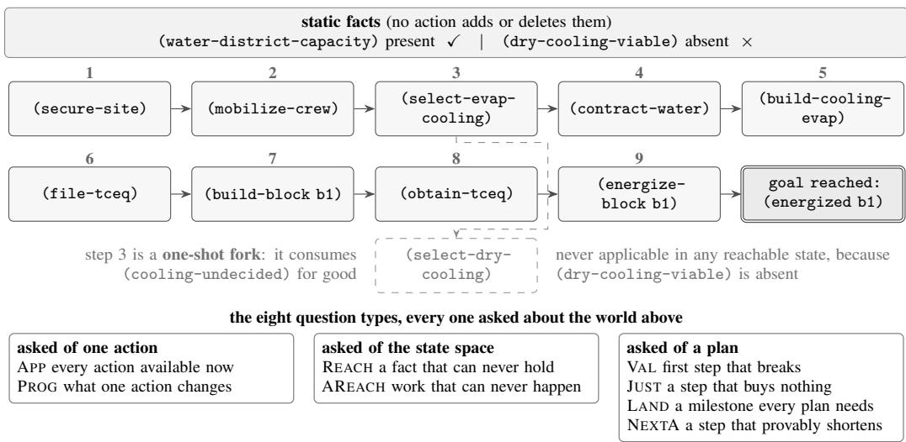
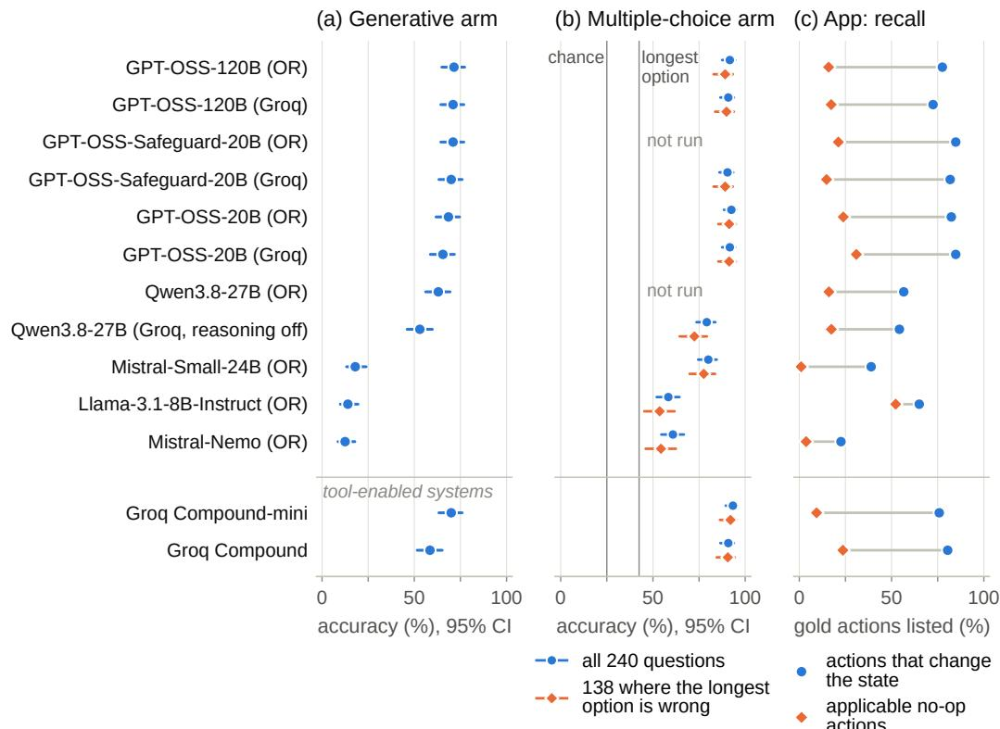
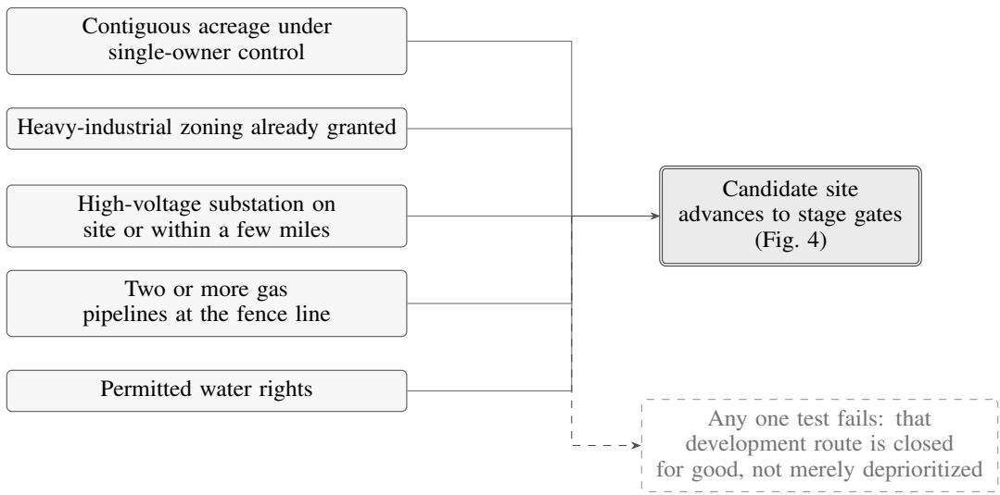
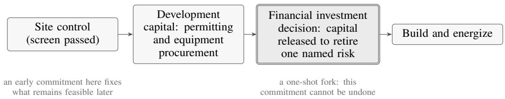

# Watts If? A Benchmark for Counterfactual Reasoning About the AI Data Center Buildout

Pankaj Chouhan ∗ AlphaInfra pankaj.c@alphainfra.ai

Manminder Tomar AlphaInfra manminder.t@alphainfra.ai

Rajarshi Das∗ AlphaInfra rajarshi.das@alphainfra.ai

Sreekar Reddy AlphaInfra sreekar.r@alphainfra.ai

Aditya Dubey AlphaInfra aditya.d@alphainfra.ai

Samta Sharma AlphaInfra samta.s@alphainfra.ai

Satyapragnya Kar∗ New York University sk13001@nyu.edu

PR Panigrahi Envana Software Solutions pr.panigrahi@envana.com

## Abstract

An AI data center is committed years before it draws a watt: a few discrete choices — grid or on-site gas, evaporative or dry cooling, which county to file in — fix its capital, water draw, and carbon path, and LLMs are now asked to help screen them with no test of whether they track what each commitment rules out. We introduce DCBench-440, with two arms reported separately: 200 generative questions over STRIPS worlds for five US deal archetypes, with search-verified gold answers and no tested shortcut above 12.0% on any question type, and 240 multiple-choice questions grounded in quoted site records, emission equations, and stated scenarios. Across open-weight deployments, accuracy spans 12.5–71.5% (generative) and 58.3–92.5% (multiple choice). One skill fails everywhere: asked to list every action available at a decision gate, no model exceeds 4.0% exact match. The strongest list 72–85% of the actions that would change the project’s state but omit most permitted actions that change nothing; with those excused, the best exact match is still 24.0%. Code, data, and other materials are available upon request.

## 1 Introduction

The AI data center buildout is one of the largest capital programs in history, roughly \$7 trillion by 2030, with power and water demand climbing alongside [6, 8, 11, 13, 20, 29]. The hard question is the order of commitments. Take a developer we work with in the US:1 one site plans 550 MW of on-site gas and holds every permit but the air permit; a second needs 750 MW from the grid and is one of seven waiting on the utility; a third is bare land with a gas pipeline across it. On-site gas skips a grid queue where capacity now waits three to seven years [22], but takes on turbines, fuel supply, and emissions permits. Developers are taking that trade: 61% of those surveyed name on-site power their primary strategy when the grid is the bottleneck [4], and 124 GW of on-site gas has been announced for US data centers [5]. The choices that fix a site’s water and carbon path — evaporative or dry cooling, on-site gas or grid — also fix its capital cost and date of first power, so at each gate the question is what a commitment rules out.

Language models are entering this work as screening and diligence aids, and LLM analysis of corporate, policy, and media sources already feeds projections of data-center power demand [7]. A fluent answer is not a plan. A wrong number can be checked; an option the model never mentions — a permit that must come first, a route that a choice forecloses — cannot.

DCBench-440 measures that second kind of failure. It contributes:

• a generative arm applying ACPBench Hard’s eight question types [16] to five US deal archetypes, selected against shortcuts (Section 3.1);

• an independent multiple-choice arm (Section 3.2);

• an evaluation of 11 deployments of 7 open-weight models with intervals, paired tests, settings, and cost (Section 4, Appendix B); and

• a diagnosis of the failure every model shares: exact enumeration of the actions available at a gate, that is, listing every step the project could take next.

## 2 Background and related work

Each generative-arm problem is a STRIPS task [10] written in PDDL [19], $\Pi = \langle F , A , s _ { 0 } , s ^ { \star } \rangle$ with boolean facts $\bar { F } _ { : }$ , states $s \subseteq F$ , an initial state $s _ { 0 } ,$ and a goal $s ^ { \star } . \quad \mathbf { A n }$ action $a =$ $\langle p r e ( a ) , a d d ( a ) , d e l ( a ) \rangle$ applies in s when $p r e ( a ) \subseteq s$ and yields $( s \setminus d e l ( a ) ) \cup a d d ( a )$ ; we call it a no-op in s when that result is s itself. In plain terms, a state is the set of facts that are currently true for a project (for example, whether a permit has been obtained); an action can be taken only when its preconditions hold, and it then makes some facts true and others false. A no-op is an action that is allowed but changes nothing, because its effects already hold. As in ACPBench [15, 16], the model must produce an answer rather than choose one: each prompt gives the world in plain text, the state or plan in question, and two worked examples from a held-out tutorial domain, and a lenient parser and a symbolic validator grade the reply (unparseable counts as wrong).

Related work. PlanBench [27] and critical studies of LLM planning [28] score whole plans on puzzle and logistics domains. ACPBench [15] asks atomic planning questions as yes/no and multiple choice; ACPBench Hard [16] asks open-ended versions of the same tasks, and there GPT-4o, which answers 97% of yes/no and 89% of multiple-choice applicability questions correctly, solves 25% when it must produce the applicable set. Hybrid systems hand planning to a symbolic planner [18] or check LLM proposals with external verifiers [14]; we measure the language model alone, as screening assistants are used today. Generation and verification can come apart in language models [17, 30], and self-verification of plans is unreliable [23]. Multiple-choice scores can reflect option artifacts [3] and position bias [31]; our gold letters are balanced across positions, and we test option length directly.

Data-center planning and AI’s footprint. Data-center siting has been posed as county-level cost optimization [26], geospatial suitability analysis [2], and what-if simulation of sustainable deployment [24]; these compute a decision rather than test a model’s reasoning about one, and a review of 189 ML-assisted site-selection studies lists the absence of benchmark datasets among the field’s main challenges [25]. Work on AI’s environmental cost measures what models themselves consume [1, 21]; question sets on data-center economics test recall or use a model as judge.

## 3 Two arms

## 3.1 The generative arm: five deal archetypes

Each domain, specified with an industry team that develops and underwrites such projects, models one way US data centers get built: btm\_ccgt, a campus on its own gas turbines gated by air permit, gas lateral, and fuel contract; grid\_queue, utility interconnection from screening to security; retrofit, densifying a live site under a feeder budget; gulf\_water, a coastal site whose one-shot cooling fork sets its water draw; and permian\_gas, gensets at well pads (Appendix Table 10). Environmental, regulatory, and financial content enters as structure, not arithmetic: a static fact, which no action adds or deletes — a gas line at the fence, water-district capacity, air-quality nonattainment — closes off part of the action space for good and holds in some instances but not others, giving reachability and landmark [12] questions real answers. Technology choices are one-shot forks, and gated alternative routes (modular units, bridge fuel, rental chillers, prefabricated blocks) vary landmark structure within a domain. These devices mirror how an active origination pipeline screens and stages sites (Appendix A); project metadata is synthetic. Gold answers come from breadth-first search; a question is dropped, not guessed, when search hits its node cap, so worlds stay small. Each domain contributes five questions per type (Table 1), scored 0/1, and a symbolic oracle scoring 100% is a standing test of the grader.

Table 1: The eight generative question types (from ACPBench Hard); h⋆ is the optimal cost.
<table><tr><td>Type</td><td>The question</td><td>Gold answer</td><td>Graded by</td></tr><tr><td>APP</td><td>every action applicable right now</td><td>the full applicable set, no-ops included</td><td>exact set match</td></tr><tr><td>PROG</td><td>what one action adds and deletes</td><td>add(a) and del(a)</td><td>exact set match</td></tr><tr><td>REACH</td><td>a fact that can never hold</td><td>facts in no reachable state</td><td>membership</td></tr><tr><td>AREACH</td><td>an action that can never apply</td><td>actions applicable in no reachable state</td><td>membership</td></tr><tr><td>VAL JUST</td><td>the first step of a plan that breaks a plan step that buys nothing</td><td>index of the first inapplicable action actions whose removal leaves a</td><td>exact index simulate the</td></tr><tr><td></td><td></td><td>valid plan</td><td>shortened plan</td></tr><tr><td>LAND NEXTA</td><td>a milestone every plan must pass a step that provably shortens the</td><td>landmark facts of the instance actions that reduce h*</td><td>membership membership</td></tr></table>

  
Figure 1: A one-block world of the gulf\_water domain and the eight generative-arm questions asked about it (benchmark instances have two or three blocks, and some add rental-chiller or prefabricatedblock routes). The nine numbered pills are an optimal plan, read left to right and wrapping to the second row. Because the static fact (dry-cooling-viable) is absent, the dry-cooling branch is dead forever: only two actions apply at the start, (cooling-dry-selected) can never hold, and (water-contracted) is a landmark in this instance though it would not be if dry cooling were viable. The statics, not the wording, decide the answer.

A worked example. Figure 1 shows a small world of the gulf\_water domain, an optimal plan through it, and the eight generative-arm questions asked of it. The point of the example is the static fact (dry-cooling-viable): because it is absent in this instance, the dry-cooling branch is dead from the start, and that single fact decides the gold answer to the applicability, reachability, and landmark questions.

Selected against shortcuts. Planning questions invite shortcuts: a question can sometimes be answered from surface patterns in the prompt, without simulating the world. We therefore use worlds large enough to resist such patterns (24,659 reachable states on average) yet small enough for exact search, estimate for every candidate question the chance that the best cheap strategy is credited, and keep the least guessable. Scored through the same parser and validators, no world-model-free strategy we tested exceeds 12.0% on any question type (Appendix Table 3).

## 3.2 The multiple-choice arm: source-grounded questions

The second arm comes from two separately authored 120-question banks over six content buckets: environmental impact, power infrastructure, AI workload, financial and siting decisions, cross-domain, and permitting. Each question carries one of eight skill labels; four share a name with a generative type, but none is the same task: multiple-choice applicability asks which stated option complies with a stated limit, not which actions are available. A question’s context block holds every fact it needs: the first bank quotes a 1,677-row database of real US sites, published emission equations, vendor calculators, and industry reports; the second states self-contained scenario assumptions in five buckets and quotes the site database in the sixth. Models answer zero-shot with one letter, graded by exact match. Picking the longest option with the question unread scores 42.5% (chance: 25%), so we also report the 138 questions where the longest option is wrong. As the arms differ in content, skill definitions, prompting, and grading, we report them separately and read any gap between them as descriptive, not as a format effect.

## 4 Results

We evaluate 11 deployments of 7 open-weight models on Groq and OpenRouter at temperature 0, without fine-tuning or tools (settings, tokens, and cost in Appendix Table 9; OpenRouter charged \$2.00 for both arms). Serving GPT-OSS through either provider moves generative accuracy by 0.5–3.0 points $( p \ge 0 . 3 6 ) $ ; Qwen3.8-27B differs by 10.0 points $( p = 0 . 0 1 0 )$ , but Groq runs it with reasoning off and OpenRouter with it on; Qwen3.6-27B, with the same mismatch, is held out pending a matched re-run. Groq Compound and Compound-mini are hosted systems, not open-weight models, and ran with server-side tools on — Compound’s traces show tool calls, chiefly Python, in 128/200 generative and 82/240 multiple-choice answers (Compound-mini: 1 and 3) — so we report them apart. Multiple-choice runs exist for 9 of the 11 open-weight deployments.

Per-arm accuracy. Each deployment gave one scored answer per question, so we report accuracy with 95% Wilson intervals, which stay reliable near 0 and 100%, and compare deployments with exact McNemar tests, which use only the questions on which exactly one of the two is correct. The 95% intervals span ±4.6–6.9 points on the generative arm and ±3.4–6.2 on multiple choice (Figure 2a–b, Appendix Table 2), and neither arm has a meaningful leader: the six GPT-OSS deployments (65.5– 71.5%) are not significantly different from the best on the generative arm (exact McNemar, $p \geq 0 . 0 5 )$ nor are the five with multiple-choice runs (90.4–92.5%) on the other. The three weakest models nearly fail the generative arm (12.5–18.0%) while scoring 58.3–80.0% on multiple choice. Strong multiple-choice scores do not rest on option length: where the longest option is wrong, the GPT-OSS deployments score 89.1–91.3%, while weaker ones lose 2.5–6.7 points.

One shared failure: listing what can be done next. Asked for every action applicable in a state, no deployment exceeds 4.0% exact match (a reply counts only if the listed set equals the gold set), and 10 of the 11 open-weight deployments score 0.0% (Appendix Table 7). Gold sets average 20.5 actions, and 66% of their members are no-ops, which the prompt explicitly says to include. Figure 2c separates the two kinds: the six GPT-OSS deployments list 72–85% of the gold actions that would change the state but only 15–31% of the no-ops, which make up 85–91% of everything they omit, at precision 0.84–0.94. The convention is not the whole failure: they still miss 15–28% of the state-changing actions, and scored without no-ops on either side, the best exact match is 24.0%. Errors are rarely formatting: at most 5 of 200 answers per stronger deployment are unparseable, ungrounded, or truncated (up to 48 for the weakest, mostly naming facts or actions that do not exist; Appendix Table 8).

Partial credit needs a baseline. Listing every grounded action without reading the state scores F1 0.71 and Jaccard 0.56, above every model (best 0.61 and 0.47), and clears Jaccard 0.5 on 80% of questions; only exact match and high thresholds reject it (Jaccard $\ge 0 . 8 \colon 0 \%$ against 12.0% for the best model). We therefore report exact match, precision (the share of listed actions that are applicable), and recall (the share of applicable actions that are listed).

  
Figure 2: Per-arm results. Each row is one deployment. In (a) and (b), a marker is its accuracy and the bar through it the 95% Wilson interval. (a) Generative arm. (b) Multiple-choice arm: all 240 questions (circles) and the 138 where the longest option is wrong (diamonds); lines mark chance and the longest option. (c) Generative APP: share of gold actions listed that change the state (circles) or are no-ops (diamonds). Below the line: Groq Compound systems, tools on. OR: OpenRouter.

What the two arms do and do not show. Every deployment scores higher on multiple choice, but the arms differ in content and grading, and multiple-choice applicability (75.9–96.6%) checks compliance, not enumeration: the gap is not a format effect. It does show that high accuracy on source-grounded multiple choice does not imply the ability to enumerate a gate (the open-weight deployments above 90% there score 0.0% on exact enumeration). Posing the same gate in each format is next.

## 5 Limitations, impact, and pathway to climate impact

Limitations.

• Worlds are small so that search stays exact, their metadata is synthetic, and five archetypes are a narrow base (a sixth is paused for rework).

• Each deployment answered once, and temperature 0 was not deterministic on these APIs.

• We test no frontier closed models, have no human baseline, and lack multiple-choice runs for two deployments.

Pathway to climate impact. DCBench-440 scores no emissions or water quantities, and we do not claim that better planning lowers emissions by itself. A site’s water draw and emissions are set by a few early, irreversible choices — the cooling fork, the power pathway, the permits that gate them — now often screened with LLM help. On the power pathway alone, at least 74 gas plants proposed to serve US data centers directly would emit nearly 662 million tons of greenhouse gases a year [9]. An assistant that omits available options shrinks the set a developer weighs; omission is the failure we find in every model, and measuring it is a precondition for trusting such tools. Next, we will attach water and emissions quantities to each world’s branches so an omission can be weighted by what it forecloses.

Dual use and value beyond data centers. The benchmark is technology-neutral — a better planner can speed a gas-fired build as readily as a dry-cooled or grid-tied one — and a fixed test set can be optimized against, so worlds are regenerated. Beyond data centers, the diagnosis applies to any agent that must enumerate its options.

Availability. Code, data, and other materials are available from the authors upon request.

## References

[1] Miriam Aczel, Sanaz Chamanara, Mir Matin, Aida Farsi, Tshilidzi Marwala, and Kaveh Madani. Environmental cost of AI’s energy use: Carbon, water and land footprints. Technical report, United Nations University Institute for Water, Environment and Health (UNU-INWEH), Richmond Hill, Ontario, Canada, 2026. URL https://inweh.unu.edu/publications.

[2] Mariam Arzumanyan, Edna Rodriguez Calzado, Ning Lin, Vaibhav Bahadur, Jani Das, Tingwei Lucy Ko, and Lars Koesterke. Geospatial suitability analysis for data center placement: A case study in Texas, USA. Sustainable Cities and Society, 131:106687, 2025. doi: 10.1016/j.scs.2025.106687. URL https://doi.org/10.1016/j.scs.2025.106687.

[3] Nishant Balepur, Abhilasha Ravichander, and Rachel Rudinger. Artifacts or abduction: How do LLMs answer multiple-choice questions without the question? In Lun-Wei Ku, Andre Martins, and Vivek Srikumar, editors, Proceedings ofthe 62nd Annual Meeting ofthe Associationfor Computational Linguistics (Volume 1: Long Papers), ACL 2024, Bangkok, Thailand, August 11-16, 2024, pages 10308–10330. Association for Computational Linguistics, 2024. doi: 10.18653/v1/2024.acl-long.555. URL https://aclanthology.org/2024.acl-long.555/.

[4] Bloom Energy. 2026 data center power report: The new realities shaping AI buildout, mid-year pulse. Technical report, Bloom Energy, June 2026. URL https://www.bloomenergy.com/wp-content/ uploads/power-report-2026-mid-year-pulse-final.pdf.

[5] BloombergNEF. Six things to know about BNEF’s new US data center capacity outlook. BloombergNEF Insights, July 2026. URL https://about.bnef.com/insights/data-centers/ six-things-to-know-about-bnefs-new-us-data-center-capacity-outlook/.

[6] CBRE. North America data center trends. Technical report, CBRE, 2024. URL https://www.cbre.com/insights/reports/north-america-data-center-trends.

[7] Danbo Chen, Zijun Zhou, Yongyang Cai, Jiahong Qin, Ani L. Katchova, and Lei Chen. Artificial intelligence data centers could reach one percent of global electricity demand by 2030. Communications Sustainability, 1:147, 2026. doi: 10.1038/s44458-026-00152-5. URL https://doi.org/10.1038/s44458-026-00152-5.

[8] Electric Power Research Institute. Powering Intelligence: Analyzing artificial intelligence and data center energy consumption. Technical Report 3002028905, Electric Power Research Institute, Palo Alto, CA, 2024. URL https://www.epri.com/research/products/3002028905.

[9] Environmental Integrity Project. The power behind AI. Technical report, Environmental Integrity Project, July 2026. URL https://environmentalintegrity.org/reports/the-power-behind-ai/.

[10] Richard E. Fikes and Nils J. Nilsson. STRIPS: A new approach to the application of theorem proving to problem solving. Artificial Intelligence, 2(3-4):189–208, 1971. ISSN 0004-3702. doi: 10.1016/0004-3702(71)90010-5. URL http://dx.doi.org/10.1016/0004-3702(71)90010-5.

[11] Goldman Sachs Research. Generational growth: AI, data centers and the coming US power demand surge. Technical report, Goldman Sachs, 2024. URL https://www.goldmansachs.com/insights/pages/ generational-growth-ai-data-centers-and-the-coming-us-power-surge.html.

[12] J. Hoffmann, J. Porteous, and L. Sebastia. Ordered landmarks in planning. Journal ofArtificial Intelligence Research, 22:215–278, 2004. ISSN 1076-9757. doi: 10.1613/jair.1492. URL http://dx.doi.org/10.1613/jair.1492.

[13] International Energy Agency. Energy and AI. Technical report, International Energy Agency, Paris, 2025. URL https://www.iea.org/reports/energy-and-ai.

[14] Subbarao Kambhampati, Karthik Valmeekam, Lin Guan, Mudit Verma, Kaya Stechly, Siddhant Bhambri, Lucas Saldyt, and Anil Murthy. Position: LLMs can’t plan, but can help planning in LLM-modulo frameworks. In Ruslan Salakhutdinov, Zico Kolter, Katherine Heller, Adrian Weller, Nuria Oliver, Jonathan Scarlett, and Felix Berkenkamp, editors, Proceedings ofthe 41st International Conference on Machine Learning, ICML 2024, Vienna, Austria, July 21-27, 2024, volume 235 of Proceedings ofMachine Learning Research, pages 22895–22907. PMLR, 2024. URL https://proceedings.mlr.press/v235/kambhampati24a.html.

[15] Harsha Kokel, Michael Katz, Kavitha Srinivas, and Shirin Sohrabi. ACPBench: Reasoning about action, change, and planning. In Toby Walsh, Julie Shah, and Zico Kolter, editors, Thirty-Ninth AAAI Conference on Artificial Intelligence, AAAI 2025, Philadelphia, PA, USA, February 25 - March 4, 2025, pages 26559–26568. AAAI Press, 2025. doi: 10.1609/AAAI.V39I25.34857. URL https://doi.org/10.1609/aaai.v39i25.34857.

[16] Harsha Kokel, Michael Katz, Kavitha Srinivas, and Shirin Sohrabi. ACPBench Hard: Unrestrained reasoning about action, change, and planning. In The Fourteenth International Conference on Learning Representations, ICLR 2026, Rio de Janeiro, Brazil, April 23-27, 2026, pages 98938–98966, 2026. URL https://openreview.net/forum?id=WIXohR7mEo.

[17] Xiang Lisa Li, Vaishnavi Shrivastava, Siyan Li, Tatsunori Hashimoto, and Percy Liang. Benchmarking and improving generator-validator consistency of language models. In The Twelfth International Conference on Learning Representations, ICLR 2024, Vienna, Austria, May 7-11, 2024, pages 44038–44055, 2024. URL https://openreview.net/forum?id=phBS6YpTzC.

[18] Bo Liu, Yuqian Jiang, Xiaohan Zhang, Qiang Liu, Shiqi Zhang, Joydeep Biswas, and Peter Stone. LLM+P: Empowering large language models with optimal planning proficiency. arXiv preprint arXiv:2304.11477, 2023. doi: 10.48550/arXiv.2304.11477. URL https://arxiv.org/abs/2304.11477.

[19] Drew McDermott, Malik Ghallab, Adele Howe, Craig Knoblock, Ashwin Ram, Manuela Veloso, Daniel Weld, and David Wilkins. PDDL — The Planning Domain Definition Language. Technical Report CVC TR-98-003/DCS TR-1165, Yale Center for Computational Vision and Control, 1998. URL https://www.academia.edu/23178990/PDDL\_The\_Planning\_Domain\_Definition\_Language.

[20] McKinsey & Company. The cost of compute: A \$7 trillion race to scale data centers. Technical report, McKinsey & Company, 2025. URL https://www.mckinsey.com/industries/ technology-media-and-telecommunications/our-insights/ the-cost-of-compute-a-7-trillion-dollar-race-to-scale-data-centers.

[21] David A. Patterson, Joseph Gonzalez, Quoc V. Le, Chen Liang, Lluis-Miquel Munguia, Daniel Rothchild, David R. So, Maud Texier, and Jeff Dean. Carbon emissions and large neural network training. CoRR, abs/2104.10350, 2021. URL https://arxiv.org/abs/2104.10350.

[22] Joseph Rand, Anna Cheyette, Chris Talley, Steven Zhang, Will Gorman, Ryan H. Wiser, Joachim Seel, Seongeun Jeong, and Fredrich Kahrl. Queued Up: 2026 Edition, characteristics of power plants seeking transmission interconnection as of the end of 2025. Technical report, Lawrence Berkeley National Laboratory, 2026. URL https://emp.lbl.gov/queues.

[23] Kaya Stechly, Karthik Valmeekam, and Subbarao Kambhampati. On the self-verification limitations of large language models on reasoning and planning tasks. In The Thirteenth International Conference on Learning Representations, ICLR 2025, Singapore, April 24-28, 2025, pages 98190–98243, 2025. URL https://openreview.net/forum?id=4O0v4s3IzY.

[24] Nicoletta Tsiopani, Moysis Symeonides, George Pallis, and Marios D. Dikaiakos. InFactPlanner: Planning sustainable geo-distributed LLM data centers. In 34th International Symposium on the Modeling, Analysis, and Simulation ofComputer and Telecommunication Systems, MASCOTS 2026, 2026. URL https://arxiv.org/abs/2608.12915.

[25] Disha Upadhyay, Anuj Kumar, Sangeeta Pant, Ketan Kotecha, and Ajith Abraham. Machine learning assisted multi-criteria decision-making approaches for site selection: A systematic review. MethodsX, 17: 104007, 2026. doi: 10.1016/j.mex.2026.104007. URL https://doi.org/10.1016/j.mex.2026.104007.

[26] Maria Vabson, Muhy Eddin Zater, Amir Sajadi, Kyri Baker, and Bri-Mathias Hodge. Optimal county-level siting of data centers in the United States. arXiv preprint arXiv:2601.16315, 2026. doi: 10.48550/arXiv.2601.16315. URL https://arxiv.org/abs/2601.16315.

[27] Karthik Valmeekam, Matthew Marquez, Alberto Olmo Hernandez, Sarath Sreedharan, and Subbarao Kambhampati. PlanBench: An extensible benchmark for evaluating large language models on planning and reasoning about change. In Alice Oh, Tristan Naumann, Amir Globerson, Kate Saenko, Moritz Hardt, and Sergey Levine, editors, Advances in Neural Information Processing Systems 36: Annual Conference on Neural Information Processing Systems 2023, NeurIPS 2023, New Orleans, LA, USA, December 10 - 16, 2023, 2023. URL http://papers.nips.cc/paper\_files/paper/2023/hash/ 7a92bcdede88c7afd108072faf5485c8-Abstract-Datasets\_and\_Benchmarks.html.

[28] Karthik Valmeekam, Matthew Marquez, Sarath Sreedharan, and Subbarao Kambhampati. On the planning abilities of large language models - A critical investigation. In Alice Oh, Tristan Naumann, Amir Globerson, Kate Saenko, Moritz Hardt, and Sergey Levine, editors, Advances in Neural Information Processing Systems 36: Annual Conference on Neural Information Processing Systems 2023, NeurIPS 2023, New Orleans, LA, USA, December 10 - 16, 2023, pages 75993–76005, 2023. doi: 10.52202/075280-3320. URL https://proceedings.neurips.cc/paper\_files/paper/2023/ hash/efb2072a358cefb75886a315a6fcf880-Abstract-Conference.html.

[29] Stijn Van Nieuwerburgh. Financing the AI buildout. Working Paper 35865, National Bureau of Economic Research, 2026. URL https://www.nber.org/papers/w35865.

[30] Peter West, Ximing Lu, Nouha Dziri, Faeze Brahman, Linjie Li, Jena D. Hwang, Liwei Jiang, Jillian Fisher, Abhilasha Ravichander, Khyathi Raghavi Chandu, Benjamin Newman, Pang Wei Koh, Allyson Ettinger, and Yejin Choi. The generative AI paradox: “What It Can Create, It May Not Understand”. In The Twelfth International Conference on Learning Representations, ICLR 2024, Vienna, Austria, May 7-11, 2024, pages 47159–47187, 2024. URL https://openreview.net/forum?id=CF8H8MS5P8.

[31] Chujie Zheng, Hao Zhou, Fandong Meng, Jie Zhou, and Minlie Huang. Large language models are not robust multiple choice selectors. In The Twelfth International Conference on Learning Representations, ICLR 2024, Vienna, Austria, May 7-11, 2024, pages 19426–19454, 2024. URL https://openreview.net/forum?id=shr9PXz7T0.

## A Screening funnel and stage-gate schematic

Section 3.1 notes that the generative arm’s static facts, one-shot forks, and landmarks are not chosen for formal convenience: they mirror how an active U.S. origination pipeline actually screens and sequences a site. We reviewed that pipeline’s screening and staging materials in confidence, and we do not reproduce them here; this appendix instead schematizes, at the same level of generality already stated in Section 3.1, the two-stage process that motivated our domain design. No confidential thresholds, company names, or deal-specific figures appear below or anywhere else in this paper.

Figure 3 shows the first stage: a candidate site is screened against a small set of threshold tests, each of which is a static fact in our domains because it either holds or does not and, when it fails, removes a route rather than merely lowering a score. Figure 4 shows the second stage: a site that clears the screen still moves through an ordered sequence of commitments, and the financial investment decision is the one-shot fork in this sequence — capital is released to retire a single named risk, and that choice is what our domains encode as a consumable resource being spent for good rather than as a number going up.

  
Figure 3: The screening stage. Each threshold test is a static fact: it is true or false for a given site and no later action changes it. Passing requires every test to hold at once, so failing even one removes a route permanently — the same behavior our static predicates encode in the generative-arm domains (Section 3.1).

  
Figure 4: The staging stage. A site that clears Figure 3 still moves through an ordered chain of commitments rather than a single go/no-go decision. The financial investment decision is a one-shot fork in our domains: the resource it spends (capital committed against a named risk) cannot be recovered by a later action, which is why an early stage gate can foreclose options several stages downstream.

## B Extended results

Every table in this appendix is generated by a script from the stored model responses, rescored through the benchmark’s own parser and validators and checked against the committed score files; no number is typed by hand. Table 2 gives each arm with intervals and paired tests; Tables 3 and 4 break the generative arm down by question type and domain, with the shortcut baselines; Tables 5 and 6 do the same for the multiple-choice arm; Table 7 details applicability; Table 8 classifies every generative answer; Table 9 gives inference settings, tokens, cost, and tool use; and Table 10 gives domain sizes.

Table 2: Accuracy (%) on each arm with 95% Wilson intervals. p: exact McNemar test against the best open-weight deployment on that arm (paired by question). OR: OpenRouter. LO-wrong: the 138 multiple-choice questions on which the longest option is not the answer. Bank 1 and Bank 2 are the two independently authored 120-question banks. The arms differ in content, skills, prompting, and grading, so the two columns are not a format comparison. “Not run”: no multiple-choice run exists for that deployment.
<table><tr><td rowspan="2">Deployment</td><td colspan="3">Generative (200)</td><td colspan="3">Multiple choice (240)</td><td rowspan="2">LO-wrong (138)</td><td rowspan="2">Bank 1 (120)</td><td rowspan="2">Bank 2 (120)</td></tr><tr><td>Acc.</td><td>95%CI</td><td>p</td><td>Acc.</td><td>95% CI</td><td>p</td></tr><tr><td>Symbolic oracle</td><td>100.0</td><td>[98.1, 100.0]</td><td></td><td></td><td></td><td>一</td><td>1</td><td></td><td></td></tr><tr><td>GPT-OSS-120B (OR)</td><td>71.5</td><td>[64.9, 77.3]</td><td></td><td>91.7</td><td>[87.5, 94.5]</td><td>0.754</td><td>89.1</td><td>95.0</td><td>88.3</td></tr><tr><td>GPT-OSS-120B (Groq)</td><td>71.0</td><td>[64.4, 76.8]</td><td>1.000</td><td>90.8</td><td>[86.5, 93.9]</td><td>0.344</td><td>89.9</td><td>93.3</td><td>88.3</td></tr><tr><td>GPT-OSS-Safeguard-20B (OR)</td><td>71.0</td><td>[64.4, 76.8]</td><td>1.000</td><td></td><td></td><td>not run</td><td></td><td></td><td></td></tr><tr><td>GPT-OSS-Safeguard-20B (Groq)</td><td>70.0</td><td>[63.3, 75.9]</td><td>0.749</td><td>90.4</td><td>[86.0, 93.5]</td><td>0.180</td><td>89.1</td><td>91.7</td><td>89.2</td></tr><tr><td>GPT-OSS-20B (OR)</td><td>68.5</td><td>[61.8, 74.5]</td><td>0.345</td><td>92.5</td><td>[88.5, 95.2]</td><td></td><td>91.3</td><td>93.3</td><td>91.7</td></tr><tr><td>GPT-OSS-20B (Groq)</td><td>65.5</td><td>[58.7, 71.7]</td><td>0.096</td><td>91.7</td><td>[87.5, 94.5]</td><td>0.688</td><td>91.3</td><td>93.3</td><td>90.0</td></tr><tr><td>Qwen3.8-27B (OR)</td><td>63.0</td><td>[56.1, 69.4]</td><td>0.019</td><td></td><td></td><td>not run</td><td></td><td></td><td></td></tr><tr><td>Qwen3.8-27B (Groq)</td><td>53.0</td><td>[46.1, 59.8]</td><td>&lt;0.001</td><td>79.2</td><td>[73.6, 83.8]</td><td>&lt;0.001</td><td>72.5</td><td>80.8</td><td>77.5</td></tr><tr><td>Mistral-Small-24B (OR)</td><td>18.0</td><td>[13.3, 23.9]</td><td>&lt;0.001</td><td>80.0</td><td>[74.5, 84.6]</td><td>&lt;0.001</td><td>77.5</td><td>80.8</td><td>79.2</td></tr><tr><td>Llama-3.1-8B-Instruct (OR)</td><td>14.0</td><td>[9.9, 19.5]</td><td>&lt;0.001</td><td>58.3</td><td>[52.0, 64.4]</td><td>&lt;0.001</td><td>53.6</td><td>50.0</td><td>66.7</td></tr><tr><td>Mistral-Nemo (OR)</td><td>12.5</td><td>[8.6, 17.8]</td><td>&lt;0.001</td><td>60.8</td><td>[54.5, 66.8]</td><td>&lt;0.001</td><td>54.3</td><td>62.5</td><td>59.2</td></tr><tr><td colspan="10">Tool-enabled systems (server-side tools on; not open-weight)</td></tr><tr><td>Groq Compound-mini</td><td>70.0</td><td>[63.3, 75.9]</td><td></td><td>93.3</td><td>[89.4, 95.9]</td><td></td><td>92.0</td><td>95.8</td><td>90.8</td></tr><tr><td>Groq Compound</td><td>58.5</td><td>[51.6, 65.1]</td><td></td><td>90.8</td><td>[86.5, 93.9]</td><td>一</td><td>90.6</td><td>93.3</td><td>88.3</td></tr><tr><td>Chance</td><td>一</td><td>一</td><td></td><td>25.0</td><td></td><td>一</td><td></td><td></td><td></td></tr><tr><td>Longest option, question unread</td><td></td><td></td><td></td><td>42.5</td><td></td><td></td><td>0.0</td><td>34.2</td><td>50.8</td></tr></table>

Table 3: Generative-arm accuracy (%) by question type, 25 questions per type, so each cell carries a 95% interval of up to ±19 points. Best shortcut: the highest accuracy any world-model-free strategy reaches through the same parser and validators (for APP: listing every grounded action). Shortcut bound: the generator’s analytic upper bound on guessing, used to select the least guessable questions.
<table><tr><td>Deployment</td><td>APP</td><td>PROG</td><td>REACH</td><td>AREACH</td><td>VAL</td><td>JuST</td><td>LAND</td><td>NEXTA</td></tr><tr><td>Symbolic oracle</td><td>100.0</td><td>100.0</td><td>100.0</td><td>100.0</td><td>100.0</td><td>100.0</td><td>100.0</td><td>100.0</td></tr><tr><td>GPT-OSS-120B (OR)</td><td>0.0</td><td>88.0</td><td>96.0</td><td>48.0</td><td>76.0</td><td>100.0</td><td>80.0</td><td>84.0</td></tr><tr><td>GPT-OSS-120B (Groq)</td><td>0.0</td><td>92.0</td><td>92.0</td><td>36.0</td><td>88.0</td><td>100.0</td><td>84.0</td><td>76.0</td></tr><tr><td>GPT-OSS-Safeguard-20B (OR)</td><td>0.0</td><td>96.0</td><td>96.0</td><td>48.0</td><td>100.0</td><td>100.0</td><td>60.0</td><td>68.0</td></tr><tr><td>GPT-OSS-Safeguard-20B (Groq)</td><td>0.0</td><td>96.0</td><td>96.0</td><td>52.0</td><td>92.0</td><td>88.0</td><td>68.0</td><td>68.0</td></tr><tr><td>GPT-OSS-20B (OR)</td><td>0.0</td><td>84.0</td><td>96.0</td><td>36.0</td><td>96.0</td><td>100.0</td><td>60.0</td><td>76.0</td></tr><tr><td>GPT-OSS-20B (Groq)</td><td>0.0</td><td>92.0</td><td>88.0</td><td>20.0</td><td>92.0</td><td>88.0</td><td>72.0</td><td>72.0</td></tr><tr><td>Qwen3.8-27B (OR)</td><td>4.0</td><td>72.0</td><td>92.0</td><td>64.0</td><td>48.0</td><td>100.0</td><td>48.0</td><td>76.0</td></tr><tr><td>Qwen3.8-27B (Groq)</td><td>0.0</td><td>80.0</td><td>72.0</td><td>44.0</td><td>80.0</td><td>64.0</td><td>16.0</td><td>68.0</td></tr><tr><td>Mistral-Small-24B (OR)</td><td>0.0</td><td>20.0</td><td>24.0</td><td>48.0</td><td>8.0</td><td>0.0</td><td>0.0</td><td>44.0</td></tr><tr><td>Llama-3.1-8B-Instruct (OR)</td><td>0.0</td><td>8.0</td><td>44.0</td><td>28.0</td><td>20.0</td><td>4.0</td><td>0.0</td><td>8.0</td></tr><tr><td>Mistral-Nemo (OR)</td><td>0.0</td><td>28.0</td><td>8.0</td><td>8.0</td><td>20.0</td><td>24.0</td><td>0.0</td><td>12.0</td></tr><tr><td colspan="9">Tool-enabled systems (server-side tools on; not open-weight)</td></tr><tr><td>Groq Compound-mini</td><td>0.0</td><td>92.0</td><td>100.0</td><td>32.0</td><td>80.0</td><td>96.0</td><td>80.0</td><td>80.0</td></tr><tr><td>Groq Compound</td><td>4.0</td><td>60.0</td><td>84.0</td><td>28.0</td><td>88.0</td><td>80.0</td><td>68.0</td><td>56.0</td></tr><tr><td>Best shortcut (measured)</td><td>0.0</td><td>0.0</td><td>8.0</td><td>0.0</td><td>12.0</td><td>4.0</td><td>12.0</td><td>0.0</td></tr><tr><td>Shortcut bound (guess_p)</td><td>0.0</td><td>0.0</td><td>29.2</td><td>18.3</td><td>8.4</td><td>4.9</td><td>21.8</td><td>11.1</td></tr></table>

Table 4: Generative-arm accuracy (%) by domain, 40 questions per domain.
<table><tr><td>Deployment</td><td>btm_ccgt</td><td>grid_queue</td><td>retrofit</td><td>gulf_water</td><td>permian_gas</td></tr><tr><td>GPT-OSS-120B (OR)</td><td>77.5</td><td>80.0</td><td>70.0</td><td>65.0</td><td>65.0</td></tr><tr><td>GPT-OSS-120B (Groq)</td><td>75.0</td><td>80.0</td><td>70.0</td><td>62.5</td><td>67.5</td></tr><tr><td>GPT-OSS-Safeguard-20B (OR)</td><td>77.5</td><td>67.5</td><td>75.0</td><td>70.0</td><td>65.0</td></tr><tr><td>GPT-OSS-Safeguard-20B (Groq)</td><td>77.5</td><td>67.5</td><td>67.5</td><td>70.0</td><td>67.5</td></tr><tr><td>GPT-OSS-20B (OR)</td><td>72.5</td><td>75.0</td><td>65.0</td><td>62.5</td><td>67.5</td></tr><tr><td>GPT-OSS-20B (Groq)</td><td>72.5</td><td>62.5</td><td>70.0</td><td>55.0</td><td>67.5</td></tr><tr><td>Qwen3.8-27B (OR)</td><td>75.0</td><td>62.5</td><td>70.0</td><td>45.0</td><td>62.5</td></tr><tr><td>Qwen3.8-27B (Groq)</td><td>52.5</td><td>62.5</td><td>55.0</td><td>42.5</td><td>52.5</td></tr><tr><td>Mistral-Small-24B (OR)</td><td>32.5</td><td>10.0</td><td>20.0</td><td>22.5</td><td>5.0</td></tr><tr><td>Llama-3.1-8B-Instruct (OR)</td><td>10.0</td><td>7.5</td><td>10.0</td><td>17.5</td><td>25.0</td></tr><tr><td>Mistral-Nemo (OR)</td><td>5.0</td><td>15.0</td><td>10.0</td><td>17.5</td><td>15.0</td></tr><tr><td colspan="6">Tool-enabled systems (server-side tools on; not open-weight)</td></tr><tr><td>Groq Compound-mini</td><td>72.5</td><td>67.5</td><td>70.0</td><td>70.0</td><td>70.0</td></tr><tr><td>Groq Compound</td><td>62.5</td><td>50.0</td><td>60.0</td><td>52.5</td><td>67.5</td></tr></table>

Table 5: Multiple-choice accuracy (%) by skill label, pooled over both banks (questions per skill in the header). Only App, Prog, Reach, and Val share a name with a generative question type, and none is the same task: multiple-choice App asks which stated option complies with a stated limit.
<table><tr><td>Deployment</td><td>App (29)</td><td>ConsRec (34)</td><td>Inv (29)</td><td>Prog (38)</td><td>Reach (24)</td><td>Temp (24)</td><td>Trade (41)</td><td>Val (21)</td></tr><tr><td>GPT-OSS-120B (OR)</td><td>93.1</td><td>94.1</td><td>93.1</td><td>78.9</td><td>95.8</td><td>95.8</td><td>100.0</td><td>81.0</td></tr><tr><td>GPT-OSS-120B (Groq)</td><td>89.7</td><td>94.1</td><td>93.1</td><td>81.6</td><td>87.5</td><td>95.8</td><td>100.0</td><td>81.0</td></tr><tr><td>GPT-OSS-Safeguard-20B (OR)</td><td></td><td></td><td></td><td>not run</td><td></td><td></td><td></td><td></td></tr><tr><td>GPT-OSS-Safeguard-20B (Groq)</td><td>96.6</td><td>94.1</td><td>89.7</td><td>78.9</td><td>87.5</td><td>91.7</td><td>97.6</td><td>85.7</td></tr><tr><td>GPT-OSS-20B (OR)</td><td>96.6</td><td>94.1</td><td>93.1</td><td>81.6</td><td>87.5</td><td>100.0</td><td>100.0</td><td>85.7</td></tr><tr><td>GPT-OSS-20B (Groq)</td><td>93.1</td><td>94.1</td><td>93.1</td><td>84.2</td><td>83.3</td><td>95.8</td><td>100.0</td><td>85.7</td></tr><tr><td>Qwen3.8-27B (OR)</td><td></td><td></td><td></td><td>not run</td><td></td><td></td><td></td><td></td></tr><tr><td>Qwen3.8-27B (Groq)</td><td>93.1</td><td>100.0</td><td>55.2</td><td>63.2</td><td>95.8</td><td>66.7</td><td>80.5</td><td>81.0</td></tr><tr><td>Mistral-Small-24B (OR)</td><td>86.2</td><td>94.1</td><td>48.3</td><td>76.3</td><td>95.8</td><td>75.0</td><td>82.9</td><td>81.0</td></tr><tr><td>Llama-3.1-8B-Instruct (OR)</td><td>75.9</td><td>67.6</td><td>31.0</td><td>39.5</td><td>70.8</td><td>58.3</td><td>70.7</td><td>52.4</td></tr><tr><td>Mistral-Nemo (OR)</td><td>79.3</td><td>76.5</td><td>27.6</td><td>47.4</td><td>62.5</td><td>83.3</td><td>61.0</td><td>52.4</td></tr><tr><td colspan="9">Tool-enabled systems (server-side tools on; not open-weight)</td></tr><tr><td>Groq Compound-mini</td><td>89.7</td><td>97.1</td><td>93.1</td><td>92.1</td><td>91.7</td><td>95.8</td><td>97.6</td><td>85.7</td></tr><tr><td>Groq Compound</td><td>89.7</td><td>91.2</td><td>93.1</td><td>84.2</td><td>87.5</td><td>91.7</td><td>97.6</td><td>90.5</td></tr></table>

Table 6: Multiple-choice accuracy (%) by content bucket, 40 questions per bucket.
<table><tr><td>Deployment</td><td>Env.</td><td>Power</td><td>AI wkld.</td><td>Fin./siting</td><td>Cross</td><td>Permit</td></tr><tr><td>GPT-OSS-120B (OR)</td><td>92.5</td><td>97.5</td><td>85.0</td><td>97.5</td><td>85.0</td><td>92.5</td></tr><tr><td>GPT-OSS-120B (Groq)</td><td>90.0</td><td>95.0</td><td>82.5</td><td>97.5</td><td>87.5</td><td>92.5</td></tr><tr><td>GPT-OSS-Safeguard-20B (OR)</td><td></td><td></td><td>not run</td><td></td><td></td><td></td></tr><tr><td>GPT-OSS-Safeguard-20B (Groq)</td><td>87.5</td><td>97.5</td><td>82.5</td><td>97.5</td><td>82.5</td><td>95.0</td></tr><tr><td>GPT-OSS-20B (OR)</td><td>95.0</td><td>97.5</td><td>85.0</td><td>95.0</td><td>90.0</td><td>92.5</td></tr><tr><td>GPT-OSS-20B (Groq)</td><td>90.0</td><td>97.5</td><td>87.5</td><td>97.5</td><td>87.5</td><td>90.0</td></tr><tr><td>Qwen3.8-27B (OR)</td><td></td><td></td><td>not run</td><td></td><td></td><td></td></tr><tr><td>Qwen3.8-27B (Groq)</td><td>75.0</td><td>80.0</td><td>75.0</td><td>75.0</td><td>72.5</td><td>97.5</td></tr><tr><td>Mistral-Small-24B (OR)</td><td>72.5</td><td>85.0</td><td>62.5</td><td>85.0</td><td>75.0</td><td>100.0</td></tr><tr><td>Llama-3.1-8B-Instruct (OR)</td><td>45.0</td><td>57.5</td><td>47.5</td><td>57.5</td><td>57.5</td><td>85.0</td></tr><tr><td>Mistral-Nemo (OR)</td><td>65.0</td><td>60.0</td><td>40.0</td><td>60.0</td><td>52.5</td><td>87.5</td></tr><tr><td colspan="7">Tool-enabled systems (server-side tools on; not open-weight)</td></tr><tr><td>Groq Compound-mini</td><td>95.0</td><td>97.5</td><td>87.5</td><td>100.0</td><td>87.5</td><td>92.5</td></tr><tr><td>Groq Compound</td><td>92.5</td><td>95.0</td><td>80.0</td><td>97.5</td><td>85.0</td><td>95.0</td></tr></table>

Table 7: Listing every applicable action (generative APP, 25 questions). Strict: exact set match, as the prompt asks (an action whose preconditions hold counts even if it changes nothing). Excl. no-op: exact match after removing such no-op actions from both the gold set and the answer. P, R, F1, J: mean precision, recall, F1, and Jaccard overlap. J≥.8: share of questions with Jaccard at least 0.8. R chg./R no-op: recall on gold actions that change the state, and on no-op ones. Omit. no-op: share of all omitted gold actions that are no-ops. 66% of gold actions are no-ops. The last row lists every grounded action without reading the state: overlap metrics reward it, exact match does not.
<table><tr><td>Deployment</td><td>Strict</td><td>Excl. no-op</td><td>P</td><td>R</td><td>F1</td><td></td><td>J J≥.8</td><td>R chg.</td><td>R no-op</td><td>Omit. no-op (%)</td></tr><tr><td>GPT-OSS-120B (OR)</td><td>0.0</td><td>0.0</td><td>0.94</td><td>0.37</td><td>0.50</td><td>0.35</td><td>4.0</td><td>0.78</td><td>0.16</td><td>88</td></tr><tr><td>GPT-OSS-120B (Groq)</td><td>0.0</td><td>4.0</td><td>0.89</td><td>0.36</td><td>0.48</td><td>0.35</td><td>12.0</td><td>0.72</td><td>0.17</td><td>85</td></tr><tr><td>GPT-OSS-Safeguard-20B (OR)</td><td>0.0</td><td>24.0</td><td>0.91</td><td>0.44</td><td>0.57</td><td>0.42</td><td>4.0</td><td>0.85</td><td>0.21</td><td>91</td></tr><tr><td>GPT-OSS-Safeguard-20B (Groq)</td><td>0.0</td><td>20.0</td><td>0.89</td><td>0.39</td><td>0.51</td><td>0.36</td><td>0.0</td><td>0.82</td><td>0.15</td><td>90</td></tr><tr><td>GPT-OSS-20B (OR)</td><td>0.0</td><td>16.0</td><td>0.84</td><td>0.45</td><td>0.55</td><td>0.41</td><td>0.0</td><td>0.82</td><td>0.24</td><td>89</td></tr><tr><td>GPT-OSS-20B (Groq)</td><td>0.0</td><td>24.0</td><td>0.89</td><td>0.50</td><td>0.61</td><td>0.47</td><td>12.0</td><td>0.85</td><td>0.31</td><td>89</td></tr><tr><td>Qwen3.8-27B (OR)</td><td>4.0</td><td>8.0</td><td>0.67</td><td>0.30</td><td>0.37</td><td>0.25</td><td>4.0</td><td>0.57</td><td>0.16</td><td>79</td></tr><tr><td>Qwen3.8-27B (Groq)</td><td>0.0</td><td>0.0</td><td>0.69</td><td>0.30</td><td>0.37</td><td>0.24</td><td>0.0</td><td>0.54</td><td>0.17</td><td>78</td></tr><tr><td>Mistral-Small-24B (OR)</td><td>0.0</td><td>0.0</td><td>0.73</td><td>0.15</td><td>0.23</td><td>0.14</td><td>0.0</td><td>0.39</td><td>0.01</td><td>76</td></tr><tr><td>Llama-3.1-8B-Instruct (OR)</td><td>0.0</td><td>4.0</td><td>0.65</td><td>0.56</td><td>0.52</td><td>0.38</td><td>0.0</td><td>0.65</td><td>0.52</td><td>70</td></tr><tr><td>Mistral-Nemo (OR)</td><td>0.0</td><td>0.0</td><td>0.73</td><td>0.11</td><td>0.18</td><td>0.10</td><td>0.0</td><td>0.23</td><td>0.04</td><td>71</td></tr><tr><td colspan="10">Tool-enabled systems (server-side tools on; not open-weight)</td><td></td></tr><tr><td>Groq Compound-mini</td><td>0.0</td><td>8.0</td><td>0.88</td><td>0.33</td><td>0.46</td><td>0.32</td><td>4.0</td><td>0.76</td><td>0.09</td><td>88</td></tr><tr><td>Groq Compound</td><td>4.0</td><td>8.0</td><td>0.85</td><td>0.44</td><td>0.53</td><td>0.40</td><td>8.0</td><td>0.80</td><td>0.24</td><td>89</td></tr><tr><td>List every grounded action</td><td>0.0</td><td>0.0</td><td>0.56</td><td>1.00</td><td>0.71</td><td>0.56</td><td>0.0</td><td>1.00</td><td>1.00</td><td>一</td></tr></table>

Table 8: What happened to each of the 200 generative answers. Wrong: a parsed answer that names only objects in the world but fails the validator. Ungrounded: names a fact or action that does not exist in the world (or an index past the plan). Unparseable: no answer of the requested shape. Out of tokens: the response hit its token limit. Last column, for the 25 APP answers that missed: omissions only / omissions and extra actions / extra actions only.
<table><tr><td>Deployment</td><td>Correct</td><td>Wrong</td><td>Ungrounded</td><td>Unparseable</td><td>Out of tokens</td><td>Empty</td><td>APP misses</td></tr><tr><td>GPT-OSS-120B (OR)</td><td>143</td><td>56</td><td>0</td><td>1</td><td>0</td><td>0</td><td>15/9/1</td></tr><tr><td>GPT-OSS-120B (Groq)</td><td>142</td><td>58</td><td>0</td><td>0</td><td>0</td><td>0</td><td>12/12/1</td></tr><tr><td>GPT-OSS-Safeguard-20B (OR)</td><td>142</td><td>57</td><td>1</td><td>0</td><td>0</td><td>0</td><td>12/13/0</td></tr><tr><td>GPT-OSS-Safeguard-20B (Groq)</td><td>140</td><td>58</td><td>2</td><td>0</td><td>0</td><td>0</td><td>12/13/0</td></tr><tr><td>GPT-OSS-20B (OR)</td><td>137</td><td>59</td><td>1</td><td>0</td><td>3</td><td>0</td><td>13/12/0</td></tr><tr><td>GPT-OSS-20B (Groq)</td><td>131</td><td>69</td><td>0</td><td>0</td><td>0</td><td>0</td><td>12/12/1</td></tr><tr><td>Qwen3.8-27B (OR)</td><td>126</td><td>69</td><td>3</td><td>1</td><td>1</td><td>0</td><td>6/18/0</td></tr><tr><td>Qwen3.8-27B (Groq)</td><td>106</td><td>90</td><td>3</td><td>1</td><td>0</td><td>0</td><td>6/19/0</td></tr><tr><td>Mistral-Small-24B (OR)</td><td>36</td><td>144</td><td>20</td><td>0</td><td>0</td><td>0</td><td>11/14/0</td></tr><tr><td>Llama-3.1-8B-Instruct (OR)</td><td>28</td><td>156</td><td>13</td><td>3</td><td>0</td><td>0</td><td>5/19/1</td></tr><tr><td>Mistral-Nemo (OR)</td><td>25</td><td>127</td><td>48</td><td>0</td><td>0</td><td>0</td><td>12/13/0</td></tr><tr><td colspan="8">Tool-enabled systems (server-side tools on; not open-weight)</td></tr><tr><td>Groq Compound-mini</td><td>140</td><td>59</td><td>1</td><td>0</td><td>0</td><td>0</td><td>12/13/0</td></tr><tr><td>Groq Compound</td><td>117</td><td>72</td><td>11</td><td>0</td><td>0</td><td>0</td><td>10/13/1</td></tr></table>

Table 9: Inference settings and cost. Every call used temperature 0 and one attempt per question, re-asked only after a provider error; the generative arm prompts with two worked examples from a held-out tutorial domain, the multiple-choice arm with none. Temperature 0 was not deterministic on these APIs: answers that exhausted their budget and were re-asked came back answered. Tokens in millions (prompt / completion). Cost in US\$, both arms, as reported by OpenRouter (total \$2.00). Tool rows: answers whose trace shows a server-side tool call (generative / multiple choice). aOr the model’s provider cap if lower. bGroq reports tokens but not cost. cThe harness sets reasoning\_effort=none for Qwen on Groq and caps its output at 2,048 tokens; OpenRouter leaves reasoning on.
<table><tr><td>Deployment</td><td>Reasoning</td><td>Max out</td><td>Gen tokens</td><td>MCQ tokens</td><td>Cost</td><td>Tool rows</td></tr><tr><td>GPT-OSS-120B (OR)</td><td>default</td><td>16,384a</td><td>0.40 / 0.24</td><td>0.07 / 0.07</td><td>0.14</td><td>0/0</td></tr><tr><td>GPT-OSS-120B (Groq)</td><td>default</td><td>16,384a</td><td>0.40 / 0.22</td><td>0.07 / 0.06</td><td>b</td><td>0/0</td></tr><tr><td>GPT-OSS-Safeguard-20B (OR)</td><td>default</td><td>16,384a</td><td>0.40 / 0.42</td><td></td><td>0.15</td><td>0/-</td></tr><tr><td>GPT-OSS-Safeguard-20B (Groq)</td><td>default</td><td>16,384a</td><td>0.40 / 0.39</td><td>0.07 / 0.11</td><td>_b</td><td>0/0</td></tr><tr><td>GPT-OSS-20B (OR)</td><td>default</td><td>16,384a</td><td>0.40 / 0.41</td><td>0.07 / 0.11</td><td>0.09</td><td>0/0</td></tr><tr><td>GPT-OSS-20B (Groq)</td><td>default</td><td>16,384a</td><td>0.40 / 0.39</td><td>0.07 / 0.14</td><td>_b</td><td>0/0</td></tr><tr><td>Qwen3.8-27B (OR)</td><td>on</td><td>16,384a</td><td>0.42 / 0.49</td><td></td><td>1.57</td><td>0/-</td></tr><tr><td>Qwen3.8-27B (Groq)</td><td>offc</td><td>2,048</td><td>0.40 / 0.01</td><td>0.06 / 0.00</td><td>_b</td><td>0/0</td></tr><tr><td>Mistral-Small-24B (OR)</td><td>n/a</td><td>16,384a</td><td>0.44 / 0.01</td><td>0.10 / 0.00</td><td>0.03</td><td>0/0</td></tr><tr><td>Llama-3.1-8B-Instruct (OR)</td><td>n/a</td><td>16,384a</td><td>0.40 / 0.01</td><td>0.06 / 0.00</td><td>0.01</td><td>0/0</td></tr><tr><td>Mistral-Nemo (OR)</td><td>n/a</td><td>16,384a</td><td>0.41 / 0.00</td><td>0.06 / 0.00</td><td>0.02</td><td>0/0</td></tr><tr><td colspan="7">Tool-enabled systems (server-side tools on; not open-weight)</td></tr><tr><td>Groq Compound-mini</td><td>default</td><td>16,384a</td><td>0.87 / 0.25</td><td>0.22 / 0.07</td><td>b</td><td>1/3</td></tr><tr><td>Groq Compound</td><td>default</td><td>16,384a</td><td>2.09 / 0.29</td><td>0.67 / 0.13</td><td>6</td><td>128 / 82</td></tr></table>

Table 10: The five generative-arm domains. Means over generated instances; each domain contributes 40 questions, five per type. Applicable: mean actions applicable in a sampled state, counting no-ops.
<table><tr><td>Domain</td><td>Models</td><td>What binds</td><td>Facts</td><td>Actions</td><td>Applic.</td><td>Plan</td><td>States</td></tr><tr><td>btm_ccgt</td><td>Campus on its own gas turbines</td><td>Air permit, gas lateral, and fuel con- tract before any unit is energized</td><td>37.0</td><td>32.5</td><td>17.2</td><td>17.6</td><td>65,911</td></tr><tr><td>grid_queue</td><td>Utility interconnection</td><td>Screening, queue, phase-1 study, agreement, and security before any build; the three-to-seven-year path</td><td>35.5</td><td>35.0</td><td>14.0</td><td>15.8</td><td>7,362</td></tr><tr><td>retrofit</td><td>Densifying a live site</td><td>Feeder budget: a dense rack costs two feeders air-cooled, one liquid-cooled</td><td>34.2</td><td>31.2</td><td>12.4</td><td>9.9</td><td>6,946</td></tr><tr><td>gulf_water</td><td>Coastal site, scarce water</td><td>One-shot cooling fork, evaporative or dry; sets the site&#x27;s water draw</td><td>21.6</td><td>21.5</td><td>8.9</td><td>10.4</td><td>241</td></tr><tr><td>permian_gas</td><td>Gensets at well pads</td><td>Lease and gas-quality statics decide which pads can host a unit</td><td>36.9</td><td>50.6</td><td>11.8</td><td>11.9</td><td>45,433</td></tr></table>