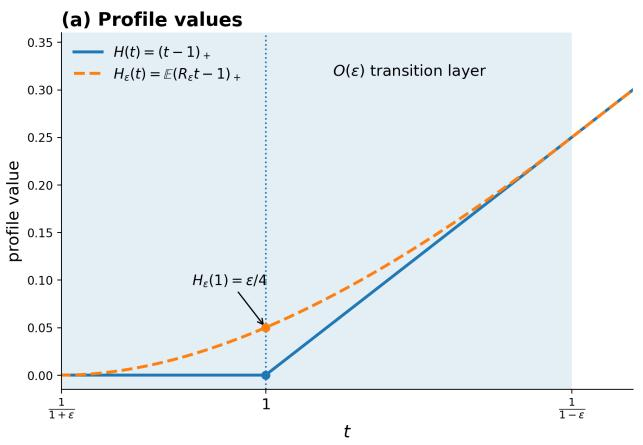
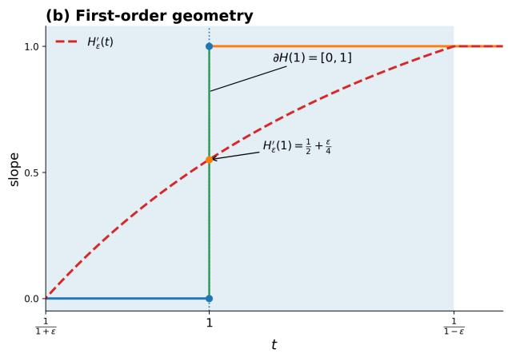
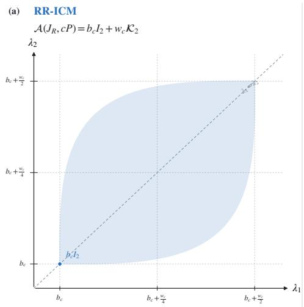
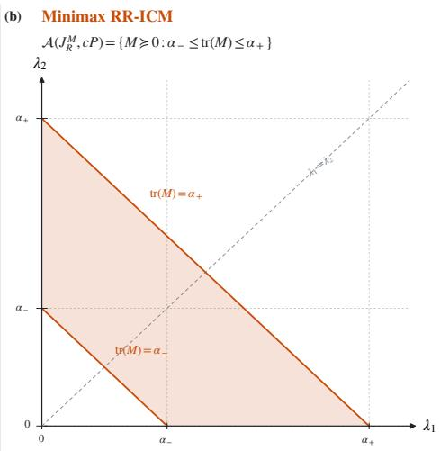

# When Is Muon Optimal? Radial Fragility and Minimax Geometry

Ao Xu

Jilin University, Changchun 130012, China

Zhongguancun Academy, Beijing 100094, China

xuao24@mails.jlu.edu.cn, s-xa24@bza.edu.cn

August 5, 2026

## Abstract

Muon replaces a matrix gradient by an approximate polar factor and has shown strong empirical performance in neural-network training. The Isotropic Curvature Model (ICM) provides a curvature-based explanation for this update by asking when gradient orthogonalization minimizes a one-step local-loss surrogate. We investigate the stability of this explanation when the fixed input radius of the ICM is replaced by a general radial law. We introduce the Random-Radius Isotropic Curvature Model (RR-ICM) and the Polar-Factor Admissibility Set, which encodes exact scaled-polar optimality as a geometric condition on the positive polar factor of the gradient. We derive an exact characterization of this set for arbitrary radial laws and show that all nonscalar admissible responses arise from radial atoms aligned with curvature kinks. Consequently, every atomless radial law exhibits zero-capacity rigidity: exact scaled-polar optimality is possible only when the gradient is already a scaled column isometry. To connect the curvature-based framework with the established spectral geometry of Muon, we introduce the Minimax RR-ICM by replacing directional averaging with worst-case optimization over probability laws on the sphere. We prove that every nonzero global minimizer lies on the polar ray of the gradient, while its scale is determined by a one-dimensional convex problem. The corresponding admissibility geometry is a positive-semidefinite trace slab, in sharp contrast to the spherical-zonoid geometry of the RR-ICM. Together, these results expose the radial fragility of average-curvature explanations and provide a new minimax variational characterization of Muon’s polar direction.

## 1 Introduction

Muon is a matrix-aware optimizer designed primarily for hidden-layer weight matrices. Given a momentum-smoothed matrix gradient

$$
M _ { t } = U _ { t } \Sigma _ { t } V _ { t } ^ { \top } ,
$$

Muon applies a small number of Newton–Schulz iterations to approximate its polar factor $U _ { t } V _ { t } ^ { \top }$ while non-matrix parameters such as embeddings, normalization parameters, biases, and output heads are typically handled by AdamW [8]. Consequently, Muon preserves the left and right singular subspaces of the momentum update while largely flattening its nonzero singular values. In this sense, it replaces a potentially highly anisotropic matrix update by an approximately semiorthogonal one. Muon first attracted attention through strong empirical performance in smallscale language-model and image-classification training, and was subsequently shown to scale to substantially larger language models. Liu et al. [14] identified weight decay and parameter-shapedependent update scaling as key ingredients for stable large-scale training, and developed a memoryand communication-eficient distributed implementation. Their scaling-law experiments reported that Muon required approximately 52% of the training FLOPs needed by a tuned AdamW baseline at matched performance. They further used Muon to train Moonlight, a 3B/16B mixture-of-experts model, on 5.7 trillion tokens. These results suggest that matrix-gradient orthogonalization is not merely a small-model heuristic, but can provide meaningful optimization gains at the scale of modern language-model training.

  
Figure 1: Radial averaging is a small perturbation at the level of function values but a singular perturbation at a kink. For $H ( t ) = ( t - 1 ) .$ + and $R _ { \varepsilon } \sim \mathrm { U n i f } [ 1 - \varepsilon , 1 + \varepsilon ]$ , the averaged profile $H _ { \varepsilon } ( t ) = \mathbb { E } ( R _ { \varepsilon } t - 1 ) _ { - }$ + difers from H only within an $O ( \varepsilon )$ transition layer. Nevertheless, the interval $\partial H ( 1 ) = [ 0 , 1 ]$ is replaced by the unique derivative $H _ { \varepsilon } ^ { \prime } ( 1 ) = 1 / 2 + \varepsilon / 4$

Theoretical interest in this transformation extends beyond Muon itself. Earlier work on stochastic and preconditioned spectral descent already explored matrix updates adapted to spectral geometry [4, 5]. More recent studies have interpreted Muon through several closely related viewpoints, including spectral-norm steepest descent and architecture-dependent duality maps [2, 3], normconstrained linear minimization oracles [15], non-Euclidean trust-region optimization [10], and implicit spectral-norm constraints [6]. These perspectives establish why the polar factor is a natural or optimal update under a specified or implicitly induced spectral geometry. Related work has also connected Muon to matrix-aware preconditioning and structured curvature surrogates [12, 7]. Su [20] took a complementary approach. Rather than prescribing a norm geometry, constraint set, or trust region, he derived the Isotropic Curvature Model (ICM) as a one-step variational surrogate for the local change in a neural-network training loss, under an isotropy assumption on its curvature across perturbation directions. Within this surrogate framework, he asked under what curvature conditions gradient orthogonalization—and, in particular, Muon’s polar update—emerges as an exact optimal matrix update. Given a gradient matrix $G \in \mathbb { R } ^ { m \times n }$ , the ICM considers

$$
J _ { \mathrm { s p h } } ( Q ; G ) = - \langle G , Q \rangle + \mathbb { E } _ { \zeta } H ( \| Q \zeta \| _ { 2 } ) , \qquad \zeta \sim \mathrm { U n i f } ( \mathbb { S } ^ { n - 1 } ) ,
$$

where H is a scalar curvature profile. If $G = P S$ is the thin polar decomposition and $Q = c P$ , then $\| Q \zeta \| _ { 2 } = c$ for every $\zeta \in \mathbb { S } ^ { n - 1 }$ . Hence, when H has a kink at $^ { c , }$ all spherical samples lie at the same nondiferentiable point. Direction-dependent subgradient selections may then generate a nonscalar matrix response capable of supporting a scaled polar update. The fixed-sphere assumption is often motivated by high-dimensional radial concentration [21]. For example, a standard Gaussian vector satisfies

$$
\frac { Z } { \sqrt { n } } = \rho _ { n } \zeta , \qquad Z \sim { \mathcal { N } } ( 0 , I _ { n } ) , \qquad \rho _ { n } = \frac { \| Z \| _ { 2 } } { \sqrt { n } } ,
$$

where ζ is uniform on $\mathbb { S } ^ { n - 1 }$ and independent of $\rho _ { n }$ , and $\rho _ { n } \to 1$ in probability. For smooth observables, this suggests that the normalized-Gaussian and fixed-sphere models should be asymptotically close. Exact polar optimality in the ICM, however, relies on a set-valued subdiferential at a kink, and radial concentration need not preserve this first-order variational geometry. A deterministic radius can place every sample exactly on the kink, whereas an atomless random radius hits any prescribed kink with probability zero, no matter how concentrated its law is. Thus, a thin random shell and a fixed sphere may be arbitrarily close in radius while difering discontinuously in the subdiferential structure that governs exact optimality. Figure 1 illustrates this distinction for a scalar hinge: radial averaging changes function values only within a shrinking transition layer, yet replaces a set-valued subgradient by a unique smooth response.

Motivated by the preceding observation, we introduce a natural extension of the ICM in which the input radius is allowed to vary while the directional component remains uniform on the sphere. We call this the Random-Radius Isotropic Curvature Model (RR-ICM):

$$
J _ { R } ( Q ; G ) = - \langle G , Q \rangle + \mathbb { E } _ { R , \zeta } H ( R \| Q \zeta \| _ { 2 } ) , \qquad \zeta \sim \mathrm { U n i f } ( \mathbb { S } ^ { n - 1 } ) , \qquad R \ \bot \ \zeta .
$$

The model randomizes only the input radius while preserving rotational symmetry.

This extension leads to our first structural question.

Question 1: Exact polar optimality under radial variation

When the fixed-sphere ICM is extended to a general radial law, under what conditions can a scaled polar factor cP remain an exact global minimizer? Can these conditions be characterized completely in terms of the radial law, the curvature profile, and the spectrum of the gradient’s positive polar factor?

To answer this question, we introduce the Polar-Factor Admissibility Set, which encodes exact scaled-polar optimality as a geometric condition on the positive polar factor of the gradient. For an arbitrary radial law, we prove the exact representation

$$
A ( J _ { R } , c P ) = b _ { c } I _ { n } + w _ { c } K _ { n } ,
$$

where $\textstyle { \boldsymbol { \mathcal { K } } } _ { n }$ is a spherical zonoid and $w _ { c }$ records the total atom–kink resonance at scale c. This formula gives a complete geometric characterization of the gradient spectra compatible with exact polar optimality. In particular, all nonscalar spectral freedom is generated by radial atoms aligned with curvature kinks; when the radial law is atomless, the admissibility set collapses to a single scalar matrix. This rigidity reveals a precise limitation of the average-curvature explanation. Although radial concentration may make a thin shell close to a sphere at the level of function values, exact polar optimality for a general nonscalar gradient spectrum depends on a fragile atom–kink resonance. Thus, the average RR-ICM alone does not provide a radially robust variational explanation of Muon’s polar update.

This conclusion creates an explanatory tension. Muon’s polar direction has broad spectralgeometric interpretations and performs robustly across large-scale training settings [14], whereas exact polar optimality in the average RR-ICM can be destroyed by an arbitrarily thin atomless radial perturbation. This leads to our second structural question.

## Question 2: A curvature-based bridge to spectral geometry

Does there exist a natural counterpart of the RR-ICM that retains its local-curvature and random-radius structure, while selecting the polar factor as the optimal matrix direction for general gradient spectra? Can such a formulation establish a variational connection between the ICM viewpoint and the established spectral interpretations of Muon?

To address this question, we replace the prescribed uniform directional law in the RR-ICM by a worst-case choice over all probability laws on the sphere. Writing ${ \mathcal { P } } ( { \mathbb { S } } ^ { n - 1 } )$ for the set of Borel probability measures on $\mathbb { S } ^ { n - 1 }$ , we introduce the Minimax RR-ICM

$$
J _ { R } ^ { \mathrm { M } } ( Q ; G ) = - \langle G , Q \rangle + \operatorname* { s u p } _ { \nu \in \mathcal { P } ( \mathbb { S } ^ { n - 1 } ) } \mathbb { E } _ { \zeta \sim \nu } \overline { { H } } _ { R } ( \| Q \zeta \| _ { 2 } ) .
$$

We prove that, whenever the Minimax RR-ICM admits a nonzero global minimizer, every such minimizer lies on the polar ray generated by the gradient: its operator-norm-normalized matrix direction is exactly the polar factor of G. The Minimax RR-ICM therefore provides a new curvature-based minimax variational characterization of Muon’s polar update. Moreover, because it is obtained from the RR-ICM by changing only how directional variation is aggregated, this characterization establishes a direct variational bridge between the ICM viewpoint and the established spectral-geometric interpretations of Muon.

Contributions. Our main contributions are summarized as follows.

1. A polar-factor admissibility framework. We introduce the Polar-Factor Admissibility Set, which reformulates exact optimality of a scaled polar update as a convex-set membership condition on the positive polar factor of the gradient. This provides a common variational language for comparing diferent curvature models.

2. Exact polar-factor admissibility in the RR-ICM. For the Random-Radius Isotropic Curvature Model, we characterize completely the gradient spectra compatible with exact scaled-polar optimality. For an arbitrary radial law, we prove

$$
A ( J _ { R } , c P ) = b _ { c } I _ { n } + w _ { c } K _ { n } ,
$$

where $\textstyle { \boldsymbol { \mathcal { K } } } _ { n }$ is a spherical zonoid and $w _ { c }$ records the total atom–kink resonance at scale c. This representation shows that radial atoms aligned with curvature kinks are the sole source of nonscalar admissible responses, and yields a spectral-capacity bound and an exact rigidity result for atomless radial laws.

3. A new minimax variational characterization of Muon. We introduce the Minimax RR-ICM by replacing directional averaging with worst-case optimization over spherical probability laws. We prove that every nonzero global minimizer lies on the polar ray of the gradient, while its scale is determined by an exact one-dimensional convex optimization problem.

4. A geometric bridge between curvature and spectral interpretations. We characterize the Minimax Polar-Factor Admissibility Set as a positive-semidefinite trace slab and place it in direct comparison with the spherical-zonoid geometry of the average RR-ICM. The two models thereby reveal distinct mechanisms of polar optimality: atom–kink resonance under directional averaging and operator-norm subdiferential geometry under directional minimax robustification.

Organization. Section 2 formulates the RR-ICM and isolates the efect of radial randomness through an efective curvature profile. Section 3 gives the exact characterization of the Polar-Factor Admissibility Set and derives the resulting spectral-capacity and atomless-rigidity consequences. Section 4 introduces the Minimax RR-ICM, establishes its polar optimizer geometry, and compares its admissibility set with that of the average RR-ICM. The proofs are collected in Section 5, and Section 6 concludes with a discussion of the scope, interpretation, and limitations of the framework.

## 2 The Random-Radius Isotropic Curvature Model

Because the Gaussian radius concentrates around one in high dimensions, the fixed-sphere and normalized-Gaussian models become close at the level of ordinary function values. This section explains why that closeness need not preserve first-order variational structure at a kink, and then formulates the random-radius extension of the ICM.

## 2.1 Why a Thin Shell Is Not a Sphere at a Kink

Consider the hinge profile

$$
H ( t ) = ( t - 1 ) _ { + } , \qquad t \geq 0 .
$$

and replace the deterministic unit radius by the atomless perturbation

$$
R _ { \varepsilon } \sim \mathrm { U n i f } [ 1 - \varepsilon , 1 + \varepsilon ] , \qquad 0 < \varepsilon < 1 .
$$

The corresponding radially averaged profile is

$$
H _ { \varepsilon } ( t ) = \mathbb { E } ( R _ { \varepsilon } t - 1 ) _ { + } = \frac { 1 } { 2 \varepsilon } \int _ { 1 - \varepsilon } ^ { 1 + \varepsilon } ( r t - 1 ) _ { + } d r .
$$

A direct calculation gives

$$
H _ { \varepsilon } ( t ) = \left\{ \begin{array} { l l } { 0 , } & { 0 \leq t \leq \frac { 1 } { 1 + \varepsilon } , } \\ { \left( ( 1 + \varepsilon ) t - 1 \right) ^ { 2 } , } & { \frac { 1 } { 1 + \varepsilon } < t < \frac { 1 } { 1 - \varepsilon } , } \\ { t - 1 , } & { t \geq \frac { 1 } { 1 - \varepsilon } . } \end{array} \right.\tag{1}
$$

Thus, radial averaging modifies the hinge only on the transition interval

$$
\left[ { \frac { 1 } { 1 + \varepsilon } } , { \frac { 1 } { 1 - \varepsilon } } \right] .
$$

The width of this interval is

$$
\frac { 1 } { 1 - \varepsilon } - \frac { 1 } { 1 + \varepsilon } = \frac { 2 \varepsilon } { 1 - \varepsilon ^ { 2 } } = O ( \varepsilon ) .
$$

The perturbation is therefore small at the level of function values. Indeed, because the hinge is 1-Lipschitz, for every fixed $T < \infty$ ，

$$
\operatorname* { s u p } _ { 0 \leq t \leq T } | H _ { \varepsilon } ( t ) - H ( t ) | \leq T \mathbb { E } | R _ { \varepsilon } - 1 | = \frac { \varepsilon T } { 2 } .
$$

Its first-order geometry is nevertheless qualitatively diferent. Diferentiating (1) yields

$$
H _ { \varepsilon } ^ { \prime } ( t ) = \left\{ \begin{array} { l l } { 0 , } & { 0 < t \leq \frac { 1 } { 1 + \varepsilon } , } \\ { \frac { ( 1 + \varepsilon ) ^ { 2 } - t ^ { - 2 } } { 4 \varepsilon } , } & { \frac { 1 } { 1 + \varepsilon } < t < \frac { 1 } { 1 - \varepsilon } , } \\ { 1 , } & { t \geq \frac { 1 } { 1 - \varepsilon } . } \end{array} \right.
$$

At the original kink,

$$
\partial H ( 1 ) = [ 0 , 1 ] , \qquad H _ { \varepsilon } ^ { \prime } ( 1 ) = \frac 1 2 + \frac \varepsilon 4 .
$$

Hence, for every $\varepsilon > 0$ , the entire subgradient interval of the deterministic hinge is replaced by a single slope, even though $H _ { \varepsilon } \to H$ locally uniformly as $\varepsilon \to 0$

Figure 1 visualizes this distinction. A thin random shell and a fixed sphere may be close in radius, but they charge a kink in fundamentally diferent ways: the deterministic sphere places all of its mass at the same transition, whereas an atomless radial law assigns zero mass to every prescribed radius. Radial concentration therefore controls profile values without necessarily preserving the first-order variational geometry relevant to optimization. The distinction is amplified in the matrix ICM. At a scaled polar point, the fixed-sphere model can place every direction on the same kink and use the resulting set-valued slopes to support a nonscalar matrix subgradient. Once the radius becomes atomless, this direction-dependent slope-selection mechanism may disappear. This motivates retaining the uniform spherical direction while allowing the radius itself to be random.

## 2.2 RR-ICM Formulation and Assumptions

Let $m \geq n$ , and let $G , Q \in \mathbb { R } ^ { m \times n }$ denote the gradient signal and the matrix update, respectively. We write $\langle A , B \rangle : = \operatorname { t r } ( A ^ { \top } B )$ for the Frobenius inner product. Let $\zeta \sim \mathrm { U n i f } ( \mathbb { S } ^ { n - 1 } )$ , and let $R \geq 0$ be a random radius independent of $\zeta .$ . Given a scalar curvature profile $H : [ 0 , \infty ) \to \mathbb { R }$ , the RR-ICM is defined by

$$
J _ { R } ( Q ; G ) : = - \langle G , Q \rangle + \mathbb { E } _ { R , \zeta } H ( R \| Q \zeta \| _ { 2 } ) .
$$

The fixed-sphere ICM is recovered as the special case $R \equiv 1$

It is convenient to absorb the radial law into an efective scalar curvature profile. Define

$$
{ \overline { { H } } } _ { R } ( t ) : = \mathbb { E } _ { R } H ( R t ) , \qquad t \geq 0 .
$$

Since $R \geq 0$ and is independent of $\zeta ,$

$$
\mathbb { E } _ { R , \zeta } H ( R \| Q \zeta \| _ { 2 } ) = \mathbb { E } _ { \zeta } \left[ \mathbb { E } _ { R } H ( R \| Q \zeta \| _ { 2 } ) \right]
$$

$$
= \mathbb { E } _ { \zeta } \left[ { \overline { { H } } } _ { R } ( \| Q \zeta \| _ { 2 } ) \right] .
$$

Consequently, the RR-ICM admits the equivalent representation

$$
J _ { R } ( Q ; G ) = - \langle G , Q \rangle + \mathbb { E } _ { \zeta } \left[ \overline { { H } } _ { R } ( \lVert Q \zeta \rVert _ { 2 } ) \right] .
$$

Thus, radial randomness enters the objective entirely through the scalar transformation

$$
H \longmapsto { \overline { { H } } } _ { R } ,
$$

while the uniform spherical directional law remains unchanged.

Whenever a polar decomposition is invoked, we assume that G has full column rank and write

$$
G = P S , \qquad P ^ { \top } P = I _ { n } , \qquad S = ( G ^ { \top } G ) ^ { 1 / 2 } \succ 0 .
$$

No rank restriction is imposed on the optimization variable $Q .$

Standing assumptions. Unless stated otherwise, $H : [ 0 , \infty ) \to \mathbb { R }$ is finite, convex, and nondecreasing; $R \geq 0$ is independent of $\zeta \sim \mathrm { U n i f } ( \mathbb { S } ^ { n - 1 } )$ ; and the efective profile $\overline { { H } } _ { R }$ is finite on $[ 0 , \infty )$ Whenever scaled-polar optimality is considered, $G \in \mathbb { R } ^ { m \times n }$ is assumed to have full column rank, with $m \geq n$ . These conditions retain the baseline convexity, monotonicity, and rank assumptions used in $\mathrm { S u } ^ { \prime } \mathrm { s }$ analysis of orthogonalization in the fixed-sphere ICM [20].

## 3 Characterization of the Polar-Factor Admissibility Set

This section gives a complete geometric characterization of exact scaled-polar optimality in the RR-ICM. We first recast Su’s fixed-sphere optimality condition in terms of the Polar-Factor Admissibility Set, which records the positive polar factors compatible with a scaled polar minimizer. We then characterize this set exactly under an arbitrary radial law as a translated and dilated spherical zonoid. The resulting formula identifies atom–kink resonance as the sole source of nonscalar admissible responses and leads to a quantitative spectral-capacity bound. As a sharp consequence, every atomless radial law exhibits zero-capacity rigidity: exact scaled-polar optimality can occur only when the gradient’s positive polar factor is scalar.

## 3.1 From Exact Optimality to Polar-Factor Admissibility

Following the first-order condition used in Su’s proof [20], we formulate the following exact admissibility criterion. Let the compact singular value decomposition and thin polar decomposition of the gradient be

$$
\boldsymbol { G } = \boldsymbol { U } \boldsymbol { \Sigma } \boldsymbol { V } ^ { \intercal } = ( \boldsymbol { U } \boldsymbol { V } ^ { \intercal } ) ( \boldsymbol { V } \boldsymbol { \Sigma } \boldsymbol { V } ^ { \intercal } ) = \boldsymbol { P } \boldsymbol { S } .
$$

The gradient G and curvature profile H induce the fixed-sphere objective

$$
J _ { \mathrm { s p h } } ( Q ; G ) = - \langle G , Q \rangle + \mathbb { E } _ { \zeta } H ( \| Q \zeta \| _ { 2 } ) , \qquad \zeta \sim \mathrm { U n i f } ( \mathbb { S } ^ { n - 1 } ) .
$$

We ask when $c P$ is a global minimizer of this objective. Su’s result can be written as

$$
c P \in \arg \operatorname* { m i n } J _ { \mathrm { s p h } } ( Q ; G ) \quad \iff \quad S \in \left\{ \mathbb { E } _ { \zeta } [ \eta ( \zeta ) \zeta \zeta ^ { \top } ] : \eta : \mathbb { S } ^ { n - 1 } \to \partial H ( c ) \mathrm { ~ m e a s u r a b l e } \right\} .
$$

Accordingly, define

$$
A ( J _ { \mathrm { s p h } } , c P ) : = \{ \mathbb { E } _ { \zeta } [ \eta ( \zeta ) \zeta \zeta ^ { \top } ] : \eta : \mathbb { S } ^ { n - 1 }  \partial H ( c ) \ \mathrm { m e a s u r a b l e } \} ,\tag{2}
$$

and call it the Polar-Factor Admissibility Set determined by the objective $J _ { \mathrm { s p h } }$ and the evaluation point $c P$ . A wider subdiferential interval $\partial H ( c )$ typically allows this set to accommodate a richer family of positive polar factors. This provides a geometric reading of Su’s Assumption 3.3 [20]: the slope interval at the kink supplies the direction-dependent subgradient freedom needed to match a broader range of gradient spectra, as is implicit in the proof of the orthogonalization result.

Correspondingly, for the RR-ICM define

$$
\begin{array} { r } { A ( J _ { R } , c P ) : = \left\{ \mathbb { E } _ { R , \zeta } [ R \eta ( R , \zeta ) \zeta \zeta ^ { \top } ] : \begin{array} { l } { \eta \mathrm { ~ m e a s u r a b l e , ~ a n d ~ } } \\ { \eta ( R , \zeta ) \in \partial H ( c R ) \mathrm { ~ a . e . ~ o n ~ } \{ R > 0 \} } \end{array} \right\} . } \end{array}\tag{3}
$$

All integrands containing a factor R are defined to be zero on $\{ R = 0 \}$ . Our first objective is to characterize this set exactly.

Define the spherical zonoid

$$
\begin{array} { r } { \mathcal { K } _ { n } : = \{ \mathbb { E } _ { \zeta } \Big [ a ( \zeta ) \zeta \zeta ^ { \top } \Big ] : a : \mathbb { S } ^ { n - 1 }  [ 0 , 1 ] \mathrm { ~ m e a s u r a b l e } \} \subseteq \mathbb { S } ^ { n } , } \end{array}\tag{4}
$$

where $\mathbb { S } ^ { n }$ denotes the space of real symmetric $n \times n$ matrices. The selector $a ( \zeta )$ records the fraction of the slope jump chosen in direction ζ. Thus, $\kappa _ { n }$ collects all matrix-valued responses generated by direction-dependent measurable selections from a scalar subdiferential interval. In the language of classical zonoid theory, $\kappa _ { n }$ is the zonoid generated by the random matrix $\zeta \zeta ^ { \top } \in \mathbb { S } ^ { n }$ ; equivalently, it is the Aumann expectation of the random line segment $[ 0 , \zeta \zeta ^ { \top } ] \ [ 1 , 9 ]$

For $t > 0$ , let $H _ { - } ( t )$ and $H _ { + } ( t )$ denote the left and right derivatives of $H .$ , respectively, and define

$$
\Delta H ( t ) : = H _ { + } ( t ) - H _ { - } ( t ) , \qquad \mathrm { K i n k } ( H ) : = \{ t > 0 : \Delta H ( t ) > 0 \} .
$$

Theorem 1. Assume that there exist $p \geq 1$ and $C _ { H } < \infty$ such that $H _ { + } ( t ) \leq C _ { H } ( 1 + t ^ { p - 1 } )$ , and that $\mathbb { E } [ R ^ { p } ] < \infty$ . Define

$$
b _ { c } : = \frac { 1 } { n } \mathbb { E } [ R H _ { - } ( c R ) ] , \qquad w _ { c } : = \sum _ { r > 0 : \atop c r \in \mathrm { K i n k } ( H ) } \mathbb { P } ( R = r ) r \Delta H ( c r ) ,
$$

where $c > 0$ . Then

$$
A ( J _ { R } , c P ) = b _ { c } I _ { n } + w _ { c } K _ { n } .
$$

Consequently,

$$
c P \in \arg \operatorname* { m i n } _ { Q } J _ { R } ( Q ; G ) \quad \iff \quad S \in b _ { c } I _ { n } + w _ { c } K _ { n } .
$$

Recovery of the fixed-sphere case. Theorem 1 contains Su’s fixed-sphere result as an exact special case. If $R \equiv 1$ , then $J _ { R } = J _ { \mathrm { s p h } }$ , and the only radius that can contribute to the sum defining $w _ { c }$ is $r = 1$ . Hence

$$
b _ { c } = \frac { H _ { - } ( c ) } { n } , \qquad w _ { c } = \Delta H ( c ) .
$$

Theorem 1 and the defining optimality interpretation of the Polar-Factor Admissibility Set therefore give the complete specialization

$$
c P \in \arg \operatorname* { m i n } _ { Q } J _ { \mathrm { s p h } } ( Q ; G ) \quad \Longleftrightarrow \quad S \in A ( J _ { \mathrm { s p h } } , c P ) = \frac { H _ { - } ( c ) } { n } I _ { n } + \Delta H ( c ) \mathcal { K } _ { n } .
$$

Indeed, since $\mathbb { E } _ { \zeta } [ \zeta \zeta ^ { \top } ] = I _ { n } / n$ and $\partial H ( c ) = [ H _ { - } ( c ) , H _ { + } ( c ) ]$ , every measurable selector in (2) has the form $\eta ( \zeta ) = H _ { - } ( c ) + a ( \zeta ) \Delta H ( c )$ with $0 \leq a ( \zeta ) \leq 1$ , and conversely. Thus the displayed membership condition is precisely Su’s fixed-sphere exact-optimality criterion, rather than merely a specialization of the two scalar coeficients.

## 3.2 Zero-Capacity Rigidity under Atomless Radial Laws

The coeficient $w _ { c }$ quantifies the total strength of atom–kink resonance at scale $c .$ Each term in

$$
w _ { c } = \sum _ { \stackrel { r > 0 : } { c r \in \mathrm { K i n k } ( H ) } } \mathbb { P } ( R = r ) r \Delta H ( c r )
$$

combines three ingredients: the atomic mass $\mathbb { P } ( R = r )$ , the radial chain-rule factor $r ,$ and the slope jump $\Delta H ( c r ) = H _ { + } ( c r ) - H _ { - } ( c r )$ available when the scaled radius $c r$ lands on a kink of $H$ $\mathrm { A }$ radius contributes to $w _ { c }$ only if it is an atom of the radial law and, after scaling by $c ,$ aligns with a kink. More importantly, $w _ { c }$ is the dilation coeficient of the spherical zonoid in the exact admissibility region

$$
b _ { c } I _ { n } + w _ { c } { K } _ { n } .
$$

We therefore call $w _ { c }$ the atom–kink response capacity at scale c. The term is convex-geometric: $w _ { c }$ controls the size of the nonscalar matrix-response set generated by direction-dependent subgradient selection. When $w _ { c } = 0$ , the response capacity vanishes and the exact admissibility region collapses to the singleton $\left\{ b _ { c } I _ { n } \right\}$ . For fixed $b _ { c } .$ , increasing $w _ { c }$ dilates $\kappa _ { n }$ and enlarges the family of positive polar factors that exact polar optimality can support.

To translate this convex-geometric capacity into a spectral quantity, note that every $K \in \mathcal { K } _ { n }$ satisfies

$$
0 \preceq K \preceq { \frac { 1 } { n } } I _ { n } .
$$

Indeed, if

$$
K = \mathbb { E } _ { \zeta } [ a ( \zeta ) \zeta \zeta ^ { \top } ] , \qquad 0 \leq a ( \zeta ) \leq 1 ,
$$

then

$$
0 \preceq a ( \zeta ) \zeta \zeta ^ { \top } \preceq \zeta \zeta ^ { \top } ,
$$

and taking expectations gives

$$
0 \preceq K \preceq \mathbb { E } _ { \zeta } [ \zeta \zeta ^ { \top } ] = \frac { 1 } { n } I _ { n } .
$$

This motivates the dimension-normalized quantity

$$
\kappa _ { c } : = \frac { w _ { c } } { n } ,
$$

which we call the spectral capacity at scale c. While $w _ { c }$ measures the overall dilation of the matrixresponse set, $\kappa _ { c }$ controls the spectral variation that the set can support.

Corollary 3.1 (Spectral-capacity bound for exact polar optimality). Under the assumptions of Theorem 1, suppose that $c P$ is an exact minimizer. Then

$$
b _ { c } I _ { n } \preceq S \preceq ( b _ { c } + \kappa _ { c } ) I _ { n } .
$$

Define the spectral diameter of S by

$$
\dim _ { \operatorname { e i g } } ( S ) : = \lambda _ { \operatorname* { m a x } } ( S ) - \lambda _ { \operatorname* { m i n } } ( S ) .
$$

Then exact polar optimality necessarily implies

$$
\mathrm { d i a m } _ { \mathrm { e i g } } ( S ) \leq \kappa _ { c } .
$$

At a kink c of H, the fixed-sphere law retains a nonzero spectral response capacity because all of its radial mass resonates at the same kink. By contrast, every atomless radial law satisfies $w _ { c } = 0 \mathrm { . }$ ; more generally, only atoms aligned with scaled kinks contribute to $w _ { c }$

Corollary 3.2 (Zero-capacity rigidity under atomless radial laws). Under the assumptions of Theorem 1, suppose that the law of R is atomless. Then $\kappa _ { c } = 0$ . If $c P$ is an exact minimizer, then

$$
S = b _ { c } I _ { n } .
$$

Consequently, diam $\boldsymbol { \mathrm { 1 } } _ { \mathrm { e i g } } ( S ) = 0$

In particular, if S has two distinct eigenvalues, then cP cannot be an exact minimizer. Equivalently, whenever exact scaled-polar optimality holds,

$$
G = b _ { c } P .
$$

Because G has full column rank, exact optimality forces $b _ { c } > 0$ . Thus, under an atomless radial law, exact scaled-polar optimality is possible only in the degenerate spectral case where the gradient is already a scaled column isometry.

## 4 A Minimax Characterization of Muon’s Polar Direction

## 4.1 The Minimax RR-ICM

The rigidity result of Section 3.2 shows that directional averaging in the RR-ICM may fail to support exact polar optimality for a general gradient spectrum. Motivated by this limitation, we retain the radial-curvature structure of the RR-ICM while replacing the prescribed uniform directional law by worst-case aggregation over all probability laws on the sphere.

Let ${ \mathcal { P } } ( { \mathbb { S } } ^ { n - 1 } )$ denote the set of Borel probability measures on $\mathbb { S } ^ { n - 1 }$ . We define the Minimax Random-Radius Isotropic Curvature Model (Minimax RR-ICM) by

$$
J _ { R } ^ { \mathrm { M } } ( Q ; G ) : = - \langle G , Q \rangle + \operatorname* { s u p } _ { \nu \in \mathcal { P } ( \mathbb { S } ^ { n - 1 } ) } \mathbb { E } _ { \zeta \sim \nu } \overline { { H } } _ { R } ( \| Q \zeta \| _ { 2 } ) .\tag{5}
$$

Thus, the RR-ICM and minimax RR-ICM share the same gradient term, radial law, curvature profile, and directional state space; they difer only in how directional variation is aggregated.

The ambiguity set in (5) is deliberately maximal. Its purpose is not to estimate a data-driven uncertainty set, but to identify the complete angular minimax counterpart of the RR-ICM [16, 11]. Whenever a nonzero global minimizer exists, the resulting model selects the polar factor as its normalized matrix direction for every full-rank gradient spectrum.

Theorem 2 (Minimax variational characterization of Muon’s polar direction). If the Minimax RR-ICM admits a nonzero global minimizer $Q ^ { \star }$ , then every such minimizer satisfies

$$
\frac { Q ^ { \star } } { \| Q ^ { \star } \| _ { \mathrm { o p } } } = P ,\tag{6}
$$

where P is the polar factor of the gradient G.

Theorem 2 provides a new curvature-based minimax variational characterization of Muon’s polar direction. In particular, the radial law and curvature profile may afect whether a nonzero optimizer exists and what its scale is, but they do not alter its normalized matrix direction. The next subsection characterizes the corresponding scale condition and Polar-Factor Admissibility Set.

## 4.2 Minimax Admissibility and Trace Matching

Theorem 2 determines the normalized matrix direction of every nonzero global minimizer, but does not yet identify which scales along the polar ray are optimal. To characterize the corresponding first-order condition, isolate the Minimax curvature term

$$
\Phi _ { R } ^ { \mathrm { M } } ( Q ) : = \operatorname* { s u p } _ { \nu \in \mathcal { P } ( \mathbb { S } ^ { n - 1 } ) } \mathbb { E } _ { \zeta \sim \nu } \overline { { H } } _ { R } ( \| Q \zeta \| _ { 2 } ) ,\tag{7}
$$

so that

$$
J _ { R } ^ { \mathrm { M } } ( Q ; G ) = - \langle G , Q \rangle + \Phi _ { R } ^ { \mathrm { M } } ( Q ) .
$$

For $c > 0$ , define the Minimax Polar-Factor Admissibility Set by

$$
A ( J _ { R } ^ { \mathrm { M } } , c P ) : = \left\{ M \in \mathbb { S } ^ { n } : P M \in \partial \Phi _ { R } ^ { \mathrm { M } } ( c P ) \right\} .\tag{8}
$$

This is the Minimax counterpart of the admissibility set introduced for the RR-ICM and records the positive polar factors compatible with exact optimality at $c P$

Introduce the density-matrix set

$$
{ \mathcal { D } } _ { n } : = \left\{ W \in { \mathbb S } _ { + } ^ { n } : \operatorname { t r } ( W ) = 1 \right\} ,\tag{9}
$$

where $\mathbb { S } _ { + } ^ { n }$ denotes the cone of real symmetric positive semidefinite $n \times n$ matrices. The next theorem shows that the matrix-valued admissibility condition reduces exactly to a scalar trace-matching condition and yields the complete set of global minimizers.

Theorem 3 (Minimax admissibility and trace matching). For every $c > 0$ , the Minimax Polar-Factor Admissibility Set is

$$
\begin{array} { r } { A ( J _ { R } ^ { \mathrm { M } } , c P ) = \left\{ \alpha W : \alpha \in \partial \overline { { H } } _ { R } ( c ) , W \in \mathcal { D } _ { n } \right\} } \\ { = \left\{ M \in \mathbb { S } _ { + } ^ { n } : \operatorname { t r } ( M ) \in \partial \overline { { H } } _ { R } ( c ) \right\} . } \end{array}\tag{10}
$$

Moreover,

$$
\begin{array} { r l } { c P \in \underset { Q } { \arg \operatorname* { m i n } } J _ { R } ^ { \mathrm { M } } ( Q ; G ) } & { \iff \quad S \in A ( J _ { R } ^ { \mathrm { M } } , c P ) } \\ & { \iff \quad \| G \| _ { * } \in \partial \overline { { H } } _ { R } ( c ) } \\ & { \iff \quad c \in \underset { t \geq 0 } { \arg \operatorname* { m i n } } \left[ \overline { { H } } _ { R } ( t ) - t \| G \| _ { * } \right] . } \end{array}\tag{11}
$$

Consequently,

$$
\operatorname * { a r g m i n } _ { Q \in \mathbb R ^ { m \times n } } J _ { R } ^ { \mathrm { M } } ( Q ; G ) = \left\{ c P : c \in \mathop { \arg \operatorname* { m i n } } _ { t \geq 0 } \left[ \overline { { H } } _ { R } ( t ) - t \| G \| _ { * } \right] \right\} .\tag{12}
$$

  
Figure 2: Two polar-factor admissibility geometries in dimension $n = 2$ . Panel (a) shows the RR-ICM admissibility set $b _ { c } I _ { 2 } + w _ { c } K _ { 2 }$ in spectral coordinates. Its nonscalar extent is controlled by the atom–kink response capacity $w _ { c }$ and collapses to the singleton $\{ b _ { c } I _ { 2 } \}$ when $w _ { c } = 0$ . Panel (b) shows the Minimax RR-ICM admissibility set, where $\alpha _ { - } : = \operatorname* { m i n } \partial \overline { { H } } _ { R } ( c )$ and $\alpha _ { + } : = \operatorname* { m a x } \partial \overline { { H } } _ { R } ( c )$ . Positive semidefiniteness confines the spectrum to the first quadrant, while trace matching restricts it to the slab $\alpha _ { - } \leq \lambda _ { 1 } + \lambda _ { 2 } \leq \alpha _ { + }$ . Thus, the RR-ICM restricts spectral shape through spherical-zonoid geometry, whereas the Minimax RR-ICM restricts only the total spectral mass.

Theorem 3 reveals an exact shape–scale separation. Since

$$
{ \frac { S } { \operatorname { t r } ( S ) } } \in { \mathcal { D } } _ { n } ,
$$

the spectral shape of the positive polar factor S imposes no additional restriction on Minimax admissibility. Exact optimality reduces to the one-dimensional condition

$$
\operatorname { t r } ( S ) = \| G \| _ { * } \in \partial { \overline { { H } } } _ { R } ( c ) .
$$

Thus, the polar factor determines the optimal matrix direction, while trace matching determines the admissible scale.

## 4.3 Two Polar-Factor Admissibility Geometries

Combining Theorem 1 with Theorem 3 places the RR-ICM and the Minimax RR-ICM within the same Polar-Factor Admissibility framework. The following corollary isolates the distinct mechanisms through which the two models support nonscalar gradient spectra.

Corollary 4.1 (Two mechanisms of polar-factor admissibility). For every $c > 0$

$$
A ( J _ { R } , c P ) = b _ { c } I _ { n } + w _ { c } K _ { n } ,\tag{13}
$$

$$
A ( J _ { R } ^ { \mathrm { M } } , c P ) = \left\{ M \in \mathbb { S } _ { + } ^ { n } : \operatorname { t r } ( M ) \in \partial { \overline { { H } } } _ { R } ( c ) \right\} .\tag{14}
$$

All nonscalar freedom in the RR-ICM is carried by $w _ { c } \kappa _ { n }$ . In particular, if the law of R is atomless, then

$$
A ( J _ { R } , c P ) = \{ b _ { c } I _ { n } \} .
$$

By contrast, the Minimax $R R { - } I C M$ admits every positive-semidefinite matrix whose trace belongs to $\partial \overline { { H } } _ { R } ( c )$ . Whenever $n \geq 2$ and $\partial \overline { { H } } _ { R } ( c )$ contains a positive value, this admissibility set contains nonscalar matrices without requiring radial atoms to align with curvature kinks.

Corollary 4.1 provides the central geometric bridge between the curvature-based ICM viewpoint and the spectral geometry of Muon. In the RR-ICM, admissible nonscalar spectra are confined to a translated and dilated spherical zonoid whose size is controlled by atom–kink resonance. In the Minimax RR-ICM, the admissible spectra instead fill a positive-semidefinite trace slab, so only their total spectral mass is constrained. The two models therefore generate nonscalar spectral freedom through diferent mechanisms: atom–kink resonance in the RR-ICM, and the set-valued subdiferential of the operator norm at the equal-singular-value point $c P$ in the Minimax RR-ICM. Consequently, making the radial law atomless collapses the RR-ICM geometry but leaves the matrix-shape freedom of the Minimax RR-ICM intact.

## 5 Proofs

## 5.1 Proofs for Section 3.1

We use the standard finite-dimensional conventions for convex subdiferentials, composition chain rules, and pointwise-supremum rules from Rockafellar [17].

Proof of Theorem 1. Retain the convention on the event $\{ R = 0 \}$ . We first verify the integrability needed to interchange expectation and subdiferentiation. The growth assumption implies that, for every fixed $C > 0$

$$
R H _ { + } ( C R ) \leq C _ { H } R + C _ { H } C ^ { p - 1 } R ^ { p } .\tag{15}
$$

Since $p \geq 1$ and $\mathbb { E } [ R ^ { p } ] < \infty$ , we also have $\mathbb { E } [ R ] < \infty$ . Thus, the right-hand side of (15) is integrable.   
In particular, $b _ { c }$ and all matrix expectations below are finite.

Let

$$
\Phi _ { R } ( Q ) : = \mathbb { E } _ { R , \zeta } H ( R \Vert Q \zeta \Vert _ { 2 } ) ,
$$

so that $J _ { R } ( Q ; G ) = - \langle G , Q \rangle + \Phi _ { R } ( Q ) . \mathrm { ~ A t ~ } Q = c P$ , the identity $P ^ { \top } P = I _ { n }$ gives $\| c P \zeta \| _ { 2 } = c $ . For $R > 0$ , the subdiferential chain rule yields

$$
\partial _ { Q } H ( R \| Q \zeta \| _ { 2 } ) \big | _ { Q = c P } = \Big \{ R \eta P \zeta \zeta ^ { \top } : \eta \in \partial H ( c R ) \Big \} .
$$

If $\| Q - c P \| _ { \mathrm { o p } } < \varepsilon < c .$ , then

$$
( c - \varepsilon ) R \leq R \| Q \zeta \| _ { 2 } \leq ( c + \varepsilon ) R .
$$

Local subgradients on this neighborhood admit a uniform integrable bound. Indeed, for $R > 0$ ， take any

$$
V \in \partial _ { Q } H ( R \| Q \zeta \| _ { 2 } ) ,
$$

Since $c - \varepsilon > 0$ , we have $Q \zeta \neq 0$ , and there exists $\eta \in \partial H ( R \Vert Q \zeta \Vert _ { 2 } )$ such that

$$
V = R \eta \frac { Q \zeta } { \| Q \zeta \| _ { 2 } } \zeta ^ { \top } .
$$

Because H is convex and nondecreasing, its subgradients are nonnegative and its right derivative is nondecreasing. Therefore,

$$
\begin{array} { l } { \displaystyle \| V \| _ { F } = R \eta } \\ { \le R H _ { + } ( ( c + \varepsilon ) R ) } \\ { \le C _ { H } R + C _ { H } ( c + \varepsilon ) ^ { p - 1 } R ^ { p } . } \end{array}\tag{16}
$$

When $R = 0$ , the integrand is the constant $H ( 0 )$ , and its $Q \cdot$ -subgradient is zero. The right-hand side of (16) is integrable. Moreover, the mapping

$$
( R , \zeta , Q ) \longmapsto H { \bigl ( } R \| Q \zeta \| _ { 2 } { \bigr ) }
$$

is measurable in $( R , \zeta )$ for every fixed $Q ,$ and is continuous and convex in $Q$ for every fixed $( R , \zeta )$ Moreover, for $\| Q - c P \| _ { \mathrm { o p } } < \varepsilon$

$$
| H ( R \| Q \zeta \| _ { 2 } ) | \leq | H ( 0 ) | + ( c + \varepsilon ) R H _ { + } ( ( c + \varepsilon ) R ) ,
$$

whose expectation is finite by the same growth and moment assumptions. Hence it is a convex normal integrand.

Together with the integrable local Lipschitz modulus established above, the hypotheses of the interchange theorem for subdiferentials of integral convex functionals [18] are satisfied. Therefore,

$$
\partial \Phi _ { R } ( c P ) = \Bigl \{ \mathbb { E } _ { R , \zeta } [ V ( R , \zeta ) ] : V ( R , \zeta ) \in \partial _ { Q } H \bigl ( R \| Q \zeta \| _ { 2 } \bigr ) \big | _ { Q = c P } \mathrm { a . s . , } \quad V \mathrm { m e a s u r a b l e } \Bigr \} .
$$

Using the pointwise subdiferential formula above and the definition of the Polar-Factor Admissibility Set, we obtain

$$
\begin{array} { r } { A ( J _ { R } , c P ) = \left\{ \mathbb { E } _ { R , \zeta } \left[ R \eta ( R , \zeta ) \zeta \zeta ^ { \top } \right] : \ \eta \mathrm { m e a s u r a b l e } , \right. } \\ { \left. \eta ( R , \zeta ) \in \partial H ( c R ) \mathrm { ~ a . e . ~ o n ~ } \{ R > 0 \} \right\} . } \end{array}\tag{17}
$$

Equivalently, $\partial \Phi _ { R } ( c P ) = P A ( J _ { R } , c P )$ . Thus, when $G = P S$ , the first-order optimality condition can be written as

$$
c P \in \arg \operatorname* { m i n } _ { Q } J _ { R } ( Q ; G ) \quad \Longleftrightarrow \quad S \in A ( J _ { R } , c P ) .
$$

Because H is a finite convex function,

$$
\partial H ( t ) = [ H _ { - } ( t ) , H _ { + } ( t ) ] = H _ { - } ( t ) + \Delta H ( t ) [ 0 , 1 ] , \qquad t > 0 .
$$

Every selector in (17) can be written as

$$
\eta ( R , \zeta ) = H _ { - } ( c R ) + a ( R , \zeta ) \Delta H ( c R ) , \qquad 0 \leq a ( R , \zeta ) \leq 1 .
$$

By independence of R and $\zeta$ and spherical symmetry,

$$
\mathbb { E } _ { R , \zeta } \left[ R H _ { - } ( c R ) \zeta \zeta ^ { \top } \right] = \mathbb { E } [ R H _ { - } ( c R ) ] \mathbb { E } _ { \zeta } [ \zeta \zeta ^ { \top } ]
$$

$$
= { b _ { c } } { I _ { n } } .\tag{18}
$$

where we used $\mathbb { E } _ { \zeta } [ \zeta \zeta ^ { \top } ] = I _ { n } / n$

Now let $W _ { c } : = R \Delta H ( c R )$ . A finite convex function has at most countably many nondiferentiability points, and $W _ { c }$ can be nonzero only when $R > 0$ and $c R \in \operatorname { K i n k } ( H )$ . Therefore,

$$
\mathbb { E } [ W _ { c } ] = \sum _ { \stackrel { r > 0 : } { c r \in \mathrm { K i n k } ( H ) } } \mathbb { P } ( R = r ) r \Delta H ( c r ) = w _ { c } .\tag{19}
$$

Moreover, $0 \leq W _ { c } \leq R H _ { + } ( c R )$ , so $W _ { c }$ is integrable.

If $w _ { c } = 0$ , then $W _ { c } = 0$ almost surely and the nonbaseline part of (17) vanishes. If $w _ { c } > 0$ , then for any measurable selector $a ( R , \zeta ) \in [ 0 , 1 ]$ , define

$$
\bar { a } ( \zeta ) : = \frac { \mathbb { E } _ { R } [ W _ { c } a ( R , \zeta ) ] } { w _ { c } } .
$$

Then $\bar { a } : \mathbb { S } ^ { n - 1 } \to [ 0 , 1 ]$ is measurable, and Fubini’s theorem [19] gives

$$
\begin{array} { r } { \mathbb { E } _ { R , \zeta } \left[ W _ { c } a ( R , \zeta ) \zeta \zeta ^ { \top } \right] = w _ { c } \mathbb { E } _ { \zeta } \left[ \bar { a } ( \zeta ) \zeta \zeta ^ { \top } \right] \in w _ { c } { \cal K } _ { n } . } \end{array}\tag{20}
$$

Conversely, for any ${ \bar { a } } : { \mathbb { S } } ^ { n - 1 } \to [ 0 , 1 ]$ , choosing $a ( R , \zeta ) = \bar { a } ( \zeta )$ realizes the corresponding arbitrary element of $w _ { c } \kappa _ { n }$ . Combining this observation with (18) yields

$$
A ( J _ { R } , c P ) = b _ { c } I _ { n } + w _ { c } K _ { n } ,
$$

as claimed.

## 5.2 Proofs for Section 3.2

Proof of Corollary 3.1. By exact optimality of $c P$ , the first-order condition, and Theorem 1, there exists $K \in \mathcal { K } _ { n }$ such that

$$
S = b _ { c } I _ { n } + w _ { c } K .\tag{21}
$$

By the definition of the spherical zonoid, there is a measurable function $a : \mathbb { S } ^ { n - 1 } \to [ 0 , 1 ]$ such that

$$
K = \mathbb { E } _ { \zeta } [ a ( \zeta ) \zeta \zeta ^ { \top } ] .
$$

Hence,

$$
0 \preceq K \preceq \mathbb { E } _ { \zeta } [ \zeta \zeta ^ { \top } ] = \frac { 1 } { n } I _ { n } .
$$

Since $w _ { c } \geq 0$ , substituting this Loewner-order bound into (21) and using $\kappa _ { c } = w _ { c } / n$ gives

$$
b _ { c } I _ { n } \preceq S \preceq ( b _ { c } + \kappa _ { c } ) I _ { n } .
$$

Thus $\lambda _ { \operatorname* { m i n } } ( S ) \geq b _ { c }$ and $\lambda _ { \operatorname* { m a x } } ( S ) \leq b _ { c } + \kappa _ { c } ,$ so

$$
\mathrm { d i a m } _ { \mathrm { e i g } } ( S ) = \lambda _ { \operatorname* { m a x } } ( S ) - \lambda _ { \operatorname* { m i n } } ( S ) \leq \kappa _ { c } .
$$

Both conclusions follow.

Proof of Corollary 3.2. The kink set Kink(H) of a finite convex function is at most countable. Hence the resonant-radius set

$$
\mathcal { R } _ { c } : = \{ r > 0 : c r \in \operatorname { K i n k } ( H ) \}
$$

is also at most countable. If the law of $R$ is atomless, then $\mathbb { P } ( R = r ) = 0$ for every $r \in \mathcal { R } _ { c }$ . By the definition of $w _ { c } ,$

$$
w _ { c } = \sum _ { r \in \mathcal { R } _ { c } } \mathbb { P } ( R = r ) r \Delta H ( c r ) = 0 ,
$$

Thus $\kappa _ { c } = w _ { c } / n = 0$ . If $c P$ is an exact minimizer, Theorem 1 further gives

$$
S \in b _ { c } I _ { n } + w _ { c } { \cal K } _ { n } = \{ b _ { c } I _ { n } \} .
$$

Therefore $S = b _ { c } I _ { n }$ , all of its eigenvalues coincide, and

$$
\mathrm { d i a m } _ { \mathrm { e i g } } ( S ) = 0 .
$$

## 5.3 Proofs for Section 4.1

The proof of Theorem 2 has two independent steps. The first eliminates the supremum over directional laws. The second shows that, at fixed operator norm, the gradient’s linear term is uniquely maximized by the polar direction. We isolate these steps in two lemmas.

Lemma 5.1 (Operator-norm representation of the worst direction). For every $Q \in \mathbb { R } ^ { m \times n }$ ，

$$
\operatorname* { s u p } _ { \nu \in \mathcal { P } ( \mathbb { S } ^ { n - 1 } ) } \mathbb { E } _ { \zeta \sim \nu } \overline { { H } } _ { R } ( \| Q \zeta \| _ { 2 } ) = \overline { { H } } _ { R } ( \| Q \| _ { \mathrm { o p } } ) .\tag{22}
$$

Proof. Let $t : = \| Q \| _ { \mathrm { o p } }$ . For every $\zeta \in \mathbb { S } ^ { n - 1 }$ , the definition of the operator norm gives $\| Q \zeta \| _ { 2 } \leq t .$ By monotonicity of ${ \overline { { H } } } _ { R } .$ for every $\nu \in \mathcal P ( \mathbb S ^ { n - 1 } )$ ),

$$
\begin{array} { r } { \mathbb { E } _ { \zeta \sim \nu } \overline { { H } } _ { R } ( \| Q \zeta \| _ { 2 } ) \leq \overline { { H } } _ { R } ( t ) . } \end{array}
$$

Thus, $\overline { { H } } _ { R } ( t )$ is an upper bound for the supremum. To show that it is attained, compactness of the finite-dimensional unit sphere provides $\zeta _ { Q } \in \mathbb { S } ^ { n - 1 }$ such that $\| Q \zeta _ { Q } \| _ { 2 } = t$ . Since the Dirac measure $\delta _ { \zeta _ { Q } }$ belongs to ${ \mathcal { P } } ( { \mathbb { S } } ^ { n - 1 } )$ ,

$$
\begin{array} { r } { \mathbb { E } _ { \zeta \sim \delta _ { \zeta _ { Q } } } \overline { { H } } _ { R } ( \| Q \zeta \| _ { 2 } ) = \overline { { H } } _ { R } ( t ) . } \end{array}
$$

The upper bound is therefore attained, proving (22).

Lemma 5.2 (Polar-factor domination). For any $Q \in \mathbb { R } ^ { m \times n }$ , let $t : = \| Q \| _ { \mathrm { o p } }$ . Then

$$
\langle G , Q \rangle \leq t \| G \| _ { * } = \langle G , t P \rangle .\tag{23}
$$

Equality in (23) holds if and only $i f Q = t P$ . Consequently,

$$
J _ { R } ^ { \mathrm { M } } ( Q ; G ) \geq J _ { R } ^ { \mathrm { M } } ( t P ; G ) ,\tag{24}
$$

and equality in (24) holds if and only if $Q = t P$

Proof. Take the compact singular value decomposition

$$
{ \cal G } = U \Sigma V ^ { \top } , \qquad \Sigma = \mathrm { d i a g } ( \sigma _ { 1 } , \dots , \sigma _ { n } ) .
$$

The standing full-column-rank assumption gives $\sigma _ { i } > 0$ , and the polar factor is $P = U V ^ { \top }$ . Let $u _ { i }$ and $v _ { i }$ be the corresponding left and right singular vectors. We seek to maximize $\langle G , Q \rangle$ over matrices with operator norm at most t. The singular value decomposition gives

$$
\begin{array} { l } { \displaystyle \langle G , Q \rangle = \sum _ { i = 1 } ^ { n } \sigma _ { i } u _ { i } ^ { \top } Q v _ { i } } \\ { \displaystyle \qquad \leq \sum _ { i = 1 } ^ { n } \sigma _ { i } \| Q v _ { i } \| _ { 2 } } \\ { \displaystyle \qquad \leq t \sum _ { i = 1 } ^ { n } \sigma _ { i } = t \| G \| _ { * } . } \end{array}\tag{25}
$$

On the other hand, $P v _ { i } = u _ { i }$ , so

$$
\langle G , t P \rangle = t \sum _ { i = 1 } ^ { n } \sigma _ { i } = t \| G \| _ { * } .
$$

This proves (23).

It remains to identify the unique equality case; this is where full column rank is essential. If $t = 0$ , then $Q = 0 = t P$ . Suppose $t > 0$ . Since every $\sigma _ { i }$ is strictly positive, equality in (25) holds if and only if, for every $i = 1 , \ldots , n$

$$
u _ { i } ^ { \top } Q v _ { i } = \| Q v _ { i } \| _ { 2 } = t .
$$

The equality condition in the Cauchy–Schwarz inequality then gives $Q v _ { i } = t u _ { i }$ . Since $v _ { 1 } , \ldots , v _ { n }$ form an orthonormal basis of Rn,

$$
Q = t \sum _ { i = 1 } ^ { n } u _ { i } v _ { i } ^ { \top } = t U V ^ { \top } = t P .
$$

Conversely, $Q = t P$ makes every inequality above an equality. Thus, equality in the linear domination bound holds exactly when $Q = t P$

Finally, Lemma 5.1 and $\| t P \| _ { \mathrm { o p } } = t$ show that Q and $t P$ have the same worst-direction curvature value. Substituting (23) into the objective proves (24), with the same equality condition. □

Proof of Theorem 2. Let $Q ^ { \star } \neq 0$ be a global minimizer and set $t ^ { \star } : = \| Q ^ { \star } \| _ { \mathrm { o p } } > 0$ . Polar-factor domination and global optimality give, respectively,

$$
J _ { R } ^ { \mathrm { M } } ( t ^ { \star } P ; G ) \le J _ { R } ^ { \mathrm { M } } ( Q ^ { \star } ; G ) \le J _ { R } ^ { \mathrm { M } } ( t ^ { \star } P ; G ) .
$$

The two endpoints must therefore be equal. By the unique equality case in Lemma 5.2, $Q ^ { \star } = t ^ { \star } P$ Dividing by $t ^ { \star } = \| Q ^ { \star } \| _ { \mathrm { o p } }$ gives

$$
\frac { Q ^ { \star } } { \| Q ^ { \star } \| _ { \mathrm { o p } } } = P ,
$$

as claimed.

## 5.4 Proofs for Section 4.2

We first isolate the central geometric fact: at a scaled polar point, all subgradients of the operator norm are parameterized by density matrices. This formula is the equal-singular-value specialization of classical subdiferential characterizations for unitarily invariant matrix norms [22, 13]. We include a direct proof for completeness.

Lemma 5.3 (Operator-norm subdiferential at an equal-singular-value point). For every $c > 0$

$$
\partial \| \cdot \| _ { \mathrm { o p } } ( c P ) = P { \mathcal { D } } _ { n } .\tag{26}
$$

Proof. The operator norm is the pointwise maximum of linear functions indexed by a compact set:

$$
\| Q \| _ { \mathrm { o p } } = \operatorname* { m a x } _ { \boldsymbol { x } \in \mathbb { S } ^ { n - 1 } \atop \boldsymbol { y } \in \mathbb { S } ^ { m - 1 } } \langle Q , \boldsymbol { y } \boldsymbol { x } ^ { \top } \rangle .\tag{27}
$$

At $Q = c P$ , the identity $P ^ { \top } P = I _ { n }$ gives

$$
\langle c P , y x ^ { \top } \rangle = c y ^ { \top } P x \leq c .
$$

Because $P x$ is a unit vector, equality holds if and only if $y = P x$ . Thus, the gradients of all active linear functions in (27) at $c P$ are

$$
( P x ) x ^ { \top } = P x x ^ { \top } , \qquad x \in \mathbb { S } ^ { n - 1 } .
$$

The subdiferential of a pointwise maximum is the convex hull of the active gradients. Hence,

$$
\begin{array} { r } { \partial \| \cdot \| _ { \mathrm { o p } } ( c P ) = P \mathrm { c o n v } \left\{ x x ^ { \top } : x \in \mathbb { S } ^ { n - 1 } \right\} . } \end{array}
$$

On the other hand, the spectral decomposition of positive semidefinite matrices gives

$$
\operatorname { c o n v } \left\{ x x ^ { \top } : x \in { \mathbb { S } } ^ { n - 1 } \right\} = \left\{ W \succeq 0 : \operatorname { t r } ( W ) = 1 \right\} = { \mathcal { D } } _ { n } .
$$

Substitution proves (26).

Proof of Theorem 3. The proof has three steps: computing the subdiferential of the Minimax curvature term at $c P _ { ; }$ , reducing matrix optimality to trace matching, and recovering the complete minimizer set.

Step 1: compute the admissibility set. By Lemma 5.1,

$$
\Phi _ { R } ^ { \mathrm { M } } ( Q ) = \overline { { { H } } } _ { R } ( \| Q \| _ { \mathrm { o p } } ) .\tag{28}
$$

The function $\overline { { H } } _ { R }$ is finite, convex, and nondecreasing. For $c > 0$ , the convex-composition chain rule and Lemma 5.3 give

$$
\begin{array} { r l } & { \partial \Phi _ { R } ^ { \mathrm { M } } ( c P ) = \left\{ \alpha Z : \alpha \in \partial \overline { { H } } _ { R } ( c ) , \ Z \in \partial \Vert \cdot \Vert _ { \mathrm { o p } } ( c P ) \right\} } \\ & { \qquad = P \left\{ \alpha W : \alpha \in \partial \overline { { H } } _ { R } ( c ) , \ W \in \mathcal { D } _ { n } \right\} . } \end{array}\tag{29}
$$

Combining this identity with (8) and $P ^ { \top } P = I _ { n }$ yields

$$
A ( J _ { R } ^ { \mathrm { M } } , c P ) = \left\{ \alpha W : \alpha \in \partial \overline { { { H } } } _ { R } ( c ) , W \in \mathcal { D } _ { n } \right\} .\tag{30}
$$

It remains to rewrite this density-matrix representation as an intrinsic positive-semidefinite trace slab. Since $\overline { { H } } _ { R }$ is nondecreasing, $\partial \overline { { H } } _ { R } ( c ) \subseteq [ 0 , \infty )$ . If $M = \alpha W$ belongs to the right-hand side of (30), then

$$
M \succeq 0 , \qquad \mathrm { t r } ( M ) = \alpha \in \partial { \overline { { H } } } _ { R } ( c ) .
$$

Conversely, suppose $M \succeq 0$ and $\alpha : = \mathrm { t r } ( M ) \in \partial \overline { { H } } _ { R } ( c )$ . If $\alpha > 0$ , take $W = M / \alpha \in { \mathcal { D } } _ { n }$ . If $\alpha = 0$ ， positive semidefiniteness forces $M = 0$ , and any $W \in { \mathcal { D } } _ { n }$ still satisfies $M = \alpha W$ . This proves (10).

Step 2: reduce matrix optimality to trace matching. Since $J _ { R } ^ { \mathrm { M } }$ is convex, its first-order optimality condition at $c P$ is

$$
c P \in \arg \operatorname* { m i n } _ { Q } J _ { R } ^ { \mathrm { M } } ( Q ; G ) \quad \iff \quad G \in \partial \Phi _ { R } ^ { \mathrm { M } } ( c P ) .
$$

Writing $G = P S$ and using (29) together with $P ^ { \top } P = I _ { n }$ , we obtain

$$
G \in \partial \Phi _ { R } ^ { \mathrm { M } } ( c P ) \quad \Longleftrightarrow \quad S \in A ( J _ { R } ^ { \mathrm { M } } , c P ) .
$$

The standing assumptions ensure $S \succ 0$ . Therefore, (10) gives

$$
S \in A ( J _ { R } ^ { \mathrm { M } } , c P ) \quad \Longleftrightarrow \quad \operatorname { t r } ( S ) \in \partial { \overline { { H } } } _ { R } ( c ) .
$$

Since $S = ( G ^ { \top } G ) ^ { 1 / 2 }$ , we have $\operatorname { t r } ( S ) = \| G \| _ { * }$ , proving equivalence of the first three conditions.

Now define the scalar convex function

$$
\psi _ { G } ( t ) : = \overline { { H } } _ { R } ( t ) - t \| G \| _ { * } , \qquad t \geq 0 .
$$

Because $c > 0$ is an interior point of the domain, scalar convex optimality gives

$$
c \in \mathop { \mathrm { a r g } \operatorname* { m i n } } _ { t > 0 } \psi _ { G } ( t ) \quad \Longleftrightarrow \quad 0 \in \partial \overline { { H } } _ { R } ( c ) - \| G \| _ { * } \quad \Longleftrightarrow \quad \| G \| _ { * } \in \partial \overline { { H } } _ { R } ( c ) .
$$

This proves (11).

Step 3: recover the complete minimizer set. For any $Q ,$ let $t = \| Q \| _ { \mathrm { o p } }$ . Lemma 5.2 and $\| t P \| _ { \mathrm { o p } } = t$ give

$$
J _ { R } ^ { \mathrm { M } } ( Q ; G ) \geq J _ { R } ^ { \mathrm { M } } ( t P ; G ) = { \overline { { H } } } _ { R } ( t ) - t \| G \| _ { * } = \psi _ { G } ( t ) ,\tag{31}
$$

with equality if and only if $Q = t P$ . If c minimizes $\psi _ { G }$ , then (31) shows that $c P$ minimizes $J _ { R } ^ { \mathrm { M } }$ Conversely, suppose $Q ^ { \star }$ is a global minimizer of $J _ { R } ^ { \mathrm { M } }$ , and let $t ^ { \star } = \| Q ^ { \star } \| _ { \mathrm { o p } }$ . Polar-factor domination and global optimality force

$$
J _ { R } ^ { \mathrm { M } } ( t ^ { \star } P ; G ) = J _ { R } ^ { \mathrm { M } } ( Q ^ { \star } ; G ) .
$$

By the unique equality condition in Lemma 5.2, $Q ^ { \star } = t ^ { \star } P$ . Comparing with arbitrary $s P$ further shows that $t ^ { \star }$ must minimize $\psi _ { G }$ . Hence (12) holds. □

## 5.5 Proofs for Section 4.3

Proof of Corollary 4.1. Equations (13) and (14) follow directly from Theorems 1 and 3. If the law of R is atomless, the proof of Corollary 3.2 shows that $w _ { c } = 0$ . Therefore,

$$
A ( J _ { R } , c P ) = b _ { c } I _ { n } + 0 \mathcal { K } _ { n } = \{ b _ { c } I _ { n } \} .
$$

This proves that all nonscalar freedom in the average model is carried by $w _ { c } \kappa _ { n }$

Now suppose $n \geq 2 .$ , and choose $\alpha > 0$ such that $\alpha \in \partial \overline { { H } } _ { R } ( c )$ . Let

$$
W _ { 1 } : = \frac { 1 } { n + 1 } \mathrm { d i a g } ( 2 , 1 , \ldots , 1 ) , \qquad W _ { 2 } : = \frac { 1 } { n } I _ { n } .
$$

Both $W _ { 1 }$ and $W _ { 2 }$ belong to $\mathcal { D } _ { n }$ . Therefore, by Theorem 3,

$$
M _ { 1 } : = \alpha W _ { 1 } , \qquad M _ { 2 } : = \alpha W _ { 2 }
$$

both belong to $\mathcal { A } ( J _ { R } ^ { \mathrm { M } } , c P )$ . Moreover, $M _ { 1 }$ is positive definite and nonscalar, whereas $M _ { 2 }$ is scalar. This construction relies only on positive semidefiniteness and the trace constraint; it requires neither radial atoms nor positive probability that cR hits a kink of H. Thus, the matrix-shape freedom in the Minimax model does not depend on atom–kink resonance. □

## 6 Discussion and Conclusion

This paper studied the variational status of Muon’s polar direction within curvature-based one-step models. Starting from the Isotropic Curvature Model, we asked whether its fixed-sphere explanation of gradient orthogonalization remains valid when the input radius is allowed to vary. The resulting analysis reveals a sharp distinction between radial concentration at the level of function values and stability of the first-order geometry governing exact optimality. To make this distinction precise, we introduced the Random-Radius Isotropic Curvature Model and the Polar-Factor Admissibility Set. The latter converts exact scaled-polar optimality into a geometric condition on the positive polar factor of the gradient. For an arbitrary radial law, we obtained a complete characterization of this set as a translated and dilated spherical zonoid. The translation represents the isotropic baseline response, whereas the dilation contains all available nonscalar matrix freedom. The key quantity controlling this dilation is the atom–kink response capacity. It receives contributions only from radial atoms that align, after scaling, with nondiferentiable points of the curvature profile. Thus, nonscalar admissibility in the RR-ICM is not generated by radial concentration alone, but by an exact resonance between the radial law and the curvature kinks. This characterization yields a quantitative spectral-capacity bound and, in the atomless case, a sharp rigidity result: exact scaled-polar optimality can hold only when the positive polar factor of the gradient is scalar, or equivalently when the gradient is already a scaled column isometry. This rigidity highlights a singular feature of exact first-order optimality. A thin atomless shell may be arbitrarily close to a deterministic sphere, and the corresponding efective curvature profiles may be close in function value, while their admissibility geometries remain fundamentally diferent. The deterministic sphere can place all directional samples at the same kink and exploit the resulting interval of subgradients. An atomless radial perturbation hits each prescribed kink with probability zero and can therefore remove the entire direction-dependent slope-selection mechanism. Radial concentration does not, by itself, preserve the variational structure required for exact orthogonalization. This conclusion should not be interpreted as a limitation of Muon as an optimization method. Rather, it identifies a limitation of directional averaging as a curvature-based explanation of Muon’s polar update. The empirical efectiveness and established spectral interpretations of Muon suggest that its polar direction reflects a geometry more robust than the atom–kink mechanism available in the RR-ICM.

Motivated by this tension, we introduced the Minimax RR-ICM, which retains the radial law, curvature profile, and directional state space of the RR-ICM, but replaces the prescribed uniform directional average by worst-case aggregation over probability laws on the sphere. We proved that, whenever a nonzero global minimizer exists, every such minimizer lies on the polar ray generated by the gradient. The radial law and curvature profile determine whether an optimizer exists and select its scalar magnitude, but they do not alter its normalized matrix direction. The scale is characterized by an exact one-dimensional convex problem involving the efective radial profile and the nuclear norm of the gradient. The Minimax RR-ICM therefore provides a new curvature-based minimax variational characterization of Muon’s polar direction. Importantly, the operator-norm geometry is not imposed through an external constraint, trust region, or norm budget. It emerges from robustifying the same radial-curvature model over directional probability laws. This supplies a direct variational bridge between the ICM viewpoint and existing spectral interpretations of Muon. The two models also admit a unified comparison through the Polar-Factor Admissibility Set. In the RR-ICM, admissible nonscalar spectra are confined to a translated and dilated spherical zonoid, whose size is governed by atom–kink resonance. In the Minimax RR-ICM, the admissibility set is instead a positive-semidefinite trace slab. The latter constrains the total spectral mass but accommodates every positive-semidefinite spectral shape with an admissible trace. Accordingly, the two models generate nonscalar freedom through diferent mechanisms: direction-dependent slope selection at radial atom–kink resonances in the RR-ICM, and the set-valued subdiferentia geometry of the operator norm at a scaled polar point in the Minimax RR-ICM. Radial atomlessness destroys the former mechanism but leaves the latter matrix-shape freedom intact.

Scope and future directions. The present framework concerns exact optimality in a one-step curvature surrogate. It therefore does not by itself determine whether the radial fragility identified here leads to a substantial optimization error, nor does it describe the full training dynamics of practical Muon. The first natural direction is to develop a quantitative theory of approximate polarfactor admissibility. Although an atomless radial law eliminates the set-valued response required for exact scaled-polar optimality, a highly concentrated radial law may still make the polar update nearly optimal or place the true minimizer close to the polar ray. Relating the distance

$$
\mathrm { d i s t } \big ( S , A ( J _ { R } , c P ) \big )
$$

to an objective gap, a directional error, or the distance between the optimizer and the polar ray would determine whether radial fragility is only an exact first-order phenomenon or persists quantitatively. A second direction is to study directional ambiguity sets between the two endpoints considered in this paper. The RR-ICM fixes the uniform spherical law, whereas the Minimax RR-ICM optimizes over all probability laws on the sphere. Restricted ambiguity classes, such as divergence or transport neighborhoods of the uniform law, may generate intermediate Polar-Factor Admissibility Sets and interpolate between spherical-zonoid and positive-semidefinite trace-slab geometry. Characterizing this interpolation could quantify how much directional robustification is required to support a prescribed range of gradient spectra.

More broadly, our results show that the variational geometry selected by an isotropic curvature model depends critically on how variation across perturbation directions is aggregated. Directional averaging makes exact polar optimality radially fragile, whereas full minimax aggregation makes the polar direction universal, conditional on the existence of a nonzero optimizer. The Polar-Factor Admissibility Set provides a common language for studying both endpoints and the geometries that may lie between them.

## References

[1] R. J. Aumann. Integrals of set-valued functions. Journal of Mathematical Analysis and Applications, 12(1):1–12, 1965.

[2] J. Bernstein and L. Newhouse. Old optimizer, new norm: An anthology. In OPT 2024: Optimization for Machine Learning, 2024.

[3] J. Bernstein and L. Newhouse. Modular duality in deep learning. In Proceedings of the 42nd International Conference on Machine Learning, volume 267 of Proceedings of Machine Learning Research, pages 3920–3930. PMLR, 2025.

[4] D. Carlson, V. Cevher, and L. Carin. Stochastic spectral descent for restricted Boltzmann machines. In Proceedings of the International Conference on Artificial Intelligence and Statistics (AISTATS), 2015.

[5] D. Carlson, E. Collins, Y.-P. Hsieh, L. Carin, and V. Cevher. Preconditioned spectral descent for deep learning. In Advances in Neural Information Processing Systems (NeurIPS), 2015.

[6] L. Chen, J. Li, and Q. Liu. Muon optimizes under spectral norm constraints. Transactions on Machine Learning Research, 2026.

[7] Z. Du and W. Su. The newton–muon optimizer. arXiv preprint arXiv:2604.01472, 2026.

[8] K. Jordan, Y. Jin, V. Boza, J. You, F. Cesista, L. Newhouse, and J. Bernstein. Muon: An optimizer for hidden layers in neural networks, 2024.

[9] G. Koshevoy and K. Mosler. Lift zonoids, random convex hulls and the variability of random vectors. Bernoulli, 4(3):377–399, 1998.

[10] D. Kovalev. Understanding gradient orthogonalization for deep learning via non-Euclidean trust-region optimization. arXiv preprint arXiv:2503.12645, 2025.

[11] D. Kuhn, S. Shafiee, and W. Wiesemann. Distributionally robust optimization. Acta Numerica, 34:579–804, 2025.

[12] T. T.-K. Lau, Q. Long, and W. Su. PolarGrad: A class of matrix-gradient optimizers from a unifying preconditioning perspective. arXiv preprint arXiv:2505.21799, 2025.

[13] A. S. Lewis. The convex analysis of unitarily invariant matrix functions. Journal of Convex Analysis, 2(1–2):173–183, 1995.

[14] J. Liu, J. Su, X. Yao, Z. Jiang, G. Lai, Y. Du, Y. Qin, W. Xu, E. Lu, J. Yan, Y. Chen, H. Zheng, Y. Liu, S. Liu, B. Yin, W. He, H. Zhu, Y. Wang, J. Wang, M. Dong, Z. Zhang, Y. Kang, H. Zhang, X. Xu, Y. Zhang, Y. Wu, X. Zhou, and Z. Yang. Muon is scalable for LLM training. arXiv preprint arXiv:2502.16982, 2025.

[15] T. Pethick, W. Xie, K. Antonakopoulos, Z. Zhu, A. Silveti-Falls, and V. Cevher. Training deep learning models with norm-constrained LMOs. In Proceedings of the 42nd International Conference on Machine Learning, volume 267 of Proceedings of Machine Learning Research, pages 49069–49104. PMLR, 2025.

[16] H. Rahimian and S. Mehrotra. Frameworks and results in distributionally robust optimization. Open Journal of Mathematical Optimization, 3:1–85, 2022.

[17] R. T. Rockafellar. Convex Analysis. Princeton University Press, Princeton, NJ, 1970.

[18] R. T. Rockafellar and R. J.-B. Wets. On the interchange of subdiferentiation and conditional expectation for convex functionals. Stochastics, 7(3):173–182, 1982.

[19] H. L. Royden and P. Fitzpatrick. Real analysis, volume 32. Macmillan New York, 1988.

[20] W. Su. Isotropic curvature model for understanding deep learning optimization: Is gradient orthogonalization optimal? arXiv preprint arXiv:2511.00674, 2025.

[21] R. van Handel. Probability in high dimension. 2014.

[22] G. A. Watson. Characterization of the subdiferential of some matrix norms. Linear Algebra and its Applications, 170(1):33–45, 1992.