# When is a better LLM worth paying for? Stochastic Optimization with Switching Mixed-Fidelity Oracles

Swati Gupta<sup>⋆</sup> Tianjiao Li<sup>†,⋄</sup>

MIT Sloan School of Management<sup>⋆</sup> IBM Research<sup>†</sup>

October 16, 2026

## Abstract

Large language models (LLMs) are increasingly used upstream of decision-making to clean data, detect label errors, and reconstruct missing values. Yet LLM-assisted data curation creates a new operational tradeof: higher-fidelity models and richer prompts can be substantially more expensive, while the value of this additional fidelity depends on the downstream optimization accuracy. This raises the central question of this work: when should one pay for a better LLM, given a specific downstream task at hand?

We study this question through stochastic optimization with mixed-fidelity first-order oracles, which can have systematic bias and state-dependent variance. We develop two cost-aware algorithmic frameworks that allow adaptive switching between stochastic oracles. With known bias, the first meta-algorithm applies a restarted, cost-aware policy that adaptively selects oracle fidelity across optimization stages. Its cumulative cost is no larger than that of the best fixed oracle in hindsight and can be substantially smaller. With unknown bias, we develop a budgeted certification scheme that uses occasional trusted-gradient evaluations to certify the optimization progress and eliminate unsuccessful oracle sources, and show an explicit tradeof between certification cost and delayed detection of biased sources. We provide concrete realizations of these meta-algorithms by applying biased stochastic gradient extrapolation (SGE) and recursive regularization under state-dependent noise as subroutines. Synthetic and LLM-completion experiments illustrate the qualitative switching behavior predicted by the theory: the adaptive policy skips several expensive LLM oracles and substantially reduces cumulative cost relative to fixed high-fidelity alternatives while achieving comparable accuracy. Our studies demonstrate that, when information quality can be purchased at diferent prices, the right fidelity need not be fixed; it depends on how valuable additional accuracy is at the current stage of the downstream decision problem.

## 1 Introduction

Large language models (LLMs) are evolving rapidly, with a growing number of models available through commercial APIs and open-source platforms. These models are increasingly used not only to make predictions, but also to prepare the data on which downstream decisions are based. Recent work uses LLMs for data cleaning and matching (Zhang et al., 2024; Parciak et al., 2024; Peeters et al., 2025), missing-value imputation (Hayat and Hasan, 2025; He et al., 2025; Wang et al., 2025b), denoising recommendation data (Wang et al., 2025c,a), and data annotation (Gilardi et al., 2023; Goel et al., 2023; Ye et al., 2025). In these applications, choosing a model or prompt afects not only the cost of obtaining the data, but also its statistical quality for the downstream task. Stronger models, richer prompts, or ensembles may produce more accurate data, but often at a substantially higher price. The key question we consider in this work is: when is additional fidelity worth paying for? We explore this in the context of downstream optimization tasks, like supervised machine learning.

Table 1. Representative LLM-completion pipelines at 10% missingness. Cost is the one-time fulldataset completion price; Obj. is the clean downstream regression objective. The empirical diagnostics $\sigma _ { \lambda , * } ^ { 2 } , \mathcal { L } _ { \lambda } ,$ , and ${ \widehat { B } } _ { \lambda }$ are defined in Section 6. The “clean data” row is a benchmark and is unavailable to the adaptive policy. The bolded rows represent the stochastic oracles selected along the trajectory of our adaptive algorithm.
<table><tr><td></td><td>λ Completion pipeline</td><td>Cost ($)</td><td>Obj.</td><td> $\sigma _ { \lambda , * } ^ { 2 } / 1 0 ^ { 4 }$ </td><td> $\mathcal { L } _ { \lambda } / 1 0 ^ { 3 }$ </td><td> ${ \widehat { B } } _ { \lambda }$ </td></tr><tr><td></td><td>Clean data (benchmark)</td><td>0</td><td>3354</td><td>8.28</td><td>6.48</td><td>0</td></tr><tr><td>1</td><td>GPT-5.4 Nano, simple-7</td><td>0.182</td><td>3823</td><td>9.41</td><td>6.48</td><td>5.85</td></tr><tr><td>2</td><td>GPT-5.4 Nano, LR-short-7</td><td>0.168</td><td>3722</td><td>9.12</td><td>6.48</td><td>3.95</td></tr><tr><td>3</td><td>GPT-5.4 Nano, LR-short-10</td><td>0.189</td><td>3691</td><td>9.11</td><td>6.48</td><td>3.26</td></tr><tr><td>4</td><td>GPT-5.4 Nano, LR-10</td><td>0.188</td><td>3665</td><td>9.16</td><td>6.48</td><td>2.87</td></tr><tr><td>5</td><td>GPT-5.6 Luna, LR-10</td><td>0.822</td><td>3617</td><td>8.69</td><td>6.48</td><td>2.31</td></tr><tr><td>6</td><td>Claude Haiku 4.5, LR-10</td><td>1.417</td><td>3596</td><td>8.71</td><td>6.48</td><td>2.01</td></tr><tr><td>7</td><td>Claude Sonnet 5, LR-10</td><td>3.158</td><td>3596</td><td>8.74</td><td>6.48</td><td>2.37</td></tr><tr><td></td><td>8 Avg. Haiku+Sonnet, LR-10</td><td>4.575</td><td>3581</td><td>8.68</td><td>6.48</td><td>1.86</td></tr><tr><td></td><td>9 Avg. Luna+Haiku+Sonnet, LR-10</td><td>5.397</td><td>3585</td><td>8.65</td><td>6.48</td><td>1.98</td></tr></table>

Consider a synthetic experiment on the Aspiring Minds hiring dataset with 10% missing covariates (randomly masked). The goal is to predict ComputerProgramming scores of the candidates from numeric independent features like performance in high school, tier of the undergraduate college, agreeableness, etc. We ask diferent LLM model–prompt pipelines to reconstruct the missing values, which induces a stochastic-gradient oracle for downstream linear regression, with diferent fidelities. Table 1 reports their cost and representative fidelity parameters. Even within one model family, richer prompting can significantly change downstream fidelity at almost the same cost. Across diferent models, price and fidelity are not necessarily monotone. For example, Claude Sonnet 5 costs substantially more than Claude Haiku 4.5 while attaining essentially the same downstream objective in this experiment. Conversely, averaging several high-fidelity completions reduces bias but is much more expensive than a simple completion with GPT Nano. Thus neither “always use the cheapest model” nor “always use the best model” is compelling.

This question motivates us to propose a progress-dependent optimization strategy. Rather than committing to one oracle throughout optimization, we divide the optimization trajectory into stages of progressively finer accuracy. At a stage with current error scale R, an oracle does not need to be the most accurate one available; it only needs to be accurate enough to support the next constantfactor reduction in optimization error. Among the oracles that can achieve this reduction, we choose the most cost-eficient one, i.e., the one with the smallest total stage cost. Therefore, when far from the optimum, a cheap but relatively noisy or biased oracle can be the most economical choice. As the target radius shrinks, the required bias level becomes more stringent and residual noise becomes more important, causing the algorithm to switch to higher-fidelity sources. This design is informed by recent studies on state-dependent behavior of stochastic optimization algorithms (Woodworth and Srebro, 2021; Juditsky et al., 2023; Ilandarideva et al., 2025). In the classical stateindependent setting (Nemirovski et al., 2009; Lan, 2012), the stochastic gradient noise is assumed to be uniformly bounded over the domain, which can be restrictive for important applications such as generalized linear regression with unbounded regressors. Under the more general state-dependent model, the noise level varies with the optimality state: the state-dependent component decreases as the iterates approach the optimum, while the residual component captures the irreducible noise at the optimum. With multiple priced oracles, these diferent scalings imply that the relative costeficiency of the oracles can change across optimization stages; thus there need not be a single oracle that is uniformly optimal throughout the trajectory. In our illustrative experiment with oracles shown in Table 1, this logic produces the progression from inexpensive Nano pipelines to Luna and eventually an ensemble, while skipping several more expensive alternatives like Sonnet altogether. This algorithmic idea is further illustrated in Figure 1.<sup>1</sup>

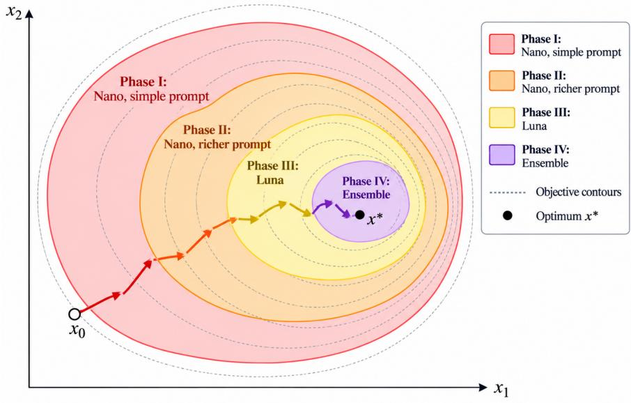  
Figure 1. Schematic illustration of stage-dependent oracle switching. At coarse accuracy scales, a low-cost oracle can be suficient for continued progress; as optimization approaches $x ^ { * }$ , higher-fidelity oracles become worthwhile or necessary. The actual switching points depend jointly on oracle cost, bias, variance, and the current optimization scale.

Framework for Mixed-Fidelity Stochastic Oracles We consider a general model for stochastic optimization, where mixed-fidelity oracles can be used to provide stochastic gradients, with known costs and state-dependent bias and variance. The goal is to minimize

$$
f ^ { * } : = \operatorname* { m i n } _ { x \in X } f ( x ) ,\tag{1.1}
$$

where $X \subseteq \mathbb { R } ^ { d }$ is closed and convex, and f is L-smooth and µ-strongly convex<sup>2</sup>. For example, one can consider the least squares loss for any regression problem. We assume that we have access to ℓ stochastic first-order oracles $\{ S O _ { \lambda } \} _ { \lambda = 1 } ^ { \ell }$ , where a query to $S O _ { \lambda }$ costs $c _ { \lambda }$ and this is known to the user. The fidelity of the oracle is governed by three parameters: (i) the systemic bias of the oracle $\boldsymbol { B } _ { \lambda } ; ( \mathrm { i i } )$ the state-dependent modulus $\mathcal { L } _ { \lambda ; \mathbf { \lambda } } ( \mathrm { i i i } )$ the residual variance near the optimum $\sigma _ { \lambda , * } ^ { 2 }$ . A query to $\mathrm { S O } _ { \lambda }$ at point x returns a stochastic gradient $\mathcal { G } _ { \lambda } ( x , \xi )$ with mean $g _ { \lambda } ( x ) = \mathbb { E } _ { \xi } [ \mathcal { G } _ { \lambda } ( x , \xi ) ]$ , and

$$
\| g _ { \lambda } ( x ) - \nabla f ( x ) \| \leq B _ { \lambda } ,\tag{1.2}
$$

$$
\begin{array} { r } { \mathbb { E } \| \mathcal { G } _ { \lambda } ( x , \xi ) - g _ { \lambda } ( x ) \| ^ { 2 } \leq \mathcal { L } _ { \lambda } [ f ( x ) - f ^ { * } ] + \sigma _ { \lambda , * } ^ { 2 } . } \end{array}\tag{1.3}
$$

The first condition captures systematic oracle bias. In our most general setting, we do not assume knowledge of the bias parameter. The second condition allows the stochastic variance to depend on the current optimization error: the component $\mathcal { L } _ { \lambda } [ f ( x ) - f ^ { * } ]$ decreases as optimization progresses, while the residual variance $\sigma _ { \lambda , : } ^ { 2 }$ is non-diminishing even near the optimum. This setting coincides with our framework where the noise introduced by stochastic oracles depend on the optimization progress. Together, $B _ { \lambda } , \mathcal { L } _ { \lambda } , \sigma _ { \lambda , * } ^ { 2 }$ , and the price $c _ { \lambda }$ determine the value of oracle λ at a given accuracy scale. In an LLM pipeline, an oracle may correspond to a model, prompt, ensemble, or human–AI combination, while $f$ represents the downstream objective rather than the upstream completion or annotation task itself. Section 2 gives concrete examples and verifies these assumptions for LLM-generated labels and completed covariates.

## 1.1 Contributions.

Our main contributions lie in the design and analysis of cost-eficient adaptive oracle-switching meta-algorithms, together with concrete stochastic optimization subroutines and LLM experiments.

• Multistage oracle-switching with known bias. We develop a generic meta-algorithm that uses a chosen stochastic optimization subroutine across stages, so that the current squared-distance radius is reduced by a constant factor. At each stage, the policy selects the most cost-eficient oracle for achieving the next contraction among all oracles with admissible bias. As one concrete contraction subroutine, we analyze a strongly convex variant of stochastic gradient extrapolation (SGE) (Lan and Zhou, 2018) under state-dependent noise and persistent bias. For unbiased oracles, the cumulative cost of our framework is no larger than that of the best fixed oracle in hindsight, and the savings can be up to $\Theta ( K / \log K )$ over K stages. With biased oracles, the framework can exploit cheaper sources early while ultimately reaching the accuracy scale allowed by lower-bias sources.

• Characterizing cost with respect to desired accuracy: The stagewise formulation yields explicit operational criteria for comparing oracle cost and fidelity. We characterize when one oracle is dominated by another and derive stage-dependent break-even prices that quantify how much one should be willing to pay for a higher-fidelity source at a given downstream accuracy level. Our results can help vendors check a simple condition dependent on their downstream task, and decide which oracles are useful in their pipeline.

• Budgeted certification with unknown bias. When bias parameters are unavailable or hard-to-estimate, we develop a second meta-algorithm based on occasional trusted projectedgradient certification. We introduce a budget parameter to control how much uncertified training can be performed before the next checkpoint; failed sources are removed permanently while any certifiable progress is retained. We further show that recursive regularization combined with biased SGE provides a concrete projected-gradient reduction subroutine for certification, and characterize the resulting tradeof between frequent certification and delayed detection of biased sources.

• Empirical validation. We conducted controlled simulations and LLM-completion experiments on the Aspiring Minds hiring dataset. The adaptive strategy exhibits the predicted stage-dependent switching and achieves substantial cost savings relative to strategies with a fixed stochastic oracle. At 10% missingness, for example, the adaptive policy follows

Nano LR-short-7 (SO2) −→ Nano LR-10 (SO4) −→ Luna (SO5) −→ Avg. Haiku+Sonnet (SO8),

skipping several more expensive alternatives. The cumulative cost is about \$72, versus about \$240 for always using the best oracle, a reduction of roughly 70% while reaching the same accuracy scale. Our experiments also provide clear evidence for the certification frequency tradeof when the bias parameters are unknown.

## 1.2 Related work

LLM data curation and noisy supervision. LLMs are increasingly used to improve data quality before it enters a downstream learning or decision problem. For missing-data imputation, Hayat and Hasan (2025) use contextual information from pre-trained language models, He et al. (2025) combine graph-augmented prompting with an ensemble of LLMs, and Wang et al. (2025b) develop an LLM-based spatiotemporal imputation model for highly sparse remote-sensing data. Related work uses LLMs for general-purpose data cleaning and matching (Zhang et al., 2024; Parciak et al., 2024; Peeters et al., 2025), and for identifying or correcting noisy interactions in recommender systems (Wang et al., 2025c,a). On the labeling side, LLMs can serve as scalable annotators or assist human annotators (Gilardi et al., 2023; Goel et al., 2023); recent work also studies how to detect label errors (Nahum et al., 2025) and train classifiers robustly from LLMgenerated noisy labels (Ye et al., 2025). These papers primarily ask how LLMs can improve upstream data quality. Our focus is complementary: given several data-generation or curation pipelines with diferent costs and fidelities, we ask how their value changes with the stage of the downstream optimization problem.

Cost-aware model selection and data markets. Closest to our cost perspective are systems that choose diferent models for diferent inference queries. Chen et al. (2024) propose FrugalGPT which exploits heterogeneous model prices and task performance to construct lower-cost cascades. Ong et al. (2025) propose RouteLLM that learns to route prompts between stronger and weaker models using preference data. In a concurrent work, Belloni et al. (2026) develop an online learning approach to adaptively query and select LLM APIs. Our setting is diferent: the source is selected according to the progress of a downstream optimization algorithm, rather than independently for each inference query. More broadly, the economics literature studies data as a priced asset and analyzes data markets, valuation, and pricing distortions (Acemoglu et al., 2022; Farboodi and Veldkamp, 2023). The value of clean versus corrupted data also appears outside the LLM setting. Denoising is central to difusion-based generative modeling (Ho et al., 2020), while Daras et al. (2025) explicitly quantify how noisy training samples trade of against clean samples in ambient difusion.

Stochastic, multi-fidelity, and multilevel optimization. Multi-fidelity optimization and simulation exploit sources of diferent costs and accuracies, often to reduce the number of expensive evaluations (Peherstorfer et al., 2018; Kandasamy et al., 2017). In first-order methods and stochastic approximation (Polyak, 1990; Nemirovski et al., 2009), inexact-oracle models quantify the efect of deterministic errors (Devolder et al., 2014), while biased stochastic-gradient analyses study persistent gradient bias; see, e.g., Ajalloeian and Stich (2020). Our noise model is also related to stochastic optimization with state-dependent noise conditions that replace a uniform variance bound by one that decreases near the solution (Gower et al., 2019; Aybat et al., 2019; Gower et al., 2021; Woodworth and Srebro, 2021; Kotsalis et al., 2022; Juditsky et al., 2023; Ilandarideva et al., 2025; Rodomanov et al., 2024). As one concrete implementation of our meta-algorithms, we use SGE-type acceleration proposed by Lan and Zhou (2018), whose extrapolation structure is well suited to state-dependent noise as shown in Ilandarideva et al. (2025). Moreover, our unknownbias construction is related to learning from weak or inexpensive information augmented by a small trusted source (Ratner et al., 2017; Hendrycks et al., 2018; Angelopoulos et al., 2023), and uses recursive regularization for gradient minimization in stochastic settings (Allen-Zhu, 2018; Foster et al., 2019) for certification.

Closely related to our bias–variance–cost perspective is the multilevel Monte Carlo (MLMC) line of work on stochastic optimization with biased oracles. Hu et al. (2021, 2024) study a hierarchy of increasingly accurate and increasingly expensive biased stochastic oracles and design MLMC gradient estimators that exploit the joint tradeof among bias, variance, and query cost. This line builds on MLMC and randomized-debiasing ideas for stochastic approximation (Giles, 2008; Blanchet and Glynn, 2015; Dereich and M¨uller-Gronbach, 2019; Blanchet et al., 2017; Beatson and Adams, 2019; Asi et al., 2021). In particular, Beatson and Adams (2019) tune randomized telescoping estimators according to optimization progress per unit of computation, while Asi et al. (2021) use multilevel randomization to construct low-bias, low-cost estimators for optimization subroutines. Our setting shares the principle that lower bias should be purchased only when it is worth the additional cost, but the oracle model and algorithmic mechanism are diferent. The MLMC framework assumes a structured approximation hierarchy and exploits coupled diference estimators across adjacent fidelity levels. By contrast, we allow a finite collection of heterogeneous black-box stochastic oracles that need not be nested, ordered by fidelity, or coupled through diference estimators.

## 1.3 Notation and organization

Throughout the paper, we let $\| \cdot \|$ denote the Euclidean norm for vectors and the spectral norm for matrices, and let $\langle \cdot , \cdot \rangle$ denote the Euclidean inner product. We let $x ^ { * }$ denote an optimal solution of (1.1). We use E for expectation. For symmetric matrices A and B, $A \preceq B$ means that $B - A$ is positive semidefinite, and $\lambda _ { \mathrm { m a x } } ( A )$ denotes the largest eigenvalue of A. For a nonempty closed convex set Y , we denote the Euclidean projection by

$$
\Pi _ { Y } ( x ) : = \arg \operatorname* { m i n } _ { z \in Y } \| z - x \| .
$$

For a stepsize $\gamma > 0$ , the projected-gradient mapping of f over Y is defined as

$$
\begin{array} { r } { \mathsf { G } _ { Y , \gamma } ^ { f } ( x ) : = \frac { 1 } { \gamma } \left[ x - \Pi _ { Y } \big ( x - \gamma \nabla f ( x ) \big ) \right] . } \end{array}\tag{1.4}
$$

We use the shorthand ${ \sf G } _ { Y , \gamma } ( x )$ when the function $f$ is clear from the context. Finally, ${ \widetilde { O } } ( \cdot )$ suppresses logarithmic factors.

The rest of the paper is organized as follows. Section 2 gives concrete examples on LLMgenerated labels and LLM-completion and verifies the oracle assumptions. Section 3 develops the known-bias meta-algorithm and proposes biased SGE as a concrete contraction subroutine. Section 4 characterizes when higher fidelity is worth paying for, including oracle domination and break-even-price interpretations. Section 5 develops the unknown-bias budgeted-certification metaalgorithm, proposes a projected-gradient reduction subroutine using recursive regularization, and studies how often certification should be purchased. Section 6 reports the numerical experiments.

## 2 Applications: LLM-generated labels and completed data

In this section, we provide two concrete examples showing how the mixed-fidelity assumptions arise in LLM-assisted data pipelines. The first considers LLM-generated or LLM-corrected labels; while the second considers LLM reconstruction of missing covariates. In both cases, stronger models, richer prompts, ensembles, or human review can be represented as more expensive oracles with diferent bias and variance parameters.

## 2.1 LLM-generated noisy labels

Consider a generalized linear model with feature vector θ and clean conditional mean

$$
\mathbb { E } [ y | \boldsymbol { \theta } ] = u ( \boldsymbol { \theta } ^ { \top } \boldsymbol { x } ^ { * } ) ,\tag{2.1}
$$

where $u = v ^ { \prime }$ is $\bar { r } { - }  { \mathrm { I } }$ ipschitz and r-strongly monotone. The clean population objective is

$$
\boldsymbol { f } ( \boldsymbol { x } ) = \mathbb { E } \left[ \boldsymbol { v } ( \boldsymbol { \theta } ^ { \top } \boldsymbol { x } ) - \boldsymbol { y } \boldsymbol { \theta } ^ { \top } \boldsymbol { x } \right] .\tag{2.2}
$$

Assume $x ^ { * }$ is an interior point over the feasible region $X ,$ , so that $\nabla f ( x ^ { * } ) = 0$

Suppose the stochastic oracle λ obtains labels from an LLM, a human annotator, or a hybrid procedure, such that

$$
\begin{array} { r } { y ^ { \lambda } = u ( { \boldsymbol { \theta } } ^ { \top } { \boldsymbol { x } } ^ { * } ) + b _ { \lambda } ( { \boldsymbol { \theta } } ) + \varepsilon ^ { \lambda } , } \end{array}\tag{2.3}
$$

where $\mathbb { E } [ \varepsilon ^ { \lambda } | \theta ] = 0$ and $b _ { \lambda } ( \theta )$ represents systematic annotation error. Then the stochastic gradient

$$
\mathcal { G } _ { \lambda } ( x ; \theta , y ^ { \lambda } ) = \theta \big ( u ( \theta ^ { \top } x ) - y ^ { \lambda } \big )
$$

has mean $g _ { \lambda } ( x ) = \mathbb { E } [ \mathcal { G } _ { \lambda } ( x ; \theta , y ^ { \lambda } ) ]$ satisfying

$$
\begin{array} { r } { g _ { \lambda } ( x ) - \nabla f ( x ) = - \mathbb { E } [ \theta b _ { \lambda } ( \theta ) ] , } \end{array}
$$

so the bias condition (1.2) holds with $B _ { \lambda } = \| \mathbb { E } [ \theta b _ { \lambda } ( \theta ) ] \|$ . This systematic bias can be viewed as a natural distinction between, for example, a cheap LLM labeler with systematic class-specific errors and a more expensive expert-reviewed labeler.

The state-dependent variance condition (1.3) follows under a standard fourth-moment assumption. Let $\Sigma = \mathbb { E } [ \theta \theta ^ { \top } ]$ and suppose $\mathbb { E } [ \lVert \theta \rVert ^ { 2 } \theta \theta ^ { \top } ] \preceq \varsigma \Sigma$ . Invoke that the strong monotonicity of u

indicates $f ( x ) - f ^ { * } \geq ( { \underline { { r } } } / { 2 } ) ( x - x ^ { * } ) ^ { \top } \Sigma ( x - x ^ { * } )$ . We can decompose $\mathcal { G } _ { \lambda } - g _ { \lambda }$ to obtain

$$
\begin{array} { r l } & { \mathbb { E } \| \mathcal { G } _ { \lambda } ( x ; \theta , y ^ { \lambda } ) - g _ { \lambda } ( x ) \| ^ { 2 } = \mathbb { E } \left\| \theta \big ( u ( \theta ^ { \top } x ) - u ( \theta ^ { \top } x ^ { * } ) \big ) - \theta ( b _ { \lambda } ( \theta ) + \varepsilon ^ { \lambda } ) + \mathbb { E } [ \theta b _ { \lambda } ( \theta ) ] \right\| ^ { 2 } } \\ & { \quad \quad \quad \quad \quad \quad \quad \quad \quad \quad \quad \quad \quad \quad \quad \quad \quad \quad \quad \quad \quad \quad \quad \quad \quad } \\ & { \quad \quad \quad \quad \quad \quad \quad \quad \quad \quad \quad \quad \quad \le 2 \mathbb { E } \left\| \theta \big ( u ( \theta ^ { \top } x ) - u ( \theta ^ { \top } x ^ { * } ) \big ) \right\| ^ { 2 } + \sigma _ { \lambda , * } ^ { 2 } } \\ & { \quad \quad \quad \quad \quad \quad \quad \quad \quad \quad \quad \quad \le 2 \bar { r } ^ { 2 } \mathbb { E } [ \| \theta \| ^ { 2 } \| \theta ^ { \top } ( x - x ^ { * } ) \| ^ { 2 } ] + \sigma _ { \lambda , * } ^ { 2 } } \\ & { \quad \quad \quad \quad \quad \quad \quad \quad \quad \le 2 \bar { r } ^ { 2 } \varsigma ( x - x ^ { * } ) ^ { \top } \Sigma ( x - x ^ { * } ) + \sigma _ { \lambda , * } ^ { 2 } } \\ & { \quad \quad \quad \quad \quad \quad \quad \quad \quad \quad \quad \quad \quad \quad \le \frac { 4 \bar { r } ^ { 2 } \varsigma } { r } [ f ( x ) - f ^ { * } ] + \sigma _ { \lambda , * } ^ { 2 } , } \end{array}\tag{2.4}
$$

where $\sigma _ { \lambda , \ast } ^ { 2 } = 2 \mathbb { E } \left. \left. \theta \left( b _ { \lambda } ( \theta ) + \varepsilon ^ { \lambda } \right) - \mathbb { E } [ \theta b _ { \lambda } ( \theta ) ] \right. \right. ^ { 2 }$ . Thus, diferent label sources can share essentially the same state-dependent component that does not depend on the labeling error $b _ { \lambda } ( \theta )$ and $\epsilon ^ { \lambda }$ , while having very diferent bias and residual variance. In practice, repeated annotations or a small trusted calibration set can be used to estimate these quantities, which is precisely the setting motivating the certification mechanism in Section 5.

## 2.2 LLM completion of missing covariates

In this subsection, we consider the same generalized linear model $( 2 . 1 )$ as in Subsection 2.1, but our observation of θ has various missing entries. As before, assume $x ^ { * }$ is an interior point of X, and the clean population objective is (2.2). Suppose the model–prompt pipeline $\lambda$ reconstructs missing entries of $\theta$ to produce $ { \bar { \theta } } _ { \lambda }$ . The resulting stochastic-gradient oracle is

$$
\mathcal { G } _ { \lambda } ( x ; \widetilde { \theta } _ { \lambda } , y ) = \widetilde { \theta } _ { \lambda } \big ( u ( \widetilde { \theta } _ { \lambda } ^ { \top } x ) - y \big ) ,
$$

with mean $g _ { \lambda } ( x ) = \mathbb { E } [ \mathcal { G } _ { \lambda } ( x ; \widetilde { \theta } _ { \lambda } , y ) ]$ . Define the bias at the optimum by $b _ { \lambda } : = g _ { \lambda } ( x ^ { \ast } )$

For $a , b \in \mathbb { R }$ , define $\begin{array} { r } { q ( a , b ) = \frac { u ( a ) - u ( b ) } { a - b } } \end{array}$ <sup>)</sup> for a ̸= $a \neq b$ , and choose any $q ( a , a )$ as an arbitrary number in [r, r¯]. By strong monotonicity and Lipschitz continuity of $u ,$ we have $\underline { { r } } \le q ( a , b ) \le \bar { r }$ . Let

$$
\begin{array} { r } { Q ( \boldsymbol { x } ) = \mathbb { E } \Big [ \boldsymbol { q } ( \boldsymbol { \theta } ^ { \top } \boldsymbol { x } , \boldsymbol { \theta } ^ { \top } \boldsymbol { x } ^ { * } ) \boldsymbol { \theta } \boldsymbol { \theta } ^ { \top } \Big ] , \quad Q _ { \lambda } ( \boldsymbol { x } ) = \mathbb { E } \Big [ \boldsymbol { q } ( \widetilde { \boldsymbol { \theta } } _ { \lambda } ^ { \top } \boldsymbol { x } , \widetilde { \boldsymbol { \theta } } _ { \lambda } ^ { \top } \boldsymbol { x } ^ { * } ) \widetilde { \boldsymbol { \theta } } _ { \lambda } \widetilde { \boldsymbol { \theta } } _ { \lambda } ^ { \top } \Big ] . } \end{array}
$$

Since $\nabla f ( x ^ { * } ) = 0$ , we have

$$
\begin{array} { r l } & { g _ { \lambda } ( x ) - \nabla f ( x ) = b _ { \lambda } + \mathbb { E } \left[ \widetilde { \theta } _ { \lambda } \big ( u ( \widetilde { \theta _ { \lambda } ^ { \top } } x ) - u ( \widetilde { \theta _ { \lambda } ^ { \top } } x ^ { * } ) \big ) - \theta \big ( u ( \theta x ) - u ( \theta ^ { \top } x ^ { * } ) \big ) \right] } \\ & { \qquad = b _ { \lambda } + \big ( Q _ { \lambda } ( x ) - Q ( x ) \big ) ( x - x ^ { * } ) . } \end{array}\tag{2.5}
$$

Therefore, assuming max $x \in X \left\| x - x ^ { * } \right\| \leq D$ and defining $\Delta _ { \lambda } ( D ) : = \operatorname* { s u p } _ { \| x - x ^ { * } \| \leq D } \| Q _ { \lambda } ( x ) - Q ( x ) \|$ the uniform-bias assumption (1.2) holds with

$$
B _ { \lambda } \leq \| b _ { \lambda } \| + \Delta _ { \lambda } ( D ) D .\tag{2.6}
$$

Thus, higher-quality completions can reduce both the bias at the optimum and the local curvature mismatch induced by reconstructing the covariates.

The variance also satisfies the state-dependent noise model. Suppose E $\left[ \lVert \widetilde { \boldsymbol { \theta } } _ { \lambda } \rVert ^ { 2 } \widetilde { \boldsymbol { \theta } } _ { \lambda } \widetilde { \boldsymbol { \theta } } _ { \lambda } ^ { \top } \right] \preceq \varsigma _ { \lambda } \mathbb { E } [ \boldsymbol { \theta } \boldsymbol { \theta } ^ { \top } ]$ and let $\bar { \sigma } _ { \lambda , \ast } ^ { 2 } : = \mathbb { E } \left\| \mathcal { G } _ { \lambda } ( x ^ { \ast } ; \widetilde { \theta } _ { \lambda } , y ) - g _ { \lambda } ( x ^ { \ast } ) \right\| ^ { 2 }$ . Using the ¯r-Lipschitz continuity of u and strong monotonicity, $\begin{array} { r } { f ( x ) - \dot { f ^ { * } } \geq \frac { r } { 2 } ( x - x ^ { * } ) ^ { \top } \mathbb { E } [ \theta \theta ^ { \top } ] \dot { ( x - x ^ { * } ) } } \end{array}$ , we obtain a similar bound as in Ineq. (2.4), i.e.,

$$
\begin{array} { r } { \mathbb { E } \| \mathcal { G } _ { \lambda } ( x , \xi ) - g _ { \lambda } ( x ) \| ^ { 2 } \leq \frac { 4 \bar { r } ^ { 2 } \varsigma _ { \lambda } } { \underline { { r } } } [ f ( x ) - f ^ { * } ] + 2 \bar { \sigma } _ { \lambda , * } ^ { 2 } , } \end{array}\tag{2.7}
$$

which verifies the state-dependent noise assumption (1.3).

Linear regression as a special case. Linear regression is recovered by taking $u ( t ) = t .$ . In this case, $Q ( x ) = \Sigma : = \mathbb { E } [ \theta \theta ^ { \top } ]$ and $Q _ { \lambda } ( x ) = \Sigma _ { \lambda } : = \mathbb { E } [ \widetilde { \theta } _ { \lambda } \widetilde { \theta } _ { \lambda } ^ { \top } ]$ , thus Eq. (2.5) reduces to the Hessianmismatch decomposition

$$
g _ { \lambda } ( x ) - \nabla f ( x ) = b _ { \lambda } + ( \Sigma _ { \lambda } - \Sigma ) ( x - x ^ { \ast } ) ,\tag{2.8}
$$

and $B _ { \lambda } \leq \| b _ { \lambda } \| + \| \Sigma _ { \lambda } - \Sigma \| D$ . The variance can also be characterized in a more fine-grained manner. Define $M _ { \lambda , \xi } : = \bar { \theta } _ { \lambda } \bar { \theta } _ { \lambda } ^ { \top } - H _ { \lambda }$ . We have

$$
\mathcal { G } _ { \lambda } ( x ; \widetilde { \theta } _ { \lambda } , y ) - g _ { \lambda } ( x ) = M _ { \lambda , \xi } ( x - x ^ { * } ) + \mathcal { G } _ { \lambda } ( x ^ { * } ; \widetilde { \theta } _ { \lambda } , y ) - g _ { \lambda } ( x ^ { * } ) .
$$

Define $\nu _ { \lambda } ^ { 2 } : = \lambda _ { \operatorname* { m a x } } \Big ( \mathbb { E } [ M _ { \lambda , \xi } ^ { \top } M _ { \lambda , \xi } ] \Big )$ and $\bar { \sigma } _ { \lambda , * } ^ { 2 } : = \mathbb { E } \| \mathcal { G } _ { \lambda } ( x ^ { * } ; \widetilde { \theta } _ { \lambda } , y ) - g _ { \lambda } ( x ^ { * } ) \| ^ { 2 }$ . Using strong convexity yields

$$
\begin{array} { r } { \mathbb { E } \| \mathcal { G } _ { \lambda } ( x , \xi ) - g _ { \lambda } ( x ) \| ^ { 2 } \leq \frac { 4 \nu _ { \lambda } ^ { 2 } } { \mu } [ f ( x ) - f ^ { * } ] + 2 \bar { \sigma } _ { \lambda , * } ^ { 2 } , } \end{array}\tag{2.9}
$$

which verifies the state-dependent noise assumption (1.3). This example directly matches our LLMcompletion experiments: diferent models and prompts induce diferent reconstructed datasets, costs, bias levels, and state-dependent variance.

## 3 Known bias: cost-aware oracle-switching

In this section, we introduce a multistage adaptive oracle switching strategy assuming the bias parameters $\{ B _ { \lambda } \} _ { \lambda = 1 } ^ { \ell }$ are known. To enable the design of the multistage meta-algorithm, we first assume access to a stochastic optimization subroutine that can reduce the current expected squared distance to the optimum by a constant factor at a predictable cost. A concrete choice of an eficient subroutine will be discussed in Subsection 3.1.

Definition 1 (Distance-contraction subroutine). Consider an optimization subroutine Contract $( y , R ; \mathrm { S O } _ { \lambda } )$ ， which takes an initial point y, a target radius $R ,$ and a stochastic oracle $\mathrm { S O } _ { \lambda }$ as inputs. Associated with the subroutine are a bias-admissibility condition $\mathsf { A d m } _ { \mathrm { C } } ( R , B _ { \lambda } )$ and an oracle complexity bound $T ( R , \lambda )$ . We say that Contract is a valid distance-contraction subroutine $i f ,$ whenever

$$
\begin{array} { r } { \mathbb { E } \| y - x ^ { * } \| ^ { 2 } \leq R ^ { 2 } \quad a n d \quad \mathsf { A d m } _ { \mathrm { C } } ( R , \mathcal { B } _ { \lambda } ) ~ h o l d s , } \end{array}
$$

it uses at most $T ( R , \lambda )$ calls to $\mathrm { S O } _ { \lambda }$ and returns $y ^ { + }$ satisfying $\begin{array} { r } { \mathbb { E } \| y ^ { + } - x ^ { * } \| ^ { 2 } \leq \frac { R ^ { 2 } } { 2 } } \end{array}$

Here $\mathsf { A d m } _ { \mathrm { C } } ( R , B _ { \lambda } )$ represents the bias requirement needed for the stochastic oracle $\mathrm { S O } _ { \lambda }$ to achieve the desired contraction, which depends on oracle $\mathrm { S O } _ { \lambda }$ only through its bias level $B _ { \lambda }$ . In contrast, the complexity bound $T ( R , \lambda )$ ) depends on problem parameters such as $L$ and $\mu ,$ and other oracle characteristics such as its variance parameters $\sigma _ { \lambda , * } ^ { 2 }$ and $\mathcal { L } _ { \lambda }$ . The initial point $y$ in Definition 1 may itself be random. The expectation is taken over both the randomness of $y$ and the fresh randomness used by the subroutine.

Algorithm 1 requires only this input–output guarantee as in Definition 1, so the inner subroutine may be the classic stochastic approximation type methods, variance-reduced methods, or any other procedure with a known bias-admissibility condition and sample complexity budget. In particular, at stage s, given $\mathbb { E } \| y ^ { s - 1 } - x ^ { * } \| ^ { 2 } \leq R _ { s - 1 } ^ { 2 }$ , the algorithm selects, among the admissible oracles, the one with the lowest cost for producing the next contraction.

```latex
Algorithm 1 Cost-aware contraction meta-algorithm with known bias
1: Input: initial point $y ^ { 0 } ,$ radius $R _ { 0 } ,$ , oracle pool $\mathcal { P } = \{ \mathrm { S O } _ { \lambda } \} _ { \lambda = 1 } ^ { \ell } ,$ contraction subroutine Contract.
2: for $s = 1 , 2 , \ldots$ do
3: $\mathcal { P } _ { s } \gets \{ \lambda \in \mathcal { P } : \mathsf { A d m } _ { \mathrm { C } } ( R _ { s - 1 } , B _ { \lambda } )$ holds}; stop if ${ \mathcal { P } } _ { s } = \emptyset .$
4: $\begin{array} { r } { \lambda _ { s }  \arg \operatorname* { m i n } _ { \lambda \in \mathcal { P } _ { s } } c _ { \lambda } T ( R _ { s - 1 } , \lambda ) . } \end{array}$
5: $y ^ { s } \gets \mathsf { C o n t r a c t } ( y ^ { s - 1 } , R _ { s - 1 } ; \mathrm { S O } _ { \lambda _ { s } } )$
6: $R _ { s } ^ { 2 } \gets R _ { s - 1 } ^ { 2 } / 2 .$
7: end for
```

A straightforward convergence guarantee for Algorithm 1 is stated as follows.

Proposition 1 (Stagewise convergence). Suppose $\mathbb { E } \| y ^ { 0 } - x ^ { * } \| ^ { 2 } \leq R _ { 0 } ^ { 2 }$ and the admissible set $\mathcal { P } _ { s }$ in Algorithm 1 is nonempty at every completed stage. Then

$$
\begin{array} { r } { \mathbb { E } \| y ^ { s } - x ^ { * } \| ^ { 2 } \leq R _ { s } ^ { 2 } = 2 ^ { - s } R _ { 0 } ^ { 2 } . } \end{array}
$$

Consequently, after $K = \lceil \log _ { 2 } ( R _ { 0 } ^ { 2 } / \epsilon ) \rceil$ stages, we have $\mathbb { E } \| y ^ { K } - x ^ { * } \| ^ { 2 } \leq \epsilon .$

Proof. The claim follows by induction. At stage s, the selected oracle $\lambda _ { s }$ is admissible, so Definition 1 guarantees $\mathbb { E } \lVert y ^ { s } - x ^ { * } \rVert ^ { 2 } \leq R _ { s - 1 } ^ { 2 } / 2 = R _ { s } ^ { 2 }$ □

For simplicity, let us consider the unbiased setting where the bias admissibility condition $\mathsf { A d m } _ { \mathrm { C } } ( R , B _ { \lambda } )$ holds for any $R > 0$ and $\lambda \in [ \ell ]$ . For $\epsilon > 0$ , to find a solution ¯y such that $\mathbb { E } \lVert \bar { y } - x ^ { * } \rVert ^ { 2 } \leq \epsilon$ requires $K = \lceil \log _ { 2 } ( R _ { 0 } ^ { 2 } / \epsilon ) \rceil$ stages. The total cumulative cost of running Algorithm 1 is

$$
\mathrm { C o s t } _ { \mathrm { a d a p } } ( \epsilon ) = \sum _ { s = 1 } ^ { K } \operatorname* { m i n } _ { \lambda } T ( R _ { s - 1 } , \lambda ) .
$$

In comparison, the total cumulative cost of always using the best fixed oracle in each stage can be bounded by

$$
\mathrm { C o s t } _ { \mathrm { f i x e d } } ( \epsilon ) = \operatorname* { m i n } _ { \lambda } \sum _ { s = 1 } ^ { K } T ( R _ { s - 1 } , \lambda ) .
$$

Therefore, we always have $\mathrm { C o s t } _ { \mathrm { a d a p } } ( \epsilon ) \ \leq \ \mathrm { C o s t } _ { \mathrm { f i x e d } } ( \epsilon )$ . The largest potential improvement for $\mathrm { C o s t } _ { \mathrm { a d a p } } ( \epsilon )$ compared with $\operatorname { C o s t } _ { \mathrm { f i x e d } } ( \epsilon )$ will be discussed after presenting the stochastic gradient extrapolation (SGE) subroutine in the next subsection.

## 3.1 Biased SGE: an eficient contraction subroutine

We next show that stochastic gradient extrapolation (SGE) can serve as an eficient subroutine under our biased state-dependent noise model. Specifically, Algorithm 2 extends the existing design and analyses of SGE (Lan and Zhou, 2018; Ilandarideva et al., 2025) by allowing persistent gradient bias and incorporating strong convexity through an additional regularizer $\frac { \mu \alpha _ { t } } { 2 } \lVert x _ { t - 1 } - z \rVert ^ { 2 }$ . This strongly convex variant of SGE will be reused in Subsection 5.2, as a subroutine for the recursive regularization algorithm for gradient minimization.

In this subsection, we consider a fixed stochastic oracle λ. Therefore, for the sake of simplicity, we use the simplified notation $\mathcal { G }$ to denote the selected stochastic first-order oracle and $g ( x ) =$ $\mathbb { E } [ \mathcal { G } ( x , \xi ) ]$ , and use $\mathcal { L } , \ \sigma _ { * } ^ { 2 } .$ , and B to denote its variance and bias parameters. Additionally, we assume $x ^ { * }$ is an interior point of the feasible region X, so that $\nabla f ( x ^ { * } ) = 0$

Algorithm 2 Stochastic gradient extrapolation (SGE)   
1: Input: $x _ { 0 } = x _ { - 1 } = z _ { 0 }$ and parameters $\{ \alpha _ { t } , \eta _ { t } , \tau _ { t } \}$   
2: for t = 1, 2, . . . do   
3: $\widetilde { G } _ { t }  G _ { t - 1 } ( x _ { t - 1 } ) + \alpha _ { t } \big ( G _ { t - 1 } ( x _ { t - 1 } ) - G _ { t - 1 } ( x _ { t - 2 } ) \big ) .$   
4: $\begin{array} { r } { z _ { t } \gets \arg \operatorname* { m i n } _ { z \in X } \{ \langle \widetilde { G } _ { t } , z \rangle + \frac { \mu \alpha _ { t } } { 2 } \| x _ { t - 1 } - z \| ^ { 2 } + \frac { \eta _ { t } } { 2 } \| z _ { t - 1 } - z \| ^ { 2 } \} . } \end{array}$   
5: $\begin{array} { r } { x _ { t } \gets ( z _ { t } + \tau _ { t } x _ { t - 1 } ) / ( 1 + \tau _ { t } ) \mathrm { ~ a n d ~ } \mathrm { d r a w } G _ { t } ( \cdot ) = \frac { 1 } { m } \sum _ { i = 1 } ^ { m } \mathcal { G } ( \cdot , \xi _ { t , i } ) . } \end{array}$

The convergence guarantees of Algorithm 2 are characterized in the following theorem.

Theorem 1 (Biased SGE). Let $\{ x _ { t } \}$ be generated by Algorithm 2. Set $\begin{array} { r } { \alpha _ { t } = \frac { t - 1 } { t } , \tau _ { t } = \frac { t - 1 } { 3 } , \eta _ { t } = \frac { \eta } { t } } \end{array}$ for $t \leq 2 ,$ and $\begin{array} { r } { \eta _ { t } = \frac { \eta } { t } + \frac { \mu ( t - 3 ) } { 2 } f o r t \geq 3 , } \end{array}$ , where $\begin{array} { r } { \eta \ge \operatorname* { m a x } \{ 2 4 L , \frac { 5 4 \mathcal { L } } { m } + \frac { 1 6 2 \mathcal { L } ^ { 2 } } { \mu m ^ { 2 } } \} . ~ T h e n ^ { 3 } , f o r ~ k \ge 3 , } \end{array}$

$$
\begin{array} { r l } & { \mathbb { E } [ f ( x _ { k } ) - f ^ { * } ] \leq \left( \frac { 7 2 L } { k ( k + 2 ) } + \frac { 1 6 2 \mathcal { L } } { m k ( k + 2 ) } + \frac { 4 8 6 \mathcal { L } ^ { 2 } } { \mu m ^ { 2 } k ( k + 2 ) } \right) \| x _ { 0 } - x ^ { * } \| ^ { 2 } + \frac { 2 } { 9 k ( k + 2 ) } [ f ( x _ { 0 } ) - f ^ { * } ] + \frac { 1 9 2 \sigma _ { * } ^ { 2 } } { \mu m ( k + 2 ) } + \frac { 2 1 6 B ^ { 2 } } { \mu } } \\ & { \qquad \leq \left( \frac { 7 3 L } { k ( k + 2 ) } + \frac { 1 6 2 \mathcal { L } } { m k ( k + 2 ) } + \frac { 4 8 6 \mathcal { L } ^ { 2 } } { \mu m ^ { 2 } k ( k + 2 ) } \right) \| x _ { 0 } - x ^ { * } \| ^ { 2 } + \frac { 1 9 2 \sigma _ { * } ^ { 2 } } { \mu m ( k + 2 ) } + \frac { 2 1 6 B ^ { 2 } } { \mu } . \qquad ( 3 . 1 ) } \end{array}
$$

In particular, $\begin{array} { r } { f o r m = 1 \ a n d \ k \geq \operatorname* { m a x } \{ 9 8 \sqrt { \frac { L } { \mu } } , 1 4 4 \sqrt { \frac { \mathscr { L } } { \mu } } , \frac { 1 0 2 \mathscr { L } } { \mu } , \frac { 3 0 7 2 \sigma _ { * } ^ { 2 } } { \mu ^ { 2 } \| x _ { 0 } - x ^ { * } \| ^ { 2 } } \} . } \end{array}$ , we have

$$
\begin{array} { r } { \mathbb { E } \| x _ { k } - x ^ { * } \| ^ { 2 } \leq \frac { 2 } { \mu } \mathbb { E } [ f ( x _ { k } ) - f ^ { * } ] \leq \frac { 1 } { 4 } \| x _ { 0 } - x ^ { * } \| ^ { 2 } + \frac { 4 3 2 \mathcal { B } ^ { 2 } } { \mu ^ { 2 } } . } \end{array}\tag{3.2}
$$

Proof sketch. To prove the claim, we need to control the state-dependent variance, and also bound the error introduced by the persistent oracle bias. We begin with the SGE recursion stated in Proposition 4, whose proof follows from a similar analysis of SGE as in Ilandarideva et al. (2025) (see Appendix A.1.1). With this recursion, we can handle the state-dependent variance and systematic bias transparently. Our parameter choices ensure that the state-dependent variance terms can be absorbed into the converging function-value terms in this recursion. Taking the telescoping sum over the recursions yields

$$
A _ { k } \mathbb { E } [ f ( x _ { k } ) - f ^ { * } ] + \frac { P _ { k } } { 2 } \mathbb { E } \| z _ { k } - x ^ { * } \| ^ { 2 } \leq \Gamma _ { k } + B \sum _ { t = 1 } ^ { k } ( 3 t - 2 ) \mathbb { E } \| z _ { t } - x ^ { * } \| ,
$$

where $A _ { k }$ and $P _ { k }$ grow quadratically in $k ,$ and $\Gamma _ { k }$ contains the initial-error and residual-variance terms. To bound the accumulated bias, observe that the same inequality controls the distance of each $z _ { t }$ from $x ^ { * }$ . Thus, the distances appearing on the right-hand side can themselves be bounded in terms of the accumulated error. Applying Young’s inequality provides a bound of the form $2 \Gamma _ { k } + O ( k ^ { 2 } B ^ { 2 } / \mu )$ , and dividing both sides of the inequality by $A _ { k }$ yields the stated function-value bound. By further using the strong convexity property, we can obtain the distance-contraction guarantee. The full proof is deferred to Appendix A.1. □

## 3.2 Combining the oracle-switching meta-algorithm with the SGE subroutine

Theorem 1 provides an explicit implementation of Definition 1. For SGE, the bias-admissibility condition is

$$
\begin{array} { r } { \mathsf { A d m } _ { \mathrm { C } } ^ { \mathrm { S G E } } ( R , { \mathcal { B } } ) \quad \Longleftrightarrow \quad { \mathcal { B } } \le \frac { \sqrt { 3 } \mu R } { 7 2 } , } \end{array}\tag{3.3}
$$

and its oracle complexity is

$$
\begin{array} { r } { T ^ { \mathrm { S G E } } ( R , \lambda ) = \operatorname* { m a x } \left\{ 9 8 \sqrt { \frac { L } { \mu } } , 1 4 4 \sqrt { \frac { \mathcal { L } _ { \lambda } } { \mu } } , \frac { 1 0 2 \mathcal { L } _ { \lambda } } { \mu } , \frac { 3 0 7 2 \sigma _ { \lambda , * } ^ { 2 } } { \mu ^ { 2 } R ^ { 2 } } \right\} . } \end{array}\tag{3.4}
$$

Thus, we can use $\mathsf { C o n t r a c t } ^ { \mathrm { S G E } } ( y , R ; \mathrm { S O } _ { \lambda } )$ to represent running Algorithm 2 from a point y with oracle $\mathrm { S O } _ { \lambda }$ for $T ^ { \mathrm { S G E } } ( R , \lambda )$ iterations. By Theorem 1, it achieves the contraction in expected squared distance to the optimal solution whenever $\mathsf { A d m } _ { \mathrm { C } } ^ { \mathrm { S G E } } ( R , B _ { \lambda } )$ holds. Consequently, the adaptive oracle switching algorithm (Algorithm 1) can be instantiated with Contract<sup>SGE</sup>.

We next discuss the cost comparison between Algorithm 1 and using the best fixed oracle in all stages, quantifying the benefit of adaptive switching.

Corollary 1 (Comparison with the best fixed oracle). Suppose all oracles are unbiased, $i . e . , B _ { \lambda } =$ $0 , \ \forall \lambda$ . Define $A _ { \lambda } = c _ { \lambda } \operatorname* { m a x } \left\{ 9 8 { \sqrt { \frac { L } { \mu } } } , 1 4 4 { \sqrt { \frac { \mathscr { L } _ { \lambda } } { \mu } } } , { \frac { 1 0 2 \mathscr { L } _ { \lambda } } { \mu } } \right\}$ and $B _ { \lambda } = c _ { \lambda } \cdot \frac { 3 0 7 2 \sigma _ { \lambda , * } ^ { 2 } } { \mu ^ { 2 } R _ { 0 } ^ { 2 } } $ . For $\epsilon > 0$ , let $K = \lceil \log _ { 2 } ( R _ { 0 } ^ { 2 } / \epsilon ) \rceil$ . Then the total costs of Algorithm 1 and using the best-fixed oracle throughout satisfy

$$
\begin{array} { r l } & { \mathrm { C o s t } _ { \mathrm { a d a p } } ( \epsilon ) = \displaystyle \sum _ { s = 1 } ^ { K } \operatorname* { m i n } _ { \lambda } \operatorname* { m a x } \{ A _ { \lambda } , B _ { \lambda } \} ^ { s - 1 } \} , } \\ & { \mathrm { C o s t } _ { \mathrm { f i x e d } } ( \epsilon ) = \displaystyle \operatorname* { m i n } _ { \lambda } \sum _ { s = 1 } ^ { K } \operatorname* { m a x } \{ A _ { \lambda } , B _ { \lambda } \} ^ { s - 1 } \} = \mathcal { O } \left( \operatorname* { m i n } _ { \lambda } \left\{ c _ { \lambda } \cdot \left( \sqrt { \frac { L } { \mu } } \log _ { 2 } \frac { R _ { 0 } ^ { 2 } } { \epsilon } + \frac { \mathcal { L } _ { \lambda } } { \mu } \log _ { 2 } \frac { R _ { 0 } ^ { 2 } } { \epsilon } + \frac { \sigma _ { \lambda , \star } ^ { 2 } } { \mu ^ { 2 } \epsilon } \right) \right\} \right) , } \end{array}\tag{3.5}
$$

hence $\mathrm { C o s t } _ { \mathrm { a d a p } } ( \epsilon ) \le \mathrm { C o s t } _ { \mathrm { f i x e d } } ( \epsilon )$ . Moreover, there exist instances for which $\begin{array} { r } { \frac { \mathrm { C o s t } _ { \mathrm { f i x e d } } ( \epsilon ) } { \mathrm { C o s t } _ { \mathrm { a d a p } } ( \epsilon ) } = \Theta \Bigl ( \frac { K } { \log K } \Bigr ) = } \end{array}$ $\Theta \left( \frac { \log \left( R _ { 0 } ^ { 2 } / \epsilon \right) } { \log \log \left( R _ { 0 } ^ { 2 } / \epsilon \right) } \right)$ , and this order is tight for stage costs of the form max $\{ A _ { \lambda } , B _ { \lambda } 2 ^ { s - 1 } \}$

Proof sketch. The comparison with the best fixed oracle follows directly from minimizing the cost at each stage: the sum of the stagewise minima is no larger than the minimum of the sums. It remains to show how large this improvement can be.

We first construct two oracles. The first has a smaller coarse-scale cost but a larger residualvariance term, whereas the second has a constant stage cost of M throughout the optimization horizon. The parameters are chosen so that the first oracle is cheaper until the final $m = \lceil \log _ { 2 } K \rceil$ stages. Thus, the adaptive policy incurs a total cost of Θ(M log K), while the best fixed oracle incurs a cost of MK.

To show that this order cannot be improved, let $d _ { s }$ denote the minimum cost at stage s, and consider an oracle attaining $d _ { K - m }$ . Its cost over all K stages is at most $O ( K d _ { K - m } )$ . On the other hand, because $d _ { s }$ is nondecreasing, the adaptive policy pays at least $( m + 1 ) d _ { K - m }$ over the final $m + 1$ stages. Combining these bounds gives an improvement of at most $O ( K / \log K )$ . The construction with tight examples, and the complete bounds are presented in Appendix A.2. □

Notably, when ignoring the oracle cost, the sample complexity $\begin{array} { r } { \mathcal { O } \left( \sqrt { \frac { L } { \mu } } \log _ { 2 } \frac { R _ { 0 } ^ { 2 } } { \epsilon } + \frac { \mathcal { L } _ { \lambda } } { \mu } \log _ { 2 } \frac { R _ { 0 } ^ { 2 } } { \epsilon } + \frac { \sigma _ { \lambda , * } ^ { 2 } } { \mu ^ { 2 } \epsilon } \right) } \end{array}$ in (3.5) matches the optimal complexity for stochastic optimization under state-dependent noise, supported by lower bounds in Nemirovskij and Yudin (1983); Woodworth and Srebro (2021). By adaptively switching among the available oracles, Algorithm 1 can achieve more cost-eficient convergence while preserving such complexity structures.

## 4 When is a better LLM worth paying for?

The cost-aware meta-algorithm (Algorithm 1) provides a simple economic interpretation of oracle fidelity. For any contraction subroutine with associated bias-admissibility condition Adm and oracle complexity T, define

$$
\mathcal { P } ( R ) : = \{ \lambda : \mathsf { A d m } _ { \mathrm { C } } ( R , \mathcal { B } _ { \lambda } ) \mathrm { ~ h o l d s } \} , \quad C _ { \lambda } ( R ) : = c _ { \lambda } T ( R , \lambda ) .\tag{4.1}
$$

The basic willingness-to-pay logic depends only on the admissibility rule and the cost of the next contraction. Specifically, at radius $R ,$ an oracle is useful only if it is accurate enough to belong to ${ \mathcal { P } } ( R )$ , and among those oracles, it buys the cheapest next contraction.

For the SGE implementation, ${ \mathcal { P } } ( R )$ is given by condition (3.3). For simplicity, writing

$$
\begin{array} { r } { D _ { \lambda } : = \operatorname* { m a x } \left\{ 9 8 \sqrt { \frac { L } { \mu } } , 1 4 4 \sqrt { \frac { \mathscr { L } _ { \lambda } } { \mu } } , \frac { 1 0 2 \mathscr { L } _ { \lambda } } { \mu } \right\} , \quad E _ { \lambda } : = \frac { 3 0 7 2 \sigma _ { \lambda , * } ^ { 2 } } { \mu ^ { 2 } } , } \end{array}
$$

we have

$$
C _ { \lambda } ( R ) = c _ { \lambda } \operatorname* { m a x } \{ D _ { \lambda } , E _ { \lambda } / R ^ { 2 } \} .\tag{4.2}
$$

This decomposition separates three roles of fidelity. The bias determines whether an oracle can support the requested accuracy; the $c _ { \lambda } D _ { \lambda }$ term governs its coarse-scale cost (or equivalently the cost in the non-asymptotic phase); and $c _ { \lambda } E _ { \lambda } / R ^ { 2 }$ governs its fine-scale cost as the shrinkage of R (or equivalently the cost in the asymptotic phase). The bias requirement can be equivalently written as $\begin{array} { r } { R \ge R _ { \lambda } ^ { \mathrm { b i a s } } : = \frac { 7 2 B _ { \lambda } } { \sqrt { 3 } \mu } } \end{array}$ , so an oracle may be attractive early and become infeasible later.

The 10% experiment in Table 1 makes the mechanism visible. Treating the reported bias diagnostic as the admissibility proxy used in the experiment and noticing that we use whitening to make $\mu = 1$ , then the bias threshold is ${ \sqrt { 3 } } R / 7 2$ . At $R = 2 0 0$ , all displayed pipelines except Nano simple-7 pass the test, so a low-cost Nano pipeline is suficient. At $R = 1 0 0$ , the threshold is about 2.41, which removes the Nano pipelines and makes Luna the cheapest admissible highfidelity alternative. At $R = 8 0$ , the threshold is about 1.92, leaving Avg. Haiku+Sonnet as the only displayed admissible pipeline. Price alone cannot rescue an oracle that fails this accuracy test.<sup>4</sup>

Dominated oracles. The policy also identifies sources that would never be queried.

Remark 1 (Domination). Oracle ν dominates oracle λ if

$$
\begin{array} { r } { \mathcal { B } _ { \nu } \leq \mathcal { B } _ { \lambda } , \quad c _ { \nu } D _ { \nu } \leq c _ { \lambda } D _ { \lambda } , \quad c _ { \nu } \sigma _ { \nu , * } ^ { 2 } \leq c _ { \lambda } \sigma _ { \lambda , * } ^ { 2 } . } \end{array}
$$

Then ν is admissible whenever λ is, and $C _ { \nu } ( R ) \leq C _ { \lambda } ( R )$ for every $R ;$ hence Algorithm 1 with SGE subroutine never selects λ.

Therefore, a more expensive model is not valuable merely because it is nominally “stronger”: it must improve a downstream quantity that matters at some optimization scale. In Table 1, Claude Haiku 4.5 dominates Claude Sonnet $\mathsf { 5 } \ ( \mathcal { B } _ { \lambda } \colon 2 . 0 1 \ \mathrm { v s . ~ } 2 . 3 7 ; \ c _ { \lambda } \sigma _ { \lambda , * } ^ { 2 } \colon 1 . 2 3 \times 1 0 ^ { 5 }$ vs. $2 . 7 6 \times 1 0 ^ { 5 }$ ; equal ${ \mathcal { L } } _ { \lambda } )$ , so Sonnet 5 is never selected — under any stage schedule. Note that reduction of cost or bias achieved by this oracle, would have rendered it non-dominated in this experiment.

Supplier’s viewpoint: break-even prices. The oracle selection rule can be read from the supplier’s side. For an admissible oracle λ, define its stage-R break-even price

$$
c _ { \lambda } ^ { \mathrm { B E } } ( R ) : = \frac { \underset { \nu \in \mathcal { P ( R ) \setminus \{ \lambda \} } } { \operatorname* { m i n } } c _ { \nu } T ( R , \nu ) } { T ( R , \lambda ) } .\tag{4.3}
$$

At radius $R ,$ oracle λ is price-competitive exactly when $c _ { \lambda } \leq c _ { \lambda } ^ { \mathrm { B E } } ( R )$ , subject to admissibility. For the SGE implementation, the exact expression is

$$
c _ { \lambda } ^ { \mathrm { B E } } ( R ) = \frac { \underset { \nu \in \mathcal { P } ( R ) \backslash \{ \lambda \} } { \operatorname* { m i n } } c _ { \nu } \operatorname* { m a x } \{ D _ { \nu } , E _ { \nu } / R ^ { 2 } \} } { \operatorname* { m a x } \{ D _ { \lambda } , E _ { \lambda } / R ^ { 2 } \} } .\tag{4.4}
$$

This formula makes clear that a break-even price generally depends on both the state-dependentnoise term $D _ { \lambda }$ and the residual-variance term $E _ { \lambda } / R ^ { 2 }$ , in addition to the bias-dependent competitor set ${ \mathcal { P } } ( R )$ . For a fixed competitor $\nu ,$ the corresponding pairwise break-even price is

$$
c _ { \lambda  \nu } ^ { \mathrm { B E } } ( R ) = c _ { \nu } \frac { \operatorname* { m a x } \{ D _ { \nu } , E _ { \nu } / R ^ { 2 } \} } { \operatorname* { m a x } \{ D _ { \lambda } , E _ { \lambda } / R ^ { 2 } \} } .
$$

If both oracles are in their coarse regimes, this reduces to $c _ { \nu } D _ { \nu } / D _ { \lambda } ;$ if both are in their fine regimes, it reduces to $c _ { \nu } E _ { \nu } / E _ { \lambda } = c _ { \nu } \sigma _ { \nu , * } ^ { 2 } / \sigma _ { \lambda , * } ^ { 2 }$ . In a mixed regime it retains an explicit dependence on R. Thus willingness to pay for a stochastic oracle, e.g., an LLM pipeline, is not a single global number: it depends on the current downstream accuracy and on the cost–fidelity frontier of the competing models. Eq. (4.3) can therefore be used either by a buyer deciding whether to upgrade or by a provider asking what price a particular quality improvement can sustain. This is a stage-dependent value-of-information calculation: the same signal can have very diferent economic value at diferent downstream states (Howard, 1966; Sims, 2003).

Coming back to our Aspiring Minds example in Table 1. The numerical calculation below isolates the regime when the residual variance dominates. Specifically, suppose Sonnet 5 and the cheapest admissible competitor at radius R both satisfy $E _ { \lambda } / R ^ { 2 } \ge D _ { \lambda }$ . Then the break-even price depends only on $c _ { \nu } \sigma _ { \nu , * } ^ { 2 }$ , thus the following numbers should be interpreted as fine-scale break-even prices, rather than break-even prices valid at every radius. Let $\lambda = 7$ denote Sonnet 5 and let $\tau = \sqrt { 3 } \mu R / 7 2$ be the bias threshold. Define

$$
\begin{array} { r } { E _ { Q } ( \tau ) : = \operatorname* { m i n } \{ c _ { \nu } \sigma _ { \nu , * } ^ { 2 } : \mathcal { B } _ { \nu } \leq \tau , \ \nu \neq 7 \} . } \end{array}
$$

Whenever Sonnet and the minimizing competitor are both residual-variance dominated, its breakeven price is $\begin{array} { r } { c _ { 7 } ^ { \mathrm { B E , Q } } ( \tau ) = \frac { E _ { Q } ( \tau ) } { \sigma _ { 7 , * } ^ { 2 } } } \end{array}$ . By hypothetically varying Sonnet’s bias while keeping its residual

variance fixed at the value in Table 1, we obtain the following step function:

$$
\frac { E _ { Q } ( \mathcal { B } _ { 7 } ) } { \sigma _ { 7 , * } ^ { 2 } } = \left\{ \begin{array} { l l l } { \mathfrak { H } . 5 4 , } & { \mathcal { B } _ { 7 } \in [ 1 . 8 6 , 2 . 0 1 ) } & { ( \mathrm { A v g . ~ H a i k u + S o n n e t } ) , } \\ { \mathfrak { H } . 4 1 , } & { \mathcal { B } _ { 7 } \in [ 2 . 0 1 , 2 . 3 1 ) } & { ( \mathrm { H a i k u ~ 4 . 5 } ) , } \\ { \mathfrak { H } . 8 2 , } & { \mathcal { B } _ { 7 } \in [ 2 . 3 1 , 2 . 8 7 ) } & { ( \mathrm { L u n a } ) , } \\ { \mathfrak { H } . 2 0 , } & { \mathcal { B } _ { 7 } \in [ 2 . 8 7 , 3 . 9 5 ) } & { ( \mathrm { N a n o ~ L R - 1 0 / L R - s h o r t - 1 0 } ) , } \\ { \mathfrak { H } . 1 8 , } & { \mathcal { B } _ { 7 } \geq 3 . 9 5 } & { ( \mathrm { N a n o ~ L R - s h o r t - 7 } ) . } \end{array} \right.
$$

At the measured bias $B _ { 7 } = 2 . 3 7$ , the relevant fine-scale competitor is Luna, giving a break-even price of about \$0.82. Thus, in this residual-variance-dominated regime, Sonnet’s observed price of \$3.158 would need to fall by about a factor of 3.9 to become cost-competitive. Conversely, at Sonnet’s actual price of \$3.158, the fine-scale calculation becomes favorable only if its hypothetical bias falls below 2.01, at which point the cheapest admissible competitor becomes the substantially more expensive Avg. Haiku+Sonnet ensemble. Only if Sonnet’s bias falls below 1.86 would it also become the least-biased displayed pipeline and extend the best reachable bias floor in Table 1.

## 5 Unknown bias: budgeted trusted certification

In real-world applications, the bias parameters $\{ B _ { \lambda } \} _ { \lambda = 1 } ^ { \ell }$ may themselves be dificult to estimate from the training sources, making Algorithm 1 dificult to implement directly.<sup>5</sup> Therefore, in this section, we assume occasional access to an expensive certification module C that returns the trusted gradient $\nabla f ( y )$ at a cost $c _ { \mathrm { c e r t } } > 0$ per query. The module is accurate enough to certify optimization progress, but can be too expensive to use for routine training. This setup follows the broad principle of combining abundant machine-generated information with a small amount of trusted data; see, e.g., Hendrycks et al. (2018); Angelopoulos et al. (2023).

The price of the certification module $c _ { \mathrm { c e r t } }$ introduces an additional operational decision:

## How often should the optimization progress be certified?

Certifying after every stage of contraction detects overly biased sources quickly, but repeatedly pays for the expensive trusted information. Certifying too rarely saves trusted queries but can spend substantial training cost on an oracle that has already become too biased to achieve the desired accuracy. Our meta-algorithm proposed in this section interpolates between these extremes using a specified budget B on uncertified training expenditure.

Remark 2. We analyze exact trusted-gradient certification in order to isolate this certificationfrequency tradeof from the statistical problem of constructing the certificate itself. In applications, the certification module C may instead be constructed using a suficiently large trusted sample, expert-reviewed observations, or repeated measurements. Standard concentration arguments can then construct a high-probability confidence bound for the projected-gradient norm. We leave the joint tradeof among trusted-sample size, statistical precision, and certification frequency for a stochastic certification oracle to future work.

Additionally, it should be highlighted that we use first-order rather than zeroth-order certification. In particular, certifying $f ( x ) - f ( x ^ { * } )$ would require knowledge or accurate estimation of the typically unknown optimal value $f ( x ^ { * } )$ , whereas a trusted gradient directly yields a computable projected-gradient certificate. Specifically, we use the projected gradient mapping ${ \sf G } _ { Y , \gamma } ( x )$ defined in (1.4) as our certification criterion. For notational simplicity, we let

$$
\begin{array} { r } { \mathsf { G } _ { X } ( x ) : = \mathsf { G } _ { X , 1 / ( 2 L ) } ( x ) = 2 L \left[ x - \Pi _ { X } \left( x - \frac { 1 } { 2 L } \nabla f ( x ) \right) \right] . } \end{array}\tag{5.1}
$$

Our trusted certification module can evaluate $\Vert \mathsf { G } _ { X } ( x ) \Vert$ . The following standard error bounds explain why this quantity provides a valid distance certificate.

Lemma 1 (Projected-gradient certificate). Let X be closed and convex and suppose $x ^ { * } \in X$ . For any $\gamma \le 2 / L$ , we have

$$
f ( x ) - f ( x ^ { + } ) \geq ( \gamma - \frac { \gamma ^ { 2 } L } { 2 } ) \Vert \mathsf { G } _ { X , \gamma } ( x ) \Vert ^ { 2 } ,\tag{5.2}
$$

and

$$
\begin{array} { r } { \| x - x ^ { * } \| \leq \frac { 2 } { \mu } \| \mathsf { G } _ { X , \gamma } ( x ) \| . } \end{array}\tag{5.3}
$$

Consequently, $\begin{array} { r } { \| \mathsf { G } _ { X , \gamma } ( x ) \| \le \frac { \sqrt { 2 } \mu R } { 4 } } \end{array}$ implies $\begin{array} { r } { \| \boldsymbol { x } - \boldsymbol { x } ^ { * } \| ^ { 2 } \le \frac { R ^ { 2 } } { 2 } } \end{array}$

We defer the proof of Lemma 1 to Appendix B.1. This lemma indicates that the certificate $\| \mathsf { G } _ { X } ( x ) \| \le \sqrt { 2 } \mu R _ { s - 1 } / 4$ guarantees $\| x - x ^ { * } \| ^ { 2 } \leq R _ { s - 1 } ^ { 2 } / 2$ . Thus, instead of a distance-contraction subroutine as in Definition 1, we require in this section the following projected-gradient reduction subroutine.

Definition 2 (Projected-gradient reduction subroutine). Consider a subroutine PGReduce $( y , R ; \mathrm { S O } _ { \lambda } )$ where y is an initial point, R is the current radius, and $\mathrm { S O } _ { \lambda }$ is the stochastic oracle used for training. Associated with the subroutine are a bias-admissibility condition $\mathsf { A d m } _ { \mathrm { P G } } ( R , B _ { \lambda } )$ and a known oracle complexity $\widetilde { T } ( R , \lambda )$ . We say that PGReduce is valid if, whenever

$$
\begin{array} { r } { \mathbb { E } \| y - x ^ { * } \| ^ { 2 } \leq R ^ { 2 } { \quad a n d \quad } \mathsf { A d m } _ { \mathrm { P G } } ( R , \mathcal { B } _ { \lambda } ) { \mathrm { ~ } } h o l d s , } \end{array}
$$

it uses at most $\widetilde { T } ( R , \lambda )$ oracle calls to $\mathrm { S O } _ { \lambda }$ and returns a candidate $y ^ { + } \in X$ satisfying

$$
\begin{array} { r } { \mathbb { E } \| \mathsf { G } _ { X } ( y ^ { + } ) \| \le \frac { \sqrt { 2 } \mu R } { 1 6 } . } \end{array}
$$

Note that the bias-admissibility condition $\mathsf { A d m } _ { \mathrm { P G } } ( R , B _ { \lambda } )$ is used only in the theoretical analysis and need not be known by the meta-algorithm presented below. Whether an oracle can actually support the requested progress is evaluated by the trusted projected-gradient certificate. This distinction is important: violating a suficient PG-admissibility condition does not itself force rejection, since an oracle may still happen to pass the certificate test.

## 5.1 Budgeted sparse certification meta-algorithm

In this section, we propose the sparse certification meta-algorithm, which runs in blocks and uses a budget parameter $B \in [ 0 , \infty ]$ to determine the certification frequency. The algorithm uses both the contraction subroutine in Definition 1 and the projected-gradient (PG) reduction subroutine in Definition 2. The algorithm will eliminate the stochastic oracle if it does not pass the certification round.

Homogeneous blocks and progressive certification. Our key design choice is to use only one stochastic oracle $\mathrm { S O } _ { \lambda }$ inside each uncertified block. This makes a failed certification attributable to a single source, so that the source can be safely discarded after each unsuccessful block without any additional screening procedure.

For the current certified level $s \in \mathbb { N }$ , let $y ^ { s }$ denote the current certified point, i.e., $\| y ^ { s } - x ^ { * } \| ^ { 2 } \leq$ $R _ { s } ^ { 2 }$ . Let $\mathcal { P }$ denote the current pool of non-rejected oracles. Define the stage cost quantities

$$
C _ { \lambda } ( s ) : = c _ { \lambda } T ( R _ { s } , \lambda ) , \quad \widetilde C _ { \lambda } ( s ) : = c _ { \lambda } \widetilde T ( R _ { s } , \lambda ) ,\tag{5.4}
$$

where $T ( \cdot , \cdot )$ and $\widetilde { T } ( \cdot , \cdot )$ are defined in Definitions 1 and 2, respectively. At the beginning of a block, choose

$$
\lambda \in \arg \operatorname* { m i n } _ { \nu \in \mathcal { P } } C _ { \nu } ( s ) .\tag{5.5}
$$

The same oracle is then retained throughout this block. We define the parameter $B \in [ 0 , \infty ]$ interpreted as a single-trial budget for uncertified training. The endpoint of the block is determined before any stochastic training is performed. Starting from level s, we keep adding contraction stages in Definition 1 as long as (i) their cumulative cost does not exceed $B ,$ and (ii) λ remains the cheapest oracle in the current pool at the next accuracy level. The last stage of the block is replaced by a projected-gradient $( \mathrm { P G } )$ reduction as in Definition 2, which is designed for certification. A block is also forced to terminate when a final target level K is prespecified.<sup>6</sup> More precisely, let W be the cumulative cost of the current block. Starting from $W = 0$ and $k = s$ , we declare stage k to be the terminal stage of the block if any of the following conditions holds:

$$
W + C _ { \lambda } ( k ) > B ,
$$

$$
( \mathrm { b l o c k ~ b u d g e t ~ c o n s t r a i n t } )\tag{5.6}
$$

$$
\operatorname* { m i n } _ { \nu \in \mathcal { P } } C _ { \nu } ( k + 1 ) < C _ { \lambda } ( k + 1 ) { \mathrm { ~ f o r ~ } } k < K - 1 ,
$$

$$
( \mathrm { e c o n o m i c ~ s w i t c h i n g } )\tag{5.7}
$$

$$
k = K - 1
$$

$$
\mathrm { ( f i n a l \ t a r g e t \ l e v e l ) }\tag{5.8}
$$

Otherwise, stage k is scheduled as a distance-contraction stage; we set $W  W + C _ { \lambda } ( k )$ and continue to stage $k + 1$ . A terminal stage of $t - 1$ means the block aims to move from certified level s to level t. By our construction,

$$
\sum _ { k = s } ^ { t - 2 } C _ { \lambda } ( k ) \leq B .\tag{5.9}
$$

Note that the cost of the last PG stage is not fully included in $B$

One independent trial of this homogeneous block can be written as

$$
\mathsf { B l o c k } ( y ^ { s } ; s , t , \lambda ) : = \mathsf { P G R e d u c e } _ { t - 1 } \circ \mathsf { C o n t r a c t } _ { t - 2 } \circ \cdot \cdot \cdot \circ \mathsf { C o n t r a c t } _ { s } ( y ^ { s } ) ,\tag{5.10}
$$

where all subroutines use the same stochastic oracle $\mathrm { S O } _ { \lambda }$ but independent random samples. The same block might be repeated several times to boost the probability arguments, where diferent block trials use independent randomness. In the special case when $t = s + 1$ , the block consists only of the terminal PG step, with no contraction steps.

For an endpoint y of a block from s to $t ,$ the trusted gradient can certify not only whether the full target t has been reached, but also the amount of partial progress. In particular, we define

$$
\begin{array} { r } { \mathsf { L e v } _ { s , t } ( y ) : = \operatorname* { m a x } \left( \{ s \} \cup \left\{ j \in \{ s + 1 , \ldots , t \} : \| \mathsf { G } _ { X } ( y ) \| \leq \frac { \sqrt { 2 } \mu R _ { j - 1 } } { 4 } \right\} \right) . } \end{array}\tag{5.11}
$$

By Lemma 1, we have that $\mathsf { L e v } _ { s , t } ( y ) = j > s$ implies $\| y - x ^ { * } \| ^ { 2 } \leq R _ { i } ^ { 2 }$ . Therefore, although the full block may be unsuccessful in reaching the desired accuracy of stage t, we do not need to discard all progress made by the oracle.

Block admissibility. We call oracle λ block-admissible for a planned block $( s , t )$ if

$$
\mathsf { A d m } _ { \mathrm { C } } ( R _ { k } , \mathscr { B } _ { \boldsymbol \lambda } ) \quad \mathrm { h o l d s ~ f o r ~ } k = s , \ldots , t - 2 , \mathrm { ~ a n d ~ } \quad \mathsf { A d m } _ { \mathrm { P G } } ( R _ { t - 1 } , \mathscr { B } _ { \boldsymbol \lambda } ) \quad \mathrm { h o l d s } .\tag{5.12}
$$

By Definitions 1 and 2, a block-admissible oracle λ has the following validity guarantee.

Lemma 2 (Validity of an admissible block). Suppose $y ^ { s }$ is certified at level s, and let λ be blockadmissible for a planned block $( s , t )$ . Then the output point $\boldsymbol { z } = \mathsf { B l o c k } ( y ^ { s } ; s , t , \lambda )$ satisfies

$$
\begin{array} { r } { \mathbb { E } \| \mathsf { G } _ { X } ( z ) \| \le \frac { \sqrt { 2 } \mu R _ { t - 1 } } { 1 6 } , } \end{array}\tag{5.13}
$$

and consequently

$$
\begin{array} { r } { \mathbb { P } \left( \| \mathsf { G } _ { X } ( z ) \| \le \frac { \sqrt { 2 } \mu R _ { t - 1 } } { 4 } \right) \ge \frac { 3 } { 4 } . } \end{array}\tag{5.14}
$$

Proof. Let $u _ { s } : = y ^ { s }$ , thus $\| u _ { s } - x ^ { * } \| ^ { 2 } \leq R _ { s } ^ { 2 }$ . For $k = s , \ldots , t - 2$ define

$$
\begin{array} { r } { u _ { k + 1 } : = \mathsf { C o n t r a c t } ( u _ { k } , R _ { k } ; \mathrm { S O } _ { \lambda } ) . } \end{array}
$$

By Definition 1 and the contraction-admissibility conditions in (5.12), a simple induction implies

$$
\begin{array} { r } { \mathbb { E } \| u _ { k } - x ^ { * } \| ^ { 2 } \leq R _ { k } ^ { 2 } , \quad \mathrm { f o r ~ } k = s , \dots , t - 1 . } \end{array}
$$

Therefore, the input $u _ { t - 1 }$ to the terminal projected-gradient reduction satisfies the mean-square warm-start condition at radius $R _ { t - 1 }$ . Definition 2 and the terminal PG-admissibility condition then imply (5.13). By applying Markov’s inequality, we have

$$
\begin{array} { r } { \mathbb { P } \left( \| \mathsf { G } _ { X } ( z ) \| > \frac { \sqrt { 2 } \mu R _ { t - 1 } } { 4 } \right) \le \frac { \mathbb { E } \| \mathsf { G } _ { X } ( z ) \| } { \sqrt { 2 } \mu R _ { t - 1 } / 4 } \le \frac { 1 } { 4 } , } \end{array}
$$

which proves (5.14).

Now we are at a position to introduce the complete budgeted sparse certification meta-algorithm (Algorithm 3).

It is noteworthy that, in Algorithm 3, we adopt a sequential way to amplify the constant probability in Ineq. (5.14) to high probability guarantees. In particular, a successful oracle does not need to use all R repetitions: as soon as one block certifies the full target level t, the block is accepted, and no further training or trusted-gradient queries are required. Only an oracle that fails to produce a fully certified block after all R trials will be removed. The following lemma shows sequential implementation can be substantially cheaper than generating all R candidates before certification.

Lemma 3 (Sequential certification). Suppose a planned block is block-admissible, and let N be the number of trials used by the sequential rule in Algorithm 3, truncated after R trials. Then

$$
\begin{array} { r } { { \mathbb P } ( t h e \ b l o c k \ c e r t i f i c a t i o n \ f a i l s ) \le 4 ^ { - \mathcal R } , \quad a n d \quad { \mathbb E } [ N ] \le \frac 4 3 . } \end{array}\tag{5.15}
$$

```latex
Algorithm 3 Budgeted sparse certification with homogeneous blocks
1: Input: initial point $\overline { { y ^ { 0 } } }$ such that $\begin{array} { r } { \| y ^ { 0 } - x ^ { * } \| \leq R , } \end{array}$ oracle pool ${ \mathcal { P } } _ { : }$ budget $B ,$ subroutines Contract and
PGReduce, repetition cap ${ \mathcal { R } } ,$ , stage cap $K ;$ set $s  0 .$
2: while $s < K$ and $\mathcal { P } \neq \emptyset$ do
3: Choose $\begin{array} { r } { \lambda \in \arg \operatorname* { m i n } _ { \nu \in \mathcal { P } } C _ { \nu } ( s ) } \end{array}$
4: Determine the block endpoint $t > s$ using conditions $( 5 . 6 ) \substack { - ( 5 . 8 ) }$
5: Set $j _ { \mathrm { b e s t } }  s$ and $y _ { \mathrm { b e s t } }  y ^ { s } .$
6: for $r = 1 , \ldots , \mathcal { R }$ do
7: Generate an independent block output $z _ { r } \gets$ Block $( y ^ { s } ; s , t , \lambda )$
8: Query the trusted certification module $\mathcal { C }$ at $z _ { r }$ and compute $j _ { r } \gets \mathsf { L e v } _ { s , t } ( z _ { r } )$
9: if $j _ { r } > j _ { \mathrm { b e s t } }$ then
10: Set $j _ { \mathrm { b e s t } }  j _ { r }$ and $y _ { \mathrm { b e s t } }  z _ { r }$
11: end if
12: if $j _ { r } = t$ then
13: Accept full block: set $y ^ { t }  z _ { r } , s  t ,$ and break the for-loop.
14: end if
15: end for
16: if no trial certified level t then
17: Keep certified partial progress: if $j _ { \mathrm { b e s t } } > s ,$ set $y ^ { j _ { \mathrm { b e s t } } }  y _ { \mathrm { b e s t } }$ and $s  j _ { \mathrm { b e s t } } .$
18: Permanently remove λ from $\mathcal { P } .$
19: end if
20: end while
```

Proof. By Lemma 2, every independent block trial succeeds with probability at least $3 / 4$ . Hence the probability that the first $r$ trials all fail is at most $4 ^ { - r }$ . Therefore

## P(the block certification fails) $\leq 4 ^ { - \mathcal { R } }$

The expectation for the total number of trials for a successful certification is bounded by

$$
\mathbb { E } [ N ] = \sum _ { r = 0 } ^ { \mathcal { R } - 1 } \mathbb { P } ( N > r ) \leq \sum _ { r = 0 } ^ { \mathcal { R } - 1 } 4 ^ { - r } \leq \frac { 4 } { 3 } ,
$$

which completes the proof.

The homogeneous-block construction relieves the attribution issue that would arise if diferent oracles were used inside one uncertified block. Here, all R trials of a failed block use the same $\lambda ,$ so that the false elimination issue can be avoided with high probability.

The next proposition characterizes the high-probability convergence guarantees of Algorithm 3.

Proposition 2 (High-probability convergence guarantee of budgeted certification). Let $K =$ $\lceil \log _ { 2 } ( R _ { 0 } ^ { 2 } / \epsilon ) \rceil$ and choose $\textstyle { \mathcal { R } } \geq \left\lceil \log _ { 4 } { \frac { K + \ell } { \delta } } \right\rceil$ . Suppose that whenever Algorithm 3 has not yet reached certified level $K _ { i }$ , the current pool contains at least one oracle that is block-admissible. Then, with probability at least $1 - \delta$ , the algorithm terminates with a certified point y satisfying $\| y - x ^ { * } \| ^ { 2 } \leq \epsilon .$ The total number of blocks is bounded by $\begin{array} { r } { K + \ell = O \left( \ell + \log \frac { R _ { 0 } ^ { 2 } } { \epsilon } \right) } \end{array}$ , and the number of trusted-gradient evaluations is at most

$$
\begin{array} { r } { O \left\{ \left( \ell + \log \frac { R _ { 0 } ^ { 2 } } { \epsilon } \right) \log \left( \frac { \ell + \log \left( R _ { 0 } ^ { 2 } / \epsilon \right) } { \delta } \right) \right\} . } \end{array}
$$

Proof. Consider a block-admissible oracle. By Lemma 2, one independent block trial fails to certify the full target with probability at most $1 / 4$ . Therefore all R independent trials fail with probability at most $4 ^ { - \mathcal { R } } \leq \frac { \delta } { K + \ell }$ . Every fully successful block advances the certified level by at least one, so there can be at most K such blocks. Every unsuccessful block permanently removes one oracle, so there can be at most ℓ unsuccessful blocks. A union bound over at most $K + \ell$ block decisions shows that, with probability at least $1 - \delta .$ no block-admissible oracle is incorrectly removed.

Every advancement of the certified level, whether a full-block success or the partial progress, is justified by the exact projected-gradient certificate in Lemma 1. Thus the certified state always satisfies $\| y ^ { s } - x ^ { * } \| ^ { 2 } \leq R _ { s } ^ { 2 }$ . Under the stated availability condition, an unfinished level cannot exhaust all block-admissible oracles on the above high-probability event. Thus the certified level eventually reaches K, where $R _ { K } ^ { 2 } \le \epsilon$

Finally, each certification round queries the trusted certification module at most R times. Multiplying R by $K + \ell$ yields the stated trusted-gradient complexity. □

Savings in trusted-gradient evaluations. It is useful to compare the above complexity with directly using the trusted first-order module for optimization. If we were to use this trusted module alone, then an accelerated projected-gradient method for the µ-strongly convex and L-smooth problem would require at least

$$
O \left( \sqrt { \frac { L } { \mu } } \log \frac { R _ { 0 } ^ { 2 } } { \epsilon } \right)
$$

trusted-gradient evaluations to reach ϵ-accuracy (Nemirovskij and Yudin, 1983). In contrast, Proposition 2 shows that our framework requires only

$$
\begin{array} { r } { O \Bigl [ \Bigl ( \ell + \log \frac { R _ { 0 } ^ { 2 } } { \epsilon } \Bigr ) \log \Bigl ( \frac { \ell + \log ( R _ { 0 } ^ { 2 } / \epsilon ) } { \delta } \Bigr ) \Bigr ] } \end{array}
$$

trusted-gradient evaluations. Thus, when the number of candidate oracles ℓ is moderate, the trusted gradient module is called only ${ \widetilde O } ( \log ( 1 / \epsilon ) )$ times. Up to logarithmic confidence factors, our certification strategy saves a factor of $\sqrt { L / \mu }$ . This saving can be significant for important illconditioned stochastic optimization problems, where $L / \mu$ can be large. Such ill-conditioning arises frequently in statistical learning problems, including least-squares, ridge, and logistic regression (Bottou et al., 2018; Jain et al., 2018), as well as large-scale inverse problems such as tomography (Chen et al., 2018; Ehrhardt et al., 2025).

## 5.2 Recursive regularization with SGE: an eficient PG subroutine

To instantiate the projected-gradient reduction subroutine in Definition 2, we build on the recursiveregularization (RR) framework of Allen-Zhu (2018); Foster et al. (2019). RR solves a sequence of increasingly regularized subproblems and converts suficiently accurate solutions of these subproblems into a small projected-gradient mapping for the original objective. Our setting requires two modifications to the standard RR analysis: the inner solver is the biased SGE method with convergence guarantees in Theorem 1, and the stochastic oracle satisfies a state-dependent rather than uniformly bounded variance condition.

We first state the RR algorithm with the SGE subroutine and its main convergence guarantees, and then provide the detailed proof. Similar to Subsection 3.1, in this subsection, we consider a fixed stochastic oracle λ and use the simplified notation $\mathcal { G }$ to denote the selected stochastic firstorder oracle and $g ( \boldsymbol { x } ) = \mathbb { E } [ \mathcal { G } ( \boldsymbol { x } , \boldsymbol { \xi } ) ] , \mathcal { L } , \sigma _ { * } ^ { 2 }$ , and $\boldsymbol { B }$ to denote its variance and bias parameters. We assume in this subsection $x ^ { * }$ is an interior point of the feasible region X, thus $\nabla f ( x ^ { * } ) = 0$

Algorithm 4 RR+SGE for projected gradient reduction   
1: Input: closed convex set $X$ , initial point ${ \widehat { x } } _ { 0 } .$ , oracle $\mathrm { S O } _ { \lambda } .$ , and $\begin{array} { r } { \overline { { S = 1 + \lceil \log _ { 2 } ( L / \mu ) \rceil } } ; } \end{array}$ set $\phi _ { 0 } = f .$   
2: for $j = 1 , \dots , S$ do   
3: Run SGE (Algorithm 2) on $\phi _ { j - 1 }$ over $X ,$ initialized at $\widehat { x } _ { j - 1 } ;$ denote the output by ${ \widehat { x } } _ { j }$ , which satisfies   
$\mathbb { E } [ \phi _ { j - 1 } ( \widehat { x } _ { j } ) - \phi _ { j - 1 } ^ { * } ] \leq \delta _ { j }$   
4: Set $\rho _ { j } = 2 ^ { j - 1 } \mu ,$ and $\begin{array} { r } { \phi _ { j } ( x ) = \phi _ { j - 1 } ( x ) + \frac { \rho _ { j } } { 2 } \| x - \widehat { x } _ { j } \| ^ { 2 } , } \end{array}$   
5: end for   
6: Return: ${ \widehat { x } } _ { S } .$   
The following theorem characterizes the convergence guarantees of Algorithm 4.   
Theorem 2 (RR+SGE projected-gradient reduction). Set $\begin{array} { r } { S = 1 + \left\lceil \log _ { 2 } \frac { L } { \mu } \right\rceil } \end{array}$ . Suppose the initial   
point $\widehat { x } _ { 0 }$ satisfies E $\| \widehat { x } _ { 0 } - x ^ { * } \| ^ { 2 } \leq R ^ { 2 }$ . There exists a universal constant $c _ { 0 } > 0$ such that, if   
$\begin{array} { r } { B \leq \frac { c _ { 0 } \mu R } { S } , } \end{array}$ (5.16)   
then Algorithm $\it 4$ returns a point ${ \widehat { y } } \in X$ satisfying   
$\begin{array} { r } { \mathbb { E } \| \mathsf { G } _ { X } ( \widehat { y } ) \| \le \frac { \sqrt { 2 } \mu R } { 1 6 } , ~ a n d ~ h e n c e ~ \mathbb { P } \Big ( \| \mathsf { G } _ { X } ( \widehat { y } ) \| \le \frac { \sqrt { 2 } \mu R } { 4 } \Big ) \ge \frac { 3 } { 4 } . } \end{array}$ (5.17)   
The total number of stochastic-gradient evaluations is at most   
$\begin{array} { r } { \mathcal { O } \left( S \left( \sqrt { \frac { L } { \mu } } + \frac { \mathcal { L } } { \mu } \right) + \frac { S ^ { 3 } \sigma _ { * } ^ { 2 } } { \mu ^ { 2 } R ^ { 2 } } \right) . } \end{array}$ (5.18)   
Consequently, Algorithm 4 is a valid projected-gradient reduction subroutine PGReduce $\mathrm { R R + S G E } _ { \left( y , R ; \mathrm { S O } _ { \lambda } \right) }$   
with $\begin{array} { r } { B _ { \lambda } \leq \frac { c _ { 0 } \mu R } { 1 + \lceil \log _ { 2 } ( L / \mu ) \rceil } } \end{array}$ as the bias-admissibility condition Adm $^ \mathrm { R R + S G E } _ { \mathrm { P G } } ( R , B _ { \lambda } )$ and   
$\widetilde { T } ^ { \mathrm { R R + S G E } } ( R , \lambda ) = \widetilde { O } \left( T ^ { \mathrm { S G E } } ( R , \lambda ) \right) .$   
Compatibility with the SGE contraction subroutine. Without loss of generality, take the   
universal constant $c _ { 0 }$ in Theorem 2 small enough that $c _ { 0 } \leq \sqrt { 3 } / 7 2$ . Then   
Ad <sub>PG</sub> m<sup>RR+SGE</sup>(R, B) =⇒ Adm<sup>SGE</sup>(R, B). (5.19)   
Moreover, because the radius sequence is nonincreasing, terminal PG-admissibility at radius $R _ { t - 1 }$   
implies contraction admissibility at every earlier radius $R _ { k } , k \leq t - 2$ . Hence, for the SGE/RR+SGE   
implementation, a homogeneous block is block-admissible whenever its oracle is PG-admissible at   
the terminal radius.   
Complexity and near-optimality. Theorem 2 shows that converting the distance-contraction   
guarantee of biased SGE into a projected-gradient guarantee requires only extra logarithmic factors.   
In particular, by (3.4), a single SGE distance-contraction stage has complexity   
TSGE(R, λ) = Omax qL<sub>µ</sub> , <sup>L</sup>λ<sub>µ</sub> , <sup>σ2</sup>λ,∗<sub>µ</sub>2<sub>R</sub>2   
whereas (5.18) difers only by powers of $S = O ( \log ( L / \mu ) )$ . Thus RR+SGE achieves $\widetilde { T } ^ { \mathrm { R R + S G E } } ( R , \lambda ) =$   
$\widetilde { O } ( T ^ { \mathrm { S G E } } ( \vec { R } , \lambda ) )$ while producing the stronger, directly certifiable projected-gradient guarantee. The

bias requirement also loses only a logarithmic factor: distance contraction with SGE allows $\boldsymbol { B } _ { \lambda } =$ $O ( \mu R )$ , while RR+SGE requires $\mathcal { B } _ { \lambda } = O ( \mu R / S )$

This complexity is order-optimal up to logarithmic factors. As established in Lemma 1, any point satisfying $\| \mathsf { G } _ { X } ( y ) \| \le \sqrt { 2 } \mu R / 4$ also satisfies $\| y - x ^ { * } \| ^ { 2 } \leq R ^ { 2 } / 2$ . Therefore projected-gradient reduction is at least as hard as a constant-factor distance contraction. Known lower bounds for strongly convex stochastic optimization under state-dependent noise imply that the polynomial dependence appearing in $T ^ { \mathrm { S G E } } ( R , \lambda )$ cannot be improved (Nemirovskij and Yudin, 1983; Woodworth and Srebro, 2021); see also the near-tight stochastic gradient-minimization bounds of Foster et al. (2019).

Proof ingredients. We next work toward proving Theorem 2. Throughout the proof, define

$$
x _ { j } ^ { * } \in \arg \operatorname* { m i n } _ { x \in Y } \phi _ { j } ( x ) , \quad \phi _ { j } ^ { * } = \phi _ { j } ( x _ { j } ^ { * } ) ,
$$

and let

$$
\mathcal { G } _ { j } ( x , \xi ) = \mathcal { G } ( x , \xi ) + \sum _ { i = 1 } ^ { j } \rho _ { i } ( x - \widehat { x } _ { i } ) , \quad g _ { j } ( x ) = g ( x ) + \sum _ { i = 1 } ^ { j } \rho _ { i } ( x - \widehat { x } _ { i } ) .
$$

Note that the original oracle satisfies $\| g ( x ) - \nabla f ( x ) \| _ { * } \leq B ,$ and

$$
\begin{array} { r } { \mathbb { E } \| \mathcal { G } ( x , \xi ) - g ( x ) \| _ { * } ^ { 2 } \leq \mathcal { L } ( f ( x ) - f ^ { * } ) + \sigma _ { * } ^ { 2 } . } \end{array}\tag{5.20}
$$

The first lemma shows that recursive regularization preserves the oracle bias and the state-dependent form of its variance.

Lemma 4 (State-dependent noise under recursive regularization). suppose $\mathbb { E } \left[ \phi _ { j - 1 } ( \widehat { x } _ { j } ) - \phi _ { j - 1 } ^ { * } \right] \leq \delta _ { j }$ Then the bias satisfies

$$
\| g _ { j } ( x ) - \nabla \phi _ { j } ( x ) \| _ { * } \leq B .
$$

Moreover, conditioned on the previous recursive-regularization iterates, the state-dependent variance satisfies

$$
\begin{array} { r } { \mathbb { E } \| \mathcal { G } _ { j } ( x , \xi ) - g _ { j } ( x ) \| _ { * } ^ { 2 } \leq \mathcal { L } \big ( \phi _ { j } ( x ) - \phi _ { j } ^ { * } \big ) + \widehat { \sigma } _ { j , * } ^ { 2 } , } \end{array}
$$

where $\begin{array} { r } { \widehat { \sigma } _ { j , * } ^ { 2 } : = \sigma _ { * } ^ { 2 } + \mathcal { L } \sum _ { i = 1 } ^ { j } \frac { \rho _ { i } } { 2 } \Vert x _ { i - 1 } ^ { * } - \widehat { x } _ { i } \Vert ^ { 2 } } \end{array}$ . In particular, $\begin{array} { r } { \mathbb { E } [ \widehat { \sigma } _ { j , * } ^ { 2 } ] \leq \sigma _ { * } ^ { 2 } + \mathcal { L } \sum _ { i = 1 } ^ { j } \delta _ { i } } \end{array}$

We defer the proof of Lemma 4 to Appendix B.2.

The second ingredient is the deterministic RR reduction: suficiently accurate solutions of the regularized subproblems imply a small projected-gradient mapping for the original objective.

Proposition 3 (Recursive-regularization reduction; cf. Allen-Zhu (2018); Foster et al. (2019)). Let $\begin{array} { r } { S : = 1 + \left\lceil \log _ { 2 } \frac { L } { \mu } \right\rceil , \rho _ { j } : = 2 ^ { j - 1 } \mu } \end{array}$ . For $j = 1 , \dots , S$ , suppose ${ \widehat { x } } _ { j }$ is an approximate minimizer of $\phi _ { j - 1 }$ over X satisfying $\mathbb { E } [ \phi _ { j - 1 } ( \widehat { x } _ { j } ) - \phi _ { j - 1 } ^ { * } ] \leq \delta _ { j }$ . Then, with $\begin{array} { r } { \gamma = \frac { 1 } { 2 L } } \end{array}$ , the final point ${ \widehat x } _ { S }$ satisfies

$$
\mathbb { E } \| \mathsf { G } _ { X } ( \widehat { x } _ { S } ) \| \le ( 2 + \sqrt { 2 } ) \sum _ { j = 1 } ^ { S - 1 } \sqrt { \rho _ { j } \delta _ { j } } + 6 \sqrt { \rho _ { S } \delta _ { S } } .\tag{5.21}
$$

The proof of Proposition 3 follows from the analysis techniques in Allen-Zhu (2018); Foster et al. (2019). For the sake of completeness, we provide a complete proof in Appendix B.3.

## Proof of Theorem 2.

Proof. For a suficiently small universal constant $a > 0$ , set

$$
\begin{array} { r } { \delta _ { j } : = \frac { a \mu ^ { 2 } R ^ { 2 } } { S ^ { 2 } \rho _ { j } } , \quad \rho _ { j } = 2 ^ { j - 1 } \mu , \quad j = 1 , \ldots , S . } \end{array}\tag{5.22}
$$

We show that SGE can solve every recursively regularized subproblem to the accuracy $\delta _ { j }$ with the stated total complexity by inductive arguments.

For the first subproblem, condition on the possibly random warm start $\widehat { x } _ { 0 }$ , apply the SGE bound in Theorem 1, and then average over $\widehat { x } _ { 0 }$ . Since $\mathbb { E } \| \widehat { x } _ { 0 } - x ^ { * } \| ^ { 2 } \leq R ^ { 2 }$ , the resulting first-stage bound is identical to the deterministic-warm-start case. Applying (3.1) with mini-batch size $m = 1$ , it sufices to use

$$
\begin{array} { r } { k _ { 1 } = O \left( S \sqrt { \frac { L } { \mu } } + \frac { S \mathcal { L } } { \mu } + \frac { S ^ { 2 } \sigma _ { * } ^ { 2 } } { \mu ^ { 2 } R ^ { 2 } } \right) } \end{array}\tag{5.23}
$$

iterations to make all vanishing terms in the SGE bound smaller than a fixed fraction of $\delta _ { 1 }$ . Note that the bias floor in Ineq. (3.1) is $O ( B ^ { 2 } / \mu )$ , condition (5.16), with $c _ { 0 }$ suficiently small, ensures $\begin{array} { r } { \frac { B ^ { 2 } } { \mu } \lesssim \frac { a \mu R ^ { 2 } } { S ^ { 2 } } = \delta _ { 1 } } \end{array}$ , and consequently $\mathbb { E } [ \phi _ { 0 } ( \widehat { x } _ { 1 } ) - \phi _ { 0 } ^ { * } ] \leq \delta _ { 1 }$

Now consider $j \geq 2$ . Assume $\widehat { x } _ { j - 1 }$ is a $\delta _ { j }$ <sub>−1</sub>-approximate minimizer of $\phi _ { j - 2 } , \mathrm { i . e . , } \mathbb { E } [ \phi _ { j - 2 } ( \widehat { x } _ { j - 1 } ) -$ $\phi _ { j - 2 } ^ { * } ] \leq \delta _ { j - 1 }$ . Then Ineq. (B.2) indicates that the initial distance to the optimal solution $\mathbb { E } \Vert \widehat { x } _ { j - 1 } -$ $\begin{array} { r } { x _ { j - 1 } ^ { * } \Vert ^ { 2 } \leq \frac { \delta _ { j - 1 } } { \rho _ { j - 1 } } } \end{array}$ , and the initial optimality gap

$$
\begin{array} { r } { \mathbb { E } [ \phi _ { j - 1 } ( \widehat { x } _ { j - 1 } ) - \phi _ { j - 1 } ^ { * } ] \leq \mathbb { E } [ \phi _ { j - 2 } ( \widehat { x } _ { j - 1 } ) - \phi _ { j - 2 } ^ { * } ] \leq \delta _ { j - 1 } , } \end{array}\tag{5.24}
$$

In the proof of Proposition 3, we show that the j-th subproblem $\phi _ { j - 1 }$ is $\rho _ { j }$ -strongly convex and has smoothness at most 2L. By Lemma 4, the efective residual variance at this level satisfies

$$
\begin{array} { r } { \mathbb { E } [ \widehat { \sigma } _ { j - 1 , * } ^ { 2 } ] \leq \sigma _ { * } ^ { 2 } + \mathcal { L } \displaystyle \sum _ { i = 1 } ^ { j - 1 } \delta _ { i } \leq \sigma _ { * } ^ { 2 } + \frac { 2 a \mathcal { L } \mu R ^ { 2 } } { S ^ { 2 } } . } \end{array}
$$

where the second inequality follows from (5.22). By the first inequality in (3.1) of Theorem 1, we have

$$
\begin{array} { r } { \mathbb { E } [ \phi _ { j - 1 } ( x _ { k _ { j } } ) - \phi _ { j - 1 } ^ { * } ] \leq \mathcal { O } \left( \left( \frac { L } { k _ { j } ^ { 2 } } + \frac { \mathcal { L } } { m k _ { j } ^ { 2 } } + \frac { \mathcal { L } ^ { 2 } } { \rho _ { j } m ^ { 2 } k _ { j } ^ { 2 } } \right) \frac { \delta _ { j - 1 } } { \rho _ { j - 1 } } + \frac { \delta _ { j - 1 } } { k _ { j } ^ { 2 } } + \frac { \sigma _ { * } ^ { 2 } } { \rho _ { j } m k _ { j } } + \frac { a \mathcal { L } \mu R ^ { 2 } } { \rho _ { j } S ^ { 2 } m k _ { j } } + \frac { B ^ { 2 } } { \rho _ { j } } \right) . } \end{array}
$$

Note that $\begin{array} { r } { \frac { \delta _ { j - 1 } } { \rho _ { j - 1 } \delta _ { j } } = \frac { 4 } { \rho _ { j } } } \end{array}$ . Therefore, with mini-batch size $m = 1$ , it sufices to use

$$
\begin{array} { r } { k _ { j } = O \left( \sqrt { \frac { L } { \rho _ { j } } } + \frac { \mathcal { L } } { \rho _ { j } } + \frac { S ^ { 2 } \sigma _ { * } ^ { 2 } } { \mu ^ { 2 } R ^ { 2 } } + \frac { \mathcal { L } } { \mu } \right) } \end{array}\tag{5.25}
$$

to make all vanishing terms (terms other than $\frac { { B ^ { 2 } } } { { { \rho } _ { j } } } \bigg )$ smaller than a fixed fraction of $\delta _ { j }$ . Meanwhile, condition (5.16) suggests that, when $c _ { 0 }$ is suficiently small, the bias floor satisfies $\begin{array} { r } { \frac { B ^ { 2 } } { \rho _ { j } } \lesssim \frac { a \mu ^ { 2 } R ^ { 2 } } { S ^ { 2 } \rho _ { j } } = \delta _ { j } } \end{array}$ As a consequence, we have $\mathbb { E } [ \phi _ { j - 1 } ( \widehat { x } _ { j } ) - \phi _ { j - 1 } ^ { * } ] \leq \delta _ { j }$ , and the inductive argument is complete.

Now we check the total sample complexity. Summing up $k _ { j }$ over all $S = O ( \log ( L / \mu ) )$ ) recursiveregularization levels, we obtain

$$
\sum _ { j = 1 } ^ { S } k _ { j } = \mathcal { O } \left( S \sqrt { \frac { L } { \mu } } + \frac { S \mathcal { L } } { \mu } + \frac { S ^ { 3 } \sigma _ { * } ^ { 2 } } { \mu ^ { 2 } R ^ { 2 } } \right) .
$$

It remains to prove the projected-gradient guarantee. By Ineq. (5.21) in Proposition 3 and Ineq. (5.22),

$$
\mathbb { E } \| \mathsf { G } _ { X } ( \widehat { y } ) \| \leq ( 2 + \sqrt { 2 } ) \sum _ { j = 1 } ^ { S - 1 } \sqrt { \rho _ { j } \delta _ { j } } + 6 \sqrt { \rho _ { S } \delta _ { S } } = \left( ( 2 + \sqrt { 2 } ) S + 4 - \sqrt { 2 } \right) \frac { \sqrt { a } \mu R } { S } \leq 6 \sqrt { a } \mu R .
$$

Choosing ${ \sqrt { a } } \leq { \sqrt { 2 } } / 9 6$ yields $\begin{array} { r } { \mathbb { E } \| \mathsf { G } _ { X } ( \widehat { y } ) \| \le \frac { \sqrt { 2 } \mu R } { 1 6 } } \end{array}$ , which proves the first inequality in Ineq. (5.17). Finally, by using Markov’s inequality, we have P $\begin{array} { r } { \left( \| \mathsf { G } _ { X } ( \widehat { y } ) \| > \frac { \sqrt { 2 } \mu R } { 4 } \right) \le \frac { \sqrt { 2 } \mu R / 1 6 } { \sqrt { 2 } \mu R / 4 } = \frac { 1 } { 4 } } \end{array}$ , which proves the second inequality in Ineq. (5.17) and completes the proof. □

## 5.3 How often should we certify? The training-certification cost tradeof

This subsection studies the tradeof for the certification frequency. First, we provide an eficient algorithmic benchmark for comparison.

A PG-admissible switching benchmark. The most straightforward algorithmic benchmark is the adaptive switching policy in Algorithm 1 with known bias from Section 3. However, Algorithm 1 only relies on the contraction-admissible condition, while in this section, we require a slightly stronger PG-admissible condition. Thus, to avoid the compatibility issue between the benchmark and the certification subroutine, we compare with a slightly more restrictive version of the oracleinformed switching policy as in Algorithm 1. Define

$$
\mathscr { A } _ { k } ^ { \mathrm { { P G } } } : = \{ \lambda : \mathsf { A d m } _ { \mathrm { P G } } ( R _ { k } , \mathscr { B } _ { \lambda } ) \mathrm { ~ h o l d s } \} , \quad C _ { k } ^ { \star } : = \operatorname* { m i n } _ { \lambda \in \mathcal { A } _ { k } ^ { \mathrm { P G } } } C _ { \lambda } ( k ) ,\tag{5.26}
$$

where $C _ { \lambda } ( k )$ is defined in (5.4). Assume $\mathcal { A } _ { k } ^ { \mathrm { P G } } \neq \emptyset$ for $k = 0 , \ldots , K - 1$ . The corresponding single-trial switching cost is

$$
C _ { \mathrm { s w } } ^ { \mathrm { P G } } : = \sum _ { k = 0 } ^ { K - 1 } C _ { k } ^ { \star } .\tag{5.27}
$$

Here, the only diference from the known-bias benchmark in Algorithm 1 is that the admissible set is defined using the projected-gradient condition rather than the distance-contraction condition. For RR+SGE, Theorem 2 shows that this strengthens the bias requirement only by the logarithmic factor of $S \ = \ 1 + \ \lceil \log _ { 2 } ( L / \mu ) \rceil$ . Additionally, the compatibility observation (5.19) implies that terminal PG-admissibility automatically makes the corresponding homogeneous block admissible, thus no additional block-validity assumption is needed.

Note that the set $\mathcal { A } _ { k } ^ { \mathrm { P G } }$ shrinks as the radius decreases. On the high-probability event of Proposition 2, an oracle that belongs to $\mathcal { A } _ { k } ^ { \mathrm { P G } }$ cannot have been falsely removed at an earlier, coarser level. Thus the current oracle pool should contain an oracle attaining $C _ { k } ^ { \star }$ . Moreover, by the homogeneousblock construction and the economic-switch rule (5.7), the block oracle λ remains a cheapest oracle in the current pool at every stage k of that block, including its terminal stage; therefore

$$
C _ { k } ( \lambda ) \leq C _ { k } ^ { \star } \mathrm { ~ f o r ~ e v e r y ~ s t a g e ~ } k \mathrm { ~ v i s i t e d ~ b y ~ t h e ~ b l o c k } .\tag{5.28}
$$

We define the first PG-inadmissible level of oracle λ by

$$
\kappa _ { \lambda } : = \operatorname* { m i n } \left. k \in \left. 0 , \ldots , K - 1 \right. : \lambda \notin \mathcal { A } _ { k } ^ { \mathrm { P G } } \right. ,\tag{5.29}
$$

with $\kappa _ { \lambda } = K$ if the oracle remains PG-admissible throughout. We further define a cost overhead quantity

$$
C _ { \mathrm { b a d } } ^ { \mathrm { P G } } : = \sum _ { \lambda : \kappa _ { \lambda } < K } \operatorname* { m a x } _ { k \in \{ \kappa _ { \lambda } , . . . , K - 1 \} : \atop { C _ { k } ( \lambda ) \leq C _ { k } ^ { \star } } } \widetilde { C } _ { k } ( \lambda ) ,\tag{5.30}
$$

where the maximum over an empty set is zero. The quantity $C _ { \mathrm { b a d } } ^ { \mathrm { P G } }$ is independent of B and captures an unavoidable oracle-identification efect. Specifically, when an oracle becomes economically competitive but PG-inadmissible, it will be selected by the algorithm and may result in a failure block, thus being eliminated consequently. However, failure of $\mathsf { A d m } _ { \mathrm { P G } }$ is only failure of a suficient condition: an oracle can already be PG-inadmissible and nevertheless continue to pass the exact certificate for some later stages. Thus, even for the extreme choice $B = 0$ , which certifies after every stage, the algorithm may continue using such an oracle until a later certification finally fails. The maximum in (5.30) quantifies this overhead PG cost for each oracle once for the most expensive scale at which it is already PG-inadmissible but still economically competitive with the best PG-admissible oracle.

Moreover, to quantify the tradeof for choosing diferent B, we define M as the number of failed blocks and Q as the number of fully successful blocks terminated by the economic-switch condition (5.7). Clearly, we have $M \leq \ell .$ The next lemma provides a B-independent upper bound for $Q$

Lemma 5 (Economic switches). Under the SGE stage-cost (3.4), we have $Q \leq { \binom { \ell } { 2 } }$

Proof. From (3.4), the stage cost of SGE has the form $C _ { k } ( \lambda ) = \operatorname* { m a x } \{ \alpha _ { \lambda } , \beta _ { \lambda } 2 ^ { k } \}$ . For any two oracles λ and $\nu ,$ their strict ordering can change at most once as k increases. Thus one unordered stochastic oracle pair can trigger at most one strict economic switch. Since removed oracles never return to the pool, we have $Q \leq { \binom { \ell } { 2 } }$ □

It should be noted that Lemma 5 only provides a conservative upper bound for Q. However, an oracle can be selected in two non-consecutive blocks only when, in the later block, the more economically competitive oracles are already eliminated from the pool. This does not happen very often in real implementations. If most oracles are not selected in two non-consecutive blocks, Q should be bounded by $O ( \ell )$ . Moreover, as discussed in Section 4 and shown in our numerical experiments, a few oracles may be strictly dominated by others and will never be selected, which further reduces $Q$

For notational simplicity, we also define a ratio factor $\zeta \geq 1$ between the cost of a contraction subroutine (Definition 1) and a PG subroutine (Definition 2). Specifically,

$$
\widetilde { T } ( R , \lambda ) \leq \zeta \cdot T ( R , \lambda ) , \quad \forall R , \lambda .\tag{5.31}
$$

By Theorem 2, RR+SGE satisfies this relation with $\zeta = O ( S ^ { 3 } )$ containing only additional logarithmic factors in the condition number. In the whitened numerical setting of Section 6, $L = \mu$ and hence $S = 1$ , so we have ${ \tilde { T } } = O ( T )$ and $\zeta = O ( 1 )$ .

Let Cost $B$ denote the total cost of our budgeted sparse certification algorithm (Algorithm 3), including both training and certification costs. We have the following upper bound guarantees.

Theorem 3 (Cost of budgeted sparse certification). Consider Algorithm 3 on the high-probability event in Proposition 2. For $B > 0$ , let $\bar { B } : = \operatorname* { m i n } \{ \bar { B } , C _ { \mathrm { s w } } ^ { \mathrm { P G } } \}$ . We have

$$
\begin{array} { r l } & { \mathrm { C o s t } _ { B } \leq \mathcal { R } [ \zeta C _ { \mathrm { s w } } ^ { \mathrm { P G } } + C _ { \mathrm { b a d } } ^ { \mathrm { P G } } + M \bar { B } ] } \\ & { \qquad + \mathcal { R } c _ { \mathrm { c e r t } } [ \operatorname* { m i n } \{ K ,  [ \frac { C _ { \mathrm { s w } } ^ { \mathrm { P G } } } { B } ] + Q + 1 \} + M ] . } \end{array}\tag{5.32}
$$

Proof. First, note that the fully successful blocks cover disjoint certified level intervals. By (5.28), every contraction stage in such blocks costs no more than the corresponding stage of our benchmark, while the cost of the PG stage is at most ζ times its SGE-equivalent stage cost by (5.31). Therefore, the single-trial stochastic-training cost of all fully successful blocks is at most $\zeta { C } _ { \mathrm { s w } } ^ { \mathrm { P G } } . { } ^ { 7 }$ Considering the sequential implementation rule with at most R trials, we have

$$
\mathrm { C o s t ( a l l ~ f u l l y ~ s u c c e s s f u l ~ b l o c k s ) } \le \mathcal { R } \zeta C _ { \mathrm { s w } } ^ { \mathrm { P G } } .\tag{5.33}
$$

For a failed block, by the budget constraint rule in (5.6), the uncertified training cost of all contraction stages is at most B, as shown in Ineq. (5.9). Meanwhile, in case B is very large or even ∞, we can always bound the block’s contraction cost by $C _ { \mathrm { s w } } ^ { \mathrm { P G } }$ due to (5.28). Therefore, the total cost of the contraction stages in all failed blocks is bounded by

$$
\mathrm { C o s t ( a l l \ c o n t r a c t i o n \ s t a g e s \ i n \ a l l \ f a i l e d \ b l o c k s ) } \le \mathcal { R } M \operatorname* { m i n } \{ B , C _ { \mathrm { s w } } ^ { \mathrm { P G } } \} = \mathcal { R } M \bar { B } .\tag{5.34}
$$

It remains to account for the terminal PG costs of failed blocks, i.e.,

$$
\mathrm { C o s t ( P G ~ s t a g e s ~ i n ~ a l l ~ f a i l e d ~ b l o c k s ) } = \mathcal { R } \sum _ { b \mathrm { ~ f a i l e d } } \widetilde { C } _ { k _ { b } } ( \lambda _ { b } ) ,
$$

where $\lambda _ { b }$ and $k _ { b }$ are the oracle and terminal stage of failed block b. On the high-probability event under consideration, a removed oracle cannot be PG-admissible at its terminal stage: for the SGE/RR+SGE implementation, terminal PG-admissibility makes the whole block block-admissible, and Lemma 2 together with Proposition 2 rules out such a false rejection on this event. Thus $k _ { b } \geq \kappa _ { \lambda _ { b } }$ . Moreover, because $\lambda _ { b }$ is selected at $k _ { b }$ while the current pool contains an oracle attaining $C _ { k _ { b } } ^ { \star } ,$ we have $C _ { k _ { b } } ( \lambda _ { b } ) \ \leq \ C _ { k _ { b } } ^ { \star }$ by (5.28). Therefore the terminal PG cost of each failed oracle is bounded by its corresponding summand in (5.30). Since each oracle can fail at most once, we have

$$
\mathrm { C o s t ( P G ~ s t a g e s ~ i n ~ a l l ~ f a i l e d ~ b l o c k s ) } \le \mathcal { R } C _ { \mathrm { b a d } } ^ { \mathrm { P G } } .\tag{5.35}
$$

Finally, we need to compute the total certification cost. To do so, we need to count the successful certification blocks. If a fully successful block is terminated by the budget condition and its terminal stage is t − 1, then

$$
\sum _ { k = s } ^ { t - 2 } A _ { k } ( \lambda ) + A _ { t - 1 } ( \lambda ) > B .
$$

The corresponding successful block intervals are disjoint, and their total (single-trial) contraction subroutine cost is at most $C _ { \mathrm { s w } } ^ { \mathrm { P G } }$ by (5.28). Therefore, there are at most $\lceil C _ { \mathrm { s w } } ^ { \mathrm { p G } } / B \rceil$ budget-triggered successful blocks. In addition there are $Q$ economic-switch blocks and at most one final block, while the total number of successful blocks is at most $K$ . Thus, the total number of successful blocks is bounded by min $\textstyle \left\{ K , \left\lceil { \frac { C _ { \mathrm { s w } } ^ { \mathrm { P G } } } { B } } \right\rceil + Q + 1 \right\}$ , and the total number of certification blocks is at most min $\textstyle \left\{ K , \left\lceil { \frac { C _ { \mathrm { s w } } ^ { \mathrm { P G } } } { B } } \right\rceil + \dot { Q } + 1 \right\} + \dot { M } .$ indicating a total certification cost of

$$
\mathrm { C o s t ( a l l \ c e r t i f i c a t i o n \ s t e p s ) } \leq \mathcal { R } c _ { \mathrm { c e r t } } \left[ \operatorname* { m i n } \left\{ K , \ \left\lceil \frac { C _ { \mathrm { s w } } ^ { \mathrm { P G } } } { B } \right\rceil + Q + 1 \right\} + M \right] .\tag{5.36}
$$

Combining Ineqs. (5.33), (5.34), (5.35), and (5.36) proves Ineq. (5.32).

The theorem separates three conceptually diferent training costs. The term $\zeta C _ { \mathrm { s w } } ^ { \mathrm { P G } }$ is the oracleinformed switching benchmark, which is tight up to $\zeta ,$ a logarithmic factor of the condition number, due to the use of the PG-reduction oracle. The quantity $C _ { \mathrm { b a d } } ^ { \mathrm { P G } }$ is a B-independent price of identifying oracles whose suficient PG-admissibility condition has already failed but may still pass some later certification rounds. Finally, $M \bar { B }$ is the main budget-dependent training cost: a larger B allows more training steps in a block before a failed oracle is detected, thus resulting in larger cost overhead.

It should be noted that the worst-case guarantee above charges R trials to every block for the high-probability amplification, but the actual number of trials can be much smaller due to the use of the sequential strategy. In particular, Lemma 3 shows that this is conservative for successful block-admissible oracles: their expected number of block trials and trusted-gradient evaluations is at most $4 / 3$ , independent of $\mathcal { R } .$ . Only an oracle that fails all trials and is permanently removed necessarily pays the full R-trial price.

The U-shaped dependence on B. When $B = 0$ , every block is terminated immediately, so each block consists of one PG reduction followed by certification. The benefit is that a bad oracle is discovered immediately, so there is no training overhead $M \bar { B }$ . However, the certification module is queried at every successful stage, giving a certification cost of order $K c _ { \mathrm { c e r t } }$

At the other extreme, $B = \infty$ eliminates budget-triggered checkpoints. Certification occurs only when the cost model predicts an economic switch or when the final target level is reached. If one inexpensive oracle remains the predicted cost minimizer throughout, there may be no intermediate certificate. However, if that oracle becomes too biased at a fine scale, the method can then spend a substantial fraction of the full optimization horizon before the final certificate detects the failure.

The following corollary isolates this tradeof between training and certification costs introduced by the budget B.

Corollary 2 (U-shaped certification tradeof). For $0 < B \le C _ { \mathrm { s w } } ^ { \mathrm { P G } }$ , define

$$
C _ { \mathrm { B - i n d e p e n d e n t } } : = \mathcal { R } \left[ \zeta C _ { \mathrm { s w } } ^ { \mathrm { P G } } + C _ { \mathrm { b a d } } ^ { \mathrm { P G } } \right] + \mathcal { R } c _ { \mathrm { c e r t } } \left[ \binom { \ell } { 2 } + \ell + 2 \right] .\tag{5.37}
$$

Then we have

$$
\begin{array} { r } { \mathrm { C o s t } _ { B } \leq C _ { \mathrm { B - i n d e p e n d e n t } } + \mathcal { R } \left[ \ell B + \frac { c _ { \mathrm { c e r t } } C _ { \mathrm { s w } } ^ { \mathrm { P G } } } { B } \right] . } \end{array}\tag{5.38}
$$

The B-dependent upper bound is minimized at $B ^ { \star } ~ = ~ \sqrt { \frac { c _ { \mathrm { c e r t } } C _ { \mathrm { s w } } ^ { \mathrm { P G } } } { \ell } }$ , whenever $B ^ { \star } ~ \leq ~ C _ { \mathrm { s w } } ^ { \mathrm { P G } }$ , with Cost $B ^ { * } \leq C _ { \mathrm { B - i n d e p e n d e n t } } + 2 \mathcal { R } \sqrt { \ell c _ { \mathrm { c e r t } } C _ { \mathrm { s w } } ^ { \mathrm { P G } } }$

Proof. For $B \leq C _ { \mathrm { { s w } } } ^ { \mathrm { { P G } } }$ , we have $\bar { B } = B$ and $\lceil C _ { \mathrm { s w } } ^ { \mathrm { P G } } / B \rceil \leq C _ { \mathrm { s w } } ^ { \mathrm { P G } } / B + 1$ . Also recall the upper bound $M \leq \ell$ and $Q \leq { \mathit { \beta } } ( { \mathit { \beta } } )$ in Lemma 5. Applying these inequalities in (5.32) yields (5.38). By minimizing the two B-dependent terms, we can show $B ^ { * }$ and Cost<sub>B</sub>∗ . □

Corollary 2 makes the certification-frequency tradeof explicit. In Ineq. (5.38), the term ℓB increases with the certification budget because an unsuccessful oracle may consume more uncertified training before being rejected, whereas $c _ { \mathrm { c e r t } } C _ { \mathrm { s w } } ^ { \mathrm { P G } } / B$ decreases because larger blocks require fewer trusted certifications. Balancing these two terms yields a theoretically eficient choice of $B ^ { * }$ . In real implementations, the quantities $c _ { \mathrm { c e r t } }$ and ℓ are given explicitly, while the quantity $C _ { \mathrm { s w } } ^ { \mathrm { P G } }$ depends on the desired accuracy and can be hard to estimate. However, since $C _ { \mathrm { s w } } ^ { \mathrm { P G } }$ is a total-cost benchmark, we can heuristically replace its position in $B ^ { * }$ with a fraction of the total available budget. We provide clear evidence for this U-shaped certification tradeof in our numerical experiments in Subsection 6.3.

## 6 Numerical experiments

In this section, we use simulated and LLM-based experiments to illustrate three key implications of our framework: (i) the cost-minimizing oracle can change with the optimization scale, (ii) stagedependent switching can be substantially cheaper than committing to a single oracle, and (iii) when oracle biases are unknown, there is a clean tradeof between frequent certification and delayed detection of biased sources.

## 6.1 Simulated experiments - regression with noisy labels

We first corroborate the switching mechanism in a strongly convex linear-regression problem with two unbiased stochastic oracles. We use $d = 1 0$ Rademacher features $a \in \{ - 1 , + 1 \} ^ { d }$ and responses $y = a ^ { \top } x ^ { * } + \varepsilon _ { \lambda }$ , where $\| x ^ { * } \| = 1$ and the initial distance is $R _ { 0 } = 4$ . Hence

$$
\begin{array} { r } { f ( \boldsymbol { x } ) - f ( \boldsymbol { x } ^ { * } ) = \frac { 1 } { 2 } \| \boldsymbol { x } - \boldsymbol { x } ^ { * } \| ^ { 2 } , \quad L = \mu = 1 . } \end{array}
$$

Oracle 1 is inexpensive but has larger residual noise, whereas oracle 2 is more expensive and more accurate. Both oracles are unbiased in this experiment. We use mini-batches of size 100, halve the squared radius after each successful stage, and average 25 independent repetitions.

The resulting behavior is shown in Figure 2. At coarse accuracy, Algorithm 1 selects SO1 because its lower price more than ofsets its larger variance. As the radius decreases, the residualvariance term becomes dominant and the method switches to SO2. At the accuracy around $1 0 ^ { - 3 }$ the adaptive policy costs about $2 . 7 \times 1 0 ^ { 4 }$ , compared with about $7 . 0 \times 1 0 ^ { 4 }$ for always using oracle 2 and $8 . 5 \times 1 0 ^ { 4 }$ for always using oracle 1. Thus, even in this simple setting, the most cost-eficient oracle depends on the current optimization scale, and adaptively switching between oracles can lead to substantial cost savings.

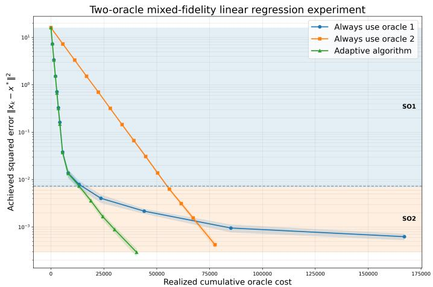  
Figure 2. Controlled two-oracle experiment. Curves show achieved squared error versus realized cumulative oracle cost; shaded intervals around the curves are pointwise 95% confidence intervals. Filled regions report the selected oracles in diferent phases.

## 6.2 LLM-completion experiments - known bias

We next consider the Aspiring Minds data described in the introduction and the data completion objective defined in Subsection 2.2. The clean data defines the target linear-regression objective, while each model–prompt completion pipeline defines a stochastic oracle. We predict ComputerProgramming from 22 numerical applicant covariates. After adding an intercept, we whiten the design using the clean least-squares Hessian, which preserves predictions and objective values while giving

$$
\begin{array} { r } { \Sigma _ { \mathrm { c l e a n } } = I , \quad L = \mu = 1 , \quad f _ { \mathrm { c l e a n } } ( x ) - f _ { \mathrm { c l e a n } } ( x ^ { * } ) = \frac { 1 } { 2 } \| x - x ^ { * } \| ^ { 2 } . } \end{array}
$$

We use the clean Hessian for whitening only as an experimental normalization, so that distances, curvature, and oracle characteristics can be compared on a common scale across pipelines. The clean data and clean objective are not included among the candidate stochastic oracles and are never selected by the adaptive policy. In a deployment in which the original Hessian is unavailable, one could instead work in the original coordinates or estimate a preconditioner from available data.

The nine paid oracles correspond to four GPT-5.4 Nano prompt variants, GPT-5.6 Luna, Claude Haiku 4.5, Claude Sonnet $5 ,$ and two averaged ensembles. Table 1 reports the 10% diagnostics. For the low-rank variants, $\mathrm { ^ { 6 6 } L R - 7 ^ { 9 } }$ and $\mathrm { ^ { 6 6 } L R \mathrm { - } 1 0 ^ { 9 } }$ mean that the prompt receives 7 and 10 features as input, respectively. The exact prompt templates used in the completion experiments are listed in Appendix C.

Cost interpretation. For completed dataset λ, a sampled-row gradient is

$$
\mathcal { G } _ { \lambda } ( x ; j ) = \widetilde { \theta } _ { \lambda , j } ( \widetilde { \theta } _ { \lambda , j } ^ { \top } x - y _ { j } ) .
$$

For ensemble oracles, we average component gradients on the same sampled row and sum their component costs. To compare optimization trajectories on a common scale, we divide the one-time full-dataset completion price by the number of rows to obtain an equivalent per-observation query price; a mini-batch of size m is charged m times this price. This is only an accounting device for comparing information costs.

Our goal in this experiment is to place heterogeneous information sources on a common cost scale, rather than to reproduce the billing mechanics of a particular deployment. The completion pipelines incur an upfront cost for producing datasets of diferent fidelities, whereas the optimization framework is expressed in terms of oracle-query costs. We therefore amortize each completion cost across observations and use the resulting per-row price to compare the information consumed along diferent optimization trajectories. In applications where acquiring an oracle instead incurs a fixed setup cost, or where completed data can be reused at zero marginal cost, the appropriate cost model would additionally include such activation or reuse costs; incorporating these costs is complementary to the fidelity-switching principle studied here.

As discussed in Subsection 2.2, the bias of the constructed operator admits the exact decomposition

$$
g _ { \lambda } ( x ) - \nabla f _ { \mathrm { c l e a n } } ( x ) = b _ { \lambda } + ( \Sigma _ { \lambda } - \Sigma _ { \mathrm { c l e a n } } ) ( x - x ^ { * } ) .
$$

We report $\widehat { B } _ { \lambda } = \| b _ { \lambda } \| = \| g _ { \lambda } ( x ^ { \ast } ) \|$ and $\beta _ { \lambda } = \| \Sigma _ { \lambda } - \Sigma _ { \mathrm { c l e a n } } \| _ { 2 } ;$ the stronger radius-R bias bound is $\widehat { B } _ { \lambda } + \beta _ { \lambda } R .$ . The residual variance and state-dependent coeficient are computed directly from the completed dataset: $\begin{array} { r } { \sigma _ { \lambda , * } ^ { 2 } = \frac { 1 } { n } \sum _ { j = 1 } ^ { n } \| \mathcal { G } _ { \lambda } ( \boldsymbol { x } ^ { * } ; j ) - g _ { \lambda } ( \boldsymbol { x } ^ { * } ) \| ^ { 2 } , \mathcal { L } _ { \lambda } = 4 \lambda _ { \operatorname* { m a x } } \Big ( \frac { 1 } { n } \sum _ { j = 1 } ^ { n } M _ { \lambda , j } ^ { \top } M _ { \lambda , j } \Big ) } \end{array}$ , where $M _ { \lambda , j } = \widetilde { \theta } _ { \lambda , j } \widetilde { \theta } _ { \lambda , j } ^ { \top } - \Sigma _ { \lambda }$

Practical admissibility rule. The theoretical admissibility condition for Algorithm 1 in Section 3 is a suficient worst-case condition and has conservative constants. In the LLM experiments, our goal is to examine the stage-dependent switching mechanism rather than to reproduce these worst-case constants. We therefore use the practical rule

$$
{ \widehat B } _ { \lambda } \leq 0 . 5 \mu R ,
$$

where $\widehat { B } _ { \lambda } = \| b _ { \lambda } \| = \| g _ { \lambda } ( x ^ { * } ) \|$ . For the completion model, the full radius-dependent bias bound derived in Section 2.2 is $\hat { B } _ { \lambda } + \beta _ { \lambda } R ;$ thus, the rule above should be interpreted as a practical proxy for oracle fidelity rather than as an exact implementation of the suficient theoretical condition. This choice afects the empirical switching thresholds but not any of our theoretical guarantees. In all reported experiments, we use mini-batches of size 20, at most 20 restart stages, and 50 independent repetitions.

Experiment results. Figure 3 shows the experiment with 10% randomly masked entries. The adaptive sequence is

$$
\begin{array} { r l } & { \mathrm { N a n o ~ L R \mathrm { - } s h o r t { - } 7 ~ ( S O 2 ) } \longrightarrow \mathrm { N a n o ~ L R \mathrm { - } 1 0 ~ ( S O 4 ) } } \\ & { \qquad \longrightarrow \mathrm { L u n a ~ ( S O 5 ) } \longrightarrow \mathrm { A v g . ~ H a i k u + S o n n e t ~ ( S O 8 ) } . } \end{array}
$$

The adaptive method (Algorithm 1) skips several available pipelines, including both stand-alone Claude models at the tightest stage. At the finest displayed accuracy, its cumulative equivalent LLM cost is about \$72, compared with about \$240 for always using SO8, corresponding to a cost reduction of roughly 70%. The experiment therefore exhibits the same qualitative mechanism as the simulation: inexpensive sources are preferred early, while additional fidelity becomes worthwhile only at finer optimization scales.

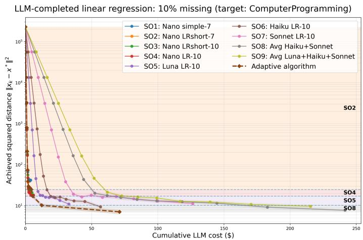  
Figure 3. LLM-completion experiment for Algorithm 1 at 10% missingness. Curves show achieved squared distance versus cumulative equivalent LLM cost, averaged over 50 repetitions; shaded intervals around the curves are pointwise 95% confidence intervals. Filled regions report the selected oracles in diferent phases, and dashed lines mark switches.

Table 2 and Figure 4 repeats the experiment at 20% and 40% missingness. The stage-dependent switching behavior persists, but the selected sequence changes because the completion-induced bias

LLM-completed linear regression: 20% missing (target: ComputerProgramming)

and variance depend on the amount of missing data. At 20% missingness, the adaptive method uses only inexpensive Nano pipelines over the displayed trajectory, and achieves a cumulative cost comparable to that of the best fixed oracle, SO4.

At 40% missingness, the adaptive method initially uses Nano LR-short-7 and later switches to Haiku as higher fidelity becomes necessary. At the finest displayed accuracy, its cumulative cost is approximately \$11.5, compared with approximately \$30 for the best fixed oracle, SO6, corresponding to a cost reduction of about 62%. These results further illustrate that the preferred oracle fidelity depends jointly on the downstream optimization stage and the quality of the upstream data.

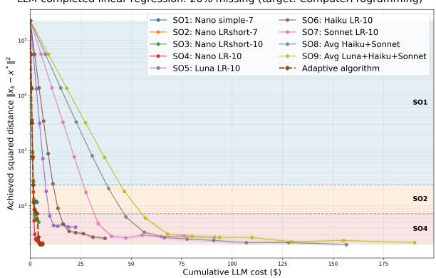  
(a) 20% randomly masked entries.

LLM-completed linear regression: 40% missing (target: ComputerProgramming  
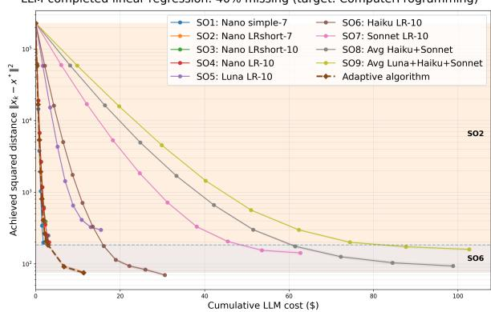  
(b) 40% randomly masked entries.  
Figure 4. LLM-completion experiments for Algorithm 1 under heavier missingness. Curves show achieved squared distance versus cumulative equivalent LLM cost over 50 repetitions, with pointwise 95% confidence intervals. Filled regions report the selected oracles in diferent phases.

## 6.3 LLM-completion experiments - budgeted certification with unknown bias

We finally test the unknown-bias meta-algorithm in Section 5. The algorithm does not use the bias diagnostics in its oracle-selection rule. Instead, it trains with one oracle over a homogeneous block and uses the clean gradient as the trusted certification module only at block endpoints. As shown above, whitening guarantees $L = \mu = 1$ , so the recursive-regularization depth is

$$
S = 1 + \lceil \log _ { 2 } ( L / \mu ) \rceil = 1 .
$$

Therefore, the RR+SGE subroutine consists of only one SGE solve on the original objective, and we use $\widetilde { T } ( R , \lambda ) = T ( R , \lambda )$ in the implementation. We assign each trusted-gradient evaluation the explicit certification price $c _ { \mathrm { c e r t } } = \mathfrak { H } 1 . 0$ , measured on the same scale as the stochastic-oracle training cost. We use $\mathcal { R } = 3$ sequential block trials, and a block stops as soon as one candidate certifies successfully. We average 50 independent repetitions for each configuration and report the pointwise 95% confidence intervals.

Certification-frequency tradeof. Figure 5 varies the uncertified-training budget B and reports the final cost required for Algorithm 3 to reach the target accuracy. The blue curve represents the total cumulative cost, decomposed into stochastic-oracle training cost and trusted-certification cost. The experiments exhibit the tradeof predicted by Corollary 2. When B is too small, the method certifies frequently and therefore pays a large certification cost. As B increases, this certification cost decreases. Beyond an intermediate range, however, the training cost increases because a block can spend more on an oracle before a failed certificate causes that oracle to be rejected.

Table 2. Oracle diagnostics for the 20% and 40% missingness experiments. Cost is the one-time full-dataset completion price; residual variance is scaled by $1 0 ^ { 4 }$ . The bolded rows represent the stochastic oracles selected along the trajectory of our adaptive algorithm.
<table><tr><td>Missing</td><td></td><td>Completion pipeline</td><td>Cost ($)</td><td>Obj.</td><td> $\sigma _ { \lambda , * } ^ { 2 } / 1 0 ^ { 4 }$ </td><td> $\mathcal { L } _ { \lambda } / 1 0 ^ { 3 }$ </td><td> ${ \widehat { B } } _ { \lambda }$ </td></tr><tr><td>20%</td><td></td><td>Clean data (reference)</td><td>0</td><td>3354</td><td>8.28</td><td>6.48</td><td>0</td></tr><tr><td></td><td>1</td><td>GPT-5.4 Nano, simple-7</td><td>0.180</td><td>4208</td><td>11.12</td><td>6.50</td><td>9.63</td></tr><tr><td></td><td>2</td><td>GPT-5.4 Nano, LR-short-7</td><td>0.181</td><td>4149</td><td>10.47</td><td>6.50</td><td>7.62</td></tr><tr><td></td><td>3</td><td>GPT-5.4 Nano, LR-short-10</td><td>0.189</td><td>4024</td><td>10.11</td><td>6.48</td><td>6.32</td></tr><tr><td></td><td>4</td><td>GPT-5.4 Nano, LR-10</td><td>0.192</td><td>4026</td><td>9.39</td><td>6.48</td><td>3.28</td></tr><tr><td></td><td>5</td><td>GPT-5.6 Luna, LR-10</td><td>0.993</td><td>4014</td><td>11.45</td><td>6.49</td><td>5.31</td></tr><tr><td></td><td>6</td><td>Claude Haiku 4.5, LR-10</td><td>1.423</td><td>3882</td><td>9.02</td><td>6.48</td><td>3.84</td></tr><tr><td></td><td>7</td><td>Claude Sonnet 5, LR-10</td><td>3.502</td><td>3879</td><td>9.05</td><td>6.48</td><td>4.18</td></tr><tr><td></td><td>8</td><td>Avg. Haiku+Sonnet, LR-10</td><td>4.925</td><td>3847</td><td>8.93</td><td>6.48</td><td>3.30</td></tr><tr><td>40%</td><td>9</td><td>Avg. Luna+Haiku+Sonnet, LR-10</td><td>5.918</td><td>3846</td><td>9.34</td><td>6.48</td><td>3.59</td></tr><tr><td rowspan="10"></td><td></td><td>Clean data (reference)</td><td>0</td><td>3354</td><td>8.28</td><td>6.48</td><td>0</td></tr><tr><td>1</td><td>GPT-5.4 Nano, simple-7</td><td>0.185</td><td>4950</td><td>10.60</td><td>6.52</td><td>12.21</td></tr><tr><td>2</td><td>GPT-5.4 Nano, LR-short-7</td><td>0.183</td><td>4819</td><td>10.13</td><td>6.52</td><td>10.83</td></tr><tr><td>3</td><td>GPT-5.4 Nano, LR-short-10</td><td>0.195</td><td>5102</td><td>14.01</td><td>6.51</td><td>23.77</td></tr><tr><td>4</td><td>GPT-5.4 Nano, LR-10</td><td>0.197</td><td>4790</td><td>10.06</td><td>6.51</td><td>11.86</td></tr><tr><td>5</td><td>GPT-5.6 Luna, LR-10</td><td>1.104</td><td>5152</td><td>14.10</td><td>6.50</td><td>17.81</td></tr><tr><td>6</td><td>Claude Haiku 4.5, LR-10</td><td>1.402</td><td>4510</td><td>9.00</td><td>6.49</td><td>6.47</td></tr><tr><td>7</td><td>Claude Sonnet 5, LR-10</td><td>3.955</td><td>4701</td><td>9.27</td><td>6.49</td><td>10.78</td></tr><tr><td></td><td>8 Avg. Haiku+Sonnet, LR-10</td><td>5.357</td><td>4529</td><td>8.87</td><td>6.49</td><td>8.14</td></tr><tr><td></td><td>9 Avg. Luna+Haiku+Sonnet, LR-10</td><td>6.461</td><td>4602</td><td>9.51</td><td>6.49</td><td>10.96</td></tr></table>

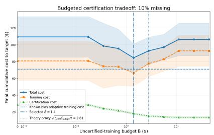  
(a) 10% missingness.

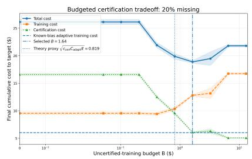  
(b) 20% missingness.

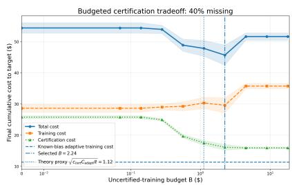  
(c) 40% missingness.  
Figure 5. Certification-frequency tradeof for Algorithm 3. The curves report the final cumulative total, training, and certification costs for diferent budget B, averaged over 50 repetitions, with pointwise 95% confidence intervals. The horizontal dashed line is the training cost of the known-bias adaptive benchmark (Algorithm 1). The dash-dotted vertical line marks the best choice of B, and the dotted vertical line reports the theory-inspired proxy $\sqrt { c _ { \mathrm { c e r t } } C _ { \mathrm { a d a p t } } / \ell }$ in Corollary 2.

For 10%, 20%, and 40% missingness, the selected budgets are approximately B = 1.40, 1.64, and 2.24, respectively. The corresponding theory-inspired proxies $\sqrt { c _ { \mathrm { c e r t } } C _ { \mathrm { a d a p t } } / \ell }$ are approximately 2.81, 0.82, and 1.12, where $C _ { \mathrm { a d a p t } }$ is the realized training cost of the known-bias adaptive benchmark. Although this proxy is not intended to predict the exact empirical minimizer of B, it identifies the correct scale: in each case the selected budget is within a factor of two of the proxy, demonstrating the practical value of the theoretical backbone in Corollary 2.

Figure 6 reports how training and certification costs accumulate across certified levels. The decomposition makes the price of unknown bias explicit. At coarse scales, one certificate validates several inexpensive training stages and the certification cost grows slowly. Near the finest scales, unsuccessful trials and higher-fidelity training cause both components to increase more sharply.

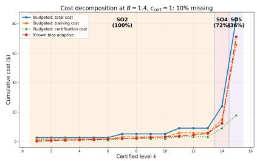  
(a) 10% missingness, $B = 1 . 4 0 .$

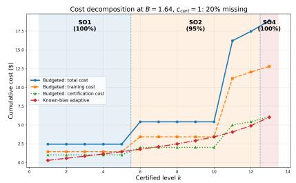  
(b) 20% missingness, $B = 1 . 6 4 .$

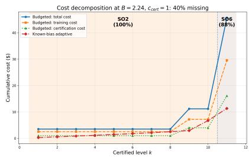  
(c) 40% missingness, $B = 2 . 2 4 .$  
Figure 6. Cumulative cost decomposition for budgeted certification at the selected values of B. Blue curves report total cost, orange curves report stochastic-oracle training cost, and green curves report trusted-certification cost; the red curve is the known-bias adaptive benchmark. Filled regions indicate mostly selected oracles in Algorithm 3 and the percentage of repetitions that select them.

Figure 7 compares the optimization progress of Algorithm 3 with Algorithm 1. As expected, the known-bias policy is more cost-eficient, but the unknown-bias method recovers the same qualitative coarse-to-fine fidelity pattern without access to these bias parameters. At 10% missingness, the two trajectories remain relatively close until the finest stages, after which the unknown-bias method pays for additional certification and failed attempts. For 20% and 40% missingness, the final switch to a suficiently accurate oracle requires more failed trials and certification cost.

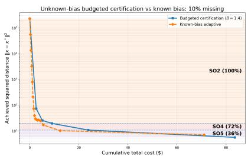  
(a) 10% missingness, $B = 1 . 4 0 .$

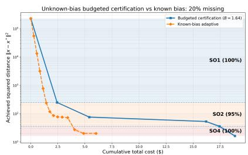  
(b) 20% missingness, $B = 1 . 6 4 .$

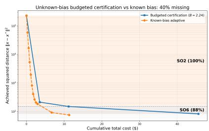  
(c) 40% missingness, $B = 2 . 2 4 .$  
Figure 7. Unknown-bias budgeted certification v.s. the known-bias adaptive policy. Curves report achieved squared distance to x<sup>∗</sup> versus cumulative total cost, including both stochastic-oracle training and trusted-gradient evaluations. Filled regions indicate the stochastic oracles mostly selected by the budgeted method and the percentage of repetitions that select them.

Taken together, this set of experiments provides a proof of concept for Section 5. First, trusted certification removes the need for prior knowledge of the bias parameters and detects when a lowcost oracle can no longer deliver the required progress. Second, the budget B controls how much training cost is incurred between successive certifications. The empirical results reveal a clear tradeof between training and certification costs, showing that the certification frequency is itself an economically meaningful algorithmic decision.

Lastly, we would like to comment that the regression experiments in Subsections 6.2–6.3 are intentionally chosen as a controlled setting in which the clean downstream objective and the mixed fidelity oracle parameters can be measured directly. Our purpose is not to claim that regression exhausts LLM-assisted decision pipelines, but to test the mechanism predicted by the theory while holding the downstream optimization problem fixed. The same framework applies whenever alternative data-generation procedures induce stochastic first-order information of diferent cost and fidelity, including downstream estimation, prediction-and-optimization, and decision-support pipelines.

## 7 Concluding remarks

The central message is that the optimal use of mixed-fidelity information depends critically on the stage of downstream optimization. A cheap source can be the economically correct choice when the optimizer is far from the solution, even if its fidelity would be unacceptable at the final accuracy. Conversely, high fidelity is worth paying for only when it enables a more cost-eficient algorithmic progress or a lower attainable bias floor. The resulting break-even prices connect the optimization analysis to classical ideas on the value of information: information should be purchased according to its decision value, not its intrinsic accuracy alone (Howard, 1966; Sims, 2003).

This perspective also suggests a complementary way to benchmark LLMs. General evaluation eforts such as HELM and Chatbot Arena provide valuable standardized comparisons of mode capabilities and human preferences; see, e.g., Bommasani et al. (2023); Chiang et al. (2024). For optimization-driven applications, however, a single global rank may not identify the economically best model. A useful task-specific “oracle card” could report not only benchmark accuracy and token price, but also downstream quantities such as bias, residual variance, and state-dependent variance on a representative calibration set. For data labeling, these quantities can be estimated using repeated or trusted labels; for data completion, they can be estimated from a held-out fully observed subset. Such reporting would make it possible to translate model improvements directly into stage-dependent willingness-to-pay curves such as (4.3).

Although LLM-assisted data curation motivates this work, the framework is broader. The same mixed-fidelity structure arises when stochastic first-order information is produced by human experts of diferent skill levels, crowd workers, sensors of diferent precision, approximate simulators, laboratory measurements, or computational solvers with diferent tolerances. Interesting future directions include learning oracle parameters online rather than from calibration data and allowing correlated errors across diferent data sources.

Our analysis can be used in general for any portfolio of stochastic oracles. For LLM-based oracles, we abstract away several deployment-specific features. In particular, oracle acquisition may involve fixed setup costs in addition to marginal query costs; trusted certification may itself be estimated from finite samples; and practical implementations may estimate fidelity parameters only approximately. The empirical cost normalization and admissibility rules used in Section 6 are intended to expose the stage-dependent switching mechanism rather than to model every feature of a particular API deployment. Extending the framework to jointly learn oracle quality, acquisition cost, and certification uncertainty is an interesting direction for future work.

## References

D. Acemoglu, A. Makhdoumi, A. Malekian, and A. Ozdaglar. Too much data: Prices and inefficiencies in data markets. American Economic Journal: Microeconomics, 14(4):218–256, 2022. doi: 10.1257/mic.20200200.

A. Ajalloeian and S. U. Stich. On the convergence of SGD with biased gradients. arXiv preprint arXiv:2008.00051, 2020.

Z. Allen-Zhu. How to make the gradients small stochastically: Even faster convex and nonconvex sgd. Advances in Neural Information Processing Systems, 31, 2018.

A. N. Angelopoulos, S. Bates, M. I. Jordan, and J. Malik. Prediction-powered inference. Science, 382(6671):669–674, 2023.

H. Asi, Y. Carmon, A. Jambulapati, Y. Jin, and A. Sidford. Stochastic bias-reduced gradient methods. In Advances in Neural Information Processing Systems, volume 34, pages 10810–10822, 2021.

N. S. Aybat, A. Fallah, M. Gurbuzbalaban, and A. Ozdaglar. A universally optimal multistage accelerated stochastic gradient method. Advances in neural information processing systems, 32, 2019.

A. Beatson and R. P. Adams. Eficient optimization of loops and limits with randomized telescoping sums. In Proceedings of the 36th International Conference on Machine Learning, volume 97 of Proceedings of Machine Learning Research, pages 534–543, 2019.

A. Belloni, Y. Chen, and Y. Wei. Online pandora’s box for contextual llm cascading. arXiv preprint arXiv:2606.07392, 2026.

J. Blanchet, D. Goldfarb, G. Iyengar, F. Li, and C. Zhou. Unbiased simulation for optimizing stochastic function compositions. arXiv preprint arXiv:1711.07564, 2017.

J. H. Blanchet and P. W. Glynn. Unbiased monte carlo for optimization and functions of expectations via multi-level randomization. In 2015 Winter Simulation Conference, pages 3656–3667. IEEE, 2015.

R. Bommasani, P. Liang, and T. Lee. Holistic evaluation of language models. Annals of the New York Academy of Sciences, 1525(1):140–146, 2023. doi: 10.1111/nyas.15007.

L. Bottou, F. E. Curtis, and J. Nocedal. Optimization methods for large-scale machine learning. SIAM Review, 60(2):223–311, 2018. doi: 10.1137/16M1080173.

K. Chen, Q. Li, and J.-G. Liu. Online learning in optical tomography: A stochastic approach. Inverse Problems, 34(7):075010, 2018. doi: 10.1088/1361-6420/aac220.

L. Chen, M. Zaharia, and J. Zou. Frugalgpt: How to use large language models while reducing cost and improving performance. Transactions on Machine Learning Research, 2024.

W.-L. Chiang, L. Zheng, Y. Sheng, A. N. Angelopoulos, T. Li, D. Li, B. Zhu, H. Zhang, M. I. Jordan, J. E. Gonzalez, and I. Stoica. Chatbot arena: An open platform for evaluating llms by human preference. In Proceedings of the 41st International Conference on Machine Learning, volume 235 of Proceedings of Machine Learning Research, pages 8359–8388, 2024.

G. Daras, Y. Cherapanamjeri, and C. Daskalakis. How much is a noisy image worth? data scaling laws for ambient difusion. In International Conference on Learning Representations, 2025.

S. Dereich and T. M¨uller-Gronbach. General multilevel adaptations for stochastic approximation algorithms of robbins–monro and polyak–ruppert type. Numerische Mathematik, 142(2):279–328, 2019. doi: 10.1007/s00211-019-01024-y.

O. Devolder, F. Glineur, and Y. Nesterov. First-order methods of smooth convex optimization with inexact oracle. Mathematical Programming, 146(1–2):37–75, 2014. doi: 10.1007/ s10107-013-0677-5.

M. J. Ehrhardt, Z. Kereta, J. Liang, and J. Tang. A guide to stochastic optimisation for large-scale <sup>ˇ</sup> inverse problems. Inverse Problems, 41(5):053001, 2025. doi: 10.1088/1361-6420/adc0b7.

M. Farboodi and L. Veldkamp. Data and markets. Annual Review of Economics, 15:23–40, 2023. doi: 10.1146/annurev-economics-082322-023244.

D. J. Foster, A. Sekhari, O. Shamir, N. Srebro, K. Sridharan, and B. Woodworth. The complexity of making the gradient small in stochastic convex optimization. In Conference on Learning Theory, pages 1319–1345. PMLR, 2019.

F. Gilardi, M. Alizadeh, and M. Kubli. Chatgpt outperforms crowd workers for text-annotation tasks. Proceedings of the National Academy of Sciences, 120(30):e2305016120, 2023. doi: 10. 1073/pnas.2305016120.

M. B. Giles. Multilevel monte carlo path simulation. Operations Research, 56(3):607–617, 2008. doi: 10.1287/opre.1070.0496.

A. Goel, A. Gueta, O. Gilon, C. Liu, S. Erell, L. H. Nguyen, X. Hao, B. Jaber, S. Reddy, R. Kartha, J. Steiner, I. Laish, and A. Feder. Llms accelerate annotation for medical information extraction. In Proceedings of the 3rd Machine Learning for Health Symposium, volume 225 of Proceedings of Machine Learning Research, pages 82–100, 2023.

R. M. Gower, N. Loizou, X. Qian, A. Sailanbayev, E. Shulgin, and P. Richt´arik. SGD: General analysis and improved rates. In Proceedings of the 36th International Conference on Machine Learning, pages 5200–5209, 2019.

R. M. Gower, O. Sebbouh, and N. Loizou. Sgd for structured nonconvex functions: Learning rates, minibatching and interpolation. In Proceedings of the 24th International Conference on Artificial Intelligence and Statistics, volume 130 of Proceedings of Machine Learning Research, pages 1315–1323, 2021.

A. Hayat and M. R. Hasan. A context-aware approach for enhancing data imputation with pretrained language models. In Proceedings of the 31st International Conference on Computational Linguistics, pages 5668–5685, Abu Dhabi, UAE, 2025. Association for Computational Linguistics. URL https://aclanthology.org/2025.coling-main.380/.

X. He, Y. Ban, J. Zou, T. Wei, C. Cook, and J. He. LLM-forest: Ensemble learning of LLMs with graph-augmented prompts for data imputation. In Findings of the Association for Computational Linguistics: ACL 2025, pages 6921–6936, Vienna, Austria, 2025. Association for Computational Linguistics. doi: 10.18653/v1/2025.findings-acl.361.

D. Hendrycks, M. Mazeika, D. Wilson, and K. Gimpel. Using trusted data to train deep networks on labels corrupted by severe noise. In Advances in Neural Information Processing Systems, 2018.

J. Ho, A. Jain, and P. Abbeel. Denoising difusion probabilistic models. In Advances in Neural Information Processing Systems, volume 33, pages 6840–6851, 2020.

R. A. Howard. Information value theory. IEEE Transactions on Systems Science and Cybernetics, 2(1):22–26, 1966. doi: 10.1109/TSSC.1966.300074.

Y. Hu, X. Chen, and N. He. On the bias-variance-cost tradeof of stochastic optimization. In Advances in Neural Information Processing Systems, volume 34, pages 22119–22131, 2021.

Y. Hu, J. Wang, X. Chen, and N. He. Multi-level monte-carlo gradient methods for stochastic optimization with biased oracles. arXiv preprint arXiv:2408.11084, 2024.

S. Ilandarideva, A. B. Juditsky, G. Lan, and T. Li. Accelerated stochastic approximation with state-dependent noise. Mathematical Programming, 213(1–2):239–280, 2025.

P. Jain, S. M. Kakade, R. Kidambi, P. Netrapalli, and A. Sidford. Accelerating stochastic gradient descent for least squares regression. In Proceedings of the 31st Conference on Learning Theory, volume 75 of Proceedings of Machine Learning Research, pages 545–604. PMLR, 2018.

A. Juditsky, A. Kulunchakov, and H. Tsyntseus. Sparse recovery by reduced variance stochastic approximation. Information and Inference: A Journal of the IMA, 12(2):851–896, 2023.

K. Kandasamy, G. Dasarathy, J. Schneider, and B. P´oczos. Multi-fidelity bayesian optimisation with continuous approximations. In Proceedings of the 34th International Conference on Machine Learning, pages 1799–1808, 2017.

G. Kotsalis, G. Lan, and T. Li. Simple and optimal methods for stochastic variational inequalities, ii: Markovian noise and policy evaluation in reinforcement learning. SIAM Journal on Optimization, 32(2):1120–1155, 2022.

G. Lan. An optimal method for stochastic composite optimization. Mathematical Programming, 133(1):365–397, 2012.

G. Lan and Y. Zhou. Random gradient extrapolation for distributed and stochastic optimization. SIAM Journal on Optimization, 28(4):2753–2782, 2018.

O. Nahum, N. Calderon, O. Keller, I. Szpektor, and R. Reichart. Are LLMs better than reported? detecting label errors and mitigating their efect on model performance. In Proceedings of the 2025 Conference on Empirical Methods in Natural Language Processing, pages 26782–26809, 2025.

A. Nemirovski, A. Juditsky, G. Lan, and A. Shapiro. Robust stochastic approximation approach to stochastic programming. SIAM Journal on Optimization, 19(4):1574–1609, 2009.

A. S. Nemirovskij and D. B. Yudin. Problem complexity and method eficiency in optimization. 1983.

I. Ong, A. Almahairi, V. Wu, W.-L. Chiang, T. Wu, J. E. Gonzalez, M. W. Kadous, and I. Stoica. Routellm: Learning to route llms from preference data. In International Conference on Learning Representations, 2025.

M. Parciak, B. Vandevoort, F. Neven, L. M. Peeters, and S. Vansummeren. Schema matching with large language models: an experimental study. In Proceedings of Workshops at the 50th International Conference on Very Large Data Bases (VLDB 2024), Tabular Data Analysis Workshop (TaDA), 2024.

R. Peeters, A. Steiner, and C. Bizer. Entity matching using large language models. In Proceedings of the 28th International Conference on Extending Database Technology (EDBT), pages 529–541, 2025. doi: 10.48786/edbt.2025.42.

B. Peherstorfer, K. Willcox, and M. Gunzburger. Survey of multifidelity methods in uncertainty propagation, inference, and optimization. SIAM Review, 60(3):550–591, 2018.

B. T. Polyak. New stochastic approximation type procedures. Automat. i Telemekh, 7(98-107):2, 1990.

A. Ratner, S. H. Bach, H. Ehrenberg, J. Fries, S. Wu, and C. R´e. Snorkel: Rapid training data creation with weak supervision. Proceedings of the VLDB Endowment, 11(3):269–282, 2017.

A. Rodomanov, X. Jiang, and S. Stich. Universality of adagrad stepsizes for stochastic optimization: Inexact oracle, acceleration and variance reduction. Advances in Neural Information Processing Systems, 37:26770–26813, 2024.

C. A. Sims. Implications of rational inattention. Journal of Monetary Economics, 50(3):665–690, 2003. doi: 10.1016/S0304-3932(03)00029-1.

B. Wang, F. Liu, C. Zhang, J. Chen, Y. Wu, S. Zhou, X. Lou, J. Wang, Y. Feng, C. Chen, and C. Wang. LLM4DSR: Leveraging large language model for denoising sequential recommendation. ACM Transactions on Information Systems, 44(1), 2025a. doi: 10.1145/3762182.

S. Wang, W. Li, H. Yang, J. Guan, X. Liu, Y. Zhang, R. Qin, and S. Zhou. LLM4HRS: LLM-based spatiotemporal imputation model for highly sparse remote sensing data. IEEE Transactions on Geoscience and Remote Sensing, 63:4204117, 2025b. doi: 10.1109/TGRS.2025.3555634.

S. Wang, Z. Zheng, Y. Sui, and H. Xiong. Unleashing the power of large language model for denoising recommendation. In Proceedings of the ACM Web Conference 2025, pages 252–263, 2025c. doi: 10.1145/3696410.3714758.

B. E. Woodworth and N. Srebro. An even more optimal stochastic optimization algorithm: minibatching and interpolation learning. Advances in neural information processing systems, 34: 7333–7345, 2021.

L. Ye, A. Shah, C. Zhang, and S. Chava. Calibrating pre-trained language classifiers on LLMgenerated noisy labels via iterative refinement. In Proceedings of the 31st ACM SIGKDD Conference on Knowledge Discovery and Data Mining V.2, pages 3598–3609, 2025. doi: 10.1145/3711896.3736871.

H. Zhang, Y. Dong, C. Xiao, and M. Oyamada. Jellyfish: Instruction-tuning local large language models for data preprocessing. In Proceedings of the 2024 Conference on Empirical Methods in Natural Language Processing, pages 8754–8782, 2024.

## A Proofs in Section 3

This section contains full proofs of main results in Section 3.

## A.1 Proof of Theorem 1

To prove Theorem 1, we first provide the following proposition, which characterizes the SGE recursion. This recursion lets us handle state-dependent variance and persistent bias transparently. The proof of this proposition, which is deferred to Appendix A.1.1, follows a similar SGE analysis technique as in Ilandarideva et al. (2025), but here it also incorporates a persistent bias term and the strongly convex regularization appearing in Algorithm 2.

Proposition 4 (SGE recursion). Suppose $\{ z _ { t } \}$ and $\{ x _ { t } \}$ are generated by Algorithm 2. Let the algorithm parameters $\{ \alpha _ { t } \} , \{ \eta _ { t } \}$ and $\left\{ \tau _ { t } \right\}$ satisfy $\tau _ { 1 } \geq 0 , \tau _ { t } > 0$ for all $t \geq 2$ , along with relations

$$
\theta _ { t - 1 } = \alpha _ { t } \theta _ { t } , \eta _ { t } \leq \alpha _ { t } ( \eta _ { t - 1 } + \mu \alpha _ { t - 1 } ) , t = 2 , \ldots , k\tag{A.1a}
$$

$$
\begin{array} { r } { \frac { \eta _ { t } \tau _ { t - 1 } } { \alpha _ { t } } \geq 4 L , \quad t = 3 , \ldots , k } \end{array}\tag{A.1b}
$$

$$
\begin{array} { r } { \frac { \eta _ { 1 } \eta _ { 2 } } { \alpha _ { 2 } } \geq 1 6 L ^ { 2 } , \eta _ { k } \tau _ { k } \geq 2 L , } \end{array}\tag{A.1c}
$$

for some $\theta _ { t } \geq 0$ . Then for all $x \in X$

$$
\sum _ { t = 1 } ^ { k } \theta _ { t } \left\{ \tau _ { t } [ f ( x _ { t } ) - f ( x _ { t - 1 } ) ] - [ \langle \nabla f ( x _ { t } ) , x - x _ { t } \rangle + \frac { \mu } { 2 } \| x _ { t } - x \| ^ { 2 } ] \right\} + \frac { \theta _ { k } } { 2 } ( \frac { \eta _ { k } } { 2 } + \mu \alpha _ { k } ) \| z _ { k } - x \| ^ { 2 }
$$

$$
\leq \frac { \theta _ { 1 } \eta _ { 1 } } { 2 } \| x _ { 0 } - x \| ^ { 2 } - \frac { \theta _ { k } \mu } { 2 } \| x _ { k } - x \| ^ { 2 } - \sum _ { t = 1 } ^ { k } \theta _ { t } \langle b ( x _ { t - 1 } ) + \alpha _ { t } ( b ( x _ { t - 1 } ) - b ( x _ { t - 2 } ) ) , z _ { t } - x \rangle
$$

$$
+ \sum _ { t = 0 } ^ { k - 1 } \Big [ \frac { 2 \theta _ { t + 1 } ( 1 + \alpha _ { t + 1 } ^ { 2 } ) } { \eta _ { t + 1 } } \| \delta _ { t } ( x _ { t } ) \| ^ { 2 } + \frac { 2 \theta _ { t + 2 } \alpha _ { t + 2 } ^ { 2 } } { \eta _ { t + 2 } } \| \delta _ { t + 1 } ( x _ { t } ) \| ^ { 2 } \Big ]
$$

$$
+ \sum _ { t = 0 } ^ { k - 1 } \theta _ { t + 1 } \langle \alpha _ { t + 1 } \delta _ { t } ( x _ { t - 1 } ) - ( 1 + \alpha _ { t + 1 } ) \delta _ { t } ( x _ { t } ) , z _ { t } - x \rangle .\tag{A.2}
$$

where $g ( x ) : = \mathbb { E } [ G _ { t } ( x ) ] , b ( x ) : = g ( x ) - \nabla f ( x ) , a n d \delta _ { t } ( x ) : = G _ { t } ( x ) - g ( x ) .$

Taking Proposition 4 as given for the moment, let us complete the proof of the theorem.

1<sup>o</sup>. An SGE recursion in expectation. Set $\theta _ { t } = t$ and define

$$
\begin{array} { r } { q _ { t } = \frac { 2 \theta _ { t + 1 } \left( 1 + \alpha _ { t + 1 } ^ { 2 } \right) } { \eta _ { t + 1 } } + \frac { 2 \theta _ { t + 2 } \alpha _ { t + 2 } ^ { 2 } } { \eta _ { t + 2 } } , \qquad \epsilon _ { t } = \frac { q _ { t } } { m } . } \end{array}\tag{A.3}
$$

A direct substitution shows that the parameter choices in Theorem 1 satisfy the conditions of Proposition 4 and, moreover,

$$
\theta _ { t } \tau _ { t } + \mathscr { L } \epsilon _ { t - 1 } \leq \theta _ { t - 1 } ( 1 + \tau _ { t - 1 } ) , \qquad t \geq 2 .\tag{A.4}
$$

The latter relation is the key condition that absorbs the state-dependent part of the stochastic variance into the telescoping function-value terms in the recursion.

Apply Proposition 4 with $x = x ^ { * }$ and take expectations on both sides of Ineq. (A.2), we have

$$
\begin{array} { r l r } {  { \sum _ { t = 1 } ^ { k } \theta _ { t } \mathbb { E } \{ \tau _ { t } [ f ( x _ { t } ) - f ( x _ { t - 1 } ) ] - [ \langle \nabla f ( x _ { t } ) , x ^ { * } - x _ { t } \rangle + \frac { \mu } { 2 } \mathbb { E } \| x _ { t } - x ^ { * } \| ^ { 2 } ] \} + \frac { \theta _ { k } } { 2 } ( \frac { \eta _ { k } } { 2 } + \mu \alpha _ { k } ) \| z _ { k } - x ^ { * } \| ^ { 2 } } } \\ & { \le \frac { \theta _ { 1 } \eta _ { 1 } } { 2 } \| x _ { 0 } - x ^ { * } \| ^ { 2 } - \frac { \theta _ { k } \mu } { 2 } \mathbb { E } \| x _ { k } - x ^ { * } \| ^ { 2 } + \sum _ { t = 1 } ^ { k } \theta _ { t } ( 1 + 2 \alpha _ { t } ) \mathcal { B } \mathbb { E } \| z _ { t } - x ^ { * } \| } \\ & { } & { \quad + \sum _ { t = 0 } ^ { k - 1 } \mathcal { E } \epsilon _ { t } \mathbb { E } [ f ( x _ { t } ) - f ^ { * } ] + \sum _ { t = 0 } ^ { k - 1 } \epsilon _ { t } \sigma _ { * } ^ { 2 } , \ ~ \mathrm { ( A ) } } \end{array}\tag{.5}
$$

where we use Cauchy-Schwarz inequality and $\| b ( x _ { t } ) \| ~ \leq ~ B$ in (1.2) to bound the bias term, $\mathbb { E } [ \delta _ { t } ( x _ { j } ) ] = 0$ for $j \leq t$ for the martingale term, and

$$
\begin{array} { r } { \mathbb { E } \| \delta _ { t } ( x ) \| ^ { 2 } \leq \frac { 1 } { m } \Big ( \mathcal { L } \left[ f ( x ) - f ^ { * } \right] + \sigma _ { * } ^ { 2 } \Big ) , } \end{array}
$$

to bound the variance term. Then, using strong convexity,

$$
\begin{array} { r } { \langle \nabla f ( { x } _ { t } ) , { x } ^ { * } - { x } _ { t } \rangle + \frac { \mu } { 2 } \| { x } _ { t } - { x } ^ { * } \| ^ { 2 } \leq f ^ { * } - f ( { x } _ { t } ) , } \end{array}
$$

we have

$$
\begin{array} { r l } & { \theta _ { k } ( 1 + \tau _ { k } ) \mathbb { E } [ f ( x _ { k } ) - f ^ { * } ] + \frac { \theta _ { k } } { 2 } \left( \frac { \eta _ { k } } { 2 } + \mu \alpha _ { k } \right) \| z _ { k } - x ^ { * } \| ^ { 2 } + \frac { \theta _ { k } \mu } { 2 } \mathbb { E } \| x _ { k } - x ^ { * } \| ^ { 2 } } \\ & { \le \frac { \theta _ { 1 } \eta _ { 1 } } { 2 } \| x _ { 0 } - x ^ { * } \| ^ { 2 } + \theta _ { 1 } \tau _ { 1 } \big [ f ( x _ { 0 } ) - f ^ { * } \big ] + \mathcal { L } \epsilon _ { 0 } \big [ f ( x _ { 0 } ) - f ^ { * } \big ] } \\ & { \quad + \displaystyle \sum _ { t = 1 } ^ { k - 1 } ( \theta _ { t + 1 } \tau _ { t + 1 } + \mathcal { L } \epsilon _ { t } - \theta _ { t } ( 1 + \tau _ { t } ) ) \big [ f ( x _ { t } ) - f ^ { * } \big ] + \displaystyle \sum _ { t = 1 } ^ { k } \theta _ { t } ( 1 + 2 \alpha _ { t } ) \mathcal { B } \mathbb { E } \| z _ { t } - x ^ { * } \| + \displaystyle \sum _ { t = 0 } ^ { k - 1 } \epsilon _ { t } \sigma _ { * } ^ { 2 } } \\ & { \le \frac { \theta _ { 1 } \eta _ { 1 } } { 2 } \| x _ { 0 } - x ^ { * } \| ^ { 2 } + \mathcal { L } \epsilon _ { 0 } \big [ f ( x _ { 0 } ) - f ^ { * } \big ] + \displaystyle \sum _ { t = 1 } ^ { k } \theta _ { t } ( 1 + 2 \alpha _ { t } ) \mathcal { B } \mathbb { E } \| z _ { t } - x ^ { * } \| + \displaystyle \sum _ { t = 1 } ^ { k } \epsilon _ { t - 1 } \sigma _ { * } ^ { 2 } . } \end{array}\tag{A.6}
$$

where the second inequality follows from condition (A.4) and $\tau _ { 1 } = 0$ . Substituting the explicit choices of $\theta _ { t } , \alpha _ { t } , \eta _ { t }$ , and $\tau _ { t }$ into $\left( \mathrm { A . 6 } \right)$ , and dropping the nonnegative terminal term involving $\parallel x _ { k } -$ $x ^ { * } \| ^ { 2 }$ , we have

$$
A _ { k } \mathbb { E } [ f ( x _ { k } ) - f ^ { * } ] + \frac { P _ { k } } { 2 } \mathbb { E } \| z _ { k } - x ^ { * } \| ^ { 2 } \leq \Gamma _ { k } + \mathcal { B } \sum _ { t = 1 } ^ { k } ( 3 t - 2 ) \mathbb { E } \| z _ { t } - x ^ { * } \| ,\tag{A.7}
$$

where

$$
\begin{array} { r } { A _ { k } = \frac { k ( k + 2 ) } { 3 } , \qquad P _ { k } = \frac { \eta } { 2 } + \frac { \mu k ( k - 1 ) } { 4 } , } \end{array}
$$

and

$$
\begin{array} { r } { \Gamma _ { k } = \frac { 1 } { 2 } \left( 2 4 L + \frac { 5 4 \mathcal { L } } { m } + \frac { 1 6 2 \mathcal { L } ^ { 2 } } { \mu m ^ { 2 } } \right) \| x _ { 0 } - x ^ { * } \| ^ { 2 } + \frac { 2 } { 2 7 } [ f ( x _ { 0 } ) - f ^ { * } ] + \frac { 3 2 k } { \mu m } \sigma _ { * } ^ { 2 } . } \end{array}
$$

2<sup>o</sup>. Self-bounding the accumulated bias. Next we bound the summation of the linear bias terms in Ineq. (A.7). Define

$$
R _ { k } : = \Gamma _ { k } + \mathcal { B } \sum _ { t = 1 } ^ { k } ( 3 t - 2 ) \mathbb { E } \| z _ { t } - x ^ { * } \| .
$$

Since $\begin{array} { r } { \frac { P _ { t } } { 2 } \mathbb { E } \| z _ { t } - x ^ { * } \| ^ { 2 } \leq R _ { t } \leq R _ { k } } \end{array}$ for every $t \leq k$

$$
\begin{array} { r } { \mathbb { E } \| z _ { t } - x ^ { * } \| \leq \sqrt { \mathbb { E } \| z _ { t } - x ^ { * } \| ^ { 2 } } \leq \sqrt { \frac { 2 R _ { k } } { P _ { t } } } . } \end{array}
$$

Moreover, $\eta \ge 2 4 L \ge 2 4 \mu$ implies $\begin{array} { r } { P _ { t } \geq \frac { \mu ( 3 t - 2 ) ^ { 2 } } { 3 6 } } \end{array}$ , thus $\textstyle { \frac { 3 t - 2 } { \sqrt { P _ { t } } } } \leq { \frac { 6 } { \sqrt { \mu } } }$ . Therefore, by Ineq. (A.7), we have

$$
\begin{array} { r } { R _ { k } \leq \Gamma _ { k } + \sum _ { t = 1 } ^ { k } ( 3 t - 2 ) \mathcal { B } \sqrt { \frac { 2 R _ { k } } { P _ { t } } } \leq \Gamma _ { k } + \frac { 6 k \mathcal { B } \sqrt { 2 R _ { k } } } { \sqrt { \mu } } \leq \Gamma _ { k } + \frac { R _ { k } } { 2 } + \frac { 3 6 k ^ { 2 } \mathcal { B } ^ { 2 } } { \mu } , } \end{array}
$$

where the last inequality follows from Young’s inequality. Rearranging the terms yields

$$
\begin{array} { r } { R _ { k } \leq 2 \Gamma _ { k } + \frac { 7 2 k ^ { 2 } B ^ { 2 } } { \mu } . } \end{array}\tag{A.8}
$$

Dividing (A.7) by $A _ { k }$ and using the bound of $R _ { k }$ in Ineq. (A.8), we obtain

$$
\begin{array} { r l } & { \mathbb { R } [ f ( x _ { k } ) - f ^ { * } ] \leq \left( \frac { 7 2 L } { k ( k + 2 ) } + \frac { 1 6 2 \mathcal { L } } { m k ( k + 2 ) } + \frac { 4 8 6 \mathcal { L } ^ { 2 } } { \mu m ^ { 2 } k ( k + 2 ) } \right) \| x _ { 0 } - x ^ { * } \| ^ { 2 } + \frac { 2 } { 9 k ( k + 2 ) } [ f ( x _ { 0 } ) - f ^ { * } ] + \frac { 1 9 2 \sigma _ { * } ^ { 2 } } { \mu m ( k + 2 ) } + \frac { 2 1 6 \mathcal { B } ^ { 2 } } { \mu } } \\ & { \qquad \leq \left( \frac { 7 3 L } { k ( k + 2 ) } + \frac { 1 6 2 \mathcal { L } } { m k ( k + 2 ) } + \frac { 4 8 6 \mathcal { L } ^ { 2 } } { \mu m ^ { 2 } k ( k + 2 ) } \right) \| x _ { 0 } - x ^ { * } \| ^ { 2 } + \frac { 1 9 2 \sigma _ { * } ^ { 2 } } { \mu m ( k + 2 ) } + \frac { 2 1 6 \mathcal { B } ^ { 2 } } { \mu } , } \end{array}
$$

where the second inequality follows from $\begin{array} { r } { f ( x _ { 0 } ) - f ^ { * } = f ( x _ { 0 } ) - f ^ { * } - \langle \nabla f ( x ^ { * } ) , x _ { 0 } - x ^ { * } \rangle \leq \frac { L } { 2 } \| x _ { 0 } - x ^ { * } \| ^ { 2 } , } \end{array}$ and we prove Ineq. (3.1). Finally, for $m = 1$ , the stated lower bound on k makes the optimization and residual-variance terms at most $\mu \| \boldsymbol { x } _ { 0 } - \boldsymbol { x } ^ { * } \| ^ { 2 } / 8$ . Strong convexity then indicates

$$
\begin{array} { r } { \mathbb { E } \| x _ { k } - x ^ { * } \| ^ { 2 } \leq \frac { 2 } { \mu } \mathbb { E } [ f ( x _ { k } ) - f ^ { * } ] \leq \frac { 1 } { 4 } \| x _ { 0 } - x ^ { * } \| ^ { 2 } + \frac { 4 3 2 \mathcal { B } ^ { 2 } } { \mu ^ { 2 } } , } \end{array}
$$

which proves Ineq. (3.2).

## A.1.1 Proof of Proposition 4

1<sup>o</sup>. First, by the smoothness of $f ,$ we have

$$
\begin{array} { r } { \frac { 1 } { 2 L } \| \nabla f ( x _ { t } ) - \nabla f ( x _ { t - 1 } ) \| ^ { 2 } \leq f ( x _ { t - 1 } ) - [ f ( x _ { t } ) + \langle \nabla f ( x _ { t } ) , x _ { t - 1 } - x _ { t } \rangle ] . } \end{array}\tag{A.9}
$$

Then for any $x \in X$ , using the above inequality and the fact that $x - x _ { t } = x - z _ { t } - \tau _ { t } ( x _ { t - 1 } - x _ { t } )$ due to Step 5 in Algorithm 2, we get

$$
\begin{array} { r l } & { \tau _ { t } f ( x _ { t } ) - \langle \nabla f ( x _ { t } ) , x - x _ { t } \rangle = \tau _ { t } [ f ( x _ { t } ) + \langle \nabla f ( x _ { t } ) , x _ { t - 1 } - x _ { t } \rangle ] + \langle \nabla f ( x _ { t } ) , z _ { t } - x \rangle } \\ & { \qquad \leq \tau _ { t } [ f ( x _ { t - 1 } ) - \frac { 1 } { 2 L } \| \nabla f ( x _ { t } ) - \nabla f ( x _ { t - 1 } ) \| ^ { 2 } ] + \langle \nabla f ( x _ { t } ) , z _ { t } - x \rangle . } \end{array}
$$

By the optimality condition of Step 3 in Algorithm 2, we have

$$
\begin{array} { r } { \langle \widetilde { G } _ { t } , z _ { t } - x \rangle + \frac { \mu \alpha _ { t } } { 2 } \| x _ { t - 1 } - z _ { t } \| ^ { 2 } \leq \frac { \eta _ { t } } { 2 } \| z _ { t - 1 } - x \| ^ { 2 } - \frac { \eta _ { t } + \mu \alpha _ { t } } { 2 } \| z _ { t } - x \| ^ { 2 } - \frac { \eta _ { t } } { 2 } \| z _ { t - 1 } - z _ { t } \| ^ { 2 } + \frac { \mu \alpha _ { t } } { 2 } \| x _ { t - 1 } - x \| ^ { 2 } . } \end{array}
$$

Combining the two previous inequalities and rearranging the terms, we obtain

$$
\begin{array} { r l } & { \tau _ { t } f ( x _ { t } ) - [ \langle \nabla f ( x _ { t } ) , x - x _ { t } \rangle + \frac { \mu } { 2 } \| x _ { t } - x \| ^ { 2 } ] - \tau _ { t } f ( x _ { t - 1 } ) } \\ & { \leq \frac { \eta _ { t } } { 2 } \| z _ { t - 1 } - x \| ^ { 2 } - \frac { \eta _ { t } + \mu \alpha _ { t } } { 2 } \| z _ { t } - x \| ^ { 2 } + \langle \nabla f ( x _ { t } ) - \widetilde { G } _ { t } , z _ { t } - x \rangle - \frac { \mu } { 2 } \| x _ { t } - x \| ^ { 2 } } \\ & { \quad + \frac { \mu \alpha _ { t } } { 2 } \| x _ { t - 1 } - x \| ^ { 2 } - \frac { \tau _ { t } } { 2 L } \| \nabla f ( x _ { t } ) - \nabla f ( x _ { t - 1 } ) \| ^ { 2 } - \frac { \eta _ { t } } { 2 } \| z _ { t - 1 } - z _ { t } \| ^ { 2 } . } \end{array}
$$

Invoking the definition of $\delta _ { t } ( \cdot )$ and $b ( \cdot )$ , we have

$$
\begin{array} { r l } & { \langle \nabla f ( x _ { t } ) - \widetilde { G } _ { t } , z _ { t } - x \rangle = \langle \nabla f ( x _ { t } ) - \nabla f ( x _ { t - 1 } ) - \alpha _ { t } ( \nabla f ( x _ { t - 1 } ) - \nabla f ( x _ { t - 2 } ) ) , z _ { t } - x \rangle } \\ & { \quad \quad \quad \quad - \langle \delta _ { t - 1 } ( x _ { t - 1 } ) + \alpha _ { t } ( \delta _ { t - 1 } ( x _ { t - 1 } ) - \delta _ { t - 1 } ( x _ { t - 2 } ) ) , z _ { t } - x \rangle } \\ & { \quad \quad \quad \quad - \langle b ( x _ { t - 1 } ) + \alpha _ { t } ( b ( x _ { t - 1 } ) - b ( x _ { t - 2 } ) ) , z _ { t } - x \rangle } \\ & { \quad \quad \quad \quad = \langle \nabla f ( x _ { t } ) - \nabla f ( x _ { t - 1 } ) , z _ { t } - x \rangle - \alpha _ { t } \langle \nabla f ( x _ { t - 1 } ) - \nabla f ( x _ { t - 2 } ) , z _ { t - 1 } - x \rangle } \\ & { \quad \quad \quad + \alpha _ { t } \langle \nabla f ( x _ { t - 1 } ) - \nabla f ( x _ { t - 2 } ) , z _ { t } - z _ { t - 1 } \rangle } \\ & { \quad \quad \quad - \langle \delta _ { t - 1 } ( x _ { t - 1 } ) + \alpha _ { t } ( \delta _ { t - 1 } ( x _ { t - 1 } ) - \delta _ { t - 1 } ( x _ { t - 2 } ) ) , z _ { t } - x \rangle } \\ & { \quad \quad \quad \quad - \langle b ( x _ { t - 1 } ) + \alpha _ { t } ( b ( x _ { t - 1 } ) - b ( x _ { t - 2 } ) ) , z _ { t } - x \rangle . } \end{array}
$$

When taking the $\theta _ { t } { \mathrm { - w e i g h t e d } }$ sum of the above inequalities for $t = 1 , \ldots , k .$ recalling that $x _ { 0 } = z _ { 0 }$ and using (A.1a), we obtain

$$
\begin{array} { l } { { \displaystyle \sum _ { t = 1 } ^ { k } \theta _ { t } \left\{ \tau ( f ( x _ { t } ) - f ( x _ { t - 1 } ) ] - [ \langle \nabla f ( x _ { t } ) , x - x _ { t } \rangle + \frac \mu 2 \| x _ { t } - x \| ^ { 2 } ] \right\} } } \\ { { \displaystyle \qquad \leq \frac { \theta _ { 1 } \eta _ { 1 } } { 2 } \| x _ { 0 } - x \| ^ { 2 } - \theta _ { k } ( \eta _ { k } + \mu \alpha _ { k } ) \frac 1 2 \| z _ { k } - x \| ^ { 2 } - \displaystyle \sum _ { t = 1 } ^ { k } \theta _ { t } \langle b ( x _ { t - 1 } ) + \alpha _ { t } ( b ( x _ { t - 1 } ) - b ( x _ { t - 2 } ) ) , z _ { t } - x \rangle } } \\ { { \displaystyle \qquad + \theta _ { k } \langle \nabla f ( x _ { k } ) - \nabla f ( x _ { k - 1 } ) , z _ { k } - x \rangle - \theta _ { k } \frac \mu 2 \| x _ { k } - x \| ^ { 2 } + \theta _ { 1 } \mu \alpha _ { 1 } \frac 1 2 \| x _ { 0 } - x \| ^ { 2 } + \Delta _ { k } \qquad ( \mathrm { A } _ { k } ) } } \end{array}\tag{10}
$$

where

$$
\begin{array} { r l } {  { \Delta _ { k } : = \sum _ { t = 1 } ^ { k } \theta _ { t } \big [ \alpha _ { t } \langle \nabla f ( { x } _ { t - 1 } ) - \nabla f ( { x } _ { t - 2 } ) , z _ { t } - z _ { t - 1 } \rangle - \frac { \pi _ { t } } { 2 L } \| \nabla f ( { x } _ { t } ) - \nabla f ( { x } _ { t - 1 } ) \| ^ { 2 } } } \\ & { \qquad - \langle \delta _ { t - 1 } ( { x } _ { t - 1 } ) + \alpha _ { t } ( \delta _ { t - 1 } ( { x } _ { t - 1 } ) - \delta _ { t - 1 } ( { x } _ { t - 2 } ) ) , z _ { t } - x \rangle - \frac { \eta _ { t } } { 2 } \| z _ { t - 1 } - z _ { t } \| ^ { 2 } \big ] . } \end{array}
$$

Observe that

$$
\begin{array} { r } { \theta _ { t } \alpha _ { t } \langle \nabla f ( x _ { t - 1 } ) - \nabla f ( x _ { t - 2 } ) , z _ { t } - z _ { t - 1 } \rangle \le \frac { \theta _ { t } ^ { 2 } \alpha _ { t } ^ { 2 } L } { 2 \theta _ { t - 1 } \tau _ { t - 1 } } \| z _ { t } - z _ { t - 1 } \| ^ { 2 } + \frac { \theta _ { t - 1 } \tau _ { t - 1 } } { 2 L } \| \nabla f ( x _ { t - 1 } ) - \nabla f ( x _ { t - 2 } ) \| ^ { 2 } , } \end{array}
$$

so that, after rearranging the terms,

$$
\begin{array} { r l }  \Delta _ { k } \leq \underbrace { \theta _ { 2 } \alpha _ { 2 } \langle \nabla f ( x _ { 1 } ) - \nabla f ( x _ { 0 } ) , z _ { 2 } - z _ { 1 } \rangle } _ { \varepsilon = : \underbrace { \theta _ { 1 } \sqrt { \varepsilon } } _ { \varepsilon = 1 } \lVert \nabla f ( x _ { k } ) - \nabla f ( x _ { k - 1 } ) \rVert ^ { 2 } - \frac { 1 } { \varepsilon = 1 } \lVert \underbrace { \vphantom { \theta _ { 1 } \sqrt { \varepsilon } } _ { \varepsilon = 1 } \lVert z _ { t } ^ { \varepsilon } \rVert _ { z _ { t - 1 } - z _ { t } } } _ { \varepsilon = : \Delta _ { k , 1 } } } \end{array}
$$

2<sup>o</sup>. We next bound $\Delta _ { k , 1 }$ . By Young’s inequality,

$$
\begin{array} { r } { \alpha _ { 2 } \langle \nabla f ( x _ { 1 } ) - \nabla f ( x _ { 0 } ) , z _ { 2 } - z _ { 1 } \rangle \leq \frac { 2 \alpha _ { 2 } ^ { 2 } } { \eta _ { 2 } } \| \nabla f ( x _ { 1 } ) - \nabla f ( x _ { 0 } ) \| ^ { 2 } + \frac { \eta _ { 2 } } { 8 } \| z _ { 2 } - z _ { 1 } \| ^ { 2 } . } \end{array}
$$

Thus,

$$
\begin{array} { r l } & { \Delta _ { k , 1 } \leq \frac { 2 \theta _ { 2 } \alpha _ { 2 } ^ { 2 } \| \nabla f ( x _ { 1 } ) - \nabla f ( x _ { 0 } ) \| ^ { 2 } } { \eta _ { 2 } } - \frac { \theta _ { 1 } \eta _ { 1 } } { 8 } \| z _ { 1 } - z _ { 0 } \| ^ { 2 } } \\ & { \qquad + \displaystyle \sum _ { t = 3 } ^ { k } \left( \frac { L \theta _ { t } ^ { 2 } \alpha _ { t } ^ { 2 } } { 2 \theta _ { t - 1 } \eta _ { t - 1 } } - \frac { \theta _ { t } \eta _ { t } } { 8 } \right) \| z _ { t } - z _ { t - 1 } \| ^ { 2 } - \frac { \theta _ { k } \tau _ { k } } { 2 L } \| \nabla f ( x _ { k } ) - \nabla f ( x _ { k - 1 } ) \| ^ { 2 } } \\ & { \qquad \leq - \frac { \theta _ { k } \tau _ { k } } { 2 L } \| \nabla f ( x _ { k } ) - \nabla f ( x _ { k - 1 } ) \| ^ { 2 } } \end{array}\tag{A.11}
$$

where the last inequality follows from (A.1b) and the bound

$$
\begin{array} { r } { \frac { 2 \theta _ { 2 } \alpha _ { 2 } ^ { 2 } \| \nabla f ( x _ { 1 } ) - \nabla f ( x _ { 0 } ) \| ^ { 2 } } { \eta _ { 2 } } \le \frac { 2 \theta _ { 2 } \alpha _ { 2 } ^ { 2 } L ^ { 2 } \| x _ { 1 } - x _ { 0 } \| ^ { 2 } } { \eta _ { 2 } } = \frac { 2 \theta _ { 2 } \alpha _ { 2 } ^ { 2 } L ^ { 2 } \| z _ { 1 } - z _ { 0 } \| ^ { 2 } } { \eta _ { 2 } } \le \frac { \theta _ { 1 } \eta _ { 1 } \| z _ { 1 } - z _ { 0 } \| ^ { 2 } } { 8 } . } \end{array}
$$

Note that

$$
\begin{array} { r l } & { - \frac { \eta _ { k } } { 4 } \| z _ { k } - x \| ^ { 2 } + \langle \nabla f ( x _ { k } ) - \nabla f ( x _ { k - 1 } ) , z _ { k } - x \rangle - \frac { \tau _ { k } } { 2 L } \| \nabla f ( x _ { k } ) - \nabla f ( x _ { k - 1 } ) \| ^ { 2 } } \\ & { \qquad \leq - ( \frac { \eta _ { k } } { 4 } - \frac { L } { 2 \tau _ { k } } ) \| z _ { k } - x \| ^ { 2 } \leq 0 } \end{array}
$$

due to the second relationship in (A.1c). Now, substituting the bound (A.11) into (A.10) and applying $\alpha _ { 1 } = 0$ results in

$$
\begin{array} { r l r } {  { \sum _ { t = 1 } ^ { k } \theta _ { t } \{ \tau _ { t } [ f ( x _ { t } ) - f ( x _ { t - 1 } ) ] - [ \langle \nabla f ( x _ { t } ) , x - x _ { t } \rangle + \frac { \mu } { 2 } \| x _ { t } - x \| ^ { 2 } ] \} } } \\ & { } & { \qquad \le \frac { \theta _ { 1 } \eta _ { 1 } } { 2 } \| x _ { 0 } - x \| ^ { 2 } - \frac { \theta _ { k } } { 2 } ( \eta _ { k } + \mu \alpha _ { k } ) \| z _ { k } - x \| ^ { 2 } - \displaystyle \sum _ { t = 1 } ^ { k } \theta _ { t } \langle b ( x _ { t - 1 } ) + \alpha _ { t } ( b ( x _ { t - 1 } ) - b ( x _ { t - 2 } ) ) , z _ { t } - x \rangle } \\ & { } & { \qquad + \theta _ { k } \langle \nabla f ( x _ { k } ) - \nabla f ( x _ { k - 1 } ) , z _ { k } - x \rangle - \frac { \theta _ { k } \mu } { 2 } \| x _ { k } - x \| ^ { 2 } - \frac { \theta _ { k } \tau _ { k } } { 2 L } \| \nabla f ( x _ { k } ) - \nabla f ( x _ { k - 1 } ) \| ^ { 2 } + \Delta _ { k , 2 } } \\ & { } & { \qquad \le \frac { \theta _ { 1 } \eta _ { 1 } } { 2 } \| x _ { 0 } - x \| ^ { 2 } - \frac { \theta _ { k } } { 2 } \frac { ( \eta _ { k } } { 2 } + \mu \alpha _ { k } ) \| z _ { k } - x \| ^ { 2 } - \frac { \theta _ { k } \mu } { 2 } \| x _ { k } - x \| ^ { 2 } } \\ & { } & { \qquad - \displaystyle \sum _ { t = 1 } ^ { k } \theta _ { t } \langle b ( x _ { t - 1 } ) + \alpha _ { t } ( b ( x _ { t - 1 } ) - b ( x _ { t - 2 } ) ) , z _ { t } - x \rangle + \Delta _ { k , 2 } . } \end{array}
$$

$\mathbf { 3 } ^ { o } .$ . It remains to bound $\Delta _ { k , 2 }$ . Observe that

$$
\begin{array} { l } { \displaystyle \Delta _ { k , 2 } \leq - \sum _ { t = 1 } ^ { k } \theta _ { t } \big [ \langle \delta _ { t - 1 } ( x _ { t - 1 } ) , z _ { t } - z _ { t - 1 } \rangle + \langle \delta _ { t - 1 } ( x _ { t - 1 } ) , z _ { t - 1 } - x \rangle \big ] } \\ { \displaystyle \quad - \sum _ { t = 2 } ^ { k } \theta _ { t } \alpha _ { t } \big [ \langle \delta _ { t - 1 } ( x _ { t - 1 } ) , z _ { t } - z _ { t - 1 } \rangle + \langle \delta _ { t - 1 } ( x _ { t - 1 } ) , z _ { t - 1 } - x \rangle \big ] } \\ { \displaystyle \quad + \sum _ { t = 2 } ^ { k } \theta _ { t } \alpha _ { t } \big [ \langle \delta _ { t - 1 } ( x _ { t - 2 } ) , z _ { t } - z _ { t - 1 } \rangle + \langle \delta _ { t - 1 } ( x _ { t - 2 } ) , z _ { t - 1 } - x \rangle \big ] - \frac { 3 \theta _ { t } } { 4 } \sum _ { t = 1 } ^ { k } \frac { \eta _ { t } } { 2 } \| z _ { t - 1 } - z _ { t } \| ^ { 2 } . } \end{array}
$$

Recall that $z _ { t }$ is $\mathcal { F } _ { t - 1 }$ -measurable. By using Young’s inequality, we have

$$
\begin{array} { r l } { \Delta _ { k , 2 } \leq \displaystyle \sum _ { i = 1 } ^ { k } \lfloor \frac { 2 g _ { k } } { \pi } \rfloor  \delta _ { t - 1 } ( x _ { t - 1 } )  ^ { 2 } - \theta _ { t } \langle \delta _ { t - 1 } ( x _ { t - 1 } ) , z _ { t - 1 } - x \rangle  } & { } \\ & { \quad + \displaystyle \sum _ { i = 2 } ^ { k } \lfloor \frac { 2 g _ { k 0 } \alpha _ { i } ^ { 2 } } { \pi } \rfloor  \delta _ { t - 1 } ( x _ { t - 1 } )   ^ { 2 } - D _ { t 0 } \alpha _ { i } \langle \delta _ { t - 1 } ( x _ { t - 1 } ) , z _ { t - 1 } - x \rangle  } \\ & { \quad + \displaystyle \sum _ { i = 2 } ^ { k } \lfloor \frac { 2 g _ { k 0 } \alpha _ { i } ^ { 2 } } { \pi } \rfloor  \delta _ { t - 1 } ( x _ { t - 2 } )  ^ { 2 } + \theta _ { t 0 } \epsilon _ { i } \langle \delta _ { t - 1 } ( x _ { t - 2 } ) , z _ { t - 1 } - x \rangle  } \\ & { \leq \displaystyle \sum _ { i = 1 } ^ { k } \lfloor \frac { 2 g _ { i } ( 1 + \alpha _ { i } ^ { 2 } ) } { \pi } \rfloor  \delta _ { t - 1 } ( x _ { t - 1 } )  ^ { 2 } + \frac { 2 \theta _ { t + 1 } \alpha _ { i } ^ { 2 } } { \pi + 1 }  \delta _ { t } ( x _ { t - 1 } )  ^ { 2 }  } \\ & { \quad + \displaystyle \sum _ { i = 2 } ^ { k } \theta _ { t } \langle \alpha _ { i } \rangle _ { t - 1 } ( x _ { t - 2 } ) - ( 1 + \alpha _ { i } ) \delta _ { t - 1 } ( x _ { t - 1 } ) , z _ { t - 1 } - x \rangle . } \end{array}\tag{A.13}
$$

Substituting (A.13) into (A.12) yields (A.2). This completes the technical part of the argument; taking expectations and specializing the parameters produces the main recursion (A.5) used in the proof of Theorem 1. □

## A.2 Proof of Corollary 1

1<sup>o</sup>. For the SGE implementation, substituting $R _ { s - 1 } ^ { 2 } = R _ { 0 } ^ { 2 } / 2 ^ { s - 1 }$ into (3.4) yields (3.5). For convenience, define the stage-s cost of oracle λ by

$$
C _ { \lambda } ( s ) : = \operatorname* { m a x } \{ A _ { \lambda } , B _ { \lambda } 2 ^ { s - 1 } \} , \qquad s = 1 , \ldots , K .\tag{A.14}
$$

Then we have

$$
\mathrm { C o s t } _ { \mathrm { a d a p } } ( \epsilon ) = \sum _ { s = 1 } ^ { K } \operatorname* { m i n } _ { \lambda } g _ { \lambda } ( s ) , \quad \mathrm { C o s t } _ { \mathrm { f i x e d } } ( \epsilon ) = \operatorname* { m i n } _ { \lambda } \sum _ { s = 1 } ^ { K } g _ { \lambda } ( s ) .\tag{A.15}
$$

which implies that $\mathrm { C o s t } _ { \mathrm { a d a p } } ( \epsilon ) \le \mathrm { C o s t } _ { \mathrm { f i x e d } } ( \epsilon )$

$\mathbf { 2 } ^ { o } .$ . We next show that the improvement can be of order $K /$ log K. Assume $K \geq 4$ , and let

$$
m : = \lceil \log _ { 2 } K \rceil .
$$

Fix any $M > 0$ and consider two oracles with

$$
\begin{array} { r } { A _ { 1 } = \frac { M } { K ^ { 2 } } , \quad B _ { 1 } = M 2 ^ { m - K + 1 } , \quad A _ { 2 } = M , \quad B _ { 2 } = M 2 ^ { - K } . } \end{array}
$$

Then $A _ { 1 } / A _ { 2 } = K ^ { - 2 }$ , whereas

$$
\begin{array} { r } { \frac { B _ { 1 } } { B _ { 2 } } = 2 ^ { m + 1 } = \Theta ( K ) , } \end{array}
$$

thus SO1 has a much smaller A-term but a much larger residual-variance term.

For SO2, since

$$
\begin{array} { r } { B _ { 2 } 2 ^ { s - 1 } \leq B _ { 2 } 2 ^ { K - 1 } = \frac { M } { 2 } < M = A _ { 2 } , } \end{array}
$$

we have

$$
C _ { 2 } ( s ) = M , \quad s = 1 , \ldots , K .
$$

Therefore, using SO2 throughout costs

$$
\sum _ { s = 1 } ^ { K } C _ { 2 } ( s ) = M K .
$$

Now consider SO1. At stage $K - m$ , we have

$$
B _ { 1 } 2 ^ { K - m - 1 } = M 2 ^ { m - K + 1 } 2 ^ { K - m - 1 } = M .\tag{A.16}
$$

Therefore

$$
C _ { 1 } ( s ) \leq M = C _ { 2 } ( s ) , \quad \mathrm { f o r } \ s \leq K - m ,
$$

and

$$
C _ { 1 } ( s ) > M = C _ { 2 } ( s ) , \quad \mathrm { f o r } \ s > K - m .
$$

Consequently, the adaptive rule uses SO1 during the early stages and switches to SO2 for the final m stages. In particular, the switch occurs $m = \Theta ( \log K )$ stages before termination. The adaptive cost therefore satisfies

$$
\begin{array} { l } { \displaystyle \mathrm { C o s t } _ { \mathrm { a d a p } } ( \epsilon ) = \sum _ { s = 1 } ^ { K - m } C _ { 1 } ( s ) + m M } \\ { \displaystyle \le ( K - m ) A _ { 1 } + B _ { 1 } \sum _ { s = 1 } ^ { K - m } 2 ^ { s - 1 } + m M } \\ { \displaystyle \le K A _ { 1 } + B _ { 1 } 2 ^ { K - m } + m M = \frac M K + 2 M + m M , } \end{array}
$$

and consequently,

$$
\mathrm { C o s t } _ { \mathrm { a d a p } } ( \epsilon ) = \Theta ( m M ) = \Theta ( M \log K ) .
$$

It remains to check the best fixed oracle. As shown above, SO2 costs exactly MK. For SO1, recalling Eq. (A.16), its final-stage cost satisfies

$$
C _ { 1 } ( K ) \ge B _ { 1 } 2 ^ { K - 1 } = M 2 ^ { m } \ge M K ,
$$

Therefore, $\begin{array} { r } { \sum _ { s = 1 } ^ { K } C _ { 1 } ( s ) \geq M K } \end{array}$ , and the best fixed oracle is SO2, with cost

$$
\mathrm { C o s t } _ { \mathrm { f i x e d } } ( \epsilon ) = M K .
$$

We conclude that

$$
\begin{array} { r } { \frac { \mathrm { C o s t } _ { \mathrm { f i x e d } } ( \epsilon ) } { \mathrm { C o s t } _ { \mathrm { a d a p } } ( \epsilon ) } = \Theta \left( \frac { K } { \log K } \right) . } \end{array}
$$

Since $\begin{array} { r } { K = \left\lceil \log _ { 2 } \frac { R _ { 0 } ^ { 2 } } { \epsilon } \right\rceil } \end{array}$ , this is equivalently $\Theta \left( \frac { \log ( R _ { 0 } ^ { 2 } / \epsilon ) } { \log \log ( R _ { 0 } ^ { 2 } / \epsilon ) } \right)$

3<sup>o</sup>. Finally, we show that this order cannot be improved, up to constants, for arbitrary stage costs of the form $C _ { \lambda } ( s ) = \operatorname* { m a x } \{ A _ { \lambda } , B _ { \lambda } 2 ^ { s - 1 } \}$ . Let

$$
d _ { s } : = \operatorname* { m i n } _ { \lambda } C _ { \lambda } ( s )
$$

denote the adaptive cost at stage s. Since every $C _ { \lambda } ( s )$ is nondecreasing in $s , d _ { s }$ is also nondecreasing. Again let $m = \left\lceil \log _ { 2 } K \right\rceil$ . Choose an oracle $\bar { \lambda }$ attaining the minimum cost at stage $K - m$ , i.e., $g _ { \bar { \lambda } } ( K - m ) = d _ { K - m }$ . It follows that

$$
A _ { \bar { \lambda } } \leq d _ { K - m } , \quad \mathrm { a n d } B _ { \bar { \lambda } } 2 ^ { K - m - 1 } \leq d _ { K - m } .
$$

Hence the cost of using this oracle throughout is bounded by

$$
\mathrm { C o s t } _ { \mathsf { f r w e d } } ( \epsilon ) \leq \sum _ { s = 1 } ^ { K } \operatorname* { m a x } \{ A _ { \bar { \lambda } } , B _ { \bar { \lambda } } 2 ^ { s - 1 } \} \leq \sum _ { s = 1 } ^ { K } \left( A _ { \bar { \lambda } } + B _ { \bar { \lambda } } 2 ^ { s - 1 } \right) \leq K d _ { K - m } + B _ { \bar { \lambda } } 2 ^ { K } \leq \left( K + 2 ^ { m + 1 } \right) d _ { K - m } .
$$

Since $m = \lceil \log _ { 2 } K \rceil$ , we have $2 ^ { m } < 2 K$ , and therefore

$$
\mathrm { C o s t } _ { \mathrm { f i x e d } } ( \epsilon ) \le 5 K d _ { K - m } .
$$

On the other hand, monotonicity of $d _ { s }$ indicates

$$
\mathrm { C o s t } _ { \mathrm { a d a p } } ( \epsilon ) = \sum _ { s = 1 } ^ { K } d _ { s } \geq \sum _ { s = K - m } ^ { K } d _ { s } \geq ( m + 1 ) d _ { K - m } .
$$

Combining the last two inequalities yields

$$
\begin{array} { r } { \frac { \mathrm { C o s t } _ { \mathrm { f i x e d } } ( \epsilon ) } { \mathrm { C o s t } _ { \mathrm { a d a p } } ( \epsilon ) } \le \frac { 5 K } { m + 1 } = O \left( \frac { K } { \log K } \right) . } \end{array}
$$

Together with the two-oracle construction above, this proves that the $\Theta ( K / \log K )$ savings factor is tight up to constants. □

## B Proofs in Section 5

This section collects proofs in Section 5.

## B.1 Proof of Lemma 1

Let

$$
x ^ { + } = \Pi _ { X } \big ( x - \gamma \nabla f ( x ) \big ) = x - \gamma \mathsf { G } _ { X , \gamma } ( x ) .
$$

The optimality condition of the projection and the definition of ${ \sf G } _ { X , \gamma } ( x )$ indicate that

$$
\langle \nabla f ( x ) - \mathsf { G } _ { X , \gamma } ( x ) , y - x ^ { + } \rangle \geq 0 , \quad \forall y \in X .
$$

By rearranging terms and using the definition of ${ \sf G } _ { X , \gamma } ( x )$ again, we obtain

$$
\langle \nabla f ( x ) , y - x ^ { + } \rangle - \langle \mathsf { G } _ { X , \gamma } ( x ) , y - x \rangle - \gamma \| \mathsf { G } _ { X , \gamma } ( x ) \| ^ { 2 } \geq 0 .
$$

Invoking that $f$ is µ-strongly convex and L-smooth, we have

$$
\begin{array} { r l } & { \langle \nabla f ( x ) , y - x ^ { + } \rangle = \langle \nabla f ( x ) , y - x \rangle + \langle \nabla f ( x ) , x - x ^ { + } \rangle } \\ & { \qquad \leq f ( y ) - f ( x ) - \frac { \mu } { 2 } \| y - x \| ^ { 2 } + f ( x ) - f ( x ^ { + } ) + \frac { L } { 2 } \| x ^ { + } - x \| ^ { 2 } } \\ & { \qquad = f ( y ) - f ( x ^ { + } ) - \frac { \mu } { 2 } \| y - x \| ^ { 2 } + \frac { \gamma ^ { 2 } L } { 2 } \| \mathsf { G } _ { X , \gamma } ( x ) \| ^ { 2 } . } \end{array}
$$

Combining the two inequalities above yields

$$
\begin{array} { r } { f ( y ) \geq f ( x ^ { + } ) + \langle \mathsf { G } _ { X , \gamma } ( x ) , y - x \rangle + ( \gamma - \frac { \gamma ^ { 2 } L } { 2 } ) \| \mathsf { G } _ { X , \gamma } ( x ) \| ^ { 2 } + \frac { \mu } { 2 } \| y - x \| ^ { 2 } } \end{array}
$$

for every $y \in X$ . Taking $y = x$ yields

$$
f ( x ) - f ( x ^ { + } ) \geq ( \gamma - \frac { \gamma ^ { 2 } L } { 2 } ) \Vert \mathsf { G } _ { X , \gamma } ( x ) \Vert ^ { 2 } .
$$

Taking $y = x ^ { * }$ and using $f ( x ^ { * } ) \leq f ( x ^ { + } )$ and $\gamma \leq 2 / L$ provide us with

$$
\begin{array} { r } { \frac { \mu } { 2 } \| x - x ^ { * } \| ^ { 2 } \leq \langle \mathsf { G } _ { X , \gamma } ( x ) , x - x ^ { * } \rangle \leq \| \mathsf { G } _ { X , \gamma } ( x ) \| \| x - x ^ { * } \| . } \end{array}
$$

Dividing by $\| x - x ^ { * } \|$ proves the first claim, and the second claim follows immediately.

## B.2 Proof of Lemma 4

Because the quadratic regularization is deterministic, we have

$$
g _ { j } ( x ) - \nabla \phi _ { j } ( x ) = g ( x ) + \sum _ { i = 1 } ^ { j } \rho _ { i } ( x - \widehat { x } _ { i } ) - \nabla f ( x ) - \sum _ { i = 1 } ^ { j } \rho _ { i } ( x - \widehat { x } _ { i } ) = g ( x ) - \nabla f ( x ) ,
$$

which proves the bias claim. Similarly,

$$
\begin{array} { r } { \mathcal { G } _ { j } ( x , \xi ) - g _ { j } ( x ) = \mathcal { G } ( x , \xi ) - g ( x ) , } \end{array}
$$

so the stochastic error itself is unchanged.

It remains only to rewrite the state-dependent term in terms of the regularized objective. For every $i \geq 1$ L,

$$
\begin{array} { r l } & { \phi _ { i - 1 } ( x ) - \phi _ { i - 1 } ^ { * } = \phi _ { i } ( x ) - \phi _ { i } ^ { * } + \phi _ { i } ^ { * } - \phi _ { i - 1 } ^ { * } - \frac { \rho _ { i } } { 2 } \| x - \widehat { x } _ { i } \| ^ { 2 } } \\ & { \qquad \leq \phi _ { i } ( x ) - \phi _ { i } ^ { * } + \frac { \rho _ { i } } { 2 } \| x _ { i - 1 } ^ { * } - \widehat { x } _ { i } \| ^ { 2 } , } \end{array}
$$

where the last inequality follows from

$$
\begin{array} { r } { \phi _ { i } ^ { * } \leq \phi _ { i } ( x _ { i - 1 } ^ { * } ) = \phi _ { i - 1 } ^ { * } + \frac { \rho _ { i } } { 2 } \| x _ { i - 1 } ^ { * } - \widehat { x } _ { i } \| ^ { 2 } . } \end{array}
$$

By iterating the preceding inequality, we obtain

$$
f ( \boldsymbol { x } ) - f ^ { * } = \phi _ { 0 } ( \boldsymbol { x } ) - \phi _ { 0 } ^ { * } \leq \phi _ { j } ( \boldsymbol { x } ) - \phi _ { j } ^ { * } + \sum _ { i = 1 } ^ { j } \frac { \rho _ { i } } { 2 } \Vert x _ { i - 1 } ^ { * } - \widehat { x } _ { i } \Vert ^ { 2 } .
$$

Substituting this into the original variance condition (5.20) proves

$$
\begin{array} { r } { \mathbb { E } \| \mathcal { G } _ { j } ( x , \xi ) - g _ { j } ( x ) \| _ { * } ^ { 2 } \leq \mathcal { L } ( \phi _ { j } ( x ) - \phi _ { j } ^ { * } ) + \widehat { \sigma } _ { j , * } ^ { 2 } . } \end{array}
$$

Finally, $\phi _ { i - 1 }$ is ρ<sub>i</sub>-strongly convex because

$$
\mu + \sum _ { r = 1 } ^ { i - 1 } \rho _ { r } = 2 ^ { i - 1 } \mu = \rho _ { i } .
$$

Therefore we have

$$
\begin{array} { r } { \frac { \rho _ { i } } { 2 } \| \widehat { x } _ { i } - x _ { i - 1 } ^ { * } \| ^ { 2 } \leq \phi _ { i - 1 } ( \widehat { x } _ { i } ) - \phi _ { i - 1 } ^ { * } . } \end{array}
$$

Summing up the above inequality from $i = 1$ to $j$ and taking expectations yields

$$
\mathbb { E } [ \widehat { \sigma } _ { j , * } ^ { 2 } ] \leq \sigma _ { * } ^ { 2 } + \mathcal { L } \sum _ { i = 1 } ^ { j } \delta _ { i } ,
$$

which completes the proof.

## B.3 Proof of Proposition 3

We first control the displacement of the minimizers induced by the regularizers. Since $\phi _ { j - 1 }$ is $\rho _ { j }$ -strongly convex,

$$
\begin{array} { r } { \mathbb { E } \| \widehat { x } _ { j } - x _ { j - 1 } ^ { * } \| ^ { 2 } \leq \frac { 2 } { \rho _ { j } } \mathbb { E } [ \phi _ { j - 1 } ( \widehat { x } _ { j } ) - \phi _ { j - 1 } ^ { * } ] \leq \frac { 2 \delta _ { j } } { \rho _ { j } } . } \end{array}\tag{B.1}
$$

Moreover, we have $\phi _ { j } ( \widehat { x } _ { j } ) = \phi _ { j - 1 } ( \widehat { x } _ { j } )$ , while $\phi _ { j } ^ { * } \geq \phi _ { j - 1 } ^ { * }$ . Thus

$$
\begin{array} { r } { \mathbb { E } [ \phi _ { j } ( \widehat { x } _ { j } ) - \phi _ { j } ^ { * } ] \leq \mathbb { E } [ \phi _ { j - 1 } ( \widehat { x } _ { j } ) - \phi _ { j - 1 } ^ { * } ] \leq \delta _ { j } . } \end{array}
$$

Since $\phi _ { j }$ is $2 \rho _ { j }$ -strongly convex, we have

$$
\begin{array} { r } { \mathbb { E } \| \widehat { x } _ { j } - x _ { j } ^ { * } \| ^ { 2 } \leq \frac { 1 } { \rho _ { j } } \mathbb { E } \big [ \phi _ { j } ( \widehat { x } _ { j } ) - \phi _ { j } ^ { * } \big ] \leq \frac { \delta _ { j } } { \rho _ { j } } . } \end{array}\tag{B.2}
$$

For $t = 1 , \ldots , S - 1$ , define $\begin{array} { r } { P _ { t } : = \sum _ { j = 1 } ^ { t } \rho _ { j } \| x _ { t } ^ { * } - \widehat { x } _ { j } \| } \end{array}$ . By using the triangle inequality, we obtain

$$
\begin{array} { r l } & { P _ { t } - P _ { t - 1 } \leq \rho _ { t } \| x _ { t } ^ { * } - \widehat { x } _ { t } \| + \left( \displaystyle \sum _ { j = 1 } ^ { t - 1 } \rho _ { j } \right) \| x _ { t } ^ { * } - x _ { t - 1 } ^ { * } \| } \\ & { \qquad \leq 2 \rho _ { t } \| x _ { t } ^ { * } - \widehat { x } _ { t } \| + \rho _ { t } \| \widehat { x } _ { t } - x _ { t - 1 } ^ { * } \| . } \end{array}
$$

Substituting Ineqs. (B.1) and (B.2) into the above inequality and using Jensen’s inequality provides us with

$$
\begin{array} { r } { \mathbb { E } [ P _ { t } - P _ { t - 1 } ] \leq 2 \rho _ { t } \sqrt { \mathbb { E } \| x _ { t } ^ { * } - \widehat { x } _ { t } \| ^ { 2 } } + \rho _ { t } \sqrt { \mathbb { E } \| \widehat { x } _ { t } - x _ { t - 1 } ^ { * } \| ^ { 2 } } \leq ( 2 + \sqrt { 2 } ) \sqrt { \rho _ { t } \delta _ { t } } . } \end{array}
$$

Summing up the above inequality from $t = 1$ to $S - 1$ yields

$$
\mathbb { E } [ P _ { S - 1 } ] \leq ( 2 + \sqrt { 2 } ) \sum _ { j = 1 } ^ { S - 1 } \sqrt { \rho _ { j } \delta _ { j } } .\tag{B.3}
$$

For convenience, let us denote $\begin{array} { r } { q ( x ) : = \sum _ { j = 1 } ^ { S - 1 } \frac { \rho _ { j } } { 2 } \| x - \widehat { x } _ { j } \| ^ { 2 } } \end{array}$ , sot that $\phi _ { S - 1 } = f + q$ . By the nonexpansiveness of the Euclidean projection, we have

$$
\begin{array} { r } { \| \mathsf { G } _ { X , \gamma } ^ { f } ( x ) - \mathsf { G } _ { X , \gamma } ^ { \phi _ { S - 1 } } ( x ) \| \le \| \nabla q ( x ) \| . } \end{array}
$$

At $x = \widehat { x } _ { S }$ , by the triangle inequality,

$$
\| \nabla q ( \widehat { x } _ { S } ) \| \leq \sum _ { j = 1 } ^ { S - 1 } \rho _ { j } \| x _ { S - 1 } ^ { * } - \widehat { x } _ { j } \| + \left( \sum _ { j = 1 } ^ { S - 1 } \rho _ { j } \right) \| \widehat { x } _ { S } - x _ { S - 1 } ^ { * } \| \leq P _ { S - 1 } + \rho _ { S } \| \widehat { x } _ { S } - x _ { S - 1 } ^ { * } \| ,
$$

where the last inequality follows from the definition of $P _ { t }$ and $\textstyle \sum _ { j = 1 } ^ { S - 1 } \rho _ { j } = \rho _ { S } - \mu \leq \rho _ { S }$ . Recall that the strong convexity modulus of $\phi _ { S - 1 }$ is $\rho _ { S } = 2 ^ { S - 1 } \mu$ . By Ineq. (5.3) in Lemma 1, we have

$$
\rho _ { S } \vert \vert \widehat { x } _ { S } - x _ { S - 1 } ^ { * } \vert \vert \leq 2 \vert \vert \mathsf { G } _ { X , \gamma } ^ { \phi _ { S - 1 } } ( \widehat { x } _ { S } ) \vert \vert .
$$

Consequently, combining the three inequalities above, we have

$$
\| \mathsf { G } _ { X , \gamma } ^ { f } ( \widehat { x } _ { S } ) \| \leq \| \mathsf { G } _ { X , \gamma } ^ { \phi _ { S - 1 } } ( \widehat { x } _ { S } ) \| + \| \nabla q ( \widehat { x } _ { S } ) \| \leq P _ { S - 1 } + 3 \| \mathsf { G } _ { X , \gamma } ^ { \phi _ { S - 1 } } ( \widehat { x } _ { S } ) \| .\tag{B.4}
$$

Finally, since $\phi _ { S - 1 }$ is smooth with modulus $L + \sum _ { i = 1 } ^ { S - 1 } \rho _ { j } \le L + 2 ^ { S - 1 } \mu \le 2 L$ , our choice $\gamma = 1 / ( 2 L )$ is a valid projected-gradient stepsize for $\phi _ { S - 1 }$ . The projected-gradient descent inequality in (5.2) yields

$$
\begin{array} { r } { \frac { 1 } { 4 L } \| \mathsf { G } _ { X , \gamma } ^ { \phi _ { S - 1 } } ( \widehat { x } _ { S } ) \| ^ { 2 } \leq \phi _ { S - 1 } ( \widehat { x } _ { S } ) - \phi _ { S - 1 } ^ { * } , } \end{array}
$$

which implies

$$
\mathbb { E } \| \mathsf { G } _ { X , \gamma } ^ { \phi _ { S - 1 } } ( \widehat { x } _ { S } ) \| \le 2 \sqrt { L \delta _ { S } } \le 2 \sqrt { \rho _ { S } \delta _ { S } } .
$$

By combining the above inequality with Ineqs. (B.3) and (B.4), we obtain

$$
\mathbb { E } \| \mathsf { G } _ { X , \gamma } ( \widehat { x } _ { S } ) \| \le ( 2 + \sqrt { 2 } ) \sum _ { j = 1 } ^ { S - 1 } \sqrt { \rho _ { j } \delta _ { j } } + 6 \sqrt { \rho _ { S } \delta _ { S } } ,
$$

which completes the proof.

## C Prompt templates for the LLM-completion experiments

This appendix reports the system prompts used to construct the LLM-based data-completion oracles in Section 6. We use three prompt templates: a simple-imputation prompt, a short low-rank prompt, and a more detailed low-rank prompt. In the pipeline names, “LR-short” refers to the short low-rank prompt and “LR” refers to the detailed low-rank prompt. For the low-rank variants, the sufixes $ { { ^ 6 } } _ { - } 7 ^ { 9 }$ and $^ { 6 6 } \mathrm { - } 1 0 ^ { 9 }$ indicate that 7 and 10 features are supplied as input to the prompt, respectively.

Simple imputation prompt (SYSTEM SIMPLE).

You are imputing missing numeric entries in a table.

Only fill missing values in these columns:

10percentage, 12percentage, collegeGPA, English, Logical, Quant, Domain.

Method: SIMPLE IMPUTATION

\- For continuous/score-like columns, imitate median imputation logic: choose a

typical central value consistent with the row context.

\- For binary/discrete indicators (if any appear), imitate mode imputation

\- Do NOT change non-missing values.

\- Return ONLY JSON matching the schema. No reasoning, no extra text.

## Short low-rank prompt (SYSTEM LOWRANK SHORT).

You are imputing missing numeric entries in a table.

Only fill missing values in these columns:

10percentage, 12percentage, collegeGPA, English, Logical, Quant, Domain.

Method: LOW-RANK MATRIX COMPLETION

\- Do NOT change non-missing values.

\- Domain should be in [0,1].

\- Return ONLY JSON matching the schema. No reasoning, no extra text.

## Detailed low-rank prompt (SYSTEM LOWRANK).

You are imputing missing numeric entries in a table.

Only fill missing values in these columns:

10percentage, 12percentage, collegeGPA, English, Logical, Quant, Domain.

Method: LOW-RANK MATRIX COMPLETION

\- Assume the data matrix is approximately low-rank.

\- Emulate iterative SVD / nuclear-norm minimization logic: fill missing

entries so rows/columns align with a few latent factors.

\- Domain should be in [0,1].

\- It is fine if lengthy calculations needed.

\- Prefer smooth, globally consistent imputations.

\- Do NOT change non-missing values.

\- Return ONLY JSON matching the schema. No reasoning, no extra text.