# When Coding Agents Outpace Review: Evaluating PRD-Driven Development in Mature Enterprise Repositories

Tianqi Liu1,∗‡ Yandong Guan2,∗ Songze Li1 Wenkai Wang1

Gang Yu2,† Chengfei Lv2,†

1Zhejiang University 2Alibaba Taobao & Tmall Group tqliu@zju.edu.cn ∗Equal contribution †Corresponding authors

## Abstract

Coding agents increasingly undertake develop ment tasks in mature enterprise repositories, yet existing benchmarks offer limited insight into whether they fulfill complete Product Re quirement Documents (PRDs) and where delivery breaks down. Issue resolution and development from scratch leave incremental PRD fulfillment underexplored, while isolated tests provide incomplete evidence of business and integration requirements. We introduce PACE-Bench, a benchmark of 43 enterprise tasks with 750 expert-audited Code Points. It combines requirement reconstruction, criterion construction, and evidence-based evaluation to measure PRD fulfillment and connect delivery gaps to agent behavior. Across 11 model–scaffold configurations, most scores fall between 52.1 and 78.1; GPT-5.6-Sol achieves the highest complete-delivery rate of 14.0%. Incomplete implementation and missing integration are the principal bottlenecks: producing individ ual components does not ensure a complete delivery. Evaluation achieves 95.2% agreement with expert consensus, with lower caselevel variation across judging records than repeated executions. Beyond model comparison, the benchmark provides actionable feedback for harness refinement: diagnosis guides targeted improvements, and successive harness releases raise mean performance from 59.4 to 63.0 using the same model and task suite. Code is available at https://github.com/ TianqiLiu1/PACE-Bench.

## 1 Introduction

LLM-based coding agents increasingly support enterprise software development (Murali et al., 2024; Paradis et al., 2024; Xu et al., 2025). In practice, work is organized around Product Requirement Documents (PRDs) that combine business rules, boundary conditions, technical constraints, and acceptance criteria (Wiegers and Beatty, 2013). Fulfilling a PRD in a mature repository requires more than producing a new component: agents must locate relevant code and coordinate changes across modules, services, and configuration while preserving established behavior. They must fit existing interfaces and architectural constraints (Hopkins and Jenkins, 2008).

Table 1 shows that generated acceptance criteria are available for PRD-driven development from scratch, while the listed suites for existing repositories mainly rely on executable test oracles. PACE-Bench brings generated, auditable acceptance contracts to PRD-driven brownfield tasks. This enables criterion-level assessment of substantial incremental changes—a median of 1,465 changed lines across 15 files—and traces incomplete delivery to specific business and integration requirements.

The first challenge is reliable acceptance judgment. Passing unit tests does not establish fulfillment of all PRD conditions, business conventions, and integration requirements. End-to-end tests provide broader evidence but require costly reconstruction of services and data. An LLM judge can assess semantic fulfillment, yet its decisions may depend on how criteria and evidence are presented (Zheng et al., 2023; Wang et al., 2024). A useful evaluator must therefore cover the intended requirements and produce stable judgments when the requirements and candidate implementation remain unchanged.

The second challenge is understanding delivery beyond a score. The same score can reflect different unmet requirements and different execution failures. An absent implementation, a disconnected component, and an unverified change call for different interventions. Outcome attribution identifies what was not delivered; execution trajectories show how the agent retrieved, edited, and verified code (Deshpande et al., 2025; Zhang et al., 2025); process observations and quality indicators reveal aspects of the run and artifact that functional scores do not capture. These complementary views are needed to form and check explanations before choosing a model or changing its harness.

<table><tr><td>Benchmark</td><td>Task input</td><td>New / edited code (LOC / files)</td><td>Existing codebase</td><td>Generated acceptance criteria</td><td>Evaluation method</td></tr><tr><td>SWE-bench (2024)</td><td>Issue description</td><td>~15/1</td><td>V</td><td></td><td>Unit + regression tests</td></tr><tr><td>DevEval (2025a)</td><td>PRD</td><td> ${ \sim } 4 1 3 / { \sim } 4 . 4 ^ { \dagger }$ </td><td>X</td><td></td><td>Unit + acceptance tests</td></tr><tr><td>FEA-Bench (2025b)</td><td>Feature request</td><td> $1 2 8 . 5 / 2 . 6 ^ { \dagger }$ </td><td>V</td><td></td><td>Unit tests</td></tr><tr><td>SWE-bench Pro (2026)</td><td>Issue description</td><td> $1 0 7 . 4 / 4 . 1 ^ { \dagger }$ </td><td>√</td><td>××××</td><td>Unit + regression tests</td></tr><tr><td>PRDBench (2026)</td><td>PRD</td><td>1,279‡/ n/r</td><td>X</td><td>V</td><td>Unit / CLI / file tests with an agent judge</td></tr><tr><td>FeatureBench (2026)</td><td>Feature request</td><td>790.2 / 15.7†</td><td>√</td><td>X</td><td>Unit + regression tests</td></tr><tr><td>Harvest (2026)</td><td>Production prompt</td><td>39 /2</td><td>√</td><td>X</td><td>Fail to pass tests</td></tr><tr><td>PACE-Bench</td><td>PRD</td><td>1,465 / 15</td><td></td><td></td><td>Layered semantic Code Point scoring</td></tr></table>

Table 1: Comparison of task inputs, code scale, and evaluation design. Generated acceptance criteria are synthesized requirements for judging candidate implementations. Code size uses medians; † marks means, and ‡ denotes an annotation scaffold rather than patch edits. Measurement scopes appear in Appendix M.1.

We introduce PACE-Bench (PRD-Anchored Coding-agent Evaluation), which turns enterprise development records into audited acceptance criteria, scores candidate patches against frozen contracts, and links delivery gaps to execution evidence and quality evidence.

Construction consolidates task documents and later user clarifications into a standalone PRD that preserves the final scope without making names introduced only by generated code mandatory. Independent PRD-only and reference-diffonly passes then extract required behavior and observed changes. Reconciliation filters incidental edits and unsupported inferences; automated refinement splits the survivors into atomic Code Points, and experts review their grounding and coverage. Each point’s contract, allowed alternatives, and weight are frozen before agent evaluation.

Scoring applies the frozen contract in three stages. L0 structural checks reject conclusive violations of explicit constraints; L1 uses bounded call-graph search to gather candidate code and integration context; L2 judges each criterion with cited evidence while admitting equivalent implementations. Deterministic rules fold these judgments into Covered, Partial, or Missing and weighted scores. Accepted reference patches and four negative controls probe the scoring boundary.

Finally, weighted acceptance losses identify unmet PRD conditions and pair them with retrieval, editing, and verification signals from agent trajectories. Quality observations add context without altering functional credit. This linked evidence supports traceable diagnosis and informs harness revisions checked on the same frozen suite.

Our contributions are threefold:

• We introduce PACE-Bench to evaluate coding agents on PRD-driven incremental development in enterprise brownfield repositories, pairing 43 production tasks with 750 expertaudited Code Points that measure full-request fulfillment.

• We develop noise-filtering bidirectional criterion synthesis and a verifiability-stratified evaluator. Frozen contracts, localized evidence, and deterministic aggregation yield auditable judgments and trace-linked diagnoses.

• We benchmark 11 model–scaffold configurations, finding only 14.0% complete PRD delivery at best. Our evaluator achieves 95.2% agreement with independent expert consensus; further analysis identifies delivery bottlenecks and informs harness refinement.

## 2 Benchmark Construction

Figure 1 summarizes the pipeline.

Task definition. Given a standardized PRD R⋆ and base repository C0, an agent produces a patch $\Delta _ { a } .$ . Frozen Code Points G specify acceptance conditions and weights. Agents receive the same PRD and base, without reference patches, source conversations, or Code Points.

## 2.1 Intent Preserving PRD Reconstruction

A production record combines a multi-turn user– agent conversation, base repository, accepted diff, and task metadata. Documents and user clarifications define the final scope. Reconstruction consolidates them into a standalone PRD that preserves evolving intent and requests work from the frozen base. Names introduced solely by generated code cannot become mandatory constraints; metadata checks alignment without creating requirements. All agents therefore receive one consolidated final request (Appendix B).

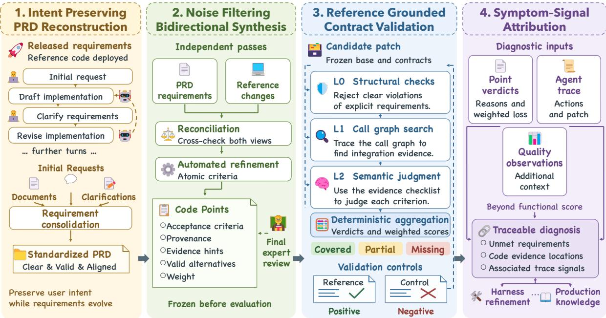  
Figure 1: PACE-Bench turns production requirements into frozen acceptance criteria, evidence-grounded judgments, and traceable diagnoses for agent improvement.

## 2.2 Noise Filtering Bidirectional Synthesis

The PRD pass extracts behavior without seeing implementation; the diff pass records changes without inferring business purpose. Reconciliation crosschecks these views. Refinement makes criteria atomic, removes noise, and records evidence hints and allowed alternatives:

$$
\begin{array} { r l } & { \widetilde G = \mathrm { R e c o n c i l e } \left( E _ { R } ( R ^ { \star } ) , E _ { \Delta } ( \Delta _ { r } ) \right) , } \\ & { G = \mathrm { R e v i e w } \left( \mathrm { R e f i n e } ( \widetilde G ) \right) . } \end{array}\tag{1}
$$

Here $E _ { R }$ and $E _ { \Delta }$ are independent extraction passes. Incidental reference changes do not become obligations. PRD-only findings are flagged for expert review; reference-linked candidates are not assumed to be fully satisfied.

Acceptance contracts and expert review. Each Code Point records behavior, provenance, retrieval hints, permitted alternatives, and weight. Symbolic contracts additionally specify required structures or interface values. A retrieval hint alone does not mandate an implementation. Weights reflect verifiability and business importance, not code volume. An initial weight distinguishes explicit, directly checkable contracts from criteria requiring broader semantic judgment. Business priority then adjusts the weight to reflect the consequence of an unmet requirement.

The platform team automates screening and validation. Business-domain experts join only for final selection and audit, checking requirement grounding, ambiguity, duplicates, and missing key acceptance items for all 750 retained criteria. A separate, non-overlapping group of technical annotators manually re-evaluates all 750 patch verdicts (Section 4.4). The two reviews address criterion validity and scoring validity, respectively; Appendix N details the construction stages.

The resulting suite. The 43 production tasks contain 750 Code Points, with median reference changes of 1,465 lines across 15 files. Figure 2 shows the domains, objectives, and languages; Figure 3 characterizes repository and task scale. Context and change scope are distinct: a compact patch can depend on a large codebase. Appendix M.1 details these measures.

## 3 Benchmark Evaluation Protocol

## 3.1 Reference Grounded Contract Validation

Each Code Point defines required behavior and permitted implementations. The protocol separates three questions: whether a violation is conclusive, where the candidate provides relevant evidence, and whether that evidence establishes fulfillment. A shared contract aligns these stages without treating retrieval as proof of fulfillment.

L0: Deterministic Contract Validation. L0 checks explicit acceptance constraints that can be resolved mechanically. It closes a point as Missing only when the inspected scope proves a violation; otherwise it defers to L1. It does not award Covered. This conservative boundary prevents missing names or unfamiliar implementations from becoming unsupported rejection decisions.

L1: Call Graph Evidence Localization. L1 connects each requirement to the candidate’s changed code and its integration context. It retrieves both the implementation and the connections needed to make the behavior reachable. Unchanged base code explains those connections but earns no independent acceptance credit. A bounded expansion can resolve a specific evidence gap. The goal is an inspectable evidence package, not a functional verdict inferred from identifier presence. Appendix F specifies the stopping rules.

L2: Constrained Semantic Judgment. L2 assesses the fixed acceptance conditions against the localized evidence, admitting equivalent implementations. Each condition receives a cited judgment; the judge cannot introduce new requirements. Partial means real but incomplete fulfillment, rather than uncertainty about unseen code. Criterionlevel judgments make the fulfilled behavior and remaining gap explicit, while fixed aggregation determines the point verdict and score. Prompt and response details appear in Appendix O.5.

Deterministic aggregation. A hard miss gives Missing; a partial entry or soft miss gives Partial; all criteria satisfied gives Covered. For resolved verdicts,

$$
S _ { c } = 1 0 0 \frac { \sum _ { i \in G _ { c } } w _ { i } \phi ( y _ { i } ) } { \sum _ { i \in G _ { c } } w _ { i } } ,\tag{2}
$$

where $\phi$ maps Covered, Partial, and Missing to 1, 0.5, and 0. Unresolved evidence blocks a final score rather than removing weight. Frozen weights encode verifiability and business importance; system scores average cases equally. Complete delivery requires $S _ { c } \geq 9 5 $ and zero Missing. Success rate is the fraction of cases meeting this criterion.

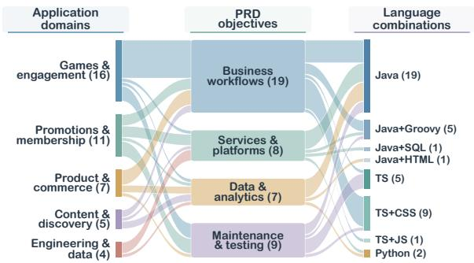

Figure 2: Application domains, PRD objectives, and language combinations across the 43 production cases.  
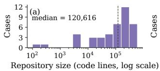

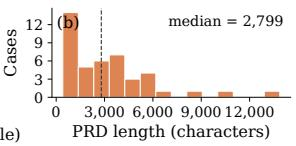

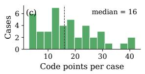

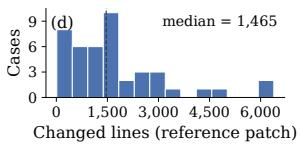  
Figure 3: Task-scale distributions: repository size, PRD length, acceptance scope, and reference edits. Dashed lines mark medians.

## 3.2 Symptom–Signal Attribution

Attribution keeps three views distinct. Outcome symptoms map cited non-Covered reasoning to contract mismatch, integration gap, test-delivery gap, or incomplete implementation; weighted loss $w _ { i } ( 1 - \phi ( y _ { i } ) )$ links each symptom to the score. Process signals record retrieval, editing, and verification in agent traces. Quality observations describe the delivered artifact without changing functional credit. Outcome gaps and process signals guide trace inspection.

## 4 Benchmark Experiments

## 4.1 Experimental Setup

We compare 11 model–scaffold configurations. Eight primary models are evaluated on the same 43 tasks using a common OpenHands scaffold (Wang et al., 2025): GPT-5.6-Sol, GLM-5.2, Qwen3.7-Max, Kimi-K2.6, Opus-4.8, Gemini-3.1- Pro-Preview, DeepSeek-V4-Pro, and MiniMax-M2.7. Native-scaffold configurations pair GPT-

5.6-Sol with Codex and Qwen3.7-Max with Qwen-Code. The main table also includes Qwen3.8-27B. Agents receive the standardized PRD and base repository, without the reference patch or acceptance criteria.

All scores use fixed Code Points and weights. We report case means with standard errors; task outcomes receive equal weight across the suite. Each configuration in Table 2 is evaluated over the 43- case suite, with a verdict for every one of the 750 Code Points. Appendix A gives the evaluation configuration. Cross-model diagnostic analyses use the eight primary common-scaffold models. Native configurations compare complete agent systems.

## 4.2 RQ1: Model and Scaffold Performance

We first compare how much of each request agents fulfill and how often they satisfy the complete acceptance contract.

Obs.1: Partial fulfillment and complete delivery reveal complementary model and scaffold capabilities.

Table 2 reports mean functional score and complete-delivery success. Among the eight primary common-scaffold models, mean scores span 26.0 points, from 52.1 to 78.1. GPT-5.6-Sol leads both measures, completing 6 of 43 tasks. Partial fulfillment and complete delivery remain distinct: models with similar mean scores can differ in the number of fully satisfied requests.

<table><tr><td>Model</td><td>Score (mean ± SE)</td><td>Success rate</td></tr><tr><td>Unified minimal scaffold</td></tr><tr><td>GPT-5.6-Sol  $7 8 . 0 8 \pm 2 . 7 1$ </td><td>14.0%</td></tr><tr><td>GLM-5.2</td><td> $6 8 . 8 0 \pm 3 . 7 2$  9.3%</td></tr><tr><td>Qwen3.7-Max</td><td> $6 6 . 7 0 \pm 3 . 4 5$  7.0%</td></tr><tr><td>Kimi-K2.6  $6 3 . 0 9 \pm 3 . 7 9$ </td><td>4.7%</td></tr><tr><td>Opus-4.8</td><td> $6 1 . 6 8 \pm 4 . 3 9$  7.0%</td></tr><tr><td>Gemini-3.1-Pro-Preview</td><td> $6 1 . 3 0 \pm 3 . 8 4$  2.3%</td></tr><tr><td>DeepSeek-V4-Pro</td><td> $6 1 . 0 0 \pm 3 . 6 5$  9.3%</td></tr><tr><td>MiniMax-M2.7</td><td> $5 2 . 1 3 \pm 3 . 6 4$  2.3%</td></tr><tr><td>Qwen3.8-27B</td><td> $1 2 . 2 5 \pm 3 . 1 2$  0.0%</td></tr><tr><td colspan="2">Native scaffolds</td></tr><tr><td>GPT-5.6-Sol (Codex)</td><td> $7 6 . 7 8 \pm 2 . 8 1$ </td></tr><tr><td>Qwen3.7-Max (QwenCode)</td><td>14.0%  $6 5 . 6 9 \pm 3 . 8 3$  11.6%</td></tr></table>

Table 2: Functional score (mean ± SE) and completedelivery success over 43 cases.

Evaluating the complete agent system. Codex and the unified GPT-5.6-Sol setup both complete 14.0% of cases; their mean scores are 76.8 and 78.1, respectively. QwenCode raises Qwen3.7-Max’s complete-delivery rate from 7.0% to 11.6%, with a mean score of 65.7 versus 66.7 under the unified scaffold. These paired configurations illustrate that scaffold effects differ across systems. For Qwen3.7- Max, the native scaffold completes five cases rather than three, despite a 1.01-point lower mean. A scaffold can change which requirements are completed together without increasing average fulfillment.

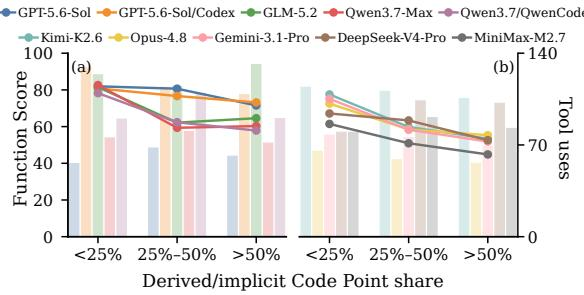  
Figure 4: Performance by derived/implicit Code Point share. Lines show scores; pale bars show mean tool use.

Task difficulty. Observed difficulty in this suite is more closely associated with inferring required behavior than with simple task size. Figure 4 groups cases by the share of derived or implicit Code Points: $< ~ 2 5 \%$ , 25%–50%, and > 50%. A larger share means more acceptance conditions must be inferred from PRD intent rather than read directly from its wording.

The groups score 75.0, 61.6, and 56.8 across the eight models, an 18.2-point difference between the outer groups. All eight models have negative correlations with this share. By comparison, Code Point count, changed lines, changed files, and PRD length have weak correlations with mean score $( | \rho | \le . 0 8 3 )$ . This pattern highlights interpreting and connecting requirements as a more informative difficulty factor than volume alone. Appendix M.4 reports correlations, uncertainty intervals, and the exploratory comparison across descriptors.

## 4.3 RQ2: Diagnosing Delivery Gaps

We read each delivery through three linked views: weighted acceptance loss identifies the unmet requirement, trajectory signals locate relevant agent behavior, and auxiliary quality observations describe the artifact.

## Obs.2: Acceptance-level evidence identifies incomplete implementation and integration as targets for agent improvement.

Figure 5 decomposes weighted loss into four mutually exclusive descriptive symptoms. Incomplete implementation is the largest category for six of the eight models, while integration or registration is largest for GLM-5.2 and Qwen3.7-Max. Integration remains a substantial source of lost credit across all models. Together, these two symptoms account for 72.0% of pooled weighted loss, ranging from 65.8% to 78.1% within individual models. The categories summarize cited acceptance evidence; trajectory inspection connects them to execution decisions. An incomplete handler and an unregistered handler need different interventions: implementing behavior versus updating a connection.

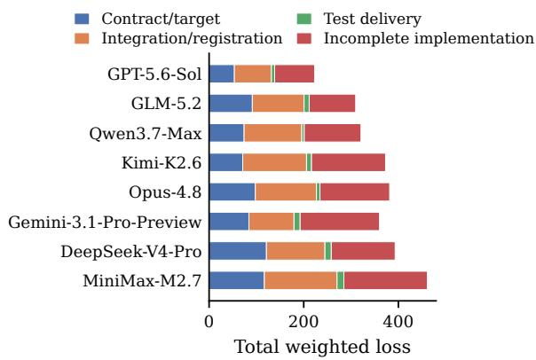  
Figure 5: Weighted acceptance loss across 43 cases, decomposed into four outcome symptoms.

Trajectory signals add the execution view (Figure 6). Verification gaps are the most frequent companions of acceptance misses, followed by expected files that were never retrieved. Qwen concentrates on verification gaps, while Gemini also shows an error-recovery signal. These trace-linked co-occurrences direct investigation toward context selection, entry-point wiring, and post-edit checks; engineers inspect the corresponding events to decide which intervention is warranted. Section 4.7 shows a retrieval-policy diagnosis under a fixed context budget.

A reviewer follows each loss to the cited declaration or edge, then checks its retrieval, edits, and verification in the trace. Table 3 shows quality and process observations for each configuration. Naming-contract scores cluster at 89.9–95.5, whereas test-delivery scores span 22.3–55.3 on applicable cases; verification commands also vary, from 10.4 to 20.3 for the two GPT-5.6-Sol scaffolds. These observations guide inspection without changing functional scores.

The three views answer different questions. An outcome symptom names the violated acceptance contract and accounts for its weighted loss. A trajectory signal points to an event worth inspecting, such as a missing retrieval or absent post-edit verification; its co-occurrence with a symptom does not by itself prove the event caused the miss. Quality observations describe the delivered artifact’s conventions, architecture, naming, and test coverage even when these properties are not direct PRD requirements. Keeping them separate prevents a cleanly named but disconnected component from gaining functional credit, while still giving engineers concrete leads for review and harness changes.

## 4.4 RQ3: Reliability of Acceptance Evaluation

We test whether evaluation distinguishes relevant implementations from negative controls and agrees with the fixed expert-consensus reference.

## Obs.3: Positive and negative controls distinguish requirement fulfillment from superficial code matches.

With the PRD, base, criteria, and weights fixed, we compare accepted references with four negative controls: (A) no changes, (B) unrelated samerepository edits, (C) another case’s patch, and (D) expected names or locations with empty class or method bodies. We verify exact-base applicability before scoring. Table 4 summarizes the results; Appendix I details construction.

Positive control. Reference patches score 98.35 on average, with a median of 100.00. Businessdomain experts checked every non-Covered point against the PRD and reference implementation. They confirmed omitted implementation details that the PRD explicitly required, and accepted the corresponding Partial or Missing verdict. The shortfall therefore reflects genuine acceptance gaps, rather than a requirement that references score perfectly.

Negative controls. A–C earn no credit on applicable patches. Cross-case patches that cannot apply to the target base are excluded, rather than scored zero. D receives no Covered verdicts. Its three Partials have expected declarations or locations but empty bodies: the semantic judge grants structural credit without recognizing complete behavioral fulfillment.

Expert agreement and component contributions. The component study tests how contract grounding, evidence localization, and aggregation contribute to agreement under identical patches.

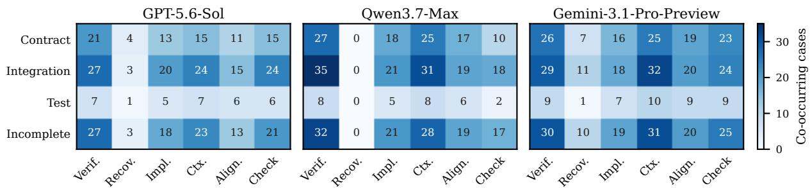  
Figure 6: Case-level co-occurrence of outcome symptoms (rows) and process signals (columns) for three models, using a shared color scale.

<table><tr><td rowspan="2">Model</td><td colspan="4">Code quality (0–100)</td><td colspan="4">Execution process</td></tr><tr><td>Conv.</td><td>Arch.</td><td>Name</td><td>Test</td><td>Verify</td><td>Self</td><td>Post</td><td>Tools</td></tr><tr><td>Unified minimal scaffold</td><td></td><td></td><td></td><td></td><td></td><td></td><td></td><td></td></tr><tr><td>GPT-5.6-Sol</td><td>58.2</td><td>68.4</td><td>94.3</td><td>47.2</td><td>10.4</td><td>8.4</td><td>5</td><td>62.0</td></tr><tr><td>GLM-5.2</td><td>57.7</td><td>66.9</td><td>93.2</td><td>51.1</td><td>5.9</td><td>4.0</td><td>11</td><td>122.8</td></tr><tr><td>Qwen3.7-Max</td><td>52.5</td><td>62.8</td><td>94.0</td><td>45.4</td><td>4.7</td><td>4.3</td><td>4</td><td>75.9</td></tr><tr><td>Kimi-K2.6</td><td>57.4</td><td>65.1</td><td>95.5</td><td>43.2</td><td>8.0</td><td>6.9</td><td>10</td><td>110.1</td></tr><tr><td>Opus-4.8</td><td>54.9</td><td>65.9</td><td>89.9</td><td>49.6</td><td>4.8</td><td>3.1</td><td>14</td><td>59.8</td></tr><tr><td>Gemini-3.1-Pro-Preview</td><td>48.9</td><td>63.2</td><td>93.0</td><td>41.5</td><td>4.6</td><td>3.4</td><td>3</td><td>73.9</td></tr><tr><td>DeepSeek-V4-Pro</td><td>53.1</td><td>64.0</td><td>91.7</td><td>22.3</td><td>4.4</td><td>4.3</td><td>0</td><td>95.8</td></tr><tr><td>MiniMax-M2.7</td><td>51.1</td><td>63.6</td><td>92.4</td><td>36.2</td><td>5.8</td><td>5.3</td><td>10</td><td>84.8</td></tr><tr><td>Native scaffolds</td><td></td><td></td><td></td><td></td><td></td><td></td><td></td><td></td></tr><tr><td>GPT-5.6-Sol (Codex)</td><td>59.1</td><td>78.2</td><td>93.2</td><td>55.3</td><td>20.3</td><td>14.2</td><td>16</td><td>116.7</td></tr><tr><td>Qwen3.7-Max (QwenCode)</td><td>59.5</td><td>67.9</td><td>95.5</td><td>38.3</td><td>1.7</td><td>0.7</td><td>17</td><td>97.2</td></tr></table>

Table 3: Auxiliary code-quality and process observations. Verify, Self, and Tools are mean counts per case; Post counts cases with successful verification after the last edit (of 43). Test scores use the nine cases requiring tests. None enters the functional score.
<table><tr><td>Control</td><td>Score / 100</td></tr><tr><td>Positive control Accepted reference patch</td><td>98.35</td></tr><tr><td>Negative controls</td><td></td></tr><tr><td>A. Empty patch</td><td>0.00</td></tr><tr><td>B. Same-repository unrelated patch</td><td>0.00</td></tr><tr><td>C. Applicable cross-case patch</td><td>0.00</td></tr><tr><td>D. Identifier-only patch</td><td>4.03</td></tr></table>

Table 4: Reference and negative-control scores.

Obs.4: Contract grounding, evidence localization, and checklist aggregation jointly support agreement with expert consensus.

We compare seven judging methods under identical candidate patches and the frozen 750-point consensus reference (Table 5). Three platformside technical annotators manually re-evaluated all 750 Qwen patch verdicts to form the consensus reference; none participated in the businessdomain criterion audit. Appendix D describes the review protocol. We report exact agreement, linearly weighted Cohen’s $\kappa ,$ and severe Covered– Missing inversions.

The three ablations change one component at a time. Without contract grounding, the judge receives the description without its detailed acceptance contract. Without tiered judgment, the complete diff replaces localized evidence. Without checklist aggregation, the judge emits a verdict directly. Baselines use a vanilla judge, a vanilla judge supplied with the contract, and an agent-as-a-judge that searches the repository autonomously (Zhuge et al., 2025).

The full pipeline achieves 95.2% agreement and κ = .945, with no severe inversions. Removing contract grounding reduces κ to .595, removing checklist aggregation to .677, and removing tiered judgment to .843. The autonomous judge reaches 78.0% agreement and $\kappa = . 7 2 6$ . Together, these comparisons support combining a precise acceptance boundary with localized evidence and deterministic verdict aggregation. The component comparison fixes candidate patches and consensus labels across methods and is reported separately from the model-delivery study in RQ1.

The full pipeline exceeds the strongest baseline by 17.2 agreement points. The contract fixes what must be established, localization fixes the inspected evidence, and aggregation fixes the verdict rule.

Table 5: Expert-consensus agreement, grouped into the full pipeline, component ablations, and judge baselines.
<table><tr><td>Method</td><td> $\mathrm { A g r . ~ } \uparrow$ </td><td>Weighted  $\kappa \uparrow$ </td><td>Severe dis. ↓</td></tr><tr><td>Full pipeline</td><td>95.2%</td><td>0.945</td><td>0.0%</td></tr><tr><td>w/o contract grounding</td><td>70.3%</td><td>0.595</td><td>9.7%</td></tr><tr><td>w/o tiered judgment</td><td>87.7%</td><td>0.843</td><td>1.5%</td></tr><tr><td>w/o checklist aggregation</td><td>76.3%</td><td>0.677</td><td>5.9%</td></tr><tr><td>Vanilla LLM judge</td><td>77.6%</td><td>0.686</td><td>4.3%</td></tr><tr><td>Vanilla LLM with contract</td><td>76.0%</td><td>0.652</td><td>8.3%</td></tr><tr><td>Agent-as-a-judge with contract</td><td>78.0%</td><td>0.726</td><td>1.5%</td></tr></table>

## 4.5 RQ4: Delivery Consistency

We compare repeated deliveries with judging records for fixed patches to distinguish execution variability from evaluation variability.

## Obs.5: Judging is more stable than execution.

For Qwen3.7-Max, the three executions score 66.70, 65.44, and 65.37. Three judging records for the fixed Run 1 patches score 66.70, 66.47, and 66.40, with complete delivery in 3, 2, and 3 of 43 cases, respectively (Table 11). We average each case’s three-record sample standard deviation and range over the 43 cases: mean case SD is 8.77 for execution and 2.36 for judging; mean case range is 16.34 and 4.46. Execution variation is therefore about 3.7 times larger by both measures. This per-case comparison holds candidate patches fixed for judging, so the smaller variation does not rely on similar aggregate means alone.

Figure 7 distinguishes acceptance at least once from acceptance in every run. Point-level pass@3 reaches 68.4%, whereas pass3 is 33.2%. Relative to one run, these represent changes of +15.1 and −20.1 percentage points. Case-level any-run and every-run success are 9.3% and 4.7%. This distinction shows why aggregate means alone do not describe delivery reliability: similar run means can conceal different subsets of fulfilled requirements.

The smaller fixed-patch variation supports judge repeatability. Similar functional means still hide delivery differences, motivating beyondfunctional analysis of execution signals and quality observations.

## 4.6 RQ5: Does Static Knowledge Improve Implementation?

We select 28 cases with available task-relevant repository knowledge, covering 525 Code Points, to study static knowledge injection with Qwen3.7- Max. For each selected case, we compare a noknowledge input with three fixed knowledge inputs: repository locators, task-matched repository knowledge, and shared engineering documentation. All four inputs are evaluated on this subset in a paired comparison.

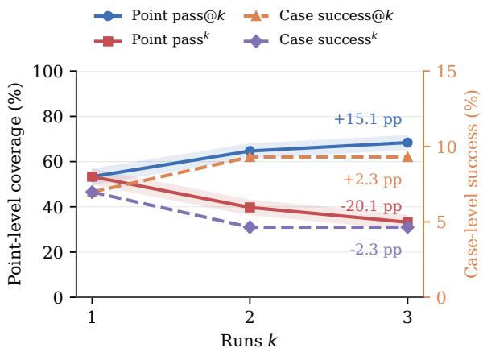

Figure 7: Qwen3.7-Max repetition: any-run versus every-run success. Annotations show changes in percentage points.
<table><tr><td>Knowledge input</td><td>Mean score ± SE</td><td>∆</td></tr><tr><td>No knowledge</td><td> $5 8 . 5 4 \pm 5 . 1 1$ </td><td></td></tr><tr><td>Locators only</td><td> $5 7 . 8 0 \pm 4 . 8 4$ </td><td>-0.74</td></tr><tr><td>Repository-matched knowledge</td><td> $5 9 . 2 3 \pm 4 . 7 7$ </td><td>+0.69</td></tr><tr><td>Shared long context</td><td> $5 7 . 0 3 \pm 5 . 2 2$ </td><td>-1.51</td></tr></table>

Table 6: Paired knowledge comparison on 28 cases selected for available repository knowledge.

## Obs.6: Static knowledge injection yields no consistent gains.

Table 6 shows changes from −1.51 to +0.69 points. Knowledge availability alone therefore does not reliably translate into effective implementation in this setting. Each reported delta compares a knowledge input with the no-knowledge input on the same selected cases. Moreover, a small change in mean score can mask different requirements being completed across cases. The result supports a limited conclusion about these fixed inputs and this suite, rather than a general claim that repository knowledge cannot help coding agents. The distinction motivates examining how context enters the execution process, rather than treating additional documentation as sufficient. Appendix M.7 describes construction, contents, and fallback.

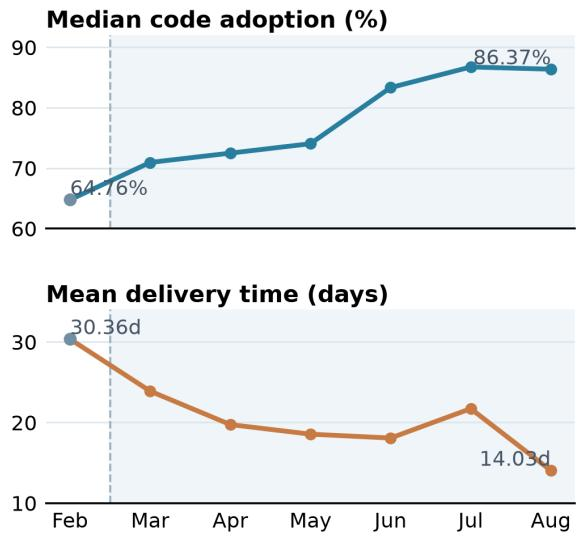

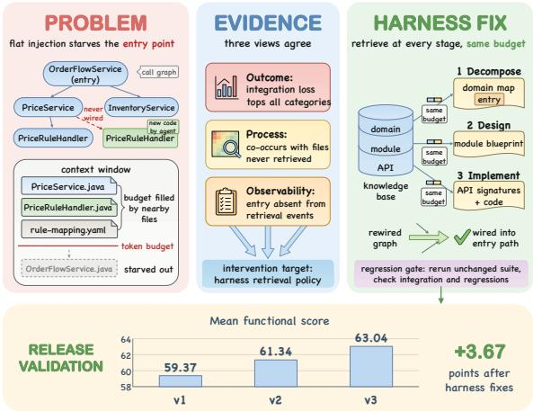  
Figure 8: A representative retrieval diagnosis and scores of three successive harness releases.  
Figure 9: Monthly coding-agent platform observations from February to August.

## 4.7 RQ6: Can Diagnosis Guide Harness Improvement?

We applied the evaluation–diagnosis–repair workflow to our coding-agent platform’s harness and compared successive releases on the fixed suite. Obs.7: Trace-linked diagnosis identifies actionable harness changes.

Figure 8 illustrates one retrieval repair. Acceptance gaps, unretrieved entry files, and retrieval events linked missing integration to context selection. Stage-matched retrieval replaced flat injection with domain, module, and API context at the appropriate task stage under the same budget. This changes what the agent sees at implementation while keeping the context allowance fixed, so the same acceptance conditions can be evaluated after the change.

PACE-Bench turns diagnosis into continuing harness evolution. Engineers inspect weighted acceptance gaps and trace signals, update retrieval, tool guidance, and planning behavior, then rerun the unchanged 43-task suite. Across three Opus-4.5 releases, mean score rises from 59.37 to 61.34 to 63.04 (+3.67 points; Appendix L). During the platform rollout of this benchmark-guided iteration, monthly median code adoption rose from 64.76% to 86.37%, while mean requirement delivery time fell from 30.36 to 14.03 days between February and August (Figure 9).

## 5 Related Work

Tasks and acceptance oracles. SWE-bench and SWE-bench Pro study issue resolution in existing repositories (Jimenez et al., 2024; Deng et al., 2026); FEA-Bench and FeatureBench extend this setting to feature requests (Li et al., 2025b; Zhou et al., 2026). DevEval and PRDBench use PRDstyle inputs for new projects (Li et al., 2025a; Fu et al., 2026), while Harvest curates production prompts with test-based scoring (Jha et al., 2026). Table 1 distinguishes PACE-Bench by combining final PRDs, existing repositories, and reviewed acceptance criteria.

Grounded acceptance judgment. LLM judges are sensitive to their criteria and evidence presentation (Zheng et al., 2023; Wang et al., 2024; Gu et al., 2026). Rubrics and checklists make the target explicit (Liu et al., 2023; Lee et al., 2025; Starace et al., 2025); CodeJudge scores code deviations (Tong and Zhang, 2024), and Agent-as-a-Judge searches the workspace (Zhuge et al., 2025). PACE-Bench fixes expert-audited Code Point contracts before evaluation, localizes code and integration evidence, and aggregates cited criterion judgments by rule. Its controls, expert agreement, and repeated judging test this acceptance boundary on the same frozen suite.

Diagnosis for agent improvement. Trace studies localize execution failures and analyze agent behavior (Deshpande et al., 2025; Cemri et al., 2025; Zhang et al., 2025). PACE-Bench connects those process signals to weighted unmet PRD conditions. Engineers inspect the linked evidence, revise the harness, and rerun unchanged tasks; the release comparison in Section 4.7 shows how the benchmark is used beyond model ranking.

## 6 Conclusion

PACE-Bench provides a benchmark and evaluation methodology for enterprise PRD development. Incomplete implementation and missing integration emerge as the principal bottlenecks. Expert agreement and repeated judging support evaluator reliability: judging varies substantially less than agent execution. Similar functional means nevertheless conceal differences in delivered requirements, motivating analysis beyond aggregate scores.

Acceptance losses, execution signals, and quality observations guide harness refinement and provide a basis for extending this feedback to knowledge evolution and targeted model training.

## Limitations

Data sources. Our benchmark focuses on tasks grounded in real user–agent interactions and the corresponding delivered code. We do not investigate alternative task construction approaches, such as mining tasks directly from merge requests or deriving them from repository structure. These sources may capture different types of development tasks and provide complementary coverage.

## Ethical Considerations

The study uses internal development records under organizational data governance policies. The conversations, repositories, and requirements do not contain end-user or customer data. Developers were informed that platform sessions were recorded for engineering improvement, and personal identifiers were removed before analysis.

Code Point selection and revision involved technical experts deeply familiar with the corresponding business domains and requirements. The agreement study involved technical experts experienced in frontend and backend evaluation and coding agents. Reviewers were company employees based in China, informed of the review tasks, and agreed to participate as part of their regular professional duties.

Potential risks. Development records may contain identifying information in conversation text or metadata. Identifier removal and organizational access controls reduce the associated privacy risks.

## References

Mert Cemri, Melissa Z Pan, Shuyi Yang, Lakshya A Agrawal, Bhavya Chopra, Rishabh Tiwari, Kurt

Keutzer, Aditya Parameswaran, Dan Klein, Kannan Ramchandran, et al. 2025. Why do multi-agent llm systems fail? In Advances in Neural Information Processing Systems, volume 38.

Mark Chen, Jerry Tworek, Heewoo Jun, Qiming Yuan, Henrique Ponde De Oliveira Pinto, Jared Kaplan, Harri Edwards, Yuri Burda, Nicholas Joseph, Greg Brockman, et al. 2021. Evaluating large language models trained on code. arXiv preprint arXiv:2107.03374.

Xiang Deng, Jeff Da, Edwin Pan, Yannis Yiming He, Charles Ide, Kanak Garg, Niklas Lauffer, Andrew Park, Chetan Rane, Karmini Sampath, Maya Krishnan, Srivatsa R Kundurthy, Sean M. Hendryx, Zifan Wang, Chen Bo Calvin Zhang, Noah Jacobson, Bing Liu, and Brad Kenstler. 2026. Swe-bench pro: Can ai agents solve long-horizon software engineering tasks? In Forty-third International Conference on Machine Learning.

Darshan Deshpande, Varun Gangal, Hersh Mehta, Jitin Krishnan, Anand Kannappan, and Rebecca Qian. 2025. Trail: Trace reasoning and agentic issue localization. arXiv preprint arXiv:2505.08638.

Lingyue Fu, Bolun Zhang, Hao Guan, Yaoming Zhu, Lin Qiu, Weiwen Liu, Xuezhi Cao, Xunliang Cai, Weinan Zhang, and Yong Yu. 2026. Automatically benchmarking llm code agents through agent-driven annotation and evaluation. In Proceedings of the 25th International Conference on Autonomous Agents and Multiagent Systems.

Jiawei Gu, Xuhui Jiang, Zhichao Shi, Hexiang Tan, Xuehao Zhai, Chengjin Xu, Wei Li, Yinghan Shen, Shengjie Ma, Honghao Liu, et al. 2026. A survey on llm-as-a-judge. The Innovation, 7(6):101253.

Richard Hopkins and Kevin Jenkins. 2008. Eating the IT elephant: Moving from greenfield development to brownfield. IBM Press.

Smriti Jha, Matteo Paltenghi, Chandra Maddila, Vijayaraghavan Murali, Shubham Ugare, and Satish Chandra. 2026. Reap: Automatic curation of coding agent benchmarks from interactive production usage. In Proceedings ofthe 41st IEEE/ACM International Conference on Automated Software Engineering, pages 4304–4314.

Carlos E Jimenez, John Yang, Alexander Wettig, Shunyu Yao, Kexin Pei, Ofir Press, and Karthik Narasimhan. 2024. Swe-bench: Can language models resolve real-world github issues? In International Conference on Learning Representations, volume 2024, pages 54107–54157.

Yukyung Lee, JoongHoon Kim, Jaehee Kim, Hyowon Cho, Jaewook Kang, Pilsung Kang, and Najoung Kim. 2025. Checkeval: A reliable LLM-as-a-judge framework for evaluating text generation using checklists. In Proceedings ofthe 2025 Conference on Empirical Methods in Natural Language Processing, pages 15771–15798.

Bowen Li, Wenhan Wu, Ziwei Tang, Lin Shi, John Yang, Jinyang Li, Shunyu Yao, Chen Qian, Binyuan Hui, Qicheng Zhang, Zhiyin Yu, He Du, Ping Yang, Dahua Lin, Chao Peng, and Kai Chen. 2025a. Prompting large language models to tackle the full software development lifecycle: A case study. In Proceedings of the 31st International Conference on Computational Linguistics, pages 7511–7531, Abu Dhabi, UAE. Association for Computational Linguistics.

Wei Li, Xin Zhang, Zhongxin Guo, Shaoguang Mao, Wen Luo, Guangyue Peng, Yangyu Huang, Houfeng Wang, and Scarlett Li. 2025b. FEA-bench: A benchmark for evaluating repository-level code generation for feature implementation. In Proceedings of the 63rd Annual Meeting ofthe Associationfor Computational Linguistics (Volume 1: Long Papers), pages 17160–17176, Vienna, Austria. Association for Computational Linguistics.

Yang Liu, Dan Iter, Yichong Xu, Shuohang Wang, Ruochen Xu, and Chenguang Zhu. 2023. G-eval: Nlg evaluation using gpt-4 with better human alignment. In Proceedings of the 2023 conference on empirical methods in natural language processing, pages 2511–2522.

Vijayaraghavan Murali, Chandra Maddila, Imad Ahmad, Michael Bolin, Daniel Cheng, Negar Ghorbani, Renuka Fernandez, Nachiappan Nagappan, and Peter C Rigby. 2024. Ai-assisted code authoring at scale: Fine-tuning, deploying, and mixed methods evaluation. Proceedings of the ACM on Software Engineering, 1(FSE):1066–1085.

Elise Paradis, Kate Grey, Quinn Madison, Daye Nam, Andrew Macvean, Vahid Meimand, Nan Zhang, Ben Ferrari-Church, and Satish Chandra. 2024. How much does ai impact development speed? an enterprise-based randomized controlled trial. arXiv preprint arXiv:2410.12944.

Giulio Starace, Oliver Jaffe, Dane Sherburn, James Aung, Jun Shern Chan, Leon Maksin, Rachel Dias, Evan Mays, Benjamin Kinsella, Wyatt Thompson, et al. 2025. Paperbench: Evaluating ai’s ability to replicate ai research. In International Conference on Machine Learning, pages 56843–56873. PMLR.

Weixi Tong and Tianyi Zhang. 2024. Codejudge: Evaluating code generation with large language models. In Proceedings of the 2024 Conference on Empirical Methods in Natural Language Processing, pages 20032–20051.

Peiyi Wang, Lei Li, Liang Chen, Zefan Cai, Dawei Zhu, Binghuai Lin, Yunbo Cao, Lingpeng Kong, Qi Liu, Tianyu Liu, et al. 2024. Large language models are not fair evaluators. In Proceedings of the 62nd Annual Meeting ofthe Associationfor Computational Linguistics (Volume 1: Long Papers), pages 9440– 9450.

Xingyao Wang, Boxuan Li, Yufan Song, Frank F Xu, Xiangru Tang, Mingchen Zhuge, Jiayi Pan, Yueqi

Song, Bowen Li, Jaskirat Singh, et al. 2025. Openhands: An open platform for ai software developers as generalist agents. In International Conference on Learning Representations, volume 2025, pages 65882–65919.

Karl Wiegers and Joy Beatty. 2013. Software requirements, 3 edition. Microsoft Press.

Frank Fangzheng Xu, Yufan Song, Boxuan Li, Yuxuan Tang, Kritanjali Jain, Mengxue Bao, Zora Wang, Xuhui Zhou, Zhitong Guo, Murong Cao, et al. 2025. Theagentcompany: benchmarking llm agents on consequential real world tasks. In Advances in Neural Information Processing Systems, volume 38.

Shaokun Zhang, Ming Yin, Jieyu Zhang, Jiale Liu, Zhiguang Han, Jingyang Zhang, Beibin Li, Chi Wang, Huazheng Wang, Yiran Chen, et al. 2025. Which agent causes task failures and when? on automated failure attribution of llm multi-agent systems. In Forty-second International Conference on Machine Learning.

Lianmin Zheng, Wei-Lin Chiang, Ying Sheng, Siyuan Zhuang, Zhanghao Wu, Yonghao Zhuang, Zi Lin, Zhuohan Li, Dacheng Li, Eric Xing, et al. 2023. Judging llm-as-a-judge with mt-bench and chatbot arena. In Advances in neural information processing systems, volume 36, pages 46595–46623.

Qixing Zhou, Jiacheng Zhang, Haiyang Wang, Rui Hao, Jiahe Wang, Minghao Han, Yuxue Yang, Shuzhe Wu, Feiyang Pan, Lue Fan, Dandan Tu, and Zhaoxiang Zhang. 2026. Featurebench: Benchmarking agentic coding for complex feature development. In The Fourteenth International Conference on Learning Representations.

Mingchen Zhuge, Changsheng Zhao, Dylan Ashley, Wenyi Wang, Dmitrii Khizbullin, Yunyang Xiong, Zechun Liu, Ernie Chang, Raghuraman Krishnamoorthi, Yuandong Tian, et al. 2025. Agent-as-a-judge: Evaluate agents with agents. In Proceedings of the 42nd International Conference on Machine Learning, volume 267, pages 80569–80611. PMLR.

## A Experimental Configuration

The primary common-scaffold study uses Open-Hands 1.21.0 with a terminal and patch tools. Native-scaffold rows retain their corresponding Codex or QwenCode configuration. Ground-truth criteria, weights, base revisions, and candidate patch identities remain fixed during evaluation.

Evaluation scope. Every main-table configuration covers the same 43 cases and all 750 Code Points. Acceptance criteria, point weights, base revisions, and candidate patches remain fixed for each comparison. Case scores use the complete set of acceptance verdicts, and system scores give equal weight to each case. Table 6 compares the

<table><tr><td>Item</td><td>Configuration</td></tr><tr><td>Cases / Code Points</td><td>43 / 750</td></tr><tr><td>Common scaffold</td><td>OpenHands 1.21.0</td></tr><tr><td>Agent iteration limit</td><td>200</td></tr><tr><td>Tool concurrency</td><td>4</td></tr><tr><td>Qwen generation effort</td><td>xhigh</td></tr><tr><td>Semantic judge</td><td>Opus-4.8</td></tr><tr><td>Judge reasoning setting</td><td>Model default</td></tr><tr><td>Maximum judge output</td><td>8,192 tokens</td></tr><tr><td>Point verdicts</td><td>Covered / Partial / Missing</td></tr><tr><td>Success criterion</td><td>Defined in Section 3.1</td></tr></table>

Table 7: Common evaluation settings; native-scaffold configurations are recorded separately.

28 cases (525 Code Points) common to its four arms. Both studies use frozen acceptance criteria and weights, but their judgment records differ. The main-table Qwen result retains earlier point judgments outside its targeted review; the knowledge comparison begins with new judgments on distinct patches before applying the fixed targeted review. Knowledge effects are therefore paired within Table 6; its no-knowledge mean is not the 43-case main-table mean.

The Qwen3.8-27B row uses 43 frozen final patches under the same evaluation scope. Seventeen patches are empty. Its generation context and recovery configuration are retained separately from the primary eight-model study; it is not included in the diagnostic and repetition aggregates.

Result validation. Validation checks the exact case and point sets, source patch hashes, judge identity, evaluation configuration, and finite scores. Main-table records contain all 750 Code Points; the knowledge comparison contains the 525 points in its common subset. All accepted verdicts are Covered, Partial, or Missing. Operational failures are retained separately from accepted scoring records and do not become implementation-failure labels.

## B PRD Reconstruction Protocol

Matched requirement documents and the user’s task request establish scope. Later user clarifications refine that scope and supersede earlier statements where the change is explicit. Task titles and changed-file metadata validate alignment but do not introduce requirements. The reconstructed PRD expresses the final requested behavior as work to be performed from the base repository, avoiding conversational progress statements. Its sections cover goals, scope, behavior, business rules, technical constraints, and acceptance criteria where supported. Appendix O.2 gives the reconstruction prompt.

## B.1 Sources of the Final PRDs

The 43 final PRDs follow three mutually exclusive source paths (Table 8). A case enters the clarification group when later user instructions contribute to its final PRD, even if an initial task document is also available. Documents may be directly supplied or reconstructed from the production record; document provenance does not by itself establish when an implementation name first appeared.

<table><tr><td>Final PRD source</td><td>Cases</td></tr><tr><td>Direct or reconstructed task document, without later user clarification</td><td>8</td></tr><tr><td>First user request alone</td><td>3</td></tr><tr><td>Initial task plus later user clarification</td><td>32</td></tr><tr><td>Total</td><td>43</td></tr></table>

Table 8: Source paths contributing to the 43 final PRDs.

## C Process Observability per Model

Table 3 reports process metrics from the same frozen execution records as the primary main-table configurations, in the same within-scaffold order. Counts are averaged over 43 cases; post-edit verification instead reports the number of cases with a successful strict project-verification command after the last observed edit. Native-scaffold metrics are reconstructed from recorded commands, file edits, and matched tool outcomes using the same command classifier. Counts reflect exported events; child-agent activity is counted only when present in the logs. These observations do not alter model scores.

## D Consensus Reference Protocol

The agreement study uses a consensus reference formed through manual re-evaluation of all 750 Code Point verdicts for the Qwen Run 1 patches. Three platform-side technical annotators review the requirements, candidate implementations, verdicts, and cited evidence. Their task is to assess whether the assigned scores are justified by the delivered code.

This review is separate from criterion validation. Business-domain experts check requirement grounding and whether key acceptance items are missing from the criterion set. The two reviewer groups have no personnel overlap. The seven-method comparison uses the same candidate patches and consensus labels and reports 95.2% agreement and linearly weighted $\kappa = . 9 4 5$ for the evaluated full pipeline.

## E Agreement Metric Definitions

Exact agreement is the fraction of the 750 verdicts equal to the reference: $N ^ { - 1 } \sum _ { i } \mathcal { W } ( y _ { i }$ = $y _ { i } ^ { \mathrm { r e f } } )$ . Linearly weighted Cohen’s κ discounts chance agreement and distinguishes adjacent from opposite-extreme disagreements. Covered–Partial and Partial–Missing receive agreement weight 0.5; Covered–Missing receives weight 0. Thus exact agreement measures identical decisions, while weighted κ also reflects their ordinal distance.

<table><tr><td></td><td>Missing</td><td>Partial</td><td>Covered</td></tr><tr><td>Missing</td><td>1</td><td>0.5</td><td>0</td></tr><tr><td>Partial</td><td>0.5</td><td>1</td><td>0.5</td></tr><tr><td>Covered</td><td>0</td><td>0.5</td><td>1</td></tr></table>

Table 9: Linear agreement weights for Cohen’s κ.

## F Complete Per-Point Acceptance Procedure

The point contract freezes criterion IDs and text, identifier and location constraints, allowed implementations, and weight. Patch reconstruction verifies the exact base, file boundaries, and artifact identity before scoring. Input failures remain evaluation errors.

Structural certainty. L0 checks mandatory structures within their complete scope. It returns Missing for conclusive violations and otherwise defers to L1; it does not return Covered. Deferred cases include legal interfaces, annotations, and delegation. A name occurrence by itself does not establish behavior.

Evidence package and stopping rule. L1 distinguishes hard anchors from retrieval seeds. Its deterministic positive exception is restricted to a package-structure contract: the strategy must be symbol\_exists, the target must be a candidatemodified \_\_init\_\_.py, and any specified package name must match. This check establishes the requested package structure, not its behavior. Other positive judgments require L2. The evidence package records complete declarations, method bodies, exact candidate diffs, base-context labels, and the concrete edges needed by each criterion. An integration claim needs source, target, and an observed call, assignment, import/export, registry entry, or configuration binding. An explicit empty connection inventory records the search result without granting credit.

When a checklist identifies a specific missing declaration, the localizer extracts the ownerqualified method and performs one expansion through same-owner helpers, bounded to two hops. It then stops. Complete relevant inspection with no implementation establishes Missing; an unavailable required body or external dependency remains unresolved. Retrieval hits and file names alone never settle a behavioral condition.

Criterion binding and aggregation. L2 sees criterion text and the evidence package, but not weights or the reference answer. Its response must contain exactly the frozen criterion ID set. Each entry cites evidence, records severity, and judges the same condition with its original polarity. The aggregation code handles hard misses, partial fulfillment, and soft gaps. A connection-related correction requires corroborating evidence from the complete L1 inventory. Weights apply after verdict resolution; unresolved requirements never disappear from the case denominator.

## G Attribution Rules

The outcome classifier reads the cited reasoning of each non-Covered point in a fixed priority order: contract or target mismatch, integration or registration gap, test-delivery gap, and incomplete implementation. Each point contributes $w _ { i } ( 1 - \phi ( y _ { i } ) )$ to one symptom. Process rules independently scan tool events, retrieved files, patches, verification commands, and their outcomes. A case can receive multiple process signals. Both classifications are deterministic functions of the saved artifacts and introduce no additional judge call.

## H Per-Model Symptom–Signal Co-occurrence

Figure 10 extends the main three-model view to all eight primary models with a shared color scale.

## I Controls for Reference Grounded Contract Validation

Accepted reference patches supply positive controls. Each control holds the target PRD, exact base revision, criterion definitions, and weights fixed, changing only the candidate patch. An empty patch leaves the base unchanged. A same-repository unrelated patch edits code outside the target requirement. A cross-case patch transfers a change from another task; only patches applicable to the exact target base are scored. Identifier-only patches provide expected names or locations while leaving the corresponding concrete classes or methods empty.

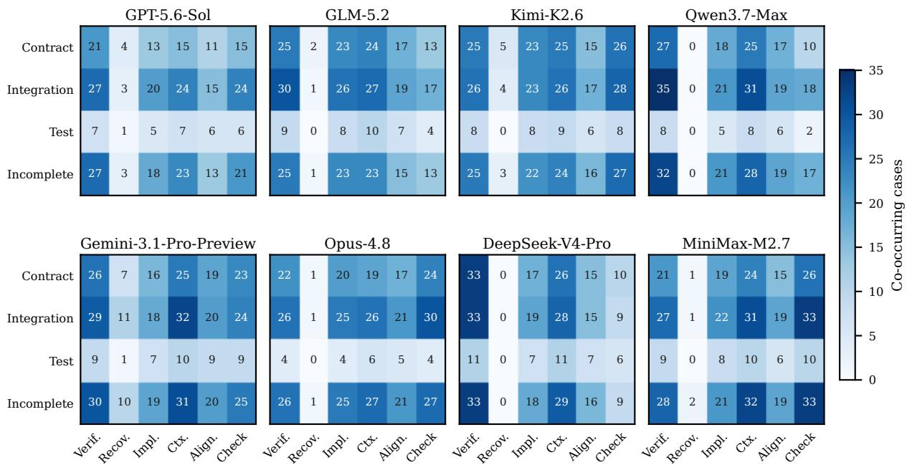  
Figure 10: Outcome symptoms and process signals across the eight primary models.

The frozen identifier-only control targets 54 behavioral criteria and returns 51 Missing, three Partial, and no Covered. With frozen weights summing to 109.105 and Partial weights summing to 8.8, its normalized score is 100 × (0.5 × 8.8)/109.105 = 4.03. This score summarizes the constructed control criteria, rather than a mean over complete cases. The residual Partials reflect structural credit for declarations without their required behavior.

The controls test whether the evaluator distinguishes required behavior from irrelevant changes and superficial declarations. The manual consensus comparison separately assesses judgment agreement on candidate implementations under the same evaluation protocol.

## I.1 Positive Controls: Accepted Reference Patches

Reference evaluation covers 43 cases and 750 Code Points. The mean is 98.35 and the median is 100.00, with 736 Covered, 7 Partial, and 7 Missing verdicts. Business-domain experts reviewed all 14 non-Covered points against the PRD and reference patch. They confirmed that the criteria describe explicit requirements and that the implementation omits the corresponding details. The Partial and Missing judgments were therefore retained. An accepted reference is a positive example, not a guarantee of perfect fulfillment of every PRD condition. Reference-linked criteria may therefore receive Partial or Missing when relevant changes omit required behavior. Table 4 reports this positive control alongside the four negative controls.

## J Task-Size Associations

## K Artifact Availability

Code is available at https://github.com/ TianqiLiu1/PACE-Bench. The repository includes benchmark construction and evaluation code, contract schemas, scoring logic, and attribution rules. Production requirement documents, repository snapshots, and development records remain subject to organizational access controls. This appendix documents the task protocol, scoring rules, prompt renderings, and aggregate results independently of those raw production artifacts.

## L Harness Release Configuration

The three release configurations in Figure 8 use the same Opus-4.5 generation model and the same 43-case suite, comprising frontend and backend development requests. The labels v1, v2, and v3 identify the three evaluated release configurations. Their mean-score standard errors are 3.93, 3.92, and 3.80, respectively. Each release completes one of 43 cases (2.3%). Section 4.7 reports the mean scores; Table 10 summarizes the changes.

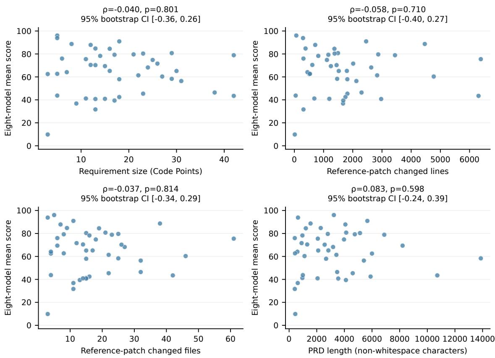  
Figure 11: Task-size associations with eight-model mean score. Each point is a case; intervals use case-level bootstrap sampling.

<table><tr><td>Release Main change</td><td></td></tr><tr><td>v1</td><td>Frontend task flow and backend simple-task guide.</td></tr><tr><td>v2</td><td>Fuller tool guidance, complex-task decisions, and subtask tracking.</td></tr><tr><td>v3</td><td>Updated tool metadata, clarification rules, and plan-completion events.</td></tr></table>

Table 10: Changes across the three evaluated harness releases.

Release-level changes. Release v1 organizes frontend work into clarification, decomposition, design, and coding, with a backend guide focused on simple requests. Release v2 expands tool-use guidance, adds decision-based handling of complex backend requests, and tracks subtask completion. Release v3 updates tool metadata and backend clarification rules and introduces a plan-completion event while retaining the coding workflow. Table 10 summarizes these differences.

Platform-wide improvement process. The platform team used acceptance losses and execution evidence to identify harness components for inspection, then applied targeted changes and evaluated successive releases on the same task suite. This process covered tool guidance, complex-task handling, context selection, clarification, and completion tracking. Figure 8 traces one such change from a missed integration requirement to a retrievalpolicy update.

Retrieval repair. The diagnosis combines an unmet integration condition, an unretrieved entry file, and the corresponding context-selection events. Under flat injection, nearby files exhaust the context budget before the application entry point is retrieved. The repair organizes retrieval by task stage: domain knowledge supports decomposition, module information supports design, and API and implementation context supports coding. The total context budget remains fixed, and the unchanged suite checks integration and regressions across successive release configurations.

Platform rollout observations. Figure 9 shows monthly operational metrics around the platform rollout. February is the predeployment reference month; March through August are post-rollout observations. Code adoption is a monthly median and requirement delivery time is a monthly mean. Together with the fixed-suite release comparisons, these monthly aggregates document the codingagent platform’s evolution during rollout.

## M Extended Benchmark Analyses

## M.1 Repository and Reference-Change Statistics

Repository statistics cover the readable base snapshots; reference-change statistics cover all 43 cases. Repository size counts physical lines in recognized source files, excluding version-control metadata, dependencies, and build outputs. Referencechange size counts additions and deletions. These measures describe available context and change scope, rather than assigning difficulty. Figure 3 reports their distributions.

Oracle construction and validation. Table 1 separates criterion construction from candidate scoring. Generated acceptance criteria refers to synthesis of new acceptance criteria, rather than automated mining or selection of existing developer tests. Both PRDBench and PACE-Bench generate criteria and retain human quality review. DevEval uses manually curated tests; SWE-bench, FEA-Bench, SWE-bench Pro, FeatureBench, and Harvest recover or select existing tests. A cross in this column does not imply that the overall benchmark construction is manual. PACE-Bench scores Code Points through structural checks, call graph evidence localization, and semantic checklists without executing a unit test suite as its scoring oracle. Its generated criteria receive final expert review. This distinguishes its combined construction and evaluation design without claiming that automated criteria are unique to PACE-Bench.

Existing repo means that the candidate modifies an existing codebase. New / edited code records added and removed lines and affected files for patch benchmarks. DevEval instead reports complete target projects. The PRDBench value is the median annotation scaffold size from its Figure 4: 1,279 lines (mean 2,583.8, range 188–9,185). Its scaffold is removed before evaluation, so this value is marked separately rather than treated as a patch statistic. A comparable scaffold file count is not reported. Its Table 8 gives model dependent generated and modified line counts, not a fixed reference size. Reported mean file counts in the main table are rounded to one decimal; n/r denotes an unreported comparable value. SWE-bench Appendix A.5 describes a median reference edit of approximately 15 lines in one file; Harvest Table 1 reports median changes of 39 lines across two files. The cited DevEval, FEA-Bench, SWE-bench Pro, and FeatureBench papers provide means but no explicit median for these edit statistics, so those rows are marked separately. Across our 43 reference patches, the mean is 1,749.93 changed lines and 17.58 changed files, compared with medians of 1,465 and 15.

Evaluation method names identify the evidence used for scoring. SWE-bench, SWE-bench Pro, and FeatureBench execute targeted tests and regression checks. FEA-Bench uses unit tests, DevEval evaluates code with unit and acceptance tests, and Harvest uses fail to pass tests. DevEval also evaluates design artifacts separately with an LLM judge. PRDBench executes unit tests, CLI interactions, and file comparisons under an agent judge. PACE uses structural checks, call graph evidence, and semantic checklists without test execution as its scoring oracle.

Input labels show the main requirement format; DevEval additionally supplies design artifacts, FEA-Bench and FeatureBench supply signatures, and SWE-bench Pro adds requirements and interfaces.

## M.2 Code Point Provenance and Weights

Each point records its requirement source, implementation constraints, and retrieval hints. Explicit source means directly stated requirement evidence; derived and implicit points require additional interpretation of that evidence and the accepted change. These labels describe the point’s origin, not a shortcut to acceptance. A symbolic contract can add a structural check, while behavioral credit requires semantic judgment. The narrow L1 packagestructure exception is described in Appendix F; it does not grant behavioral credit.

Weight construction. Weights reflect verifiability and business importance, not code volume. The initial weight distinguishes explicit, directly checkable contracts from criteria requiring broader semantic judgment. Business priority then adjusts that weight to reflect the consequence of leaving the requirement unmet. A larger patch or a greater number of changed files does not by itself earn a larger weight.

Table 11: Three executions and three fixed-patch judging records over the same 43 cases.
<table><tr><td>Measure</td><td>Value</td></tr><tr><td>Mean score, executions 1 / 2 / 3</td><td>66.70 / 65.44 / 65.37</td></tr><tr><td>Mean score, judging records 1 / 2 / 3</td><td>66.70 / 66.47 / 66.40</td></tr><tr><td>Complete deliveries, judging records 1 / 2 / 3</td><td>3/43 / 2/43 / 3/43</td></tr><tr><td>Covered-point rate, judging records 1 / 2 / 3</td><td>53.3% / 52.5% / 52.4%</td></tr><tr><td>Linearly weighted Cohen&#x27;s κ (mean)</td><td>0.885</td></tr><tr><td>Severe disagreement rate</td><td>0.22%</td></tr></table>

Automated refinement separates composite outcomes, merges duplicates, and assigns candidate weights. Final expert review freezes the per-point values before candidate evaluation. Functional scoring and weighted-loss attribution use these same weights. When a candidate is split into atomic points, allocation avoids counting its parent requirement multiple times. The initial verifiability distinction guides weighting; it does not grant Covered without the evidence required by the acceptance protocol.

## M.3 Detailed Repetition Analysis

In the repetition figure, point-level measures use the left axis and case-level measures use the right axis. Percentage-point annotations compare the first and third executions. Pairwise weighted κ in the stability table is averaged over the three judging pairs; severe disagreement denotes Covered–Missing inversions.

The repetition analysis uses complete evaluation records over the same 43 cases and 750 Code Points. Execution variation compares three Qwen3.7-Max deliveries. Judgment variation compares three Opus-4.8 judging records for the same Run 1 patches. Table 11 lists their aggregate outcomes; Section 4.5 compares the case-level variation.

Case-level variation. For case c, we compute the sample standard deviation and the range of its three scores. We then average each statistic over all 43 cases:

$$
\overline { { \sigma } } = \frac { 1 } { 4 3 } \sum _ { c } \sqrt { \frac { 1 } { 2 } \sum _ { r = 1 } ^ { 3 } ( S _ { c , r } - \bar { S } _ { c } ) ^ { 2 } } .\tag{3}
$$

Mean SD is 8.77 for execution and 2.36 for judging (ratio 3.72). Mean range is 16.34 and 4.46 (ratio 3.67). The unit of this analysis is the case, so offsetting score changes cannot disappear into a single aggregate mean.

Repeated-delivery measures. For each prefix of the fixed Run 1–Run 3 order, pass@k is the fraction of Code Points Covered in at least one run; $\mathrm { p a s s } ^ { k }$ is the fraction Covered in every run. Caselevel counterparts use the same union and intersection operations on complete-delivery outcomes. The pass@k and $\mathrm { p a s s } ^ { k }$ notation follows Chen et al. (2021). The bands in Figure 7 follow the nominal binomial plotting convention; points within a case can be dependent.

<table><tr><td>Descriptor</td><td>ρ</td><td>p</td><td>95% CI</td></tr><tr><td>Code Point count</td><td>-.040</td><td>.801</td><td>[−.36, .26]</td></tr><tr><td>Changed lines</td><td>-.058</td><td>.710</td><td>[−.40, .27]</td></tr><tr><td>Changed files</td><td>-.037</td><td>.814</td><td>[−.34, .29]</td></tr><tr><td>PRD length</td><td>.083</td><td>.598</td><td>[−.24, .39]</td></tr></table>

Table 12: Task-size correlations and case-bootstrap intervals over 43 cases.

## M.4 Requirement Composition and Task Size

The main figure groups cases by the share of derived or implicit Code Points: < 25%, 25%–50% inclusive, and > 50%. The groups contain 13, 16, and 14 cases and yield eight-model mean scores of 74.99, 61.63, and 56.80. This groups tasks by how explicitly their acceptance conditions are stated in the PRD; it does not assign an independent human difficulty label. The exploratory case-level association is $\rho = - . 4 1 0 \left( p = . 0 0 6 ; \right.$ BH-adjusted p = .076 across twelve explored descriptors).

Task volume supplies a complementary view. Table 12 and Figure 11 report associations with the eight-model mean score. The intervals include zero for all four descriptors, so these observations do not establish independence between size and performance.

## M.5 Reading Symptom–Signal Co-occurrence

Each heatmap cell counts cases with both the row’s outcome symptom and the column’s process signal. Signals may co-occur within a case; the columns are therefore not a partition. The shared color scale supports comparison across models. Weighted-loss bars answer a different question: how much unmet acceptance weight belongs to each symptom. Engineers use the two views together to select traces for inspection, then verify the suspected mechanism before changing the harness.

## M.6 Auxiliary Observations

Syntax-check scores range from 98.7 to 99.8 across models and are omitted from the table. Test delivery is evaluated on the nine cases whose acceptance contracts require tests. Auxiliary quality scores do not contribute to the functional ranking. Convention, architectural scope, naming-contract adherence, and test-delivery observations provide context for a candidate’s functional score. Tool-use and verification records describe execution behavior. These observations do not add acceptance credit or change the model ranking. Keeping them separate preserves the interpretation of a functional score as fulfillment of the frozen requirements.

Table 3 reports the four quality dimensions alongside the execution-process observations. Syntax checks are reported here as a range because they show little separation across models.

## M.7 Static Knowledge Construction

We organize static code and documentation into six categories: domain knowledge, engineering conventions, technical architecture, APIs, module dependencies, and SDK references. These materials describe business concepts, module and directory organization, component responsibilities, interface signatures and usage examples, dependency coordinates, and SDK capabilities.

We construct three input variants. Locators only retains file paths and class or method names. Repository-matched knowledge additionally provides behavioral descriptions, interface information, and related components, selected using task requirements and repository identity. Shared long context combines domain knowledge and engineering conventions with selected architecture, API, dependency, and SDK documentation. The injected material is prepared before execution and remains fixed throughout the task.

## N Task Screening and Expert Review

The internal coding-platform team ran the first three stages automatically. Business-domain experts joined only for final case selection and criterion audit.

1. Session screen (automatic). Retain deliverable coding requests and exclude non-coding or overly long conversations while preserving diversity across nine business domains.

2. PRD screen (automatic). Use an existing or reconstructed PRD. Exclude requirements that are too short to establish a task scope or expose evaluation tests.

3. Case validation (automatic). Run independent PRD-only and reference-diff-only Code Point passes. Reject cases with excessive disagreement or near-duplicate requirements, then replay the accepted reference patch. This stage retains 75 candidate cases.

4. Expert selection and audit (manual). Business-domain experts who did not participate in the earlier construction select representative cases and review requirement grounding, ambiguity, duplicates, and missing key acceptance items. The final suite contains 43 cases and 750 expert-reviewed Code Points.

Expert review revised or removed 56 candidate Code Points. The review checks both directions: whether each proposed criterion is supported by the requirements, and whether the criterion set omits key acceptance items in a case. It therefore addresses coverage as well as the validity of retained criteria. Agreement on patch verdicts is a separate validation question and is not used as a substitute for this requirement-coverage audit.

Independent review roles. Business-domain experts audit criterion validity. Three platform-side technical annotators manually re-evaluate all 750 Qwen patch verdicts to assess scoring validity. The groups have no personnel overlap. The latter study uses the requirements, candidate patch, verdict, and cited evidence; its consensus-reference protocol is described in Appendix D.

## O Prompt Templates

The following templates specify the instructions for task execution, requirement reconstruction, Code Point synthesis, and semantic judgment. Placeholders are filled with the corresponding task, contract, and candidate evidence. The judge returns criterion-level evidence; the evaluator computes the final verdict and score.

## O.1 Agent Task Instruction

The agent receives the requirement and base repository, without Code Points or the reference patch.

Agent task instruction   
Implement all requirements in prd/prd.md, the   
final   
requirement for this task.   
Your current working directory is the   
repository root.   
Run pwd first; do not assume /workspace.   
Make the smallest complete production-code   
change that

fits the existing repository. Inspect   
existing patterns   
before editing and run relevant tests where   
feasible.   
Do not commit or read ground-truth artifacts.   
Work directly in this repository without   
delegation.   
Parallelize independent reads; serialize   
edits and tests.   
Before finishing, inspect the final diff and   
remove   
accidental or unrelated changes.

## O.2 Intent Preserving PRD Reconstruction

## Requirement reconstruction

Turn the supplied evidence into a standalone   
PRD.   
Use matched requirement documents and the   
user's request   
to establish scope. Preserve later user   
clarifications   
and explicit changes to the requirement.   
Use task titles and changed-file metadata   
only to check   
alignment; they must not create new   
requirements.   
Rewrite progress statements as work to be   
implemented   
from the base repository. Preserve supported   
business   
rules, interfaces, values, and boundary   
conditions.   
Do not make a name mandatory merely because   
generated   
code introduced it. Do not invent business   
context or   
acceptance conditions.   
Return Markdown with supported sections:   
goals, scope,   
functional requirements, business rules,   
technical   
constraints, acceptance criteria, and open   
items.   
Omit sections without evidence.

## O.3 Noise Filtering Bidirectional Synthesis

Requirement view: PRD only   
Read {prd} without reference-code access.   
List each independently verifiable behavior   
required   
by the document. Separate mandatory   
identifiers from   
implementation choices left to the developer.   
Do not infer requirements beyond the supplied   
evidence.   
Return functional\_points with description,   
specified   
identifiers, implied changes, priority, and   
reasoning.

## Implementation view: reference diff only

Read {file\_diffs} without the requirement   
document.   
Describe substantive changes file by file.   
Distinguish   
new files from modifications and record   
relevant symbols.   
Identify test files. Ignore formatting,   
comments, and   
import-only changes. Do not invent business   
purpose.   
Return change\_points with target file, change   
type,   
description, symbols, and test status.

## Reconciliation and automated refinement

Compare {requirement\_view} and {   
implementation\_view}   
using {requirement\_summary} and {   
changed\_file\_list}.   
Propose atomic acceptance conditions   
supported by the   
requirement and evidenced in the accepted   
change.   
Remove incidental refactoring and duplicate   
conditions.   
Separate composite outcomes into verifiable   
units.   
Record requirement source, retrieval hints,   
permitted   
alternatives, and implementation constraints.   
For an   
explicit symbolic contract, preserve its   
required   
structure or interface value. Otherwise,   
names and paths   
guide retrieval rather than define acceptance.   
Submit candidates for final expert review.

The reconciliation and automated audit propose candidates supported by both views. Requirementonly findings are referred to final expert review; reference evidence does not by itself establish complete fulfillment.

## O.4 Contract Review

An automated audit supplies evidence to the final technical reviewers; it does not independently admit Code Points into the suite.

Contract audit   
Assess each candidate using only the   
standardized PRD,   
accepted reference patch, and proposed Code   
Points.   
A retained condition needs requirement   
support and   
implementation evidence. File or symbol   
existence alone   
does not prove a required behavior.   
Flag duplicates, composite conditions,   
unsupported names,   
incidental changes, and conflicts with the   
requirement.   
Return cited evidence and a recommendation:   
keep, merge,   
rewrite, or remove. Mark unresolved scope   
questions for   
expert review rather than guessing.

## O.5 Constrained Semantic Judgment

The complete protocol binds the checklist to the supplied criterion identifiers and distinguishes an unmet condition from unavailable evidence. This prompt applies to points reaching L2 after deterministic checks and localization (Appendix F).

Functional judge: fixed criterion scope   
Evaluate the supplied criteria using   
candidate evidence.   
Preserve every criterion ID and its text. Do   
not add,   
remove, merge, or rewrite acceptance   
conditions.   
Judge candidate contributions; base code is   
context.   
Accept equivalent implementations where the   
contract   
permits them. Names alone do not establish   
behavior.   
For every criterion, cite the declaration,   
behavior,   
or integration edge that supports the   
judgment.   
covered: the required behavior or structure   
is complete.   
partial: a real contribution satisfies part   
of the   
requirement; identify fulfilled and missing   
parts.   
missing: the required behavior or structure   
is absent.   
Do not treat uncertainty as partial   
implementation.   
Preserve negative-condition polarity. For a   
prohibition,   
absence of a violation in the inspected scope   
satisfies   
the condition; an observed violation fails it.

If necessary code is unavailable, name the   
exact   
owner::method or dependency in   
missing\_evidence.   
Do not infer missing implementation from   
unavailable   
evidence. A single targeted expansion may   
supply it.   
Return cited criterion judgments, not weights   
or scores.

Checklist schema for the complete protocol   
Input:   
description   
frozen\_criteria: [{criterion\_id, text}]   
candidate\_evidence   
connection\_inventory   
inspected\_scope and evidence\_omissions   
Output:   
evidence\_checklist: [   
{criterion\_id, evidence, severity,   
judgment: covered|partial|missing}   
]   
missing\_evidence: [owner::method or   
dependency]   
Weights and reference answers are not judge   
inputs.   
The evaluator verifies criterion IDs and   
resolves   
missing evidence before accepting the final   
checklist.

Evidence expansion. The localizer may perform one targeted expansion of a named owner-qualified method and same-owner helper calls for at most two hops. After that expansion, unresolved evidence remains an evaluation-side state. The criterion set does not change during this process.

Verdict folding. A hard Missing entry yields Missing; a partial entry or soft miss yields Partial; all criteria fulfilled yield Covered. Integration corrections must agree with the complete connection inventory. The complete protocol does not assign a final case score by dropping unresolved point weight.

## O.6 Auxiliary Quality Instructions

Quality observations   
Compare candidate code with repository   
conventions and   
the task's scope. Record naming, structure,   
error handling,   
utility reuse, and style observations with   
code evidence.   
For required tests, inspect whether delivered   
tests   
exercise the expected behavior and assertions.   
Keep these observations separate from   
functional scoring;   
they do not replace the Code Point acceptance   
judgments.