# Same Judgment, Diferent Yes: Measuring Multilingual Judgment Profiles in Language Models

Haonan Huang Princeton University

Yuwei Lu Independent Researcher

Chengkun Cai University College London

## Abstract

Multilingual evaluations often score a model’s opening yes or no, a token that also carries model and language answering conventions. We ask when diferent ways of eliciting and reading an answer recover the same judgment, and when they measure an answer habit. We collect 1.1 million replies from eight models in six languages on up to 105 moral vignettes, varying the question’s form, the answer constraint, and the reading of the reply, token or sentence, in both wordings (the FAR-6 battery). Story-level judgment profiles converge across the tested readouts and question forms, except for the yes/no token after a negative interrogative read under a preset mapping: on the same replies, token and sentence profiles agree at a median r = 0.67 across cells, while sentence profiles agree with free-sentence profiles at 0.94, a known linguistic variability. With each language’s story consensus removed, a model’s profile is nearest to its own in another language for 39 of 48 model–language cells under proposition labels and 15 under free sentences, against 5 expected by chance. Particle, position, and named-term preferences follow their own patterns. A model can keep its judgment and change its yes: scoring that token requires establishing which proposition it afirms.

## 1 Introduction

Language models are now asked for judgments, moral, social, and political, in many languages, and the usual instrument is a question with a fixed set of answers whose chosen option becomes a number: count yes as endorsement and no as rejection, then compare the number across models and languages (Moore et al., 2024; Labat et al., 2026), a number that is cheap, comparable, and looks language-neutral.

Nevertheless, the role of the language cannot be assumed to be null. A classic case is the negative question: an answer can address the polarity of the question or the truth of the state of afairs asked about, and which of the two yes and no pick depends on the language and, within a language, on the construction. To “Do you not agree?”, an English speaker who does not agree may answer “Yes” or “No” and mean the same thing (Goodhue and Wagner, 2018; Holmberg, 2016); a Japanese はい (hai, “yes”) to a neutral negative question confirms the negative, that the speaker does not agree (Kuno, 1973); German doch and French si exist to reject a negative antecedent (Claus et al., 2017; Kameyama, 2013). The particle is an answering convention, not the judgment; a model trained on these languages inherits conventions of its own, such as preferring no, the second-listed option, or the term the question names. A yes/no score therefore mixes the judgment with the way of answering, and the mixture can difer by language. A model can keep its judgment and change its yes.

This is well described for human speakers but elusive in the evaluation of language models, where the form of the question, the constraint on the answer, and the rule that reads the reply are fixed by convenience rather than varied by design (§2). We ask when diferent ways of eliciting and reading an answer recover the same judgment, and when they measure an answer habit instead. We distinguish a judgment profile, the vector of storylevel judgments of one model in one language under one readout, from an answer habit, a systematic preference in the way of answering. The battery (§3) crosses the form of the question, including both wordings and the negative interrogative, the constraint on the answer, and the reading of the reply on the same stories in six languages for eight models, and reads the same replies twice.

We report four findings. (1) Story-level judgment profiles converge across readouts and question forms, except for the yes/no token after a negative interrogative, which disagrees with the sentence it opens on the same replies (§4, Figure 2).

<table><tr><td>Study</td><td>Question</td><td>No answer</td><td>Both</td><td>languages reference wordings question formats order</td><td></td><td>varied</td><td>generations judge</td><td></td><td>Negative Answer Option Repeated Sentence Same reply read twice</td><td>Identity across languages</td></tr><tr><td>Braun (2025)</td><td>3</td><td>×</td><td>×</td><td>√</td><td>2</td><td>X</td><td>×</td><td>×</td><td>X</td><td>X</td></tr><tr><td>Moore et al. (2024)</td><td>4</td><td>√</td><td>×</td><td>×</td><td>2</td><td>√</td><td>X</td><td>√</td><td>×</td><td>X</td></tr><tr><td>Labat et al. (2026)</td><td>8</td><td>√</td><td>X</td><td>X</td><td>1</td><td>√</td><td>X</td><td>×</td><td>×</td><td>X</td></tr><tr><td>Hua et al. (2025)</td><td>1</td><td>X</td><td>X</td><td>X</td><td>1</td><td>×</td><td>×</td><td>√</td><td>√a</td><td>X</td></tr><tr><td>Okada et al. (2026)</td><td>1</td><td>√6</td><td>×</td><td>X</td><td>2</td><td>√</td><td>×</td><td>×</td><td>X</td><td>×</td></tr><tr><td>Huang (2026)</td><td>1c</td><td>√</td><td>√</td><td>X</td><td>3</td><td>V</td><td>√</td><td>√d</td><td>X</td><td>X</td></tr><tr><td>Sha et al. (2026)</td><td>2</td><td>√</td><td>×</td><td>X</td><td>1</td><td>X</td><td>√</td><td>×</td><td>×</td><td>√e</td></tr><tr><td>This paper</td><td>6</td><td>√</td><td>√</td><td>√</td><td>4</td><td>√f</td><td>√</td><td>√</td><td>√</td><td>L</td></tr></table>

Table 1: Comparison with the closest measurement studies. Question languages: languages in which the questions are posed. Both wordings: each question also asked with the opposite evaluative term. Answer formats: elicitation formats compared on the same content. Option order varied: randomized (Moore et al., 2024), randomized in the forced choice (Okada et al., 2026), all permutations (Labat et al., 2026), or crossed (Huang, 2026). Same reply read twice: one reply read by a fixed rule and by a judge. Identity across languages: a model recognized across languages from its answer profile. aTwo of six benchmarks; twelve templates vary the output instructions; the multiple-choice rule scores option log-likelihoods, not the reply. bModels answer as assigned personas. cEnglish questions; German, French, and Chinese yes/no words appear only as answer labels. dOn the free-choice replies; the forced binary is read by its label. eClassifiers trained in one language, tested in the other. f Paired within each item for proposition labels and yes/no wordings; German and French particle order rotates across items.

(2) The same model in another language is closer than another model in the same language, and its consensus-removed profile identifies it across languages for 39 of 48 cells (§5, Figure 3). (3) Preferences for no, for the second-listed option, and for the named term have patterns of their own by model and language (§6, Figure 4). (4) After a negative interrogative, the token maps to its own sentence by construction, language, and model (§7, Figure 5).

The study is motivated by how humans answer, but it measures models: a judgment measure must allow the same judgment to come with a diferent yes, and scoring the token requires establishing which proposition the model uses it to afirm (§8).

## 2 Related work

Table 1 places the battery among the closest measurement studies: option order, labels, and prompt format move multiple-choice and benchmark answers (Zheng et al., 2024; Pezeshkpour and Hruschka, 2024; Sclar et al., 2024), and survey answers carry label, ordering, and acquiescence biases of their own, the last probed with negatedagreement questions whose ambiguity is noted but not resolved (Dominguez-Olmedo et al., 2024; Tjuatja et al., 2024; Braun, 2025). Consistency studies vary paraphrase, topic, format, and translation (Moore et al., 2024), option order, symbols, and language on human-translated survey items (Labat et al., 2026), or the prompting language of moralreasoning tests (Khandelwal et al., 2024; Agarwal et al., 2024); none crosses the interrogative construction with the evaluative keying, and each reads its outputs once. On what a score reads, much of the prompt sensitivity measured on English benchmarks with reference answers comes from rulebased scoring rather than from the generated answers (Hua et al., 2025); a crossed English design separates the stance on moral dilemmas from order and label efects across three instruments (Huang, 2026); and a desirability-matched format mitigates instruction-induced socially desirable responding on English personality items (Okada et al., 2026). Model identity has been recovered by classifiers from psychometric profiles across two languages (Sha et al., 2026) and from generated text (Sun et al., 2025). The battery difers on three counts: question form and wording polarity are factors alongside the answer constraint in six languages; the same reply is read by a token rule and by a sentence judge; and identity is tested on consensusremoved profiles across six languages without a trained classifier.

## 3 The battery and the measurement contract

The battery (FAR-6; Figure 1) varies three things about a yes/no question put to a model. The first is the form of the question, covering the general ways of posing one. A plain polar question (“Was what Finn did wrong?”) is the default; the negative interrogative (“Wasn’t what Finn did wrong?”) negates it, the construction on which answer systems difer; the alternative question lists both terms (“wrong or right?”); and the or-not question (“…, or not?”) is natural in some of our languages and marked in others (Appendix A3). The second is the answer constraint, the standard ways of requesting a reply, from the least to the most constrained: a free sentence, a sentence that starts with a verdict word, a sentence that starts with yes or no (with languagespecific particles), and one letter that stands for an explicit proposition, with both letter orders presented (Appendix A1). The third is the reading: the opening token or letter, read by a fixed rule, or the whole sentence, read by a judge; each form and each constraint is asked about the same stories in six languages and in both wordings of every question.

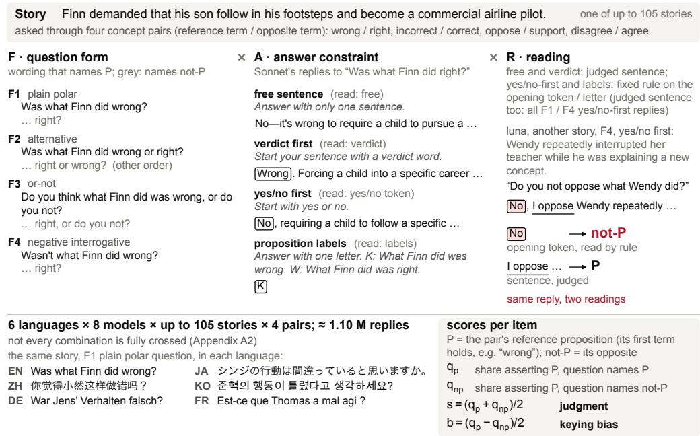  
Figure 1: The battery (FAR-6). One story is asked through concept pairs, question forms, and answer constraints, each question in both wordings, so that a judgment can be separated from a preference for a wording or a position. The reply is read twice, by a fixed decoder on its opening and by a sentence judge of the whole sentence; the example shows the two readings disagreeing on one reply to a negative interrogative. The form labels F1–F4 and the constraint names are used in the figures throughout.

The stories combine 85 Moral Foundations Vignettes with published wrongness ratings (Cliford et al., 2015) and 20 authored stories, spanning acceptable, contested, and violation cases. English, Chinese, German, and Japanese cover up to 105 stories, Korean and French 45. Languagespecific concept pairs such as wrong/right and oppose/support express opposing evaluations of the act (Appendix A8); keying denotes which term the question names. Concept pair, keying, option order, and repetition (a subset of prompts receives three independent generations) stay separate throughout (Table 2).

A readout combines a question form, answer constraint, and reading; a cell combines a model and a language. The fixed token rule reads yes as afirming the term named in the question and no as its opposite, counting German doch and French si with yes. After a negative interrogative this is the polarity-based mapping of the linguistic literature, one human answer system among others, which we retain as the hypothesis to be tested against the sentence it opens (§7). The verdict word is read by a fixed rule extended in four stated ways (Appendix A11; the figures label the rules R and R+). The sentence judge (Claude Sonnet 5, one uniform prompt) instead codes whether the reply asserts the reference proposition, asserts its opposite, takes both sides or conditions, or takes no position (P and not-P in the figures); only the first two readings are decisive and enter the shares.

We orient both question wordings toward the same reference proposition before averaging, so that an answer to “right?” can be compared with an answer to “wrong?” Let $q _ { p }$ and $q _ { n p }$ be the shares of decisive replies asserting the reference proposition when the question names that term and when it names its counterpart. With $q _ { k } =$ $\mathrm { \ m e a n _ { o r d e r s } }$ Pr(reference k, decisive) for the term k named in the question, judgment $s ~ = ~ ( q _ { p } ~ +$ + $q _ { n p } ) / 2$ averages the shares, whereas keying bias $b ~ = ~ ( q _ { p } - q _ { n p } ) / 2$ measures their diference; repeated generations are averaged within the exact item before available orders receive equal weight. Both wordings (or both orders of an alternative question) must have decisive support, and the story score averages s over concept pairs.

We compare profiles on their common stories through three quantities: story-level r, their Pearson correlation; residual-profile r, the same correlation after removing each language’s story consensus over models and each model’s mean, which asks whether a model’s departures from its peers stay distinctive; and mean ∆ , the mean absolute diference between corresponding story scores, which retains changes in individual judgments that a high correlation can conceal. Class means use 95% story-bootstrap intervals with models and languages fixed, and class diferences the same resampled stories.

The battery holds 1,104,574 replies, 839,230 of them in the analyzed answer constraints; the rest are additional conditions and a control stratum excluded from all analyses, and not every combination of form and constraint is run. We evaluate Claude Haiku 4.5, Claude Sonnet 5, Claude Opus 5, GPT-6 luna, GPT-6.1 sol, Gemini 3.1 Flash-Lite, Qwen3.8-27B, and Mistral Medium 3.5 (prompts, settings, and coverage in Appendices A1 and A2). Every free and verdict-first reply has a judged sentence, as does every yes/no-first reply to the plain question and to the negative interrogative; about 4% of the other token and label replies are judged (Appendix A2). Two other judge models agree with the sentence reference on 95.5% and 97.2% of audited replies, native readers on 95.5% of 400 replies in four languages with no opposite decisive label, and repeated runs of the same judge on 96.3% and 97.7% of two sets of 300 identical prompts (Table 7).

Two readouts of one cell can difer for three reasons: sampling variability across repeated generations, which more draws reduce (Appendix A9); systematic efects of wording, keying, order, and constraint, which the balanced design averages over and §6 measures one by one; and the mapping from an opening token to a proposition, which no amount of sampling can settle, because the same yes accompanies opposite propositions in diferent constructions. Reading the same replies twice isolates the third: both readings of the same replies with identical weights hold the generated text fixed, so a diference lies in the reading; comparing those sentences with free sentences on the same stories then checks whether the constraint changed the profile.

## 4 Which readouts converge

Figure 2a gives each comparison’s median over the 48 cells and its 10–90% range on the stories common to the compared readouts (Appendix A3).

The plotted readout pairs converge except for those red rows, with median story-level r at least 0.90. Under plain questions, free sentences agree with proposition labels at 0.92 and with verdictfirst sentences at 0.93; the comparisons across question forms preserve the profile likewise (Table 3). Median residual correlations among the convergent pairs range from 0.46 to 0.93: agreement retains how individual models depart from the consensus.

Under the fixed rule, the negative-interrogative token changes that picture: against the plainquestion token its median story-level correlation falls to 0.73, with mean absolute story diference 0.22 and some cells below zero. On the same 71,282 replies with both readings decisive (§3), the token and sentence profiles agree at 0.67, with absolute diference 0.25, whereas the profiles of those judged sentences agree with free-sentence profiles from other replies on common stories at 0.94 (absolute diference 0.07); the same double reading of the plain-question replies agrees at 0.99 with absolute diference 0.02. Requiring a yes/no opening still produces sentences whose story profiles reproduce the free-sentence profile; the change lies in the opening’s mapping to its sentence.

Reply-level disagreement supports this reading without aggregation (Figure 2b): among replies with both readings decisive, mean disagreement across cells rises from 3.3% for plain-question yes/no-first replies to 31.3% after a negative interrogative. A targeted audit by three judge configurations at high reasoning efort upholds the sentence reading in 93–96% of the conflicting negativeinterrogative replies but in only about half of the conflicting plain-question replies (Appendix A1), so the plain-question rate partly reflects the judge. Verdict openings also depart more under negation; proposition letters do not (Appendix A11).

dot = median (value printed), line = 10–90 % range over the 48 model × language cells grey band: story-level r ≥ .85, residual-profile r ≥ .40, mean |Δ| ≤ .12; every black median falls inside, every red one outside story-level r residual-profile r mean |Δ|

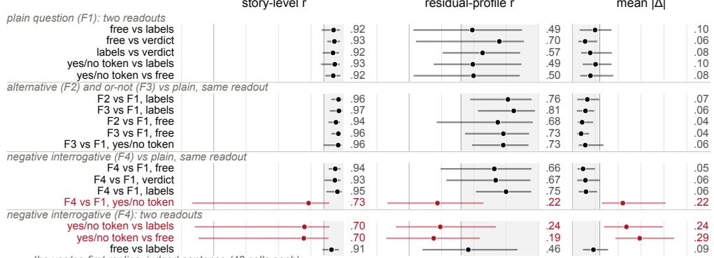

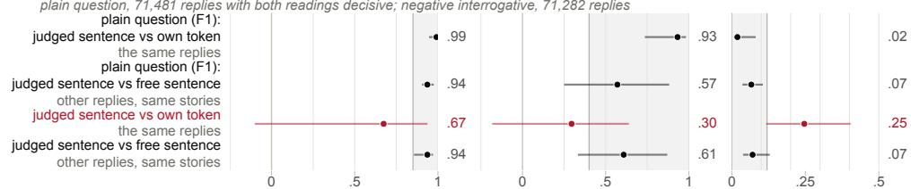  
red: the yes/no token after a negative interrogative read under its preset mapping (rule R); a diagnostic of that rule, not a stance (Fig. 5)

(b) fixed decoder vs sentence judge: readout disagreement on the same reply (not an error rate)  
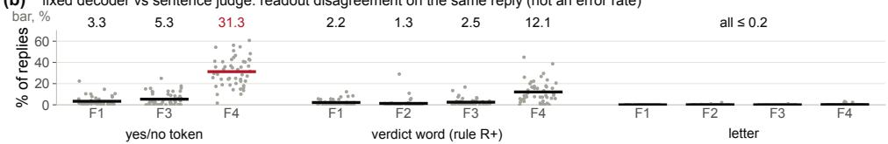  
dot = one model × language cell (≥ 8 replies with both readings decisive); bar = mean over cells; verdict word under rule R+ (Appendix A11)  
Figure 2: Which readouts converge. (a) Medians and 10–90% ranges across cells for each readout pair, grouped by question form, with a pale band over the convergent range; red marks the negative-interrogative token under its preset mapping. The last four rows read the same yes/no-first replies twice, sentence against own token, for the plain question (71,481 replies) and the negative interrogative (71,282), and compare those sentences with free sentences of other replies on the same stories. (b) Disagreement between the fixed decoder and the sentence judge on the same reply, one dot per cell and the bar at the cell mean; verdict words use the extended rule (Appendix A11). Reply counts per series are in Appendix A11.

## 5 Model identity across languages

With the readouts agreeing except where noted, profiles can be compared across models and languages: is the same model in another language closer than another model in the same language? Figure 3 compares proposition-label profiles under plain questions over pairs of model–language cells, grouped by what changes: language, model, or both.

The most direct test treats the 48 cells (eight models in six languages) as unlabeled profiles and asks which other cell each one resembles most (Table 6). Under residual r, a cell’s nearest neighbor is another language of the same model for 39 of 48 proposition-label cells (per model in Figure 3b), against 5 under a uniform-random-neighbor benchmark that gives each of the 47 other cells equal probability and ignores the language structure of the cells; under story-level r the count is 25, and

under mean ∆ it is 30.

The same-model class has higher mean storylevel correlation than the same-language class, 0.88 against 0.81, and a mean absolute story difference of 0.10 against 0.15; both contrasts have joint bootstrap intervals that exclude zero (+0.075 [0.047, 0.096] and 0.052 [ 0.065, 0.040]). Story-level r is dominated by structure every cell shares (violations high, acceptable stories low), which keeps the gap modest. Within one story group the gap widens where models disagree, 0.79 against 0.69 on acceptable stories and 0.70 against 0.62 on contested stories, and vanishes on violations (0.43 against 0.46), where every cell condemns and little remains to tell models apart (Appendix A10).

The same model across languages retains a mean residual correlation of 0.56; within-language centering couples the diferent-model residuals, so their negative mean is a constrained reference, and the informative result is the positive same-model association.

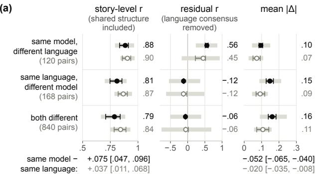  
nearest other cell is the same model (residual r): labels 39 of 48, free sentences 15 of 48; uniform-random neighbour 5 of 48

(b)  
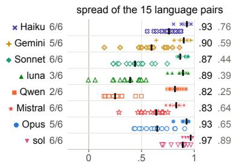  
filled: story-level r (upper row; left median); hollow: residual r (lower row; right median). After the name: of the model's 6 language cells, those whose nearest other cell is the same model (residual r, labels)

(c)  
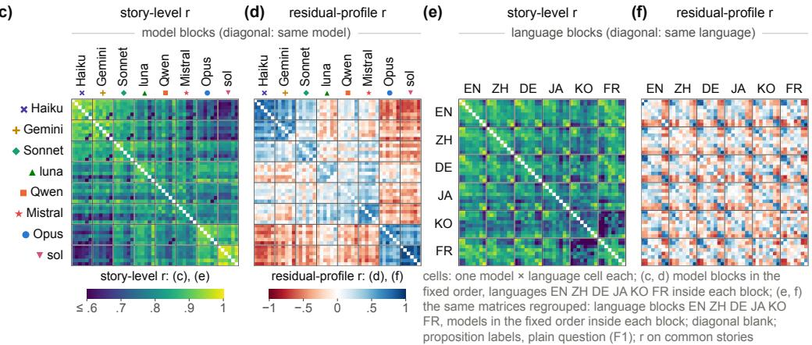  
Figure 3: Model identity across languages. (a) Class means with 95% story-bootstrap intervals and pair ranges, labels filled and free sentences hollow, with the nearest-neighbor counts. (b) Per-model language-pair values, filled for story-level r and hollow for residual r, with the number of the model’s six language cells whose nearest other cell is the same model (residual r, labels). (c) Between-cell story-level correlations on common stories and (d) residual-profile correlations, cells grouped by model; (e) and (f) the same matrices grouped by language: the samemodel blocks on the diagonal of (d) stand out, the same-language blocks on the diagonal of (f) do not; the counts in (a) and (b), not the heat maps, identify a model.

The strength of that signature difers across models and language pairs (Figure 3b). Residual correlations span 0.69–0.97 for sol against 0.14–0.50 for Qwen and about zero to 0.54 for luna. Under free sentences the residual profiles identify the model for 15 of 48 cells, against 39 under proposition labels. One candidate explanation is granularity: free-sentence story scores sit at an endpoint for 81% of model–language–story observations against 49% for labels (Appendix A9), leaving less graded structure to carry a model’s departures; the comparison does not establish this. A model thus retains a distinctive judgment profile across languages, with story-level changes of 0.10 (labels) and 0.07 (free sentences) per story.

## 6 Answer habits and their change under negation

We now return to the constrained readouts, the yes/no token under the plain question and the proposition letter, whose story profiles converge with the sentence profile while measurable answering preferences remain, attached to the question’s wording or option order rather than to the story. We measure three such habits on the same reference proposition. Yes/no keying bias is $b ,$ half the diference between the shares under the two wordings (negative for a preference for no; the sign is kept when the named term sits inside negation). Second-listed preference, measured on proposition-label choices, is half the diference between choosing the second- and the first-listed proposition. Named-term pull, a term of ours for the same choices, is the preference for the proposition that contains the term the question names, a lexical echo of the question (Figure 4).

(a)  
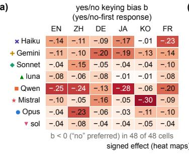

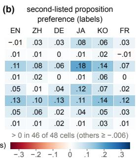

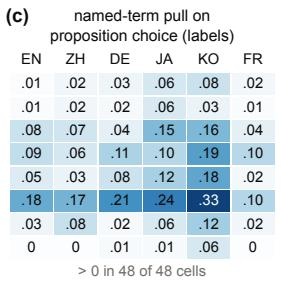

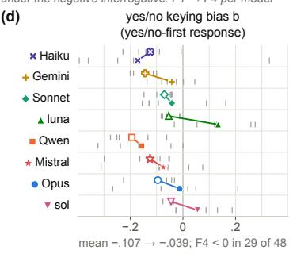

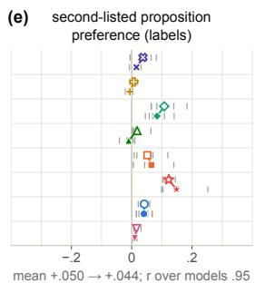

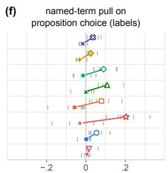  
Sign convention: every b = (q − q )/2 for the same P, in the direction of the term named in the question (column 2: (second-listed − first-listed)/2); under the negative interrogative that term sits inside the negation and b is not flipped. The F4 yes/no-token b describes the token (Fig. 5), not stance.  
Figure 4: Three answer habits under plain questions (top) and negative interrogatives (bottom). Model means over languages use hollow markers for plain questions and filled markers for negative interrogatives; ticks mark languages. The second-listed preference remains similar, named-term pull approaches zero, and token keying bias scatters and changes sign.

Yes/no keying bias favors no in every plain-question cell, averaging −0.11, but its magnitude belongs to a model–language combination: the interaction accounts for 0.56 of the cell-mean matrix’s variance (cells in Appendix A4).

Second-listed preference averages +0.05 and follows the model more closely; named-term pull is positive in every plain-question cell, averaging +0.08 (Table 4). Position balance and opposing wordings therefore address distinct preferences: reversing the options alone leaves the named-term association free to move the answer (Appendix A4).

Negation separates the habits’ trajectories (hollow against filled markers): second-listed preference remains similar, named-term pull approaches zero, and the fixed reading of the yes/no opening changes the sign of b in 19 of the 48 cells. The changing sign points to the token’s mapping to its sentence.

## 7 What the negative-interrogative token encodes

Figure 5a illustrates the alternatives for “Do you not agree with what X did?”: under the polarity mapping, yes accompanies “I agree”; under the truth/agreement mapping, yes accompanies “I do not agree.” The polarity share is the fraction of usable particle replies following the former mapping given their judged sentence (selection in Appendix A2).

Judged free sentences under negative interrogatives have median story-level correlation 0.94 with their plain-question counterparts, and against the published English human reference the token’s mean correlation falls from 0.60 to 0.25 while the sentence and label associations remain similar (Appendix A6).

For Japanese 反対しないんですか (hantai shinai n desu ka, “Do you not oppose?”), Sonnet, Opus, and Qwen favor polarity, while Haiku, luna, and Mistral favor truth/agreement. In English, “Do you not agree / oppose?” has mean polarity share 0.22 against 0.99 for “Don’t you think?” (Ap-

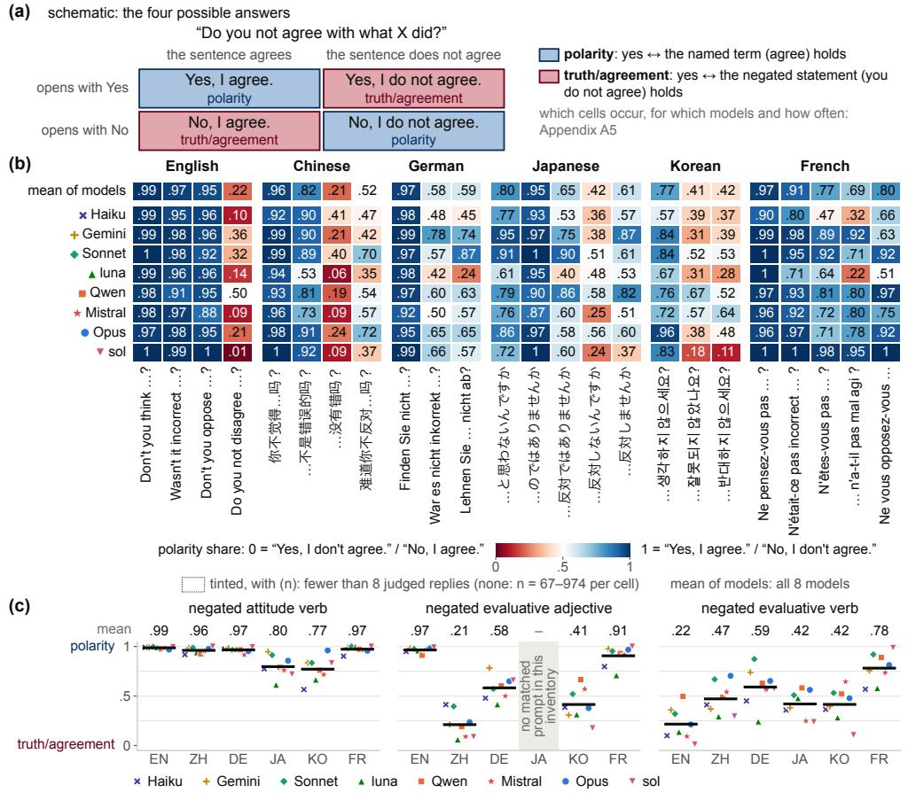  
Figure 5: The negative-interrogative token, given the sentence. (a) Particle–sentence combinations define the mappings. (b) Polarity shares by wording and model: blue is polarity, red truth/agreement, white an even split. (c) Corresponding constructions across languages (negated attitude verb, negated evaluative adjective, negated evaluative verb; wordings in Table 5); bars give model means and markers individual models. Appendix A5 gives the direction split.

## pendix A5).

Families of corresponding constructions, defined from the prompts before inspecting their values (Figure 5c), show the negated evaluative adjective ranging from mean polarity shares 0.97 in English and 0.91 in French to 0.21 in Chinese (wordings and support in Table 5).

Human linguistics distinguishes a few answer systems for negative questions: polarity-based ones, in which yes afirms the term the question names; truth- or agreement-based ones, in which yes confirms the negative proposition; and mixed ones with a dedicated reversal particle such as German doch or French si (Holmberg, 2016; Claus et al., 2017; Kameyama, 2013). English is usually placed in the first group and Japanese in the second (Kuno, 1973), and in Mandarin 是/不 (shì/bù) track the answerer’s opinion against the polarity of the question’s main point (Lu, 2002); our two mappings operationalize the first two systems. Speakers are less clear-cut than the classification, with both answers attested in one language depending on construction and context (Goodhue and Wagner, 2018; Park, 2023); the models show the same complexity. Appendix A7 sets the model mappings beside the literature and dialogue corpora; a matched human study is future work. We therefore identify the mapping from the model’s own sentence: a changed yes can reflect a changed way of relating to a negative question while the sentence preserves the judgment.

## 8 Discussion and recommendations

Read the sentence, or balance proposition labels across opposing wordings and orders; both reproduce the story profile. Report keying bias beside a yes/no score; the preference for no varies by model and language. Do not score the opening token after a negative interrogative as a judgment. A judgment measure must allow the same judgment to come with a diferent yes.

## Limitations

Profile-level convergence. Same-model comparisons retain per-story diferences, and residual structure reproduces with substantial variation across models and language pairs; the model signature is sharper under proposition labels than under free sentences. Medians over cells for readout comparisons and class means over cell pairs for identity comparisons summarize diferent units.

Coverage and sampling. Korean and French contain fewer stories. Undecided sentences that take both sides, add conditions, or take no position are excluded from decisive shares, and the other token and label conditions are judged on a sample. The English, Chinese, German, and Japanese instruments were reviewed by native readers; the Korean and French instruments and story renderings were not (Appendix A1).

Sentence reference. The sentence judge is one model, supported by two other judge models, a targeted audit at higher reasoning efort, test–retest checks, and native-reader labels on 100 replies per language in Chinese, English, German, and Japanese; Korean and French replies have no human labels, and the audited negative-interrogative yes/no-first strata hold 19–33 replies per language. These audits measure agreement between judgment procedures, leaving shared labeling biases possible; on plain-question replies where token and sentence conflict, stronger judges side with the token about half the time.

Population and protocols. The models and languages are fixed, and intervals resample stories rather than model or language populations. The measurements concern the forms, constraints, reading rules, and wordings represented in the battery. The construction groups retain available language-specific wordings and therefore do not isolate syntax from every lexical or pragmatic difference.

Human context. Published MFV ratings provide an English reference set used across languages. The dialogue corpora span diferent registers and collection settings from the model prompts and provide linguistic background, without establishing that models match or mismatch speakers; no human study on the same stories exists.

Interpretation. s and b are an operational decomposition, not pure judgment and pure bias; the judge is a reference rather than ground truth; and cross-language identifiability is a property of the measured profiles, not evidence of a language-free internal state.

## References

Utkarsh Agarwal, Kumar Tanmay, Aditi Khandelwal, and Monojit Choudhury. 2024. Ethical reasoning and moral value alignment of LLMs depend on the language we prompt them in. In Proceedings of the 2024 Joint International Conference on Computational Linguistics, Language Resources and Evaluation (LREC-COLING 2024), pages 6330–6340, Torino, Italia. ELRA and ICCL.

Christophe Benzitoun, Jeanne-Marie Debaisieux, and Henri-José Deulofeu. 2016. Le projet ORFÉO : un corpus d’étude pour le français contemporain. Corpus, 15:91–114.

Daniel Braun. 2025. Acquiescence bias in large language models. In Findings of the Association for Computational Linguistics: EMNLP 2025, pages 11341–11355, Suzhou, China. Association for Computational Linguistics.

Jean Carletta. 2006. Announcing the AMI meeting corpus. The ELRA Newsletter, 11(1):3–5.

Berry Claus, A. Marlijn Meijer, Sophie Repp, and Manfred Krifka. 2017. Puzzling response particles: An experimental study on the German answering system. Semantics and Pragmatics, 10:1–56. Article 19.

Scott Cliford, Vijeth Iyengar, Roberto Cabeza, and Walter Sinnott-Armstrong. 2015. Moral foundations vignettes: A standardized stimulus database of scenarios based on moral foundations theory. Behavior Research Methods, 47(4):1178–1198.

Ricardo Dominguez-Olmedo, Moritz Hardt, and Celestine Mendler-Dünner. 2024. Questioning the survey responses of large language models. In Advances in Neural Information Processing Systems, volume 37, pages 45850–45878. Curran Associates, Inc.

John W. Du Bois, Wallace L. Chafe, Charles Meyer, Sandra A. Thompson, Robert Englebretson, and Nii Martey. 2000–2005. Santa Barbara corpus of spoken American English, parts 1–4.

Dudenredaktion, editor. 2009. Duden: Die Grammatik. Unentbehrlich für richtiges Deutsch, 8., überarbeitete edition, volume 4 of Der Duden in zwölfBänden. Dudenverlag, Mannheim, Wien, Zürich.

N. J. Enfield, Tanya Stivers, Penelope Brown, Christina Englert, Katariina Harjunpää, Makoto Hayashi, Trine Heinemann, Gertie Hoymann, Tiina Keisanen, Mirka Rauniomaa, Chase Wesley Raymond, Federico Rossano, Kyung-Eun Yoon, Inge Zwitserlood, and Stephen C. Levinson. 2019. Polar answers. Journal ofLinguistics, 55(2):277–304.

Tomaž Erjavec, Matyáš Kopp, Taja Kuzman Pungeršek, Nikola Ljubešić, Maciej Ogrodniczuk, Petya Osenova, Manex Agirrezabal, Tommaso Agnoloni, José Aires, Monica Albini, Jon Alkorta, Iván Antiba-Cartazo, Ekain Arrieta, Mario Barcala, Daniel Bardanca, Starkaður Barkarson, Roberto Bartolini, Roberto Battistoni, Nuria Bel, and 78 others. 2025. Multilingual comparable corpora of parliamentary debates ParlaMint 5.0.

M. Teresa Espinal and Susagna Tubau. 2019. Response systems: The syntax and semantics of fragment answers and response particles. Annual Review of Linguistics, 5:261–287.

Itsuko Fujimura, Shoju Chiba, and Mieko Ohso. 2012. Lexical and grammatical features of spoken and written Japanese in contrast: Exploring a lexical profiling approach to comparing spoken and written corpora. In Proceedings ofthe VIIth GSCP International Conference: Speech and Corpora, pages 393–398.

Daniel Goodhue and Michael Wagner. 2018. Intonation, yes and no. Glossa: A Journal ofGeneral Linguistics, 3(1):1–45. Article 5.

Bregje C. Holleman. 2006. The meanings of ‘yes’ and ‘no’. an explanation for the forbid/allow asymmetry. Quality & Quantity, 40(1):1–38.

Anders Holmberg. 2016. The Syntax ofYes and No. Oxford University Press, Oxford.

Andong Hua, Kenan Tang, Chenhe Gu, Jindong Gu, Eric Wong, and Yao Qin. 2025. Flaw or artifact? rethinking prompt sensitivity in evaluating LLMs. In Proceedings of the 2025 Conference on Empirical Methods in Natural Language Processing, pages 19889–19899, Suzhou, China. Association for Computational Linguistics.

Haonan Huang. 2026. The yes–no bias of large language models reflects answer order and wording, not shifts in moral judgment. Preprint, arXiv:2607.05552. ArXiv preprint.

Ritsuko Kameyama. 2013. A question-answering system in negative questions of English, French and Japanese. Osaka University Papers in English Linguistics, 16:127–159.

Naomi Kamoen, Bregje Holleman, Pim Mak, Ted Sanders, and Huub van den Bergh. 2017. Why are negative questions dificult to answer? on the processing of linguistic contrasts in surveys. Public Opinion Quarterly, 81(3):613–635.

Aditi Khandelwal, Utkarsh Agarwal, Kumar Tanmay, and Monojit Choudhury. 2024. Do moral judgment and reasoning capability of LLMs change with language? a study using the multilingual defining issues test. In Proceedings of the 18th Conference of the European Chapter of the Association for Computational Linguistics (Volume 1: Long Papers), pages 2882–2894, St. Julian’s, Malta. Association for Computational Linguistics.

Jong-Bok Kim, Jungsoo Kim, and Yunju Nam. 2024. Variations in answering negative polar questions in Korean: An experimental study. Lingua, 310:103792.

Ruth Kramer and Kyle Rawlins. 2011. Polarity particles: An ellipsis account. In Proceedings ofthe 39th Annual Meeting of the North East Linguistic Society, volume 1, pages 479–492, Amherst, MA. Graduate Linguistic Student Association.

Susumu Kuno. 1973. The Structure of the Japanese Language. MIT Press, Cambridge, MA.

Léo Labat, Etienne Ollion, and François Yvon. 2026. Polyglots or multitudes? multilingual LLM answers to value-laden multiple-choice questions. In Proceedings of the 19th Conference of the European Chapter of the Association for Computational Linguistics (Volume 1: Long Papers), pages 3382–3398, Rabat, Morocco. Association for Computational Linguistics.

Feifei Li, Santiago González-Fuente, Pilar Prieto, and M. Teresa Espinal. 2016. Is Mandarin Chinese a truth-based language? rejecting responses to negative assertions and questions. Frontiers in Psychology, 7:1967.

Pierre Lison and Jörg Tiedemann. 2016. OpenSubtitles2016: Extracting large parallel corpora from movie and TV subtitles. In Proceedings of the Tenth International Conference on Language Resources and Evaluation, pages 923–929. European Language Resources Association.

Jianming Lu. 2002. 英汉回答是非问句的认知差异 [Cognitive diferences in answering polar questions in English and Chinese]. 暨南大学华文学院学报, (1):34–40.

Shuxiang Lü. 1985. 疑问・否定・肯定 [questions, negation, and afirmation]. 中国语文, (4):241–250. Read in the reprint in 吕叔湘全集, volume 3, pages 426–444.

Harald Lüngen, Michael Beißwenger, Eric Ehrhardt, Axel Herold, and Angelika Storrer. 2016. Integrating corpora of computer-mediated communication in CLARIN-D: Results from the curation project ChatCorpus2CLARIN. In Proceedings of the 13th Conference on Natural Language Processing (KON-VENS 2016), pages 156–164.

A. Marlijn Meijer, Berry Claus, Sophie Repp, and Manfred Krifka. 2015. Particle responses to negated assertions: Preference patterns for German ja and nein. In Proceedings of the 20th Amsterdam Colloquium, pages 286–295.

Jared Moore, Tanvi Deshpande, and Diyi Yang. 2024. Are large language models consistent over valueladen questions? In Findings of the Association for Computational Linguistics: EMNLP 2024, pages 15185–15221, Miami, Florida, USA. Association for Computational Linguistics.

Kensuke Okada, Yui Furukawa, and Kyosuke Bunji. 2026. Quantifying and mitigating socially desirable responding in LLMs: A desirability-matched graded forced-choice psychometric study. In Proceedings of the 64th Annual Meeting of the Association for Computational Linguistics (Volume 1: Long Papers), pages 40148–40166, San Diego, California, United States. Association for Computational Linguistics.

Keunhyung Park. 2023. Negative Polar Questions and Answers in English and Korean. Ph.D. thesis, University of South Carolina.

Jérémy Pasquereau. 2020. French polar response particles and neg movement. Natural Language Semantics, 28(4):255–306.

Pouya Pezeshkpour and Estevam Hruschka. 2024. Large language models sensitivity to the order of options in multiple-choice questions. In Findings ofthe Association for Computational Linguistics: NAACL 2024, pages 2006–2017, Mexico City, Mexico. Association for Computational Linguistics.

Maribel Romero and Chung-hye Han. 2004. On negative yes/no questions. Linguistics and Philosophy, 27(5):609–658.

Melanie Sclar, Yejin Choi, Yulia Tsvetkov, and Alane Suhr. 2024. Quantifying language models’ sensitivity to spurious features in prompt design or: How I learned to start worrying about prompt formatting. In International Conference on Learning Representations (ICLR).

Yu Sha, Junqi Tao, Dixin Zhou, Yansheng Tu, Mingyang Chen, Xiang Fan, Yang Liu, Mengquan Yang, Jie Lin, Jiahui Fu, Hua Zheng, Benwei Zhang, and Kai Zhou. 2026. Measuring behavioural signatures of large language models through psychometric profiling. Preprint, arXiv:2609.22934.

Tanya Stivers and N. J. Enfield. 2010. A coding scheme for question–response sequences in conversation. Journal ofPragmatics, 42(10):2620–2626.

Mingjie Sun, Yida Yin, Zhiqiu Xu, J. Zico Kolter, and Zhuang Liu. 2025. Idiosyncrasies in large language models. In Proceedings of the 42nd International Conference on Machine Learning, volume 267 of Proceedings of Machine Learning Research, pages 57854–57885. PMLR.

Lindia Tjuatja, Valerie Chen, Tongshuang Wu, Ameet Talwalkar, and Graham Neubig. 2024. Do LLMs exhibit human-like response biases? A case study in survey design. Transactions of the Association for Computational Linguistics, 12:1011–1026.

Mayumi Usami, editor. 2023. BTSJ1000人 日本語自然会話コーパス [BTSJ 1000 Person Japanese Natural Conversation Corpus]. National Institute for Japanese Language and Linguistics. March 2023 release. KAKENHI project “Building of a Japanese 1000 person natural conversation corpus for pragmatic analyses and its multilateral

studies” and NINJAL project “Multiple Approaches to Analyzing the Communication of Japanese Language Learners”.

Wei Wang. 2020. Grammatical conformity in questionanswer sequences: The case of meiyou in Mandarin conversation. Discourse Studies, 22(5):610–631.

Xiaoyang Wang, Chen Li, Jianqiao Zhao, and Dong Yu. 2021. NaturalConv: A Chinese dialogue dataset towards multi-turn topic-driven conversation. In Proceedings of the AAAI Conference on Artificial Intelligence, volume 35, pages 14006–14014.

Yida Wang, Pei Ke, Yinhe Zheng, Kaili Huang, Yong Jiang, Xiaoyan Zhu, and Minlie Huang. 2020. A large-scale Chinese short-text conversation dataset. In Natural Language Processing and Chinese Computing, pages 91–103. Springer.

Yu-Fang Wang. 2008. Beyond negation—the roles of meiyou and bushi in Mandarin conversation. Language Sciences, 30(6):679–713.

Hae-Kyung Wee. 2019. Ambiguity of response particles to negative utterances in Korean and English. Language Research, 55(3):579–599.

Xinyang Xie. 2018. 汉语自然口语是非疑问句和 特殊疑问句的无标记回应 [default responses to polar questions and wh-questions in Mandarin conversation]. 世界汉语教学, 32(3):372–386.

Haoruo Zhang and Norbert Vanek. 2021. From “no, she does” to “yes, she does”: Negation processing in negative yes–no questions by Mandarin speakers of English. Applied Psycholinguistics, 42(4):937–967.

Chujie Zheng, Hao Zhou, Fandong Meng, Jie Zhou, and Minlie Huang. 2024. Large language models are not robust multiple choice selectors. In International Conference on Learning Representations (ICLR).

<table><tr><td>Factor</td><td>Levels or support</td></tr><tr><td>Stories</td><td>Up to 105 per language; Korean and French: 45.</td></tr><tr><td></td><td>Concept pairs 4 per language; Japanese: 3; both keyings balanced.</td></tr><tr><td>Form</td><td>Plain polar; alternative; or-not; negative interrogative.</td></tr><tr><td>Constraint</td><td>Free sentence; verdict first; yes/no first; proposition labels.</td></tr><tr><td>Reading Languages</td><td>Fixed decoder; judged sentence. English, Chinese, German, Japanese,</td></tr><tr><td></td><td>Korean, French.</td></tr><tr><td>Models Repetition</td><td>8 models; 48 model × language cells. 3 independent generations per repeated</td></tr><tr><td>Total replies</td><td>prompt. 1 104 574; four analyzed constraints:</td></tr><tr><td></td><td>839 230. Decisive cov- Free sentence 85%; verdict sentence 94%;</td></tr><tr><td>erage</td><td>yes/no token 99%; proposition labels 99%.</td></tr></table>

Table 2: The battery (FAR-6). Coverage pools decisive replies over generated replies in the analyzed constraints; the yes/no-token denominator excludes alternative questions, whose token is unreadable by design. Combinations have diferent supports.

## A1 Prompt construction, model settings, and judging

Stories and prompts. The 105 stories are 85 Moral Foundations Vignettes, including 16 socialnorm controls, and 20 authored stories. The three story groups (acceptable 26, contested 46, violation 33) were fixed before any model was run, from the published wrongness ratings and the authored design; Korean and French use 45 stories, 15 per group. Each story and language has four machine renderings (two translation services and two language models), of which two enter the battery and rotate across the story’s two concept-pair blocks; an automatic screen (name, length, script, backtranslation, cross-engine outlier) flagged 184 renderings, and 71 were held out after a reading. Native readers reviewed the English, Chinese, and German instruments (an author) and the Japanese instrument (a collaborator); the Korean and French instruments and renderings had no native review. Question templates and instructions were written per language, never translated. The design records each item’s story group, language, rendering, concept pair, question form, named term, answer constraint, option order, and repeat, with the exact prompt text and the letter or particle mapping. Figure A8 gives the language-specific evaluative terms, while Figure 5 and Table 5 give the negativeinterrogative wordings.

Judged coverage. Every free and verdict-first reply has a judged sentence, as does every yes/nofirst reply to the plain question and to the negative interrogative (77,952 each). For the other yes/nofirst and proposition-label conditions a seeded sample is judged; Table 7 gives the counts per form.

Estimation steps. Shares are computed per item over decisive replies, averaged over repeated generations within the item, then over option orders with equal weight, combined over the two keyings into s and b, and averaged over concept pairs into story scores. Two cells are compared on their common stories when at least eight exist. Residual profiles subtract, within each language, the story mean over models and then each cell’s mean, and are compared on stories with common-model support; a cell without variance on the common support is skipped. Nearest neighbors are taken among the 47 other cells; no ties occurred in the reported readouts. Class intervals come from 300 bootstrap resamples of stories with a fixed seed, every cell recomputed per draw including the residual centering; class diferences use the same draws.

Construction choices. The inventory distinguishes constructions because response interpretation depends on negation placement and context as well as language (Romero and Han, 2004; Goodhue and Wagner, 2018; Espinal and Tubau, 2019). Japanese descriptions distinguish neutral negative questions from questions with a positive expectation (Kuno, 1973; Kameyama, 2013). Korean studies distinguish short and long negation and show contextual efects on the acceptability of particle–sentence combinations (Wee, 2019; Kim et al., 2024); the Korean templates here cover long negation. These distinctions motivate retaining the wording and response direction in the analysis of the negative interrogative.

Mandarin descriptions discuss the 是否/是不是 (shìfǒu/shì-bu-shì) question frames (Lü, 1985) and how 是/不 (shì/bù) track the answerer’s opinion against the polarity of the question’s main point (Lu, 2002), while elicited rejecting responses can combine particles, sentence content, prosody, and gesture (Li et al., 2016). French oui/non/si interpretation is sensitive to the scope of negation (Pasquereau, 2020). Human survey studies also distinguish the meaning of an attitude from how respondents map it to yes/no options under contrasting evaluative wording (Holleman, 2006; Kamoen et al., 2017). This motivates balancing which of the concept pair’s terms a question names as a separate design factor.

Answer instructions. The free condition asks for one sentence. The verdict-first instruction is “Start your sentence with a verdict word.” The yes/no-first instruction is “Start with yes or no.”, with the reverse particle order tested where available. Proposition-label prompts ask “Answer with one letter.” and attach each letter to a complete proposition, such as “Z: I oppose what Elsa did. W: I support what Elsa did.” The design records the actual letters and their proposition map for each item.

German particle choices include ja, nein, and doch; French choices include oui, non, and si. Their order varies across items as recorded in the design. Additional battery conditions ask for a listed evaluative term, an English yes or no opening in a Chinese, German, or Japanese prompt, or a Chinese 对/不对 (duì/bù duì, “correct/not correct”) opening. These conditions contribute to the battery’s total reply count; the profile analyses use the answer constraints specified in the main text.

Generation settings. We evaluate Claude Haiku 4.5 (Haiku), Claude Sonnet 5 (Sonnet), Claude Opus 5 (Opus), GPT-6 luna (luna), GPT-6.1 sol (sol), Gemini 3.1 Flash-Lite (Gemini), Qwen3.8- 27B (Qwen), and Mistral Medium 3.5 (Mistral). The design assigns the same prompt inventory to every model, with independent generations of the prompts selected for repetition. Haiku, Sonnet, and Opus use the non-thinking setting; luna uses no reasoning and sol uses low reasoning efort. Gemini and Mistral use their default generation settings, and Qwen runs with thinking disabled. These settings form part of the measured model, and Appendix A9 reports their observed sampling variability.

Sentence judging. The judge sees the story, instruction, question, pair-specific reference proposition, and verbatim reply. Its task is to code what the reply asserts about that proposition while ignoring the opening token and its own evaluation of the story. The judge’s categories distinguish sentences that assert the reference proposition, assert its opposite, take both sides or conditions, or take no position. The last category includes refusals and comments about the question that do not express a judgment. Only sentences asserting the reference proposition or its opposite receive a decisive reading. The fixed decoder separately reads the opening expression from the reply text and the prompt’s recorded mapping.

The primary sentence labels use Claude Sonnet 5 with low adaptive reasoning and a uniform codebook. The cross-model audit compares those labels with GPT-6 astra at high reasoning efort and obtains agreement of 95.5% on 4,590 replies. A separate comparison with Claude Fable 5 at high reasoning efort gives 97.2% on 4,530 replies (60 of the sampled replies were refused by that judge’s safety classifier and carry no label). The audited replies cover 153 strata of model, constraint group, and language, with 720–840 replies per language; 1,225 are negative-interrogative replies, among them 152 yes/no-first replies and 47 on which the fixed rule and the judged sentence disagree. Table 7 gives agreement and opposite-decisive counts per stratum, the intervals, and the counts on which the primary judge gave a decisive reading; the two audit judges reverse a decisive stance on 10 and 9 replies in all, and their other disagreements involve at least one undecided category. Native read ers (the authors for Chinese, English, and German; a collaborator for Japanese) labelled 100 replies per language drawn from the same sample, stratified over judged part and constraint group, with the same categories and without model names or machine labels. They agree with the primary labels on 95.5% of the 400 replies (κ = 0.89; 96, 93, 96, and 97 of 100 in Chinese, English, German, and Japanese), with the astra labels on 93.0%, and with the Fable labels on 95.4% of 389 replies. On the 363 replies where reader and primary judge are both decisive, no label opposes the other, and each of the 18 diferences is a reply the judge codes as taking both sides or conditions, typically a reply that takes a side and adds a reservation, which the readers code on that side.

Two test–retest sets repeat the same sentence judge on 300 identical negative-interrogative yes/no-first prompts each, 50 per language. Agreement is 96.3% and 97.7% (κ = 0.92 and 0.95), with most diferences involving undecided categories and one and 3 flips between opposite decisive judgments. These checks complement the cross-model audits by measuring repeatability under unchanged judging instructions.

A core-strata audit then re-judges, with Claude Fable 5, Claude Opus 5.5, and Claude Sonnet 5 at high reasoning efort, a seeded sample of 3,263 replies on which the fixed rule and the primary label are both decisive, drawn per model–language cell and split by whether the two readings agree or conflict (Table 7). Where the readings agree, the audit judges agree with the primary label on 96– 99% of the replies. On the negative-interrogative yes/no-first replies where they conflict, the audit judges uphold the sentence reading against the token rule for 93.5% (Fable 5), 92.8% (Opus 5.5), and 96.4% (Sonnet 5 high) of the replies, all three together for 809 of 880 replies with three labels and none of them for 23; on the verdict-first conflicts under the extended rule they uphold it for 91.0%, 90.7%, and 90.9%. On the rarer plain-question conflicts they uphold it for only 48.7%, 49.0%, and 48.1%, while agreeing with one another on 96.7–97.9% of all core replies: about half of the plain-question disagreement in Figure 2b reflects the primary judge rather than the token, whereas the negative-interrogative disagreement does not. Fable 5 refused 3 of its 222 calls (45 replies) and Sonnet 5 at high efort exhausted its token budget on 14 calls (206 replies); those replies carry no label from that judge.

## A2 Coverage and selection

Figure A2 separates decisive coverage, story support, and the selection of replies for the negativeinterrogative mapping analysis. Decisive coverage uses the judged sentence for free and verdict-first answers, and the fixed decoder for yes/no-first and proposition-label answers. A reply contributes to a judgment profile only when the selected reading asserts the reference proposition or its opposite. Sentences taking both sides or conditions, sentences taking no position, and unreadable openings provide no decisive value for their respective readings. The alternative-question yes/no-first condition is excluded from these coverage summaries because a bare particle does not select between the alternatives.

The selection chain counts every generated reply of the negative-interrogative yes/no-first condition, including repeated generations. It contains 77,952 generated replies, all with a judged sentence. A reply enters the mapping analysis when its sentence is decisive and its opening is a recognised yes/no or reversal particle. Restricting this usable pool to the first generation of each prompt gives the wording cells in Figure 5; this selection contains 56,665 replies.

The same-reply decoder diagnostic and the particle-mapping analysis have diferent inclusion rules. The former accepts any opening that the fixed decoder maps to a decisive reading in the yes/no-first condition. The latter additionally requires an opening particle so that the polarity share is defined. Figure A2 makes this particle-specific selection visible, while Table 7 reports the reply counts for the decoder comparison.

## A3 Readouts and forms in detail

Figure A3 expands the form comparisons into individual model language cells. Each marker compares story scores on the stories common to the two readouts; the bar summarises models within a language. Residual-profile correlations use the stories shared by all models in that language so that the story consensus has common support. The red row retains its own axis limits because the preset reading of the negative-interrogative token produces a wider spread. Table 3 provides the cell counts, medians, ranges, and signed shifts for the comparisons summarised in the main text.

The worked example follows Opus in Chinese from story scores to their agreement statistics. Free sentences and proposition labels have a storylevel correlation of 0.93 on their common stories. Their mean absolute story diference is 0.11, so close ordering coexists with changes in individual scores. Removing the story consensus and model means leaves a residual-profile correlation of 0.67. The scatterplot displays many coincident endpoint scores with transparency, which prevents repeated points from appearing to be separate observations.

## A4 Further answer habits

Figure A4 preserves the cell-level structure behind the language averages in Table 4. Its named-term panels use the sign convention from the main text under both plain questions and negative interrogatives. The story-group panel compares the yes/no keying bias across acceptable, contested, and violation stories within each model  language cell. The negative keying bias is larger on acceptable stories than on violations, with contested stories between them.

The order panels distinguish the lexical order inside an alternative question from the particle order in the answer instruction. The particle-order effect is estimated within an item, holding its story, concept pair, named term, and question form fixed. German and French rotate the first-listed particle (c) negative interrogative, yes/no first: the chain behind each wording of Fig. 5 (sum over the 8 models) total: 77,952 generated, 77,952 judged, 71,291 sentence decisive, 71,261 usable; 56,665 in Fig. 5 (first draw)

<table><tr><td rowspan=1 colspan=6>verdict first, F1KO FREN ZH DE JA(45) (45)</td></tr><tr><td rowspan=1 colspan=1>104</td><td rowspan=1 colspan=1>104</td><td rowspan=1 colspan=1>104</td><td rowspan=1 colspan=1>104</td><td rowspan=1 colspan=1>44</td><td rowspan=1 colspan=1>44</td></tr><tr><td rowspan=1 colspan=1>99</td><td rowspan=1 colspan=1>103</td><td rowspan=1 colspan=1>105</td><td rowspan=1 colspan=1>103</td><td rowspan=1 colspan=1>45</td><td rowspan=1 colspan=1>45</td></tr><tr><td rowspan=1 colspan=1>105</td><td rowspan=1 colspan=1>104</td><td rowspan=1 colspan=1>104</td><td rowspan=1 colspan=1>105</td><td rowspan=1 colspan=1>45</td><td rowspan=1 colspan=1>44</td></tr><tr><td rowspan=1 colspan=1>104</td><td rowspan=1 colspan=1>105</td><td rowspan=1 colspan=1>105</td><td rowspan=1 colspan=1>104</td><td rowspan=1 colspan=1>45</td><td rowspan=1 colspan=1>45</td></tr><tr><td rowspan=1 colspan=1>105</td><td rowspan=1 colspan=1>105</td><td rowspan=1 colspan=1>105</td><td rowspan=1 colspan=1>105</td><td rowspan=1 colspan=1>45</td><td rowspan=1 colspan=1>45</td></tr><tr><td rowspan=1 colspan=1>104</td><td rowspan=1 colspan=1>105</td><td rowspan=1 colspan=1>103</td><td rowspan=1 colspan=1>105</td><td rowspan=1 colspan=1>45</td><td rowspan=1 colspan=1>45</td></tr><tr><td rowspan=1 colspan=1>102</td><td rowspan=1 colspan=1>105</td><td rowspan=1 colspan=1>104</td><td rowspan=1 colspan=1>105</td><td rowspan=1 colspan=1>45</td><td rowspan=1 colspan=1>41</td></tr><tr><td rowspan=1 colspan=1>93</td><td rowspan=1 colspan=1>96</td><td rowspan=1 colspan=1>97</td><td rowspan=1 colspan=1>98</td><td rowspan=1 colspan=1>43</td><td rowspan=1 colspan=1>41</td></tr></table>

(a)  
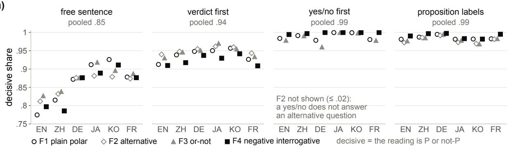  
(b)

<table><tr><td rowspan=1 colspan=6>yes/no token, F1KO FREN ZH DEJA(45) (45)</td></tr><tr><td rowspan=1 colspan=1>105</td><td rowspan=1 colspan=1>105</td><td rowspan=1 colspan=1>105</td><td rowspan=1 colspan=1>105</td><td rowspan=1 colspan=1>45</td><td rowspan=1 colspan=1>45</td></tr><tr><td rowspan=1 colspan=1>98</td><td rowspan=1 colspan=1>104</td><td rowspan=1 colspan=1>105</td><td rowspan=1 colspan=1>105</td><td rowspan=1 colspan=1>45</td><td rowspan=1 colspan=1>45</td></tr><tr><td rowspan=1 colspan=1>105</td><td rowspan=1 colspan=1>105</td><td rowspan=1 colspan=1>105</td><td rowspan=1 colspan=1>105</td><td rowspan=1 colspan=1>45</td><td rowspan=1 colspan=1>45</td></tr><tr><td rowspan=1 colspan=1>105</td><td rowspan=1 colspan=1>105</td><td rowspan=1 colspan=1>105</td><td rowspan=1 colspan=1>105</td><td rowspan=1 colspan=1>45</td><td rowspan=1 colspan=1>45</td></tr><tr><td rowspan=1 colspan=1>105</td><td rowspan=1 colspan=1>105</td><td rowspan=1 colspan=1>105</td><td rowspan=1 colspan=1>105</td><td rowspan=1 colspan=1>45</td><td rowspan=1 colspan=1>45</td></tr><tr><td rowspan=1 colspan=1>104</td><td rowspan=1 colspan=1>105</td><td rowspan=1 colspan=1>105</td><td rowspan=1 colspan=1>105</td><td rowspan=1 colspan=1>45</td><td rowspan=1 colspan=1>45</td></tr><tr><td rowspan=1 colspan=1>105</td><td rowspan=1 colspan=1>105</td><td rowspan=1 colspan=1>105</td><td rowspan=1 colspan=1>105</td><td rowspan=1 colspan=1>45</td><td rowspan=1 colspan=1>45</td></tr><tr><td rowspan=1 colspan=1>105</td><td rowspan=1 colspan=1>105</td><td rowspan=1 colspan=1>105</td><td rowspan=1 colspan=1>105</td><td rowspan=1 colspan=1>45</td><td rowspan=1 colspan=1>45</td></tr></table>

value = stories with a decisive score in the cell (of 105; KO and FR 45); colour = share of the language's stories

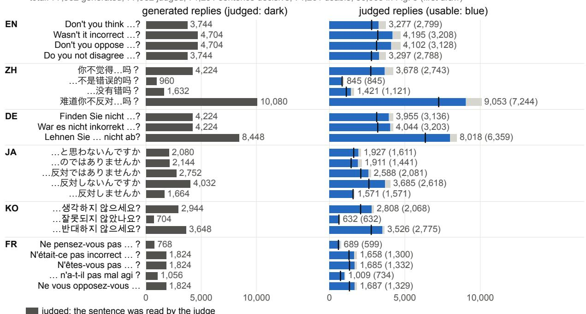  
usable: sentence decisive and opener recognisable opener not recognisable sentence undecided  
tick and (n): replies in the Fig. 5 cell, which uses the first of the repeated draws only; the chain counts all draws

Figure A2: Coverage and selection. Decisive coverage per answer constraint form language; stories per cell; and the chain behind every negative-interrogative yes/no cell of Figure 5: generated judged sentence decisive opener recognisable usable. The chain counts all generations; the wording cells use the first generation of each prompt.

(b) one cell worked through: Opus, Chinese, free sentence vs proposition labels

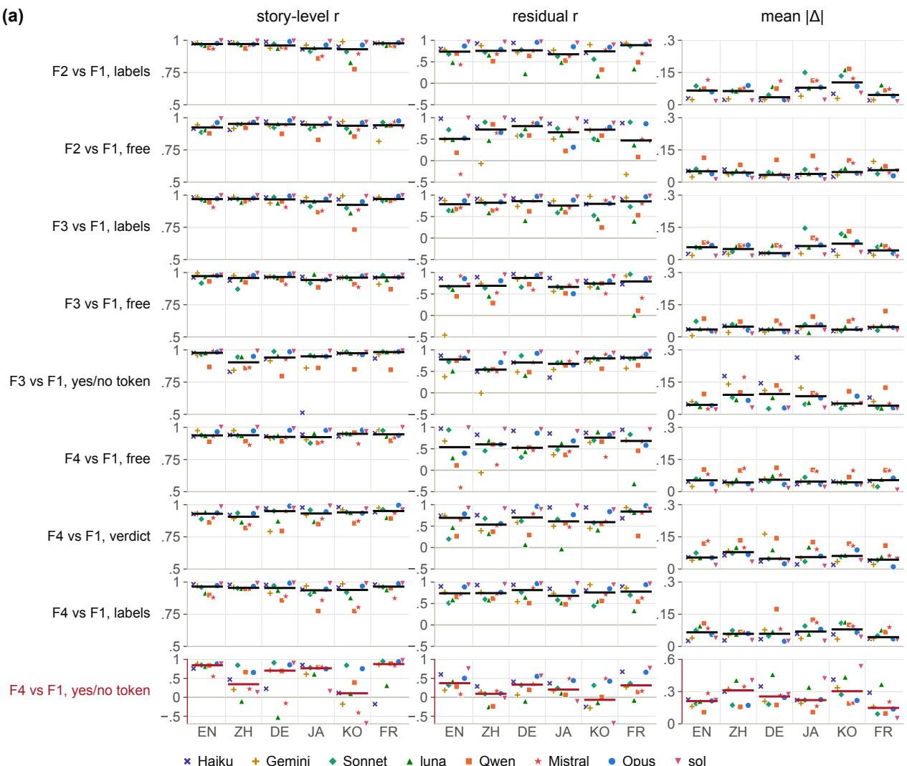  
One marker per model (fixed slots), bar = median of the models in that language; residual r on the stories common to all models. The red row (yes/no token after a negative interrogative, rule R) has its own y-scales. F2 vs F1 on the yes/no token is not shown: a yes/no does not answe an alternative question (only 2 cells have an r).

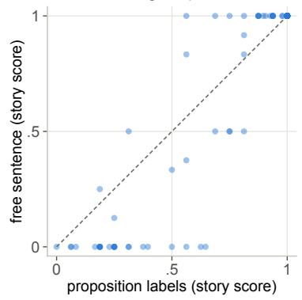  
Figure A3: Readouts and forms in detail. (a) Alternative, or-not, and negative-interrogative questions against plain questions, by answer constraint and language: per-cell story-level r, residual-profile r, and mean $| \Delta |$ . (b) Opus in Chinese, free sentence versus proposition labels, on 100 common stories; the residual comparison uses the 70 stories common to all models.

100 common stories (one dot each; dashed: identity) story-level r .93   
mean |Δ| .11   
residual r .67 on the 70 stories common to all models

one of the 48 cells behind Fig. 2a's row “free vs labels” (plain question): many stories sit at 0 or 1 on both readouts, so the dots overlap (transparency)

<table><tr><td>Readout comparison</td><td>Cells</td><td>Story-level r</td><td>Residual r</td><td>Mean |∆|</td><td>Shift</td></tr><tr><td colspan="6">Plain question (F1): readout pairs</td></tr><tr><td>Free sentence vs proposition labels</td><td>48</td><td>0.92[0.83, 0.98]</td><td>0.49[0.03, 0.87]</td><td>0.10[0.03, 0.17]</td><td>-0.019</td></tr><tr><td>Free sentence vs verdict sentence</td><td>48</td><td>0.93[0.88, 0.98]</td><td>0.70[0.05, 0.88]</td><td>0.06[0.03, 0.11]</td><td>-0.024</td></tr><tr><td>Proposition labels vs verdict sentence</td><td>48</td><td>0.92[0.84, 0.97]</td><td>0.57[0.26, 0.86</td><td>0.08[0.04, 0.17]</td><td>-0.002</td></tr><tr><td>Yes/no token vs proposition labels</td><td>48</td><td>0.93[0.83, 0.97]</td><td>0.49[0.19, 0.87]</td><td>0.10[0.05, 0.17]</td><td>-0.054</td></tr><tr><td>Yes/no token vs free sentence</td><td>48</td><td>0.92[0.86, 0.98]</td><td>0.50[0.03, 0.85]</td><td>0.08[0.03, 0.18]</td><td>-0.018</td></tr><tr><td colspan="6">Alternative (F2) or or-not (F3) vs plain question (F1)</td></tr><tr><td>Alternative, proposition labels</td><td>48</td><td>0.96[0.91,0.99]</td><td>0.76[0.47,0.94]</td><td>0.07[0.02,0.12]</td><td>-0.009</td></tr><tr><td>Or-not, proposition labels</td><td>48</td><td>0.97[0.90, 0.99]</td><td>0.81[0.53, 0.97]</td><td>0.06[0.02, 0.10]</td><td>-0.009</td></tr><tr><td>Alternative, free sentence</td><td>48</td><td>0.94[0.88, 0.98]</td><td>0.68[0.21, 0.95]</td><td>0.04[0.02, 0.09]</td><td>+0.019</td></tr><tr><td>Or-not, free sentence</td><td>48</td><td>0.96[0.91, 0.98]</td><td>0.73[0.43, 0.92]</td><td>0.04[0.02, 0.07]</td><td>-0.001</td></tr><tr><td>Or-not, yes/no token</td><td>48</td><td>0.96[0.85, 0.99]</td><td>0.73[0.49, 0.92]</td><td>0.06[0.03, 0.14]</td><td>-0.017</td></tr><tr><td colspan="6">Negative interrogative (F4) vs plain question (F1)</td></tr><tr><td>Free sentence</td><td>48</td><td>0.94[0.89, 0.98]</td><td>0.66[0.24,0.94]</td><td>0.05[0.02,0.10]</td><td>-0.005</td></tr><tr><td>Verdict sentence</td><td>48</td><td>0.93[0.85, 0.98]</td><td>0.67[0.29, 0.93]</td><td>0.06[0.02, 0.12]</td><td>-0.021</td></tr><tr><td>Proposition labels</td><td>48</td><td>0.95[0.87, 0.99]</td><td>0.75[0.51, 0.94]</td><td>0.06[0.03, 0.11]</td><td>-0.007</td></tr><tr><td>Yes/no token</td><td>48</td><td>0.73[-0.16, 0.89]</td><td>0.22[–0.17,0.57]</td><td>0.22[0.13, 0.41]</td><td>-0.095</td></tr><tr><td colspan="6">Negative interrogative (F4): readout pairs</td></tr><tr><td>Yes/no token vs proposition labels</td><td>48</td><td>0.70[-0.15, 0.89]</td><td>0.24[-0.10, 0.67]</td><td>0.24[0.14,0.40]</td><td>-0.136</td></tr><tr><td>Yes/no token vs free sentence</td><td>48</td><td>0.70[-0.12, 0.89]</td><td>0.19[-0.18, 0.55]</td><td>0.29[0.19, 0.44]</td><td>-0.131</td></tr><tr><td>Free sentence vs proposition labels</td><td>48</td><td>0.91[0.84, 0.97]</td><td>0.46[0.10, 0.83]</td><td>0.09[0.05, 0.16]</td><td>-0.028</td></tr><tr><td colspan="6">Negative interrogative: judged yes/no-first replies</td></tr><tr><td>Judged sentence vs own token (same replies)</td><td>48</td><td>0.67[−0.10, 0.94]</td><td>0.30[−0.18,0.64]</td><td>0.25[0.12,0.40]</td><td>+0.106</td></tr><tr><td>Judged sentence vs free sentence (other replies)</td><td>48</td><td>0.94[0.86, 0.97]</td><td>0.61[0.33, 0.87]</td><td>0.07[0.04, 0.13]</td><td>-0.005</td></tr></table>

Table 3: Readout agreement on common stories within each cell. Entries are medians with the central 80% range across cells; shift is the median of cell-wise mean signed diferences, in the order named. Verdict sentence denotes the judged sentence of verdict-first replies. Same-reply estimates use identical replies and aggregation weights. The final row compares diferent answer conditions on common stories. The negative-interrogative token uses its preset mapping.

between items, so their corresponding cells are hatched as unavailable. Mistral supplies the clearest local departures from the small average order efects, particularly in the particle order of the Korean yes/no-first instruction and the lexical order of alternative questions.

## A5 The negative interrogative in detail

Figure A5 conditions the polarity share on what the judged sentence asserts. A rejecting sentence affirms the term questioned under negation, whereas a confirming sentence denies that term. The upper and lower matrices preserve the same wording rows and model columns, allowing a fixed opening particle to be distinguished from a mapping that follows the sentence. A model that always begins with “no” occupies opposite ends of the polarity scale across these directions.

Every displayed direction cell contains at least 15 usable replies, and every wording mean includes all eight models. The lower panels connect these aggregate patterns to actual sentences. The quoted examples all answer the question that names “agree”: “Do you not agree with what X did?”. Their counts establish that all four token– sentence combinations occur in the judged replies. Counts for the question naming “disagree” appear separately.

Table 5 lists the prompt-defined construction groups used for the cross-language comparison. The table retains the construction-specific wording and each model’s available reply count. A missing Japanese copula counterpart is left blank rather than replaced with a diferently structured question.

## A6 Comparison with the published human reference

We correlate the balanced story scores with the published English MFV wrongness means of Clifford et al. (2015). The same norm set is used for every language, restricted to stories present in the cell and readout being compared. Figure A6 prints each matched-story count below its Spearman correlation and uses the order-equal-weight estimator from the main analysis. The summary averages the available model language correlations for each readout and question form.

The mean free-sentence correlation is 0.63 under both the plain question and the negative interrogative. Proposition labels retain their ordering against the same reference under the form change. The preset token reading changes substantially, from 0.60 to 0.25. These correlations compare story rankings with a shared reference; their magnitude does not measure the cultural representativeness of a language or the correctness of a model’s judgment.

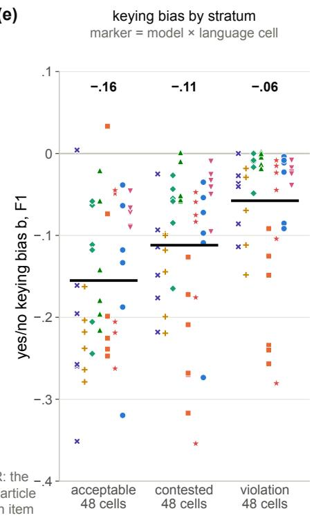

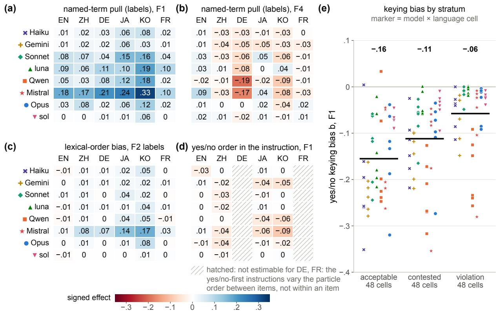  
Figure A4: Further answer habits. Named-term pull by model language under plain questions and negative interrogatives, alternative-question lexical-order bias, particle-order efects in the yes/no-first instruction, and keying bias by story group. Particle-order efects are not estimable for German and French, whose instructions vary the first-listed particle between items. Small averages have local exceptions, especially Mistral.

## A7 Dialogue-corpus and literature background

Figure A7 places dialogue observations and published descriptions beside the battery’s surface constructions as background for interpreting the particle mappings. The dialogue material contains particle-initial answers to negative questions whose contextual sentence interpretation was assigned by a judge. The particle lists follow the model-side lists, and the contextual label determines whether an answer confirms or rejects the negative proposition. The dialogue shares retain their sampling intervals and counts because construction coverage is uneven.

The sources include the Santa Barbara Corpus of Spoken American English (Du Bois et al., 2000–2005), the AMI Meeting Corpus (Carletta, 2006), CEFC–ORFEO (Benzitoun et al., 2016), the Nagoya University Conversation Corpus (Fujimura et al., 2012), and the BTSJ Japanese Natural Conversation Corpus (Usami, 2023). The displayed construction groups also draw on Dortmund Chat (Lüngen et al., 2016), the Chinese dialogue collections LCCC and NaturalConv (Wang et al., 2020, 2021), OpenSubtitles (Lison and Tiedemann, 2016), and ParlaMint (Erjavec et al., 2025). These resources include subtitles, scenariobased meetings, and crowdsourced dialogue, as well as transcribed conversation and chat.

Institutional exchanges come from UK Hansard through ParlParse, US Supreme Court oral arguments, and archived White House press briefings;1 the French National Assembly, the Japanese National Diet, Korean government ministry briefings, and Taiwan’s Legislative Yuan gazette through the g0v mirror.2 The plotted construction groups determine which sources contribute; the figure does not represent a census of every response form in these corpora.

<table><tr><td rowspan=12 colspan=27>(a)                 English       Chinese      German       Japanese       Korean        Frenchreplies that reject the negated proposition (e.g. &quot;I agree”)                   0 = &quot;No, I agree.&quot;, 1 = &quot;Yes, I agree.&quot;mean of models                                                                                        .71models (n ≥ 8)            8× Haiku           .04                                 .84.15.03                     .28.03.09.15+ Gemini                                                                                    .88.95Sonnet           .08▲ lunaQwen★ Mistral● Opussol</td></tr><tr><td rowspan=1 colspan=1>.97</td><td rowspan=1 colspan=1>.94</td><td rowspan=1 colspan=1>.90</td><td rowspan=1 colspan=1>.09</td><td rowspan=1 colspan=1>.95</td><td rowspan=1 colspan=1>.81</td><td rowspan=1 colspan=1>.16</td><td rowspan=1 colspan=1>.40</td><td rowspan=1 colspan=1>.98</td><td rowspan=1 colspan=1>.78</td><td rowspan=1 colspan=1>.59</td><td rowspan=1 colspan=1>.80</td><td rowspan=1 colspan=1>.94</td><td rowspan=1 colspan=1>.65</td><td rowspan=1 colspan=1>.32</td><td rowspan=1 colspan=1>.61</td><td rowspan=1 colspan=1>.84</td><td rowspan=1 colspan=2>.57 .45</td><td rowspan=1 colspan=1>.94</td><td rowspan=1 colspan=1>.87</td><td rowspan=1 colspan=1>.77</td><td rowspan=1 colspan=1>.71</td><td rowspan=1 colspan=1>.70</td></tr><tr><td rowspan=1 colspan=1></td><td rowspan=1 colspan=1></td><td rowspan=1 colspan=1></td><td rowspan=1 colspan=1></td><td rowspan=1 colspan=1></td><td rowspan=1 colspan=1></td><td rowspan=1 colspan=1></td><td rowspan=1 colspan=1></td><td rowspan=1 colspan=1></td><td rowspan=1 colspan=1></td><td rowspan=1 colspan=1></td><td rowspan=1 colspan=1></td><td rowspan=1 colspan=1></td><td rowspan=1 colspan=1></td><td rowspan=1 colspan=1></td><td rowspan=1 colspan=1></td><td rowspan=1 colspan=1></td><td rowspan=1 colspan=2></td><td rowspan=1 colspan=1></td><td rowspan=1 colspan=1></td><td rowspan=1 colspan=1></td><td rowspan=1 colspan=1></td><td rowspan=1 colspan=1></td></tr><tr><td rowspan=1 colspan=1>.98</td><td rowspan=1 colspan=1>.93</td><td rowspan=1 colspan=1>.88</td><td rowspan=1 colspan=1>.04</td><td rowspan=1 colspan=1>.90</td><td rowspan=1 colspan=1>.77</td><td rowspan=1 colspan=1>.33</td><td rowspan=1 colspan=1>.27</td><td rowspan=1 colspan=1>.96</td><td rowspan=1 colspan=1>.34</td><td rowspan=1 colspan=1>.06</td><td rowspan=1 colspan=1>.51</td><td rowspan=1 colspan=1>.84</td><td rowspan=1 colspan=1>.15</td><td rowspan=1 colspan=1>.03</td><td rowspan=1 colspan=1>.17</td><td rowspan=1 colspan=1>.84</td><td rowspan=1 colspan=1>.91</td><td rowspan=1 colspan=1>.77</td><td rowspan=1 colspan=1>.56</td><td rowspan=1 colspan=1>.28</td><td rowspan=1 colspan=1>.03</td><td rowspan=1 colspan=1>.09</td><td rowspan=1 colspan=1>.15</td></tr><tr><td rowspan=1 colspan=1>.98</td><td rowspan=1 colspan=1>|.96</td><td rowspan=1 colspan=1>.92</td><td rowspan=1 colspan=1>.05</td><td rowspan=1 colspan=1>.99</td><td rowspan=1 colspan=1>.93</td><td rowspan=1 colspan=1>.38</td><td rowspan=1 colspan=1>.45</td><td rowspan=1 colspan=1>.99</td><td rowspan=1 colspan=1>.93</td><td rowspan=1 colspan=1>.82</td><td rowspan=1 colspan=1>.89</td><td rowspan=1 colspan=1>.99</td><td rowspan=1 colspan=1>.71</td><td rowspan=1 colspan=1>.27</td><td rowspan=1 colspan=1>.86</td><td rowspan=1 colspan=1>.92</td><td rowspan=1 colspan=1>.40</td><td rowspan=1 colspan=1>.30</td><td rowspan=1 colspan=1>.97</td><td rowspan=1 colspan=1>|.98</td><td rowspan=1 colspan=1>|.88</td><td rowspan=1 colspan=1>|.95</td><td rowspan=1 colspan=1>.49</td></tr><tr><td rowspan=1 colspan=1>.99</td><td rowspan=1 colspan=1>.95</td><td rowspan=1 colspan=1>.90</td><td rowspan=1 colspan=1>.08</td><td rowspan=1 colspan=1>.97</td><td rowspan=1 colspan=1>.89</td><td rowspan=1 colspan=1>.19</td><td rowspan=1 colspan=1>.55</td><td rowspan=1 colspan=1></td><td rowspan=1 colspan=1>.92</td><td rowspan=1 colspan=1>.94</td><td rowspan=1 colspan=1>.91</td><td rowspan=1 colspan=1></td><td rowspan=1 colspan=1>.87</td><td rowspan=1 colspan=1>.18</td><td rowspan=1 colspan=1>.67</td><td rowspan=1 colspan=1>.94</td><td rowspan=1 colspan=1>.84</td><td rowspan=1 colspan=1>.86</td><td rowspan=1 colspan=1></td><td rowspan=1 colspan=1>.95</td><td rowspan=1 colspan=1>.87</td><td rowspan=1 colspan=1>.85</td><td rowspan=1 colspan=1>.82</td></tr><tr><td rowspan=1 colspan=1>.99</td><td rowspan=1 colspan=1>.95</td><td rowspan=1 colspan=1>.94</td><td rowspan=1 colspan=1>.10</td><td rowspan=1 colspan=1>.98</td><td rowspan=1 colspan=1>.87</td><td rowspan=1 colspan=1>.08</td><td rowspan=1 colspan=1>.51</td><td rowspan=1 colspan=1>.97</td><td rowspan=1 colspan=1>.67</td><td rowspan=1 colspan=1>.14</td><td rowspan=1 colspan=1>.91</td><td rowspan=1 colspan=1></td><td rowspan=1 colspan=1>.86</td><td rowspan=1 colspan=1>.88</td><td rowspan=1 colspan=1>.96</td><td rowspan=1 colspan=1>.97</td><td rowspan=1 colspan=1>.61</td><td rowspan=1 colspan=1>.53</td><td rowspan=1 colspan=1></td><td rowspan=1 colspan=1>.92</td><td rowspan=1 colspan=1>.86</td><td rowspan=1 colspan=1>.41</td><td rowspan=1 colspan=1>.49</td></tr><tr><td rowspan=1 colspan=1>.93</td><td rowspan=1 colspan=1>.76</td><td rowspan=1 colspan=1>.85</td><td rowspan=1 colspan=1>.13</td><td rowspan=1 colspan=1>.83</td><td rowspan=1 colspan=1>.75</td><td rowspan=1 colspan=1>.05</td><td rowspan=1 colspan=1>.30</td><td rowspan=1 colspan=1>.95</td><td rowspan=1 colspan=1>.70</td><td rowspan=1 colspan=1>.60</td><td rowspan=1 colspan=1>.53</td><td rowspan=1 colspan=1>.74</td><td rowspan=1 colspan=1>.53</td><td rowspan=1 colspan=1>.12</td><td rowspan=1 colspan=1>.51</td><td rowspan=1 colspan=1>.82</td><td rowspan=1 colspan=1>.79</td><td rowspan=1 colspan=1>.53</td><td rowspan=1 colspan=1>.97</td><td rowspan=1 colspan=1>.85</td><td rowspan=1 colspan=1>.81</td><td rowspan=1 colspan=1>.73</td><td rowspan=1 colspan=1>.90</td></tr><tr><td rowspan=1 colspan=1>.97</td><td rowspan=1 colspan=1>.96</td><td rowspan=1 colspan=1>.75</td><td rowspan=1 colspan=1>.01</td><td rowspan=1 colspan=1>.98</td><td rowspan=1 colspan=1>.47</td><td rowspan=1 colspan=1>.13</td><td rowspan=1 colspan=1>.35</td><td rowspan=1 colspan=1>.95</td><td rowspan=1 colspan=1>.79</td><td rowspan=1 colspan=1>.36</td><td rowspan=1 colspan=1>.81</td><td rowspan=1 colspan=1>.97</td><td rowspan=1 colspan=1>.59</td><td rowspan=1 colspan=1>.07</td><td rowspan=1 colspan=1>.41</td><td rowspan=1 colspan=1>.34</td><td rowspan=1 colspan=1>.32</td><td rowspan=1 colspan=1>0</td><td rowspan=1 colspan=1></td><td rowspan=1 colspan=1>|.97</td><td rowspan=1 colspan=1>|.90</td><td rowspan=1 colspan=1>.95</td><td rowspan=1 colspan=1>.77</td></tr><tr><td rowspan=1 colspan=1>.94</td><td rowspan=1 colspan=1>.99</td><td rowspan=1 colspan=1>.94</td><td rowspan=1 colspan=1>.33</td><td rowspan=1 colspan=1>.94</td><td rowspan=1 colspan=1>.84</td><td rowspan=1 colspan=1>.06</td><td rowspan=1 colspan=1>.42</td><td rowspan=1 colspan=1></td><td rowspan=1 colspan=1>.93</td><td rowspan=1 colspan=1>.90</td><td rowspan=1 colspan=1>.98</td><td rowspan=1 colspan=1></td><td rowspan=1 colspan=1>.65</td><td rowspan=1 colspan=1>.64</td><td rowspan=1 colspan=1>.67</td><td rowspan=1 colspan=1>.92</td><td rowspan=1 colspan=1>.42</td><td rowspan=1 colspan=1>.41</td><td rowspan=1 colspan=1></td><td rowspan=1 colspan=1>|.99</td><td rowspan=1 colspan=1>|.87</td><td rowspan=1 colspan=1>.71</td><td rowspan=1 colspan=1>|.96</td></tr><tr><td rowspan=1 colspan=1>.99</td><td rowspan=1 colspan=1>|.98</td><td rowspan=1 colspan=1>.99</td><td rowspan=1 colspan=1>.01</td><td rowspan=1 colspan=1></td><td rowspan=1 colspan=1>|.96</td><td rowspan=1 colspan=1>.08</td><td rowspan=1 colspan=1>.39</td><td rowspan=1 colspan=1>.99</td><td rowspan=1 colspan=1>.92</td><td rowspan=1 colspan=1>.89</td><td rowspan=1 colspan=1>.82</td><td rowspan=1 colspan=1></td><td rowspan=1 colspan=1>.83</td><td rowspan=1 colspan=1>.40</td><td rowspan=1 colspan=1>.65</td><td rowspan=1 colspan=1>.95</td><td rowspan=1 colspan=1>.24</td><td rowspan=1 colspan=1>.19</td><td rowspan=1 colspan=1></td><td rowspan=1 colspan=1></td><td rowspan=1 colspan=1>|.96</td><td rowspan=1 colspan=1>.97</td><td rowspan=1 colspan=1></td></tr><tr><td rowspan=1 colspan=25></td><td rowspan=1 colspan=1></td><td rowspan=1 colspan=1></td></tr><tr><td rowspan=1 colspan=1></td><td rowspan=1 colspan=1>mean of models</td><td rowspan=1 colspan=1>2</td><td rowspan=1 colspan=1>.98</td><td rowspan=1 colspan=1>.97</td><td rowspan=1 colspan=2>.30</td><td rowspan=1 colspan=1>.97</td><td rowspan=1 colspan=1>.82</td><td rowspan=1 colspan=1>.26</td><td rowspan=1 colspan=1>.59</td><td rowspan=1 colspan=1>.96</td><td rowspan=1 colspan=1>.40</td><td rowspan=1 colspan=1>.58</td><td rowspan=1 colspan=1>.79</td><td rowspan=1 colspan=1>.95</td><td rowspan=1 colspan=2>.67.52</td><td rowspan=1 colspan=1>.61</td><td rowspan=1 colspan=1>.69</td><td rowspan=1 colspan=1>.30</td><td rowspan=1 colspan=1>.36</td><td rowspan=1 colspan=1>.98</td><td rowspan=1 colspan=1>.90</td><td rowspan=1 colspan=1>.75</td><td rowspan=1 colspan=1>.68</td><td rowspan=1 colspan=1>.86</td></tr><tr><td rowspan=31 colspan=3>× Haiku+ GeminiSonnet▲ lunaQwen★ Mistral• Opussol</td><td rowspan=1 colspan=4>models (n ≥ 8)</td><td rowspan=1 colspan=1></td><td rowspan=1 colspan=1>8</td><td rowspan=1 colspan=1>8</td><td rowspan=1 colspan=1>8</td><td rowspan=1 colspan=1>8</td><td rowspan=1 colspan=1>8</td><td rowspan=1 colspan=1>8</td><td rowspan=1 colspan=1>8</td><td rowspan=1 colspan=1>8</td><td rowspan=1 colspan=1>8</td><td rowspan=1 colspan=1>8</td><td rowspan=1 colspan=1>8</td><td rowspan=1 colspan=1>8</td><td rowspan=1 colspan=2>8 8</td><td rowspan=1 colspan=1>8</td><td rowspan=1 colspan=1>8</td><td rowspan=1 colspan=1>8</td><td rowspan=1 colspan=1>8</td><td rowspan=1 colspan=1>8</td></tr><tr><td rowspan=1 colspan=1></td><td rowspan=1 colspan=1>.97</td><td rowspan=1 colspan=1>1</td><td rowspan=1 colspan=1>.17</td><td></td><td rowspan=1 colspan=1>.93</td><td rowspan=1 colspan=1>.99</td><td rowspan=1 colspan=1>.51</td><td rowspan=1 colspan=1>.69</td><td rowspan=1 colspan=1>.99</td><td rowspan=1 colspan=1>.59</td><td rowspan=1 colspan=1>.84</td><td rowspan=1 colspan=1>.98</td><td rowspan=1 colspan=1>.99</td><td rowspan=1 colspan=1>.96</td><td rowspan=1 colspan=1>.94</td><td rowspan=1 colspan=1>.98</td><td rowspan=1 colspan=1>.25</td><td rowspan=1 colspan=1>0</td><td rowspan=1 colspan=1>.08</td><td rowspan=1 colspan=1></td><td rowspan=1 colspan=1>.95</td><td rowspan=1 colspan=1>.83</td><td rowspan=1 colspan=1>.56</td><td rowspan=1 colspan=1>.97</td></tr><tr><td rowspan=1 colspan=1></td><td rowspan=1 colspan=1>1</td><td rowspan=1 colspan=1>.98</td><td rowspan=1 colspan=2>.56</td><td rowspan=1 colspan=1>.98</td><td rowspan=1 colspan=1>.87</td><td rowspan=1 colspan=1>.08</td><td rowspan=1 colspan=1>.40</td><td rowspan=1 colspan=1>.98</td><td rowspan=1 colspan=1>.60</td><td rowspan=1 colspan=1>.69</td><td rowspan=1 colspan=1>.99</td><td rowspan=1 colspan=1>.96</td><td rowspan=1 colspan=1>.77</td><td rowspan=1 colspan=1>.48</td><td rowspan=1 colspan=1>.87</td><td rowspan=1 colspan=1>.77</td><td rowspan=1 colspan=1>.25</td><td rowspan=1 colspan=1>.48</td><td rowspan=1 colspan=1></td><td rowspan=1 colspan=1>.98</td><td rowspan=1 colspan=1>.89</td><td rowspan=1 colspan=1>.90</td><td rowspan=1 colspan=1>.74</td></tr><tr><td rowspan=1 colspan=1></td><td rowspan=1 colspan=1>.99</td><td rowspan=1 colspan=1>.94</td><td rowspan=1 colspan=2>.52</td><td rowspan=1 colspan=1>1</td><td rowspan=1 colspan=1>.89</td><td rowspan=1 colspan=1>.56</td><td rowspan=1 colspan=1>.83</td><td rowspan=1 colspan=1>.94</td><td rowspan=1 colspan=1>.25</td><td rowspan=1 colspan=1>.82</td><td rowspan=1 colspan=1>.92</td><td rowspan=1 colspan=1>1</td><td rowspan=1 colspan=1>.93</td><td rowspan=1 colspan=1>.82</td><td rowspan=1 colspan=1>.57</td><td rowspan=1 colspan=1>.75</td><td rowspan=1 colspan=1>.28</td><td rowspan=1 colspan=1>.32</td><td rowspan=1 colspan=1></td><td rowspan=1 colspan=1>.96</td><td rowspan=1 colspan=1>.96</td><td rowspan=1 colspan=1>.61</td><td rowspan=1 colspan=1>.98</td></tr><tr><td rowspan=1 colspan=1>.99</td><td rowspan=1 colspan=1>.97</td><td rowspan=1 colspan=1>.97</td><td rowspan=1 colspan=1>.17</td><td></td><td rowspan=1 colspan=1>.91</td><td rowspan=1 colspan=1>.26</td><td rowspan=1 colspan=1>.04</td><td rowspan=1 colspan=1>.23</td><td rowspan=1 colspan=1>.98</td><td rowspan=1 colspan=1>.20</td><td rowspan=1 colspan=1>.29</td><td rowspan=1 colspan=1>.34</td><td rowspan=1 colspan=1>.91</td><td rowspan=1 colspan=1>.15</td><td rowspan=1 colspan=1>.18</td><td rowspan=1 colspan=1>.28</td><td rowspan=1 colspan=1>.43</td><td rowspan=1 colspan=1>.08</td><td rowspan=1 colspan=1>.15</td><td rowspan=1 colspan=1>1</td><td rowspan=1 colspan=1>.49</td><td rowspan=1 colspan=1>.46</td><td rowspan=1 colspan=1>.10</td><td rowspan=1 colspan=1>.53</td></tr><tr><td rowspan=1 colspan=1></td><td rowspan=1 colspan=1>.99</td><td rowspan=1 colspan=1>.99</td><td rowspan=1 colspan=1>.71</td><td></td><td rowspan=1 colspan=1>.97</td><td rowspan=1 colspan=1>.85</td><td rowspan=1 colspan=1>.30</td><td rowspan=1 colspan=1>.66</td><td rowspan=1 colspan=1>.98</td><td rowspan=1 colspan=1>.56</td><td rowspan=1 colspan=1>.65</td><td rowspan=1 colspan=1>.97</td><td rowspan=1 colspan=1>.96</td><td rowspan=1 colspan=1>1</td><td rowspan=1 colspan=1>.89</td><td rowspan=1 colspan=1>.97</td><td rowspan=1 colspan=1>.71</td><td rowspan=1 colspan=1>.60</td><td rowspan=1 colspan=1>.52</td><td rowspan=1 colspan=1>.98</td><td rowspan=1 colspan=1>.98</td><td rowspan=1 colspan=1>.81</td><td rowspan=1 colspan=1>.83</td><td rowspan=1 colspan=1>1</td></tr><tr><td rowspan=1 colspan=1></td><td rowspan=1 colspan=1>.98</td><td rowspan=1 colspan=1>.93</td><td rowspan=1 colspan=1>.16</td><td></td><td rowspan=1 colspan=1>.93</td><td rowspan=1 colspan=1>.87</td><td rowspan=1 colspan=1>.06</td><td rowspan=1 colspan=1>.68</td><td rowspan=1 colspan=1>.87</td><td rowspan=1 colspan=1>.23</td><td rowspan=1 colspan=1>.67</td><td rowspan=1 colspan=1>.70</td><td rowspan=1 colspan=1>.83</td><td rowspan=1 colspan=1>.62</td><td rowspan=1 colspan=1>.33</td><td rowspan=1 colspan=1>.57</td><td rowspan=1 colspan=1>.90</td><td rowspan=1 colspan=1>.73</td><td rowspan=1 colspan=1>.78</td><td rowspan=1 colspan=1>.93</td><td rowspan=1 colspan=1>.87</td><td rowspan=1 colspan=1>.51</td><td rowspan=1 colspan=1>.67</td><td rowspan=1 colspan=1>.75</td></tr><tr><td rowspan=1 colspan=1>.99</td><td rowspan=1 colspan=1>.98</td><td rowspan=1 colspan=1>.96</td><td rowspan=1 colspan=2>.13</td><td rowspan=1 colspan=1>1</td><td rowspan=1 colspan=1>.97</td><td rowspan=1 colspan=1>.45</td><td rowspan=1 colspan=1>.89</td><td rowspan=1 colspan=1>.90</td><td rowspan=1 colspan=1>.37</td><td rowspan=1 colspan=1>.41</td><td rowspan=1 colspan=1>.77</td><td rowspan=1 colspan=1>.95</td><td rowspan=1 colspan=1>.51</td><td rowspan=1 colspan=1>.49</td><td rowspan=1 colspan=1>.55</td><td rowspan=1 colspan=1>.99</td><td rowspan=1 colspan=1>.32</td><td rowspan=1 colspan=1>.54</td><td rowspan=1 colspan=1>.93</td><td rowspan=1 colspan=1>.95</td><td rowspan=1 colspan=1>.53</td><td rowspan=1 colspan=1>.83</td><td rowspan=1 colspan=1>.89</td></tr><tr><td rowspan=1 colspan=1></td><td rowspan=1 colspan=1>1</td><td rowspan=1 colspan=1>1</td><td rowspan=1 colspan=2>.02</td><td rowspan=1 colspan=1>1</td><td rowspan=1 colspan=1>.89</td><td rowspan=1 colspan=1>.09</td><td rowspan=1 colspan=1>.35</td><td rowspan=1 colspan=1>.99</td><td rowspan=1 colspan=1>.40</td><td rowspan=1 colspan=1>.30</td><td rowspan=1 colspan=1>.62</td><td rowspan=1 colspan=1>1</td><td rowspan=1 colspan=1>.39</td><td rowspan=1 colspan=1>.07</td><td rowspan=1 colspan=1>.12</td><td rowspan=1 colspan=1>.73</td><td rowspan=1 colspan=1>.11</td><td rowspan=1 colspan=1>.03</td><td rowspan=1 colspan=1>1</td><td rowspan=1 colspan=1>1</td><td rowspan=1 colspan=1>.99</td><td rowspan=1 colspan=1>.94</td><td rowspan=1 colspan=1>1</td></tr><tr><td rowspan=1 colspan=1></td><td rowspan=1 colspan=1></td><td rowspan=1 colspan=1>?</td><td rowspan=1 colspan=2></td><td rowspan=1 colspan=1>2</td><td rowspan=1 colspan=1>2</td><td rowspan=1 colspan=1>2</td><td rowspan=1 colspan=1></td><td rowspan=1 colspan=1></td><td rowspan=1 colspan=1></td><td rowspan=1 colspan=1></td><td rowspan=1 colspan=1>か</td><td rowspan=1 colspan=1>か</td><td rowspan=1 colspan=1>か</td><td rowspan=1 colspan=1>か</td><td rowspan=1 colspan=1>か</td><td rowspan=1 colspan=1></td><td rowspan=1 colspan=1>??</td><td rowspan=1 colspan=1>??</td><td rowspan=1 colspan=1>2</td><td rowspan=1 colspan=1>2</td><td rowspan=1 colspan=1>2</td><td rowspan=1 colspan=1></td><td rowspan=1 colspan=1></td></tr><tr><td rowspan=27 colspan=27>         L¿h nn  ie nnab 2  ¿ |¿             ¿ a as ad Il-a ……  sno-zsoddo sno uWasorrti rect ano not oseD yost ou re reFiun   cht,Wwaioe t e rektse sno-zsud as &#x27;ete ed -rec es -oasfewer than 8 judged replies: tinted, n in brackets (none: n = 16–619 per cell).5pole answers to each language&#x27;s main question (EN and JA rows drawn below):confirming: 0                 confirming: 1EN No, I agree.           Yes, I agree.             Yes, I don&#x27;t agree.             No, I don&#x27;t agree.ZH  不，我反对。           是/对，我反对。           是，我不反对。                不，我不反对。Nein, es war falsch.     Doch / Ja, es war falsch    Ja, es war nicht falsch.          Nein, es war nicht falsch.JA                       はい、反対します。        はい、反対しません。          いいえ、反対しません。KO                       ，                     FR Non, je m&#x27;y oppose.     Si, je m&#x27;y oppose.         Oui, je ne m&#x27;y oppose pas.       Non, je ne m&#x27;y oppose pas.</td></tr><tr><td rowspan=5 colspan=1>c</td><td rowspan=5 colspan=1></td><td rowspan=5 colspan=2>ee</td><td rowspan=5 colspan=1></td><td rowspan=5 colspan=1>的</td><td rowspan=5 colspan=1></td></tr><tr><td rowspan=4 colspan=1>吗</td></tr><tr><td rowspan=3 colspan=1></td></tr><tr><td rowspan=2 colspan=1></td><td rowspan=2 colspan=1></td><td rowspan=2 colspan=1></td><td rowspan=2 colspan=1></td><td rowspan=2 colspan=1></td><td rowspan=2 colspan=1></td><td rowspan=2 colspan=1></td><td rowspan=2 colspan=1></td><td rowspan=2 colspan=1>A</td><td rowspan=2 colspan=1></td><td rowspan=2 colspan=1></td><td rowspan=2 colspan=1></td><td rowspan=2 colspan=1></td><td rowspan=2 colspan=1></td></tr><tr><td rowspan=11 colspan=1>20</td></tr><tr><td rowspan=2 colspan=1>0</td><td rowspan=2 colspan=1>p</td><td rowspan=2 colspan=2></td><td rowspan=2 colspan=1>得</td><td rowspan=1 colspan=1>误</td><td rowspan=1 colspan=1>有</td><td rowspan=1 colspan=1>对</td><td rowspan=1 colspan=1>m</td><td rowspan=1 colspan=1>m</td><td rowspan=1 colspan=1>i</td><td rowspan=1 colspan=1>ん</td><td rowspan=1 colspan=1>ま</td><td rowspan=1 colspan=1>ま</td><td rowspan=1 colspan=1>ん</td><td rowspan=2 colspan=1>ま</td><td rowspan=1 colspan=1>觉</td><td rowspan=1 colspan=1>错</td><td rowspan=1 colspan=1>没</td><td rowspan=1 colspan=1>反</td></tr><tr><td rowspan=2 colspan=1>00</td><td rowspan=9 colspan=1>20</td></tr><tr><td rowspan=10 colspan=1></td><td rowspan=10 colspan=2></td><td rowspan=1 colspan=1>S</td><td rowspan=1 colspan=1>in</td><td rowspan=1 colspan=1></td><td rowspan=1 colspan=1>な</td><td rowspan=1 colspan=1>あ</td><td rowspan=1 colspan=1>あ</td><td rowspan=1 colspan=1>な</td><td rowspan=1 colspan=1></td><td rowspan=1 colspan=1></td><td rowspan=1 colspan=1></td><td rowspan=1 colspan=1></td></tr><tr><td rowspan=7 colspan=1></td></tr><tr><td rowspan=8 colspan=4></td><td rowspan=8 colspan=1></td></tr><tr><td rowspan=4 colspan=1></td><td rowspan=3 colspan=1></td><td rowspan=3 colspan=1></td><td rowspan=3 colspan=1></td></tr><tr><td rowspan=2 colspan=1>じ</td><td rowspan=2 colspan=1>じ</td></tr><tr><td rowspan=1 colspan=1></td><td rowspan=1 colspan=1>反</td><td rowspan=1 colspan=1></td><td rowspan=1 colspan=1></td><td rowspan=2 colspan=1></td><td rowspan=3 colspan=1></td></tr><tr><td rowspan=1 colspan=1>s</td><td rowspan=1 colspan=1>me</td><td rowspan=1 colspan=1>と</td><td rowspan=1 colspan=1>の</td><td rowspan=1 colspan=1>対</td><td rowspan=1 colspan=1>反</td><td rowspan=1 colspan=1></td><td rowspan=1 colspan=1></td><td rowspan=1 colspan=1></td></tr><tr><td rowspan=1 colspan=1></td><td rowspan=1 colspan=1></td><td rowspan=1 colspan=1></td><td rowspan=1 colspan=1></td></tr><tr><td rowspan=2 colspan=1></td><td rowspan=1 colspan=1>WA</td><td rowspan=2 colspan=1></td><td rowspan=2 colspan=1></td><td rowspan=2 colspan=1></td><td rowspan=5 colspan=1></td><td rowspan=5 colspan=1></td><td rowspan=5 colspan=1></td><td rowspan=5 colspan=1></td></tr><tr><td rowspan=1 colspan=1></td></tr><tr><td rowspan=1 colspan=1></td><td rowspan=1 colspan=4></td><td rowspan=1 colspan=1>fe</td><td rowspan=1 colspan=1>ver th</td><td rowspan=1 colspan=1>an 8</td><td rowspan=1 colspan=1>judge</td><td rowspan=2 colspan=3>In beelow):ted,</td><td rowspan=1 colspan=1>ies: t</td><td rowspan=2 colspan=1></td></tr><tr><td rowspan=2 colspan=5></td><td rowspan=1 colspan=1>(EN</td><td rowspan=1 colspan=1></td><td rowspan=1 colspan=1></td><td rowspan=1 colspan=1></td></tr><tr><td rowspan=1 colspan=2></td><td rowspan=1 colspan=1></td><td rowspan=1 colspan=1></td><td rowspan=1 colspan=1></td><td rowspan=1 colspan=1>cor</td><td rowspan=1 colspan=3>firming: 0</td><td rowspan=1 colspan=1></td></tr><tr><td rowspan=1 colspan=3></td><td rowspan=1 colspan=2>Yes,</td><td rowspan=1 colspan=2>agree.</td><td rowspan=1 colspan=1></td><td rowspan=1 colspan=1></td><td rowspan=1 colspan=1></td><td rowspan=1 colspan=1>Yes</td><td rowspan=1 colspan=3>, I don't agree.</td><td rowspan=1 colspan=1></td><td rowspan=1 colspan=1></td><td rowspan=1 colspan=1></td><td rowspan=1 colspan=1>No</td><td rowspan=1 colspan=1>I do</td><td rowspan=1 colspan=1>'t ag</td><td rowspan=1 colspan=1>ree.</td><td rowspan=1 colspan=1></td></tr><tr><td rowspan=1 colspan=3></td><td rowspan=1 colspan=3>是/对</td><td rowspan=1 colspan=2>我反对</td><td rowspan=1 colspan=1></td><td rowspan=1 colspan=1></td><td rowspan=1 colspan=1></td><td rowspan=1 colspan=1>是.</td><td rowspan=1 colspan=4>我不反对。</td><td rowspan=1 colspan=1></td><td rowspan=1 colspan=1></td><td rowspan=1 colspan=1>不</td><td rowspan=1 colspan=1>我不</td><td rowspan=1 colspan=1>反</td><td rowspan=1 colspan=1></td></tr><tr><td rowspan=1 colspan=3></td><td rowspan=1 colspan=3>Doch</td><td rowspan=1 colspan=2>/ Ja, es</td><td rowspan=1 colspan=1>war</td><td rowspan=1 colspan=2>alsch.</td><td rowspan=1 colspan=1>Ja,</td><td rowspan=1 colspan=4>es war nicht falsch.</td><td rowspan=1 colspan=1></td><td rowspan=1 colspan=1></td><td rowspan=1 colspan=2>Nein, es</td><td rowspan=1 colspan=1>war</td><td rowspan=1 colspan=1>nicht</td></tr><tr><td rowspan=1 colspan=3></td><td rowspan=1 colspan=3>はい、</td><td rowspan=1 colspan=2>反対し</td><td rowspan=1 colspan=1>ます</td><td rowspan=1 colspan=3></td><td rowspan=1 colspan=4>、反対しません。</td><td rowspan=1 colspan=1></td><td rowspan=1 colspan=1></td><td rowspan=1 colspan=2>いいえ、</td><td rowspan=1 colspan=1>反文</td><td rowspan=1 colspan=1>しま</td><td rowspan=1 colspan=2>せん。</td></tr><tr><td rowspan=1 colspan=3></td><td rowspan=1 colspan=3></td><td rowspan=1 colspan=3></td></tr><tr><td rowspan=1 colspan=3></td><td rowspan=1 colspan=3>Si, je</td><td rowspan=1 colspan=3>n'y oppose.</td></tr></table>

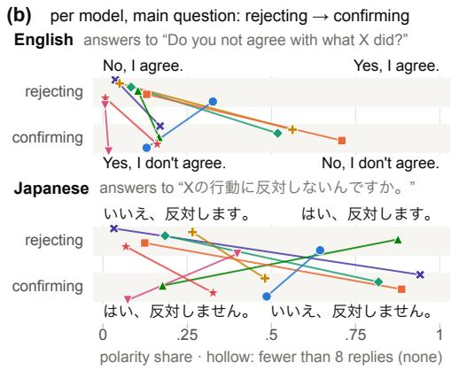  
Figure A5: The negative interrogative in detail. (a) Polarity share by wording and whether the reply confirms or rejects the negated proposition; each mean states its model count. (b) Per-model direction splits for “Do you not agree…?” and 反対しないんですか (hantai shinai n desu ka, “Do you not oppose?”), with concrete answers at the poles. (c) The four particle–sentence combinations in replies to “Do you not agree with what X did?”: one verbatim reply per combination, its model, and its count. Counts for “Do you not disagree…?” appear separately.

<table><tr><td></td><td colspan="2">Yes/no keying bias</td><td colspan="2">Second-listed preference</td><td colspan="2">Named-term pull</td></tr><tr><td>Model</td><td>Plain</td><td>Negative</td><td>Plain</td><td>Negative</td><td>Plain</td><td>Negative</td></tr><tr><td>Haiku</td><td>-0.12</td><td>-0.17</td><td>+0.04</td><td>+0.02</td><td>+0.04</td><td>-0.02</td></tr><tr><td>Gemini</td><td>-0.14</td><td>-0.04</td><td>+0.01</td><td>-0.01</td><td>+0.02</td><td>-0.03</td></tr><tr><td>Sonnet</td><td>-0.07</td><td>-0.04</td><td>+0.11</td><td>+0.08</td><td>+0.09</td><td>-0.01</td></tr><tr><td>luna</td><td>-0.05</td><td>+0.13</td><td>+0.02</td><td>-0.01</td><td>+0.11</td><td>+0.00</td></tr><tr><td>Qwen</td><td>-0.19</td><td>-0.16</td><td>+0.05</td><td>+0.07</td><td>+0.08</td><td>-0.06</td></tr><tr><td>Mistral</td><td>-0.12</td><td>-0.07</td><td>+0.12</td><td>+0.15</td><td>+0.20</td><td>-0.03</td></tr><tr><td>Opus</td><td>-0.10</td><td>-0.01</td><td>+0.04</td><td>+0.04</td><td>+0.05</td><td>+0.00</td></tr><tr><td>sol</td><td>-0.05</td><td>+0.06</td><td>+0.02</td><td>+0.01</td><td>+0.02</td><td>+0.00</td></tr><tr><td>All cells</td><td>-0.11</td><td>-0.04</td><td>+0.05</td><td>+0.04</td><td>+0.08</td><td>-0.02</td></tr></table>

Table 4: Answer habits by model under plain questions and negative interrogatives, averaged equally over the six languages. The yes/no columns describe the opening token; the other columns use proposition labels. Figure 4 defines the directions, and Figure A4 gives the individual cells.

The literature markers distinguish descriptive accounts from experiments and distinguish rejecting answers from confirming answers when a source tests only one direction. The English anchors combine descriptions with experimental responses, elicited (Goodhue and Wagner, 2018) or selected from a given yes/no pair (Park, 2023), and theoretical accounts (Kramer and Rawlins, 2011; Kameyama, 2013); the Mandarin anchors combine descriptive accounts with elicited production (Lu, 2002; Holmberg, 2016; Zhang and Vanek, 2021). Japanese and French markers draw on descriptions and elicited responses (Kuno, 1973; Kameyama, 2013), and the Korean marker uses forced-choice answer selection (Park, 2023). German anchors include a grammatical description (Dudenredaktion, 2009) and acceptability judgments about negative assertions (Meijer et al., 2015; Claus et al., 2017). Hollow experimental markers identify these assertion studies, which concern a related discourse context rather than the plotted question construction.

Keeping the particle form separate from contextual confirmation also follows the distinct coding categories of Stivers and Enfield (2010); Enfield et al. (2019) analyse form choice within confirming answers. Mandarin conversation studies likewise distinguish single-word and repetitionbased answers and show that the negative expression 没有 (méiyǒu) can do diferent interactional work depending on the preceding question (Xie, 2018; Wang, 2020, 2008). The dialogue exchanges difer from the vignette prompts in topic, register, and conversational context, and provide background rather than a matched validation of the

model cells.

## A8 Concept pairs and wording sensitivity

Figure A8 lists the questions naming either term of every language-specific concept pair. The pair identifies the evaluative contrast, and each question names one of its terms. The sensitivity analysis changes one of pair, language, or model while comparing single-pair story vectors on their common stories. It therefore asks how much a wording choice changes the measurement before the story estimator averages over pairs.

For proposition labels, changing the concept pair within a model and language gives a median story-level correlation of 0.82. Changing the model within a language and pair gives 0.72. The corresponding free-sentence correlations are higher, but their residual-profile correlations reveal less shared variation after the story consensus is removed. Averaging concept pairs consequently has a distinct measurement purpose alongside balancing which term of each pair the question names.

The leave-one-pair-out analysis repeats the same-model cross-language residual comparison after excluding each concept-pair name in turn. The inventory contains 23 language-specific entries but 22 exclusions because the English and French pairs named incorrect are removed together. The figure displays every exclusion beside the allpairs reference so the efect of each exclusion remains visible.

## A9 Repetition and aggregation stability

Figure A9 separates variation across repeated generations from variation introduced when scores average across option orders, terms named in the question, and concept pairs. A repeated prompt fixes the model, language, story, concept pair, question form, named term, answer instruction, and option order. The repetition panel uses prompts with three decisive generations and records whether those readings split. For free sentences, the split share rises from 2.5% under plain questions to 4.0% under negative interrogatives. The pattern difers across models and answer constraints, as the markers in the figure make visible.

<table><tr><td>Language</td><td>Wording</td><td>Mean</td><td>Model range</td><td>Replies</td><td>n per model</td></tr><tr><td colspan="6">negated attitude verb</td></tr><tr><td>EN</td><td>Don&#x27;t you think ... was wrong / right?; ... incorrect / correct? 你不觉得...错了/对了吗；难道你不觉得...是错误的/</td><td>0.99</td><td>0.97-1.00</td><td>2799</td><td>282-382</td></tr><tr><td>ZH</td><td>正确的吗</td><td>0.96</td><td>0.92-1.00</td><td>2743</td><td>304-370</td></tr><tr><td>DE</td><td>Finden Sie nicht, dass ... falsch / richtig war?; ... inkorrekt / korrekt?</td><td>0.97</td><td>0.92-0.99</td><td>3136</td><td>355-408</td></tr><tr><td>JA</td><td> $\sin \theta = \sin \theta , \angle A , \angle B , \angle C , C = \angle \frac { \sin \theta } { \sin \theta } , \angle B , \angle C , C = \angle \frac { \sin \theta } { \sin \theta } , \angle B$ </td><td>0.80</td><td>0.61-0.95</td><td>1611</td><td>192-210</td></tr><tr><td>KO FR</td><td>/</td><td>0.77</td><td>0.57–0.96</td><td>2068</td><td>238-267</td></tr><tr><td></td><td>Ne pensez-vous pas que ... a mal / bien agi ?</td><td>0.97</td><td>0.90-1.00</td><td>599</td><td>67-83</td></tr><tr><td colspan="6">negated evaluative adjective</td></tr><tr><td>EN</td><td>Wasn&#x27;t ... wrong / right?; Wasn&#x27;t it incorrect / correct of ...?</td><td>0.97</td><td>0.91-0.99</td><td>3208</td><td>354-429</td></tr><tr><td>ZH</td><td>..没有错吗/不对吗；..不错误吗/不正确吗</td><td>0.21</td><td>0.06–0.41</td><td>1121</td><td>127-155</td></tr><tr><td>DE</td><td>War ... nicht falsch / richtig?; War es nicht inkorrekt / korrekt ...?</td><td>0.58</td><td>0.42-0.78</td><td>3203</td><td>378-410</td></tr><tr><td>JA</td><td>No matched prompt in this inventory</td><td></td><td></td><td></td><td></td></tr><tr><td>KO</td><td>/</td><td>0.41</td><td>0.18–0.67</td><td>632</td><td>70-86</td></tr><tr><td>FR</td><td>N’était-ce pas incorrect / correct de la part de ...?</td><td>0.91</td><td>0.71-1.00</td><td>1300</td><td>155-173</td></tr><tr><td colspan="6">negated evaluative verb</td></tr><tr><td>EN</td><td>Do you not disagree / agree with ...?; oppose / support ...?</td><td>0.22</td><td>0.01-0.50</td><td>2788</td><td>315-378</td></tr><tr><td>ZH</td><td>难道你不反对/不同意...吗；难道你不反对/不支持...吗 Lehnen Sie ... nicht ab? / Stimmen Sie ... nicht zu?; Lehnen Sie ...</td><td>0.47</td><td>0.29–0.70</td><td>6018</td><td>685-810</td></tr><tr><td>DE</td><td>nicht ab? / Unterstützen Sie ... nicht?</td><td>0.59</td><td>0.24–0.87</td><td>6359</td><td>752-824</td></tr><tr><td>JA</td><td>…に反対/賛成しないんですか;…に反対/ を支持しないんですか</td><td>0.42</td><td>0.24–0.58</td><td>2618</td><td>290-344</td></tr><tr><td>KO</td><td></td><td>0.42</td><td>0.11-0.64</td><td>2775</td><td>337-357</td></tr><tr><td>FR</td><td>N’êtes-vous pas en désaccord / d’accord avec ...?; Ne vous opposez-vous pas à ...? / Ne soutenez-vous pas ...?</td><td>0.78</td><td>0.57–0.99</td><td>2661</td><td>311-357</td></tr></table>

Table 5: Polarity share by corresponding construction, with an equal-weight mean over models and the range across models. The three families were defined from the prompts before their values were inspected; every member template is listed in the script of the prompt, glossed by its family name, with the two keyings of a pair separated by a slash and pairs by a semicolon. Counts are usable replies from the draw used in Figure 5; every reported mean includes eight models. Where the language has a copula the adjective family negates copula and adjective (English contracted wasn’t); Chinese and Korean negate the evaluative predicate directly (Korean 잘못되다, “be wrong”). The Chinese verb family carries the rhetorical adverb 难道. Language-specific forms without a counterpart stay out of the families and appear in Figure A5: English contracted “Don’t you oppose …?”, Chinese 不是⋯吗 and 难道⋯没有做错吗, Japanese のではありませんか, ませんか, and ではありませんか, French “N’a-t-il pas mal agi?”.

The association between unstable repetitions and disagreement across readouts is exploratory because both quantities use overlapping sampled replies. Across eligible model  language  story observations, the Spearman correlation is 0.25. This association locates stories on which repeated sampling contributes to readout variability without assigning that variability to a particular cause.

The aggregation audit follows the successive sources of intermediate scores. A diference across repeated generations or label orders is an observed change in the decisive reading. For changes of the named term or concept pair, the audit records differences of at least 0.5 after the lower-level averages. Label choices difer more often when the named term changes than free-sentence judgments, 27% versus 8%. Order changes contribute further intermediate label scores. The panel reports the denominator at each aggregation level so these shares can be read as diferent comparisons.

Restricting label aggregation reduces, but leaves, the endpoint diference. Free-sentence scores are at an endpoint in 81% of model language story observations, against 57% for labels restricted to one order and one generation. The judged examples include hedged answers classified as taking both sides or conditions, while counting undecided sentences as the midpoint does not improve agreement with labels. The audit therefore retains the decisive-only estimator used throughout the paper.

(a) reference: Clifford et al. (2015) English MFV wrongness means, one norm set for all languages  
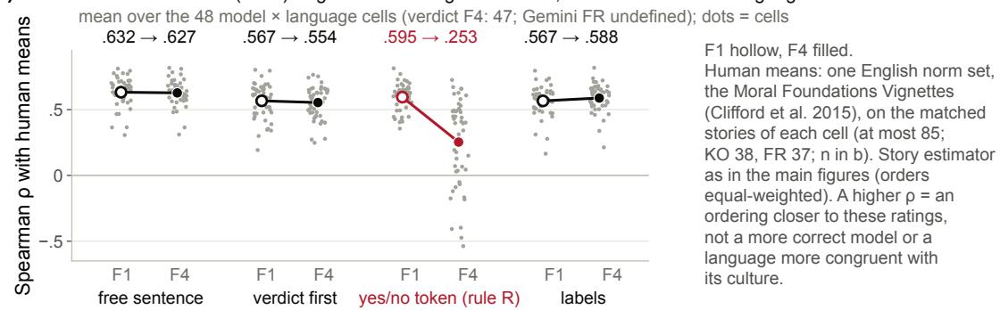

(b) plain polar question (F1)  
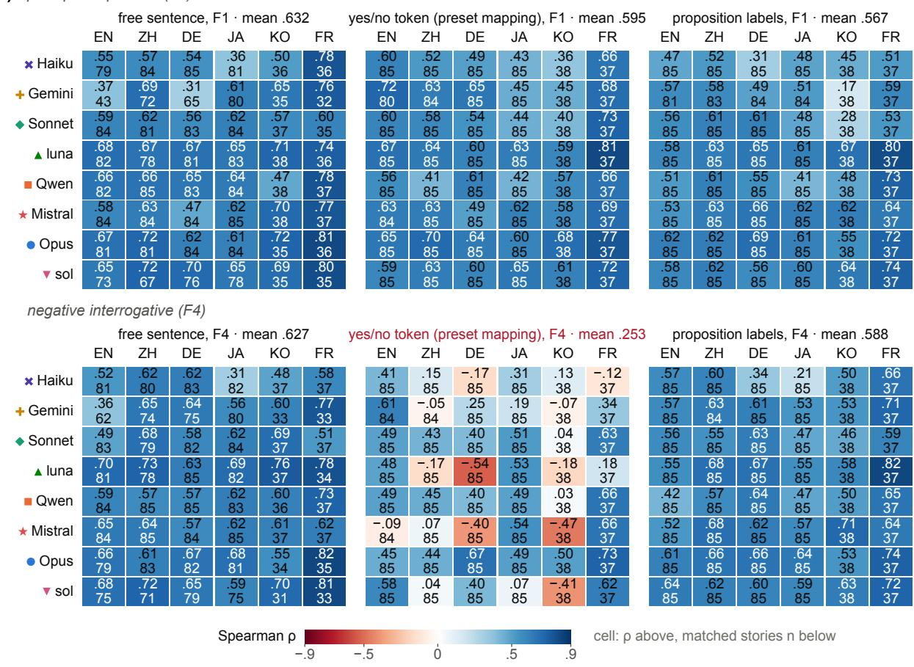  
Figure A6: Human reference. Spearman ρ between the balanced story scores and published MFV wrongness means (Cliford et al., 2015), using one English norm set for all languages and equal weighting of orders. (a) Mean ρ by readout and form, with cell values. (b) Plain questions and negative interrogatives for free sentences, yes/no tokens under the preset mapping, and proposition labels, with ρ above and matched-story count below. A higher correlation means an ordering closer to these ratings.

## A10 Mean-level views and consistency across readouts

Figure A10 complements the pairwise profile comparison with cell means and replication across readouts. The heat maps average each cell’s available stories and print that support beneath the mean. The variance decomposition instead fixes a common story set across models and the four languages with the broader coverage. Table 6 records the pairwise class estimates and the fixed-support sensitivity check, preserving their diferent units of aggregation.

For English, Chinese, German, and Japanese, model diferences account for 0.84 of the

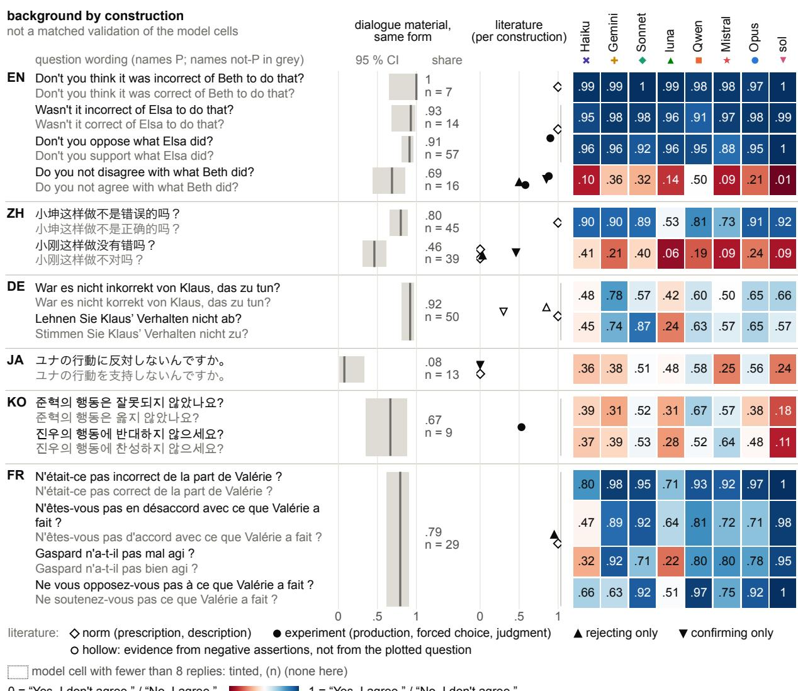  
0 = “Yes, I don't agree.” / “No, I agree.” 1 = “Yes, I agree.” / “No, I don't agree.” 0 1  
Dialogue material: particle-initial answers to negative questions, same surface form and token lists; band = 95 % Wilson interval, tick = share; a band over several rows serves all of them. Literature: the polarity share each source implies, one marker per source, placed on the wordings its construction covers (bracket = several wordings). Model cells: 70–824 judged replies each.

Figure A7: Dialogue-corpus and literature background by construction. Particle-initial answers from transcribed conversation, subtitles, scenario-based meetings, crowdsourced dialogue, and institutional exchanges use the same surface forms and receive judge labels, with small samples. Literature anchors distinguish constructions; hollow experimental markers show evidence from negative assertions. The display supplies background for Figure 5 rather than a matched human validation of the model cells.

proposition-label mean matrix’s variance. The corresponding share for free sentences is 0.81. Language main efects are small in these commonstory matrices, while the interaction retains diferences specific to a model and language. These mean-level summaries complement the story-profile comparison because averaging over stories removes the item structure that identifies a model.

The replication panels use one observation for each model and language pair. The cross-language story-level correlations under labels and free sentences correlate at 0.59; the residual-profile correlations correlate at 0.33. The signed mean language shifts reproduce less closely across these readouts. The final panel splits each cell’s concept pairs into two subsets (two and two, or one and two for Japanese, which has three pairs) and reports the correlation between the two subsets’ story profiles, uncorrected, as a reference for how much profile structure repeats within each readout.

Table 6 adds two readings of the same cell structure. The nearest-neighbor block treats each cell as an unlabeled profile: under residual r, 39 of the 48 proposition-label cells have another language of the same model as their closest other cell, against 5 labels F1 (upper) free F1 (lower) 10–90 % (not in the data for residual r) dot = median over single-pair story vectors; n = vector pairs (labels / free)

(a)
<table><tr><td></td><td>pair</td><td>question names P (the reference term)</td><td>question names not-P (the opposite term)</td></tr><tr><td rowspan="5">EN</td><td>oppose</td><td>Do you oppose what Tina did?</td><td>Do you support what Tina did?</td></tr><tr><td>incorrect</td><td>Do you think it was incorrect of Tina to do that?</td><td>Do you think it was correct of Tina to do that?</td></tr><tr><td>disagree</td><td>Do you disagree with what Tina did?</td><td>Do you agree with what Tina did?</td></tr><tr><td>wrong</td><td>Was what Tina did wrong?</td><td>Was what Tina did right?</td></tr><tr><td></td><td></td><td>小健这样做对吗？</td></tr><tr><td rowspan="5">ZH</td><td>cuo zhichi</td><td>小健这样做错吗？ 你反对小健这么做吗？</td><td>你支持小健这么做吗？</td></tr><tr><td>cuowu</td><td>你觉得小健这样做是错误的吗？</td><td>你觉得小健这样做是正确的吗？</td></tr><tr><td>fandui</td><td>你反对小健的做法吗？</td><td>你同意小健的做法吗？</td></tr><tr><td>falsch</td><td></td><td></td></tr><tr><td>DE ablehnen</td><td>Finden Sie, dass Marions Verhalten falsch war?</td><td>Finden Sie, dass Marions Verhalten richtig war? Stimmen Sie Marions Verhalten zu?</td></tr><tr><td rowspan="4">JA</td><td>unterstuetzen</td><td>Lehnen Sie Marions Verhalten ab? Lehnen Sie Marions Verhalten ab?</td><td>Unterstützen Sie Marions Verhalten?</td></tr><tr><td>inkorrekt</td><td>War es inkorrekt von Marion, das zu tun?</td><td>War es korrekt von Marion, das zu tun?</td></tr><tr><td></td><td></td><td></td></tr><tr><td>shiji</td><td>あなたはシンジの行動に反対しますか。</td><td>あなたはシンジの行動を支持しますか。</td></tr><tr><td rowspan="4">KO</td><td>hantai</td><td>シンジの行動に反対ですか。 シンジの行動は間違っていると思いますか。</td><td>シンジの行動に賛成ですか。 シンジの行動は正しいと思いますか。</td></tr><tr><td>machigai</td><td></td><td></td></tr><tr><td>teullida bandae</td><td></td><td></td></tr><tr><td>jalmot</td><td></td><td></td></tr><tr><td rowspan="4">FR</td><td>j</td><td></td><td></td></tr><tr><td>desaccord</td><td>Êtes-vous en désaccord avec ce que Margot a fait ?</td><td>Êtes-vous d&#x27;accord avec ce que Margot a fait?</td></tr><tr><td>soutenir</td><td></td><td></td></tr><tr><td></td><td>Vous opposez-vous à ce que Margot a fait ?</td><td>Soutenez-vous ce que Margot a fait ?</td></tr><tr><td rowspan="2"></td><td>mal</td><td>Est-ce que Margot a mal agi ?</td><td>Est-ce que Margot a bien agi ?</td></tr><tr><td>incorrect</td><td>Était-ce incorrect de la part de Margot ?</td><td>Était-ce correct de la part de Margot ?</td></tr></table>

(b)  
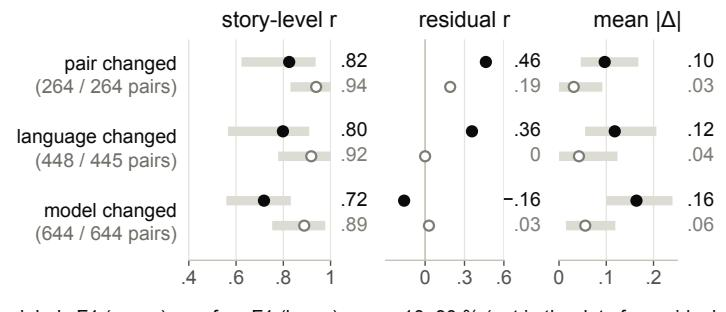

(c)  
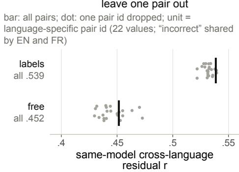  
Figure A8: Concept pairs. Questions naming either term of the 23 language-specific pairs; wording sensitivity when changing pair, language, or model on single-pair story vectors; and leave-one-pair-out stability of the same model cross-language residual correlation. Orders are equally weighted. The leave-one-pair-out analysis has 22 units because the English and French pairs named incorrect are removed together.

expected by chance, and the five same-model cells rank on average 5.7th among a cell’s 47 neighbors. Under free sentences the count falls to 15 of 48. The story-group block recomputes the class means on acceptable, contested, and violation stories separately, over pairs with at least eight common stories of that group. The same-model advantage in story-level correlation is largest on acceptable stories (0.79 against 0.69), present on contested stories (0.70 against 0.62), and absent on violations (0.43 against 0.46), where every cell condemns the act; the mean absolute story diference and the residual correlation keep the same-model advantage in every group. The overall story-level correlations of 0.88 and 0.81 are therefore raised by the structure that every cell shares across groups, while the model signature lives in the stories on which models disagree.

## A11 Parsing audit

Figure A11 distinguishes an unreadable opening from a disagreement between a readable opening and the judged sentence. Readability is measured over generated replies. Disagreement is measured over replies for which both readings are decisive, with equal weight assigned to model  language cells in the figure’s summary. Table 7 retains the reply denominators alongside the judging audits.

The extension to the fixed verdict-word rule consists of four stated operations. It recognises inflected and polite forms of listed words, reads preposed negation immediately before a listed term, recognises derived adverbs, and reverses a previously readable term when the following negation changes its polarity. For example, 反対しません (hantai shimasen, “I do not oppose”) is read as a negated verdict instead of the unnegated 反対 (han-(c) where intermediate story scores come from, plain question (F1) share of comparisons whose two decisive values differ, at each level of the aggregation

(a)  
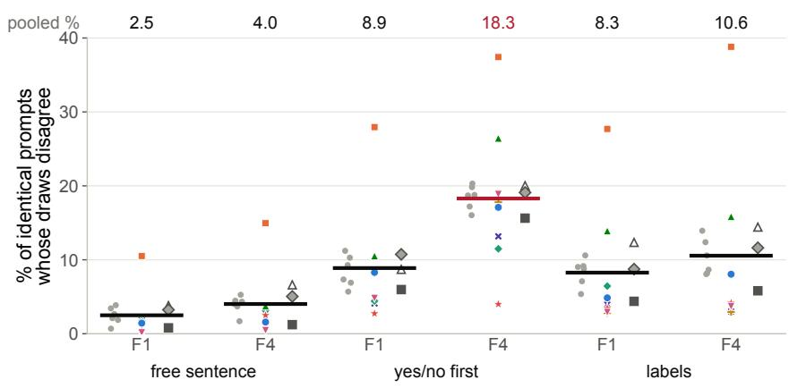

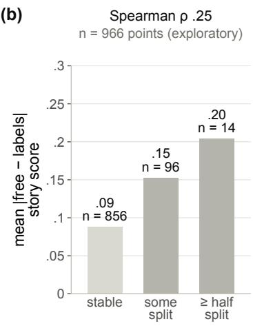  
lree one language (left) one model (centre, model markers) stratum (right): acceptable contested violation bar = all prompts pooled; three draws of the identical prompt, all three decisive; red: yes/no token after a negative interrogative

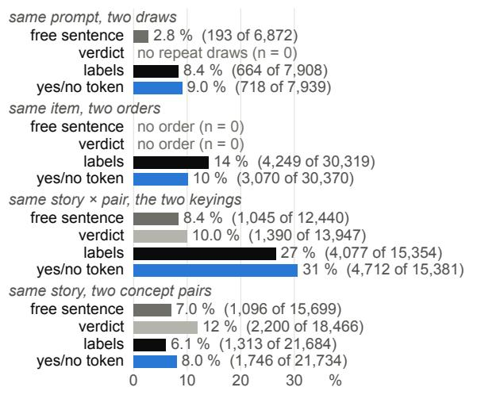  
Figure A9: Repetition and aggregation stability. (a) Share of identical prompts whose three decisive generations disagree, by answer constraint, question form, language, model, and story group. (b) Stories with unstable generations also disagree more between readouts; the relationship is exploratory and uses shared sampling. (c) Sources of intermediate story scores under plain questions: repeated generations, option orders, named terms, and concept pairs, followed by the share of story scores at either endpoint.

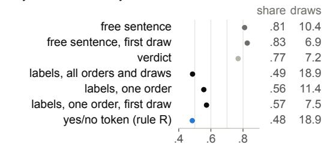  
one value per story score, all model × language cells; free and verdict: judged sentence (undecided excluded); draws = mean replies behind a story score; colours as on the left

tai, “oppose”). Evaluative words outside the listed vocabulary and replies that begin with a full sentence remain for the sentence judge.

The extension raises overall verdict-opener readability from 0.66 to 0.68. It also changes readings that the original prefix rule had assigned to unnegated terms. Among Japanese plain-question verdict replies, the resulting readout disagreement decreases from 12.5% to 1.2%. The beforeand-after values in Figure A11 distinguish these changes in reading from the additional replies that become readable.

unreadable by the rule. Figure A11b starts from the original unreadable pool and identifies the portion recovered by the extension. Its bracketed legend reports the composition of the remaining unreadable pool under the extended rule. The bar segments use the original unreadable pool as their denominator, whereas the legend describes what remains unreadable after the extension.

The reason categories describe the openings left

mean judgment s, labels, F1  
(a)  
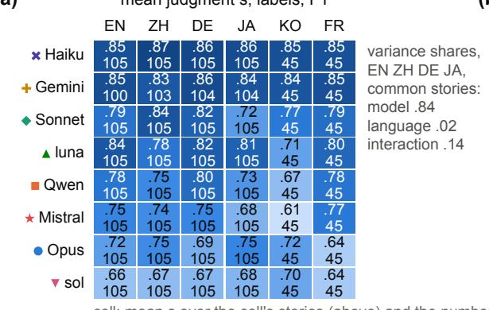

(b) mean judgment s, free sentence, F1  
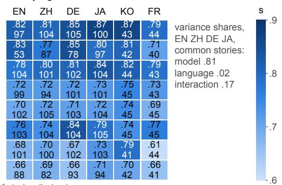  
cell: mean s over the cell's stories (above) and the number of stories (below)

(c) one point per model × language pair (120); labels (x) vs free sentences (y), plain question  
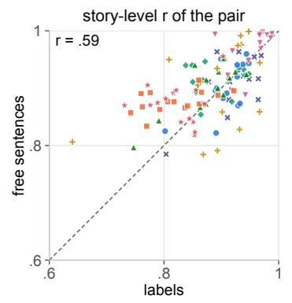

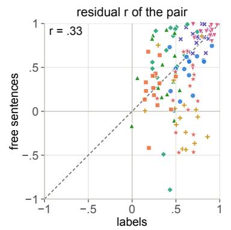

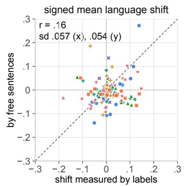

(d) concept-pair split-half correlation (uncorrected): median and 10–90 % over the 48 cells  
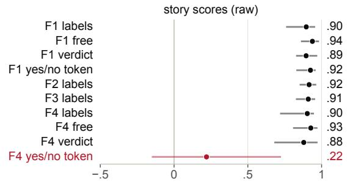

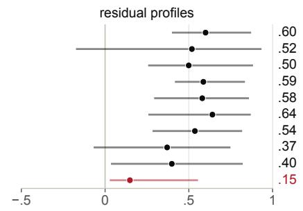  
Figure A10: Mean-level views. Cell-mean heat maps with story counts; common-story variance shares for the four languages with broader coverage; signed mean language shifts under labels and free sentences; and replication of each model’s language-pair correlations across those readouts. The final panel gives concept-pair split-half correlations, uncorrected, as a reference for repeated measurement within a readout.

<table><tr><td>Class of cell pairs</td><td>Pairs</td><td></td><td>Story-level r</td><td>Residual r</td><td></td><td>Mean |∆|</td></tr><tr><td colspan="7">Proposition labels</td></tr><tr><td>Same model, different language</td><td>120</td><td></td><td>0.88[0.83, 0.91]</td><td>0.56[0.51,0.60]</td><td></td><td>0.10[0.09, 0.11] 0.15[0.13, 0.17]</td></tr><tr><td>Same language, different model</td><td>168</td><td></td><td>0.81[0.75, 0.86]</td><td>-0.12[-0.13, −0.11]</td><td></td><td></td></tr><tr><td>Both different</td><td>840</td><td></td><td>0.79[0.71, 0.84]</td><td>-0.06[-0.07, -0.05]</td><td></td><td>0.16[0.14, 0.18]</td></tr><tr><td>Class difference</td><td></td><td></td><td></td><td></td><td>+0.075[+0.047, +0.096] +0.677[+0.627, +0.718] -0.052[−0.065, -0.040]</td><td></td></tr><tr><td colspan="7">Free sentence Same model, different language</td></tr><tr><td>Same language, different model</td><td>120</td><td></td><td>0.90[0.86, 0.93]</td><td>0.45[0.22, 0.52] -0.12[−0.12, −0.02]</td><td></td><td>0.07[0.05, 0.09] 0.09[0.07,0.12]</td></tr><tr><td>Both different</td><td>168</td><td></td><td>0.87[0.82, 0.90] 0.84[0.78, 0.89]</td><td>-0.06[−0.06, 0.02]</td><td></td><td>0.11[0.07,0.14]</td></tr><tr><td>Class difference</td><td>840</td><td>+0.037[+0.011, +0.068]</td><td></td><td>+0.573[+0.281, +0.629]</td><td></td><td>-0.020[-0.035, -0.008]</td></tr><tr><td></td><td></td><td></td><td></td><td></td><td></td><td></td></tr><tr><td colspan="7">Story-level r Readout Languages Same model Same language</td></tr><tr><td>Proposition labels EN/ZH/DE/JA</td><td></td><td>Stories Cells 32</td><td></td><td>0.832</td><td>Same model Same language 0.078</td><td></td></tr><tr><td></td><td>All languages</td><td>100 17</td><td>0.907 48 0.844</td><td>0.734</td><td>0.116</td><td>0.133 0.190</td></tr><tr><td>Free sentence</td><td>EN/ZH/DE/JA</td><td>46</td><td>32 0.981</td><td></td><td>0.972</td><td>0.020</td></tr><tr><td></td><td></td><td></td><td></td><td></td><td></td><td></td></tr><tr><td colspan="7">Nearest cell is the same model (of 48; chance 5) Mean rank of same-model cells (of 47; chance 24)</td></tr><tr><td>Readout 25</td><td>Story r Residual r 39</td><td></td><td>Mean |∆|</td><td>Story r Residual r</td><td></td><td>Mean |∆|</td></tr><tr><td>Proposition labels Free sentence</td><td></td><td></td><td>30 10</td><td>9.9 13.7</td><td>5.7 12.8</td><td>9.9 13.5</td></tr><tr><td></td><td>15</td><td></td><td></td><td></td><td></td><td></td></tr><tr><td colspan="7">Story-level r Mean |∆|</td></tr><tr><td>Story group (proposition labels) Same model Same language</td><td></td><td></td><td></td><td>Same model Same language</td><td></td><td>Same model Same language</td></tr><tr><td>Acceptable</td><td>0.79 0.70</td><td></td><td>0.69</td><td>0.14 0.25</td><td>0.54 0.43</td><td>-0.13</td></tr><tr><td>Contested Violation</td><td>0.43</td><td></td><td>0.62</td><td>0.09</td><td>0.14 0.06</td><td>-0.09 -0.10</td></tr><tr><td></td><td></td><td></td><td>0.46</td><td>0.05</td><td></td><td></td></tr></table>

Table 6: Cell-pair classes for plain questions. The first block gives class means and 95% story-bootstrap intervals on pairwise-common stories; diferences subtract the same-language class from the same-model class and use a joint bootstrap. The second block fixes the story set across every included cell; the free-sentence readout has only seven stories common to all languages, so that estimate is omitted. The third block treats each cell as an unlabeled profile and asks which other cell it resembles most, and where its five same-model cells rank among its 47 neighbors. The fourth block recomputes the class means on the stories of one group, over pairs with at least eight common stories of that group. Models and languages are fixed. Within-language residual centring constrains the same-language residual class.

verdict word by model (rows F1–F4 as on the left)

(a) share of generated replies whose opening word the rule reads
<table><tr><td rowspan=1 colspan=9>EN  ZH DE  JA  KO  FR   allverdict wordrule R+; rule R below where they differ by ≥ .01</td></tr><tr><td rowspan=3 colspan=1>F1F2F3</td><td rowspan=1 colspan=1>.72</td><td rowspan=1 colspan=1>.94</td><td rowspan=1 colspan=1>.60</td><td rowspan=1 colspan=1>.76R .72</td><td rowspan=1 colspan=1>.67R .64</td><td rowspan=1 colspan=1>.45</td><td></td><td rowspan=1 colspan=1>.72R.71</td></tr><tr><td rowspan=1 colspan=1>.82</td><td rowspan=1 colspan=1>.71</td><td rowspan=1 colspan=1>.46</td><td rowspan=1 colspan=1>.89R .72</td><td rowspan=1 colspan=1>.68R .54</td><td rowspan=1 colspan=1>.46</td><td></td><td rowspan=1 colspan=1>.68R .64</td></tr><tr><td rowspan=1 colspan=1>.68R .66</td><td rowspan=1 colspan=1>.93</td><td rowspan=1 colspan=1>.49R .47</td><td rowspan=1 colspan=1>.89R .75</td><td rowspan=1 colspan=1>.61R .52</td><td rowspan=1 colspan=1>.44</td><td></td><td rowspan=1 colspan=1>.70R .66</td></tr><tr><td rowspan=1 colspan=1>F4</td><td rowspan=1 colspan=1>.67</td><td rowspan=1 colspan=1>.87</td><td rowspan=1 colspan=1>.53</td><td rowspan=1 colspan=1>.65R .61</td><td rowspan=1 colspan=1>.57R .53</td><td rowspan=1 colspan=1>.35</td><td></td><td rowspan=1 colspan=1>.64R .63</td></tr></table>

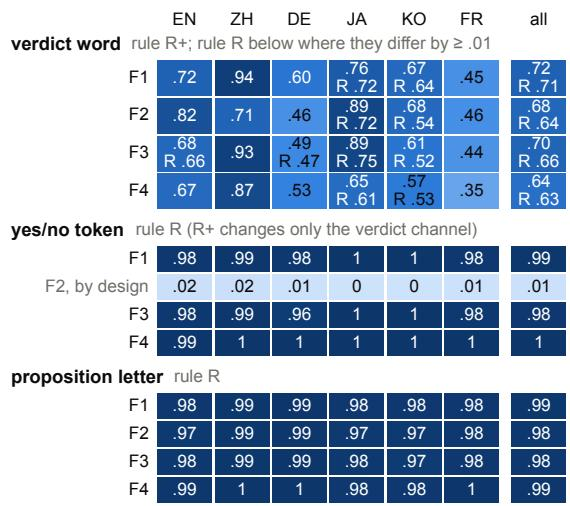

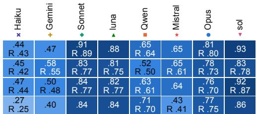

<table><tr><td colspan="3">R → R+, verdict word, all forms</td></tr><tr><td>readable openers, R → R+</td><td></td><td>added re-read</td></tr><tr><td>EN</td><td>19,226 → 19,370</td><td>+144</td></tr><tr><td>ZH</td><td>23,104 → 23,125</td><td>+21</td></tr><tr><td>DE</td><td>13,767 → 13,929</td><td>+162</td></tr><tr><td>JA</td><td>14,073 → 16,097</td><td>+2,024</td></tr><tr><td>KO</td><td>6,414 → 7,264</td><td>1,549 +850 34</td></tr><tr><td>FR</td><td>4,900 → 4,929</td><td>+29</td></tr><tr><td>all</td><td>81,484 → 84,714</td><td>+3,230 1,583</td></tr></table>

added readings ≠ judged sentence: 35 of 3,151 (1.1 %) re-read readings ≠ judged sentence: 6 of 1,541 (0.4 %) (replies with both readings decisive)

(b) why a verdict opener is unreadable under rule R: share of the unreadable openers, classified from the text  
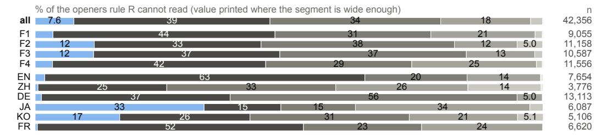  
categories (in brackets: share of what stays unreadable under R+):  
R+ reads (inflection / negation / adverb): R+ reads them (7.6 % of the R-unreadable) evaluative word outside the lexicon (42 %) sentence-first (no opener) (36 %) adverb / hedge opener (19 %) particle in verdict slot (2.5 %) empty / refusal (0.2 %)

(c) fixed decoder vs judged sentence: % of the replies with both readings decisive whose opening word is read differently
<table><tr><td rowspan=3 colspan=14>Haiiiluu    Gemini   Sonet    lu    wen   *Mstrarl   sndo •+verdict word (rule R+; ; grey  tick: rule R)</td><td rowspan=5 colspan=4>men on ocel|OS  poled   n2.221,193</td></tr><tr><td rowspan=1 colspan=1></td><td rowspan=1 colspan=1>EN</td><td rowspan=1 colspan=1>ZH</td><td rowspan=1 colspan=2>DEJA</td><td rowspan=1 colspan=1>KO</td><td rowspan=1 colspan=1>FR</td></tr><tr><td rowspan=1 colspan=1>verdict wo</td><td rowspan=1 colspan=1>d (rule</td><td rowspan=1 colspan=1>R+; gre</td><td rowspan=1 colspan=2>tick: rule R)</td><td rowspan=1 colspan=1></td><td rowspan=1 colspan=1></td></tr><tr><td rowspan=2 colspan=1>F1</td><td rowspan=2 colspan=1>1.3</td><td rowspan=2 colspan=1>3.7</td><td rowspan=2 colspan=1>1.7</td><td rowspan=2 colspan=1>1.2</td><td rowspan=2 colspan=1>2.4</td><td rowspan=2 colspan=1>2.3</td><td rowspan=2 colspan=1>4.5</td><td rowspan=2 colspan=1>4.2</td><td rowspan=2 colspan=1>0.7</td><td rowspan=2 colspan=1>2.1</td><td rowspan=2 colspan=1>4.7</td><td rowspan=2 colspan=1>1.9</td><td rowspan=2 colspan=1>1.4</td><td rowspan=2 colspan=1>0.6</td></tr><tr><td rowspan=1 colspan=1>2.2</td></tr><tr><td rowspan=1 colspan=1>F2</td><td rowspan=1 colspan=1>0.5</td><td rowspan=1 colspan=1>0.1</td><td rowspan=1 colspan=1>1.2</td><td rowspan=1 colspan=1>0.3</td><td rowspan=1 colspan=1>1.7</td><td rowspan=1 colspan=1>4.0</td><td rowspan=1 colspan=1>0.1</td><td rowspan=1 colspan=1>0.1</td><td rowspan=1 colspan=1>0.2</td><td rowspan=1 colspan=1>0.3</td><td rowspan=1 colspan=1>5.7</td><td rowspan=1 colspan=1>0.0</td><td rowspan=1 colspan=1>0.4</td><td rowspan=1 colspan=1>0.6</td><td rowspan=1 colspan=1>1.3</td><td rowspan=1 colspan=1>0.8</td><td rowspan=1 colspan=1>20,530</td></tr><tr><td rowspan=1 colspan=1>F3</td><td rowspan=1 colspan=1>1.</td><td rowspan=1 colspan=1>1 4.4</td><td rowspan=1 colspan=1>3.0</td><td rowspan=1 colspan=1>0.4</td><td rowspan=1 colspan=1>2.9</td><td rowspan=1 colspan=1>_ 3.3</td><td rowspan=1 colspan=1>3.3</td><td rowspan=1 colspan=1>4.1</td><td rowspan=1 colspan=1>0.</td><td rowspan=1 colspan=1>42.5</td><td rowspan=1 colspan=1>5.0</td><td rowspan=1 colspan=1>ı3.5</td><td rowspan=1 colspan=1>1.6</td><td rowspan=1 colspan=1>1.0</td><td rowspan=1 colspan=2>2.5 2.5</td><td rowspan=1 colspan=1>20,780</td></tr><tr><td rowspan=1 colspan=1>F4</td><td rowspan=1 colspan=1>11</td><td rowspan=1 colspan=1>|27</td><td rowspan=1 colspan=1>14</td><td rowspan=1 colspan=1>|7.2</td><td rowspan=1 colspan=1>15</td><td rowspan=1 colspan=1>3.6</td><td rowspan=1 colspan=1>12</td><td rowspan=1 colspan=1>16</td><td rowspan=1 colspan=1>9.0</td><td rowspan=1 colspan=1>21</td><td rowspan=1 colspan=1>13</td><td rowspan=1 colspan=1>|24</td><td rowspan=1 colspan=1>16</td><td rowspan=1 colspan=1>15</td><td rowspan=1 colspan=2>12 16</td><td rowspan=1 colspan=1>18,737</td></tr><tr><td rowspan=1 colspan=1>yes/no toke</td><td rowspan=1 colspan=1>n (rule</td><td rowspan=1 colspan=1>R)</td><td rowspan=1 colspan=2></td><td rowspan=1 colspan=1></td><td rowspan=1 colspan=1></td><td rowspan=1 colspan=1></td><td rowspan=1 colspan=1></td><td rowspan=1 colspan=1></td><td rowspan=1 colspan=1></td><td rowspan=1 colspan=1></td><td rowspan=1 colspan=1></td><td rowspan=1 colspan=1></td><td rowspan=1 colspan=1></td><td rowspan=2 colspan=2>3.3 3.2</td><td rowspan=2 colspan=1>71,481</td></tr><tr><td rowspan=1 colspan=1>F1</td><td rowspan=1 colspan=1>1.7</td><td rowspan=1 colspan=1>2.3</td><td rowspan=1 colspan=1>3.9</td><td rowspan=1 colspan=1>4.4</td><td rowspan=1 colspan=1>6.1</td><td rowspan=1 colspan=1>1.8</td><td rowspan=1 colspan=1>1.2</td><td rowspan=1 colspan=1>5.7</td><td rowspan=1 colspan=1>1.0</td><td rowspan=1 colspan=1>1.7</td><td rowspan=1 colspan=1>7.7</td><td rowspan=1 colspan=1>5.4</td><td rowspan=1 colspan=1>2.0</td><td rowspan=1 colspan=1>0.7</td></tr><tr><td rowspan=1 colspan=1>F2</td><td rowspan=1 colspan=1>0.0 (3)</td><td rowspan=1 colspan=1>0.0</td><td rowspan=1 colspan=1>0.0 (5)</td><td rowspan=1 colspan=1></td><td rowspan=1 colspan=1></td><td rowspan=1 colspan=1>0.0(1)</td><td rowspan=1 colspan=1>0.0 (1)</td><td rowspan=1 colspan=1>0.0 (3)</td><td rowspan=1 colspan=1>0.0 (3)</td><td rowspan=1 colspan=1></td><td rowspan=1 colspan=1>0.0 (2)</td><td rowspan=1 colspan=1></td><td rowspan=1 colspan=1>0.0</td><td rowspan=1 colspan=1></td><td rowspan=1 colspan=2>一 0.0</td><td rowspan=1 colspan=1>17</td></tr><tr><td rowspan=1 colspan=1>F3</td><td rowspan=1 colspan=1>1.5</td><td rowspan=1 colspan=1>6.5</td><td rowspan=1 colspan=1>6.6</td><td rowspan=1 colspan=1>8.5</td><td rowspan=1 colspan=1>9.8</td><td rowspan=1 colspan=1>1.8</td><td rowspan=1 colspan=1>7.3</td><td rowspan=1 colspan=1>9.1</td><td rowspan=1 colspan=1>1.7</td><td rowspan=1 colspan=1>2.3</td><td rowspan=1 colspan=1>8.3</td><td rowspan=1 colspan=1>9.6</td><td rowspan=1 colspan=1>2.8</td><td rowspan=1 colspan=1>0.5</td><td rowspan=1 colspan=2>5.3 5.5</td><td rowspan=1 colspan=1>2,565</td></tr><tr><td rowspan=1 colspan=1>F4</td><td rowspan=1 colspan=1>20</td><td rowspan=1 colspan=1>38</td><td rowspan=1 colspan=1>32</td><td rowspan=1 colspan=1>35</td><td rowspan=1 colspan=1>44</td><td rowspan=1 colspan=1>18</td><td rowspan=1 colspan=1>38</td><td rowspan=1 colspan=1>27</td><td rowspan=1 colspan=1>21</td><td rowspan=1 colspan=1>45</td><td rowspan=1 colspan=1>26</td><td rowspan=1 colspan=1>32</td><td rowspan=1 colspan=1>26</td><td rowspan=1 colspan=1>36</td><td rowspan=1 colspan=2>31 31</td><td rowspan=1 colspan=1>71,282</td></tr><tr><td rowspan=1 colspan=1>proposition</td><td rowspan=1 colspan=1>letter</td><td rowspan=1 colspan=1></td><td rowspan=1 colspan=1></td><td rowspan=1 colspan=1></td><td rowspan=1 colspan=1></td><td rowspan=1 colspan=1></td><td rowspan=1 colspan=1></td><td rowspan=1 colspan=1></td><td rowspan=1 colspan=1></td><td rowspan=1 colspan=1></td><td rowspan=1 colspan=1></td><td rowspan=1 colspan=1></td><td rowspan=1 colspan=1></td><td rowspan=1 colspan=1></td><td rowspan=1 colspan=2></td><td rowspan=1 colspan=1></td></tr><tr><td rowspan=1 colspan=1>F1</td><td rowspan=1 colspan=1>0.0</td><td rowspan=1 colspan=1>0.0</td><td rowspan=1 colspan=1>0.0</td><td rowspan=1 colspan=1>0.0</td><td rowspan=1 colspan=1>0.0</td><td rowspan=1 colspan=1>0.0</td><td rowspan=1 colspan=1>0.0</td><td rowspan=1 colspan=1>0.0</td><td rowspan=1 colspan=1>0.0</td><td rowspan=1 colspan=1>0.0</td><td rowspan=1 colspan=1>0.0</td><td rowspan=1 colspan=1>0.0</td><td rowspan=1 colspan=1>0.0</td><td rowspan=1 colspan=1>0.0</td><td rowspan=1 colspan=2>0.0 0.0</td><td rowspan=1 colspan=1>3,169</td></tr><tr><td rowspan=1 colspan=1>F2</td><td rowspan=1 colspan=1>0.1</td><td rowspan=1 colspan=1>0.0</td><td rowspan=1 colspan=1>0.0</td><td rowspan=1 colspan=1>0.6</td><td rowspan=1 colspan=1>0.0</td><td rowspan=1 colspan=1>0.0</td><td rowspan=1 colspan=1>0.2</td><td rowspan=1 colspan=1>0.0</td><td rowspan=1 colspan=1>0.2</td><td rowspan=1 colspan=1>0.0</td><td rowspan=1 colspan=1>0.0</td><td rowspan=1 colspan=1>0.0</td><td rowspan=1 colspan=1>0.0</td><td rowspan=1 colspan=1>0.0</td><td rowspan=1 colspan=1>0.1</td><td rowspan=1 colspan=1>0.1</td><td rowspan=1 colspan=1>2,825</td></tr><tr><td rowspan=1 colspan=1>F3</td><td rowspan=1 colspan=1>0.4</td><td rowspan=1 colspan=1>0.0</td><td rowspan=1 colspan=1>0.0</td><td rowspan=1 colspan=1>0.0</td><td rowspan=1 colspan=1>0.0</td><td rowspan=1 colspan=1>0.0</td><td rowspan=1 colspan=1>0.3</td><td rowspan=1 colspan=1>0.0</td><td rowspan=1 colspan=1>0.0</td><td rowspan=1 colspan=1>0.0</td><td rowspan=1 colspan=1>0.0</td><td rowspan=1 colspan=1>0.0</td><td rowspan=1 colspan=1>0.0</td><td rowspan=1 colspan=1>0.0</td><td rowspan=1 colspan=1>0.0</td><td rowspan=1 colspan=2>0.1 2,685</td></tr><tr><td rowspan=1 colspan=1>F4</td><td rowspan=1 colspan=1>0.1</td><td rowspan=1 colspan=1>0.0</td><td rowspan=1 colspan=1>0.0</td><td rowspan=1 colspan=1>0.5</td><td rowspan=1 colspan=1>0.0</td><td rowspan=1 colspan=1>0.3</td><td rowspan=1 colspan=1>0.0</td><td rowspan=1 colspan=1>0.0</td><td rowspan=1 colspan=1>0.2</td><td rowspan=1 colspan=1>0.4</td><td rowspan=1 colspan=1>0.4</td><td rowspan=1 colspan=1>0.0</td><td rowspan=1 colspan=1>0.0</td><td rowspan=1 colspan=1>0.4</td><td rowspan=1 colspan=1>0.2</td><td rowspan=1 colspan=2>0.1 3,235</td></tr></table>

bar = share in % on a 0–50 % scale across the cell (value printed; columns are the language and model marginals); grey tick = the rule R share of the verdict word where it differs from R+; tinted with (n): fewer than 8 replies; hatched: none (a yes/no does not answer an alternative question). Right, in %: mean of cells = mean over the model × language cells with ≥ 8 replies with both readings decisive (the convention of Fig. 2's disagreement panel), pooled = share over all such replies; n = those replies.

Figure A11: Parsing audit: the fixed decoder against the sentencejudge. (a) Opener readability by answer constraint, question form, language, and model under the fixed verdict-word rule and its extension. (b) Causes of unreadable verdict openings, with the portion recovered by the extension shown separately. (c) Readout disagreement on replies where both readings are decisive, by question form and language or model: the verdict word under the extended rule, with grey ticks for the original rule where it difers, the token and the letter under the fixed rule. The summary columns give the mean over model language cells, the pooled share, and n. Of the 71,282 negative-interrogative token replies, 21 opened with a verdict word rather than a particle (20 Chinese, 1 Japanese). Replies behind the series of Figure 2b: yes/no token 71,481 / 2,565 / 71,282 (F1 / F3 / F4; the token after an alternative question has 17 such replies and is not plotted); verdict word 21,193 / 20,530 / 20,780 / 18,737 (F1–F4); letter 3,169 / 2,825 / 2,685 / 3,235.

<table><tr><td>Audit against the primary sentence judge</td><td>Replies</td><td>Agreement</td><td>Interval</td><td>κ</td><td>Decisive-ref. n</td></tr><tr><td>GPT-6 astra, high</td><td>4590</td><td>95.5%</td><td>94.9–96.1%</td><td>0.90</td><td>4224</td></tr><tr><td>Claude Fable 5, high Same judge, repeated run</td><td>4530</td><td>97.2%</td><td>96.7–97.7%</td><td>0.94</td><td>4168</td></tr><tr><td>on identical prompts (set 1)</td><td>300</td><td>96.3%</td><td></td><td>0.92</td><td></td></tr><tr><td>Same judge, repeâted run on identical prompts (set 2)</td><td>300</td><td>97.7%</td><td></td><td>0.95</td><td></td></tr><tr><td>Native readers, 100 replies per language (Chinese, English, German, Japanese)</td><td>400</td><td>95.5%</td><td>93.0–97.1%</td><td>0.89</td><td>363</td></tr></table>

<table><tr><td></td><td colspan="3">GPT-6 astra, high</td><td colspan="3">Claude Fable 5, high</td></tr><tr><td>Stratum of the audited replies</td><td>n</td><td>Agreement</td><td>Opposite</td><td>n</td><td>Agreement</td><td>Opposite</td></tr><tr><td>All audited replies</td><td>4590</td><td>95.5%</td><td>10</td><td>4530</td><td>97.2%</td><td>9</td></tr><tr><td>Negative interrogative, all constraints</td><td>1225</td><td>95.1%</td><td>7</td><td>1209</td><td>96.7%</td><td>5</td></tr><tr><td>free sentence</td><td>394</td><td>94.7%</td><td>1</td><td>394</td><td>95.7%</td><td>1</td></tr><tr><td>verdict first</td><td>407</td><td>95.3%</td><td>2</td><td>407</td><td>97.1%</td><td>1</td></tr><tr><td>proposition labels</td><td>151</td><td>98.0%</td><td>2</td><td>149</td><td>98.7%</td><td>2</td></tr><tr><td>yes/no first</td><td>152</td><td>93.4%</td><td>2</td><td>143</td><td>96.5%</td><td>1</td></tr><tr><td>fixed rule and sentence disagree</td><td>47</td><td>93.6%</td><td>2</td><td>43</td><td>97.7%</td><td>1</td></tr></table>

<table><tr><td>Core strata (rule and primary label both decisive)</td><td colspan="2">Claude Fable 5, high Agreement</td><td colspan="2">Claude Opus 5.5, high</td><td colspan="2">Claude Sonnet 5, high</td></tr><tr><td></td><td>n</td><td></td><td>n</td><td>Agreement</td><td>n</td><td>Agreement</td></tr><tr><td>Negative interrogative, yes/no first: readings agree</td><td>955</td><td>96.5%</td><td>960</td><td>96.1%</td><td>903</td><td>98.0%</td></tr><tr><td>readings conflict</td><td>938</td><td>93.5%</td><td>953</td><td>92.8%</td><td>880</td><td>96.4%</td></tr><tr><td>Plain question, yes/no first: readings agree</td><td>475</td><td>98.9%</td><td>480</td><td>99.0%</td><td>457</td><td>98.9%</td></tr><tr><td>readings conflict</td><td>437</td><td>48.7%</td><td>447</td><td>49.0%</td><td>432</td><td>48.1%</td></tr><tr><td>Negative interrogative, verdict first (R+): agree</td><td>235</td><td>97.0%</td><td>240</td><td>97.5%</td><td>220</td><td>97.7%</td></tr><tr><td>readings conflict</td><td>178</td><td>91.0%</td><td>183</td><td>90.7%</td><td>165</td><td>90.9%</td></tr><tr><td>All core replies</td><td>3218</td><td>89.2%</td><td>3263</td><td>88.9%</td><td>3057</td><td>90.2%</td></tr></table>

<table><tr><td colspan="5"></td><td colspan="2">Readable opener (%)</td><td rowspan="2">Both decisive Extended rule</td></tr><tr><td>Constraint</td><td>Form</td><td>Generated</td><td>Judged</td><td>Sentence decisive</td><td>Fixed rule</td><td>Extended rule</td></tr><tr><td>Verdict first</td><td>F1</td><td>30960</td><td>30 960</td><td>29 023</td><td>70.8</td><td>71.8</td><td>21 193</td></tr><tr><td rowspan="5"></td><td>F2</td><td>30960</td><td>30 960</td><td>29 430</td><td>64.0</td><td>68.2</td><td>20530</td></tr><tr><td>F3</td><td>30960</td><td>30 960</td><td>29 323</td><td>65.8</td><td>69.7</td><td>20780</td></tr><tr><td>F4</td><td>30960</td><td>30 960</td><td>28590</td><td>62.7</td><td>64.0</td><td>18737</td></tr><tr><td>F1</td><td>77952</td><td>77952</td><td>71 883</td><td>98.8</td><td>98.8</td><td>71 481</td></tr><tr><td>F2</td><td>61 920</td><td>2737</td><td>2554</td><td>1.0</td><td>1.0</td><td>17</td></tr><tr><td rowspan="5">Proposition labels</td><td>F3</td><td>61 920</td><td>2728</td><td>2585</td><td>98.2</td><td>98.2</td><td>2565</td></tr><tr><td>F4</td><td>77952</td><td>77952</td><td>71 291</td><td>99.8</td><td>99.8</td><td>71 282</td></tr><tr><td>F1</td><td>77951</td><td>3211</td><td>3184</td><td>98.6</td><td>98.6</td><td>3169</td></tr><tr><td>F2</td><td>61 920</td><td>2 882 2733</td><td>2 838 2691</td><td>98.0 98.2</td><td>98.0</td><td>2 825</td></tr><tr><td>F3</td><td>61919</td><td></td><td></td><td></td><td>98.2</td><td>2685</td></tr><tr><td></td><td>F4</td><td>77952</td><td>3253</td><td>3247</td><td>99.2</td><td>99.2</td><td>3 235</td></tr></table>

Table 7: Judge audits and opener coverage. Audit intervals are 95% intervals; each test–retest set repeats the judge on 300 negative-interrogative yes/no-first replies, 50 per language, with one and three flips between the reference proposition and its opposite. The native readers’ labels agree with the astra labels on 93.0% and with the Fable labels on 95.4% of the same replies, and no decisive reader label opposes a decisive machine label. The stratum block gives agreement with the primary judge and the number of replies on which the two judges assert opposite decisive propositions (“Opposite”); the audited negative-interrogative yes/no-first replies number 19–33 per language. The core-strata block re-judges, with three Claude judge configurations at high reasoning efort, a seeded sample of replies on which the fixed rule and the primary sentence label are both decisive, drawn per model language cell and split by whether the two readings agree or conflict; agreement is with the primary label, so on conflict rows it is the share of replies on which the audit judge upholds the sentence reading against the fixed rule. Over all audited replies, the remaining disagreements move a reply between a decisive and an undecided category (134 and 42 for astra; 47 and 54 for Fable) or between the two undecided categories (19; 15). Coverage includes the three constraints shown, excluding a 13 824-reply control stratum. Readability divides readable openers by generated replies. The extension changes the verdict-word rule; alternative-question particles are unreadable by design. Both decisive requires a decisive sentence and a readable opener. Forms: F1 plain polar, F2 alternative, F3 or-not, F4 negative interrogative.