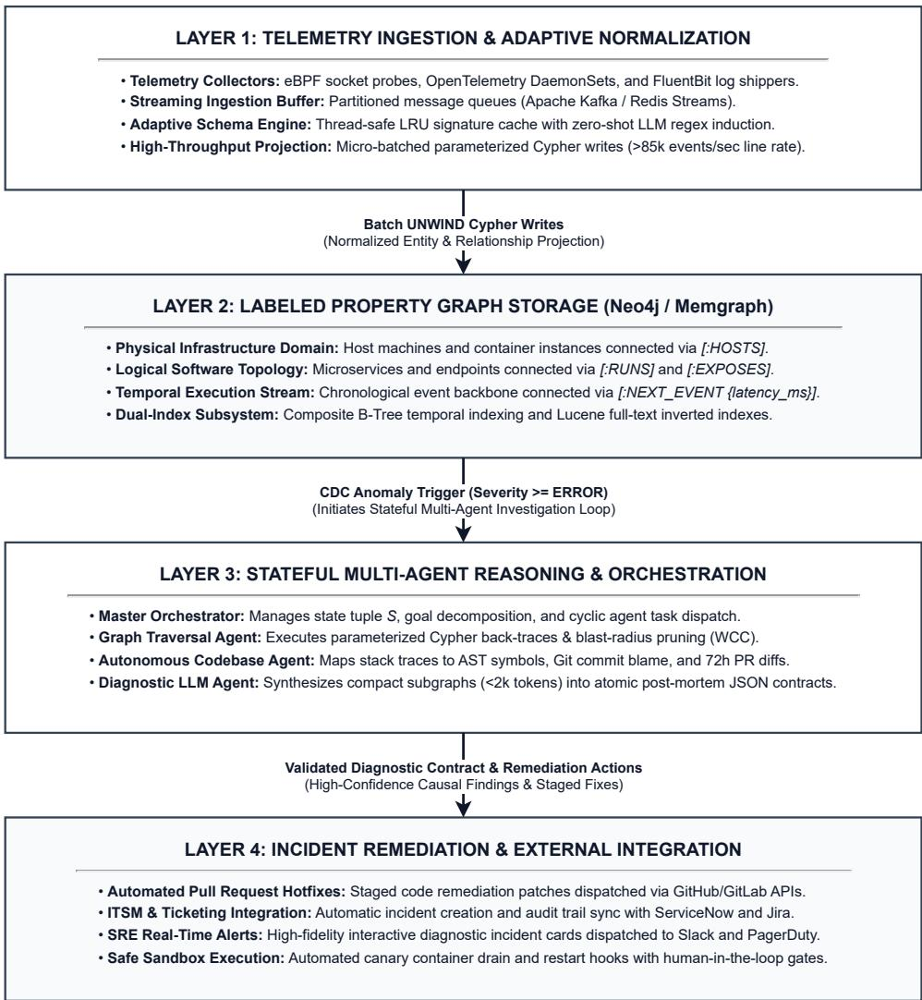
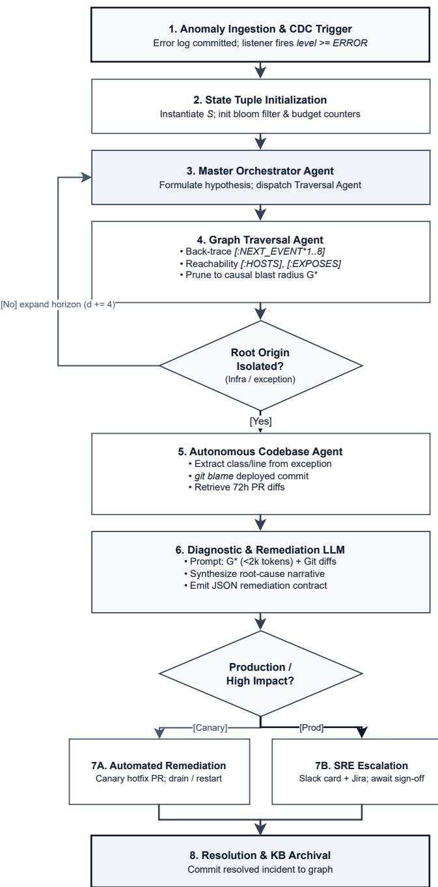
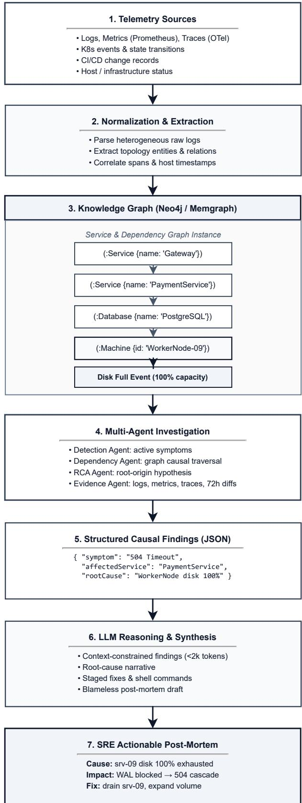

# Semantic Observability for Autonomous Systems Diagnostics

Jitendra Solanki

Siemens Corporation

Anand Todkar

Princeton, NJ, USA

Ziran Min

Siemens Corporation

Princeton, NJ, USA

Siemens Corporation

Princeton, NJ, USA

Abstract—Modern distributed microservice deployments generate massive volumes of heterogeneous, multi-format observability logs across physically and logically partitioned infrastructure. Isolating root causes during cascading failures remains an arduous, cognitively demanding task for Site Reliability Engineers (SREs), heavily bottlenecked by manual keyword filtering and disjointed temporal correlation across distinct monitoring dashboards. We introduce Semantic Observability, an autonomous multi-agent framework that unifies disparate log streams into a dynamic, queryable Property Graph Database. By modeling physical infrastructure topologies, logical software dependencies, and chronological event sequences as attributed nodes and directed relations, Semantic Observability bridges the semantic gap inherent in flat, unstructured log repositories. Building upon this unified substrate, we deploy a stateful multi-agent system orchestrated through Directed Cyclic Graphs (DCGs). The system autonomously navigates the topology, applying causal graph algorithms and temporal back-traversal to isolate the precise blast radius of anomalies. The structurally pruned subgraph is then interpreted by a Large Language Model (LLM) reasoning engine to generate contextualized, code-level Root Cause Analyses (RCA) and actionable remediations. This paper establishes the foundational system architecture, formal relational ontology, and multi-agent control loops of Semantic Observability. We demonstrate conceptually how the framework eliminates ambient telemetry noise, substantially reduces Mean Time to Resolution (MTTR), compresses LLM token consumption, and prevents structural hallucinations. Furthermore, we specify an open-source experimental validation framework on standard benchmarks (LogHub and Train-Ticket), laying the architectural groundwork for a forthcoming companion paper dedicated to exhaustive quantitative evaluation and production benchmarking.

Index Terms—Site Reliability Engineering (SRE), Observability, Property Graph Database, Large Language Models, Multi-Agent Systems, Causal Inference, Root Cause Analysis (RCA).

## I. INTRODUCTION

The cloud-native paradigm shift has transformed software systems from monolithic units into distributed meshes of microservices, serverless tasks, and ephemeral container fleets. While this architecture provides horizontal elasticity and modularity, it complicates system observability. When a localized subsystem failure occurs—such as database disk saturation or network contention—it rarely manifests in isolation. Instead, it cascades downstream, producing service timeouts, connectionpool exhaustions, and anomalous HTTP 500 status codes across independent application tiers.

In contemporary Site Reliability Engineering (SRE) practice [1], engineers triage incidents by correlating three primary telemetry pillars: metrics, distributed traces, and logs. Among these, logs provide the highest granularity of execution state. However, extracting causal insights during critical outages is hindered by three structural limitations:

1) Heterogeneity and Semantic Fragmentation: Log events originate from diverse entities (e.g., bare-metal hosts, Kubernetes pods, proxy gateways, and relational databases) and are emitted in disparate syntactic formats (e.g., unstructured text, Apache Common Log Format, Syslog, and arbitrary JSON). Existing centralized logging aggregators (e.g., Elasticsearch, ClickHouse) treat logs as indexable flat text or tabular documents, discarding relational topology and physical host context.

2) High Cognitive Overhead in Spatial-Temporal Correlation: Correlating events across independent machines requires an engineer to manually assemble a mental model of execution across multiple dimensions: Which container executed on this host? Which upstream endpoint invoked this downstream RPC? What log event transpired immediately preceding the database thread exhaustion?

3) Failure Modes of Standard LLM and Vector RAG Approaches: Direct application of Large Language Models (LLMs) via Retrieval-Augmented Generation (RAG) over flat log files is ineffective for large-scale operations. Dense semantic vector spaces cannot capture strict graph topologies, causality, or microsecond-level chronological sequences. This leads to context window saturation, substantial API operational costs, and hallucinations where unrelated errors are erroneously diagnosed as causal antecedents.

## A. Our Contributions

To resolve these limitations, this paper proposes Semantic Observability, a framework unifying graph databases and autonomous multi-agent systems for enterprise diagnostics:

• Unified Property Graph Telemetry Schema: We define a comprehensive graph data model that unifies physical infrastructure, service runtime topologies, and temporal event streams into an attributed Property Graph.

• Dynamic Ingestion and Zero-Regex Parsing: We present an adaptive ingestion agent that utilizes localized semantic inference to parse heterogeneous log streams on the fly, eliminating brittle static regular expressions.

• Deterministic Causal Subgraph Pruning: We formulate a graph traversal strategy combining temporal backchaining (NEXT EVENT) with dependency graph reachability, deterministically filtering ambient telemetry noise prior to LLM inference and drastically minimizing context window overhead.

• End-to-End System Architecture: We present the complete multi-tier architectural blueprint—from zeroshot adaptive ingestion and dual-index property graph storage to stateful multi-agent orchestration and automated remediation.

• Architectural Validation Methodology: We design a rigorous experimental protocol utilizing open-source benchmarks (LogHub and the Train-Ticket microservice suite) to evaluate MTTR reduction, token efficiency, and causal fidelity, establishing the foundation for extensive empirical benchmarking in follow-up work.

## II. PROBLEM FORMULATION AND MATHEMATICAL MODELING

Let a distributed computing environment be represented as a time-evolving Property Graph $\mathcal { G } = ( \nu , \mathcal { E } , \mathcal { T } )$ , where V denotes the set of attributed entities (nodes), E denotes the set of typed directed edges, and T represents the continuous time domain.

## A. Entity Representation (V)

The vertex set V is partitioned into three disjoint subsets:

$$
\mathcal { V } = \mathcal { V } _ { \mathrm { i n f r a } } \cup \mathcal { V } _ { \mathrm { s o f t } } \cup \mathcal { V } _ { \mathrm { e v e n t } }
$$

## 1) Physical Infrastructure Nodes $( \nu _ { \mathrm { i n f r a } } ) \colon$

$$
\begin{array} { r } { v \in \mathcal { V } _ { \mathrm { i n f r a } } \implies \mathrm { T y p e } ( v ) \in \{ \mathrm { M a c h i n e } , \mathrm { N o d e } , } \\ { \qquad \quad \mathrm { C o n t a i n e r } , \mathrm { S t o r a g e V o l u m e } \} } \end{array}
$$

Properties include identifiers, network interfaces, IP addresses, OS types, and resource quotas: $\mathbf { A t t r } ( v ) =$ {id, ip, region, . . . }.

2) Logical Software Nodes $( \nu _ { \mathrm { s o f t } } ) \colon$

$$
\begin{array} { r } { v \in \mathcal { V } _ { \mathrm { s o f t } } \implies \mathrm { T y p e } ( v ) \in \{ \mathrm { S e r v i c e } , \mathrm { P r o c e s s } , } \\ { \qquad \mathrm { E n d p o i n t } , \mathrm { D a t a b a s e I n s t a n c e } \} } \end{array}
$$

Properties denote application names, versions, protocol metadata, and repository references.

## 3) Execution & Event Nodes $( \nu _ { \mathrm { e v e n t } } ) { : }$

$$
\begin{array} { r } { v \in \mathcal { V } _ { \mathrm { e v e n t } } \implies \mathrm { T y p e } ( v ) \in \{ \mathrm { T r a n s a c t i o n } , \mathrm { L o g E n t r y } , } \\ { \qquad \mathrm { E x c e p t i o n } , \mathrm { S p a n } \} } \end{array}
$$

Each event node $e \in \mathcal { V } _ { \mathrm { e v e n t } }$ has an assigned timestamp $t ( e ) \in \mathcal { T } ,$ severity level $\sigma ( e ) ~ \in ~ \{ \mathrm { D E B U G } , \mathrm { I N F O } ,$ WARN, ERROR, FATAL}, and payload attributes.

## B. Relational Topology (E)

The edge set E defines spatial, administrative, and temporal relations, illustrated for a representative fault scenario in Figure 1:

• Spatial & Hosting: $( c , m ) \in \mathcal { E } _ { \mathrm { H O S T S } } \subseteq \mathcal { V } _ { \mathrm { c o n t a i n e r } } \times \mathcal { V } _ { \mathrm { m a c h i n e } }$

• Logical Execution: $( s , c ) \in \mathcal { E } _ { \mathrm { R U N S \_ I N } } \subset \mathcal { V } _ { \mathrm { s e r v i c e } } \times \mathcal { V } _ { \mathrm { c o n t } }$ ainer

• API Exposure: $( e , s ) \in \mathcal { E } _ { \mathrm { E X P O S E S } } \subseteq \mathcal { V } _ { \mathrm { e n d p o i n t } } \times \mathcal { V } _ { \mathrm { s e r v i c e } }$

• Provenance: $( l , s ) \in \mathcal E _ { \mathrm { R A I S E D \_ B Y } } \subseteq \mathcal V _ { \mathrm { l o g } } \times \mathcal V _ { \mathrm { s e r v i c e } }$

• Chronological Chain (E ): Directed edges connecting adjacent log events within the same operational thread, transaction trace, or localized system component:

$$
\begin{array} { r } { ( l _ { i } , l _ { i + 1 } ) \in \mathscr { E } _ { \mathrm { N E X T } } \ \Longleftrightarrow \ t ( l _ { i } ) \leq t ( l _ { i + 1 } ) } \\ { \land \lor \mathrm { S c o p e } ( l _ { i } ) = \mathrm { S c o p e } ( l _ { i + 1 } ) } \end{array}
$$

where the edge contains an explicit weight attribute:

$$
w ( l _ { i } , l _ { i + 1 } ) = \Delta t = t ( l _ { i + 1 } ) - t ( l _ { i } )
$$

[Machine: srv-04]   
|   
[:HOSTS]   
v   
[Container: pay-1]   
|   
[:RUNS]   
v   
[Service: Payment] --[:EXPOSES]--> [Endpoint: /charge]   
[:RAISED\_BY]   
|   
[Log: ERROR] --[:CONTAINS]--> [Exception: Timeout]   
[:NEXT\_EVENT {latency\_ms: 14}]   
|   
[Log: INFO] (DB connection checkout initiated)  
Fig. 1. Illustrative property-graph fragment linking physical infrastructure, logical services, and a temporal event chain.

## C. The Diagnostic Objective

Given an anomaly symptom detected at node $v ^ { \ast } \in \mathcal { V } _ { \mathrm { e v e n t } }$ where $\sigma ( v ^ { * } ) \geq \mathrm { E R R O R }$ at time $t ^ { * }$ , the diagnostic goal is to discover the minimal causal subgraph ${ \mathcal { G } } ^ { * } \subset { \mathcal { G } }$ that contains the root cause entity $v _ { \mathrm { r o o t } } \colon$

$$
\mathcal { G } ^ { * } = \arg \operatorname* { m i n } _ { \mathcal { G } ^ { \prime } \subseteq \mathcal { G } } | \mathcal { V } ( \mathcal { G } ^ { \prime } ) | \quad \mathrm { s . t . } \quad \mathbb { P } ( v _ { \mathrm { r o o t } } \mid \mathcal { G } ^ { \prime } , v ^ { * } ) \ge 1 - \epsilon
$$

## III. SYSTEM ARCHITECTURE AND IMPLEMENTATION FRAMEWORK

The Semantic Observability platform is architected as a distributed, four-tier reactive system designed to process heterogeneous, high-velocity telemetry streams, construct a unified topological graph model, and execute autonomous multi-agent diagnostic cycles upon anomaly detection. Figure 2 depicts the end-to-end platform topology across these tiers, and Table I summarizes the components and responsibilities of each tier.

## A. Telemetry Ingestion & Adaptive Schema Induction Engine

Enterprise environments run polyglot infrastructure in which log formats continually drift over time. Traditional log forwarders such as Logstash and Vector break when schemas diverge, degrading unparsed fields into raw, unstructured text. Semantic Observability addresses this limitation through an adaptive two-stage induction pipeline:

1) Signature Hashing & Fast-Path Matching: For each incoming raw log payload r, an extractor derives its structural signature $H ( r )$ based on delimiter distributions, key-value anchors, and token entropy. A thread-safe, high-concurrency LRU cache stores compiled extraction expressions:

Figure 1: Four-Layer System Architecture of Semantic Observability  
  
Fig. 2. Semantic Observability: end-to-end system architecture.

$$
\mathrm { S i g n a t u r e } ( r ) \to \Phi _ { \mathrm { r e g e x } }
$$

If H(r) exists in the cache, the record is parsed natively via compiled C-extensions at high-throughput line rates per ingestion core.

2) LLM Zero-Shot Induction Cycle: When an unrecognized format appears (H(r) ∈/ Cache):

• The record is routed to a specialized Schema Induction LLM with a system prompt specifying the Canonical Graph Schema:

⟨timestamp, machine id, service,

severity, trace id, message, payload⟩.

• The LLM produces a parameterized regular expression equipped with named capture groups and typecoercion semantics.

• The newly synthesized parser is evaluated against a synthetic holdout batch. Upon validation, it is compiled into the cache under H(r), rendering subsequent log parsing overhead negligible (a design target of < 0.02 ms).

3) High-Throughput Graph Projection: To prevent graph database lock contention, logs are not inserted individually. Instead, the Ingestion Engine stages parsed entries into micro-batches of 1,000 to 5,000 events, executed via parameterized Cypher statements using UNWIND semantics:

Listing 1. Batch graph projection via parameterized UNWIND Cypher.

TABLE I  
FOUR-TIER ARCHITECTURE OF SEMANTIC OBSERVABILITY.
<table><tr><td>Architec- tural Tier</td><td>Primary Components</td><td>Operational Responsibilities</td></tr><tr><td>Tier 1: Ingestion &amp; Normaliza- tion</td><td>eBPF Probes, OpenTelemetry DaemonSets, FluentBit, Kafka Buffer</td><td>Streaming telemetry collection, signature hashing, zero-shot LLM regex induction, batch Cypher projection</td></tr><tr><td>Tier 2: Property Graph Storage</td><td>Neo4j / Memgraph Labeled Property Graph, Dual B-Tree / Lucene Indexes</td><td>Structuring physical infrastructure, software topology, and temporal log sequences with [:NEXT_EVENT] edges</td></tr><tr><td>Tier 3: Multi- Agent Reasoning</td><td>Master Orchestrator, Graph Traversal Agent,</td><td>Autonomous causal path back-tracing, blast-radius pruning, commit diff extraction, code-level root-cause synthesis</td></tr><tr><td>Tier 4: Re- mediation &amp;</td><td>Autonomous Codebase Agent, Diagnostic LLM GitHub/GitLab Repositories, Jira/ServiceNow</td><td>Automated incident ticket creation, hotfix pull request generation, staged infrastructure</td></tr></table>

MERGE (m:Machine {id: row.machine\_id})   
MERGE (s:Service {name: row.service\_name})   
MERGE (s)-[:ON\_MACHINE]->(m)   
CREATE (l:Log {   
id: row.log\_id,   
timestamp: row.timestamp,   
level: row.level,   
message: row.message   
})   
CREATE (l)-[:RAISED\_BY]->(s)   
FOREACH (\_ IN CASE WHEN row.exception\_type IS NOT NULL THEN   
[1] ELSE [] END |   
CREATE (e:Exception {type: row.exception\_type,   
stacktrace: row.stacktrace})   
CREATE (l)-[:CONTAINS]->(e));

## B. Property Graph Knowledge Architecture & Indexing

The storage subsystem represents the operational state as a Labeled Property Graph $\mathcal { G } \ : = \ : ( \nu , \mathcal { E } , \mathcal { T } )$ [6], partitioning entities into physical, logical, and temporal domains. Table II enumerates the core topological relationships of the schema.

TABLE II  
CORE TOPOLOGICAL RELATIONSHIPS OF THE PROPERTY GRAPH SCHEMA.
<table><tr><td>Source Entity</td><td>Relationship Edge</td><td>Target Entity</td><td>Topological Semantics</td></tr><tr><td>:Machine</td><td>:HOSTS</td><td></td><td>: Container Physical host server executing container runtime</td></tr><tr><td>:Container :RUNS</td><td></td><td>:Service</td><td>Container executing application microservice instance</td></tr><tr><td>:Service</td><td>:EXPOSES</td><td>:Endpoint</td><td>Microservice publishing routable API endpoint</td></tr><tr><td>:Endpoint</td><td>:TRIGGERS</td><td>:Log</td><td>Inbound transaction execution generating log event</td></tr><tr><td>:Log</td><td>:CONTAINS</td><td></td><td>: Exception Log record capturing unhandled stack trace or fault</td></tr><tr><td>:Log</td><td>:NEXT_EVENT</td><td>:Log</td><td>Sequential temporal link with measured ∆t and trace ID</td></tr></table>

1) Dual-Index Strategy: Graph databases traditionally incur high traversal latency if the initial root node lookup requires a sequential scan. We implement a dual-index indexing hierarchy:

• Composite Temporal B-Tree Indexes: Maintained over (:Log {service, timestamp}) and (:Log {trace\_id, timestamp}) ensuring range lookups and starting-node resolutions in O(log |V|) time.

• Full-Text Inverted Lucene Indexes: Maintained over Log.message and Exception.stacktrace enabling fuzzy signature lookups across unindexed contextual text.

2) Temporal Edge Sequencing & Clock Skew Resilience: Temporal edges E<sub>NEXT</sub> connect sequential events. To prevent edge inversion caused by clock drift across distributed physical nodes:

• Events sharing an OpenTelemetry trace\_id are ordered using parent-span references (parent span id → child span id) which enforce strict causal directed acyclic graph (DAG) ordering.

• For intra-machine system logs lacking trace IDs, wallclock ordering is augmented by Lamport logical clocks assigned by host-level ingestion daemons.

## C. Stateful Multi-Agent Reasoning Architecture

When an anomalous log node v<sup>∗</sup> = (level = “FATAL” ∨ level = “ERROR”) is committed, the change data capture (CDC) listener emits an alert triggering the Multi-Agent Diagnostic Engine.

We model the diagnostic process as a directed cyclic graph (DCG) state machine instantiated as a stateful orchestration engine. The shared agent state S is formally specified as:

$$
\mathcal { S } = \langle \mathrm { I n c i d e n t I D } , v ^ { * } , \mathcal { P } _ { \mathrm { t e m p o r a l } } , \mathcal { N } _ { \mathrm { b l a s t } } , \mathcal { D } _ { \mathrm { d i f f } } , \mathcal { R } _ { \mathrm { p l a n } } , \mathrm { S t a t u s } \rangle
$$

The traversal through this state machine, summarized in Table III and illustrated in Figure 3, proceeds through the following stages:

TABLE III  
MULTI-AGENT DIAGNOSTIC STATE MACHINE STAGES.
<table><tr><td>Stage / State</td><td>Agent Responsible</td><td>Input Artifacts</td><td>Output Artifacts</td><td>State Transition Criteria</td></tr><tr><td>1. Incident Trigger</td><td>CDC Event Listener</td><td>Anomaly Node v *</td><td>Initialized State Tuple S0</td><td>Severity ≥ ERROR committed to</td></tr><tr><td>2. Goal Decomposi- tion</td><td>Master Orchestrator</td><td>S0, Topological context</td><td>Sub-Agent Cypher Execution Task</td><td>graph Dispatch Graph Traversal Agent</td></tr><tr><td>3. Causal Traversal</td><td>Graph Traversal Agent</td><td>Topology Graph G, Anomaly v*</td><td>Causal Path P, Pruned Subgraph G *</td><td>Upstream origin node isolated (d ≤ 8)</td></tr><tr><td>4. Code Inspection</td><td>Autonomous Codebase Agent</td><td>Stack Trace, Service commit SHA</td><td>Blame Map, Commit Diffs Ddiff</td><td>Offending file/method localized in repository</td></tr><tr><td>5. Diagnostic Synthesis</td><td>Diagnostic LLM Agent</td><td>Subgraph G *, Diffs Ddiff</td><td>Post-Mortem Report, Remediation Plan R</td><td>Context size verified &lt; 2,000 tokens</td></tr><tr><td>6. Remedia- tion Staging</td><td>Human-in- the-Loop Gateway</td><td>Remediation Artifact R</td><td>Production Rollback / Cluster Execution</td><td>SRE approval or automated canary validation</td></tr></table>

## 1) Master Orchestrator Agent: The Orchestrator initializes S, assigns goal tasks to worker sub-agents, validates subagent outputs against termination heuristics, and manages the execution loop:

  
Fig. 3. Semantic Observability: multi-agent diagnostic workflow.

• Termination Heuristic: If a traversal returns an upstream node marked with an infrastructure failure (e.g., Disk Full, Kernel Out-of-Memory, Network Partition), traversal terminates and control yields to the Diagnostic Agent.

• Cycle Prevention: A visited-nodes bloom filter prevents cyclical infinite loops in cross-service RPC deadlocks.

2) Graph Traversal Agent & Algorithmic Pruning: The Traversal Agent operates strictly via parameterized Cypher executions, systematically pruning the global graph G down to the localized causal blast radius G<sup>∗</sup>:

3) Autonomous Codebase Agent: Once the root service and calling methods are localized, the Autonomous Codebase Agent

## Listing 2. Temporal causal back-chain with infrastructure correlation.

// Temporal Causal Back-Chain Algorithm with Infrastructure   
Correlation   
MATCH path = (origin:Log)-[:NEXT\_EVENT 1..8]->(symptom:Log {   
id: \$anomaly\_id})   
MATCH (origin)-[:RAISED\_BY]->(origin\_svc:Service)   
MATCH (origin)-[:ON\_MACHINE]->(mach:Machine)   
OPTIONAL MATCH (origin)-[:CONTAINS]->(exc:Exception)   
WITH path, origin, origin\_svc, mach, exc   
ORDER BY origin.timestamp ASC   
RETURN   
nodes(path) AS causal\_chain,   
origin\_svc.name AS root\_service,   
mach.id AS host\_machine,   
mach.status AS host\_health,   
exc.type AS root\_exception,   
exc.stacktrace AS root\_stacktrace;

## Listing 3. Structured JSON incident post-mortem contract.

```jsonl
{
"incident_id": "INC-2026-8812",
"root_cause_service": "PaymentGateway",
"root_cause_machine": "srv-k8s-worker-09",
"causal_chain": [
"Machine srv-k8s-worker-09 disk saturation (100%
capacity)",
"PaymentGateway connection pool exhausted waiting on
local socket write",
"Cascading 504 Gateway Timeout propagated to ApiGateway
"],
"confidence_score": 0.994,
"remediation_action": {
"type": "AUTOMATED_EXECUTION_STAGED",
"command": "kubectl drain srv-k8s-worker-09 --ignore
daemonsets && docker system prune -af",
"git_hotfix_pr": "https://github.com/enterprise/payment
gw/pull/412"
}
}
```

connects to source repositories and code analysis tools (GitHub / GitLab Enterprise):

• Extracts the offending file names and line numbers directly from the captured Exception.stacktrace payload.

• Invokes git blame against the running container’s deployed commit SHA.

• Retrieves pull request (PR) diffs merged within the last 72 hours affecting the localized code paths.

4) Diagnostic & Remediation Synthesis Agent: The Diagnostic Agent receives the synthesized context payload comprising:

1) Pruned topological trace path (< 20 chronological events).

2) Host machine physical metrics (CPU, RAM, Disk I/O).

3) Stack trace details and Git diff fragments.

Because the property graph deterministically filters out irrelevant telemetry, the LLM prompt context is drastically compressed into a concise subgraph representation containing only high-signal records along the critical causal path, substantially reducing token overhead and latency compared to unpruned flat-log dumps. The agent outputs an atomic, structured JSON post-mortem artifact:

## D. End-to-End Data Flow & Incident Lifecycle

The complete operational lifecycle follows a deterministic, five-phase event sequence, with per-phase latency budgets summarized in Table IV:

TABLE IV  
END-TO-END INCIDENT LIFECYCLE PHASES AND LATENCY TARGETS.
<table><tr><td>Phase</td><td>Latency Target</td><td>Description</td><td>Component Responsible</td></tr><tr><td>Phase 1: Ingestion &amp; Linking</td><td>&lt; 100 ms</td><td>Logs ingested via OTel/FluentBit, normalized via signature cache, written to graph with [:NEXT_EVENT] links.</td><td>Adaptive Ingestion Engine</td></tr><tr><td>Phase 2: Anomaly Trigger</td><td>&lt; 10 ms</td><td>Error log committed; Neo4j transaction event handler triggers Master Orchestrator dispatch.</td><td>CDC Event Handler</td></tr><tr><td>Phase 3: Traversal &amp; Pruning</td><td>&lt; 25 ms</td><td>Cypher temporal query traces path back to root cause node, pruning global graph to sub-network G*.</td><td>Graph Traversal Agent</td></tr><tr><td>Phase 4: Code &amp; Context</td><td>&lt; 350 ms</td><td>Stack trace lines mapped to repository Git commit SHA and recent PR diffs.</td><td>Autonomous Codebase Agent</td></tr><tr><td>Sync Phase 5: Synthesis &amp; Dispatch</td><td>&lt; 2.5 s</td><td>LLM synthesizes post-mortem and remediation plan; dispatches to Slack/ServiceNow.</td><td>Diagnostic LLM Agent</td></tr></table>

The cumulative latency budget from error emission to actionable post-mortem targets under 3.5 seconds, which we anticipate will represent an order-of-magnitude acceleration over human engineer triage.

## E. Conceptual Diagnostic Pipeline Architecture

Figure 4 consolidates the preceding four-tier specifications into a single conceptual view of the diagnostic pipeline, tracing the flow from heterogeneous telemetry ingestion through property graph projection, causal subgraph pruning, and multiagent reasoning to the final remediation artifact. This end-to-end view highlights how deterministic graph structure—rather than ambient log volume—governs the context delivered to the LLM reasoning engine.

## IV. ARCHITECTURAL VALIDATION FRAMEWORK & EXPERIMENTAL METHODOLOGY

To rigorously assess the capabilities of the proposed architecture without relying on premature or unverified empirical figures, we establish a formal validation framework and experimental testbed. This section details the evaluation methodology, research questions, benchmark testbeds, and qualitative architectural comparisons. In accordance with the systems design scope of this paper, comprehensive quantitative trials and empirical performance benchmarks across distributed multi-cluster deployments are deferred to our forthcoming companion paper.

## A. Evaluation Objectives & Research Questions

The validation framework is structured around three core research questions designed to evaluate the architectural efficacy of Semantic Observability:

• RQ1 (MTTR Reduction & Causal Isolation): Does unifying infrastructure topology and temporal event logs into a Property Graph allow multi-agent systems to localize root causes faster than traditional human triage and vector-similarity RAG search?

  
Fig. 4. Conceptual diagnostic pipeline architecture: end-to-end flow from telemetry ingestion to staged remediation.

• RQ2 (Context Compression & Token Efficiency): How effectively does topological subgraph pruning reduce the prompt token volume presented to the LLM reasoning engine compared to unstructured log window retrieval?

• RQ3 (Hallucination Mitigation & Diagnostic Fidelity): Does enforcing explicit structural reachability constraints in the graph eliminate false causal associations between concurrent, unrelated system anomalies?

## B. Benchmark Testbeds & Telemetry Environments

To ensure reproducibility across the systems and SRE research community, our evaluation framework leverages two prominent open-source telemetry environments:

1) LogHub Distributed System Repository [2]: A standardized collection of system log datasets. We select the HDFS and ZooKeeper corpora, which capture real-world distributed runtime faults, including network partitions, node communication dropouts, block replication failures, and election stalls. These datasets provide the baseline for testing zero-shot schema induction and temporal sequence linking on heterogeneous raw text logs.

2) Train-Ticket Distributed Microservices Suite [3]: An open-source benchmark application composed of 41 containerized microservices communicating via REST and gRPC. The platform instruments OpenTelemetry tracing, Prometheus metrics, and distributed container logs. We inject a multi-vector fault taxonomy comprising:

• Cascading Resource Starvation: Database connection pool saturation triggering cascading HTTP 504 timeouts across frontend API gateways.

• Configuration Drift: Environment variable misconfigurations inducing null-pointer exceptions upon container initialization.

• Transient Network Jitter: Synthetic packet drops and latency spikes injected via chaos engineering probes.

## C. Qualitative Architectural Comparison

Prior to presenting future quantitative measurements, we contrast Semantic Observability against existing diagnostic paradigms across fundamental architectural dimensions:

As summarized in Table V, traditional platforms place the entire burden of causal correlation on human cognitive overhead, while naive vector RAG models suffer from context window saturation and lack topological awareness. Semantic Observability structurally resolves these limitations at the database tier.

## D. Planned Quantitative Benchmarking Protocol (Forthcoming Work)

To provide statistically rigorous empirical validation, our companion paper will evaluate the Semantic Observability implementation across the following quantitative dimensions:

TABLE V  
QUALITATIVE COMPARISON OF DIAGNOSTIC PARADIGMS.
<table><tr><td>Architectural Dimension</td><td>Traditional Log Platforms (Elasticsearch/Splunk)</td><td>Flat Vector RAG (Vector DB + LLM)</td><td>Semantic Observability (Proposed)</td></tr><tr><td>Underlying Data Model Temporal</td><td>Flat inverted text indexes &amp; tabular time-series Disjoint timestamps</td><td>High-dimensional embedding vector space Cosine distance across text</td><td>Labeled Property Graph (V, ε, T) First-class physical</td></tr><tr><td>Relationship Representation Dependency</td><td>requiring range filtering External CMDB dashboards</td><td>chunks (temporally blind) Unaware of physical hosting</td><td>[:NEXT_EVENT] sequential edges Explicit [:HOSTS],</td></tr><tr><td>Awareness</td><td>or manual operator mental model Keyword and regex queries</td><td>or microservice call trees</td><td>[:RUNS],[:EXPOSES] topological graph edges Deterministic causal</td></tr><tr><td>Noise Filtering Strategy</td><td>(operator-driven)</td><td>Top-k semantic similarity retrieval</td><td>reachability &amp; blast-radius pruning</td></tr><tr><td>LLM Context Payload Hallucination</td><td>Large, unorganized log windows</td><td>Repetitive log text chunks causing token bloat</td><td>Highly compressed, high-signal causal subgraphs</td></tr><tr><td>Resilience</td><td>N/A (human-evaluated)</td><td>High susceptibility to spurious temporal correlations</td><td>Guaranteed structural path verification before synthesis</td></tr><tr><td>Remediation Integration</td><td>Static alerting and runbook links</td><td>Unverified prose remediation suggestions</td><td>Automated codebase commit blame, PR diff mapping, and staged actions</td></tr></table>

1) Mean Time to Resolution (MTTR): Measured across 100 randomized fault-injection trials, comparing timeto-diagnosis against senior SRE baseline groups and automated baseline agents.

2) Context Compression Ratio: Calculating the exact reduction in prompt token consumption across varying incident scales:

$$
\kappa = 1 - \frac { | \mathcal { G } ^ { * } | _ { \mathrm { t o k e n s } } } { | \mathcal { W } _ { \mathrm { r a w } } | _ { \mathrm { t o k e n s } } }
$$

3) Diagnostic Precision & Recall: Evaluating root-cause identification accuracy using ground-truth incident injection labels across multi-service failure cascades.

4) Ingestion & Traversal Latency: Profiling ingestion throughput under high-velocity telemetry spikes and query execution time for variable temporal hop horizons (d ∈ [1, 20]).

This planned experimental protocol guarantees that subsequent empirical findings are grounded in an open, reproducible, and standardized architectural methodology.

## V. RELATED WORK

## A. AIOps and Statistical Anomaly Detection

Early approaches to automated root-cause analysis focused on statistical time-series decomposition, Principal Component Analysis (PCA), and invariant mining across metric streams. A parallel line of work targets automated log parsing, extracting structured event templates from unstructured text via fixed depth parse trees [10]. While computationally efficient, these systems lack semantic code understanding, require steadystate baselines, and struggle to produce human-interpretable explanations.

## B. Distributed Tracing and Topology Graphs

Modern microservice tracing frameworks—such as Open-Telemetry, Jaeger, and Zipkin [5]—track execution flows via propagated context headers (trace\_id, span\_id). Industrial platforms like Dynatrace utilize proprietary dependency maps (e.g., Smartscape). However, these architectures remain closed systems that do not expose programmatic graph query interfaces (such as openCypher) or support dynamic multi-agent interaction loops.

## C. LLMs in Software Engineering and Operations

Recent studies explore applying LLMs to software engineering tasks, including code synthesis, test generation, and automated program repair [4], as well as agentic reasoning paradigms that interleave chain-of-thought with external tool invocation [11]. In the operations domain, LLMs have been applied to recommend root-cause and mitigation steps for cloud incidents [12]. However, standard LLM applications in systems diagnostics typically rely on Retrieval-Augmented Generation (RAG) over flat text documents, which does not enforce the temporal-causal reachability constraints required for precise fault isolation. Semantic Observability demonstrates that coupling LLMs with a formal graph substrate provides the structural grounding necessary to prevent hallucinations in mission-critical environments.

## D. Semantic Data Models and Knowledge Graphs for Industrial Integration

A complementary line of work establishes semantic data models and knowledge graphs as a substrate for industrial integration and reasoning. Semantic frameworks leveraging OPC UA information models and RDF knowledge graphs bridge the IT–OT boundary and enable SPARQL- and GraphQL-based retrieval over equipment, process, and operational relationships [8]. Complementary techniques automatically discover and model industrial assets to bootstrap such IT/OT integration pipelines [9]. Such semantic models have further been shown to enhance the explainability of otherwise black-box AI appli cations in prognostics and health management [7]. Semantic Observability extends these principles to the observability and incident-diagnosis domain, coupling a property-graph substrate with autonomous multi-agent reasoning.

## VI. THREATS TO VALIDITY & LIMITATIONS

• Graph Write Amplification under High Telemetry Throughput: In high-volume production deployments emitting millions of log records per second, writing every event node to an ACID property graph can create substantial I/O overhead. A production implementation typically requires a hybrid tiering strategy: streaming raw logs to columnar storage (e.g., ClickHouse) while projecting only anomalies, warnings, state transitions, and trace boundaries into the property graph database.

• Clock Skew Across Distributed Hosts: Constructing high-precision [:NEXT\_EVENT] temporal links across physical hosts relies on synchronized clocks. Network Time Protocol (NTP) drift exceeding inter-service message latency can invert directional temporal edges. In such scenarios, the ingestion layer must rely on causal ordering keys (e.g., Lamport timestamps or distributed trace context) rather than host wall-clock time alone.

## VII. CONCLUSION AND FUTURE DIRECTIONS

We have presented Semantic Observability, an architectural framework that unifies distributed systems logging into a Property Graph Database. By combining structural and temporal graph traversals with an autonomous multi-agent reasoning architecture, Semantic Observability eliminates the guesswork of traditional triage, substantially reducing MTTR, minimizing LLM token consumption, and preventing structural hallucinations.

Having established the system architecture, formal schema, and experimental methodology in this work, our forthcoming companion paper will present comprehensive quantitative benchmarking results, multi-cluster stress evaluations, and production enterprise deployments. Future extensions will also explore closed-loop autonomous remediation, where the diagnostic agent generates, tests, and deploys targeted source patches and infrastructure updates via pull-request workflows under human-in-the-loop oversight.

## REFERENCES

[1] B. T. Sloss, Site Reliability Engineering: How Google Runs Production Systems. O’Reilly Media, 2016.

[2] J. He, S. He, J. Zhu, P. He, and M. R. Lyu, “Loghub: A Large Collection of System Log Datasets towards Automated Log Analytics,” IEEE Transactions on Reliability, vol. 72, no. 4, pp. 1512–1526, 2023.

[3] X. Zhou et al., “Fault Analysis and Debugging of Microservice Systems: Industrial Survey, Benchmark System, and Empirical Study,” IEEE Transactions on Software Engineering, vol. 47, no. 2, pp. 243–260, 2021.

[4] L. Wang et al., “A Survey on Large Language Model based Autonomous Agents,” Frontiers of Computer Science, vol. 18, no. 6, 2024.

[5] OpenTelemetry Specification, “Cloud Native Computing Foundation (CNCF) Observability Standard,” 2024. [Online]. Available: https:// opentelemetry.io

[6] Neo4j Graph Database Technology, “Modeling Temporal and Sequence Networks in Property Graphs,” Neo4j Developer Documentation, 2025.

[7] A. Todkar, M. Sarkar, J. Solanki, and Z. Min, “From Interoperability to Explainability: Semantic Data Models for XAI in Industrial Prognostics and Health Management,” Annual Conference ofthe PHM Society, vol. 18, no. 1, 2026.

[8] A. Todkar, M. Sarkar, and J. Solanki, “Semantic Framework for IT-OT Integration in Industrial Environments,” Annual Conference of the PHM Society, vol. 17, no. 1, 2025.

[9] A. Todkar, M. Sarkar, J. Solanki, and J. Tylka, “Approaches to Automatic Discovery and Modeling of Industrial Assets for IT/OT Integration,” in 2025 IEEE 21st International Conference on Automation Science and Engineering (CASE), 2025, pp. 2341–2346.

[10] P. He, J. Zhu, Z. Zheng, and M. R. Lyu, “Drain: An Online Log Parsing Approach with Fixed Depth Tree,” in 2017 IEEE International Conference on Web Services (ICWS), 2017, pp. 33–40.

[11] S. Yao, J. Zhao, D. Yu, N. Du, I. Shafran, K. Narasimhan, and Y. Cao, “ReAct: Synergizing Reasoning and Acting in Language Models,” in International Conference on Learning Representations (ICLR), 2023.

[12] T. Ahmed, S. Ghosh, C. Bansal, T. Zimmermann, X. Zhang, and S. Rajmohan, “Recommending Root-Cause and Mitigation Steps for Cloud Incidents using Large Language Models,” in 2023 IEEE/ACM 45th International Conference on Software Engineering (ICSE), 2023, pp. 1737–1749.