# Spatial Reasoning with a General Coding Agent

Rui Gong<sup>1∗</sup> Ruoyu Wang<sup>1∗</sup> Yalun Dai<sup>1∗</sup> Hao Li<sup>1,★</sup> Sidi Yang<sup>2</sup> Qihao Zhao<sup>1</sup> Hongyu Li<sup>1</sup> Zeyang Guan<sup>1</sup> Fangzhou Hong<sup>1,★</sup> Zhaoxi Chen<sup>1,★</sup> Kim-Hui Yap<sup>1†</sup> Ziwei Liu<sup>1,★</sup>

<sup>1</sup>Nanyang Technological University <sup>2</sup>University of Hong Kong <sup>★</sup>Ropedia <sup>§</sup> Code: ropedia/S-Agent-2.0

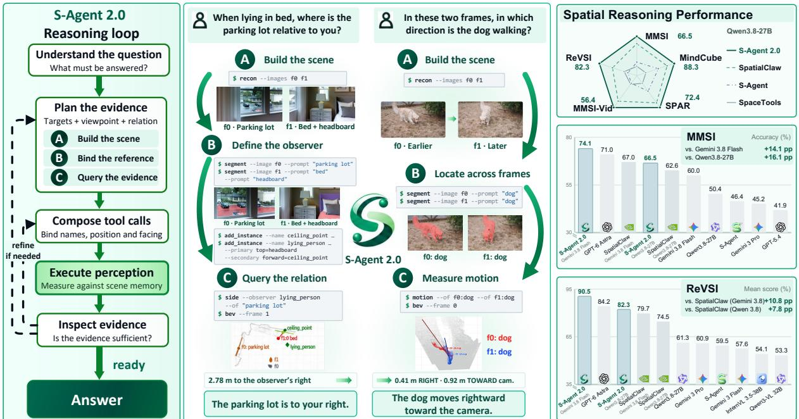  
Figure 1 | S-Agent 2.0 is a spatial reasoning agent built on a general coding agent. A command-line perception toolkit lets the agent close the evidence loop, acquiring scene evidence, remembering it in a persistent scene memory, and interpreting every reading in plain spatial language. S-Agent 2.0 delivers strong performance: it leads MMSI-Bench and ReVSI and stays ahead of the specialized agentic system SpatialClaw on every benchmark and backbone we test.

## Abstract

## Ropedia

Spatial reasoning asks a model to work out where objects are in 3D space, how they relate to one another, and how they move. Agentic VLMs have recently brought large improvements on such tasks by letting the model actively gather evidence with 3D perception tools instead of answering in a single pass. Even so, on many questions the tools return the right evidence and the model still does not arrive at the correct answer: the gap between model and tools, where raw readings become usable conclusions, is left unfilled. We present S-Agent 2.0, a spatial reasoning agent that equips an off-

the-shelf general coding agent with a command-line perception toolkit, and we design the interface around one principle: help the VLM close the evidence loop—acquire scene evidence, remember it in a persistent scene memory, and interpret each reading in plain spatial language. This design keeps the full flexibility of a coding agent, and every reading it acts on stays grounded in the tools’ geometry. On MMSI-Bench and ReVSI, the toolkit improves a strong open-source model, Qwen3.8-27B, by +13.9 and +20.5 points over the same agent without tools, and a strong closed-source model, Gemini-3.8-Flash, by +11.2 and +9.6 points. With the open backbone S-Agent 2.0 reaches 66.5 on MMSI-Bench and 82.3 on ReVSI, ahead of the specialized system SpatialClaw on the same backbone (62.6 and 74.5), and with Gemini-3.8-Flash it reaches 74.1 and 90.5 against its 67.0 and 79.7. Both tool gains shrink as the backbone grows more capable, but SpatialClaw’s shrinks far more on ReVSI, from +13.2 to +2.7, while ours stays at +9.6. S-Agent 2.0 also works across different general coding agent harnesses, such as Codex and Claude Code.

## 1. Introduction

Spatial intelligence, the ability to understand where things are, how they relate in three dimensions, and how the world would look as one moves through it, is foundational to visual perception [6, 40] and essential for any agent that operates in the physical world [12, 2, 30, 15, 3]. Agentic VLMs such as S-Agent [11] have recently brought large improvements here: instead of answering in a single pass, the model actively gathers evidence with 3D perception tools while it reasons [23, 7]. More recent work such as SpatialClaw [10] responds with a specialized harness: a custom state machine that drives the VLM through a hand-designed loop (plan, act, reflect) over a persistent code kernel with a library of 3D perception and geometry utilities, leveraging the flexibility of code to bridge the gap. Even so, on many questions the tools return the right evidence and the model still does not arrive at the correct answer (see Figure 4).

Watching such a system work reveals where it actually fails. A spatial answer is grounded only when a complete evidence loop closes: acquire the measurement, remember it while the rest of the evidence is gathered, and interpret the reading into understanding. Specialized systems invest almost entirely in acquisition, in the form of ever richer perception and geometry libraries, and leave the other two steps to the model. In our analysis of SpatialClaw trajectories, acquisition is rarely what breaks. The failures come in two forms. In the first, the model misreads a reading it holds: it flips the sign of a rotation it measured correctly, or reads a correct number in the wrong coordinate frame or the wrong sense. In the second, the evidence never reaches the answer at all: the measurement sits in the workspace while the model eyeballs the pictures, or a correct reading is discarded for an unrelated stated reason. The second form exposes a break between collecting evidence and drawing the conclusion. Once the readings are in, the reasoning that produces the answer runs detached from them, and the model falls back on its own perception of the scene. On the surface only interpretation goes wrong; underneath, the evidence that was acquired is never fully used. Closing the loop therefore places a requirement on each step. Acquisition has to combine easily with the VLM’s own perception, so that what the model recognizes and what the tools measure enter the same scene. Acquired evidence needs a memory that holds it without effort, so that it stays within reach until the answer is written. And interpretation needs spatial language, so that a reading arrives in the terms the question is asked in.

## 1.1. S-Agent 2.0

S-Agent 2.0 is our answer to those requirements: a spatial reasoning agent assembled from a stock general-purpose coding agent [25, 1, 36] and a command-line perception toolkit designed to meet them. General-purpose coding agents (the harnesses behind modern software-engineering agents) already provide the scaffolding a spatial reasoner needs (a shell, a file system, code execution, long-horizon context management, a mature tool-calling loop), and two of their habits bear directly on the requirements above. First, looking at a frame or at a segmentation mask is an ordinary file view in the agent’s stream, so the model’s own look at the scene and the tools’ readouts interleave in one conversation, with no separate image channel between them.[41] Second, a coding agent inspects and revises by reflex: it views an output, corrects what is wrong, and runs again. [41, 16, 29] Applied to a scene, that reflex is what joins the two kinds of perception, since the model’s own perception is checked against what the tools registered before any reading is taken. What these agents lack is perception itself; we keep the harness stock and add it as commands. The design effort goes into the toolkit, which meets the three requirements one by one.

Concretely, (i) acquisition combines two kinds of perception, the tools’ measurements and the model’s own: the model can register what it perceives or imagines as instances in the scene and drop what the tools got wrong, so both kinds land on one geometric footing; (ii) everything measured persists in a scene memory that later steps query by name instead of re-perceiving, so acquired evidence stays within reach until the answer is written; and (iii) every measurement comes back as an answer-ready reading stated in plain spatial language with its interpretation attached.

Our contributions can be summarized as follows:

• We build a spatial reasoning agent from a stock general-purpose coding agent and a commandline perception toolkit, and show that the method works across different general coding agent harnesses (§3.3).

• We design a command-line perception toolkit that closes the evidence loop for the agent: each call acquires scene evidence, writes it into a persistent scene memory, and returns its reading already interpreted in spatial language, and the model’s own perception is grounded in the same scene (§2).

• S-Agent 2.0 delivers strong performance. On MMSI-Bench and ReVSI, the perception toolkit adds +13.9 and +20.5 points over the same agent without tools, on the already strong Qwen3.8-27B backbone (§3.2), and S-Agent 2.0 surpasses the state-of-the-art agentic spatial reasoning method, whose tool gain on ReVSI shrinks far more on the stronger frontier model Gemini-3.8-Flash while ours remains substantial (§3.3).

## 1.2. Takeaways

1. The method works across coding-agent harnesses. S-Agent 2.0 works across coding-agent harnesses, including OpenHands [36], Codex [25] and Claude Code [1] (§3.3).

2. The coding agent’s inspect-and-revise habit joins the model’s perception with the tools’. The model registers what it perceives or imagines into the scene memory, drops what the tools got wrong (§2.3), and cross-checks the memory against the perception outputs (§3.4).

3. The remaining gap is model-to-tool grounding. The model’s reasoning is mostly right; what remains is grounding the question into a measurement, which fails in two classes (§3.4).

## 2. Method

The diagnosis of §1 turns into three requirements that a system must meet to close the evidence loop, beyond merely possessing tools. Acquisition joined with the model’s own perception: what the model recognizes and what the tools measure must enter one scene. Persistent memory: evidence gathered at one step must remain intact and addressable many steps later, without the model carrying it through its own context. Interpretation on arrival: a measurement should arrive in the spatial language the question is asked in. Existing systems supply acquisition generously, offering a Turing-complete kernel over perception and geometry libraries, but they keep the model’s own perception in a separate channel and leave memory and interpretation to the model. S-Agent 2.0 inverts that allocation: we use a general coding agent as the spatial agent, and the design effort moves into a tool interface that joins the two kinds of perception and carries memory and interpretation itself. Figure 2 sketches the overall framework.

## 2.1. A general coding agent as the spatial agent

S-Agent 2.0 has three parts: a general-purpose coding agent π as planner and executor; a command-line interface (CLI) perception toolkit $\tau { } ;$ and a persistent per-episode scene memory S that the toolkit reads and writes. Formally, a spatial question consists of a question $q$ and frames $\mathcal { T } = \{ I _ { 1 } , \ldots , I _ { n } \}$ . The agent receives a fixed instruction $u ,$ the same for every episode, which holds a tutorial for the toolkit’s commands and a recommended workflow: decide the evidence $\mathcal { E }$ the question requires, acquire $\mathcal { E }$ through the toolkit, check the perception tool outputs, and answer from the acquired readings. At reasoning step t the agent’s context holds the instruction $u ,$ the question $q ,$ and the history of its own chain of thought $z _ { < t } ,$ actions $a _ { < t }$ , and tool responses $o _ { < t } ;$ from this context the policy π produces the next thought and action,

$$
( z _ { t } , a _ { t } ) \sim \pi ( \cdot \mid u , q , z _ { < t } , a _ { < t } , o _ { < t } ) , \quad \quad a _ { t } \in \mathcal { A } _ { \mathrm { g e n } } \cup \mathcal { A } _ { \mathrm { p e r c } } ,\tag{1}
$$

until it commits an answer. The action space includes two classes of actions, both operated through the CLI. $\mathcal { A } _ { \mathrm { g e n } }$ holds the general coding agent’s original actions, such as running Linux commands, writing and executing code, and reading files and images. $\boldsymbol { \mathcal { A } } _ { \mathrm { p e r c } }$ holds the perception toolkit’s actions, such as reconstruction, segmentation, and readouts of spatial relations, which the following subsections detail. A perception action returns a full output m and a tool response $o ^ { \mathrm { p e r c } }$ . The response $o ^ { \mathrm { p e r c } }$ joins the context, while the full output $m ,$ together with the original frames $\mathcal { T } ,$ is kept on disk. The agent reads these files through the file-reading actions of ${ \mathcal { A } } _ { \mathrm { g e n } } ,$ deciding when and which to read, and what it reads joins the context as $o ^ { \mathrm { g e n } }$ . Across these steps the model’s own work is the two maps $q \mapsto \mathcal E$ and $o ^ { \mathrm { p e r c } } \mapsto { \mathcal { E } } \colon$ : deciding what evidence the question requires, and reading each reply into a piece of that evidence. Since this design assumes only the CLI machinery every coding agent provides, our framework works across general coding agent harnesses (§3.3).

## 2.2. Scene memory kept by the environment

Closing the loop on a multi-view or video question takes many steps, and the evidence gathered early must still be at hand when the answer is committed, so some component has to hold it. The model’s context window can serve as that holder, at the price of transcribing every intermediate result into text and carrying it across a growing transcript.

We let the environment do the remembering instead: the toolkit maintains a persistent scene memory

$$
S = \big ( \mathbb { Z } , P , \{ ( \nu _ { i } , g _ { i } ) \} _ { i } \big ) , \qquad g _ { i } = \big ( \mathtt { p } _ { i } , E _ { i } , T _ { i } \big ) ,\tag{2}
$$

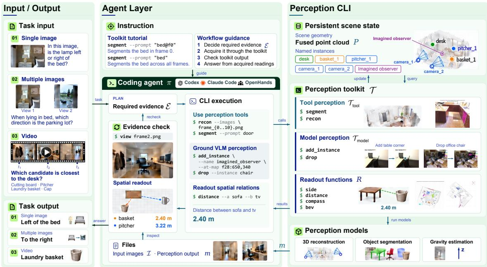  
Figure 2 | Overview of the framework. The agent keeps a coding agent’s full generic freedom over the workspace (viewing images, reading and writing files, writing and running code) and composes perception through the same shell; the toolkit registers everything it perceives into the scene memory and returns interpreted, answer-ready readings.

holding the raw frames $\mathcal { T } ,$ the fused metric point cloud P in a gravity-aligned world frame, and a registry of named instances. Each instance pairs a name $\nu _ { i } ,$ usable in later calls, with its geometry g<sub>i</sub>: an xyz position $\mathbf { p } _ { i } \in \mathbb { R } ^ { 3 }$ , an extent $E _ { i }$ (the subset of P belonging to the instance), and a 6-DoF pose $\left. T _ { i } \in { \mathrm { S E } } ( 3 ) ; E _ { i } \right.$ and $T _ { i }$ may each be left empty. Both the perception toolkit and the model can write to this memory; §2.3 details both routes.

Because the scene memory records each instance’s position, extent, and pose, measuring objects and their relations becomes a lookup, computed in closed form from the stored geometry. Readout actions are a family of functions $R _ { \tau } ( \nu _ { 1 } , \dots , \nu _ { k } ; S _ { t } )$ with $\tau \in \mathcal T$ , over one or more named instances, covering properties of a single instance, such as its size and elevation, and relations between instances, such as pairwise distance, relative direction, and motion between frames. A reading is derived fresh from the stored geometry at each call, so the model can complete a readout by remembering only the instance names. Figure 3 lists what one episode’s memory holds.

## 2.3. Dividing perception by competence

The evidence loop involves two kinds of perceptual work with opposite competence profiles. Deciding what to measure is semantic work that VLMs do well, such as identifying which objects the question is about and phrasing a segmentation prompt. Producing precise masks and measurements is work that dedicated perception models do better. A principled interface should cut exactly along this line. Formally, a perception action pairs a toolkit command τ with the arguments x the model supplies: the model contributes the map $q \mapsto x ,$ the grounding step that carries the evidence E it conceives into terms the toolkit operates on, and the toolkit supplies $( x , S ) \mapsto o ^ { \mathsf { p e r c } }$ . Our interface lets the model write x directly from earlier replies, $o ^ { \mathrm { p e r c } } \mapsto x$ . The

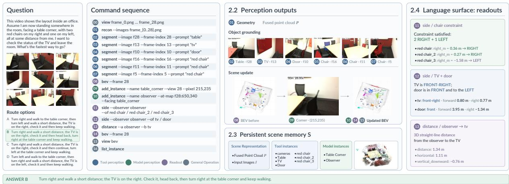  
Figure 3 | An example question used throughout this section. Left to right: the question, the agent’s command sequence colour-coded by who performs the perception, the outputs those calls produce and the scene memory they write, and the readouts that answer the question.

call has semantics

$$
( o _ { t } ^ { \mathrm { p e r c } } , S _ { t + 1 } ) \ = \ \tau ( x _ { t } ; S _ { t } ) , \qquad \tau \in \mathcal { T } = \mathcal { T } _ { \mathrm { t o o l } } \cup \mathcal { T } _ { \mathrm { m o d e l } } ,\tag{3}
$$

where $S _ { t }$ is the scene memory of §2.2.

We build the division into the interface along these two write routes into the scene memory. Tool perception $( \mathcal { T } _ { \mathrm { t o o l } } )$ carries the measurement side. The recon command fuses all frames into one metric, gravity-aligned scene and registers every camera in the scene memory; the segment command grounds objects to pixels, taking the model’s own words as prompts, so deciding what to look for remains semantic work. Model perception $( \mathcal { T } _ { \mathrm { m o d e l } } )$ enters through the add-instance command, which grounds the model’s high-level understanding itself. The model names the new instance, such as an object it recognizes or an observer the question imagines, and initializes its position and pose from other named instances or from pixel locations in the images. The toolkit then treats it like any other instance, so a construct that exists only in the model’s reading of the question is measured on the same geometric footing as the instances that tool perception grounds. The same route also runs in reverse: with drop the model removes an instance the tools registered wrongly, such as a mask on a reflection, so its own look at the tool perception outputs corrects the memory before any reading is taken from it. Figure 3 shows model perception and tool perception apart in one episode. Detailed descriptions of toolkit interfaces are given in Appendix B.

## 2.4. The language surface: numbers interpreted on arrival

With acquisition routine and memory kept by the environment, the remaining break point is how a reading is consumed. Even when the measurement itself is correct, the model may take it in the wrong reference frame, invert which object it is measured from, or ignore it entirely. A displacement vector alone does not say which object it points from, whether its axes follow gravity or the camera, or which answer option it favors. That knowledge lives outside the numbers, and the side that computed the geometry holds it most reliably. In previous toolaugmented systems [10], tool calls return bare values or arrays, leaving the whole step from number to usable spatial statement to the model. In the failures we observed, the model calls the right tool and the tool returns the right geometry, yet the final answer still comes out wrong.

We therefore have every reply interpret its own numbers, handing the model the values and their plain-language reading together. Each command distills its full output m, against the scene memory S, into a compact structured report

$$
\begin{array} { l } { { \displaystyle { o ^ { \mathrm { p e r c } } } \ = \ c _ { \tau } ( m ; S ) , } } \end{array}\tag{4}
$$

with a fixed anatomy: a few typed numeric fields with units, together with a conclusion, one sentence that restates the measurement in plain spatial language. The conclusion names the entities involved, declares the frame it speaks in (gravity-aligned, camera, or image plane), and carries the reading all the way to the ordinary spatial vocabulary an answer is written in. Figure 3 gives an example: the responses describe relation in words first and keeps the numerical fields that support it, so the model can act on a reading without re-deriving it. And the complete measurements and geometry stay in the full output m on disk, where the model can read them through the same CLI when it needs them.

Together these commitments close the evidence loop. Evidence travels in rounds,

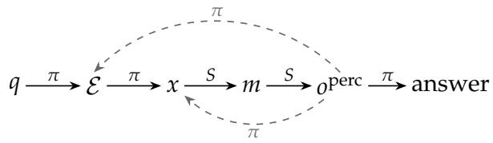

where π is the VLM, S is the scene memory q is the question, E the evidence the model decides the question requires, x the arguments of a perception call, m the full output the call writes to disk, and o<sup>perc</sup> the interpreted reply; π marks the model’s steps and S the toolkit’s, computed against the scene memory. The dashed returns close the loop: the model reads each reply back into its evidence E and into the arguments of the next call.

## 3. Experiments

## 3.1. Setup

Benchmarks. We evaluate S-Agent 2.0 on five benchmarks covering multi-view and video spatial reasoning. For multi-view reasoning, MMSI-Bench [44] provides multiple images of the same scene and tests whether models integrate evidence across views for positional relationships, geometric attributes, motion, and multi-step reasoning; MindCube [34] probes the spatial mental model built from a few sparse views, asking for relations the given views never show directly; SPAR-Bench [49] (used for the harness-swap study) spans a hierarchy of spatial capabilities from basic metric perception to multi-view relational reasoning. For video reasoning, ReVSI [51] evaluates 3D spatial reasoning from dynamic observations, emphasizing relations that no isolated frame reliably shows; MMSI-Video-Bench [21] extends the MMSI setting to long videos, with questions on spatial construction, motion understanding, cross-video memory, and route planning. ReVSI and SPAR-Bench scores follow the official protocols, macro-averaged over question types; the others report overall accuracy.

Models. We use Qwen3.8-27B (FP8, served locally) as the primary backbone; Gemini-3.8- Flash as the stronger backbone for the capability study. The general coding agent harness is OpenHands [36] unless stated otherwise, and the same workspaces and toolkit also run under Codex and Claude Code (§3.3). The perception tools are served by off-the-shelf models, all frozen: Depth Anything 3 [20] for the metric reconstruction, $\pi _ { \mathrm { m o s } } ^ { 3 } [ 3 \dot { 7 } , 5 4 ]$ for per-pixel motion masks, GeoCalib [32] for the gravity direction, and SAM 3 [5] for promptable segmentation.

Table 1 | MMSI-Bench results by question category (C/O/R denote camera/object/region).
<table><tr><td rowspan="2">Model</td><td colspan="6">Positional Relationship</td><td colspan="2">Geometric Attr.</td><td colspan="2">Motion</td><td rowspan="2">MSR</td><td rowspan="2">Avg.</td></tr><tr><td>C-C</td><td>0-0</td><td>R-R</td><td>C-O</td><td>O-R</td><td>C-R</td><td>Meas.</td><td>Appr.</td><td>Cam.</td><td>Obj.</td></tr><tr><td>Proprietary models</td><td></td><td></td><td></td><td></td><td></td><td></td><td></td><td></td><td></td><td></td><td></td><td></td></tr><tr><td>GPT-5.4</td><td>41.9</td><td>33.0</td><td>35.8</td><td>49.8</td><td>42.4</td><td>68.7</td><td>54.7</td><td>37.4</td><td>28.3</td><td>40.8</td><td>36.4</td><td>41.9</td></tr><tr><td>GPT-5.6</td><td>64.5</td><td>42.6</td><td>55.6</td><td>41.9</td><td>44.7</td><td>59.0</td><td>67.2</td><td>40.9</td><td>59.5</td><td>48.7</td><td>57.1</td><td>53.2</td></tr><tr><td>GPT-6</td><td>73.1</td><td>61.7</td><td>72.8</td><td>58.1</td><td>67.1</td><td>72.3</td><td>73.4</td><td>69.7</td><td>89.2</td><td>65.8</td><td>75.3</td><td>71.0</td></tr><tr><td>Grok 4</td><td>36.6</td><td>35.1</td><td>39.5</td><td>34.9</td><td>45.9</td><td>50.6</td><td>21.9</td><td>22.7</td><td>40.5</td><td>43.4</td><td>38.4</td><td>37.8</td></tr><tr><td>Gemini 2.5 Pro</td><td>38.7</td><td>34.0</td><td>40.7</td><td>44.2</td><td>38.8</td><td>41.0</td><td>62.5</td><td>30.3</td><td>39.2</td><td>25.0</td><td>33.3</td><td>38.0</td></tr><tr><td>Gemini 3 Pro</td><td>47.3</td><td>48.9</td><td>42.0</td><td>43.0</td><td>37.6</td><td>60.2</td><td>64.1</td><td>39.4</td><td>41.9</td><td>47.4</td><td>37.9</td><td>45.2</td></tr><tr><td>Gemini 3.8 Flash</td><td>68.8</td><td>60.6</td><td>51.9</td><td>51.2</td><td>52.9</td><td>62.7</td><td>64.1</td><td>47.0</td><td>78.4</td><td>61.8</td><td>60.1</td><td>60.0</td></tr><tr><td>Open-weight general models</td><td></td><td></td><td></td><td></td><td></td><td></td><td></td><td></td><td></td><td></td><td></td><td></td></tr><tr><td>Seed 1.6</td><td>36.6</td><td>36.2</td><td>32.1</td><td>32.6</td><td>42.4</td><td>46.9</td><td>48.4</td><td>33.0</td><td>31.1</td><td>42.1</td><td>40.4</td><td>38.5</td></tr><tr><td>InternVL3_5-8B</td><td>29.0</td><td>26.6</td><td>29.6</td><td>24.4</td><td>31.8</td><td>25.3</td><td>29.7</td><td>25.8</td><td>14.9</td><td>34.2</td><td>36.4</td><td>29.0</td></tr><tr><td>SenseNova-U1-8B-MoT</td><td>46.2</td><td>41.5</td><td>29.6</td><td>58.1</td><td>38.8</td><td>63.9</td><td>43.8</td><td>21.2</td><td>25.7</td><td>31.6</td><td>26.8</td><td>38.0</td></tr><tr><td>Qwen3-VL-8B-Instruct</td><td>28.0</td><td>37.2</td><td>32.1</td><td>31.4</td><td>35.3</td><td>38.5</td><td>37.5</td><td>15.2</td><td>27.0</td><td>28.9</td><td>29.8</td><td>31.1</td></tr><tr><td>Qwen3-VL-8B-Thinking</td><td>31.2</td><td>26.6</td><td>32.1</td><td>29.1</td><td>32.9</td><td>30.1</td><td>50.0</td><td>16.7</td><td>17.6</td><td>23.7</td><td>27.3</td><td>28.6</td></tr><tr><td>Qwen3.5-9B</td><td>34.4</td><td>36.2</td><td>34.6</td><td>39.5</td><td>38.8</td><td>54.2</td><td>56.3</td><td>28.8</td><td>36.5</td><td>26.3</td><td>28.8</td><td>36.5</td></tr><tr><td>Qwen3-VL-30B-A3B-Thinking</td><td>23.7</td><td>31.9</td><td>35.8</td><td>31.4</td><td>36.5</td><td>22.9</td><td>40.6</td><td>19.7</td><td>18.9</td><td>27.6</td><td>31.3</td><td>29.4</td></tr><tr><td>Qwen3.8-27B</td><td>58.1</td><td>38.3</td><td>44.4</td><td>36.0</td><td>49.4</td><td>55.4</td><td>56.2</td><td>47.0</td><td>67.6</td><td>55.3</td><td>50.5</td><td>50.4</td></tr><tr><td>Open-weight spatial models</td><td></td><td></td><td></td><td></td><td></td><td></td><td></td><td></td><td></td><td></td><td></td><td></td></tr><tr><td>SenseNova-SI-1.1-Qwen2.5VL-7B</td><td>51.6</td><td>29.8</td><td>32.1</td><td>50.0</td><td>29.4</td><td>42.2</td><td>37.5</td><td>28.8</td><td>23.0</td><td>34.2</td><td>18.7</td><td>32.8</td></tr><tr><td>SenseNova-SI-1.1-Qwen3VL-8B VST-7B-SFT</td><td>44.1</td><td>38.3</td><td>33.3 35.8</td><td>65.1</td><td>38.8</td><td>59.0</td><td>48.4</td><td>24.2</td><td>29.7</td><td>34.2</td><td>22.2</td><td>38.1 32.5</td></tr><tr><td></td><td>39.8</td><td>36.2</td><td></td><td>37.2</td><td>29.4</td><td>33.7</td><td>29.7</td><td>47.0</td><td>36.5</td><td>35.5</td><td>18.2</td><td></td></tr><tr><td>Agentic systems S-Agent (Qwen3.8-27B)</td><td></td><td></td><td></td><td></td><td></td><td></td><td></td><td></td><td></td><td></td><td></td><td></td></tr><tr><td></td><td>59.1</td><td>47.9</td><td>42.0</td><td>46.5</td><td>34.1</td><td>51.8</td><td>57.8</td><td>47.0</td><td>48.6</td><td>46.1</td><td>49.5</td><td>48.3</td></tr><tr><td>SpatialClaw (Qwen3.8-27B)</td><td>67.7</td><td>50.0</td><td>54.3</td><td>79.1</td><td>58.8</td><td>79.5</td><td>68.8</td><td>56.1</td><td>77.0</td><td>44.7</td><td>58.6</td><td>62.6</td></tr><tr><td>SpatialClaw (Gemini-3.8-Flash)</td><td>71.0</td><td>68.1</td><td>63.0</td><td>68.6</td><td>64.7</td><td>73.5</td><td>68.8</td><td>50.0</td><td>81.1</td><td>60.5</td><td>66.2</td><td>67.0</td></tr><tr><td>S-Agent 2.0 (Qwen3.8-27B, ours)</td><td>73.1(+5.4)</td><td>58.5(+8.5)</td><td>58.0(+3.7)</td><td>83.7 (+4.6)</td><td>60.0 (+1.2)</td><td>74.7 (–4.8)</td><td>73.4(+4.6)</td><td>60.6 (+4.5)</td><td>75.7 (−1.3)</td><td>52.6(+7.9)</td><td>64.1 (+5.5)</td><td>66.5 (+3.9)</td></tr><tr><td>S-Agent 2.0 (Gemini-3.8-Flash, ours)</td><td>72.0(+1.0)</td><td>74.5(+6.4)</td><td>67.9 (+4.9)</td><td>89.5(+20.9)</td><td>68.2(+3.5)</td><td>81.9 (+8.4)</td><td>71.9(+3.1)</td><td>69.7 (+19.7)</td><td>82.4(+1.3)</td><td>68.4(+7.9)</td><td>71.2 (+5.0)</td><td>74.1 (+7.1)</td></tr></table>

Baselines. We compare S-Agent 2.0 with three categories of baselines: advanced proprietary VLMs, such as GPT-5.4, Grok 4, and the Gemini series; open-weight general and spatially specialized models, such as the Qwen series and the SenseNova-SI series; and agentic systems, S-Agent [11] and SpatialClaw [10].

## 3.2. Main result

Table 1 shows the accuracy on MMSI-Bench, overall and by question type. With the 27B open backbone and no training S-Agent 2.0 is ahead of every agentic baseline and of every proprietary model other than GPT-6; with Gemini-3.8-Flash it has the highest average in the table, while GPT-6 keeps the lead on region-to-region relations, camera motion and multi-step reasoning. The parentheses give the change against SpatialClaw on the same backbone.

Table 2 shows the accuracy on ReVSI, overall and by question type. S-Agent 2.0 is ahead of every agentic baseline on both backbones, and with Gemini-3.8-Flash it has the highest average in the table. The margins over the specialized baseline are largest on the types that need cross-object geometry, relative direction and route planning; the one deficit is absolute distance, which is also where GPT-6 falls furthest behind.

Table 3 shows the accuracy on all five benchmarks against the agentic baselines, where S-Agent 2.0 is ahead on every one.

## 3.3. Ablations

Different general coding agent harness. We rerun the benchmarks with the whole harness replaced by another production coding agent, Codex or Claude Code, each with its own agent loop, prompting and context management, driving the identical workspaces and toolkit. Table 4 shows S-Agent 2.0 works under every one.

Tools against no tools. Table 5 varies the toolkit against the same agent on the same items. The toolkit is worth a large gain on both benchmarks on Qwen3.8-27B, and our score with tools keeps rising as the backbone grows more capable. SpatialClaw scores below ours on every backbone and benchmark, and its tool gain shrinks far more as the backbone grows.

Table 2 | ReVSI results by question type. Numerical types (object counting, absolute distance, object size, room size) use the official mean relative accuracy; the remaining types are multiple choice.
<table><tr><td rowspan="2">Model</td><td rowspan="2">Frames</td><td colspan="4">Numerical Question</td><td colspan="3">Multiple-Choice Question</td><td rowspan="2">Avg.</td></tr><tr><td>Obj. Cnt.</td><td>Abs. Dist.</td><td>Obj. Size</td><td>Room Size</td><td>Rel. Dist.</td><td>Rel. Dir.</td><td>Route Plan</td></tr><tr><td>Proprietary models</td><td></td><td></td><td></td><td></td><td></td><td></td><td></td><td></td><td></td></tr><tr><td>GPT-5.2</td><td>64</td><td>56.2</td><td>41.5</td><td>73.9</td><td>63.0</td><td>48.4</td><td>34.9</td><td>38.2</td><td>50.9</td></tr><tr><td>GPT-5.4</td><td>64</td><td>70.3</td><td>40.2</td><td>73.3</td><td>59.8</td><td>57.8</td><td>43.5</td><td>33.3</td><td>54.0</td></tr><tr><td>GPT-5.6</td><td>64</td><td>80.6</td><td>64.4</td><td>80.3</td><td>71.7</td><td>71.8</td><td>71.0</td><td>63.9</td><td>72.0</td></tr><tr><td>Gemini 3 Flash</td><td>1FPS</td><td>65.7</td><td>53.1</td><td>77.6</td><td>52.8</td><td>64.6</td><td>47.9</td><td>41.8</td><td>57.6</td></tr><tr><td>Gemini 3 Pro</td><td>1 FPS</td><td>60.1</td><td>54.7</td><td>79.3</td><td>51.9</td><td>68.1</td><td>56.0</td><td>56.4</td><td>60.9</td></tr><tr><td>Gemini 3.8 Flash</td><td>64</td><td>79.7</td><td>70.1</td><td>83.0</td><td>68.9</td><td>81.6</td><td>78.3</td><td>77.8</td><td>77.0</td></tr><tr><td>GPT-6</td><td>64</td><td>89.2</td><td>72.5</td><td>83.4</td><td>75.0</td><td>87.4</td><td>95.7</td><td>86.1</td><td>84.2</td></tr><tr><td>Open-weight general models</td><td></td><td></td><td></td><td></td><td></td><td></td><td></td><td></td><td></td></tr><tr><td>Qwen3-VL-8B-Instruct</td><td>64</td><td>40.4</td><td>52.3</td><td>69.0</td><td>45.1</td><td>57.1</td><td>39.5</td><td>40.5</td><td>49.1</td></tr><tr><td>Qwen3-VL-32B-Instruct</td><td>64</td><td>46.9</td><td>65.0</td><td>70.4</td><td>55.8</td><td>53.8</td><td>34.0</td><td>47.3</td><td>53.3</td></tr><tr><td>InternVL3.5-8B</td><td>64</td><td>43.3</td><td>54.6</td><td>64.2</td><td>47.6</td><td>45.0</td><td>36.3</td><td>44.4</td><td>47.9</td></tr><tr><td>InternVL3.5-38B</td><td>64</td><td>43.8</td><td>60.6</td><td>70.2</td><td>58.4</td><td>57.4</td><td>45.9</td><td>42.7</td><td>54.1</td></tr><tr><td>LLaVA-Video-7B-Qwen2</td><td>64</td><td>31.3</td><td>1.4</td><td>52.5</td><td>16.7</td><td>38.3</td><td>33.3</td><td>38.4</td><td>30.3</td></tr><tr><td>LLaVA-Video-72B-Qwen2</td><td>64</td><td>40.1</td><td>29.6</td><td>59.3</td><td>27.9</td><td>39.6</td><td>24.8</td><td>43.0</td><td>37.8</td></tr><tr><td>Qwen3.8-27B</td><td>64</td><td>63.5</td><td>52.1</td><td>71.1</td><td>53.5</td><td>64.1</td><td>63.8</td><td>61.1</td><td>61.3</td></tr><tr><td colspan="2">Spatially specialized models and base models</td><td></td><td></td><td></td><td></td><td></td><td></td><td></td><td></td></tr><tr><td>Cambrian-S-7B</td><td>128</td><td>48.4</td><td>60.5</td><td>65.5</td><td>46.7</td><td>37.1</td><td>48.5</td><td>37.0</td><td>49.1</td></tr><tr><td>Qwen2.5-VL-7B-Instruct</td><td>4FPS</td><td>36.9</td><td>15.0</td><td>49.7</td><td>29.0</td><td>31.5</td><td>29.5</td><td>36.7</td><td>32.6</td></tr><tr><td>VST-7B-SFT</td><td>4FPS</td><td>35.4</td><td>52.6</td><td>67.9</td><td>47.2</td><td>49.2</td><td>36.9</td><td>35.4</td><td>46.4</td></tr><tr><td>Qwen2.5-VL-7B-Instruct</td><td>32</td><td>34.3</td><td>21.7</td><td>45.5</td><td>35.1</td><td>32.6</td><td>33.7</td><td>34.1</td><td>33.9</td></tr><tr><td>SpaceR-7B (SG-RLVR)</td><td>32</td><td>30.7</td><td>34.5</td><td>52.0</td><td>18.6</td><td>22.8</td><td>34.5</td><td>20.2</td><td>30.5</td></tr><tr><td>Qwen2.5-VL-3B-Instruct</td><td>16</td><td>18.7</td><td>15.6</td><td>16.8</td><td>一</td><td>33.2</td><td>34.3</td><td>一</td><td>23.7</td></tr><tr><td>Spatial-MLLM-4B-135k</td><td>16</td><td>40.7</td><td>45.3</td><td>46.8</td><td>-</td><td>32.3</td><td>37.4</td><td>1</td><td>40.5</td></tr><tr><td>Spatial-MLLM-4B-820k</td><td>16</td><td>41.5</td><td>40.0</td><td>53.1</td><td>一</td><td>30.7</td><td>39.2</td><td>1</td><td>40.9</td></tr><tr><td>LLaVA-Video-7B-Qwen2</td><td>32</td><td>29.9</td><td>1.5</td><td>53.0</td><td>19.3</td><td>39.1</td><td>33.8</td><td>38.8</td><td>30.8</td></tr><tr><td>VLM3R-7B</td><td>32</td><td>41.6</td><td>61.6</td><td>64.8</td><td>52.5</td><td>46.5</td><td>49.5</td><td>34.1</td><td>50.1</td></tr><tr><td>Agentic systems</td><td></td><td></td><td></td><td></td><td></td><td></td><td></td><td></td><td></td></tr><tr><td>S-Agent (Qwen3.8-27B)</td><td>64</td><td>63.0</td><td>58.1</td><td>60.9</td><td>57.4</td><td>63.6</td><td>69.1</td><td>44.4</td><td>59.5</td></tr><tr><td>SpatialClaw (Qwen3.8-27B)</td><td>64</td><td>74.8</td><td>79.5</td><td>73.4</td><td>59.1</td><td>84.9</td><td>77.8</td><td>72.2</td><td>74.5</td></tr><tr><td>SpatialClaw (Gemini-3.8-Flash)</td><td>64</td><td>80.3</td><td>89.9</td><td>86.6</td><td>75.2</td><td>87.9</td><td>63.3</td><td>75.0</td><td>79.7</td></tr><tr><td>S-Agent 2.0 (Qwen3.8-27B, ours)</td><td>64</td><td>75.2 (+0.4)</td><td>76.7(-2.8)</td><td>78.7 (+5.3)</td><td>67.8(+8.7)</td><td>88.3 (+3.4)</td><td>95.2(+17.4)</td><td>94.4(+22.2)</td><td>82.3 (+7.8)</td></tr><tr><td>S-Agent 2.0 (Gemini-3.8-Flash, ours)</td><td>64</td><td>86.8 (+6.5)</td><td>88.2(−1.7)</td><td>86.1 (−0.5)</td><td>82.2 (+7.0)</td><td>95.1 (+7.2)</td><td>97.6(+34.3)</td><td>97.2 (+22.2)</td><td>90.5 (+10.8)</td></tr></table>

Interface components. Table 6 removes one commitment of §2 at a time and leaves the rest of the system untouched. Without the scene memory the agent carries every reading through its own context; without the interpreted readout the replies come back as bare values; without the model perception interface the model cannot add instances to the scene or drop them from it. Every removal costs accuracy, and the ranking matches the diagnosis of §1: on the surface only interpretation goes wrong, but underneath the acquired evidence is never fully used. Removing the interpreted readout costs the least (−1.3 and −1.2); removing the scene memory costs more (−3.5 and −2.5), since readings carried through the context are lost before the answer is written; removing the model perception interface costs the most (−8.8 and −5.9). Closing the loop needs both the interpretation design and the scene memory.

## 3.4. Qualitative analysis

Qualitative comparison with SpatialClaw. On the same backbone and the same perception backends, the baseline acquires the evidence and still does not close the loop (Figure 4, left): the tools return the right masks and the right positions, and the step from those numbers to the asked relation is left to the model, which states a right-hand rule correctly and implements it in reverse, or reaches the correct direction and lets a second look at the pictures overturn it. Our runs close the same loop because that step is not left to the model: the question’s premise enters the scene as an oriented instance or a compass anchor, and the relation comes back in the words the options use. Seven further items, with the command-line record and the intermediate images of both agents, are in Appendix E.

Table 3 | Comparison with agentic spatial reasoning baselines, Qwen3.8-27B backbone.
<table><tr><td>Method</td><td>MMSI</td><td>MindCube</td><td>SPAR</td><td>MMSI-Vid</td><td>ReVSI</td></tr><tr><td>pySpatial</td><td>36.3</td><td>66.3</td><td>42.1</td><td>26.9</td><td>39.3</td></tr><tr><td>SpaceTools</td><td>43.2</td><td>58.6</td><td>55.3</td><td>39.3</td><td>64.4</td></tr><tr><td>S-Agent</td><td>48.3</td><td>75.5</td><td>63.0</td><td>37.9</td><td>59.5</td></tr><tr><td>SpatialClaw</td><td>62.6</td><td>83.2</td><td>70.2</td><td>53.1</td><td>74.5</td></tr><tr><td>S-Agent 2.0</td><td>66.5 (+3.9)</td><td>88.3 (+5.1)</td><td>72.4(+2.2)</td><td>56.4 (+3.3)</td><td>82.3 (+7.8)</td></tr></table>

Table 4 | S-Agent 2.0 under different codingagent harnesses, Qwen3.8-27B backbone.
<table><tr><td>Benchmark</td><td>OpenHands</td><td>Codex</td><td>Claude Code</td></tr><tr><td>MMSI-Bench</td><td>66.5</td><td>67.0</td><td>63.8</td></tr><tr><td>SPAR-Bench</td><td>72.4</td><td>71.8</td><td>72.8</td></tr><tr><td>ReVSI</td><td>82.3</td><td>76.6</td><td>79.1</td></tr></table>

Table 6 | Ablations on interface design. Qwen3.8-27B backbone.

Table 5 | Tools against no tools on ReVSI and MMSI-Bench, for two backbones and two harnesses.
<table><tr><td></td><td></td><td colspan="2">Qwen3.8-27B</td><td colspan="2">Gemini-3.8-Flash</td></tr><tr><td>Harness</td><td>Tools</td><td>ReVSI</td><td>MMSI</td><td>ReVSI</td><td>MMSI</td></tr><tr><td>SpatialClaw</td><td>no</td><td>61.3</td><td>50.4</td><td>77.0</td><td>60.0</td></tr><tr><td></td><td>with</td><td>74.5</td><td>62.6</td><td>79.7</td><td>67.0</td></tr><tr><td>general coding agent</td><td>no</td><td>61.8</td><td>52.6</td><td>80.9</td><td>62.9</td></tr><tr><td></td><td>with</td><td>82.3</td><td>66.5</td><td>90.5</td><td>74.1</td></tr></table>

<table><tr><td>Variant</td><td>MMSI</td><td>ReVSI</td></tr><tr><td>S-Agent 2.0</td><td>66.5</td><td>82.3</td></tr><tr><td>no scene memory</td><td>63.0</td><td>79.8</td></tr><tr><td>no interpretation readout</td><td>65.2</td><td>81.1</td></tr><tr><td>no model perception interface</td><td>57.7</td><td>76.4</td></tr></table>

Cross-checking the two kinds of perception. The memory closes the loop only if what it holds is right, and the agent checks that itself. It compares what it sees in a perception output against what the registry holds and edits the memory when the two disagree (Figure 4, top right): it drops instances the output shows to be wrong, and keeps a suspected duplicate once the output shows a genuine second object. The habit is the coding agent’s inspect-and-revise loop applied to the scene, and it is what joins the model’s perception with the tools’ before any reading is taken.

What is left is grounding. With acquisition, memory and interpretation carried by the interface, the errors that remain sit where the question first enters the loop (Takeaway 3, Figure 4, bottom right). The agent fails to simulate an imagined viewpoint the question requires, registering an observer with a borrowed heading, or it measures the right quantity in the wrong sense, reading an object’s elevation above the floor where the question asks for the object’s own height.

## 4. Conclusion

We built a spatial reasoning agent from a stock general coding agent and a command-line perception toolkit that closes the evidence loop for the model, joining the tools’ measurements with the model’s own perception, keeping every reading in a persistent scene memory, and returning each reading interpreted in spatial language. Experiments show that with a 27B open backbone and no training the agent is ahead of every agentic baseline on all five benchmarks, and that with Gemini-3.8-Flash it has the highest MMSI-Bench and ReVSI scores of any model we compare against, including proprietary models such as GPT-6 and GPT-5.6. Its gain from the toolkit remains substantial on the stronger backbone, where the specialized baseline’s shrinks far more, and the same toolkit works under different coding agent harnesses.

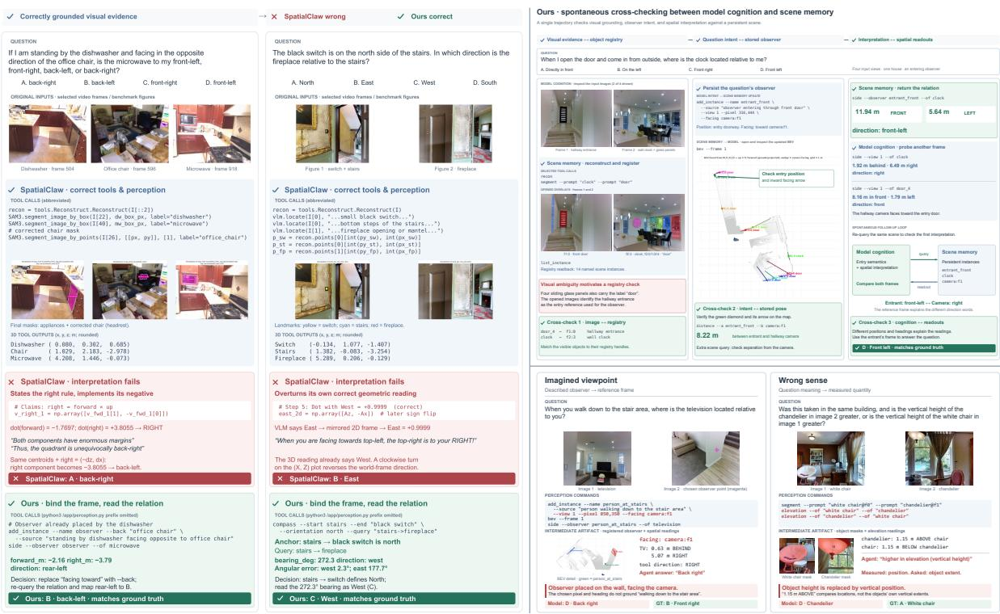  
Figure 4 | Qualitative analysis. Left: two items where SpatialClaw calls the right tools and gets the right perception, and still answers wrong, with S-Agent 2.0 correct on both (gemini-3.8-flash on both sides). Top right: S-Agent 2.0 cross-checking its own perception against the scene memory, dropping the wrong masks before grounding the observer and reading the answer. Bottom right: the two remaining grounding failure classes, a wrongly imagined viewpoint and a quantity read in the wrong sense. Zoom in for better readability.

## Reproducibility statement

Code is available at https://ropedia.github.io/S-Agent-2.0, together with the trajectories of all reported runs. Appendix B documents the toolkit’s command-line interface.

## References

[1] Anthropic. 2025. Claude 3.7 sonnet and claude code. https://www.anthropic.com/news/ claude-3-7-sonnet. Accessed: 2026-09-23.

[2] Anthony Brohan, Noah Brown, Justice Carbajal, Yevgen Chebotar, Xi Chen, Krzysztof Choromanski, Tianli Ding, Danny Driess, Avinava Dubey, Chelsea Finn, Pete Florence, Chuyuan Fu, Montse Gonzalez Arenas, Keerthana Gopalakrishnan, Kehang Han, Karol Hausman, Alexander Herzog, Jasmine Hsu, Brian Ichter, and 35 others. 2023. Rt-2: Vision-language-action models transfer web knowledge to robotic control. Preprint, arXiv:2307.15818.

[3] Holger Caesar, Varun Bankiti, Alex H Lang, Sourabh Vora, Venice Erin Liong, Qiang Xu, Anush Krishnan, Yu Pan, Giancarlo Baldan, and Oscar Beijbom. 2020. nuscenes: A multimodal dataset for autonomous driving. In 2020 IEEE/CVF conference on computer vision and pattern recognition (CVPR), pages 11618–11628. IEEE.

[4] Zhongang Cai, Ruisi Wang, Chenyang Gu, Fanyi Pu, Junxiang Xu, Yubo Wang, Wanqi Yin, Zhitao Yang, Chen Wei, Qingping Sun, Tongxi Zhou, Jiaqi Li, Hui En Pang, Oscar Qian, Yukun Wei, Zhiqian Lin, Xuanke Shi, Kewang Deng, Xiaoyang Han, and 10 others. 2026. Scaling spatial intelligence with

multimodal foundation models. In Proceedings of the IEEE/CVF Conference on Computer Vision and Pattern Recognition (CVPR).

[5] Nicolas Carion, Laura Gustafson, Yuan-Ting Hu, Shoubhik Debnath, Ronghang Hu, Didac Suris Coll-Vinent, Chaitanya Ryali, Kalyan Vasudev Alwala, Haitham Khedr, Andrew Huang, Jie Lei, Tengyu Ma, Baishan Guo, Arpit Kalla, Markus Marks, Joseph Greer, Meng Wang, Peize Sun, Roman Rädle, and 19 others. 2026. Sam 3: Segment anything with concepts. In International Conference on Learning Representations, volume 2026, pages 138846–138923.

[6] Boyuan Chen, Zhuo Xu, Sean Kirmani, Brain Ichter, Dorsa Sadigh, Leonidas Guibas, and Fei Xia. 2024. Spatialvlm: Endowing vision-language models with spatial reasoning capabilities. In Proceedings ofthe IEEE/CVF conference on computer vision and pattern recognition, pages 14455–14465.

[7] Siyi Chen, Mikaela Angelina Uy, Chan Hee Song, Faisal Ladhak, Adithyavairavan Murali, Qing Qu, Stan Birchfield, Valts Blukis, and Jonathan Tremblay. 2026. Spacetools: Tool-augmented spatial reasoning via double interactive rl. In Proceedings of the IEEE/CVF Conference on Computer Vision and Pattern Recognition, pages 37109–37120.

[8] Zeren Chen, Xiaoya Lu, Zhijie Zheng, Pengrui Li, Lehan He, Yijin Zhou, Jing Shao, Bohan Zhuang, and Lu Sheng. 2026. Geometrically-constrained agent for spatial reasoning. In Proceedings ofthe IEEE/CVF Conference on Computer Vision and Pattern Recognition, pages 38689–38699.

[9] An-Chieh Cheng, Hongxu Yin, Yang Fu, Qiushan Guo, Ruihan Yang, Jan Kautz, Xiaolong Wang, and Sifei Liu. 2024. Spatialrgpt: Grounded spatial reasoning in vision-language models. Advances in Neural Information Processing Systems, 37:135062–135093.

[10] Seokju Cho, Ryo Hachiuma, Abhishek Badki, Hang Su, Byung-Kwan Lee, Chan Hee Song, Sifei Liu, Subhashree Radhakrishnan, Seungryong Kim, Yu-Chiang Frank Wang, and Min-Hung Chen. 2026. Spatialclaw: Rethinking action interface for agentic spatial reasoning. CoRR, abs/2606.13673.

[11] Yalun Dai, Hao Li, Shulin Tian, Runmao Yao, Yuhao Dong, Fangzhou Hong, Zhaoxi Chen, Fangfu Liu, Baoliang Tian, Dingwen Zhang, Tao Wang, Kim-Hui Yap, and Ziwei Liu. 2026. S-agent: Spatial tool-use elicits reasoning for spatial intelligence. CoRR, abs/2606.20515.

[12] Danny Driess, Fei Xia, Mehdi S. M. Sajjadi, Corey Lynch, Aakanksha Chowdhery, Brian Ichter, Ayzaan Wahid, Jonathan Tompson, Quan Vuong, Tianhe Yu, Wenlong Huang, Yevgen Chebotar, Pierre Sermanet, Daniel Duckworth, Sergey Levine, Vincent Vanhoucke, Karol Hausman, Marc Toussaint, Klaus Greff, and 3 others. 2023. Palm-e: An embodied multimodal language model. Preprint, arXiv:2303.03378.

[13] Mengfei Du, Binhao Wu, Zejun Li, Xuan-Jing Huang, and Zhongyu Wei. 2024. Embspatial-bench: Benchmarking spatial understanding for embodied tasks with large vision-language models. In Proceedings of the 62nd Annual Meeting of the Associationfor Computational Linguistics (Volume 2: Short Papers), pages 346–355.

[14] Xingyu Fu, Yushi Hu, Bangzheng Li, Yu Feng, Haoyu Wang, Xudong Lin, Dan Roth, Noah A Smith, Wei-Chiu Ma, and Ranjay Krishna. 2024. Blink: Multimodal large language models can see but not perceive. In European Conference on Computer Vision, pages 148–166. Springer.

[15] Andreas Geiger, Philip Lenz, and Raquel Urtasun. 2012. Are we ready for autonomous driving? the kitti vision benchmark suite. In 2012 IEEE conference on computer vision and pattern recognition, pages 3354–3361. IEEE.

[16] Zhibin Gou, Zhihong Shao, Yeyun Gong, yelong shen, Yujiu Yang, Nan Duan, and Weizhu Chen. 2024. Critic: Large language models can self-correct with tool-interactive critiquing. In International Conference on Learning Representations, volume 2024, pages 57734–57811.

[17] Tanmay Gupta and Aniruddha Kembhavi. 2023. Visual programming: Compositional visual reasoning without training. In 2023 IEEE/CVF Conference on Computer Vision and Pattern Recognition (CVPR), pages 14953–14962. IEEE.

[18] Carlos E Jimenez, John Yang, Alexander Wettig, Shunyu Yao, Kexin Pei, Ofir Press, and Karthik Narasimhan. 2024. Swe-bench: Can language models resolve real-world github issues? In International Conference on Learning Representations, volume 2024, pages 54107–54157.

[19] Hongxing Li, Dingming Li, Zixuan Wang, Yuchen Yan, Hang Wu, Wenqi Zhang, Yongliang Shen, Weiming Lu, Jun Xiao, and Yueting Zhuang. 2026. Spatialladder: Progressive training for spatial reasoning in vision-language models. In International Conference on Learning Representations, volume 2026, pages 76566–76592.

[20] Haotong Lin, Sili Chen, Jun Hao Liew, Donny Y. Chen, Zhenyu Li, Yang Zhao, Sida Peng, Hengkai Guo, Xiaowei Zhou, Guang Shi, Jiashi Feng, and Bingyi Kang. 2026. Depth anything 3: Recovering the visual space from any views. In The Fourteenth International Conference on Learning Representations.

[21] Jingli Lin, Runsen Xu, Shaohao Zhu, Sihan Yang, Peizhou Cao, Yunlong Ran, Miao Hu, Chenming Zhu, Yiman Xie, Yilin Long, Wenbo Hu, Dahua Lin, Tai Wang, and Jiangmiao Pang. 2025. Mmsi-videobench: A holistic benchmark for video-based spatial intelligence. CoRR, abs/2512.10863.

[22] Pan Lu, Bowen Chen, Sheng Liu, Rahul Thapa, Joseph Boen, and James Zou. 2025. Octotools: An agentic framework with extensible tools for complex reasoning. arXiv preprint arXiv:2502.11271.

[23] Zhanpeng Luo, Ce Zhang, Silong Yong, Cunxi Dai, Qianwei Wang, Haoxi Ran, Guanya Shi, Katia Sycara, and Yaqi Xie. 2026. pyspatial: Generating 3d visual programs for zero-shot spatial reasoning. In The Fourteenth International Conference on Learning Representations.

[24] Damiano Marsili, Rohun Agrawal, Yisong Yue, and Georgia Gkioxari. 2025. Visual agentic ai for spatial reasoning with a dynamic api. In 2025 IEEE/CVF Conference on Computer Vision and Pattern Recognition (CVPR), pages 19446–19455. IEEE.

[25] OpenAI. 2025. Introducing codex. https://openai.com/index/introducing-codex/. Accessed: 2026-09-23.

[26] Kun Ouyang, Yuanxin Liu, Haoning Wu, Yi Liu, Hao Zhou, Jie Zhou, Fandong Meng, and Xu Sun. 2025. Spacer: Reinforcing mllms in video spatial reasoning. arXiv preprint arXiv:2504.01805.

[27] Fernando Ropero, Erkin Turkoz, Daniel Matos, Junqing Du, Antonio Ruiz, Yanfeng Zhang, Lu Liu, Mingwei Sun, and Yongliang Wang. 2026. Riemind: Geometry-grounded spatial agent for scene understanding. arXiv preprint arXiv:2603.15386.

[28] Yongliang Shen, Kaitao Song, Xu Tan, Dongsheng Li, Weiming Lu, and Yueting Zhuang. 2023. Hugginggpt: Solving ai tasks with chatgpt and its friends in hugging face. Advances in Neural Information Processing Systems, 36:38154–38180.

[29] Noah Shinn, Federico Cassano, Ashwin Gopinath, Karthik Narasimhan, and Shunyu Yao. 2023. Reflexion: Language agents with verbal reinforcement learning. Advances in neural information processing systems, 36:8634–8652.

[30] Chan Hee Song, Valts Blukis, Jonathan Tremblay, Stephen Tyree, Yu Su, and Stan Birchfield. 2025. Robospatial: Teaching spatial understanding to 2d and 3d vision-language models for robotics. In 2025 IEEE/CVF Conference on Computer Vision and Pattern Recognition (CVPR), pages 15768–15780. IEEE.

[31] Dídac Surís, Sachit Menon, and Carl Vondrick. 2023. Vipergpt: Visual inference via python execution for reasoning. In 2023 IEEE/CVF International Conference on Computer Vision (ICCV), pages 11854–11864. IEEE.

[32] Alexander Veicht, Paul-Edouard Sarlin, Philipp Lindenberger, and Marc Pollefeys. 2024. Geocalib: Learning single-image calibration with geometric optimization. In European Conference on Computer Vision, pages 1–20. Springer.

[33] Jianyuan Wang, Minghao Chen, Nikita Karaev, Andrea Vedaldi, Christian Rupprecht, and David Novotny. 2025. Vggt: Visual geometry grounded transformer. In 2025 IEEE/CVF Conference on Computer Vision and Pattern Recognition (CVPR), pages 5294–5306. IEEE.

[34] Qineng Wang, Baiqiao Yin, Pingyue Zhang, Jianshu Zhang, Kangrui Wang, Zihan Wang, Jieyu Zhang, Keshigeyan Chandrasegaran, Han Liu, Ranjay Krishna, Saining Xie, jiajun Wu, Li Fei-Fei, and Manling Li. 2025. Spatial mental modeling from limited views. In The Fourteenth International Conference on Learning Representations.

[35] Xingyao Wang, Yangyi Chen, Lifan Yuan, Yizhe Zhang, Yunzhu Li, Hao Peng, and Heng Ji. 2024. Executable code actions elicit better llm agents. In International Conference on Machine Learning (ICML).

[36] Xingyao Wang, Boxuan Li, Yufan Song, Frank F Xu, Xiangru Tang, Mingchen Zhuge, Jiayi Pan, Yueqi Song, Bowen Li, Jaskirat Singh, Hoang Tran, Fuqiang Li, Ren Ma, Mingzhang Zheng, Bill Qian, Daniel Shao, Niklas Muennighoff, Yizhe Zhang, Binyuan Hui, and 5 others. 2025. Openhands: An open platform for ai software developers as generalist agents. In International Conference on Learning Representations, volume 2025, pages 65882–65919.

[37] Yifan Wang, Jianjun Zhou, Haoyi Zhu, Wenzheng Chang, Yang Zhou, Zizun Li, Junyi Chen, Jiangmiao Pang, Chunhua Shen, and Tong He. 2026. \$\pi^3\$: Permutation-equivariant visual geometry learning. In The Fourteenth International Conference on Learning Representations.

[38] Diankun Wu, Fangfu Liu, Yi-Hsin Hung, and Yueqi Duan. 2026. Spatial-mllm: Boosting mllm capabilities in visual-based spatial intelligence. Advances in neural information processing systems, 38:13569–13597.

[39] Junfei Wu, Jian Guan, Kaituo Feng, Qiang Liu, Shu Wu, Liang Wang, Wei Wu, and Tieniu Tan. 2026. Reinforcing spatial reasoning in vision-language models with interwoven thinking and visual drawing. Advances in Neural Information Processing Systems, 38:143297–143330.

[40] Jihan Yang, Shusheng Yang, Anjali W Gupta, Rilyn Han, Li Fei-Fei, and Saining Xie. 2025. Thinking in space: How multimodal large language models see, remember, and recall spaces. In 2025 IEEE/CVF Conference on Computer Vision and Pattern Recognition (CVPR), pages 10632–10643. IEEE.

[41] John Yang, Carlos Jimenez, Alexander Wettig, Kilian Lieret, Shunyu Yao, Karthik Narasimhan, and Ofir Press. 2024. Swe-agent: Agent-computer interfaces enable automated software engineering. Advances in Neural Information Processing Systems, 37:50528–50652.

[42] Rui Yang, Ziyu Zhu, Yanwei Li, Jingjia Huang, Shen Yan, Siyuan Zhou, Zhe Liu, Xiangtai Li, Shuangye Li, Wenqian Wang, Yi Lin, and Hengshuang Zhao. 2026. Visual spatial tuning. In European Conference on Computer Vision, pages 192–211. Springer.

[43] Shusheng Yang, Jihan Yang, Pinzhi Huang, Ellis L Brown II, Zihao Yang, Yue Yu, Shengbang Tong, Zihan Zheng, Yifan Xu, Muhan Wang, Rob Fergus, Yann LeCun, Li Fei-Fei, and Saining Xie. 2026. Cambrian-s: Towards spatial supersensing in video. In The Fourteenth International Conference on Learning Representations.

[44] Sihan Yang, Runsen Xu, Yiman Xie, Sizhe Yang, Mo Li, Jingli Lin, Chenming Zhu, Xiaochen Chen, Haodong Duan, Xiangyu Yue, Dahua Lin, Tai Wang, and Jiangmiao Pang. 2026. Mmsi-bench: A benchmark for multi-image spatial intelligence. In International Conference on Learning Representations, volume 2026, pages 157051–157088.

[45] Zhengyuan Yang, Linjie Li, Jianfeng Wang, Kevin Lin, Ehsan Azarnasab, Faisal Ahmed, Zicheng Liu, Ce Liu, Michael Zeng, and Lijuan Wang. 2023. Mm-react: Prompting chatgpt for multimodal reasoning and action. arXiv preprint arXiv:2303.11381.

[46] Shunyu Yao, Jeffrey Zhao, Dian Yu, Nan Du, Izhak Shafran, Karthik R Narasimhan, and Yuan Cao. 2023. React: Synergizing reasoning and acting in language models. In The Eleventh International Conference on Learning Representations.

[47] Jinhui Ye, Zihan Wang, Haosen Sun, Keshigeyan Chandrasegaran, Zane Durante, Cristobal Eyzaguirre, Yonatan Bisk, Juan Carlos Niebles, Ehsan Adeli, Li Fei-Fei, and 1 others. 2025. Re-thinking temporal search for long-form video understanding. In 2025 IEEE/CVF Conference on Computer Vision and Pattern Recognition (CVPR), pages 8579–8591. IEEE.

[48] Hang Zhang, Xin Li, and Lidong Bing. 2023. Video-llama: An instruction-tuned audio-visual language model for video understanding. In Proceedings of the 2023 conference on empirical methods in natural language processing: system demonstrations, pages 543–553.

[49] Jiahui Zhang, Yurui Chen, Yueming Xu, Ze Huang, Jilin Mei, Chunhui Chen, Yanpeng Zhou, Yu-Jie Yuan, Xinyue Cai, Guowei Huang, Xingyue Quan, Hang Xu, and Li Zhang. 2026. From flatland to space: Teaching vision-language models to perceive and reason in 3d. Advances in Neural Information Processing Systems, 38.

[50] Peiyuan Zhang, Kaichen Zhang, Bo Li, Guangtao Zeng, Jingkang Yang, Yuanhan Zhang, Ziyue Wang, Haoran Tan, Chunyuan Li, and Ziwei Liu. 2025. Long context transfer from language to vision. Transactions on Machine Learning Research.

[51] Yiming Zhang, Jiacheng Chen, Jiaqi Tan, Yongsen Mao, Wenhu Chen, and Angel X Chang. 2026. Revsi: Rebuilding visual spatial intelligence evaluation for accurate assessment of vlm 3d reasoning. In Forty-third International Conference on Machine Learning.

[52] Zaibin Zhang, Yuhan Wu, Lianjie Jia, Yifan Wang, Zhongbo Zhang, Yijiang Li, Binghao Ran, Fuxi Zhang, Zhuohan Sun, Yizhuang Peng, Zhenfei Yin, Lijun Wang, and Huchuan Lu. 2026. Think3d: Thinking with space for spatial reasoning. Preprint, arXiv:2601.13029.

[53] Shitian Zhao, Haoquan Zhang, Shaoheng Lin, Ming Li, Qilong Wu, Kaipeng Zhang, and Chen Wei. 2025. Pyvision: Agentic vision with dynamic tooling. arXiv preprint arXiv:2507.07998.

[54] Xingguang Zhong, Liren Jin, Marija Popovic, Jens Behley, and Cyrill Stachniss. 2026. Dynamic visual slam using a general 3d prior. In Proceedings of the IEEE/CVF Conference on Computer Vision and Pattern Recognition, pages 21805–21815.

## A. Related Work

Spatial reasoning in vision-language models. Spatial competence remains one of the weaker abilities of vision-language models [6, 9, 30], and most of the response has been to put the capability into the weights. One line distills 3D annotations into spatial instruction data at scale, as in SpatialVLM [6], SpatialRGPT [9], Cambrian-S [43], and SenseNova-SI [4]. A second line reshapes the backbone itself with geometry-aware modelling or spatially targeted tuning, as in Spatial-MLLM [38] and VST [42]. A third line shapes the training signal through reinforcement learning, verifiable rewards, or curricula, as in SpaceR [26], ViLaSR [39], MindCube [34], and SpatialLadder [19]. These models answer in a single forward pass out of what training left in their parameters, taking no measurement of the scene in front of them, so a new perception backend or a shifted task distribution asks for another round of training. S-Agent 2.0 leaves the backbone untouched and moves the work to inference time, where the agent acquires scene evidence on demand and every reading it acts on stays grounded in the tools’ geometry.

Tool-augmented visual agents and code as action. Tool-use agents interleave reasoning with calls to external modules, following the template that ReAct [46] set on the language side. On the visual side, VisProg [17] and ViperGPT [31] synthesize a whole program in one pass and then execute it, while MM-ReAct [45], HuggingGPT [28], and OctoTools [22] dispatch requests turn by turn through a structured tool menu, and PyVision [53] writes its tooling as it goes. CodeAct [35] compared action formats directly and found executable code to work better than JSON or free text for general-purpose agents, which is the format a coding agent uses natively. The tools all of these systems reach for target 2D recognition, so their controllers are never asked to hold a metric 3D scene across views and time, which is what a spatial question demands.

Agentic spatial reasoning. A recent line brings tool use to spatial questions. VADAR [24] synthesizes a task-specific Pythonic API and then a program over it, and pySpatial [23] composes reconstruction, camera-pose recovery, and novel-view synthesis into a 3D visual program. GCA [8] splits the model into a part that formalizes the question as geometric constraints and a part that executes tool calls within them, RieMind [27] queries an explicit 3D scene graph through typed geometric operations, and SpaceTools [7] fine-tunes a VLM to coordinate a fixed tool set through supervised demonstrations followed by interactive reinforcement learning. Think3D [52] selects camera viewpoints, renders a reconstructed point cloud from them, and reasons over the rendered images. Closest to us, S-Agent [11] schedules 3D operations across the views and time steps of multi-view sets and long videos, and SpatialClaw [10] drives the VLM through a hand-designed plan, act, and reflect loop over a persistent code kernel stocked with 3D perception and geometry utilities. What these systems share is a controller written for the purpose and a design effort spent on acquisition, on ever richer perception and geometry libraries, while remembering and interpreting the evidence is left to the model and the model’s own perception stays in a separate channel. S-Agent 2.0 writes no controller and spends its design effort on closing the evidence loop at the interface: the model’s own perception enters the same scene as the tools’ measurements, every reading persists in a scene memory that later calls query by name, and each reading comes back already interpreted in spatial language.

General-purpose coding agents. Software-engineering agents such as SWE-agent [41] and OpenHands [36], developed against benchmarks such as SWE-bench [18], have matured into harnesses that supply a shell, a file system, code execution, long-horizon context management, and a tool-calling loop that the backbone models are trained to follow. S-Agent 2.0 adopts such a harness unchanged and adds perception as ordinary command-line tools, which is what lets the same method run under more than one of them (§3.3). Two habits of these agents carry over to spatial reasoning: viewing an image is an ordinary step in the same stream as the tool replies, and inspecting an output and revising it is a reflex; together they are what joins the model’s own perception with the tools’ before a reading is taken (§3.4).

Long-video and multi-view perception. Two families of methods supply the visual evidence these questions need. Frame-compression methods sample, retrieve, or summarize a limited set of frames for a long-context VLM, as in Video-LLaMA [48], LongVA [50], and T<sup>⋆</sup> [47], which keeps the context tractable at the risk of dropping the frames a question turns on. Reconstructionfirst methods build an explicit 3D representation with multi-view geometry or feed-forward models such as VGGT [33] and Depth Anything 3 [20], which grounds the geometry well while paying the reconstruction cost on every question. Both families hand their output to the model as fixed context, leaving association across views and metric comparison to implicit reasoning. S-Agent 2.0 uses reconstruction and promptable segmentation backends of this kind as tool perception (§2.3), with the agent deciding per question which of them to call and what to ground; what they measure and what the model registers itself land in one scene memory, and every reading comes back interpreted.

Spatial reasoning benchmarks. Evaluation has moved from single-image probes such as BLINK [14] and EmbSpatial [13] to settings where the evidence is spread over many observations. MMSI-Bench [44] asks for evidence integrated across images of one scene, MindCube [34] probes the mental model built from a few sparse views, and SPAR-Bench [49] spans a hierarchy from metric perception to multi-view relational reasoning. For video, VSI-Bench [40] opened the setting, ReVSI [51] rebuilds its evaluation for a more accurate assessment of 3D reasoning, and MMSI-Video-Bench [21] extends the MMSI setting to long videos with questions on spatial construction, motion, cross-video memory, and route planning. We evaluate on five of these (§3.1).

## B. Toolkit interface

The toolkit is one executable, python3 /app/perception.py <command> [flags], run from the agent’s shell like any other program. Every command reads and writes the scene memory S of §2.2; its reply is a JSON document on standard output, and every image it renders (segmentation overlays, top-down maps) is written to disk for the agent to open with its ordinary file viewer. The instruction u is a tutorial over these commands; this appendix lists the interface itself. Table 7 gives every command the agent is taught, grouped as in §2.3.

Instance names. Every argument that refers to something in the scene is a name. recon registers camera:f<N> for the camera of frame N (position and orientation) and scene for the room centre. segment registers each prompt’s label as an instance (bed, desk); a second, separate object under the same label becomes <label>\_2, and f<N>:<label-or-id> names one frame’s view of an object, by label or by the id stamped on that frame’s overlay. add\_instance names are chosen by the model. Two forms exist for compass only: camplane:f<N>, the image plane of camera N, and <name>|plane, the plane fitted through an instance’s points.

Positions and orientations for add\_instance. A position comes from one of three sources: –at-map f<N>:PX,PY, a pixel of the top-down map rendered from frame N (height filled in from the reconstruction at that spot); –view N –pixel X,Y, a pixel of the original frame lifted to its 3D point; or –at-camera N, the position of camera N. An orientation is a primary axis taken exactly and a secondary direction adjusted to sit orthogonal to it; the axes are the instance’s own (forward/back, right/left, top/bottom) and a direction value is any existing instance, the literal gravity, or bev:f<N>:START:END, an arrow between two points on the map from frame N. –facing V is the upright shorthand (gravity fills the vertical, V gives the heading), –primary AXIS=V –secondary AXIS=V the general form. A second add\_instance call with the same –name and only orientation flags orients the existing instance in place.

Table 7 | The toolkit’s command-line interface. Flags marked <sup>+</sup> are repeatable. P, I and the instance registry are the components of the scene memory $S \left( \operatorname { E q . 2 } \right)$
<table><tr><td>Command</td><td>Arguments</td><td>Effect on S and reply</td></tr><tr><td colspan="3">Tool perception  $( \mathcal { T } _ { \mathrm { t o o l } } )$  recon</td></tr><tr><td></td><td>none (all frames under  $/ { \tt a p p } )$ </td><td>Runs Depth Anything 3 [20] on all frames for metric depth and camera poses, GeoCalib [32] for the gravity direction and  $\bar { \pi } _ { \mathrm { m o s } } ^ { 3 }$  [37, 54] for per-pixel motion masks; fuses them into the metric, gravity-aligned point cloud P and registers camera: f&lt;N&gt; with its pose and scene. Returns the instance list, with an overlap_warning naming the seam when two views share almost no</td></tr><tr><td>segment</td><td> $\mathrm { - p r o m p t ~ T E X T } \left[ \ @ \mathbf { f } < \mathbb { N } > \right] ^ { + } ,$  -max-masks K</td><td>covisible surface. Runs SAM 3 [5] with each text prompt on the named frame or on all frames, lifts every mask onto P and registers each label as an instance with extent  $E _ { i }$  (same-label regions within 0.75 m merge), tagged static or moving from the motion masks. Returns, per frame, the overlay PNG path and the</td></tr><tr><td colspan="3">Model perception  $( \mathcal { T } _ { \mathrm { m o d e l } } )$ </td></tr><tr><td>add_instance</td><td>-name, -source; position  $- \mathbf { a t - m a p } ~ \mathbf { f < N > : P \bar { X } } , P \nabla$   $\mathbf { - v i e w } \texttt { N } \mathbf { - p i x e l } \texttt { X } , \texttt { Y }$   $- \mathbf { f a c i n g \Delta V } \mid - \mathbf { p r i m a r y } \mathbb { A } { \mathrm { = } } \mathbb { V }$ </td><td>Registers an instance at the chosen  $\underline { { \mathbf { p } } } _ { i } ,$  with pose  $T _ { i }$  when an orientation is given; called again with the same name and only orientation flags, re-orients it -at-camera N; orientation in place. Returns the updated registry.</td></tr><tr><td>drop</td><td>-secondary  $\mathtt { A } \mathtt { = } \mathtt { V }$  -instance  $\tt f < N > : < i d > ^ { + }$ </td><td>Removes those instances permanently. Returns the registry after the drop.</td></tr><tr><td colspan="3">Readouts  $R _ { \tau }$  (closed form over the stored geometry)</td></tr><tr><td>list_instance</td><td>none -frame  $\mathtt { N } , \mathtt { - e r a s e }$ </td><td>No change. Returns each instance&#x27;s name, source, and whether it is oriented. No change. Returns a top-down map PNG in camera N&#x27;s ground frame: static points of all</td></tr><tr><td></td><td> $\tt f < M > : X ^ { + }$ </td><td>frames plus what frame N saw, cameras as wedges, instances as labelled dots, added instances as diamonds with their facing arrow, and the compass rose once anchored.</td></tr><tr><td>distance</td><td> $\mathsf { - a } \texttt { X } \mathtt { - b } \texttt { Y } , \mathtt { - k n o w n } \texttt { l }$  0</td><td>-known stores the stated distance as the scale calibration. Returns straight-line, horizontal and vertical metres and a conclusion. -known calibrates scale. Returns each target&#x27;s</td></tr><tr><td>depth</td><td>-view N|-observer  ${ \tt X } ;$  -of  $\mathtt { Y } ^ { + } ; - \mathtt { k n o w n } \mathtt { D }$ </td><td>signed depth along the observer&#x27;s forward axis, a nearest-to-farthest order, and a conclusion. No change. Returns, per target, forward_m,</td></tr><tr><td></td><td>-of  $\mathtt { Y } ^ { + }$ </td><td>right_m, up_m in the observer&#x27;s frame (a camera&#x27;s is its gravity-aligned ground heading), the three axis verdicts, the eight-way direction, and a conclusion.</td></tr><tr><td>elevation</td><td> ${ \bf - } \circ { \bf f } \mathrm { R E F } - \circ { \bf f } \mathrm { \bf ~ \gamma } { \bf Y } ^ { + }$ </td><td>No change. Returns each target&#x27;s signed height above the reference along gravity, a lowest-to-highest order, and a conclusion. No change. For two cameras, returns the translation in the first camera&#x27;s ground frame, the</td></tr><tr><td></td><td></td><td>turn and tilt, and the path of the raw extrinsics; for one object in two frames, its shift as seen from the first camera, its rotation about the vertical and image_rotation in the image plane; each with a conclusion. The anchor persists the compass mapping for later</td></tr><tr><td></td><td>-orientation DIR, -query  $" \mathtt { A } \mathtt { - } \mathtt { > } \mathtt { B } \ " ^ { + }$  -start-plane, -end-plane</td><td>calls and maps. Returns the direction of each query, the eight compass words ranked by fit (nearest), and a conclusion that, for an object-to-camera-plane query, states which side of the object that view sees.</td></tr></table>

Reply anatomy. Every reply has the same shape: a status flag, typed numeric fields in metres on the reconstruction’s own scale (a units field says whether the scale has been calibrated with –known), and a conclusion sentence per target that restates the measurement in spatial language. The side reply of the episode in Figure 4 (bottom right) reads, verbatim:

```jsonl
$ python3 /app/perception.py side --observer sitting_person --of desk
{
"ok": true,
"observer": "sitting_person",
"sides": [
{
"target": "desk",
"forward_m": 1.04, "right_m": -1.03, "up_m": 0.21,
"front_or_behind": "front", "left_or_right": "left",
"above_or_below": "above", "direction": "front-left",
"conclusion": "desk is 1.04 m in FRONT of sitting_person, 1.03 m
to its LEFT and 0.21 m ABOVE it -- overall to its FRONT-LEFT"
}
],
"units": "metres on the reconstruction’s own metric scale
(uncalibrated)"
}
```

The executable also exposes lower-level commands (detect, measure, match, egomotion, gravity, render) that the instruction tells the agent not to use.

## C. Toolkit usage

Table 8 counts, over every episode of three full-benchmark runs of S-Agent 2.0 under Open-Hands, how often the agent issues each command of Table 7 and how often it opens each kind of image. Building the scene is universal: recon, segment and bev appear in over ninety percent of episodes on every run. The readouts follow the questions: MMSI-Bench, whose items ask about relations between views and viewpoints, draws side, motion and compass; ReVSI, whose items ask about distances, sizes and counts in a video, draws distance and list\_instance instead. The model perception interface is used in a quarter to a half of the episodes, and drop in a fifth to two fifths, so registry edits are a routine part of an episode rather than an exception. The lower-level commands the instruction reserves are called in under two percent of all calls.

## D. SpatialClaw with our readouts

To separate what the readouts contribute from what the rest of the interface contributes, we add our readout commands to SpatialClaw’s kernel as plain functions and leave its harness, prompts and perception backends untouched. The transplanted set is distance, depth, side, elevation, motion and compass; each returns the same interpreted reply as in Table 7, packed into a Python dictionary with the same keys (the numeric fields, the per-target conclusion and units), so the model reads it in its kernel exactly as our agent reads the JSON on standard output. list\_instance is excluded because it reads the scene memory that SpatialClaw does not keep, and bev because SpatialClaw already renders a top-down map of its own. Table 9 compares the three systems on the same items as Table 5, all on the Qwen3.8-27B backbone.

Table 8 | Toolkit usage per episode. Calls per episode and, in parentheses, the share of episodes that issue the command at least once. Image views count the agent’s own view calls on benchmark frames, segmentation overlays and top-down maps. MMSI-Bench and ReVSI, 1000 items each.
<table><tr><td></td><td>Qwen3.8-27B, MMSI</td><td>Gemini-3.8-Flash, MMSI</td><td>Gemini-3.8-Flash, ReVSI</td></tr><tr><td>recon</td><td>1.00 (100%)</td><td>1.00 (100%)</td><td>1.00 (100%)</td></tr><tr><td>segment</td><td>1.75 (93%)</td><td>1.47 (92%)</td><td>2.25 (100%)</td></tr><tr><td>add_instance</td><td>1.47 (36%)</td><td>0.72 (26%)</td><td>1.48 (48%)</td></tr><tr><td>drop</td><td>0.37 (26%)</td><td>0.27 (21%)</td><td>0.53 (40%)</td></tr><tr><td>list_instance</td><td>0.29 (24%)</td><td>0.52 (45%)</td><td>1.11 (91%)</td></tr><tr><td>bev</td><td>1.66 (94%)</td><td>1.67 (94%)</td><td>1.74 (98%)</td></tr><tr><td>distance</td><td>1.53 (46%)</td><td>0.37 (17%)</td><td>2.86 (75%)</td></tr><tr><td>depth</td><td>0.18 (12%)</td><td>0.02 (2%)</td><td>0.01 (1%)</td></tr><tr><td>side</td><td>1.66 (62%)</td><td>1.06 (53%)</td><td>0.50 (29%)</td></tr><tr><td>elevation</td><td>0.17 (7%)</td><td>0.11 (7%)</td><td>0.11 (8%)</td></tr><tr><td>motion</td><td>1.08 (73%)</td><td>0.91 (66%)</td><td>0.06 (3%)</td></tr><tr><td>compass</td><td>0.55 (25%)</td><td>0.69 (25%)</td><td>0.01 (0%)</td></tr><tr><td>frame views</td><td>2.23</td><td>2.52</td><td>11.43</td></tr><tr><td>overlay views</td><td>2.12</td><td>1.26</td><td>2.70</td></tr><tr><td>map views</td><td>1.59</td><td>1.40</td><td>1.36</td></tr></table>

Table 9 | SpatialClaw with our readouts transplanted into its kernel, against SpatialClaw and S-Agent 2.0. Qwen3.8-27B backbone.
<table><tr><td>System</td><td>ReVSI</td><td>MMSI</td></tr><tr><td>SpatialClaw</td><td>74.5</td><td>62.6</td></tr><tr><td>SpatialClaw + our readouts</td><td>75.5</td><td>62.9</td></tr><tr><td>S-Agent 2.0</td><td>82.3</td><td>66.5</td></tr></table>

## E. Additional comparisons with SpatialClaw

Figures 5–10 give six further ReVSI and MMSI-Bench items, run as in §3.4 with gemini-3.8- flash and the same perception backends on both sides, on which SpatialClaw answers wrong and S-Agent 2.0 answers right: ReVSI\_5112, ReVSI\_6126, ReVSI\_4065, MMSI-Bench 677, 363 and 223. Each figure shows the question, the intermediate images of the two agents (segmentation masks, top-down plots, our bev maps), and the command-line record on both sides, quoted verbatim from the trajectories and trimmed to the lines that decide the answer; images are downsampled.

ReVSI\_5112 (object relative direction, forward, easy). If I am standing by the projector and facing the sink, is the clock to my left, right, or back? An object is to my back if I would have to turn at least 135 degrees in order to face it. A. back B. left C. right Ground truth C. SpatialClaw answered B (left); S-Agent 2.0 answered C (right).  
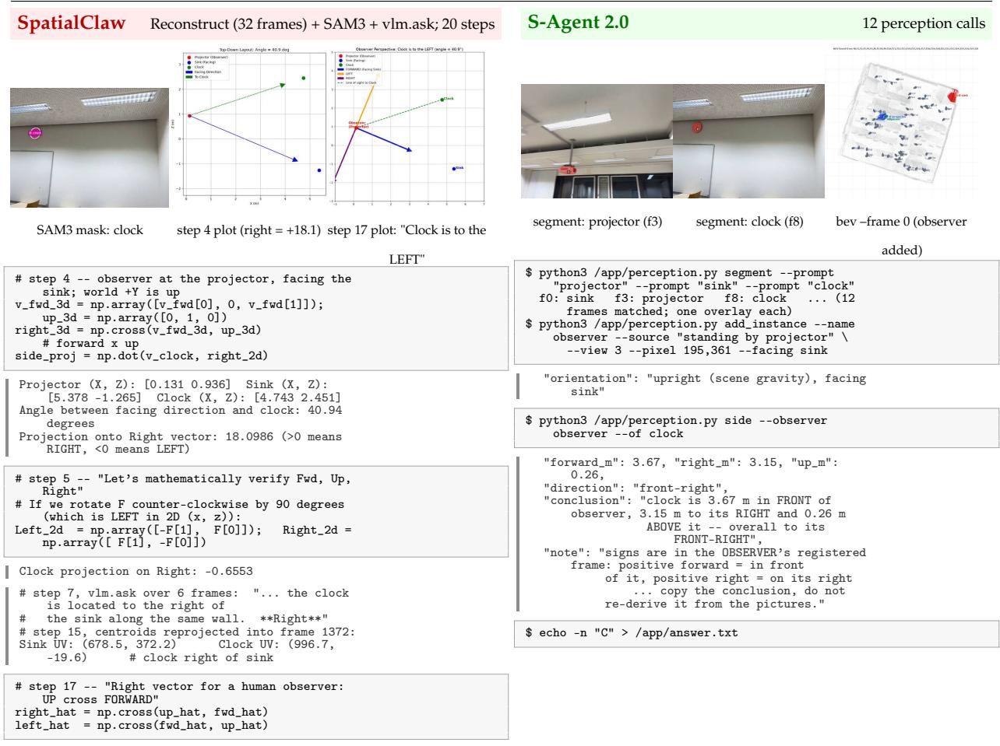  
Figure 5 | ReVSI\_5112.

S-Agent 2.0  
```shell
mouse (f3) added)
$ python3 /app/perception.py segment --prompt
"bookshelf" --prompt "light switch" --prompt
"mouse"
bookshelf: f2,f3,f6,f7,f16,f51,... mouse:
f3,f4,f6,f7,f16,f53 light switch: f14
$ python3 /app/perception.py drop --instance f23:1
# a split-off second "bookshelf" region
$ python3 /app/perception.py add_instance --name
observer --source "standing by bookshelf" \
--at-map f0:350,200 --back "light switch"
```

ReVSI\_6126 (object relative direction, backward, hard). If I am standing by the bookshelf and facing in the opposite direction of the light switch, is the mouse to my front-left, front-right, back-left, or back-right? A. back-left B. back-right C. front-right D. front-left Ground truth B. SpatialClaw answered A (back-left); S-Agent 2.0 answered B (back-right)

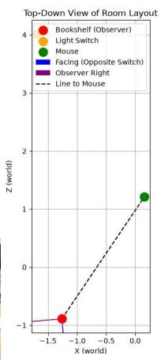

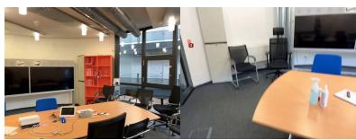

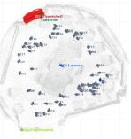

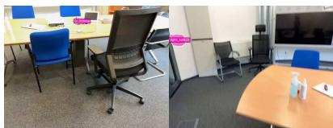

```python
# step 7 -- observer at the bookshelf, facing away
from the light switch
fwd_2d = -v_to_switch /
np.linalg.norm(v_to_switch)
fwd_3d = np.array([fwd_2d[0], 0.0, fwd_2d[1]]);
up_3d = np.array([0.0, 1.0, 0.0])
right_3d = np.cross(fwd_3d, up_3d)
# forward x up
Centroid Shelf: [-1.261 2.755 -0.890] Mouse:
[0.158 1.515 1.211] Switch: [-1.688 -0.277
4.007]
Forward component (positive = front, negative =
back):-1.970
Right component (positive = right, negative =
left): 1.596
Calculated quadrant: back-right (B)
# step 8 -- "Let's test the cross product
convention:
# Standard 3D ri ht-handed coordinate frame:
# X = right, Y = up, Z = forward."
print("f x u:", np.cross(f_test, u_test)) # should
be (-1, 0, 0) -> this is LEFT!
print("u x f:", np.cross(u_test, f_test)) # (1, 0,
0) -> this is RIGHT!
right_correct = np.array([fwd_2d[1], -fwd_2d[0]])
# = up x forward
f x u: [-1 0 0]
u x f: [1 0 0]
Correct dot_fwd: -1.970 (positive = front,
negative = back)
Correct dot_right: -1.596 (positive = right,
negative = left)
Final Answer: A
```  
Figure 6 | ReVSI\_6126.

ReVSI\_4065 (relative distance, closest object). Measuring from the closest point of each object, which of these objects (sink, chair, door, pillar) is the closest to the ceiling-mounted projector? A. sink B. chair C. door D. pillar Ground truth B. SpatialClaw answered D (pillar); S-Agent 2.0 answered B (chair).  
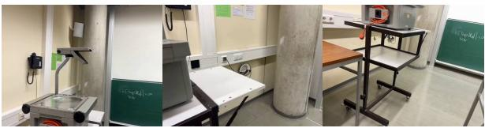

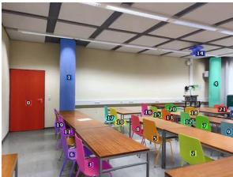

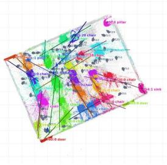  
Figure 7 | ReVSI\_4065.

MMSI-Bench 677 (camera motion, forward/backward). Continuous shootingfrom afirst-person perspective, with the direction the camera is facing as the front, in which direction is the camera moving?   
A. Left B. Forward C. Backward D. Right   
Ground truth C. SpatialClaw answered B (Forward); S-Agent 2.0 answered C (Backward).

image 1  
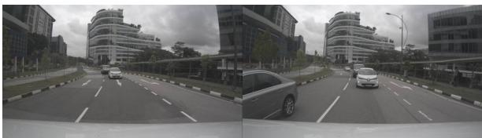

SpatialClaw

Reconstruct + vlm.ask + vlm.locate; 4 steps

# step 0   
recon = tools.Reconstruct.Reconstruct(InputImages)   
pose0, pose1 = recon.extrinsics[fi0],   
recon.extrinsics[fi1]   
translation\_world = pose1[:3, 3] - pose0[:3, 3]   
d\_fwd = np.dot(translation\_world, pose0[:3, 2])   
# camera forward column   
Translation in world: [-0.40627634 -0.34786453   
11 62174324]   
d\_right (camera local X): -0.4066 m   
d\_down (camera local Y): 0.3478 m   
d\_fwd (camera local Z): -11.6217 m   
# step 1, vlm.ask(InputImages, "... in which   
direction is the camera/vehicle moving ...")   
- The road markings (such as the directional   
arrows and lane divider dashes) move downward   
toward the bottom of the frame and become   
larger, indicating the camera is approaching   
them.   
Therefore, the camera/vehicle is moving   
\*\*Forward\*\*.   
# step 2, model text:   
Look at ‘pose0[:3, 2]‘ which is approximately ‘[0,   
0, -1]‘. That means in world coordinates,   
the camera’s forward direction is ‘-Z‘!   
Wait! If translation in world is ‘+11.62‘   
along   
‘+Z‘, does that mean pos1 has Z = +11.62 while   
pos0 has Z = 0?   
# step 3, model text:   
In Frame 0, there is a forward arrow at (484, 575)   
right in front of the car’s hood. In Frame 1,   
the arrow has disappeared under the bottom of the   
camera’s field of view!   
This clearly indicates the camera is moving   
forward down the road.   
[ReturnAnswer] Answer submitted: B  
Figure 8 | MMSI-Bench 677.

S-Agent 2.0

2 perception calls

"kind": "camera pair", "from": "camera:f0", "to": "camera:f1", "turn": "none",   
"conclusion": "from camera:f0 to camera:f1 the camera moved 10.85 m BACKWARD, 0.28 m to its LEFT, 0.74 m DOWN; kept its heading (turn < 3 deg)",   
"note": "relative pose between the two camera instants: movement is in the FIRST camera’s gravity-aligned ground frame ... Copy the conclusion -- do not re-derive camera motion from the pictures"

\$ echo -n "C" > /app/answer.txt

image 2

MMSI-Bench 363 (camera motion, egocentric). The images are taken continuously from a first-person perspective. In which direction are you moving (with the front in image 1 as the forward direction)?   
A. Front right B. Right C. Front left D. Forward   
Ground truth C. SpatialClaw answered D (Forward); S-Agent 2.0 answered C (Front left).

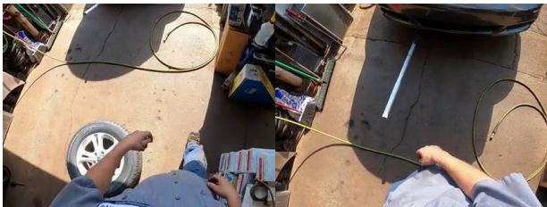  
image 1

SpatialClaw

Reconstruct + vlm.ask + vlm.locate; 4 steps

S-Agent 2.0

3 perception calls

# step 0   
recon = tools.Reconstruct.Reconstruct(InputImages)   
translation\_world = cam\_pos1 - cam\_pos0   
dot\_fwd = np.dot(translation\_world, cam\_fwd0)   
dot\_right = np.dot(translation\_world, cam\_right0)   
angle\_deg = np.degrees(np.arctan2(dot\_right,   
dot fwd))   
Translation world: [-0.30334115 0.79471068   
-0.543456911   
dot fwd (in camera 0 frame): 0.5389   
dot\_right (in camera 0 frame): -0.2760   
Azimuth angle (0=forward, +90=right, -90=left):   
-27.12 degrees   
# step 1, vlm.ask(InputImages, "... track   
stationary landmarks ... conclude with the   
most accurate option"):   
2. \*\*Ground Crack and Jack Handle:\*\* ... remain in   
nearly the same relative lateral position   
... confirming little to no lateral   
translation.   
Therefore, the person simply moved straight ahead.   
\*\*Correct Answer:\*\* \*\*D: Forward\*\*   
# step 3, model text:   
In egocentric action / navigation datasets (like   
Ego4D / EPIC-KITCHENS / Charades-Ego), walking   
forward towards the target object (the car) is   
categorized as "Forward". ... Both visual   
inspection and the VLM reasoner conclude: ... D:   
Forward   
[ReturnAnswer] Answer submitted: D  
Figure 9 | MMSI-Bench 363.

\$ python3 /app/perception.py recon \$ python3 /app/perception.py motion --of camera:f0 --of camera:f1

"conclusion": "from camera:f0 to camera:f1 the camera moved 0.74 m FORWARD, 0.32 m to its LEFT, 0.67 m UP; turned 8 deg CLOCKWISE (to its right); tilted its view 20 deg DOWN; its sideways lean changed by -5 deg ..."

\$ python3 /app/perception.py side --view 0 --of camera:f1

"forward\_m": 0.74, "right\_m": -0.32, "up\_m": 0.67, "direction": "front-left",   
"conclusion": "camera:f1 is 0.74 m in FRONT of camera:f0, 0.32 m to its LEFT and 0.67 m ABOVE it -- overall to its FRONT-LEFT",   
"note": "the observer is a CAMERA, so the frame is its gravity-aligned ground heading ... camera tilt cannot skew these. direction is the combined eight-way word ..."

\$ echo -n "C" > /app/answer.txt

MMSI-Bench 223 (positional relationship, object–object, cardinal). The bedside table near the windowfaces north relative to the television; where is the light switch in the room located? A. Southeast corner B. Northwest corner C. Near the east wall D. Near the west wall Ground truth C. SpatialClaw answered D (west wall); S-Agent 2.0 answered C (east wall).

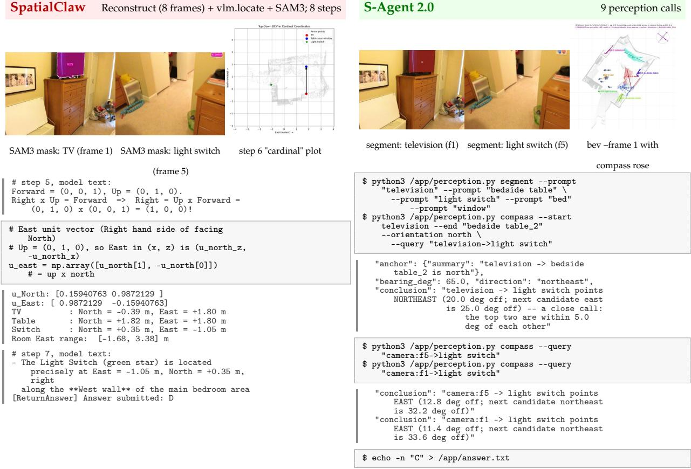  
Figure 10 | MMSI-Bench 223.