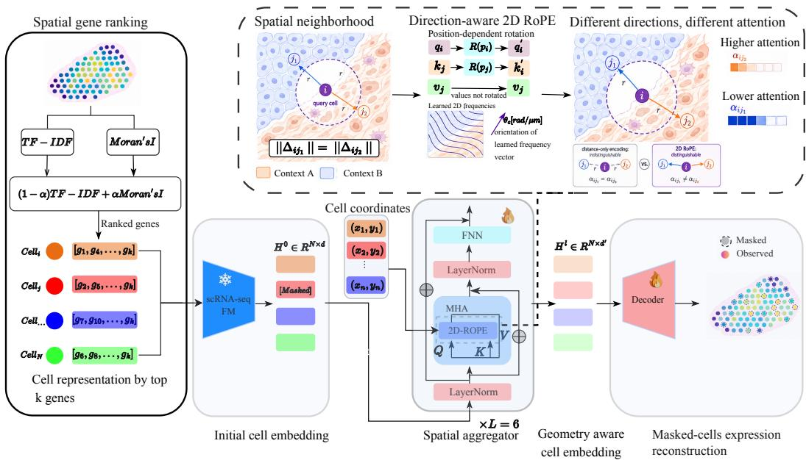
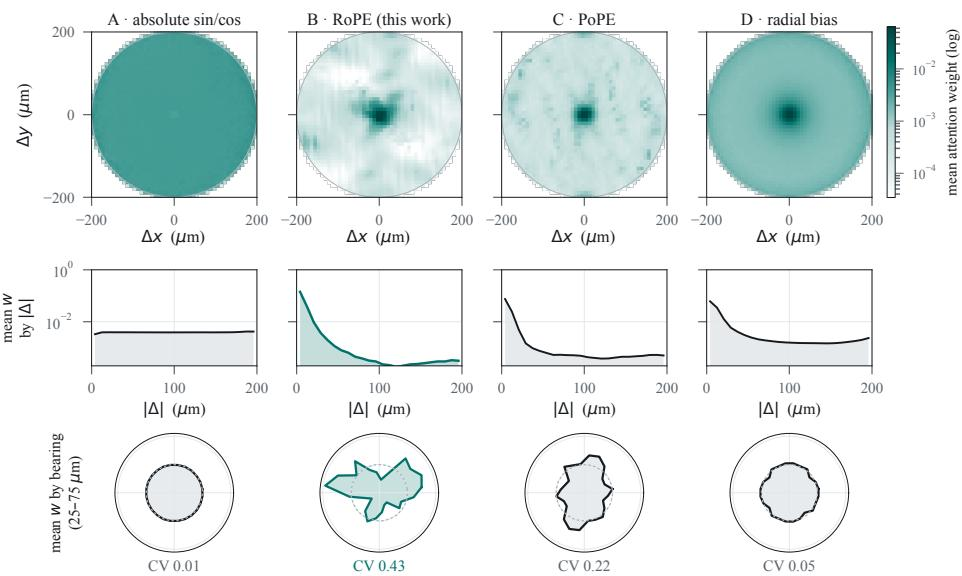
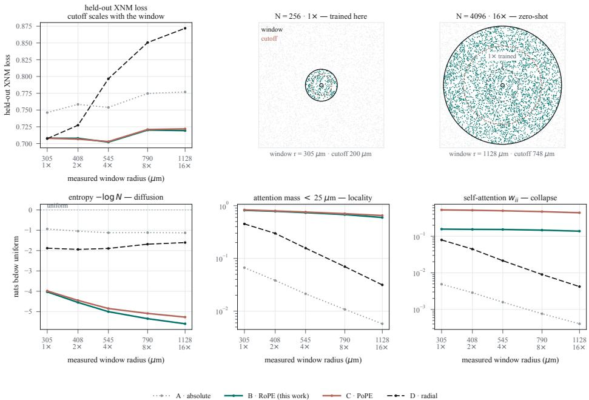
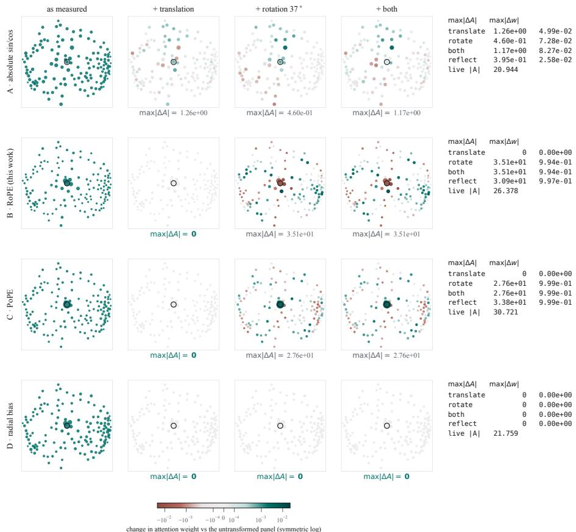
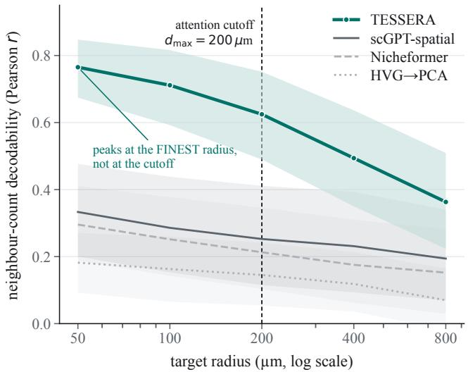

# Spatially Informed and Direction Sensitive Representation Learning for Spatial Transcriptomics

Azim Dehghani Amirabad1∗ Ali Khodabandeh Yalabadi1∗ Artem Moskalev2

Yun-Ching Chen1 Mehdi Pirooznia1 Scott Oloff1 Rui Liao1† 1Johnson & Johnson Innovative Medicine 2Independent Researcher

## Abstract

Cellular states are shaped by both intrinsic gene expression programs and the spatial microenvironment in which cells reside. Spatial transcriptomics makes this context measurable, but effective representation learning requires capturing both spatially informative molecular signals and intercellular organization. Existing approaches address these challenges only partially: conventional gene selection can overlook spatially structured signals, while methods for encoding cell–cell relationships often either reduce a cell’s microenvironment to proximity alone, discarding direction, or rely on absolute coordinates tied to an arbitrary tissue frame. Consequently, cells with similar neighbor distances but distinct spatial organization may receive overly similar representations, despite experiencing different biological contexts that shape their cellular states. We introduce Tessera, a spatial representation learning framework that addresses both molecular selection and cellular context. Tessera combines spatially informed gene selection with a geometric inductive bias that contextualizes each cell within its local tissue environment. By modeling relative cell–cell relationships, Tessera is translation-invariant while preserving direction, allowing neighboring cells to contribute differently according to their spatial context and cellular state. Across held-out tissues and technologies, Tessera outperforms existing spatial foundation models in representation quality and generalizes zeroshot to contexts up to 16× larger than those seen during training.

## 1 Introduction

Spatial transcriptomics (ST) measures gene expression while preserving the physical organization of cells within tissue, enabling cellular states to be studied in their native spatial context [29, 30]. Because cellular phenotypes are shaped by neighboring cells, local signaling, and tissue organization, spatial context is an integral component of cellular state. This is particularly relevant to drug discovery, where therapeutic targets, mechanisms of action, and treatment response can depend on the tissue context in which molecular programs arise [20, 5]. Learning transferable representations that jointly capture cellular state and spatial context could therefore support context-aware target discovery, biomarker identification, and patient stratification across tissues and disease settings [2].

Recent foundation models have demonstrated the value of large-scale representation learning for single-cell transcriptomics [7, 10], motivating their extension to spatial omics [28, 34, 4]. Spatial data introduce two complementary challenges for representation learning: (i) selecting spatially informative genes to represent each cell, and (ii) leveraging intercellular spatial relationships to capture cellular states within their native tissue context. Existing gene-selection strategies capture only part of the information needed for the first challenge. Highly expressed genes can be dominated by broadly expressed housekeeping programs [24, 11], HVGs prioritize expression variability without explicitly accounting for spatial organization [25], and SVGs emphasize tissue-level spatial patterns without considering the cell-specific informativeness of each gene [27, 6, 15].

  
Figure 1: TESSERA learns spatially contextualized cell representations in two stages. Spatially informed ranking (SIR) selects spatially informative genes to represent cells, encoded by a pretrained scRNA-seq foundation model. The resulting cell embeddings are then contextualized by a geometry-aware aggregator with 2D-RoPE, letting neighbors contribute according to their relative distance and direction while remaining translation-invariant. Learning proceeds by masking cells and reconstructing masked cell expression from their spatial neighborhood.

The second challenge is to encode the spatial context that shapes cellular state. A cell’s microenvironment is inherently relational: neighboring cells influence its state through their spatial organization relative to the cell of interest, rather than through absolute slide coordinates. Existing approaches represent this context using neighborhood or graph structure, pairwise distances, or absolute positional information [32, 34, 4]. Each captures only part of the underlying tissue geometry: neighborhoodbased encodings discretize continuous spatial relationships, pairwise distance preserves proximity but discards direction, and absolute coordinates retain direction but depend on an arbitrary tissue frame. Yet tissue organization can be directionally structured [13, 4], so equally distant cells may provide distinct biological context. This motivates representing thefull relative displacement between cells, preserving both distance and direction while remaining independent of absolute position.

To address these complementary gaps, we introduce Tessera, a spatial representation learning framework that jointly models spatially informative gene expression and the relative organization of surrounding cells. For each cell, Tessera constructs a spatially informed top gene set k by combining cell specific expression signals with tissue level spatial expression patterns, and encodes the resulting cell profile with a pretrained scRNA-seq foundation model [7]. The resulting cell embeddings are then contextualized through displacement-relative spatial attention, instantiated with two-dimensional RoPE [26]. This imposes a geometric inductive bias that preserves both distance and direction, allowing the model to distinguish similarly distant cells that provide different biological contexts rather than treating them as equivalent based on proximity alone. The resulting spatial representation is biologically grounded and highly transferable, consistently improving expression imputation across held-out tissues and technologies and generalizing zero-shot to spatial contexts up to 16× larger than those seen during training.

Our main contributions are: (i) a spatially informed gene-ranking strategy that integrates celllevel and tissue-level measures of spatial gene informativeness; and (ii) direction-sensitive spatial attention that is translation-invariant while preserving relative distance, direction, and physical spatial scale.

## 2 Spatially informed gene ranking

To construct informative gene sets for each cell, we introduce spatially informed ranking (SIR), which combines cell-specific expression relevance with tissue-level spatial structure. TF–IDF assigns each gene a cell-specific score that favors genes enriched in that cell but less ubiquitous across the section, while Moran’s I measures tissue-level spatial autocorrelation. Because these statistics lie on different scales, we combine their ranks rather than their raw values to construct a spatially informed gene ranking for each cell[1]. The complete formulation and implementation details are provided in Appendix C.

## 3 Direction-Sensitive Attention for Spatial Transcriptomics

Let $\mathbf { c } _ { i }$ denote the representation of cell i and $\mathbf { p } _ { i } \in \mathbb { R } ^ { 2 }$ its physical position in micrometres. We seek to contextualize each cell using the geometry of surrounding cells without tying the representation to the arbitrary coordinate origin of a tissue section. Existing approaches encode spatial context through absolute positions, pairwise distances, or neighborhood graphs [32, 34, 4], but these representations retain different aspects of the underlying geometry. We instead model the full relative displacement

$$
\Delta _ { i j } = { \bf p } _ { j } - { \bf p } _ { i } ,
$$

between cells i and $j .$ . This induces three desirable properties:

(i) Translation invariance: attention depends on relative displacement, and is therefore independent of the tissue-section origin.

(ii) Direction sensitivity: both the distance and bearing of neighboring cells are retained, allowing equally distant cells to provide distinct spatial context.

(iii) Physical-scale parameterization: spatial relationships are expressed in physical units, providing a consistent notion of distance across technologies.

We realize this geometric inductive bias using two-dimensional RoPE [26], adapting rotary positional encoding to continuous tissue coordinates. Spatial frequencies are parameterized in radians per micrometre, so the attention interaction depends on relative cell displacement while retaining both distance and direction.

RoPE. For each attention head of width $d _ { h } .$ , we split the head into $d _ { h } / 2$ two-dimensional planes. Plane c has a learnable frequency ${ \pmb \theta } _ { c } \in \mathbb { R } ^ { 2 }$ , defining the phase

$$
\psi _ { c } ( \mathbf { p } ) = \pmb { \theta } _ { c } ^ { \top } \mathbf { p } .\tag{1}
$$

Stacking the corresponding planar rotations gives the block-diagonal matrix

$$
\mathbf { R } ( \mathbf { p } ) = \mathrm { d i a g } _ { c } \ \mathbf { R } _ { 2 } ( { \psi } _ { c } ( \mathbf { p } ) ) ,\tag{2}
$$

where

$$
\mathbf { R } _ { 2 } ( \psi ) = { \binom { \cos \psi } { \sin \psi } } \quad { \stackrel { - \sin \psi } { \cos \psi } } \quad \cos \psi .\tag{3}
$$

The attention logit for head h is

$$
A _ { i j } ^ { ( h ) } = \frac { \left. \mathbf { R } ( \mathbf { p } _ { i } ) \mathbf { W } _ { Q } ^ { ( h ) } \mathbf { c } _ { i } , \mathbf { R } ( \mathbf { p } _ { j } ) \mathbf { W } _ { K } ^ { ( h ) } \mathbf { c } _ { j } \right. } { \sqrt { d _ { h } } } + m _ { i j } , \qquad m _ { i j } = \left\{ \begin{array} { l l } { 0 , } & { \mathrm { \ i d } _ { i j } \| \le d _ { \operatorname* { m a x } } , } \\ { - \infty , } & { \mathrm { \ o t h e r w i s e } , } \end{array} \right.\tag{4}
$$

where $\mathbf { c } _ { i } \in \mathbb { R } ^ { d }$ is the cell token from the frozen encoder (Fig. 1), $\mathbf { W } _ { Q } ^ { ( h ) } , \mathbf { W } _ { K } ^ { ( h ) } \in \mathbb { R } ^ { d _ { h } \times d }$ are the query and key projections, and $d _ { \operatorname* { m a x } } = 2 0 0 \mu \mathrm { m }$ . The values are left unrotated, so the positional transformation affects how cell representations are compared rather than what is transported; $m _ { i j }$ is a hard spatial cutoff rather than a learned function of distance.

Define

$$
\mathbf { q } _ { i } ^ { ( h ) } = \mathbf { W } _ { Q } ^ { ( h ) } \mathbf { c } _ { i } , \qquad \mathbf { k } _ { j } ^ { ( h ) } = \mathbf { W } _ { K } ^ { ( h ) } \mathbf { c } _ { j } .\tag{5}
$$

Because planar rotations compose additively and $\psi _ { c }$ is linear,

$$
\left. \mathbf { R } ( \mathbf { p } _ { i } ) \mathbf { q } _ { i } ^ { ( h ) } , \mathbf { R } ( \mathbf { p } _ { j } ) \mathbf { k } _ { j } ^ { ( h ) } \right. = \mathbf { q } _ { i } ^ { ( h ) \top } \mathbf { R } ( \Delta _ { i j } ) \mathbf { k } _ { j } ^ { ( h ) } .\tag{6}
$$

Table 1: Impact of spatial geometry. Held-out expression-imputation Pearson correlation across nine sections. $\Delta$ and t are paired section-wise comparisons with TESSERA. The geometry-free ablation differs only by removing positional information.
<table><tr><td>Predictor</td><td>Pearson r</td><td>∆ vs. TESSERA</td><td>t</td></tr><tr><td>TESSERA without geometry</td><td>0.26565</td><td>-0.18370</td><td>-10.49</td></tr><tr><td>HVG-PCA</td><td>0.29072</td><td>-0.15863</td><td>-8.22</td></tr><tr><td>scGPT (no aggregator)</td><td>0.29985</td><td>-0.14950</td><td>-7.97</td></tr><tr><td>Smoothed PCA</td><td>0.30282</td><td>-0.14653</td><td>-7.81</td></tr><tr><td>Neighbour average</td><td>0.30806</td><td>-0.14129</td><td>-7.41</td></tr><tr><td>TESSERA</td><td>0.44935</td><td></td><td></td></tr></table>

Thus, $A _ { i j } ^ { ( h ) }$ depends on position only through $\Delta _ { i j }$ , giving translation invariance by construction. Because $\pmb { \theta } _ { c }$ is a vector rather than a scalar, the relative phase $\pmb { \theta } _ { c } ^ { \top } \Delta _ { i j }$ depends on the bearing of the displacement as well as its length, giving direction sensitivity. Finally, $\lVert \pmb { \theta } _ { c } \rVert = 2 \pi / \ell _ { c }$ defines a wavelength $\ell _ { c }$ in micrometres. We initialize $\{ \ell _ { c } \}$ on a geometric grid from 10 µm to 2000 µm, with the bearings of $\pmb { \theta } _ { c }$ uniformly distributed on $[ 0 , \pi )$

PoPE. In spatial omics, cell identity and spatial location provide distinct signals, suggesting that their contributions to attention should be separable. However, RoPE may couple content and position within each query–key component [9], which can make the positional phase depend on the content being matched. PoPE removes this coupling by representing each component with a non-negative magnitude and a phase determined solely by position [9]. We therefore also adapt PoPE to continuous two-dimensional tissue coordinates. The resulting attention score takes the form

$$
A _ { i j } ^ { \mathrm { P o P E } } = \sum _ { c } \mu _ { i , c } ^ { Q } \mu _ { j , c } ^ { K } \cos \left( \pmb { \theta } _ { c } ^ { \top } \Delta _ { i j } + \delta _ { c } \right) + m _ { i j } ,\tag{7}
$$

where $\mu _ { i , c } ^ { Q } , \mu _ { j , c } ^ { K } \geq 0$ are the query and key magnitudes, ${ \pmb \theta } _ { c } \in \mathbb { R } ^ { 2 }$ is a spatial frequency, and $\delta _ { c }$ is a fixed phase offset. This preserves the displacement-relative, direction-sensitive geometry of RoPE while removing the content-dependent phase interaction, providing a controlled alternative under the same physical-scale parameterization.

Learning objective. We train Tessera with cross-cell masked reconstruction, holding out 10% of cells in each window by replacing their cell embeddings with a learned mask token while retaining their coordinates. Because no expression-derived information from a masked cell enters the spatial attention module, its profile must be inferred from neighboring cells and their geometry. A genewise negative-binomial decoder reconstructs raw counts, with loss computed only on masked cells; gradients update only the spatial aggregator and decoder. Full masking, offset, and likelihood details are provided in Appendix D.

## 4 Experiments

We organize our experiments around the main design choices of Tessera. We first evaluate spatially informed gene ranking (Appendix F), then isolate the contribution of spatial geometry and compare positional encodings under a controlled architecture. We next characterize the learned attention in terms of locality, direction sensitivity, and invariance, and assess zero-shot extrapolation beyond the spatial scale seen during training. Finally, we benchmark Tessera against existing spatial foundation models. Models, optimization, and the full experimental protocol are described in Appendix E.

## 4.1 Impact of spatial geometry

TESSERA outperforms all non-geometric baselines on every held-out section (Table 1), improving Pearson correlation by +0.141 over the strongest baseline and by +0.184 over the otherwise identical geometry-free ablation. The gain is consistent across seeds, and coordinate-permutation controls further confirm that the improvement arises from spatial geometry (Appendix E).

## 4.2 Relative geometry drives performance

Holding the architecture and training protocol fixed, we vary only the positional encoding. Absolute sinusoidal encoding provides negligible improvement (+0.0005), whereas relative encodings improve Pearson correlation by +0.160–0.174 across all nine sections. RoPE performs best among the relative variants, although differences within this group are small and treated as descriptive. Beyond predictive performance, the learned attention patterns reveal distinct spatial behaviors (Fig. 2). Relative encodings exhibit spatial locality, while RoPE shows the strongest directional variation within a fixed distance range, in contrast to the approximately isotropic distance-only bias. Full positional-encoding results and angular analyses are provided in Appendix G, with per-section results in Table 8.

  
Figure 2: Direction sensitivity of learned spatial attention. Attention patterns for four positional encodings on a held-out MERSCOPE breast tissue section. Top: Mean attention weights as a function of relative cell displacement, aggregated across eight attention heads using a shared logarithmic scale. Middle: Radial attention profiles showing spatial locality. Bottom: Angular attention profiles within a fixed 25–75 µm distance range, normalized by their mean. The coefficient of variation (CV) quantifies directional sensitivity, with higher values indicating stronger anisotropy. RoPE exhibits the strongest directional variation (CV = 0.43), while the distance-only bias remains approximately isotropic (CV = 0.05).

## 4.3 Invariance and spatial extrapolation

Directional encoding raises a natural question: tissue sections have no canonical orientation, so why preserve direction rather than enforce rotation invariance? While absolute orientation is arbitrary, relative direction can still carry biological information because local tissue organization is often anisotropic: cells at the same distance but different bearings may occupy distinct spatial contexts and therefore provide different signals about cellular state. Translation invariance removes dependence on the arbitrary section origin while preserving these relative directional relationships. RoPE and PoPE therefore retain direction by design, whereas a distance-only bias is isotropic and cannot distinguish equally distant cells at different bearings (Appendix G). Transformation tests confirm that RoPE and PoPE preserve attention under translation but change it under rotation, whereas the radial distance bias remains invariant to both (Fig. 4; Table 6).

This relative formulation also supports spatial extrapolation. Because displacement-based encodings are defined continuously in physical space, they can be evaluated beyond the spatial scale observed during training, whereas fixed-range distance representations are tied to their predefined support. When evaluated zero-shot from N = 256 to N = 4096 cells, RoPE and PoPE exhibit only 1.6% and 2.0% degradation, respectively, compared with 23% for the fixed-range distance bias (Fig. 3). The corresponding attention statistics further characterize how locality and attention concentration evolve as the spatial context expands. Additional analyses are provided in Appendix H.

Table 2: Comparison with spatial foundation models. Linear probes are trained on identical training-cell budgets and evaluated on the same nine held-out sections. $L e f t { \mathrm { : } }$ neighborhood-density prediction from individual cell embeddings (Pearson r, 95% CI). Right: within- and cross-platform transfer between Xenium (X) and MERSCOPE (M).
<table><tr><td rowspan="2">Model</td><td colspan="2">Neighbourhood density</td><td colspan="4">Transfer (r)</td></tr><tr><td>r</td><td>95% CI</td><td>X→X</td><td>M→M</td><td>M→X</td><td>X→M</td></tr><tr><td>HVG→PCA</td><td>0.1452</td><td>[0.0543, 0.2414]</td><td>0.187</td><td>0.110</td><td>-0.032</td><td>0.034</td></tr><tr><td>Nicheformer</td><td>0.2130</td><td>[0.1037, 0.3459]</td><td>0.349</td><td>0.173</td><td>0.237</td><td>0.004</td></tr><tr><td>scGPT-spatial</td><td>0.2526</td><td>[0.1150, 0.4112]</td><td>0.389</td><td>0.209</td><td>0.125</td><td>0.037</td></tr><tr><td>TESSERA</td><td>0.6246</td><td>[0.4897, 0.7517]</td><td>0.694</td><td>0.555</td><td>0.540</td><td>0.409</td></tr></table>

  
Figure 3: Zero-shot spatial extrapolation beyond the training window. Comparison of four positional encodings as the spatial context expands from 256 (1×) to 4096 (16×) cells, without retraining or positional rescaling. Top left: Held-out cross-cell masked reconstruction loss across increasing window sizes. Top right: Illustration of the training and extrapolation windows, showing the corresponding spatial radii and scaled attention cutoffs. Bottom: Attention entropy relative to log N (left), attention mass within 25 µm (middle), and self-attention weight (right), characterizing attention diffusion, locality, and collapse. RoPE and PoPE exhibit limited performance degradation (1.6% and 2.0%, respectively), compared with 23% for the radial distance bias, demonstrating stronger zero-shot extrapolation to larger spatial contexts.

## 4.4 Comparison with spatial foundation models

TESSERA substantially outperforms existing spatial foundation models under the same linear-probe protocol, reaching $r = 0 . 6 2 4 6$ on neighborhood-density prediction versus 0.2526 for scGPT-spatial and 0.2130 for Nicheformer (Table 2). This comparison is conservative, as Nicheformer was pretrained on the evaluation sections whereas TESSERA was not. The advantage also transfers across technologies: training on Xenium and evaluating on MERSCOPE yields $r = 0 . 4 0 9$ for TESSERA versus 0.004 for Nicheformer, consistent with learning a transferable physical spatial representation. Additional radius sweeps, seed analyses, and validation controls are reported in Appendix I.

## 5 Discussion and conclusion

Tessera addresses two complementary challenges in spatial representation learning: combining cell-specific expression relevance with tissue-level spatial informativeness for gene selection, and contextualizing cellular states through intercellular spatial relationships. Its geometric inductive bias reflects a simple property of tissue organization: cellular context is relational, and equally distant cells can provide different biological information depending on their relative position and cellular state. The RoPE-based mechanism preserves this directional structure while remaining invariant to arbitrary translations of the tissue coordinate system. Importantly, we do not assume a universal tissue orientation; rather, we avoid imposing isotropy by construction, allowing locally anisotropic tissue organization to be represented. Although our current evaluation focuses on expression imputation and spatial probing, such context-aware representations could ultimately support downstream applications including spatial biomarker discovery, target prioritization, and prediction of treatment response.

## References

[1] Azim Dehghani Amirabad, Junchao Zhu, Pushpak Pati, Walid Abdelmoula, Tommaso Mansi, and Rui Liao. Pastel: Anchoring histology in spatial transcriptomics via multi-scale hierarchical bio-prior contrastive pretraining. arXiv preprint arXiv:2608.14924, 2026.

[2] Thazin N. Aung, James Monkman, Jonathan Warrell, Ioannis Vathiotis, Katherine M. Bates, Niki Gavrielatou, Ioannis P. Trontzas, Chin Wee Tan, Aileen I. Fernandez, Myrto Moutafi, Ken O’Byrne, Kurt A. Schalper, Konstantinos Syrigos, Roy S. Herbst, Arutha Kulasinghe, and David L. Rimm. Spatial signatures for predicting immunotherapy outcomes using multiomics in non-small cell lung cancer. Nature Genetics, 57(10):2482–2493, 2025. doi: 10.1038/ s41588-025-02351-7.

[3] Sebastian Birk, Irene Bonafonte-Pardàs, Adib Miraki Feriz, et al. Quantitative characterization of cell niches in spatially resolved omics data. Nature Genetics, 57:897–909, 2025.

[4] Quentin Blampey, Hakim Benkirane, Nadège Bercovici, Kevin Mulder, Grégoire Gessain, Florent Ginhoux, Fabrice André, and Paul-Henry Cournède. Novae: a graph-based foundation model for spatial transcriptomics data. Nature Methods, 22:2539–2550, 2025. doi: 10.1038/ s41592-025-02899-6.

[5] Junxian Cao, Caifeng Li, Zhao Cui, Shiwen Deng, Tong Lei, Wei Liu, Hongjun Yang, and Peng Chen. Spatial transcriptomics: A powerful tool in disease understanding and drug discovery. Theranostics, 14(7):2946–2968, 2024. doi: 10.7150/thno.95908.

[6] Carissa Chen, Hani Jieun Kim, and Pengyi Yang. Evaluating spatially variable gene detection methods for spatial transcriptomics data. Genome Biology, 25(1):18, 2024. doi: 10.1186/ s13059-023-03145-y.

[7] Haotian Cui, Chloe Wang, Hassaan Maan, Kuan Pang, Fengning Luo, Nan Duan, and Bo Wang. scGPT: toward building a foundation model for single-cell multi-omics using generative AI. Nature Methods, 21:1470–1480, 2024. doi: 10.1038/s41592-024-02201-0.

[8] David S. Fischer, Anna C. Schaar, and Fabian J. Theis. Modeling intercellular communication in tissues using spatial graphs of cells. Nature Biotechnology, 41:332–336, 2023.

[9] Anand Gopalakrishnan, Róbert Csordás, Jürgen Schmidhuber, and Michael C. Mozer. Decoupling the “what” and “where” with polar coordinate positional embeddings. In International Conference on Machine Learning (ICML), 2026. arXiv:2509.10534.

[10] Minsheng Hao, Jing Gong, Xin Zeng, Chiming Liu, Yucheng Guo, Xingyi Cheng, Taifeng Wang, Jianzhu Ma, Xuegong Zhang, and Le Song. Large-scale foundation model on single-cell transcriptomics. Nature Methods, 21:1481–1491, 2024. doi: 10.1038/s41592-024-02305-7.

[11] Bryan He, Ludvig Bergenstråhle, Linnea Stenbeck, Abubakar Abid, Alma Andersson, Åke Borg, Jonas Maaskola, Joakim Lundeberg, and James Zou. Integrating spatial gene expression and breast tumour morphology via deep learning. Nature Biomedical Engineering, 4(8):827–834, 2020. doi: 10.1038/s41551-020-0578-x.

[12] Byeongho Heo, Song Park, Dongyoon Han, and Sangdoo Yun. Rotary position embedding for vision transformer. In European Conference on Computer Vision (ECCV), 2024.

[13] Jian Hu, Xiangjie Li, Kyle Coleman, Amelia Schroeder, Nan Ma, David J. Irwin, Edward B. Lee, Russell T. Shinohara, and Mingyao Li. Spagcn: Integrating gene expression, spatial location and histology to identify spatial domains and spatially variable genes by graph convolutional network. Nature Methods, 18:1342–1351, 2021. doi: 10.1038/s41592-021-01255-8.

[14] John Jumper, Richard Evans, Alexander Pritzel, et al. Highly accurate protein structure prediction with AlphaFold. Nature, 596:583–589, 2021.

[15] Yuchen Liang, Guowei Shi, Runlin Cai, Yuchen Yuan, Ziying Xie, Long Yu, Yingjian Huang, Qian Shi, Lizhe Wang, Jun Li, et al. Prost: quantitative identification of spatially variable genes and domain detection in spatial transcriptomics. Nature Communications, 15:600, 2024. doi: 10.1038/s41467-024-44835-w.

[16] Hiren Madhu, Joao Felipe Rocha, et al. HEIST: A graph foundation model for spatial transcriptomics and proteomics data. arXiv preprint arXiv:2506.11152, 2025.

[17] Patrick A. P. Moran. Notes on continuous stochastic phenomena. Biometrika, 37(1/2):17–23, 1950.

[18] Sophie Ostmeier, Brian Axelrod, Michael Moseley, Akshay Chaudhari, and Curtis Langlotz. LieRE: Generalizing rotary position encodings. arXiv preprint arXiv:2406.10322, 2024.

[19] Giovanni Palla, Hannah Spitzer, Michal Klein, et al. Squidpy: a scalable framework for spatial omics analysis. Nature Methods, 19:171–178, 2022.

[20] Zhengyuan Pang, Benjamin F. Cravatt, and Li Ye. Deciphering drug targets and actions with single-cell and spatial resolution. Annual Review ofPharmacology and Toxicology, 64:507–526, 2024. doi: 10.1146/annurev-pharmtox-033123-123610.

[21] Anna C. Schaar, Alejandro Tejada-Lapuerta, Giovanni Palla, and Fabian J. Theis. Nicheformer: a foundation model for single-cell and spatial omics. Nature Methods, 2025.

[22] Connor Schenck, Isaac Reid, Mithun George Jacob, et al. Learning the RoPEs: Better 2D and 3D position encodings with STRING. In International Conference on Machine Learning (ICML), 2025.

[23] Muhammed Shuaibi, Adeesh Kolluru, Abhishek Das, Aditya Grover, Anuroop Sriram, Zachary Ulissi, and C. Lawrence Zitnick. Rotation invariant graph neural networks using spin convolutions. arXiv preprint arXiv:2106.09575, 2021.

[24] Rory Stark, Marta Grzelak, and James Hadfield. Rna sequencing: the teenage years. Nature Reviews Genetics, 20(11):631–656, 2019. doi: 10.1038/s41576-019-0150-2.

[25] Tim Stuart, Andrew Butler, Paul Hoffman, Christoph Hafemeister, Efthymia Papalexi, William M. Mauck, Yuhan Hao, Marlon Stoeckius, Peter Smibert, and Rahul Satija. Comprehensive integration of single-cell data. Cell, 177(7):1888–1902.e21, 2019. doi: 10.1016/j.cell. 2019.05.031.

[26] Jianlin Su, Murtadha Ahmed, Yu Lu, Shengfeng Pan, Wen Bo, and Yunfeng Liu. RoFormer: Enhanced transformer with rotary position embedding. Neurocomputing, 568:127063, 2024.

[27] Shiquan Sun, Jiaqiang Zhu, and Xiang Zhou. Statistical analysis of spatial expression patterns for spatially resolved transcriptomic studies. Nature Methods, 17(2):193–200, 2020. doi: 10.1038/s41592-019-0701-7.

[28] Alejandro Tejada-Lapuerta, Anna C. Schaar, Robert Gutgesell, Giovanni Palla, Lennard Halle, Mariia Minaeva, Larsen Vornholz, Leander Dony, Francesca Drummer, Till Richter, et al. Nicheformer: a foundation model for single-cell and spatial omics. Nature Methods, 22: 2525–2538, 2025. doi: 10.1038/s41592-025-02814-z.

[29] Luyi Tian, Fei Chen, and Evan Z. Macosko. The expanding vistas of spatial transcriptomics. Nature Biotechnology, 41:773–782, 2023. doi: 10.1038/s41587-022-01448-2.

[30] Benjamin L. Walker, Zixuan Cang, Honglei Ren, Eric Bourgain-Chang, and Qing Nie. Deciphering tissue structure and function using spatial transcriptomics. Communications Biology, 5: 220, 2022. doi: 10.1038/s42003-022-03175-5.

[31] Chloe X. Wang, Haotian Cui, Andrew H. Zhang, Ronald Xie, Hani Goodarzi, and Bo Wang. scgpt-spatial: continual pretraining of single-cell foundation model for spatial transcriptomics. bioRxiv, 2025. doi: 10.1101/2025.02.05.636714.

[32] Hongzhi Wen, Wenzhuo Tang, Xinnan Dai, Jiayuan Ding, Wei Jin, Yuying Xie, and Jiliang Tang. CellPLM: Pre-training of cell language model beyond single cells. In International Conference on Learning Representations (ICLR), 2024.

[33] Chengxuan Ying, Tianle Cai, Shengjie Luo, et al. Do transformers really perform badly for graph representation? In Advances in Neural Information Processing Systems (NeurIPS), 2021.

[34] Suyuan Zhao, Yizhen Luo, Ganbo Yang, Yan Zhong, Hao Zhou, and Zaiqing Nie. SToFM: a multi-scale foundation model for spatial transcriptomics. In Proceedings ofthe 42nd International Conference on Machine Learning, volume 267 of Proceedings ofMachine Learning Research, pages 77589–77607. PMLR, 2025.

[35] Gengmo Zhou, Zhifeng Gao, Qiankun Ding, et al. Uni-Mol: A universal 3D molecular representation learning framework. In International Conference on Learning Representations (ICLR), 2023.

## A Related work

The taxonomy of §1 separates spatial models by whether the continuous displacement between two cells ever reaches attention. It does not in Nicheformer [21], which never consumes coordinates during pretraining and relies on expression to carry the spatial trace. It is collapsed to an unweighted mean in scGPT-spatial [31], a choice made deliberately so that the model transfers between sections. It enters absolutely in CellPLM [32], as sinusoidal embeddings of $( x , y )$ . It enters as an isotropic scalar in SToFM [34], whose SE(2) Transformer is adopted from the molecular model of Zhou et al. [35] and whose distance matrix is described as ensuring SE(2) invariance in a straightforward manner. And it is binarised in the graph models [4, 16, 3].

Rotary encodings were introduced for one-dimensional token sequences [26]. Extending them beyond one dimension requires a commuting-generator construction, developed for vision transformers by Heo et al. [12], generalised by Ostmeier et al. [18], and given exact-invariance guarantees for arbitrary-dimensional continuous coordinates by Schenck et al. [22]. PoPE [9] argues that the rotary phase entangles content with position, because the two-dimensional subcomponents of the query and key carry a content-dependent angle that adds to the positional rotation, and removes it by applying a softplus so that every subcomponent has a positive first coordinate and a zero second. Our contribution is not the encoding but its application to physical tissue coordinates, the physical-units parameterisation that makes learned scales cross-platform, the controlled four-way comparison of §4.2, and the extrapolation result of §4.3.

Adding a learned function of pairwise distance to an attention logit originates with structure-aware graph and molecular transformers [33, 35, 14, 23]

## B Proof of exact translation invariance

Proof. By the block-diagonal construction of the rotary encoding,

$$
\begin{array} { r } { \mathbf { R } ( \mathbf { p } ) ^ { \top } \mathbf { R } ( \mathbf { p } ^ { \prime } ) = \displaystyle \bigoplus _ { c } \mathbf { R } _ { 2 } ( \psi _ { c } ( \mathbf { p } ) ) ^ { \top } \mathbf { R } _ { 2 } ( \psi _ { c } ( \mathbf { p } ^ { \prime } ) ) } \\ { = \displaystyle \bigoplus _ { c } \mathbf { R } _ { 2 } ( \psi _ { c } ( \mathbf { p } ^ { \prime } ) - \psi _ { c } ( \mathbf { p } ) ) . } \end{array}\tag{8}
$$

Since the planar rotations compose additively and $\psi _ { c } ( \mathbf { p } ) = \pmb { \theta } _ { c } ^ { \top } \mathbf { p }$ is linear,

$$
\psi _ { c } ( \mathbf { p } ^ { \prime } ) - \psi _ { c } ( \mathbf { p } ) = \psi _ { c } ( \mathbf { p } ^ { \prime } - \mathbf { p } ) .
$$

Consequently,

$$
\mathbf { R } ( \mathbf { p } ) ^ { \top } \mathbf { R } ( \mathbf { p } ^ { \prime } ) = \mathbf { R } ( \mathbf { p } ^ { \prime } - \mathbf { p } ) .
$$

Substituting into the attention inner product in Eq. (4) gives

$$
\begin{array} { r } { \langle { \bf R } ( { \bf p } _ { i } ) { \bf q } _ { i } , { \bf R } ( { \bf p } _ { j } ) { \bf k } _ { j } \rangle = { \bf q } _ { i } ^ { \top } { \bf R } ( \Delta _ { i j } ) { \bf k } _ { j } , \qquad \Delta _ { i j } = { \bf p } _ { j } - { \bf p } _ { i } . } \end{array}\tag{9}
$$

Thus, the attention logit depends on spatial coordinates only through relative displacement, establishing exact translation invariance. □

Numerical verification. We additionally verified the relative-phase identity numerically in float64, obtaining a maximum absolute deviation of $5 . 7 \times 1 0 ^ { - 1 4 }$ . The result remained unchanged under a translation of (12.3, −8.9) mm, consistent with the analytical result.

Extension to PoPE. The same translation-invariance property holds for the two-dimensional adaptation of PoPE. With spatial phase $\psi _ { c } ( \mathbf { p } ) = \pmb { \theta } _ { c } ^ { \top } \mathbf { p }$ , the attention logit is

$$
A _ { i j } ^ { \mathrm { P o P E } } = \sum _ { c } \mu _ { i , c } ^ { Q } \mu _ { j , c } ^ { K } \cos \left( \pmb { \theta } _ { c } ^ { \top } \mathbf { \Delta } _ { i j } + \delta _ { c } \right) + m _ { i j } .\tag{10}
$$

Here, the query and key magnitudes are independent of spatial coordinates, and the fixed phase offset $\delta _ { c }$ does not depend on absolute position. Assuming the spatial mask $m _ { i j }$ depends only on relative displacement, the complete attention logit is therefore invariant to arbitrary translations of the coordinate system. This property is also verified empirically in Table 6.

Frequency initialization and complexity. $\{ \| \pmb \theta _ { c } \| \}$ is set on a geometric grid so that the wavelengths $\ell _ { c } = \bar { 2 \pi } / \| \pmb { \theta } _ { c } \|$ span $1 0 \mu \mathrm m$ to 2000 µm, with bearings spread uniformly on $[ 0 , \pi )$ . Frequencies carry $\mathrm { { a } 0 . 1 \times }$ learning-rate multiplier, which we found necessary to prevent an early collapse of attention entropy. Per window and layer, inter-cell attention costs ${ \dot { O ( N ^ { 2 } d ) } }$ : at $N = 2 5 6$ that is $\mathrm { { \bar { 6 } . 6 \times 1 0 ^ { 4 } } }$ pairs, negligible beside the backbone’s $O ( N K ^ { 2 } d )$ gene-level computation at $4 . 2 \times 1 0 ^ { 6 }$ pairs, which is paid once and cached because the backbone is frozen. The trained aggregator is $L = 6$ layers, 8 heads, $d = 5 1 2$ , about 19M parameters.

Why the construction generalises beyond one dimension. Equivalently $\mathbf { R } ( \mathbf { p } ) = \exp ( p ^ { x } \mathbf { A } _ { x } +$ $p ^ { y } \mathbf { A } _ { y } )$ with $\mathbf { A } _ { x } \ = \ \bigoplus _ { c } \theta _ { c } ^ { x } \mathbf { J } , \ \mathbf { A } _ { y } \ = \ \bigoplus _ { c } \theta _ { c } ^ { y } \mathbf { J }$ and $\mathbf { J } ~ = ~ \left( \mathbf { \Lambda } _ { 1 } ^ { 0 } - \mathbf { \Lambda } _ { 0 } ^ { 1 } \right)$ . These generators commute, $[ \mathbf { A } _ { x } , \mathbf { A } _ { y } ] = 0$ , because they are block-diagonal in a common basis with each block a scalar multiple of J. Commutativity is exactly the condition under which the relative property of one-dimensional rotary encodings [26] survives in more than one dimension; with non-commuting generators the Baker–Campbell–Hausdorff correction leaves a residual dependence on absolute position and the property fails [12, 22].

Why physical units make a learned scale portable. In the original formulation $\theta _ { c }$ is dimensionless, because positions are integer sequence indices. Here $\| \pmb { \theta } _ { c } \|$ carries units of radians per micrometre, so $2 \pi / \lVert \pmb { \theta } _ { c } \rVert$ ∥ is a physical wavelength. The consequence is that a length scale learned on one platform denotes the same relationship on another. A rule of the form “attend to my six nearest neighbours” reaches roughly 25 µm on a single-cell imaging panel and roughly 250 µm on a $1 0 0 \mu \mathrm { m }$ spot array, and so means something different on each; “attend at $3 0 \mu \mathrm { { m } ^ { \prime } }$ means the same thing everywhere.

## C Spatially informed gene ranking

For each cell, Tessera selects $K = 5 0 0$ genes using spatially informed ranking (SIR), which combines cell-specific expression relevance with tissue-level spatial informativeness. We select the top $K = 5 0 0$ genes according $\mathrm { t o } \ r _ { j , i }$ for each cell. Thus, each cell receives an adaptive gene set that reflects both its own expression profile and the spatial organization of gene expression across the surrounding tissue. Let $\boldsymbol { X } \doteq \mathbb { R } ^ { M \times G ^ { \star } }$ denote the gene-expression matrix for a tissue section, where M is the number of cells and G the number of genes.

We first compute a cell-specific TF–IDF score. For gene $g _ { i }$ in cell $s _ { j }$

$$
\mathrm { T F } ( g _ { i } , s _ { j } ) = \frac { \log ( 1 + X _ { j , i } ) } { \sum _ { k = 1 } ^ { G } \log ( 1 + X _ { j , k } ) + \epsilon } ,\tag{11}
$$

and

$$
\mathrm { I D F } ( g _ { i } ) = \log \left( \frac { 1 + M } { 1 + \sum _ { j = 1 } ^ { M } \mathbf { 1 } [ X _ { j , i } > 0 ] } \right) .\tag{12}
$$

The resulting TF–IDF weight

$$
w _ { j , i } = \mathrm { T F } ( g _ { i } , s _ { j } ) \mathrm { I D F } ( g _ { i } )\tag{13}
$$

prioritizes genes that are prominent in a given cell while downweighting genes that are broadly expressed across the section.

To incorporate tissue-level spatial organization, we additionally compute Moran’s I [17] for each gene over the spatial coordinates of the section using SQUIDPY [19]. Because TF–IDF and Moran’s I have different numerical scales, SIR combines their ranks rather than their raw values. Let $\rho _ { j , i } ^ { \mathrm { t f } }$ denote the TF–IDF rank of gene i in cell $j ,$ , and $\rho _ { i } ^ { \mathrm { s p } }$ its Moran’s-I rank across the section. We define

$$
r _ { j , i } = \frac { 1 - \lambda } { \kappa + \rho _ { j , i } ^ { \mathrm { t f } } } + \frac { \lambda } { \kappa + \rho _ { i } ^ { \mathrm { s p } } } , \qquad \kappa = 6 0 , \quad \lambda = 0 . 6 ,\tag{14}
$$

and select the top $K = 5 0 0$ genes according to $r _ { j , i }$ for each cell. Thus, each cell receives an adaptive gene set that reflects both its own expression profile and the spatial organization of gene expression across the surrounding tissue.

## D Learning objective in full

Masking. Let W be a window of N cells with coordinates $p _ { i } \in \mathbb { R } ^ { 2 }$ in µm and raw integer counts $x _ { i } \in \mathbb { Z } _ { > 0 } ^ { K }$ over the K gene tokens the cell carries. We draw a held-out set $\mathcal { M } \subset \mathcal { W } \mathrm { o f } ~ \tilde { \lceil \rho N \rceil }$ cells uniformly at random, with $\rho = 0 . 1 0$ . Masking is applied to whole cells, never to individual genes or individual values. Writing z for the embedding produced by the frozen single-cell encoder, the masked cell’s token is replaced after the input projection, so that no quantity derived from its counts reaches the first attention layer:

$$
h _ { i } ^ { ( 0 ) } = \left\{ \begin{array} { l l } { { m , } } & { { i \in \mathcal { M } , } } \\ { { \mathrm { L N } ( W _ { \mathrm { i n } } z _ { i } ) , } } & { { \mathrm { o t h e r w i s e } , } } \end{array} \right.\tag{15}
$$

where $m \in \mathbb { R } ^ { d }$ is a learned mask embedding. Coordinates are retained for every cell, masked or not; position is never held out. Because cell embeddings are precomputed and the encoder is bypassed during training, this ordering is enforced by construction rather than by convention.

Library-size offset. The negative binomial mean is offset by a library size $\ell _ { i } . \mathrm { A }$ masked cell’s own sequencing depth is itself part of what is held out, so using it would leak the quantity being predicted; we replace it by the median depth of the visible cells in the same window:

$$
\ell _ { i } = \left\{ \begin{array} { l l } { \operatorname* { m e d i a n } \big \{ \sum _ { k } x _ { j k } : j \in \mathcal { W } \setminus \mathcal { M } \big \} , } & { i \in \mathcal { M } , } \\ { \sum _ { k } x _ { i k } , } & { \mathrm { o t h e r w i s e } . } \end{array} \right.\tag{16}
$$

Decoder. The geometry-aware representation $h _ { i } ^ { ( L ) }$ is decoded by two linear heads into the parameters of a gene-wise negative binomial over the decoder vocabulary of size $G \mathrm { : }$

$$
\log \mu _ { i g } = \log \ell _ { i } - \log G + e _ { g } ^ { \top } h _ { i } ^ { ( L ) } + b _ { g } ,\tag{17}
$$

$$
\begin{array} { r } { \log \theta _ { i g } = \mathrm { c l i p } \left( w _ { g } ^ { \top } h _ { i } ^ { ( L ) } + c _ { g } , \ - \tau , \ \tau \right) , \qquad \tau = 1 0 . } \end{array}\tag{18}
$$

The $- \log G$ term initialises the decoder at a uniform expression profile, and log µ is clipped above at 30 for numerical stability.

Loss. Writing $g _ { i k }$ for the vocabulary index of the k-th gene token of cell i, the objective is the negative binomial negative log-likelihood on the raw counts of the held-out cells only:

$$
\mathcal { L } = \frac { 1 } { \left| \mathcal { M } \right| K } \sum _ { i \in \mathcal { M } } \sum _ { k = 1 } ^ { K } - \log \mathrm { N B } ( x _ { i k } \left| \mu _ { i g _ { i k } } , \theta _ { i g _ { i k } } \right. ) ,\tag{19}
$$

with

$$
\begin{array} { r } { - \log \mathrm { N B } ( x \mid \mu , \theta ) = - \Big [ \log \Gamma ( x + \theta ) - \log \Gamma ( \theta ) - \log \Gamma ( x + 1 ) \qquad } \\ { + \ \theta \big ( \log \theta - \log ( \theta + \mu ) \big ) \ + \ x \big ( \log \mu - \log ( \theta + \mu ) \big ) \Big ] . } \end{array}\tag{20}
$$

The loss is gathered onto the K gene tokens each cell actually carries, so genes outside a slide’s panel contribute no gradient, and the single-cell encoder is frozen throughout.

## E Experiments

All results are evaluated on held-out whole sections. We use the spatially resolved subset of SpatialCorpus-110M [21], comprising 43 sections and 20,068,822 cells, split $3 \dot { 0 } / 4 / 9$ by section. The nine held-out sections span two imaging technologies and seven tissues and are used only for final evaluation. Our primary statistic is the paired held-out imputation Pearson correlation, computed as a section-wise difference over $n = 9$ sections $( \mathrm { d f } = 8 .$ , two-sided critical value 2.306) and bootstrapped over sections rather than cells. All thresholds reported below were preregistered before the corresponding results were observed; the complete register, including failed criteria, is given in Appendix J.

Models. TESSERA combines a frozen scGPT whole-human backbone [7] with a trainable spatial attention module. For each cell, the backbone encodes $K = 5 0 0$ gene tokens selected through spatially informed ranking into a single 512-dimensional cell representation. The spatial attention module consists of $L = 6$ layers, 8 attention heads, and a hidden dimension of $d _ { \mathrm { m o d e l } } = 5 1 2$ comprising approximately 19M trainable parameters. It operates on windows of $N = 2 5 6$ spatially contiguous cells with a $d _ { \operatorname* { m a x } } = 2 0 0$ µm distance cutoff.

The positional-encoding comparison in §4.2 evaluates four spatial encoding strategies within this shared architecture: absolute sinusoidal embeddings of $( x , y )$ , RoPE, PoPE [9], and an additive radial distance bias parameterized using 32 Gaussian basis functions [35, 34]. We additionally include a geometry-free baseline without positional information. All five configurations share the same pretrained backbone, spatial attention architecture, training windows, masking strategy, and optimization protocol. They differ in their spatial encoding mechanisms, including the query–key parameterization associated with PoPE.

We also evaluate five non-spatial predictors under matched evaluation conditions. Four non-learned baselines comprise mean\_profile, neighbour\_average, PCA on highly variable genes, and PCA on neighbourhood-averaged expression. The fifth baseline, scgpt\_no\_aggregator, uses the frozen scGPT backbone embeddings directly to assess the contribution of spatial contextualization.

For the comparison with existing spatial foundation models in §4.4, we use the released pretrained weights and original preprocessing pipelines of Nicheformer [21] and scGPT-spatial [31]. All three models produce 512-dimensional per-cell embeddings, verified at runtime, so no additional dimensionality matching is required.

Training details. All models are trained with the cross-cell cloze objective: a fraction $\rho = 0 . 1$ of cells in each window is masked, and the negative-binomial loss is computed on masked cells only over a fixed decoder vocabulary of 1,245 genes. For each cell, we select the top $K = 5 0 0$ genes according to the spatially informed ranking score in Eq. (14), with $\lambda = 0 . 6$ and $\kappa = 6 0$ fixed on development sections before held-out evaluation. The selected genes are encoded by the frozen scGPT backbone, and the resulting cell embeddings are cached for spatial model training and evaluation.. We optimise with AdamW $( \bar { \beta } = ( 0 . 9 , 0 . 9 5 )$ , weight decay 0.05) at a peak learning rate of $3 \times 1 0 ^ { - 4 }$ , linearly warmed up over 500 steps and then cosine-annealed to zero, with gradients clipped to a global norm of 1.0, in bf16, at a batch of eight windows (2,048 cells) per step and one accelerator per arm with arms run concurrently. The aggregator and the decoder share that learning rate; the only parameters on a separate schedule are the rotary and PoPE frequency grids, which carry a 0.1× multiplier and so train at $3 \times 1 0 ^ { - 5 }$ , a choice we found necessary to prevent an early collapse of attention entropy. Rotary frequencies are initialised on a geometric grid spanning 10 µm to 2 mm with bearings uniform on [0, π). The main results use 50,000 steps; the positional-encoding comparison of §4.2 and the six-seed replication use 18,000 steps on a narrower 948-gene decoder vocabulary. The two budgets are identical in every optimisation setting above and differ only in the step count and hence in the cosine decay horizon, and their absolute values are not comparable, so no comparison in this paper crosses that boundary. Within each budget every arm is byte-identical in configuration and seed.

Datasets and Evaluation details Training masks whole cells. For a fraction $\rho = 0 . 1$ of each window we replace the cell token by a learned mask embedding while retaining the coordinate, so a masked cell’s output state $\mathbf { z } _ { i }$ is a function of the cells around it, their positions and its own position, and of nothing else about it. A negative-binomial head decodes counts, with log $\hat { \mu } _ { i g } =$ $\mathbf { \bar { [ M L P ( z } } _ { i } ) ] _ { g } + \log { \varsigma _ { i } }$ for library size $\varsigma _ { i } ,$ and the loss $- \sum _ { i \in \mathcal { M } } \sum _ { g }$ log $\mathrm { N B } ( x _ { i g } \mid \hat { \mu } _ { i g } , \phi _ { g } )$ is computed on masked cells only. Reconstructing a cell from its neighbourhood is an established objective family [8, 32, 34]. The task cannot be solved without geometry, since position is the only cell-specific information retained about a masked cell. Masking is applied after the frozen backbone and input projection: each masked cell’s projected embedding is replaced by a learned mask token before entering the spatial attention module, while its coordinates are retained (Fig. 1; Appendix D). Thus, the masked cell’s own expression-derived embedding is not available to the spatial attention module.

Measuring what a component buys usually means comparing a model against a re-implementation of a baseline, which mixes the mechanism under test with everything else two codebases differ in. We remove that confound structurally: the output projection of every inter-cell attention block is zero-initialised, so at step 0 the aggregator is the identity map and a model with a positional encoding emits outputs identical to one without. The observed deviation is exactly 0 on real checkpoints rather than merely within tolerance, and in the positional-encoding comparison of §4.2, all five configurations, including the geometry-free baseline, begin training at an identical loss to numerical precision. Arms share the seed, the window stream, the mask draw, the split and the schedule, and differ only in the encoding under test. The baseline is not an approximation of our model without geometry; it is our model without geometry.

Table 3: Effect of gene selection on spatial representation quality. Clustering of the HER2 cohort using the same downstream pipeline while varying only the input gene-selection strategy. Higher is better for all metrics.
<table><tr><td>Method</td><td>kNN Purity ↑</td><td>ARI↑</td><td>Silhouette ↑</td></tr><tr><td>HVG</td><td>0.6236</td><td>0.2957</td><td>-0.0323</td></tr><tr><td>SVG</td><td>0.7666</td><td>0.2928</td><td>-0.0280</td></tr><tr><td>SIR (Ours)</td><td>0.8149</td><td>0.5107</td><td>-0.0007</td></tr></table>

Table 4: Effect of positional encoding on spatial gene reconstruction. Four spatial encoding strategies are compared against a geometry-free baseline under a matched training protocol. Pearson correlation is averaged across nine held-out sections; $\Delta$ and t report the improvement and paired test statistic relative to the baseline (df = 8). MASS denotes the fraction of attention within $2 5 \mu \mathrm { { m } }$ and ROSE CV measures directional anisotropy (higher is more directional). Relative encodings substantially improve reconstruction, with RoPE achieving the highest correlation, spatial locality, and directional anisotropy.
<table><tr><td>Encoding</td><td>Pearson r</td><td> $\Delta r$ </td><td>t</td><td>Mass &lt;25 µm</td><td>Rose CV</td></tr><tr><td>No positional information</td><td>0.2575</td><td></td><td></td><td>0.068</td><td>0.008</td></tr><tr><td>Absolute sinusoidal</td><td>0.2580</td><td>+0.0005</td><td>1.18</td><td>0.067</td><td>0.007</td></tr><tr><td>PoPE [9]</td><td>0.4235</td><td>+0.1660</td><td>9.04</td><td>0.759</td><td>0.207</td></tr><tr><td>Additive radial distance bias</td><td>0.4176</td><td>+0.1602</td><td>9.07</td><td>0.468</td><td>0.050</td></tr><tr><td>RoPE (Ours)</td><td>0.4311</td><td>+0.1736</td><td>9.44</td><td>0.826</td><td>0.490</td></tr></table>

## F Spatially informed gene ranking improves spatial representations

We further evaluate whether spatially informed gene ranking (SIR) improves representations for a downstream spatial transcriptomics task. On the HER2 cohort, we cluster cells using an identical Scanpy pipeline while varying only the gene-selection strategy: HVG, SVG, or SIR. HVG and SVG assign a fixed gene set across a tissue section, whereas SIR constructs a cell-specific ranking by combining local expression informativeness with tissue-level spatial structure through TF–IDF and Moran’s I. SIR consistently yields more discriminative spatial representations, achieving the highest kNN purity (0.8149), ARI (0.5107), and Silhouette score (−0.0007) (Table 3). These results suggest that jointly modeling cell-specific and tissue-level spatial signals selects genes that better preserve biologically relevant heterogeneity for downstream spatial analysis.

## G Positional encoding comparison

Table 4 gives the full four-arm comparison summarised in §4.2. All four arms share the architecture, the seed, the cached cell tokens, the window stream, the mask draw and the schedule, and differ only in the positional term of the attention logit. Because every added component is zero-initialised, the four begin training at an identical loss to sixteen digits, so each $\Delta$ is attributable to the encoding rather than to any difference in initialisation or data order. Figure 2 shows what the encodings do rather than how well they score, and the per-section values in Table 8 confirm that the ordering is not driven by any one section. Table 6 reports what changes under a rigid motion. This appendix states why the rotation entry is a design property rather than a defect.

Because $\psi _ { c } ( \mathbf { p } ) = \theta _ { c } ^ { \top } \mathbf { p }$ and hence $\psi _ { c } ( Q { \mathbf p } ) = ( Q ^ { \top } \pmb { \theta } _ { c } ) ^ { \top } { \mathbf p }$ for any rotation $Q ,$ , rotating the tissue is exactly equivalent to rotating the frequency field. We verified this: rotating the data alone changes the logits by 2.874, while rotating the data and setting $\theta  Q \theta$ changes them by $3 . 6 \times 1 0 ^ { - 1 4 }$ in float64.

  
Figure 4: Attention under spatial transformations. Attention patterns for a fixed query cell under translation, rotation by $3 7 ^ { \circ }$ , and both combined. RoPE and PoPE are translation-invariant but rotationsensitive; the radial bias is invariant to both, while absolute sinusoidal encoding is sensitive to both. Tables report maximum absolute changes in attention logits and weights, evaluated in float64.

The encoding is therefore rotation-equivariant rather than rotation-invariant, and the direction it reads is expressed in the laboratory frame.

Table 5: What each encoding can see. “Uses direction” means the attention logit depends on the bearing of $\Delta _ { i j }$ and not only on its magnitude. “Equivariant” means a rotation of the tissue is exactly equivalent to a rotation of the frequency field, so the representation transforms predictably rather than staying fixed.
<table><tr><td>Encoding</td><td>translation</td><td>rotation</td><td>reflection</td><td>uses direction</td></tr><tr><td>no positional information absolute sinusoidal</td><td>invariant no</td><td>invariant</td><td>invariant</td><td>no</td></tr><tr><td>PoPE</td><td>invariant, exactly</td><td>no equivariant</td><td>no no</td><td>yes, and absolute position yes</td></tr><tr><td>radial bias  $b _ { \mathrm { r a d } } ( d )$ </td><td>invariant</td><td>invariant</td><td>invariant</td><td>no</td></tr><tr><td>angular bias in a local frame</td><td>invariant</td><td></td><td></td><td></td></tr><tr><td></td><td></td><td>invariant</td><td>invariant</td><td>yes, co-rotating frame</td></tr><tr><td>RoPE (this work)</td><td>invariant, exactly</td><td>equivariant</td><td>no</td><td>yes, in the lab frame</td></tr></table>

Two entries deserve comment. An angular bias measured against a data-derived local axis uses direction while remaining rotation-invariant, because the frame co-rotates with the tissue; direction and rotation invariance are therefore not strictly incompatible in general, though they are for any encoding that reads direction in the laboratory frame, as ours does. Conversely, a full pairwise distance matrix determines a configuration up to rigid motion and reflection, so an SE(2) architecture built on one is more expressive than the per-pair bias; what it cannot do at any depth or capacity is distinguish a configuration from its mirror image. Our encoding does, with a reflection drift of 30.90 against a live signal of 26.38.

Table 6: Sensitivity to rigid motion. Largest absolute change in the attention logit when a held-out window is translated $( 1 2 . 3 \times 8 . 9 \mathrm { { m m } ) }$ , rotated $( 3 7 ^ { \circ }$ about its centroid) or reflected, over eight windows. LIVE |A| is the largest untransformed logit, so no row can appear invariant by producing no signal. Zeros are exact in float64 and asserted: for a relative encoding the translation entry is an identity, so a non-zero raises an error rather than being reported.
<table><tr><td>Encoding</td><td>translation</td><td>rotation  $3 7 ^ { \circ }$ </td><td>reflection</td><td>live |A|</td></tr><tr><td>no positional information</td><td>0</td><td>0</td><td>0</td><td>26.56</td></tr><tr><td>absolute sinusoidal</td><td>1.256</td><td>0.460</td><td>0.395</td><td>20.94</td></tr><tr><td>PoPE</td><td>0</td><td>27.63</td><td>33.79</td><td>30.72</td></tr><tr><td>radial distance bias</td><td>0</td><td>0</td><td>0</td><td>21.76</td></tr><tr><td>RoPE (this work)</td><td>0</td><td>35.05</td><td>30.90</td><td>26.38</td></tr></table>

## H Extrapolation beyond the training window

We evaluate zero-shot extrapolation by increasing the window size from $N = 2 5 6 { \mathrm { t o } } N = 4 0 9 6$ cells without retraining or rescaling positional frequencies. In the primary experiment, the attention cutoff scales with the measured window radius, using the same rule for all four positional encodings. This expands both the number of cells and the physical range available to attention. Under this protocol, held-out reconstruction loss increases by 1.6% for RoPE and 2.0% for PoPE, compared with 23% for the radial distance bias (Fig. 3).

As a control, we increase the window size while holding the attention cutoff fixed at $2 0 0 \mu \mathrm { { m } }$ . The fraction of cell pairs within the cutoff decreases from 0.919 to 0.186, while reconstruction loss changes only modestly. This supports the interpretation that the differences in Fig. 3 primarily reflect extrapolation to a larger physical attention range rather than an increase in cell count alone.

## I Benchmark protocol and full results

The task list, the probe protocol, the validation gate and its threshold, the fit budget and the cellintersection rule were all written before any baseline was staged. Two tasks were declared unevaluable in advance and are reported unevaluated rather than dropped.

The cohort is 39 sections and 18,319,942 cells: 30 training sections on which probes are fitted, and nine held-out sections on which every number is scored. Cell ordering was verified against the cached representation on all 39 sections for every model. No model was scored until it passed a strict weight load with zero missing and zero unexpected tensors, an embedding rank equal to the model width, exact determinism on repeated embedding, and a gene-shuffle negative control; observed degradation fractions under the shuffle were 0.733 for TESSERA, 0.818 for Nicheformer and 0.856 for scGPT-spatial, against a pre-registered bar of 0.50.

Every model is scored on the same 4,986,465 cells, an intersection over all models. The 43,850 excluded cells are all ones scGPT-spatial cannot embed, because their counts over the matched panel are entirely zero and a frozen per-cell encoder that keeps only non-zero genes has nothing to tokenise. Such cells carry a missing row rather than a zero row, since a zero row is a fabricated embedding at the origin, and TESSERA was denied those cells too.

Niche composition and cell-type annotation require cell-type labels, which the nine held-out sections do not carry. Scoring them on the three labelled training sections was refused, since TESSERA trained on those sections and the baselines did not. Neighbourhood density is the closest label-free substitute and is what we report. A third registered task, imputation through the shared linear probe, placed all three models below a constant predictor: one ridge cannot map a 512-dimensional embedding onto a 1245-gene count vector, and it fails identically for all three, so we report a failed readout rather than a result and did not substitute a statistic that works better.

The 400 and $8 0 0 \mu \mathrm { { m } }$ entries are interval failures rather than ordering failures: the sign holds on all six seeds at every radius, and even at 800 µm the weakest seed reaches 0.3417 against the best baseline’s 0.1941. Two caveats belong with this table. The seeds are 18,000-step checkpoints against a 50,000-step headline, so the spread measures training-seed variability at the smaller budget; and the baselines are released frozen artefacts with no seed, so the single-seed limitation is removed on our side only.

  
Figure 5: Neighbour-count decodability against target radius; bands are 95% bootstrap intervals over nine sections and the dashed line marks the 200 µm attention cutoff. Had the model learned its own cutoff the curve would peak there; it does not, decreasing monotonically and reaching its maximum at the finest radius tested. The registered criterion holds at 50/100/200 µm and fails at 400/800 µm, and the verdict is unanimous across six training seeds.

Table 7: Neighbour-count decodability by target radius. Left: a single checkpoint at 50,000 steps with the best baseline for reference. Right: six seeds at 18,000 steps, mean ± standard deviation, with the per-seed verdict under the registered criterion.
<table><tr><td>Radius</td><td>TESSERA (50k)</td><td>best baseline</td><td>six-seed mean ± SD</td><td>seeds above</td><td>verdict</td></tr><tr><td>50 µm</td><td>0.7651</td><td>0.3332</td><td> $0 . 7 2 3 4 \pm 0 . 0 2 4 1$ </td><td>6/6</td><td>holds 6/6</td></tr><tr><td>100 µm</td><td>0.7113</td><td>0.2858</td><td> $0 . 6 6 9 8 \pm 0 . 0 2 2 9$ </td><td>6/6</td><td>holds 6/6</td></tr><tr><td>200 µm</td><td>0.6246</td><td>0.2526</td><td> $0 . 5 8 9 4 \pm 0 . 0 1 9 7$ </td><td>6/6</td><td>holds 6/6</td></tr><tr><td>400µm</td><td>0.4938</td><td>0.2312</td><td> $0 . 4 7 6 2 \pm 0 . 0 1 5 8$ </td><td>6/6</td><td>fails 0/6</td></tr><tr><td>800 µm</td><td>0.3630</td><td>0.1941</td><td> $0 . 3 7 0 8 \pm 0 . 0 2 2 2$ </td><td>6/6</td><td>fails 0/6</td></tr></table>

On technology decodability, a probe recovers the generating platform from our embedding at $\mathrm { A U C = }$ 0.986, third of four behind HVG→PCA at 0.457 and scGPT-spatial at 0.866 and ahead only of Nicheformer at 0.99998. Compressing every embedding to 32 dimensions does not remove it — ours rises slightly to 0.993 — so the platform signal lives in the leading variance directions rather than spread thin. Notably, being platform-decodable did not prevent the biology from transferring: Nicheformer is the most decodable model of the four and also the one that collapses to 0.004 across platforms.

## J Per-section results

Table 8: The encoding comparison, all nine held-out sections, no selection. Values are held-out imputation Pearson at 18,000 steps, seed 0.
<table><tr><td>Section</td><td>none</td><td>absolute</td><td>PoPE</td><td>radial</td><td>RoPE</td></tr><tr><td>Xenium breast, invasive lobular</td><td>0.2366</td><td>0.2379</td><td>0.3592</td><td>0.3481</td><td>0.3636</td></tr><tr><td>Xenium colon</td><td>0.3372</td><td>0.3370</td><td>0.5210</td><td>0.5194</td><td>0.5232</td></tr><tr><td>Xenium lung, non-diseased</td><td>0.1237</td><td>0.1231</td><td>0.2348</td><td>0.2332</td><td>0.2440</td></tr><tr><td>Xenium melanoma</td><td>0.3338</td><td>0.3371</td><td>0.5362</td><td>0.5324</td><td>0.5453</td></tr><tr><td>MERSCOPE breast, patient 1</td><td>0.2273</td><td>0.2276</td><td>0.4765</td><td>0.4713</td><td>0.4868</td></tr><tr><td>MERSCOPE lung, patient 2</td><td>0.3265</td><td>0.3264</td><td>0.5031</td><td>0.4774</td><td>0.5086</td></tr><tr><td>MERSCOPE ovary, patient 2</td><td>0.2583</td><td>0.2597</td><td>0.4615</td><td>0.4566</td><td>0.4745</td></tr><tr><td>MERSCOPE uterus, patient 1</td><td>0.2923</td><td>0.2922</td><td>0.4678</td><td>0.4621</td><td>0.4705</td></tr><tr><td>MERFISH liver, HCC</td><td>0.1814</td><td>0.1808</td><td>0.2513</td><td>0.2583</td><td>0.2630</td></tr></table>

Our margin over the no-position arm ranges from +0.082 to +0.260 and is positive on every section, whereas the absolute encoding’s ranges from −0.0006 to +0.0033.

## K Limitations

The backbone is frozen, so TESSERA is an aggregator over a single-cell embedding rather than an end-to-end spatial foundation model, and its ceiling is that of the embedding it consumes. Unfreezing it did not change the result, but four factors change together between those two arms, so we register and report that comparison as descriptive rather than as an isolated measurement.