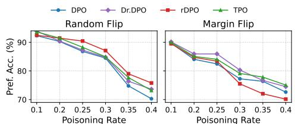
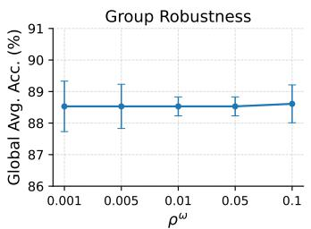
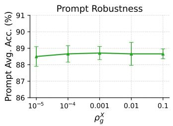
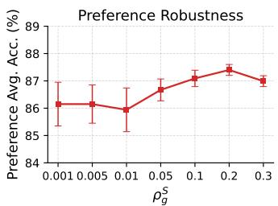
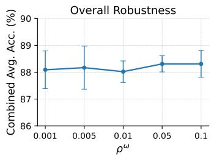
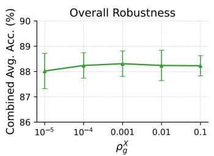
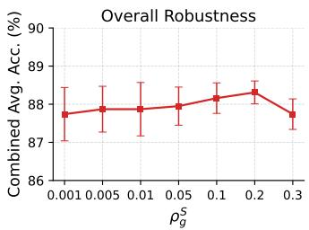
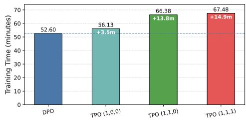

# TPO: Tri-level Distributionally Robust Learning for OOD Direct Preference Optimization

Chengtao Jian1, Kai Yang1,2,3∗

1School of Computer Science and Technology, Tongji University, Shanghai, China 2Shenzhen Loop Area Institute, Shenzhen, China

3Shanghai Research Institute for Intelligent Autonomous Systems, Shanghai, China {jct,kaiyang}@tongji.edu.cn

## Abstract

Direct Preference Optimization (DPO) minimizes empirical risk over observed preference comparisons, implicitly assuming that the training preference distribution matches the deployment preference distribution. In practice, this i.i.d. assumption often fails, as preference distribution shift exhibits a natural hierarchical structure across three levels: group-level shift, prompt-level shift, and preference-level shift. Such multi-level distributional mismatch poses a critical challenge for safe LLM deployment, yet existing robust DPO methods typically either model uncertainty over the joint preference distribution or focus on individual sources of shift, leaving the hierarchical structure of OOD preference shifts underexplored. We propose TPO, a tri-level distributionally robust framework for OOD preference alignment, which jointly models all three levels of distributional uncertainty through a hierarchically structured rectangular ambiguity set. By instantiating it with Wasserstein distance, we derive a tractable and interpretable objective that combines a closed-form preference-level margin penalty, prompt-level adversarial embedding perturbation, and worst-case group reweighting, each governed by an independent radius. We establish finite-sample convergence guarantees and empirically validate the effectiveness of TPO over existing robust DPO methods.

## 1 Introduction

Direct Preference Optimization (DPO) (Rafailov et al., 2023) has emerged as a prominent method for aligning large language models (LLMs) with human preferences. Unlike RLHF (Christiano et al., 2017; Stiennon et al., 2020; Ouyang et al., 2022), DPO directly optimizes a preference objective from pairwise comparison data, bypassing explicit reward modeling and improving optimization stability. However, standard DPO minimizes empirical risk over observed pairwise preference data, without explicitly accounting for distribution shifts between training and deployment. Such out-of-distribution (OOD) shifts can degrade preference alignment performance (Wu et al., 2025; Xu et al., 2025).

In preference alignment, OOD preference shift exhibits a natural hierarchical structure across multiple levels. Specifically, the preference data distribution may shift at three distinct levels. First, the distribution over groups may change between training and deployment, inducing a group-level shift, which has been studied in group robust preference alignment (Ramesh et al., 2024; Sagawa et al., 2020). Second, even within the same group, the prompt marginal distribution may vary across domains, time, or user interaction patterns, yielding a prompt-level shift, which corresponds to covariate shift in the prompt distribution and has been observed in robust prompt optimization (Li et al., 2023; Seegmiller and Preum, 2026). Third, the conditional preference distribution may also change due to noisy feedback or heterogeneous preferences within the same group, giving rise to a preference-level shift (Yao et al., 2025; Chowdhury et al., 2024; Poddar et al., 2024).

Table 1: Comparison of robust DPO methods by the shift levels explicitly modeled in their objectives. ✓ denotes a dedicated robustness component, while ✗ denotes no explicit level-specific component.
<table><tr><td>Methods</td><td>Overall</td><td>Group-level</td><td>Prompt-level</td><td>Preference-level</td></tr><tr><td>DPO (Rafailov et al., 2023)</td><td>x</td><td>X</td><td>X</td><td>X</td></tr><tr><td>WDPO / KLDPO (Xu et al., 2025)</td><td>√</td><td>X</td><td>X</td><td>X</td></tr><tr><td>GRPO (Ramesh et al., 2024)</td><td>X</td><td>√</td><td>X</td><td>X</td></tr><tr><td>rDPO (Chowdhury et al., 2024)</td><td>X</td><td>X</td><td>X</td><td>V</td></tr><tr><td>Dr.DPO (Wu et al., 2025)</td><td>X</td><td>X</td><td>X</td><td>J</td></tr><tr><td>TPO (Ours)</td><td>L</td><td>L</td><td>J</td><td>L</td></tr></table>

Recent robust DPO methods have begun to address distributional robustness, but they typically do not explicitly model the hierarchical structure of preference distribution shift. WDPO and KLDPO (Xu et al., 2025) construct Wasserstein and KL ambiguity sets over the entire preference distribution, while rDPO (Chowdhury et al., 2024) and Dr.DPO (Wu et al., 2025) focus on preference label noise and on pointwise and pairwise data noise, respectively. As summarized in Table 1, existing methods either model overall uncertainty or focus on a single robustness level. Motivated by these observations, we propose TPO, a tri-level distributionally robust framework for OOD preference alignment, which jointly models all three levels through a hierarchically structured ambiguity set instantiated with Wasserstein distances and provides interpretable robustness controls for each shift level. Overall, our main contributions are as follows:

• Tri-level learning for OOD preference alignment. We identify that preference distribution shift exhibits a natural tri-level structure comprising group-level, prompt-level, and preference-level shifts that existing robust DPO methods do not jointly address. We propose TPO, which captures all three levels within a hierarchical rectangular ambiguity set. This decomposition is relevant to safe LLM alignment, as real-world LLMs inevitably encounter distributional mismatch at multiple levels simultaneously, while single-level robustness leaves models vulnerable to the remaining sources of shift.

• Tractable Wasserstein robust preference objective. By instantiating the hierarchical ambiguity set with Wasserstein distances, we derive a tractable and interpretable training objective with three complementary components: a closed-form preference-level margin penalty, prompt-level adversarial embedding perturbation, and worst-case group reweighting. Each component targets a distinct source of distributional uncertainty and is governed by its own radius, enabling flexible and modular control over robustness.

• Theoretical guarantees and empirical validation. We establish finite-sample convergence guarantees, showing that the empirical minimizer converges to the population minimizer at a rate of $\widetilde { \mathcal { O } } ( n _ { \operatorname* { m i n } } ^ { - 1 / 4 } )$ , where $n _ { \mathrm { m i n } } = \mathrm { m i n } _ { g \in [ m ] } n _ { g }$ is the smallest group size. Empirically, TPO achieves superior or competitive performance over standard DPO and robust DPO baselines across multiple OOD shift settings, preference poisoning attacks and downstream generalization benchmarks, demonstrating practical robustness and broader applicability to safe LLM alignment.

## 2 Preliminaries

Notation. Unless otherwise specified, we use uppercase letters for random variables and lowercase letters for their realizations, with probability distributions denoted by P and Q. We use $\mathbf { \boldsymbol { x } } \in \mathcal { X }$ for a prompt, $\textbf {  { y } } \in \mathcal { V }$ for a response, and $\textit { \textbf { h } } \in \mathcal { H }$ for the prompt embedding, with $\tilde { h } = h + \delta$ denoting an adversarially perturbed embedding. A pairwise preference example is modeled as a random variable $U \ = \ ( X , V , S )$ , where $V ~ = ~ ( Y _ { 1 } , Y _ { 2 } )$ is a pair of candidate responses and $S \in \{ + 1 , - 1 \}$ is the binary preference label indicating which response is preferred. In standard DPO training, each comparison $( { \pmb x } , { \pmb y } ^ { + } , { \pmb y } ^ { - } )$ is encoded as $V = ( \pmb { y } ^ { \dagger } , \pmb { y } ^ { - } )$ and $S = + 1$ . The group index is $g \in \mathcal { G } = [ m ]$ , where $[ \dot { m } ] = \{ 1 , . . . , m \}$ , and $P _ { g }$ denotes the group-specific distribution over U. Let $I _ { g }$ be the index set of the $n _ { g } = | I _ { g } |$ training samples from group g. We factorize $P _ { g } ( U ) = P _ { q } ^ { X } \bar { ( } X ) P _ { q } ^ { V } ( V \mid X ) P _ { q } ^ { S } ( S \mid V , X )$ , where $P _ { g } ^ { X } , P _ { g } ^ { V }$ , and $P _ { g } ^ { S }$ are the prompt marginal distribution, conditional candidate response distribution, and conditional preference distribution, respectively. We write $\Delta ^ { m - 1 }$ for the probability simplex over m groups, $\lVert \pmb { v } \rVert _ { 2 }$ for the Euclidean norm, $\phi ( h , y ) \in \mathbb { R } ^ { d }$ for the log-linear feature map, and $\varphi ( t ) = \log ( 1 + e ^ { - t } )$ ) for the logistic loss.

Direct Preference Optimization. DPO learns a policy $\pi _ { \pmb { \theta } }$ from pairwise preference data $\mathcal { D } =$ $\{ ( { \pmb x } _ { i } , { \pmb y } _ { i } ^ { + } , { \pmb y } _ { i } ^ { - } ) \} _ { i = 1 } ^ { n }$ , where $\pmb { y } _ { i } ^ { + } \succ \pmb { y } _ { i } ^ { - }$ indicates that $\mathbf { \boldsymbol { y } } _ { i } ^ { + }$ is preferred over $\mathbf { \mathscr { y } } _ { i } ^ { - }$ . Following Rafailov et al. (2023), the DPO margin for a candidate pair $( \pmb { y } _ { 1 } , \pmb { y } _ { 2 } )$ is defined as

$$
\begin{array} { r } { m ( x , y _ { 1 } , y _ { 2 } ; \theta ) = \beta \left( \log \frac { \pi _ { \theta } ( y _ { 1 } \mid x ) } { \pi _ { \mathrm { r e f } } ( y _ { 1 } \mid x ) } - \log \frac { \pi _ { \theta } ( y _ { 2 } \mid x ) } { \pi _ { \mathrm { r e f } } ( y _ { 2 } \mid x ) } \right) , } \end{array}\tag{1}
$$

where $\beta > 0$ is a scaling parameter and $\pi _ { \mathrm { r e f } }$ is a reference policy. Given a binary preference label $s \in \{ + 1 , - 1 \}$ }, the labeled DPO loss is $\mathcal { L } ( \pmb { x } , \pmb { y } _ { 1 } , \pmb { y } _ { 2 } , s ; \pmb { \theta } ) = \varphi ( s \cdot m ( \pmb { x } , \pmb { y } _ { 1 } , \pmb { y } _ { 2 } ; \pmb { \theta } ) )$ . For the standard DPO setting, we set $( { \pmb y } _ { 1 } , { \pmb y } _ { 2 } ) = ( { \pmb y } ^ { + } , { \pmb y } ^ { - } )$ and $s = + 1$ , which gives the empirical DPO risk minimization objective:

$$
\widehat { \mathcal { R } } _ { \mathrm { D P O } } ( \pmb { \theta } ) : = \mathbb { E } _ { \hat { P } } \big [ \mathcal { L } ( U ; \pmb { \theta } ) \big ] = \frac { 1 } { n } \sum _ { i = 1 } ^ { n } \varphi \big ( m ( \pmb { x } _ { i } , \pmb { y } _ { i } ^ { + } , \pmb { y } _ { i } ^ { - } ; \pmb { \theta } ) \big ) .\tag{2}
$$

Standard DPO minimizes this empirical risk under the assumption that the training distribution $\hat { P }$ is equivalent to the true preference distribution at deployment. When the i.i.d. assumption fails, DPO can suffer from reduced preference alignment quality (Wu et al., 2025; Xu et al., 2025).

Group DRO. Group DRO (Sagawa et al., 2020) introduces a group variable $G \in { \mathcal { G } } = \left\{ 1 , \dots , m \right\}$ so that each preference observation $U = ( X , V , S )$ is associated with a group index $g .$ Let $P _ { g }$ denote the population distribution over $U$ for group $g .$ The overall training distribution is expressed as $P = \textstyle \sum _ { g = 1 } ^ { m } \alpha _ { g } P _ { g }$ , where $\alpha \in \Delta ^ { m - 1 }$ are the group proportions. Through the lens of distributionally robust optimization (Jiao et al., 2022; Esfahani and Kuhn, 2015), Group DRO replaces the ERM objective in Eq. (2) with the following min-max optimization problem:

$$
\operatorname* { i n f } _ { \pmb { \theta } \in \Theta } \operatorname* { s u p } _ { \pmb { \omega } \in \mathcal { Q } } \sum _ { g = 1 } ^ { m } \omega _ { g } \mathbb { E } _ { P _ { g } } \big [ \mathcal { L } ( U ; \pmb { \theta } ) \big ] ,\tag{3}
$$

which minimizes the worst-case expected loss over an ambiguity set Q of group mixture weights, a paradigm that has also been adopted in robust RLHF (Chakraborty et al., 2024; Ramesh et al., 2024). However, this formulation keeps the within-group distributions $P _ { g }$ fixed and does not explicitly model shifts in either the prompt marginal distribution (Li et al., 2023; Koh et al., 2021) or the conditional preference distribution (Sorensen et al., 2024; Yao et al., 2025). This motivates the hierarchical robust formulation in Section 3.1.

## 3 Method

## 3.1 Hierarchical Distribution Shifts and Uncertainty in Preference Alignment

In preference alignment, distribution shift exhibits a natural three-level hierarchical structure. At the global level, the group proportions may shift between training and deployment (Qiao et al., 2025; Ramesh et al., 2024; Jian et al., 2024). Within each group, shift arises at the local level in two forms: the prompt marginal distribution $P _ { g } ^ { X }$ may shift across environments (Li et al., 2023; Koh et al., 2021), and the conditional preference distribution $P _ { q } ^ { S } ( S \mid V , X )$ may vary due to noisy (Chowdhury et al., 2024) or pluralistic (Poddar et al., 2024; Yao et al., 2025) human feedback. We refer to these as group-level, prompt-level, and preference-level shifts, respectively. We next formalize these three levels of distributional uncertainty and construct a hierarchical ambiguity set for robust preference optimization.

Global group ambiguity set. At the global level, following the standard DRO framework (Sagawa et al., 2020), we model group-level shift by an ambiguity set over the group mixture weights, centered at the training group proportions α: $\mathcal { \bar { U } } ^ { \omega } = \{ \omega ^ { \circ } \in \bar { \Delta } ^ { m - 1 } : \mathcal { D } _ { \omega } ( \bar { \omega } , \hat { \alpha } ) \leq \rho ^ { \omega } \}$ , where $\mathcal { D } _ { \omega }$ is a discrepancy measure on the group simplex and $\bar { \rho } ^ { \omega } \geq 0$ is the group-level radius.

Local rectangular ambiguity sets. At the local level, within-group shift arises from two sources: the prompt marginal distribution and the conditional preference distribution. For each group ${ \mathit { g } } ,$ the shifted joint distribution factorizes as $Q _ { g } ( U ) = Q _ { g } ^ { X } ( \dot { X } ) P _ { g } ^ { V } ( V \mid X ) Q _ { g } ^ { S } ( S \mid X , V )$ , where $\mathring { Q } _ { g } ^ { \ X }$ and

$Q _ { g } ^ { S }$ are each constrained by their own ambiguity set. Since the candidate response pairs are fixed in the offline preference dataset, we do not introduce an ambiguity set for $P _ { q } ^ { V }$ and keep $P _ { a } ^ { V } ( V \mid X )$ unchanged. We first constrain the prompt marginal distribution by $\mathcal { U } _ { g } ^ { X } = \overline { { \{ Q _ { g } ^ { X } : \mathcal { D } _ { X } ( Q _ { g } ^ { \overline { { X } } } , P _ { g } ^ { X } ) \leq } } $ $\rho _ { g } ^ { X } \big \}$ , where $\mathcal { D } _ { X }$ is a discrepancy measure on the prompt (embedding) space and $\rho _ { g } ^ { X } \geq 0$ is the prompt-level radius.

For each prompt and response pair $( { \pmb x } , { \pmb v } )$ , we constrain the conditional preference distribution by

$$
\mathcal { U } _ { g , \pmb { x } , \pmb { v } } ^ { S } = \Big \{ Q _ { g } ^ { S } ( \cdot \mid \pmb { x } , \pmb { v } ) : \mathscr { D } _ { S } \big ( Q _ { g } ^ { S } ( \cdot \mid \pmb { x } , \pmb { v } ) , P _ { g } ^ { S } ( \cdot \mid \pmb { x } , \pmb { v } ) \big ) \leq \rho _ { g } ^ { S } \Big \} ,\tag{4}
$$

where $\mathcal { D } _ { S }$ measures discrepancies between distributions over binary preference labels, and $\rho _ { g } ^ { S } \ge 0$ is the preference-level radius. Jointly, these constraints induce the local ambiguity set

$$
\mathcal { U } _ { g } = \Big \{ Q _ { g } : Q _ { g } ^ { X } \in \mathcal { U } _ { g } ^ { X } , ~ Q _ { g } ^ { S } ( \cdot \mid x , v ) \in \mathcal { U } _ { g , x , v } ^ { S } \mathrm { ~ f o r ~ } Q _ { g } ^ { X } P _ { g } ^ { V } \mathrm { - a . e . ~ } ( x , v ) \Big \} .\tag{5}
$$

Note that $\mathcal { U } _ { g }$ is rectangular with respect to this factorization: the prompt marginal and the conditional preference distribution can be chosen separately under their respective constraints. Under standard measurability conditions, this rectangularity allows the adversary to first select a worst-case preference distribution for each fixed $( X , V )$ , and then a worst-case prompt marginal distribution (Shapiro, 2016; Li and Shapiro, 2025), which yields the nested worst-case optimization in Section 4.2.

Hierarchical ambiguity set. Combining the global and local constraints, the full ambiguity set is

$$
\begin{array} { r } { \mathcal { U } = \Big \{ Q = \sum _ { g = 1 } ^ { m } \omega _ { g } Q _ { g } : \omega \in \mathcal { U } ^ { \omega } , \ Q _ { g } \in \mathcal { U } _ { g } \mathrm { ~ f o r ~ a l l ~ } g \in \mathcal { G } \Big \} . } \end{array}\tag{6}
$$

Compared with group robustness methods that only consider group-level shift, our formulation more faithfully characterizes preference distribution shift by explicitly accounting for within-group variation in both the prompt marginal $Q _ { g } ^ { X }$ and the conditional preference distribution $Q _ { g } ^ { S } ( S \mid \breve { X } , V )$

## 3.2 Tri-level Distributionally Robust Preference Optimization

Based on the hierarchical ambiguity set U in Eq. (6), we now formulate the robust preference optimization problem. Since the true distribution is unknown but assumed to lie in U, we follow standard DRO principles (Wiesemann et al., 2014; Esfahani and Kuhn, 2015; Sinha et al., 2018) and minimize the worst-case risk over U:

$$
\operatorname* { i n f } _ { \pmb { \theta } \in \Theta } \operatorname* { s u p } _ { \pmb { \omega } \in \mathcal { U } ^ { \omega } } \sum _ { g = 1 } ^ { m } \omega _ { g } \operatorname* { s u p } _ { Q _ { g } \in \mathcal { U } _ { g } } \mathbb { E } _ { U \sim Q _ { g } } \left[ \mathcal { L } ( U ; \pmb { \theta } ) \right] .\tag{7}
$$

The outer maximization over ω captures global group-level shift, and the inner maximization over $Q _ { g }$ captures local prompt- and preference-level shifts. To solve the inner maximization, we first define the worst-case preference loss of group g at a fixed prompt and response pair (x, v) as

$$
\psi _ { g } ( \pmb { x } , \pmb { v } ; \pmb { \theta } ) : = \operatorname* { s u p } _ { Q _ { g } ^ { S } \in \mathcal { U } _ { g , \pmb { x } , \pmb { v } } ^ { S } } \mathbb { E } _ { S \sim Q _ { g } ^ { S } } \left[ \mathcal { L } ( \pmb { x } , \pmb { v } , S ; \pmb { \theta } ) \right] .\tag{8}
$$

Since $\mathcal { U } _ { g }$ is rectangular, the adversarial choices of the prompt marginal $Q _ { g } ^ { X }$ and the conditional preference kernel $Q _ { q } ^ { S } ( \cdot \mid X , V )$ are decoupled, which enables a nested decomposition of the worstcase expectation over $Q _ { g }$ (Shapiro, 2016; Li and Shapiro, 2025). Consequently, Eq. (7) can be rewritten as

$$
\operatorname* { i n f } _ { \theta \in \Theta } \operatorname* { s u p } _ { \omega \in \mathcal { U } ^ { \omega } } \sum _ { g = 1 } ^ { m } \omega _ { g } \operatorname* { s u p } _ { Q _ { g } ^ { X } \in \mathcal { U } _ { g } ^ { X } } \mathbb { E } _ { X \sim Q _ { g } ^ { X } , V \sim P _ { g } ^ { V } ( \cdot | X ) } \left[ \psi _ { g } ( X , V ; \theta ) \right] .\tag{9}
$$

The above tri-level minimax structure mirrors the three sources of distribution shift identified in Section 3.1. Hierarchical optimization structures have been studied in trilevel learning (Jiao et al., 2025b; Jian et al., 2024), whereas our formulation focuses on nested distributional uncertainty in preference alignment. When $\rho _ { g } ^ { X } = \rho _ { g } ^ { S } = 0$ for all groups, TPO reduces to standard Group DRO.

## 3.3 Finite-Sample Guarantees

We establish a finite-sample convergence guarantee for the fixed-penalty Wasserstein dual objective of TPO, different from algorithmic convergence guarantees for bilevel and trilevel optimization (Jiao et al., 2024, 2023). The analysis relies on the following two assumptions.

Assumption 1 (Log-linear policy class and boundedness) Let $\phi : \mathcal { H } \times \mathcal { V } \to \mathbb { R } ^ { d }$ be a feature map satisfying $\begin{array} { r } { \operatorname* { s u p } _ { \pmb { h } \in \mathcal { H } , \pmb { y } \in \mathcal { V } } \| \phi ( \bar { \pmb { h } } , \pmb { y } ) \| _ { 2 } \le C _ { \phi } , } \end{array}$ , where H includes both clean and perturbed prompt embeddings. Let $\Theta = \{ \pmb \theta \in \mathbb { R } ^ { d } : \| \pmb \theta \| _ { 2 } \leq B \}$ , and $\pi _ { \mathrm { r e f } } = \pi _ { \theta _ { \mathrm { r e f } } }$ satisfy $\begin{array} { r l r } {  { \| { \pmb \theta } _ { \mathrm { r e f } } \| _ { 2 } \le B } } \end{array}$ . We consider the log-linear policy class

$$
\Pi = \left\{ \pi _ { \pm } : \pi _ { \pmb \theta } ( y \mid h ) = \frac { \exp ( \pmb \theta ^ { \top } \phi ( h , y ) ) } { \sum _ { \pmb y ^ { \prime } \in \mathcal { V } } \exp ( \pmb \theta ^ { \top } \phi ( h , y ^ { \prime } ) ) } , \ \pmb \theta \in \Theta \right\} .
$$

Assumption 2 (Uniform covariance coverage) $L e t z ( h , y ^ { + } , y ^ { - } ) { = } \phi ( h , y ^ { + } ) { - } \phi ( h , y ^ { - } )$ . For each group g and $\pmb \theta \in \Theta$ , assume the inner maximization in $E q . \ ( 2 0 )$ admits a measurable maximizer $\delta _ { g , \theta } ^ { \star } ( h , y ^ { + } , y ^ { - } )$ , and let $\tilde { h } = h + \delta _ { q , \theta } ^ { \star } ( h , y ^ { + } , y ^ { - } )$ . There exists $\lambda > 0$ such that, for all $\theta \in \Theta$ $\omega \in \mathcal { U } ^ { \omega }$ , and all such maximizers, $\begin{array} { r } { \sum _ { g = 1 } ^ { m } \omega _ { g } \mathbb { E } _ { P _ { g } } \Big [ z ( \tilde { h } , y ^ { + } , y ^ { - } ) z ( \tilde { h } , y ^ { + } , y ^ { - } ) ^ { \top } \Big ] \succeq \lambda I _ { d } } \end{array}$

For each group g, we fix $\gamma _ { g } > 0$ in Eq. (19) and define the empirical risk as $\begin{array} { r } { \widehat { \mathcal { R } } _ { g } ( \pmb { \theta } ) = \gamma _ { g } \rho _ { q } ^ { X } + } \end{array}$ $\begin{array} { r } { \frac { 1 } { n _ { q } } \sum _ { i \in I _ { g } } \ell _ { \pmb { \theta } } ^ { g } ( z _ { i } ; \gamma _ { g } ) } \end{array}$ , where $\ell _ { \pmb { \theta } } ^ { g }$ is given by Eq. (20). The corresponding population risk ${  { \mathcal R } } _ { g } ( \theta )$ replaces the empirical average with $\mathbb { E } _ { P _ { g } }$ . The hierarchical population and empirical objectives are $\begin{array} { r } { \mathcal { R } _ { \mathrm { T P O } } ( \pmb { \theta } ) = \operatorname* { s u p } _ { \omega \in \mathcal { U } ^ { \omega } } \sum _ { g = 1 } ^ { m } \omega _ { g } \mathcal { R } _ { g } ( \pmb { \theta } ) } \end{array}$ and $\begin{array} { r } { \widehat { \mathcal { R } } _ { \mathrm { T P O } } ( \pmb { \theta } ) = \operatorname* { s u p } _ { \omega \in \mathcal { U } ^ { \omega } } \sum _ { g = 1 } ^ { m } \omega _ { g } \widehat { \mathcal { R } } _ { g } ( \pmb { \theta } ) } \end{array}$ , respectively. Let $\pmb { \theta } ^ { \star } \in \arg \operatorname* { m i n } _ { \pmb { \theta } \in \Theta } \mathcal { R } _ { \mathrm { T P O } } ( \pmb { \theta } )$ and $\widehat { \pmb \theta } \in \mathrm { a r g } \operatorname* { m i n } _ { { \pmb \theta } \in \Theta } \widehat { \mathcal { R } } _ { \mathrm { T P O } } ( { \pmb \theta } )$ denote the population and empirical minimizers, respectively. The following theorem establishes a convergence rate governed by the smallest group sample size $n _ { \mathrm { m i n } } = \mathrm { m i n } _ { g \in [ m ] } n _ { g }$

Theorem 1 (Finite-sample convergence of TPO) Let $M _ { \beta } = 4 \beta B C _ { \phi }$ and $\begin{array} { r } { \kappa _ { \beta } = \frac { \beta ^ { 2 } e ^ { M _ { \beta } } } { ( 1 + e ^ { M _ { \beta } } ) ^ { 2 } } . } \end{array}$ . Suppose Assumptions 1 and 2 hold. With probability at least $1 - \delta ,$ , we have

$$
\| \widehat { \pmb { \theta } } - \pmb { \theta } ^ { \star } \| _ { 2 } \leq 2 \sqrt { \frac { \operatorname* { m a x } _ { g \in [ m ] } \left[ 2 A _ { g } \sqrt { \frac { d } { n _ { g } } } + K _ { g } \sqrt { \frac { \log ( 2 m / \delta ) } { 2 n _ { g } } } \right] } { \kappa _ { \beta } \lambda } } ,
$$

where $K _ { g } = \log ( 1 + e ^ { M _ { \beta } } ) + \rho _ { g } ^ { S } M _ { \beta } , L _ { g } = 2 \beta C _ { \phi } ( 1 + \rho _ { g } ^ { S } ) , A _ { g } = C K _ { g } \sqrt { \log \left( e + 3 B L _ { g } / K _ { g } \right) }$ , and $C > 0$ is a universal constant. The proofis in Appendix A.3.

## 4 Implementation Algorithm

## 4.1 Wasserstein Instantiation

To obtain a tractable learning objective, we instantiate the discrepancy measures $\mathcal { D } _ { \omega } , \mathcal { D } _ { X }$ , and $\mathcal { D } _ { S }$ with the Wasserstein distance (Wiesemann et al., 2014; Esfahani and Kuhn, 2015; Sinha et al., 2018).

Definition 1 (Wasserstein Distance) Let P and Q be probability measures on a measurable space Z equipped with a cost function $c : \mathcal { Z } \times \mathcal { Z } \to [ 0 , \infty )$ . The Wasserstein distance induced by c is

$$
{ \mathcal W } _ { c } ( P , Q ) : = \operatorname* { i n f } _ { \xi \in \Gamma ( P , Q ) } \int _ { \mathcal Z \times \mathcal Z } c ( u , u ^ { \prime } ) \mathrm { d } \xi ( u , u ^ { \prime } ) ,\tag{10}
$$

where $\Gamma ( P , Q )$ denotes the set of all couplings of P and $Q .$

At the global level, the uncertainty concerns the mixture weights over the finite group set $\mathcal { G } =$ $\{ 1 , \ldots , m \}$ . Since the groups have no natural geometry, we equip G with the discrete cost $\bar { d _ { G } } ( g , g ^ { \prime } ) =$ $\mathbf { i } [ g \neq g ^ { \prime } ]$ . Under this cost, the Wasserstein distance between two group mixtures reduces to the total variation distance, i.e., $\begin{array} { r } { \mathcal { W } _ { d _ { G } } ( \omega , \pmb { \alpha } ) = \frac { 1 } { 2 } \| \omega - \pmb { \alpha } \| _ { 1 } } \end{array}$ . At the local level, we model within-group uncertainty through Wasserstein balls:

$$
\begin{array} { r } { \mathcal { W } _ { c _ { X } } ( Q _ { g } ^ { X } , P _ { g } ^ { X } ) \leq \rho _ { g } ^ { X } , \qquad \mathcal { W } _ { c _ { S } } \left( Q _ { g } ^ { S } ( \cdot \mid \mathbf { x } , \pmb { v } ) , P _ { g } ^ { S } ( \cdot \mid \mathbf { x } , \pmb { v } ) \right) \leq \rho _ { g } ^ { S } . } \end{array}
$$

Here, cX is the transport cost on the prompt space and $c _ { S }$ is the label-flip cost on $\{ + 1 , - 1 \}$ . The radii $\rho _ { g } ^ { X }$ and $\rho _ { g } ^ { S }$ independently control prompt-level and preference-level robustness within group g.

## 4.2 Tractable Objective

In this section, we derive a tractable reformulation by successively robustifying the conditional preference distribution, the prompt marginal distribution, and the distribution over group weights.

Preference-level robustification. Recall that, for group $^ { g , }$ the conditional distribution factorizes as $P _ { g } ( V , S \mid X ) = P _ { a } ^ { V } ( V \mid X ) P _ { a } ^ { S } ( S \mid X , V )$ . Since the candidate response pair V is observed and fixed in the offline dataset, the remaining preference-level uncertainty lies in the conditional distribution over binary labels $P _ { q } ^ { S } ( S \mid X , \breve { V } )$ We therefore model preference-level shift as a perturbation of this binary label distribution, holding the response pair fixed. In standard DPO data, each comparison is encoded with $S = + 1$ , so $P _ { g } ^ { S } ( \cdot \mid \mathbf { \bar { x } } , \pmb { v } ) = \stackrel { \cdot } { \delta } _ { + 1 }$ . For each group g and each prompt and response pair $( { \pmb x } , { \pmb v } ) = ( { \pmb x } , { \pmb y } _ { 1 } , { \pmb y } _ { 2 } )$ , we define

$$
\begin{array} { r } { \mathcal { U } _ { g , x , v } ^ { S } = \Bigl \{ q \in \Delta ( \{ + 1 , - 1 \} ) : \mathcal { W } _ { c _ { S } } ( q , \delta _ { + 1 } ) \leq \rho _ { g } ^ { S } \Bigr \} , } \end{array}\tag{11}
$$

with the label-flip cost $c _ { S } ( s , s ^ { \prime } ) = \mathbf { 1 } [ s \neq s ^ { \prime } ]$ . Under this cost, $\mathcal { W } _ { c _ { S } } ( q , \delta _ { + 1 } )$ equals the probability of $s = - 1$ under q, so the ball in Eq. (11) allows at most a fraction $\rho _ { g } ^ { S }$ of the label mass to be flipped from $+ 1 \mathrm { t o } - 1$ . The worst-case preference-level robust loss is then

$$
\bar { \mathcal { L } } _ { g } ( x , y _ { 1 } , y _ { 2 } ; \pmb { \theta } ) : = \operatorname* { s u p } _ { \substack { q \in \mathcal { U } _ { g , \mathbf { x } , v } ^ { S } } } \mathbb { E } _ { S \sim q } \big [ \mathcal { L } ( \pmb { x } , y _ { 1 } , y _ { 2 } , S ; \pmb { \theta } ) \big ] .\tag{12}
$$

Proposition 1 (Closed-form preference-level robust loss) For any group g, prompt and candidate response pair $( \pmb { x } , \pmb { y } _ { 1 } , \pmb { y } _ { 2 } )$ , we have

$$
\bar { \mathcal { L } } _ { g } ( \boldsymbol { x } , \boldsymbol { y } _ { 1 } , \boldsymbol { y } _ { 2 } ; \boldsymbol { \theta } ) = \varphi \big ( m ( \boldsymbol { x } , \boldsymbol { y } _ { 1 } , \boldsymbol { y } _ { 2 } ; \boldsymbol { \theta } ) \big ) + \rho _ { g } ^ { S } \big [ m ( \boldsymbol { x } , \boldsymbol { y } _ { 1 } , \boldsymbol { y } _ { 2 } ; \boldsymbol { \theta } ) \big ] _ { + } ,\tag{13}
$$

where $[ t ] _ { + } = \operatorname* { m a x } \{ t , 0 \}$ . The proofis provided in Appendix A.1.

Proposition 2 (Optimal robust preference margin) For any group g, let $M = m ( { \pmb x } , { \pmb y } _ { 1 } , { \pmb y } _ { 2 } ; { \pmb \theta } )$ denote the DPO margin defined in Eq. (1). Then $\breve { \mathscr { L } } _ { g } ( M ) = \bar { \varphi ( M ) } + \bar { \rho _ { g } ^ { S } } [ M ] _ { + }$ is minimized at

$$
{ M } _ { g } ^ { \star } = \left\{ \begin{array} { l l } { + \infty , } & { \rho _ { g } ^ { S } = 0 , } \\ { \log \displaystyle \frac { 1 - \rho _ { g } ^ { S } } { \rho _ { g } ^ { S } } , } & { 0 < \rho _ { g } ^ { S } < \frac { 1 } { 2 } , } \\ { 0 , } & { \rho _ { g } ^ { S } \geq \frac { 1 } { 2 } . } \end{array} \right.\tag{14}
$$

The proofis provided in Appendix A.2.

Remark 1 Proposition 1 shows that preference-level Wasserstein robustness yields a robustified loss that appends a one-sided margin penalty scaled by $\rho _ { g } ^ { S }$ . Proposition 2 indicates that, unlike standard DPO, preference-level Wasserstein robustness does not drive the margin to grow unboundedly. Instead, it yields a finite optimal target margin. Moreover, this target margin decreases as $\rho _ { g } ^ { \mathbf { \bar { S } } }$ increases, implying that stronger uncertainty in the conditional preference distribution yields a more conservative optimum and reduces overconfidence in weak or potentially misaligned preferences.

Prompt-level robustification. We next robustify the prompt marginal distribution. For each group $^ { g , }$ the local robust risk is

$$
\mathcal { R } _ { g } ( \pmb { \theta } ) : = \operatorname* { s u p } _ { Q _ { g } ^ { X } \in \mathcal { U } _ { g } ^ { X } } \mathbb { E } _ { X \sim Q _ { g } ^ { X } } , { V } { \sim } P _ { g } ^ { V } ( \cdot | X ) \left[ \psi _ { g } ( X , V ; \pmb { \theta } ) \right] ,\tag{15}
$$

where $\psi _ { g } ( { \pmb x } , { \pmb v } ; { \pmb \theta } )$ is the worst-case preference loss in Eq. (8). Under the label-flip Wasserstein ball in Eq. (11), $\psi _ { g }$ admits the closed form $\bar { \mathcal { L } } _ { g } ( \pmb { x } , \pmb { y } _ { 1 } , \pmb { y } _ { 2 } ; \pmb { \theta } )$ given in Proposition 1.

To obtain a tractable empirical formulation, we follow the robust NLP fine-tuning literature and perturb prompts in the embedding space rather than the discrete token space (Miyato et al., 2017; Zhu et al., 2020; Jiang et al., 2020). Let $\pmb { h } = \pmb { \mathcal { E } } ( \pmb { x } ) \in \mathbb { R } ^ { d }$ denote the prompt embedding and $z _ { i } = ( h _ { i } , y _ { i } ^ { + } , y _ { i } ^ { - } )$ the i-th embedded observation. For group $^ { g , }$ the empirical distribution over embedded preference observations is $\begin{array} { r } { \widehat { P } _ { g } = \frac { 1 } { n _ { g } } \sum _ { i \in I _ { g } } \delta _ { z _ { i } } } \end{array}$

Following Wasserstein DRO with local perturbations (Kwon et al., 2020) and embedding-space adversarial training in NLP (Zhu et al., 2020; Miyato et al., 2017; Jiang et al., 2020), we perturb the prompt embedding while keeping the response pair fixed. Accordingly, we define the transport cost

$$
c _ { X } \big ( ( h , y ^ { + } , y ^ { - } ) , ( h ^ { \prime } , \tilde { y } ^ { + } , \tilde { y } ^ { - } ) \big ) = \left\{ \begin{array} { l l } { \frac { 1 } { 2 } \| h - h ^ { \prime } \| _ { 2 } ^ { 2 } , } & { ( y ^ { + } , y ^ { - } ) = ( \tilde { y } ^ { + } , \tilde { y } ^ { - } ) , } \\ { + \infty , } & { \mathrm { o t h e r w i s e } . } \end{array} \right.\tag{16}
$$

The empirical local robust risk is then

$$
\widehat { \mathscr { R } } _ { g } ( \pmb { \theta } ) = \operatorname* { s u p } _ { \tilde { Q } _ { g } ^ { X } : \mathscr { W } _ { c _ { X } } ( \tilde { Q } _ { g } ^ { X } , \widehat { P } _ { g } ) \leq \rho _ { g } ^ { X } } \mathbb { E } _ { ( h , y ^ { + } , y ^ { - } ) \sim \tilde { Q } _ { g } ^ { X } } \left[ \bar { \mathscr { L } } _ { g } ( h , y ^ { + } , y ^ { - } ; \pmb { \theta } ) \right] .\tag{17}
$$

Lemma 1 (Wasserstein DRO duality (Sinha et al., 2018; Zhang et al., 2025)) Under standard regularity conditionsfor Wasserstein DRO duality,for any reference distribution $Q ,$ , radius $\rho \geq 0$ loss ℓ, and transport cost c,

$$
\operatorname* { s u p } _ { P : \mathcal { W } _ { c } ( P , Q ) \leq \rho } \mathbb { E } _ { P } [ \ell ( Z ) ] = \operatorname* { i n f } _ { \gamma \geq 0 } \Big \{ \gamma \rho + \mathbb { E } _ { Q } \big [ \ell _ { p } ( Z ; \gamma ) \big ] \Big \} ,\tag{18}
$$

where $\begin{array} { r } { \ell _ { p } ( u _ { 0 } ; \gamma ) = \operatorname* { s u p } _ { u } \{ \ell ( u ) - \gamma c ( u , u _ { 0 } ) \} } \end{array}$ is the Wasserstein dual surrogate loss.

Applying Lemma 1 to Eq. (17) with $\ell = \bar { \mathcal { L } } _ { g }$ and $c = c _ { X }$ yields the dual form

$$
\widehat { \mathcal { R } } _ { g } ( \pmb { \theta } ) = \operatorname* { i n f } _ { \gamma _ { g } \geq 0 } \left\{ \gamma _ { g } \rho _ { g } ^ { X } + \frac { 1 } { n _ { g } } \sum _ { i \in I _ { g } } \ell _ { \pmb { \theta } } ^ { g } ( z _ { i } ; \gamma _ { g } ) \right\} ,\tag{19}
$$

where $z _ { i } = ( h _ { i } , y _ { i } ^ { + } , y _ { i } ^ { - } )$ . Under the transport cost in Eq. (16), changing the response pair incurs infinite cost, so the inner maximization only searches over perturbations of the prompt embedding:

$$
\ell _ { \pmb { \theta } } ^ { g } ( z _ { i } ; \gamma _ { g } ) = \operatorname* { s u p } _ { \delta \in \mathbb { R } ^ { d } } \left\{ \bar { \mathcal L } _ { g } ( \pmb { h } _ { i } + \delta , \pmb { y } _ { i } ^ { + } , \pmb { y } _ { i } ^ { - } ; \pmb { \theta } ) - \frac { \gamma _ { g } } { 2 } \| \delta \| _ { 2 } ^ { 2 } \right\} .\tag{20}
$$

Final empirical objective. Combining the global Wasserstein reweighting with the dual form of the local risks, the final empirical TPO objective is

$$
\operatorname* { m i n } _ { \pmb { \theta } \in \Theta } \operatorname* { s u p } _ { \pmb { \omega } \in \mathcal { U } ^ { \omega } } \sum _ { g = 1 } ^ { m } \omega _ { g } \widehat { \mathcal { R } } _ { g } ( \pmb { \theta } ) ,\tag{21}
$$

where $\widehat { \mathcal { R } } _ { g } ( \pmb { \theta } )$ is given in Eq. (19) and $\bar { \mathcal { L } } _ { g }$ in Eq. (13). Eq. (21) reduces the abstract hierarchical Wasserstein robust objective to a concrete min-max training problem.

## 4.3 Optimization Algorithm

While the dual reformulation in Eq. (20) is exact, explicitly optimizing over $\gamma _ { g }$ at each training step is computationally prohibitive. Following standard practice in Wasserstein robust optimization (Sinha et al., 2018; Kwon et al., 2020; Zhang et al., 2019; Bai et al., 2025), we treat $\gamma _ { g }$ as a fixed hyperparameter and constrain each perturbation to $B _ { g } ^ { X } = \{ \pmb { \delta } : \| \pmb { \delta } \| _ { 2 } ^ { 2 } \leq 2 \rho _ { g } ^ { X } \}$ . For each group g, the resulting penalty-based surrogate objective is

$$
\widetilde { \mathcal { R } } _ { g } ( \pmb { \theta } ; \gamma _ { g } ) : = \gamma _ { g } \rho _ { g } ^ { X } + \frac { 1 } { n _ { g } } \sum _ { i \in I _ { g } } \operatorname* { s u p } _ { \pmb { \delta } \in \mathcal { B } _ { q } ^ { X } } \left[ \bar { \mathcal { L } } _ { g } ( \pmb { h } _ { i } + \pmb { \delta } , \pmb { y } _ { i } ^ { + } , \pmb { y } _ { i } ^ { - } ; \pmb { \theta } ) - \frac { \gamma _ { g } } { 2 } \| \pmb { \delta } \| _ { 2 } ^ { 2 } \right] .\tag{22}
$$

The full training procedure is summarized in Algorithm 1. Each iteration proceeds in three stages. (i) Adversarial Perturbation. For each embedded preference observation $( \bar { h } _ { i } , \pmb { y } _ { i } ^ { + } , \pmb { y } _ { i } ^ { - } )$ in the minibatch, we approximate the prompt-level supremum in Eq. (22) by running K steps of projected gradient ascent on δ with the fixed quadratic penalty. (ii) Group-weight update. Using the perturbed embeddings from stage (i), we compute group-wise stochastic estimates $\mathcal { \widetilde { R } } _ { g } ^ { ( t ) }$ and perform one step of exponentiated gradient ascent projected onto $\mathcal { U } ^ { \omega }$ , which implements the worst-case group reweighting over the $\bar { L _ { 1 } }$ -constrained simplex. (iii) Policy update. We update the policy parameters θ by taking a gradient descent step on the weighted surrogate objective $\Sigma _ { g = 1 } ^ { m } \dot { \omega } _ { g } ^ { ( t ) } \tilde { \mathcal { R } } _ { g } ^ { ( t ) }$ , with the adversarial perturbations and group weights fixed. The alternating procedure is widely used in standard adversarial training and worst-group reweighting in robust optimization (Jiao et al., 2025a; Madry et al., 2018; Sagawa et al., 2020; Sinha et al., 2018).

Algorithm 1 Alternating Optimization for TPO   
1: Input: Step sizes $\eta _ { \theta } , \eta _ { \omega } , \eta _ { \delta } ;$ penalty parameters $\gamma _ { g } .$ , inner steps K, and total iterations T.   
2: for $t = 1 , \ldots , T$ do   
3: Sample group mini-batches $\boldsymbol { B } ^ { ( t ) } = \{ \boldsymbol { B } _ { g } ^ { ( t ) } \} _ { g = 1 } ^ { m } , \boldsymbol { B } _ { g } ^ { ( t ) } \subseteq \mathcal { D } _ { g }$   
4: for each $g \in { \mathcal { G } }$ and $( h _ { i } , y _ { i } ^ { + } , y _ { i } ^ { - } ) \in B _ { g } ^ { ( t ) }$ do   
5: Initialize $\delta _ { g , i } ^ { ( 0 ) }  \mathbf { 0 }$   
6: for $k = 0 , \ldots , K - 1$ do   
7: $\begin{array} { r } { \delta _ { g , i } ^ { ( k + 1 ) } \gets \Pi _ { \mathcal { B } _ { g } ^ { x } } \left( \delta _ { g , i } ^ { ( k ) } + \eta _ { \delta } \nabla _ { \delta } \left[ \bar { \mathcal { L } } _ { g } \left( h _ { i } + \delta , y _ { i } ^ { + } , y _ { i } ^ { - } ; \theta ^ { ( t - 1 ) } \right) - \frac { \gamma _ { g } } { 2 } \| \delta \| _ { 2 } ^ { 2 } \right] _ { \delta = \delta _ { g , i } ^ { ( k ) } } \right) } \end{array}$   
8: end for   
9: end for   
10: for each $g \in { \mathcal { G } }$ do   
11: $\begin{array} { r } { \widetilde { \mathcal { R } } _ { g } ^ { ( t ) } ( \pmb { \theta } )  \gamma _ { g } \rho _ { g } ^ { X } + \frac { 1 } { \vert \mathcal { B } _ { o } ^ { ( t ) } \vert } \sum _ { i \in { \cal B } _ { g } ^ { ( t ) } } [ \bar { \mathcal { L } } _ { g } ( \pmb { h } _ { i } + \delta _ { g , i } ^ { ( K ) } , \pmb { y } _ { i } ^ { + } , \pmb { y } _ { i } ^ { - } ; \pmb { \theta } ) - \frac { \gamma _ { g } } { 2 } \| \delta _ { g , i } ^ { ( K ) } \| _ { 2 } ^ { 2 } ] } \end{array}$   
12: end for   
13: $\begin{array} { r } { \pmb { \omega } ^ { ( t ) }  \Pi _ { \mathcal { U } ^ { \omega } } \Big ( \pmb { \omega } ^ { ( t - 1 ) } \odot \exp \big ( \eta _ { \omega } \widetilde { \mathcal { R } } ^ { ( t ) } ( \pmb { \theta } ^ { ( t - 1 ) } ) \Big ) } \end{array}$   
14: $\begin{array} { r l } & { \pmb { \theta } ^ { ( t ) }  \pmb { \theta } ^ { ( t - 1 ) } - \eta _ { \theta } ~ \nabla _ { \pmb { \theta } } \Big ( \sum _ { g = 1 } ^ { m } \omega _ { g } ^ { ( t ) } \widetilde { \mathcal { R } } _ { g } ^ { ( t ) } ( \pmb { \theta } ) \Big ) \Big | _ { \pmb { \theta = \theta } ^ { ( t - 1 ) } } } \end{array}$   
15: end for   
16: Return: ${ \pmb \theta } ^ { ( T ) }$

Table 2: Average and worst-group preference accuracy (%) under different OOD shifts. The best result is in bold and the second-best is underlined.
<table><tr><td rowspan="2">Qwen-2.5-0.5B</td><td colspan="2">ID</td><td colspan="2">Group</td><td colspan="2">Prompt</td><td colspan="2">Preference</td><td colspan="2">Combined</td><td rowspan="2">Avg. Rank</td></tr><tr><td>Avg Acc</td><td>Worst Acc</td><td> $\operatorname { A v g A c c }$ </td><td> $\mathrm { W o r s t ~ A c c }$ </td><td> $\mathbf { A v g A c c }$ </td><td> $\overline { { { \mathrm { W o r s t } } { \mathrm { A c c } } } }$ </td><td> $\overline { { \mathbf { A v g } \mathbf { A c c } } }$ </td><td>Worst Acc</td><td> $\mathbf { A v g A c c }$ </td><td>Worst Acc</td></tr><tr><td>DPO</td><td>86.87</td><td>77.78</td><td>81.80</td><td>76.15</td><td>83.17</td><td>76.98</td><td>82.93</td><td>78.16</td><td>82.60</td><td>76.40</td><td>5.30</td></tr><tr><td>Dr.DPO</td><td>84.81</td><td>81.36</td><td>81.65</td><td>77.06</td><td>82.75</td><td>76.84</td><td>82.24</td><td>75.86</td><td>81.27</td><td>75.22</td><td>6.50</td></tr><tr><td>WDPO</td><td>84.87</td><td>84.13</td><td>82.72</td><td>78.90</td><td>85.08</td><td>82.20</td><td>84.01</td><td>81.46</td><td>84.21</td><td>78.76</td><td>3.20</td></tr><tr><td>TPO (Group)</td><td>84.90</td><td>77.27</td><td>82.96</td><td>76.76</td><td>83.46</td><td>78.28</td><td>82.31</td><td>79.24</td><td>82.06</td><td>76.11</td><td>5.25</td></tr><tr><td>TPO (Prompt)</td><td>85.93</td><td>83.77</td><td>82.84</td><td>80.43</td><td>84.69</td><td>81.05</td><td>85.02</td><td>83.03</td><td>84.37</td><td>79.65</td><td>2.40</td></tr><tr><td>TPO (Preference)</td><td>85.64</td><td>78.28</td><td>82.77</td><td>77.98</td><td>84.30</td><td>79.75</td><td>83.28</td><td>79.99</td><td>83.24</td><td>76.11</td><td>4.25</td></tr><tr><td>TPO</td><td>86.95</td><td>85.12</td><td>84.61</td><td>81.65</td><td>85.47</td><td>82.56</td><td>85.44</td><td>82.34</td><td>85.25</td><td>79.94</td><td>1.10</td></tr><tr><td rowspan="2">LLaMA-3.2-1B</td><td colspan="2">ID</td><td colspan="2">Group</td><td colspan="2">Prompt</td><td colspan="2">Preference</td><td colspan="2">Combined</td><td rowspan="2">Avg. Rank</td></tr><tr><td>Avg Acc</td><td>Worst Acc</td><td>Avg Acc</td><td>Worst Acc</td><td>Avg Acc</td><td>Worst Acc</td><td>Avg Acc</td><td>Worst Acc</td><td>Avg Acc</td><td>Worst Acc</td></tr><tr><td>DPO</td><td>88.75</td><td>86.19</td><td>88.23</td><td>83.44</td><td>87.81</td><td>85.43</td><td>86.91</td><td>81.42</td><td>87.44</td><td>82.61</td><td>4.15</td></tr><tr><td>Dr.DPO</td><td>84.16</td><td>81.00</td><td>84.65</td><td>79.87</td><td>83.73</td><td>80.98</td><td>82.87</td><td>78.87</td><td>85.51</td><td>79.13</td><td>7.00</td></tr><tr><td>WDPO</td><td>87.53</td><td>84.17</td><td>87.24</td><td>80.86</td><td>87.78</td><td>85.82</td><td>85.28</td><td>79.73</td><td>86.71</td><td>81.16</td><td>5.80</td></tr><tr><td>TPO (Group)</td><td>89.03</td><td>87.02</td><td>88.61</td><td>83.39</td><td>88.32</td><td>85.86</td><td>86.94</td><td>81.22</td><td>87.54</td><td>82.90</td><td>3.50</td></tr><tr><td>TPO (Prompt)</td><td>89.78</td><td>86.37</td><td>88.50</td><td>81.19</td><td>88.71</td><td>85.41</td><td>87.30</td><td>81.31</td><td>87.63</td><td>82.03</td><td>3.75</td></tr><tr><td>TPO (Preference)</td><td>89.75</td><td>87.55</td><td>89.00</td><td>83.17</td><td>89.00</td><td>86.23</td><td>87.40</td><td>81.24</td><td>87.87</td><td>82.61</td><td>2.60</td></tr><tr><td>TPO</td><td>90.57</td><td>87.55</td><td>89.11</td><td>83.50</td><td>89.14</td><td>86.70</td><td>88.25</td><td>81.31</td><td>88.31</td><td>83.19</td><td>1.20</td></tr></table>

## 5 Experiments

## 5.1 Experimental Setup

We evaluate TPO on three tasks: OOD preference alignment, preference poisoning, and downstream generalization. For OOD preference alignment and downstream generalization, we compare against standard DPO and several recent robust baselines: GRPO (Ramesh et al., 2024), Dr.DPO (Wu et al., 2025), and WDPO (Xu et al., 2025). We also include three variants of TPO: TPO (Group), TPO (Prompt), and TPO (Preference), which activate only the group-level, prompt-level, and preferencelevel robustness components, respectively. Note that TPO (Group) reduces to GRPO (Ramesh et al., 2024) as a special case. For preference poisoning, we compare against rDPO (Chowdhury et al., 2024) and Dr.DPO (Wu et al., 2025), two robust DPO baselines designed to mitigate noisy preferences.

OOD Preference Alignment. Following prior emotion-based evaluations of preference shift (Xu et al., 2025; Sahu and Wells, 2025), we construct a benchmark from the Emotion dataset (Saravia et al., 2018) with four shift environments: (1) Group-level shift: we partition samples into six latent groups via K-means clustering on prompt and response embeddings, and change the group mixture weights at test time; (2) Prompt-level shift: we apply synonym substitution to prompts to simulate prompt (covariate) shift; (3) Preference-level shift: we construct two reward functions $r _ { 1 }$ and $r _ { 2 }$ and simulate preference shift via the convex interpolation $r _ { \alpha } = \alpha r _ { 1 } + ( 1 { - } \alpha ) r _ { 2 }$ , which shifts the conditional preference distribution $P _ { a } ^ { S } ( S \mid V , X )$ ; and (4) Combined shift: all three shifts are applied simultaneously. We use Qwen2.5-0.5B-Instruct (Yang et al., 2025) and LLaMA-3.2-1B-Instruct (Grattafiori et al., 2024) as base models, and report average and worst-group preference accuracy (Wu et al., 2025) to measure overall performance and worst-case robustness, respectively. Training details are provided in Appendix B.1.

Table 3: Performance comparison on Open LLM Leaderboard $\mathbf { v } 2 ,$ which evaluates LLMs across six tasks: MMLU-Pro, BBH, GPQA, MATH-Hard, IFEval, and MuSR.
<table><tr><td rowspan="3">Task</td><td colspan="4">LLaMA-3.2-1B TPO</td><td colspan="4">LLaMA-3.2-3B</td><td colspan="4">LLaMA-3.1-8B</td></tr><tr><td rowspan="2">DPO</td><td colspan="3"></td><td rowspan="2">DPO</td><td colspan="3">TPO</td><td rowspan="2">DPO</td><td colspan="3">TPO</td></tr><tr><td>ρS = 0 ρs</td><td>= 0.01</td><td> $\rho _ { g } ^ { S } = 0 . 0 5$ </td><td>ρS = 0</td><td>ρS = 0.01</td><td> $\rho _ { g } ^ { S } = 0 . 0 5$ </td><td>ρS = 0</td><td>ρs = 0.005</td><td>ρs = 0.01</td></tr><tr><td>MMLU-Pro</td><td>20.0</td><td>20.5</td><td>20.5</td><td>20.2</td><td>31.2</td><td>31.5</td><td>31.5</td><td>31.7</td><td>36.8</td><td>36.7</td><td>37.1</td><td>37.1</td></tr><tr><td>BBH</td><td>35.6</td><td>35.8</td><td>35.9</td><td>35.6</td><td>45.2</td><td>45.6</td><td>45.9</td><td>45.7</td><td>51.1</td><td>50.9</td><td>51.7</td><td>51.3</td></tr><tr><td>GPQA</td><td>23.2</td><td>23.5</td><td>23.7</td><td>23.3</td><td>28.0</td><td>28.4</td><td>28.3</td><td>28.1</td><td>30.0</td><td>30.2</td><td>30.8</td><td>30.1</td></tr><tr><td>MATH-Hard</td><td>8.1</td><td>9.4</td><td>8.3</td><td>8.2</td><td>21.4</td><td>21.1</td><td>20.1</td><td>21.0</td><td>19.5</td><td>20.9</td><td>20.7</td><td>19.3</td></tr><tr><td>IFEval</td><td>51.3</td><td>50.8</td><td>53.0</td><td>53.1</td><td>61.5</td><td>63.5</td><td>63.6</td><td>65.6</td><td>75.4</td><td>77.6</td><td>79.6</td><td>77.5</td></tr><tr><td>MuSR</td><td>31.6</td><td>31.6</td><td>31.2</td><td>31.0</td><td>37.5</td><td>37.7</td><td>37.4</td><td>37.1</td><td>38.0</td><td>38.1</td><td>38.0</td><td>37.4</td></tr></table>

Preference Poisoning Attack Robustness. To evaluate robustness against training-time preference poisoning, we follow established poisoning protocols in RLHF (Wang et al., 2024b; Pathmanathan et al., 2025; Kusaka et al., 2026) and construct poisoned training sets by flipping the preference labels (i.e., swapping the preferred and rejected responses) of a fraction of the training pairs, while keeping the test set clean. We consider two attack strategies: (1) Random preference flip attack (Pathmanathan et al., 2025), where poisoned pairs are selected uniformly at random; and (2) Margin-based preference flip attack (Pathmanathan et al., 2025), where the adversary targets the pairs with the largest margins computed by the reward model used for preference construction. We use LLaMA-3.2-1B-Instruct (Grattafiori et al., 2024) as the base model and evaluate all methods on clean test preferences. Details are provided in Appendix B.2.

Downstream Generalization. To assess the practical robustness of TPO under naturally occurring distribution shift, we evaluate on the Open LLM Leaderboard v2 (Hugging Face, 2024). We finetune LLaMA-3.2-1B-Instruct, LLaMA-3.2-3B-Instruct, and LLaMA-3.1-8B-Instruct for one epoch. Following the pipeline of Meng et al. (2024), we collect on-policy data annotated by the ArmoRM reward model (Wang et al., 2024a). Full training and evaluation details are provided in Appendix B.3.

## 5.2 Experimental Results

OOD Preference Alignment Results. As shown in Table 2, TPO achieves the best average accuracy across all shift environments on both backbones, while attaining competitive or best worstgroup accuracy in most settings. Notably, single-level variants TPO (Group), TPO (Prompt), and TPO (Preference) each provide partial gains, but their combination in TPO yields more consistent performance across both metrics and nearly all shift environments, suggesting the complementary nature of the three robustness levels.

## Preference Poisoning Attack Robustness Results.

As shown in Figure 1, all methods degrade as the poisoning rate increases. Under random preference flip attacks, rDPO performs best as expected, given its explicit debiasing design for random label flips. TPO is not specifically designed for this setting, yet generally outperforms DPO and remains competitive with Dr.DPO. Under margin-based flip attacks, Dr.DPO performs strongly at low poisoning rates, but TPO surpasses all baselines at higher poisoning rates.

  
Figure 1: Preference accuracy under preference poisoning.

Unlike rDPO and Dr.DPO, which rely on identifying potentially corrupted pairs, TPO penalizes excessively large margins, encouraging the model to remain conservative under uncertain preference distributions, which explains its more stable robustness against strong adaptive poisoning.

Downstream Generalization Results. As shown in Table 3, TPO achieves competitive or improved performance over DPO on most benchmarks across the three model scales, suggesting that the proposed robustness mechanisms largely preserve general capabilities. Gains are most pronounced on IFEval and also appear on BBH, while performance on GPQA and MMLU-Pro remains largely stable. We also observe that different preference-level robustness radii lead to varying trade-offs across tasks, which is expected given the heterogeneous nature of the leaderboard benchmarks. Interestingly, the improvements tend to become larger on IFEval as model scale increases, suggesting that larger models may benefit more from the proposed robustness mechanisms on instruction-following tasks. Overall, these results suggest that hierarchical robustness can improve downstream generalization while largely retaining broad task performance.

## 6 Related Work

Robust Preference Optimization. DPO simplifies preference alignment by directly optimizing over pairwise data (Rafailov et al., 2023; Azar et al., 2024), but remains vulnerable to distribution shift at deployment (Ramesh et al., 2024; Wu et al., 2025). Recent robust DPO methods address this from two angles: WDPO and KLDPO (Xu et al., 2025) robustify DPO using ambiguity sets over the overall preference distribution, while rDPO (Chowdhury et al., 2024) and Dr.DPO (Wu et al., 2025) target preference noise. Separately, group robust methods such as GRPO (Ramesh et al., 2024) and pluralistic alignment work (Sorensen et al., 2024; Yao et al., 2025; Tao et al., 2024) motivate modeling preference heterogeneity across groups and cultural contexts. However, none of these methods provide a unified robust objective that simultaneously captures group-level shift, prompt-level shift, and conditional preference shift.

Distributionally Robust Optimization. DRO provides a min-max framework for learning under distribution shift (Jiao et al., 2022, 2026; Esfahani and Kuhn, 2015; Wiesemann et al., 2014). Wasserstein DRO (Sinha et al., 2018; Esfahani and Kuhn, 2015) admits tractable dual reformulations and connects naturally to adversarial perturbations in embedding spaces (Madry et al., 2018; Zhu et al., 2020; Jiang et al., 2020). Group DRO (Sagawa et al., 2020) optimizes worst-case group performance but treats each group distribution as fixed, leaving within-group shifts unaddressed (Koh et al., 2021; Chowdhury et al., 2024). Recent work on hierarchical ambiguity sets (Jo et al., 2026) argues that group-level robustness alone is insufficient. Our work brings this perspective to preference optimization via a hierarchically structured rectangular ambiguity set thatfurther decomposes intra group uncertainty into prompt-level and preference-level shifts, thereby providing a more complete and interpretable robust alignmentframework.

## 7 Conclusion

We proposed tri-level distributionally robust preference optimization (TPO), which addresses OOD preference alignment by jointly modeling three levels of distribution shift through a hierarchically structured rectangular ambiguity set. By instantiating it with Wasserstein distances, we obtain an objective that combines worst-case group reweighting, prompt-level adversarial perturbation, and a closed-form preference-level margin penalty. Theoretical analysis establishes finite-sample convergence guarantees, and comprehensive experiments demonstrate the effectiveness of our method.

## Acknowledgments and Disclosure of Funding

The work of Chengtao Jian and Kai Yang was supported in part by NSFC under Grant 12371519 and in part by Shenzhen Loop Area Institute under Project FP202602. The authors declare no competing interests.

## References

Mohammad Gheshlaghi Azar, Zhaohan Daniel Guo, Bilal Piot, Rémi Munos, Mark Rowland, Michal Valko, and Daniele Calandriello. A general theoretical paradigm to understand learning from human preferences. In Proceedings of the International Conference on Artificial Intelligence

and Statistics, volume 238, pages 4447–4455, 2024. URL https://proceedings.mlr.press/ v238/gheshlaghi-azar24a.html.

Xingjian Bai, Guangyi He, Yifan Jiang, and Jan Oblój. Wasserstein distributional adversarial training for deep neural networks. CoRR, abs/2502.09352, 2025. URL https://arxiv.org/abs/2502. 09352.

Peter L. Bartlett and Shahar Mendelson. Rademacher and gaussian complexities: Risk bounds and structural results. Journal ofMachine Learning Research, 3:463–482, 2002. URL https: //jmlr.org/papers/v3/bartlett02a.html.

Souradip Chakraborty, Jiahao Qiu, Hui Yuan, Alec Koppel, Dinesh Manocha, Furong Huang, Amrit S. Bedi, and Mengdi Wang. Maxmin-rlhf: Alignment with diverse human preferences. In Proceedings of the International Conference on Machine Learning, 2024. URL https://openreview.net/ forum?id=8tzjEMF0Vq.

Sayak Ray Chowdhury, Anush Kini, and Nagarajan Natarajan. Provably robust DPO: aligning language models with noisy feedback. In Proceedings of the International Conference on Machine Learning, 2024. URL https://openreview.net/forum?id=yhpDKSw7yA.

Paul F. Christiano, Jan Leike, Tom B. Brown, Miljan Martic, Shane Legg, and Dario Amodei. Deep reinforcement learning from human preferences. In Advances in Neural Information Processing Systems, pages 4299–4307, 2017. URL https://proceedings.neurips.cc/paper/2017/ hash/d5e2c0adad503c91f91df240d0cd4e49-Abstract.html.

Ganqu Cui, Lifan Yuan, Ning Ding, Guanming Yao, Bingxiang He, Wei Zhu, Yuan Ni, Guotong Xie, Ruobing Xie, Yankai Lin, Zhiyuan Liu, and Maosong Sun. Ultrafeedback: Boosting language models with scaled ai feedback, 2023. URL https://arxiv.org/abs/2310.01377.

Steven Diamond and Stephen Boyd. CVXPY: A python-embedded modeling language for convex optimization. Journal of Machine Learning Research, 17(83):1–5, 2016.

Peyman Mohajerin Esfahani and Daniel Kuhn. Data-driven distributionally robust optimization using the wasserstein metric: performance guarantees and tractable reformulations. Mathematical Programming, 171:115 – 166, 2015.

Aaron Grattafiori, Abhimanyu Dubey, Abhinav Jauhri, Abhinav Pandey, Abhishek Kadian, Ahmad Al-Dahle, Aiesha Letman, Akhil Mathur, Alan Schelten, Alex Vaughan, et al. The llama 3 herd of models. arXiv preprint arXiv:2407.21783, 2024.

Hugging Face. Open LLM leaderboard 2, 2024. URL https://huggingface.co/collections/ open-llm-leaderboard/open-llm-leaderboard-2.

Chengtao Jian, Kai Yang, and Yang Jiao. Tri-Level Navigator: LLM-Empowered Tri-Level Learning for Time Series OOD Generalization. In Advances in Neural Information Processing Systems, volume 37, pages 110613–110642, 2024. doi: 10.52202/ 079017-3511. URL https://proceedings.neurips.cc/paper\_files/paper/2024/ hash/c78d9d035215039ab46e48c281e6a63d-Abstract-Conference.html.

Haoming Jiang, Pengcheng He, Weizhu Chen, Xiaodong Liu, Jianfeng Gao, and Tuo Zhao. SMART: Robust and efficient fine-tuning for pre-trained natural language models through principled regularized optimization. In Proceedings ofthe Annual Meeting ofthe Associationfor Computational Linguistics, pages 2177–2190, 2020. URL https://aclanthology.org/2020.acl-main.197/.

Yang Jiao, Kai Yang, and Dongjin Song. Distributed distributionally robust optimization with non-convex objectives. In Advances in Neural Information Processing Systems, 2022. URL http://papers.nips.cc/paper\_files/paper/2022/hash/ 34899013589ef41aea4d7b2f0ef310c1-Abstract-Conference.html.

Yang Jiao, Kai Yang, Tiancheng Wu, Dongjin Song, and Chengtao Jian. Asynchronous distributed bilevel optimization. In The Eleventh International Conference on Learning Representations, 2023.

Yang Jiao, Kai Yang, Tiancheng Wu, Chengtao Jian, and Jianwei Huang. Provably convergent federated trilevel learning. In Proceedings of the AAAI Conference on Artificial Intelligence, volume 38, pages 12928–12937, 2024.

Yang Jiao, Xiaodong Wang, and Kai Yang. PR-Attack: Coordinated prompt-RAG attacks on retrievalaugmented generation in large language models via bilevel optimization. In Proceedings of the 48th International ACM SIGIR Conference on Research and Development in Information Retrieval, pages 656–667. Association for Computing Machinery, 2025a. doi: 10.1145/3726302.3730058.

Yang Jiao, Kai Yang, and Chengtao Jian. Dtzo: Distributed trilevel zeroth order learning with provable non-asymptotic convergence. In Forty-second International Conference on Machine Learning, pages 27873–27916, 2025b.

Yang Jiao, Kai Yang, and Dongjin Song. Federated distributionally robust optimization with nonconvex objectives: Algorithm and analysis. IEEE Transactions on Mobile Computing, 25(1): 1219–1235, 2026.

Sung Ho Jo, Seonghwi Kim, and Minwoo Chae. Mitigating spurious correlation via distributionally robust learning with hierarchical ambiguity sets, 2026. URL https://openreview.net/forum? id=mruL1LDjzV.

Pang Wei Koh, Shiori Sagawa, Henrik Marklund, Sang Michael Xie, Marvin Zhang, Akshay Balsubramani, Weihua Hu, Michihiro Yasunaga, Richard Lanas Phillips, Irena Gao, Tony Lee, Etienne David, Ian Stavness, Wei Guo, Berton Earnshaw, Imran S. Haque, Sara M. Beery, Jure Leskovec, Anshul Kundaje, Emma Pierson, Sergey Levine, Chelsea Finn, and Percy Liang. WILDS: A benchmark of in-the-wild distribution shifts. In Proceedings of the International Conference on Machine Learning, volume 139, pages 5637–5664, 2021. URL http://proceedings.mlr.press/v139/koh21a.html.

Shigeki Kusaka, Keita Saito, Mikoto Kudo, Takumi Tanabe, Akifumi Wachi, and Youhei Akimoto. Cost-minimized label-flipping poisoning attack to LLM alignment. In Proceedings ofthe AAAI Conference on Artificial Intelligence, volume 40, pages 37538–37546, 2026. doi: 10.1609/aaai. v40i44.41087. URL https://ojs.aaai.org/index.php/AAAI/article/view/41087.

Yongchan Kwon, Wonyoung Kim, Joong-Ho Won, and Myunghee Cho Paik. Principled learning method for wasserstein distributionally robust optimization with local perturbations. In Proceedings of the International Conference on Machine Learning, volume 119, pages 5567–5576, 2020. URL http://proceedings.mlr.press/v119/kwon20a.html.

Moxin Li, Wenjie Wang, Fuli Feng, Yixin Cao, Jizhi Zhang, and Tat-Seng Chua. Robust prompt optimization for large language models against distribution shifts. In Proceedings of the Conference on Empirical Methods in Natural Language Processing, pages 1539–1554, 2023. URL https: //aclanthology.org/2023.emnlp-main.95/.

Yan Li and Alexander Shapiro. Rectangularity and duality of distributionally robust markov decision processes. Mathematical Programming, 2025. doi: 10.1007/s10107-025-02297-y. URL https: //doi.org/10.1007/s10107-025-02297-y.

Ilya Loshchilov and Frank Hutter. Decoupled weight decay regularization. In International Conference on Learning Representations, 2019. URL https://openreview.net/forum?id= Bkg6RiCqY7.

Aleksander Madry, Aleksandar Makelov, Ludwig Schmidt, Dimitris Tsipras, and Adrian Vladu. Towards deep learning models resistant to adversarial attacks. In International Conference on Learning Representations, 2018. URL https://openreview.net/forum?id=rJzIBfZAb.

Yu Meng, Mengzhou Xia, and Danqi Chen. Simpo: Simple preference optimization with a reference-free reward. In Advances in Neural Information Processing Systems, 2024. URL http://papers.nips.cc/paper\_files/paper/2024/hash/ e099c1c9699814af0be873a175361713-Abstract-Conference.html.

Takeru Miyato, Andrew M. Dai, and Ian J. Goodfellow. Adversarial training methods for semisupervised text classification. In International Conference on Learning Representations, 2017. URL https://openreview.net/forum?id=r1X3g2\_xl.

Long Ouyang, Jeffrey Wu, Xu Jiang, Diogo Almeida, Carroll L. Wainwright, Pamela Mishkin, Chong Zhang, Sandhini Agarwal, Katarina Slama, Alex Ray, John Schulman, Jacob Hilton, Fraser Kelton, Luke Miller, Maddie Simens, Amanda Askell, Peter Welinder, Paul F. Christiano, Jan Leike, and Ryan Lowe. Training language models to follow instructions with human feedback. In Advances in Neural Information Processing Systems, 2022. URL http://papers.nips.cc/paper\_files/ paper/2022/hash/b1efde53be364a73914f58805a001731-Abstract-Conference.html.

Pankayaraj Pathmanathan, Souradip Chakraborty, Xiangyu Liu, Yongyuan Liang, and Furong Huang. Is poisoning a real threat to DPO? maybe more so than you think. In Proceedings of the AAAI Conference on Artificial Intelligence, volume 39, pages 27556–27564, 2025. doi: 10.1609/aaai. v39i26.34968. URL https://ojs.aaai.org/index.php/AAAI/article/view/34968.

Sriyash Poddar, Yanming Wan, Hamish Ivison, Abhishek Gupta, and Natasha Jaques. Personalizing reinforcement learning from human feedback with variational preference learning. In Advances in Neural Information Processing Systems, 2024. URL http://papers.nips.cc/paper\_files/ paper/2024/hash/5e1c255653eb98cef13f45b2d337c882-Abstract-Conference.html.

Rui Qiao, Zhaoxuan Wu, Jingtan Wang, Pang Wei Koh, and Bryan Kian Hsiang Low. Group-robust sample reweighting for subpopulation shifts via influence functions. In International Conference on Learning Representations, 2025. URL https://openreview.net/forum?id=aQj9Ifxrl6.

Rafael Rafailov, Archit Sharma, Eric Mitchell, Christopher D. Manning, Stefano Ermon, and Chelsea Finn. Direct preference optimization: Your language model is secretly a reward model. In Advances in Neural Information Processing Systems, 2023. URL http://papers.nips.cc/paper\_files/paper/2023/hash/ a85b405ed65c6477a4fe8302b5e06ce7-Abstract-Conference.html.

Shyam Sundhar Ramesh, Yifan Hu, Iason Chaimalas, Viraj Mehta, Pier Giuseppe Sessa, Haitham Bou-Ammar, and Ilija Bogunovic. Group robust preference optimization in reward-free RLHF. In Advances in Neural Information Processing Systems, 2024. URL http://papers.nips.cc/paper\_files/paper/2024/hash/ 4147dfaa46cd7e20a2aecb91097ae8cc-Abstract-Conference.html.

Shiori Sagawa, Pang Wei Koh, Tatsunori B. Hashimoto, and Percy Liang. Distributionally robust neural networks. In International Conference on Learning Representations, 2020. URL https: //openreview.net/forum?id=ryxGuJrFvS.

Sharan Sahu and Martin T Wells. Online distributionally robust llm alignment via regression to relative reward. arXiv preprint arXiv:2509.19104, 2025.

Elvis Saravia, Hsien-Chi Toby Liu, Yen-Hao Huang, Junlin Wu, and Yi-Shin Chen. CARER: Contextualized affect representations for emotion recognition. In Proceedings of the Conference on Empirical Methods in Natural Language Processing, pages 3687–3697, 2018. URL https: //aclanthology.org/D18-1404/.

Parker Seegmiller and Sarah Masud Preum. Measuring distribution shift in user prompts and its effects on llm performance, 2026. URL https://arxiv.org/abs/2604.17650.

Alexander Shapiro. Rectangular sets of probability measures. Operations Research, 64(2):528–541, 2016. doi: 10.1287/opre.2015.1466.

Aman Sinha, Hongseok Namkoong, and John C. Duchi. Certifying some distributional robustness with principled adversarial training. In International Conference on Learning Representations, 2018. URL https://openreview.net/forum?id=Hk6kPgZA-.

Taylor Sorensen, Jared Moore, Jillian Fisher, Mitchell L. Gordon, Niloofar Mireshghallah, Christopher Michael Rytting, Andre Ye, Liwei Jiang, Ximing Lu, Nouha Dziri, Tim Althoff, and Yejin Choi. Position: A roadmap to pluralistic alignment. In Proceedings ofthe International Conference on Machine Learning, 2024. URL https://openreview.net/forum?id=gQpBnRHwxM.

Nisan Stiennon, Long Ouyang, Jeffrey Wu, Daniel M. Ziegler, Ryan Lowe, Chelsea Voss, Alec Radford, Dario Amodei, and Paul F. Christiano. Learning to summarize with human feedback. In Advances in Neural Information Processing Systems, 2020. URL https://proceedings. neurips.cc/paper/2020/hash/1f89885d556929e98d3ef9b86448f951-Abstract.html.

Yan Tao, Olga Viberg, Ryan S. Baker, and René F. Kizilcec. Cultural bias and cultural alignment of large language models. PNAS Nexus, 3(9):pgae346, 2024. doi: 10.1093/pnasnexus/pgae346.

Roman Vershynin. High-Dimensional Probability: An Introduction with Applications in Data Science. Cambridge University Press, 2018. ISBN 9781108231596. doi: 10.1017/9781108231596. URL https://doi.org/10.1017/9781108231596.

Martin J. Wainwright. High-Dimensional Statistics: A Non-Asymptotic Viewpoint. Cambridge University Press, 2019. ISBN 9781108627771. doi: 10.1017/9781108627771. URL https: //doi.org/10.1017/9781108627771.

Haoxiang Wang, Wei Xiong, Tengyang Xie, Han Zhao, and Tong Zhang. Interpretable preferences via multi-objective reward modeling and mixture-of-experts. In Proceedings of the Conference on Empirical Methods in Natural Language Processing, pages 10582–10592, 2024a. URL https://aclanthology.org/2024.findings-emnlp.620/.

Jiongxiao Wang, Junlin Wu, Muhao Chen, Yevgeniy Vorobeychik, and Chaowei Xiao. RLHFPoison: Reward poisoning attack for reinforcement learning with human feedback in large language models. In Proceedings of the Annual Meeting of the Association for Computational Linguistics, pages 2551–2570, 2024b. URL https://aclanthology.org/2024.acl-long.140/.

Wolfram Wiesemann, Daniel Kuhn, and Melvyn Sim. Distributionally robust convex optimization. Oper. Res., 62:1358–1376, 2014.

Junkang Wu, Yuexiang Xie, Zhengyi Yang, Jiancan Wu, Jiawei Chen, Jinyang Gao, Bolin Ding, Xiang Wang, and Xiangnan He. Towards Robust Alignment of Language Models: Distributionally Robustifying Direct Preference Optimization. In International Conference on Learning Representations, 2025. URL https://mlanthology.org/iclr/2025/wu2025iclr-robust/.

Zaiyan Xu, Sushil Vemuri, Kishan Panaganti, Dileep Kalathil, Rahul Jain, and Deepak Ramachandran. Robust llm alignment via distributionally robust direct preference optimization. In Advances in Neural Information Processing Systems, 2025. URL https://openreview.net/forum?id= D19hc2XPeZ.

Qwen An Yang, Baosong Yang, Beichen Zhang, Binyuan Hui, Bo Zheng, Bowen Yu, Chengyuan Li, Dayiheng Liu, Fei Huang, Haoran Wei, Huan Lin, Jian Yang, Jianhong Tu, Jianwei Zhang, Jianxin Yang, Jiaxi Yang, Jingren Zhou, Junyang Lin, Kai Dang, Keming Lu, Keqin Bao, Kexin Yang, Le Yu, Mei Li, Mingfeng Xue, Pei Zhang, Qin Zhu, Rui Men, Runji Lin, Tianhao Li, Tianyi Tang, Tingyu Xia, Xingzhang Ren, Xuancheng Ren, Yang Fan, Yang Su, Yichang Zhang, Yu Wan, Yuqiong Liu, Zeyu Cui, Zhenru Zhang, and Zihan Qiu. Qwen2.5 technical report, 2025. URL https://arxiv.org/abs/2412.15115.

Binwei Yao, Zefan Cai, Yun-Shiuan Chuang, Shanglin Yang, Ming Jiang, Diyi Yang, and Junjie Hu. No preference left behind: Group distributional preference optimization. In International Conference on Learning Representations, 2025. URL https://openreview.net/forum?id= bgpNJBD6Va.

Hongyang Zhang, Yaodong Yu, Jiantao Jiao, Eric P. Xing, Laurent El Ghaoui, and Michael I. Jordan. Theoretically principled trade-off between robustness and accuracy. In Proceedings of the International Conference on Machine Learning, volume 97, pages 7472–7482, 2019. URL http://proceedings.mlr.press/v97/zhang19p.html.

Luhao Zhang, Jincheng Yang, and Rui Gao. A short and general duality proof for wasserstein distributionally robust optimization. Operations Research, 73(4):2146–2155, 2025. ISSN 0030- 364X. doi: 10.1287/opre.2023.0135. URL https://doi.org/10.1287/opre.2023.0135.

Chen Zhu, Yu Cheng, Zhe Gan, Siqi Sun, Tom Goldstein, and Jingjing Liu. Freelb: Enhanced adversarial training for natural language understanding. In International Conference on Learning Representations, 2020. URL https://openreview.net/forum?id=BygzbyHFvB.

## A Proofs

## A.1 Proof of Proposition 1

Recall that, for a fixed group g and a fixed prompt and response pair $( \pmb { x } , \pmb { y } _ { 1 } , \pmb { y } _ { 2 } )$ , the preference-level robust loss is defined as

$$
\bar { \mathcal { L } } _ { g } ( \pmb { x } , \pmb { y } _ { 1 } , \pmb { y } _ { 2 } ; \pmb { \theta } ) = \operatorname* { s u p } _ { \pmb { q } \in \mathcal { U } _ { g } ^ { S } } \mathbb { E } _ { S \sim q } \big [ \mathcal { L } ( \pmb { x } , \pmb { y } _ { 1 } , \pmb { y } _ { 2 } , S ; \pmb { \theta } ) \big ] ,\tag{23}
$$

where

$$
\mathcal { U } _ { g } ^ { S } = \big \{ q \in \Delta ( \{ + 1 , - 1 \} ) : \mathcal { W } _ { c r } ( q , \delta _ { + 1 } ) \leq \rho _ { g } ^ { S } \big \} , \qquad c _ { P } ( s , s ^ { \prime } ) = { \bf 1 } [ s \neq s ^ { \prime } ] .\tag{24}
$$

Here, $\delta _ { + 1 }$ corresponds to the canonicalized observed preference label $S = + 1$ , obtained by ordering the candidate pair as $( { \pmb y } _ { 1 } , { \pmb y } _ { 2 } ) = ( { \pmb y } ^ { + } , { \pmb y } ^ { - } )$

Since the label space contains only two points, any $q \in \Delta ( \{ + 1 , - 1 \} )$ can be parameterized as $q ( + 1 ) = 1 - \varepsilon$ , where $q ( - 1 ) = \varepsilon$ for some $\varepsilon \in [ 0 , 1 ]$ . Under the discrete label-flip cost $c _ { P }$ , the Wasserstein distance from q to $\delta _ { + 1 }$ is exactly the mass assigned to the flipped label $\mathcal { W } _ { c _ { P } } ( q , \delta _ { + 1 } ) = \varepsilon$ Therefore, assuming $0 \leq \bar { \rho } _ { g } ^ { S } \leq \mathrm { i }$ , the Wasserstein constraint is equivalent to $0 \leq \varepsilon \leq \rho _ { g } ^ { S }$

Let $M = m ( { \pmb x } , { \pmb y } _ { 1 } , { \pmb y } _ { 2 } ; { \pmb \theta } )$ . Using the labeled DPO loss $\mathcal { L } ( \pmb { x } , \pmb { y } _ { 1 } , \pmb { y } _ { 2 } , S ; \pmb { \theta } ) = \varphi ( S \cdot M )$ , we have

$$
\begin{array} { r } { \bar { \mathcal { L } } _ { g } ( x , y _ { 1 } , y _ { 2 } ; \pmb { \theta } ) = \underset { 0 \leq \varepsilon \leq \rho _ { g } ^ { S } } { \operatorname* { s u p } } \left[ ( 1 - \varepsilon ) \varphi ( M ) + \varepsilon \varphi ( - M ) \right] } \\ { = \varphi ( M ) + \underset { 0 \leq \varepsilon \leq \rho _ { g } ^ { S } } { \operatorname* { s u p } } \varepsilon \big ( \varphi ( - M ) - \varphi ( M ) \big ) . } \end{array}\tag{25}
$$

For $\varphi ( t ) = \log ( 1 + e ^ { - t } )$ , we have $\varphi ( - t ) - \varphi ( t ) = t$ . Thus, we can rewrite the preference-level robust loss as

$$
\bar { \mathcal { L } } _ { g } ( \pmb { x } , \pmb { y } _ { 1 } , \pmb { y } _ { 2 } ; \pmb { \theta } ) = \varphi ( M ) + \operatorname* { s u p } _ { 0 \leq \varepsilon \leq \rho _ { q } ^ { S } } \varepsilon M .\tag{26}
$$

Since the last term is linear in ε, its supremum is attained at $\varepsilon = \rho _ { g } ^ { S }$ when $M \geq 0$ , and at $\varepsilon = 0$ when $M < 0$ . Therefore, we have

$$
\operatorname* { s u p } _ { 0 \leq \varepsilon \leq \rho _ { g } ^ { S } } \varepsilon M = \rho _ { g } ^ { S } [ M ] _ { + } .\tag{27}
$$

Substituting this back, we obtain

$$
\bar { \mathcal { L } } _ { g } ( \boldsymbol { x } , \boldsymbol { y } _ { 1 } , \boldsymbol { y } _ { 2 } ; \boldsymbol { \theta } ) = \varphi \big ( m ( \boldsymbol { x } , \boldsymbol { y } _ { 1 } , \boldsymbol { y } _ { 2 } ; \boldsymbol { \theta } ) \big ) + \rho _ { g } ^ { S } \big [ m ( \boldsymbol { x } , \boldsymbol { y } _ { 1 } , \boldsymbol { y } _ { 2 } ; \boldsymbol { \theta } ) \big ] _ { + } ,\tag{28}
$$

which completes the proof of Proposition 1.

## A.2 Proof of Proposition 2

Let $\begin{array} { r } { \mathcal { L } _ { g } ( M ) = \varphi ( M ) + \rho _ { g } ^ { S } [ M ] _ { + } } \end{array}$ and $\varphi ( M ) = \log ( 1 + e ^ { - M } )$ . We analyze the minimizer over $M \in \mathbb { R }$ First, when $\rho _ { g } ^ { S } = 0$ , the objective reduces to $\mathcal { L } _ { g } ( M ) = \varphi ( M )$ . Since $\varphi ^ { \prime } ( M ) = - { \textstyle \frac { 1 } { 1 + e ^ { M } } } < 0 , \varphi ( M )$ is strictly decreasing on R. Therefore, its infimum is approached as $M \to + \infty$ , and the optimal target margin is $M _ { g } ^ { \star } = + \infty$

We now consider the case $\rho _ { g } ^ { S } > 0$ . Since $[ M ] _ { + }$ is piecewise linear, we analyze the cases $M < 0$ and $M > 0$ separately. For $M < 0$ , we have $[ M ] _ { + } = 0$ , hence, we obtain $\mathcal { L } _ { g } ( M ) = \varphi ( M )$ . Its derivative satisfies $\begin{array} { r } { \mathcal { L } _ { g } ^ { \prime } ( M ) = \varphi ^ { \prime } ( M ) = - \frac { 1 } { 1 + e ^ { M } } < 0 } \end{array}$ . Therefore, $\mathscr { L } _ { g } ( M )$ is strictly decreasing on $( - \infty , 0 )$

For $M > 0$ , we have $[ M ] _ { + } = M$ , and thus

$$
\begin{array} { r } { \mathcal { L } _ { g } ( M ) = \varphi ( M ) + \rho _ { g } ^ { S } M . } \end{array}\tag{29}
$$

Its derivative is

$$
\mathcal { L } _ { g } ^ { \prime } ( M ) = - \frac { 1 } { 1 + e ^ { M } } + \rho _ { g } ^ { S } .\tag{30}
$$

Setting $\mathcal { L } _ { g } ^ { \prime } ( M ) = 0$ yields

$$
\frac { 1 } { 1 + e ^ { M } } = \rho _ { g } ^ { S } \quad \Longleftrightarrow \quad e ^ { M } = \frac { 1 - \rho _ { g } ^ { S } } { \rho _ { g } ^ { S } } ,\tag{31}
$$

so any stationary point on $( 0 , \infty )$ must satisfy

$$
M = \log \frac { 1 - \rho _ { g } ^ { S } } { \rho _ { g } ^ { S } } .\tag{32}
$$

This stationary point is positive if and only if $\begin{array} { r } { 0 < \rho _ { g } ^ { S } < \frac { 1 } { 2 } } \end{array}$

When $\begin{array} { r } { 0 < \rho _ { g } ^ { S } < \frac { 1 } { 2 } } \end{array}$ , the derivative $\mathcal { L } _ { g } ^ { \prime } ( M )$ changes sign from negative to positive at

$$
M _ { g } ^ { \star } = \log \frac { 1 - \rho _ { g } ^ { S } } { \rho _ { g } ^ { S } } ,\tag{33}
$$

so this point is the global minimizer.

When $\rho _ { g } ^ { S } \geq \frac { 1 } { 2 }$ , the stationary point above is non-positive. Moreover, for all $M > 0 .$ , we have

$$
\mathcal { L } _ { g } ^ { \prime } ( M ) = - \frac { 1 } { 1 + e ^ { M } } + \rho _ { g } ^ { S } > 0 ,\tag{34}
$$

so $\mathscr { L } _ { g } ( M )$ is increasing on $( 0 , \infty )$ . Since it is decreasing on $( - \infty , 0 )$ , the global minimizer is attained at the boundary $M = { \bar { 0 } }$

Therefore, we have shown that the optimal target margin is

$$
\begin{array} { r } { M _ { g } ^ { \star } \in \arg \operatorname* { m i n } _ { M \in \mathbb { R } } \mathcal { L } _ { g } ( M ) = \left\{ \begin{array} { l l } { + \infty , } & { \rho _ { g } ^ { S } = 0 , } \\ { \log \frac { 1 - \rho _ { g } ^ { S } } { \rho _ { g } ^ { S } } , } & { 0 < \rho _ { g } ^ { S } < \frac { 1 } { 2 } , } \\ { 0 , } & { \rho _ { g } ^ { S } \geq \frac { 1 } { 2 } , } \end{array} \right. } \end{array}\tag{35}
$$

which proves Proposition 2.

## A.3 Proof of Theorem 1

Theorem 1 analyzes the population and empirical minimizers of the fixed-penalty Wasserstein dual objective, with each penalty parameter $\gamma _ { g } > 0$ held fixed. Throughout this subsection, $\mathcal { R } _ { g }$ and $\mathcal { R } _ { \mathrm { T P O } }$ refer to this fixed-penalty objective, without minimization over $\gamma _ { g } .$ . For a sample, the DPO margin is defined as

$$
m ( h , y ^ { + } , y ^ { - } ; \pmb \theta ) = \beta \left( \log \frac { \pi _ { \pmb \theta } ( y ^ { + } \mid h ) } { \pi _ { \mathrm { r e f } } ( y ^ { + } \mid h ) } - \log \frac { \pi _ { \pmb \theta } ( y ^ { - } \mid h ) } { \pi _ { \mathrm { r e f } } ( y ^ { - } \mid h ) } \right) .\tag{36}
$$

The logistic loss is denoted by $\varphi ( t ) = \log ( 1 + e ^ { - t } )$ . The preference-level robust loss for group g i

$$
\bar { \mathcal { L } } _ { g } ( h , y ^ { + } , y ^ { - } ; \theta ) = \varphi ( m ( h , y ^ { + } , y ^ { - } ; \theta ) ) + \rho _ { g } ^ { S } [ m ( h , y ^ { + } , y ^ { - } ; \theta ) ] _ { + } .\tag{37}
$$

The fixed-penalty local robust sample loss is

$$
\ell _ { \pmb { \theta } } ^ { g } ( U ; \gamma _ { g } ) = \operatorname* { s u p } _ { \delta \in \mathbb { R } ^ { d } } \left[ \bar { \mathcal { L } } _ { g } ( \pmb { h } + \delta , \pmb { y } ^ { + } , \pmb { y } ^ { - } ; \pmb { \theta } ) - \frac { \gamma _ { g } } { 2 } \| \pmb { \delta } \| _ { 2 } ^ { 2 } \right] .\tag{38}
$$

The population and empirical local robust risk for group g are

$$
\mathcal { R } _ { g } ( \pmb { \theta } ) = \gamma _ { g } \rho _ { g } ^ { X } + \mathbb { E } _ { P _ { g } } \big [ \ell _ { \pmb { \theta } } ^ { g } ( U ; \gamma _ { g } ) \big ] , \quad \widehat { \mathcal { R } } _ { g } ( \pmb { \theta } ) = \gamma _ { g } \rho _ { g } ^ { X } + \frac { 1 } { n _ { g } } \sum _ { i = 1 } ^ { n _ { g } } \ell _ { \pmb { \theta } } ^ { g } ( U _ { g , i } ; \gamma _ { g } ) .\tag{39}
$$

The hierarchical population and empirical TPO objectives are defined as

$$
\mathcal { R } _ { \mathrm { T P O } } ( \pmb { \theta } ) = \operatorname* { s u p } _ { \omega \in \mathcal { U } ^ { \omega } } \sum _ { g = 1 } ^ { m } \omega _ { g } \mathcal { R } _ { g } ( \pmb { \theta } ) , \quad \widehat { \mathcal { R } } _ { \mathrm { T P O } } ( \pmb { \theta } ) = \operatorname* { s u p } _ { \omega \in \mathcal { U } ^ { \omega } } \sum _ { g = 1 } ^ { m } \omega _ { g } \widehat { \mathcal { R } } _ { g } ( \pmb { \theta } ) .\tag{40}
$$

Throughout the proof, we assume that samples are independent within each group, $U _ { g , 1 } , \ldots , U _ { g , n _ { g } } \stackrel { \mathrm { i . i . d . } } { \sim } P _ { g } .$

Lemma 2 (Boundedness and Lipschitzness of the DPO margin) Suppose Assumption 1 holds. Then,for each original or adversarially perturbedprompt embedding h˜, each response pair $( y ^ { + } , y ^ { - } )$ and each $\theta , \theta ^ { \prime } \in \mathrm { { \bar { \Theta } } }$

$$
\begin{array} { r } { | m ( \widetilde { \pmb { h } } , \pmb { y } ^ { + } , \pmb { y } ^ { - } ; \pmb { \theta } ) | \leq M _ { \beta } , \qquad M _ { \beta } : = 4 \beta B C _ { \phi } , } \end{array}\tag{41}
$$

and

$$
\begin{array} { r } { | m ( \widetilde { h } , y ^ { + } , y ^ { - } ; \pmb { \theta } ) - m ( \widetilde { h } , y ^ { + } , y ^ { - } ; \pmb { \theta } ^ { \prime } ) | \leq 2 \beta C _ { \phi } \| \pmb { \theta } - \pmb { \theta } ^ { \prime } \| _ { 2 } . } \end{array}\tag{42}
$$

Proof. Under the log-linear policy class, we have

$$
\log \pi _ { \theta } ( y ^ { + } \mid \tilde { h } ) - \log \pi _ { \theta } ( y ^ { - } \mid \tilde { h } ) = \theta ^ { \top } \left( \phi ( \tilde { h } , y ^ { + } ) - \phi ( \tilde { h } , y ^ { - } ) \right) .\tag{43}
$$

Since $\pi _ { \mathrm { r e f } }$ belongs to the same class with parameter $\theta _ { \mathrm { r e f } }$ , we have

$$
m ( \tilde { h } , y ^ { + } , y ^ { - } ; \pmb { \theta } ) = \beta \left. \phi ( \tilde { h } , y ^ { + } ) - \phi ( \tilde { h } , y ^ { - } ) , \pmb { \theta } - \pmb { \theta } _ { \mathrm { r e f } } \right. .\tag{44}
$$

By Assumption 1, we have

$$
\| \phi ( \tilde { h } , y ^ { + } ) - \phi ( \tilde { h } , y ^ { - } ) \| _ { 2 } \leq 2 C _ { \phi } , \qquad \| \theta - \theta _ { \mathrm { r e f } } \| _ { 2 } \leq 2 B .\tag{45}
$$

Therefore,

$$
\begin{array} { r } { | m ( \widetilde { \pmb { h } } , \pmb { y } ^ { + } , \pmb { y } ^ { - } ; \pmb { \theta } ) | \leq \beta \cdot 2 C _ { \phi } \cdot 2 B = 4 \beta B C _ { \phi } = M _ { \beta } . } \end{array}\tag{46}
$$

So we can obtain

$$
\begin{array} { r l } & { | m ( \tilde { h } , y ^ { + } , y ^ { - } ; \pmb { \theta } ) - m ( \tilde { h } , y ^ { + } , y ^ { - } ; \pmb { \theta } ^ { \prime } ) | } \\ & { = \beta \left| \left. \phi ( \tilde { h } , y ^ { + } ) - \phi ( \tilde { h } , y ^ { - } ) , \pmb { \theta } - \pmb { \theta } ^ { \prime } \right. \right| } \\ & { \leq \beta \| \phi ( \tilde { h } , y ^ { + } ) - \phi ( \tilde { h } , y ^ { - } ) \| _ { 2 } \| \pmb { \theta } - \pmb { \theta } ^ { \prime } \| _ { 2 } } \\ & { \leq 2 \beta C _ { \phi } \| \pmb { \theta } - \pmb { \theta } ^ { \prime } \| _ { 2 } , } \end{array}\tag{47}
$$

which completes the proof.

Lemma 3 (Boundedness and Lipschitzness of $\bar { \mathcal { L } } _ { g } )$ Suppose Assumption 1 holds. Then, for each group g, each original or adversarially perturbed prompt embedding h˜, each response pair $( y ^ { + } , y ^ { - } )$ and each $\theta , \theta ^ { \prime } \in \Theta$ , we have

$$
0 \le \bar { \mathcal { L } } _ { g } ( \tilde { \pmb { h } } , \pmb { y } ^ { + } , \pmb { y } ^ { - } ; \pmb { \theta } ) \le K _ { g } ,
$$

where $K _ { g } = \log ( 1 + e ^ { M _ { \beta } } ) + \rho _ { g } ^ { S } M _ { \beta }$ and $M _ { \beta } = 4 \beta B C _ { \phi }$ . Moreover, $\bar { \mathcal { L } } _ { g } ( \tilde { h } , y ^ { + } , y ^ { - } ; \pmb { \theta } )$ is $L _ { g }$ -Lipschitz, and $L _ { g } = 2 \beta C _ { \phi } ( 1 + \rho _ { g } ^ { S } )$

Proof. By definition,

$$
\bar { \mathcal { L } } _ { g } ( \tilde { h } , y ^ { + } , y ^ { - } ; \theta ) = \varphi ( m ( \tilde { h } , y ^ { + } , y ^ { - } ; \theta ) ) + \rho _ { g } ^ { S } [ m ( \tilde { h } , y ^ { + } , y ^ { - } ; \theta ) ] _ { + } .\tag{48}
$$

Since $\varphi ( t ) \geq 0 , [ t ] _ { + } \geq 0 .$ , and $\rho _ { g } ^ { S } \ge 0$ , we have $\bar { \mathcal { L } } _ { g } ( \tilde { h } , y ^ { + } , y ^ { - } ; \pmb \theta ) \geq 0 .$

According to Lemma 2, we have $| m ( \tilde { h } , y ^ { + } , y ^ { - } ; \pmb \theta ) | \leq M _ { \beta }$ . Hence, we obtain

$$
\begin{array} { r } { \varphi \Bigl ( m ( \tilde { \boldsymbol { h } } , \boldsymbol { y } ^ { + } , \boldsymbol { y } ^ { - } ; \boldsymbol { \theta } ) \Bigr ) \le \log ( 1 + e ^ { M _ { \beta } } ) , } \end{array}\tag{49}
$$

$$
\Bigl [ m ( \tilde { h } , y ^ { + } , y ^ { - } ; \pmb \theta ) \Bigr ] _ { + } \leq M _ { \beta } .\tag{50}
$$

Combining (49) and (50), we get

$$
\begin{array} { r } { \bar { \mathcal { L } } _ { g } ( \tilde { h } , y ^ { + } , y ^ { - } ; \theta ) \le \log ( 1 + e ^ { M _ { \beta } } ) + \rho _ { g } ^ { S } M _ { \beta } = K _ { g } . } \end{array}\tag{51}
$$

For Lipschitzness, $\varphi ( t ) = \log ( 1 + e ^ { - t } )$ is 1-Lipschitz because $\begin{array} { r } { | \varphi ^ { \prime } ( t ) | = \frac { 1 } { 1 + e ^ { t } } \le 1 } \end{array}$ . And $t \mapsto [ t ] .$ + is also 1-Lipschitz. Therefore, $f ( t ) = \varphi ( t ) + \rho _ { g } ^ { S } [ t ] _ { + }$ + is $( 1 + \rho _ { g } ^ { S } )$ )-Lipschitz. Combining this with Lemma 2, we have

$$
\begin{array} { r l } & { \left| \bar { \mathcal L } _ { g } ( \tilde { h } , y ^ { + } , y ^ { - } ; \theta ) - \bar { \mathcal L } _ { g } ( \tilde { h } , y ^ { + } , y ^ { - } ; \theta ^ { \prime } ) \right| } \\ & { \leq ( 1 + \rho _ { g } ^ { S } ) \left| m ( \tilde { h } , y ^ { + } , y ^ { - } ; \theta ) - m ( \tilde { h } , y ^ { + } , y ^ { - } ; \theta ^ { \prime } ) \right| } \\ & { \leq 2 \beta C _ { \phi } ( 1 + \rho _ { g } ^ { S } ) \| \theta - \theta ^ { \prime } \| _ { 2 } , } \end{array}\tag{52}
$$

which completes the proof.

Lemma 4 (Rademacher complexity of the local robust loss class) Let $\mathcal { F } _ { g } = \{ \ell _ { \pmb { \theta } } ^ { g } ( \cdot ; \gamma _ { g } ) : \pmb { \theta } \in \Theta \}$ , where $\gamma _ { g } > 0$ is fixed. Under Assumption 1, the class $\mathcal { F } _ { g }$ satisfies

$$
\mathfrak { R } _ { n _ { g } } ( \mathcal { F } _ { g } ) \leq A _ { g } \sqrt { \frac { d } { n _ { g } } } ,
$$

where $\begin{array} { r } { A _ { g } = C K _ { g } \sqrt { \log { \left( e + \frac { 3 B L _ { g } } { K _ { g } } \right) } } , C > 0 } \end{array}$ is a universal numerical constant, $K _ { g } = \log ( 1 +$ $e ^ { M _ { \beta } } ) + \rho _ { g } ^ { S } M _ { \beta } , M _ { \beta } \stackrel { . } { = } 4 \beta B C _ { \phi } ,$ and $L _ { g } = 2 \beta C _ { \phi } ( 1 + \rho _ { g } ^ { S } )$

Proof. We first prove that the fixed-penalty local robust loss $\ell _ { \pmb { \theta } } ^ { g } ( U ; \gamma _ { g } )$ is bounded and Lipschitz in θ. By Lemma 3, for every admissible perturbation δ, we have $\bar { 0 ^ { \cdot } } \le \bar { \mathcal { L } } _ { g } ( h + \delta , y ^ { + } , y ^ { - } ; \pmb { \theta } ) \le K _ { g }$

Since $- \frac { \gamma _ { g } } { 2 } \lVert \delta \rVert ^ { 2 } \leq 0$ , we can obtain

$$
\ell _ { \theta } ^ { g } ( U ; \gamma _ { g } ) = \operatorname* { s u p } _ { \delta } \left[ \bar { \mathcal L } _ { g } ( h + \delta , y ^ { + } , y ^ { - } ; \theta ) - \frac { \gamma _ { g } } { 2 } \| \delta \| _ { 2 } ^ { 2 } \right] \leq K _ { g } .\tag{53}
$$

Moreover, because $\delta \ : = \ : 0$ is admissible, $\ell _ { \theta } ^ { g } ( U ; \gamma _ { g } ) \ge \bar { \mathcal { L } } _ { g } ( h , y ^ { + } , y ^ { - } ; \theta ) \ge 0$ . Thus, we have $0 \leq \ell _ { \pmb { \theta } } ^ { g } ( U ; \gamma _ { g } ) \leq K _ { g } .$

For Lipschitzness, we define

$$
\mathcal { I } _ { \boldsymbol { \theta } } ( \delta ) = \bar { \mathcal { L } } _ { g } ( h + \delta , y ^ { + } , y ^ { - } ; \boldsymbol { \theta } ) - \frac { \gamma _ { g } } { 2 } \| \delta \| _ { 2 } ^ { 2 } .\tag{54}
$$

Then, we have

$$
\begin{array} { r l } & { | \ell _ { \theta } ^ { g } ( U ; \gamma _ { g } ) - \ell _ { \theta ^ { \prime } } ^ { g } ( U ; \gamma _ { g } ) | = \displaystyle \left| \operatorname* { s u p } _ { \delta } \mathcal { I } _ { \theta } ( \delta ) - \operatorname* { s u p } _ { \delta } \mathcal { I } _ { \theta ^ { \prime } } ( \delta ) \right| } \\ & { \qquad \le \operatorname* { s u p } _ { \delta } | \mathcal { I } _ { \theta } ( \delta ) - \mathcal { I } _ { \theta ^ { \prime } } ( \delta ) | } \\ & { \qquad = \displaystyle \operatorname* { s u p } _ { \delta } \big | \bar { \mathcal { L } } _ { g } ( h + \delta , y ^ { + } , y ^ { - } ; \theta ) - \bar { \mathcal { L } } _ { g } ( h + \delta , y ^ { + } , y ^ { - } ; \theta ^ { \prime } ) \big | } \\ & { \qquad \le L _ { g } \| \theta - \theta ^ { \prime } \| _ { 2 } . } \end{array}\tag{55}
$$

Hence, $\ell _ { \theta } ^ { g }$ is $L _ { g }$ -Lipschitz in θ with $L _ { g } = 2 \beta C _ { \phi } ( 1 + \rho _ { g } ^ { S } )$

Thus, an $\varepsilon / L _ { g }$ -cover of Θ under $\| \cdot \| _ { 2 }$ induces an ε-cover of $\mathcal { F } _ { g }$ under $\| \cdot \| _ { \infty }$ . Indeed, for any $\pmb \theta \in \Theta$ choose $\theta _ { j }$ such that $\lVert { \pmb \theta } - { \pmb \theta } _ { j } \rVert _ { 2 } \stackrel { . . } { \le } \varepsilon / L _ { g }$ . Then

$$
\| \ell _ { \pmb { \theta } } ^ { g } ( \cdot ; \gamma _ { g } ) - \ell _ { \pmb { \theta } _ { j } } ^ { g } ( \cdot ; \gamma _ { g } ) \| _ { \infty } \leq L _ { g } \| \pmb { \theta } - \pmb { \theta } _ { j } \| _ { 2 } \leq \varepsilon .\tag{56}
$$

Hence, we can get

$$
N ( \varepsilon , \mathcal { F } _ { g } , \| \cdot \| _ { \infty } ) \leq N ( \varepsilon / L _ { g } , \Theta , \| \cdot \| _ { 2 } ) .\tag{57}
$$

By Dudley’s entropy integral for Rademacher complexity (Wainwright, 2019), the entropy bound above gives

$$
\mathfrak { R } _ { n _ { g } } ( \mathcal { F } _ { g } ) \leq \frac { C } { \sqrt { n _ { g } } } \int _ { 0 } ^ { K _ { g } } \sqrt { \log N ( \varepsilon , \mathcal { F } _ { g } , \| \cdot \| _ { \infty } ) } d \varepsilon .\tag{58}
$$

By the standard volumetric covering bound (Vershynin, 2018; Wainwright, 2019), we have that

$$
\log N ( \varepsilon , \mathcal { F } _ { g } , \Vert \cdot \Vert _ { \infty } ) \leq d \log \left( 1 + \frac { 3 B L _ { g } } { \varepsilon } \right) \leq d \log \left( e + \frac { 3 B L _ { g } } { \varepsilon } \right)\tag{59}
$$

So we obtain

$$
\mathfrak { R } _ { n _ { g } } ( \mathcal { F } _ { g } ) \leq \frac { C } { \sqrt { n _ { g } } } \int _ { 0 } ^ { K _ { g } } \sqrt { d \log \left( e + \frac { 3 B L _ { g } } { \varepsilon } \right) } d \varepsilon .\tag{60}
$$

Let $R _ { g } = 3 B L _ { g }$ . It remains to bound the following integral:

$$
I _ { g } = \int _ { 0 } ^ { K _ { g } } \sqrt { \log \left( e + \frac { R _ { g } } { \varepsilon } \right) } d \varepsilon .\tag{61}
$$

By setting $u = \varepsilon / K _ { g }$ and $a _ { g } = R _ { g } / K _ { g }$ , we can rewrite this integral as

$$
I _ { g } = K _ { g } \int _ { 0 } ^ { 1 } \sqrt { \log \left( e + \frac { a _ { g } } { u } \right) } d u .\tag{62}
$$

For $u \in ( 0 , 1 ]$ , we have $\begin{array} { r } { e + \frac { a _ { g } } { u } \le \frac { e + a _ { g } } { u } } \end{array}$ , and hence

$$
\log \Big ( e + \frac { a _ { g } } { u } \Big ) \leq \log ( e + a _ { g } ) + \log ( 1 / u ) .\tag{63}
$$

Using ${ \sqrt { x + y } } \leq { \sqrt { x } } + { \sqrt { y } } .$ , we obtain

$$
I _ { g } \leq K _ { g } { \sqrt { \log ( e + a _ { g } ) } } + K _ { g } \int _ { 0 } ^ { 1 } { \sqrt { \log ( 1 / u ) } } d u .\tag{64}
$$

Moreover,

$$
\int _ { 0 } ^ { 1 } { \sqrt { \log ( 1 / u ) } } d u = \int _ { 0 } ^ { \infty } s ^ { 1 / 2 } e ^ { - s } d s = \Gamma ( 3 / 2 ) = { \frac { \sqrt { \pi } } { 2 } } .\tag{65}
$$

Since $\log ( e + a _ { g } ) \geq 1$ , the fixed numerical term $\scriptstyle { \sqrt { \pi } } / 2$ can be absorbed into a universal constant. Therefore,

$$
I _ { g } \leq C K _ { g } \sqrt { \log ( e + a _ { g } ) } = C K _ { g } \sqrt { \log \left( e + \frac { 3 B L _ { g } } { K _ { g } } \right) } .\tag{66}
$$

Substituting this into Eq. (60), we obtain

$$
\mathfrak { R } _ { n _ { g } } ( \mathcal { F } _ { g } ) \leq C K _ { g } \sqrt { \log \left( e + \frac { 3 B L _ { g } } { K _ { g } } \right) } \sqrt { \frac { d } { n _ { g } } } .\tag{67}
$$

Thus, by the setting of $\begin{array} { r } { A _ { g } = C K _ { g } \sqrt { \log \left( e + \frac { 3 B L _ { g } } { K _ { g } } \right) } } \end{array}$ , we obtain

$$
\Re _ { n _ { g } } ( \mathcal { F } _ { g } ) \leq A _ { g } \sqrt { \frac { d } { n _ { g } } } .\tag{68}
$$

This completes the proof of Lemma 4.

Lemma 5 (Group-wise local uniform convergence) Suppose Assumption 1 holds and $U _ { g , 1 } , \ldots , U _ { g , n _ { g } } \stackrel { \mathrm { i . i . d . } } { \sim } P _ { g }$ for each $\textit { g } \in \ [ m ]$ . Then, with probability at least $1 \ : - \ : \delta ,$ , for all $g \in [ m ]$

$$
\operatorname* { s u p } _ { \pmb { \theta } \in \Theta } \left. \mathcal { R } _ { g } ( \pmb { \theta } ) - \widehat { \mathcal { R } } _ { g } ( \pmb { \theta } ) \right. \leq \epsilon _ { g } ,
$$

where $\begin{array} { r } { \epsilon _ { g } = 2 A _ { g } \sqrt { \frac { d } { n _ { g } } } + K _ { g } \sqrt { \frac { \log ( 2 m / \delta ) } { 2 n _ { g } } } . } \end{array}$

Proof. For a fixed group g, the constant term $\gamma _ { g } \rho _ { g } ^ { X }$ appears in both ${  { \mathcal R } } _ { g } ( \theta )$ and $\widehat { \mathcal { R } } _ { g } ( \pmb { \theta } )$ , so it cancels and we have

$$
\mathcal { R } _ { g } ( \pmb { \theta } ) - \widehat { \mathcal { R } } _ { g } ( \pmb { \theta } ) = \mathbb { E } _ { P _ { g } } [ \ell _ { \pmb { \theta } } ^ { g } ( U ; \gamma _ { g } ) ] - \frac { 1 } { n _ { g } } \sum _ { i = 1 } ^ { n _ { g } } \ell _ { \pmb { \theta } } ^ { g } ( U _ { g , i } ; \gamma _ { g } ) .\tag{69}
$$

By the standard Rademacher uniform convergence bound (Bartlett and Mendelson, 2002) for functions bounded in $[ 0 , K _ { g } ]$ , with probability at least $1 - \delta _ { g }$

$$
\operatorname* { s u p } _ { \pmb { \theta } \in \Theta } \Big | \mathcal { R } _ { g } ( \pmb { \theta } ) - \widehat { \mathcal { R } } _ { g } ( \pmb { \theta } ) \Big | \leq 2 \Re _ { n _ { g } } ( \mathcal { F } _ { g } ) + K _ { g } \sqrt { \frac { \log ( 2 / \delta _ { g } ) } { 2 n _ { g } } } .\tag{70}
$$

Using Lemma 4,

$$
\Re _ { n _ { g } } ( \mathcal { F } _ { g } ) \leq A _ { g } \sqrt { \frac { d } { n _ { g } } } .\tag{71}
$$

Setting $\delta _ { g } = \delta / m$ and applying a union bound over $g = 1 , \ldots , m$ gives the result.

Lemma 6 (From local convergence to hierarchical convergence) Suppose the event in Lemma 5 holds and $\mathcal { U } ^ { \omega } \subseteq \Delta ^ { m - 1 }$ . Then

$$
\operatorname* { s u p } _ { \pmb { \theta } \in \Theta } \left| \mathcal { R } _ { \mathrm { T P O } } ( \pmb { \theta } ) - \widehat { \mathcal { R } } _ { \mathrm { T P O } } ( \pmb { \theta } ) \right| \leq \epsilon _ { \mathrm { H } } ,
$$

where $\begin{array} { r } { \epsilon _ { \mathrm { H } } = \operatorname* { s u p } _ { \omega \in \mathcal { U } ^ { \omega } } \sum _ { g = 1 } ^ { m } \omega _ { g } \epsilon _ { g } . } \end{array}$ . In particular, $\epsilon _ { \mathrm { H } } \leq \operatorname* { m a x } _ { g \in [ m ] } \epsilon _ { g } .$

Proof. Fix $\pmb \theta \in \Theta$ . Using

$$
\left| \operatorname* { s u p } _ { x } A _ { \theta } ( x ) - \operatorname* { s u p } _ { x } A _ { \theta ^ { \prime } } ( x ) \right| \leq \operatorname* { s u p } _ { x } | A _ { \theta } ( x ) - A _ { \theta ^ { \prime } } ( x ) | ,\tag{72}
$$

we obtain

$$
\begin{array} { r l } & { \mathcal { R } _ { \mathrm { T P } 0 } ( \theta ) - \widehat { \mathcal { R } } _ { \mathrm { T P } 0 } ( \theta ) \Big | } \\ & { = \Bigg | \displaystyle \operatorname* { s u p } _ { \omega \in \mathcal { U } ^ { \omega } } \sum _ { g = 1 } ^ { m } \omega _ { g } \mathcal { R } _ { g } ( \theta ) - \displaystyle \operatorname* { s u p } _ { \omega \in \mathcal { U } ^ { \omega } } \sum _ { g = 1 } ^ { m } \omega _ { g } \widehat { \mathcal { R } } _ { g } ( \theta ) } \\ & { \leq \displaystyle \operatorname* { s u p } _ { \omega \in \mathcal { U } ^ { \omega } } \left| \sum _ { g = 1 } ^ { m } \omega _ { g } \left( \mathcal { R } _ { g } ( \theta ) - \widehat { \mathcal { R } } _ { g } ( \theta ) \right) \right| } \\ & { \leq \displaystyle \operatorname* { s u p } _ { \omega \in \mathcal { U } ^ { \omega } } \sum _ { g = 1 } ^ { m } \omega _ { g } \left| \mathcal { R } _ { g } ( \theta ) - \widehat { \mathcal { R } } _ { g } ( \theta ) \right| . } \end{array}\tag{73}
$$

By Lemma 5, for all $g \in [ m ]$ and $\pmb \theta \in \Theta$ , we have

$$
\left| \mathcal { R } _ { g } ( \pmb { \theta } ) - \widehat { \mathcal { R } } _ { g } ( \pmb { \theta } ) \right| \leq \epsilon _ { g }\tag{74}
$$

Therefore, we can get

$$
\left| \mathcal { R } _ { \mathrm { T P O } } ( \theta ) - \widehat { \mathcal { R } } _ { \mathrm { T P O } } ( \theta ) \right| \leq \operatorname* { s u p } _ { \omega \in \mathcal { U } ^ { \omega } } \sum _ { g = 1 } ^ { m } \omega _ { g } \epsilon _ { g } = \epsilon _ { \mathrm { H } } .\tag{75}
$$

Since $\mathcal { U } ^ { \omega } \subseteq \Delta ^ { m - 1 }$ , we have $\omega _ { g } \geq 0$ and $\textstyle \sum _ { g } \omega _ { g } = 1$ . Hence,

$$
\operatorname* { s u p } _ { \omega \in \mathcal { U } ^ { \omega } } \sum _ { g = 1 } ^ { m } \omega _ { g } \epsilon _ { g } \leq \operatorname* { m a x } _ { g \in [ m ] } \epsilon _ { g } .\tag{76}
$$

Lemma 7 (Strong convexity of the population TPO objective) Suppose Assumptions 1 and 2 hold. Let $M _ { \beta } = 4 \beta B C _ { \phi }$ and $\begin{array} { r } { \kappa _ { \beta } = \frac { \beta ^ { 2 } e ^ { M _ { \beta } } } { ( 1 + e ^ { M _ { \beta } } ) ^ { 2 } } } \end{array}$ . Then the population risk $\scriptstyle { \mathcal { R } } _ { \mathrm { T P O } }$ is $\kappa _ { \beta } \lambda  – s t r o n g l y$ convex over Θ. Consequently, for ${ \pmb { \theta } } ^ { \star } \in$ arg minθ∈Θ $\mathcal { R } _ { T P O } ( \pmb { \theta } )$ , we have

$$
\mathcal { R } _ { \mathrm { T P O } } ( \pmb { \theta } ) - \mathcal { R } _ { \mathrm { T P O } } ( \pmb { \theta } ^ { \star } ) \geq \frac { \kappa _ { \beta } \lambda } { 2 } \Vert \pmb { \theta } - \pmb { \theta } ^ { \star } \Vert _ { 2 } ^ { 2 }
$$

Proof. For a fixed sample $U = ( h , y ^ { + } , y ^ { - } )$ , let $z ( U ) = \phi ( h , y ^ { + } ) - \phi ( h , y ^ { - } )$ . Under the log-linear policy class, we have

$$
m ( h , y ^ { + } , y ^ { - } ; \pmb { \theta } ) = \beta \langle z ( U ) , \pmb { \theta } - \pmb { \theta } _ { \mathrm { r e f } } \rangle .\tag{77}
$$

The Hessian of the DPO logistic loss $\varphi ( m ( \pmb { h } , \pmb { y } ^ { + } , \pmb { y } ^ { - } ; \pmb { \theta } ) )$ with respect to θ is

$$
\nabla _ { \theta } ^ { 2 } \varphi ( m ( h , y ^ { + } , y ^ { - } ; \theta ) ) = \beta ^ { 2 } \sigma ( m ( h , y ^ { + } , y ^ { - } ; \theta ) ) \sigma ( - m ( h , y ^ { + } , y ^ { - } ; \theta ) ) z ( U ) z ( U ) ^ { \top } .\tag{78}
$$

By Lemma 2, we have

$$
| m ( h , y ^ { + } , y ^ { - } ; \pmb \theta ) | \leq M _ { \beta } .\tag{79}
$$

Since

$$
\sigma ( t ) \sigma ( - t ) = \frac { e ^ { t } } { ( 1 + e ^ { t } ) ^ { 2 } } ,\tag{80}
$$

for all $| t | \leq M _ { \beta }$

$$
\sigma ( t ) \sigma ( - t ) \geq \frac { e ^ { M _ { \beta } } } { ( 1 + e ^ { M _ { \beta } } ) ^ { 2 } } .\tag{81}
$$

Therefore,

$$
\begin{array} { r } { \nabla _ { \pmb { \theta } } ^ { 2 } \varphi ( m ( \pmb { h } , \pmb { y } ^ { + } , \pmb { y } ^ { - } ; \pmb { \theta } ) ) \succeq \kappa _ { \beta } z ( U ) z ( U ) ^ { \top } . } \end{array}\tag{82}
$$

We now establish strong convexity of the hierarchical fixed-penalty objective. For $\theta _ { 1 } , \theta _ { 2 } \in \Theta$ and $t \in [ 0 , 1 ]$ , let $\pmb { \theta } _ { t } = t \pmb { \theta } _ { 1 } + ( 1 - t ) \mathbf { \bar { \theta } } _ { 2 }$ . Choose worst-case group weights $\omega _ { t } \in \mathcal { U } ^ { \omega }$ and measurable optimal perturbations $T _ { g , \pmb { \theta } _ { t } } ( U )$ at $\theta _ { t }$

We define

$$
F _ { t } ( \pmb { \theta } ) = \sum _ { g = 1 } ^ { m } \omega _ { t , g } \left[ \gamma _ { g } \rho _ { g } ^ { X } + \mathbb { E } _ { P _ { g } } \left[ \bar { \mathcal { L } } _ { g } ( \pmb { h } + T _ { g , \theta _ { t } } ( U ) , \pmb { y } ^ { + } , \pmb { y } ^ { - } ; \pmb { \theta } ) - \frac { \gamma _ { g } } { 2 } \| T _ { g , \theta _ { t } } ( U ) \| _ { 2 } ^ { 2 } \right] \right] .\tag{83}
$$

By the preceding Hessian bound and Assumption 2, the logistic-loss component of $F _ { t }$ has curvature at least $\kappa _ { \beta } \lambda$ . The preference-level penalty $\bar { \rho } _ { g } ^ { S } [ m ] _ { + }$ is convex in $\theta ,$ and the perturbation penalty is independent of θ. Thus, $F _ { t }$ is κβλ-strongly convex.

By optimality of the selected weights and perturbations, we have $F _ { t } ( \pmb { \theta } _ { t } ) = \mathcal { R } _ { \mathrm { T P O } } ( \pmb { \theta } _ { t } )$ , and

$$
F _ { t } ( \pmb \theta ) \leq { \mathcal R } _ { \mathrm { T P O } } ( \pmb \theta ) \quad \mathrm { f o r ~ a l l ~ } \pmb \theta \in \Theta .
$$

Consequently,

$$
\begin{array} { r l } & { \mathcal { R } _ { \mathrm { T P O } } ( \pmb { \theta } _ { t } ) \leq t \mathcal { R } _ { \mathrm { T P O } } ( \pmb { \theta } _ { 1 } ) + ( 1 - t ) \mathcal { R } _ { \mathrm { T P O } } ( \pmb { \theta } _ { 2 } ) } \\ & { \qquad - \displaystyle \frac { \kappa _ { \beta } \lambda } { 2 } t ( 1 - t ) \| \pmb { \theta } _ { 1 } - \pmb { \theta } _ { 2 } \| _ { 2 } ^ { 2 } . } \end{array}\tag{84}
$$

Hence, $\mathcal { R } _ { \mathrm { T P O } }$ is $\kappa _ { \beta } \lambda$ -strongly convex. Since $\pmb { \theta } ^ { \star }$ minimizes this objective over the convex set Θ, we have

$$
\mathcal { R } _ { \mathrm { T P O } } ( \theta ) - \mathcal { R } _ { \mathrm { T P O } } ( \theta ^ { \star } ) \geq \frac { \kappa _ { \beta } \lambda } { 2 } \Vert \pmb \theta - \pmb \theta ^ { \star } \Vert _ { 2 } ^ { 2 } .\tag{85}
$$

Theorem 1 (Finite-sample convergence of TPO) Let $M _ { \beta } = 4 \beta B C _ { \phi }$ and $\begin{array} { r } { \kappa _ { \beta } = \frac { \beta ^ { 2 } e ^ { M _ { \beta } } } { ( 1 + e ^ { M _ { \beta } } ) ^ { 2 } } } \end{array}$ . Suppose Assumptions 1 and 2 hold. With probability at least $1 - \delta ,$ , we have

$$
\| \widehat { \pmb { \theta } } - \pmb { \theta } ^ { \star } \| _ { 2 } \leq 2 \sqrt { \frac { \operatorname* { m a x } _ { g \in [ m ] } \left[ 2 A _ { g } \sqrt { \frac { d } { n _ { g } } } + K _ { g } \sqrt { \frac { \log ( 2 m / \delta ) } { 2 n _ { g } } } \right] } { \kappa _ { \beta } \lambda } } ,
$$

where $K _ { g } = \log ( 1 + e ^ { M _ { \beta } } ) + \rho _ { g } ^ { S } M _ { \beta } , L _ { g } = 2 \beta C _ { \phi } ( 1 + \rho _ { g } ^ { S } ) , A _ { g } = C K _ { g } \sqrt { \log \left( e + 3 B L _ { g } / K _ { g } \right) }$ , and $C > 0$ is a universal constant. The proof is in Appendix A.3.

Proof. Now we are ready to prove Theorem 1. By Lemma 5, with probability at least $1 - \delta$ simultaneously for all $g \in [ m ]$

$$
\operatorname* { s u p } _ { \theta \in \Theta } \left. \mathcal { R } _ { g } ( \pmb { \theta } ) - \widehat { \mathcal { R } } _ { g } ( \pmb { \theta } ) \right. \leq \epsilon _ { g } ,\tag{86}
$$

where

$$
\epsilon _ { g } = 2 A _ { g } \sqrt { \frac { d } { n _ { g } } } + K _ { g } \sqrt { \frac { \log ( 2 m / \delta ) } { 2 n _ { g } } } .\tag{87}
$$

By Lemma $^ { 6 , }$ we have

$$
\operatorname* { s u p } _ { \theta \in \Theta } \left. \mathcal { R } _ { \mathrm { T P O } } ( \theta ) - \widehat { \mathcal { R } } _ { \mathrm { T P O } } ( \theta ) \right. \leq \epsilon _ { \mathrm { H } } ,\tag{88}
$$

where

$$
\epsilon _ { \mathrm { { H } } } = \operatorname* { s u p } _ { \omega \in \mathcal { U } ^ { \omega } } \sum _ { g = 1 } ^ { m } \omega _ { g } \epsilon _ { g } .\tag{89}
$$

Since $\widehat { \pmb { \theta } }$ minimizes the empirical TPO objective, we have

$$
\begin{array} { r } { \widehat { \mathcal { R } } _ { \mathrm { T P O } } ( \widehat { \pmb { \theta } } ) \leq \widehat { \mathcal { R } } _ { \mathrm { T P O } } ( \pmb { \theta } ^ { \star } ) . } \end{array}\tag{90}
$$

Therefore,

$$
\begin{array} { r l } & { \mathcal { R } _ { \mathrm { T P O } } ( \widehat { \pmb { \theta } } ) - \mathcal { R } _ { \mathrm { T P O } } ( \pmb { \theta } ^ { \star } ) = \Big [ \mathcal { R } _ { \mathrm { T P O } } ( \widehat { \pmb { \theta } } ) - \widehat { \mathcal { R } } _ { \mathrm { T P O } } ( \widehat { \pmb { \theta } } ) \Big ] } \\ & { \qquad + \left[ \widehat { \mathcal { R } } _ { \mathrm { T P O } } ( \widehat { \pmb { \theta } } ) - \widehat { \mathcal { R } } _ { \mathrm { T P O } } ( \pmb { \theta } ^ { \star } ) \right] } \\ & { \qquad + \left[ \widehat { \mathcal { R } } _ { \mathrm { T P O } } ( \pmb { \theta } ^ { \star } ) - \mathcal { R } _ { \mathrm { T P O } } ( \pmb { \theta } ^ { \star } ) \right] } \\ & { \qquad \leq \epsilon _ { \mathrm { H } } + 0 + \epsilon _ { \mathrm { H } } = 2 \epsilon _ { \mathrm { H } } . } \end{array}\tag{91}
$$

By Lemma 7,

$$
\mathcal { R } _ { \mathrm { T P O } } ( \widehat { \boldsymbol { \theta } } ) - \mathcal { R } _ { \mathrm { T P O } } ( \boldsymbol { \theta } ^ { \star } ) \geq \frac { \kappa _ { \beta } \lambda } { 2 } \Vert \widehat { \boldsymbol { \theta } } - \boldsymbol { \theta } ^ { \star } \Vert _ { 2 } ^ { 2 } .\tag{92}
$$

Combining the two inequalities gives

$$
\frac { \kappa _ { \beta } \lambda } { 2 } \| \widehat { \theta } - \theta ^ { \star } \| _ { 2 } ^ { 2 } \leq 2 \epsilon _ { \mathrm { H } } .\tag{93}
$$

Thus,

$$
\| \widehat { \theta } - \theta ^ { \star } \| _ { 2 } \leq 2 \sqrt { \frac { \epsilon _ { \mathrm { H } } } { \kappa _ { \beta } \lambda } } .\tag{94}
$$

Finally, since $\mathcal { U } ^ { \omega } \subseteq \Delta ^ { m - 1 }$ , we have

$$
\epsilon _ { \mathrm { { H } } } = \operatorname* { s u p } _ { \omega \in \mathcal { U } ^ { \omega } } \sum _ { g = 1 } ^ { m } \omega _ { g } \epsilon _ { g } \leq \operatorname* { m a x } _ { g \in [ m ] } \epsilon _ { g } .\tag{95}
$$

Substituting the expression for $\epsilon _ { g }$ yields the stated max-form bound.

## B Experimental Details

## B.1 Details for OOD preference alignment

We construct a controlled benchmark from the dair-ai/emotion dataset (Saravia et al., 2018), which consists of short English social-media texts labeled with six emotion categories. We remove the underrepresented surprise class, retaining five emotions: sadness, joy, love, anger, and fear. The benchmark is built in three steps: we first train a multi-objective emotion reward model, then use it to construct preference pairs, and finally define latent groups and the OOD evaluation environments.

Multi-objective reward model. Following Xu et al. (2025), we convert the dataset into a multilabel reward dataset by randomly concatenating one to three source texts and merging their emotion labels into a five-dimensional binary vector $\bar { z } \in \{ 0 , 1 \} ^ { 5 }$ . We fine-tune a Qwen2.5-0.5B-Instruct backbone with a linear classification head, trained with binary cross-entropy loss

$$
\mathcal { L } _ { \mathrm { R M } } = - \sum _ { k = 1 } ^ { 5 } \left[ z _ { k } \log \sigma ( h _ { k } ( x ) ) + ( 1 - z _ { k } ) \log ( 1 - \sigma ( h _ { k } ( x ) ) ) \right] ,
$$

where $h ( x ) \in \mathbb { R } ^ { 5 }$ are the logits extracted from the last non-padding token. Training uses learning rate $5 \times \mathrm { 1 0 ^ { - 5 } }$ , weight decay 0.01, dropout 0.1, and maximum sequence length 128 for 8 epochs.

Base model and preference pair construction. We fine-tune two base models: Qwen2.5-0.5B-Instruct and LLaMA-3.2-1B-Instruct via supervised fine-tuning (SFT) on the original emotion texts for 10 epochs with learning rate $5 \times 1 0 ^ { - 6 }$ , weight decay 0.01, max gradient norm 10. The resulting models serve as both the initial policy and the reference model for preference optimization. For each prompt (first four tokens of each source text), we sample eight candidate completions with temperature 0.7, $\mathrm { t o p } { - } p = 0 . 9$ , max 64 tokens, and score them with a scalar preference reward defined as a convex combination of two emotion rewards: $R _ { \alpha } ( y ) = \alpha r _ { \mathrm { a n g e r } } ( y ) + \bar { ( 1 - \alpha ) } r _ { \mathrm { f e a r } } ( y )$ . Training pairs are constructed under $\alpha _ { \mathrm { t r a i n } } = 0 . 2$ by selecting the highest- and lowest-scoring completions as chosen and rejected responses, respectively, and filtering out pairs with reward margin below 0.02.

Group Construction and OOD Shift Settings. Since the Emotion dataset lacks explicit domain annotations, we construct six latent groups by applying K-means clustering $( K = 6 )$ to the prompt and response embeddings extracted from Qwen2.5-0.5B-Instruct. We consider four OOD evaluation settings corresponding to the distribution shifts described in Section 3.1: (i) Group-level shift: We change the group mixture proportions from a skewed training distribution (40%, 25%, 15%, 10%, 7%, 3%) to a uniform test distribution. (ii) Prompt-level shift: We apply synonym substitution to at most one word per prompt from a predefined vocabulary (feel, happy, sad, angry, afraid, love). (iii) Preference-level shift: We change the reward mixing coefficient from $\alpha _ { \mathrm { t r a i n } } = 0 . 2 \mathrm { t o } \alpha _ { \mathrm { t e s t } } = 0 . 8$ , shifting the preference criterion from fear toward anger. (iv) Combined shift: We apply all three shifts simultaneously. Table 4 summarizes the evaluation settings.

Table 4: Environment construction for the Emotion preference benchmark.
<table><tr><td>Environment</td><td>Group Proportions</td><td>Prompt Perturbation</td><td>Reward Mixture α</td></tr><tr><td>train</td><td>Skewed</td><td>None</td><td>0.2</td></tr><tr><td>val</td><td>Skewed</td><td>None</td><td>0.2</td></tr><tr><td>id_test</td><td>Skewed</td><td>None</td><td>0.2</td></tr><tr><td>group_test</td><td>Uniform</td><td>None</td><td>0.2</td></tr><tr><td>prompt_test</td><td>Skewed</td><td>Synonym substitution</td><td>0.2</td></tr><tr><td>preference_test</td><td>Skewed</td><td>None</td><td>0.8</td></tr><tr><td>combined_test</td><td>Uniform</td><td>Synonym substitution</td><td>0.8</td></tr></table>

Hyperparameter Search. We set the prompt adversarial perturbation step size $\eta _ { \delta } = 0 . 0 0 1$ , the policy learning rate $\eta _ { \theta } = 1 \times 1 0 ^ { - 6 }$ , global batch size 64, inner adversarial steps $K = 1$ , and KL regularization coefficient $\beta = 0 . 1$ . All models are optimized with AdamW (Loshchilov and Hutter, 2019) and trained on 2 NVIDIA H100 80GB GPUs. We select the remaining hyperparameters of TPO via grid search on the validation set over the ranges in Table 5, using average preference accuracy on the validation set as the selection criterion. For baselines, we use the same validation metric and tune over comparable candidate sets following their original papers when applicable. Otherwise, we adopt the reported defaults.

Table 5: Hyperparameter search ranges.
<table><tr><td>Hyperparameter</td><td>Search Range</td></tr><tr><td> $\gamma _ { g }$ </td><td>{0.1, 1.0}</td></tr><tr><td> $\eta _ { \omega }$ </td><td>{0.01, 0.03, 0.05, 0.1}</td></tr><tr><td> $\rho ^ { \omega }$ </td><td>{0.1, 0.01, 0.05}</td></tr><tr><td> $\rho _ { \mathcal { L } } ^ { X }$ </td><td>{0.01, 0.001, 0.0005, 0.0001}</td></tr><tr><td> $\rho _ { g } ^ { s }$ </td><td>{0.2,0.1, 0.01, 0.005, 0.001}</td></tr></table>

## B.2 Details for Preference Poisoning Attack

Benchmark construction. For a selected poisoned example $( \pmb { x } , \pmb { y } ^ { + } , \pmb { y } ^ { - } )$ , poisoning replaces it with $( { \pmb x } , { \pmb y } ^ { - } , { \pmb y } ^ { + } )$ We construct poisoned training sets from the controlled Emotion preference benchmark (Appendix B.1), swapping chosen and rejected responses for a selected subset of training pairs at poisoning rates {0.1, 0.2, 0.25, 0.3, 0.35, 0.4}, while validation and test splits remain clean. We consider two attack strategies described in Section 5.

Training and evaluation setup. All methods use learning rate $\eta _ { \theta } = 5 \times 1 0 ^ { - 6 }$ , batch size 64, $\beta = 0 . 1$ , and AdamW (Loshchilov and Hutter, 2019) on 2 NVIDIA H100 80GB GPUs. To ensure a comparable tuning budget, we select method-specific robustness hyperparameters on the clean validation split. For rDPO, we tune $\epsilon \in \{ 0 . 0 1 , 0 . 1 , 0 . 2 \}$ . For Dr.DPO, we tune $\tau \in \{ 0 . 1 , 0 . 5 , 1 . 0 \}$ For TPO, we disable prompt-level and group-level robustness and tune the preference-level radius $\rho _ { g } ^ { S } \in \{ 0 . 0 5 , 0 . 1 , 0 . 2 \}$ . All selected models are trained on poisoned preference data and evaluated on the clean test split. For both the random and margin-based preference flip attacks, we report average preference accuracy to evaluate robustness to preference poisoning.

Table 6: Average and worst-group accuracy (%) on the Emotion preference benchmark.
<table><tr><td rowspan="2">Qwen-2.5-0.5B</td><td colspan="2">ID</td><td colspan="2">Global</td><td colspan="2">Prompt</td><td colspan="2">Preference</td><td colspan="2">Combined</td></tr><tr><td>Avg Acc</td><td>Worst Acc</td><td>Avg Acc</td><td>Worst Acc</td><td>Avg Acc</td><td>Worst Acc</td><td>Avg Acc</td><td>Worst Acc</td><td>Avg Acc</td><td>Worst Acc</td></tr><tr><td>DPO</td><td> $8 6 . 8 7 { \scriptstyle \pm 0 . 3 2 }$ </td><td> $7 7 . 7 8 \pm 0 . 8 7$ </td><td> $8 1 . 8 0 { \scriptstyle \pm 0 . 1 5 }$ </td><td> $7 6 . 1 5 { \scriptstyle \pm 0 . 9 2 }$ </td><td>83.17±0.46</td><td> $7 6 . 9 8 { \scriptstyle \pm 1 . 1 0 }$ </td><td> $8 2 . 9 3 { \scriptstyle \pm 0 . 4 9 }$ </td><td> $7 8 . 1 6 { \scriptstyle \pm 1 . 9 9 }$ </td><td> $8 2 . 6 0 { \scriptstyle \pm 0 . 9 2 }$ </td><td>76.40±0.51</td></tr><tr><td>Dr.DPO</td><td> $8 4 . 8 1 \pm 0 . 2 3$ </td><td> $8 1 . 3 6 \pm 1 . 0 2$ </td><td> $8 1 . 6 5 { \scriptstyle \pm 0 . 3 5 }$ </td><td> $7 7 . 0 6 { \scriptstyle \pm 0 . 7 8 }$ </td><td> $8 2 . 7 5 { \scriptstyle \pm 0 . 6 9 }$ </td><td>76.84±1.22</td><td> $8 2 . 2 4 2 \substack { \pm 0 . 4 4 }$ </td><td> $7 5 . 8 6 { \scriptstyle \pm 1 . 6 5 }$ </td><td> $8 1 . 2 7 { \scriptstyle \pm 0 . 9 4 }$ </td><td> $7 5 . 2 2 \substack { \pm 0 . 7 3 }$ </td></tr><tr><td>WDPO</td><td> $8 4 . 8 7 { \scriptstyle \pm 0 . 2 9 }$ </td><td> $8 4 . 1 3 { \scriptstyle \pm 1 . 1 8 }$ </td><td> $8 2 . 7 2 { \scriptstyle \pm 0 . 1 6 }$ </td><td> $7 8 . 9 0 { \scriptstyle \pm 0 . 4 9 }$ </td><td> $8 5 . 0 8 { \scriptstyle \pm 0 . 2 2 }$ </td><td> $8 2 . 2 0 { \scriptstyle \pm 2 . 3 6 }$ </td><td>84.01±0.65</td><td> $8 1 . 4 6 { \scriptstyle \pm 1 . 8 3 }$ </td><td> $8 4 . 2 1 \pm 0 . 3 1$ </td><td>78.76±1.14</td></tr><tr><td>TPO (Group)</td><td> $8 4 . 9 0 { \scriptstyle \pm 0 . 3 2 }$ </td><td> $7 7 . 2 7 { \scriptstyle \pm 1 . 5 2 }$ </td><td> $8 2 . 9 6 { \scriptstyle \pm 0 . 2 3 }$ </td><td> $7 6 . 7 6 { \scriptstyle \pm 1 . 4 0 }$ </td><td> $8 3 . 4 6 { \scriptstyle \pm 0 . 3 2 }$ </td><td> $7 8 . 2 8 { \scriptstyle \pm 0 . 8 7 }$ </td><td>82.31±0.22</td><td> $7 9 . 2 4 \pm 0 . 1 2$ </td><td> $8 2 . 0 6 { \scriptstyle \pm 0 . 2 3 }$ </td><td>76.11±0.88</td></tr><tr><td>TPO (Prompt)</td><td>85.93±0.55</td><td> $8 3 . 7 7 { \scriptstyle \pm 0 . 7 6 }$ </td><td> $8 2 . 8 4 { \scriptstyle \pm 0 . 2 6 }$ </td><td>80.43±2.12</td><td> $8 4 . 6 9 { \scriptstyle \pm 0 . 7 0 }$ </td><td> $8 1 . 0 5 { \scriptstyle \pm 2 . 1 1 }$ </td><td>85.02±0.97</td><td>83.03±1.61</td><td>84.37±0.39</td><td>79.65±0.88</td></tr><tr><td>TPO (Preference)</td><td>85.64±0.22</td><td> $7 8 . 2 8 { \scriptstyle \pm 1 . 7 5 }$ </td><td> $8 2 . 7 7 { \scriptstyle \pm 0 . 0 9 }$ </td><td> $7 7 . 9 8 { \scriptstyle \pm 0 . 9 2 }$ </td><td> $8 4 . 3 0 { \scriptstyle \pm 0 . 4 3 }$ </td><td> $7 9 . 7 5 { \scriptstyle \pm 0 . 7 1 }$ </td><td> $8 3 . 2 8 { \scriptstyle \pm 0 . 1 0 }$ </td><td> $7 9 . 9 9 { \scriptstyle \pm 0 . 7 4 }$ </td><td> $8 3 . 2 4 2 \substack { \pm 0 . 3 4 }$ </td><td>76.11±0.88</td></tr><tr><td>TPO</td><td>86.95±0.70</td><td>85.12±0.24</td><td>84.61±0.99</td><td>81.65±0.62</td><td>85.47±0.86</td><td>82.56±1.32</td><td>85.44±1.13</td><td> $8 2 . 3 4 { \scriptstyle \pm 2 . 8 4 }$ </td><td>85.25±0.78</td><td>79.94±1.84</td></tr><tr><td rowspan="2">LLaMA-3.2-1B</td><td colspan="2">ID</td><td colspan="2">Global</td><td colspan="2">Prompt</td><td colspan="2">Preference</td><td colspan="2">Combined</td></tr><tr><td>Avg Acc</td><td>Worst Acc</td><td> $\operatorname { A v g } \operatorname { A c c }$ </td><td>Worst Acc</td><td>Avg Acc</td><td>Worst Acc</td><td>Avg Acc</td><td>Worst Acc</td><td>Avg Acc</td><td>Worst Acc</td></tr><tr><td>DPO</td><td>88.75±0.06</td><td>86.19±0.15</td><td> $8 8 . 2 3 { \scriptstyle \pm 0 . 3 8 }$ </td><td>83.44±1.92</td><td>87.81±0.27</td><td>85.43±0.83</td><td>86.91±0.22</td><td></td><td>87.44±0.71</td><td>82.61±0.87</td></tr><tr><td>Dr.DPO</td><td>84.16±0.72</td><td></td><td>84.65±0.57</td><td>79.87±2.29</td><td>83.73±0.62</td><td>80.98±1.31</td><td>82.87±1.26</td><td> $8 1 . 4 2 { \scriptstyle \pm 2 . 4 3 }$   $7 8 . 8 7 \pm 2 . 2 1 $ </td><td>85.51±0.66</td><td></td></tr><tr><td>WDPO</td><td>87.53±1.03</td><td> $8 1 . 0 0 { \scriptstyle \pm 1 . 2 4 }$  84.17±1.77</td><td>87.24±1.05</td><td>80.86±0.57</td><td>87.78±1.03</td><td>85.82±1.71</td><td>85.28±0.96</td><td>79.73±1.82</td><td>86.71±1.31</td><td>79.13±1.74 81.16±1.00</td></tr><tr><td>TPO (Group)</td><td>89.03±0.39</td><td>87.02±0.68</td><td>88.61±0.33</td><td>83.39±2.12</td><td>88.32±0.33</td><td>85.86±1.10</td><td>86.94±0.21</td><td>81.22±2.31</td><td>87.54±0.38</td><td>82.90±0.50</td></tr><tr><td>TPO (Prompt)</td><td>89.78±1.32</td><td>86.37±1.03</td><td>88.50±1.01</td><td>81.19±0.99</td><td>88.71±0.93</td><td>85.41±1.00</td><td> $8 7 . 3 0 { \scriptstyle \pm 0 . 5 2 }$ </td><td>81.31±1.75</td><td>87.63±0.17</td><td>82.03±1.00</td></tr><tr><td>TPO (Preference)</td><td>89.75±0.33</td><td>87.55±0.43</td><td>89.00±0.74</td><td>83.17±1.71</td><td>89.00±0.16</td><td>86.23±0.06</td><td> $8 7 . 4 0 { \scriptstyle \pm 0 . 5 4 }$ </td><td>81.24±2.43</td><td>87.87±0.30</td><td>82.61±0.00</td></tr><tr><td>TPO</td><td>90.57±0.27</td><td>87.55±0.43</td><td>89.11±0.50</td><td>83.50±1.14</td><td>89.14±0.47</td><td>86.70±0.74</td><td> $8 8 . 2 5 { \scriptstyle \pm 0 . 3 4 }$ </td><td>81.31±0.87</td><td>88.31±0.30</td><td>83.19±0.50</td></tr></table>

## B.3 Details for Downstream Generalization

Dataset and preference construction. We use UltraFeedback (Cui et al., 2023) as the preference training source. It contains instruction-following prompts together with multiple model-generated responses and fine-grained quality annotations. Following Meng et al. (2024), we first collect onpolicy responses from the SFT model, and then construct candidate response pairs using the ArmoRM reward model (Wang et al., 2024a) by selecting the highest- and lowest-scoring responses for each prompt. We use the naturally defined UltraFeedback categories as the group structure for robust preference alignment.

Training and evaluation setup. We fine-tune all models for one epoch using the AdamW optimizer (Loshchilov and Hutter, 2019) with learning rate $\eta _ { \theta } = 5 \times 1 0 ^ { - 6 }$ , global batch size 64, and $\beta = 0 . 1$ , on 2 NVIDIA H100 80GB GPUs. For TPO, the preference-level radius is selected from $\rho _ { q } ^ { S } \in \{ 0 . 0 0 5 , 0 . 0 1 , 0 . 0 5 , 0 . 1 , 0 . 2 \}$ . We evaluate on Open LLM Leaderboard v2 (Hugging Face, 2024), which comprises six benchmark families: IFEval, BBH, MATH-Hard, GPQA, MuSR, and MMLU-Pro.

## B.4 Additional Implementation Details

Following embedding-space adversarial training (Zhu et al., 2020), we apply the prompt perturbation δ to the prompt-token embedding matrix, leaving response tokens unchanged. The same perturbation is shared across the chosen, rejected, and reference branches, with padding positions masked out. The reference policy is evaluated on the perturbed prompts with its parameters frozen. We use the quadratic penalty $\begin{array} { r } { \frac { \check { \gamma _ { g } } } { 2 } \check { \| } \delta \check { \| } _ { F } ^ { 2 } } \end{array}$ and project perturbations onto $| | \delta | | _ { F } ^ { 2 } \leq \dot { 2 } \rho _ { g } ^ { X }$ , where $\| \cdot \| _ { F }$ denotes the Frobenius norm.

For group-weight updates, we adopt exponentiated gradient ascent (Sagawa et al., 2020; Ramesh et al., 2024), followed by a KL projection onto the group-mixture ambiguity set. Given group-wise surrogate losses $\mathcal { \widetilde { R } } _ { g } ^ { ( t ) }$ , we compute provisional weights $\widetilde { \omega } _ { g } \propto \omega _ { g } ^ { ( t - 1 ) } \exp ( \eta _ { \omega } \widetilde { \mathcal { R } } _ { g } ^ { ( t ) } )$ and update

$$
\omega ^ { ( t ) } = \arg \operatorname* { m i n } _ { \omega \in \Delta ^ { m - 1 } } \mathcal { D } _ { \mathrm { K L } } ( \omega \| \widetilde { \omega } ) .\tag{96}
$$

The $\ell _ { 1 }$ constraint follows from $\begin{array} { r } { \mathcal { W } _ { 1 } ^ { G } ( \omega , \alpha ) = \frac { 1 } { 2 } \| \omega - \alpha \| _ { 1 } } \end{array}$ 1 under the discrete group transport cost.   
We solve this convex projection using CVXPY (Diamond and Boyd, 2016).

  
(a) Group-level robustness.

  
(b) Prompt-level robustness.

  
(c) Preference-level robustness.

Figure 2: Sensitivity of group-, prompt-, and preference-level robustness to their corresponding radii.  
  
(a) Group radius.

  
(b) Prompt radius.

  
(c) Preference radius.  
Figure 3: Sensitivity of overall robustness to the three robustness radii.

## C Additional Experiments

Detailed results of Emotion benchmark. The main paper reports mean results. Here we additionally report the standard deviations across three runs with different random seeds. The results are shown in Table 6.

Hyperparameter sensitivity analysis. We further study the sensitivity of TPO to the three robustness radii on the OOD preference alignment benchmark using the LLaMA-3.2-1B-Instruct model. Figures 2 and 3 show the results obtained by varying one radius at a time while keeping the other robustness components fixed. The results suggest that TPO is generally stable across a broad range of values. The group radius $\rho ^ { \omega }$ has a relatively mild effect, while performance improves as the prompt radius $\rho _ { g } ^ { X }$ increases from very small values and then quickly saturates. The preference radius $\rho _ { g } ^ { S }$ is more influential: moderate values improve robustness, but overly large values can reduce performance, indicating possible over-regularization. These trends offer practical guidance for robustness-radius selection and motivate future work on task-adaptive tuning strategies.

Effect of Model Family and Scale. To study the effect of model family and scale, we further evaluate TPO on Qwen2.5-3B and LLaMA-3.2-3B. Together with Qwen2.5-0.5B and LLaMA-3.2- 1B, this covers two model families at two parameter scales. Table 7 reports the detailed results across ID and the four OOD environments, while Table 8 summarizes performance averaged over Group, Prompt, Preference, and Combined. As shown in Table 8, TPO improves both average and worst-group OOD accuracy for all four models. The largest gains are obtained on LLaMA-3.2-3B, with improvements of 5.24 and 4.72 points in average and worst-group OOD accuracy, respectively. Within both model families, lower DPO baseline accuracy is associated with larger gains in average OOD accuracy: the gain increases from 2.57 to 3.95 points for Qwen2.5 and from 1.11 to 5.24 points for LLaMA. This suggests a headroom effect in average OOD performance. In contrast, worst-group gains do not vary monotonically with baseline accuracy or model scale. Overall, the results in Table 7 suggest that TPO remains effective across model families, scales, and OOD shift settings.

Downstream Evaluation with Robust DPO Baselines. We further evaluate the downstream generalization of robust preference optimization methods on the Open LLM Leaderboard v2 (Hugging Face, 2024). In addition to standard DPO and TPO, we include two representative robust DPO baselines: WDPO (Xu et al., 2025) and Dr.DPO (Wu et al., 2025). All methods use LLaMA-3.2- 1B-Instruct with the same UltraFeedback preference data, SFT initialization, training schedule, and evaluation protocol. We evaluate the resulting models on MMLU-Pro, BBH, GPQA, MATH-Hard, IFEval, and MuSR. As shown in Table 9, the methods exhibit different strengths across downstream tasks. Dr.DPO achieves the best performance on BBH, GPQA, MATH-Hard, and MuSR, while TPO performs best on MMLU-Pro and IFEval. Overall, the performance differences are relatively small across most benchmarks, with TPO remaining competitive with both standard DPO and the robust DPO baselines. These results suggest that the robustness benefits of TPO are compatible with strong general downstream performance.

Table 7: Preference accuracy (%) across model families and scales.
<table><tr><td rowspan="2">Model</td><td rowspan="2">Method</td><td colspan="2">ID</td><td colspan="2">Group</td><td colspan="2">Prompt</td><td colspan="2">Preference</td><td colspan="2">Combined</td></tr><tr><td>Avg</td><td>Worst</td><td>Avg</td><td>Worst</td><td>Avg</td><td>Worst</td><td>Avg</td><td>Worst</td><td>Avg</td><td>Worst</td></tr><tr><td>Qwen2.5-0.5B</td><td>DPO TPO</td><td>86.87 86.95</td><td>77.78 85.12</td><td>81.80 84.61</td><td>76.15 81.65</td><td>83.17 85.47</td><td>76.98 82.56</td><td>82.93 85.44</td><td>78.16 82.34</td><td>82.60 85.25</td><td>76.40 79.94</td></tr><tr><td>LLaMA-3.2-1B</td><td>DPO TPO</td><td>88.75 90.57</td><td>86.19 87.55</td><td>88.23 89.11</td><td>83.44 83.50</td><td>87.81 89.14</td><td>85.43 86.70</td><td>86.91 88.25</td><td>81.42 81.31</td><td>87.44 88.31</td><td>82.61 83.19</td></tr><tr><td>Qwen2.5-3B</td><td>DPO TPO</td><td>78.60 79.69</td><td>77.48 78.12</td><td>76.04 79.56</td><td>74.53 78.47</td><td>77.38 80.34</td><td>76.92 77.61</td><td>73.97 80.14</td><td>72.62 79.75</td><td>76.92 80.08</td><td>71.99 73.26</td></tr><tr><td>LLaMA-3.2-3B</td><td>DPO TPO</td><td>85.24 90.55</td><td>84.04 88.56</td><td>83.54 89.82</td><td>80.69 86.92</td><td>86.20 91.05</td><td>84.68 89.12</td><td>82.74 87.36</td><td>80.00 84.31</td><td>83.43 88.66</td><td>80.83 84.72</td></tr></table>

Table 8: Average OOD performance and absolute gain of TPO over DPO.
<table><tr><td rowspan="2">Model</td><td colspan="3">OOD Average</td><td colspan="3">OOD Worst</td></tr><tr><td>DPO</td><td>TPO</td><td>Gain</td><td>DPO</td><td>TPO</td><td>Gain</td></tr><tr><td>Qwen2.5-0.5B</td><td>82.63</td><td>85.19</td><td>+2.57</td><td>76.92</td><td>81.62</td><td>+4.70</td></tr><tr><td>Qwen2.5-3B</td><td>76.08</td><td>80.03</td><td>+3.95</td><td>74.02</td><td>77.27</td><td>+3.26</td></tr><tr><td>LLaMA-3.2-1B</td><td>87.60</td><td>88.70</td><td>+1.11</td><td>83.23</td><td>83.68</td><td>+0.45</td></tr><tr><td>LLaMA-3.2-3B</td><td>83.98</td><td>89.22</td><td>+5.24</td><td>81.55</td><td>86.27</td><td>+4.72</td></tr></table>

Computational Cost. We report the wall-clock training time of LLaMA-3.2-1B-Instruct on the Ultra-Feedback setting in Figure 4 using 2 NVIDIA H100 80GB GPUs. The time is measured in minutes. Here, TPO(1, 0, 0), TPO(1, 1, 0), and TPO(1, 1, 1) denote enabling group-level robustness only, enabling both group- and prompt-level robustness, and enabling all three robustness components, respectively. The corresponding overheads are approximately +3.5, +13.8, and +14.9 minutes compared with DPO. These results show that TPO introduces additional computation compared with standard DPO, mainly due to

  
Figure 4: Computational cost on UltraFeedback with LLaMA-3.2-1B-Instruct.

group reweighting and the inner adversarial prompt perturbation steps. Nevertheless, the overall overhead remains modest and manageable in our implementation.

## D Limitations

First, our finite-sample convergence guarantee relies on the uniform covariance coverage assumption (Assumption 2), which requires the training dataset to provide sufficient coverage across the space of pairwise feature differences between chosen and rejected responses. This assumption is standard in preference learning theory and holds in well-collected datasets, though relaxing it to broader settings remains an interesting theoretical direction.

Second, our prompt-level robustification operates via embedding-space perturbations as a practical approximation to shift in the discrete token space, which is a widely adopted strategy in robust NLP but may not capture all forms of prompt-level variation in real-world scenarios, though it has been shown to be effective in our controlled OOD alignment experiments. Further work may explore more robust prompt-level perturbations in the discrete token space, such as adversarial token substitutions or paraphrasing.

Table 9: Downstream evaluation on the Open LLM Leaderboard v2 using LLaMA-3.2-1B-Instruct. The best result is shown in bold and the second-best is underlined.
<table><tr><td>Method</td><td>MMLU-Pro</td><td>BBH</td><td>GPQA</td><td>MATH-Hard</td><td>IFEval</td><td>MuSR</td><td> $\operatorname { A v g } .$ </td></tr><tr><td>DPO</td><td>20.0</td><td>35.6</td><td>23.2</td><td>8.1</td><td>51.3</td><td>31.6</td><td>28.30</td></tr><tr><td>WDPO</td><td>19.4</td><td>36.1</td><td>24.1</td><td>8.0</td><td>47.9</td><td>32.5</td><td>28.00</td></tr><tr><td>Dr.DPO</td><td>19.7</td><td>36.4</td><td>24.3</td><td>8.6</td><td>52.1</td><td>32.6</td><td>28.95</td></tr><tr><td>TPO  $( \rho _ { g } ^ { S } = 0 . 0 1 )$ </td><td>20.5</td><td>35.9</td><td>23.7</td><td>8.3</td><td>53.0</td><td>31.2</td><td>28.77</td></tr></table>

Third, TPO introduces additional hyperparameters, including the robustness radii $\{ \rho ^ { \omega } , \rho _ { g } ^ { X } , \rho _ { g } ^ { S } \}$ Since the appropriate ranges of these radii may vary across tasks and scenarios, selecting them can require additional effort. Although our sensitivity analysis provides some practical guidance, developing principled selection rules or task-adaptive tuning strategies remains an important direction for future work.

## E Impact Statement

This work proposes a hierarchical distributionally robust framework for preference optimization, with the primary goal of improving the reliability of LLM alignment across diverse user populations and deployment environments, which may help reduce performance disparities across underrepresented groups. As a foundational algorithmic contribution, it does not involve direct model deployment or human subject data collection. More robustly aligned models could nonetheless be misused to generate more persuasive harmful content across a broader range of contexts, a risk shared with LLM alignment research more broadly.

## NeurIPS Paper Checklist

## 1. Claims

Question: Do the main claims made in the abstract and introduction accurately reflect the paper’s contributions and scope?

Answer: [Yes]

Justification: Our paper’s contributions and scope have been clearly described in the abstract and introduction.

Guidelines:

• The answer [N/A] means that the abstract and introduction do not include the claims made in the paper.

• The abstract and/or introduction should clearly state the claims made, including the contributions made in the paper and important assumptions and limitations. A [No] or [N/A] answer to this question will not be perceived well by the reviewers.

• The claims made should match theoretical and experimental results, and reflect how much the results can be expected to generalize to other settings.

• It is fine to include aspirational goals as motivation as long as it is clear that these goals are not attained by the paper.

## 2. Limitations

Question: Does the paper discuss the limitations of the work performed by the authors?

Answer: [Yes]

Justification: Please refer to Appendix D.

Guidelines:

• The answer [N/A] means that the paper has no limitation while the answer [No] means that the paper has limitations, but those are not discussed in the paper.

• The authors are encouraged to create a separate “Limitations” section in their paper.

• The paper should point out any strong assumptions and how robust the results are to violations of these assumptions (e.g., independence assumptions, noiseless settings, model well-specification, asymptotic approximations only holding locally). The authors should reflect on how these assumptions might be violated in practice and what the implications would be.

• The authors should reflect on the scope of the claims made, e.g., if the approach was only tested on a few datasets or with a few runs. In general, empirical results often depend on implicit assumptions, which should be articulated.

• The authors should reflect on the factors that influence the performance of the approach. For example, a facial recognition algorithm may perform poorly when image resolution is low or images are taken in low lighting. Or a speech-to-text system might not be used reliably to provide closed captions for online lectures because it fails to handle technical jargon.

• The authors should discuss the computational efficiency of the proposed algorithms and how they scale with dataset size.

• If applicable, the authors should discuss possible limitations of their approach to address problems of privacy and fairness.

• While the authors might fear that complete honesty about limitations might be used by reviewers as grounds for rejection, a worse outcome might be that reviewers discover limitations that aren’t acknowledged in the paper. The authors should use their best judgment and recognize that individual actions in favor of transparency play an important role in developing norms that preserve the integrity of the community. Reviewers will be specifically instructed to not penalize honesty concerning limitations.

## 3. Theory assumptions and proofs

Question: For each theoretical result, does the paper provide the full set of assumptions and a complete (and correct) proof?

Answer: [Yes]

Justification: We have clearly stated all assumptions used in our work.

## Guidelines:

• The answer [N/A] means that the paper does not include theoretical results.

• All the theorems, formulas, and proofs in the paper should be numbered and crossreferenced.

• All assumptions should be clearly stated or referenced in the statement of any theorems.

• The proofs can either appear in the main paper or the supplemental material, but if they appear in the supplemental material, the authors are encouraged to provide a short proof sketch to provide intuition.

• Inversely, any informal proof provided in the core of the paper should be complemented by formal proofs provided in appendix or supplemental material.

• Theorems and Lemmas that the proof relies upon should be properly referenced.

## 4. Experimental result reproducibility

Question: Does the paper fully disclose all the information needed to reproduce the main experimental results of the paper to the extent that it affects the main claims and/or conclusions of the paper (regardless of whether the code and data are provided or not)?

Answer: [Yes]

Justification: We provide dataset construction, model training, hyperparameter search, and evaluation details in Appendices B.1, B.2, and B.3.

Guidelines:

• The answer [N/A] means that the paper does not include experiments.

• If the paper includes experiments, a [No] answer to this question will not be perceived well by the reviewers: Making the paper reproducible is important, regardless of whether the code and data are provided or not.

• If the contribution is a dataset and/or model, the authors should describe the steps taken to make their results reproducible or verifiable.

• Depending on the contribution, reproducibility can be accomplished in various ways. For example, if the contribution is a novel architecture, describing the architecture fully might suffice, or if the contribution is a specific model and empirical evaluation, it may be necessary to either make it possible for others to replicate the model with the same dataset, or provide access to the model. In general. releasing code and data is often one good way to accomplish this, but reproducibility can also be provided via detailed instructions for how to replicate the results, access to a hosted model (e.g., in the case of a large language model), releasing of a model checkpoint, or other means that are appropriate to the research performed.

• While NeurIPS does not require releasing code, the conference does require all submissions to provide some reasonable avenue for reproducibility, which may depend on the nature of the contribution. For example

(a) If the contribution is primarily a new algorithm, the paper should make it clear how to reproduce that algorithm.

(b) If the contribution is primarily a new model architecture, the paper should describe the architecture clearly and fully.

(c) If the contribution is a new model (e.g., a large language model), then there should either be a way to access this model for reproducing the results or a way to reproduce the model (e.g., with an open-source dataset or instructions for how to construct the dataset).

(d) We recognize that reproducibility may be tricky in some cases, in which case authors are welcome to describe the particular way they provide for reproducibility. In the case of closed-source models, it may be that access to the model is limited in some way (e.g., to registered users), but it should be possible for other researchers to have some path to reproducing or verifying the results.

## 5. Open access to data and code

Question: Does the paper provide open access to the data and code, with sufficient instructions to faithfully reproduce the main experimental results, as described in supplemental material?

## Answer: [No]

Justification: While the data used in our study is publicly available, we are currently unable to provide open access to the code. However, we have included detailed descriptions of the data access, preprocessing steps, model architecture, and experimental setup in the paper and Appendix. These details should be sufficient for others to reproduce the experimental results.

Guidelines:

• The answer [N/A] means that paper does not include experiments requiring code.

• Please see the NeurIPS code and data submission guidelines (https://neurips.cc/ public/guides/CodeSubmissionPolicy) for more details.

• While we encourage the release of code and data, we understand that this might not be possible, so [No] is an acceptable answer. Papers cannot be rejected simply for not including code, unless this is central to the contribution (e.g., for a new open-source benchmark).

• The instructions should contain the exact command and environment needed to run to reproduce the results. See the NeurIPS code and data submission guidelines (https: //neurips.cc/public/guides/CodeSubmissionPolicy) for more details.

• The authors should provide instructions on data access and preparation, including how to access the raw data, preprocessed data, intermediate data, and generated data, etc.

• The authors should provide scripts to reproduce all experimental results for the new proposed method and baselines. If only a subset of experiments are reproducible, they should state which ones are omitted from the script and why.

• At submission time, to preserve anonymity, the authors should release anonymized versions (if applicable).

• Providing as much information as possible in supplemental material (appended to the paper) is recommended, but including URLs to data and code is permitted.

## 6. Experimental setting/details

Question: Does the paper specify all the training and test details (e.g., data splits, hyperparameters, how they were chosen, type of optimizer) necessary to understand the results?

Answer: [Yes]

Justification: Please refer to Appendix B.1, B.2, and B.3.

Guidelines:

• The answer [N/A] means that the paper does not include experiments.

• The experimental setting should be presented in the core of the paper to a level of detail that is necessary to appreciate the results and make sense of them.

• The full details can be provided either with the code, in appendix, or as supplemental material.

## 7. Experiment statistical significance

Question: Does the paper report error bars suitably and correctly defined or other appropriate information about the statistical significance of the experiments?

Answer: [Yes]

Justification: We report mean and standard deviation over three random seeds for the main Emotion benchmark in Table 6.

Guidelines:

• The answer [N/A] means that the paper does not include experiments.

• The authors should answer [Yes] if the results are accompanied by error bars, confidence intervals, or statistical significance tests, at least for the experiments that support the main claims of the paper.

• The factors of variability that the error bars are capturing should be clearly stated (for example, train/test split, initialization, random drawing of some parameter, or overall run with given experimental conditions).

• The method for calculating the error bars should be explained (closed form formula, call to a library function, bootstrap, etc.)

• The assumptions made should be given (e.g., Normally distributed errors).

• It should be clear whether the error bar is the standard deviation or the standard error of the mean.

• It is OK to report 1-sigma error bars, but one should state it. The authors should preferably report a 2-sigma error bar than state that they have a 96% CI, if the hypothesis of Normality of errors is not verified.

• For asymmetric distributions, the authors should be careful not to show in tables or figures symmetric error bars that would yield results that are out of range (e.g., negative error rates).

• If error bars are reported in tables or plots, the authors should explain in the text how they were calculated and reference the corresponding figures or tables in the text.

## 8. Experiments compute resources

Question: For each experiment, does the paper provide sufficient information on the computer resources (type of compute workers, memory, time of execution) needed to reproduce the experiments?

Answer: [Yes]

Justification: We provide the details in Appendix B.

Guidelines:

• The answer [N/A] means that the paper does not include experiments.

• The paper should indicate the type of compute workers CPU or GPU, internal cluster, or cloud provider, including relevant memory and storage.

• The paper should provide the amount of compute required for each of the individual experimental runs as well as estimate the total compute.

• The paper should disclose whether the full research project required more compute than the experiments reported in the paper (e.g., preliminary or failed experiments that didn’t make it into the paper).

## 9. Code of ethics

Question: Does the research conducted in the paper conform, in every respect, with the NeurIPS Code of Ethics https://neurips.cc/public/EthicsGuidelines?

Answer: [Yes]

Justification: We acknowledge the NeurIPS Code of Ethics.

Guidelines:

• The answer [N/A] means that the authors have not reviewed the NeurIPS Code of Ethics.

• If the authors answer [No], they should explain the special circumstances that require a deviation from the Code of Ethics.

• The authors should make sure to preserve anonymity (e.g., if there is a special consideration due to laws or regulations in their jurisdiction).

## 10. Broader impacts

Question: Does the paper discuss both potential positive societal impacts and negative societal impacts of the work performed?

Answer: [Yes]

Justification: See Appendix E.

Guidelines:

• The answer [N/A] means that there is no societal impact of the work performed.

• If the authors answer [N/A] or [No], they should explain why their work has no societal impact or why the paper does not address societal impact.

• Examples of negative societal impacts include potential malicious or unintended uses (e.g., disinformation, generating fake profiles, surveillance), fairness considerations (e.g., deployment of technologies that could make decisions that unfairly impact specific groups), privacy considerations, and security considerations.

• The conference expects that many papers will be foundational research and not tied to particular applications, let alone deployments. However, if there is a direct path to any negative applications, the authors should point it out. For example, it is legitimate to point out that an improvement in the quality of generative models could be used to generate Deepfakes for disinformation. On the other hand, it is not needed to point out that a generic algorithm for optimizing neural networks could enable people to train models that generate Deepfakes faster.

• The authors should consider possible harms that could arise when the technology is being used as intended and functioning correctly, harms that could arise when the technology is being used as intended but gives incorrect results, and harms following from (intentional or unintentional) misuse of the technology.

• If there are negative societal impacts, the authors could also discuss possible mitigation strategies (e.g., gated release of models, providing defenses in addition to attacks, mechanisms for monitoring misuse, mechanisms to monitor how a system learns from feedback over time, improving the efficiency and accessibility of ML).

## 11. Safeguards

Question: Does the paper describe safeguards that have been put in place for responsible release of data or models that have a high risk for misuse (e.g., pre-trained language models, image generators, or scraped datasets)?

Answer: [N/A]

Justification: This paper has no such risks.

Guidelines:

• The answer [N/A] means that the paper poses no such risks.

• Released models that have a high risk for misuse or dual-use should be released with necessary safeguards to allow for controlled use of the model, for example by requiring that users adhere to usage guidelines or restrictions to access the model or implementing safety filters.

• Datasets that have been scraped from the Internet could pose safety risks. The authors should describe how they avoided releasing unsafe images.

• We recognize that providing effective safeguards is challenging, and many papers do not require this, but we encourage authors to take this into account and make a best faith effort.

## 12. Licenses for existing assets

Question: Are the creators or original owners of assets (e.g., code, data, models), used in the paper, properly credited and are the license and terms of use explicitly mentioned and properly respected?

Answer: [Yes]

Justification: We state the assumptions explicitly and provide complete proofs of the theoretical results in the appendix.

Guidelines:

• The answer [N/A] means that the paper does not use existing assets.

• The authors should cite the original paper that produced the code package or dataset.

• The authors should state which version of the asset is used and, if possible, include a URL.

• The name of the license (e.g., CC-BY 4.0) should be included for each asset.

• For scraped data from a particular source (e.g., website), the copyright and terms of service of that source should be provided.

• If assets are released, the license, copyright information, and terms of use in the package should be provided. For popular datasets, paperswithcode.com/datasets has curated licenses for some datasets. Their licensing guide can help determine the license of a dataset.

• For existing datasets that are re-packaged, both the original license and the license of the derived asset (if it has changed) should be provided.

• If this information is not available online, the authors are encouraged to reach out to the asset’s creators.

## 13. New assets

Question: Are new assets introduced in the paper well documented and is the documentation provided alongside the assets?

Answer: [N/A]

Justification: The paper does not release new assets.

Guidelines:

• The answer [N/A] means that the paper does not release new assets.

• Researchers should communicate the details of the dataset/code/model as part of their submissions via structured templates. This includes details about training, license, limitations, etc.

• The paper should discuss whether and how consent was obtained from people whose asset is used.

• At submission time, remember to anonymize your assets (if applicable). You can either create an anonymized URL or include an anonymized zip file.

## 14. Crowdsourcing and research with human subjects

Question: For crowdsourcing experiments and research with human subjects, does the paper include the full text of instructions given to participants and screenshots, if applicable, as well as details about compensation (if any)?

Answer: [N/A]

Justification: [NA]

Guidelines:

• The answer [N/A] means that the paper does not involve crowdsourcing nor research with human subjects.

• Including this information in the supplemental material is fine, but if the main contribution of the paper involves human subjects, then as much detail as possible should be included in the main paper.

• According to the NeurIPS Code of Ethics, workers involved in data collection, curation, or other labor should be paid at least the minimum wage in the country of the data collector.

## 15. Institutional review board (IRB) approvals or equivalent for research with human subjects

Question: Does the paper describe potential risks incurred by study participants, whether such risks were disclosed to the subjects, and whether Institutional Review Board (IRB) approvals (or an equivalent approval/review based on the requirements of your country or institution) were obtained?

Answer: [N/A]

Justification: [NA]

Guidelines:

• The answer [N/A] means that the paper does not involve crowdsourcing nor research with human subjects.

• Depending on the country in which research is conducted, IRB approval (or equivalent) may be required for any human subjects research. If you obtained IRB approval, you should clearly state this in the paper.

• We recognize that the procedures for this may vary significantly between institutions and locations, and we expect authors to adhere to the NeurIPS Code of Ethics and the guidelines for their institution.

• For initial submissions, do not include any information that would break anonymity (if applicable), such as the institution conducting the review.

## 16. Declaration of LLM usage

Question: Does the paper describe the usage of LLMs if it is an important, original, or non-standard component of the core methods in this research? Note that if the LLM is used only for writing, editing, or formatting purposes and does not impact the core methodology, scientific rigor, or originality of the research, declaration is not required.

Answer: [Yes]

Justification: LLMs are the target models in our empirical evaluation, and the paper describes the model backbones, fine-tuning setup, and evaluation protocols.

## Guidelines:

• The answer [N/A] means that the core method development in this research does not involve LLMs as any important, original, or non-standard components.

• Please refer to our LLM policy in the NeurIPS handbook for what should or should not be described.